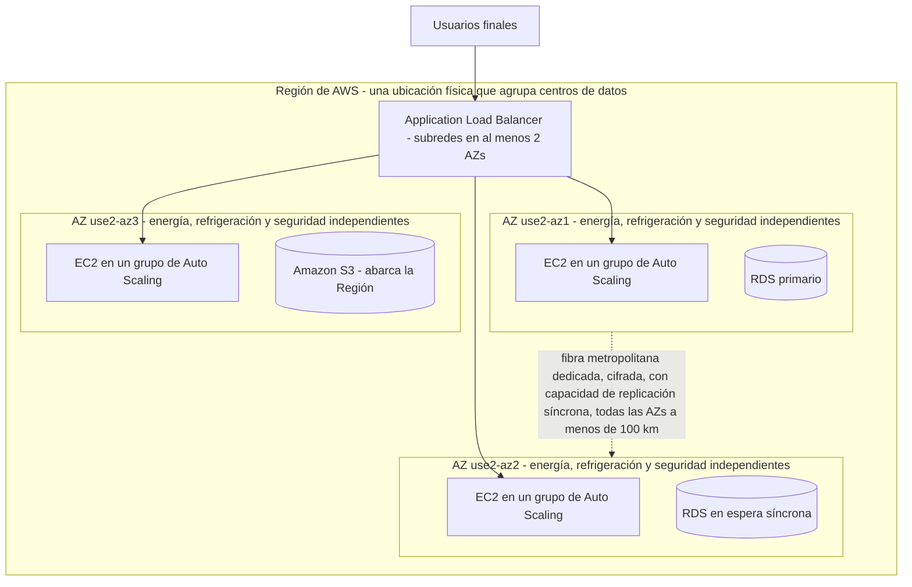
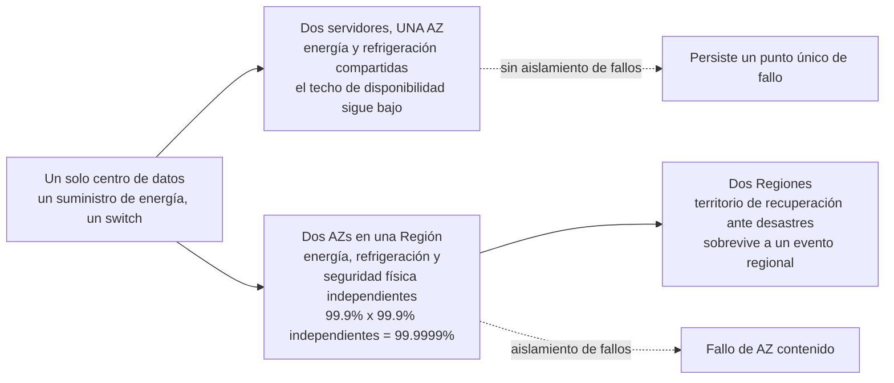
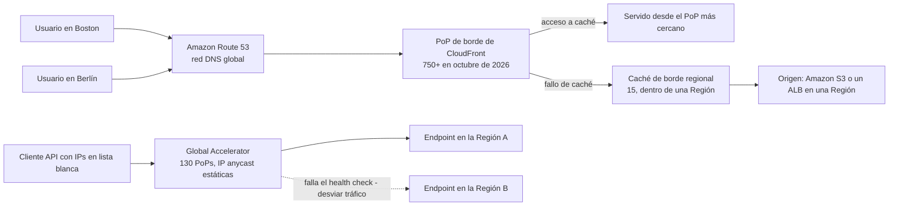
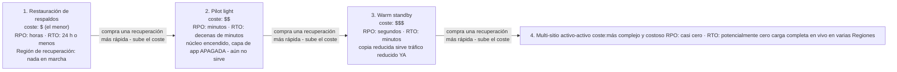
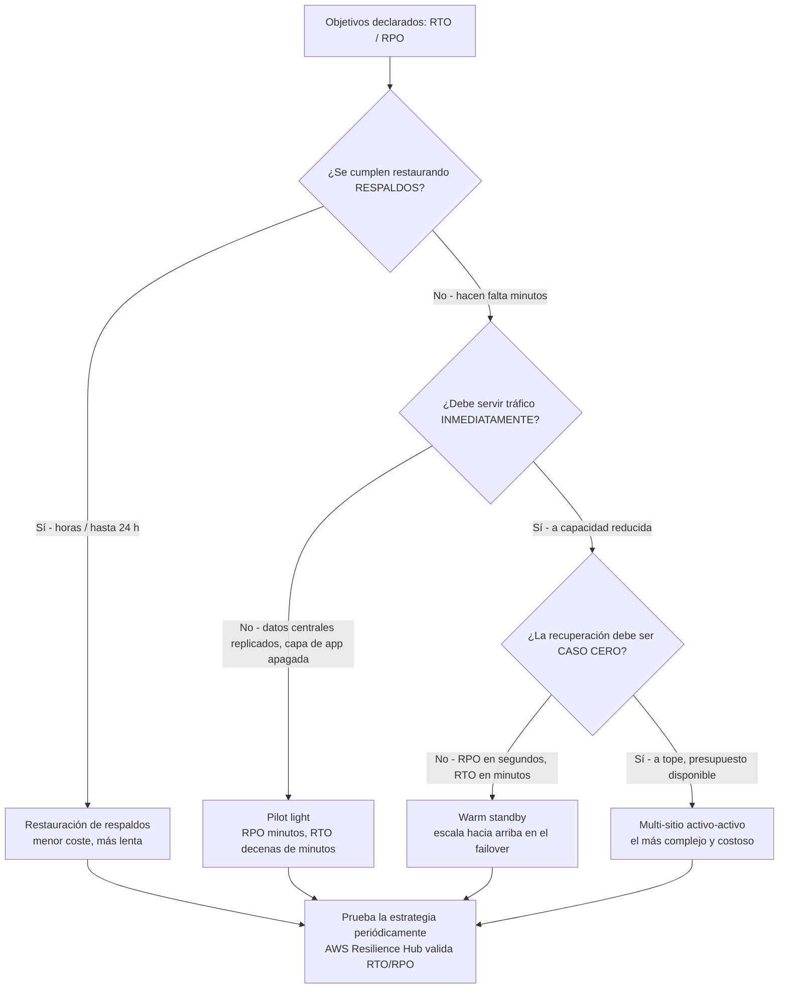
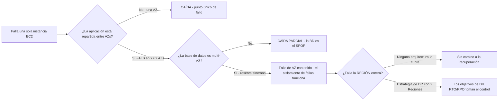

# Infraestructura global de AWS y resiliencia

Toda carga de trabajo de AWS acaba respondiendo una pregunta: *¿dónde corre, y qué pasa cuando ese lugar se rompe?* El examen lo llama **Dominio 3, Tarea 3.2 — «Definir la infraestructura global de AWS»**, y es una de las tareas más rentables de CLF-C02 porque un solo error de vocabulario (Región frente a Zona de Disponibilidad frente a ubicación de borde) puede costarte varias preguntas de golpe. El encuadre de la propia AWS es directo: el CTO de Amazon Werner Vogels dice **«Todo falla, todo el tiempo»**, y el Well-Architected Framework existe para que puedas *«preparar tu carga de trabajo para el fallo»* en lugar de fingir que no ocurrirá.

```text
====================================================================
 INFRAESTRUCTURA GLOBAL DE AWS — LAS TRES CAPAS (en octubre de 2026)
====================================================================
  Regiones geográficas .... 39 en activo (+2 anunciadas: Arabia Saudita,
                              Chile); 34 visibles para una cuenta
                              estándar; 17 habilitadas por defecto
  Zonas de Disponibilidad . 124 en esas 39 Regiones
                              (mínimo de 3 por Región por diseño)
  Borde global de AWS ...... 750+ PoPs de CloudFront, 15 cachés
                              de borde regional, 130 PoPs de
                              Global Accelerator, DNS de Route 53
                              en todo el mundo
---------------------------------------------------------------------
  CAPA                ¿DESPLIEGAS CARGAS AQUÍ?   DOMINIO DE FALLO
  Región              sí                          la Región completa
  Zona de Disponib.   sí                          una AZ (de >= 2)
  Ubicación de borde  no - capa de entrega/caché  un PoP
---------------------------------------------------------------------
  ESCALERA DE RESILIENCIA (Well-Architected REL13-BP02)
  backup y restauración  RPO horas      RTO <= 24 h
  pilot light            RPO minutos    RTO decenas de minutos
  warm standby           RPO segundos   RTO minutos
  multi-sitio (AA)       RPO casi cero  RTO potencialmente cero
====================================================================
```

> [!NOTE]
> **Los recuentos de arriba son una instantánea, no un temario.** Cada cifra de Región, AZ, PoP y Zone de esta lección está fechada **en octubre de 2026** y AWS las revisa continuamente. Lo que el examen evalúa de verdad es la *relación* entre las capas — las Regiones contienen AZs, las AZs contienen centros de datos, las ubicaciones de borde están delante de ambas — más las reglas de diseño estables (mínimo tres AZs por Región, tu aplicación en al menos dos).

En esta lección vas a:

- separar **Regiones, Zonas de Disponibilidad y ubicaciones de borde** por definición, recuento y capacidad;
- explicar **por qué las Regiones están aisladas** — tolerancia a fallos, residencia de datos y latencia;
- elegir una Región con el conjunto de decisión de **cumplimiento, latencia, precio y características**;
- aplicar la **regla de diseño de AZ** (AWS entrega ≥3 AZs por Región; tu aplicación usa ≥2);
- distinguir **CloudFront, Route 53 y Global Accelerator** por su plano de entrada;
- situar **Local Zones, Wavelength, Outposts y Snow** en el continuo híbrido de borde;
- definir con precisión **resiliencia, disponibilidad, tolerancia a fallos, alta disponibilidad y recuperación ante desastres**;
- leer y calcular **RTO y RPO**, y ordenar las **cuatro estrategias de DR** por coste frente a velocidad de recuperación;
- estudiar **cuatro casos de estudio de resiliencia publicados por AWS**, dos de ellos añadidos en esta revisión;
- aprender **qué lanzó AWS de verdad entre 2025 y octubre de 2026** — Regiones, Local Zones y planes anunciados pero aún sin abrir;
- practicar con **12 preguntas estilo examen** más cuatro comprobaciones interactivas.

---

## 1. Regiones, Zonas de Disponibilidad y ubicaciones de borde

### 1.1 Las tres definiciones, con las palabras de AWS

| Capa | Definición de AWS (con fuente) | Qué es físicamente | ¿Desplegar cargas? |
|---|---|---|---|
| **Región de AWS** | *«una ubicación física en el mundo donde agrupamos centros de datos»* | Un área geográfica que contiene varias AZs, con su propio plano de control y su catálogo de servicios | **Sí** — eliges una Región cuando lanzas cualquier cosa |
| **Zona de Disponibilidad (AZ)** | *«uno o más centros de datos discretos con energía, conectividad de red y conexión redundantes en una Región de AWS»*; cada AZ tiene *«energía, refrigeración y seguridad física independientes»* | Uno o más centros de datos, la **unidad de aislamiento de fallos y alta disponibilidad** | **Sí** — tus subredes e instancias viven dentro de AZs |
| **Ubicación de borde / PoP** | Un punto de presencia de CloudFront o Global Accelerator que almacena en caché el contenido o termina las conexiones de usuario cerca de los espectadores | Una huella más pequeña en ciudades de todo el mundo, *delante de* las Regiones | **No** — no puedes lanzar una instancia EC2 en una ubicación de borde |

Tres hechos sobre la relación hacen la mayor parte del trabajo del examen:

1. **Una Región contiene al menos tres AZs** — *«Cada Región de AWS consta de un mínimo de tres AZs, aisladas y físicamente separadas, dentro de un área geográfica»* (en octubre de 2026: **39 Regiones y 124 AZs** en activo, con **7 AZs más y 2 Regiones más** anunciadas para el Reino de Arabia Saudita y Chile).
2. **Las AZs no comparten puntos únicos de fallo.** La tarea 3.2 de la guía del examen exige explícitamente el conocimiento de que *«las Zonas de Disponibilidad no comparten puntos únicos de fallo»*.
3. **Las ubicaciones de borde son una capa de entrega, no una capa de cómputo.** Los beneficios de las ubicaciones de borde, según la guía del examen, son la latencia y la descarga para la *entrega* — nunca «ejecuta mi aplicación aquí».

### 1.2 Ejemplo E1 — reconciliar el recuento de AZs

El bloque de estadísticas de AWS dice **124 AZs (en octubre de 2026)**. Las tablas de IDs de AZ en la documentación de infraestructura global cubren solo las 34 Regiones que una cuenta estándar puede ver. Reconcilia ambas:

```text
IDs de AZ listados para las 34 Regiones estándar ...... 109   (contado en oct. 2026)
+ Regiones AWS GovCloud (US) (2 x 3 AZs) .............   6
+ Regiones AWS China (2 x 3 AZs) .....................   6
+ Región europea soberana de AWS .....................   3
                                                 -----
                                                  124  = total publicado por AWS
```

La aritmética solo cierra si el **124 publicado cuenta las Regiones que existen hoy**, no la Región saudí anunciada pero aún sin abrir. Las adiciones anunciadas (**+7 AZs, +2 Regiones**) son *planes*, nunca hechos de lanzamiento — el examen no te reconocerá tratar un anuncio como una apertura.



### 1.3 Para qué sirve cada capa

| Pregunta que debes responder | Capa correcta | Respuestas incorrectas que cuelga el examen |
|---|---|---|
| «¿Dónde lanzo mis instancias EC2?» | Región + AZ (a través de subredes) | ubicación de borde, PoP, Local Zone (salvo que la latencia/residencia sea el objetivo declarado) |
| «¿Cómo sobrevivo al fallo de un centro de datos?» | Zona de Disponibilidad | «añadir otra Región» (sobreingeniería), «hacer un respaldo» (demasiado lento) |
| «¿Cómo sobrevivo al fallo de la Región entera?» | Segunda Región (recuperación ante desastres) | «otra AZ en la misma Región» (la Región se lo llevó consigo) |
| «¿Cómo sirvo contenido estático rápido en más de 100 ciudades? | Ubicaciones de borde de CloudFront | «replicar mi base de datos a más AZs» (no acorta el camino del usuario) |
| «¿Dónde están almacenados físicamente mis datos? | Región (y la AZ dentro de ella) | ubicación de borde (una copia en caché no es tu registro de verdad) |

- **📚 ¿Sabías que…?** AWS interconecta *«todas las AZs ... con una red de alta banda y baja latencia sobre fibra metropolitana dedicada y totalmente redundante»*, cifra **todo el tráfico entre AZs**, y declara que el rendimiento *«es suficiente para lograr replicación síncrona entre AZs»*. Las AZs están *«físicamente separadas por una distancia significativa, muchos kilómetros»* y sin embargo *«todas están a menos de 100 km (60 millas) entre sí»* (en octubre de 2026). Ese sobre apretado pero no diminuto es exactamente por qué la replicación síncrona multi-AZ es posible *y* por qué una Región entera aún puede caer por un solo evento regional.

### 1.4 Dónde están las Regiones (en octubre de 2026)

Contar las Regiones lanzadas por geografía da una comprobación de cordura útil sobre las afirmaciones de «alcance global», y muestra por qué **no puedes dar por supuesto que tu Región preferida exista**:

| Geografía | Regiones lanzadas | Listadas en el mapa de AWS | Nota |
|---|---|---|---|
| América del Norte | 9 | 9 | — |
| América del Sur | 1 | 2 | Una entrada listada aún no disponible |
| Europa | 9 | 9 | Incluye la Región europea soberana de AWS |
| Oriente Medio | 3 | 4 | Una entrada listada aún no disponible |
| África | 1 | 1 | Región única |
| Asia Pacífico | 13 | 13 | El recuento más grande en general |
| Australia / Nueva Zelanda | 3 | 3 | — |
| **Total** | **39 lanzadas** | **41 listadas** | **+7 AZs y 2 Regiones anunciadas (Arabia Saudita, Chile)** |

De aquí salen dos lecciones. Primero, **«AWS no tiene Región en X» es una respuesta de examen legítima** — la disponibilidad de servicios es un factor real de selección de Región, no un formalismo, porque un conjunto definido de servicios centrales se entrega con cada apertura de Región mientras que un nivel adicional *«suele lanzarse dentro de los 12 meses de la apertura de una nueva Región»*. Segundo, los recuentos cambian cada trimestre: trata la tabla como una instantánea fechada **en octubre de 2026** y vuelve a comprobar las páginas de infraestructura global de AWS antes de citar cualquier cifra fuera de esta lección. (Esta investigación no pudo reconciliar cada entrada del mapa con la propia tabla de documentación de AWS, así que la columna «listadas» es un recuento del mapa, no un total oficial.)

### Actualizaciones de 2026 (en octubre de 2026)

La infraestructura global no se quedó quieta mientras estudiabas. Lo que sigue es cada adición de infraestructura **fechada y publicada por AWS** de 2025–26 encontrada en este ciclo de investigación — los lanzamientos llevan fecha, los planes no, y solo los lanzamientos cuentan:

> [!NOTE]
> - **Asia Pacífico (Tailandia), `ap-southeast-7` — lanzada el 2025-01-07** (historial de documentación de Regiones de AWS, consultado en 2026-10).
> - **México (Central), `mx-central-1` — lanzada el 2025-01-14** (historial de documentación de Regiones de AWS, consultado en 2026-10).
> - **Asia Pacífico (Taiwán), `ap-east-2` — lanzada el 2025-06-06** (historial de documentación de Regiones de AWS, consultado en 2026-10).
> - **Asia Pacífico (Nueva Zelanda), `ap-southeast-6` — lanzada el 2025-09-02**, la entrada más reciente del historial de documentación de Regiones de AWS en octubre de 2026 (historial de documentación de Regiones de AWS, consultado en 2026-10).
> - **Nube europea soberana de AWS, `eusc-de-east-1` — disponibilidad general anunciada el 2026-01-14** (AWS News Blog, 2026-01-14). **No aparece en la página pública de recuento de Regiones y AZs de AWS** (comprobado en 2026-10), así que AWS no te confirma que esté dentro de las 39 publicadas — cita *«39 Regiones geográficas / 124 Zonas de Disponibilidad, en octubre de 2026»* y fecha la Nube europea soberana por separado.
> - **Adiciones de borde:** la **AWS Local Zone de la ciudad de Nueva York** alcanzó disponibilidad general el **2025-01-08** (AWS What's New, 2025-01-08) y la **AWS Local Zone de Hanoi** fue anunciada el **2026-06-22** (AWS Weekly Roundup, 2026-06-22), dentro de una huella que AWS describe como **«más de 30 ubicaciones en seis continentes»** (página de producto de AWS Local Zones, en octubre de 2026).

> [!WARNING]
> **⚠️ Anunciado no es lanzado (en octubre de 2026).** La página de infraestructura de AWS aún dice *«planes anunciados para 7 Zonas de Disponibilidad más y 2 Regiones de AWS más en el Reino de Arabia Saudita y en Chile»*. Esos son **planes**: este ciclo de investigación no pudo confirmar una fecha de apertura para ninguna de las dos Regiones en ningún comunicado de AWS, así que ambas quedan fuera de las 39 Regiones / 124 AZs de arriba. En el examen, una Región anunciada no aporta nada hasta que AWS publique su apertura — y una Región nueva solo es *visible* cuando el tipo de cuenta y el estado de activación lo permiten (§3.3).

- **📚 ¿Sabías que…?** 2025 fue el año más denso en aperturas de Regiones de este ciclo de investigación — **cuatro Regiones en poco más de ocho meses** (Tailandia 2025-01-07, México 2025-01-14, Taiwán 2025-06-06, Nueva Zelanda 2025-09-02) — y sin embargo la cifra principal publicada por AWS en octubre de 2026 seguía siendo **39 Regiones y 124 AZs**. Cada una de esas aperturas viene con el mínimo de diseño de AWS de **al menos tres AZs aisladas y físicamente separadas**, y por eso el total de AZs y el total de Regiones suben juntos y no de forma independiente.

---

## 2. Por qué las Regiones están aisladas: tolerancia a fallos, residencia de datos, latencia

### 2.1 Tolerancia a fallos: dominios de fallo separados a propósito

Las Regiones están aisladas para que ningún único evento regional pueda tumbar todo lo que ejecutas. El mecanismo es el **aislamiento de fallos** — la guía prescriptiva de AWS lo define como restringir *«el alcance del impacto a un contenedor de fallo previsto cuando ocurre un fallo»*, y declara que *«Redundancia – La tolerancia a fallos se logra mediante la redundancia que elimina los puntos únicos de fallo (SPOF)»*.

| Nivel de aislamiento | Qué contiene | Qué **no** contiene |
|---|---|---|
| **Centro de datos** | Fallo de energía, refrigeración, hardware | Un incendio en el edificio, un corte de fibra en el anillo metropolitano |
| **Zona de Disponibilidad** | *«mejor aislada y protegida frente a problemas como cortes de energía, rayos, tornados, terremotos»* | Un evento de toda la Región (problema del plano de control, evento de red regional, gran medida regulatoria) |
| **Región** | Radio de explosión regional | Un evento global (DNS, autoridad de certificados, tu propio mal despliegue) — y por eso también necesitas una capa **global** (CloudFront, Route 53) |

La propia **tolerancia a fallos** tiene una definición precisa: *«la capacidad de resistir el fallo de un subsistema y mantener la disponibilidad (hacer lo correcto dentro de un SLA establecido). Para implementar la tolerancia a fallos, las cargas de trabajo usan subsistemas de reserva (o redundantes).»* Las reservas en caliente cuestan dinero; ese coste es por qué la tolerancia a fallos se sitúa por encima de la simple alta disponibilidad en la escalera de precios.

### 2.2 Residencia y soberanía de datos

Algunas cargas de trabajo solo pueden ejecutarse legal o contractualmente en una geografía concreta. AWS te da tres niveles anidados de control de residencia:

1. **Nivel de Región** — elige una Región dentro de la jurisdicción requerida (y, cuando haga falta, un tipo de cuenta especial como **AWS GovCloud (US)** o las Regiones **AWS China**);
2. **Nivel de Local Zone** — AWS describe las Local Zones como una manera de *«abordar los requisitos de residencia de datos»* permitiéndote *«controlar dónde se ejecutan tus cargas de trabajo y dónde residen tus datos»* en una metrópoli concreta;
3. **Nivel de Wavelength Zone** — los datos *«permanecen dentro de los límites geográficos que especifiques»* cuando colocas cómputo dentro de una instalación 5G de un operador.

> [!WARNING]
> **La residencia no es disponibilidad, y el respaldo tampoco lo es.** Elegir Fráncfort por una norma de residencia alemana te dice *dónde* pueden vivir los datos; no dice nada sobre *qué tan rápido* te recuperas. Por el contrario, una carga de trabajo perfectamente replicada que almacena datos regulados en la jurisdicción equivoca es aparentemente conforme e ilegal. En el examen, si el enunciado nombra un **límite legal o regulatorio**, responde con la selección de Región/Local Zone/Wavelength; si nombra **inactividad o pérdida de datos**, responde con el recuento de AZs o la estrategia de DR.

### 2.3 Latencia: la proximidad es una entrada de diseño

La documentación de Regiones de AWS es directa: *«puedes reducir la latencia de red cuando seleccionas una Región cercana a la mayoría de tus usuarios»* (en octubre de 2026). La consecuencia práctica es una regla de dos niveles:

- **Cómputo que debe estar cerca de los usuarios** → elige la Región más cercana que tenga los servicios que necesitas, o una Local Zone / Wavelength Zone en esa metrópoli;
- **Contenido que puede almacenarse en caché** → deja la carga de trabajo en una Región y deja que los **750+ PoPs de CloudFront (en octubre de 2026)** acorten el camino para el resto.

### 2.4 Ejemplo E2 — la redundancia multiplica la disponibilidad

La documentación de fiabilidad de AWS muestra la aritmética de componentes independientes. Dos componentes cada uno con un **99.9%** de disponibilidad, que fallan *de forma independiente*, se combinan como:

$$
1 - (0.001 \times 0.001) = 1 - 10^{-6} = 0.999999 = \mathbf{99.9999\%}
$$

Esa es la promesa detrás de ejecutar en **dos AZs**: la probabilidad de fallo de cada AZ es (aproximadamente) independiente de la otra, así que la *pareja* es vastamente más disponible que cualquiera de sus miembros. La misma fórmula explica el lado oscuro — tres dependencias duras que cada una tiene un **99.99%** limitan toda la carga de trabajo a:

$$
0.9999^3 = 0.9997 = \mathbf{99.97\%}
$$

**Un eslabón débil baja el techo de una arquitectura por lo demás excelente.** Esta es la aritmética de resiliencia favorita del examen: la redundancia solo ayuda cuando las partes redundantes son genuinamente independientes (AZs distintas, no dos servidores en un mismo rack).



---

## 3. Elegir una Región: cumplimiento, latencia, precio y características

### 3.1 Los cuatro factores (más dos que olvidas)

| Factor | La pregunta que hay detrás | Guía de AWS con fuente (en octubre de 2026) |
|---|---|---|
| **Cumplimiento / residencia** | ¿Puede vivir aquí legalmente este dato? | Selección de Región o tipo de cuenta; Local Zones para *«abordar los requisitos de residencia de datos»* |
| **Latencia** | ¿Dónde está la mayoría de mis usuarios? | *«selecciona una Región cercana a la mayoría de tus usuarios»* |
| **Precio** | ¿Cuánto cuesta ejecutar aquí? | COST07-BP02: *«El precio de los recursos puede ser distinto en cada Región. Identifica las diferencias de coste regional y despliega solo en Regiones de mayor coste para cumplir los requisitos de latencia, residencia de datos y soberanía de datos.»* Los precios difieren *«debido a diferencias en el coste de la tierra, la fibra, la electricidad y los impuestos, por ejemplo.»* |
| **Servicios / características** | ¿Tiene esta Región siquiera lo que necesito? | AWS incluye un conjunto definido de servicios centrales en **cada** apertura de Región, con un nivel adicional que *«suele lanzarse dentro de los 12 meses de la apertura de una nueva Región»* — así que una Región de nueva puede carecer de un servicio de nicho |
| **Estado de activación** *(fácil de olvidar)* | ¿Está la Región habilitada para mi cuenta? | **17 Regiones habilitadas por defecto**; el resto son **opt-in** (en octubre de 2026) |
| **Tipo de cuenta** *(fácil de olvidar)* | ¿Estándar, **AWS GovCloud (US)** o **AWS China**? | La disponibilidad de Regiones está acotada por tu tipo de cuenta |

El orden importa más que la lista: en el examen, **un límite legal o regulatorio declarado gana a cualquier otro factor**, y *«más barato en otro sitio»* nunca gana cuando está en juego la residencia. La propia redacción de AWS para el factor de coste es condicional — despliega en una Región más cara *solo* cuando la latencia, la residencia o la soberanía lo exijan.

### 3.2 Ejemplo E3 — el presupuesto de disponibilidad al año

Los porcentajes de disponibilidad son **presupuestos anuales, no garantías por caída**. 8,760 horas al año:

| Objetivo de disponibilidad | Presupuesto de inactividad al año | Aritmética |
|---|---|---|
| 99% | 3 días 15 horas | $0.01 \times 8{,}760 = 87.6$ h |
| **99.9%** | **8 horas 45 minutos** | $0.001 \times 8{,}760 = 8.76$ h ≈ 8 h 45 m |
| 99.95% | 4 horas 22 minutos | $0.0005 \times 8{,}760 = 4.38$ h |
| 99.99% | 52 minutos | $0.0001 \times 8{,}760 = 0.876$ h ≈ 52.6 m |
| 99.999% | 5 minutos | $0.00001 \times 8{,}760 = 0.0876$ h ≈ 5.26 m |

Léelo como un **presupuesto**: una carga de trabajo prometida al 99.9% ya ha gastado un tercio de su asignación anual tras **2 horas 55 minutos** de inactividad. Por eso un requisito de negocio de «cuatro nueves o mejor» cambia tu arquitectura — te empuja de una sola AZ a multi-AZ, y eventualmente de una Región a dos.

Grafica la misma tabla y la *forma* del presupuesto es inconfundible — cada nueve adicional es aproximadamente un recorte de **diez veces** en la inactividad que se te permite:

```plot
{
  "type": "bar",
  "title": "Presupuesto anual de inactividad por objetivo de disponibilidad (minutos al año, en octubre de 2026)",
  "xLabel": "Objetivo de disponibilidad",
  "yLabel": "Presupuesto de inactividad (minutos al año)",
  "xKey": "target",
  "data": [
    {"target": "99%", "minutes": 5256},
    {"target": "99.9%", "minutes": 525.6},
    {"target": "99.95%", "minutes": 262.8},
    {"target": "99.99%", "minutes": 52.6},
    {"target": "99.999%", "minutes": 5.3}
  ]
}
```

> [!IMPORTANT]
> **Los nueves son por año, por carga de trabajo — nunca por incidente.** Un SLA del 99.99% con un presupuesto anual de **52 minutos** no te salvará si una sola caída quema los 52 minutos completos en enero. Y observa los SLA de servicios de AWS, separados y mucho más estrictos: **Amazon CloudFront promete al menos un 99.9% de actividad mensual**, mientras que **Route 53 solo cuenta como no disponible si los cuatro servidores de nombres virtuales asignados a la hosted zone dejan de responder a todas las consultas DNS** (en octubre de 2026) — el listón para llamar «caído» a Route 53 es intencionadamente casi inalcanzable.

- **📚 ¿Sabías que…?** AWS opera *«casi 20 millones de kilómetros»* de fibra de red en octubre de 2026, y el precio por Región *no* es uniforme: el pilar de costes del Well-Architected te dice explícitamente *«identifica las diferencias de coste regional»* en lugar de asumir una lista de precios global. Los recursos de Local Zone también se precian **por encima** de su Región madre (en octubre de 2026) — la proximidad cuesta dinero. Cualquier opción que afirme *«precios idénticos en cada Región»* es errónea de entrada.

### 3.3 Ejemplo E4 — por qué «39 Regiones» no es lo que ve tu cuenta

Circulan tres totales de Regiones distintos en la documentación de AWS, y solo uno de ellos es lo que muestra tu consola (todos en octubre de 2026):

```text
Regiones lanzadas en todo el mundo ..................... 39
  - Regiones AWS GovCloud (US) ......................  2   (tipo de cuenta especial)
  - Regiones AWS China ..............................  2   (tipo de cuenta especial)
  - Región europea soberana de AWS ..................  1   (opt-in / registro separado)
                                                   -----
Regiones visibles para una cuenta comercial estándar ... 34
  - habilitadas por defecto ............................ 17
                                                   -----
Regiones a las que debes activar explícitamente ......... 17
```

Comprueba la aritmética: $39 - 2 - 2 - 1 = 34$, y $34 - 17 = 17$. El examen usa esto para evaluar si confundes **lanzadas**, **visibles** y **habilitadas**:

| Total | Qué significa | Cuándo es el número correcto |
|---|---|---|
| **39** | Regiones que AWS ha lanzado (más planes anunciados para Arabia Saudita y Chile) | «¿Cuántas Regiones tiene AWS?» |
| **34** | Regiones que una cuenta comercial estándar puede ver | «¿Cuántas Regiones puede listar mi cuenta?» |
| **17** | Regiones **habilitadas por defecto**; el resto son opt-in | «¿Puedo usar esta Región sin activarla primero?» |

Si una pregunta dice *«las 39 Regiones están disponibles para todos los clientes por defecto»*, es errónea en dos cuentas a la vez — tipo de cuenta **y** estado de activación.

---

## 4. La regla de diseño de Zonas de Disponibilidad

### 4.1 Dos números distintos, ambos correctos

Esta es la distinción examinada de forma más fiable del Dominio 3, y los candidatos la pierden al confundir dos reglas que responden preguntas distintas:

| Regla | Número | De quién es la regla | Fuente |
|---|---|---|---|
| **El diseño de Región de AWS** | **mínimo 3 AZs por Región** | La infraestructura de AWS | *«Cada Región tiene al menos tres Zonas de Disponibilidad. Esto te ayuda a diseñar aplicaciones altamente disponibles en AWS.»* |
| **El diseño de tu aplicación** | **al menos 2 AZs** | Tuyo (la arquitectura bajo revisión) | La consola del **Application Load Balancer** exige: *«Selecciona subredes de al menos dos Zonas de Disponibilidad»* |

Así: **AWS te da ≥3; tú debes usar ≥2.** Una pregunta que describe *tu arquitectura* con solo las subredes de una AZ está describiendo un punto único de fallo — sin importar cuántas AZs tenga la Región. AWS también indica que puedes *«ejecutar en múltiples AZs para lograr una tolerancia a fallos aún mayor»*, es decir, que tres están disponibles si tu presupuesto y tu tolerancia a la complejidad lo permiten.

### 4.2 IDs de AZ frente a códigos de AZ

Una trampa sutil que ha aparecido en exámenes reales:

- **Códigos de AZ** (`us-east-1a`, `us-east-1b`) son **relativos a la cuenta** — en Regiones antiguas, la letra que ve una cuenta dada está mapeada a un centro de datos físico distinto para distintas cuentas (cuentas creadas antes de noviembre de 2025).
- **IDs de AZ** (`euw1-az1`, `use1-az1`) identifican **la misma ubicación física en toda cuenta de AWS** — el identificador seguro para reglas entre cuentas, landing zones y emparejamientos de red.

En octubre de 2026 las tablas de IDs de AZ listan **109 IDs de AZ en las 34 Regiones estándar**. Regla práctica para el examen: si una pregunta involucra **dos cuentas**, la respuesta involucra **IDs de AZ**, no letras.

### 4.3 Ejemplo E5 — ¿tu diseño usa las AZs que te dieron?

Una Región con **3 AZs (en octubre de 2026, la configuración más común)** ejecuta una aplicación con un ALB cuyas subredes están todas en una AZ, una instancia EC2 y una base de datos sin reserva:

```text
Recuento de AZs de la Región ............... 3   (regla de diseño de AWS cumplida)
AZs que realmente usa la aplicación ........ 1   (regla de diseño de la aplicación VIOLADA)
Fallo del centro de datos de esa AZ ........ aplicación entera fuera de servicio
Fallo de la Región ......................... aplicación entera fuera de servicio
```

Corrección por orden de prioridad: **(1)** añadir subredes e instancias en una segunda AZ (mínimo del ALB, elimina el punto único de fallo de la AZ); **(2)** habilitar un despliegue de base de datos multi-AZ (reserva síncrona en la segunda AZ); **(3)** solo entonces considerar una segunda Región con una estrategia de DR para el fallo *regional*. El paso 1 cuesta menos y elimina el fallo que el examen pregunta con más frecuencia.

> [!NOTE]
> **Multi-AZ no es multi-Región.** Multi-AZ = alta disponibilidad y aislamiento de fallos **dentro de una Región** (protege frente al fallo de una AZ). Multi-Región = **recuperación ante desastres, continuidad de negocio, soberanía de datos y latencia global** (protege frente al fallo de una Región). Una pregunta sobre «protegerse frente al fallo de una Zona de Disponibilidad» nunca necesita una segunda Región; una pregunta sobre «protegerse frente al fallo de una Región» nunca se satisface con una tercera AZ.

---

## 5. Servicios de borde: CloudFront, Route 53 y Global Accelerator

Los tres están *delante de* tus Regiones, y los tres aparecen en la Tarea 3.2 como **beneficios de las ubicaciones de borde**. El examen los distingue por su **plano de entrada**: respuestas DNS, contenido en caché, o una dirección IP anycast estática.

### 5.1 Amazon CloudFront — el plano caché/CDN

- *«Reduce la latencia entregando datos a través de más de 750 Points of Presence (PoPs) dispersos globalmente»* — **más de 750 PoPs en más de 100 ciudades de más de 50 países**, más **más de 1,140 PoPs incrustados en más de 300 ciudades** dentro de ISPs, y **15 cachés de borde regional** que están *dentro* de una Región (todo en octubre de 2026).
- Mecánica: DNS resuelve al usuario hacia el PoP más cercano → en un **acceso a caché** el PoP responde → en un **fallo de caché** busca en tu **origen** (Amazon S3, un ALB, un origen de medios) y almacena el resultado.
- **SLA: al menos 99.9% de actividad mensual** (en octubre de 2026).
- Uso en el examen: almacenar en caché y entregar contenido cerca de los usuarios, más el **failover de origen** como palanca documentada de desvío de tráfico para DR.

### 5.2 Amazon Route 53 — el plano DNS

- *«Route 53 usa una red global de servidores DNS en una serie de ubicaciones en todo el mundo para ofrecerte alta disponibilidad y mejor rendimiento.»*
- Políticas de enrutamiento que nombra el examen: **latencia, geoproximidad, basada en IP, failover y ponderada** — más los **health checks**, que es como se consigue el failover DNS automatizado.
- **SLA:** no disponible *«solo si los cuatro servidores de nombres virtuales asignados a la Hosted Zone dejan de responder a todas las consultas DNS»*; los créditos de servicio empiezan por debajo del **100%** de actividad (en octubre de 2026).
- La trampa que debes memorizar: las respuestas DNS se **cachéan por los resolvers según el TTL**, así que un failover puede tardar tanto como el TTL que configuraste.

### 5.3 AWS Global Accelerator — el plano de IP anycast

- *«Mejora el rendimiento de red de tus aplicaciones hasta en un 60%»* y ofrece *«failover rápido para arquitecturas multi-Región y multi-AZ»* con *«enrutamiento determinista al eliminar las dependencias de la caché DNS»* (afirmaciones en octubre de 2026).
- Da a tu aplicación **direcciones IP estáticas anunciadas anycast desde la red de borde de AWS** — los clientes se conectan a una IP fija, y el tráfico se dirige en el borde hacia endpoints sanos.
- **130 puntos de presencia en 95 ciudades de 53 países** (en octubre de 2026).
- El uso en el examen: **cargas de trabajo no HTTP o sensibles a listas blancas de IP** y failover que no puede esperar al TTL de DNS.

### 5.4 La comparación de los tres planos

| | **Amazon Route 53** | **Amazon CloudFront** | **AWS Global Accelerator** |
|---|---|---|---|
| Plano de entrada | Respuesta DNS | Contenido en caché en un PoP | Dirección IP anycast estática |
| Qué recibe el cliente | Una dirección IP a la que conectarse | El objeto en sí (desde la caché) | Direcciones IP anycast estáticas |
| Velocidad de cambio / failover | Acotada por el **TTL de DNS** | Invalidación de caché + failover de origen | Health checks en el borde, sin espera de TTL de DNS |
| Recuentos (oct. 2026) | ~93 ubicaciones listadas en la página de características de Route 53 de AWS (contadas para esta lección; AWS no publica un total) | 750+ PoPs · 15 cachés de borde regional · 1,140+ PoPs incrustados | 130 PoPs (95 ciudades, 53 países) |
| Mejor encaje en el examen | DNS global con enrutamiento por latencia/failover | Contenido estático, cacheable y de gran volumen | Failover rápido, IP fijas, protocolos no HTTP |



- **📚 ¿Sabías que…?** Los tres servicios pueden apilarse en lugar de elegirse de forma aislada: **Route 53** resuelve un nombre amigable, **CloudFront** sirve el front-end en caché desde el más cercano de los 750+ PoPs (en octubre de 2026), y **Global Accelerator** transporta el tráfico de la API en IP anycast estáticas hacia dos Regiones con failover por health check. El whitepaper de recuperación ante desastres de AWS lista exactamente estos tres — Route 53, Global Accelerator y el failover de origen de CloudFront — como el conjunto de **gestión de tráfico** para desviar usuarios durante la recuperación.

```matching
{
  "question": "Empareja cada servicio de infraestructura global con su plano de entrada y su uso en el examen (recuentos en octubre de 2026):",
  "pairs": [
    {"left": "Amazon Route 53", "right": "Plano DNS - devuelve una dirección IP, admite enrutamiento por latencia, failover, geoproximidad, ponderado y por IP, pero la velocidad del failover está acotada por el TTL de DNS"},
    {"left": "Amazon CloudFront", "right": "Plano caché/CDN - más de 750 PoPs sirven contenido en caché desde el punto de presencia más cercano, buscando en un origen cuando falla la caché"},
    {"left": "AWS Global Accelerator", "right": "Plano de IP anycast - 130 PoPs e IP anycast estáticas dan un failover rápido sin dependencia de la caché DNS"},
    {"left": "Caché de borde regional", "right": "15 cachés que viven DENTRO de una Región, un nivel por detrás de los PoPs de borde, con contenido cuya popularidad está decayendo"},
    {"left": "Zona de Disponibilidad", "right": "Una unidad desplegable de aislamiento de fallos dentro de una Región - energía, refrigeración y seguridad física independientes, mínimo 3 por Región"},
    {"left": "Ubicación de borde (PoP)", "right": "Un punto de entrega delante de las Regiones - no puedes lanzar una instancia EC2 aquí"}
  ],
  "explanation": "Route 53 responde DNS, CloudFront sirve objetos en caché, Global Accelerator termina IP anycast en el borde, y las cachés de borde regional son el único nivel de borde que vive dentro de una Región. Las AZs y las ubicaciones de borde se separan por capacidad: las AZs ejecutan tu carga de trabajo, las ubicaciones de borde solo la entregan o la almacenan en caché."
}
```

### 5.5 Ejemplo E6 — la ventana del TTL de DNS forma parte de tu tiempo de failover

Supón que un registro de failover de Route 53 tiene un TTL de **300 segundos**, y el endpoint primario falla en `t = 0`. Un resolver recursivo que pidió la respuesta **240 segundos** antes del fallo aún conserva una respuesta en caché válida:

```text
TTL configurado en el registro de failover ....... 300 s
Antigüedad de la respuesta en caché de este resolver . 240 s
Vida restante de la caché en el momento del fallo ..  60 s
   -> esos usuarios siguen enviándose al endpoint FALLIDO
Peor caso (resolver que preguntó 1 s antes del fallo) . 300 s = 5 min de redirección a un callejón sin salida
Mismo failover a través de Global Accelerator ...... health checks de endpoint en el borde,
                                                 sin caché de resolver que esperar
```

Nada de esto condena el failover DNS — **los health checks y el enrutamiento por failover de Route 53 son una palanca documentada de gestión de tráfico de DR**, y para la política DNS global (latencia, geoproximidad, ponderada) es la respuesta correcta. El punto examinable es aritmética sobre *tus propios objetivos*: si el **RTO declarado es de 60 segundos** y el TTL de tu registro de failover es de **300 segundos**, la capa de DNS sola puede reventar el presupuesto, y el enunciado te está apuntando a **Global Accelerator** (IP anycast estáticas, *«enrutamiento determinista al eliminar las dependencias de la caché DNS»*) o a acortar el TTL. Trata siempre el TTL como un componente invisible del tiempo de recuperación — en octubre de 2026 AWS no publica un tiempo de failover por defecto, así que el número que configures es el número que obtienes.

---

## 6. El continuo híbrido de borde: Local Zones, Wavelength, Outposts y Snow

No toda carga de trabajo pertenece al núcleo de una Región. AWS ofrece un continuo desde **totalmente operado por AWS, en las profundidades de una Región** hasta **hardware en tu propio edificio** — el examen evalúa si puedes situar cada opción en ese continuo.

| Opción | Dónde vive físicamente | Quién la opera | Relación con la Región madre | Razón principal en el examen |
|---|---|---|---|---|
| **Región de AWS** | Centros de datos de AWS en una geografía | AWS | — | Línea base; capacidad, servicios, cumplimiento |
| **AWS Local Zone** | Una ubicación de **metrópoli**, *«una extensión de una Región de AWS»* | AWS | Extiende una Región concreta | Latencia de **un solo dígito de milisegundos**, *«abordar los requisitos de residencia de datos»* |
| **AWS Wavelength Zone** | **Dentro del centro de datos de un operador de telecomunicaciones** (Bell, BT, KDDI, Verizon, Orange), p. ej. `us-east-1-wl1-bos-wlz-1` | AWS + operador | Unida a una Región madre | Borde 5G/telecom; los datos *«permanecen dentro de los límites geográficos que especifiques»* |
| **AWS Outposts** | **Tu emplazamiento** — un **rack de 42U** autónomo que requiere **10–30 kVA** con enlaces ascendentes de **10/40/100 Gbps** (o servidores Outposts de 1U/2U, que *no* son instalables en el factor de forma de 42U) | AWS (hardware *y* software gestionados) | Se conecta a una **Región madre** | Las mismas APIs on-premises; procesamiento local de verdad |
| **AWS Snowball Edge** | **Tu emplazamiento**, sin conexión — tú envías el dispositivo | Dispositivo de AWS, tus manos | Los datos se mueven a una Región al conectarse | Transferencia de datos muy grande sin conexión/remota |
| **AWS Ground Station** | Antenas terrestres de satélites de AWS | AWS | Descarga hacia una Región | Ingesta de datos de satélite |

Tres aclaraciones que a las preguntas de examen les encanta difuminar:

- **Las Local Zones las despliega AWS; los Outposts los despliega el cliente.** Ambos presentan las *mismas APIs de AWS*, así que la frase del enunciado que decide es *«en una metrópoli que opera AWS»* (Local Zone) frente a *«en mi centro de datos»* (Outposts).
- **Wavelength va incrustado en el operador** — no lo eliges por residencia sola; lo eliges cuando la carga de trabajo debe estar junto a una **red 5G/telecom**.
- **Snowball es un dispositivo de transferencia, no un destino de cómputo** — y AWS ha publicado una fecha firme: *«El 31 de diciembre de 2026, AWS dejará de dar soporte a los dispositivos AWS Snowball en todas las Regiones comerciales de AWS»* (Storage Optimized y Compute Optimized), mientras que **los clientes de GovCloud y de la Región ADC con trabajos Snow activos no se ven afectados** (anuncio en octubre de 2026).

> [!WARNING]
> **Trampa de alcance para CLF-C02 (en octubre de 2026):** la guía de examen actual nombra **AWS Outposts** (cómputo híbrido) como dentro del alcance, pero **AWS Wavelength y AWS Ground Station están listados como fuera del alcance**, y la **AWS Snow Family ya no aparece** en las listas actuales dentro del alcance. Estúdialos igualmente — como *contexto* del continuo híbrido — pero nunca elijas uno de los nombres fuera del alcance como el servicio «correcto» cuando una alternativa dentro del alcance (Outposts, Local Zones, Storage Gateway, Direct Connect) encaje con la historia. Recuerda también que necesitar capacidad **nueva** de Snowball en una Región comercial después del **31 de diciembre de 2026** requiere una alternativa en línea.

- **📚 ¿Sabías que…?** La página de producto de AWS Local Zones describe *«más de 30 metrópolis en todo el mundo»* en seis continentes (en octubre de 2026), mientras que el bloque de estadísticas de infraestructura global de AWS publica una cifra distinta de Local Zones y su página de ubicaciones lista más encabezados de ciudad que cualquiera de las dos — esta investigación **no pudo reconciliar** esos recuentos, así que trata cualquier total de Local Zones como no verificado y vuelve a comprobarlo antes de citarlo. La misma cautela aplica a las Wavelength Zones (el bloque de estadísticas y los códigos de zona contados discrepan). **Los recuentos cambian; las relaciones no.**

---

## 7. Vocabulario de resiliencia: tolerancia a fallos, alta disponibilidad, recuperación ante desastres

### 7.1 Cinco términos, cinco significados

| Término | Definición con fuente de AWS | Lectura de examen en una línea |
|---|---|---|
| **Resiliencia** | *«la capacidad de una carga de trabajo de recuperarse de interrupciones de infraestructura o de servicios, adquirir dinámicamente recursos informáticos para satisfacer la demanda y mitigar interrupciones»* | La capacidad paraguas — recuperarse, escalar y absorber |
| **Disponibilidad** | *«el porcentaje de tiempo que una carga de trabajo está disponible para su uso»* | Un **porcentaje**, medido en el tiempo (véase la tabla de nueves en §3.2) |
| **Tolerancia a fallos** | *«la capacidad de resistir el fallo de un subsistema y mantener la disponibilidad ... las cargas de trabajo usan subsistemas de reserva (o redundantes)»* | Seguir sirviendo **a través** del fallo — reservas en caliente, la más costosa |
| **Alta disponibilidad (HA)** | *«la capacidad de una aplicación o sistema TI de operar continuamente a un alto nivel, sin importar el número de usuarios»* | Mantener en marcha una carga que ya corre: redundancia + replicación + balanceo + failover, normalmente **entre AZs de una Región** |
| **Recuperación ante desastres (DR)** | *«La recuperación ante desastres se centra en objetivos de recuperación de una sola vez»*; la DR trabaja sobre *«copias discretas de toda la carga de trabajo»* mientras la disponibilidad se centra en los *«componentes de la carga de trabajo»* | Restaurar **después** de que cayó — normalmente **entre Regiones** |

La página «qué es la alta disponibilidad» de AWS añade el límite que el examen evalúa textualmente: *«Los sistemas de alta disponibilidad no forman parte de la recuperación ante desastres ... La recuperación ante desastres trata de volver a poner en marcha tus sistemas si tus sistemas HA existentes fallan.»* En otras palabras: **la HA la mantiene en pie; la DR la devuelve.** La tolerancia a fallos es el primo más caro de la HA — no solo se recupera rápido, nunca se detiene visiblemente.

### 7.2 RTO y RPO: los dos números de los que vive o muere un plan de DR

Ambos los define **tu organización**, no AWS (en octubre de 2026):

- **RTO — Objetivo de tiempo de recuperación:** *«el retraso máximo aceptable entre la interrupción del servicio y la restauración del servicio.»* → **cuánto tiempo se te permite estar caído.**
- **RPO — Objetivo de punto de recuperación:** *«la cantidad máxima aceptable de tiempo desde el último punto de recuperación de datos.»* → **cuántos datos se te permite perder.**

```text
   último punto de recuperación (respaldo / retraso de replicación)     golpe el desastre      servicio restaurado
            |                                                     |                   |
            |<---------------------- RPO ------------------------->|                   |
            |                                                     |<------ RTO ------>|
            |                                                     |                   |
   El RPO está ANTES del desastre (ventana de pérdida de datos)     El RTO está DESPUÉS (ventana de inactividad)
```

La dirección es donde los candidatos pierden puntos: **RTO = inactividad, RPO = pérdida de datos.** Una ventana de RPO *mayor* es *peor* (más datos perdidos); un RTO *mayor* es *peor* (caída más larga). Para la medición, el RTO se comporta como el MTTR, y el RPO siempre está **antes** del desastre en la línea de tiempo.

### 7.3 Ejemplo E7 — leer el RTO y el RPO en una línea de tiempo

Una base de datos falla a las **12:00**. El respaldo utilizable más reciente se escribió a las **09:00**, y el servicio se restauró a las **14:00**.

$$
RPO = 12{:}00 - 09{:}00 = \mathbf{3\ hours\ of\ acceptable\ data\ loss}, \qquad RTO = 14{:}00 - 12{:}00 = \mathbf{2\ hours\ of\ downtime}
$$

Ahora voltea eso en un *requisito*: el negocio declara **RTO ≤ 1 minuto, RPO ≤ 1 segundo** para el checkout. Un RPO de 3 horas y un RTO de 2 horas incumplen ambos objetivos por órdenes de magnitud — la respuesta es una estrategia con replicación continua (warm standby o multi-sitio activo-activo), no un mejor calendario de respaldos. Y si el negocio declara en cambio **RTO ≤ 24 horas, RPO en horas**, la restauración de respaldos puede satisfacerlo al menor coste de las cuatro estrategias.

```fillblank
{
  "question": "Completa las afirmaciones de vocabulario de resiliencia con los términos correctos con fuente de AWS:",
  "template": "El retraso máximo aceptable entre la interrupción del servicio y la restauración del servicio es el {{1}}, mientras que la cantidad máxima aceptable de tiempo desde el último punto de recuperación de datos es el {{2}}. Mantener en marcha una carga que ya corre mediante redundancia, balanceo de cargas y failover entre AZs es {{3}}; seguir sirviendo A TRAVÉS de un fallo con subsistemas de reserva es {{4}}; restaurar copias discretas de toda la carga de trabajo después de un evento a gran escala es {{5}}.",
  "answers": {
    "1": "RTO (Recovery Time Objective)",
    "2": "RPO (Recovery Point Objective)",
    "3": "alta disponibilidad",
    "4": "tolerancia a fallos",
    "5": "recuperación ante desastres"
  },
  "distractors": ["MTBF", "SLA", "tiempo medio entre fallos", "ventana de respaldo", "presupuesto de latencia", "reserva de capacidad"],
  "explanation": "El RTO mide la inactividad y el RPO mide la pérdida de datos, ambos definidos por la organización (pilar de Confiabilidad del Well-Architected). La alta disponibilidad mantiene la carga en marcha con el mínimo parpadeo; la tolerancia a fallos añade subsistemas de reserva para que nunca se detenga visiblemente; la recuperación ante desastres restaura copias discretas de toda la carga después de que cayó - AWS declara que los sistemas de alta disponibilidad no forman parte de la recuperación ante desastres."
}
```

### 7.4 Disponibilidad, tolerancia a fallos y DR son tres preguntas distintas

| | **Disponibilidad** | **Tolerancia a fallos** | **Recuperación ante desastres** |
|---|---|---|---|
| Pregunta | ¿Qué tan a menudo es utilizable? | ¿Sigue sirviendo *durante* un fallo? | ¿Qué tan rápido la recuperamos? |
| Unidad | Porcentaje en el tiempo | SLA sostenido a través de un fallo | Objetivos de recuperación de una sola vez (RTO/RPO) |
| Alcance | Componentes de la carga de trabajo | Subsistemas con reservas | **Copias discretas de toda la carga de trabajo** |
| Forma típica en AWS | Multi-AZ + balanceador + Auto Scaling | Reserva en caliente/reservas, subsistemas redundantes | Segunda Región, replicación, desvío de tráfico |
| Coste | Medio | Alto (reservas inactivas) | Sube en picado a medida que RTO/RPO se reducen |

### 7.5 Convertir el enunciado de una pregunta en el término correcto

La manera más rápida de puntuar en vocabulario es leer la *forma temporal* del enunciado y no sus sustantivos:

| Si el enunciado insiste en… | Está preguntando sobre… | La respuesta con forma de AWS |
|---|---|---|
| Un porcentaje de tiempo, un objetivo de actividad, «qué tan a menudo es utilizable» | **Disponibilidad** | Multi-AZ, balanceo de cargas, Auto Scaling; nueves medidos **por año** |
| «Sigue sirviendo *durante* el fallo», reservas, sin interrupción visible | **Tolerancia a fallos** | Subsistemas redundantes/de reserva, aislamiento de fallos con radio de explosión acotado |
| «Recuperarlo», una caída que ya ocurrió, desastre natural, ataque | **Recuperación ante desastres** | Copias discretas de toda la carga, normalmente una segunda Región |
| Un número de inactividad con un reloj | **RTO** | Todo entre el fallo y la restauración — incluido el TTL de DNS |
| Un número de pérdida de datos medido hacia atrás desde el fallo | **RPO** | Distancia desde el último punto de recuperación hasta el desastre |
| «Falló una AZ y la aplicación siguió funcionando» | **Alta disponibilidad / aislamiento de fallos** | ALB en ≥2 AZs, base de datos multi-AZ, Auto Scaling por AZ |

Dos frases cierran el círculo del vocabulario: **«La HA mantiene en marcha una carga que ya corre; la tolerancia a fallos sigue sirviendo a través de un fallo; la DR restaura una carga que cayó.»** Y la frase-límite de la propia AWS — *«Los sistemas de alta disponibilidad no forman parte de la recuperación ante desastres»* — significa que una pregunta que ofrece *«nuestro diseño multi-AZ satisface nuestros requisitos de DR»* está ofreciendo una trampa: el multi-AZ cubre **que falle una AZ**, no **la Región entera**.

---

## 8. Estrategias de recuperación ante desastres: coste frente a velocidad de recuperación

### 8.1 Las cuatro estrategias y sus bandas publicadas

El pilar de Confiabilidad del Well-Architected (REL13-BP02) publica las bandas de objetivo, y el whitepaper de DR publica la forma de coste/complejidad (todo en octubre de 2026):

| Estrategia | Banda de RPO | Banda de RTO | Qué corre en la Región de recuperación | Coste y complejidad |
|---|---|---|---|---|
| **Restauración de respaldos** | horas (los respaldos continuos pueden llegar a ~5 min) | 24 horas o menos | **Nada** — datos, AMIs e infraestructura como código se restauran bajo demanda | **Menor / más lenta** |
| **Pilot light** | minutos | decenas de minutos | Replicación e infraestructura central **siempre encendidas**; capa de aplicación apagada, redesplegada vía IaC | Baja–media; **no puede servir hasta que se encienda** |
| **Warm standby** | segundos | minutos | Una copia **reducida pero funcional** siempre en marcha; escálala hacia arriba en el failover | Media; **sirve tráfico reducido de inmediato** |
| **Multi-Región multi-sitio activo-activo** | casi cero | potencialmente cero | **La carga completa sirviendo tráfico en vivo** en varias Regiones simultáneamente | *«el enfoque más complejo y costoso ... reduce tu tiempo de recuperación a casi cero»* |

La frase que decide la mayoría de las preguntas pilot light frente a warm standby: *«el pilot light no puede procesar peticiones sin que primero se tome una acción adicional, mientras que el warm standby puede manejar tráfico (a niveles de capacidad reducidos) de inmediato.»* (Un warm standby ejecutado a capacidad completa se llama a menudo **hot standby**.)



### 8.2 Ejemplo E8 — ¿qué estrategia encaja con el objetivo?

El negocio publica estos objetivos (todos en octubre de 2026):

```text
Escenario A: RPO en HORAS, RTO en 24 HORAS O MENOS   -> restauración de respaldos ($ )
Escenario B: RPO en MINUTOS, RTO en DECENAS DE MINUTOS -> pilot light            ($$)
Escenario C: RPO en SEGUNDOS, RTO en MINUTOS          -> warm standby           ($$$)
Escenario D: RPO CASO CERO,  RTO POTENCIALMENTE CERO  -> multi-sitio activo-activo ($$$$)
Escenario E: RPO <= 1 s Y RTO <= 1 min, coste sin importar -> warm standby como mínimo,
                                                          activo-activo si se requiere cero
```

Coste y recuperación se mueven **juntos**: a medida que exiges RTO/RPO más pequeños, compras más capacidad inactiva. El patrón del examen es darte un número («RTO en decenas de minutos») y pedirte la estrategia — **decenas de minutos es la firma del pilot light**; *RPO en segundos con RTO en minutos* es warm standby; *casi cero / potencialmente cero* es activo-activo.

### 8.3 Desvío de tráfico y pruebas: la mecánica de la DR

La recuperación es inútil si los usuarios no pueden alcanzar la copia recuperada. El whitepaper de DR de AWS nombra explícitamente el conjunto de gestión de tráfico:

| Palanca | Cómo desvía a los usuarios | Latencia del desvío |
|---|---|---|
| Health checks + enrutamiento por failover/ponderado de **Route 53** | La respuesta DNS cambia hacia el endpoint de recuperación | Acotada por el **TTL de DNS** |
| Dial de tráfico de **Global Accelerator** + health checks de endpoint | Dirigido en el borde sobre IP anycast estáticas | Sin dependencia de la caché de DNS |
| **Failover de origen de CloudFront** | El CDN vuelve a buscar en el origen secundario | Comportamiento de caché/conmutación de origen |

Y la disciplina que hace real cualquiera de las dos: **«evalúa y prueba periódicamente tu estrategia de recuperación ante desastres.»** La **AWS Resilience Hub** existe para validar tus **objetivos de RTO y RPO** declarados frente a tu arquitectura real (en octubre de 2026). Un plan de DR sin probar es una hipótesis, no una estrategia.



```dragdrop
{
  "question": "Ordena las cuatro estrategias de recuperación ante desastres de AWS de la más barata y lenta a la más cara y rápida (bandas del Well-Architected REL13-BP02, en octubre de 2026):",
  "items": [
    "Pilot light - RPO minutos, RTO decenas de minutos",
    "Restauración de respaldos - RPO horas, RTO 24 horas o menos",
    "Multi-sitio activo-activo - RPO casi cero, RTO potencialmente cero",
    "Warm standby - RPO segundos, RTO minutos"
  ],
  "correctOrder": [
    "Restauración de respaldos - RPO horas, RTO 24 horas o menos",
    "Pilot light - RPO minutos, RTO decenas de minutos",
    "Warm standby - RPO segundos, RTO minutos",
    "Multi-sitio activo-activo - RPO casi cero, RTO potencialmente cero"
  ],
  "explanation": "Coste y velocidad de recuperación suben juntos: la restauración de respaldos es la más barata y lenta (horas / hasta 24 h), luego pilot light (minutos / decenas de minutos, no puede servir hasta que se encienda), luego warm standby (segundos / minutos, sirve tráfico reducido de inmediato) y por último multi-sitio activo-activo (RTO casi cero / potencialmente cero), al que AWS llama el enfoque más complejo y costoso."
}
```

- **📚 ¿Sabías que…?** El pilar de confiabilidad de AWS publica una tabla de aritmética de disponibilidad que puedes reutilizar textualmente: **99% → 3 días 15 horas**, **99.9% → 8 horas 45 minutos**, **99.95% → 4 horas 22 minutos**, **99.99% → 52 minutos**, **99.999% → 5 minutos** de inactividad al año (en octubre de 2026). Combínala con las bandas de DR y podrás convertir cualquier SLA de negocio en una estrategia: cuatro nueves de disponibilidad no pueden lograrse con una restauración diaria, y cinco nueves prácticamente mandan warm standby o activo-activo más recuperación automática.

### 8.4 Activo/pasivo, en caliente/en tibio — y las tres preguntas que debes hacerte primero

El vocabulario de DR tiene dos ejes extra que las preguntas de examen cuelgan sin avisar:

| Eje | Término | Significado |
|---|---|---|
| Postura de tráfico | **Activo/pasivo** | El secundario sirve **ningún tráfico** hasta el failover — la restauración de respaldos y el pilot light son pasivos |
| Postura de tráfico | **Activo/activo** | Ambas copias sirven tráfico en vivo de forma continua — *«el enfoque más complejo y costoso»* |
| Preparación del secundario | **Pilot light** | Datos centrales replicados, capa de aplicación **apagada** — no puede servir hasta que se encienda |
| Preparación del secundario | **Warm standby** | Reducido pero funcional — sirve **capacidad reducida de inmediato** |
| Preparación del secundario | **Hot standby** | Warm standby dimensionado para carga completa — más cerca de activo/activo en coste |

Antes de elegir cualquier estrategia, el whitepaper de DR de AWS te obliga a resolver tres decisiones:

1. **¿Cuáles son los RTO y RPO numéricos?** Ambos están *«definidos por la organización»* — sin números, toda estrategia «cualifica» y ninguna está justificada.
2. **¿Cuál es la topología de escritura?** El activo-activo solo tiene sentido cuando las escrituras pueden manejarse entre Regiones (escrituras globales, locales o particionadas) — una carga de escritura mayoritaria y una globalmente particionada tienen costes completamente distintos.
3. **¿Cuánto costará la capacidad inactiva, y se ha probado la estrategia?** El whitepaper de AWS instruye a los equipos para que *«evalúen y prueben periódicamente su estrategia de recuperación ante desastres»*, y la **AWS Resilience Hub** valida los **objetivos de RTO y RPO** declarados frente a la arquitectura (en octubre de 2026).

Una heurística de examen útil: si el enunciado te da números **y** un presupuesto, baja por la escalera desde el activo-activo hasta que los objetivos aún se cumplan al menor coste; si el enunciado te da números y dice que el **coste no importa**, la respuesta es la estrategia más rápida que los cumpla.

---

## 9. Diseño para el fallo: los principios de operación

### 9.1 Los principios de diseño de fiabilidad del Well-Architected

Las decisiones de infraestructura solo rinden cuando se emparejan con hábitos de operación. Los principios de diseño de fiabilidad del Well-Architected (en octubre de 2026) son lo bastante cortos como para memorizarlos:

| Principio | Qué significa en la práctica |
|---|---|
| **Recuperarse automáticamente del fallo** | Alarma → remediación guionizada/automática, no un humano paginando a las 03:00 |
| **Probar los procedimientos de recuperación** | Experimentos de caos y días de simulación; un runbook sin probar es una suposición |
| **Escalar horizontalmente para aumentar la disponibilidad agregada de la carga** | Muchas unidades pequeñas fallan con más gracia que una grande |
| **Dejar de adivinar la capacidad** | Auto Scaling en lugar de sobreaprovisionar «por si acaso» |
| **Gestionar el cambio mediante automatización** | La mayoría de las caídas son despliegues; automatiza y constriñe el cambio |

El blog de arquitectura de AWS destila la mentalidad en la frase de Vogels — *«Todo falla, todo el tiempo»* — y añade que *«deberíamos diseñar con el fallo en mente ... El AWS Well-Architected Framework está diseñado para ayudarte a preparar tu carga de trabajo para el fallo.»* La lente de movilidad conectada enuncia el corolario como un requisito duro: *«La arquitectura debe garantizar que no exista ningún punto único de fallo.»*



> [!NOTE]
> **El radio de explosión es la idea unificadora.** Todo concepto de esta lección es una decisión de radio de explosión: una AZ contiene un fallo de centro de datos, una Región contiene uno regional, una capa de borde contiene problemas del camino del usuario *globales*, y una estrategia de DR define qué pasa cuando el contenido falla. Cuando una pregunta describa un fallo, pregúntate primero **«¿cuál es el contenedor más pequeño en el que cabe ese fallo?»** — la arquitectura correcta es la más pequeña que lo contiene.

### 9.2 Los antipatrones que el examen marca como erróneos

| Antipatrón en el enunciado | Por qué falla | La respuesta corregida |
|---|---|---|
| Todas las subredes e instancias en **una sola AZ** | Un centro de datos = un punto de fallo, sin aislamiento de fallos | ALB en **≥2 AZs**, base de datos multi-AZ, Auto Scaling por AZ |
| **Multi-AZ presentado como recuperación ante desastres** | AWS: *«Los sistemas de alta disponibilidad no forman parte de la recuperación ante desastres»* | Multi-AZ para el fallo de AZ; una segunda Región + estrategia de DR para el fallo de Región |
| Un plan de DR que **nunca se ha ejecutado** | *«Probar los procedimientos de recuperación»*; *«evalúa y prueba periódicamente tu estrategia de recuperación ante desastres»* | Pruebas de failover programadas, experimentos de caos, días de simulación; Resilience Hub para validar RTO/RPO |
| **Recuperación manual y de héroes** | Los humanos son lentos y no están disponibles a las 03:00 | *«Recuperarse automáticamente del fallo»* + *«Gestionar el cambio mediante automatización»* |
| **Sobreaprovisionar «por si acaso»** | La capacidad inactiva es coste sin beneficio de disponibilidad | *«Dejar de adivinar la capacidad»* — Auto Scaling según la demanda |
| Servir a una **audiencia global directamente desde una Región** | Cada usuario lejano paga la ida y vuelta | Caché de CloudFront en el borde (750+ PoPs en octubre de 2026) más DNS consciente del borde |
| **Elegir la Región más barata por encima de una regla de residencia** | COST07-BP02 hace el coste condicional al cumplimiento | Cumplimiento/residencia primero, luego latencia, luego precio, luego características |
| Tratar un **respaldo como una recuperación** | Los respaldos cumplen el RPO; no dicen nada del RTO hasta que midas una restauración | Convierte el RPO/RTO del negocio en una de las cuatro estrategias de DR y pruébala |

```text
==============================================================
 FICHA DE RESILIENCIA EN UNA PÁGINA (cifras en octubre de 2026)
--------------------------------------------------------------
 CAPAS     Región (39 lanzadas / 34 visibles / 17 activas por defecto)
           -> AZ (124 en total, mínimo 3 por Región, usa >= 2)
           -> borde (CloudFront 750+ PoPs, 15 cachés de borde
              regional; Global Accelerator 130 PoPs)
 AISLA     tolerancia a fallos = reservas; aislamiento de fallos =
           radio de explosión; disponibilidad = % de tiempo útil
 OBJETIVOS RTO = inactividad (después), RPO = pérdida de datos (antes),
           ambos definidos por TU organización
 ESCALERA  restauración de respaldos  horas / <= 24 h      $
 DR        pilot light        minutos / decenas de min    $$
           warm standby       segundos / minutos          $$$
           activo-activo      casi cero / ~cero           $$$$
 DESVÍO    Route 53 (limitado por TTL) | Global Accelerator (anycast)
           | failover de origen de CloudFront
 RECUERDA  prueba el plan; los nueves son por AÑO; el precio varía
           por Región; HA != DR
==============================================================
```

---

## Casos Reales

AWS publica cómo se ven estos patrones en producción. Cada cifra de abajo es **afirmada por el cliente o por AWS y sin auditar**, citada para que puedas verificar la fuente — el punto examinable es el **patrón** (qué dominio de fallo se protegía, qué servicio hizo el desvío, qué objetivo se movió), no el número de marketing.

### Caso A — Capital One: failover regional automatizado (resiliencia multi-Región)

| Elemento | Detalle |
|---|---|
| **Industria / contexto** | Banco del Fortune 100, regulado; de pruebas periódicas de DR a sistemas que *«previenen, detectan y recuperan automáticamente»* |
| **Dominio de fallo abordado** | **Nivel de Región** — el patrón por encima del multi-AZ, es decir, recuperación ante desastres y continuidad de negocio |
| **Servicios de AWS nombrados** | **Failover regional** automatizado, **Amazon Route 53**, **Amazon CloudWatch**, un centro de recuperación central, **AWS GameDay** mensual, ingeniería de caos |
| **Resultados principales (publicados por AWS, afirmados por el cliente)** | **Eventos de gravedad crítica reducidos un 80–90%**; **tiempo de recuperación de horas a minutos** a través de miles de componentes en orden de dependencia |
| **Hábito de operación** | Pruebas trimestrales entre Regiones que escalan a **experimentos de caos mensuales** — el principio «probar los procedimientos de recuperación» en producción |
| **Fuente** | aws.amazon.com/solutions/case-studies/capital-one-improving-resilience-case-study (consultado en octubre de 2026) |

*Lección de examen:* la página de resiliencia de Capital One es una historia **multi-Región**, mientras que su página de migración es una historia de **coste/agilidad** — no mezcles sus cifras (el *tiempo de prueba de DR −70%* y el *entorno de desarrollo 3 meses → minutos* de la página de migración pertenecen a otra página de caso). Lo que hace de esto un caso de resiliencia es la combinación de **failover automatizado + desvío de tráfico con Route 53 + pruebas continuas**.

### Caso B — Amazon Prime Video: seis Regiones para una emisión en vivo (resiliencia a escala global)

| Elemento | Detalle |
|---|---|
| **Industria / contexto** | El deporte en vivo es perecedero: *«la fiabilidad y la baja latencia son absolutamente críticas porque cada segundo perdido impacta negativamente a los espectadores»* (Amazon Video, citada como voz del cliente en el caso de estudio de AWS) |
| **Dominio de fallo abordado** | Entrega **multi-Región + multi-AZ** en un pico global con picos |
| **Servicios de AWS nombrados** | **Seis Regiones de AWS**, AWS Elemental MediaTailor, **Amazon DynamoDB**, **Amazon CloudFront**, EC2, multi-AZ más failover regional |
| **Resultados principales (publicados por AWS, afirmados por el cliente)** | **11 partidos de la NFL emitidos a 18.4 millones de aficionados en 224 países y territorios** durante la temporada regular 2017 de la NFL; **más de 300,000 clientes consultando por cada corte publicitario**; las particiones de DynamoDB se duplicaron desde la consola en los cortes |
| **Fuente** | aws.amazon.com/solutions/case-studies/amazon-prime-video (consultado en octubre de 2026) |

*Lección de examen:* esto es lo que significa el **«uso de múltiples Regiones»** (Tarea 3.2 de la guía del examen) cuando la razón es **alcance global y baja latencia**, no soberanía. Observa que seis Regiones se usaron para *entrega y procesamiento*, mientras que **CloudFront** aún transportó la última milla — la capa de borde y la capa de Región resuelven partes distintas del mismo problema.

### Caso C — Bangkok Flight Services: recuperación ante desastres multi-AZ para un manejador de carga

| Elemento | Detalle |
|---|---|
| **Industria / contexto** | Manejo de carga aérea, con hardware envejecido, una carga de trabajo creciente y **ningún sitio de recuperación ante desastres** antes de AWS — el titular de AWS: *«Bangkok Flight Services logra una reducción del 50% en el tiempo de gestión de la infraestructura de TI en AWS»* |
| **Dominio de fallo abordado** | **Zona de Disponibilidad** — el peldaño *por debajo* de Capital One y Prime Video: elimina primero el punto único de fallo de la AZ, en el peldaño más barato de la escalera de coste |
| **Servicios de AWS nombrados** | **AWS Application Migration Service (MGN)** para la mudanza, **Amazon EC2, Amazon S3, AWS CloudTrail, Amazon CloudWatch**, un despliegue **multi-AZ** con DR entre AZs, el socio de AWS DailiTech |
| **Resultados principales (publicados por AWS, afirmados por el cliente)** | Migración completada en **7 meses, sin rollback ni interrupción**; **tiempo de gestión de la infraestructura TI reducido un 50%**; DR repartida entre varias AZs; aproximadamente **1 hora al año** de inactividad no planificada eliminada |
| **Fuente** | aws.amazon.com/solutions/case-studies/bangkok-flight-services (consultado en octubre de 2026) |

*Lección de examen:* esta es la **regla de diseño de aplicación ≥2-AZ** comprada como resultado de negocio. Sin sitio de DR on-premises, el primer movimiento de resiliencia de AWS fue **multi-AZ dentro de una Región** — alta disponibilidad y aislamiento de fallos, *no* recuperación ante desastres multi-Región. Si el enunciado pregunta qué protege frente a **que falle una AZ**, Bangkok es la forma de la respuesta; si pregunta por **que falle la Región entera**, este diseño por sí solo no basta.

### Caso D — NASA JPL / Perseverance: escala tolerante a fallos para una misión que no puedes reintentar

| Elemento | Detalle |
|---|---|
| **Industria / contexto** | Gobierno / espacio — *«la primera misión planetaria de la NASA, con comunicación crítica para la misión y transferencia de datos de telemetría en la nube»* (AWS Public Sector Blog, 2021-02-22) |
| **Dominio de fallo abordado** | **Fallo de capacidad bajo un pico** — disponibilidad mediante escalado horizontal, más el lado del coste de la capacidad tolerante a fallos |
| **Servicios de AWS nombrados** | **Amazon EC2 Auto Scaling** combinando **Spot Instances, On-Demand Instances y Capacity Reservations** |
| **Resultados principales (publicados por AWS, afirmados por el cliente)** | El JPL *«procesa unos 4.4 TB de datos descendidos al día, generando hasta 70 TB de productos de datos finales»*; Spot transporta *«hasta un 90 por ciento de descuento frente al precio bajo demanda de Amazon EC2»* (en octubre de 2026) |
| **Fuentes** | aws.amazon.com/solutions/case-studies/nasa-jpl-spot-case-study (consultado en octubre de 2026); aws.amazon.com/blogs/publicsector/perseverance-lands-mars-cloud-ready-explore (2021-02-22) |

*Lección de examen:* Perseverance es la pareja del Well-Architected *«escalar horizontalmente para aumentar la disponibilidad agregada de la carga»* y *«dejar de adivinar la capacidad»* en producción: un pico de telemetría se absorbe con **más unidades pequeñas** en lugar de una más grande, y Spot es asequible *porque* el trabajo es tolerante a fallos e interrumpible — que es exactamente como AWS enmarca para qué cargas de trabajo es Spot. Observa la fecha del blog: una historia de misión de 2021 con fecha de consulta de octubre de 2026, nunca presentada como cifra fresca.

### Qué comparten los cuatro casos

| Patrón de valor | Evidencia en estos casos | Principio subyacente |
|---|---|---|
| El objetivo se movió de lento a rápido | Capital One: recuperación de **horas a minutos** | El RTO es una entrada de diseño, no un afterthought |
| La frecuencia de eventos de fallo bajó | Capital One: **eventos críticos −80–90%** | El aislamiento de fallos + la recuperación automatizada ganan a los héroes |
| Escala servida globalmente | Prime Video: **18.4 M de aficionados, 224 países, seis Regiones** | Multi-Región para el alcance; borde para la última milla |
| Las pruebas son el diferenciador | GameDay mensual / experimentos de caos | *«Probar los procedimientos de recuperación»* (Well-Architected) |
| El fallo a nivel de AZ eliminado en el peldaño más bajo | Bangkok Flight Services: DR multi-AZ, **−50%** de tiempo de gestión de infraestructura TI, sin sitio de DR antes de AWS | AWS entrega **≥3 AZs por Región**; tu aplicación usa **≥2** — la resiliencia más barata que puedes comprar |
| El pico de capacidad absorbido horizontalmente | NASA JPL: Auto Scaling sobre Spot + On-Demand + Capacity Reservations, **4.4 TB/día → hasta 70 TB** de productos diarios | *«Escalar horizontalmente para aumentar la disponibilidad agregada de la carga»*; *«Dejar de adivinar la capacidad»* |

> [!WARNING]
> **Cómo leer los números de los casos de estudio el día del examen:** cada porcentaje aquí es una cifra **afirmada por el cliente y sin auditar** publicada por AWS — nunca una garantía, y «hasta» es un **techo**, nunca un promedio. Un caso nunca licencia una respuesta fuera del alcance: se te pide **seleccionar el patrón** (multi-AZ para el fallo de una AZ, multi-Región para el fallo de una Región, un servicio de borde para un problema global de entrega), no recordar la cifra de marketing.

- **📚 ¿Sabías que…?** Los cuatro casos se apilan en una sola **escalera de dominios de fallo**: Bangkok Flight Services protege la **AZ** (multi-AZ dentro de una Región), Capital One protege la **Región** (failover regional automatizado, horas → minutos), Prime Video protege la **entrega global** (seis Regiones más el borde de CloudFront), y NASA JPL protege **la propia capacidad** (Auto Scaling sobre Spot y On-Demand, 4.4 TB de telemetría al día). Peldaños distintos, la misma regla: iguala el peldaño con el fallo que describe el enunciado, y nunca pagues por un peldaño más alto del que se te preguntó.

---

## Preguntas de Práctica (Practice Questions)

```question
{
  "id": "clf-03-q1",
  "type": "multiple-choice",
  "question": "Un arquitecto de soluciones está dibujando la infraestructura global de AWS para un equipo nuevo. ¿Qué afirmación es correcta en octubre de 2026?",
  "options": [
    "Cada Región de AWS consta de un mínimo de tres Zonas de Disponibilidad aisladas y físicamente separadas, y 124 AZs abarcan 39 Regiones lanzadas",
    "Cada Región de AWS contiene exactamente una Zona de Disponibilidad, y las ubicaciones de borde son Zonas de Disponibilidad adicionales en otros países",
    "Las Zonas de Disponibilidad son físicamente el mismo emplazamiento en toda Región, y una Región es un solo centro de datos",
    "Hay más Regiones que Zonas de Disponibilidad porque toda Región debe contener al menos dos Regiones"
  ],
  "correct": 0,
  "explanation": "AWS declara que cada Región tiene un mínimo de tres AZs aisladas y físicamente separadas, y su bloque de estadísticas reporta 124 AZs en 39 Regiones lanzadas en octubre de 2026 (más planes anunciados para 7 AZs y 2 Regiones más en Arabia Saudita y Chile). Las Regiones agrupan varios centros de datos, las AZs son centros de datos discretos con energía, refrigeración y seguridad física independientes, y las ubicaciones de borde son puntos de entrega - no AZs."
}
```

```question
{
  "id": "clf-03-q2",
  "type": "multiple-choice",
  "question": "Una Región ofrece tres Zonas de Disponibilidad, pero el Application Load Balancer del equipo está configurado con subredes de solo una AZ y una única instancia de base de datos. ¿Qué regla se viola?",
  "options": [
    "La regla de diseño de Región de AWS, porque las Regiones deben contener al menos dos AZs",
    "La regla de diseño de la aplicación: la consola del ALB exige subredes de al menos dos Zonas de Disponibilidad, y un despliegue de una sola AZ deja un punto único de fallo a nivel de AZ",
    "La regla de ubicación de borde, porque CloudFront requiere dos AZs por origen",
    "La regla de residencia de datos, porque las bases de datos deben abarcar dos Regiones"
  ],
  "correct": 1,
  "explanation": "Existen dos reglas distintas: el diseño de Región de AWS garantiza al menos tres AZs por Región (cumplida aquí), mientras que tu arquitectura debe usar al menos dos - el Application Load Balancer exige explícitamente que «seleccionen subredes de al menos dos Zonas de Disponibilidad». Una AZ significa un solo dominio de fallo para toda la aplicación. El diseño de Región, CloudFront y la residencia no es lo que rompe esta configuración."
}
```

```question
{
  "id": "clf-03-q3",
  "type": "multiple-choice",
  "question": "Una carga de trabajo regulada debe mantener todos los datos personales dentro de una jurisdicción nacional concreta, y el negocio también quiere baja latencia para los usuarios locales. ¿Qué factor de selección de Región tiene prioridad?",
  "options": [
    "El precio - el pilar de costes del Well-Architected dice desplegar en la Región más barata disponible",
    "El cumplimiento y la residencia de datos - un límite legal declarado gana a la latencia y al precio, con la latencia como siguiente consideración",
    "El recuento de servicios - elige siempre la Región con más servicios sin importar la jurisdicción",
    "El estado de activación - solo las 17 Regiones habilitadas por defecto pueden contener datos regulados"
  ],
  "correct": 1,
  "explanation": "El conjunto de decisión de Región es cumplimiento/residencia, latencia, precio, características y estado de activación - y un límite legal o regulatorio siempre gana. COST07-BP02 dice lo contrario de la opción A: despliega en Regiones de mayor coste solo cuando la latencia, la residencia de datos o la soberanía lo exijan, porque los precios difieren por la tierra, la fibra, la electricidad y los impuestos. El estado de activación determina la visibilidad, no la legalidad, y la disponibilidad de servicios es una restricción, no una prioridad."
}
```

```question
{
  "id": "clf-03-q4",
  "type": "multiple-choice",
  "question": "Una base de datos falla a las 12:00. El respaldo utilizable más reciente se escribió a las 09:00 y el servicio se restaura a las 14:00. ¿Cuáles son el RPO y el RTO?",
  "options": [
    "RPO 3 horas (pérdida de datos) y RTO 2 horas (inactividad)",
    "RPO 2 horas (pérdida de datos) y RTO 3 horas (inactividad)",
    "RPO 5 horas (ventana total) y RTO 0 horas",
    "RPO 12 horas y RTO 14 horas, ambos medidos desde la medianoche"
  ],
  "correct": 0,
  "explanation": "El RPO se mide HACIA ATRÁS desde el desastre hasta el último punto de recuperación: 12:00 - 09:00 = 3 horas de pérdida de datos aceptable. El RTO se mide HACIA ADELANTE desde el desastre hasta la restauración: 14:00 - 12:00 = 2 horas de inactividad. Ambos objetivos los define la organización, no AWS; el RPO siempre está antes del desastre en la línea de tiempo y el RTO después."
}
```

```question
{
  "id": "clf-03-q5",
  "type": "multiple-choice",
  "question": "Una Región de recuperación mantiene los datos replicados y la infraestructura central siempre en marcha, pero la capa de aplicación está apagada y debe redesplegarse desde infraestructura como código durante la recuperación. No puede procesar peticiones hasta que se lance ese interruptor. ¿Qué estrategia es esta?",
  "options": [
    "Restauración de respaldos, porque nada está en marcha hasta que se rehidraten los datos",
    "Warm standby, porque una copia reducida está siempre en marcha y sirve tráfico reducido",
    "Pilot light, porque la infraestructura central está replicada y siempre encendida pero no puede procesar peticiones sin una acción adicional primero",
    "Multi-sitio activo-activo, porque los datos se replican continuamente"
  ],
  "correct": 2,
  "explanation": "El pilar de Confiabilidad del Well-Architected traza exactamente esta línea: «el pilot light no puede procesar peticiones sin que primero se tome una acción adicional, mientras que el warm standby puede manejar tráfico (a niveles de capacidad reducidos) de inmediato». La restauración de respaldos no tiene nada en marcha en la Región de recuperación; el activo-activo ejecuta la carga completa. El pilot light lleva RPO en minutos y RTO en decenas de minutos (en octubre de 2026)."
}
```

```question
{
  "id": "clf-03-q6",
  "type": "multiple-choice",
  "question": "Un equipo necesita que los usuarios fallen hacia una Región secundaria en segundos, sin esperar a que expiren las cachés de DNS, y el cliente se conecta usando una dirección IP fija en lista blanca. ¿Qué servicio encaja?",
  "options": [
    "Enrutamiento por failover de Amazon Route 53, porque los TTL de DNS siempre están por debajo de un segundo",
    "Amazon CloudFront, porque almacenar contenido en caché elimina la necesidad de health checks de endpoint",
    "AWS Global Accelerator, porque proporciona IP anycast estáticas y enrutamiento determinista que elimina las dependencias de la caché DNS",
    "AWS Outposts, porque mantiene el failover en las instalaciones del cliente"
  ],
  "correct": 2,
  "explanation": "Global Accelerator entrega IP anycast estáticas desde la red de borde de AWS y anuncia «failover rápido para arquitecturas multi-Región y multi-AZ» con «enrutamiento determinista al eliminar las dependencias de la caché DNS» (130 PoPs en octubre de 2026) - exactamente el requisito de IP fija y sin TTL de DNS. El failover de Route 53 está acotado por el TTL de DNS que configures, CloudFront es un plano caché/CDN para contenido, y Outposts es cómputo híbrido."
}
```

```question
{
  "id": "clf-03-q7",
  "type": "multiple-choice",
  "question": "Un negocio requiere un RPO de casi cero y un RTO de potencialmente cero para una carga de trabajo distribuida globalmente, y el coste explícitamente no es una restricción. ¿Qué estrategia de DR coincide con esos objetivos?",
  "options": [
    "Restauración de respaldos, porque los respaldos son la forma más duradera de protección",
    "Pilot light, porque la infraestructura central está siempre encendida",
    "Warm standby, porque una copia reducida puede elevarse a capacidad completa",
    "Multi-Región multi-sitio activo-activo, descrito por AWS como el enfoque más complejo y costoso que reduce el tiempo de recuperación a casi cero"
  ],
  "correct": 3,
  "explanation": "REL13-BP02 publica las bandas: restauración de respaldos = RPO horas / RTO 24 h o menos; pilot light = RPO minutos / RTO decenas de minutos; warm standby = RPO segundos / RTO minutos; multi-Región multi-sitio activo-activo = RPO casi cero / RTO potencialmente cero. El whitepaper de DR llama al activo-activo «el enfoque más complejo y costoso ... reduce tu tiempo de recuperación a casi cero», lo que coincide con un requisito declarado de coste sin importancia."
}
```

```question
{
  "id": "clf-03-q8",
  "type": "multiple-choice",
  "question": "¿Qué afirmación separa correctamente la tolerancia a fallos, la alta disponibilidad y la recuperación ante desastres?",
  "options": [
    "La alta disponibilidad es un subconjunto de la recuperación ante desastres, así que un diseño HA satisface automáticamente los objetivos de DR",
    "La tolerancia a fallos significa restaurar la carga después de que cae; la DR significa mantenerla en pie con subsistemas de reserva",
    "La tolerancia a fallos resiste el fallo de un subsistema usando subsistemas de reserva o redundantes; la alta disponibilidad mantiene una carga operando continuamente con la mínima interrupción; la recuperación ante desastres restaura copias discretas de toda la carga después de un evento a gran escala - y AWS declara que los sistemas de alta disponibilidad no forman parte de la recuperación ante desastres",
    "Los tres términos describen la misma métrica de porcentaje de tiempo y pueden usarse de forma intercambiable en planes de DR"
  ],
  "correct": 2,
  "explanation": "AWS define la tolerancia a fallos como resistir el fallo de un subsistema mediante reservas, la alta disponibilidad como operar continuamente a un alto nivel, y la recuperación ante desastres como una recuperación de una sola vez centrada en copias discretas de toda la carga (la disponibilidad se centra en los componentes). La página de qué es la HA declara textualmente que «los sistemas de alta disponibilidad no forman parte de la recuperación ante desastres», lo que contradice directamente la opción A - la trampa clásica."
}
```

```question
{
  "id": "clf-03-q9",
  "type": "multiple-choice",
  "question": "Un ingeniero afirma haber desplegado «la aplicación en 1,140 ubicaciones de borde para la máxima disponibilidad». ¿Qué corrección es precisa en octubre de 2026?",
  "options": [
    "1,140 es el número de Regiones de AWS con cachés de borde; la disponibilidad se mejora añadiendo más Regiones",
    "1,140+ se refiere a los PoPs incrustados de CloudFront dentro de los ISPs - una capa de entrega y caché en la que no puedes desplegar cargas de trabajo; la disponibilidad viene de ejecutar en al menos dos Zonas de Disponibilidad (de las tres mínimas por Región)",
    "1,140 es el recuento de PoPs de Global Accelerator, y Global Accelerator proporciona disponibilidad ejecutando instancias EC2",
    "Las ubicaciones de borde son Zonas de Disponibilidad en otros países, así que 1,140 ubicaciones de borde significan 1,140 AZs"
  ],
  "correct": 1,
  "explanation": "En octubre de 2026 los recuentos son: CloudFront 750+ PoPs (100+ ciudades, 50+ países), 1,140+ PoPs incrustados en más de 300 ciudades, 15 cachés de borde regional; Global Accelerator 130 PoPs; Route 53 unas 93 ubicaciones contadas desde su página de características (AWS no publica un total oficial). Las ubicaciones de borde entregan y almacenan en caché - no puedes lanzar EC2 ahí - y la disponibilidad de la carga es trabajo de múltiples AZs dentro de una Región."
}
```

```question
{
  "id": "clf-03-q10",
  "type": "multiple-choice",
  "question": "Una empresa necesita cómputo y almacenamiento de AWS dentro de su propio centro de datos manteniendo las mismas APIs de AWS y una conexión de vuelta a una Región madre, y puede proporcionar un rack autónomo único de 42U que requiere 10-30 kVA. ¿Qué opción de AWS encaja?",
  "options": [
    "AWS Outposts - hardware y software gestionados por AWS en el emplazamiento del cliente, conectado a una Región madre",
    "Una AWS Local Zone - una extensión de una Región operada por AWS colocada en el edificio del cliente",
    "AWS Ground Station - antenas de satélite que entregan cómputo al rack del cliente",
    "AWS Wavelength Zone - una zona instalada por el operador de telecomunicaciones dentro del propio centro de datos del cliente"
  ],
  "correct": 0,
  "explanation": "Outposts es la opción híbrida que físicamente está en tu emplazamiento: el factor de forma de rack único es un rack autónomo de 42U que necesita 10-30 kVA con enlaces ascendentes de 10/40/100 Gbps (los servidores Outposts de 1U/2U son un factor de forma aparte y no pueden instalarse en el rack de 42U), y se conecta a una Región madre con las mismas APIs de AWS. Las Local Zones son extensiones de metrópoli de una Región operadas por AWS, Wavelength está dentro de una instalación del operador, y Ground Station (fuera del alcance de CLF-C02) ingiere datos de satélite."
}
```

```question
{
  "id": "clf-03-q11",
  "type": "multiple-choice",
  "question": "¿Qué afirmación sobre las adiciones de infraestructura global de AWS entre 2025 y octubre de 2026 es correcta?",
  "options": [
    "Cuatro Regiones nuevas se abrieron durante 2025 - Asia Pacífico (Tailandia) el 2025-01-07, México (Central) el 2025-01-14, Asia Pacífico (Taiwán) el 2025-06-06 y Asia Pacífico (Nueva Zelanda) el 2025-09-02 - y AWS aún publicaba 39 Regiones y 124 AZs en octubre de 2026",
    "La Región de la Nube europea soberana de AWS (eusc-de-east-1) está listada en la página pública de recuento de Regiones y AZs de AWS como una de las 39 Regiones en octubre de 2026",
    "Las Regiones anunciadas en el Reino de Arabia Saudita y Chile ya están abiertas, así que están incluidas en las 39 Regiones lanzadas",
    "La AWS Local Zone de la ciudad de Nueva York (GA 2025-01-08) y la AWS Local Zone de Hanoi (2026-06-22) añaden cada una una entrada al recuento de Regiones de AWS"
  ],
  "correct": 0,
  "explanation": "El historial de documentación de Regiones de AWS registra exactamente esas cuatro fechas de lanzamiento de 2025 (consultado en 2026-10), y su página de infraestructura aún dice «La nube de AWS abarca 124 Zonas de Disponibilidad dentro de 39 Regiones geográficas, con planes anunciados para 7 Zonas de Disponibilidad más y 2 Regiones de AWS más en el Reino de Arabia Saudita y en Chile» (en octubre de 2026). La GA de la Nube europea soberana se anunció el 2026-01-14 pero no aparece en la página pública de recuento, así que félala por separado en lugar de sumarla a las 39. Arabia Saudita y Chile son planes anunciados, no aperturas - un anuncio nunca es un lanzamiento. Las Local Zones son extensiones de metrópoli de una Región madre operadas por AWS, así que nunca cambian el recuento de Regiones."
}
```

```question
{
  "id": "clf-03-q12",
  "type": "multiple-choice",
  "question": "Una empresa de manejo de carga sin sitio de recuperación ante desastres migra a AWS y despliega su aplicación detrás de un Application Load Balancer cuyas subredes están en dos Zonas de Disponibilidad, más una base de datos multi-AZ. ¿Qué describe mejor este diseño en octubre de 2026?",
  "options": [
    "Satisface la regla de diseño de la aplicación (al menos dos AZs) y contiene un fallo de AZ, pero no es recuperación ante desastres - AWS declara que los sistemas de alta disponibilidad no forman parte de la recuperación ante desastres, así que sobrevivir al fallo de una Región aún necesita una segunda Región y una estrategia de DR probada",
    "Califica como multi-sitio activo-activo, porque el tráfico en vivo se sirve desde dos Zonas de Disponibilidad al mismo tiempo",
    "Satisface todos los requisitos de recuperación ante desastres, porque un despliegue multi-AZ protege tanto frente a fallos de AZ como de Región",
    "Viola la regla de diseño de Región de AWS, porque una Región debe emparejarse con una Local Zone antes de que pueda ejecutarse cualquier carga de producción"
  ],
  "correct": 0,
  "explanation": "AWS entrega al menos tres AZs por Región mientras que tu aplicación debe usar al menos dos - la consola del ALB exige subredes de al menos dos Zonas de Disponibilidad - y eso es exactamente lo que elimina el punto único de fallo de la AZ, el patrón que AWS publicó para Bangkok Flight Services (DR multi-AZ entre AZs, migración de 7 meses, reducción afirmada del 50% en el tiempo de gestión de infraestructura TI). Pero la página de alta disponibilidad de AWS declara textualmente que «los sistemas de alta disponibilidad no forman parte de la recuperación ante desastres»: el multi-AZ es HA y aislamiento de fallos dentro de una Región, mientras que el fallo de una Región necesita una segunda Región más una de las cuatro estrategias de DR, probada. Activo-activo significa la carga completa sirviendo continuamente en varias Regiones (RPO casi cero, RTO potencialmente cero), y ninguna regla de AWS empareja una Región con una Local Zone."
}
```

> [!IMPORTANT]
> **Veredicto comparativo — infraestructura global × on-premises × otras nubes × DIY/gestionado**
> - **Frente a on-premises:** on-premises *construyes y pagas* cada dominio de fallo tú mismo — un segundo centro de datos significa un segundo edificio, segunda energía, segundo equipo de red, y los objetivos de DR están acotados por lo rápido que puedas mandar hardware al emplazamiento en mensajería. AWS te da **≥3 AZs por Región por diseño (en octubre de 2026)**, fibra metropolitana dedicada entre ellas con rendimiento capaz de replicación síncrona, y bandas de DR que puedes comprar por hora (restauración de respaldos → activo-activo). On-premises, «el aislamiento de Región» es un proyecto de capital; en AWS es un desplegable. El intercambio que heredas es la **responsabilidad compartida**: AWS aísla la infraestructura, tú aún debes diseñar a través de ella.
> - **Frente a otras nubes:** todo proveedor mayor ofrece regiones y zonas, así que las diferencias examinables son el vocabulario *específico* de AWS y sus cifras publicadas — mínimo **tres AZs por Región**, **IDs** de AZ estables entre cuentas, las cuatro **bandas de DR REL13-BP02**, el reparto de **17 Regiones habilitadas por defecto / 34 visibles para una cuenta estándar** (en octubre de 2026), y el trío de borde con nombre (**750+ PoPs de CloudFront, 130 PoPs de Global Accelerator, DNS de Route 53**, todos en octubre de 2026). No asumas que los recuentos de zonas, de borde o las Regiones activas por defecto de otro proveedor se trasladen a AWS.
> - **Frente a DIY / constrúyelo tú mismo:** un CDN hecho a mano, un failover DNS hecho a mano y un desvío de tráfico multi-Región hecho a mano deben construirse, monitorearse y pagarse todos en inactividad — mientras AWS los ofrece como palancas gestionadas (health checks de Route 53, dial de endpoints de Global Accelerator, failover de origen de CloudFront) con SLA publicados (CloudFront **≥99.9% mensual**; Route 53 no disponible solo cuando fallan **los cuatro** servidores de nombres virtuales, en octubre de 2026). La respuesta del Well-Architected es de forma consistente **gestionada y con la menor sobrecarga operativa**: compra las primitivas de resiliencia, gasta tu esfuerzo en la arquitectura — mínimo **dos AZs** para la disponibilidad, una segunda **Región** y una estrategia de DR probada para la recuperación ante desastres.

> [!WARNING]
> **Trampas del día del examen para esta lección:**
> - **Región ≠ AZ ≠ ubicación de borde** — no puedes lanzar una instancia EC2 en una ubicación de borde; las ubicaciones de borde solo almacenan en caché y entregan;
> - **≥3 frente a ≥2** — el diseño de Región de AWS garantiza un mínimo de tres AZs; *tu aplicación* debe usar al menos dos (la regla de subredes del ALB);
> - **Multi-AZ ≠ multi-Región** — multi-AZ = HA/aislamiento de fallos dentro de una Región; multi-Región = DR, soberanía y latencia global;
> - **HA ≠ tolerancia a fallos ≠ DR** — la HA la mantiene en pie con el mínimo parpadeo, la tolerancia a fallos sigue sirviendo *a través* del fallo con reservas, la DR restaura después de que cayó; AWS declara que **la HA no forma parte de la DR**;
> - **Dirección RTO frente a RPO** — el RTO es la inactividad (después del desastre), el RPO es la pérdida de datos (antes); un RPO mayor significa *más* datos perdidos;
> - **Pilot light frente a warm standby** — el pilot light *no puede* servir hasta que se encienda; el warm standby sirve **tráfico reducido de inmediato** (el par de DR más evaluado);
> - **Escalera de coste** — restauración de respaldos < pilot light < warm standby < activo-activo, con el RTO/RPO mejorando exactamente en ese orden;
> - **Nunca mezcles recuentos** — 750+ PoPs de CloudFront, 1,140+ PoPs incrustados, 15 cachés de borde regional, 130 PoPs de Global Accelerator, ~93 ubicaciones de Route 53 (un recuento hecho para esta lección), 124 AZs, 39 Regiones: nombra el servicio y félalo **en octubre de 2026**; varios recuentos (Local Zones, Wavelength) no pudieron reconciliarse en este ciclo de investigación y nunca son hechos de examen;
> - **Los nueves de disponibilidad son por año** — 99.99% = 52 minutos de inactividad al año, no 52 minutos por caída;
> - **El precio idéntico en cada Región siempre es erróneo** — los precios varían con la tierra, la fibra, la electricidad y los impuestos, y los recursos de Local Zone cuestan más que su Región madre (en octubre de 2026);
> - **Alcance** — **Outposts está dentro del alcance**; **Wavelength y Ground Station están fuera**; la **Snow Family ya no aparece listada**, y el soporte de Snowball en Regiones comerciales termina el **31 de diciembre de 2026**;
> - **Los números de los casos de estudio los afirma el cliente**, sin auditar, y a menudo son techos de «hasta» — nunca garantías de AWS.

> [!SUCCESS]
> **Conclusiones Clave (Key Takeaways):**
> 1. Tres capas, una relación: **las Regiones (39 lanzadas, 124 AZs en octubre de 2026) contienen Zonas de Disponibilidad (mínimo tres cada una), y las ubicaciones de borde (750+ PoPs de CloudFront) están delante de ambas** — despliegas cargas en Regiones y AZs, nunca en ubicaciones de borde;
> 2. Las Regiones están aisladas por **tolerancia a fallos** (aislamiento de fallos sin puntos únicos compartidos), **residencia de datos** (límites Región / Local Zone / Wavelength) y **latencia** (*«cercana a la mayoría de tus usuarios»*); las AZs son independientes en energía, refrigeración y seguridad física, unidas por fibra metropolitana dedicada, cifradas, y todas a menos de **100 km** entre sí (en octubre de 2026);
> 3. Elegir una Región ordena **cumplimiento/residencia → latencia → precio → características**, luego la realidad de la cuenta (**17 Regiones habilitadas por defecto**, 34 visibles para una cuenta estándar en octubre de 2026); *«precios idénticos en todas partes»* siempre es erróneo porque el coste difiere por tierra, fibra, electricidad e impuestos;
> 4. La regla de diseño de AZ en dos números: **AWS entrega ≥3 AZs por Región; tu aplicación usa ≥2** (el ALB exige subredes de al menos dos AZs) — y para reglas entre cuentas usa **IDs de AZ**, no las letras de AZ relativas a la cuenta;
> 5. El trío de borde se diferencia por plano de entrada: **Route 53 = DNS (failover acotado por TTL, los cuatro servidores de nombres deben fallar para «no disponible»)**, **CloudFront = caché/CDN (750+ PoPs, 15 cachés de borde regional, SLA ≥99.9% mensual)**, **Global Accelerator = IP anycast estáticas y sin dependencia de la caché DNS (130 PoPs, afirmaciones de hasta 60% más rápido, todo en octubre de 2026)**;
> 6. El continuo híbrido va **Región → Local Zone (extensión de metrópoli de AWS) → Wavelength (dentro de una instalación del operador) → Outposts (tu rack de 42U, 10–30 kVA, Región madre) → Snowball (transferencia sin conexión, el soporte comercial termina el 31 dic 2026)**; **Outposts está dentro del alcance, Wavelength y Ground Station no**;
> 7. Vocabulario de resiliencia: **disponibilidad** = porcentaje de tiempo útil (99.9% ≈ 8 h 45 m al año, 99.99% ≈ 52 min), **tolerancia a fallos** = servir *a través* del fallo con reservas, **HA** = mantenerla en marcha entre AZs, **DR** = restaurar copias discretas de toda la carga entre Regiones — y **la HA no forma parte de la DR**;
> 8. **RTO = inactividad máxima aceptable** (medida después del desastre), **RPO = pérdida de datos máxima aceptable** (medida antes), ambos definidos por tu organización — léelos directamente en la línea de tiempo, nunca al revés;
> 9. Las cuatro estrategias de DR y sus bandas (REL13-BP02, en octubre de 2026): **restauración de respaldos (horas / ≤24 h, la más barata) → pilot light (minutos / decenas de minutos, no sirve hasta que se encienda) → warm standby (segundos / minutos, sirve tráfico reducido) → multi-sitio activo-activo (casi cero / potencialmente cero, el más complejo y costoso)** — y el tráfico se desvía con health checks de Route 53, dials de Global Accelerator o failover de origen de CloudFront, que solo cuentan si los **pruebas** (la AWS Resilience Hub valida RTO/RPO);
> 10. **Diseño para el fallo**: *«Todo falla, todo el tiempo»* — automatiza la recuperación, prueba los procedimientos de recuperación, escala horizontalmente, deja de adivinar la capacidad y automatiza el cambio; los casos de resiliencia publicados por AWS muestran el pago (Capital One: **eventos de gravedad crítica −80–90%, recuperación de horas a minutos** con failover regional automatizado, Route 53 y GameDay mensual; Prime Video: **11 partidos, 18.4 M de aficionados, 224 países en seis Regiones**, 2017) — cifras afirmadas por el cliente y sin auditar que ilustran el *patrón*, nunca una garantía de AWS;
> 11. **Fecha toda afirmación de infraestructura (2025 – oct. 2026)**: cuatro Regiones se abrieron en 2025 (**Tailandia 2025-01-07, México 2025-01-14, Taiwán 2025-06-06, Nueva Zelanda 2025-09-02**), la **Nube europea soberana de AWS fue anunciada como GA el 2026-01-14** pero no aparece en la página pública de recuento de AWS, las Local Zones añadieron **la ciudad de Nueva York (GA 2025-01-08)** y **Hanoi (2026-06-22)** dentro de una huella de «más de 30 ubicaciones en seis continentes», mientras que **Arabia Saudita y Chile siguen siendo solo planes anunciados** (+7 AZs, +2 Regiones) — **anunciado nunca es lanzado**, y los totales publicados siguen siendo **39 Regiones / 124 AZs en octubre de 2026**.
