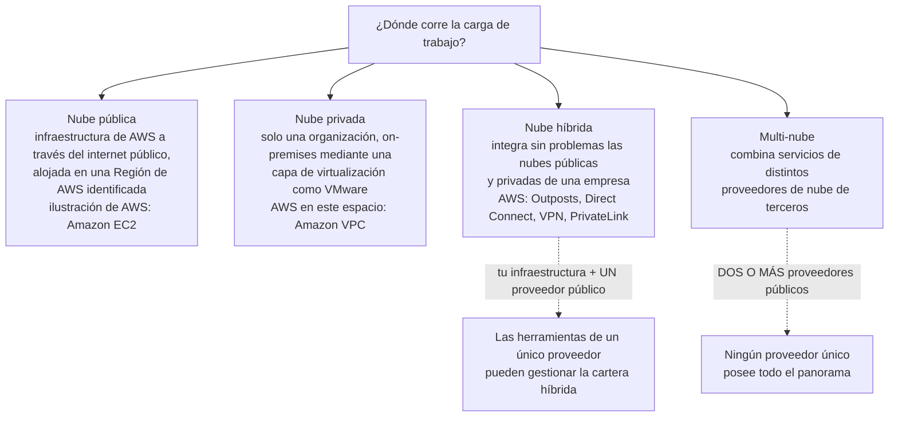
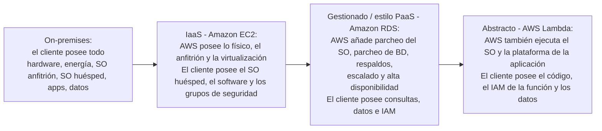
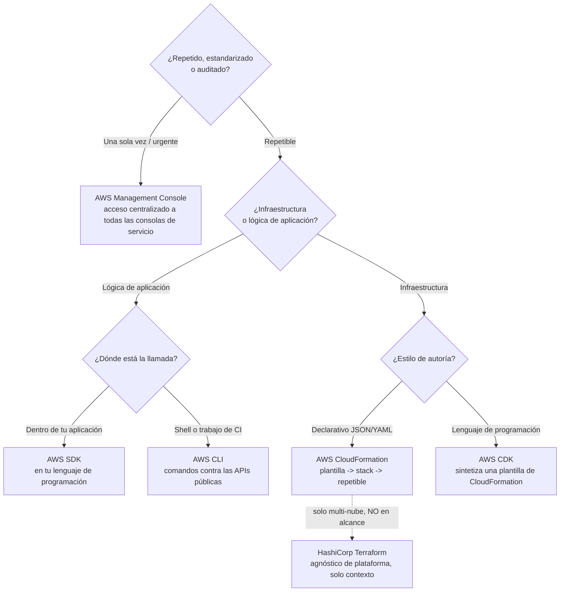
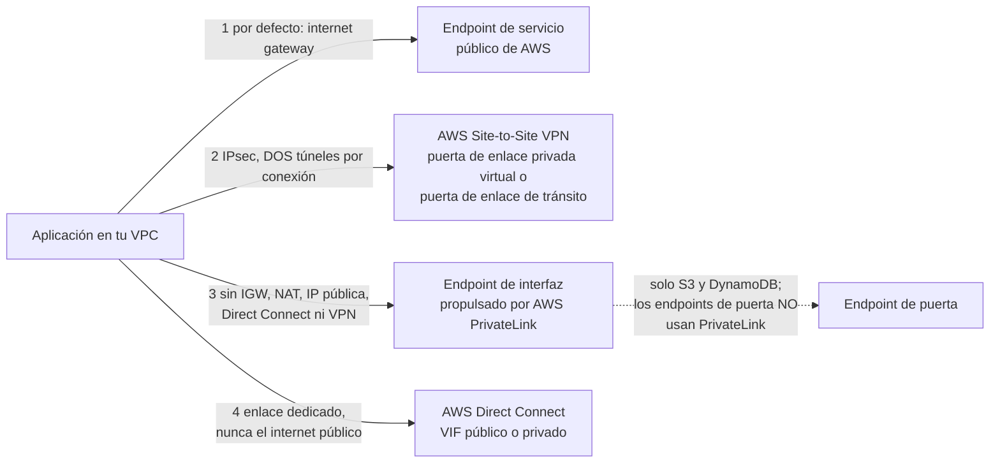
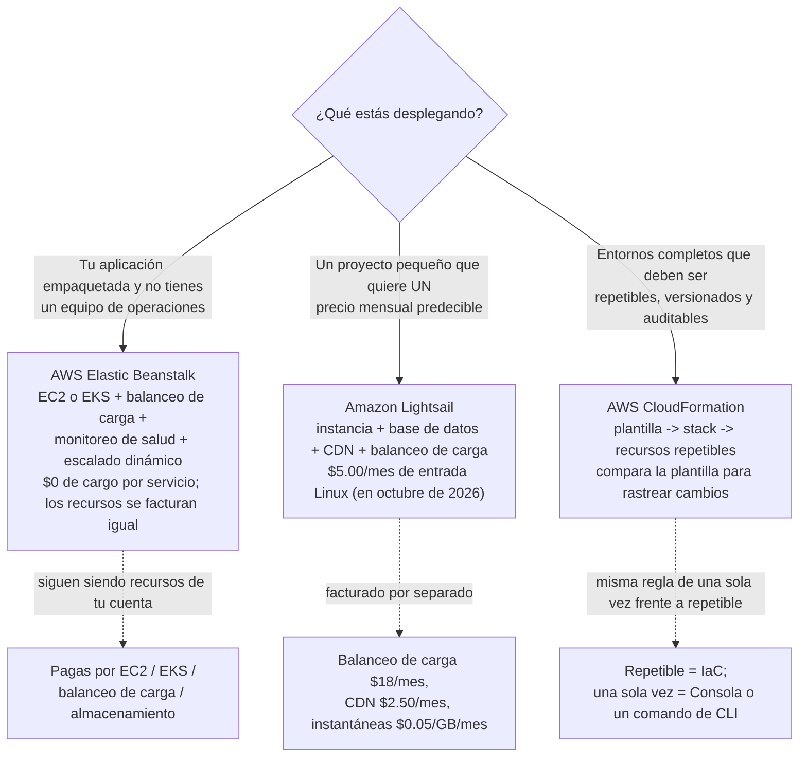

# Modelos de despliegue en la nube y operar en AWS

Toda carga de trabajo debe responder dos preguntas antes de salir: *¿dónde corre?* y *¿cómo lo operaremos otra vez mañana?* El examen lo llama **Dominio 3, Tarea 3.1, «Definir métodos de despliegue y operación en la nube de AWS»**, y es la tarea con más decisiones de CLF-C02: AWS evalúa explícitamente si sabes **elegir** entre la Consola, el acceso programático y la infraestructura como código, si un trabajo es **de una sola vez o repetible**, y qué **modelo de despliegue** describe un enunciado. La trampa es que la Tarea 3.1 parece una tarea de programación y no lo es, «Implementación» aparece listada como tarea laboral fuera del alcance, así que nunca se te pregunta *cómo* escribir el script, solo *qué* puerta atravesar.

```text
====================================================================
 TAREA 3.1 DEL DOMINIO 3 DE CLF-C02: DEFINIR MÉTODOS DE DESPLIEGUE
 Y OPERACIÓN EN LA NUBE DE AWS        (verificado frente a la guía
                                       del examen, oct. 2026)
====================================================================
 CONOCIMIENTO                   HABILIDADES (lo que se te pide hacer)
 - diversas formas de           - decidir entre el acceso
   aprovisionar y operar          programático (APIs, SDK, CLI), la
   en la nube de AWS              AWS Management Console y la
 - diversas formas de             infraestructura como código (IaC)
   acceder a los servicios      - evaluar si usar OPERACIONES DE UNA
   de AWS                         SOLA VEZ o PROCESOS REPETIBLES
 - tipos de modelos de          - identificar modelos de despliegue
   despliegue en la nube          (nube, híbrida, on-premises)
---------------------------------------------------------------------
 EN ALCANCE PARA 3.1
   Cómputo ... Elastic Beanstalk, Lightsail, Outposts
   Acceso .... AWS CLI, AWS Management Console
   IaC/gob ... CloudFormation, Service Catalog, Systems Manager,
               Auto Scaling
   Red ....... Direct Connect, PrivateLink, VPC, AWS VPN,
               Site-to-Site VPN, Client VPN, API Gateway
   Otros ..... Storage Gateway, Lambda
 EN ALCANCE PERO EXAMINADO BAJO LA TAREA 3.8
   AWS Amplify (web y móvil de front-end), AWS IoT Core
 FUERA DEL ALCANCE (solo aparecen como señuelos)
   CloudShell, CodeDeploy, CodeArtifact, Application Composer,
   Device Farm, Wavelength, IoT Device Defender, IoT Greengrass,
   Monitron
 EN NINGUNA LISTA (no es material examinable)
   AppSync, IoT Device Management, IoT Analytics, Snow Family,
   Terraform, Pulumi, SAM
====================================================================
```

> [!NOTE]
> **Dos vocabularios, una tarea.** La propia línea de habilidades de la guía del examen dice *«Identificar modelos de despliegue (por ejemplo, nube, híbrida, on-premises)»*, mientras que las páginas de qué es de AWS enseñan **pública, privada, híbrida y multi-nube**. Ambos aparecen en el material de estudio. La Sección 2 los reconcilia, porque una pregunta puede redactarse de cualquiera de las dos formas y ambas redacciones tienen una única respuesta correcta.

En esta lección vas a:

- nombrar los **cuatro modelos de despliegue** con las propias palabras de AWS y separar **la híbrida de la multi-nube**;
- mapear **IaaS, PaaS y SaaS** a ejemplos de AWS y leer el **desplazamiento de responsabilidad** que cada uno provoca;
- elegir entre la **Consola, la CLI, los SDK, las API y el IaC**, y aplicar la regla de **de una sola vez frente a repetible**;
- distinguir **CloudFormation de CDK** (y saber por qué Terraform es contexto, no temario);
- elegir la **puerta de conectividad** adecuada: internet, **Direct Connect**, **Site-to-Site VPN** o un **endpoint de VPC / PrivateLink**;
- situar **Amplify, AppSync e IoT Core** donde la guía del examen los evalúa de verdad;
- diferenciar **Elastic Beanstalk, Lightsail y CloudFormation** por el trabajo que hace cada uno;
- estudiar **cuatro casos de estudio publicados por AWS** sobre Lightsail, operaciones repetibles, velocidad de entornos y migración;
- comprobar **qué cambió en 2026** en las listas de alcance, las herramientas de consola y dónde puedes aprovisionar;
- practicar con **12 preguntas estilo examen** más cinco comprobaciones interactivas.

---

## 1. Qué pide de verdad la Tarea 3.1

### 1.1 La tarea, partida en conocimiento y habilidades

| Mitad de la tarea | Redacción exacta de la guía del examen | Qué debes saber hacer |
|---|---|---|
| Conocimiento | *«Diversas formas de aprovisionar y operar en la nube de AWS»* | Reconocer el conjunto de herramientas: Consola, CLI, SDK, APIs, IaC y los servicios gestionados de despliegue |
| Conocimiento | *«Diversas formas de acceder a los servicios de AWS»* | Saber que cada servicio es accesible por más de una puerta |
| Conocimiento | *«Tipos de modelos de despliegue en la nube»* | Identificar pública, privada, híbrida, multi-nube (y la redacción nube / híbrida / on-premises de la guía) |
| Habilidades | *«Decidir entre opciones como el acceso programático (por ejemplo, APIs, SDK, CLI), la AWS Management Console y la infraestructura como código (IaC)»* | Leer un escenario y elegir **un** método |
| Habilidades | *«Evaluar los requisitos para determinar si usar operaciones de una sola vez o procesos repetibles»* | Clasificar la carga de trabajo y luego elegir el método que encaja |
| Habilidades | *«Identificar modelos de despliegue (por ejemplo, nube, híbrida, on-premises)»* | Emparejar una descripción con el nombre de un modelo |

### 1.2 La línea de alcance: una decisión, no una construcción

La guía CLF-C02 lista **«Implementación»** entre las tareas laborales fuera del alcance. Esa sola palabra remodela cada pregunta de la 3.1: una opción que dice *«escribe un script de Python que crea 40 subredes»* o *«redacta una plantilla de CloudFormation con Lambda en línea»* está describiendo **implementación**, y la implementación no es lo que este examen mide. La opción correcta es siempre la **selección**: Consola frente a CLI frente a SDK frente a IaC, de una sola vez frente a repetible, pública frente a híbrida.

| Pregunta que el examen te hace | Pregunta que nunca te hace |
|---|---|
| ¿Qué método de acceso encaja en este escenario? | ¿Cómo escribo el comando de la CLI / la llamada al SDK? |
| ¿Esto es de una sola vez o repetible? | ¿Cómo estructuro el YAML? |
| ¿Qué modelo de despliegue es este? | ¿Cómo configuro la capa de virtualización? |
| ¿Qué servicio aprovisiona y gestiona esto? | ¿Cómo ajusto la instancia subyacente? |

- **📚 ¿Sabías que…?** AWS publica una regla de paridad que mata una familia entera de señuelos: toda función de administración, gestión y acceso de IaaS disponible en la **AWS Management Console** también está disponible en la **API de AWS y la AWS CLI** *«en el lanzamiento o dentro de los 180 días siguientes al lanzamiento»*. Así que la opción que empieza *«la Consola es la única forma de…»* casi siempre es errónea: la Consola es simplemente *«el método más común»*, no el exclusivo.

### 1.3 Las tres listas de servicios que debes mantener separadas

| Lista | Miembros (guía del examen, oct. 2026) | Cómo se comporta el día del examen |
|---|---|---|
| **En alcance para 3.1** | Elastic Beanstalk, Lightsail, Outposts, AWS CLI, Management Console, CloudFormation, Service Catalog, Systems Manager, Auto Scaling, Direct Connect, PrivateLink, VPC, AWS VPN, Site-to-Site VPN, Client VPN, API Gateway, Storage Gateway, Lambda | Una respuesta correcta, normalmente emparejada con un escenario |
| **En alcance para 3.8** | **AWS Amplify** (web y móvil de front-end), **AWS IoT Core** (IoT) | Respuestas correctas, pero evaluadas bajo la tarea 3.8: conoce su *rol* |
| **Fuera de alcance** | **AWS CloudShell**, CodeDeploy, CodeArtifact, Application Composer, Device Farm, **AWS Wavelength**, IoT Device Defender, IoT Greengrass, Monitron | Señuelos que suenan plausibles; la respuesta es un servicio en alcance |
| **En ninguna lista** | AppSync, IoT Device Management, IoT Analytics, Snow Family, Terraform, Pulumi, SAM | Conocimiento de contexto; nunca te enseñes estos como hechos de temario |

> ⚠️ **CloudShell es el señuelo perfecto.** AWS CloudShell es *«un shell basado en navegador y preautenticado que puedes lanzar directamente desde la AWS Management Console»*, con la AWS CLI, la EB CLI, la ECS CLI y SAM preinstaladas (imagen Amazon Linux 2023). Suena ideal para «formas de acceder a AWS», y está **explícitamente fuera del alcance** para CLF-C02. Si una pregunta ofrece CloudShell junto a Consola, CLI, SDK e IaC, CloudShell está ahí para eliminarse, no para elegirse. El mismo destino aguarda a las opciones de **Wavelength**, **IoT Greengrass** y **Snow Family**.

> [!NOTE]
> **«Fuera de alcance» no significa «no existe».** Estos servicios son reales y se usan ampliamente; simplemente no están en la lista de este examen. Las guías de estudio antiguas siguen listando CloudShell, CodeDeploy y Wavelength como respuestas de la 3.1: gana la guía del examen actual. Y nota la diferencia entre *fuera de alcance* (listado, excluido) y *en ninguna lista* (nunca mencionado): solo el primero es una exclusión documentada.

### Actualizaciones de 2026 (en octubre de 2026)

> [!NOTE]
> **Qué cambió después de que se escribiera la mayor parte del material de estudio: todas las fuentes de abajo consultadas en 2026-10.**
> - **Las listas de servicios se reconstruyeron, el mayor cambio de 2026 para la Tarea 3.1.** Las entradas en alcance pasaron de **128 → 111** y las de fuera del alcance de **11 → 55** entre la guía de la era del lanzamiento `Version 1.0` y la actual (diff calculado en 2026-10). Nombres de aprovisionamiento y conectividad como **AWS PrivateLink, AWS Transit Gateway, AWS Site-to-Site VPN, AWS Client VPN** y **Service Quotas** se *añadieron* a la lista en alcance, mientras que **AWS CloudShell, AWS CodeDeploy, AWS CodeArtifact, AWS Device Farm** y **AWS AppSync** pasaron a la lista negativa explícita, y la categoría Developer Tools colapsó de **11 a 4** entradas (AWS CLI, CodeBuild, CodePipeline, X-Ray). *Fuente: páginas «In-Scope AWS Services» y «Out-of-Scope AWS Services», consultadas en 2026-10.*
> - **El cómputo de borde se rebajó en silencio.** **AWS Wavelength** está ahora explícitamente fuera de alcance y **AWS Local Zones** aparece en *ninguna* de las dos listas, así que una guía antigua que acredite a alguno de los dos como respuesta de la 3.1 está citando texto eliminado. *Fuente: guía actual del examen y ambas listas de servicios, 2026-10.*
> - **La consola se mueve aunque la guía del examen no se mueva.** El **AWS Well-Architected Agent** entró en vista previa el **2026-10-01** como *«la evolución de siguiente generación de AWS Trusted Advisor y la AWS Well-Architected Tool»*, pero la guía sigue nombrando la **AWS Well-Architected Tool** y **Trusted Advisor**, así que el nuevo agente es contexto, no una respuesta de temario. *Fuente: AWS News Blog y notas de lanzamiento de Well-Architected, 2026-10-01.*
> - **Más dónde aprovisionar.** Se abrieron cuatro Regiones durante 2025: Asia Pacífico (Tailandia) **2025-01-07**, México (Central) **2025-01-14**, Asia Pacífico (Taiwán) **2025-06-06**, Asia Pacífico (Nueva Zelanda) **2025-09-02**, y la **Nube soberana europea de AWS** (`eusc-de-east-1`) se anunció disponible general el **2026-01-14**. El mapa público lee **39 Regiones / 124 Zonas de Disponibilidad**, con 7 AZs más y 2 Regiones más (Arabia Saudita, Chile) anunciadas a octubre de 2026. *Fuente: historial de documentación de Regiones y el mapa de Regiones/AZs, 2026-10: verifica lo actual antes de usarlo.*
> - **El Free Tier cambió de forma para los presupuestos de aprovisionamiento.** Las cuentas creadas **el 2025-07-15 o después** reciben **6 meses** de Free Tier (o hasta que se agoten los créditos) más un **crédito de registro de 100 USD y hasta 100 USD ganados = hasta 200 USD**; el tramo de 12 meses basado en `t2.micro` pertenece a las cuentas creadas antes de esa fecha, y `t2.micro` ya no está en la nueva lista de elegibles. *Fuente: AWS News Blog 2025-07-15 y la tabla del Free Tier de la guía de usuario de EC2 «antes y después del 15 de julio de 2025», consultada en 2026-10: verifica lo actual antes de usarlo.*

> [!WARNING]
> **Las noticias no son temario.** Todo lo del recuadro de arriba es real, fechado y con fuente, y nada de ello se vuelve examinable solo por ser reciente. Las propias listas de la guía son el árbitro: el **AWS Well-Architected Agent**, los **Database Savings Plans** y los nuevos nombres de planes **Business Support+ / Unified Operations** son genuinamente nuevos, pero solo lo que imprime la guía actual del examen puntúa. Estudia desde la guía que descargas hoy, no desde el PDF que descargaste en 2024.

---

## 2. Modelos de despliegue: pública, privada, híbrida y multi-nube

### 2.1 Las cuatro definiciones de AWS, con las palabras de AWS

| Modelo | Definición de AWS (con fuente, oct. 2026) | Dónde corre | Ilustración de AWS |
|---|---|---|---|
| **Nube pública** | *«infraestructura y servicios a través del internet público … alojados en una Región de AWS identificada»* | Centros de datos del proveedor, hardware subyacente compartido, facturado según uso | **Amazon EC2** |
| **Nube privada** | *«infraestructura de nube para uso exclusivo de una sola organización … aprovisionada on-premises usando una capa de virtualización (por ejemplo, VMware)»* | Tus instalaciones, tu hardware, un solo inquilino | *«En el espacio de la nube privada, AWS proporciona la **Amazon VPC»*** |
| **Nube híbrida** | *«un diseño de infraestructura de TI que integra sin problemas las nubes públicas y privadas de una empresa»* | Ambas: tu cartera más una nube pública, operadas como una sola | **AWS Outposts**, Direct Connect, Site-to-Site VPN, PrivateLink |
| **Multi-nube** | *«una estrategia de nube que combina servicios de distintos proveedores de nube de terceros»* | Dos o más proveedores públicos | Sin ilustración de AWS: por definición no es una historia de un único proveedor |

El encuadre híbrido de AWS merece memorizarse: *«La nube híbrida con AWS ofrece una experiencia de AWS consistente donde la necesitas: desde la nube hasta on-premises y en el borde»*, y **AWS Outposts** es *«una familia de servicios totalmente gestionados que entregan infraestructura y servicios de AWS a prácticamente cualquier ubicación on-premises o de borde para una experiencia híbrida verdaderamente consistente.»*



### 2.2 Dos taxonomías, y la línea entre híbrida y multi-nube

La guía del examen dice **«nube, híbrida, on-premises»**. Las páginas de qué es de AWS dicen **pública, privada, híbrida, multi-nube**. Se solapan en lugar de chocar:

| Redacción de la guía | Redacción más cercana en la página de AWS | Nota |
|---|---|---|
| **nube** (es decir, correr en la nube pública) | **nube pública** | Misma idea: Regiones de AWS, infraestructura compartida |
| **on-premises** | **nube privada** (cuando está virtualizada y es tipo nube) | Privada ≠ automáticamente solo on-premises, pero la página de nube privada de AWS describe la virtualización on-premises |
| **híbrida** | **híbrida** | Idéntica en ambos vocabularios |

La distinción que el examen realmente custodia es esta:

- **Híbrida** = *tu infraestructura + una nube pública*. AWS dice que la gestión híbrida *«puede realizarse usando servicios de un único proveedor de nube.»*
- **Multi-nube** = *servicios de dos o más proveedores de nube de terceros*. En cuanto un enunciado dice «AWS **y** otro proveedor», estás en multi-nube, no en híbrida.

> [!WARNING]
> **La trampa de dos palabras: «híbrida» frente a «multi-nube».** Una empresa que ejecuta la mitad de su cartera en su propio centro de datos y la mitad en AWS es **híbrida**, aunque eso complique las cosas. Una empresa que ejecuta una aplicación en AWS y otra en un proveedor público distinto es **multi-nube**, aunque nada esté on-premises. *«Dos proveedores»* ⇒ multi-nube; *«nuestro centro de datos más la nube»* ⇒ híbrida. Recuerda también que una pregunta que describe **solo** virtualización on-premises sin nube pública conectada es **nube privada**, no híbrida.

### 2.3 El kit híbrido de AWS que está en alcance

| Servicio | Rol en el modelo híbrido | Nota de alcance |
|---|---|---|
| **AWS Outposts** | Infraestructura, servicios, APIs y herramientas de AWS extendidas a tus instalaciones, gestionadas *«como parte de una Región de AWS»* | En alcance (3.1) |
| **AWS Direct Connect** | Conexión de red dedicada entre tu red on-premises y AWS, *«evitando a tu proveedor de servicios de internet»* | En alcance (3.1) |
| **AWS Site-to-Site VPN** | Conexión segura IPsec desde un centro de datos o una oficina regional a AWS | En alcance (3.1) |
| **AWS Client VPN** | Usuarios remotos individuales | En alcance (3.1) |
| **AWS PrivateLink / endpoints de VPC** | Conectividad privada a servicios *«como si estuvieran en tu VPC»* | En alcance (3.1) |
| **Amazon VPC** | Tu red de nube lógicamente aislada: el bloque de construcción de la nube privada | En alcance (3.1) |
| **AWS Storage Gateway** | Puente de almacenamiento híbrido entre almacenamiento on-premises y en la nube | En alcance (3.1) |
| **AWS Wavelength**, **Snow Family** | Cómputo de borde / transferencia de datos sin conexión | **Fuera de alcance / no listado**: nunca una respuesta de la 3.1 |

- **📚 ¿Sabías que…?** Outposts se envía como un **rack autónomo de 42U** que necesita **10 to 30 kVA**, y como **servidores de 1U/2U** (tamaños y cifras de potencia a octubre de 2026: verifica lo actual antes de usarlo). Lo que convierte esto en un hecho de *modelo de despliegue* y no en un hecho de hardware es que un Outpost se gestiona *«como parte de una Región de AWS»*, así que la historia híbrida sigue siendo un solo modelo operativo: mismas APIs, misma consola, mismas herramientas, distinto código postal.

---

## 3. Modelos de servicio: IaaS, PaaS, SaaS, y el desplazamiento de responsabilidad

### 3.1 Los tres modelos de servicio

| Modelo | Qué gestiona el proveedor (redacción de AWS) | Qué gestionas tú | Ejemplo de AWS |
|---|---|---|---|
| **IaaS** | *«mantener la infraestructura física»*: cómputo, almacenamiento y red entregados *«con un modelo de pago por uso a través de internet»* | SO huésped, parches, tiempo de ejecución, software instalado, aplicación, datos, IAM, grupos de seguridad | **Amazon EC2** |
| **PaaS** | *«la infraestructura subyacente (normalmente hardware y sistemas operativos)»*, para que tú *«te centres en el despliegue y la gestión de tus aplicaciones»* | Tu aplicación y tus datos | **AWS Elastic Beanstalk**, **Amazon Lightsail** |
| **SaaS** | La propia aplicación, entregada *«a los usuarios finales a través de un navegador de internet»* | Decisiones de uso; tus propios datos dentro del producto | AWS no vende ninguna: *«Aunque AWS no ofrece servicios SaaS, AWS ofrece muchas opciones que puedes usar para construir aplicaciones y soluciones SaaS personalizadas de terceros.»* |



### 3.2 Ejemplo E1: contar el desplazamiento de responsabilidad

La documentación de RDS publica las mismas nueve filas operativas para tres entornos. Cuenta quién es dueño de cada fila:

```text
FILA (de la matriz de la guía de usuario de Amazon RDS)  On-prem   EC2    RDS
------------------------------------------------  --------  -----  -----
1 Optimización de la aplicación                    Cliente  Cliente Cliente
2 Escalado                                        Cliente  Cliente Cliente
3 Alta disponibilidad                             Cliente  Cliente Cliente
4 Respaldos de la base de datos                   Cliente  Cliente   AWS
5 Parcheo del software de la base de datos        Cliente  Cliente   AWS
6 Parcheo del sistema operativo (SO)              Cliente  Cliente   AWS
7 Mantenimiento del servidor                      Cliente    AWS     AWS
8 Ciclo de vida del hardware                      Cliente    AWS     AWS
9 Energía, red y refrigeración                    Cliente    AWS     AWS
------------------------------------------------  --------  -----  -----
Filas propiedad del CLIENTE                          9        6       3
Filas propiedad de AWS                               0        3       6
```

Se siguen tres lecturas, y las tres son examinables:

1. **On-premises el recuento es 9 de 9**: eres dueño de todo, incluida la energía del edificio.
2. **EC2 mueve tres filas a AWS** (mantenimiento del servidor, ciclo de vida del hardware, energía/refrigeración) pero deja **seis** en tu columna: eso es lo que significa en la práctica que *«IaaS requiere que el cliente realice todas las tareas de configuración y gestión de seguridad necesarias»*.
3. **RDS invierte la mayoría hacia AWS (seis de nueve)**; sin embargo *«Optimización de la aplicación»* sigue siendo **Cliente** en absolutamente todas las columnas. **«AWS gestiona la base de datos» nunca significa «AWS ajusta tus consultas».**

### 3.3 El invariante: seguridad **de** la nube frente a seguridad **en** la nube

El modelo de responsabilidad compartida es el marco bajo todo esto: AWS es responsable de la seguridad **«de» la nube**, el cliente es responsable de la seguridad **«en» la nube**. Para los **servicios abstractos** como Amazon S3 y Amazon DynamoDB, *«AWS opera la capa de infraestructura, el sistema operativo y las plataformas … Los clientes son responsables de gestionar sus datos … y de usar las herramientas de IAM.»* Para **AWS Lambda**, AWS gestiona *«la infraestructura subyacente y los servicios de base, el sistema operativo y la plataforma de la aplicación»*, mientras que tú eres dueño de *«la seguridad de tu código y de AWS IAM hacia el servicio Lambda y dentro de tu función.»*

```fillblank
{
  "question": "Completa las declaraciones de responsabilidad compartida de las que depende la Tarea 3.1:",
  "template": "AWS es responsable de la seguridad {{1}} la nube, y el cliente es responsable de la seguridad {{2}} la nube. En Amazon EC2 (IaaS) el cliente sigue parcheando el sistema operativo {{3}} y configura el cortafuegos proporcionado por AWS llamado grupo de {{4}}. En Amazon RDS, AWS asume el parcheo del sistema operativo, el parcheo de la base de datos, los respaldos, el escalado y la alta disponibilidad, mientras que la optimización {{5}} sigue en manos del cliente.",
  "answers": {
    "1": "de",
    "2": "en",
    "3": "invitado",
    "4": "seguridad",
    "5": "aplicación"
  },
  "distractors": ["bajo", "dentro", "anfitrión", "de red", "plataforma", "base de datos", "datos"],
  "explanation": "El modelo de responsabilidad compartida separa la seguridad DE la nube (AWS) de la seguridad EN la nube (cliente). EC2 se categoriza como IaaS, así que el SO huésped y la configuración del cortafuegos proporcionado por AWS llamado grupo de seguridad siguen siendo tareas del cliente. La matriz de RDS mantiene la optimización de la aplicación en el lado del cliente en cada entorno, mientras que AWS asume el parcheo del SO, el parcheo de la base de datos, los respaldos, el escalado y la alta disponibilidad."
}
```

### 3.4 El matiz del parcheo que el examen evalúa en secreto

No todos los servicios gestionados te dan el mismo grado de control:

| Tipo de servicio | Quién parchea | Qué sigues haciendo (redacción de AWS) |
|---|---|---|
| **Gestionado de inquilino único** (Amazon RDS, Amazon ElastiCache) | AWS publica los parches *«dentro del SLA de parcheo del servicio»* | *«facilitar el parcheo seleccionando ventanas de mantenimiento»* |
| **Abstracto de inquilino múltiple** (Amazon DynamoDB, Amazon S3) | AWS aplica los parches *«sin requerir acción del cliente»* | Nada sobre parcheo: eres dueño de los datos, el cifrado, la clasificación y el IAM |
| **IaaS (Amazon EC2)** | Tú parcheas el SO huésped | Todo por debajo del hipervisor es de AWS; todo por encima es tuyo |

```dragdrop
{
  "question": "Ordena estos cuatro entornos de MAYOR responsabilidad del cliente a MENOR (AWS asume más en cada paso):",
  "items": [
    "Centro de datos on-premises",
    "Amazon EC2 (IaaS)",
    "Amazon RDS (servicio de base de datos gestionado)",
    "AWS Lambda (servicio abstracto)"
  ],
  "correctOrder": [
    "Centro de datos on-premises",
    "Amazon EC2 (IaaS)",
    "Amazon RDS (servicio de base de datos gestionado)",
    "AWS Lambda (servicio abstracto)"
  ],
  "explanation": "Cada paso mueve filas de tu columna a la de AWS: on-premises eres dueño de las nueve filas operativas; EC2 mueve el mantenimiento del servidor, el ciclo de vida del hardware y la energía/refrigeración a AWS; RDS además mueve el parcheo del SO, el parcheo de la base de datos, los respaldos, el escalado y la alta disponibilidad a AWS; Lambda elimina adicionalmente el sistema operativo y la plataforma de la aplicación. Lo que nunca se mueve es tu código, tus datos, tus decisiones de IAM y la optimización de la aplicación."
}
```

> ⚠️ **«AWS lo gestiona» no es «AWS se lo lleva todo».** Aquí viven dos trampas. Primero, **RDS no es delegación total**, la optimización de la aplicación, tus consultas, tu esquema y tus datos siguen siendo tuyos en cada columna de la matriz. Segundo, **SaaS no es un producto de AWS**: AWS declara que no ofrece servicios SaaS, ofrece las herramientas para *construir* SaaS de terceros. Una opción que afirme *«WorkMail / QuickSight es la oferta SaaS de AWS»* no está respaldada por ninguna página de AWS en esta investigación, trátala como errónea.

---

## 4. Formas de acceder a AWS: Consola, CLI, SDK, APIs e IaC

### 4.1 Las cinco puertas (más la que está fuera del alcance)

| Método | Redacción de AWS (con fuente) | Mejor encaje en un enunciado |
|---|---|---|
| **AWS Management Console** | *«una aplicación basada en web que contiene y proporciona acceso centralizado a todas las consolas individuales de servicios de AWS»*; IAM la llama *«el método más común»* | De una sola vez, visual, exploratorio, urgente, aprendizaje |
| **AWS CLI** | *«una herramienta de código abierto que te permite interactuar con los servicios de AWS usando comandos en tu shell de línea de comandos»* | Trabajo de shell guionizado y repetible, trabajos de CI |
| **AWS SDK** | *«AWS ofrece kits de desarrollo de software (SDK) para varios lenguajes de programación»*: llamadas emitidas desde dentro de tu propia aplicación | El enunciado dice *desde la aplicación* o *en código en tiempo de ejecución* |
| **AWS APIs** | *«emitir peticiones HTTPS directamente al servicio»* (el ejemplo de la API de consulta de IAM) | Herramientas propias, agnósticas de lenguaje, cualquier cliente HTTPS |
| **Infraestructura como código** | *«aprovisionar y gestionar la infraestructura de una aplicación a través de un conjunto de archivos de configuración»* | Infraestructura repetible, versionada y multi-entorno |
| ~~AWS CloudShell~~ | *«shell basado en navegador y preautenticado»* | **Fuera de alcance: un señuelo** |

- **📚 ¿Sabías que…?** Amazon S3 se lanzó el **14 de marzo de 2006** a **0.15 USD por GB-mes**, con un tamaño máximo de objeto de **5 GB** y unas **1 PB** de capacidad repartida en unos 400 nodos de almacenamiento; AWS dice ahora que el precio es *«ligeramente más de 2 céntimos por gigabyte»*, una reducción aproximada del **85%**, y que *«el código que escribiste para S3 en 2006 todavía funciona hoy, sin cambios»* (AWS News Blog, 2026-03-13; precios a octubre de 2026, verifica lo actual antes de usarlo). El punto examinable es el de *operación*: **las APIs estables son lo que hace que la automatización repetible sobreviva**, la llamada de la CLI o la petición al SDK que guionizaste hace años todavía funciona, y por eso exacto AWS empareja «procesos repetibles» con el acceso programático.

### 4.2 Operaciones de una sola vez frente a procesos repetibles

Esta es, con diferencia, la frase más evaluada de la Tarea 3.1. La habilidad es *«evaluar los requisitos para determinar si usar operaciones de una sola vez o procesos repetibles»*, y la guía de IaC de AWS aporta el razonamiento de la otra mitad:

| Señal en el enunciado | Clasificación | Método que el examen quiere |
|---|---|---|
| Exploratorio, urgente, «solo esta vez», «rápido en el navegador» | **De una sola vez** | **AWS Management Console** (o un solo comando de CLI) |
| El mismo cambio mensual, «en 20 cuentas», «en cada entorno nuevo», auditado, estandarizado | **Repetible** | **Infraestructura como código**: CloudFormation (o CDK) |
| Llamadas en tiempo de ejecución hechas por una aplicación en marcha | Ninguna: es lógica de la aplicación | **SDK** o **API** |
| Un shell o una tubería de CI necesita crear infraestructura bajo demanda | Repetible, con forma de guion | **CLI** para comandos puntuales, **IaC** para infraestructura |

Los propios argumentos de AWS para la mitad repetible, citados:

- el IaC hace que los *«nuevos entornos sean repetibles, fiables y consistentes»*;
- *«escribe tu código IaC una sola vez y despliega ese mismo código en cientos de entornos en una fracción del tiempo»*;
- *«El drift de configuración ocurre cuando la configuración que aprovisionó tu entorno ya no coincide con el entorno real»*: la creación manual es *«propensa a errores»*, y una plantilla es un archivo de texto, así que *«simplemente rastrea las diferencias en tus plantillas para rastrear los cambios en tu infraestructura.»*

**La regla operativa:** cuando un entorno ha sufrido drift, **reaplica la plantilla**. Editar a mano el recurso vivo recrea exactamente el drift que intentas eliminar.

### 4.3 Ejemplo E2: la aritmética de las operaciones manuales

Supón que 100 entornos necesitan el mismo cambio y una persona tarda 10 minutos por entorno haciendo clic en la Consola:

$$
T_{\text{manual}} = 100 \times 10 \text{ min} = 1{,}000 \text{ min} \approx 16.7 \text{ hours}
$$

16.7 horas de esfuerzo humano sin guion, con 100 oportunidades de hacer clic en lo incorrecto, repetidas cada mes. La promesa de IaC de AWS es el contrafactual: *«escribe tu código IaC una sola vez y despliega ese mismo código en cientos de entornos en una fracción del tiempo.»* El examen no te pide demostrar esto: te pide **reconocer la forma**: muchos entornos + un cambio estandarizado ⇒ **IaC**.

### 4.4 Ejemplo E3: una plantilla, cuatro entornos, aritmética del drift

El patrón repetible canónico de la documentación de CloudFormation de AWS es el *mismo stack de 12 recursos* desplegado a desarrollo, staging, producción y una segunda Región de AWS:

```text
Enfoque manual        12 recursos x 4 entornos = 48 CREACIONES de recursos
                      (48 oportunidades separadas de mal configurar,
                      48 auditorías separadas)
Con plantilla         1 archivo de plantilla x 4 lanzamientos = 4 stacks,
                      48 recursos; la plantilla es texto -> compárala como
                      código fuente
Ejemplo de drift      si 3 de los 48 recursos vivos ahora difieren de la
                      plantilla, eso es DRIFT DE CONFIGURACIÓN; la solución
                      es reaplicar la plantilla, no editar a mano los 3
                      recursos
```

Las conclusiones examinables: una plantilla se **reutiliza**, se **versiona** y se **compara con diff**; los recursos de un stack se crean y configuran *para* tú; y borrar el stack borra los recursos que creó: que es también por qué el IaC es la respuesta más limpia a «limpia este entorno».



### 4.5 El trío de IaC: CloudFormation, CDK y el tercer nombre en la sala

| Herramienta | Qué es (redacción de AWS) | Estado de examen |
|---|---|---|
| **AWS CloudFormation** | *«Creas una plantilla que describe todos los recursos de AWS que quieres … y CloudFormation se encarga de aprovisionar y configurar esos recursos por ti»*; reutilízala *«de una manera consistente y repetible»* | **En alcance**: la respuesta de IaC por defecto |
| **AWS CDK** | *«un marco de desarrollo de software de código abierto para definir infraestructura de nube en código y aprovisionarla a través de AWS CloudFormation»* | **En alcance**: la respuesta de «queremos un lenguaje de verdad» |
| HashiCorp Terraform | Terceros, *«agnóstico de plataforma»* | **En ninguna de las dos listas**: solo contexto |
| AWS SAM / Pulumi | Nombrados junto a los anteriores en la comparación de herramientas IaC de AWS | **En ninguna de las dos listas** |

La guía prescriptiva de AWS compara **cinco** herramientas de IaC, CloudFormation, SAM, CDK, Terraform y Pulumi, y da la regla de selección que necesitas: *«Si gestionas tu infraestructura enteramente en AWS, entonces AWS CloudFormation y el AWS Cloud Development Kit (AWS CDK) son buenas opciones»*, mientras que *«Terraform podría ser una buena elección porque es agnóstico de plataforma.»*

> [!WARNING]
> **CDK no compite con CloudFormation, CDK produce CloudFormation.** CDK es *«aprovisionarla a través de AWS CloudFormation»*, así que una pregunta que ofrezca «CloudFormation **o** CDK» como motores de infraestructura rivales ha mal descrito la relación: tú autoras en TypeScript, Python, Java, C#/.NET, JavaScript o Go (seis lenguajes, a octubre de 2026), y el CDK **sintetiza una plantilla de CloudFormation** que el servicio ejecuta después. Y si un enunciado menciona una cartera **multi-nube**, Terraform se vuelve la herramienta *conceptualmente* correcta, pero está ausente de la lista en alcance de este examen, así que no será la respuesta puntuada en CLF-C02.

- **📚 ¿Sabías que…?** Las plantillas de CloudFormation son archivos de texto plano, y por eso AWS dice que puedes *«simplemente rastrear las diferencias en tus plantillas para rastrear los cambios en tu infraestructura.»* Esa propiedad es la misma que hace detectable el drift de configuración: compara la plantilla con el stack vivo, encuentra las ediciones manuales, reaplica. Infraestructura que no puedes comparar con diff es infraestructura que no puedes auditar.

```matching
{
  "question": "Empareja cada escenario operativo con el método de acceso que CLF-C02 espera:",
  "pairs": [
    {"left": "Un cambio exploratorio a las 2 a.m. en el navegador", "right": "AWS Management Console: acceso centralizado a todas las consolas individuales de servicio; el método más común"},
    {"left": "El mismo cambio cada mes en 20 cuentas de AWS", "right": "Infraestructura como código: una plantilla de CloudFormation reutilizada de una manera consistente y repetible"},
    {"left": "La aplicación en marcha crea un bucket por sí misma", "right": "AWS SDK: llamadas al servicio incrustadas en tu propio lenguaje de programación"},
    {"left": "Un paso de shell dentro de una tubería de CI", "right": "AWS CLI: comandos emitidos en tu shell de línea de comandos"},
    {"left": "Una herramienta propia emitiendo peticiones HTTPS a un endpoint de servicio", "right": "AWS API: emitir peticiones HTTPS directamente al servicio"},
    {"left": "Un shell preautenticado lanzado desde el navegador", "right": "AWS CloudShell: explícitamente FUERA DEL ALCANCE para CLF-C02, así que es el señuelo"}
  ],
  "explanation": "La habilidad de la guía del examen es decidir entre el acceso programático (APIs, SDK, CLI), la AWS Management Console y el IaC, y luego clasificar el trabajo como de una sola vez o repetible. La Consola encaja en el trabajo visual de una sola vez, el IaC en el cambio repetido y estandarizado, el SDK en las llamadas dentro de la aplicación, la CLI en el trabajo de shell guionizado y las APIs en las herramientas propias: y CloudShell, aunque es real y cómodo, está en la lista de fuera de alcance, así que nunca gana la marca."
}
```

---

## 5. Conectividad: las cuatro puertas dentro y fuera de una VPC

### 5.1 El resumen (solo servicios en alcance)

| Puerta | Mecanismo | Cifras (a oct. 2026; verifica lo actual antes de usarlo) | Encaje en el examen |
|---|---|---|---|
| **1. Internet público** | El **internet gateway** de tu VPC enruta el tráfico hacia endpoints públicos de servicios de AWS | Configuración por defecto, menor coste de configuración | Acceso público general; no privado |
| **2. AWS Direct Connect** | Una conexión de red dedicada que *«evita a tu proveedor de servicios de internet»*, *«tu tráfico de red permanece en la red global de AWS y nunca toca el internet público»* | Puertos dedicados **1, 10, 100, 400 Gbps**; conexiones alojadas **50 Mbps, 25 Gbps**; SLA de Alta Resiliencia **99.9%**, SLA de Resiliencia Máxima **99.99%** | Ancho de banda estable, predecible y privado |
| **3. AWS Site-to-Site VPN** | Una conexión segura totalmente gestionada usando túneles de **IP Security (IPSec)** | **Dos túneles por conexión** por redundancia; **1.25 Gbps** por túnel de forma estándar, **hasta 5 Gbps** con un Túnel de Ancho de Banda Grande | Enlace privado rápido, barato y sobre internet |
| **4. Endpoints de VPC** | **Endpoints de interfaz propulsados por AWS PrivateLink**, o **endpoints de puerta** | PrivateLink necesita *«sin internet gateway, dispositivo NAT, dirección IP pública, conexión Direct Connect ni conexión Site-to-Site VPN de AWS»*; los endpoints de puerta cubren **solo Amazon S3 y Amazon DynamoDB** y *«no usan AWS PrivateLink»* | Acceso privado a servicios de AWS sin salir de la VPC |
| **Individuos remotos** | **AWS Client VPN** | Conectividad por usuario | Personas, no sitios |

> [!NOTE]
> **Un conflicto que esta investigación no pudo resolver: trátalo como no verificado.** Una página de resumen de AWS anuncia velocidades de Direct Connect *«a partir de 50 Mbps y escalando hasta 100 Gbps»*, mientras que la guía de usuario de Direct Connect lista puertos dedicados de **1, 10, 100 y 400 Gbps** y conexiones alojadas de **50 Mbps a 25 Gbps**. Estas dos páginas de AWS discrepan. Esta lección cita las cifras de la **guía de usuario** y las sella **a octubre de 2026**; vuelve a verificar en las páginas de precios y opciones de conexión antes de apoyarte en cualquier cifra de ancho de banda.



### 5.2 Ejemplo E4: dos túneles, cuatro números

AWS Site-to-Site VPN incluye **dos túneles por conexión**, y cada túnel tiene un techo de ancho de banda:

```text
Túneles estándar       2 túneles x 1.25 Gbps = techo agregado de 2.5 Gbps
Túneles de ancho de    2 túneles x 5 Gbps    = techo agregado de 10 Gbps
  banda grande
Relación               10 / 2.5 = 4x el ancho de banda principal
```

Dos observaciones que el examen premia. Primero, los **dos túneles existen por alta disponibilidad**, no principalmente por velocidad, AWS dice *«Cada conexión VPN incluye dos túneles VPN que puedes usar simultáneamente para alta disponibilidad.»* Segundo, el ancho de banda es un **techo por túnel**, así que un enunciado que diga «una conexión Site-to-Site VPN entrega 1.25 Gbps en total» es erróneo por un factor de dos. Todas las cifras **a octubre de 2026, verifica lo actual antes de usarlo**.

### 5.3 Ejemplo E5: lo que un SLA de resiliencia te cuesta en minutos

Direct Connect publica dos diseños de resiliencia. Convierte los porcentajes en presupuestos de inactividad sobre un año de 365 días ($8{,}760$ horas):

$$
8{,}760 \times (1 - 0.999) = 8.76 \text{ hours per year}
$$

$$
8{,}760 \times (1 - 0.9999) = 0.876 \text{ hours} \approx 52.6 \text{ minutes per year}
$$

| Diseño de resiliencia | SLA publicado | Presupuesto anual de inactividad | Lectura aproximada |
|---|---|---|---|
| Alta Resiliencia | **99.9%** | **8.76 horas** | Aproximadamente un día laborable al año |
| Resiliencia Máxima | **99.99%** | **52.6 minutos** | Aproximadamente una pausa para el café al año |

El examen no te pide esta aritmética: te pide **emparejar el requisito con el diseño**: «ancho de banda privado estable con la disponibilidad publicada más ajustada» ⇒ Direct Connect con Resiliencia Máxima; «necesitamos un enlace privado esta tarde» ⇒ Site-to-Site VPN. Cifras de SLA **a octubre de 2026**.

### 5.4 Ejemplo E6: elegir el puerto de Direct Connect

Una oficina regional necesita **400 Mbps**; el centro de datos núcleo necesita **100 Gbps**:

```text
Oficina regional  400 Mbps  -> el rango de conexión alojada es 50 Mbps - 25 Gbps  => encaja un puerto ALOJADO
Centro de datos   100 Gbps -> las opciones de puerto dedicado son 1, 10, 100, 400 Gbps => encaja un puerto DEDICADO
  núcleo
```

Regla general de la página de opciones de conexión: las **conexiones alojadas** escalan de **50 Mbps a 25 Gbps** (entregadas a través de socios de AWS Direct Connect), mientras que las **conexiones dedicadas** son de **1, 10, 100 o 400 Gbps**. Un enunciado que cite **50 Mbps** es una señal de puerto alojado; un enunciado que cite **100 Gbps** es una señal de puerto dedicado. Cifras **a octubre de 2026: verifica lo actual antes de usarlo**.

### 5.5 PrivateLink y endpoints de puerta, con precisión

| Pregunta en el enunciado | Puerta correcta | Por qué fallan los señuelos |
|---|---|---|
| «…sin **ningún** internet gateway, dispositivo NAT, IP pública, Direct Connect o VPN» | **Endpoint de interfaz propulsado por PrivateLink** | El enunciado cita literalmente las condiciones de «cuándo usar» de PrivateLink |
| «…acceso privado **solo a Amazon S3 o DynamoDB**» | **Endpoint de puerta** | Los endpoints de puerta son solo S3 + DynamoDB y *«no usan AWS PrivateLink»* |
| «…empleados remotos individuales conectándose» | **AWS Client VPN** | Client VPN es por usuario; Site-to-Site VPN es por sitio |
| «…el servicio debe ser alcanzable *como si estuviera en mi VPC*» | **PrivateLink** | Esa es la propia definición de PrivateLink de AWS |

- **📚 ¿Sabías que…?** Los endpoints de VPC vienen en dos familias y el examen evalúa la excepción: los **endpoints de puerta** (Amazon S3, Amazon DynamoDB) **no usan AWS PrivateLink**, mientras que los **endpoints de interfaz** son la variedad propulsada por PrivateLink. Así que la afirmación *«todos los endpoints de VPC están propulsados por PrivateLink»* es falsa: un solo contraejemplo, directo de la documentación de VPC de AWS, basta para hundirla.

```matching
{
  "question": "Empareja cada requisito de conectividad con la opción de AWS en alcance:",
  "pairs": [
    {"left": "Ancho de banda privado estable desde el centro de datos que nunca toca el internet público", "right": "AWS Direct Connect: una conexión dedicada que evita a tu proveedor de servicios de internet"},
    {"left": "Una conexión privada rápida y de bajo coste establecida con túneles IPsec", "right": "AWS Site-to-Site VPN: dos túneles por conexión por redundancia"},
    {"left": "Acceso privado a un servicio sin internet gateway, dispositivo NAT, IP pública, Direct Connect ni VPN", "right": "Endpoint de interfaz propulsado por AWS PrivateLink"},
    {"left": "Acceso privado solo a Amazon S3 o Amazon DynamoDB", "right": "Endpoint de puerta: cubre S3 y DynamoDB y no usa AWS PrivateLink"},
    {"left": "Conectividad para empleados remotos individuales", "right": "AWS Client VPN"},
    {"left": "Un enlace de almacenamiento híbrido entre el centro de datos y el almacenamiento en la nube", "right": "AWS Storage Gateway"}
  ],
  "explanation": "Cada par empareja una condición citada de AWS con el servicio que es dueño de ella: Direct Connect es el enlace dedicado cuyo tráfico nunca toca el internet público, Site-to-Site VPN es la opción IPsec con dos túneles, PrivateLink es la puerta sin IGW/NAT/IP pública/DX/VPN, los endpoints de puerta son solo S3 y DynamoDB, Client VPN atiende a personas en lugar de sitios, y Storage Gateway es el puente de almacenamiento híbrido en alcance."
}
```

---

## 6. Frontend, móvil e IoT: lo que añade la tarea 3.8

La Tarea 3.1 trata sobre *aprovisionar y operar*; la guía del examen evalúa frontend móvil e IoT bajo la **Tarea 3.8: «Identificar servicios de otras categorías de servicios de AWS en alcance.»** Ambas habilidades son de nombrado: *«Identificar los servicios que pueden crear y desplegar servicios de frontend y móvil»* e *«Identificar los servicios que gestionan dispositivos IoT.»*

### 6.1 AWS Amplify: la respuesta de frontend y móvil

| Atributo | Redacción de AWS (con fuente) |
|---|---|
| Categoría en la guía del examen | **Web y móvil de front-end**: el único servicio nombrado en esa categoría |
| Modelo de hosting | *«Amplify Hosting proporciona un flujo de trabajo basado en Git para alojar aplicaciones web serverless de pila completa con despliegue continuo»* |
| Entrega | *«Amplify despliega tu aplicación en la red global de entrega de contenido (CDN) de AWS»* |
| Comportamiento de publicación | *«Los despliegues atómicos eliminan las ventanas de mantenimiento»* |
| Encaje en el examen | El enunciado dice *frontend / móvil / app web / basado en Git / despliegue continuo* |

La palabra **«atómico»** es la pista: como un despliegue nuevo reemplaza al anterior como una unidad, una publicación fallida no deja un sitio a medio actualizar, y por eso AWS dice que las ventanas de mantenimiento desaparecen. Amplify es por eso también una historia de **operación**: publicaciones repetibles y disparadas por Git en lugar de subidas manuales.

### 6.2 AppSync: una advertencia de nombrado

**Amazon AppSync** aparece en **ninguna** de las dos listas, ni en la de alcance ni en la de fuera de alcance, en la guía actual del examen CLF-C02. Trátalo como **vocabulario de contexto únicamente**: no es material examinable, así que no lo memorices como «la respuesta GraphQL de este examen» y no esperes que puntúe. El servicio de frontend móvil que la guía acredita es **AWS Amplify**.

### 6.3 AWS IoT Core: la respuesta de IoT

| Atributo | Redacción de AWS / hecho (con fuente) |
|---|---|
| Rol | *«AWS IoT proporciona los servicios de la nube que conectan tus dispositivos IoT con otros dispositivos y servicios de la nube de AWS»* |
| Categoría de la guía del examen | **Internet de las Cosas (IoT)**: AWS IoT Core es el único servicio nombrado |
| Protocolos admitidos | **MQTT**, **MQTT sobre WSS**, **HTTPS**, **LoRaWAN** |
| Encaje en el examen | *Puerta de enlace de dispositivos / conectar dispositivos con servicios de AWS* |
| Fuera de alcance (señuelos) | **AWS IoT Device Defender**, **AWS IoT Greengrass**, **Amazon Monitron** |
| En ninguna lista | AWS IoT Device Management, AWS IoT Analytics: estado de examen desconocido; nunca se enseñan como temario |

> ⚠️ **Dos trampas de IoT.** Primero, **IoT Device Defender y IoT Greengrass están fuera del alcance**, una pregunta que describa ejecución de Lambda en el dispositivo o monitorización de comportamiento de seguridad te está cebando hacia servicios que no están en la lista; la respuesta en alcance es **AWS IoT Core**. Segundo, **IoT Device Management y IoT Analytics aparecen en ninguna de las dos listas**, así que no son ni respuestas ni exclusiones documentadas, si los ves, trata la pregunta como una evaluación de si sabes lo que *sí* está listado.

---

## 7. Elastic Beanstalk, Lightsail y CloudFormation: tres roles distintos

### 7.1 AWS Elastic Beanstalk: despliegue estilo PaaS de tu código

| Atributo | Redacción de AWS / hecho (con fuente) |
|---|---|
| Qué hace | *«aprovisiona instancias de Amazon EC2 o clústeres de EKS, configura balanceo de carga, establece monitoreo de salud y escala dinámicamente tu entorno»* |
| Qué le entregas | Una versión de aplicación que *«apunta a un objeto de Amazon Simple Storage Service (Amazon S3) que contiene el código desplegable»* |
| Cargo | *«No hay cargo adicional por Elastic Beanstalk. Solo pagas por los recursos subyacentes de AWS que consume tu aplicación»* (**en octubre de 2026**) |
| Modelo de servicio | **Estilo PaaS**: AWS ejecuta la infraestructura y la plataforma, tú ejecutas la aplicación |
| No es | No es serverless; no es gratis; no es una herramienta de IaC |

La trampa de tres partes en una línea: **$0 de cargo por servicio ≠ factura de $0**, porque las instancias EC2, el balanceador de carga y el almacenamiento que crea se te facturan a tu cuenta; **Beanstalk no es serverless**, porque aprovisiona EC2 o EKS; y **Beanstalk no es IaC**, porque le entregas código, no una plantilla de infraestructura reutilizable.

### 7.2 Amazon Lightsail: el punto de entrada de precio predecible

| Atributo | Redacción de AWS / hecho (con fuente, **a octubre de 2026: verifica lo actual antes de usarlo**) |
|---|---|
| Posicionamiento | *«la forma más fácil de empezar con AWS … por un precio mensual bajo y predecible»* |
| Encaje | *«mejor adaptado a proyectos que requieren unas pocas decenas de instancias o menos»* |
| Plan de entrada tipo Linux | **$0.0067 USD/hora = $5 USD/mes** |
| Plan de entrada Windows | **$0.0127 USD/hora = $9.50 USD/mes** |
| Complementos | Balanceador de carga **$18/mes**; CDN **$2.50/mes** (tramo de 50 GB, luego **$10**, luego **$35**); instantáneas **$0.05/GB/mes** |
| Modelo de servicio | **Paquete estilo PaaS**: instancia, base de datos, CDN y balanceador de carga bajo un solo precio |

### 7.3 Ejemplo E7: el paquete de Lightsail, preciado de dos formas

**Aritmética del paquete:**

```text
Instancia Linux de Lightsail ...... $5.00 / mes
+ CDN add-on de Lightsail ......... $2.50 / mes (tramo de 50 GB)
                                  ----------
Total del paquete ................. $7.50 / mes  antes de excesos de transferencia
```

**Por hora frente a tope mensual.** Lightsail factura por hora pero limita el cargo al precio mensual. Un mes completo son $750$ horas:

$$
0.0067 \times 750 = 5.025 \text{ USD} \longrightarrow \text{capped at } 5.00 \text{ USD}
$$

Un mes parcial de $200$ horas: $0.0067 \times 200 \approx$ **$1.34$**. Así que el precio mensual es un **techo, no un suelo**: pagas por lo que ejecutes hasta el tope. Todas las cifras **a octubre de 2026**; los tamaños, los tramos y los precios cambian, así que verifica lo actual antes de usarlo.

### 7.4 Ejemplo E8: Elastic Beanstalk cuesta $0 para ejecutar *como servicio*

Elastic Beanstalk cobra **$0** por sí mismo. La factura viene de lo que crea. Como ilustración (cifras didácticas, **no** precios de lista de AWS: verifica lo actual antes de usarlo):

```text
Escenario: un pequeño entorno web dejado funcionando durante un mes
  Cargo por el servicio Elastic Beanstalk .............. $0.00
  Recursos subyacentes que aprovisiona (EC2 +
    balanceo de carga + almacenamiento) ................. facturado a tu cuenta
Contraste con una construcción manual:
  el mismo entorno, construido a mano en la Consola .... la misma factura de recursos
  más esfuerzo de configuración, sin monitoreo de salud,
  sin escalado dinámico, sin versionado de entorno
Conclusión: Beanstalk te compra OPERACIONES, no un descuento.
```

La frase examinable: **Elastic Beanstalk elimina el trabajo operativo, no el coste de los recursos.**



### 7.5 La decisión de tres en uno

| Señal en el enunciado | Servicio correcto | Por qué fallan los demás |
|---|---|---|
| «Sube mi código; apruévisionalo, equilíbralo, monitóralo y escálalo; sin cargo por el servicio» | **Elastic Beanstalk** | Lightsail es un paquete de precio fijo, no una canalización de subida de código; CloudFormation es infraestructura, no una plataforma de aplicaciones |
| «Unas pocas decenas de instancias o menos a un precio mensual predecible» | **Amazon Lightsail** | Elastic Beanstalk factura por cada recurso subyacente; EC2 carece de la simplicidad del paquete |
| «El mismo cambio en muchas cuentas/entornos, versionado y auditable» | **AWS CloudFormation** | Beanstalk y Lightsail despliegan *un* entorno; ninguno te da una plantilla comparable con diff para *todos* ellos |
| «Cómputo y almacenamiento de AWS dentro de mi propio edificio, mismas APIs» | **AWS Outposts** | Los tres anteriores se ejecutan en Regiones de AWS, no en tu emplazamiento |

- **📚 ¿Sabías que…?** La versión de aplicación de Elastic Beanstalk se almacena como *«un objeto de Amazon Simple Storage Service (Amazon S3) que contiene el código desplegable»*: así que «¿dónde guarda Beanstalk mi código?» tiene respuesta de una palabra: **S3**. Eso también explica el versionado estilo azul/verde: promocionas un objeto S3 distinto como versión actual, y la configuración del entorno sigue siendo describible como datos en lugar de como clics.

---

## Casos Reales

AWS publica cómo se ven estas decisiones en producción. Cada cifra de abajo es **afirmada por el cliente o por AWS y sin auditar**, con la fuente nombrada para que puedas comprobarla: el punto examinable es el **patrón** (qué modelo de despliegue, qué método de acceso, qué hábito operativo), no la cifra de marketing.

### Caso A, Gourmeat: Lightsail como pequeño punto de entrada de precio predecible

| Elemento | Detalle |
|---|---|
| **Industria / contexto** | Boutique de carne operando en Uruguay y Estados Unidos; el inventario se seguía en Excel sin acceso simultáneo para el equipo |
| **Patrón de despliegue / operación** | **Entrada estilo PaaS**: un entorno pequeño y de precio predecible en lugar de una red de EC2 montada a mano: el encaje de *«unas pocas decenas de instancias o menos»* de la página de Lightsail |
| **Servicios de AWS nombrados** | **Amazon Lightsail**, con el socio de AWS Nub8 |
| **Resultados principales (publicados por AWS, afirmados por el cliente)** | La generación de informes de inventario bajó de **~4 horas por semana a menos de 20 minutos**; **productividad subida más de un 40%**; entornos de prueba y producción entregados en **6 semanas** (caso de estudio fechado en octubre de 2020) |
| **Fuente** | aws.amazon.com/solutions/case-studies/gourmeat-lightsail (consultado en octubre de 2026) |

*Lección de examen:* esta es la respuesta de **Lightsail** con forma humana, el valor que se afirma es **operativo** (horas de informes manuales eliminadas, una factura mensual predecible), no un benchmark bruto de cómputo. La pregunta de examen construida a partir de este patrón dice *«equipo pequeño, pocas instancias, quiere un precio mensual predecible»*, y Lightsail es la opción a la que alcanzar, con Elastic Beanstalk como la casi-respuesta (también de pocas operaciones, pero preciado por recurso subyacente en lugar de en paquete).

### Caso B, athenahealth: operaciones repetibles en 120 cuentas

| Elemento | Detalle |
|---|---|
| **Industria / contexto** | Software de salud (sensible a HIPAA); monitorización de egreso por una cartera de VPC extensa, coste de inspección creciente, un equipo de ocho personas |
| **Patrón de despliegue / operación** | **Procesos repetibles** en producción: un diseño centralizado, expresado en código y distribuido por política, en lugar de hacer clic cuenta por cuenta |
| **Servicios de AWS nombrados** | **AWS Network Firewall** (centralizado), **AWS Transit Gateway**, **AWS RAM** (distribución por política), **AWS CloudFormation** reglas como código, **AWS Direct Connect**; AWS Shield en la hoja de ruta |
| **Resultados principales (publicados por AWS, afirmados por el cliente)** | Los costes globales de inspección **reducidos un 95%**; cientos de VPC repartidas por **120 cuentas** desplegadas *«en solo unos pocos días»*; **ocho personas** diseñaron y desplegaron el nuevo diseño de seguridad sin interrupciones |
| **Voz del cliente** | *«Con escalable me refiero a la magia de AWS. No tenemos que pensar en la escalabilidad en absoluto.»*: Aaron Baer, miembro principal del personal técnico |
| **Fuente** | aws.amazon.com/solutions/case-studies/athenahealth-case-study (consultado en octubre de 2026) |

*Lección de examen:* esta es la línea de *«procesos repetibles»* de la Tarea 3.1 con números adjuntos. **CloudFormation reglas como código** es el mecanismo, **AWS RAM** es el método de distribución y **Direct Connect** es la puerta de conectividad. Ocho personas no podían configurar a mano cientos de VPC en 120 cuentas en unos pocos días: la aritmética solo cierra cuando el cambio se escribe una vez y se aplica muchas veces, que es exactamente el argumento del IaC de la Sección 4.

### Caso C, Capital One: entornos de desarrollo de meses a minutos

| Elemento | Detalle |
|---|---|
| **Industria / contexto** | Banco del Fortune 100 (regulado); ocho centros de datos on-premises de los que salir, ciclos de renovación de hardware de los que escapar, y una decisión de construir frente a comprar |
| **Patrón de despliegue / operación** | **Nube pública, «a fondo»**, con **aproyisionamiento repetible**: entornos producidos de la misma forma bajo demanda en lugar de encolados y construidos a mano uno a uno |
| **Servicios de AWS nombrados** | Más de 30, incluidos **Amazon EC2, Amazon S3, Amazon RDS, AWS Lambda, AWS ECS / AWS Fargate, AWS Step Functions, AWS Glue** |
| **Resultados principales (publicados por AWS, afirmados por el cliente)** | Salió de **8** centros de datos; **80%** de casi **2,000** aplicaciones construidas en la nube desde cero; el tiempo medio de construir un **entorno de desarrollo recortado de 3 meses a minutos**; tiempo de prueba de DR **−70%**; resolución de incidentes y errores de transacción **−50%**; **103 toneladas** de cobre y acero recicladas |
| **Voz del cliente** | *«Ir a fondo con la nube ha permitido tanto el aprovisionamiento instantáneo de infraestructura como la innovación rápida.»*: Chris Nims, vicepresidente sénior de ingeniería de nube y productividad |
| **Fuente** | aws.amazon.com/solutions/case-studies/capital-one-all-in-on-aws (consultado en octubre de 2026) |

*Lección de examen:* **«de 3 meses a minutos» es la regla de una sola vez frente a repetible con un reloj encima.** Un plazo de tres meses es lo que cuesta un entorno *montado a mano y de una sola vez* cuando cada petición es a medida; «minutos» es lo que cuesta el mismo entorno cuando la construcción es un proceso repetible que vuelves a ejecutar bajo demanda. La lectura del modelo de despliegue es igual de limpia: una cartera con **cero** resto on-premises es la ilustración de **nube pública** a escala empresarial: la híbrida exigiría que los centros de datos se quedaran, y la multi-nube exigiría un segundo proveedor público. Y la aritmética subyacente es la de la Sección 4: 90 días de plazo eliminados *por entorno* se componen a lo largo de una organización de ingeniería de 11,000 personas.

- **📚 ¿Sabías que…?** El caso de estudio de Capital One dice que el banco *«salió de ocho centros de datos on-premises»* y *«construyó el 80 por ciento de las casi 2,000 aplicaciones que ahora ejecuta en la nube desde cero»* (caso de estudio de AWS, consultado en octubre de 2026). La pista del modelo de despliegue es la frase **«a fondo»**: no queda nada ejecutándose on-premises, así que el modelo de despliegue es **nube pública**, no híbrida: una industria regulada que elige nube pública no convierte la respuesta en «privada» ni «híbrida» el día del examen.

### Caso D, Bangkok Flight Services: una migración repetible con operaciones multi-AZ

| Elemento | Detalle |
|---|---|
| **Industria / contexto** | Manejador de carga aérea en Bangkok; hardware envejecido, **sin sitio de recuperación ante desastres**, volumen de pasajeros creciente |
| **Patrón de despliegue / operación** | **Un patrón aplicado muchas veces**: un rehost uniforme en toda la cartera, y luego un **modelo operativo multi-AZ** permanente para recuperación y monitorización |
| **Servicios de AWS nombrados** | **AWS Application Migration Service (MGN)**, **Amazon EC2**, **Amazon S3**, **AWS CloudTrail**, **AWS CloudWatch**, recuperación ante desastres multi-AZ, socio de AWS DailiTech |
| **Resultados principales (publicados por AWS, afirmados por el cliente)** | Migración completada en **7 meses** con **sin reversión ni interrupción**; **tiempo de gestión de la infraestructura TI reducido un 50%**; recuperación ante desastres repartida por **varias Zonas de Disponibilidad**; aproximadamente **1 hora al año** de inactividad no planificada eliminada |
| **Fuente** | aws.amazon.com/solutions/case-studies/bangkok-flight-services (consultado en octubre de 2026) |

*Lección de examen:* aquí se encuentran dos patrones. **La propia migración es un proceso repetible**, un método de rehost, aplicado a toda la cartera, terminado en siete meses sin reversión, que es lo opuesto a una serie de eventos heroicos de una sola vez. **Las operaciones posteriores también son repetibles**: CloudWatch y CloudTrail aportan la observación, y la Zona de Disponibilidad es la unidad de aislamiento de fallos dentro de la que opera el diseño de recuperación (una AZ protege frente a un fallo a nivel de centro de datos dentro de una Región; una segunda Región es lo que protege frente a un fallo a nivel de Región). **Advertencia de alcance que merece memorizarse:** AWS Application Migration Service aparece en este caso de estudio, pero un caso de estudio nunca hace examinable a un servicio, solo lo hace la lista en alcance de la guía actual del examen. Comprueba la lista, no la historia.

### Qué comparten los casos A y B

| Patrón de valor | Evidencia en estos casos | Principio subyacente de la Tarea 3.1 |
|---|---|---|
| Esfuerzo manual eliminado | Gourmeat: **4 h/semana → menos de 20 min** | Elige el modelo operativo más simple que encaje con la escala |
| Escala con un equipo diminuto | athenahealth: **8 personas, 120 cuentas, cientos de VPC** | Los procesos repetibles ganan a la plantilla |
| Coste unitario a la baja | athenahealth: costes de inspección **−95%** | Centraliza el diseño y luego despártalo como código |
| Tiempo hasta el entorno colapsado | Gourmeat: prueba + prod en **6 semanas** | La entrada gestionada / estilo PaaS elimina el trabajo de construcción |
| Se valora la predecibilidad | Gourmeat: precio de Lightsail en paquete | Iguala la forma del precio con la forma de la carga de trabajo |

### Qué añaden los casos C y D

| Patrón de valor | Evidencia en estos casos | Principio subyacente de la Tarea 3.1 |
|---|---|---|
| No solo el trabajo colapsa, también el plazo | Capital One: entorno de desarrollo **3 meses → minutos** | Un proceso repetible elimina el tiempo de cola además del esfuerzo |
| La sobrecarga operativa se reduce a la mitad y se queda ahí | Bangkok Flight Services: tiempo de gestión de infraestructura TI **−50%** | Las operaciones gestionadas se componen mes tras mes |
| La resiliencia se diseña dentro, no se añade después | Bangkok Flight Services: DR entre **varias Zonas de Disponibilidad** | Una Zona de Disponibilidad es la unidad de aislamiento de fallos en la que operas |
| La migración es un programa, no un evento | Bangkok Flight Services: **7 meses, sin reversión** | Un método aplicado muchas veces = proceso repetible |

```matching
{
  "question": "Empareja cada historia publicada por AWS con el patrón de la Tarea 3.1 que ilustra:",
  "pairs": [
    {"left": "Gourmeat: los informes bajaron de unas 4 horas por semana a menos de 20 minutos con una sola factura mensual en paquete", "right": "Amazon Lightsail: un precio mensual bajo y predecible para unas pocas decenas de instancias o menos"},
    {"left": "athenahealth: un solo diseño empujado a cientos de VPC en 120 cuentas en unos pocos días", "right": "Procesos repetibles: AWS CloudFormation reglas como código escritas una vez y aplicadas muchas veces"},
    {"left": "Capital One: el tiempo de construcción del entorno de desarrollo recortado de 3 meses a minutos", "right": "Aprovisionamiento repetible: entornos producidos bajo demanda en lugar de construidos a mano uno a uno"},
    {"left": "Bangkok Flight Services: el tiempo de gestión de infraestructura recortado un 50% tras un rehost de 7 meses", "right": "Operación continua, CloudWatch y CloudTrail observando, DR multi-AZ como patrón permanente"},
    {"left": "Un banco regulado con cero resto on-premises, todas las cargas en Regiones de AWS", "right": "Nube pública, infraestructura y servicios a través del internet público, alojados en una Región de AWS identificada"},
    {"left": "Una empresa mitad en su propio centro de datos y mitad en AWS, operada como una sola cartera", "right": "Nube híbrida: un diseño de infraestructura de TI que integra sin problemas las nubes públicas y privadas de una empresa"}
  ],
  "explanation": "Cada par es una historia o definición de AWS con fuente: Gourmeat es la respuesta del paquete de Lightsail, athenahealth es el despacho de IaC, Capital One es el reloj sobre la regla de una sola vez frente a repetible, Bangkok Flight Services es migración más operación permanente dentro de Zonas de Disponibilidad. Las dos últimas son modelos de despliegue: una cartera enteramente en AWS es nube pública incluso regulada y enorme, mientras que «nuestro centro de datos más AWS» es híbrida. Las cifras de los casos las afirma el cliente y no están auditadas; la parte examinable es siempre el patrón."
}
```

> ⚠️ **Cómo leer los números de los casos de estudio el día del examen:** cada porcentaje aquí es **afirmado por el cliente y sin auditar**, y *«hasta»* es un **techo**, nunca un promedio. Atribuye la fuente y la fecha: «caso de estudio de athenahealth, consultado en octubre de 2026», no «AWS demuestra». Un caso nunca licencia una respuesta fuera del alcance: se te pide **seleccionar el patrón** (Lightsail para un paquete pequeño y predecible; IaC para muchas cuentas), nunca reproducir la cifra de marketing. Las cifras de Gourmeat proceden de un caso de estudio de **octubre de 2020** y se reportan tal y como AWS las publicó.

---

## Preguntas de Práctica (Practice Questions)

```question
{
  "id": "clf-04-q1",
  "type": "multiple-choice",
  "question": "Una empresa ejecuta su capa web en AWS mientras un almacén de datos regulado permanece en su propio centro de datos virtualizado, y ambos lados se operan como una sola cartera. ¿Qué modelo de despliegue en la nube lo describe mejor?",
  "options": [
    "Nube pública, porque parte de la carga de trabajo corre en una Región de AWS",
    "Nube privada, porque parte de la cartera está dedicada a una sola organización on-premises",
    "Nube híbrida, porque integra sin problemas las nubes públicas y privadas de la empresa",
    "Multi-nube, porque están implicadas dos plataformas de infraestructura"
  ],
  "correct": 2,
  "explanation": "AWS define la nube híbrida como un diseño de infraestructura de TI que integra sin problemas las nubes públicas y privadas de una empresa, y la gestión híbrida «puede realizarse usando servicios de un único proveedor de nube». Dos plataformas por sí solas no hacen multi-nube: la multi-nube requiere servicios de DISTINTOS proveedores de nube de terceros (dos o más proveedores públicos). La nube privada describe solo la mitad on-premises, y la nube pública describe solo la mitad de AWS."
}
```

```question
{
  "id": "clf-04-q2",
  "type": "multiple-choice",
  "question": "Una startup ejecuta deliberadamente una aplicación en AWS y una segunda aplicación en un proveedor de nube público distinto, con nada en sus propias instalaciones. ¿Qué afirmación es correcta?",
  "options": [
    "Esta es nube híbrida, porque híbrida significa usar más de una plataforma de infraestructura",
    "Esta es nube privada, porque el segundo proveedor actúa como extensión privada",
    "Este es despliegue on-premises, porque ninguna carga está en el centro de datos de la propia empresa",
    "Esta es multi-nube, una estrategia de nube que combina servicios de distintos proveedores de nube de terceros: que no es lo mismo que híbrida"
  ],
  "correct": 3,
  "explanation": "La página de multinube de AWS lo define como combinar servicios de distintos proveedores de nube de terceros, y nota explícitamente que la gestión de nube híbrida puede hacerse usando servicios de UN ÚNICO proveedor de nube. Híbrida = tu infraestructura más una nube pública; multi-nube = dos o más proveedores públicos. Sin cartera on-premises, «on-premises» y «nube privada» son ambas erróneas."
}
```

```question
{
  "id": "clf-04-q3",
  "type": "multiple-choice",
  "question": "Un desarrollador lanza Amazon EC2, Amazon RDS y AWS Lambda y pregunta qué modelo de servicio ilustra cada uno. ¿Qué asignación es correcta?",
  "options": [
    "EC2 = PaaS, RDS = IaaS, Lambda = SaaS",
    "EC2 = IaaS, RDS = un servicio de base de datos gestionado donde AWS parchea el SO y la base de datos pero la optimización de la aplicación sigue en el cliente, Lambda = servicio abstracto donde AWS ejecuta el SO y la plataforma",
    "EC2 = SaaS, RDS = PaaS, Lambda = IaaS",
    "Los tres son IaaS porque el cliente sigue siendo dueño de los datos y de IAM en todos los casos"
  ],
  "correct": 1,
  "explanation": "AWS categoriza Amazon EC2 como IaaS y dice que «requiere que el cliente realice todas las tareas de configuración y gestión de seguridad necesarias» (SO huésped, software, configuración de grupos de seguridad). Para RDS la matriz da a AWS el parcheo del SO, el parcheo de la base de datos, los respaldos, el escalado y la alta disponibilidad, mientras que la optimización de la aplicación sigue como Cliente en cada columna. Lambda es abstracto: AWS gestiona la infraestructura, el SO y la plataforma de la aplicación; el cliente es dueño del código, del IAM de la función y de los datos. Nada de esto es SaaS - AWS declara que no ofrece servicios SaaS."
}
```

```question
{
  "id": "clf-04-q4",
  "type": "multiple-choice",
  "question": "Bajo el modelo de responsabilidad compartida, un equipo mueve una carga de trabajo de on-premises a Amazon EC2 y después a Amazon RDS. ¿Qué tarea se traslada a AWS en el paso de RDS pero NO en el paso de EC2?",
  "options": [
    "El parcheo del sistema operativo y el parcheo del software de la base de datos",
    "La configuración del cortafuegos proporcionado por AWS llamado grupo de seguridad",
    "La optimización de la aplicación y el ajuste de consultas",
    "La gestión de los datos del cliente y la elección de los permisos de IAM"
  ],
  "correct": 0,
  "explanation": "La matriz publicada muestra el parcheo del SO y el parcheo de la base de datos como Cliente on-premises y en EC2, y como AWS en RDS: exactamente el desplazamiento que el paso de RDS te compra. El mantenimiento del servidor, el ciclo de vida del hardware y la energía/refrigeración ya se trasladan a AWS en el paso de EC2. La configuración de grupos de seguridad, la optimización de la aplicación, los datos y el IAM siguen siendo del cliente en todas partes."
}
```

```question
{
  "id": "clf-04-q5",
  "type": "multiple-choice",
  "question": "Un equipo de plataforma debe aplicar un cambio de red idéntico cada mes en 20 cuentas de AWS, y el cambio debe ser auditable. ¿Qué enfoque espera la Tarea 3.1?",
  "options": [
    "AWS Management Console, porque es el método más común y muestra el cambio de forma visual",
    "AWS CloudShell, porque un shell en navegador puede guionizar el cambio entre cuentas",
    "Infraestructura como código con AWS CloudFormation, porque el proceso es repetible y la plantilla es un archivo de texto que puedes rastrear y comparar con diff",
    "Amazon EC2, porque el cambio puede hacerse desde una instancia en cada cuenta"
  ],
  "correct": 2,
  "explanation": "La habilidad de la guía del examen es evaluar si usar operaciones de una sola vez o procesos repetibles. Un cambio mensual en 20 cuentas es la definición de repetible, y AWS dice que el IaC hace que los entornos sean «repetibles, fiables y consistentes» y te permite «escribir tu código IaC una sola vez y desplegar ese mismo código en cientos de entornos». La Consola encaja en el trabajo de una sola vez, no en la repetición estandarizada. CloudShell está en la lista de fuera de alcance, y EC2 no es un método de acceso en absoluto."
}
```

```question
{
  "id": "clf-04-q6",
  "type": "multiple-choice",
  "question": "¿Cuál de estas opciones está en la lista de FUERA DEL ALCANCE para CLF-C02 y debe eliminarse aunque parezca ideal para acceder a AWS?",
  "options": [
    "AWS Command Line Interface (AWS CLI)",
    "AWS CloudFormation",
    "AWS CloudShell",
    "AWS Management Console"
  ],
  "correct": 2,
  "explanation": "AWS CloudShell: un shell basado en navegador y preautenticado lanzado desde la Consola: está explícitamente fuera del alcance para CLF-C02, así que aparece solo como señuelo en una pregunta de «formas de acceder a AWS». La CLI, CloudFormation y la Management Console están todas en la lista en alcance. Otros nombres fuera de alcance a vigilar: CodeDeploy, CodeArtifact, Application Composer, Device Farm, Wavelength, IoT Device Defender, IoT Greengrass y Monitron."
}
```

```question
{
  "id": "clf-04-q7",
  "type": "multiple-choice",
  "question": "Un equipo de Python quiere definir la infraestructura de la nube en código pero sigue queriendo que AWS la aprueccione y la configure de forma nativa. ¿Qué pareja es correcta?",
  "options": [
    "AWS CDK: define la infraestructura en código y la aprueccione a través de AWS CloudFormation, en lenguajes que incluyen Python",
    "AWS CloudShell: ejecuta Python de forma interactiva contra las APIs de AWS",
    "HashiCorp Terraform: porque es el único marco de infraestructura como código nativo de AWS",
    "AWS Elastic Beanstalk: porque compila Python en una plantilla de CloudFormation"
  ],
  "correct": 0,
  "explanation": "AWS CDK es «un marco de desarrollo de software de código abierto para definir infraestructura de nube en código y aprovisionarla a través de AWS CloudFormation», con TypeScript, JavaScript, Python, Java, C#/.NET y Go admitidos (seis lenguajes a octubre de 2026). El CDK sintetiza una plantilla de CloudFormation: no compite con ella. CloudShell está fuera de alcance, Terraform es de terceros y agnóstico de plataforma (ausente de la lista en alcance), y Elastic Beanstalk despliega código de aplicación en lugar de compilar infraestructura."
}
```

```question
{
  "id": "clf-04-q8",
  "type": "multiple-choice",
  "question": "Un equipo necesita acceso privado a un servicio de AWS desde una VPC sin internet gateway, sin dispositivo NAT, sin dirección IP pública, sin conexión Direct Connect y sin Site-to-Site VPN. ¿Qué opción encaja?",
  "options": [
    "Un endpoint de interfaz propulsado por AWS PrivateLink",
    "AWS Site-to-Site VPN con dos túneles IPsec",
    "Un VIF público sobre AWS Direct Connect",
    "AWS Client VPN para los servidores de la aplicación"
  ],
  "correct": 0,
  "explanation": "La propia documentación de AWS PrivateLink lista exactamente esas condiciones: no necesitas internet gateway, dispositivo NAT, dirección IP pública, conexión Direct Connect ni conexión Site-to-Site VPN, y el servicio es alcanzable «como si estuviera en tu VPC». Site-to-Site VPN y Direct Connect son conexiones (el enunciado descarta ambos), y Client VPN atiende a usuarios individuales en lugar de cargas de aplicación. Observa también que los endpoints de puerta: solo Amazon S3 y DynamoDB: no usan PrivateLink."
}
```

```question
{
  "id": "clf-04-q9",
  "type": "multiple-choice",
  "question": "Un equipo pequeño quiere una aplicación web funcionando a un precio mensual bajo y predecible para un proyecto que solo requiere unas pocas decenas de instancias o menos, sin interés en montar componentes de red. ¿Qué servicio encaja mejor?",
  "options": [
    "AWS Elastic Beanstalk, porque es gratis: no hay cargo adicional por el servicio",
    "Amazon Lightsail, que agrupa instancias, bases de datos, CDN y balanceadores de carga a un precio mensual predecible",
    "AWS Outposts, porque entrega infraestructura de AWS a la ubicación del cliente",
    "Amazon EC2 Reserved Instances, porque los compromisos siempre producen la cifra mensual más baja"
  ],
  "correct": 1,
  "explanation": "Lightsail se posiciona como «la forma más fácil de empezar con AWS... por un precio mensual bajo y predecible» y es «mejor adaptado a proyectos que requieren unas pocas decenas de instancias o menos» (plan de entrada $0.0067/hora = $5/mes, Linux, a octubre de 2026: verifica lo actual antes de usarlo). Elastic Beanstalk es una elección válida de pocas operaciones pero se precia por sus recursos subyacentes, no en un solo paquete, y «$0 de cargo por servicio» no significa gratis. Outposts se ejecuta en tus instalaciones, y las Reserved Instances son un compromiso de precio, no un punto de entrada gestionado estilo PaaS."
}
```

```question
{
  "id": "clf-04-q10",
  "type": "multiple-choice",
  "question": "Un desarrollador quiere un flujo de trabajo basado en Git que despliegue de forma continua una aplicación web serverless de pila completa al CDN global de AWS con despliegues atómicos. ¿Qué servicio en alcance está diseñado para esto?",
  "options": [
    "AWS IoT Core, porque conecta dispositivos y aplicaciones con los servicios de la nube de AWS",
    "AWS CloudShell, porque proporciona un shell dentro de la consola",
    "AWS Amplify, el servicio de web y móvil de front-end con despliegue continuo basado en Git y despliegues atómicos",
    "AWS Elastic Beanstalk, porque aprueccione instancias EC2 y balanceo de carga"
  ],
  "correct": 2,
  "explanation": "AWS Amplify es el único servicio nombrado en la categoría de Web y Móvil de Front-End de la guía del examen, y Amplify Hosting «proporciona un flujo de trabajo basado en Git para alojar aplicaciones web serverless de pila completa con despliegue continuo», desplegando en «la red global de entrega de contenido (CDN) de AWS» donde «los despliegues atómicos eliminan las ventanas de mantenimiento». IoT Core cubre dispositivos (la categoría IoT de la tarea 3.8), CloudShell está fuera de alcance, y Elastic Beanstalk aprueccione entornos EC2/EKS en lugar de hosting de front-end disparado por Git."
}
```

```question
{
  "id": "clf-04-q11",
  "type": "multiple-choice",
  "question": "Un candidato estudia a partir de una guía construida sobre una guía de examen anterior, que lista AWS CloudShell, AWS CodeDeploy y AWS Wavelength como servicios que pueden sumar crédito bajo la Tarea 3.1. Al comprobar las listas actuales de servicios de CLF-C02 (consultadas en octubre de 2026), ¿qué afirmación es correcta?",
  "options": [
    "Los tres están en la lista de fuera de alcance, mientras que AWS PrivateLink, AWS Transit Gateway, AWS Site-to-Site VPN y AWS Client VPN se añadieron a la lista en alcance",
    "Los tres siguen en alcance para la Tarea 3.1, porque son servicios de AWS que ayudan a aprovisionar y operar cargas de trabajo",
    "Los tres aparecen en ninguna de las dos listas, así que no son ni respuestas ni exclusiones documentadas",
    "AWS CloudShell pasó a la lista en alcance en 2026, mientras que CodeDeploy y Wavelength siguieron fuera de alcance"
  ],
  "correct": 0,
  "explanation": "Entre la guía Version 1.0 de la era del lanzamiento y la actual (diff calculado en 2026-10), las entradas en alcance pasaron de 128 a 111 y las de fuera del alcance de 11 a 55. CloudShell, CodeDeploy y Wavelength acabaron todos en la lista negativa explícita: Wavelength está nombrado fuera de alcance y CloudShell/CodeDeploy también lo están -, mientras que PrivateLink, Transit Gateway, Site-to-Site VPN y Client VPN se añadieron a las entradas de Redes y Entrega de Contenido en alcance. «En ninguna lista» describe a AppSync, Snow Family, Terraform y compañía, no a estos tres, y un servicio fuera de alcance nunca suma crédito sin importar lo conveniente que parezca."
}
```

```question
{
  "id": "clf-04-q12",
  "type": "multiple-choice",
  "question": "Capital One informa que «redujo el tiempo medio necesario para construir un entorno de desarrollo de 3 meses a solo minutos» tras ir a fondo con AWS. En términos de la Tarea 3.1, ¿qué explicación coincide con la habilidad que evalúa el examen?",
  "options": [
    "La carga de trabajo se convirtió en un proceso repetible: los entornos se aprueccionan de la misma forma bajo demanda en lugar de montarse a mano como operaciones de una sola vez",
    "La empresa adoptó multi-nube, así que un segundo proveedor podía construir los entornos de desarrollo en paralelo",
    "El equipo cambió a operaciones de Consola de una sola vez, porque la AWS Management Console es el método de acceso más común",
    "AWS asumió la optimización de la aplicación, así que el entorno ya no tenía que construirse en absoluto"
  ],
  "correct": 0,
  "explanation": "La habilidad de la guía del examen es «evaluar los requisitos para determinar si usar operaciones de una sola vez o procesos repetibles». Un entorno a medida y construido a mano tarda lo que tarde la cola y los clics; el mismo entorno producido por un proceso repetible tarda minutos: que es el propio argumento del IaC de AWS de que «escribes tu código IaC una sola vez y despliega ese mismo código en cientos de entornos en una fracción del tiempo». La multi-nube necesita dos o más proveedores públicos de terceros (Capital One se ejecuta solo en AWS), la Consola encaja en el trabajo visual de una sola vez y no acortaría una cola de 3 meses, y la optimización de la aplicación nunca se traslada a AWS en ninguna columna de la matriz de responsabilidad. Las cifras las publica AWS, las afirma el cliente, consultadas en octubre de 2026."
}
```

> [!IMPORTANT]
> **Veredicto comparativo: métodos de despliegue y operación en la nube × on-premises × otras nubes × DIY/gestionado**
> - **Frente a on-premises:** on-premises eres dueño de **nueve de nueve** filas operativas: ciclo de vida del hardware, energía/refrigeración, SO anfitrión y huésped, parcheo, respaldos, escalado y disponibilidad, y cada despliegue es un evento manual de una sola vez que vuelves a hacer a mano. Los modelos de despliegue en la nube invierten la propiedad: **EC2 (IaaS)** mueve tres filas a AWS, **RDS/gestionado estilo PaaS** mueve seis, y **Lambda/abstracto** mueve ocho, dejando datos, IAM, código y optimización de la aplicación contigo. El intercambio examinable: renuncias al control directo del sustrato y ganas **aproyisionamiento repetible, escala elástica y el SLA de parcheo de otra persona**: la línea de responsabilidad compartida se mueve, nunca desaparece.
> - **Frente a otras nubes:** todo proveedor mayor ofrece IaaS, PaaS, conectividad híbrida e infraestructura como código, así que los discriminadores son **el vocabulario y las listas específicas de AWS**: los modelos de despliegue tal y como los escribe AWS (*«integra sin problemas las nubes públicas y privadas de una empresa»* frente a *«combina servicios de distintos proveedores de nube de terceros»*), los **servicios en alcance con nombre** (CloudFormation, CDK, Direct Connect, PrivateLink, Site-to-Site VPN, Elastic Beanstalk, Lightsail, Amplify, IoT Core) y la **lista explícita de fuera de alcance** (CloudShell, Wavelength, IoT Greengrass y compañía). No importes nombres de servicios de otro proveedor ni el alcance de otro examen en una respuesta de CLF-C02.
> - **Frente a DIY / constrúyelo tú mismo:** construir a mano el mismo panorama significa escribir tus propios scripts de aprovisionamiento, tu propia detección de drift, tu propio monitoreo de salud y tu propio escalado: todo lo cual falla en silencio a las 3 de la mañana. Los equivalentes gestionados de AWS están listos y en su mayoría libres de cargos *de servicio*: **Elastic Beanstalk $0 de cargo por servicio** (solo pagas por los recursos subyacentes), **CloudFormation $0 de cargo por servicio por la orquestación** con plantillas que comparas con diff como si fueran código fuente, **el paquete plano de Lightsail** ($5.00/mes de entrada Linux a octubre de 2026: verifica lo actual antes de usarlo). La respuesta del Well-Architected es de forma consistente **la menor sobrecarga operativa**: compra las primitivas, escribe solo lo que genuinamente es tuyo: tu aplicación y tus datos.

> [!WARNING]
> **Trampas del día del examen para esta lección:**
> - **Decisión, no construcción**: «Implementación» está fuera del alcance: eliges Consola frente a CLI frente a SDK frente a API frente a IaC, nunca los escribes;
> - **Una sola vez frente a repetible es la frase más rentable de la 3.1**: exploratorio/urgente ⇒ Consola o un solo comando de CLI; repetido/estandarizado/auditado en cuentas ⇒ **IaC (CloudFormation)**;
> - **CloudShell está fuera de alcance**: un shell de navegador preautenticado que parece la «forma de acceder a AWS» perfecta y es un señuelo; lo mismo con **Wavelength, CodeDeploy, CodeArtifact, Application Composer, Device Farm, IoT Device Defender, IoT Greengrass, Monitron**;
> - **AppSync, IoT Device Management, IoT Analytics, Snow Family, Terraform, Pulumi y SAM están en ninguna lista**: solo contexto, nunca hechos de temario;
> - **Híbrida ≠ multi-nube**: tu cartera + un proveedor público = híbrida; dos o más proveedores de terceros = multi-nube, incluso sin nada on-premises;
> - **Dos taxonomías de despliegue**: la guía del examen dice *nube, híbrida, on-premises*; las páginas de qué es de AWS dicen *pública, privada, híbrida, multi-nube*; ambas son redacciones legítimas;
> - **AWS no ofrece SaaS**: AWS dice que ofrece opciones *«para construir aplicaciones SaaS personalizadas de terceros»*, así que las opciones de «producto SaaS de AWS» son erróneas;
> - **EC2 ≠ RDS ≠ Lambda en responsabilidad**: el SO huésped y los grupos de seguridad siguen tuyos en EC2; el parcheo de SO/base de datos, los respaldos, el escalado y la HA se mueven en RDS; **la optimización de la aplicación nunca se mueve**;
> - **CDK produce CloudFormation**, no son rivales; **Terraform es agnóstico de plataforma pero no está en la lista en alcance**;
> - **Elastic Beanstalk no es gratis ni es serverless**: $0 de cargo *de servicio*, pero EC2/EKS/balanceo de carga/almacenamiento se facturan; una versión apunta a un **objeto de S3**;
> - **Lightsail es para «unas pocas decenas de instancias o menos»** y la facturación por hora está **limitada al precio mensual**: todos los precios **a octubre de 2026, verifica lo actual antes de usarlo**;
> - **Los dos túneles VPN son por disponibilidad, no por velocidad**: 1.25 Gbps estándar o hasta 5 Gbps por túnel (Túnel de Ancho de Banda Grande), **dos túneles por conexión**;
> - **Los endpoints de puerta (S3, DynamoDB) no usan PrivateLink**: así que «todos los endpoints de VPC usan PrivateLink» es falso;
> - **Las páginas de AWS discrepan sobre las velocidades de Direct Connect** (50 Mbps: 100 Gbps en el resumen frente a 1/10/100/400 Gbps dedicados y 50 Mbps: 25 Gbps alojados en la guía de usuario): trata el ancho de banda como no zanjado y sella con fecha cualquier cifra;
> - **Amplify e IoT Core son material de la tarea 3.8**: conoce sus roles (hosting de front-end basado en Git; puerta de enlace de dispositivos con MQTT, MQTT sobre WSS, HTTPS y LoRaWAN), no sus interioridades;
> - **Los números de los casos de estudio los afirma el cliente**, sin auditar y a menudo fechados: las cifras de Gourmeat son de **octubre de 2020**; nunca las cites como garantías de AWS.

> [!SUCCESS]
> **Conclusiones Clave (Key Takeaways):**
> 1. La Tarea 3.1 es una **tarea de decisión**: conocimiento de *«formas de aprovisionar y operar»*, *«formas de acceder a los servicios de AWS»* y *«tipos de modelos de despliegue en la nube»*, más tres habilidades: elegir Consola frente a acceso programático frente a IaC, juzgar **una sola vez frente a repetible**, e identificar el modelo de despliegue; **la implementación está fuera del alcance**;
> 2. Cuatro modelos de despliegue con las palabras de AWS: **pública** (*«a través del internet público … alojados en una Región de AWS identificada»*, ilustrada por EC2), **privada** (*«exclusivamente por una sola organización … on-premises usando una capa de virtualización»*, con **Amazon VPC** como respuesta de AWS), **híbrida** (*«integra sin problemas las nubes públicas y privadas de una empresa»*), **multi-nube** (*«combina servicios de distintos proveedores de nube de terceros»*): **híbrida = tu cartera + un proveedor; multi-nube = ≥2 proveedores públicos**;
> 3. Los modelos de servicio se mapean a la responsabilidad: **IaaS (EC2)** = AWS conserva lo físico/hardware, tú conservas el SO huésped, el software y los grupos de seguridad; **estilo PaaS (Elastic Beanstalk, Lightsail)** = AWS asume además la infraestructura y el SO, tú entregas la app; **SaaS** = AWS ofrece **ninguno**: ofrece las herramientas para *construir* SaaS de terceros;
> 4. El desplazamiento de nueve filas: on-premises **9/9 cliente** → EC2 **6/9** → RDS **3/9**, y **la optimización de la aplicación sigue siendo del cliente en todas las columnas**; el invariante es AWS = seguridad **de** la nube, cliente = seguridad **en** la nube;
> 5. Métodos de acceso: **Consola** (*«acceso centralizado a todas las consolas individuales de servicios de AWS»*, el método más común, trabajo de una sola vez), **CLI** (shell/CI), **SDK** (dentro de la aplicación), **API** (HTTPS directo), **IaC** (infraestructura repetible), y **CloudShell está fuera del alcance**; toda función de IaaS de la Consola llega a la API y la CLI *«en el lanzamiento o dentro de los 180 días siguientes al lanzamiento»*;
> 6. **Una sola vez ⇒ Consola o un solo comando de CLI; repetible ⇒ IaC**: porque el IaC hace que los entornos sean *«repetibles, fiables y consistentes»*, te permite *«escribir tu código IaC una sola vez y desplegar ese mismo código en cientos de entornos»*, y expone el **drift de configuración**; corrige el drift **reaplicando la plantilla**, nunca editando a mano;
> 7. El trío de IaC: **CloudFormation** (plantilla → stack, aprueccione *y* configura, texto comparable con diff, borra el stack para limpiar), **AWS CDK** (código en seis lenguajes que **sintetiza una plantilla de CloudFormation**), **Terraform** (de terceros, *«agnóstico de plataforma»*, **no está en la lista en alcance**); AWS compara cinco herramientas: CloudFormation, SAM, CDK, Terraform, Pulumi;
> 8. Cuatro puertas de conectividad: **internet gateway** (por defecto), **Direct Connect** (dedicado, *«nunca toca el internet público»*; 1/10/100/400 Gbps dedicados, 50 Mbps: 25 Gbps alojados, SLAs 99.9% / 99.99% a octubre de 2026), **Site-to-Site VPN** (IPsec, **dos túneles**, 1.25 Gbps o hasta 5 Gbps cada uno), **endpoints de VPC** (PrivateLink no necesita IGW/NAT/IP pública/DX/VPN; **endpoints de puerta = S3 + DynamoDB y no usan PrivateLink**), más **Client VPN** para individuos;
> 9. Adiciones de la tarea 3.8: **AWS Amplify** = despliegue continuo basado en Git de aplicaciones web serverless de pila completa al CDN global con **despliegues atómicos** (sin ventanas de mantenimiento); **AWS IoT Core** = la puerta de enlace de dispositivos que admite **MQTT, MQTT sobre WSS, HTTPS y LoRaWAN**: mientras que **IoT Device Defender y IoT Greengrass están fuera del alcance** y AppSync/IoT Device Management/IoT Analytics están en ninguna lista;
> 10. Los tres roles de despliegue: **Elastic Beanstalk** aprueccione EC2 o EKS + balanceo de carga + monitoreo de salud + escalado dinámico con **$0 de cargo por servicio** (sigues pagando los recursos; una versión apunta a un **objeto de S3**), **Lightsail** agrupa unas pocas decenas de instancias o menos a un **precio mensual predecible** ($5.00/mes de entrada Linux, facturación por hora limitada al mensual, **a octubre de 2026**), **CloudFormation** es el motor repetible, versionado y auditable, y la prueba en producción está en los casos: **Gourmeat** recortó los informes de **~4 h/semana a menos de 20 min** con Lightsail, **athenahealth** desplegó CloudFormation reglas como código por **cientos de VPC en 120 cuentas en unos pocos días** con un equipo de **8** y **−95%** de costes de inspección (ambos afirmados por el cliente, sin auditar).
