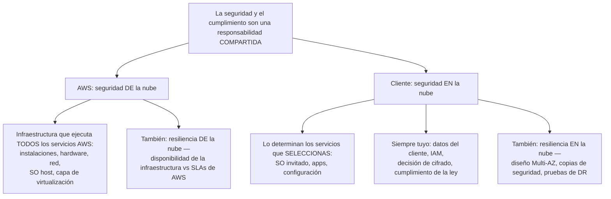
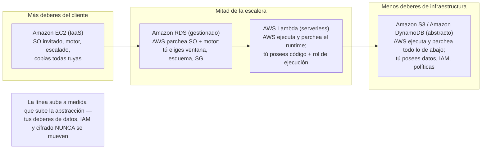
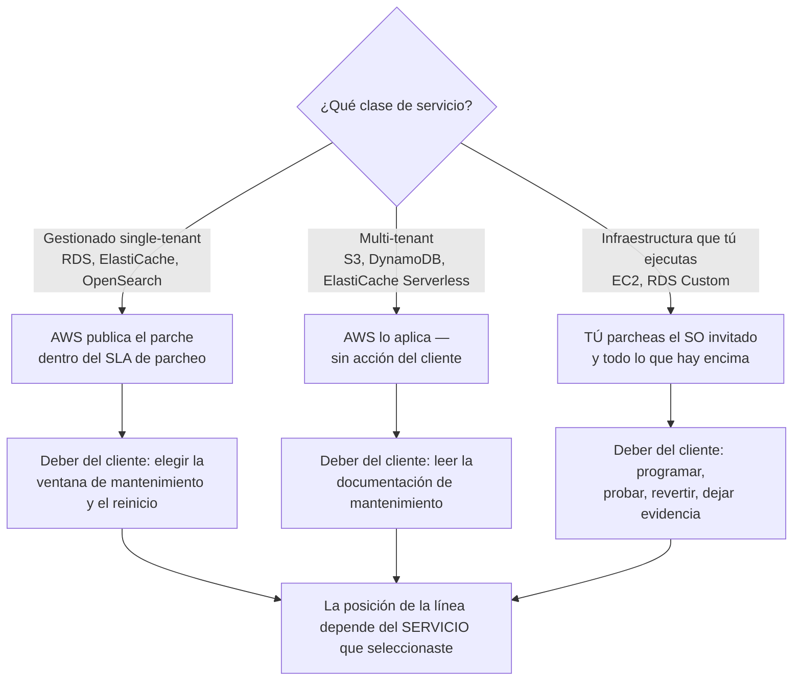
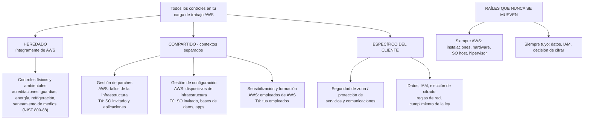
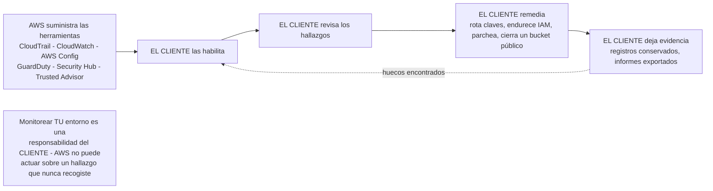

# El modelo de responsabilidad compartida de AWS

Toda pregunta de seguridad del CLF-C02 acaba reduciéndose a una sola frase: *¿quién arregla esto?* El examen lo llama **Dominio 2, Tarea 2.1, "Reconocer los componentes del modelo de responsabilidad compartida de AWS"**, y el Dominio 2 vale **30% de tu puntuación (en octubre de 2026)**, así que este único modelo es, estadísticamente, el concepto más rentable de todo el examen. AWS enuncia la premisa sin rodeios: *"La seguridad y el cumplimiento son una responsabilidad compartida entre AWS y el cliente."* Compartido **no** significa repartido por la mitad, significa *dos organizaciones distintas, cada una totalmente responsable de su propia capa*, y la frontera entre esas capas **se mueve según el servicio que elijas**.

```text
====================================================================
 MODELO DE RESPONSABILIDAD COMPARTIDA DE AWS — DOMINIO 2, TAREA 2.1 (en octubre de 2026)
====================================================================
  DOMINIO 2 "Seguridad y cumplimiento" ............ 30% del examen
---------------------------------------------------------------------
  LAS DOS MITADES (memoriza las preposiciones)
    AWS ......... seguridad DE la nube — la infraestructura
    TÚ .......... seguridad EN la nube — lo que tú configuras
                  ("lo determinan los servicios de AWS Cloud
                    que seleccione el cliente")
---------------------------------------------------------------------
  CAPA / CONTROL                    EC2      RDS    LAMBDA      S3
  Instalaciones, energía, refrig.   AWS      AWS      AWS       AWS
  Ciclo de vida hardware, retiro    AWS      AWS      AWS       AWS
  SO host + hipervisor              AWS      AWS      AWS       AWS
  Parcheo del SO invitado           TÚ       AWS      n/a       n/a
  Instalación/parche del motor BD   (propio) AWS      n/a       n/a
  Parcheo de runtime/lenguaje       TÚ       TÚ       AWS*      n/a
  Escalado, ALTA, copias automát.   TÚ       AWS      AWS       AWS
  Código de la app, IAM, datos,
  elección de cifrado, reglas SG    TÚ       TÚ       TÚ        TÚ
---------------------------------------------------------------------
  TAXONOMÍA DE CONTROLES (redacción oficial de AWS)
    Heredados ........ controles físicos y ambientales
    Compartidos ...... gestión de parches, gestión de
                       configuración, sensibilización y
                       formación (contextos separados)
    Específicos del
    cliente .......... protección de servicios y comunicaciones /
                       seguridad de zona
---------------------------------------------------------------------
  * Lambda "Auto" = AWS actualiza; "Function update" / "Manual" = tú
    actualizas; imágenes de contenedor = AWS publica, tú reconstruyes.
  ANCLAS FIJAS: AWS siempre posee instalaciones + hardware + hipervisor.
                TÚ siempre posees datos + IAM + la decisión de cifrar.
====================================================================
```

> [!NOTE]
> **El modelo no tiene precio ni servicio que encender.** Es una *declaración de deberes*, no un producto. Todo lo que puedas comprar para *probar* tu lado, AWS Artifact para los informes de AWS, AWS CloudTrail, AWS Config, Amazon CloudWatch, Amazon GuardDuty, AWS Security Hub, está de **tu** lado de la línea: AWS suministra la herramienta, tú la habilitas, tú actúas según lo que indica.

En esta lección vas a:

- separar **la seguridad de la nube (AWS)** de **la seguridad en la nube (tú)** usando la propia redacción de AWS;
- situar la frontera exactamente: **del sistema operativo host y la capa de virtualización hacia abajo** = AWS, **del sistema operativo invitado hacia arriba** = tú;
- leer la **tabla completa del desglose de responsabilidades**: instalaciones, hardware, hipervisor, datos, identidad, cifrado, cumplimiento;
- observar cómo la línea **cambia entre Amazon EC2, Amazon RDS, AWS Lambda y Amazon S3**, incluidos los detalles de RDS Custom y los modos de runtime de Lambda;
- clasificar cada control como **heredado, compartido o específico del cliente**, y entender por qué *compartido ≠ 50/50*;
- listar lo que **los clientes aún poseen**: clasificación de datos, identidad y acceso, parcheo de SO en EC2, configuración de red, decisiones de cifrado, seguridad de la aplicación;
- listar lo que **posee AWS**: instalaciones, hardware, virtualización y la infraestructura de servicios gestionados;
- reconocer las **trampas clásicas de atribución errónea** que sostienen la mayoría de las opciones incorrectas de este tema;
- estudiar **cuatro casos de estudio de seguridad y cumplimiento publicados por AWS**: dos operativos y dos de autorización;
- revisar los **cambios de guía y de lista de servicios de 2026** (en octubre de 2026) que deciden qué sigue evaluando el Dominio 2;
- practicar con **12 preguntas estilo examen** más cuatro comprobaciones interactivas.

---

## 1. Seguridad de la nube frente a seguridad en la nube

### 1.1 La redacción de la propia AWS

La página de cumplimiento de AWS define ambas mitades en un solo párrafo, y el examen lo cita casi textualmente:

| Mitad | Responsable | Definición de AWS (con fuente, consulta en octubre de 2026) | Qué incluye |
|---|---|---|---|
| **Seguridad *de* la nube** | **AWS** | *"AWS es responsable de proteger la infraestructura que ejecuta todos los servicios ofrecidos en AWS Cloud"* | Centros de datos, hardware, red, el **sistema operativo host y la capa de virtualización**, la seguridad física de las instalaciones |
| **Seguridad *en* la nube** | **Cliente** | *"La responsabilidad del cliente la determinarán los servicios de AWS Cloud que seleccione el cliente"* | Tus datos, tu identidad y permisos, tu sistema operativo invitado, tu código de aplicación, tu configuración, tus decisiones de cifrado |

La segunda fila es la que los estudiantes leen mal. Tus deberes **no son fijos**: se *derivan de tu elección de servicio*. Ejecutas Amazon EC2 y heredas un sistema operativo que parchear; ejecutas Amazon S3 y ese deber desaparece, mientras que el deber de clasificar tus datos no.

### 1.2 La preposición es todo el truco



> [!WARNING]
> **Trampa de inversión.** Cualquier opción que diga *"AWS es responsable de la seguridad en la nube"* o *"el cliente es responsable de la seguridad de la nube"* es **falsa de por sí**, antes incluso de leer el resto de la opción. AWS = **de** (posee la infraestructura). Tú = **en** (tú configuras lo que se ejecuta sobre ella). El whitepaper de GDPR de AWS lo restate: *"Los clientes son responsables de la 'seguridad en la nube'… configurando y gestionando la seguridad de los servicios de AWS que usan."*

### 1.3 Ejemplo E1: clasificar seis afirmaciones en menos de un minuto

Lee cada afirmación, nombra la mitad y decide si siquiera es plausible:

| # | Afirmación | Mitad | Veredicto |
|---|---|---|---|
| 1 | AWS parchea el hipervisor del host que ejecuta tu instancia | de la nube | Correcto: deber de AWS |
| 2 | Tú decides si el bucket de S3 que guarda registros de clientes es público | en la nube | Correcto: deber del cliente |
| 3 | AWS configura las reglas del grupo de seguridad de tu instancia EC2 | de la nube | **Incorrecto**: AWS *proporciona* el firewall, **tú lo configuras** |
| 4 | Tú patrullas los pasillos del centro de datos | en la nube | **Incorrecto**: la seguridad física es un control *heredado* de AWS |
| 5 | AWS cifra tus datos con tu consentimiento y según tu calendario | en la nube | **Formulación incorrecta**: AWS proporciona KMS y cifrado del lado del servidor; **tú eliges si cifrar**, con qué clave y cómo se gestionan las claves |
| 6 | Tú monitoreas tu propia cuenta con CloudTrail y CloudWatch | en la nube | Correcto: AWS suministra la herramienta, tú la habilitas y actúas |

El patrón de las filas 3, 4 y 5 es todo el examen: **AWS proporciona una capacidad; tú tomas la decisión.** Proporcionado ≠ configurado, y herramienta ≠ responsabilidad.

- **📚 ¿Sabías que…?** El modelo es *razón por la que el cumplimiento en la nube es más barato*. AWS escribe que permite a los clientes *"trasladar la gestión de ciertos controles de TI a AWS"* e heredar un entorno de control auditado en lugar de construir instalaciones y seguridad física: manteniendo datos, identidad, configuración y cumplimiento. Por eso también existe **AWS Artifact como portal de autoservicio sin costo para el acceso bajo demanda a los informes de cumplimiento de AWS**: la evidencia de la mitad de AWS ya está escrita; solo tienes que obtenerla.

---

## 2. Dónde se sitúa la línea en la pila

### 2.1 La frase de la frontera

La página canónica de AWS traza la línea en una sola frase: repítela hasta que se vuelva automática:

> *"AWS opera, gestiona y controla los componentes desde el sistema operativo host y la capa de virtualización hacia **abajo** hasta la seguridad física de las instalaciones en las que opera el servicio. El cliente asume la responsabilidad y la gestión del **sistema operativo invitado** (incluidas actualizaciones y parches de seguridad), del otro software de aplicación asociado, así como de la configuración del firewall de grupo de seguridad proporcionado por AWS."*

```text
  TU LADO DE LA LÍNEA  ("seguridad EN la nube")
  =================================================================
  7. Datos del cliente — clasificación, retención, cifrado ENCENDIDO o APAGADO
  6. Identidad y acceso — usuarios IAM, roles, políticas, MFA, root
  5. Seguridad de la aplicación — código, dependencias, secretos, sesiones
  4. Configuración de red — grupos de seguridad, NACL, enrutamiento, VPC
  3. Sistema operativo invitado — actualizaciones y parches de seguridad
  ----------------------------------------------------------------
  ------------------- LA LÍNEA DE RESPONSABILIDAD COMPARTIDA -------
  ----------------------------------------------------------------
  2. Sistema operativo host — parcheado y endurecido por AWS
  1. Capa de virtualización / hipervisor — AWS
  0. Hardware, servidores, almacenamiento, equipos de red — AWS
  -1. Instalaciones — energía, refrigeración, acceso físico, destrucción de medios
  =================================================================
  LADO DE AWS DE LA LÍNEA  ("seguridad DE la nube")
```

Dos consecuencias aparecen en cada forma de examen:

1. **Amazon EC2 te convierte en administrador de sistemas.** Elegiste IaaS, así que las capas 3 a 7 son tuyas, incluidas las *"actualizaciones y parches de seguridad"* del sistema operativo invitado.
2. **La línea no es un objeto físico.** Es una *división contractual de deberes* que AWS vuelve a dibujar por servicio: que es la segunda mitad de la Tarea 2.1 (Sección 4).

### 2.2 La resiliencia usa las mismas dos preposiciones

El Pilar de Confiabilidad de Well-Architected repite el reparto para la disponibilidad, una fuente favorita de distractores:

| | **Resiliencia *de* la nube (AWS)** | **Resiliencia *en* la nube (tú)** |
|---|---|---|
| Redacción de AWS | *"AWS es responsable de la resiliencia de la infraestructura… garantizando que la disponibilidad del servicio cumpla o supere los Acuerdos de Nivel de Servicio (SLA) de AWS"* | Los clientes son *"responsables de diseñar, probar y desplegar sus aplicaciones"* |
| Deberes concretos | Zonas de Disponibilidad aisladas y conectadas; ≥3 AZ físicamente separadas por Región (en octubre de 2026); energía y refrigeración redundantes; estándar N+1 de centro de datos | **Despliegue Multi-AZ**, copias de seguridad, versionado, replicación, pruebas de conmutación, planes de DR |
| Fallo que previene | Que un centro de datos o una AZ completo se apague | Que tu aplicación se caiga aunque la infraestructura esté sana |

> [!IMPORTANT]
> **Que AWS garantice disponibilidad no hace disponible tu aplicación.** AWS suministra *primitivas* resilientes; que tu carga de trabajo las abarque es tu decisión. La guía de servicios financieros de AWS hace explícito el reparto: AWS se asegura de que los servicios que opera *"estén continuamente disponibles"*, mientras que los clientes *"son responsables de diseñar, probar y desplegar sus aplicaciones"*, y nombra tres acciones de programa para el lado del cliente: **Validar, Demostrar, Monitorear**.

### 2.3 Ejemplo E2: la aritmética de las 124 AZ y lo que *no* te compra

AWS reporta **124 Zonas de Disponibilidad en 39 Regiones geográficas**, cada Región con *"al menos tres Zonas de Disponibilidad independientes y físicamente separadas"* (en octubre de 2026).

$$
39 \times 3 = 117 \text{ AZs as the design minimum} \quad\Rightarrow\quad 124 - 117 = 7 \text{ AZs above the minimum}
$$

Así que AWS ha diseñado siete dominios de fallo más de lo que exige su propio mínimo, y **tu cuenta sigue siendo dueña de la diferencia en la práctica**. Un despliegue de una sola AZ dentro de una Región de 3 AZ hereda cero de esa ingeniería. La lista de verificación del lado del cliente después de la aritmética:

1. despliega en **al menos dos AZ** (la propia regla de diseño de AWS para la disponibilidad);
2. activa las **copias de seguridad** y prueba restaurarlas;
3. decide si un evento a **nivel de Región** necesita una estrategia de DR (eso es una pregunta de Región, no de AZ);
4. **prueba** la conmutación: un plan sin probar es una hipótesis.

- **📚 ¿Sabías que…?** AWS retira los medios que contenían datos de clientes usando técnicas detalladas en **NIST 800-88**, el acceso físico a las salas de servidores requiere **autorización multifactor**, y el acceso a los centros de datos se *"registra, monitorea y conserva"*, y aun así los auditores externos prueban a AWS contra **más de 2.600 requisitos a lo largo del año** (en octubre de 2026). Todo eso está del lado de AWS, y por eso mismo es un control *heredado* para ti: recibes la garantía sin operar los lectores de acreditaciones.

---

## 3. El desglose completo de responsabilidades

### 3.1 Cada fila, cada responsable

Esta es la tabla sobre la que se construye la Tarea 2.1. Aprende tres columnas de lógica: **siempre AWS**, **siempre tuyo** y **depende del servicio**.

| Elemento | Responsable | Categoría del control | Fuente (consulta en octubre de 2026) |
|---|---|---|---|
| Instalaciones físicas: acreditaciones, cámaras, guardias, jaulas | **AWS** | Heredado | Modelo de responsabilidad compartida; Trust Center; Data Layer |
| Ciclo de vida del hardware y disposición de dispositivos | **AWS** | Heredado | Modelo de responsabilidad compartida; whitepaper NHS |
| Saneamiento y destrucción de medios (NIST 800-88) | **AWS** | Heredado | AWS Trust Center |
| Capa de virtualización / hipervisor / firmware del host | **AWS** | Heredado (de la nube) | Modelo de responsabilidad compartida |
| Sistema operativo host (bajo tu instancia) | **AWS** | Heredado | Modelo de responsabilidad compartida |
| **Datos del cliente**: contenido, dónde reside, cifrado o no | **Cliente** | Específico del cliente | Modelo de responsabilidad compartida; Security Quick Reference |
| **Gestión de identidad y acceso**: usuarios, roles, políticas | **Cliente** | Específico del cliente | Modelo de responsabilidad compartida; whitepaper de GDPR |
| **Parcheo del SO invitado** en EC2 / IaaS | **Cliente** | Compartido (contextos separados) | Modelo de responsabilidad compartida; Security Quick Reference |
| **Configuración del grupo de seguridad / firewall** por instancia | **Cliente** | Específico del cliente | Modelo de responsabilidad compartida |
| **Decisiones de cifrado**: lado del cliente; habilitar el del lado del servidor; tipo de clave | **Cliente** | Específico del cliente | Modelo de responsabilidad compartida; protección de datos de EC2 |
| **Software de aplicación** que instalas o escribes | **Cliente** | Específico del cliente | Modelo de responsabilidad compartida |
| Gestión de parches (SO invitado y aplicaciones) | **Compartido**: AWS parchea la infraestructura, tú parcheas tu capa | Compartido | Modelo de responsabilidad compartida; Pilar de Seguridad de Well-Architected |
| Gestión de configuración | **Compartido**: AWS mantiene la configuración de los dispositivos de infraestructura, tú configuras el SO invitado, las bases de datos y las aplicaciones | Compartido | Modelo de responsabilidad compartida |
| Sensibilización y formación | **Compartido**: AWS forma a los empleados de AWS, tú formas a los tuyos | Compartido | Modelo de responsabilidad compartida |
| Protección de servicios y comunicaciones / seguridad de zona | **Específico del cliente** | Específico del cliente | Modelo de responsabilidad compartida |
| Cumplimiento de las leyes y regulaciones aplicables a tu carga de trabajo | **Cliente** | Específico del cliente | AWS Compliance; Compliance Programs |
| Resiliencia de la infraestructura frente a los SLA de AWS | **AWS** | Heredado | Pilar de Confiabilidad de Well-Architected |
| Diseño Multi-AZ, copias de seguridad, replicación, pruebas de DR | **Cliente** | Específico del cliente | Pilar de Confiabilidad de Well-Architected |

### 3.2 Ejemplo E3: la misma carga de trabajo, tres columnas

Un equipo de bases de datos on-premises documenta lo que exige cada opción de alojamiento. La Guía de usuario de Amazon RDS publica exactamente esta comparación:

| Deber | On premises | Amazon EC2 | Amazon RDS |
|---|---|---|---|
| Parcheo del sistema operativo | Cliente | Cliente | **AWS** |
| Parcheo del software de la base de datos | Cliente | Cliente | **AWS** |
| Escalado, alta disponibilidad, copias de seguridad de la BD | Cliente | Cliente | **AWS** |
| Mantenimiento de servidores | Cliente | AWS | **AWS** |
| Ciclo de vida del hardware | Cliente | AWS | **AWS** |
| Energía, red, refrigeración | Cliente | AWS | **AWS** |

Lee las columnas de izquierda a derecha y verás **la línea deslizarse hacia arriba**: tres deberes del cliente se convierten en deberes de AWS al pasar de autogestionado a gestionado. Lee las *filas* y verás lo que nunca cambia: **nada de esta tabla trata sobre tus datos, tus políticas de IAM ni tu obligación de cumplimiento**, porque esos viven por encima de la frontera en todas las columnas.

---

## 4. Cómo cambia la línea entre servicios (la habilidad más difícil de la Tarea 2.1)

### 4.1 Los tres ejemplos del examen más uno

La guía del examen nombra **Amazon RDS, AWS Lambda y Amazon EC2** como ejemplos del desplazamiento. Añade **Amazon S3** (el caso del almacenamiento abstracto) y cubres cada forma de pregunta.

| Responsabilidad | **Amazon EC2** (IaaS) | **Amazon RDS** (gestionado) | **AWS Lambda** (serverless) | **Amazon S3** (abstracto) |
|---|---|---|---|---|
| Instalaciones, hardware, energía/refrigeración | AWS | AWS | AWS | AWS |
| SO host + hipervisor | AWS | AWS | AWS | AWS |
| Parcheo del SO invitado | **Cliente** | **AWS** | n/a: no hay SO invitado expuesto | n/a |
| Instalación y parcheo del motor de BD | Cliente (tú lo instalaste) | **AWS** | n/a | n/a |
| Parcheo de runtime/lenguaje | Cliente | Cliente (lado de la aplicación) | **AWS**, pero quizá tengas que desencadenar la actualización | n/a |
| Escalado, ALTA, copias automáticas | Tú lo diseñas (Auto Scaling, Multi-AZ) | **AWS** | AWS | AWS |
| Código y lógica de la aplicación | Cliente | Cliente (esquema, ajuste de consultas) | **Cliente** | Cliente |
| Permisos de IAM | Cliente | Cliente | Cliente (rol de ejecución) | Cliente (política de bucket, ACL) |
| Datos, clasificación, decisión de cifrado | Cliente | Cliente | Cliente | Cliente |
| Reglas de grupo de seguridad / de red | Cliente (el firewall proporcionado por AWS) | Cliente (SG en el endpoint de la BD) | Cliente (configuración de VPC si está conectada) | Cliente (Block Public Access, política de bucket) |

Dos invariantes sobreviven a cada fila de esa tabla: **AWS siempre posee instalaciones, hardware e hipervisor**, y **tú siempre posees datos, IAM y la decisión de cifrado**. Solo las filas del medio se mueven.



### 4.2 La auditoría del deber de parcheo (ejemplo resuelto E4)

¿Quién parchea el sistema operativo? Seis cargas de trabajo, una respuesta cada una:

| Carga de trabajo | Configuración | SO invitado parcheado por | Por qué |
|---|---|---|---|
| Servidor web en **Amazon EC2** | Amazon Linux AMI | **Tú** | IaaS: el SO invitado es tuyo |
| **MySQL autogestionado en EC2** | Tú instalaste el motor | **Tú** (SO *y* motor) | No se compró nada gestionado |
| **Amazon RDS** para PostgreSQL | Servicio gestionado single-tenant | **AWS** (SO *y* motor) | Solo seleccionas la ventana de mantenimiento |
| **Amazon RDS Custom** para Oracle | Gestionado *más* acceso privilegiado al SO | **Tú** | Devolviste el host deliberadamente |
| **AWS Lambda** en modo de actualización **Auto** | Runtime gestionado | **AWS** | Lambda aplica actualizaciones a todas las funciones |
| **AWS Lambda** en modo **Manual**, runtime fijado | Runtime gestionado, tu modo de control | **Tú** | *"tú eres responsable de actualizar tu función para usar la última versión del runtime"* |
| **Amazon S3** | Almacenamiento abstracto | **AWS** (no existe SO del cliente) | Multi-tenant; no hay nada que tú parchees |

Las dos trampas de esa tabla, **RDS Custom** y **Lambda Manual**, merecen una sección cada una.

### 4.3 La válvula de escape de RDS Custom

Amazon RDS Custom existe porque algunas cargas de trabajo necesitan acceso privilegiado al sistema operativo. La redacción de la propia AWS: *"Con RDS Custom, usas las características gestionadas de Amazon RDS, pero gestionas el host y personalizas el SO como lo haces en Amazon EC2."* La tabla de responsabilidades publicada devuelve **el parcheo del SO y el parcheo del software de la base de datos al Cliente** para RDS Custom, mientras que el Amazon RDS estándar mantiene ambos en AWS.

> [!NOTE]
> **La abstracción puede negociarse a propósito.** Un equipo que necesita módulos del kernel, un nivel de parche concreto o un agente de terceros en el host de la base de datos elige RDS Custom y *recupera* un deber de parcheo. Consecuencia en el examen: la opción que dice *"Amazon RDS siempre significa que AWS realiza todo el parcheo"* es **falsa**, porque el examen sabe que RDS Custom existe.

### 4.4 El matiz del runtime de Lambda

AWS publica la gestión de runtimes como un tema de **responsabilidad compartida**:

- *"Lambda es responsable de seleccionar y publicar actualizaciones de seguridad para todos los runtimes gestionados e imágenes de contenedor compatibles."*
- *"Para las funciones configuradas para usar el modo de actualización Manual del runtime, tú eres responsable de actualizar tu función para usar la última versión del runtime."*

| Modo de actualización | Quién aplica la actualización | Deber práctico para ti |
|---|---|---|
| **Auto** | Lambda actualiza todas las funciones | Verifica después; corrige lo que un runtime nuevo rompa |
| **Function update** / **Manual** | Tú | Vigila fechas de obsolescencia, redespliega, prueba |
| Funciones con **imagen de contenedor** | AWS publica **imágenes base** parcheadas | **Reconstruye y sube** tu imagen para recibir la corrección |

### 4.5 Ejemplo E5: un runtime obsoleto que nadie parcheó

Una función se ejecuta en una versión de runtime que AWS ha marcado para obsolescencia. AWS ya publicó la corrección de seguridad (la mitad de Lambda está hecha). La auditoría del equipo:

| Ajuste del control | ¿Runtime parcheado? | Responsable del hueco |
|---|---|---|
| Modo de actualización **Auto** | Sí: Lambda lo aplicó | Ninguno (monitorea roturas) |
| Modo **Manual**, nadie redespliega | **No** | **Cliente**: la corrección existía, el deber era tuyo |
| Imagen de contenedor, imagen no reconstruida | **No** | **Cliente**: AWS parcheó la base, tú debes reconstruir |

Cuenta los fallos: **0 fallos de AWS, 1 fallo del cliente en cada una de las dos últimas filas.** El modelo funcionó exactamente como fue diseñado: una corrección publicada más un deber ignorado sigue siendo una función sin parchear, y el examen te pedirá que nombres al responsable.

### 4.6 Parcheo single-tenant frente a multi-tenant

El Pilar de Seguridad de Well-Architected divide los servicios gestionados en dos comportamientos de parcheo, y la diferencia está en *cuánto aún te toca hacer*:

| Clase de servicio | Ejemplos | Quién aplica el parche | Lo que tú sigues haciendo |
|---|---|---|---|
| **Gestionado single-tenant** | Amazon ElastiCache, **Amazon RDS**, Amazon OpenSearch Service | AWS *"publica parches dentro del SLA de parcheo del servicio"* | **Facilítalo**: selecciona ventanas de mantenimiento, aplica actualizaciones del servicio, programa los reinicios necesarios |
| **Multi-tenant** | ElastiCache Serverless, **Amazon DynamoDB**, **Amazon S3** | AWS aplica los parches **sin acción del cliente** | *Consulta* la documentación de parcheo y mantenimiento |



```matching
{
  "question": "Relaciona cada carga de trabajo con quién parchea el sistema operativo (o el runtime) en el examen CLF-C02:",
  "pairs": [
    {"left": "Instancia de Amazon EC2", "right": "Cliente, el SO invitado y sus parches de seguridad son tuyos en IaaS"},
    {"left": "MySQL autogestionado en Amazon EC2", "right": "Cliente: tú instalaste el motor, así que parcheas tanto el SO como la base de datos"},
    {"left": "Amazon RDS (estándar)", "right": "AWS - AWS parchea el SO y el motor; tú solo eliges la ventana de mantenimiento"},
    {"left": "Amazon RDS Custom", "right": "Cliente: gestionas el host y personalizas el SO como lo haces en Amazon EC2"},
    {"left": "AWS Lambda en modo Auto", "right": "AWS - Lambda aplica actualizaciones de runtime a todas las funciones"},
    {"left": "AWS Lambda en modo Manual", "right": "Cliente: tú eres responsable de actualizar tu función al último runtime"},
    {"left": "Amazon S3", "right": "AWS: almacenamiento abstracto multi-tenant; no existe SO invitado de tu lado"}
  ],
  "explanation": "La preposición nunca cambia (AWS = seguridad DE, tú = seguridad EN), pero la fila de parcheo se mueve con el servicio: más abstracción significa que AWS absorbe más de la pila. Los dos detalles deliberados son RDS Custom (el deber del SO vuelve a ti) y el modo Manual de Lambda (el deber del runtime sigue siendo tuyo aunque Lambda publicó la corrección)."
}
```

```dragdrop
{
  "question": "Ordena estos cuatro tipos de servicio desde MAYORES deberes de infraestructura del cliente hasta MENORES:",
  "items": [
    "Amazon EC2 (IaaS)",
    "Amazon RDS (base de datos gestionada)",
    "AWS Lambda (cómputo serverless)",
    "Amazon S3 (almacenamiento abstracto)"
  ],
  "correctOrder": [
    "Amazon EC2 (IaaS)",
    "Amazon RDS (base de datos gestionada)",
    "AWS Lambda (cómputo serverless)",
    "Amazon S3 (almacenamiento abstracto)"
  ],
  "explanation": "La escalera funciona por abstracción: en EC2 posees el SO invitado, el motor, el escalado y las copias; en RDS AWS se lleva el SO, el motor, el escalado, la ALTA y las copias; en Lambda no hay SO que gestionar; en S3 hasta el runtime desaparece. Lo que NO baja por la escalera son tus datos, IAM, la configuración de red y la elección de cifrado: esos siguen siendo responsabilidad del cliente en cada peldaño."
}
```

- **📚 ¿Sabías que…?** El mismo modelo gobierna *quién retira el hardware*: la guía de AWS alineada con el NHS llama a la seguridad del centro de datos *"responsabilidad íntegra de AWS"* y dice que la disposición y el desaprovisionamiento *"corresponden a AWS bajo el Modelo de Responsabilidad Compartida"*. Tu obligación empieza en tus datos, *"Tú siempre posees tus datos, incluida la capacidad de cifrarlos, moverlos y gestionar su retención"*, y termina en tus políticas de retención y eliminación, nunca en la trituradora.

---

## 5. La taxonomía de controles: heredados, compartidos, específicos del cliente

### 5.1 Las tres categorías oficiales de AWS

AWS no divide los controles solo en "tuyos/míos". La taxonomía publicada tiene **cuatro etiquetas**, y el examen te pide colocar un ejemplo en la correcta:

| Categoría | Definición de AWS (con fuente) | Ejemplos canónicos |
|---|---|---|
| **Heredado** | *"Controles que un cliente hereda íntegramente de AWS"* | Controles físicos y ambientales: acceso con acreditación, guardias, cámaras, energía, refrigeración, destrucción de medios |
| **Compartido** | Aplica a ambas capas *"pero en contextos completamente separados"* | **Gestión de parches** (AWS: fallos de la infraestructura; tú: SO invitado y aplicaciones) · **Gestión de configuración** (AWS: dispositivos de infraestructura; tú: SO invitado, bases de datos, aplicaciones) · **Sensibilización y formación** (AWS forma a los empleados de AWS; tú formas a los tuyos) |
| **Específico del cliente** | Únicamente tuyo | Protección de servicios y comunicaciones o **seguridad de zona**; clasificación de datos; IAM; decisiones de cifrado |
| **Responsabilidad de AWS "de la nube"** / **del cliente "en la nube"** | La división de primer nivel | Todo lo anterior se resuelve en una de estas dos mitades |

> [!IMPORTANT]
> **Compartido ≠ 50/50.** La redacción de AWS es *"en contextos completamente separados"*: AWS realiza **su** parcheo de **su** infraestructura, tú realizas **tu** parcheo de **tu** SO invitado y aplicaciones: sobre el mismo control abstracto, en capas distintas, con evidencias distintas. Una pregunta que ofrezca *"las responsabilidades compartidas se reparten por igual entre AWS y el cliente"* está probando si leíste la definición.



### 5.2 La heurística de las cinco preguntas

Cuando una opción te sea desconocida, aplica esta orden de pruebas: resuelve casi cualquier elemento de la Tarea 2.1:

```text
1. Identifica la CLASE DE SERVICIO:  IaaS / gestionado / abstracto / serverless
2. Configurable, subible, nombrable, concedible, clasificable   -> CLIENTE
3. Físicamente intocable (centro de datos, hardware, hipervisor) -> AWS
4. Parche / configuración / sensibilización                     -> COMPARTIDO
                                                 (implementaciones separadas)
5. Datos, IAM, cifrado, cumplimiento de la ley                  -> CLIENTE, SIEMPRE
```

### 5.3 Ejemplo E6: clasificar doce controles en cubetas

Clasifica los doce controles de la Sección 3 en la taxonomía y cuéntalos:

| Cubeta | Controles (cantidad) |
|---|---|
| **Heredados** (4) | Acreditación/acceso físico · ciclo de vida del hardware · saneamiento de medios según NIST 800-88 · SO host e hipervisor |
| **Compartidos** (3) | Gestión de parches · gestión de configuración · sensibilización y formación |
| **Específicos del cliente** (5) | Clasificación de datos · permisos de IAM · reglas de grupo de seguridad · elección de cifrado · cumplimiento de la ley aplicable |
| **No clasificables: lado incorrecto de la línea** | *"AWS configura tu grupo de seguridad"* · *"AWS cifra tus datos en tu nombre como obligación predeterminada"* · *"AWS es responsable de tu cumplimiento de HIPAA"* |

Cuatro más tres más cinco suman doce, y cada una de las tres afirmaciones "no clasificables" incumple la tabla de trampas de la Sección 8. Si puedes ubicar un control en una cubeta en menos de diez segundos, puedes responder la pregunta.

### 5.4 Controles compartidos en operación continua

Un control solo es real si se ejecuta continuamente, así que el examen también evalúa la forma *permanente* de los tres controles compartidos. Cada fila nombra qué hace AWS para siempre, qué debes hacer tú para siempre y dónde queda la evidencia:

| Control compartido | Implementación de AWS (continua) | Tu implementación (continua) | Dónde queda la evidencia |
|---|---|---|---|
| **Gestión de parches** | Parchear y corregir fallos de la infraestructura; publicar parches de servicios gestionados dentro del SLA de parcheo del servicio | Parchear el SO invitado y las aplicaciones; en servicios gestionados single-tenant, seleccionar ventanas de mantenimiento, aplicar actualizaciones del servicio y programar reinicios; en multi-tenant, leer la documentación de mantenimiento | AWS: informes de auditoría vía **AWS Artifact** · Tú: informes de cumplimiento de parches y registros de cambios |
| **Gestión de configuración** | Mantener la configuración de los dispositivos de infraestructura de AWS | Configurar sistemas operativos invitados, bases de datos y aplicaciones; mantener las reglas de grupo de seguridad, NACL y VPC como código revisado | AWS: declaraciones de alcance SOC/ISO · Tú: reglas de AWS Config, plantillas de CloudFormation revisadas |
| **Sensibilización y formación** | Formar a los empleados de AWS | Formar a tus propios empleados sobre el modelo compartido, el manejo de datos y la higiene de la cuenta (MFA de root, privilegio mínimo) | AWS: controles de personas auditados · Tú: registros de formación dentro de tu evidencia de cumplimiento |

La guía de servicios financieros de AWS enmarca el lado cliente de este bucle como tres acciones de programa repetidas: **Validar** (¿el control está diseñado correctamente?), **Demostrar** (¿puedes mostrar la evidencia?), **Monitorear** (¿sigue funcionando?). Eso es monitoreo continuo *en* la nube, y nada de eso se transfiere a AWS, porque AWS no puede validar una decisión que no has tomado.

```text
BUCLE DE MONITOREO CONTINUO (lado del cliente del modelo)
====================================================================
  Lado de AWS (siempre en ejecución)   Tu lado (tú lo ejecutas)
  -----------------------------        --------------------------------
  parcheo de infraestructura           habilitar -> CloudTrail, AWS Config,
  SLA de parcheo del servicio                     GuardDuty, Security Hub
  registro de acceso físico           revisar   -> hallazgos, desvíos, config
  saneamiento de medios (NIST 800-88) actuar    -> rotar, endurecer, parchear,
  publicación de informes (Artifact)             cerrar exposición pública
                                       probar    -> exportar evidencia,
                                                   revalidar, redemostrar
  ------------------------------------------------------------------
  REGLA: AWS suministra la herramienta; el CLIENTE la habilita, la revisa,
         actúa sobre ella y deja evidencia. Los hallazgos que nunca
         recoges son hallazgos que nadie remedia.
====================================================================
```

```matching
{
  "question": "Relaciona cada servicio de la lista actual en alcance del CLF-C02 (en octubre de 2026) con dónde cae realmente su división de responsabilidades:",
  "pairs": [
    {"left": "AWS PrivateLink", "right": "AWS ejecuta y parchea la infraestructura del servicio: tú posees las políticas de endpoint, qué principales y cuentas pueden conectarse, y la configuración de la VPC"},
    {"left": "AWS Transit Gateway", "right": "AWS ejecuta y parchea la infraestructura del servicio: tú posees las tablas de enrutamiento, las conexiones y la política de compartir recursos"},
    {"left": "AWS Site-to-Site VPN", "right": "AWS ejecuta los endpoints de VPN gestionados: tú posees la configuración del gateway del cliente, el enrutamiento y los ajustes de cifrado/autenticación que eliges"},
    {"left": "AWS Client VPN", "right": "AWS ejecuta el servicio: tú posees la fuente de autenticación, las reglas de autorización y qué usuarios reciben un perfil"},
    {"left": "AWS IAM Identity Center", "right": "AWS ejecuta el servicio: tú posees la fuente de identidad, las asignaciones de conjuntos de permisos y la autenticación multifactor de tu plantilla de trabajadores"},
    {"left": "AWS Support (la única entrada de la categoría Customer Enablement)", "right": "AWS suministra la organización de soporte y su orientación: tú eliges el plan, abres los casos y actúas sobre las recomendaciones"}
  ],
  "explanation": "Todos los servicios se dividen igual: AWS posee la infraestructura del servicio que hay debajo (seguridad DE la nube), y el cliente posee cada decisión tomada encima: rutas, conexiones, endpoints, identidades, permisos y MFA (seguridad EN la nube). Nombres nuevos en alcance como AWS PrivateLink, AWS Transit Gateway, AWS Site-to-Site VPN y AWS Client VPN cambian sobre qué pueden preguntarte, pero nunca cambian dónde se sitúa la línea. Verifica la lista vigente en alcance antes de usarla: AWS la etiqueta como no exhaustiva y sujeta a cambios."
}
```

---

## 6. Lo que los clientes aún poseen

La abstracción elimina *tareas de infraestrutura*, nunca *la propiedad*. Incluso en el servicio más abstracto, seis deberes son tuyos de forma permanente:

| # | Deber del cliente | Qué significa en la práctica | Evidencia que produces |
|---|---|---|---|
| 1 | **Clasificación de datos** | Decidir qué es sensible, dónde puede residir, si puede ser público | Inventario de datos, esquema de clasificación, reglas de retención |
| 2 | **Gestión de identidad y acceso** | Usuarios IAM, roles, políticas, MFA (incluido el **MFA de root**), privilegio mínimo, hábitos de rotación de claves | Revisiones de políticas, informes de cobertura de MFA, alertas de inicio de sesión de root en CloudTrail |
| 3 | **Parcheo de SO en EC2** (y en cualquier capa autogestionada) | Programar, aplicar y revertir parches del SO invitado | Informes de cumplimiento de parches (p. ej., vía AWS Systems Manager Patch Manager) |
| 4 | **Configuración de red** | Reglas de grupo de seguridad y NACL, diseño de VPC, tablas de enrutamiento, si un bucket es público | Conjuntos de reglas revisados, registros de cambios |
| 5 | **Decisiones de cifrado** | Si cifrar, lado del cliente frente al lado del servidor, qué tipo de clave, cómo se gestionan las claves | Políticas de claves de KMS, ajustes de cifrado de buckets |
| 6 | **Seguridad de la aplicación** | Código, dependencias, gestión de secretos, manejo de sesiones, validación de entradas | Revisión de código, análisis de dependencias, rotación de secretos |

### 6.1 El deber de monitoreo del cliente

AWS suministra las herramientas de detección; **habilitarlas y actuar sobre ellas es tuyo**. La propia guía de seguridad de cuentas de AWS pone el caso más urgente primero: *"Es crítico que protejas tu cuenta root del acceso no autorizado, empezando por la autenticación multifactor"*, y root debe usarse **solo en emergencias**.



### 6.2 Ejemplo E7: la auditoría de exposición de la cuenta root

Tres hallazgos en una cuenta (los recuentos son del escenario, no métricas de AWS):

| Hallazgo | Recuento | Responsable de la corrección | Corrección |
|---|---|---|---|
| Usuario(s) root sin MFA | 1 | Cliente | Impón MFA en el usuario root de inmediato |
| Claves de acceso root de larga duración | 2 | Cliente | Elimínalas; las claves de root son un artefacto solo para emergencias |
| Alertas de inicio de sesión de root | 0 | Cliente | Activa una alerta de detección a nivel de organización (la guía de seguridad CAF de AWS recomienda controles de detección en inicios de sesión de root) |
| Seguridad física del centro de datos del lado de AWS | operativa | AWS (heredado) | Nada que hacer: ya auditado |

**Exposición = 1 + 2 + 0 = 3 huecos del lado del cliente, 0 huecos del lado de AWS.** Observa qué muestra la aritmética: cada hueco es una *decisión que nadie tomó*, y cada corrección usa una herramienta que AWS ya proporciona. Observa también el control de registro del lado de AWS que **no** es tuyo: al crear la cuenta, AWS retiene **1 USD (o su equivalente) durante 3 a 5 días para verificar tu cuenta y prevenir el fraude** (en octubre de 2026).

### 6.3 Autoevaluación: los deberes que nunca cambian

```fillblank
{
  "question": "Completa las afirmaciones del lado del cliente del modelo de responsabilidad compartida de AWS:",
  "template": "El cliente es dueño de la clasificación y la retención de {{1}}, de la gestión de {{2}} y acceso (incluida la autenticación multifactor en el usuario root), de la {{3}} de red como las reglas de grupos de seguridad, de la elección de si {{4}} los datos o no y de qué manera, del {{5}} del sistema operativo invitado en Amazon EC2 y de la seguridad del {{6}} en sí mismo.",
  "answers": {
    "1": "datos",
    "2": "identidad",
    "3": "configuración",
    "4": "cifrar",
    "5": "parcheo",
    "6": "aplicación"
  },
  "distractors": ["hipervisor", "centro de datos", "virtualización", "firmware", "refrigeración", "ancho de banda"],
  "explanation": "Los seis son responsabilidades del cliente en todo servicio: clasificación de datos, gestión de identidad y acceso, configuración de red, la decisión de cifrado, parcheo del SO invitado en IaaS y seguridad de la aplicación. Los distractores son todas capas de AWS: hipervisor, centro de datos, virtualización, firmware y energía/refrigeración están del lado de la seguridad DE la nube."
}
```

- **📚 ¿Sabías que…?** Tu evidencia de cumplimiento se divide por la misma línea. Para una carga de trabajo PCI obtendrías la evidencia del lado de AWS, seguridad física, destrucción de medios, parcheo de infraestructura, protección de red, formación del personal, desde **AWS Artifact**, un *"portal de autoservicio sin costo para el acceso bajo demanda a los informes de cumplimiento de AWS"*, mientras aportas tu propia evidencia de privilegio mínimo de IAM, reglas de grupos de seguridad, ajustes de cifrado y retención de registros. AWS admite **143 estándares de seguridad y certificaciones de cumplimiento**, incluidos PCI-DSS, HIPAA/HITECH, FedRAMP, GDPR, FIPS 140-3 y NIST 800-171, y ofrece **más de 300 servicios y características de seguridad, cumplimiento y gobernanza** (todos en octubre de 2026).

---

## 7. Lo que posee AWS

Todo desde el sistema operativo host hacia abajo, más la maquinaria de ejecutar el propio servicio:

| Área poseída por AWS | Qué hace AWS | Detalle con fuente (consulta en octubre de 2026) |
|---|---|---|
| **Instalaciones** | Selección de emplazamiento, seguridad física, protección ambiental | El acceso físico a las salas de servidores requiere autorización multifactor; el acceso a los centros de datos se registra, monitorea y conserva; las aplicaciones centrales se despliegan bajo un **estándar N+1** |
| **Hardware** | Servidores, dispositivos de almacenamiento, equipos de red, ciclo de vida y disposición | Los medios que contenían datos de clientes se retiran usando técnicas detalladas en **NIST 800-88** |
| **Virtualización** | SO host, hipervisor, firmware bajo tu instancia | *"…desde el sistema operativo host y la capa de virtualización hacia abajo hasta la seguridad física de las instalaciones"* |
| **Infraestructura de servicios gestionados** | Los binarios del motor de la base de datos, el runtime serverless, el interior del servicio de almacenamiento | Amazon RDS parchea SO y motor; Lambda selecciona y publica actualizaciones de seguridad de runtime; los servicios multi-tenant parchean sin acción del cliente |
| **Resiliencia de la infraestructura global** | Regiones, AZ, energía y red redundantes | **124 Zonas de Disponibilidad en 39 Regiones geográficas**, cada Región con al menos tres AZ físicamente separadas (en octubre de 2026); resiliencia *de* la nube frente a los SLA de AWS |
| **Identidad de la infraestructura** | Quién puede entrar físicamente a un centro de datos | Controles físicos de acreditación y multifactor: *tus* identidades de IAM son un sistema distinto, del lado del cliente |
| **Auditoría del lado de AWS** | Auditoría externa e interna, publicación de informes | Auditados contra **más de 2.600 requisitos** a lo largo del año; **185 servicios** en el informe SOC 1 del verano de 2026 que cubre del 1 de jul de 2025 al 30 de jun de 2026 (publicado el 11 de ago de 2026); **más de 100** servicios de AWS certificados frente al Código de Conducta de Protección de Datos de CISPE |

> [!NOTE]
> **"AWS está auditado" no es "tú estás en cumplimiento."** AWS publica *"Services in Scope by Compliance Program"* (SOC actualizado por última vez el 11 de ago de 2026, FedRAMP el 29 de sep de 2026, C5 el 13 de en de 2026), pero AWS también afirma claramente que *"los clientes de AWS siguen siendo responsables de cumplir las leyes y regulaciones de cumplimiento aplicables"* y que *"no existe certificación formal disponible para (ni distribuible por) un proveedor de servicios en la nube"* en esos ámbitos legales. No existe algo así como un "proveedor de nube certificado para HIPAA": la certificación, la autorización y la responsabilidad recaen en **ti**.

---

## 8. Trampas clásicas de atribución errónea

### 8.1 Las nueve respuestas incorrectas, corregidas

Estas son las atribuciones erróneas que llenan los distractores. Lee la versión incorrecta y luego di en voz alta la correcta:

| ❌ Afirmación incorrecta que verás | ✅ Afirmación correcta |
|---|---|
| AWS se ocupa de la seguridad *en* la nube | AWS se ocupa de la seguridad *de* la nube; tú te ocupas de la *en* |
| AWS parchea tu sistema operativo EC2 | AWS parchea el **hipervisor y el SO host**; **tú** parcheas el **SO invitado** |
| AWS gestiona tu IAM | Los permisos e identidades son **siempre** responsabilidad del cliente |
| AWS es responsable de cifrar tus datos | AWS **proporciona** KMS y cifrado del lado del servidor; **tú** eliges si cifrar, el tipo de clave y la gestión de claves |
| AWS es responsable del cumplimiento en la nube | AWS atestigua *sus* controles; **tú** cumples las leyes aplicables a tu carga de trabajo |
| Amazon RDS significa cero deberes de parcheo para el cliente | Sigues seleccionando ventanas de mantenimiento, aplicando actualizaciones del servicio y programando reinicios; **RDS Custom** devuelve por completo el parcheo del SO a ti |
| AWS Lambda significa cero deberes del cliente | El código, el rol de ejecución, las dependencias, la reconstrucción de contenedores y las actualizaciones de runtime en modos Function-update/Manual siguen siendo tuyos |
| Los grupos de seguridad son el firewall de AWS, así que AWS los configura | Configurar *"el firewall de grupo de seguridad proporcionado por AWS"* es responsabilidad explícita del **cliente** |
| AWS garantiza la disponibilidad, así que mi aplicación está disponible | AWS suministra primitivas resilientes; **el diseño Multi-AZ, las copias de seguridad, el versionado, la replicación y las pruebas de DR son tuyos** |
| La attestación de terceros de AWS significa que estamos en cumplimiento | Los informes de AWS cubren los controles de AWS; tu implementación y tu cumplimiento legal siguen siendo tuyos |

### 8.2 Ejemplo E8: reescribir tres distractores

Toma un enunciado de práctica: *"Una carga de trabajo regulada está desplegada en Amazon RDS. ¿Qué afirmación es correcta?"*

| Opción tal como está escrita | Diagnóstico | Reescrita correctamente |
|---|---|---|
| *"AWS es responsable de cifrar la base de datos en reposo, así que el cliente no tiene ningún deber de cifrado."* | Cebo a medias: AWS *ofrece* cifrado | El cliente sigue decidiendo **si** el cifrado está activo, **con qué clave** y cómo se gestionan las claves |
| *"Como AWS parchea el motor, el cliente ya no configura el acceso de red."* | Confunde dos filas | AWS parchea SO + motor; el **grupo de seguridad en el endpoint de la BD** lo configura el cliente |
| *"El informe SOC de AWS satisface la obligación regulatoria del cliente."* | Error de categoría | El informe de AWS evidencia **controles de AWS**; el cliente aporta su propia evidencia y ostenta la obligación legal |

El patrón: cada opción incorrecta toma **una fila verdadera** de la tabla de la Sección 3 y le adjunta **la fila de otro**. Separa las filas de nuevo y la opción se derrumba.

### 8.3 Dónde el examen siembra la trampa

```text
FAMILIA DE TRAMPAS         CÓMO LA OPIO TE ACECHA          MOVIMIENTO DEFENSIVO
------------------------------------------------------------------------
Cambio de preposición      "AWS asegura los datos EN la    Di DE = AWS, EN = tú
                            nube automáticamente"           antes de leer más
Proporcionado vs config.   "AWS gestiona el firewall"      AWS lo proporciona; TÚ
                                                            lo configuras
Herramienta vs deber       "CloudTrail hace que AWS sea    Habilitas y actúas sobre
                            responsable de la auditoría"    tu propia cuenta
Attestación vs cumplim.    "AWS está certificada, así       Su informe, tu
                            que nosotros también"           obligación
Deriva por abstracción     "Serverless no tiene deberes"   Código, IAM, datos y
                                                            cifrado nunca se mueven
Lenguaje de garantía       "AWS garantiza que mi app        El SLA cubre la
                            está disponible"                infraestructura, no
                                                            tu diseño
------------------------------------------------------------------------
HEURÍSTICA: configurable / subible / nombrable / concedible /
clasificable  ->  TUYO.  Físicamente intocable  ->  AWS.
```

> [!WARNING]
> **Dos señuelillos más que circulan como material "oficial".** No existe un **"modelo CUP" publicado por AWS** para la responsabilidad compartida: no uses ese acrónimo. Y el servicio de auditoría es **AWS CloudTrail**; cualquier opción que nombre un producto de auditoría que se le parece está inventado. Ceñifete a la taxonomía que AWS realmente publica: **heredado, compartido, específico del cliente**.

---

## Casos Reales

AWS publica cómo se ve la responsabilidad compartida en una cuenta de producción regulada. Cada cifra de abajo es **afirmada por el cliente o por AWS y no auditada**, con la fuente nombrada para que puedas verificarla: el punto evaluable es la **división** (qué controles eran heredados, cuáles tuvo que construir el cliente), no la cifra de marketing.

### Caso A, athenahealth: seguridad de red centralizada en 120 cuentas (Dominio 2)

| Elemento | Detalle |
|---|---|
| **Industria / contexto** software sanitario sensible a HIPAA | Monitoreo de salida en un extenso conjunto de VPC, coste de inspección creciente, un equipo de seguridad pequeño |
| **Servicios AWS mencionados** | **AWS Network Firewall** (centralizado), AWS Transit Gateway, **AWS RAM** (propagación de políticas a **120 cuentas**), CloudFormation con reglas como código, AWS Direct Connect; AWS Shield en la hoja de ruta |
| **Dónde termina la mitad de AWS** | El *appliance* de firewall, su escalado y la infraestructura subyacente: capacidad de servicio gestionado que el equipo nunca tuvo que dimensionar |
| **Dónde empieza la mitad del cliente** | Las **reglas**, la **política de compartir recursos** en 120 cuentas, las **protecciones de CloudFormation**, la arquitectura de inspección y la revisión de registros |
| **Resultados principales (publicados por AWS, afirmados por el cliente)** | Costes de inspección **reducidos un 95%**; cientos de VPC en **120 cuentas** desplegadas *"en solo unos días"*; el diseño y el despliegue los hicieron **ocho personas** sin interrupciones |
| **Fuente** | aws.amazon.com/solutions/case-studies/athenahealth-case-study (consulta en octubre de 2026) |

*Lección de examen:* esta es una historia de **configuración de red del lado del cliente** que se ejecuta sobre **infraestructura del lado de AWS**. La cita del cliente, *"Con escalable me refiero a magia de AWS. Ni siquiera tenemos que pensar en la escalabilidad."*, habla de la mitad heredada; las reglas como código y la propagación de políticas a 120 cuentas son la mitad "en la nube" que ningún proveedor puede hacer por ti.

### Caso B, Avalon Healthcare Solutions: acceso Zero Trust a la PHI (Dominio 2)

| Elemento | Detalle |
|---|---|
| **Industria / contexto** información de laboratorio sanitario, información de salud protegida, auditorías contra **más de 700 controles** | Acceso a informes desde el navegador sin proliferación de VPN |
| **Servicios AWS mencionados** | **AWS Verified Access** con Okta (OpenID Connect), el **modelo de responsabilidad compartida** mencionado explícitamente en el caso de estudio, firewall desplegado detrás de la capa de acceso |
| **Dónde termina la mitad de AWS** | El servicio Verified Access y la infraestructura de centro de datos y red que hay debajo |
| **Dónde empieza la mitad del cliente** | La **identidad** (quién puede llegar a qué informe), la integración de la aplicación, la clasificación de la PHI y la evidencia continua de controles |
| **Resultados principales (publicados por AWS, afirmados por el cliente)** | Configuración de red perimetral de **días → cerca de una hora**; muchos menos intentos de brecha; **50 usuarios de negocio** incorporados en febrero de 2024 cumpliendo todavía **más de 700 controles** |
| **Fuente** | aws.amazon.com/solutions/case-studies/avalon-aws-verified-access-case-study (consulta en octubre de 2026) |

*Lección de examen:* **la identidad es siempre responsabilidad del cliente**, y Avalon muestra el patrón que el examen quiere: compra el *servicio* de acceso (lado AWS), posee el *quién* y la *evidencia* (lado cliente). Ejemplo relacionado publicado por AWS: **Socure** reporta haber *"heredado más de 46 controles de seguridad requeridos por FedRAMP de AWS GovCloud (US)"* (AWS Public Sector Blog, 14 de nov de 2024): un recuento limpio de controles **heredados**, con todo lo demás todavía siendo suyo.

### Qué comparten los dos casos

| Patrón de valor | Evidencia | Principio subyacente |
|---|---|---|
| Carga de infraestructura absorbida | athenahealth nunca dimensionó appliances de firewall | La seguridad **de** la nube se hereda |
| Carga de configuración retenida | reglas, políticas, identidad, evidencia | La seguridad **en** la nube nunca se hereda |
| La velocidad sigue la división | días → ~1 hora (Avalon); días (athenahealth) | Menos trabajo heredado = entrega más rápida |
| La auditoría sigue recayendo en el cliente | más de 700 controles (Avalon); 46+ heredados (Socure) | Los controles heredados *reducen* tu evidencia, nunca la reemplazan |

### Dos casos más del Dominio 2: el par de autorización

Los casos A y B son construcciones de seguridad *operativas*. Los dos siguientes son historias de *autorización*: mismo modelo, evidencia distinta: la mitad de AWS llega preauditada dentro de una Región conforme, y la mitad del cliente es la implementación del control **y** la autorización misma. Ambos publicados por AWS, ambos afirmados por el cliente, y ambos están aquí porque al examen le encanta la palabra *heredado*.

### Caso C, Socure: contar los 46+ controles FedRAMP que heredas (Dominio 2)

| Elemento | Detalle |
|---|---|
| **Industria / contexto** proveedor de verificación de identidad que vende al sector público de EE. UU., se requiere autorización FedRAMP | Construir un entorno conforme a FedRAMP escalable y seguro en lugar de uno a medida |
| **Servicios AWS mencionados** | **AWS GovCloud (US)** como entorno operativo conforme; la fuente también nombra herramientas complementarias de terceros (la combinación de servicios no se detalla en la fuente) |
| **Dónde termina la mitad de AWS** | El entorno de control de GovCloud que el cliente hereda: *"hemos heredado más de 46 controles de seguridad requeridos por FedRAMP de AWS GovCloud (US)"* |
| **Dónde empieza la mitad del cliente** | Estructura de la cuenta, identidad de privilegio mínimo, registro y configuración, monitoreo continuo de su propia carga de trabajo, y los controles FedRAMP restantes que debe implementar y evidenciar |
| **Cifras principales (publicadas por AWS, afirmadas por el cliente)** | **46+** controles FedRAMP requeridos heredados: una *reducción del trabajo de evidencia*, nunca una autorización en sí misma |
| **Fuente** | AWS Public Sector Blog, 14 de nov de 2024 (consulta en octubre de 2026) |

*Lección de examen:* **la herencia reduce tu evidencia; nunca reemplaza tu autorización.** Los 46 controles son *heredados* (la infraestructura y la capa física de AWS, ya auditadas): todo lo que está por encima de la línea, más el paquete de autorización, sigue siendo responsabilidad del cliente. La frase evaluable es la que ya está en la Sección 7: **FedRAMP es una autorización gubernamental, no un producto de AWS.**

### Caso D, Smartsheet Gov: FedRAMP-ready en menos de 90 días (Dominio 2)

| Elemento | Detalle |
|---|---|
| **Industria / contexto** SaaS de colaboración para clientes regulados y gubernamentales, entra en AWS GovCloud (US) sin presencia previa | Alcanzar la preparación FedRAMP con la suficiente rapidez para seguir vendiendo al sector público |
| **Servicios AWS mencionados** | **AWS GovCloud (US)** y **ATO on AWS** (la ruta de autorización empaquetada de AWS); junto a ello, orientación de AWS Professional Services / partners |
| **Dónde termina la mitad de AWS** | El entorno de control auditado de la Región GovCloud y los artefactos del lado de AWS que ATO on AWS ensambla: *"Al construir sobre AWS GovCloud, Smartsheet y sus clientes gubernamentales pueden alojar datos sensibles y cargas de trabajo reguladas, cumpliendo al mismo tiempo requisitos estrictos de seguridad y cumplimiento del gobierno de EE. UU."* (Dave Levy, VP de Gobierno Federal de EE. UU., AWS) |
| **Dónde empieza la mitad del cliente** | Implementar sus propios controles, escribir y mantener su plan de seguridad del sistema, recopilar evidencia y ostentar la autorización resultante |
| **Cifras principales (publicadas por AWS, afirmadas por el cliente)** | Sin presencia en GovCloud → **FedRAMP ready en menos de 90 días**, frente a plazos típicos *"a veces de hasta 12-18 meses"* |
| **Fuente** | AWS Public Sector Blog, 29 de ago de 2019 (consulta en octubre de 2026) |

*Lección de examen:* **la velocidad viene de la herencia, la obligación no.** Aproximadamente 4 to 6× más rápido que la ruta típica de 12 to 18 meses (90 días frente a 360 to 540 días: $360 \div 90 = 4$ a $540 \div 90 = 6$), pero el cliente sigue *obteniendo* la autorización. Una opción que diga *"AWS GovCloud convierte una carga de trabajo en FedRAMP authorized"* comete el mismo error de categoría que *"AWS está certificada, así que estamos en cumplimiento."*

### Qué aporta el par de autorización

| Patrón de valor | Evidencia | Principio subyacente |
|---|---|---|
| Los controles preauditados se cuentan, no se reconstruyen | Socure: **46+** heredados | Los controles **heredados** son controles físicos/de infraestructura que AWS ya evidenció |
| La herencia compra tiempo de calendario | Smartsheet Gov: **<90 días** frente a 12 to 18 meses | Menos trabajo por encima de la línea = autorización más rápida, no automática |
| La Región es de AWS, el paquete es tuyo | GovCloud (US) + ATO on AWS | AWS suministra el entorno conforme; **el cliente obtiene la autorización** |
| Autorización ≠ certificación del proveedor | FedRAMP / ATO | *"no existe certificación formal disponible para (ni distribuible por) un proveedor de servicios en la nube"* |

- **📚 ¿Sabías que…?** ATO on AWS es el mecanismo detrás de la historia de los 90 días: AWS empaqueta sus propios artefactos para que el evaluador del cliente no tenga que reauditar la mitad de la infraestructura, la misma razón por la que **AWS Artifact** existe como *"portal de autoservicio sin costo para el acceso bajo demanda a los informes de cumplimiento de AWS"*. La herencia es real (Socure cuenta 46+, Smartsheet cuenta semanas), y sin embargo en ambos casos la cifra publicada por AWS describe **cuánto menos tuvo que construir el cliente**, nunca **quién es legalmente responsable**. Las fechas también importan: la cifra de Smartsheet es del **29 de ago de 2019** y la de Socure del **14 de nov de 2024**, las cifras antiguas nunca deben presentarse como actuales, y ambas son resultados afirmados por el cliente y no auditados.

> [!WARNING]
> **Cómo leer las cifras de los casos de estudio el día del examen:** cada porcentaje aquí es **afirmado por el cliente y no auditado**, y "hasta" es un techo, nunca un promedio. Un caso nunca autoriza una respuesta fuera de alcance, se te pide **identificar a qué lado del modelo pertenece cada acción**, nunca recordar que los costes de inspección bajaron una cifra concreta. Recuerda también la trampa de cumplimiento: **FedRAMP es una autorización gubernamental, no un producto de AWS**, AWS suministra la Región y los controles heredados, y **el cliente obtiene la autorización**.

---

## Qué cambió para el examen de 2026

### Actualizaciones de 2026 (en octubre de 2026)

La guía del examen es un documento en movimiento: el PDF actual solo imprime *"Copyright © 2026"* con **sin número de versión**, siendo el único artefacto fechado la guía de la era de lanzamiento `Version 1.0 CLF-C02`. Así que el método defendible es comparar esa línea base con las páginas que AWS publica hoy, y cada elemento de abajo está fechado **en octubre de 2026** con su fuente nombrada. **Verifica el estado vigente antes de usarlo.**

> [!NOTE]
> **Seis cambios con fuente que afectan a la responsabilidad compartida, la seguridad y el Dominio 2 (todos en octubre de 2026):**
> - **El Dominio 2 sigue con el 30%.** La guía actual mantiene sin cambios los pesos del lanzamiento: Conceptos de nube 24%, **Seguridad y cumplimiento 30%**, Tecnología y servicios de nube 34%, Facturación, precios y soporte 12% *(PDF actual de la guía del examen, "© 2026", consulta en octubre de 2026)*. Cualquier afirmación de que Seguridad "bajó al 25%" o "subió al 34%" está citando un apéndice retirado o un rumor de terceros.
> - **La lista de servicios en alcance fue reconstruida: 128 → 111 entradas, mientras que la lista explícita de fuera de alcance creció de 11 → 55** *(guía de la era de lanzamiento Version 1.0 frente a las páginas actuales In-Scope / Out-of-Scope, comparación calculada en octubre de 2026)*. AWS etiqueta la lista como *"no exhaustiva y sujeta a cambios"*, así que cualquier copia de terceros, incluida la de la que estudiaste, ya es candidata a estar obsoleta.
> - **Cuatro servicios de red se unieron a la lista en alcance: AWS PrivateLink, AWS Transit Gateway, AWS Site-to-Site VPN y AWS Client VPN** *(página In-Scope actual, consulta en octubre de 2026)*. Ninguno de ellos mueve la línea: AWS ejecuta y parchea la infraestructura del servicio, mientras que rutas, conexiones, políticas de endpoint, gateways e identidad siguen siendo **deberes de configuración del cliente**.
> - **AWS Network Firewall salió de alcance**: ahora figura en la lista actual de fuera de alcance *(verificado en octubre de 2026)*. Sigue siendo válido como contexto de caso de estudio (athenahealth lo usó), pero ya no es un *nombre de servicio evaluable*; la lección de responsabilidad que enseñó (AWS proporciona el appliance, tú escribes las reglas) se traslada a cualquier servicio de red en alcance que use la pregunta.
> - **Rebrands que cambian el vocabulario:** la categoría **"Customer Engagement" ahora es "Customer Enablement" y contiene solo AWS Support**, AWS Activate, AWS IQ y AWS Managed Services están explícitamente fuera de alcance, y **AWS IAM Identity Center (AWS Single Sign-On)** se publica ahora simplemente como **AWS IAM Identity Center** *(guía y listas de servicios actuales, consulta en octubre de 2026)*. Los nombres antiguos son incorrectos o ambiguos a primera vista.
> - **La redacción de seguridad obsoleta sigue siendo evaluable.** **"AWS Security Center" es una marca obsoleta** y sin embargo sigue apareciendo en los puntos de habilidad del Dominio 2 de la guía actual, enséñala como *"donde vive la información de seguridad de AWS"* y reconócela **tal como está escrita**. Y el **AWS Well-Architected Agent** (vista previa, 1 de oct de 2026), descrito por AWS como *"la evolución de próxima generación de AWS Trusted Advisor y AWS Well-Architected Tool"*, **no aparece nombrado en la guía**, las herramientas evaluableables siguen siendo **AWS Trusted Advisor** y **AWS Well-Architected Tool**.

> [!WARNING]
> **⚠️ La trampa de 2026 es una *fecha*, no un *concepto*.** Ningún cambio de 2025 to 2026 mueve la propia línea de responsabilidad compartida, DE frente a EN, la frontera del SO invitado, heredado / compartido / específico del cliente y los ejemplos de desplazamiento EC2 / RDS / Lambda siguen intactos. Lo que *sí* cambió es el **vocabulario alrededor del modelo**: qué nombres de servicios están en alcance (AWS PrivateLink, AWS Transit Gateway, AWS Site-to-Site VPN, AWS Client VPN dentro; **AWS Network Firewall** fuera), qué nombre de categoría debes decir (**Customer Enablement**, no Customer Engagement) y qué nombre de producto de identidad está vigente (**AWS IAM Identity Center**). Una guía obsoleta no te enseña la división equivocada, te enseña los *nombres* equivocados, y el examen evalúa los nombres que publica hoy. Vuelve a comprobar la lista vigente en alcance antes del día del examen: AWS la llama **no exhaustiva y sujeta a cambios** (en octubre de 2026, verifica el estado vigente antes de usarla).

Dos consecuencias específicas para esta lección: los *nombres de servicios* sobre los que pueden interrogarte han cambiado (cuatro servicios de red entraron, AWS Network Firewall salió), pero el *modelo* no se ha movido en absoluto: DE/EN, heredado/compartido/específico del cliente, las anclas fijas y los ejemplos de desplazamiento (**Amazon EC2, Amazon RDS, AWS Lambda**) son idénticos. Fecha cada recuento que memorices y vuelve a comprobar la lista vigente antes del día del examen.

- **📚 ¿Sabías que…?** El cambio de la guía es aritmética medible: las entradas en alcance bajaron **128 → 111** (−17, −13.3%) mientras la lista negativa explícita creció **11 → 55** (+44), así que el par se movió en $111 + 55 = 166$ entradas documentadas frente a $128 + 11 = 139$ antes, una ampliación de **27 entradas** de guía *explícita*, casi toda nombrando lo que está **fuera** de alcance. Por eso el material de preparación de 2024 te dice con confianza que AWS Data Exchange, Amazon MSK, AWS Local Zones, AWS Wavelength, AWS Snow Family, AWS Audit Manager y **AWS Network Firewall** están en alcance, y por eso la lista actual dice lo contrario (todo verificado en octubre de 2026, verifica el estado vigente antes de usarlo). La meta-habilidad que el examen premia: **la guía que descargas hoy es el examen que rindes**, no el PDF del que estudiaste.

---

## Preguntas de Práctica (Practice Questions)

```question
{
  "id": "clf-05-q1",
  "type": "multiple-choice",
  "question": "Un nuevo miembro del equipo resume el modelo de responsabilidad compartida de AWS de la siguiente manera. ¿Qué afirmación es correcta?",
  "options": [
    "AWS es responsable de la seguridad en la nube, y el cliente es responsable de la seguridad de la nube",
    "AWS es responsable de la seguridad de la nube, y el cliente es responsable de la seguridad en la nube",
    "AWS y el cliente reparten la seguridad por igual, 50/50, sin importar los servicios utilizados",
    "El cliente solo es responsable de la seguridad de la nube cuando usa Amazon EC2"
  ],
  "correct": 1,
  "explanation": "La propia redacción de AWS es seguridad DE la nube (proteger la infraestructura que ejecuta todos los servicios AWS) frente a seguridad EN la nube (los deberes del cliente, determinados por los servicios seleccionados). Las preposiciones son fijas, el reparto nunca es 50/50: los controles compartidos aplican en contextos completamente separados: y el lado del cliente existe en todos los servicios, no solo en EC2."
}
```

```question
{
  "id": "clf-05-q2",
  "type": "multiple-choice",
  "question": "Una instancia de Amazon EC2 ejecuta una aplicación del cliente y necesita un parche de seguridad para su sistema operativo invitado. ¿Quién es responsable de aplicarlo?",
  "options": [
    "AWS, porque AWS posee la infraestructura que hay debajo de la instancia",
    "El cliente, porque el sistema operativo invitado (incluidas actualizaciones y parches de seguridad) es responsabilidad del cliente",
    "AWS, porque la gestión de parches figura como un control exclusivo de AWS",
    "El cliente solo si la instancia está en una Zona de Disponibilidad single-tenant"
  ],
  "correct": 1,
  "explanation": "AWS opera y controla componentes desde el sistema operativo host y la capa de virtualización hacia abajo; el cliente asume la responsabilidad del sistema operativo invitado, incluidas actualizaciones y parches de seguridad. La gestión de parches es un control COMPARTIDO en contextos separados: AWS corrige fallos en su infraestructura, tú corriges tu SO invitado: y la tenancy de la Zona de Disponibilidad es irrelevante para la frontera."
}
```

```question
{
  "id": "clf-05-q3",
  "type": "multiple-choice",
  "question": "La guía del examen CLF-C02 dice que las responsabilidades de AWS y del cliente pueden cambiar según el servicio utilizado. ¿Qué responsabilidad cambia entre Amazon EC2, Amazon RDS y AWS Lambda?",
  "options": [
    "Quién posee los datos del cliente, lo cual es siempre el cliente",
    "Quién configura los permisos de IAM, lo cual es siempre el cliente",
    "Quién realiza el parcheo del SO invitado y del runtime, que es el cliente en EC2, AWS en Amazon RDS estándar, y AWS (con actualizaciones desencadenadas por el cliente en algunos modos de Lambda) en Lambda",
    "Quién asegura físicamente el centro de datos, lo cual se traslada al cliente en los servicios serverless"
  ],
  "correct": 2,
  "explanation": "La Tarea 2.1 nombra explícitamente EC2, RDS y Lambda como ejemplos de desplazamiento, y lo que se mueve es el deber de infraestructura: el parcheo del SO invitado y el parcheo del motor. La propiedad de los datos, la configuración de IAM y la seguridad física son anclas fijas: datos, IAM e instalaciones nunca se mueven a través de la línea."
}
```

```question
{
  "id": "clf-05-q4",
  "type": "multiple-choice",
  "question": "¿Cuál de los siguientes es un control HEREDADO, es decir, uno que el cliente hereda íntegramente de AWS?",
  "options": [
    "La gestión de la configuración de los sistemas operativos invitados y aplicaciones del cliente",
    "La sensibilización y formación de los propios empleados del cliente",
    "Los controles físicos y ambientales, como el control de acceso al centro de datos, la energía y la refrigeración",
    "La protección de servicios y comunicaciones o la seguridad de zona para la carga de trabajo del cliente"
  ],
  "correct": 2,
  "explanation": "La taxonomía oficial de AWS lista los controles físicos y ambientales como ejemplo de control heredado. La gestión de la configuración del SO invitado y la formación de empleados son controles COMPARTIDOS implementados por separado por cada parte, y la protección de servicios/comunicaciones o seguridad de zona es un control ESPECÍFICO DEL CLIENTE."
}
```

```question
{
  "id": "clf-05-q5",
  "type": "multiple-choice",
  "question": "Una empresa sanitaria pregunta si las certificaciones de cumplimiento de AWS cubren sus obligaciones de HIPAA. ¿Qué respuesta es correcta?",
  "options": [
    "Sí: las certificaciones de AWS trasladan la obligación de cumplimiento a AWS para todas las cargas de trabajo",
    "No existe certificación formal disponible para ni distribuible por un proveedor de servicios en la nube, así que los clientes de AWS siguen siendo responsables de cumplir las leyes y regulaciones de cumplimiento aplicables a su propia carga de trabajo",
    "Sí - AWS Artifact emite automáticamente un certificado HIPAA a cada cuenta de cliente",
    "No - AWS no ofrece informes de cumplimiento, así que el cliente debe auditar físicamente a AWS"
  ],
  "correct": 1,
  "explanation": "AWS afirma que los clientes siguen siendo responsables de cumplir las leyes y regulaciones de cumplimiento aplicables, y que no existe certificación formal disponible para (ni distribuible por) un proveedor de servicios en la nube en esos ámbitos. AWS Artifact es un portal de autoservicio sin costo para los propios informes de cumplimiento de AWS: aporta evidencia para el lado de AWS, no traslada tu obligación legal y no emite ningún certificado al cliente."
}
```

```question
{
  "id": "clf-05-q6",
  "type": "multiple-choice",
  "question": "Un revisor de seguridad afirma que AWS configura el firewall de grupo de seguridad de una instancia de Amazon EC2 porque AWS lo proporciona. ¿Qué dice realmente el modelo de responsabilidad compartida?",
  "options": [
    "Correcto - AWS proporciona y configura todos los componentes de firewall de cada servicio",
    "Correcto: los grupos de seguridad son un control heredado porque el firewall es hardware de AWS",
    "Incorrecto: el cliente es responsable de la configuración del firewall de grupo de seguridad proporcionado por AWS",
    "Incorrecto: los grupos de seguridad los configura AWS Support en nombre del cliente"
  ],
  "correct": 2,
  "explanation": "El texto canónico de AWS lo nombra directamente: el cliente asume la responsabilidad del SO invitado, del software de aplicación asociado y de la configuración del firewall de grupo de seguridad proporcionado por AWS. Proporcionar una capacidad no es lo mismo que configurarla: la configuración es responsabilidad del cliente, lo que convierte a las reglas de grupo de seguridad en un control específico del cliente."
}
```

```question
{
  "id": "clf-05-q7",
  "type": "multiple-choice",
  "question": "¿A qué categoría de control pertenece 'Awareness and Training' en el modelo de responsabilidad compartida de AWS, y por qué?",
  "options": [
    "Heredado, porque todo cliente hereda automáticamente los programas de formación de AWS",
    "Específico del cliente, porque solo el cliente forma a alguien en una carga de trabajo en la nube",
    "Compartido, porque AWS forma a los empleados de AWS mientras el cliente debe formar a los suyos: dos implementaciones separadas de un mismo control",
    "Fuera de alcance, porque la formación nunca es un control de cumplimiento"
  ],
  "correct": 2,
  "explanation": "Awareness and Training es uno de los tres controles COMPARTIDOS publicados, junto con la gestión de parches y la gestión de configuración. La definición de compartido de AWS es 'en contextos completamente separados': AWS forma a los empleados de AWS, tú formas a los tuyos: no es una actividad conjunta 50/50, y desde luego no es heredado ni exclusivo del cliente."
}
```

```question
{
  "id": "clf-05-q8",
  "type": "multiple-choice",
  "question": "Un equipo migra una base de datos Oracle heredada a Amazon RDS Custom porque necesita acceso privilegiado al sistema operativo. ¿Qué ocurre con la responsabilidad de parcheo?",
  "options": [
    "AWS sigue parcheando el SO invitado y el motor de la base de datos, exactamente igual que con Amazon RDS estándar",
    "El cliente gestiona el host y personaliza el SO como en Amazon EC2, así que el parcheo del SO y el parcheo del software de la base de datos vuelven al cliente",
    "Ninguna de las partes lo parchea: RDS Custom se ejecuta sin parches por diseño",
    "AWS parchea solo el SO, mientras un partner de terceros parchea el motor de la base de datos"
  ],
  "correct": 1,
  "explanation": "AWS documenta RDS Custom como el uso de funciones gestionadas de RDS mientras el cliente gestiona el host y personaliza el SO como en Amazon EC2: y su tabla de responsabilidades devuelve el parcheo del SO y el parcheo del software de la BD al Cliente. Eso convierte 'Amazon RDS significa que AWS parchea todo' en un absoluto falso, y es exactamente por lo que RDS Custom aparece como distractor."
}
```

```question
{
  "id": "clf-05-q9",
  "type": "multiple-choice",
  "question": "Una función Lambda usa un runtime fijado a una versión anterior y la función está configurada para actualizaciones manuales del runtime. AWS ya publicó una corrección de seguridad para ese runtime. ¿Quién debe actuar?",
  "options": [
    "AWS, porque Lambda es responsable de toda la seguridad del runtime sin importar el modo de actualización",
    "AWS Support, cuando el cliente abre un ticket sobre el runtime obsoleto",
    "El cliente: para las funciones configuradas con el modo de actualización Manual del runtime, el cliente es responsable de actualizar la función a la última versión del runtime",
    "Ninguno: los runtimes de Lambda nunca reciben actualizaciones de seguridad"
  ],
  "correct": 2,
  "explanation": "AWS selecciona y publica actualizaciones de seguridad para runtimes gestionados e imágenes de contenedor compatibles, pero en modo Manual la responsabilidad de actualizar la función recae en el cliente. En modo Auto, Lambda aplica actualizaciones a todas las funciones, y para las imágenes de contenedor AWS publica imágenes base parcheadas que debes reconstruir: la clase de servicio por sí sola nunca decide la respuesta."
}
```

```question
{
  "id": "clf-05-q10",
  "type": "multiple-choice",
  "question": "Un equipo de operaciones sostiene que, como AWS garantiza la disponibilidad de la infraestructura, su aplicación no necesita despliegue Multi-AZ ni copias de seguridad probadas. ¿Qué respuesta coincide con el modelo?",
  "options": [
    "Correcto: los SLA de AWS cubren la aplicación del cliente de extremo a extremo",
    "Correcto: la resiliencia es un control compartido, así que un reparto 50/50 significa que AWS se ocupa del diseño",
    "Incorrecto - AWS es responsable de la resiliencia de la infraestructura frente a sus SLA, mientras que el cliente es responsable de diseñar, probar y desplegar la aplicación, incluido el diseño Multi-AZ y las copias de seguridad",
    "Incorrecto: el cliente es también responsable de la resiliencia de la infraestructura de la nube"
  ],
  "correct": 2,
  "explanation": "El eje de la resiliencia refleja el eje de la seguridad: la resiliencia DE la nube (disponibilidad de la infraestructura que cumple o supera los SLA de AWS) es de AWS; la resiliencia EN la nube (diseño Multi-AZ, copias de seguridad, replicación, pruebas de DR) es del cliente. La cobertura del SLA de la infraestructura nunca se extiende a cómo despliegas encima de ella, y la resiliencia no es un control 50/50."
}
```

```question
{
  "id": "clf-05-q11",
  "type": "multiple-choice",
  "question": "Socure, un cliente del sector público de AWS, reporta haber \"heredado más de 46 controles de seguridad requeridos por FedRAMP de AWS GovCloud (US)\" (AWS Public Sector Blog, 14 de nov de 2024). Bajo el modelo de responsabilidad compartida, ¿qué afirmación es correcta?",
  "options": [
    "La herencia completa la autorización: una vez heredados 46 controles, la carga de trabajo está FedRAMP authorized sin más trabajo del cliente",
    "Los controles heredados cubren la mitad de AWS (controles físicos, ambientales y de infraestructura que AWS ya evidenció), mientras el cliente sigue implementando y evidenciando sus propios controles y obtiene la autorización: FedRAMP es una autorización gubernamental, no un producto de AWS",
    "AWS GovCloud (US) es un producto de cumplimiento que emite automáticamente a cada cuenta de cliente un certificado FedRAMP",
    "Los controles heredados pueden contarse dos veces, así que el cliente solo necesita evidenciar el resto de su conjunto de controles"
  ],
  "correct": 1,
  "explanation": "La herencia es la categoría HEREDADA de la taxonomía de controles: el cliente hereda íntegramente los controles físicos, ambientales y de infraestructura de AWS, y por eso Socure puede contar más de 46 de ellos. La herencia reduce la evidencia que debes producir; nunca traslada la obligación. AWS afirma que no existe certificación formal disponible para (ni distribuible por) un proveedor de servicios en la nube, así que la autorización, los controles restantes y la responsabilidad legal siguen siendo del cliente - 'hasta 46 heredados' es una cifra de reducción de trabajo, no una autorización, y es una cifra afirmada por el cliente del 14 de nov de 2024, no una garantía."
}
```

```question
{
  "id": "clf-05-q12",
  "type": "multiple-choice",
  "question": "Un candidato que estudia a partir de una guía de estudio CLF-C02 de la era de lanzamiento afirma que el examen cambió en 2026. ¿Qué par de afirmaciones es correcto en octubre de 2026?",
  "options": [
    "El Dominio 2 bajó del 30% al 25%, y AWS Network Firewall se añadió a la lista de servicios en alcance",
    "El Dominio 2 sigue con el 30% del contenido puntuado, mientras la lista de servicios fue reconstruida: las entradas en alcance bajaron de 128 a 111 y la lista explícita de fuera de alcance creció de 11 a 55: y la categoría Customer Engagement se renombró Customer Enablement, conteniendo solo AWS Support",
    "El Dominio 2 subió al 34%, y la categoría Customer Engagement se amplió para incluir AWS Activate, AWS IQ y AWS Managed Services",
    "Los pesos de los dominios se eliminaron por completo de la guía, y AWS Local Zones y AWS Wavelength pasaron ambos a estar en alcance"
  ],
  "correct": 1,
  "explanation": "La guía actual mantiene 24/30/34/12, así que Seguridad y cumplimiento sigue en 30% (en octubre de 2026). La lista de servicios fue genuinamente reconstruida: de 128 a 111 en alcance, de 11 a 55 fuera de alcance: y el único renombrado de categoría es de Customer Engagement a Customer Enablement con AWS Support en solitario, con AWS Activate, AWS IQ y AWS Managed Services explícitamente fuera de alcance. AWS Network Firewall salió DEL alcance, AWS Wavelength está explícitamente fuera de alcance, AWS Local Zones no aparece en ninguna de las dos listas y los pesos siguen en la guía. Recuerda la meta-regla: el examen evalúa la guía que descargas hoy, y AWS etiqueta la lista como no exhaustiva y sujeta a cambios: verifica el estado vigente antes de usarla."
}
```

> [!IMPORTANT]
> **Veredicto comparativo: responsabilidad compartida × on-premises × otras nubes × DIY/autogestionado**
> - **Frente a on-premises:** on premises el cliente posee *toda la pila*, instalaciones, ciclo de vida del hardware, energía y refrigeración, SO host, SO invitado, aplicaciones, red y seguridad física, como muestra la propia columna de la Guía de usuario de Amazon RDS (cada fila "Cliente"). Migrar a AWS convierte cuatro filas, mantenimiento de servidores, ciclo de vida del hardware, energía/red/refrigeración y, en servicios gestionados, el parcheo del SO y de la base de datos, de cliente a AWS, que es todo el valor de un entorno de controles **heredado**. El intercambio que aceptas es que tus deberes restantes (datos, IAM, configuración de red, cifrado, cumplimiento) ahora son *visibles y auditables*, no escondidos dentro de una sala de servidores que también tenías que custodiar.
> - **Frente a otras nubes:** cada gran proveedor opera un modelo de responsabilidad compartida con la misma división básica: el proveedor asegura la infraestructura, tú aseguras lo que pones encima: así que la diferencia evaluable es el **vocabulario específico y la taxonomía publicada de AWS**: *de* frente a *en*, **heredado / compartido / específico del cliente**, los controles compartidos nombrados (gestión de parches, gestión de configuración, sensibilización y formación), el control específico del cliente nombrado (protección de servicios y comunicaciones o seguridad de zona) y los ejemplos de desplazamiento nombrados (**Amazon EC2, Amazon RDS, AWS Lambda**). No asumas que las etiquetas, formatos de informe o nombres de servicios de otro proveedor se trasladan: la evidencia de AWS llega a través de **AWS Artifact**, y los recuentos de AWS (143 estándares y certificaciones, más de 300 servicios y características de seguridad/cumplimiento/gobernanza, 185 servicios en el informe SOC 1 del verano de 2026, todos en octubre de 2026) son cifras de AWS.
> - **Frente a DIY / autogestionado:** ejecutar tu propia base de datos en un servidor autogestionado mantiene **cada fila** de la tabla de parcheo y configuración de tu lado: parcheo del SO, parcheo del motor, escalado, ALTA, copias de seguridad, mantenimiento de servidores; sin herencia alguna. Elegir Amazon RDS, AWS Lambda o Amazon S3 compra responsabilidad absorbida, y elegir **RDS Custom** recupera deliberadamente parte de ella. La respuesta de Well-Architected es consistentemente **gestionado y con la menor sobrecarga operativa**: hereda lo que AWS auditará por ti, y dedica tu esfuerzo limitado a los controles que solo tú puedes ejecutar: clasificación, identidad, reglas de red, decisiones de cifrado y evidencia de cumplimiento.

> [!WARNING]
> **Trampas de día de examen para esta lección:**
> - **Inversión de de/en**: AWS = seguridad *de* la nube (infraestructura); cliente = seguridad *en* la nube (datos, apps, configuración, identidad). El intercambio es la forma más rápida de eliminar dos opciones;
> - **Proporcionado ≠ configurado**: AWS *proporciona* el firewall de grupo de seguridad, KMS y CloudTrail; **tú configuras, habilitas y actúas sobre los tres**;
> - **Compartido ≠ 50/50**: los controles compartidos se ejecutan *"en contextos completamente separados"*: AWS parchea su infraestructura, tú parcheas tu SO invitado y tus aplicaciones;
> - **Datos, IAM, la elección de cifrado y el cumplimiento de la ley nunca se mueven**: ninguna cantidad de abstracción los traslada a AWS;
> - **Amazon RDS ≠ cero deberes de parcheo**: eliges ventanas de mantenimiento, aplicas actualizaciones del servicio y programas reinicios; **RDS Custom** devuelve a ti el parcheo del SO y del motor;
> - **AWS Lambda ≠ cero deberes del cliente**: código, rol de ejecución, dependencias, reconstrucción de contenedores y mejoras de runtime en Manual/Function-update siguen siendo tuyos;
> - **Su informe ≠ tu cumplimiento**: AWS atestigua controles de AWS; tú sigues siendo responsable de cumplir las leyes aplicables; no existe certificación de CSP;
> - **SLA ≠ tu disponibilidad**: AWS posee la resiliencia *de* la infraestructura; Multi-AZ, copias de seguridad, replicación y pruebas de DR son tuyas;
> - **Los controles heredados son los físicos**: acreditaciones, energía, refrigeración, hardware, destrucción de medios (NIST 800-88); todo lo que puedes configurar no está heredado;
> - **No hay "modelo CUP", ni servicio de auditoría que se le parezca**: el servicio de auditoría es **AWS CloudTrail**, y AWS no publica ningún acrónimo así;
> - **Los recuentos van fechados**: 143 estándares/certificaciones, más de 300 servicios y características de seguridad/cumplimiento/gobernanza, 185 servicios SOC 1, más de 2.600 requisitos de auditoría, 124 AZ en 39 Regiones: todos **en octubre de 2026**, verifica el estado vigente antes de usarlos;
> - **Las cifras de los casos de estudio son afirmadas por el cliente**, no auditadas, y a menudo son techos de "hasta": nunca garantías de AWS, y FedRAMP es una autorización que **el cliente** obtiene.

> [!SUCCESS]
> **Conclusiones Clave (Key Takeaways):**
> 1. El modelo es **una frase con dos preposiciones**: AWS es responsable de **la seguridad de la nube** (la infraestructura que ejecuta todos los servicios AWS), el cliente es responsable de **la seguridad en la nube**, cuyo alcance *"lo determinarán los servicios de AWS Cloud que seleccione el cliente"*;
> 2. La frontera está **en el SO invitado**: AWS opera, gestiona y controla *"desde el sistema operativo host y la capa de virtualización hacia abajo hasta la seguridad física de las instalaciones"*; el cliente gestiona el **SO invitado (actualizaciones y parches de seguridad), el software de aplicación y la configuración del firewall de grupo de seguridad proporcionado por AWS**;
> 3. **Anclas fijas** que nunca se mueven: AWS: instalaciones, hardware, SO host, hipervisor, infraestructura de servicios gestionados; cliente: **datos, IAM, elección de cifrado, configuración de red, seguridad de la aplicación y cumplimiento de la ley aplicable**;
> 4. La línea **cambia con el servicio**: en **Amazon EC2** parcheas el SO invitado y construyes escalado/ALTA/copias tú mismo; en **Amazon RDS** AWS parchea SO y motor mientras tú eliges ventanas de mantenimiento, esquema y grupos de seguridad; en **AWS Lambda** AWS ejecuta y parchea el runtime pero tú posees el código, el rol de ejecución y las mejoras Manual/Function-update; en **Amazon S3** y otros servicios abstractos AWS posee toda la pila por debajo de tus datos, IAM y políticas;
> 5. Dos detalles derriban los absolutos: **RDS Custom** devuelve al cliente el parcheo del SO y de la base de datos, y **Lambda** en modo **Manual** (o una imagen de contenedor no reconstruida) deja la corrección del runtime sin desplegar aunque AWS la publicó;
> 6. La taxonomía oficial de controles es **Heredado** (controles físicos y ambientales), **Compartido** (gestión de parches, gestión de configuración, sensibilización y formación: *"en contextos completamente separados"*, nunca 50/50) y **Específico del cliente** (protección de servicios y comunicaciones / seguridad de zona, más tus datos, IAM y cifrado);
> 7. **La resiliencia refleja la división**: resiliencia *de* la nube = disponibilidad de la infraestructura de AWS frente a sus SLA (124 AZ en 39 Regiones, ≥3 por Región en octubre de 2026); resiliencia *en* la nube = tu diseño Multi-AZ, copias de seguridad, replicación y pruebas de DR: una app single-tenant sin probar no hereda nada;
> 8. **El monitoreo y la evidencia son deberes del cliente**: AWS suministra CloudTrail, CloudWatch, AWS Config, GuardDuty, Security Hub y Trusted Advisor; tú los habilitas, revisas hallazgos y remediás: proteger la **cuenta root con MFA** y usar root solo en emergencias es enteramente tuyo;
> 9. **El cumplimiento se divide igual**: AWS admite **143 estándares de seguridad y certificaciones de cumplimiento** y **más de 300** servicios y características de seguridad, cumplimiento y gobernanza, publica **185 servicios** en el informe SOC 1 del verano de 2026 (1 de jul de 2025 to 30 de jun de 2026) y es auditada contra **más de 2.600 requisitos** (todos en octubre de 2026): mientras que *"los clientes de AWS siguen siendo responsables de cumplir las leyes y regulaciones de cumplimiento aplicables"*, con la evidencia del lado de AWS reunida a través de **AWS Artifact**;
> 10. Reconoce las nueve **trampas de atribución errónea** (intercambio de de/en, proporcionado-vs-configurado, herramienta-vs-deber, attestación-vs-cumplimiento, absolutos de RDS/Lambda, SLA-vs-disponibilidad) y los dos señuelillos (no existe "modelo CUP", el servicio de auditoría es **AWS CloudTrail**), y luego demuestra la división en producción: **athenahealth** construyó reglas como código en 120 cuentas con AWS Network Firewall (costes de inspección −95%, equipo de 8) y **Avalon** combinó AWS Verified Access con identidad poseída por el cliente para reducir la configuración perimetral de días a cerca de una hora cumpliendo aún más de 700 controles.
> 11. **La herencia reduce la evidencia sin trasladar la obligación, y solo cambia el vocabulario**: **Socure** reporta haber *"heredado más de 46 controles de seguridad requeridos por FedRAMP de AWS GovCloud (US)"* (AWS Public Sector Blog, 14 de nov de 2024) y **Smartsheet Gov** alcanzó FedRAMP ready en **menos de 90 días** frente a los plazos típicos de 12 to 18 meses (AWS Public Sector Blog, 29 de ago de 2019), ambos afirmados por el cliente, ambos aún con la autorización del cliente por obtener; y en **octubre de 2026** el Dominio 2 se mantiene en **30%** mientras la guía reconstruyó la lista de servicios (**128 → 111** en alcance, **11 → 55** fuera de alcance), añadió **AWS PrivateLink, AWS Transit Gateway, AWS Site-to-Site VPN, AWS Client VPN**, quitó **AWS Network Firewall** de alcance, renombró **Customer Engagement → Customer Enablement** (solo AWS Support) y publica **AWS IAM Identity Center** sin su antiguo entreparéntesis, fecha cada recuento y **verifica el estado vigente antes de usarlo**.
