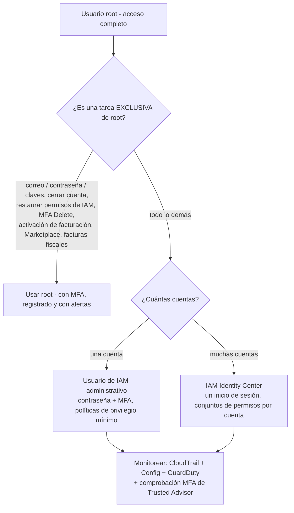
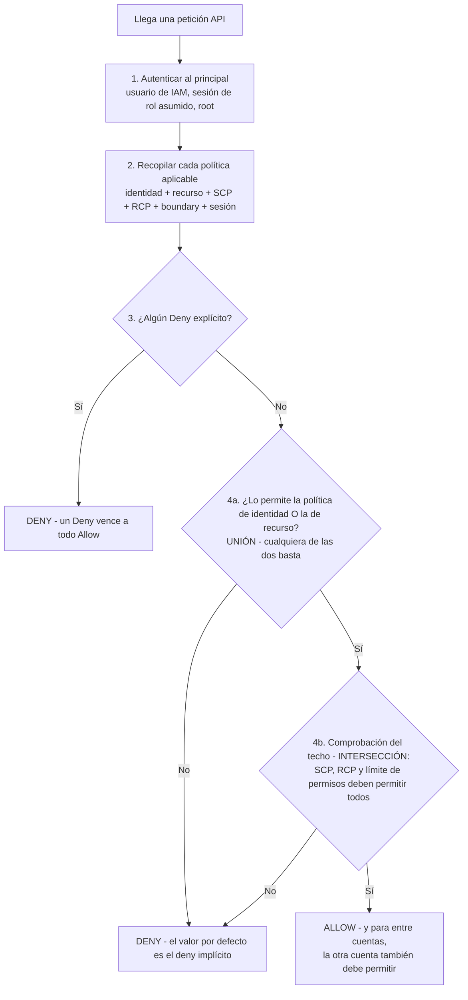
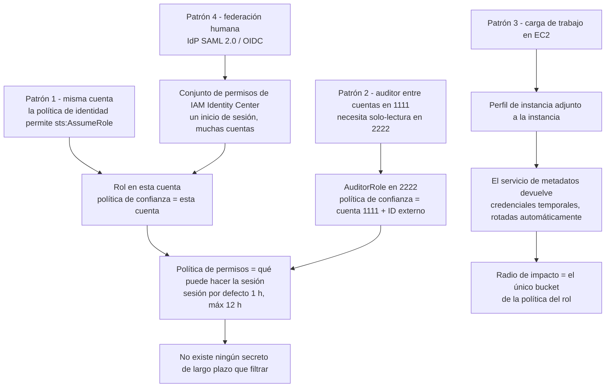
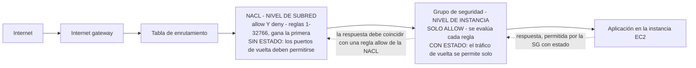
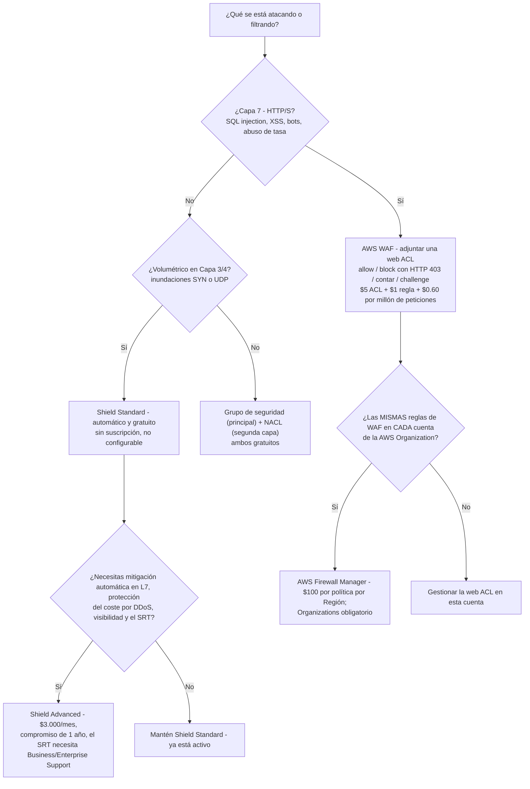
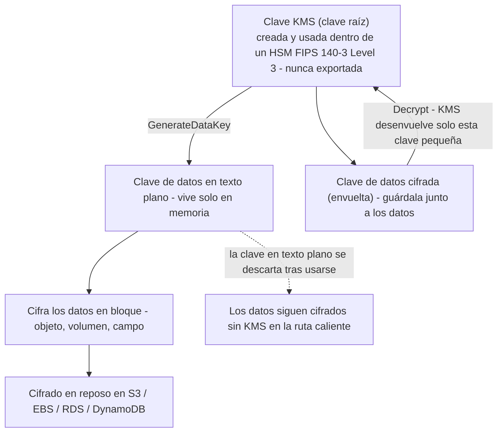

# Identidad, control de acceso y protección de datos

La seguridad es el dominio individual más pesado del CLF-C02: **el Dominio 2 carga el 30% del contenido puntuado**, y sus dos tareas de acceso (2.3 "Identificar las capacidades de gestión de acceso de AWS" y 2.4 "Identificar componentes y recursos para la seguridad") son las más fiablemente evaluadas de todo el examen. El planteamiento de la propia AWS parte de una frase incómoda sobre el usuario root: este tiene *"acceso completo a todos los servicios y recursos de AWS"*. Todo lo demás de esta lección — MFA, roles, Identity Center, privilegio mínimo, grupos de seguridad, WAF, cifrado — existe para asegurar que esa frase nunca se convierta en un incidente.

```text
====================================================================
 CLF-C02 DOMINIO 2 — TARJETA DE LECCIÓN DE SEGURIDAD (en octubre de 2026)
====================================================================
 ROOT        1 identidad/cuenta · acceso completo · MFA dentro de
             35 días · hasta 8 dispositivos MFA · SIN claves de acceso ·
             contraseña de 8-128 caracteres, >= 3 de 4 clases
---------------------------------------------------------------------
 IAM         usuario = credenciales permanentes, de largo plazo (<= 2 claves)
             grupo = usuarios + 1 política de identidad, NO es un principal,
                     no se anida, no hay grupo por defecto
             rol   = política de permisos (qué) + política de confianza
                     (quién) -> credenciales temporales de STS
             política = basada en identidad (usuario/grupo/rol) O
                        basada en recurso (en el recurso mismo)
 EVALUACIÓN  cualquier Deny explícito gana -> identidad UNIÓN recurso
             -> techo: SCP + RCP + boundary deben permitir todos
             -> entre cuentas: AMBAS cuentas deben permitir
---------------------------------------------------------------------
 RED         grupo de seguridad = nivel de instancia, SOLO ALLOW,
                     con estado, todas las reglas evaluadas, por defecto
                     outbound allow-all / inbound desde sí mismo
             NACL              = nivel de subred, allow Y deny,
                     sin estado, reglas 1-32766 gana la primera,
                     por defecto allow-all + catch-all DENY con `*`
             ambos: sin costo (en octubre de 2026)
---------------------------------------------------------------------
 BORDE       WAF  = Capa 7 (SQLi, XSS), adjuntar una web ACL,
                    $5/web ACL + $1/regla + $0.60/millón de req
              Shield Standard = automático, $0, no configurable
              Shield Advanced = $3.000/mes, compromiso de 1 año
              Firewall Manager = empuje de políticas a toda la org (Organizations)
---------------------------------------------------------------------
 DATOS       en reposo = KMS / SSE-S3 (predeterminado desde 2023-01-05)
             en tránsito = TLS 1.2 requerido, 1.3 recomendado
             cifrado de sobre: la clave KMS envuelve la clave de datos,
             la clave de datos cifra los datos en bloque
====================================================================
```

> [!NOTE]
> **Disciplina de alcance.** Cada servicio nombrado como evaluable en esta lección aparece en la **lista en alcance** del CLF-C02 o en una enunciación de tarea del Dominio 2/3 (AWS Artifact, ACM, CloudHSM, Cognito, Detective, Directory Service, Firewall Manager, GuardDuty, IAM, IAM Identity Center, Inspector, KMS, Macie, RAM, Secrets Manager, Security Hub, Shield, WAF, más CloudTrail, Config, CloudWatch, Trusted Advisor, Systems Manager de los enunciados de tareas). Cualquier otra cosa se etiqueta como paréntesis de caso de estudio o como distractor fuera de alcance, nunca como un hecho que debas seleccionar.

En esta lección vas a:

- proteger el **usuario root** — límites de dispositivos MFA, la regla de 35 días, sin claves de acceso de root y las tareas que solo root puede hacer;
- construir IAM a partir de sus cuatro objetos: **usuarios, grupos, roles y políticas**;
- separar **políticas basadas en identidad de las basadas en recurso** y ejecutar la lógica de evaluación: deny explícito, unión, techos, entre cuentas;
- elegir **roles frente a usuarios** desde el enunciado de la pregunta — entre cuentas, perfiles de instancia EC2, federación, ID externo;
- situar correctamente **IAM Identity Center (SSO de la plantilla)**, **Cognito (identidad del cliente)** y **Directory Service (AD empresarial)**;
- elegir una **opción de autenticación**: passkeys/FIDO, TOTP virtual, TOTP de hardware, claves de acceso, credenciales temporales de STS;
- comparar **grupos de seguridad y NACL** en alcance, reglas, estado y valores por defecto;
- decidir entre **AWS WAF, Shield Standard, Shield Advanced y Firewall Manager** — con aritmética real de factura;
- proteger los datos **en reposo y en tránsito** y seguir el **cifrado de sobre de KMS** y los tres tipos de clave;
- describir en una línea cada **servicio de detección** en alcance y ejecutar una **lista de verificación de privilegio mínimo**;
- estudiar **cuatro casos de estudio de seguridad y cumplimiento publicados por AWS** — política de red centralizada, acceso basado en identidad, controles FedRAMP heredados y autorización más rápida;
- seguir las **actualizaciones de guía y herramientas de 2026** que tocan IAM, el alcance de las políticas y las herramientas de seguridad — cada punto con fuente y fecha;
- practicar con **12 preguntas estilo examen** más cuatro comprobaciones interactivas.

---

## 1. La cuenta root: una identidad, alcance ilimitado

### 1.1 Qué es root

Hay exactamente **una identidad root por cuenta de AWS** — una dirección de correo más una contraseña — y AWS documenta que tiene *"acceso completo a todos los servicios y recursos de AWS"*, incluida la facturación. No se puede eliminar, no se puede limitar con una política de IAM dentro de su propia cuenta, y omite las comprobaciones sin MFA en cuanto se usa. Por eso la tarea 2.3 del Dominio 2 lista la *"importancia de proteger la cuenta del usuario raíz de AWS"* como **conocimiento** e *"identificar las tareas que solo el usuario raíz de la cuenta puede realizar"* como **habilidad**: el examen quiere que sepas tanto *por qué* importa root como *qué* tareas lo requieren de verdad.

| Propiedad de root | Qué documenta AWS | Consecuencia en el examen |
|---|---|---|
| Recuento | Una identidad root por cuenta | "Crear un segundo usuario root" es siempre incorrecto |
| Alcance | *"acceso completo a todos los servicios y recursos de AWS"* | Ninguna política puede adjuntarse para limitarlo dentro de su cuenta |
| Credenciales | Contraseña (8–128 caracteres, ≥3 de 4 clases de caracteres, no debe coincidir con el nombre/correo de la cuenta) | Las **claves de acceso de root nunca se recomiendan** |
| MFA | Registrarse **dentro de los 35 días** del primer inicio de sesión; **hasta 8 dispositivos MFA**, cualquier mezcla | El MFA por SMS ya no se ofrece en IAM |
| Uso diario | Debe usarse solo para tareas exclusivas de root | El trabajo administrativo corresponde a un usuario de IAM o a Identity Center |

### 1.2 Tareas que solo el usuario root puede realizar

La lista es corta, memorable y evaluable — estas son las respuestas a "¿qué acción requiere el usuario root?":

- cambiar el **correo, la contraseña o las claves de acceso** de la propia identidad root (cuentas independientes);
- **cerrar o reabrir** una cuenta independiente;
- **restaurar los permisos de un usuario de IAM** — la recuperación del bloqueo del último administrador;
- activar **el acceso de IAM a la consola de facturación**;
- ver ciertas **facturas fiscales**;
- registrarse en el **EC2 Reserved Instances Marketplace**;
- habilitar **S3 MFA Delete**;
- editar o eliminar una **política de recurso de S3 o SQS que niega a todos los principales**;
- registro en GovCloud y claves de root; vincular una cuenta de **Amazon Mechanical Turk**.

Todo lo demás en el examen — crear usuarios de IAM, adjuntar políticas, arrancar EC2, escribir políticas de bucket, restablecer la contraseña de un colega — lo hace una **identidad administrativa**, nunca root.

### 1.3 Ejemplo E1 — endurecimiento de root el día 1, paso a paso

Se abre una cuenta de producción nueva. La secuencia de endurecimiento siguiente usa solo límites verificados:

| # | Acción | Número que recordar |
|---|---|---|
| 1 | Correo de root → un **alias de grupo** (`aws-root@company.com`), no un buzón personal | un buzón compartido, teléfono de recuperación separado |
| 2 | Contraseña de root fuerte | **8–128 caracteres**, ≥**3 de 4** clases |
| 3 | Registrar MFA: un **autenticador virtual en el teléfono** *y* un **token de hardware en la caja fuerte** | **2 de los 8 máximos** dispositivos; registro **dentro de 35 días** |
| 4 | **Sin claves de acceso de root** — nunca | 0 claves |
| 5 | La identidad administrativa vive en **IAM Identity Center** (multicuenta) o como usuario de IAM admin (cuenta única) | los humanos obtienen federación |
| 6 | Rastro de **CloudTrail** a un bucket privado con validación de archivos de registro; **Config** y **GuardDuty** activados | El historial de eventos es gratis durante **90 días** |
| 7 | Regla de EventBridge sobre inicio de sesión de root → SNS → canal de chat | detecta rápido el uso inusual de root |
| 8 | En AWS Organizations: quitar credenciales de root de cuentas miembro y/o adjuntar un **SCP** que niegue acciones de root en cuentas miembro | Los SCP filtran, nunca conceden |

- **📚 ¿Sabías que…?** La página de mejores prácticas de usuarios root de AWS recomienda la **aprobación multipersona** para root: un grupo guarda la contraseña de la cuenta, otro grupo distinto guarda el dispositivo MFA, de modo que ningún empleado individual pueda actuar como root en solitario. La misma página limita MFA a **ocho dispositivos por usuario root** y te dice que registres el MFA de root **dentro de los 35 días** del primer inicio de sesión — dos números que al examen le gusta devolverte (en octubre de 2026; verifica el estado vigente antes de usarlos).



> [!WARNING]
> **Familia de trampas de root.** Si una opción describe una tarea administrativa ordinaria — "crear un usuario de IAM", "adjuntar una política", "detener una instancia EC2", "cambiar una política de bucket" — y la justificación es "para que root pueda hacerlo", es incorrecta: esas tareas nunca requieren root. Las respuestas correctas de root son la lista corta de la §1.2, y *habilitar MFA Delete* es la que atrapa a más candidatos.

---

## 2. Piezas de IAM: usuarios, grupos, roles y políticas

### 2.1 Los cuatro objetos, exactamente

| Objeto | Qué es | Credenciales / mecánica | Trampas de examen |
|---|---|---|---|
| **Usuario de IAM** | Una **identidad permanente** dentro de una cuenta | A largo plazo: contraseña de consola + MFA; **máximo dos claves de acceso por usuario**; la clave secreta se muestra una vez | Credenciales de larga duración = rotar y retirar; no es la respuesta por defecto para cargas de trabajo |
| **Grupo de IAM** | Una colección de usuarios que comparte **una política de identidad** | No tiene credenciales propias | **No puede ser un `Principal`**, no puede anidarse, **no hay grupo de usuarios por defecto** |
| **Rol de IAM** | Un conjunto de permisos más una **política de confianza** que define quién puede asumirlo | Asumirlo produce **credenciales de seguridad temporales de STS** | *"Los roles son la forma principal de conceder acceso entre cuentas"* |
| **Política de permisos** | El documento que dice **qué** se permite o se niega | JSON, adjunta a un principal (basada en identidad) o a un recurso (basada en recurso) | Un `Deny` explícito vence a todo `Allow` |

Un rol tiene **dos mitades y ambas son obligatorias**: la **política de permisos** responde *qué puede hacer la sesión*, y la **política de confianza** (una política basada en recurso adjunta al rol) responde *quién puede asumirlo*. Una política de permisos perfectamente escrita con una política de confianza que no nombra a nadie es inútil — es una puerta cerrada con un cartel que dice "solo empleados" y sin empleados listados en él.

### 2.2 Políticas basadas en identidad frente a basadas en recurso

| | **Política basada en identidad** | **Política basada en recurso** |
|---|---|---|
| Se adjunta a | Usuario, grupo o rol | El recurso mismo (bucket de S3, cola de SQS, tema de SNS, clave KMS, endpoint de VPC, confianza de rol) |
| Formato | Puede ser gestionada por AWS, gestionada por el cliente o en línea | **Solo en línea** |
| ¿Nombra un principal? | Implícito — el principal al que está adjunta | Puede nombrar un principal en **otra cuenta de AWS** |
| Papel típico en el examen | "Dale a este equipo acceso de lectura a `reports/*`" / "Permite que esta cuenta 1111 lea este bucket" / "Niega peticiones que no sean HTTPS" | |

Las políticas **gestionadas por AWS** son puntos de partida amplios mantenidos por AWS (funciones de trabajo como administración de solo lectura). Las políticas **gestionadas por el cliente** son las que escribes y refinas — el estado final de privilegio mínimo. Las políticas **en línea** están incrustadas en un principal y se eliminan con él, lo que las útiles para permisos puntuales y peligrosas como valor por defecto.

### 2.3 Cómo evalúa AWS una petición: gana el deny explícito

El orden documentado de AWS, comprimido a los cuatro movimientos que aparecen en el examen:

1. **Autenticar** al invocador (¿quién es este?).
2. **Recopilar** cada política aplicable — basada en identidad *y* basada en recurso, más SCPs, RCPs, límites de permisos y políticas de sesión.
3. **Cualquier `Deny` explícito en cualquier lugar gana.** AWS *"primero comprueba todas las políticas en busca de un `Deny`"* — un solo deny, en cualquier documento aplicable, vence a todo allow.
4. En caso contrario, calcula la **unión** de los allows basados en identidad y en recurso, y luego lo interseca con el **techo**: los límites de permisos, los SCPs y los RCPs deben permitir *todos* (una **intersección**). **Los SCPs no conceden nada** — solo filtran lo que una identidad dentro de la cuenta podría hacer de otro modo.



> [!NOTE]
> **Unión frente a intersección es la frase de mayor rendimiento del Dominio 2.** Identidad ∪ recurso = **unión** (cualquier documento puede permitir). Boundary / SCP / RCP = **intersección** (todos deben permitir; solo pueden estrechar). Y la afirmación *"adjuntar un SCP para conceder acceso"* es siempre incorrecta: las políticas de control de servicios *filtran*, nunca *dan*.

### 2.4 Ejemplo E2 — permisos efectivos de John (tres capas)

La política de identidad de John permite `s3:Get*` en `reports/*`. La política del bucket `reports` dice **Deny `s3:*` cuando `aws:SecureTransport` es false**. El SCP de la cuenta dice **Deny `s3:*` fuera de la Región base**.

| Petición | Capas en juego | Resultado | Por qué |
|---|---|---|---|
| (a) GET por HTTPS, Región base | 1 allow, 0 denies aplicables | **Permitido** | Identidad ∪ recurso = unión de allows; ningún deny coincidió |
| (b) GET por HTTP plano, Región base | 1 allow, 1 deny de recurso | **Denegado** | El `Deny` explícito del recurso vence al `Allow` de la identidad |
| (c) GET por HTTPS, otra Región | 1 allow, 1 deny de SCP | **Denegado** | El techo del SCP interseca — solo puede restar, nunca sumar |

Cuenta las capas: **un allow, dos denies, tres tipos de política** — y lee la dirección de cada petición antes de elegir. Observa qué pasaría si se quitara la política de identidad: (a) se convierte en un deny implícito, de modo que quitar un privilegio es una mitigación real, no una formalidad.

### 2.5 Límites de permisos y las herramientas de privilegio mínimo

Un **límite de permisos (permissions boundary)** es una política gestionada que fija el **máximo** que una política de identidad puede conceder. Por sí mismo no concede nada — su caso de uso en el examen es la **delegación segura**: dejar que un desarrollador escriba su propia política de identidad, pero acotarla con un límite para que nunca pueda exceder, digamos, solo-lectura más un bucket de sandbox. El conjunto de herramientas de estrechamiento para el privilegio mínimo es:

- partir de una **política de función de trabajo gestionada por AWS**;
- refinar con **IAM Access Analyzer** (genera políticas a partir de la actividad de CloudTrail, valida acceso externo/público, previsualiza exposición entre cuentas);
- comprobar la **información de último acceso** para borrar permisos que nadie usa.

- **📚 ¿Sabías que…?** Un **grupo no puede usarse como `Principal`** en ninguna política de AWS — adjuntas una política *a* un grupo, pero nunca puedes *permitir a un grupo* en una política de bucket o de confianza de rol; debes nombrar a sus usuarios o, mejor, a un rol. Los grupos tampoco pueden anidarse, y en IAM **no existe un grupo de usuarios por defecto** (en octubre de 2026).

```matching
{
  "question": "Relaciona cada documento de política con la única función que desempeña en la lógica de evaluación de AWS:",
  "pairs": [
    {"left": "Política basada en identidad en un usuario, grupo o rol", "right": "Concede acciones al principal al que está adjunta - una mitad de la UNIÓN con las políticas basadas en recurso"},
    {"left": "Política basada en recurso en un bucket S3, cola o tema", "right": "Vive en el propio recurso, es solo en línea y puede nombrar un principal en otra cuenta de AWS"},
    {"left": "Política de confianza en un rol de IAM", "right": "Documento basado en recurso que responde QUIÉN puede asumir el rol; por sí solo no concede acciones"},
    {"left": "Límite de permisos", "right": "Política gestionada que fija el MÁXIMO que una política de identidad puede conceder - un techo dentro de la INTERSECCIÓN"},
    {"left": "Política de control de servicios (SCP)", "right": "Se adjunta a UOs o cuentas en AWS Organizations; filtra lo que una identidad podría hacer y nunca concede"},
    {"left": "Deny en la política del bucket cuando aws:SecureTransport es false", "right": "Un Deny explícito que vence a todo Allow, así que el HTTP plano falla aunque una política de identidad permita"}
  ],
  "explanation": "Lee la dirección de cada documento. Las políticas basadas en identidad y en recurso forman una UNIÓN - cualquiera de las dos puede permitir. Los límites de permisos, los SCPs y los RCPs forman un techo de INTERSECCIÓN que solo puede restar. Una política de confianza es basada en recurso pero solo autoriza la asunción, y un único Deny explícito - como una condición aws:SecureTransport - termina la evaluación en un deny sin importar cuántos Allow existan."
}
```

---

## 3. Roles frente a usuarios: la decisión que el examen repite

### 3.1 La tabla de casos de uso

| Usa un **rol** cuando… | El mecanismo | Usa un **usuario de IAM** solo cuando… |
|---|---|---|
| Una carga de trabajo se ejecuta en **EC2 / Lambda / ECS / EKS** | **Perfil de instancia** (EC2) o **rol de ejecución**; las credenciales vienen del servicio de metadatos de la instancia y **se auto-actualizan** | La carga de trabajo genuinamente no puede asumir roles (algunos plugins de terceros) |
| **Acceso entre cuentas** | Rol en la cuenta de confianza; la política de identidad del invocador concede `sts:AssumeRole` | Una cuenta heredada o de emergencia con MFA y controles estrictos |
| **Federación** de usuarios humanos | IdP SAML 2.0 / OIDC o **conjuntos de permisos de IAM Identity Center** | Herramientas AWS de terceros sin soporte de Identity Center |
| Un **auditor externo** necesita acceso | Rol + **ID externo** en la política de confianza (defensa contra el agente confundido) | Credenciales de larga duración específicas del servicio (desaconsejadas) |
| Un **servicio actúa en tu nombre** | Rol de servicio o **rol vinculado al servicio** | — |
| "…sin **credenciales de largo plazo**" en ninguna parte | Credenciales temporales de STS | Una clave CLI de larga duración en un portátil (permitido, no preferido) |

Aritmética de sesiones que vale la pena memorizar: las sesiones de `AssumeRole` duran hasta **43.200 segundos = 12 horas**, mientras que el **encadenamiento de roles** (asumir un segundo rol desde un primero) está limitado a **1 hora** — una diferencia de 12×. Durante una sesión, los permisos del rol **sustituyen** a los del invocador durante ese tiempo.



### 3.2 Ejemplo E3 — el rol de auditoría entre cuentas

Un auditor en la **cuenta 1111** necesita acceso de solo lectura a la **cuenta 2222**. Dos documentos, ambos obligatorios:

| Cuenta | Documento | Contenido |
|---|---|---|
| 2222 (de confianza) | **Política de confianza de `AuditorRole`** (basada en recurso) | Permite `sts:AssumeRole` para la cuenta **1111**, con un **ID externo** porque interviene un tercero |
| 2222 | Política de permisos del rol | Permisos estilo `ReadOnlyAccess` |
| 1111 (invocadora) | Política de identidad en el grupo del auditor | Permite `sts:AssumeRole` sobre ese **ARN** de rol |

**Cualquiera de las dos políticas por sí sola falla**: confianza sin concesión de identidad da "no estás autorizado"; concesión de identidad sin confianza da "no estás autorizado para realizar sts:AssumeRole". La sesión es **temporal** (1 hora por defecto, hasta 12 horas) — nada que filtrar, nada que rotar, y el acceso desaparece cuando se revoca la confianza del rol.

### 3.3 Ejemplo E4 — el perfil de instancia EC2, cero claves embarcadas

Una aplicación en EC2 debe leer `s3://photos`. En lugar de copiar una clave de acceso en la AMI:

1. Crea el rol `Get-pics` cuya **política de confianza** permite al servicio `ec2.amazonaws.com`.
2. Adjunta una política de permisos que permita **`s3:GetObject` solo en ese bucket**.
3. Adjunta el rol a la instancia mediante un **perfil de instancia**.
4. El SDK lee credenciales temporales del servicio de metadatos de la instancia y **las actualiza antes de que caduquen** — el desarrollador nunca ve un secreto.

Si la instancia se ve comprometida, el atacante hereda exactamente un permiso en exactamente un bucket: el **radio de impacto es el documento de política**, no la cuenta de AWS de la empresa. Contrasta con la respuesta del usuario de IAM: una clave de acceso horneada en una AMI es una credencial sin caducidad, sin frontera de alcance más allá de su política, y un hábito que el examen marca como incorrecto.

- **📚 ¿Sabías que…?** El encadenamiento de roles merece su propio mnemotécnico: **12 horas para un `AssumeRole` simple, 1 hora para uno encadenado** (43.200 s frente a 3.600 s, en octubre de 2026). AWS limita el encadenamiento precisamente porque cada salto multiplica la probabilidad de que una sesión obsoleta sobreviva a la persona que la inició.

---

## 4. IAM Identity Center: la respuesta para la plantilla

**AWS Single Sign-On se renombró AWS IAM Identity Center** el **26 de julio de 2022**, y el examen todavía te premia por conocer ambos nombres. Identity Center es el inicio de sesión único **de la plantilla** de AWS: los empleados obtienen **un inicio de sesión** que abre muchas cuentas de AWS y aplicaciones de AWS, con permisos entregados mediante **conjuntos de permisos** — el paquete con nombre de permisos de AWS aplicado a un usuario o grupo, sin claves de largo plazo.

| Atributo | Detalle (profundidad de examen) |
|---|---|
| Para quién es | **Plantilla** — empleados y contratistas, no los clientes de tu aplicación |
| Fuente de identidad | Directorio integrado o un proveedor de identidad externo **SAML 2.0 / OIDC** |
| Modelo de concesión | **Conjuntos de permisos** aplicados a usuarios o grupos; el acceso está ligado a la sesión y no emite claves de largo plazo |
| Alcance | Se recomienda una **instancia de organización** para que todas las cuentas compartan un directorio |
| Relación con IAM | Identity Center *usa* roles de IAM por debajo; no sustituye a IAM en sí |

El patrón a memorizar: **12 cuentas, un inicio de sesión, sin usuarios de IAM** → IAM Identity Center. La propia redacción de mejores prácticas de AWS es *"Exigir que los usuarios humanos usen federación"* y prefiere *"MFA resistente al phishing como passkeys y llaves de seguridad"* — Identity Center es la forma en que esa recomendación escala más allá de un puñado de cuentas.

> [!IMPORTANT]
> **Los tres servicios de identidad, nunca intercambiados:**
> - **IAM Identity Center** → tu **plantilla** (empleados) en todas las cuentas de AWS;
> - **Amazon Cognito** → los **clientes de tu aplicación** (registro e inicio de sesión en un sitio web o app móvil);
> - **AWS Directory Service** → un **Active Directory empresarial** (AWS Managed Microsoft AD, AD Connector como *"un servicio proxy"* o Simple AD).
> >
> Una pregunta sobre 700 empleados en 12 cuentas es Identity Center; una pregunta sobre compradores que crean una cuenta en tu app es Cognito; una pregunta sobre usuarios de AD on-premises que llegan a EC2 es Directory Service.

---

## 5. Amazon Cognito: identidad del cliente a profundidad de examen

Cognito es la opción de **identidad del cliente (CIAM)**, y AWS la describe como tres cosas en un servicio: *"un directorio de usuarios, un servidor de autenticación y un servicio de autorización"*. Está a una altitud distinta de IAM — los usuarios de tu aplicación no son usuarios de IAM y nunca ven la consola de AWS.

| Componente | Qué hace | Qué devuelve |
|---|---|---|
| **User pool** | El **directorio de usuarios + autenticación**: registro e inicio de sesión, federación a IdP sociales/empresariales, políticas de contraseña, **MFA TOTP o SMS** | **Tokens JWT** a tu aplicación |
| **Identity pool** | **Autorización** — intercambia un token válido (de un user pool u otro IdP) por acceso a AWS | **Credenciales temporales de AWS de privilegio limitado** vía STS |
| Ambos juntos | La app autentica al cliente *y* luego toca S3/DynamoDB/Lambda directamente | Directorio → token → credenciales de STS |

La profundidad de examen se detiene exactamente ahí: sabe que los **user pool autentican**, que los **identity pool autorizan el acceso a AWS**, que las credenciales de AWS son **temporales**, y que Cognito es para *clientes* mientras IAM Identity Center es para la *plantilla*. Los temas más profundos (personalización de la UI alojada, triggers de lambda, funciones de seguridad avanzadas) no es lo que pregunta una cuestión de practitioner.

```fillblank
{
  "question": "Completa el vocabulario de identidad para CLF-C02:",
  "template": "Los empleados de 12 cuentas de AWS inician sesión una sola vez a través de {{1}}, que entrega el acceso mediante {{2}} aplicados a sus usuarios y grupos, sin claves de largo plazo. Los compradores de una aplicación usan {{3}}, cuyo {{4}} guarda el directorio y emite JWT, mientras que su {{5}} intercambia un token por credenciales temporales de AWS de STS.",
  "answers": {
    "1": "AWS IAM Identity Center",
    "2": "conjuntos de permisos",
    "3": "Amazon Cognito",
    "4": "user pool",
    "5": "identity pool"
  },
  "distractors": ["AWS Directory Service", "AWS CloudHSM", "grupo de seguridad", "política de confianza", "Amazon Inspector", "política basada en recurso"],
  "explanation": "IAM Identity Center es la respuesta de SSO para la plantilla - a AWS Single Sign-On se lo renombró así el 2022-07-26 - y los conjuntos de permisos son su modelo de concesión - paquetes de permisos con nombre aplicados a usuarios y grupos, emitidos sin claves de largo plazo. Cognito es identidad de cliente: el user pool es el directorio más la autenticación (JWT), y el identity pool devuelve credenciales temporales de AWS de privilegio limitado desde STS. Directory Service es Active Directory empresarial, no identidad de cliente."
}
```

---

## 6. Opciones de autenticación y MFA

### 6.1 Las cinco formas de demostrar quién eres

| Opción | Vida de la credencial | Uso típico | Límites (en octubre de 2026) |
|---|---|---|---|
| **Contraseña de consola + MFA** | Contraseña de largo plazo | Inicio de sesión humano en la consola | **Passkeys / llaves de seguridad FIDO** (resistentes al phishing, recomendadas), **autenticador virtual (TOTP)**, **TOTP de hardware**; **hasta 8 dispositivos MFA**; **el soporte de MFA por SMS terminó** |
| **Claves de acceso** | Largo plazo | CLI, SDK, API desde una estación de trabajo | **Máximo dos claves de acceso por usuario**; la clave secreta se muestra **una vez**; nunca la subas al control de versiones |
| **Credenciales temporales de STS** | Minutos hasta 12 horas | Roles, perfiles de instancias, roles de ejecución de Lambda, identity pools de Cognito, IAM Roles Anywhere | Patrón preferido — caduca por sí mismo |
| **IAM Identity Center** | Ligado a la sesión, federado | Plantilla en todas las cuentas | Un inicio de sesión, conjuntos de permisos, sin claves de largo plazo |
| **Directory Service** | Directorio empresarial | Identidades de AD on-premises que llegan a AWS | AWS Managed Microsoft AD, AD Connector (proxy), Simple AD |

La redacción de mejores prácticas de AWS que debes reconocer: *"Exigir que los usuarios humanos usen federación"* y usar *"MFA resistente al phishing como passkeys y llaves de seguridad"*. La opción trampa recomienda **MFA por SMS** — AWS terminó el soporte para habilitar la autenticación multifactor por SMS en IAM, así que cualquier respuesta que diga "habilitar MFA por SMS en el usuario root" es incorrecta.

> ⚠️ **Dos números de credenciales, dos trampas.** Primero, **el MFA por SMS no es una opción de IAM**: los factores admitidos son passkeys/llaves de seguridad FIDO (resistentes al phishing y recomendados), autenticador virtual (TOTP) y TOTP de hardware — así que "asegurar al usuario root con un código SMS" es siempre incorrecto, aunque un **user pool de Cognito** pueda seguir enviando códigos SMS a los usuarios de *tu aplicación*. Segundo, **dos es el techo de claves de acceso por usuario de IAM** y **cero** es la recomendación para root; un "arreglo" que acuña una tercera clave, o una clave de acceso de root "solo para este script", responde a la pregunta equivocada.

### 6.2 Dónde viven los secretos

La tarea 2.3 nombra explícitamente el almacenamiento de credenciales: **AWS Secrets Manager** y **AWS Systems Manager Parameter Store (SecureString)**. Las claves codificadas en duro en un repositorio, en una AMI o en variables de entorno de una Lambda pública son el anti-patrón que el examen evalúa por inversión — la respuesta correcta siempre recupera un secreto en tiempo de ejecución desde uno de esos dos servicios, o evita el secreto por completo usando un rol.

### 6.3 Ejemplo E5 — contar las credenciales en una cuenta

Una configuración de cuenta única tiene: root (0 claves de acceso), 6 usuarios de IAM con 2 claves de acceso cada uno, 10 roles, 3 conjuntos de permisos en Identity Center.

| Identidad | Secretos de largo plazo | Credenciales temporales |
|---|---|---|
| Root | **0** (la política los prohíbe) | — |
| 6 usuarios de IAM | **12** pares de claves de acceso en el techo (6 × 2) | Sesiones de consola con MFA |
| 10 roles | 0 | Hasta **12 horas** por sesión de `AssumeRole` (1 hora si se encadena) |
| 3 conjuntos de permisos | 0 | Acceso ligado a la sesión en cada cuenta |

La pregunta de auditoría se escribe sola: **existen 12 secretos de largo plazo y solo 2 personas los necesitan.** La remediación no es "añadir MFA" — es sustituir a los usuarios por **grupos y roles de Identity Center**, borrar las claves sin uso y mantener los pares restantes en un calendario de rotación.

- **📚 ¿Sabías que…?** El techo de **dos claves de acceso por usuario** es deliberado: tener la clave uno mientras la clave dos sigue viva te permite rotar sin tiempo de inactividad (actualiza la aplicación y luego borra la clave antigua). AWS muestra la clave secreta **exactamente una vez** — después, la única recuperación es crear un par de claves nuevo, y por eso "ver de nuevo la clave secreta antigua" nunca es una opción válida.

---

## 7. Grupos de seguridad frente a NACL

Ambos son los filtros de paquetes de la VPC, ambos son **gratuitos** (en octubre de 2026), y difieren en cuatro ejes que el examen evalúa sin descanso.

| Característica | **Grupo de seguridad** | **NACL** |
|---|---|---|
| Alcance | **Nivel de instancia / interfaz de red** | **Nivel de subred** (una NACL por defecto por subred) |
| Acción de la regla | **Solo allow — sin reglas de denegación** | **Allow y deny** |
| Evaluación | **Se evalúan todas las reglas**; allow si alguna coincide | Reglas numeradas **1–32766**, **primero la más baja, la primera coincidencia detiene** |
| Estado | **Con estado** — el tráfico de vuelta se permite automáticamente | **Sin estado** — el tráfico de vuelta debe permitirse explícitamente |
| Por defecto | Inbound **solo desde sí mismo**; **outbound allow todo** | **Allow a todo el tráfico entrante y saliente** más catch-alls DENY con `*` |
| Referencias | Puede referenciar **otros grupos de seguridad** | No puede referenciar grupos de seguridad |
| Coste | Ninguno | Ninguno |
| Orientación de AWS | *"Usa grupos de seguridad como mecanismo principal"* | Segunda capa de defensa en profundidad / lista de denegación |

Dos consecuencias se derivan directamente de la columna de estado: con un grupo de seguridad **con estado** abres 443 de entrada y las respuestas fluyen de vuelta automáticamente; con una NACL **sin estado** debes permitir **también** los puertos de vuelta efímeros de entrada, o la conexión nunca se completa. Y ninguno de los dos dispositivos filtra **DNS, DHCP, el servicio de metadatos de la instancia, los metadatos de tareas de ECS ni Time Sync** — esos los bypasean por diseño.

### 7.1 Los valores por defecto no son "seguros"

- El **grupo de seguridad por defecto** permite todo el tráfico saliente y el entrante **solo desde sí mismo** — usable, no seguro.
- La **NACL por defecto** permite **todo** el tráfico de entrada y salida, más reglas DENY con `*` que siempre están al fondo de la lista — permisiva por defecto, con el catch-all de denegación disponible para un bloqueo rápido.

Ninguno de los dos valores por defecto responde a "cómo restringo esto", y *"añadir una regla de deny al grupo de seguridad"* es siempre incorrecto: **los grupos de seguridad no tienen reglas de denegación** — usa una NACL, o niega en la capa de IAM/política de bucket.

### 7.2 Ejemplo E6 — defensa de red en capas

Una aplicación de tres capas orientada a Internet, montada a partir de comportamiento verificado:

| Capa | Dispositivo | Regla | Por qué aquí |
|---|---|---|---|
| 1. Internet → ALB | **Grupo de seguridad** en el ALB | Allow **443 desde 0.0.0.0/0** únicamente | Nivel de instancia, con estado, mecanismo principal |
| 2. ALB → capa de app | **Grupo de seguridad** en las instancias de app | Allow 8080 **desde el grupo de seguridad del ALB** (referencia de SG) | Las capas se confían entre sí, no al mundo |
| 3. App → base de datos | **Grupo de seguridad** en RDS | Allow 5432 **solo desde el grupo de seguridad de la app** | Nunca abras la base de datos a una subred |
| 4. Borde de subred pública | **NACL** | **Deny** a un CIDR conocido como malo, regla numerada **100** (sin estado, gana la primera coincidencia) | Denegación instantánea en toda la subred sin tocar instancias |
| 5. Capa HTTP | **Web ACL de AWS WAF** en el ALB | AWS Managed Rules (SQLi, XSS, entradas maliciosas) + regla basada en tasa | Inspección en la Capa 7 que una NACL no puede hacer |
| 6. DDoS volumétrico | **Shield Standard** | Ya activo, sin suscripción | Automático en L3/L4 |
| 7. Escala de organización | **AWS Firewall Manager** | Empuja la política WAF a cada OU | Las cuentas nuevas la heredan |

El modelo mental: **NACL = el portero de la subred con una lista negra; grupo de seguridad = el firewall de la instancia con solo una lista de invitados; WAF = el inspector de la capa de aplicación; Shield = el paraguas anti-DDoS.**



- **📚 ¿Sabías que…?** Las reglas de grupo de seguridad pueden **referenciar otros grupos de seguridad**, y así funciona el patrón por capas de arriba sin codificar bloques CIDR — y por eso mover una capa de aplicación a una subred nueva **no requiere editar ninguna regla**. Las NACL, en cambio, están ligadas a la subred y basadas en IP por naturaleza (en octubre de 2026; aplican cuotas por VPC y por SG — verifica el estado vigente antes de usarlas).

---

## 8. AWS WAF, AWS Shield y AWS Firewall Manager

Tres servicios, tres altitudes. Confundirlos cuesta varias preguntas, porque cada uno tiene una identidad de una frase:

| | **AWS WAF** | **AWS Shield Standard** | **AWS Shield Advanced** | **AWS Firewall Manager** |
|---|---|---|---|---|
| Capa | **7** — peticiones HTTP/S | **3/4** volumétrico (más mitigación en L7 en Advanced) | **3/4 + mitigación automática en L7** | Administración de políticas, no filtrado de paquetes |
| Qué detiene | *"SQL injection o XSS"*, bots, abuso de tasa | *"inundaciones SYN o UDP"* automáticamente | Lo mismo, más ataques avanzados | — (**gestiona** a los demás) |
| Activación | **Adjuntar una web ACL** a CloudFront, ALB, API Gateway, AppSync, Cognito, App Runner, Amplify | **Automático, sin suscripción** | De pago, **compromiso de 1 año** | Requiere **AWS Organizations** |
| Coste (en octubre de 2026) | **$5 por web ACL/mes** + **$1 por regla/mes** + **$0.60 por millón de peticiones** | **$0** — *"se proporciona automáticamente y sin coste adicional"* | **$3.000/mes por pagador** + cargos de transferencia de salida de datos por DDoS | **$100 por política por Región por mes** |
| Firma | Acciones: allow / **block (HTTP 403)** / contar / challenge | No configurable | **Shield Response Team** (requiere **Business o Enterprise Support**) | Política central, panel de cumplimiento, cubre automáticamente recursos nuevos |

La capacidad de WAF se mide en **Web ACL Capacity Units (WCUs)**; las reglas pueden ser personalizadas, **AWS Managed Rules** o grupos de reglas de Marketplace, más conjuntos de IP/regex y reglas basadas en tasa. Shield Advanced también incluye **hasta 50.000 millones de peticiones WAF al mes** por ID de pagador y **protección del coste por DDoS** (reembolso de cargos de escalado causados por un ataque).

### 8.1 Ejemplo E7 — la factura de WAF

AWS publica su propio ejemplo resuelto, y la aritmética se generaliza:

| Configuración | Cálculo mensual | Total |
|---|---|---|
| 1 web ACL + 5 reglas + 10 M de peticiones | $5 + (5 × $1) + (10 × $0.60) | **$16.00** |
| Caso publicado por AWS: 1 web ACL + 19 reglas + 10 M de peticiones | $5 + $19 + $6 | **$30.00** |
| 3 web ACLs + 24 reglas + 35 M de peticiones | $15 + $24 + $21 | **$60.00** |

Observa qué **no** aparece en la factura: los grupos de seguridad y las NACL son **gratuitos**, así que "añadir una regla de grupo de seguridad" es la respuesta de coste cuando la pregunta trata sobre filtrar tráfico que nunca llega a un conjunto de reglas HTTP.

### 8.2 Ejemplo E8 — aritmética de Shield Advanced

| Escenario | Cálculo (en octubre de 2026) | Total |
|---|---|---|
| Suscripción a Shield Advanced, sin ataque | $3.000 | **$3.000/mes**, compromiso de 1 año |
| + 1.000 GB de salida de datos DDoS vía **ELB/EC2/Global Accelerator** | $3.000 + (1.000 × $0.050) | **$3.050/mes** |
| + 1.000 GB de salida DDoS vía **CloudFront** | $3.000 + (1.000 × $0.025) | **$3.025/mes** |
| Una política de Firewall Manager, una Región | $100 (el ejemplo integral publicado por AWS con cargos de WAF y Config suma **$106.40**) | **≈$106.40/mes** |

La prueba de formulación es fiable: **"protección DDoS gratuita y automática"** → Shield Standard; **"detener la inyección SQL en este ALB"** → WAF; **"aplicar este conjunto de reglas a cada cuenta de la organización"** → Firewall Manager.



> [!WARNING]
> **Las tres trampas de WAF/Shield.** (1) *"Suscribirse a Shield Standard"* — imposible, es automático y gratuito. (2) *"Configurar reglas de Shield Standard"* — no es configurable; la configuración corresponde a WAF o a Shield Advanced. (3) *"Firewall Manager inspecciona paquetes"* — no lo hace; **empuja políticas** (WAF, Shield Advanced, grupos de seguridad, NACL, Network Firewall, DNS Firewall) a través de una **AWS Organization** y requiere que Organizations esté habilitado.

---

## 9. Protección de datos: en reposo, en tránsito y KMS

### 9.1 Las dos direcciones

| | **Cifrado en reposo** | **Cifrado en tránsito** |
|---|---|---|
| Protege frente a | Alguien que lee el medio — un disco robado, una instantánea copiada, una copia de seguridad filtrada | *"escucha silenciosa, manipulación de datos y ataques de intermediario"* |
| Mecanismo | Claves de **KMS** y cifrado del lado del servidor (SSE) | **TLS/SSL** — HTTPS, VPN, Direct Connect; condiciones `aws:SecureTransport` |
| Ejemplo por defecto de AWS | **SSE-S3 ha sido el nivel base de cifrado para cada bucket desde el 5 de enero de 2023** (AES-256, sin coste adicional) | Las API de AWS requieren **TLS 1.2** y recomiendan **TLS 1.3** |
| Redacción en el examen | "S3 cifra los datos automáticamente" = **en reposo** | Busca siempre HTTPS/TLS/VPN en la opción |

**Opciones de cifrado de S3** a profundidad de examen: **SSE-S3** (predeterminado, gratuito), **SSE-KMS** (cargos por petición, más una pista de auditoría por uso en CloudTrail), **DSSE-KMS** (doble capa), **SSE-C** (tú suministras la clave) y cifrado del lado del cliente. Haz cumplir el tránsito con una política de bucket o un SCP que niegue `aws:SecureTransport = false` — el deny de la §2.4, aplicado a la protección de datos.

### 9.2 KMS: claves y cifrado de sobre

AWS Key Management Service mantiene las claves dentro de **módulos de seguridad de hardware (HSM) validados FIPS 140-3 Security Level 3** — las claves se generan allí y **nunca salen de esa frontera sin cifrar**. Como llamar al HSM por cada byte sería absurdo, KMS usa el **cifrado de sobre**: *"cifrar la clave de datos bajo otra clave"*.



| Tipo de clave | Quién la posee | Coste (en octubre de 2026) | Control |
|---|---|---|---|
| **Gestionada por el cliente** | Tú, en tu cuenta | **Cuota mensual** (prorrateada por hora) **+ cuota por uso** | Política de clave, habilitar/deshabilitar, programar eliminación, rotación personalizada |
| **Gestionada por AWS** | Tú, en tu cuenta, alias `aws/<service>` (p. ej. `aws/ebs`) | **Sin cuota mensual**; solo cargos por uso | Política de clave fija, **rotación automática aproximadamente cada 365 días**, no editable ni eliminable |
| **Poseída por AWS** | La propia cuenta del servicio | Gratuita | No visible para ti, no auditable, no puede ser eliminada por ti |

Rotar la clave **nunca vuelve a cifrar tus datos en bloque** — la clave raíz solo re-envuelve la clave de datos, que es la razón práctica por la que existe el cifrado de sobre.

### 9.3 Ejemplo E9 — cifrado de sobre en un objeto de 1 GB

1. Tu aplicación llama a KMS `GenerateDataKey` con una clave gestionada por el cliente. KMS devuelve **una clave de datos en texto plano** y **la misma clave cifrada bajo la clave KMS**.
2. La aplicación cifra el **objeto de 1 GB** con la clave de datos en texto plano en memoria; la clave en texto plano se descarta.
3. La **clave de datos envuelta** se guarda junto al cifrado. KMS nunca ve el objeto; el HSM nunca exporta la clave raíz.
4. Para leer el objeto más tarde, la aplicación envía solo la **clave envuelta** de vuelta a KMS (`Decrypt`), recibe la clave en texto plano y descifra localmente.
5. Si mañana rotas la clave KMS, **solo cambia el envolvimiento del paso 4** — el objeto de 1 GB no se toca.

| Enfoque | Qué sostiene AWS | Qué administras tú | Pista en el examen |
|---|---|---|---|
| **KMS** | Flota de HSM gestionada y compartida; políticas de clave + IAM | Política de clave, rotación, auditoría de uso, precios por uso | *"Conveniente, integrado, paga por uso"* |
| **CloudHSM** | HSM dedicados **single-tenant**; *"el cifrado de extremo a extremo no es visible para AWS"* | Tú administras los usuarios del HSM (fuera de IAM) y los algoritmos | *"AWS no puede ver mis datos y yo controlo la criptografía"* |

- **📚 ¿Sabías que…?** Las claves KMS gestionadas por AWS ahora rotan **aproximadamente cada 365 días** — un cambio hecho en **mayo de 2022**, cuando el intervalo se acortó de tres años — y **no llevan cuota mensual de clave** (las cuotas por uso siguen aplicando, en octubre de 2026). La clave gestionada por el cliente es el único tipo que te da control de la política de clave, habilitar/deshabilitar, eliminación programada y rotación personalizada, y por eso "qué clave me da control total" casi siempre significa **gestionada por el cliente**, no "la que yo creé" frente a "la que creó AWS".

---

## 10. Detección de amenazas, auditoría y postura — líneas de una línea en alcance

La tarea 2.4 del Dominio 2 te pide describir funciones de seguridad e identificar *"servicios para identificar problemas de seguridad"*. Cada fila de abajo está en la lista en alcance del CLF-C02 o en un enunciado de tarea del Dominio 2 — nada más.

| Servicio | Una línea (qué es) | Entradas / detalle |
|---|---|---|
| **Amazon GuardDuty** | **Detección de amenazas** | Eventos de administración de AWS CloudTrail, **VPC Flow Logs** y **registros DNS** (+ planes de protección opcionales), inteligencia de amenazas y ML → hallazgos |
| **Amazon Inspector** | **Gestión de vulnerabilidades** — análisis continuo de **EC2, imágenes de ECR y Lambda** | CVEs y exposición de red |
| **Amazon Macie** | **Descubrimiento de datos sensibles en S3** mediante *"machine learning y reconocimiento de patrones"* | PII, credenciales, hallazgos de buckets públicos; **prueba gratuita de 30 días** en el primer habilitamiento |
| **Amazon Detective** | **Investigación** — *"analizar, investigar e identificar rápidamente la causa raíz"* | Grafo de comportamiento construido a partir de CloudTrail, VPC Flow Logs y hallazgos de GuardDuty |
| **AWS Security Hub** | **Agregador / CSPM** — consolida y prioriza hallazgos, comprueba frente a estándares | El panel único al que alimentan los demás servicios |
| **AWS Trusted Advisor** | **Comprobaciones de mejores prácticas** en seguridad, coste, límites y tolerancia a fallos | Incluye la comprobación **MFA en root** |
| **AWS CloudTrail** | **Registro de auditoría — quién hizo qué**; registra *"acciones realizadas por un usuario, un rol o un servicio de AWS"* | **Historial de eventos: últimos 90 días, gratis**; los rastros entregan en S3 |
| **AWS Config** | **Estado de configuración y cumplimiento a lo largo del tiempo** | "¿Sigue activo el MFA de root? ¿Hay claves de acceso de root?" |
| **AWS Artifact** | **Informes y acuerdos de cumplimiento bajo demanda** (SOC, PCI, ISO…) | La respuesta a "¿dónde obtengo el informe de auditoría?" |

**Mnemotécnico:** GuardDuty **detecta** · Inspector **analiza** · Macie **encuentra datos sensibles** · Detective **explica** · Security Hub **agrega** · Trusted Advisor **asesora** · CloudTrail **registra** · Config **recuerda** · Artifact **certifica**.

```matching
{
  "question": "Relaciona cada servicio de seguridad en alcance con su función en una frase:",
  "pairs": [
    {"left": "Amazon GuardDuty", "right": "Detección de amenazas - correlaciona eventos de administración de CloudTrail, VPC Flow Logs y registros DNS con inteligencia de amenazas"},
    {"left": "Amazon Inspector", "right": "Gestión de vulnerabilidades - analiza EC2, imágenes de contenedor de ECR y funciones Lambda en busca de CVEs y exposición de red"},
    {"left": "Amazon Macie", "right": "Descubrimiento de datos sensibles en S3 mediante machine learning y reconocimiento de patrones para PII y credenciales"},
    {"left": "Amazon Detective", "right": "Investigación - construye un grafo de comportamiento para que puedas hallar la causa raíz de un hallazgo"},
    {"left": "AWS Security Hub", "right": "Agregador - consolida, prioriza y comprueba hallazgos frente a estándares de seguridad"},
    {"left": "AWS CloudTrail", "right": "Registro de auditoría - registra acciones realizadas por un usuario, un rol o un servicio de AWS; 90 días de historial de eventos gratis"},
    {"left": "AWS Config", "right": "Cumplimiento de configuración a lo largo del tiempo - ¿estaba habilitado ayer el MFA de root y lo está hoy?"},
    {"left": "AWS Trusted Advisor", "right": "Comprobaciones de mejores prácticas en seguridad, coste y límites de servicio, incluido el MFA en el usuario root"}
  ],
  "explanation": "Los servicios de detección se distinguen por su verbo: detectar (GuardDuty), analizar (Inspector), descubrir datos (Macie), investigar (Detective), agregar (Security Hub), asesorar (Trusted Advisor), recordar (CloudTrail), recordar la configuración a lo largo del tiempo (Config). Los ocho están en alcance para el Dominio 2 del CLF-C02."
}
```

> [!IMPORTANT]
> **Trampa de nombres.** La redacción de la tarea 2.4 de la guía del examen incluye la frase *"AWS Security Center"*, pero el servicio de la **lista en alcance** es **AWS Security Hub**. Selecciona Security Hub para las preguntas de consolidación y postura; trata "Security Center" como prosa de la guía, no como un servicio a elegir. Del mismo modo, **AWS Network Firewall** aparece en material de casos de estudio pero está **fuera de alcance** para las preguntas de selección de servicios del CLF-C02 en la guía actual.

- **📚 ¿Sabías que…?** El **historial de eventos de CloudTrail es gratuito y automático durante los últimos 90 días** de eventos de administración en cada cuenta — no tienes que crear un rastro para responder "quién terminó mi instancia el mes pasado". Un **rastro** hacia un bucket S3 privado con **validación de archivos de registro** es la mejora que te da el registro completo y a prueba de manipulaciones que exige la lista de mejores prácticas (en octubre de 2026).

---

## 11. La lista de verificación de mejores prácticas de privilegio mínimo

### 11.1 Cinco grupos de hábitos

| # | Grupo | Lo que realmente haces |
|---|---|---|
| 1 | **Proteger root** | MFA (passkey/TOTP), **sin claves de acceso**, alias de correo de grupo, monitoreo (CloudTrail, alarmas, GuardDuty), quitar credenciales de root de las cuentas miembro, opcionalmente un **SCP** que niegue acciones de root en cuentas miembro |
| 2 | **Privilegio mínimo** | Estrechar de **gestionada por AWS → gestionada por el cliente**; usar **IAM Access Analyzer** e **información de último acceso**; humanos vía **federación + credenciales temporales** (Identity Center); cargas de trabajo vía **roles/perfiles de instancia**; **sin claves codificadas en duro** |
| 3 | **MFA e higiene de credenciales** | **MFA en todas partes**, resistente al phishing primero; rotar y retirar claves, usuarios, roles y políticas; guardar secretos en **Secrets Manager** o **SSM Parameter Store (SecureString)**; máx. **2 claves de acceso** por usuario, **0** para root |
| 4 | **Registro y detección** | **CloudTrail en todas las Regiones** a un bucket bloqueado con validación de archivos de registro; **Config** activo; **GuardDuty, Inspector, Macie** activos; revisión en **Security Hub**; comprobación MFA de **Trusted Advisor** en verde |
| 5 | **Defensa en profundidad** | Subredes privadas; **grupo de seguridad como principal**, NACL como segunda capa; nunca `0.0.0.0/0` en 22/3389; VPC Flow Logs; **WAF en L7**; Shield; **Firewall Manager** a escala de organización; **cifrado en reposo (KMS) y en tránsito (TLS ≥1.2)**; solo HTTPS vía políticas de bucket, SCPs o RCPs; **AWS Marketplace** para lo que AWS no incluye |

### 11.2 Ejemplo E10 — puntuar una cuenta frente a la lista

| Hallazgo de Trusted Advisor / Config / Access Analyzer | Hábito incumplido | Arreglo |
|---|---|---|
| Root **sin MFA** | 1 — proteger root | Registrar passkey o TOTP **dentro de 35 días** |
| 4 usuarios de IAM, **3 claves de acceso sin uso** con más de 90 días | 3 — higiene de credenciales | Borrar claves sin uso; trasladar el trabajo a roles |
| Una política permite `s3:*` en `*` | 2 — privilegio mínimo | Access Analyzer → generar a partir de la actividad → estrechar a buckets/acciones concretos |
| **Sin rastro de CloudTrail** en dos Regiones (solo historial de eventos) | 4 — registro | Crear rastro de organización, todas las Regiones, validación de archivos de registro, bucket privado |
| Grupo de seguridad permite **22 desde 0.0.0.0/0** | 5 — defensa en profundidad | Restringir a un grupo de seguridad bastión o usar SSM Session Manager |
| Política de bucket permite `Principal: *` sobre **HTTP** | 5 — protección de datos | Negar `aws:SecureTransport=false`; exigir HTTPS |
| 12 cuentas, 40 usuarios de IAM con contraseñas de consola | 2 — federación | IAM Identity Center con conjuntos de permisos, borrar los usuarios |

```dragdrop
{
  "question": "Ordena estas acciones de privilegio mínimo en el orden que implican las mejores prácticas de AWS (primero la base, al final el refinamiento):",
  "items": [
    "Proteger al usuario root con MFA y sin claves de acceso",
    "Exigir que los usuarios humanos usen federación con credenciales temporales",
    "Dar roles a las cargas de trabajo en lugar de claves de acceso",
    "Partir de una política de función de trabajo gestionada por AWS",
    "Estrecharla con IAM Access Analyzer y datos de último acceso",
    "Activar CloudTrail, Config, GuardDuty, Inspector y Macie"
  ],
  "correctOrder": [
    "Proteger al usuario root con MFA y sin claves de acceso",
    "Exigir que los usuarios humanos usen federación con credenciales temporales",
    "Dar roles a las cargas de trabajo en lugar de claves de acceso",
    "Partir de una política de función de trabajo gestionada por AWS",
    "Estrecharla con IAM Access Analyzer y datos de último acceso",
    "Activar CloudTrail, Config, GuardDuty, Inspector y Macie"
  ],
  "explanation": "La secuencia es asegurar la cuenta (root), reemplazar las credenciales de largo plazo (federación para humanos, roles para cargas de trabajo), luego refinar los permisos (gestionada por AWS como punto de partida, Access Analyzer e información de último acceso para estrechar) y finalmente añadir la capa de detección que prueba que los controles funcionan. El privilegio mínimo es un ciclo: los datos de alimentan la siguiente pasada de estrechamiento."
}
```

---

## Casos Reales

AWS publica cómo se ven estos patrones en producción. Cada cifra de abajo es **afirmada por el cliente o por AWS y no auditada**, citada con su fuente para que puedas verificarla — el punto evaluable es el **patrón** (qué control se centralizó, qué modelo de identidad reemplazó a cuál, qué cifra se movió), no la cifra de marketing.

### Caso A — athenahealth: seguridad de red centralizada en 120 cuentas

| Elemento | Detalle |
|---|---|
| **Industria / contexto** | Software sanitario con cargas de trabajo sensibles a HIPAA; un extenso conjunto de VPC, coste de inspección de salida creciente y un equipo pequeño |
| **Servicios AWS mencionados** | **AWS Network Firewall** (centralizado), Transit Gateway, **AWS Resource Access Manager (RAM)** para la propagación de políticas, **CloudFormation con reglas como código**, Direct Connect; AWS Shield en la hoja de ruta |
| **Resultados principales (publicados por AWS, afirmados por el cliente)** | Costes de inspección **reducidos un 95 por ciento**; **cientos de VPC en 120 cuentas** actualizadas **"en solo unos días"**; **"Solo ocho personas diseñaron y desplegaron el nuevo diseño de seguridad sin interrupciones"** |
| **Lección de identidad/seguridad** | La **política como código** centralizada más el **compartido por RAM** vence a la edición manual por cuenta — la misma lógica que el empuje a toda la organización de Firewall Manager |
| **Fuente** | aws.amazon.com/solutions/case-studies/athenahealth-case-study (consulta en octubre de 2026) |

*Lección de examen:* la cifra que recordar no es 95% — son **120 cuentas y ocho personas**. La respuesta del Dominio 2 a "¿cómo haces cumplir un control en todas partes" es siempre **centralizar la política y compartirla** (RAM, Firewall Manager, SCPs, un CloudTrail de organización), nunca "entrar en cada cuenta". Observa que **AWS Network Firewall está fuera de alcance** para las preguntas de selección de servicios del CLF-C02 en la guía actual — conoce el *patrón de centralización*, selecciona el servicio en alcance.

### Caso B — Avalon Healthcare Solutions: acceso basado en identidad en lugar de VPN

| Elemento | Detalle |
|---|---|
| **Industria / contexto** | Información de laboratorio sanitario que maneja **PHI**, sujeta a **auditorías de más de 700 controles**; acceso a informes desde el navegador sin proliferación de VPN |
| **Servicios AWS mencionados** | **AWS Verified Access** con **Okta (OpenID Connect)** como IdP, un firewall colocado detrás y una división explícita del **modelo de responsabilidad compartida** |
| **Resultados principales (publicados por AWS, afirmados por el cliente)** | Configuración de red perimetral **de días a cerca de una hora**; **50 usuarios de negocio** incorporados en febrero de 2024; **más de 700 controles aún cumplidos**; reportaron *"muchos menos intentos de brecha"* |
| **Lección de identidad** | La autenticación y la autorización se trasladan a la **capa de identidad** — una decisión de IdP federado, no una decisión de perímetro de red |
| **Fuente** | aws.amazon.com/solutions/case-studies/avalon-aws-verified-access-case-study (consulta en octubre de 2026) |

*Lección de examen:* esta es la forma de **Zero Trust** que el Dominio 2 premia: verificar la identidad, conceder de forma estrecha y dejar de tratar a la red como la frontera. **AWS Verified Access no está en la lista de seguridad en alcance del CLF-C02**, así que aparece solo como distractor — las selecciones en alcance para este patrón son **IAM Identity Center (federación de la plantilla)**, **Cognito (identidad del cliente)** y **roles de IAM entre cuentas**.

### Caso C — Smartsheet Gov: FedRAMP ready en menos de 90 días

| Elemento | Detalle |
|---|---|
| **Industria / contexto** | SaaS orientado al gobierno **sin presencia previa en AWS GovCloud (US)** y con una autorización FedRAMP por conseguir |
| **Servicios AWS mencionados** | **AWS GovCloud (US)**, **ATO on AWS**, soporte de partners de AWS; la autorización en sí sigue siendo del cliente |
| **Resultados principales (publicados por AWS, afirmados por el cliente)** | FedRAMP ready **en menos de 90 días**, frente a los plazos típicos de **12–18 meses** declarados por AWS (AWS Public Sector Blog, **29 de ago de 2019**) |
| **Lección de cumplimiento** | Un **conjunto de controles pre-heredados** más la evidencia que tú aportas vence a construir cada control desde cero — la herencia acorta el reloj, no concede el ATO |
| **Fuente** | aws.amazon.com/blogs/publicsector/smartsheet-gov-achieves-fedramp-p-ato-taps-aws-govcloud-us-and-ato-on-aws-to-accelerate-journey/ (consulta en octubre de 2026) |

*Lección de examen:* la cifra que retener es **<90 días frente a 12–18 meses** — una historia de evidencia, no de selección de servicios. FedRAMP es una **autorización gubernamental**, no un producto de AWS: AWS suministra GovCloud (US) y los controles heredados, el cliente obtiene el ATO. Cuando una pregunta pregunta de dónde viene el papeleo de auditoría, la respuesta en alcance es **AWS Artifact**; cuando pregunta quién parchea el hipervisor, la respuesta es el modelo de responsabilidad compartida.

### Caso D — Socure: 46+ controles FedRAMP heredados de GovCloud

| Elemento | Detalle |
|---|---|
| **Industria / contexto** | Proveedor de verificación de identidad (fraude) que construye un entorno conforme a FedRAMP escalable y seguro |
| **Servicios AWS mencionados** | **AWS GovCloud (US)** más herramientas complementarias de partners; **IAM, claves y configuración de la aplicación** poseídos por el cliente |
| **Resultados principales (publicados por AWS, afirmados por el cliente)** | *"hemos heredado más de 46 controles de seguridad requeridos por FedRAMP de AWS GovCloud"* (AWS Public Sector Blog, **14 de nov de 2024**) |
| **Lección de responsabilidad compartida** | La herencia cubre **"Security of the Cloud"**; los 46 controles no dicen nada sobre tus políticas de IAM, tus decisiones de cifrado o tu SO invitado — esos son **"Security in the Cloud"** |
| **Fuente** | aws.amazon.com/blogs/publicsector/building-a-scalable-and-secure-fedramp-compliant-cloud-environment-socures-proven-strategies-with-aws-and-complementary-tools/ (consulta en octubre de 2026) |

*Lección de examen:* **46 heredados, cero delegados.** Los controles heredados son todo el argumento a favor del modelo de responsabilidad compartida: AWS cubre la plataforma, tú sigues siendo dueño de la identidad, el privilegio mínimo, el cifrado y la configuración. Las selecciones evalables detrás de este párrafo son **KMS, CloudTrail, Config, GuardDuty, Security Hub, IAM** y **AWS Artifact** para la evidencia misma — no las herramientas complementarias nombradas en el blog.

- **📚 ¿Sabías que…?** La herencia corta en ambos sentidos en estas dos historias: Smartsheet Gov alcanzó FedRAMP ready en **menos de 90 días** donde AWS dice que el proceso puede durar **12–18 meses**, y Socure contó **más de 46 controles FedRAMP heredados** — y sin embargo ambos seguían siendo dueños de su propio IAM, sus claves y su configuración. Precisamente por eso el modelo de responsabilidad compartida tiene dos columnas, y por eso "AWS se ocupa de la seguridad, así que me salto el MFA" nunca es la respuesta (AWS Public Sector Blog, 29 de ago de 2019 y 14 de nov de 2024; cifras publicadas por el cliente).

### Qué comparten los casos de seguridad

| Patrón de valor | Evidencia | Principio subyacente |
|---|---|---|
| Controles heredados en lugar de construidos | **Socure: "más de 46 controles de seguridad requeridos por FedRAMP" heredados** de AWS GovCloud (AWS Public Sector Blog, 14 de nov de 2024) | Responsabilidad compartida — AWS cubre *"Security of the Cloud"*, tú cubres *"Security in the Cloud"* |
| La autorización se acelera cuando la plataforma ya está autorizada | Smartsheet Gov: FedRAMP ready **<90 días** frente al típico **12–18 meses** (AWS Public Sector Blog, 29 de ago de 2019) | GovCloud (US) + **ATO on AWS**; el cliente sigue presentando la evidencia |
| La centralización vence al esfuerzo por cuenta | athenahealth: **120 cuentas, 8 personas, días** | SCPs, Firewall Manager, CloudTrail de organización, compartido por RAM |
| La identidad reemplaza al perímetro | Avalon: **días → ~1 hora**, sin proliferación de VPN | Federación y privilegio mínimo en la capa de identidad |
| El cumplimiento es evidencia, no opinión | más de 700 controles, informes SOC/PCI/ISO | **AWS Artifact** suministra documentos de cumplimiento bajo demanda |

> [!WARNING]
> **Cómo leer las cifras de los casos de estudio el día del examen:** cada porcentaje aquí es una cifra **afirmada por el cliente, no auditada** publicada por AWS — nunca una garantía, y "hasta" es un **techo**, nunca un promedio. Un caso nunca autoriza una respuesta fuera de alcance: se te pide **seleccionar el control en alcance** (grupo de seguridad, NACL, WAF, Shield, Identity Center, SCP, KMS), no nombrar el servicio exclusivo de casos de estudio que por casualidad aparece en el párrafo.

### Actualizaciones de 2026 (en octubre de 2026)

> [!INFO]
> **Qué se movió en torno a IAM, el alcance de las políticas y las herramientas de seguridad — seis puntos con fuente, cada fuente consultada en 2026-10:**
> - **Las listas de servicios fueron reconstruidas.** Las entradas en alcance pasaron de **128 (guía Version 1.0 de la era de lanzamiento) → 111**, y la lista explícita de fuera de alcance de **11 → 55** — así que "estaba en mi PDF antiguo" ya no es evidencia de alcance (páginas de servicios en alcance y fuera de alcance del CLF-C02, 2026-10).
> - **`AWS IAM Identity Center (AWS Single Sign-On)` figura ahora simplemente como `AWS IAM Identity Center`** — el entreparéntesis se quitó de la lista en alcance. El renombrado en sí (AWS Single Sign-On → IAM Identity Center, 26 de jul de 2022) no cambió, pero el texto actual del examen usa el nombre corto (página de servicios en alcance, 2026-10).
> - **`AWS Network Firewall` y `AWS Audit Manager` pasaron a la lista de fuera de alcance.** Network Firewall sigue apareciendo en párrafos de casos de estudio (athenahealth) pero es ahora un distractor explícito, nunca una respuesta seleccionable (página de servicios fuera de alcance, 2026-10).
> - **El Dominio 2 sigue con el 30% del contenido puntuado** — los pesos **24 / 30 / 34 / 12** no se han movido desde que CLF-C02 reemplazó a CLF-C01 el **19 de sep de 2023**; trata cualquier afirmación de que una revisión posterior de la guía desplazó el peso de Seguridad como no verificada (PDF actual de la guía del examen, © 2026, y Apéndice B de la guía Version 1.0 de la era de lanzamiento, 2026-10).
> - **"AWS Security Center" desapareció de la lista de tecnologías de la guía pero sobrevive dentro de la redacción de habilidades del Dominio 2.** El servicio en alcance que seleccionas para consolidación y postura sigue siendo **AWS Security Hub** (guía del examen + página de servicios en alcance, 2026-10).
> - **El AWS Well-Architected Agent entró en vista previa el 1 de oct de 2026**, algo que AWS llama *"la evolución de próxima generación de AWS Trusted Advisor y AWS Well-Architected Tool"* — pero **no aparece nombrado en la guía del examen**, así que los nombres evalables siguen siendo **Trusted Advisor** y **Well-Architected Tool** (AWS News Blog y notas de versión de Well-Architected, 2026-10-01).

- **📚 ¿Sabías que…?** El PDF actual de la guía del examen **no lleva número de versión en absoluto** — solo *"Copyright © 2026"* — mientras que el único artefacto fechado que AWS jamás publicó es la guía ***Version 1.0 CLF-C02*** de la era de lanzamiento. La cadena `uiVersion=2024.10` visible en las URL de AWS Docs es la **versión de la plantilla del sitio de documentación**, no una revisión de la guía, y la página en alcance advierte que su lista es **"no exhaustiva y sujeta a cambios"** (los tres verificados en 2026-10).

---

## Preguntas de Práctica (Practice Questions)

```question
{
  "id": "clf-06-q1",
  "type": "multiple-choice",
  "question": "Un responsable de equipo pregunta cuáles de las siguientes acciones SOLO puede realizar el usuario root de la cuenta. ¿Qué respuesta es correcta?",
  "options": [
    "Habilitar MFA Delete en un bucket de S3 y crear un usuario de IAM administrativo",
    "Adjuntar una política de permisos a un grupo de IAM y cerrar una cuenta independiente",
    "Cambiar la contraseña y las claves de acceso de root, cerrar una cuenta independiente y restaurar los permisos de un usuario de IAM tras el bloqueo del último administrador",
    "Detener una instancia de Amazon EC2 y habilitar Amazon GuardDuty"
  ],
  "correct": 2,
  "explanation": "Las tareas exclusivas de root incluyen gestionar las propias credenciales de root, cerrar o reabrir una cuenta independiente, restaurar permisos de usuarios de IAM (la recuperación del bloqueo), activar el acceso de IAM a la facturación, ver ciertas facturas fiscales, el registro en el EC2 Reserved Instances Marketplace y S3 MFA Delete. Crear usuarios de IAM y adjuntar políticas son tareas administrativas normales, y detener EC2 o habilitar GuardDuty nunca requieren root."
}
```

```question
{
  "id": "clf-06-q2",
  "type": "multiple-choice",
  "question": "Una política de identidad de IAM permite s3:GetObject en reports/*, pero la política del bucket niega s3:* siempre que aws:SecureTransport sea false, y la petición se realiza por HTTP plano. ¿Cuál es el resultado?",
  "options": [
    "Permitido - la política de identidad se evalúa primero y las políticas de identidad tienen prioridad sobre las de recurso",
    "Denegado - AWS comprueba primero todas las políticas aplicables en busca de un Deny explícito, y un Deny vence a todo Allow",
    "Permitido - las políticas basadas en identidad y en recurso se combinan por intersección, y el Allow de identidad basta",
    "Denegado - todas las políticas de bucket de S3 niegan automáticamente las peticiones que no sean HTTPS sin importar el contenido de cualquier política"
  ],
  "correct": 1,
  "explanation": "AWS evalúa recopilando cada política aplicable y comprobando primero un Deny explícito; un solo Deny en cualquier documento aplicable vence a todos los Allows. Las políticas de identidad y de recurso forman una UNIÓN (cualquiera puede permitir), no una intersección, y nada se niega solo por ser una petición a S3 - lo que lo niega es el texto de la política del bucket."
}
```

```question
{
  "id": "clf-06-q3",
  "type": "multiple-choice",
  "question": "Un responsable propone adjuntar una política de control de servicios (SCP) para dar a un equipo de auditoría acceso de solo lectura a una cuenta miembro. ¿Por qué es incorrecto?",
  "options": [
    "Los SCPs solo pueden adjuntarse a usuarios de IAM, no a unidades organizativas",
    "Los SCPs nunca conceden permisos - solo filtran lo que una identidad en la cuenta podría hacer de otro modo, y el equipo de auditoría aún necesita una identidad o un rol que permita las acciones",
    "Los SCPs aplican solo al usuario root de la cuenta de gestión",
    "Los SCPs son políticas basadas en recurso y por eso no pueden nombrar un principal en otra cuenta"
  ],
  "correct": 1,
  "explanation": "Los SCPs son un techo: intersecan con lo que la identidad tiene permitido y por sí solos no conceden nada. El acceso aún requiere una política basada en identidad o un rol en la cuenta miembro, más (para entre cuentas) un allow en ambos lados. Los SCPs se adjuntan a UOs, cuentas o la raíz de una organización - no a usuarios de IAM."
}
```

```question
{
  "id": "clf-06-q4",
  "type": "multiple-choice",
  "question": "¿Qué afirmación sobre grupos de seguridad y NACL es correcta?",
  "options": [
    "Los grupos de seguridad son sin estado y admiten reglas de denegación; las NACL son con estado y admiten solo reglas de permitir",
    "Los grupos de seguridad aplican a nivel de subred y evalúan las reglas en orden numérico, gana la primera coincidencia",
    "Las NACL son sin estado, aplican a nivel de subred, admiten reglas de allow y deny numeradas 1-32766 con evaluación de gana-la-primera-coincidencia, y los grupos de seguridad son con estado, de nivel de instancia y solo-allow",
    "Ambos dispositivos filtran DNS, DHCP y tráfico de metadatos de la instancia, y ambos se facturan por regla"
  ],
  "correct": 2,
  "explanation": "Las NACL son sin estado (el tráfico de vuelta debe permitirse explícitamente), con alcance de subred, allow-o-deny, números de regla 1-32766 con el número más bajo evaluado primero y la evaluación deteniéndose en la primera coincidencia. Los grupos de seguridad son con estado (las respuestas se permiten solas), de nivel de instancia, solo-allow con todas las reglas evaluadas, y pueden referenciar otros grupos de seguridad. Ninguno filtra DNS, DHCP o tráfico de IMDS, y ambos son gratuitos en octubre de 2026."
}
```

```question
{
  "id": "clf-06-q5",
  "type": "multiple-choice",
  "question": "Una aplicación pública detrás de un Application Load Balancer debe bloquear intentos de inyección SQL y cross-site scripting en peticiones HTTP. ¿Qué servicio debe usarse?",
  "options": [
    "AWS Shield Standard, porque filtra automáticamente cargas maliciosas de la Capa 7",
    "Una regla de grupo de seguridad que niega peticiones HTTP con palabras clave SQL",
    "AWS WAF, adjuntando una web ACL al balanceador de carga con AWS Managed Rules - trabaja en la Capa 7 y puede devolver HTTP 403 (Forbidden)",
    "Amazon Macie, porque descubre patrones maliciosos en los datos almacenados"
  ],
  "correct": 2,
  "explanation": "AWS WAF es el firewall de aplicaciones web de la Capa 7 construido exactamente para esto: reglas de SQL injection y XSS, AWS Managed Rules, reglas basadas en tasa y acciones de bloqueo que devuelven un código de estado HTTP 403. Los grupos de seguridad no tienen reglas de denegación, Shield Standard es protección DDoS no configurable en las Capas 3/4, y Macie es descubrimiento de datos sensibles para S3."
}
```

```question
{
  "id": "clf-06-q6",
  "type": "multiple-choice",
  "question": "Un equipo de seguridad quiere protección DDoS gratuita y automática para sus cargas de trabajo en AWS, sin suscripción ni configuración. ¿Qué afirmación coincide con la documentación de AWS?",
  "options": [
    "Suscribirse a Shield Standard y configurar sus reglas de mitigación",
    "Shield Standard se proporciona automáticamente y sin coste adicional; Shield Advanced es la opción de pago con compromiso de 1 año, protección del coste por DDoS y el Shield Response Team, que requiere Business o Enterprise Support",
    "Habilitar primero Shield Advanced y luego bajar a Shield Standard si no ocurre ningún ataque",
    "Comprar AWS Firewall Manager, que incluye protección DDoS gratuita para todas las cuentas"
  ],
  "correct": 1,
  "explanation": "Shield Standard viene automáticamente sin coste adicional y no se puede suscribir ni configurar. Shield Advanced cuesta $3.000/mes por pagador con compromiso de 1 año (en octubre de 2026), añade mitigación automática en la Capa 7, protección del coste por DDoS y hasta 50.000 millones de peticiones WAF al mes, y su Shield Response Team requiere Business o Enterprise Support. Firewall Manager gestiona políticas a lo largo de una organización; no es la protección DDoS en sí."
}
```

```question
{
  "id": "clf-06-q7",
  "type": "multiple-choice",
  "question": "¿Qué conjunto de afirmaciones sobre los tipos de clave de AWS KMS es correcto (en octubre de 2026)?",
  "options": [
    "Las claves poseídas por AWS viven en tu cuenta y pueden eliminarse programadamente; las claves gestionadas por el cliente son gratuitas en cuotas mensuales",
    "Las claves gestionadas por el cliente llevan cuota mensual más cargos por uso y te dan control de la política de clave; las claves gestionadas por AWS usan alias como aws/ebs, rotan aproximadamente cada 365 días, no tienen cuota mensual de clave y no pueden ser eliminadas por ti; las claves poseídas por AWS no son ni visibles ni auditables por ti",
    "Las claves gestionadas por AWS se guardan fuera de tu cuenta y las claves gestionadas por el cliente nunca rotan",
    "Los tres tipos de clave son idénticos en control y solo difiere el alias"
  ],
  "correct": 1,
  "explanation": "Las claves gestionadas por el cliente son tuyas: control de la política de clave, habilitar/deshabilitar, eliminación programada y rotación personalizada, facturadas mensualmente (prorrateadas por hora) más el uso. Las claves gestionadas por AWS viven en tu cuenta bajo alias como aws/ebs, rotan aproximadamente cada 365 días, no tienen cuota mensual de clave y no pueden ser editadas ni eliminadas por ti. Las claves poseídas por AWS pertenecen a la propia cuenta del servicio - gratuitas, invisibles y no eliminables por ti."
}
```

```question
{
  "id": "clf-06-q8",
  "type": "multiple-choice",
  "question": "Una empresa tiene 12 cuentas de AWS y 400 empleados, mientras que una app de consumo aparte necesita registro de clientes y acceso limitado a S3. ¿Qué emparejamiento es correcto?",
  "options": [
    "Empleados: IAM Identity Center con conjuntos de permisos y un inicio de sesión; clientes: user pool de Amazon Cognito para autenticación más un identity pool para credenciales temporales de AWS",
    "Empleados: un usuario de IAM compartido por departamento; clientes: Simple AD de AWS Directory Service",
    "Empleados: user pools de Amazon Cognito; clientes: conjuntos de permisos de IAM Identity Center",
    "Empleados: usuarios de IAM en cada cuenta con la misma contraseña; clientes: credenciales del usuario root para la app"
  ],
  "correct": 0,
  "explanation": "IAM Identity Center es la respuesta para la plantilla: un inicio de sesión en muchas cuentas, fuente de identidad federada, conjuntos de permisos que se convierten en roles con credenciales temporales. Cognito es identidad de cliente: el user pool es el directorio más la autenticación (emitiendo JWT), y el identity pool intercambia un token por credenciales temporales de AWS de privilegio limitado vía STS. Directory Service es Active Directory empresarial, y compartir usuarios de IAM - o usar root - nunca es correcto."
}
```

```question
{
  "id": "clf-06-q9",
  "type": "multiple-choice",
  "question": "Una aplicación que se ejecuta en Amazon EC2 debe leer objetos de un bucket de S3, y no pueden embarcarse credenciales de largo plazo con el código. ¿Qué diseño encaja con la mejor práctica del examen?",
  "options": [
    "Crear un usuario de IAM con una clave de acceso, guardar el secreto en la configuración de la aplicación y rotarla una vez al año",
    "Crear un rol que confíe en ec2.amazonaws.com con una política que permita s3:GetObject solo en ese bucket, y adjuntarlo a la instancia mediante un perfil de instancia para que las credenciales temporales se auto-actualicen desde el servicio de metadatos",
    "Usar las claves de acceso de root de la cuenta para que la aplicación nunca se quede sin permisos",
    "Adjuntar una política de administrador gestionada por AWS al rol de la instancia para evitar cambios de permisos futuros"
  ],
  "correct": 1,
  "explanation": "Los roles más un perfil de instancia dan a la carga de trabajo credenciales de seguridad temporales que se actualizan solas, con un radio de impacto definido por una política estrecha. Las claves de acceso son de largo plazo (máximo dos por usuario de IAM) y no deben incrustarse, las claves de acceso de root nunca deberían existir, y adjuntar una política de administrador infringe el principio de privilegio mínimo."
}
```

```question
{
  "id": "clf-06-q10",
  "type": "multiple-choice",
  "question": "Un equipo aprovisiona 1 web ACL de AWS WAF con 5 reglas e inspecciona 10 millones de peticiones en un mes. Usando los componentes de precios verificados para esta lección (en octubre de 2026), ¿cuál es el total mensual?",
  "options": [
    "$16.00 - $5 por la web ACL, $5 por las reglas y $6 por las peticiones",
    "$11.00 - las reglas son gratuitas y solo se facturan la ACL y las peticiones",
    "$30.00 - AWS siempre factura el total del ejemplo publicado de 19 reglas",
    "$60.00 - WAF factura $5 por regla más una cuota fija de $55 por peticiones"
  ],
  "correct": 0,
  "explanation": "Los componentes verificados son $5.00 por web ACL al mes, $1.00 por regla al mes y $0.60 por 1 millón de peticiones: $5 + (5 x $1) + (10 x $0.60) = $16.00. El ejemplo resuelto de la propia AWS con 19 reglas y 10 millones de peticiones suma $30.00, y los grupos de seguridad y las NACL siguen siendo gratuitos - así que ni $30.00 ni un total sin reglas es correcto aquí."
}
```

```question
{
  "id": "clf-06-q11",
  "type": "multiple-choice",
  "question": "Un candidato estudia a partir de un PDF del CLF-C02 de la era de lanzamiento cuya lista de servicios en alcance dice 'AWS IAM Identity Center (AWS Single Sign-On)' y contiene 128 entradas. ¿Qué dice la guía actual del examen (en octubre de 2026)?",
  "options": [
    "La lista en alcance dice ahora 'AWS IAM Identity Center' sin el entreparéntesis y contiene 111 entradas, mientras la lista explícita de fuera de alcance contiene 55 entradas e incluye AWS Network Firewall y AWS Audit Manager",
    "No ha cambiado nada - tanto el entreparéntesis de AWS Single Sign-On como la lista en alcance de 128 entradas siguen vigentes",
    "AWS IAM Identity Center se retiró en favor de Amazon Cognito, y AWS Network Firewall se promovió a la lista en alcance",
    "El entreparéntesis se mantuvo por compatibilidad, y la lista de fuera de alcance se redujo de 55 entradas a 11"
  ],
  "correct": 0,
  "explanation": "La página de servicios en alcance consultada el 2026-10 lista 'AWS IAM Identity Center' sin ningún entreparéntesis de AWS Single Sign-On, y al compararla con la guía Version 1.0 de la era de lanzamiento se obtiene 128 -> 111 entradas en alcance y 11 -> 55 fuera de alcance. AWS Network Firewall y AWS Audit Manager figuran ahora en la lista explícita de fuera de alcance, así que son distractores aunque Network Firewall siga apareciendo en texto de casos de estudio; el renombrado subyacente (AWS Single Sign-On -> IAM Identity Center, 26 de jul de 2022) no cambió."
}
```

```question
{
  "id": "clf-06-q12",
  "type": "multiple-choice",
  "question": "Smartsheet Gov reporta pasar de no tener presencia en AWS GovCloud (US) a FedRAMP ready en menos de 90 días, un proceso que AWS describe como que a veces lleva 12-18 meses. El equipo de cumplimiento pregunta entonces: '¿Dónde obtenemos el informe o acuerdo de auditoría para entregar a nuestro evaluador?' ¿Qué servicio en alcance responde a esa pregunta?",
  "options": [
    "AWS Artifact - informes y acuerdos de cumplimiento bajo demanda como documentos SOC, PCI e ISO",
    "AWS Trusted Advisor - comprobaciones de mejores prácticas en seguridad, coste y límites de servicio, incluido el MFA en el usuario root",
    "Amazon GuardDuty - detección de amenazas a partir de eventos de administración de CloudTrail, VPC Flow Logs y registros DNS",
    "AWS Config - estado de configuración y cumplimiento a lo largo del tiempo de tus propios recursos"
  ],
  "correct": 0,
  "explanation": "AWS Artifact es el servicio en alcance para informes y acuerdos de cumplimiento bajo demanda - la respuesta directa a '¿dónde obtengo el informe de auditoría?'. La cifra de Smartsheet Gov (FedRAMP ready en menos de 90 días frente a plazos típicos de 12-18 meses, AWS Public Sector Blog, 29 de ago de 2019) es una historia de herencia y evidencia: los controles vienen de AWS GovCloud (US) y ATO on AWS, pero la autorización y el papeleo siguen siendo del cliente. Trusted Advisor comprueba tu cuenta, GuardDuty detecta amenazas y Config rastrea tu configuración - ninguno de ellos entrega a un evaluador un documento de cumplimiento de terceros."
}
```

> [!IMPORTANT]
> **Veredicto comparativo — identidad y protección de datos × on-premises × otras nubes × DIY/gestionado**
> - **Frente a on-premises:** on premises construyes toda la pila tú mismo — un servidor de directorio, un appliance MFA, un appliance de firewall de aplicaciones web, un HSM para la custodia de claves, más el parcheo, la ALTA y la evidencia de auditoría de cada uno. AWS te da **identidad como API** (IAM, roles, STS), **MFA en minutos** (passkey o TOTP, hasta 8 dispositivos), **claves KMS dentro de HSM FIPS 140-3 Level 3 sin comprar hardware**, y **protección DDoS gratuita y automática (Shield Standard)** más **grupos de seguridad y NACL gratuitos**. El precio de esa herencia es la **responsabilidad compartida**: AWS posee *"Security of the Cloud"*, tú posees *"Security in the Cloud"* — configuración, IAM, decisiones de cifrado y sistemas operativos invitados siguen siendo tuyos.
> - **Frente a otras nubes:** cada gran proveedor ofrece IAM, claves gestionadas al estilo de KMS, WAF y protección DDoS, así que las diferencias evalables son el vocabulario y las reglas *específicas* de AWS — **el deny explícito siempre gana**, **identidad ∪ recurso es una unión mientras SCP/boundary es una intersección**, **los SCPs nunca conceden**, **grupos de seguridad con estado frente a NACL sin estado**, **Shield Standard automático y gratuito frente a Shield Advanced de $3.000/mes con compromiso de 1 año**, **SSE-S3 como valor por defecto para cada bucket desde el 5 de en de 2023**, y **IAM Identity Center renombrado desde AWS Single Sign-On el 26 de jul de 2022** (todos en octubre de 2026). No asumas que el orden de evaluación, la fecha de cifrado por defecto o los precios de otro proveedor se trasladen a AWS.
> - **Frente a DIY / hazlo tú mismo:** la gestión de claves artesanal significa generar, guardar, respaldar y rotar claves tú mismo, sin attestación de HSM ni auditoría de uso; las reglas de WAF artesanales significan escribir parsers de SQLi/XSS y absorber ataques de la Capa 7 que no anticipaste; la identidad artesanal significa credenciales compartidas de largo plazo y sin federación. La respuesta de Well-Architected es consistentemente **gestionado y con la menor sobrecarga operativa**: roles en lugar de claves, Identity Center en lugar de un directorio, cifrado de sobre de KMS en lugar de criptografía propia, WAF Managed Rules en lugar de firmas escritas a mano — y **privilegio mínimo** como la disciplina que une a los cuatro.

> [!WARNING]
> **Trampas de día de examen para esta lección:**
> - **El deny explícito vence a todo allow** — un solo `Deny` aplicable en cualquier lugar termina la evaluación, sin importar cuántos `Allow` existan;
> - **Unión frente a intersección** — identidad ∪ recurso = unión (cualquiera permite); SCP, RCP y límite de permisos = intersección (todos deben permitir), y **los SCPs nunca conceden**;
> - **Entre cuentas se necesita un allow en AMBAS cuentas** — solo la política de confianza, o solo la política del invocador, no basta;
> - **Los grupos no pueden ser principales**, no pueden anidarse y no hay grupo por defecto — adjuntas políticas *a* un grupo, pero no puedes *permitir a* un grupo;
> - **Los grupos de seguridad no tienen reglas de denegación** — ¿necesitas un deny? Usa una NACL (o una política de IAM/bucket);
> - **Con estado frente a sin estado** — las respuestas de los grupos de seguridad se permiten solas; las respuestas de la NACL deben permitirse con una regla explícita;
> - **Alcance y orden de evaluación** — grupo de seguridad = instancia/ENI, se evalúan todas las reglas; NACL = subred, primero el número de regla más bajo, la primera coincidencia detiene;
> - **Los valores por defecto son permisivos** — la NACL por defecto permite todo; el grupo de seguridad por defecto permite todo el tráfico saliente y el entrante solo desde sí mismo;
> - **WAF es solo Capa 7** y debe adjuntarse a un recurso admitido — no es un sustituto del grupo de seguridad;
> - **Shield Standard es automático y gratuito** — nunca respondas "suscribirse a" ni "configurarlo"; Advanced = **$3.000/mes, compromiso de 1 año** (en octubre de 2026), y el **Shield Response Team necesita Business o Enterprise Support**;
> - **Firewall Manager ≠ WAF** — gestiona WAF/Shield/grupos de seguridad/NACL/Network Firewall/DNS Firewall a lo largo de una **AWS Organization**, lo cual es un requisito;
> - **Roles para cargas de trabajo, entre cuentas, federación y auditores**; usuarios de IAM solo para legado o herramientas que no puedan usar roles — y **sin credenciales de largo plazo** es la frase que apunta a un rol;
> - **Una política de confianza es basada en recurso y no concede acciones** — se requieren ambas mitades (confianza + permisos);
> - **Cognito = clientes, Identity Center = plantilla, Directory Service = AD empresarial** — intercambiarlos es la clásica trampa triple;
> - **En reposo = KMS/SSE; en tránsito = TLS** — "S3 cifra automáticamente" significa en reposo (SSE-S3 por defecto desde 2023-01-05), no en tránsito;
> - **KMS frente a CloudHSM** — gestionado/compartido/paga por uso frente a dedicado/**single-tenant**/tú administras y *"el cifrado de extremo a extremo no es visible para AWS"*;
> - **Claves gestionadas por el cliente frente a gestionadas por AWS** — ambas viven en tu cuenta; solo la gestionada por el cliente da control de la política de clave, habilitar/deshabilitar, eliminación y rotación personalizada;
> - **El MFA por SMS se discontinuó en IAM** — una opción que recomiende MFA por SMS para la consola/root es incorrecta; las opciones actuales son passkeys/FIDO y TOTP;
> - **Claves de acceso: máximo dos por usuario**, la secreta se muestra una vez, nunca para root — y "ver de nuevo la secreta antigua" nunca es una respuesta;
> - **Solo servicios en alcance** — GuardDuty, Inspector, Macie, Detective, Security Hub, Trusted Advisor, CloudTrail, Config, Artifact, WAF, Shield, Firewall Manager, KMS, Cognito, Identity Center, Secrets Manager; los servicios exclusivos de casos de estudio (Network Firewall, Verified Access) y la redacción *"AWS Security Center"* de la guía son distractores — el servicio es **Security Hub**;
> - **Las cifras de los casos de estudio son afirmadas por el cliente**, techos no auditados — nunca garantías de AWS.

> [!SUCCESS]
> **Conclusiones Clave (Key Takeaways):**
> 1. **Root** es la única identidad con *"acceso completo a todos los servicios y recursos de AWS"*: MFA **dentro de 35 días**, hasta **8 dispositivos MFA**, **sin claves de acceso**, contraseña de **8–128 caracteres / ≥3 de 4 clases**, y solo una lista corta de tareas exclusivas de root (credenciales de root, cerrar/reabrir una cuenta independiente, restaurar permisos de IAM, activación de facturación, facturas fiscales, EC2 RI Marketplace, **S3 MFA Delete**, edición de políticas S3/SQS que niegan a todos);
> 2. Los cuatro objetos de IAM: **usuario** (permanente, ≤**2 claves de acceso**), **grupo** (usuarios + una política de identidad, **no es un principal**, sin anidamiento, sin valor por defecto), **rol** (**política de permisos = qué + política de confianza = quién** → credenciales temporales de STS), **política** (**basada en identidad**: gestionada por AWS/gestionada por el cliente/en línea frente a **basada en recurso**: solo en línea, puede nombrar a otra cuenta);
> 3. Evaluación en cuatro movimientos: autenticar → recopilar todas las políticas → **gana cualquier Deny explícito** → **unión** de identidad ∪ recurso, luego intersección con el **techo** (SCP, RCP, límite de permisos — **los SCPs no conceden nada**) y, para entre cuentas, **allow en ambas cuentas**;
> 4. **Los roles son la respuesta por defecto** para acceso entre cuentas, cargas de trabajo EC2/Lambda (**perfil de instancia**), federación y auditores externos (**ID externo**); las sesiones duran hasta **43.200 s (12 h)**, los roles encadenados **1 h** — los usuarios de IAM son para legado o herramientas solo con claves;
> 5. **IAM Identity Center** (renombrado desde AWS Single Sign-On, **2022-07-26**) sirve a la **plantilla** con un inicio de sesión y **conjuntos de permisos**; **Cognito** sirve a los **clientes** (user pool = directorio + autenticación → JWT; identity pool → **credenciales temporales de AWS de privilegio limitado**); **Directory Service** sirve al **AD empresarial**;
> 6. Opciones de autenticación: **passkeys/FIDO (resistentes al phishing, recomendadas), TOTP virtual, TOTP de hardware** (≤8 dispositivos; **MFA por SMS discontinuado en IAM**), **claves de acceso** (≤2 por usuario, la secreta se muestra una vez), **credenciales temporales de STS** y secretos guardados en **Secrets Manager / SSM Parameter Store SecureString**;
> 7. **Grupo de seguridad frente a NACL**: instancia frente a subred; solo-allow frente a allow+deny; todas las reglas frente a **reglas 1–32766 gana la primera coincidencia**; **con estado frente a sin estado**; SG por defecto = allow-all de salida + entrada desde sí mismo, NACL por defecto = allow-all con catch-alls DENY con `*`; **ambos gratuitos**, ninguno filtra DNS/DHCP/IMDS, y AWS llama a los grupos de seguridad el mecanismo **principal**;
> 8. **WAF = Capa 7** (SQLi, XSS, bloqueos HTTP 403; **$5 ACL + $1 regla + $0.60/millón de peticiones** — 1 ACL + 5 reglas + 10M = **$16/mes**); **Shield Standard = automático y gratuito**; **Shield Advanced = $3.000/mes, compromiso de 1 año**, protección del coste por DDoS, el SRT necesita **Business/Enterprise Support**; **Firewall Manager = $100/política/Región**, a escala de organización, **Organizations obligatorio**;
> 9. Protección de datos: **en reposo = KMS/SSE** (**SSE-S3 por defecto para cada bucket desde el 5 de en de 2023**), **en tránsito = TLS 1.2 requerido / 1.3 recomendado**; KMS realiza **cifrado de sobre** (la clave KMS en un **HSM FIPS 140-3 Level 3** envuelve la clave de datos, la clave de datos cifra los datos en bloque, la rotación nunca vuelve a cifrar tus datos) con los tipos de clave **gestionada por el cliente** (mensual + uso, control total), **gestionada por AWS** (`aws/<service>`, rotación anual, sin cuota mensual) y **poseída por AWS** (invisible, no eliminable) — **CloudHSM** cuando AWS no debe ver el plano de datos;
> 10. Detección en una línea cada uno: **GuardDuty detecta** (CloudTrail + VPC Flow Logs + registros DNS), **Inspector analiza** (EC2, ECR, Lambda), **Macie encuentra PII en S3**, **Detective explica**, **Security Hub agrega**, **Trusted Advisor asesora** (comprobación MFA), **CloudTrail registra** (**90 días gratis**), **Config recuerda**, **Artifact certifica** — y el privilegio mínimo es un ciclo: **proteger root → federar humanos → dar roles a las cargas de trabajo → estrechar con Access Analyzer → registrar y detectar**, como se practica en los casos de AWS (athenahealth: **120 cuentas, 8 personas, costes de inspección −95%**; Avalon: configuración perimetral **días → ~1 hora**, **más de 700 controles** cumplidos; Socure: **más de 46 controles FedRAMP heredados**) — cifras afirmadas por el cliente que muestran el *patrón*, nunca una garantía de AWS;
> 11. **En octubre de 2026** la lista en alcance de la guía contiene **111 entradas** (fuera de alcance **55**), el nombre del servicio es **AWS IAM Identity Center** sin el entreparéntesis de AWS Single Sign-On, **AWS Network Firewall** y **AWS Audit Manager** están fuera de alcance, el Dominio 2 sigue en **30%** (24/30/34/12 sin cambios desde **2023-09-19**), "AWS Security Center" es prosa de la guía para **Security Hub**, y la vista previa del Well-Architected Agent es real pero **no evaluable** — mientras los casos de cumplimiento muestran herencia sin delegación (Smartsheet Gov: FedRAMP ready **<90 días** frente al típico **12–18 meses**; Socure: **46+** controles heredados), así que el informe de auditoría siempre viene de **AWS Artifact**.
