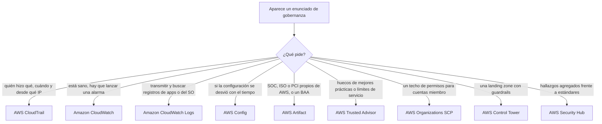
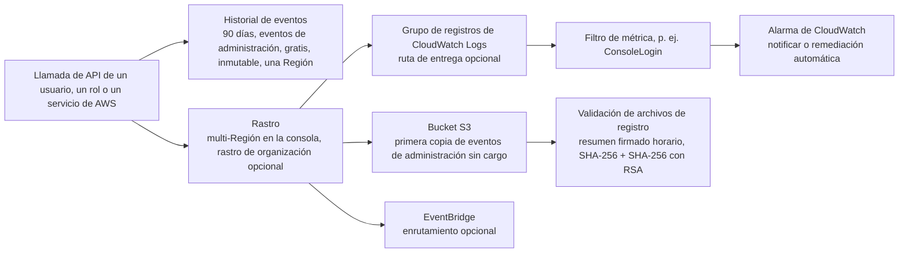
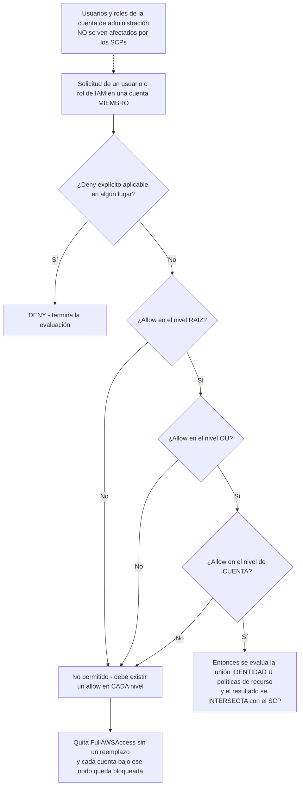
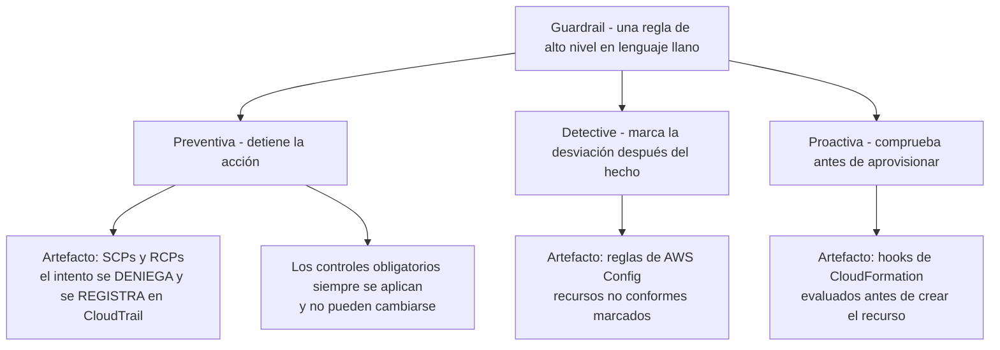
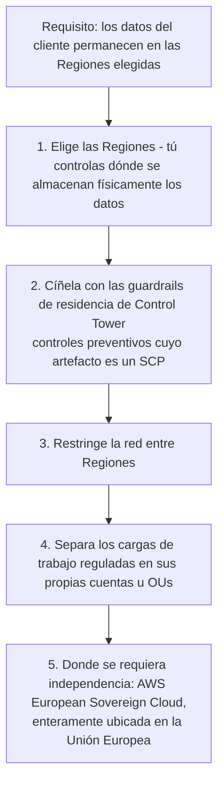

# Gobernanza, auditoría y cumplimiento en AWS

El Dominio 2 carga con el **30% de la nota del CLF-C02**, y la tarea 2.2 es su mitad de gobernanza: *"conceptos de cumplimiento y gobernanza de AWS"*, *"dónde capturar y ubicar los registros asociados a la seguridad en la nube"*, *"identificar dónde encontrar la información de cumplimiento de AWS (por ejemplo, AWS Artifact)"* y *"reconocer servicios que ayudan a la gobernanza y el cumplimiento (por ejemplo, monitoreo con Amazon CloudWatch; auditoría con AWS CloudTrail y AWS Config; informes con reportes de acceso)"*. Esa sola frase nombra casi todas las herramientas de esta lección, y a la vez siembra la trampa, porque **monitoreo es CloudWatch mientras que auditoría es CloudTrail y Config**. Quien borra esa distinción de dos verbos pierde puntos fáciles en enunciados que de otro modo son puro repaso.

```text
====================================================================
 CLF-C02 DOMINIO 2, TAREA 2.2 — FICHA DE HERRAMIENTAS DE GOBERNANZA (en octubre de 2026)
====================================================================
 QUIÉN HIZO QUÉ     CloudTrail — eventos registrados para cada
                    usuario, rol o servicio de AWS; historial de
                    eventos = gratis, inmutable, 90 días,
                    eventos de administración, una Región (NO es un rastro)
 REGISTRO DE API    rastro -> S3 (+ CloudWatch Logs y
 A LARGO PLAZO                EventBridge); primera copia de eventos
                    de administración a S3 = $0; multi-Región en la
                    consola; rastro de organización cubre todas las
                    cuentas miembro
 INTEGRIDAD DE      hash SHA-256 + SHA-256 con firma RSA,
 LOS REGISTROS      archivo de resumen horario, ACTIVADO por defecto
                    en los rastros nuevos
 CÓMO ERA CON       AWS Config — el recorder escribe configuration
 EL TIEMPO          items en S3 (+SNS); reglas = tu configuración
                    ideal; conformance pack = reglas + remediación
                    como 1 sola entidad
 LOS PAPELES        AWS Artifact — gratis, informes SOC / ISO / PCI
 PROPIOS DE AWS     bajo demanda más acuerdos (BAA, NDA)
 FALLOS DE          Trusted Advisor — 6 categorías, solo
 MEJORES PRÁCTICAS  asesoramiento, la profundidad depende del
                    plan de soporte
 TECHO DE           AWS Organizations + SCP — solo deniega,
 PERMISOS           concede nada, sin efecto en la cuenta de
                    administración
 ZONA DE            AWS Control Tower — preventivo (SCP/RCP),
 ATERRIZAJE         detective (Config), proactivo (hooks de CFN)
 EVIDENCIA          143 estándares y certificaciones; a AWS se la
                    audita por la seguridad DE la nube, a ti por la
                    seguridad EN ella; el cumplimiento varía según
                    el servicio
====================================================================
```

En esta lección vas a:

- decodificar el **enunciado de una sola frase** que te dice qué herramienta de gobernanza quiere el examen;
- usar **AWS CloudTrail** para quién hizo qué: incluidos **historial de eventos frente a rastros**, **rastros de organización** y **validación de integridad de los archivos de registro**;
- resistir la **trampa de CloudWatch Logs** (una canalización de entrega de eventos, no el registro de auditoría en sí);
- usar **AWS Config** para el historial de configuración, las reglas, el estado de cumplimiento, los conformance packs y los agregadores;
- encontrar los informes SOC / ISO / PCI de AWS y firmar un **BAA** en **AWS Artifact**: gratis y en autoservicio;
- mapear **las seis categorías de comprobación de Trusted Advisor** a lo que cada **plan de soporte** realmente desbloquea;
- aplicar bien los **SCPs**: solo-deny, un allow en cada nivel, cualquier deny gana, la cuenta de administración intacta;
- colocar las **guardrails** de **AWS Control Tower** (preventiva / detective / proactiva) sobre una landing zone;
- leer las **cubetas de programas de cumplimiento** (certificación frente a ley frente a alineación) a través del **modelo de responsabilidad compartida**;
- diseñar una **estrategia de etiquetas** que sobreviva a una auditoría y reparta la factura;
- separar **residencia de datos, soberanía de datos y privacidad**, y responder enunciados de elección de Región;
- hacer el triage de un evento de seguridad con **CloudWatch frente a CloudTrail frente a Config frente a Trusted Advisor**;
- estudiar **cuatro casos reales de cumplimiento de AWS** y luego resolver **12 preguntas tipo examen** más comprobaciones interactivas;
- auditar la **guía de examen en vivo en octubre de 2026**: listas de alcance reconstruidas, los nuevos nombres de planes de soporte y movimientos de consola que *no* son evaluables.

---

## 1. Una pregunta, una herramienta

### 1.1 El decodificador del enunciado

Cada pregunta de gobernanza de este examen es una pregunta *disfrazada* sobre qué herramienta posee qué clase de evidencia. Lee el enunciado por su verbo y su sustantivo: no por el nombre del servicio que alguna vez te mencionó un colega.

| El enunciado en realidad pregunta | Herramienta | Qué almacena de verdad |
|---|---|---|
| ¿Quién hizo qué, cuándo y desde qué IP? | **AWS CloudTrail** | **Eventos** de API: usuario, rol o servicio, acción, hora, origen |
| ¿Está sano el servicio? ¿CPU por encima del 80%? Lanza una alarma | **Amazon CloudWatch** | **Métricas** y alarmas sobre el estado actual |
| Transmitir y buscar registros de aplicaciones o del sistema operativo en un solo sitio | **Amazon CloudWatch Logs** | **Eventos de registro** de apps, archivos y servicios |
| ¿Se desvió la configuración y cómo era el 1 de mar? | **AWS Config** | **Configuration items**: estado actual más historial |
| ¿Es AWS SOC 2 / ISO 27001 / PCI y dónde está el BAA? | **AWS Artifact** | Los **propios** informes y acuerdos de AWS |
| ¿Sigue la cuenta las mejores prácticas? ¿Dónde están los huecos? | **AWS Trusted Advisor** | **Recomendaciones** en seis categorías |
| Limitar lo que las cuentas miembro pueden hacer | **AWS Organizations SCP** | Un techo de permisos **solo-deny** |
| Entregar cuentas y guardrails como una landing zone | **AWS Control Tower** | Guardrails expresadas en lenguaje llano |
| Agregar hallazgos frente a estándares de seguridad | **AWS Security Hub** | **Una sola pantalla** para los hallazgos |



### 1.2 La propia división de trabajo de la guía de examen

AWS lo formula en términos estrechos, y esa estrechez es evaluable: **monitoreo = Amazon CloudWatch**, **auditoría = AWS CloudTrail y AWS Config**, y (tarea 2.4) **identificar problemas de seguridad = AWS Trusted Advisor**. Así que una opción que diga *"usar CloudWatch para identificar problemas de seguridad"* no es un matiz: es el verbo equivocado. CloudWatch te dice que el sistema se está portando mal *ahora*; CloudTrail te dice qué se invocó; Config te dice cómo estaba el recurso; Trusted Advisor te dice dónde está el hueco frente a las mejores prácticas.

> [!NOTE]
> **Dos nombres que conviene no confundir.** **AWS Security Hub** es el agregador en alcance: AWS lo describe como una capacidad CSPM que *"evalúa tu entorno de AWS frente a estándares y mejores prácticas de la industria de seguridad"* y que *"recibe hallazgos de otros servicios de AWS, como Amazon GuardDuty"* para ofrecer *"una sola pantalla"*. A **AWS Audit Manager** se lo **eliminó de la guía de examen HTML del CLF-C02**, trátalo como distractor fuera de alcance, nunca como respuesta correcta.

```matching
{
  "question": "Relaciona cada herramienta de gobernanza con la pregunta que responde:",
  "pairs": [
    {"left": "AWS CloudTrail", "right": "Qué acción realizó sobre qué recurso y cuándo: eventos de API de usuarios, roles y servicios de AWS"},
    {"left": "Amazon CloudWatch", "right": "¿Está sano el cargador de trabajo ahora mismo: métricas, umbrales y alarmas como la edad de la cola por encima de una hora"},
    {"left": "Amazon CloudWatch Logs", "right": "Centraliza, conserva y busca flujos de registro de aplicaciones y del sistema operativo, y luego aplica filtros de métrica sobre ellos"},
    {"left": "AWS Config", "right": "Cómo estaba configurado este recurso, si se desvió, y si el puerto 22 estaba abierto a 0.0.0.0/0 el mes pasado"},
    {"left": "AWS Artifact", "right": "Dame los informes SOC, ISO y PCI propios de AWS y permite aceptar el BAA para mis cuentas"},
    {"left": "AWS Trusted Advisor", "right": "Dónde se aparta esta cuenta de las mejores prácticas de AWS, incluido MFA en root y snapshots públicos"},
    {"left": "AWS Organizations SCP", "right": "Impide que las cuentas miembro creen usuarios de IAM o invoquen servicios fuera de una sola Región"},
    {"left": "AWS Control Tower", "right": "Entrega cuentas pre-guardrailed y muestra las desviaciones por cuenta y OU en un panel"},
    {"left": "AWS Security Hub", "right": "Consolida hallazgos de GuardDuty y otros, y luego los comprueba frente a estándares de seguridad"}
  ],
  "explanation": "El examen identifica la herramienta por el sustantivo del enunciado: los eventos van a CloudTrail, las métricas a CloudWatch, los flujos de registro a CloudWatch Logs, el estado de configuración a Config, el papeleo de AWS a Artifact, los huecos de mejores prácticas a Trusted Advisor, el techo de permisos a SCP, la landing zone a Control Tower y los hallazgos agregados a Security Hub."
}
```

---

## 2. AWS CloudTrail: quién hizo qué

### 2.1 Qué registra CloudTrail

La definición de AWS es todo el servicio en una sola línea: *"Las acciones realizadas por un usuario, un rol o un servicio de AWS se registran como eventos"*. Esos eventos se capturan tanto si la llamada llegó desde **la consola, la CLI, un SDK/API u otro servicio de AWS**, y AWS nombra el propósito sin rodeos: *"auditoría operativa y de riesgo, gobernanza y cumplimiento"*.

| Tipo de evento | Ejemplos de la documentación de AWS | ¿Por defecto? | Base de coste (en octubre de 2026) |
|---|---|---|---|
| **Eventos de administración** (plano de control) | `RunInstances`, `AuthorizeSecurityGroupIngress`, `ConsoleLogin` | **Registrados por defecto** | Primera copia a S3 **$0**; copias extra **$2.00 / 100k** |
| **Eventos de datos** (plano de datos) | S3 `GetObject`, invocación de Lambda, operaciones de elementos de DynamoDB | **Opt-in, coste extra** | **$0.10 / 100k** |
| Eventos de actividad de red | Registros de actividad a nivel de red | Opt-in | **$0.10 / 100k** |
| **Insights** | Picos inusuales en la actividad de la API de administración `write` y en las tasas de error | **Desactivados por defecto**, con cargo | **$0.35 / 100k** eventos de administración por tipo; **$0.03 / 100k** eventos de datos |

- **📚 ¿Sabías que…?** **El historial de eventos de CloudTrail es gratuito y automático**: AWS lo describe como una *"vista consultable, buscable, descargable e inmutable de los últimos 90 días de eventos de administración en una Región de AWS"*. No lo creas tú, no puedes desactivarlo, y es **por Región** y **solo de eventos de administración**: que es exactamente por lo que no sustituye a un rastro (en octubre de 2026).

### 2.2 El historial de eventos no es un rastro

| Propiedad | **Historial de eventos** | **Rastro** | **CloudTrail Lake** |
|---|---|---|---|
| ¿Se crea? | No: activo por defecto | Sí | Sí |
| Ventana | **90 días** | Mientras conserves los objetos | Retención de hasta **2.557 días (7 años)** o **3.653 días (~10 años)**, ampliable |
| Alcance | **Solo eventos de administración**, una Región | Eventos de administración; **eventos de datos opt-in** | Almacenes de eventos seleccionados |
| Destino | Vista en consola | **S3** (+ **CloudWatch Logs** opcional, **EventBridge**) | Almacén de eventos consultable |
| Cargo | **Gratis** | Primera copia de eventos de administración a S3 **$0**, después por cada 100k | Prueba gratuita de 30 días; después con cargo |

*(Cargos en octubre de 2026; verifica el estado vigente antes de usarlos.)*

El enunciado que delata esto es un enunciado de *retención*: **"conservar registros de API durante cinco años en todas las cuentas"** o **"entregar eventos de administración continuos a un depósito"**: ambos exigen un **rastro** (o CloudTrail Lake), porque el historial de eventos se detiene en 90 días, solo eventos de administración, en una sola Región.



> [!NOTE]
> **Multi-Región es el valor por defecto de la consola.** AWS afirma que *"todos los rastros creados con la consola de CloudTrail son rastros multi-Región"*, lo que significa que un solo bucket recibe eventos de **todas las Regiones habilitadas**. Las Regiones opt-in deben habilitarse antes de que registren algo.

### 2.3 Rastros de organización: un registro para cada cuenta

Un **rastro de organización** escribe *"la cuenta de administración y todas las cuentas miembro"* en **un** solo bucket S3, un grupo de CloudWatch Logs y un destino de EventBridge. Las reglas a su alrededor son material clásico de examen:

- solo la **cuenta de administración o un administrador delegado** puede crearlo;
- CloudTrail crea el rol vinculado al servicio **`AWSServiceRoleForCloudTrail`** en cada cuenta miembro;
- **las cuentas miembro pueden ver el rastro pero no modificarlo ni borrarlo**: ese es el punto de gobernanza: un administrador miembro comprometido no puede silenciar el registro de auditoría;
- la política del bucket solo debe admitir ese rol de servicio y el ID de la organización.

- **📚 ¿Sabías que…?** La **validación de integridad de los archivos de registro** de CloudTrail usa *"SHA-256 para el hash y SHA-256 con RSA para la firma digital"* y escribe un **archivo de resumen horario** encadenado al resumen anterior, lo que hace *"computacionalmente inviable modificar, borrar o falsificar los archivos de registro de CloudTrail sin ser detectado"*. AWS dice que la función está **activada por defecto en los rastros nuevos**: así que *"demuestra que el registro no fue editado"* lo responde la validación, no una política de bucket (en octubre de 2026).

### 2.4 Ejemplo E1: la factura de CloudTrail

Un mes de actividad: **5.000.000 eventos de administración** (una copia a S3), **15.000.000 eventos de datos**, **5.000.000 eventos de actividad de red**, más una segunda copia de **2.500.000** eventos de administración reenviados a un segundo bucket para el SIEM.

```text
primera copia de eventos admón.   5.000.000 x $0.00         = $  0.00
eventos de datos                  15.000.000 / 100.000 = 150 x $0.10   = $ 15.00
eventos de actividad de red       5.000.000 / 100.000 =  50 x $0.10   = $  5.00
copia extra de eventos admón.     2.500.000 / 100.000 =  25 x $2.00   = $ 50.00
                                                              ---------
                                                              = $70.00
```

La enseñanza no es la aritmética, es la **primera copia gratuita**: *"Puedes entregar una copia de tus eventos de administración continuos a tu bucket de S3 sin cargo."* Los eventos de datos **nunca** son gratis, y Insights está **desactivado por defecto** y se cobra por separado (todas las tarifas en octubre de 2026; verifica el estado vigente antes de usarlos).

### 2.5 Ejemplo E2: un rastro para 40 cuentas

Una responsable de gobernanza debe demostrar *"registramos toda la actividad de las cuentas"* para 40 cuentas miembro. El patrón documentado:

1. La **cuenta de administración** crea un **rastro de organización multi-Región**.
2. Un **bucket S3** recibe todo, con **una carpeta por ID de cuenta miembro**; un **grupo de CloudWatch Logs**; enrutamiento opcional por EventBridge para automatización.
3. La **validación de archivos de registro sigue activada**, y la política del bucket solo admite `AWSServiceRoleForCloudTrail` más el ID de la organización.
4. Los administradores miembro **pueden ver el rastro, no pueden detenerlo ni editarlo**.
5. Athena sobre el bucket (o una consulta `lookup-events`) responde *"toda llamada de API que borró un bucket de S3 el trimestre pasado, con principal e IP de origen."*

Resultado: registro uniforme, **una** sola fuente de evidencia para el auditor y ninguna desviación de configuración cuenta por cuenta: el patrón exacto que el examen quiere que prefieras sobre 40 rastros construidos a mano.

### 2.6 La trampa de CloudWatch Logs

> [!WARNING]
> **⚠️ CloudTrail y CloudWatch Logs son preguntas distintas con la misma palabra: "registros".** Un rastro **entrega una copia de sus eventos** a un **grupo de registros** de CloudWatch Logs para que se disparen **filtros de métrica** y **alarmas**: esa canalización es una *consumidora* de CloudTrail, no el registro de auditoría. Los enunciados que dicen *"centraliza los registros de todos tus sistemas, aplicaciones y servicios de AWS"* describen **Amazon CloudWatch Logs**; los que dicen *"quién realizó qué acción sobre qué recurso y cuándo"* describen **AWS CloudTrail**. Nunca elijas CloudTrail para un enunciado de alarmas, y nunca elijas CloudWatch para un enunciado de historial de API.

## 3. AWS Config: historial de configuración y estado de cumplimiento

### 3.1 El recorder y los configuration items

AWS Config ofrece *"una vista detallada de la configuración de los recursos de AWS"*, incluido *"cómo se configuraron en el pasado"*. Mecánicamente: eliges qué **tipos de recursos** registrar, el **recorder** escribe los **configuration items (CIs)** en **Amazon S3** y notifica a través de **Amazon SNS** (el recorder asume un **rol de IAM** para hacerlo), y obtienes **el estado actual más el historial de cambios**: una serie de instantáneas, no un flujo de eventos.

| Modo de registro | Cuándo se escribe un CI | Uso típico |
|---|---|---|
| **Continuo** | En **cada cambio de configuración** | Historial de nivel auditoría: "cuándo se abrió y cuándo se cerró" |
| **Periódico** | Como mejor **una vez cada 24 horas**, y **solo si el recurso cambió** | Monitoreo de desviaciones más barato donde el historial por horas no importa |

### 3.2 Reglas, estado de cumplimiento y remediación

Una **regla** de Config codifica *"tus ajustes de configuración ideales"*. El motor de reglas evalúa tus recursos y estampa cada uno como **conforme** o **no conforme**, marca el recurso, te notifica y puede **remediar** a través de un documento de **AWS Systems Manager**.

| Tipo de regla | Qué es |
|---|---|
| **Gestionada** | Comprobaciones publicadas por AWS que activas |
| **Personalizada** | Tu propia lógica en una función de **AWS Lambda** |
| **Vinculada a un servicio** | Creada y mantenida por un servicio de AWS |
| **Organizacional** | Desplegada en toda una organización desde la cuenta de administración |

Encima hay dos objetos de nivel superior, y el examen los distingue con precisión:

- **conformance pack** = *"una colección de reglas de AWS Config y acciones de remediación … desplegada como una sola entidad"*: escrito en **YAML**, desplegable **en toda una organización**;
- **agregador** = una vista única **entre cuentas y entre Regiones** de configuración y cumplimiento;
- **consulta avanzada** = consulta del historial de configuración por esquema a través del agregador.

### 3.3 Ejemplo E3: registro continuo frente a periódico

Una cuenta registra **100 instancias EC2** que cambian **10 veces por día** cada una.

```text
continuo: 100 x 10 = 1.000 configuration items por día
          1.000 x $0.003 = $3.00 por día

periódico: cada uno de los 100 recursos se escribe como máximo 1 vez cada 24 h
           100 x $0.012   = $1.20 por día
```

El registro continuo cuesta aquí **2,5 veces** más pero te da historial por horas; el periódico cuesta menos y descarta en silencio el detalle intra-día. Elige según la pregunta: *"¿cuándo cambió?"* significa continuo; *"¿está conforme ahora?"* hace defendible el periódico (tarifas en octubre de 2026; verifica el estado vigente antes de usarlas).

### 3.4 Ejemplo E4: precio de un paquete de conformidad

El paquete resuelto por la propia AWS: **10.000 configuration items** + **50.000 evaluaciones de reglas** + **15.000 evaluaciones de conformance pack** al mes.

```text
10.000 CIs                    x $0.003 = $30.00
50.000 evaluaciones de reglas  x $0.001 = $50.00
15.000 eval. de conformidad    x $0.001 = $15.00
                                            --------
total del paquete                      = $95.00 por mes
```

Observa a dónde va el dinero: **la evaluación, no el almacenamiento**. Añadir reglas es barato; registrar todo continuamente es lo que mueve la factura (en octubre de 2026; verifica el estado vigente antes de usarlo).

### 3.5 CloudTrail registra acciones; Config registra estado

Esta es la distinción de mayor rendimiento de toda la lección:

| Pregunta | Respuesta | Por qué |
|---|---|---|
| "¿Se llamó a `RevokeSecurityGroupIngress` el 3 de mar?" | **CloudTrail** | Es una **llamada de API**: un evento con principal y marca de tiempo |
| "¿Estaba el puerto 22 abierto a `0.0.0.0/0` el 1 de mar?" | **AWS Config** | Es **estado durante un período**: solo las instantáneas de Config lo responden |
| "¿Quién lo abrió?" | **CloudTrail** | Los eventos llevan identidad; Config lleva configuración |
| "¿Ha seguido cerrado desde entonces?" | **AWS Config** | Estado de cumplimiento a lo largo del tiempo |

Activa **ambos**. Un examinador que escribe *"el grupo de seguridad estuvo abierto durante seis horas"* está comprobando si sabes que ningún registro de eventos, en ninguna nube, puede reconstruir una duración sin un historial de configuración.

- **📚 ¿Sabías que…?** Algunas **comprobaciones de Trusted Advisor funcionan con AWS Config**, y por eso desactivar Config puede degradar en silencio los consejos que recibes, y por eso los **conformance packs** (reglas más remediación como un solo artefacto YAML) son la forma más rápida de entregar a un auditor una declaración de cumplimiento repetible y de toda la organización en lugar de una captura de pantalla (en octubre de 2026).

---

## 4. AWS Artifact: dónde vive la información de cumplimiento propia de AWS

### 4.1 Informes, bajo demanda y gratis

AWS Artifact es *"descargas bajo demanda de documentos de seguridad y cumplimiento de AWS"*: informes **ISO**, **Payment Card Industry (PCI)** y **System and Organization Controls (SOC)**, certificaciones emitidas por organismos acreditadores y documentos de Marketplace/ISV. Es **gratuito**, de autoservicio, y es la respuesta literal del examen a la habilidad de la tarea 2.2: *"identificar dónde encontrar la información de cumplimiento de AWS (por ejemplo, AWS Artifact)"*.

### 4.2 Acuerdos: el BAA y el NDA

Artifact es también donde *"revisas, aceptas y haces seguimiento del estado de tus acuerdos con AWS para tu cuenta de AWS y para varias cuentas de AWS de tu organización"*. La pregunta frecuente de cumplimiento nombra el **Business Associate Agreement (BAA)** y el **NDA**. Así que el enunciado *"firmar un BAA para mi cuenta y 20 cuentas miembro"* tiene una sola respuesta: **AWS Artifact**.

> [!IMPORTANT]
> **Artifact guarda la evidencia de AWS, nunca la tuya.** La salida de Artifact son *"artefactos de auditoría"*: informes SOC, certificados ISO, attestations, acuerdos firmados. Tu propia evidencia de controles (políticas, configuraciones, registros) viene de **CloudTrail, AWS Config y tu propia documentación**, y AWS es explícito: los clientes siguen siendo responsables de su propio cumplimiento. *"Sube nuestra evidencia a Artifact"* nunca es una opción válida.

- **📚 ¿Sabías que…?** **SOC 3 es público**, no necesitas una solicitud específica de cuenta para leerlo, mientras AWS publica **SOC 1 trimestralmente** y **SOC 2 y SOC 3 cada seis meses** sobre **períodos de 12 meses** (desde el 30 de sep de 2023), con los informes nuevos listos *"en ~6 semanas"*. Todos llegan a través de **AWS Artifact**, y ninguno es un certificado HIPAA, porque uno así no existe (en octubre de 2026).

---

## 5. AWS Trusted Advisor: comprobaciones de mejores prácticas y lo que desbloquea tu plan

### 5.1 Las seis categorías de comprobación

Las recomendaciones de Trusted Advisor existen *"para ahorrar dinero, mejorar la disponibilidad y el rendimiento del sistema, o ayudar a cerrar huecos de seguridad"*. La lista de categorías está fija en **seis**: rechaza cualquier opción que invente una séptima:

| Categoría | Comprobaciones típicas |
|---|---|
| **Optimización de costes (Cost optimization)** | Recursos ociosos e infrautilizados, higiene de snapshots |
| **Rendimiento (Performance)** | Margen de rendimiento y utilización |
| **Seguridad (Security)** | MFA en root, snapshots públicos, permisos de bucket, exposición de grupos de seguridad |
| **Tolerancia a fallos (Fault tolerance)** | Redundancia, huecos de respaldo y de conmutación |
| **Límites de servicio (Service limits)** | Consumo que se acerca a una cuota |
| **Excelencia operativa (Operational Excellence)** | Recomendaciones operativas y de procesos |

Las páginas de marketing de AWS a veces dicen **"resiliencia"** donde la documentación dice **"tolerancia a fallos"**, misma categoría, y **"cumplimiento"** no es una de las seis.

### 5.2 Disponibilidad según el plan de soporte

| Plan | Qué obtienes | Refresco |
|---|---|---|
| **Basic / Developer** | Solo consola: **todas las comprobaciones de límites de servicio** más seis comprobaciones con nombre, **Amazon EBS Public Snapshots, Amazon RDS Public Snapshots, Amazon S3 Bucket Permissions, MFA en la cuenta root, Security Groups, Specific Ports Unrestricted, uso del endpoint global de AWS STS en las Regiones de AWS** | Refresco **manual**, sin API |
| **Business / Enterprise / Unified Operations** | **Todas las comprobaciones**, más acceso por **API y CLI**, eventos de **EventBridge** y refresco automático **semanal** | Automático |

En octubre de 2026 AWS anuncia **56 comprobaciones gratuitas para todos los planes** y **482 en total** cuando Business o superior añade **426** más, pero el día del examen cita la regla *cualitativa* (**los planes gratuitos reciben un subconjunto, los planes de pago reciben todas**), porque el número de comprobaciones cambia (verifica el estado vigente antes de usarlo).

### 5.3 Ejemplo E5: lo que desbloquea cada plan

```text
Plan Basic, "¿MFA en root?"                 -> SÍ: una de las seis comprobaciones
                                               gratuitas con nombre
Plan Basic, "escanear todas las cuentas
             cada semana por la API"        -> NO: solo consola, refresco manual,
                                               sin API, subconjunto de comprobaciones
Plan Business, biblioteca completa          -> SÍ: 56 + 426 = 482 comprobaciones,
                                               API/CLI, EventBridge, refresco semanal
Cualquier plan, "Trusted Advisor lo impone" -> NO: lo ACONSEJA, no lo impone
```

Trusted Advisor es **solo asesoramiento**. La imposición viene de **las reglas de Config y la remediación**, los **SCPs** (preventivos) y las **guardrails de Control Tower**, y la **vista organizacional** agrega el consejo en toda la organización.

## 6. AWS Organizations y los SCPs: el techo solo-deny

### 6.1 Estructura y conjuntos de características

AWS Organizations te da un **root** → **unidades organizacionales (OU)**, que se anidan y pueden llegar a **cinco niveles de profundidad** → **cuentas miembro**. La **cuenta de administración** es la pagadora y el *"propietario último … control final sobre las políticas de seguridad, infraestructura y finanzas"*; una cuenta miembro *"solo puede pertenecer a una organización a la vez"*.

| Conjunto de características | Qué admite |
|---|---|
| **Todas las características** (por defecto) | OUs, **SCPs**, políticas de etiquetas y las integraciones de servicios de AWS |
| **Solo facturación consolidada** | Una sola factura, pero *"no... puede usar políticas para restringir lo que los usuarios y roles de distintas cuentas pueden hacer"* |

### 6.2 Los SCPs nunca conceden

La redacción de AWS es absoluta, y las opciones de examen la invierten rutinariamente:

- los SCPs otorgan *"control central sobre los **permisos máximos disponibles** para los usuarios y roles de IAM de tu organización"*;
- ***"Los SCPs no conceden permisos … Un SCP no concede ningún permiso"***;
- los permisos efectivos son la **intersección lógica** del SCP con las políticas basadas en identidad y basadas en recurso;
- ***"Los SCPs no afectan a los usuarios ni a los roles de la cuenta de administración"***, solo a las cuentas miembro, **incluido su usuario root**, y tampoco afectan a los **roles vinculados a un servicio**.

### 6.3 Cómo se ejecuta realmente la evaluación



De esa imagen salen dos reglas: **un Allow debe existir en cada nivel** (raíz → OU → cuenta), así que el SCP gestionado por AWS **`FullAWSAccess`** es la red de seguridad deny-por-defecto, **nunca lo quites sin reemplazarlo con una política de allow**, y **un Deny en cualquier nivel gana**, que es por lo que una política *solo-deny* basta para bloquear una Región o un servicio.

### 6.4 Ejemplo E6: un SCP deny-por-defecto

La raíz conserva **`FullAWSAccess`**. La **OU Prod** añade una política que deniega `ec2:*` y `rds:*` fuera de `eu-central-1`, y deniega `iam:CreateUser` y `iam:CreateAccessKey` en todas partes.

```text
cuenta bajo la OU Prod, el invocador tiene AdministratorAccess
  -> existe allow en la raíz (FullAWSAccess)        SÍ
  -> existe allow en la OU Prod (FullAWSAccess)     SÍ
  -> existe allow en la cuenta                      SÍ
  -> ¿Deny explícito en la política de la OU?       SÍ -> DENEGADO
resultado: acceso total a servicios DENTRO de eu-central-1,
           ningún EC2 ni RDS fuera de él,
           sin usuarios IAM nuevos en esa OU
cuenta de administración: no afectada por diseño
```

Esa última línea es un distractor favorito: **los SCPs no afectan a los usuarios ni a los roles de la cuenta de administración**.

### 6.5 Ejemplo E7: la facturación consolidada agrupa el uso

*"AWS trata a todas las cuentas de la organización como una sola cuenta"*: así que el uso combinado alcanza antes los tramos de volumen, los descuentos de Instancias Reservadas y los Savings Plans, y el descuento se reparte de vuelta. Dos cuentas que consumen **8 TB** y **4 TB**:

```text
tramo 1: $0.17/GB para los primeros 10 TB -> 1 TB = 1.024 GB -> $174.08 por TB
tramo 2: $0.13/GB para los siguientes 40 TB                   -> $133.12 por TB

agrupado (8 TB + 4 TB = 12 TB): 10 x $174.08 + 2 x $133.12
                                = $1.740.80 + $266.24 = $2.007.04
por separado: 8 x $174.08 + 4 x $133.12 = $1.392.64 + $532.48 = $2.088.96
ahorro:       $2.088.96 - $2.007.04 = $81.92
```

**AWS Organizations se ofrece sin coste adicional**, y la facturación consolidada **no lleva recargo**, pero nota la trampa que el examen evalúa: **la factura no refleja el árbol de OUs**. Repartir el gasto por proyecto es trabajo de una **etiqueta de asignación de costes**, no de una OU (precios en octubre de 2026; verifica el estado vigente antes de usarlos).

### 6.6 Límites que conviene memorizar (verifica el estado vigente antes de usarlos)

| Objeto | Límite de tamaño | Adjuntos |
|---|---|---|
| **SCP** | **10.240 caracteres** | Máximo **10** por root / OU / cuenta |
| **RCP** | **5.120 caracteres** | Máximo **5** |
| Políticas de etiquetas, de respaldo y declarativas | **10.000 caracteres** | Máximo **10** |
| Jerarquía de OUs |: | **5 niveles**, **un root** por organización |

---

## 7. AWS Control Tower: guardrails sobre una landing zone

### 7.1 Qué construye

Control Tower gobierna un **entorno multi-cuenta** de AWS, orquestando **AWS Organizations, AWS Service Catalog y AWS IAM Identity Center** para construir una **landing zone** *"en menos de una hora"*. Su vocabulario es deliberadamente llano: un **control = guardrail** = *"una regla de alto nivel … expresada en lenguaje llano"*, con la orientación graduada en **obligatoria / muy recomendada / electiva**, más **Account Factory** para entregar cuentas y un **Dashboard** que muestra las desviaciones por cuenta y OU.

### 7.2 Los tres tipos de guardrail



| Tipo | Momento | Servicio de soporte |
|---|---|---|
| **Preventiva** | Antes de que la acción tenga éxito | **SCPs y RCPs**: el intento se *"deniega y se registra en CloudTrail"* |
| **Detective** | Después del hecho | **Reglas de AWS Config** |
| **Proactiva** | Antes de aprovisionar | **Hooks de CloudFormation** |

### 7.3 Guardrails de residencia de datos

En **noviembre de 2021** AWS anunció **17 guardrails nuevas** para que *"los datos del cliente … no se almacenen ni se procesen fuera de una o varias Regiones de AWS concretas"*; los ejemplos preventivos incluyen *"Prohibir el acceso a internet para una instancia de Amazon VPC"* y *"Prohibir las conexiones de Amazon Virtual Private Network (VPN)"*. **El artefacto de cada control preventivo es un SCP**, y por eso Control Tower, Organizations y los SCPs siempre se enseñan juntos.

- **📚 ¿Sabías que…?** La división de trabajo merece memorizarse en tres frases: **AWS Organizations** es la fontanería de cuentas y políticas, el **SCP** es el techo de permisos, y **AWS Control Tower** es la capa de landing zone opinada encima que entrega cuentas con guardrails y reporta desviaciones. AWS también afirma que *"los controles obligatorios siempre se aplican y no pueden cambiarse."* (en octubre de 2026)

```dragdrop
{
  "question": "Ordena la construcción de gobernanza tal como se componen los servicios de AWS (primero los cimientos, al final la evidencia):",
  "items": [
    "Crea la organización: un root, OUs y cuentas miembro con AWS Organizations",
    "Activa todas las características para que estén disponibles los SCPs y las políticas de etiquetas",
    "Adjunta el SCP FullAWSAccess gestionado por AWS y añade después tus propias políticas solo-deny",
    "Instala la landing zone con AWS Control Tower: Account Factory, guardrails obligatorias, panel",
    "Añade la capa de evidencia: un rastro de organización en CloudTrail más reglas de AWS Config y conformance packs",
    "Estandariza las etiquetas y activa después las etiquetas de asignación de costes para que la factura pueda repartirse por proyecto"
  ],
  "correctOrder": [
    "Crea la organización: un root, OUs y cuentas miembro con AWS Organizations",
    "Activa todas las características para que estén disponibles los SCPs y las políticas de etiquetas",
    "Adjunta el SCP FullAWSAccess gestionado por AWS y añade después tus propias políticas solo-deny",
    "Instala la landing zone con AWS Control Tower: Account Factory, guardrails obligatorias, panel",
    "Añade la capa de evidencia: un rastro de organización en CloudTrail más reglas de AWS Config y conformance packs",
    "Estandariza las etiquetas y activa después las etiquetas de asignación de costes para que la factura pueda repartirse por proyecto"
  ],
  "explanation": "Las cuentas y las OUs van primero porque todas las políticas se cuelgan de ellas; todas las características es el interruptor que enciende los SCPs y las políticas de etiquetas; FullAWSAccess debe seguir adjunto mientras añades políticas solo-deny; Control Tower impone después la landing zone opinada; la capa de evidencia (rastro de organización, reglas de Config, conformance packs) demuestra que funciona; y etiquetas y asignación de costes cierran el círculo para finanzas."
}
```

---

## 8. Programas de cumplimiento y el modelo de responsabilidad compartida

### 8.1 Las tres cubetas

AWS afirma que *"respalda 143 estándares de seguridad y certificaciones de cumplimiento, incluidos PCI-DSS, HIPAA/HITECH, FedRAMP, GDPR, FIPS 140-3 y NIST 800-171"*, y los ordena en tres cubetas muy distintas (en octubre de 2026; verifica el estado vigente antes de usarlos):

| Cubeta | Significado | Miembros |
|---|---|---|
| **Certificaciones / attestations** | Auditadas por un tercero; AWS puede custodiarlas y distribuirlas | **ISO 27001 / 27018 / 42001, SOC 1 / SOC 2 / SOC 3, PCI DSS, CSA STAR, FedRAMP, FIPS 140-3, C5 (DE), IRAP (AU), MTCS (SG), ISMAP (JP), ENS High** |
| **Leyes / regulaciones** | *"Los clientes de AWS siguen siendo responsables de cumplir … No existe una certificación formal disponible para (ni distribuible por) un proveedor de servicios de nube"* | **HIPAA, CJIS, FERPA, FISMA, IRS 1075, SEC 17a-4(f), DORA** |
| **Alineaciones** | AWS mapea sus controles a un marco de referencia | **NIST 800-53, NIST CSF** |

### 8.2 Las tres preguntas que se responden mal

| Pregunta | Respuesta correcta |
|---|---|
| *"¿AWS está certificada HIPAA?"* | **No.** AWS afirma *"No existe una certificación HIPAA para un proveedor de servicios de nube (CSP) como AWS."* AWS se alinea con las reglas de HHS, FedRAMP y NIST 800-53, **firmará un BAA estándar** (aceptado **en AWS Artifact**), solo los **servicios aptos para HIPAA** pueden procesar **PHI**, y *tú* te ocupas del resto de HIPAA. |
| *"¿Tenemos que firmar el DPA de GDPR?"* | **No hay que hacer nada**: el Anexo de Tratamiento de Datos está en los Términos del Servicio de AWS y **se aplica automáticamente desde el 25 de may de 2018**. |
| *"Qué tan recientes están los informes SOC?"* | **SOC 1 trimestral; SOC 2 y SOC 3 cada 6 meses**, sobre **períodos de 12 meses** desde el 30 de sep de 2023, listos *"en ~6 semanas"*; **SOC 3 es público**. Descárgalos desde **AWS Artifact**. |

### 8.3 Responsabilidad compartida, reformulada para auditores

La frase de auditoría es la misma de la lección 5: **a AWS se la audita por la seguridad *de* la nube, a los clientes por la seguridad *en* ella**. Tres consecuencias aparecen repetidamente como opciones:

- heredar los controles de AWS **nunca** elimina tu mitad del modelo;
- **el cumplimiento varía según el servicio**: consulta la lista de **AWS Services in Scope** en lugar de asumir una exención de Región completa;
- *"AWS Compliance Center"* **no** es una respuesta correcta para la tarea 2.2; la propia declaración de habilidad nombra **AWS Artifact**.

- **📚 ¿Sabías que…?** El sitio de cumplimiento de AWS publica investigación que abarca **más de 60 países**, y su página de programas separa las certificaciones de las leyes por una razón: un **proveedor de servicios de nube no puede estar "certificado HIPAA"**, porque no existe tal certificación para distribuir, y por eso la respuesta correcta de HIPAA en el examen es siempre el trío **BAA vía Artifact + servicios aptos para HIPAA + responsabilidad del cliente** (en octubre de 2026).

## 9. La estrategia de etiquetas como gobernanza

### 9.1 Qué es una etiqueta y por qué le importa a la gobernanza

Una etiqueta es *"una etiqueta simple compuesta por una clave y un valor opcional"*, y las claves y los valores **distinguen mayúsculas de minúsculas**. La propia lista de razones de AWS es la respuesta del examen: el etiquetado consistente te permite *"filtrar y buscar recursos, monitorear costes y uso, y gestionar tu entorno de AWS"*. En la práctica, una taxonomía de etiquetas limpia es el **CMDB** de la nube: el índice que consulta el auditor en lugar de una hoja de cálculo.

| Uso de la etiqueta | Servicio | Qué te da |
|---|---|---|
| Estandarizar claves y mayúsculas preferidas | **Políticas de etiquetas** (AWS Organizations) | Imposición sobre tipos de recursos concretos; necesita **todas las características** |
| Repartir la factura | **Etiquetas de asignación de costes** | Aparecen en Cost Explorer y en el informe de asignación de costes **tras la activación** |
| Detectar etiquetas que faltan | **Reglas de AWS Config** | Recursos no conformes marcados y remediados |
| Encontrar y actuar sobre recursos | **Resource Groups, Tag Editor, Resource Groups Tagging API** | Búsqueda y operaciones masivas |

### 9.2 La pila de cuatro capas

```text
1. estándar de nombres      -> vocabulario clave/valor acordado, mayúsculas incluidas
2. políticas de etiquetas   -> HACEN CUMPLIR el estándar (Organizations, todas las características)
3. etiquetas de coste       -> ACTÍVALAS antes de que la factura pueda usarlas
4. reglas de Config         -> DETECTAN recursos sin una etiqueta obligatoria
```

> [!WARNING]
> **⚠️ Dos trampas de etiquetas.** Primero, **hay que activar por separado los dos tipos de etiqueta de asignación de costes**, las etiquetas generadas por AWS (por ejemplo `createdBy`) y tus etiquetas **definidas por el usuario** se activan de forma independiente, y no aparece nada en Cost Explorer ni en el informe de asignación de costes hasta que lo hagas. Segundo, **las políticas de etiquetas no evalúan los recursos sin etiqueta ni las claves indefinidas**, así que *"imponemos etiquetas en todas partes"* exagera lo que hace el servicio. Y recuerda la consecuencia de facturación de la sección 6: **la factura consolidada no sigue el árbol de OUs**, las etiquetas son cómo atribuyes el gasto.

---

## 10. Soberanía y residencia de los datos

### 10.1 Tres palabras, tres significados

| Término | Pregunta que responde |
|---|---|
| **Residencia de datos** | **Dónde** se almacenan y procesan los datos |
| **Soberanía de datos** | **Bajo qué jurisdicción y control** están |
| **Privacidad de datos** | **Cómo** se tratan, se accede y se conservan |

Para CLF-C02 el ángulo evaluable es un **motivo de elección de Región**: AWS indica que los clientes *"conservan el control completo sobre qué Región o Regiones de AWS se almacenan físicamente tus datos"*, y las **Regiones opt-in deben habilitarse explícitamente** antes de que ahí se ejecute algo.

### 10.2 La pila de control de residencia



El material de protección de datos de AWS afirma con claridad que *"tú controlas tus datos … para determinar dónde se almacenan tus datos y cómo se protegen"* y que *"AWS Control Tower proporciona gobernanza y controles para la residencia de los datos"*, mientras los clientes *"conservan el control completo sobre qué Región o Regiones de AWS se almacenan físicamente tus datos"*.

> [!NOTE]
> **Los enunciados de residencia son enunciados de Región.** Si la lista de opciones ofrece un servicio de monitoreo para un requisito de *"los datos deben permanecer en la UE"*, es un distractor: la respuesta es **elegir la Región, imponerlo con las guardrails de residencia de Control Tower (SCPs), aislar el cargador de trabajo** y, donde se requiera independencia jurisdiccional, una oferta como **AWS European Sovereign Cloud** (*"enteramente ubicada en la Unión Europea"*). Outposts y Local Zones **no** están en la lista en alcance de este examen, así que nunca elijas ninguno de los dos.

- **📚 ¿Sabías que…?** Fecha tus cifras de infraestructura o se pudren: la nube de AWS abarca **39 Regiones geográficas y 124 Zonas de disponibilidad**, con **7 zonas más** y **2 Regiones más** (Kingdom of Saudi Arabia y Chile) *anunciadas pero aún no abiertas*, mientras la Región `eusc-de-east-1` de **AWS European Sovereign Cloud** se anunció disponible generalmente el **14 de ene de 2026** pero **no** aparece en el mapa público de Regiones. Cita la cifra **39 / 124** y la fecha del `eusc` **por separado**, y etiqueta ambas "en octubre de 2026, verifica el estado vigente antes de usarlas".

---

## 11. Identificación de eventos de seguridad: qué herramienta responde qué pregunta

### 11.1 La tabla de triage

| Situación | Herramienta | Razón en una línea |
|---|---|---|
| *"¿Quién terminó mi instancia a las 02:14 y desde qué IP?"* | **AWS CloudTrail** | Los eventos llevan identidad, acción, hora y origen |
| *"La edad de la cola pasó de una hora: avísennos"* | **Amazon CloudWatch** | Métricas y alarmas sobre el estado actual |
| *"Transmitir y buscar los registros de la app del último año"* | **Amazon CloudWatch Logs** | Almacenamiento centralizado de registros y consultas |
| *"¿Estaba MFA en root ayer? ¿Está ahora?"* | **AWS Config** | Estado de configuración a lo largo del tiempo |
| *"MFA en root, con el plan Basic"* | **AWS Trusted Advisor** | Una de las seis comprobaciones gratuitas con nombre |
| *"Toda llamada de API que borró un bucket de S3 el trimestre pasado"* | **Rastro de CloudTrail → S3**, luego validación | Historial de API a largo plazo y a prueba de manipulaciones |
| *"Demostrar que el archivo de registro no fue editado"* | **Validación de archivos de registro de CloudTrail** | Resumen firmado horario, SHA-256 + RSA |
| *"Nuestro SOC 2 Type II y el BAA"* | **AWS Artifact** | Los propios informes y acuerdos de AWS |
| *"Hallazgos frente a NIST / PCI en todas las cuentas"* | **AWS Security Hub** | Una sola pantalla, agregación CSPM |

### 11.2 Ejemplo E8: las cuatro preguntas del auditor

| El auditor pregunta | Herramienta | Configuración previa necesaria |
|---|---|---|
| (a) *Toda llamada de API que borró un bucket de S3 el trimestre pasado, con principal e IP de origen* | **AWS CloudTrail** | Rastro de organización → S3, luego `lookup-events` / Athena, luego `validate-log-files` |
| (b) *¿Estaba abierto el puerto 3306 el 1 de mar y cuándo se cerró?* | **AWS Config** | Grabado **continuo** del tipo de recurso de grupo de seguridad |
| (c) *Tu SOC 2 Type II, tu certificado ISO 27001 y tu PCI AOC* | **AWS Artifact** | Nada: descargas gratuitas y de autoservicio |
| (d) *¿MFA en root? ¿Snapshots públicos de EBS?* | **AWS Trusted Advisor** | Funciona en **Basic**: están entre las seis comprobaciones gratuitas con nombre |

Ninguna de las cuatro requiere una compra nueva; las cuatro requieren **previsión**: el rastro, el recorder y el esquema de etiquetas deben existir *antes* de que llegue el auditor.

### 11.3 Comprueba tu vocabulario

```fillblank
{
  "question": "Completa las afirmaciones de vocabulario de gobernanza con los términos correctos de AWS:",
  "template": "El registro gratuito, activo por defecto e inmutable de los últimos {{1}} días de eventos de administración en una sola Región de AWS es el historial de eventos de CloudTrail; el objeto que entrega los eventos continuos a un depósito S3 para la retención a largo plazo es un {{2}}. En AWS Config, el componente que escribe los configuration items en Amazon S3 y Amazon SNS es el {{3}}, y una colección desplegable de reglas de Config con acciones de remediación es un {{4}}. AWS Organizations protege los permisos con una política solo-deny llamada {{5}}, y la biblioteca en autoservicio de informes y acuerdos de cumplimiento de AWS es {{6}}.",
  "answers": {
    "1": "90",
    "2": "rastro",
    "3": "recorder",
    "4": "conformance pack",
    "5": "SCP",
    "6": "AWS Artifact"
  },
  "distractors": ["guardrail", "panel", "política de bucket", "grupo de registros", "Trusted Advisor", "agregador"],
  "explanation": "El historial de eventos cubre 90 días de eventos de administración por Región y no es un rastro; el recorder es lo que escribe los configuration items; un conformance pack es reglas de Config más remediación desplegadas como una sola entidad; un SCP es el techo solo-deny; AWS Artifact es la biblioteca gratuita de informes y acuerdos en autoservicio. Un guardrail es vocabulario de Control Tower y un agregador es una vista de Config entre cuentas: ambos están cerca, pero aquí no son la respuesta."
}
```

### 11.4 Solicitud de evidencia → herramienta y función

El mismo triage, al revés: el auditor enuncia la *evidencia*, y tú nombras la *herramienta* y la *función* exacta que la produce. Esa es la forma que adoptan los enunciados cuando esconden el nombre del servicio detrás de un requisito.

```matching
{
  "question": "Relaciona cada solicitud de evidencia con la herramienta y la función exacta que la satisface:",
  "pairs": [
    {"left": "Demostrar que los archivos de registro de CloudTrail del bucket nunca se editaron después de la entrega", "right": "Validación de integridad de archivos de registro de AWS CloudTrail: hash SHA-256, firma SHA-256 con RSA y un resumen horario encadenado al anterior"},
    {"left": "Desplegar un conjunto con nombre de reglas de AWS Config junto con sus acciones de remediación en toda la organización", "right": "Conformance pack de AWS Config: una colección de reglas y acciones de remediación desplegada como una sola entidad"},
    {"left": "Mostrar configuration items y estado de cumplimiento de cada cuenta y Región en una sola vista", "right": "Agregador de AWS Config: una vista entre cuentas y entre Regiones, consultable con consulta avanzada"},
    {"left": "Listar toda llamada de API que borró un bucket de S3 el trimestre pasado, en la cuenta de administración y todas las cuentas miembro", "right": "Rastro de organización de AWS CloudTrail a S3: creado por la cuenta de administración o un administrador delegado, visible para los miembros pero no modificable por ellos"},
    {"left": "Descargar el informe SOC 2 Type II propio de AWS y aceptar un BAA para 20 cuentas miembro", "right": "AWS Artifact: informes bajo demanda gratuitos y de autoservicio más acuerdos como el BAA y el NDA"},
    {"left": "Comprobar el MFA de la cuenta root mientras la cuenta sigue en el plan de soporte gratuito", "right": "AWS Trusted Advisor: una de las seis comprobaciones con nombre disponibles en Basic, refrescadas manualmente en la consola"},
    {"left": "Impedir que las cuentas miembro creen usuarios de IAM sin conceder un solo permiso", "right": "SCP de AWS Organizations: un techo solo-deny sobre los permisos máximos disponibles, sin efecto en la cuenta de administración"},
    {"left": "Ver la deriva de las guardrails por cuenta y OU mientras Account Factory entrega cuentas pre-guardrailed", "right": "AWS Control Tower - SCPs y RCPs preventivos, reglas de Config detective y hooks de CloudFormation proactivos"}
  ],
  "explanation": "Lee el sustantivo de la solicitud y la herramienta se deduce: la evidencia a prueba de manipulaciones es la validación de archivos de registro de CloudTrail, un paquete de reglas desplegable es un conformance pack de Config, una vista entre cuentas y Regiones es un agregador de Config, el historial de API de todas las cuentas es un rastro de organización, el papeleo y los acuerdos propios de AWS son Artifact, el pase de mejores prácticas gratuito es Trusted Advisor, un techo solo-deny es un SCP, y el panel de la landing zone con Account Factory es Control Tower. Las peticiones formuladas como resultados en lugar de nombres de servicio son exactamente cómo el Dominio 2 disfraza la tarea 2.2, así que responde a la evidencia, no a la redacción."
}
```

---

## 12. La guía de examen en vivo: qué cambió hacia 2026

### Actualizaciones de 2026 (en octubre de 2026)

El examen evalúa la guía que descargas **hoy**, no el PDF que alguien revisó en 2023. Cada punto de abajo se comprobó contra las propias páginas de AWS en **octubre de 2026**, y cada uno cambia cómo debes leer un enunciado de gobernanza, de soporte o de alcance.

- **Las listas de servicios se reconstruyeron, y el alcance ahora es evaluable por sí mismo.** Las entradas en alcance cayeron de **128** en la guía de la era de lanzamiento `Version 1.0 CLF-C02` a **111 en 19 categorías** (lista oficial en alcance, verificada 2026-10), mientras que la **lista fuera de alcance** pasó de 11 entradas en el lanzamiento a más de 50. Para esta lección: **AWS Network Firewall está explícitamente fuera de alcance** (es un detalle narrativo del caso de athenahealth, nunca una respuesta correcta), **AWS Audit Manager** y **AWS Resource Groups and Tag Editor** aparecen en **ninguna de las dos listas**, eliminados de la lista en alcance, así que trátalos como distractores, exactamente como advierte la §1.2, y **Service Quotas** es un servicio de *Management and Governance* recién listado que convive con CloudTrail, CloudWatch, AWS Config, Control Tower, Organizations y Trusted Advisor.
- ⚠️ **Corrección de alcance (anula cualquier afirmación anterior):** **AWS Outposts está en la lista en alcance actual** bajo *Compute* (verificado 2026-10), así que ignora cualquier material que lo declare fuera de alcance; **AWS Local Zones** aparece en **ninguna** de las dos listas y **AWS Wavelength** está explícitamente fuera de alcance. Los tres son de todos modos no-respuestas en un enunciado de gobernanza: la respuesta es CloudTrail, AWS Config, AWS Artifact, Trusted Advisor, Organizations/SCP, Control Tower, CloudWatch o Security Hub.
- **La tarea de soporte del Dominio 4 se reescribió tras la reestructuración de soporte de diciembre de 2025.** La guía actual dice *"Identificar opciones de soporte de AWS para los clientes de AWS (por ejemplo, servicio al cliente y comunidades, Basic Support, AWS Business Support+, AWS Enterprise Support, AWS Unified Operations"*: la redacción anterior *"AWS Developer Support … AWS Enterprise On-Ramp Support"* desapareció. **Developer, Business clásico y Enterprise On-Ramp dejaron de aceptar nuevas suscripciones después del 2 de dic de 2025** (las existentes corren hasta el **1 de ene de 2027**) y **Basic sigue siendo gratuito** (AWS News Blog, 2 de dic de 2025). La regla de Trusted Advisor de la §5 no se toca: **los planes gratuitos reciben un subconjunto de comprobaciones, Business o superior las recibe todas**.
- **La consola sigue moviéndose aunque la guía no.** **Cost Optimization Hub** (AWS News Blog, 26 de nov de 2023) reúne toda acción de ahorro recomendada en un solo lugar; **Target Coverage** llegó al Savings Plans Purchase Analyzer (9 de jun de 2026); el **compartido de grupos RI/SP** salió a disponibilidad general (19 de nov de 2025). Ninguno de esos nombres figura en ninguna de las dos listas de alcance (verificado 2026-10), y la tarea de costes de la guía sigue nombrando solo **AWS Budgets** y **AWS Cost Explorer**: así que una opción que ofrezca el Cost Optimization Hub para un enunciado de gobernanza o de auditoría es un distractor, no la respuesta.
- **Well-Architected Agent es real, y sigue sin ser evaluable por nombre.** AWS lo anunció en vista previa el **1 de oct de 2026** y lo describe como *"la evolución de siguiente generación de AWS Trusted Advisor y la herramienta AWS Well-Architected"*; sin embargo, la lista en alcance sigue diciendo **AWS Trusted Advisor** y **AWS Well-Architected Tool**. Elige los nombres de la guía, no el titular.
- **Dos cambios de nombre que memorizar.** La categoría `Customer Engagement` ahora es **`Customer Enablement`**, que contiene **solo AWS Support** (AWS Activate, AWS IQ y AWS Managed Services pasaron a la lista fuera de alcance), y la guía escribe **AWS IAM Identity Center** sin el entreparéntesis de "(AWS Single Sign-On)" (listas de alcance oficiales, verificada 2026-10).

- **📚 ¿Sabías que…?** La guía de examen es un documento vivo **sin número de versión**: el PDF actual solo imprime *"Copyright © 2026"*, el único artefacto fechado es la guía de la era de lanzamiento ***Version 1.0 CLF-C02***, y el **Apéndice B** de esa guía, las fechas de CLF-C01 y los antiguos pesos 26 / 25 / 33 / 16, ha sido **eliminado** del documento en vivo. El `uiVersion=2024.10` de la página de documentación es la **versión de la plantilla de UI de AWS Docs**, no una fecha de revisión de la guía, y los pesos en sí no se han movido en absoluto: **24 / 30 / 34 / 12** en octubre de 2026.

**Regla de lectura:** las listas oficiales de alcance y de fuera de alcance son el árbitro. Un servicio ausente de la lista en alcance puede aparecer dentro de un caso de estudio como detalle narrativo, pero nunca puede ser la respuesta correcta, y cualquier afirmación de que la guía lleva un número de versión, o de que un peso cambió en silencio, es inverificable y no debe enseñarse como un hecho.

---

## Casos Reales

Cuatro historias publicadas por AWS muestran cómo se ve la gobernanza cuando se *diseña* en lugar de pegarla después. Cada cifra de abajo es **afirmada por el cliente o por AWS y no auditada**: el punto evaluable es el **patrón** (qué palanca de gobernanza se tiró, qué servicios hicieron el trabajo), nunca la cifra de marketing.

### Caso A, athenahealth: gobernanza como código en 120 cuentas

**Reto.** Una empresa de software sanitario (cargas de trabajo sensibles a HIPAA) necesitaba monitoreo de salida por todo un extenso conjunto de VPC mientras los costes de inspección subían y el equipo de seguridad seguía siendo pequeño.

**Servicios.** **AWS Network Firewall** desplegado centralizadamente, **AWS Transit Gateway**, **AWS RAM** para propagar la política a las cuentas miembro, **CloudFormation** con reglas como código, **AWS Direct Connect**, con AWS Shield en la hoja de ruta.

**Resultado (afirmado por el cliente).** Costes de inspección **−95%**; cientos de VPC repartidas por **120 cuentas** montadas *"en solo unos días"*; **ocho personas** diseñaron y desplegaron el nuevo diseño de seguridad *"sin interrupciones"*; registros del firewall centralizados.

**Mapeo al dominio.** Dominio 2: defensa en profundidad, **gobernanza a través de infraestructura como código** y reutilización consistente de políticas en lugar de 120 cuentas configuradas a mano. La lección de gobernanza: el control se expresó **una vez**, luego se **compartió** (AWS RAM) y se **codificó** (CloudFormation), de modo que la evidencia de auditoría *es* la plantilla.

### Caso B, Smartsheet Gov: FedRAMP ready en menos de 90 días

**Reto.** Un proveedor de SaaS del sector público sin *presencia* en **AWS GovCloud (US)** necesitaba una autorización de grado gubernamental estadounidense; AWS describe el plazo típico de ese trayecto como **12 to 18 meses**.

**Servicios.** **AWS GovCloud (US)** más **ATO on AWS**: AWS publica el material de programa subyacente y los controles heredados, y el cliente construye encima.

**Resultado (publicado por AWS, 29 de ago de 2019).** De no tener presencia en GovCloud a **FedRAMP ready en menos de 90 días**, frente a plazos típicos *"de hasta 12-18 meses"*: una compresión de aproximadamente **4 to 6 veces**.

**Mapeo al dominio.** Dominio 2: programas de cumplimiento y **responsabilidad compartida**. La distinción evaluable: **FedRAMP es una autorización gubernamental, no un producto de AWS**; AWS suministra la Región y los controles heredados, y **el cliente obtiene la autorización**. Heredar controles acorta el trabajo pero no transfiere la responsabilidad.

### Caso C, Avalon Healthcare Solutions: más de 700 controles de auditoría sin VPN

**Reto.** Una empresa de información de laboratorio sanitario que maneja **PHI** y es auditada contra **más de 700 controles** necesitaba acceso desde el navegador a informes y datos de pacientes sin proliferación de VPN entre su personal.

**Servicios.** **AWS Verified Access** para acceso basado en identidad y solo desde el navegador (federación OpenID Connect a través de Okta), situado detrás de un firewall; sin ningún endpoint de VPN en el diseño.

**Resultado (publicado por AWS).** La configuración de la red perimetral se comprimió de **días a cerca de una hora**; **50 usuarios de negocio** incorporados en **febrero de 2024**; los **más de 700 controles** siguieron cumpliéndose; AWS también reporta muchos menos intentos de brecha después del cambio.

**Mapeo al dominio.** Dominio 2, acceso basado en identidad, Zero Trust y el modelo de responsabilidad compartida. La lección de gobernanza es que un conjunto fijo de controles se satisface cambiando **quién puede llegar a qué**, no bajando la barra: la superficie de auditoría se redujo mientras los controles se mantenían en 700+. Nota el ángulo de examen: **AWS Verified Access aparece en ninguna de las dos listas, ni en la de alcance ni en la de fuera de alcance** (verificado 2026-10), así que es solo detalle narrativo, una respuesta correcta para preguntas de acceso sigue viniendo de IAM, IAM Identity Center o AWS WAF.

### Caso D, Socure: heredar controles, no la responsabilidad

**Reto.** Un proveedor de identidad contra fraude construyendo un entorno **conforme a FedRAMP** para clientes gubernamentales en **AWS GovCloud (US)**, donde AWS describe el trayecto de autorización como de hasta 12 to 18 meses (el plazo típico citado en la historia de Smartsheet anterior).

**Servicios.** **AWS GovCloud (US)** más herramientas complementarias: el punto de la historia es lo que AWS ya carga antes de que el cliente escriba una sola declaración de control.

**Resultado (AWS Public Sector Blog, 14 de nov de 2024, afirmado por el cliente).** Socure declara que *"heredó más de 46 controles de seguridad requeridos por FedRAMP de AWS GovCloud"*: más de **46** controles llegaron **ya satisfechos** por la nube subyacente.

**Mapeo al dominio.** Dominio 2: responsabilidad compartida, puesta en números. La herencia reduce *tu* matriz de controles, pero **la autorización sigue siendo tuya** y también tu configuración, tu identidad y la seguridad de las aplicaciones. Dos trampas de examen para archivar aquí: nunca leas *"46 heredados"* como *"46 en total"* (el conjunto de controles de FedRAMP es mucho mayor), y recuerda del Caso B que **FedRAMP es una autorización gubernamental, no un producto de AWS que puedas comprar**.

> [!WARNING]
> **Cómo leer las cifras de los casos de estudio el día del examen:** los porcentajes son **afirmados por el cliente y no auditados**, y **"hasta" es un techo, nunca un promedio**; la fecha importa (la cifra de Smartsheet es de **2019**); y un caso nunca autoriza una respuesta fuera de alcance: los servicios que solo aparecen en casos de estudio son detalle narrativo, mientras que la respuesta **correcta** debe venir de la lista en alcance (CloudTrail, AWS Config, AWS Artifact, Trusted Advisor, AWS Organizations, AWS Control Tower, Amazon CloudWatch, AWS Security Hub).

---

## Preguntas de Práctica (Practice Questions)

```question
{
  "id": "clf-07-q1",
  "type": "multiple-choice",
  "question": "Un ingeniero de seguridad pregunta qué servicio registra cada llamada de API realizada en la cuenta, incluido quién la realizó, la hora y la IP de origen. ¿Qué servicio responde MEJOR a esa pregunta?",
  "options": [
    "Amazon CloudWatch, porque almacena cada registro que produce la cuenta",
    "AWS CloudTrail, porque las acciones realizadas por un usuario, un rol o un servicio de AWS se registran como eventos",
    "AWS Trusted Advisor, porque identifica problemas de seguridad en la cuenta",
    "AWS Config, porque registra el estado de cada recurso"
  ],
  "correct": 1,
  "explanation": "CloudTrail registra acciones: eventos con identidad, acción, hora y origen: en llamadas de consola, CLI, SDK y servicios de AWS, lo que AWS nombra como habilitador de la auditoría operativa y de riesgo, la gobernanza y el cumplimiento. CloudWatch maneja métricas y alarmas, Trusted Advisor recomienda correcciones y Config registra el estado de configuración, no las llamadas de API."
}
```

```question
{
  "id": "clf-07-q2",
  "type": "multiple-choice",
  "question": "Un equipo se apoya en el historial de eventos de CloudTrail como evidencia de auditoría, pero el auditor pide dos años de actividad de API de cada cuenta de la organización. ¿Cuál es la carencia?",
  "options": [
    "El historial de eventos no se puede buscar ni descargar, así que no sirve para auditorías",
    "El historial de eventos cubre solo los últimos 90 días de eventos de administración en una sola Región de AWS, así que hace falta un rastro (o CloudTrail Lake) que entregue eventos a S3",
    "El historial de eventos excluye por defecto los eventos de administración y hay que activarlo cuenta por cuenta",
    "El historial de eventos solo funciona en la cuenta de administración y se detiene en cuanto existe un rastro"
  ],
  "correct": 1,
  "explanation": "AWS documenta el historial de eventos como un registro inmutable de los últimos 90 días de eventos de administración en una Región de AWS: gratis, activo por defecto, por Región, solo eventos de administración, y no es un rastro. La retención plurianual de todas las cuentas exige un rastro que entregue eventos continuos a S3 (un rastro de organización cubre cada cuenta miembro), o CloudTrail Lake con retención ampliada."
}
```

```question
{
  "id": "clf-07-q3",
  "type": "multiple-choice",
  "question": "Un auditor pregunta: '¿Estaba el puerto 3306 abierto a 0.0.0.0/0 el 1 de mar, y cuándo se cerró?' ¿Qué servicio puede responder?",
  "options": [
    "AWS CloudTrail, porque registra cada llamada a AuthorizeSecurityGroupIngress",
    "AWS Config, porque el grabado continuo almacena configuration items que muestran cómo estaba configurado el grupo de seguridad a lo largo del tiempo",
    "AWS Trusted Advisor, porque comprueba los puertos de grupo de seguridad sin restricciones",
    "Amazon CloudWatch, porque lanza alarmas sobre cambios de grupos de seguridad"
  ],
  "correct": 1,
  "explanation": "Esta es una pregunta de estado de configuración durante un período, a la que solo responde AWS Config mediante los configuration items capturados por el recorder. CloudTrail registra que se hizo un cambio (la acción), Trusted Advisor aconseja sobre el hueco actual y CloudWatch monitorea métricas: ninguno de ellos reconstruye una duración."
}
```

```question
{
  "id": "clf-07-q4",
  "type": "multiple-choice",
  "question": "¿Qué afirmación sobre las políticas de control de servicio (SCP) de AWS Organizations es correcta?",
  "options": [
    "Un SCP adjunto a una OU concede los permisos que enumera a cada rol de IAM de las cuentas situadas debajo",
    "Un SCP fija los permisos máximos disponibles: nunca concede, un deny explícito en cualquier nivel gana, y no afecta a los usuarios ni a los roles de la cuenta de administración",
    "Los SCPs se aplican solo a la cuenta de administración, porque las cuentas miembro conservan sus propias políticas",
    "Los SCPs sustituyen a IAM por completo, de modo que las políticas de identidad de las cuentas miembro quedan redundantes"
  ],
  "correct": 1,
  "explanation": "AWS afirma que los SCPs proporcionan control central sobre los permisos máximos disponibles y que un SCP no concede ningún permiso: los permisos efectivos son la intersección con las políticas de identidad y de recurso, y un Deny en cualquier nivel gana. Los SCPs no afectan a los usuarios ni a los roles de la cuenta de administración (solo a las cuentas miembro, incluido su usuario root), y IAM sigue siendo la capa que realmente concede acceso."
}
```

```question
{
  "id": "clf-07-q5",
  "type": "multiple-choice",
  "question": "¿Cuál de las siguientes NO es una de las seis categorías de comprobación de AWS Trusted Advisor?",
  "options": [
    "Optimización de costes",
    "Rendimiento",
    "Tolerancia a fallos",
    "Cumplimiento"
  ],
  "correct": 3,
  "explanation": "Las seis categorías documentadas son Optimización de costes, Rendimiento, Seguridad, Tolerancia a fallos, Límites de servicio y Excelencia operativa. 'Cumplimiento' es una séptima categoría inventada: un distractor que suena plausible precisamente porque esta es una lección de cumplimiento. Las páginas de marketing de AWS a veces dicen 'resiliencia' por tolerancia a fallos, pero cumplimiento nunca es una categoría."
}
```

```question
{
  "id": "clf-07-q6",
  "type": "multiple-choice",
  "question": "Una startup sanitaria pregunta si AWS está certificada HIPAA y qué debe hacer para procesar información de salud protegida. ¿Qué respuesta es correcta?",
  "options": [
    "Sí - AWS tiene una certificación HIPAA en cada Región, así que no hay que hacer nada más una vez que seleccionas una Región",
    "Ningún proveedor de servicios de nube puede tener una certificación HIPAA; AWS firmará un BAA estándar que tú aceptas en AWS Artifact, solo puedes usar servicios aptos para HIPAA con la PHI, y sigues siendo responsable de tu parte del cumplimiento",
    "Sí: el certificado HIPAA se puede descargar desde los conformance packs de AWS Config",
    "No - HIPAA se aplica solo a sistemas on-premises, así que la pregunta no se plantea en AWS"
  ],
  "correct": 1,
  "explanation": "AWS lo afirma explícitamente: 'No existe una certificación HIPAA para un proveedor de servicios de nube (CSP) como AWS.' AWS se alinea con las reglas de HHS, firmará un BAA estándar aceptado en AWS Artifact, y solo los servicios aptos para HIPAA pueden procesar PHI: mientras el cliente mantiene sus propias obligaciones. Los conformance packs son artefactos de AWS Config, no almacenes de certificaciones."
}
```

```question
{
  "id": "clf-07-q7",
  "type": "multiple-choice",
  "question": "Un examinador forense debe demostrar que los archivos de registro de CloudTrail almacenados en el bucket S3 no se alteraron después de la entrega. ¿Qué función proporciona esa evidencia?",
  "options": [
    "CloudTrail Insights, porque marca la actividad de API inusual",
    "La validación de integridad de archivos de registro, que usa hash SHA-256 y firma digital SHA-256 con RSA más un archivo de resumen horario encadenado al resumen anterior",
    "Un filtro de métrica de CloudWatch Logs sobre el grupo de registros de entrega",
    "Una regla de AWS Config que evalúa la política del bucket"
  ],
  "correct": 1,
  "explanation": "La validación de archivos de registro hace computacionalmente inviable modificar, borrar o falsificar los archivos de registro de CloudTrail sin ser detectado: SHA-256 para el hash, SHA-256 con RSA para la firma y un archivo de resumen horario encadenado al anterior. Está activada por defecto en los rastros nuevos. Insights marca la actividad anómala, los filtros de métrica alimentan las alarmas y Config evalúa la configuración: ninguno demuestra que los bytes del archivo siguen intactos."
}
```

```question
{
  "id": "clf-07-q8",
  "type": "multiple-choice",
  "question": "Necesitas el informe SOC 2 de AWS, su certificado ISO 27001 y una Attestation of Compliance de PCI, y además debes firmar un Business Associate Agreement para tu cuenta y 20 cuentas miembro. ¿Dónde vas?",
  "options": [
    "AWS Artifact: descargas bajo demanda gratuitas y de autoservicio de documentos de seguridad y cumplimiento de AWS más acuerdos",
    "AWS Trusted Advisor: la categoría de Seguridad publica las attestations",
    "AWS Config: los conformance packs exportan los informes",
    "AWS Organizations: la facturación consolidada incluye los acuerdos"
  ],
  "correct": 0,
  "explanation": "AWS Artifact ofrece descargas bajo demanda de documentos de seguridad y cumplimiento de AWS (informes y certificaciones ISO, PCI y SOC de organismos acreditadores) de forma gratuita, y es donde revisas, aceptas y haces seguimiento de acuerdos como el BAA y el NDA en las cuentas de tu organización. Trusted Advisor aconseja, Config evalúa tus recursos y Organizations gestiona la estructura y la facturación."
}
```

```question
{
  "id": "clf-07-q9",
  "type": "multiple-choice",
  "question": "¿Qué afirmación sobre un rastro de organización de AWS CloudTrail es correcta?",
  "options": [
    "Cualquier administrador de una cuenta miembro puede crearlo y detenerlo después para reducir el volumen de registros",
    "Solo la cuenta de administración o un administrador delegado lo crea; entrega los eventos de administración de la cuenta de administración y de todas las cuentas miembro a un solo destino, y las cuentas miembro pueden verlo pero no modificarlo",
    "Cada cuenta miembro debe crear su propio rastro y reenviar sus eventos al bucket de la cuenta de administración",
    "Registra eventos de datos de cada cuenta automáticamente y sin coste adicional"
  ],
  "correct": 1,
  "explanation": "Un rastro de organización registra la cuenta de administración y todas las cuentas miembro en un solo bucket, un grupo de CloudWatch Logs y un destino de EventBridge; solo la cuenta de administración o un administrador delegado puede crearlo, CloudTrail crea AWSServiceRoleForCloudTrail en cada cuenta miembro, y los miembros pueden verlo pero no modificarlo ni borrarlo. Los eventos de datos son opt-in y siempre cuestan extra, y los rastros por cuenta son exactamente lo que un rastro de organización reemplaza."
}
```

```question
{
  "id": "clf-07-q10",
  "type": "multiple-choice",
  "question": "Una carga de trabajo regulada debe garantizar que los datos del cliente nunca se almacenen ni se procesen fuera de eu-central-1. ¿Qué combinación lo impone MEJOR?",
  "options": [
    "Habilitar eu-central-1 y confiar en que los ingenieros lo seleccionen, y luego monitorear con alarmas de CloudWatch sobre la transferencia de datos",
    "Las guardrails de residencia de datos de Control Tower (controles preventivos entregados como SCPs), la carga de trabajo aislada en su propia cuenta u OU, y la red entre Regiones restringida",
    "Un refresco semanal de AWS Trusted Advisor más un conformance pack en la cuenta de administración",
    "Descargar la declaración de residencia de AWS Artifact y presentársela al auditor"
  ],
  "correct": 1,
  "explanation": "AWS afirma que AWS Control Tower proporciona gobernanza y controles para la residencia de los datos, y sus guardrails de residencia son controles preventivos cuyo artefacto es un SCP: así que una acción que sale de la Región se deniega y se registra en CloudTrail. Aislar la carga de trabajo y restringir la red entre Regiones completa el control. CloudWatch monitorea, Trusted Advisor aconseja y Artifact solo custodia los documentos propios de AWS."
}
```

```question
{
  "id": "clf-07-q11",
  "type": "multiple-choice",
  "question": "Un candidato revisó a partir de una guía de examen anterior y memorizó que 'AWS Developer Support es el plan de pago de entrada, con Enterprise On-Ramp entre Business y Enterprise'. Comprobado contra la guía actual de CLF-C02 y los anuncios de soporte de AWS en octubre de 2026, ¿qué respuesta es correcta?",
  "options": [
    "La lista antigua sigue siendo correcta: Developer Support, Business Support y Enterprise On-Ramp siguen siendo los planes con nombre en la tarea 4.3 del Dominio 4",
    "La guía actual nombra Basic Support, AWS Business Support+, AWS Enterprise Support y AWS Unified Operations; Developer, Business clásico y Enterprise On-Ramp dejaron de aceptar nuevas suscripciones después del 2 de dic de 2025 (las existentes corren hasta el 1 de ene de 2027), y la regla de Trusted Advisor no cambia: los planes gratuitos reciben un subconjunto de comprobaciones, Business o superior las recibe todas",
    "Todos los planes de pago se retiraron, así que las comprobaciones de Trusted Advisor son ahora idénticas en todas las cuentas, incluida Basic",
    "Los planes de soporte ya no son evaluables, porque el Dominio 4 se eliminó de CLF-C02 cuando cambiaron los pesos"
  ],
  "correct": 1,
  "explanation": "La tarea 4.3 del Dominio 4 de la guía de examen actual dice 'Basic Support, AWS Business Support+, AWS Enterprise Support, AWS Unified Operations', reflejando la reestructuración de soporte del 2 de dic de 2025: sin nuevas suscripciones de Developer, Business clásico o Enterprise On-Ramp después de esa fecha (las existentes corren hasta el 1 de ene de 2027), mientras Basic sigue siendo gratuito. Lo que esta lección enseña sobre Trusted Advisor no se toca: la profundidad de las comprobaciones sigue el plan (los planes gratuitos reciben un subconjunto, Business o superior recibe todo), y los pesos de los dominios siguen siendo 24 / 30 / 34 / 12."
}
```

```question
{
  "id": "clf-07-q12",
  "type": "multiple-choice",
  "question": "Una historia de AWS Public Sector Blog fechada el 14 de nov de 2024 cita a Socure diciendo que 'heredó más de 46 controles de seguridad requeridos por FedRAMP de AWS GovCloud (US)'. ¿Qué ilustra esa sola cifra?",
  "options": [
    "AWS posee ahora la autorización FedRAMP para los clientes de Socure, así que Socure no asume más obligaciones FedRAMP propias",
    "Heredar los controles de AWS reduce la propia matriz de controles del cliente, pero la autorización y la configuración, la identidad y la seguridad de la aplicación del cliente siguen siendo su mitad del modelo de responsabilidad compartida",
    "FedRAMP es un producto de AWS que se envía con AWS GovCloud (US), así que cualquier cuenta de esa Región queda automáticamente autorizada",
    "46 es el conjunto completo de controles FedRAMP, así que el trabajo de cumplimiento terminó en el momento en que se eligió la Región"
  ],
  "correct": 1,
  "explanation": "La herencia es la ilustración de responsabilidad compartida del examen: AWS carga una parte del conjunto de controles (Socure cuenta 'más de 46'), mientras el cliente sigue siendo dueño de su propia configuración, su identidad, la seguridad de la aplicación y la propia autorización: la misma lección del caso Smartsheet, donde FedRAMP es una autorización gubernamental y no un producto de AWS. 46 controles es un subconjunto, no todo el marco, y ningún proveedor de servicios de nube puede sostener la autorización en nombre del cliente."
}
```

---

> [!IMPORTANT]
> **Veredicto comparativo: gobernanza, auditoría y cumplimiento × on-premises × otras nubes × DIY/auditoría autogestionada**
> - **Frente a on-premises:** on premises construyes la cadena de evidencia tú mismo, un arsenal de syslog, un CMDB para el historial de configuración, una base de datos de gestión de cambios, attestations manuales con capturas de pantalla, más el personal para correlacionarlas. AWS te da **el historial de eventos gratis (90 días, inmutable)**, **la primera copia de eventos de administración a S3 sin cargo**, **el historial de Config como recorder gestionado**, **AWS Artifact con los papeles SOC/ISO/PCI del propio proveedor de forma gratuita** y **AWS Organizations sin coste adicional**, el precio de esa herencia es la **responsabilidad compartida**: a AWS se la audita por la seguridad *de* la nube, a ti por la seguridad *en* ella.
> - **Frente a otras nubes:** cada gran proveedor ofrece registros de auditoría de API, un servicio de historial de configuración y un equivalente al portal de cumplimiento, así que las diferencias evalables son las mecánicas *específicas* de AWS: **los SCPs solo deniegan y nunca conceden**, **un allow debe existir en cada nivel mientras cualquier deny gana**, **los SCPs no tocan la cuenta de administración**, **el historial de eventos es de 90 días / solo administración / por Región**, **la validación de archivos de registro está activada por defecto en los rastros nuevos**, **Artifact es gratis y de autoservicio**, y **las guardrails de Control Tower se mapean a SCP y RCP (preventivo), reglas de Config (detective) y hooks de CloudFormation (proactivo)**. No asumas que el orden de evaluación o los valores por defecto de otro proveedor se trasladen a AWS.
> - **Frente a DIY / auditoría autogestionada:** la herramienta de auditoría artesanal significa escribir tu propia cadena de registros a prueba de manipulaciones, tus propias instantáneas y diffs de configuración, tu propia hoja de mapeo de controles y tu propia colección de informes, todo lo cual se pudre en cuanto el autor se va. La respuesta de Well-Architected es consistentemente **gestionado y con la menor sobrecarga operativa**: un **rastro de organización con validación de archivos de registro** en lugar de un shipper casero, **reglas de Config y conformance packs** en lugar de scripts a medida, **techos de SCP** en lugar de esperar que las revisiones de políticas de IAM lo capturen todo, **AWS Control Tower** en lugar de una landing zone construida a mano, y **Trusted Advisor** como la primera pasada barata que te dice qué arreglar.

> [!WARNING]
> **Trampas de día de examen para esta lección:**
> - **CloudTrail frente a CloudWatch Logs**: *"quién hizo qué"* → CloudTrail; *"centralizar y buscar registros de aplicaciones/sistemas"* → CloudWatch Logs; un rastro puede *entregar* a CloudWatch Logs, pero eso es una canalización, no el registro de auditoría;
> - **Monitoreo frente a auditoría frente a identificación**: la guía mapea **monitoreo = CloudWatch**, **auditoría = CloudTrail + Config**, **identificar problemas de seguridad = Trusted Advisor**; *"usar CloudWatch para identificar problemas de seguridad"* es una trampa;
> - **Historial de eventos ≠ rastro**: 90 días, **solo eventos de administración**, **una Región**, gratis, sin S3; *"conservar 5 años en todas las cuentas"* necesita un **rastro** (o CloudTrail Lake), y **los eventos de datos nunca son gratis**;
> - **CloudTrail registra acciones; Config registra estado**: *"¿estaba abierto?"* → Config; *"¿quién lo abrió?"* → CloudTrail; activa ambos;
> - **Regla ≠ conformance pack ≠ guardrail**: una comprobación / una **colección** desplegable de reglas más remediación / una regla organizacional en lenguaje llano (**preventivo = SCP y RCP, detective = regla de Config, proactivo = hook de CloudFormation**);
> - **AWS Artifact es gratis y guarda la evidencia de AWS, nunca la tuya**: incluido el **BAA**; *"sube nuestra evidencia a Artifact"* es siempre incorrecto;
> - **"¿AWS está certificada HIPAA?" → No**: trío correcto: **BAA vía Artifact + servicios aptos para HIPAA + responsabilidad del cliente**; trampa gemela: **el DPA de GDPR se aplica automáticamente desde el 25 de may de 2018**, sin registro;
> - **La profundidad de Trusted Advisor sigue el plan de soporte**: Basic/Developer: solo consola, refresco manual, **todas las comprobaciones de límites de servicio más seis comprobaciones con nombre**; Business y superior: **todas las comprobaciones + API/CLI + EventBridge + refresco semanal**; y **solo asesoramiento, nunca imposición**;
> - **Trusted Advisor tiene exactamente seis categorías**: rechaza una séptima inventada como *"cumplimiento"*;
> - **Los SCPs nunca conceden**: intersección con políticas de identidad/recurso, **cualquier Deny en cualquier lugar gana**, **sin efecto en la cuenta de administración**, y **quitar `FullAWSAccess` sin un reemplazo bloquea todo**;
> - **Facturación consolidada ≠ todas las características**: las organizaciones solo-facturación no pueden usar **SCPs ni políticas de etiquetas**; **AWS Organizations es gratis**; **la factura no sigue el árbol de OUs**, así que **hay que activar las etiquetas de asignación de costes** (las generadas por AWS y las definidas por el usuario, por separado);
> - **Control Tower frente a Organizations frente a SCP frente a Config**: landing zone + guardrails / fontanería de cuentas y políticas / techo de permisos / historial de configuración;
> - **La soberanía de datos es un motivo de elección de Región**, no una respuesta de monitoreo; **Security Hub** es el agregador en alcance, **AWS Audit Manager está fuera de alcance** y **"AWS Compliance Center" no es una respuesta correcta**;
> - **El cumplimiento varía según el servicio**: consulta la lista de **AWS Services in Scope**; heredar los controles de AWS nunca elimina tu mitad del modelo de responsabilidad compartida;
> - **Las cifras de los casos de estudio son afirmadas por el cliente**, techos no auditados: nunca garantías de AWS.

> [!SUCCESS]
> **Conclusiones Clave (Key Takeaways):**
> 1. La gobernanza en AWS es **una pregunta, una herramienta**: **quién hizo qué → CloudTrail**, **está sano o hay que lanzar una alarma → CloudWatch**, **buscar registros de apps y del SO → CloudWatch Logs**, **cómo se configuró con el tiempo → AWS Config**, **los papeles SOC/ISO/PCI propios de AWS y el BAA → AWS Artifact**, **huecos de mejores prácticas → Trusted Advisor**, **techo de permisos → SCP**, **landing zone + guardrails → Control Tower**, **hallazgos agregados → Security Hub**;
> 2. **CloudTrail** registra *"las acciones realizadas por un usuario, un rol o un servicio de AWS"*: **historial de eventos = 90 días, eventos de administración, una Región, gratis, inmutable**; un **rastro** va a **S3 (primera copia de eventos de administración sin cargo)** con **CloudWatch Logs y EventBridge** opcionales; **multi-Región es el valor por defecto de la consola**; un **rastro de organización** solo lo crea la **cuenta de administración o un administrador delegado**, crea `AWSServiceRoleForCloudTrail`, y **los miembros pueden verlo pero no modificarlo**;
> 3. La **validación de integridad de archivos de registro** = **hash SHA-256 + firma SHA-256 con RSA** con un **resumen horario** encadenado al anterior, **activada por defecto en los rastros nuevos**: esa es la respuesta a *"demostrar que el registro no fue editado"*;
> 4. **AWS Config** = **recorder → configuration items → S3 + SNS (rol de IAM)**, estado actual más historial; las **reglas** (gestionadas / personalizadas con Lambda / vinculadas a un servicio / organizacionales) estampan **el estado de cumplimiento** y pueden **remediar vía Systems Manager**; un **conformance pack** es reglas más remediación *"desplegada como una sola entidad"*; los **agregadores** dan una vista entre cuentas y entre Regiones; continuo frente a periódico es **$0.003 frente a $0.012 por CI** (100 instancias × 10 cambios/día → **$3.00 frente a $1.20** al día; el paquete de 10.000 CI + 50.000 evaluaciones de reglas + 15.000 de conformidad = **$95 al mes**) (en octubre de 2026; verifica el estado vigente antes de usarlo);
> 5. **AWS Artifact** es **gratis, bajo demanda y de autoservicio** para los informes **ISO, PCI y SOC** de AWS, certificaciones y **acuerdos (BAA, NDA)** en toda una organización: guarda **la evidencia de AWS, nunca la tuya**; **SOC 1 es trimestral, SOC 2 y SOC 3 cada 6 meses sobre períodos de 12 meses**, y **SOC 3 es público**;
> 6. **Trusted Advisor** tiene **seis categorías**, Optimización de costes, Rendimiento, Seguridad, Tolerancia a fallos, Límites de servicio, Excelencia operativa, es **solo asesoramiento**, y el plan lo condiciona: **Basic/Developer = consola, refresco manual, todas las comprobaciones de límites de servicio + seis comprobaciones con nombre**; **Business y superior = todas las comprobaciones (56 gratuitas + 426 = 482 en octubre de 2026) + API/CLI + EventBridge + refresco semanal**;
> 7. **AWS Organizations**: un **root → OUs (máximo 5 niveles) → cuentas**, la cuenta de administración es la pagadora; **los SCPs solo deniegan y nunca conceden**, los permisos efectivos son una **intersección**, **un allow debe existir en cada nivel**, **cualquier Deny gana**, **la cuenta de administración no se ve afectada**, **los roles vinculados a un servicio están exentos**, y **`FullAWSAccess` nunca debe quitarse sin un reemplazo**; **Organizations y la facturación consolidada son gratis**, el uso **se agrupa entre cuentas** (8 TB + 4 TB → **$2.007.04 agrupados frente a $2.088.96**, ahorro de **$81.92** en octubre de 2026) pero **la factura no sigue el árbol de OUs**;
> 8. **AWS Control Tower** construye una landing zone *"en menos de una hora"* sobre **Organizations + Service Catalog + IAM Identity Center**; las guardrails son **preventivas (SCPs y RCPs, denegadas y registradas en CloudTrail), detective (reglas de Config) y proactivas (hooks de CloudFormation)**, con **controles obligatorios incambiables**, **Account Factory** entregando cuentas y un **Dashboard** de desviaciones; sus **17 guardrails de residencia de datos** (anunciadas el **29 de nov de 2021**) mantienen los datos del cliente dentro de las Regiones elegidas;
> 9. Los programas de cumplimiento se ordenan en **certificaciones (ISO, SOC, PCI DSS, FedRAMP, FIPS 140-3, C5, IRAP, MTCS, ISMAP, ENS), leyes (HIPAA, CJIS, FERPA, FISMA, DORA, ningún proveedor de servicios de nube puede tener tal certificación) y alineaciones (NIST 800-53, NIST CSF)**, AWS respalda **143 estándares y certificaciones** en octubre de 2026; **HIPAA = BAA vía Artifact + servicios aptos para HIPAA + tu responsabilidad**, **el DPA de GDPR se aplica automáticamente desde el 25 de may de 2018**, y **el cumplimiento varía según el servicio**;
> 10. La higiene de gobernanza = **las etiquetas como el CMDB de la nube** (clave + valor opcional, **distinguen mayúsculas**) vía **políticas de etiquetas → etiquetas de asignación de costes activadas → reglas de Config para las etiquetas que faltan**, **la residencia como elección de Región cerrada con guardrails de Control Tower y aislamiento del cargador de trabajo** (con **AWS European Sovereign Cloud** donde se requiera independencia), y el **triage de eventos de seguridad** que ya puedes hacer en frío: decodifica el enunciado, elige la herramienta, demuéstralo, como en las cuatro preguntas del auditor (**CloudTrail → Config → Artifact → Trusted Advisor**), el patrón que muestran en producción las propias historias de AWS de athenahealth (**120 cuentas, 8 personas, costes de inspección −95%**) y Smartsheet Gov (**FedRAMP ready en menos de 90 días frente a 12 to 18 meses típicos**), cifras afirmadas por el cliente que revelan el *patrón*, nunca una garantía de AWS.
