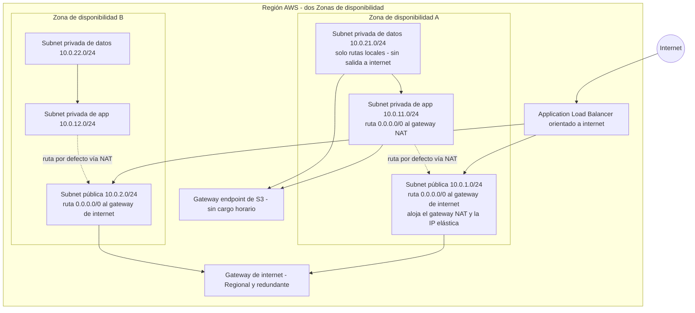
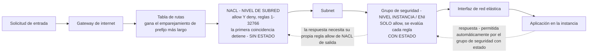
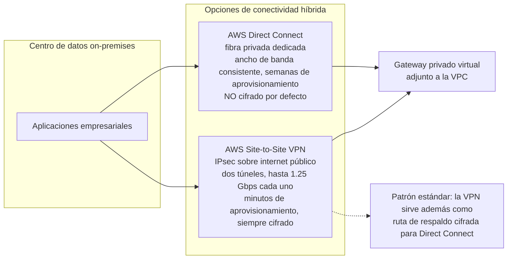
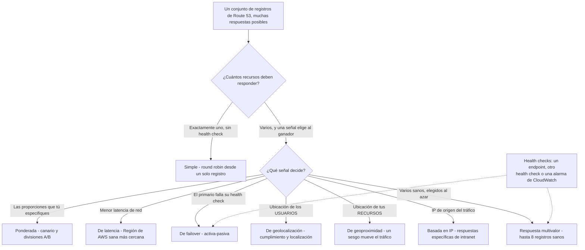
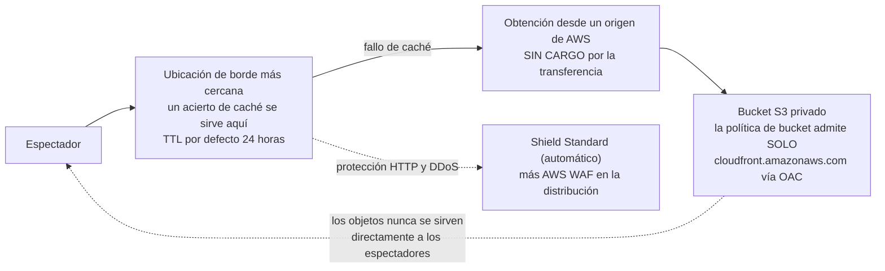
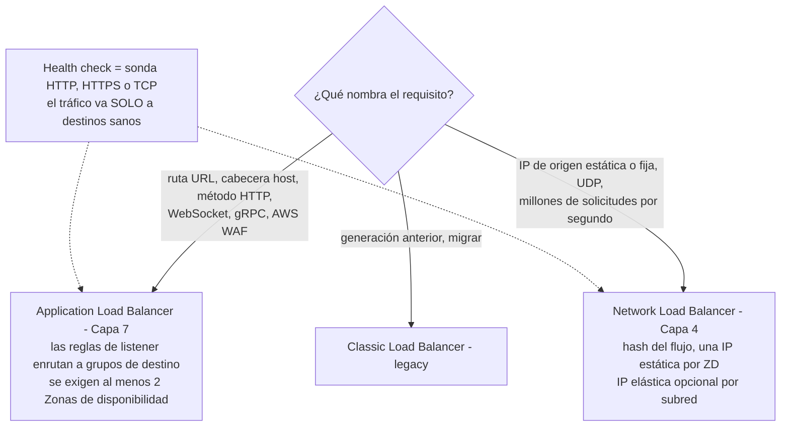
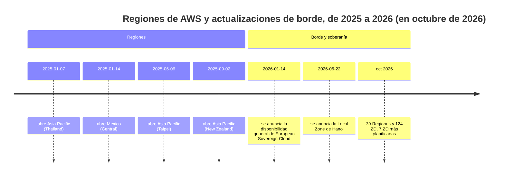

# Red, entrega de contenido y conectividad híbrida

El Dominio 3 (**Tecnología y servicios en la nube**) supone el **34% del contenido puntuado** del CLF-C02, y su tarea 3.5: *"Identificar servicios de red de AWS"*: es el bloque de conocimiento más mecánico de todo el examen. Todo en él es una definición más una regla: una subred vive en exactamente una Zona de disponibilidad, una subred pública es una **decisión de enrutamiento** y no una casilla, un gateway NAT es **solo de salida**, un grupo de seguridad es **con estado** mientras una NACL es **sin estado**, el emparejamiento de VPC **no es transitivo**, y Direct Connect es **dedicado con ancho de banda consistente**. Añade los *"propósitos de los balanceadores de carga"* de la tarea 3.3, las **ubicaciones de borde** de la tarea 3.2, y tienes una lección donde casi cada pregunta tiene exactamente una respuesta defendible: siempre que hayas memorizado las reglas y no el marketing.

```text
====================================================================
 CLF-C02 DOMINIO 3 (parte) — FICHA DE LECCIÓN DE RED (en octubre de 2026)
====================================================================
 VPC         gratis · CIDR /16 - /28 · una VPC predeterminada por Región
 SUBNET      vive en exactamente UNA ZD · pública SI Y SOLO SI la
             tabla de rutas enruta a un gateway de internet (no hay casilla)
 ROUTE TBL   destino -> objetivo, una por subred, GANA EL EMPAREJAMIENTO
             DE PREFIJO MÁS LARGO
 IGW         escalado horizontalmente, redundante, REGIONAL; adjuntarlo
             no hace nada hasta que se añade 0.0.0.0/0 -> igw-xxx
 NAT GW      SOLO DE SALIDA para subnets privadas; el NAT público vive
             en una subnet pública con una IP elástica
             $0.045/h + $0.045/GB (US East Ohio)
 EIP         IPv4 pública estática, se cobra EN USO O EN REPOSO
             $0.005/h -> $3.65/mes por IP
 DEFAULT VPC una subnet pública por AZ + IGW adjunto y enrutado + DNS activo
---------------------------------------------------------------------
 GRUPO DE    grupo de seguridad = INSTANCIA / ENI, SOLO allow, CON ESTADO,
 SEGURIDAD   se evalúan todas las reglas, por defecto: entrada desde sí
             mismo, salida hacia todos
             NACL = SUBRED, allow Y deny, SIN ESTADO,
             reglas 1-32766 de menor a mayor, la primera coincidencia detiene,
             por defecto: permitir todo en ambos sentidos
             ambos $0; ninguno filtra DNS, DHCP, IMDS, Time Sync
---------------------------------------------------------------------
 CONECT.     2 VPCs ............... peering (1:1, NO transitivo, $0)
             muchas VPCs + on-prem ... Transit Gateway ($0.05/adjunto/h)
             S3 / DynamoDB solo ..... gateway endpoint ($0)
             cualquier servicio AWS . endpoint de interfaz / PrivateLink
                                      ($0.01/h por AZ + $0.01/GB)
             on-prem, consistente ... Direct Connect (fibra dedicada)
             on-prem, rápido ........ Site-to-Site VPN (IPsec, 2 túneles)
---------------------------------------------------------------------
 DNS         Route 53 = registro + enrutamiento + health checks
             hosted zone = contenedor de registros (pública / privada VPC)
             8 políticas: simple, ponderada, de latencia, de conmutación,
             geolocalización, geoproximidad, basada en IP, multivalor (<= 8)
             zone $0.50/mes primeros 25 · queries $0.40/millón
             alias a destinos AWS $0 · CNAME no puede estar en el ápice
---------------------------------------------------------------------
 BORDE       CloudFront = caché HTTP(S) en ubicaciones de borde
             TTL por defecto 24 h, mínimo 0 s · obtención desde el origen gratis
             S3 privado + OAC (OAI es legacy) · WAF + Shield Standard
             ALB = L7, reglas host/ruta, WAF, >= 2 ZD, $0.0225/h
             NLB = L4, IP estática por AZ, sin WAF, $0.0225/h
             Global Accelerator = 2 IPs anycast estáticas, SIN caché
====================================================================
```

> [!NOTE]
> **Disciplina de alcance.** Cada servicio enseñado aquí como evaluable está o en la **fila "Networking and Content Delivery" en alcance** del CLF-C02 (Amazon CloudFront, AWS Direct Connect, AWS Global Accelerator, AWS PrivateLink, Amazon Route 53, AWS Transit Gateway, Amazon VPC, AWS VPN / Site-to-Site VPN / Client VPN), o nombrado en un enunciado de tarea del Dominio 3 (NACL, grupos de seguridad, Amazon Inspector, balanceadores de carga, ubicaciones de borde). **Amazon API Gateway** está en la misma fila pero se trata donde corresponde, en la lección de API; **Amazon VPC Lattice, AWS Cloud Map, AWS Network Access Analyzer y AWS Ground Station** están en la lista **fuera de alcance** de la guía y solo aparecen como distractores.

En esta lección vas a:

- nombrar cada **componente de VPC**: subnets, tablas de rutas, gateways de internet, gateways NAT, IP elásticas, interfaces de red elásticas;
- decidir **pública frente a privada** solo con la tabla de rutas, y explicar por qué **NAT es solo de salida**;
- separar la **VPC predeterminada** de una VPC personalizada y saber cuándo AWS te dice que construyas la tuya;
- ganar el **grupo de seguridad frente a NACL** en cada eje: alcance, acción de la regla, estado, evaluación, valores por defecto y referencias;
- aplicar la **regla de peering no transitivo** y la regla de no edge-to-edge;
- elegir **gateway endpoint frente a endpoint de interfaz frente a PrivateLink**: incluido el gratuito;
- separar **Site-to-Site VPN de Direct Connect** por tiempo de aprovisionamiento, consistencia del ancho de banda y cifrado;
- usar hosted zones de **Route 53**, las ocho políticas de enrutamiento y los health checks;
- colocar **CloudFront** delante de un origen S3 privado con **Origin Access Control**;
- elegir **ALB sobre NLB**, y saber por qué el Classic Load Balancer es *"la generación anterior"*;
- enunciar la frase de **Global Accelerator** y la elección de borde de cuatro vías;
- auditar las **trampas de coste en reposo**: gateways NAT, IP elásticas, aceleradores desactivados, puertos de Direct Connect;
- estudiar **cuatro casos de estudio publicados por AWS** y luego practicar con **12 preguntas tipo examen** más cuatro comprobaciones interactivas.

---

## 1. La VPC: una red aislada que tú diseñas

### 1.1 El conjunto de componentes

Amazon VPC es una *"red virtual lógicamente aislada"* que defines dentro de una Región, y AWS afirma que **no hay cargo adicional por usar una VPC** (en octubre de 2026). La tarea 3.5 solo te pide **identificar los componentes**, pero la redacción del examen asume que sabes exactamente qué hace cada componente.

| Componente | Qué es | La regla del examen |
|---|---|---|
| **VPC** | Tu red aislada, una por Región por cuenta más una **VPC predeterminada** | Bloques CIDR de **/16 a /28**; crear una es **gratis** |
| **Subnet** | Un rango CIDR **dentro de exactamente una Zona de disponibilidad** | Pública o privada lo decide la **tabla de rutas**, nunca una casilla |
| **Tabla de rutas** | Una lista ordenada de rutas destino CIDR → destino | Una asociada por subred (la tabla **principal** por defecto); **gana el emparejamiento de prefijo más largo** |
| **Gateway de internet (IGW)** | Un punto de entrada y salida redundante, **escalado horizontalmente y Regional** | Adjuntarlo **no hace nada** hasta que añades `0.0.0.0/0 → igw-xxx` |
| **Gateway NAT** | Internet solo de salida para recursos en subnets **privadas** | Un NAT público vive en una **subnet pública** y posee una **IP elástica** |
| **IP elástica (EIP)** | Una dirección IPv4 pública estática que puedes remapear | Se cobra **en uso *y* en reposo**: $0.005/hora, así que **$3.65/mes por IP** (en octubre de 2026) |
| **Interfaz de red elástica (ENI)** | La NIC virtual adjunta a una instancia o a un servicio de VPC | A esto es a lo que se adjunta un **grupo de seguridad**, de ahí *"con alcance de instancia"* |
| **Flow logs de VPC** | Registros de metadatos de tráfico permitido y rechazado | Captura **metadatos, no la carga útil** |
| **Resolvedor DNS proporcionado por Amazon** | El resolvedor integrado de la VPC | Sabe que existe; la dirección concreta del resolvedor no es material de examen |

### 1.2 Pública frente a privada es una decisión de enrutamiento

Una subred no tiene un atributo *"pública"*. Es **pública si y solo si su tabla de rutas lleva una ruta hacia un gateway de internet**; de lo contrario es privada. Esa sola frase resuelve más ítems del CLF-C02 que cualquier otro dato de red, porque disuelve de una vez tres trampas relacionadas:

- adjuntar un IGW a la VPC **no** hace pública a ninguna subred: todavía necesitas la ruta;
- una subred privada **con** una ruta hacia un gateway NAT sigue siendo **privada**: NAT le da internet de *salida*, no de entrada;
- una subred pública sin instancias con direcciones IPv4 públicas sigue siendo pública: simplemente no tiene nada por dónde salir.



> [!NOTE]
> **Lee el diagrama como un conjunto de reglas.** Las subnets de datos **no tienen ruta ni al gateway de internet ni al gateway NAT**: eso es exactamente lo que las hace inalcanzables desde internet. Las subnets de app tienen exactamente **un camino de salida**, el gateway NAT. Las subnets de públicas lo son puramente por la ruta `0.0.0.0/0 → igw` en *su propia* tabla de rutas.

### 1.3 El gateway NAT es solo de salida

AWS es explícito sobre la dirección: con un gateway NAT en su lugar, *"los servicios externos no pueden iniciar una conexión"* con tus instancias privadas. Una instancia privada puede por lo tanto **descargar actualizaciones del sistema operativo, obtener paquetes e invocar APIs de AWS**, mientras nada en internet puede llegar hasta ella. Si una pregunta necesita tráfico de internet de **entrada** hacia un cargador de trabajo privado, la respuesta es un **balanceador de carga orientado a internet** (o una instancia genuinamente pública): nunca *"abrir el gateway NAT"*.

La forma del coste también importa (US East (Ohio), en octubre de 2026; verifica el estado vigente antes de usarlo): **$0.045 por hora** más **$0.045 por GB** procesado, facturado en incrementos de una hora para las horas parciales, y un **gateway NAT regional se despliega por Zona de disponibilidad**: así que un diseño con dos ZD paga el cargo horario dos veces.

### 1.4 La VPC predeterminada frente a una VPC personalizada

AWS crea una **VPC predeterminada en cada Región**, y está lista para lanzar instancias en ella:

| Comportamiento de la VPC predeterminada | Qué te da |
|---|---|
| Subnets | **Una subnet pública por Zona de disponibilidad** |
| Internet | **IGW adjunto y ya enrutado**: las instancias reciben IPv4 pública automáticamente |
| DNS | **Resolución DNS activada** |
| Seguridad | **Grupo de seguridad predeterminado** (entrada solo desde sí mismo, salida permite todo) |
| ACL | **NACL predeterminada** (permite todo, en ambos sentidos) |

Esa conveniencia es exactamente por lo que AWS recomienda una **VPC personalizada para producción**: solo en una VPC personalizada eliges el CIDR, decides qué subnets son privadas, controlas las rutas y decides qué queda expuesto. En el examen, *"lanzar en la VPC predeterminada"* es una respuesta de prototipado, nunca una de arquitectura.

- **📚 ¿Sabías que…?** **Las direcciones IPv4 públicas cuestan dinero incluso en reposo**, $0.005 por hora en uso *o* sin uso, lo que son **$3.65 al mes por dirección** en un mes de 730 horas (en octubre de 2026; verifica el estado vigente antes de usarlo). **Las direcciones IPv4 privadas nunca se cobran**, y el Free Tier incluye **750 horas al mes de IPv4 pública con Amazon EC2**. Cuatro IP elásticas olvidadas y sin adjuntar cuestan por tanto unos **$14.60 al mes por absolutamente nada**, una línea de factura que al examen le encanta disfrazar dentro de una pregunta de optimización de costes.

### 1.5 Ejemplo E1: la VPC de tres capas, de principio a fin

**Escenario.** Una aplicación web debe ser alcanzable desde internet, debe salir a internet para actualizaciones y debe alojar una base de datos que nunca sea alcanzable directamente. Diseña tal como el examen espera.

| Paso | Decisión | Por qué (regla del examen) |
|---|---|---|
| 1 | VPC `10.0.0.0/16`, dos ZD | Las VPC son Regionales; las ZD aportan aislamiento de fallos |
| 2 | Públicas `10.0.1.0/24` y `10.0.2.0/24` | Una subnet por ZD, cada una con `0.0.0.0/0 → igw` |
| 3 | Privada de app `10.0.11.0/24` y `10.0.12.0/24` | Cada una con `0.0.0.0/0 → nat-xxx`: solo salida |
| 4 | Privada de datos `10.0.21.0/24` y `10.0.22.0/24` | **Solo rutas locales**; sin ruta al gateway de internet, sin ruta NAT |
| 5 | **ALB** orientado a internet en las subnets públicas | El único camino de entrada permitido hacia las capas privadas |
| 6 | Gateway NAT más IP elástica en una subnet pública | Acceso de salida para la capa de app |
| 7 | Grupos de seguridad encadenados **por referencia**: SG del ALB → SG de la app → SG de la BD | Las capas se confían entre sí, nunca CIDRs codificados |
| 8 | NACLs dejadas permisivas, o con un deny explícito para un CIDR erróneo | La NACL es la herramienta de denegación a nivel de subred |

### 1.6 Ejemplo E2: la factura de NAT

Un diseño con dos ZD ejecuta **dos gateways NAT durante 730 horas**, sale **500 GB por el procesamiento de NAT** y envía otros **500 GB a internet** a $0.09 por GB (en octubre de 2026; verifica el estado vigente antes de usarlo):

$$
2 \times 730 \times 0.045 = 65.70, \quad 500 \times 0.045 = 22.50, \quad 500 \times 0.09 = 45.00
$$

$$
\text{Total} = 65.70 + 22.50 + 45.00 = \$133.20 \text{ per month}
$$

La enseñanza no es la aritmética, son los **tres cargos separados**: el horario, el procesamiento de NAT por GB y la transferencia de datos saliente a internet. Cualquier opción que cite un total de un solo cargo está comprobando si te diste cuenta de los tres.

---

## 2. Grupos de seguridad frente a NACL: el clásico ítem

La tarea 3.5 dice *"Comprender la seguridad en una VPC (NACL, grupos de seguridad, Amazon Inspector)"*. La comparación grupo de seguridad frente a NACL es la pregunta de red más fiable del CLF-C02, y se decide en siete ejes.

| Característica | **Grupo de seguridad** | **NACL** |
|---|---|---|
| Alcance | **Nivel instancia / ENI** (se adjunta a la interfaz de red) | **Nivel de subred** (una por subred) |
| Acción de la regla | **Solo allow; sin reglas de denegación** | **Allow *y* deny** |
| Estado | **Con estado**, el tráfico de respuesta se permite automáticamente | **Sin estado**, el tráfico de respuesta debe permitirse con una regla explícita |
| Evaluación | **Se evalúan todas las reglas**; allow si alguna coincide | Reglas numeradas **1 to 32766**, de menor a mayor, **la primera coincidencia detiene** |
| Referencias | Puede referenciar **otros grupos de seguridad** | No puede referenciar grupos de seguridad; trabaja con CIDRs |
| Por defecto | Entrada **solo desde sí mismo**; **salida permite todo** | **Permite todo** en entrada y salida |
| Cargo | **$0** | **$0** |

De la fila de *estado* se siguen dos consecuencias. Con un grupo de seguridad **con estado** abres 443 de entrada y las respuestas vuelven solas. Con una NACL **sin estado** debes permitir **también** los puertos efímeros de retorno, o la conexión nunca se completa: el clásico fallo *"mi NACL rompió mi aplicación"*.

### 2.1 El recorrido del paquete



> [!WARNING]
> **Ninguno de los dos dispositivos filtra todo.** Los grupos de seguridad y las NACL **no** filtran Amazon DNS, DHCP, el **servicio de metadatos de la instancia (169.254.169.254)** ni Time Sync: esos lo sortean por diseño. Cualquier opción que diga *"bloquear el endpoint de metadatos con un grupo de seguridad"* es automáticamente incorrecta; el control correcto vive a nivel de **instancia** (las opciones de IMDS, como exigir tokens IMDSv2) o en la capa de IAM.

### 2.2 Los valores por defecto son permisivos, no seguros

- El **grupo de seguridad predeterminado** permite toda la salida y la entrada **solo desde sí mismo**: usable, pero no es una postura de seguridad.
- La **NACL predeterminada** permite **todo** el tráfico de entrada y de salida.

Y la regla que los estudiantes olvidan con más frecuencia: **los grupos de seguridad no pueden denegar**. Si una pregunta exige que bloquees un CIDR de un socio sin importar lo que permitan las reglas de instancia, la respuesta es una **regla de denegación de NACL** (o un deny de IAM / de política de bucket): nunca *"añadir una regla de denegación al grupo de seguridad"*.

### 2.3 Ejemplo E3: denegar un CIDR, en toda la subred

**Escenario.** La red del socio `203.0.113.0/24` debe bloquearse para que alcance una subred entera de inmediato, sin tocar una sola instancia.

| Opción | ¿Funciona? | Por qué |
|---|---|---|
| **Deny** de entrada en el grupo de seguridad | **No** | Los grupos de seguridad **no tienen reglas de denegación** |
| Regla **NACL** numerada `100`, `DENY 203.0.113.0/24` | **Sí** | Con alcance de subred, sin estado, la primera coincidencia detiene: la regla 100 vence al allow-all predeterminado |
| Revocar la entrada `0.0.0.0/0` del grupo de seguridad | Parcialmente | También bloquea a todos los demás; no es el comportamiento pedido |
| Regla de AWS WAF | Capa incorrecta | WAF es de **Capa 7** y se adjunta a un balanceador de carga o recurso similar: no filtra tráfico crudo de subred |

```fillblank
{
  "question": "Completa las afirmaciones de vocabulario de VPC con los términos correctos de AWS:",
  "template": "Una subred es pública solo cuando su tabla de rutas lleva una ruta hacia un {{1}}. Un gateway NAT da a una subred privada acceso a internet solo de {{2}}. Un grupo de seguridad es {{3}} y nunca puede contener una regla de denegación, mientras que una NACL es {{4}}, tiene alcance de {{5}}, y evalúa sus reglas numeradas de menor a mayor hasta que la primera coincidencia detiene.",
  "answers": {
    "1": "internet gateway",
    "2": "salida",
    "3": "con estado",
    "4": "sin estado",
    "5": "subred"
  },
  "distractors": ["virtual private gateway", "entrada", "sin conexión", "zona de disponibilidad", "interfaz de red elástica", "ubicación de borde", "endpoint de interfaz", "route processor"],
  "explanation": "Pública frente a privada es una decisión de enrutamiento: la ruta hacia un gateway de internet es lo que hace pública a una subred. Los gateways NAT son solo de salida. Los grupos de seguridad son con estado y solo-allow; las NACL son sin estado, permiten allow y deny, y tienen alcance de subred con evaluación de menor número primero y parada en la primera coincidencia."
}
```

- **📚 ¿Sabías que…?** Una regla de grupo de seguridad puede **referenciar otro grupo de seguridad** en lugar de un rango de IP, así funciona el patrón por capas del Ejemplo E1 con cero CIDRs codificados, y por eso mover una capa de aplicación a una subred nueva **no requiere editar ninguna regla**. Las NACL, en cambio, están ligadas a la subred y basadas en IP por naturaleza. Ambas siguen siendo **gratuitas** (en octubre de 2026; aplican cuotas por cuenta y por VPC, verifica el estado vigente antes de usarlas).

---

## 3. Peering de VPC: pairwise, nunca transitivo

El **peering de VPC** es una conexión de red privada entre dos VPC que permite que las instancias de una se comporten *"como si estuvieran en la misma red"*. AWS es inusualmente directo sobre sus límites, y esos límites son el examen.

| Dato del peering | Detalle |
|---|---|
| Topología | Una **relación estricta uno a uno**: **las relaciones de peering transitivas no están soportadas** |
| Dirección | Totalmente **bidireccional** *dentro* de un par (A↔B funciona en ambos sentidos) |
| Edge-to-edge | Los recursos de la VPC B **no** pueden usar el gateway de internet, el gateway NAT, la VPN, Direct Connect ni el gateway endpoint de la VPC A |
| CIDR superpuestos | **No permitido**: las dos VPC deben tener rangos de dirección no superpuestos |
| Cargo | **Sin cargo por crear** una conexión de peering; transferencia de datos en la misma ZD gratis, **entre ZD $0.01/GB** (en octubre de 2026; verifica el estado vigente antes de usarlo) |
| MTU | **9001 bytes**; **8500 bytes** para peering entre Regiones |
| Solicitudes pendientes | Expiran después de **7 días** si no se aceptan |
| Lo que no es | *"Ni un gateway ni una conexión VPN"* |

### 3.1 Ejemplo E4: la trampa del peering

**Escenario.** La VPC **A** está emparejada con la VPC **B**, y la VPC **A** también está emparejada con la VPC **C**. Un servicio nuevo en **B** debe alcanzar un servicio en **C**.

```text
   B  <---- peering ---->  A  <---- peering ---->  C
         B alcanza a A              A alcanza a C
         ...pero B NO alcanza a C   (el peering no es transitivo)
```

| Corrección propuesta | Veredicto |
|---|---|
| *"El tráfico fluirá porque A está en medio"* | **Incorrecto**: A no enruta entre sus pares; no es un router |
| *"Añadir una ruta a la tabla de rutas de A que apunte B hacia C"* | **Incorrecto**: las rutas de A nunca se convierten en las rutas de B o de C |
| *"B puede usar el gateway de internet de A para alcanzar a C"* | **Incorrecto**: **no hay edge-to-edge**; un par nunca puede pedir prestado tu IGW, NAT, VPN, Direct Connect o gateway endpoint |
| Crear una **tercera conexión de peering** B↔C | **Correcto a pequeña escala** (tres VPC) |
| Adjuntar ambas a **AWS Transit Gateway** | **Correcto a escala**: un hub con tablas de rutas, construido explícitamente para *"interconectar VPC y redes on-premises"* |

**Transit Gateway** se cobra por adjunto (**$0.05 por hora-adjunto ≈ $36.50/mes**) más **$0.02 por GB procesado**, con una MTU de **8500 bytes** (en octubre de 2026; verifica el estado vigente antes de usarlo). Seis adjuntos más 1 TB de procesamiento salen a:

$$
6 \times 0.05 \times 730 + 1024 \times 0.02 = 219.00 + 20.48 = \$239.48 \text{ per month}
$$

El peering es gratis pero es pairwise; el hub cuesta dinero pero escala. *"¿Cómo hablan estas VPC?"* se responde **contándolas**: dos → peering, muchas más on-premises → Transit Gateway.

- **📚 ¿Sabías que…?** El peering no tiene cargo horario pero no está exento de cargos de **transferencia de datos**: el tráfico en la misma ZD a través de una conexión de peering es gratis, mientras que **el tráfico entre ZD cuesta $0.01 por GB** (en octubre de 2026; verifica el estado vigente antes de usarlo). Una opción de *"peering gratis"* en una pregunta de costes es por tanto solo media verdad, y una solicitud de peering sin aceptar **expira en silencio a los 7 días**, que es exactamente el tipo de detalle operativo al que AWS le gusta meter en un distractor.

---

## 4. Endpoints de VPC y PrivateLink: alcanzar AWS sin internet

Un servicio de AWS al que llegas por internet público necesita un gateway NAT o un gateway de internet. Un **endpoint de VPC** le da a tu VPC un camino privado hacia el servicio en su lugar, y los dos tipos de endpoint difieren exactamente en los ejes que el examen pregunta.

| | **Gateway VPC endpoint** | **Endpoint de interfaz (AWS PrivateLink)** |
|---|---|---|
| Servicios | **Solo Amazon S3 y Amazon DynamoDB** | Esencialmente **cualquier servicio de AWS**, más servicios de socios y los tuyos |
| Mecanismo | Una ruta añadida a tu tabla de rutas (una lista de prefijos) | Una **interfaz de red elástica por subred** en cada ZD |
| ¿Necesita IGW / NAT? | **No**: funciona sin gateway de internet y sin dispositivo NAT | No |
| Cargo | **$0 por hora y $0 por GB** | **$0.01 por hora por ZD** + **$0.01 por GB procesado** |
| Alcance | **Solo local a la VPC**: no puede servir a redes on-premises, a pares de otra Región ni al tráfico de Transit Gateway | Amigable entre cuentas y entre Regiones; el proveedor debe poner delante del servicio un **balanceador de carga** |
| Cuota | **20 por Región, 255 por VPC** (verifica el estado vigente antes de usarlo) | **20 por Región** por defecto (verifica el estado vigente antes de usarlo) |
| Mejor para | *"Recortar mi factura de NAT para el tráfico de S3"* | Exponer un servicio de forma privada, o alcanzar cualquier servicio que no sea S3/DynamoDB |

**AWS PrivateLink** es la tecnología detrás de los endpoints de interfaz: los consumidores alcanzan el servicio de un proveedor *"como si estuvieran en tu VPC"*, el tráfico nunca sale de la red de AWS, y los consumidores no pueden verse entre sí. Nota el límite: **PrivateLink expone un *servicio*, no una VPC entera**: para conectividad de VPC completa la respuesta sigue siendo **peering** o **Transit Gateway**.

### 4.1 Ejemplo E5: aritmética de gateway endpoint frente a endpoint de interfaz

Un cargador de trabajo en **tres Zonas de disponibilidad** procesa **200 GB al mes** hacia Amazon S3.

$$
\text{Interface endpoint} = 3 \times 730 \times 0.01 + 200 \times 0.01 = 21.90 + 2.00 = \$23.90 \text{ per month}
$$

$$
\text{Gateway endpoint for S3} = \$0.00 \text{ per month}
$$

Mismo destino, mismo tráfico: **$23.90 frente a nada** (en octubre de 2026; verifica el estado vigente antes de usarlo). Esa brecha es todo el punto del examen: si el servicio es **S3 o DynamoDB**, el gateway endpoint es la respuesta por defecto, y *"crear un endpoint de interfaz para alcanzar S3"* es el distractor.

### 4.2 Ejemplo E6: el patrón de S3 en subnet privada

**Escenario.** Las instancias de una subnet privada deben leer objetos de un bucket: sin IP pública, sin gateway NAT, sin camino a internet.

1. Crea un **gateway VPC endpoint** para S3 en la VPC.
2. Acepta la ruta que añade a la tabla de rutas de la subnet (la ruta de lista de prefijos).
3. Limita una **política de endpoint** exactamente a lo necesario, por ejemplo `s3:GetObject`.
4. Deja el bucket privado: el tráfico nunca sale de la red de Amazon.

**Resultado:** cero cargo horario, cero cargo por GB, ningún gateway NAT que pagar y ninguna exposición de entrada. Esta es la respuesta canónica de *"reducir los costes de NAT"*.

### 4.3 Escenario: el servicio privado del proveedor SaaS

Un proveedor quiere vender un microservicio interno a varias cuentas de clientes sin publicarlo en internet.

| Parte | Qué construyen |
|---|---|
| **Proveedor (cuenta P)** | Un **NLB** delante del servicio, publicado como **servicio de endpoint de PrivateLink**; a los consumidores se les concede acceso explícitamente |
| **Consumidores (cuentas A y B)** | Un **endpoint de interfaz** cada uno, dentro de sus propias VPC |
| **Resultado** | El tráfico se queda en la red de AWS, los consumidores no se ven entre sí y el proveedor nunca expone un endpoint público |

Contraste en el examen: **una API pública** → API Gateway; **VPC completas hablando entre sí** → peering o Transit Gateway; **un servicio, de forma privada, en muchas cuentas** → PrivateLink.

---

## 5. Conectividad híbrida: Site-to-Site VPN frente a Direct Connect

La tarea 3.5 nombra la pareja directamente: *"Identificar opciones de conectividad de red hacia AWS (AWS VPN, AWS Direct Connect)"*. Uno es rápido y cifrado sobre internet; el otro es dedicado, consistente y **no cifrado por defecto**.

| | **AWS Direct Connect** | **AWS Site-to-Site VPN** |
|---|---|---|
| Medio | **Fibra privada dedicada**: funciona *"evitando a los proveedores de servicios de internet en tu camino de red"* | **Túneles IP Security (IPsec) sobre internet público** |
| Aprovisionamiento | **Semanas** (hay que aprovisionar un puerto físico) | **Minutos** |
| Ancho de banda | **Consistente**, desde 50 Mbps hasta velocidades de puerto de 100 Gbps | **Mejor esfuerzo**; **hasta 1.25 Gbps por túnel** |
| Cifrado | **No cifrado por defecto**, es un circuito privado, y MACsec es opcional | **Siempre cifrado**, IPsec es el punto de la conexión |
| Redundancia | Parejas de puertos y múltiples ubicaciones | **Dos túneles VPN por conexión**, con conmutación automática por fallo |
| Cargo recurrente (en octubre de 2026) | **$0.30/h (1 Gbps), $2.25/h (10 Gbps), $22.50/h (100 Gbps), $85.00/h (400 Gbps)** dedicado; puertos alojados desde **$0.03/h (50 Mbps)** | **$0.05/hora por conexión ≈ $36.50/mes** |
| Mejor para | Cargas de trabajo híbridas estables y de gran volumen y replicación donde la latencia debe ser predecible | Arranque rápido, tráfico en ráfaga, oficinas de sucursal, y la **ruta de respaldo cifrada para un enlace Direct Connect** |

Opciones en alcance relacionadas: **AWS Client VPN** para usuarios remotos individuales (OpenVPN gestionado) y **AWS VPN CloudHub** para enrutamiento hub-and-spoke entre varias conexiones Site-to-Site VPN. **AWS Transit Gateway** es la respuesta cuando el requisito son *muchas* VPC **y** redes on-premises dentro de un solo hub.



### 5.1 Ejemplo E7: DX frente a VPN, el precio de la consistencia

Para un mes completo de 730 horas (en octubre de 2026; verifica el estado vigente antes de usarlo):

| Opción | Aritmética | Mensual |
|---|---|---|
| **Puerto Direct Connect dedicado de 10 Gbps** | $2.25 × 730 | **$1.642.50** |
| **Una conexión Site-to-Site VPN** | $0.05 × 730 | **$36.50** |
| Razón | $1.642.50 ÷ $36.50 | **≈ 45×** |

Ninguno de los dos números es *"la respuesta correcta"* por sí solo. El examen quiere que leas el **requisito**: *"conexión privada dedicada con ancho de banda consistente"* → **Direct Connect**; *"túnel cifrado, establecido rápidamente"* → **Site-to-Site VPN**; *"portátil"* → **Client VPN**; *"muchas VPC más on-premises"* → **Transit Gateway**.

> [!IMPORTANT]
> **La trampa del cifrado corre en ambos sentidos.** Los estudiantes asumen que *"privado significa cifrado"*, así que marcan Direct Connect como cifrado, **no está cifrado por defecto**. Y asumen que *"por internet significa inseguro"*, así que marcan Site-to-Site VPN como no cifrado, **siempre es IPsec**. Lee el verbo del requisito: *ancho de banda consistente* selecciona Direct Connect, *cifrado* selecciona la VPN.

```matching
{
  "question": "Relaciona cada requisito de conectividad con la opción de AWS que el examen espera:",
  "pairs": [
    {"left": "Dos VPC deben hablar en privado sin cargo horario", "right": "Peering de VPC: pairwise, no transitivo, gratis de crear, $0.01/GB entre ZD"},
    {"left": "Muchas VPC más redes on-premises dentro de un solo hub", "right": "AWS Transit Gateway - $0.05 por hora-adjunto más $0.02 por GB procesado"},
    {"left": "Una subnet privada alcanzando Amazon S3 sin factura de NAT", "right": "Gateway VPC endpoint: solo S3 y DynamoDB, $0 por hora y $0 por GB"},
    {"left": "Un servicio interno expuesto en privado a varias cuentas", "right": "Endpoint de interfaz de AWS PrivateLink - $0.01 por hora por ZD más $0.01 por GB"},
    {"left": "Oficinas de sucursal que necesitan un enlace cifrado en minutos", "right": "AWS Site-to-Site VPN - IPsec sobre internet, dos túneles, $0.05 por hora"},
    {"left": "Un centro de datos que necesita ancho de banda consistente en un circuito privado", "right": "AWS Direct Connect: fibra dedicada, semanas de aprovisionamiento, NO cifrado por defecto"},
    {"left": "Portátiles remotos individuales que necesitan acceso remoto gestionado", "right": "AWS Client VPN - OpenVPN gestionado para usuarios individuales"}
  ],
  "explanation": "Lee primero la escala del requisito: dos VPC completas significa peering, muchas VPC más on-premises significa Transit Gateway, un servicio privado significa un endpoint (gateway endpoint gratuito para S3 y DynamoDB, endpoint de interfaz / PrivateLink de pago para todo lo demás). Para los enlaces híbridos, minutos y cifrado significa Site-to-Site VPN, un circuito privado dedicado con ancho de banda consistente significa Direct Connect, y un solo portátil significa Client VPN."
}
```

- **📚 ¿Sabías que…?** Cada conexión Site-to-Site VPN ofrece **dos túneles VPN**, y por eso *"configura ambos túneles"* es la respuesta estándar de alta disponibilidad: AWS documenta el techo por túnel como **hasta 1.25 Gbps**, así que un solo túnel nunca se vende como 1.25 Gbps garantizados de rendimiento de la aplicación (en octubre de 2026; verifica el estado vigente antes de usarlo). Los puertos de Direct Connect, en cambio, **se facturan haya o no tráfico**: un puerto de 10 Gbps en reposo sigue costando unos **$1.642.50 al mes**.

---

## 6. Amazon Route 53: DNS, hosted zones, políticas de enrutamiento y health checks

La tarea 3.5 solo dice *"Comprender el propósito de Amazon Route 53"*, pero AWS define ese propósito como **tres funciones en un solo servicio**: un servicio web de **Sistema de Nombres de Dominio (DNS)** altamente disponible y escalable, **registro de nombres de dominio** y **health checking**.

### 6.1 Hosted zones

Una **hosted zone** es un contenedor de registros.

| Tipo | Qué enruta | Cargo (en octubre de 2026; verifica el estado vigente antes de usarlo) |
|---|---|---|
| **Hosted zone pública** | Registros resolubles **en internet** | **$0.50/mes para los primeros 25**, después $0.10 cada uno; 10.000 registros incluidos, registros extra **$0.0015/mes** cada uno |
| **Hosted zone privada** | Registros resolubles **dentro de una o más VPC** | Precio de la zona como arriba; **las consultas dentro de la VPC son gratis** |

Dos reglas de registros son material fijo de examen: un **CNAME no puede estar en el ápice de la zona** (la raíz del dominio) mientras que un **registro alias sí puede**, y los registros alias que apuntan a destinos de AWS, balanceadores de carga, distribuciones de CloudFront, endpoints web de S3, **no incurran en cargo por las consultas**.

Precios de consulta estándar, si los necesitas (en octubre de 2026; verifica el estado vigente antes de usarlo): **$0.40 por millón** de consultas estándar, **$0.60 por millón** para latencia, **$0.70 por millón** para geolocalización y geoproximidad, **$0.80 por millón** para enrutamiento basado en IP.

### 6.2 Las ocho políticas de enrutamiento

| Política | La frase detonante en el enunciado | Qué hace |
|---|---|---|
| **Simple** | *"un recurso"*, sin health check | Respuestas round-robin simples desde un solo registro |
| **Ponderada** | *"en las proporciones que tú especifiques"* | Lanzamientos canario y divisiones A/B por porcentaje |
| **De latency** | *"múltiples Regiones de AWS"**, **mejor latencia** | Envía a cada usuario a la Región con la menor latencia de red |
| **De failover** | *"conmutación **activa-pasiva***" | Responde el primario hasta que su **health check** falla, y después el secundario |
| **De geolocalización** | la ubicación de tus **usuarios** | Localización y cumplimiento por país, continente o región del usuario |
| **De geoproximidad** | la ubicación de tus **recursos**, con un **sesgo** | Un sesgo numérico agranda o encoge el área que sirve cada recurso |
| **Basada en IP** | **la dirección IP de origen del tráfico** | Respuestas distintas para redes de origen distintas (específicas de intranet) |
| **Respuesta multivalor** | *"hasta ocho registros sanos"**, devueltos **al azar** | Una alternativa ligera, a nivel DNS, a un balanceador de carga |



```matching
{
  "question": "Relaciona cada política de enrutamiento de Route 53 con la frase detonante que la señala en el examen:",
  "pairs": [
    {"left": "Enrutamiento simple", "right": "Un recurso y sin health check: respuestas round-robin desde un solo registro"},
    {"left": "Enrutamiento ponderado", "right": "En las proporciones que tú especifiques: lanzamientos canario y divisiones A/B"},
    {"left": "Enrutamiento por latencia", "right": "La Región de AWS que da a tus usuarios la menor latencia de red"},
    {"left": "Enrutamiento de failover", "right": "Conmutación activa-pasiva dirigida por un health check en el endpoint primario"},
    {"left": "Enrutamiento por geolocalización", "right": "La ubicación de tus USUARIOS, cumplimiento y localización"},
    {"left": "Enrutamiento por geoproximidad", "right": "La ubicación de tus RECURSOS, con un sesgo que mueve el tráfico"},
    {"left": "Enrutamiento basado en IP", "right": "La dirección IP de origen del tráfico: respuestas específicas de intranet"},
    {"left": "Enrutamiento de respuesta multivalor", "right": "Hasta ocho registros sanos devueltos al azar: un balanceador de carga a nivel DNS"}
  ],
  "explanation": "Route 53 publica ocho políticas de enrutamiento. Lee el enunciado por la detonante: proporciones significa ponderada, mejor latencia significa latencia, activa-pasiva significa failover más health check, usuarios significa geolocalización, recursos y sesgo significa geoproximidad, IP de origen significa basada en IP, hasta ocho sanos significa multivalor, y un recurso significa simple."
}
```

### 6.3 Los health checks dirigen el failover

Un **health check de Route 53** monitorea *"la salud y el rendimiento de tus recursos"* y puede apuntar a **un endpoint, otro health check o una alarma de CloudWatch**. Sus dos trabajos de examen: dirigir el **failover de DNS** y filtrar los registros de **respuesta multivalor** para devolver solo los sanos.

Cargos (en octubre de 2026; verifica el estado vigente antes de usarlo): los **primeros 50 health checks de endpoint de AWS son gratis**, después **$0.50 al mes** para endpoints de AWS o **$0.75 al mes** para endpoints que no son de AWS: mientras que las comprobaciones contra **endpoints de Elastic Load Balancing y endpoints web de S3 son gratis y automáticas**.

> [!WARNING]
> **El failover de DNS no es instantáneo.** Una respuesta de DNS se **cachéa durante su TTL**, así que un failover dirigido solo por health checks de Route 53 surte efecto tan rápido como expire el registro en caché. Cuando una pregunta exige un failover **sub-segundo**, o redacción como *"sin esperar al TTL de DNS"* para un cargador de trabajo TCP o UDP, la respuesta esperada es **AWS Global Accelerator** o un health check de **Elastic Load Balancing**: no Route 53 solo.

### 6.4 Ejemplo E8: la tienda global

**Escenario.** Una tienda necesita baja latencia en todo el mundo, un origen S3 privado, residencia de datos en la UE y una ruta de recuperación ante desastres.

| Requisito | Elección de Route 53 / borde |
|---|---|
| Origen privado detrás de una CDN | Distribución **CloudFront** delante de un **bucket S3 privado** con **OAC** |
| Enviar a los usuarios de la UE a la UE | **Enrutamiento por geolocalización** |
| DR automático cuando falla el origen primario | **Enrutamiento de failover** más un **health check** en el primario |
| Consultas DNS gratis en el ápice | **Registro alias A** apuntando a la distribución de CloudFront (alias a destinos de AWS es **$0**) |
| Proteger la capa HTTP | **AWS WAF** en la distribución, con **Shield Standard** ya activo |

- **📚 ¿Sabías que…?** **El enrutamiento de respuesta multivalor devuelve hasta ocho registros sanos al azar**: un detalle que AWS afirma explícitamente, y la razón por la que la política a veces se describe como un balanceador de carga para pobres. Aun así no puede hacer lo que hace un balanceador de carga real: sin lógica de balanceo entre zonas, sin connection draining, sin reglas de Capa 7. Cuando el enunciado menciona **enrutamiento basado en ruta o grupos de destino con health check**, la respuesta es Elastic Load Balancing, no Route 53.

---

## 7. Amazon CloudFront y las ubicaciones de borde

La tarea 3.2 nombra las **ubicaciones de borde** y los **beneficios de las ubicaciones de borde**. CloudFront se construyó sobre una *"red mundial de centros de datos llamadas ubicaciones de borde"*: la ubicación de borde más cercana sirve una copia en caché, lo que produce **menor latencia, mayores tasas de transferencia de datos y mejor fiabilidad** para los espectadores.

| Concepto | Detalle a profundidad de examen |
|---|---|
| **Origen** | Amazon S3, u un **origen personalizado**: EC2, un endpoint de Application Load Balancing, tu servidor HTTP, o un endpoint *web* de S3 |
| **Caché** | **TTL por defecto de 24 horas**, mínimo **0 segundos**; la **invalidación** purga antes: **1.000 rutas al mes gratis**, después **$0.005 por ruta** |
| **Obtención del origen** | La transferencia del origen a CloudFront es **siempre gratis cuando se usan orígenes de AWS** (en octubre de 2026): la descarga *desde el borde* es lo que se factura |
| **Contenido privado** | **URL firmada = un objeto**; **cookie firmada = varios objetos** |
| **Patrón S3 privado** | El bucket se queda **privado** + **Origin Access Control (OAC)** + una política de bucket que admite solo a `cloudfront.amazonaws.com`: AWS dice *"recomendamos que uses OAC"*. **OAI es la opción legacy** |
| **Cupo gratuito** | **1 TB de transferencia de datos saliente + 10.000.000 peticiones HTTP(S) + 2.000.000 CloudFront Functions al mes** (en octubre de 2026; verifica el estado vigente antes de usarlo) |
| **Sinergia DDoS** | **Shield Standard** es automático delante de CloudFront, y **AWS WAF** puede adjuntarse a la distribución: la protección HTTP y la protección DDoS llegan con la CDN, no después |
| **Clases de precio** | **Todas las ubicaciones / 200 / 100**: restringe la entrega a regiones más baratas |
| **Recuento de bordes** | *"Cientos"* de ubicaciones de borde en todo el mundo; AWS no publica una sola cifra verificable, así que **verifica el estado vigente antes de usarlo** |

### 7.1 El patrón de S3 privado, y las dos versiones incorrectas



| Versión | Veredicto |
|---|---|
| **Bucket público** para que CloudFront pueda leerlo | **Incorrecto**: cualquiera puede saltarse la CDN y leer los objetos |
| **OAC** más una política de bucket que nombra `cloudfront.amazonaws.com`, idealmente condicionada al ARN de la distribución | **Correcto**: el bucket se queda privado y los espectadores deben pasar por CloudFront |
| **OAI** (Origin Access Identity) | **Legacy**; sin Regiones nuevas después de enero de 2023 y sin soporte de SSE-KMS; consérvalo solo para mantener una configuración existente |

### 7.2 Ejemplo E9: la factura de CloudFront

Un sitio entrega **2 TB (2.048 GB)** y **30 millones de peticiones HTTPS** en un mes desde Estados Unidos (en octubre de 2026; verifica el estado vigente antes de usarlo). El cupo gratuito absorbe **1 TB** y **10.000.000 peticiones**:

$$
\text{Data transfer} = (2048 - 1024) \times 0.085 = 1024 \times 0.085 = \$87.04
$$

$$
\text{Requests} = \frac{30{,}000{,}000 - 10{,}000{,}000}{10{,}000} \times 0.0100 = 2{,}000 \times 0.0100 = \$20.00
$$

$$
\text{Total} = 87.04 + 20.00 = \$107.04 \text{ per month}
$$

Observa qué **no** está en esa factura: **las obtenciones del origen desde S3 son $0**, y las primeras **1.000 rutas de invalidación** son gratis. La línea recurrente del examen es que CloudFront delante de S3 **ahorra** dinero en el lado del origen mientras cobra en el borde.

- **📚 ¿Sabías que…?** CloudFront cobra **HTTPS por separado de HTTP**: $0.0100 frente a $0.0075 por cada 10.000 peticiones después del cupo gratuito (en octubre de 2026; verifica el estado vigente antes de usarlo). Para 20 millones de peticiones posteriores al free tier, esa diferencia sola son **$5.00 al mes**, lo que hace que *"forzar HTTPS"* sea simultáneamente una respuesta de seguridad y una observación de precios. Y como las obtenciones del origen son gratis con orígenes de AWS, un origen que ya es un bucket S3 nunca te cobra dos veces por los mismos bytes.

---

## 8. Elastic Load Balancing: ALB frente a NLB

La tarea 3.3 exige *"Identificar los propósitos de los balanceadores de carga"*. La propia definición de AWS de ese propósito es una frase con dos mitades: un balanceador de carga distribuye el tráfico entre destinos en **al menos una Zona de disponibilidad** y enruta el tráfico **solo hacia los destinos sanos**.

| | **Application Load Balancer (ALB)** | **Network Load Balancer (NLB)** | **Classic Load Balancer (CLB)** |
|---|---|---|---|
| Capa OSI | **Capa 7**, *"funciona en la capa de aplicación, la séptima capa"* | **Capa 4**, *"funciona en la cuarta capa"* | Capa 4 y Capa 7 (legacy) |
| Protocolos | HTTP, HTTPS, WebSocket, gRPC | TCP, UDP, TLS | HTTP, HTTPS, TCP |
| Enrutamiento | **Reglas de listener** por host, ruta y método → grupos de destino | **Hash del flujo** por la tupla de conexión | Round robin / menos solicitudes pendientes |
| Direcciones | Un nombre de DNS con **IPs de nodo rotativas** | **Una IP estática por Zona de disponibilidad**, más una **IP elástica opcional por subred** | IPs de nodo detrás de un nombre de DNS |
| Zonas de disponibilidad | **Se exigen al menos 2 ZD habilitadas**; cross-zone activado por defecto | Se recomiendan varias; cross-zone **desactivado por defecto** | Se recomienda |
| AWS WAF | **Sí** | No | No |
| Perfil de rendimiento | Cargas web generales | **Millones de solicitudes por segundo** |: |
| Cargo (en octubre de 2026) | **$0.0225/hora + $0.008 por hora-LCU** (1 LCU = 25 conexiones nuevas/s, 3.000 conexiones activas/min, 1 GB/hora; **las primeras 10 reglas gratis**) | **$0.0225/hora + $0.006 por hora-NLCU** (1 NLCU TCP = 800 conexiones nuevas/s, 100.000 conexiones activas/min) | El Free Tier comparte **750 horas/mes** con el ALB |
| Estado | Elección por defecto para aplicaciones web | IPs estáticas, rendimiento extremo, UDP/TLS | AWS lo llama *"la generación anterior"*: migra |

Tres reglas deciden la mayoría de las preguntas de ELB:

1. **"ruta URL" / "cabecera host" / "método HTTP" / "AWS WAF"** → **ALB**.
2. **"IP de origen estática o fija" / "UDP" / "millones de solicitudes por segundo"** → **NLB**.
3. **"generación anterior" / "migrar"** → **Classic Load Balancer**.

Y un hecho contraintuitivo: **tanto los balanceadores orientados a internet como los internos alcanzan sus destinos por direcciones IP privadas** (en octubre de 2026). *"Orientado a internet"* describe el endpoint del propio balanceador, no el camino hacia tus instancias: así que un diseño multicapa es ALB orientado a internet → capa web → ALB **interno** → capa de aplicación.

### 8.1 Ejemplo E10: aritmética de ALB frente a NLB

Para un mes completo de 730 horas (en octubre de 2026; verifica el estado vigente antes de usarlo):

| Balanceador | Base | Unidades de capacidad | Total |
|---|---|---|---|
| **ALB** | 730 × $0.0225 = $16.43 | 3 LCU × 730 × $0.008 = $17.52 | **$33.95/mes** |
| **NLB** | 730 × $0.0225 = $16.43 | 1 NLCU × 730 × $0.006 = $4.38 | **$20.81/mes** |

El NLB es más barato aquí, pero una factura más barata nunca es la respuesta a *"¿qué balanceador de carga necesito?"*. Elige por **capacidad primero** (reglas de Capa 7 y WAF → ALB; IPs estáticas y UDP → NLB), y después lee la factura.



```dragdrop
{
  "question": "Ordena estas opciones de conectividad desde el acceso más estrecho a un servicio privado hasta la conexión híbrida más amplia:",
  "items": [
    "Gateway VPC endpoint: solo S3 y DynamoDB, sin cargo horario",
    "Endpoint de interfaz (PrivateLink) - cualquier servicio de AWS o socio, por hora más por GB",
    "Peering de VPC: dos VPC completas, pairwise, no transitivo",
    "AWS Transit Gateway: muchas VPC más on-premises, cobrado por adjunto",
    "AWS Site-to-Site VPN: enlace cifrado sobre internet, listo en minutos",
    "AWS Direct Connect: fibra privada dedicada con ancho de banda consistente"
  ],
  "correctOrder": [
    "Gateway VPC endpoint: solo S3 y DynamoDB, sin cargo horario",
    "Endpoint de interfaz (PrivateLink) - cualquier servicio de AWS o socio, por hora más por GB",
    "Peering de VPC: dos VPC completas, pairwise, no transitivo",
    "AWS Transit Gateway: muchas VPC más on-premises, cobrado por adjunto",
    "AWS Site-to-Site VPN: enlace cifrado sobre internet, listo en minutos",
    "AWS Direct Connect: fibra privada dedicada con ancho de banda consistente"
  ],
  "explanation": "La escalera empieza en un solo servicio privado dentro de una VPC (gateway endpoint gratuito), se amplía a cualquier servicio (endpoint de interfaz de pago), luego a VPC completas (peering), luego a muchas VPC más redes on-premises (Transit Gateway) y finalmente a los dos enlaces híbridos: la VPN por velocidad y cifrado, Direct Connect por un camino de producción dedicado y de ancho de banda consistente."
}
```

- **📚 ¿Sabías que…?** **La entrada de DNS de Elastic Load Balancing tiene un TTL de 60 segundos**, y por eso reemplazar toda una flota detrás de un balanceador de carga se propaga en unos un minuto en lugar de al instante: un caso raro donde el examen espera que sepas que **el lento es el DNS, no el balanceador de carga**. Por otro lado, **el ALB exige al menos dos Zonas de disponibilidad habilitadas** (en octubre de 2026), así que un ALB dentro de una VPC de una sola ZD es una configuración inválida por diseño, no un ahorro.

---

## 9. AWS Global Accelerator y la elección de borde de cuatro vías

**La frase para memorizar:** Global Accelerator te da **dos direcciones IPv4 anycast estáticas** anunciadas desde las ubicaciones de borde de AWS, y luego transporta el tráfico TCP y UDP por la **red global de AWS** hasta el **endpoint regional sano** más cercano: un ALB, un NLB, una instancia EC2 o una IP elástica. Es un **punto de entrada fijo con conmutación rápida por fallo y sin caché**, construido para cargas de trabajo TCP/UDP **no cacheables** como juegos, IoT y VoIP.

| | **Amazon CloudFront** | **AWS Global Accelerator** | **Amazon Route 53** | **Elastic Load Balancing** |
|---|---|---|---|---|
| Capa del trabajo | **Cachéa objetos HTTP(S) en el borde** | **IPs anycast estáticas más enrutamiento por backbone** | **Traducción nombre DNS → IP** | **Reparto regional hacia destinos sanos** |
| Caché | **Sí**: ese es todo el punto | **Sin caché en absoluto** | No | No |
| Direcciones | El nombre de dominio de la distribución | **Dos direcciones IPv4 estáticas** (cuatro dual-stack) | Registros de hosted zone | Un nombre de DNS con IPs de nodo rotativas |
| Velocidad de failover | Comportamiento de caché y de origen | **Sub-segundo, sin espera de TTL de DNS** | Depende del **TTL del registro** | Health checks cada pocos segundos |
| Cargo (en octubre de 2026) | Paga por GB y por petición, con un generoso free tier | **$0.025/hora, se factura aunque esté desactivado**, más transferencia de datos por GB, y cada IP estática es **$0.005/hora** | Hosted zone más cargos por consulta | Por hora más unidades de capacidad |

### 9.1 Ejemplo E11: el acelerador desactivado sigue facturando

Se crea un acelerador, se prueba y luego se **desactiva** durante un mes completo de 730 horas con **cero tráfico** (en octubre de 2026; verifica el estado vigente antes de usarlo):

$$
\text{Accelerator} = 0.025 \times 730 = \$18.25, \qquad \text{Two static IPs} = 2 \times 0.005 \times 730 = \$7.30
$$

$$
\text{Total with zero traffic} = 18.25 + 7.30 = \$25.55 \text{ per month}
$$

De aquí salen dos hábitos de examen: **"desactivado" no significa "gratis"**, y **cualquier dirección estática, IP elástica o IP de Global Accelerator, es un cargo continuo**. Combinado con el gateway NAT del Ejemplo E2 y el puerto de Direct Connect en reposo del Ejemplo E7, forman la familia de trampas de *recursos en reposo* del examen.

- **📚 ¿Sabías que…?** La elección de cuatro vías se colapsa en una pregunta: **¿el cliente necesita caché o una IP fija?** Contenido web cacheable → **CloudFront**; una IP fija para TCP/UDP no cacheable → **Global Accelerator**; un nombre legible para humanos → **Route 53**; repartir una carga regional entre destinos por salud → **Elastic Load Balancing**. El recargo por GB de la transferencia de datos de Global Accelerator varía según la Región y el borde, y AWS publica la tarifa horaria del acelerador pero no una sola cifra plana por GB: trata cualquier cifra concreta por GB de Global Accelerator como **no verificada**.

---

## 10. Coste de red: qué es gratis y qué te factura en silencio

La mitad de las preguntas de precios del Dominio 3 tratan de servicios que son **gratuitos por diseño**, y la otra mitad de recursos que **facturan en reposo**.

| Gratis (en octubre de 2026) | Factura (en octubre de 2026; verifica el estado vigente antes de usarlo) |
|---|---|
| Crear y usar una **VPC**, **subnets**, **tablas de rutas** | **Gateway NAT**: $0.045/h + $0.045/GB |
| **Grupos de seguridad** y **NACL** | **IPv4 pública / IP elástica**: $0.005/h **en uso o en reposo** |
| **Crear** una conexión de peering de VPC | Peering **transferencia de datos entre ZD**: $0.01/GB |
| **Gateway VPC endpoints** ($0/h, $0/GB) | **Endpoints de interfaz**: $0.01/h por ZD + $0.01/GB |
| **Consultas de hosted zone privada** y **consultas alias a destinos de AWS** | **Transit Gateway**: $0.05/hora-adjunto + $0.02/GB |
| **Obtenciones del origen en CloudFront** desde orígenes de AWS | **Site-to-Site VPN**: $0.05/h ≈ $36.50/mes |
| **Los primeros 50 health checks de endpoint de AWS**; comprobaciones de ELB y de sitios web de S3 | **Puertos de Direct Connect**: se facturan con cero tráfico |
| **Las primeras 1.000 rutas de invalidación de CloudFront** al mes | **Global Accelerator**: se factura aunque esté **desactivado** |
| **El primer 1 TB más 10.000.000 peticiones** en CloudFront al mes | **Cargos horarios de ALB y NLB** más unidades de capacidad |

La familia de trampas es consistente: una pregunta describe un recurso **callado, sin usar, o borrado pero todavía adjunto** y pide el impacto mensual. El patrón a memorizar es:

```text
recurso que retiene una dirección IP   -> se cobre usado o no
recurso con puerto/adjunto por hora    -> se cobre usado o no
recurso marcado "disabled"             -> normalmente TODAVÍA se cobra
tráfico que cruza ZD o sale de AWS     -> se cobra por GB
```

> [!NOTE]
> **Nunca cites un precio sin fecha.** Cada cifra de esta lección está sellada **en octubre de 2026** y debe **verificarse antes de usarla**: AWS cambia los precios de NAT, IPv4, Route 53, CloudFront, ELB y Direct Connect según su propio calendario, y el examen evalúa *qué recurso factura*, no tu memoria del centavo exacto.

---

## 11. Actualizaciones de 2026 que tocan red, borde y transferencia de datos

### Actualizaciones de 2026 (en octubre de 2026)

> [!NOTE]
> **Cambios con fuente detrás de las cifras de esta lección.** Cada ítem está citado de una página de AWS consultada en **octubre de 2026**: vuelve a abrir la misma página antes de apoyarte en la cifra, porque todos derivan:
> - **La red sigue creciendo.** *"La nube de AWS abarca 124 Zonas de disponibilidad dentro de 39 Regiones geográficas, con planes anunciados para 7 Zonas de disponibilidad más y 2 Regiones de AWS más en el Kingdom of Saudi Arabia y Chile."* Cuatro Regiones se abrieron durante 2025: Asia Pacific (Thailand) `ap-southeast-7` el **2025-01-07**, Mexico (Central) `mx-central-1` el **2025-01-14**, Asia Pacific (Taipei) `ap-east-2` el **2025-06-06**, Asia Pacific (New Zealand) `ap-southeast-6` el **2025-09-02** *(mapa de Regiones y Zonas de disponibilidad de AWS; historial de documentación de Regiones)*.
> - **AWS European Sovereign Cloud (`eusc-de-east-1`) anunció disponibilidad general el 2026-01-14**, pero **no** aparece en la página pública de recuento de Regiones: así que cita *"39 Regiones / 124 ZD en octubre de 2026"* y fecha la nube soberana por separado en lugar de sumarla al total *(AWS News Blog, 2026-01-14; mapa de Regiones)*.
> - **El borde crece hacia abajo, no solo hacia afuera.** AWS Local Zones se anuncian como **"más de 30 ubicaciones en seis continentes"**, con la Local Zone de **New York City** disponible el **2025-01-08** y una Local Zone de **Hanoi** anunciada el **2026-06-22**. Comprobación de alcance: **AWS Wavelength está explícitamente fuera de alcance** y **AWS Local Zones aparece en ninguna de las dos listas**, así que una pregunta de *borde* del Dominio 3 sigue esperando **las ubicaciones de borde de CloudFront** *(página de producto de Local Zones; What's New 2025-01-08; AWS Weekly Roundup 2026-06-22; listas de servicios de la guía de examen)*.
> - **La salida gratuita son tres mecanismos, no uno.** **100 GB al mes** de transferencia de datos saliente es gratis desde las Regiones de AWS, más **1 TB al mes separado** gratis a través de Amazon CloudFront: un cambio de **2021** (efectivo el 2021-12-01) que sigue vigente en octubre de 2026. Un cliente que *se va* de AWS recibe en cambio un **crédito de salida con aprobación** con **90 días** para completar la mudanza *(FAQ de transferencia de datos de EC2; AWS News Blog, 2021)*.
> - **La lista de servicios de red en alcance fue reconstruida.** **AWS PrivateLink, AWS Transit Gateway, AWS Site-to-Site VPN y AWS Client VPN** se **añadieron** todos desde la guía de la era de lanzamiento `Version 1.0`, mientras **AWS Network Firewall**, AWS Data Exchange y Amazon MSK pasaron a la lista **fuera de alcance**: entradas en alcance **128 → 111**, fuera de alcance **11 → 55** *(listas de servicios en alcance / fuera de alcance, consulta en octubre de 2026)*.
> - **La transferencia de datos sigue siendo evaluable.** La guía actual eliminó la viñeta de conocimiento de la era de lanzamiento *"Data transfer charges"* de la Tarea 4.1, pero la lista de habilidades sigue exigiendo *"Comprender los costes de transferencia de datos entrantes y salientes (por ejemplo, de una Región de AWS a otra Región, dentro de la misma Región)"* *(guía de examen de la era de lanzamiento frente a la actual, consulta en octubre de 2026)*.



- **📚 ¿Sabías que…?** El cupo gratuito de **100 GB al mes** de transferencia saliente se describe rutinariamente en material de preparación más reciente como un cambio de Free Tier de 2025: no lo es. AWS lo publicó en **2021** (efectivo el 2021-12-01) y sigue vigente en **octubre de 2026**; el mecanismo genuinamente nuevo es el *crédito de salida con aprobación* con una ventana de **90 días** para clientes que se mudan de AWS por completo. Tres números distintos: **100 GB de salida de una Región**, **1 TB a través de CloudFront**, **90 días para irse**: describen tres reglas distintas, y solo los dos primeros son cupos mensuales.

---

## Casos Reales

AWS publica cómo se ven estos patrones en producción. Cada cifra de abajo es **afirmada por el cliente o por AWS y no auditada**, citada con su fuente para que puedas comprobarla: el punto evaluable es el **patrón** (qué servicio de borde se eligió, qué cargo de transferencia de datos se eliminó por ingeniería, qué failover se automatizó), no la cifra de marketing.

### Caso A, Amazon Prime Video, Thursday Night Football: seis Regiones y una CDN de borde

| Elemento | Detalle |
|---|---|
| **Industria / contexto** | Transmisión de deportes en vivo, donde *"la fiabilidad y la baja latencia son absolutamente críticas porque cada segundo perdido impacta negativamente a los espectadores"* (BA Winston, responsable global de reproducción y entrega de vídeo digital, Amazon Video) |
| **Servicios AWS mencionados** | **Seis Regiones de AWS**, **Amazon CloudFront**, AWS Elemental MediaTailor, Amazon DynamoDB, Amazon EC2, **failover multi-ZD y regional** |
| **Resultados principales (publicados por AWS)** | **11 partidos de la NFL transmitidos a 18.4 millones de aficionados en 224 países y territorios** durante la temporada regular de la NFL de 2017; las particiones de DynamoDB se **duplicaron desde la consola** de cara a los picos de pausas publicitarias; las emisiones se enviaron *"a través de seis Regiones de AWS y AWS Elemental"* |
| **Lección de red** | **Entrega por borde más un origen multi-Región más failover con health checks**: CloudFront termina el largo viaje del espectador en una ubicación de borde mientras los health checks del balanceador y del DNS protegen el origen que hay detrás |
| **Fuente** | aws.amazon.com/solutions/case-studies/amazon-prime-video (consulta en octubre de 2026) |

*Lección de examen:* la pregunta nunca es *"cuántos aficionados"*, es **qué servicio hizo el trabajo de entrega**. Cuando el enunciado va de **cachear objetos cerca de espectadores globales**, la respuesta es **las ubicaciones de borde de CloudFront**; cuando va de **que el origen sobreviva a una falla de Región**, la respuesta es **multi-ZD más multi-Región con health checks**. El vídeo en vivo que **no** puede cachearse pertenece a la misma familia, ahí es donde **Global Accelerator** (IP estáticas, sin caché) gana su frase.

### Caso B, Box: $2.23 millones encontrados en la factura de transferencia de datos

| Elemento | Detalle |
|---|---|
| **Industria / contexto** | SaaS empresarial que sirve a más de 120.000 organizaciones; el encargo era mejorar la eficiencia del gasto *"sin perjudicar la seguridad, la fiabilidad o el rendimiento"* |
| **Servicios AWS mencionados** | Revisiones del **Well-Architected Framework** con Solutions Architects, **escalado por capas de S3 y S3 Glacier**, higiene de volúmenes y snapshots de EBS, filtrado de eventos de CloudTrail y **enrutamiento del tráfico alrededor de los gateways de internet** para evitar cargos innecesarios de transferencia de datos |
| **Resultados principales (publicados por AWS, afirmados por el cliente)** | **$2.23 millones de ahorros**, descompuestos en **$438.000 entre ZD**, **más de $1.1 millones al año en egress**, **más de $500.000 al año en almacenamiento** y **$192.000 al año en registros** |
| **Lección de red** | **La transferencia de datos es una decisión de arquitectura**: el movimiento entre ZD y la salida a internet son cargos por GB que un cambio de enrutamiento, mantener el tráfico en una ZD, mantenerlo fuera del camino de internet, elimina de forma permanente |
| **Fuente** | aws.amazon.com/solutions/case-studies/box-case-study (consulta en octubre de 2026) |

*Lección de examen:* las dos líneas de red de Box, **$438.000 de transferencia entre ZD** y **$1.1 millones de egress**, son la misma aritmética que la factura de NAT del Ejemplo E2 y la factura de CloudFront del Ejemplo E9, solo que a escala empresarial. El patrón: **mantener el tráfico dentro de una Zona de disponibilidad siempre que se pueda, usar un gateway endpoint en lugar de NAT para S3, y dejar que CloudFront absorba la salida pública**: sus obtenciones del origen son gratis con orígenes de AWS.

### Caso C, Capital One: failover de Route 53 y recuperación regional automatizada

| Elemento | Detalle |
|---|---|
| **Industria / contexto** | Banco del Fortune 100 que pasa de pruebas periódicas de recuperación ante desastres a sistemas que *"previenen, detectan y recuperan automáticamente"* |
| **Servicios AWS mencionados** | **Failover regional automatizado**, **Amazon Route 53**, Amazon CloudWatch, un hub central de recuperación, ejercicios mensuales de **AWS GameDay** e ingeniería del caos |
| **Resultados principales (publicados por AWS)** | **Reducción de eventos de severidad crítica en 80 to 90 por ciento**; tiempo de recuperación recortado **de horas a minutos** en miles de componentes, restaurados en orden de dependencia; las pruebas trimestrales entre Regiones se convirtieron en **experimentos de caos mensuales** |
| **Lección de red** | **Los health checks de DNS más el enrutamiento de failover son la mitad visible de un diseño multi-Región**: Route 53 vigila el endpoint primario y responde con el secundario en cuanto falla el health check, mientras los endpoints regionales que hay detrás están preaprovisionados: el cambio es un cambio de enrutamiento, no una reconstrucción |
| **Fuente** | aws.amazon.com/solutions/case-studies/capital-one-improving-resilience-case-study (consulta en octubre de 2026) |

*Lección de examen:* cuando el enunciado dice **el primario falla su health check y el secundario debe responder**, la respuesta es **enrutamiento de failover de Route 53 más un health check** (sección 6.2), y el caso es cómo se ve eso a escala empresarial. Dos calificadores viajan con él: **multi-Región protege una Región, multi-ZD protege una ZD**: son requisitos distintos; y como una respuesta de DNS se **cachéa durante su TTL**, *"recuperación en minutos"* es un resultado diseñado, no un instante de failover de DNS. Cuando un exigió un failover **sub-segundo**, la respuesta sigue siendo **Global Accelerator** o un health check de **Elastic Load Balancing** (sección 6.3).

### Caso D, athenahealth: cientos de VPC detrás de un hub de Transit Gateway

| Elemento | Detalle |
|---|---|
| **Industria / contexto** | Software sanitario (sensible a HIPAA) donde el monitoreo de salida estaba repartido por un extenso conjunto de VPC y el coste de inspección seguía subiendo |
| **Servicios AWS mencionados** | **AWS Transit Gateway**, **AWS Direct Connect**, **AWS Network Firewall** (centralizado), propagación de políticas con **AWS RAM** a las cuentas, CloudFormation con reglas como código, AWS Shield en la hoja de ruta |
| **Resultados principales (publicados por AWS)** | *"Al pasar a un modelo de despliegue centralizado en AWS, la compañía redujo sus costes generales de inspección en un 95 por ciento"*; la política de firewall se añadió a **cientos de VPC en 120 cuentas "en solo unos días"**; *"Solo ocho personas diseñaron y desplegaron el nuevo diseño de seguridad sin interrupciones."* |
| **Lección de red** | **Un hub vence a una malla**: Transit Gateway interconecta las VPC y el enlace on-premises, así que un solo punto de inspección se adjunta y se gobierna una vez en lugar de clonarse por cada VPC: exactamente la regla de la sección 3 de *"muchas VPC más on-premises → Transit Gateway"* |
| **Fuente** | aws.amazon.com/solutions/case-studies/athenahealth-case-study (consulta en octubre de 2026) |

*Lección de examen:* **la lista de servicios de un caso de estudio no es la lista en alcance del examen.** Los nombres de esta página incluyen **AWS Network Firewall**, que ahora está en la lista **fuera de alcance** del CLF-C02 (en octubre de 2026), así que solo puede aparecer como distractor: mientras el mismo párrafo nombra **Transit Gateway** y **Direct Connect**, ambos claramente en alcance. Lee el párrafo por el *patrón* (centralizar el hub, propagar una sola política) y luego responde solo con servicios en alcance.

- **📚 ¿Sabías que…?** La guía de examen actual **añadió** cuatro servicios de red que la guía V1.0 de la era de lanzamiento no listaba, **AWS PrivateLink, AWS Transit Gateway, AWS Site-to-Site VPN y AWS Client VPN**, y **sacó AWS Network Firewall** hacia la lista fuera de alcance (listas de servicios en alcance y fuera de alcance, consulta en octubre de 2026). Las notas de revisión escritas antes de que se reconstruyeran esas listas te dirán lo contrario, y por eso la guía que descargas *hoy* es la única autoridad sobre lo que es evaluable.

### Lo que comparten los dos casos

| Patrón de valor | Evidencia | Principio subyacente de red |
|---|---|---|
| El borde hace el trabajo de la distancia | Prime Video: **18.4 M de aficionados, 224 países**, CloudFront | Las **ubicaciones de borde** acortan el último tramo mientras el origen sigue siendo el autoritativo |
| El failover se diseña, no se espera | Prime Video: seis Regiones, multi-ZD más failover regional | Los health checks más el enrutamiento dan **activa-pasiva** (failover de Route 53) o **activa-activa** (latencia y multivalor) |
| La transferencia de datos es una línea de coste de primera clase | Box: **$438 K entre ZD más $1.1 M de egress** | Los límites de ZD y los gateways de internet son **bordes facturables** |
| La arquitectura vence al descuento | Box: una revisión de Well-Architected antes de cualquier precio comprometido | La capa de red es la palanca **gratuita**; los compromisos son la de pago |

### Lo que añaden los casos C y D

| Patrón de valor | Evidencia | Principio subyacente de red |
|---|---|---|
| El failover es un control diseñado y testeable | Capital One: **eventos de severidad crítica −80 to 90%**, recuperación **horas → minutos** | **Enrutamiento de failover de Route 53 más un health check**, con endpoints preaprovisionados en una segunda Región |
| Hub-and-spoke vence a la malla a escala de cuentas | athenahealth: **cientos de VPC, 120 cuentas, un modelo central** | **Transit Gateway** interconecta donde el peering no puede (no transitivo), y una sola política se propaga una vez |
| La dedicación es una palabra-requisito | athenahealth: **Direct Connect** junto al hub | *Ancho de banda consistente / dedicado* selecciona **Direct Connect**; *cifrado / minutos* selecciona **Site-to-Site VPN** |
| Servicios de caso ≠ alcance del examen | athenahealth nombra **AWS Network Firewall** | Responde solo con nombres **en alcance**: los servicios fuera de alcance son distractores incluso cuando AWS los usa |

> [!WARNING]
> **Cómo leer las cifras de los casos de estudio el día del examen:** cada cifra de arriba es un número **afirmado por el cliente y no auditado** publicado por AWS, nunca una garantía de AWS, y *"hasta"* es un **techo**, nunca un promedio. Un caso nunca autoriza una respuesta fuera de alcance: se te pide **seleccionar el servicio en alcance** (CloudFront, Route 53, Elastic Load Balancing, VPC, Direct Connect, Global Accelerator, Transit Gateway, PrivateLink), no el servicio que solo aparece en casos de estudio y resulta estar en el párrafo. Nota también que **Amazon VPC Lattice, AWS Cloud Map, AWS Network Access Analyzer y AWS Ground Station** están en la lista **fuera de alcance** de la guía, son distractores.

---

## Preguntas de Práctica (Practice Questions)

```question
{
  "id": "clf-08-q1",
  "type": "multiple-choice",
  "question": "¿Qué afirmación sobre grupos de seguridad y NACL es correcta?",
  "options": [
    "Los grupos de seguridad son sin estado y con alcance de subred, mientras que las NACL son con estado y con alcance de instancia",
    "Los grupos de seguridad son con estado, solo-allow y con alcance de la interfaz de red, mientras que las NACL son sin estado, permiten allow y deny y tienen alcance de la subred",
    "Ambos son con estado, ambos tienen alcance de la subred y ambos admiten reglas de denegación",
    "Los grupos de seguridad admiten reglas de denegación y evalúan las reglas de menor número primero, mientras que las NACL no"
  ],
  "correct": 1,
  "explanation": "Un grupo de seguridad se adjunta a una interfaz de red elástica (alcance de instancia), es CON ESTADO, así que las respuestas se permiten automáticamente, contiene solo reglas de allow y evalúa cada regla. Una NACL se aplica a nivel de SUBRED, es SIN ESTADO, así que el tráfico de retorno necesita un allow explícito, admite allow y deny, y evalúa las reglas numeradas 1-32766 de menor a mayor hasta que la primera coincidencia detiene. Ambos son permisivos por defecto y ambos son gratuitos."
}
```

```question
{
  "id": "clf-08-q2",
  "type": "multiple-choice",
  "question": "Las instancias de una subnet privada deben descargar parches del sistema operativo, pero nada de internet debe poder alcanzar esas instancias. ¿Qué diseño cumple el requisito?",
  "options": [
    "Adjuntar un gateway de internet a la VPC y añadir una ruta 0.0.0.0/0 al gateway de internet en la tabla de rutas de la subnet privada",
    "Colocar un gateway NAT con una IP elástica en una subnet pública y apuntar la ruta 0.0.0.0/0 de la subnet privada hacia él, dando acceso solo de salida",
    "Asignar direcciones IPv4 públicas a las instancias y abrir el puerto 22 en su grupo de seguridad",
    "Emparejar la VPC privada con una tercera VPC que tenga acceso a internet, usando enrutamiento edge-to-edge"
  ],
  "correct": 1,
  "explanation": "Un gateway NAT es solo de salida: los servicios externos no pueden iniciar una conexión con las instancias privadas, mientras las instancias sí pueden alcanzar internet. Añadir una ruta al gateway de internet haría pública a la subred, asignar direcciones IPv4 públicas expone las instancias, y el peering nunca concede acceso edge-to-edge: un par no puede tomar prestado el gateway de internet de otra VPC."
}
```

```question
{
  "id": "clf-08-q3",
  "type": "multiple-choice",
  "question": "La VPC A está emparejada con la VPC B, y la VPC A también está emparejada con la VPC C. Un servicio de la VPC B debe alcanzar un servicio de la VPC C. ¿Qué afirmación es correcta?",
  "options": [
    "El tráfico fluye automáticamente, porque el peering de VPC es transitivo por defecto",
    "El peering no es transitivo: debes crear una conexión de peering directa de B a C, o usar AWS Transit Gateway cuando hay muchas VPC involucradas",
    "Añadir una ruta a la tabla de rutas de la VPC A convierte a la VPC A en un router entre B y C",
    "La VPC B puede usar el gateway de internet de la VPC A para alcanzar a la VPC C, porque el peering permite el enrutamiento edge-to-edge"
  ],
  "correct": 1,
  "explanation": "AWS documenta el peering como una relación estricta uno a uno: las relaciones de peering transitivas no están soportadas, y el enrutamiento edge-to-edge está bloqueado, así que los recursos de un par no pueden usar el gateway de internet, el gateway NAT, la VPN, Direct Connect ni el gateway endpoint de otro par. Una tercera conexión de peering funciona a pequeña escala; AWS Transit Gateway es la respuesta de hub a escala."
}
```

```question
{
  "id": "clf-08-q4",
  "type": "multiple-choice",
  "question": "Una subnet privada debe leer objetos de Amazon S3 sin gateway de internet, sin gateway NAT y sin direcciones IP públicas, con cero cargo horario y cero cargo de endpoint por GB. ¿Qué opción encaja?",
  "options": [
    "Un endpoint de interfaz (AWS PrivateLink) para Amazon S3 en cada Zona de disponibilidad",
    "Un gateway VPC endpoint para Amazon S3, cuya ruta se añade a la tabla de rutas de la subred, sin cargo horario y sin cargo por GB",
    "Un gateway NAT en la subnet pública más una ruta al gateway de internet",
    "Una conexión de peering de VPC con una VPC que ya tenga acceso a internet"
  ],
  "correct": 1,
  "explanation": "Los gateway VPC endpoints están disponibles solo para Amazon S3 y Amazon DynamoDB, no requieren gateway de internet ni dispositivo NAT y no cuestan nada por hora ni por GB. Los endpoints de interfaz cobran unos $0.01 por hora por Zona de disponibilidad más $0.01 por GB procesado, los gateways NAT añaden tanto un cargo horario como uno por GB, y el peering nunca proporciona acceso a internet edge-to-edge."
}
```

```question
{
  "id": "clf-08-q5",
  "type": "multiple-choice",
  "question": "Una carga de trabajo financiera requiere una conexión privada dedicada a un centro de datos on-premises con ancho de banda consistente, evitando a los proveedores de servicios de internet en el camino de red. ¿Qué servicio debe seleccionar el arquitecto?",
  "options": [
    "AWS Site-to-Site VPN: dos túneles IPsec establecidos sobre internet público en minutos",
    "AWS Direct Connect: una conexión privada dedicada con ancho de banda consistente",
    "AWS Client VPN: una VPN de acceso remoto gestionada para usuarios individuales",
    "AWS Transit Gateway: un hub que interconecta VPC y redes on-premises"
  ],
  "correct": 1,
  "explanation": "Direct Connect es el enlace privado dedicado que evita a los ISP y aporta ancho de banda consistente; nota que NO está cifrado por defecto. Site-to-Site VPN es la opción rápida, siempre cifrada y de mejor esfuerzo, con dos túneles de hasta 1.25 Gbps cada uno. Client VPN sirve a portátiles individuales, y Transit Gateway es el hub de muchas VPC más on-premises, no un circuito dedicado punto a punto."
}
```

```question
{
  "id": "clf-08-q6",
  "type": "multiple-choice",
  "question": "Un diseño de recuperación ante desastres debe responder con el endpoint primario mientras esté sano y conmutar al endpoint secundario en el instante en que el primario falle su health check. ¿Qué configuración de Route 53 se requiere?",
  "options": [
    "Enrutamiento por latencia hacia la Región de AWS con el mejor rendimiento de red",
    "Enrutamiento ponderado que envía una proporción fija de tráfico al secundario",
    "Enrutamiento de failover acompañado de un health check en el endpoint primario",
    "Enrutamiento por geolocalización que redirige a los usuarios según su país"
  ],
  "correct": 2,
  "explanation": "El enrutamiento de failover es el patrón activa-pasiva y depende de un health check de Route 53, que puede vigilar un endpoint, otro health check o una alarma de CloudWatch. El enrutamiento por latencia elige la Región más rápida, el ponderado divide según las proporciones que especifiques para lanzamientos canario o A/B, y el de geolocalización responde según la ubicación del usuario: ninguno conmuta según la salud."
}
```

```question
{
  "id": "clf-08-q7",
  "type": "multiple-choice",
  "question": "Un equipo quiere que Amazon CloudFront sirva objetos de un bucket de Amazon S3 que debe permanecer privado, de modo que los espectadores nunca puedan saltarse la CDN. ¿Qué configuración recomienda AWS?",
  "options": [
    "Poner la ACL del bucket en public-read y confiar en la caché de CloudFront para limitar la exposición",
    "Activar Origin Access Control (OAC) en la distribución y añadir una política de bucket que permita solo a cloudfront.amazonaws.com leer los objetos",
    "Copiar cada objeto manualmente a cada ubicación de borde y borrar el bucket de origen",
    "Adjuntar AWS WAF al bucket de S3 y dejar la política de bucket sin cambios"
  ],
  "correct": 1,
  "explanation": "AWS recomienda Origin Access Control: el bucket se queda privado, la política de bucket nombra a cloudfront.amazonaws.com como único principal, idealmente condicionada al ARN de la distribución, y los espectadores deben obtener los objetos a través de CloudFront. OAI es la alternativa legacy, un bucket público permite que cualquiera se salte la CDN, y WAF se adjunta a la distribución, no a un bucket de S3."
}
```

```question
{
  "id": "clf-08-q8",
  "type": "multiple-choice",
  "question": "Una aplicación web necesita enrutamiento por host y por ruta, terminación de HTTPS, protección de AWS WAF y debe repartirse en al menos dos Zonas de disponibilidad. ¿Qué balanceador de carga encaja?",
  "options": [
    "Network Load Balancer - Capa 4 con hash del flujo y una IP estática por Zona de disponibilidad",
    "Application Load Balancer: reglas de listener de Capa 7 que enrutan a grupos de destino, con soporte de WAF y un mínimo de dos Zonas de disponibilidad habilitadas",
    "Classic Load Balancer: la generación anterior que AWS recomienda abandonar",
    "Enrutamiento de respuesta multivalor de Route 53, que devuelve hasta ocho registros sanos al azar"
  ],
  "correct": 1,
  "explanation": "Solo el ALB opera en la Capa 7 con reglas de listener por host y por ruta, admite AWS WAF y exige formalmente al menos dos Zonas de disponibilidad habilitadas. El NLB es de Capa 4 sin reglas de host ni de ruta y sin WAF, el Classic Load Balancer se llama explícitamente generación anterior, y Route 53 no puede hacer enrutamiento con health check a nivel de destino para una aplicación."
}
```

```question
{
  "id": "clf-08-q9",
  "type": "multiple-choice",
  "question": "Un backend de juegos debe presentar una dirección IP de origen fija y predecible a una lista permitida de un socio y debe manejar volúmenes muy altos de tráfico UDP. ¿Qué opción debería elegirse?",
  "options": [
    "Un Application Load Balancer, porque pone delante servicios basados en HTTP con IPs de nodo rotativas detrás de un nombre de DNS",
    "Un Network Load Balancer, que ofrece una IP estática por Zona de disponibilidad, una IP elástica opcional por subred, rendimiento de Capa 4 en millones de solicitudes por segundo y soporte de UDP",
    "Cookies firmadas de Amazon CloudFront, que fijan la IP del origen durante la vida de la cookie",
    "Enrutamiento simple de Amazon Route 53, que devuelve un solo registro y por tanto una sola dirección"
  ],
  "correct": 1,
  "explanation": "IPs de origen estáticas o fijas más UDP son la firma del Network Load Balancer: Capa 4, hash del flujo, una IP estática por Zona de disponibilidad e IP elásticas opcionales por subred, a millones de solicitudes por segundo. Las IP del ALB rotan detrás de su nombre de DNS y no admite UDP, CloudFront es una CDN en caché sin contrato de IP estática frente al cliente, y el enrutamiento simple no ofrece health checking."
}
```

```question
{
  "id": "clf-08-q10",
  "type": "multiple-choice",
  "question": "En octubre de 2026, un diseño ejecuta dos gateways NAT durante un mes completo de 730 horas en US East (Ohio) a $0.045 por hora, procesa 500 GB por NAT a $0.045 por GB y envía otros 500 GB a internet a $0.09 por GB. ¿Cuál es el total mensual aproximado?",
  "options": [
    "$65.70: solo se facturan los dos cargos horarios",
    "$88.20: cargos horarios más procesamiento de NAT, pero la salida a internet es gratis",
    "$110.70: cargos horarios más salida a internet, pero el procesamiento de NAT es gratis",
    "$133.20: cargos horarios más procesamiento de NAT más transferencia de datos saliente a internet"
  ],
  "correct": 3,
  "explanation": "Hay tres cargos separados: 2 x 730 x $0.045 = $65.70 horarios, 500 x $0.045 = $22.50 de procesamiento de NAT y 500 x $0.09 = $45.00 de transferencia de datos saliente a internet, sumando $133.20 al mes. Las opciones que ofrecen un total de un solo cargo están comprobando si te diste cuenta de que un gateway NAT factura por hora Y por GB, y de que salir de AWS también cuesta por GB."
}
```

```question
{
  "id": "clf-08-q11",
  "type": "multiple-choice",
  "question": "En octubre de 2026, un cargador de trabajo en una Región estándar de AWS envía un total de 120 GB a internet en un mes, y nada de ese tráfico pasa por Amazon CloudFront. ¿Qué afirmación es correcta?",
  "options": [
    "Los 120 GB son gratis, porque AWS ofrece transferencia de datos saliente gratuita ilimitada desde cada Región",
    "Los primeros 100 GB de transferencia de datos saliente al mes son gratis y los 20 GB restantes se facturan a la tarifa estándar de transferencia saliente",
    "Los 120 GB son gratis siempre que la cuenta también use Amazon CloudFront en otra parte de la arquitectura",
    "Nada es gratis: el cupo mensual gratuito de transferencia saliente solo se aplica a las cuentas que se están cerrando"
  ],
  "correct": 1,
  "explanation": "AWS da 100 GB al mes de transferencia de datos gratis desde las Regiones de AWS, y los 20 GB excedentes se facturan: un cambio efectivo el 2021-12-01 que sigue vigente en octubre de 2026. Amazon CloudFront tiene un cupo separado y mayor de 1 TB al mes que solo se aplica al tráfico que de hecho fluye por CloudFront, no a la salida de la Región. El crédito de salida con aprobación y ventana de 90 días es un mecanismo distinto para clientes que se van de AWS por completo, no un cupo mensual."
}
```

```question
{
  "id": "clf-08-q12",
  "type": "multiple-choice",
  "question": "Una empresa sanitario ejecuta cientos de VPC en 120 cuentas y necesita un solo hub que las interconecte entre sí y con un centro de datos on-premises mediante un enlace dedicado con ancho de banda consistente. ¿Qué par de servicios en alcance del CLF-C02 entrega ese diseño?",
  "options": [
    "Una malla completa de conexiones de peering de VPC más un gateway NAT para llevar el tráfico on-premises",
    "AWS Transit Gateway para las muchas VPC más AWS Direct Connect para el enlace dedicado on-premises",
    "AWS Site-to-Site VPN solo más AWS PrivateLink para conectividad de VPC completa entre cuentas",
    "Amazon CloudFront más enrutamiento por geolocalización de Amazon Route 53 para colocar el tráfico"
  ],
  "correct": 1,
  "explanation": "El peering es una relación estricta uno a uno y no transitiva, así que una malla de peerings es exactamente lo que AWS construyó Transit Gateway ($0.05 por hora-adjunto más $0.02 por GB procesado) para reemplazar cuando muchas VPC y redes on-premises se encuentran en un solo hub. Direct Connect es el circuito privado dedicado con ancho de banda consistente: semanas de aprovisionamiento y NO cifrado por defecto. Site-to-Site VPN es cifrado y rápido de construir pero es un túnel de internet de mejor esfuerzo en lugar de un enlace dedicado, PrivateLink expone un solo servicio y no VPC completas, y CloudFront más Route 53 son servicios de borde y DNS, no interconexión de VPC. Nótese que el caso real de athenahealth también usó AWS Network Firewall, que está en la lista fuera de alcance en octubre de 2026 y solo puede aparecer como distractor."
}
```

---

> [!IMPORTANT]
> **Veredicto comparativo: red y entrega de contenido × on-premises × otras nubes × DIY/gestionado**
> - **Frente a on-premises:** on premises compras tú mismo todo el plano, routers, switches, firewalls, appliances de balanceo, un concentrador VPN, un contrato de CDN, más el cableado, los pares de HA, la planificación de capacidad y el presupuesto de hardware de repuesto. AWS te da una **VPC lógicamente aislada gratis**, **grupos de seguridad y NACL sin cargo**, un **gateway endpoint gratis hacia S3**, **DNS con ocho políticas de enrutamiento por $0.50 por hosted zone al mes**, **protección DDoS gratuita de Shield Standard delante de CloudFront** y **balanceadores de carga facturados por la hora y la unidad de capacidad en lugar de por appliance**. El intercambio es que dejas de poseer la capa física e heredas la mitad de AWS de la responsabilidad compartida, todavía diseñas las subnets, las rutas, las reglas y el failover.
> - **Frente a otras nubes:** cada gran proveedor ofrece una red virtual, una CDN, un servicio DNS y enlaces híbridos, así que las diferencias evalables son el vocabulario y las reglas *específicas* de AWS: **pública significa "ruta a un gateway de internet"**, **NAT es solo de salida**, **grupo de seguridad con estado frente a NACL sin estado**, **peering no transitivo y sin edge-to-edge**, **los gateway endpoints son solo S3/DynamoDB y son gratis**, **Direct Connect no está cifrado por defecto mientras Site-to-Site VPN siempre lo está**, **OAC es el recomendado y OAI es legacy**, y **el ALB necesita dos ZD** (todo en octubre de 2026). No asumas que los valores por defecto, la nomenclatura o los precios de otro proveedor se trasladen a AWS.
> - **Frente a DIY / hazlo tú mismo:** el balanceo de carga artesanal significa operar una flota de reverse proxy con tus propios health checks y sin opción de IP estática; el failover de DNS artesanal significa escribir tu propio observador de TTL y aun así esperar al TTL; la caché de borde artesanal significa comprar servidores en cada ciudad; el cifrado artesanal sobre tu WAN significa gestionar tú mismo el intercambio de claves IPsec. La respuesta de Well-Architected es consistentemente **gestionado y con la menor sobrecarga operativa**: **CloudFront en lugar de una caché autoalojada**, **health checks de Route 53 en lugar de un cron job**, **ALB/NLB en lugar de un clúster de proxy**, **Direct Connect o Site-to-Site VPN en lugar de un túnel casero**, y **un gateway endpoint en lugar de pagar por NAT para alcanzar S3**: con la **elección de arquitectura (gratis) probada antes que cualquier precio comprometido (de pago)**.

> [!WARNING]
> **Trampas de día de examen para esta lección:**
> - **Pública frente a privada es una decisión de tabla de rutas**: una subred es pública solo si enruta a un gateway de internet; adjuntar un IGW no cambia nada por sí mismo;
> - **El gateway NAT es solo de salida**: la entrada de internet hacia un cargador de trabajo privado necesita un **balanceador de carga orientado a internet** (o una instancia pública), nunca el NAT;
> - **VPC predeterminada = una subnet pública por ZD, IGW adjunto y enrutado, DNS activo**; sin embargo AWS recomienda una **VPC personalizada para producción**;
> - **Grupo de seguridad = instancia/ENI, solo-allow, con estado, se evalúan todas las reglas**; **NACL = subred, allow-y-deny, sin estado, reglas 1 to 32766 la primera coincidencia detiene**;
> - **Ni los SG ni las NACL filtran DNS, DHCP, IMDS (169.254.169.254) ni Time Sync**: *"bloquear el endpoint de metadatos con un grupo de seguridad"* es siempre incorrecto;
> - **Los grupos de seguridad no pueden denegar**: ¿necesitas un deny? Eso es una regla de **NACL**, o un deny de IAM/política de bucket;
> - **El peering no es transitivo y no tiene edge-to-edge**: un par no puede tomar prestado tu IGW, NAT, VPN, Direct Connect o gateway endpoint; dos VPC → peering, muchas más on-premises → **Transit Gateway**;
> - **El gateway endpoint es solo para S3/DynamoDB, gratis y local a la VPC**; **el endpoint de interfaz se factura por hora más por GB, y el proveedor necesita un balanceador de carga**; **PrivateLink expone un servicio, no una VPC entera**;
> - **Direct Connect NO está cifrado por defecto; Site-to-Site VPN sí lo está siempre**: las dos mitades del *"privado significa cifrado"* de siempre;
> - **Site-to-Site VPN = dos túneles, hasta 1.25 Gbps cada uno**: *"configura ambos túneles"* es la respuesta estándar de alta disponibilidad, y el VPN es también la **ruta de respaldo cifrada de Direct Connect**;
> - **Route 53 por palabras clave**: proporciones → **ponderado**; mejor latencia → **latencia**; activa-pasiva → **failover más health check**; usuarios → **geolocalización**; recursos y sesgo → **geoproximidad**; IP de origen → **basada en IP**; hasta ocho sanos → **multivalor**; un recurso → **simple**;
> - **Un CNAME no puede estar en la cúspide de la zona; un alias sí**, y **las consultas de alias a objetivos AWS son gratis**: el failover de DNS se cachea durante el TTL, así que nunca es instantáneo;
> - **CloudFront cachea en las ubicaciones de borde mientras el origen sigue siendo el autoritativo**: S3 privado más CloudFront significa **OAC más una política de bucket** (OAI es legado), las obtenciones del origen desde orígenes AWS son **gratis**, el TTL por defecto es **24 h**, y **1.000 rutas de invalidación al mes son gratis**;
> - **Global Accelerator no es un CDN**: dos IPs anycast estáticas, **sin caché**, pensado para TCP/UDP no cacheable, y **un acelerador deshabilitado sigue facturando $0.025 por hora**;
> - **ALB = L7, reglas de host y ruta, WAF, al menos 2 ZD**; **NLB = L4, IP estática por ZD, millones de peticiones por segundo, sin WAF**; *"generación anterior"* = **Classic Load Balancer**;
> - **Los balanceadores de carga *orientados a internet* y los internos alcanzan los destinos por IP privadas**: *"orientado a internet"* describe el endpoint del balanceador de carga, no el camino hasta tus instancias;
> - **ELB se evalúa a través de la tarea 3.3 aunque no aparezca en la fila de servicios en alcance**: no lo saltes;
> - **Los recursos en reposo facturan**: gateways NAT, IP elásticas y IPv4 público, puertos de Direct Connect y aceleradores deshabilitados, y cada precio debe leerse **en octubre de 2026, verifica el estado vigente antes de usarlo**;
> - **Las cifras de los casos de estudio son techos reclamados por el cliente y sin auditar**: nunca garantías de AWS.

> [!SUCCESS]
> **Conclusiones Clave (Key Takeaways):**
> 1. **Una VPC es gratis** (CIDR **/16, /28**), **una subred vive en exactamente una ZD**, y una subred es **pública si y solo si su tabla de rutas enruta a un gateway de internet**, adjuntar un IGW no hace nada hasta que añadas `0.0.0.0/0 → igw`;
> 2. **Un gateway NAT es solo de salida**, vive en una **subred pública con una IP elástica**, y factura **$0.045/h + $0.045/GB**, mientras que **las IP públicas y las IP elásticas cobran $0.005/h en uso *o* en reposo ($3.65 al mes cada una)** (en octubre de 2026; verifica el estado vigente antes de usarlo);
> 3. **La VPC predeterminada** trae **una subred pública por ZD, un IGW adjunto y enrutado, DNS habilitado** y valores predeterminados permisivos: AWS aún recomienda una **VPC personalizada para producción**;
> 4. **Grupo de seguridad frente a NACL**: instancia/ENI frente a subred · solo-allow frente a allow-y-deny · **con estado frente a sin estado** · todas las reglas frente a **reglas 1 to 32766, la primera coincidencia detiene** · puede referenciar otros SG frente a solo CIDR · predeterminado permitir-entrar-desde-sí-mismo-y-salir-hacia-todo frente a **permitir-todo**: **ambas gratis**, y ninguna filtra DNS, DHCP, IMDS ni Time Sync;
> 5. **El peering es una conexión estrictamente uno a uno**: no transitivo, sin edge-to-edge, sin CIDRs superpuestos, **gratis de crear** pero **$0.01/GB entre ZD**, y las solicitudes pendientes **expiran a los 7 días**: escala fuera con **Transit Gateway** ($0.05/hora de adjunto + $0.02/GB) en su lugar;
> 6. **Los gateway endpoints son solo para S3/DynamoDB y cuestan $0**; **los endpoints de interfaz / PrivateLink** cuestan **$0.01/h por ZD + $0.01/GB**, necesitan un balanceador de carga del proveedor y exponen un **servicio en lugar de una VPC entera** (tres ZD más 200 GB = **$23.90 frente a $0.00** al mes, en octubre de 2026);
> 7. **Direct Connect** = fibra privada dedicada, **ancho de banda consistente**, semanas de aprovisionamiento, **sin cifrar por defecto**; **Site-to-Site VPN** = IPsec por internet, **dos túneles de hasta 1.25 Gbps cada uno**, listo en minutos, **siempre cifrado**, **$0.05/h ≈ $36.50 al mes**: un puerto DX de 10 Gbps cuesta unos **$1.642.50 al mes**, unas **45 veces** más;
> 8. **Route 53 hace tres trabajos**, **registro, enrutamiento DNS y health checks**, con **zonas alojadas públicas y privadas**, **ocho políticas de enrutamiento** claveadas por frases detonantes (proporciones → ponderado, mejor latencia → latencia, activa-pasiva → **failover más health check**, usuarios → geolocalización, recursos → geoproximidad, IP de origen → basada en IP, hasta ocho sanos → multivalor, un recurso → simple), **consultas de alias gratis a objetivos AWS** y un **CNAME que no puede estar en la cúspide**;
> 9. **CloudFront cachea en cientos de ubicaciones de borde** (TTL por defecto **24 h**, **1 TB + 10.000.000 de peticiones gratis** al mes, **obtenciones del origen gratis** con orígenes AWS, **1.000 invalidaciones gratis**), protege un origen S3 privado con **OAC** (OAI es legado) y gana **Shield Standard más AWS WAF** en la distribución;
> 10. **ALB es de Capa 7** (reglas de host y ruta, WAF, **al menos dos ZD**, $0.0225/h + $0.008/LCU) y **NLB es de Capa 4** (IP estática por ZD, UDP, millones de peticiones por segundo, sin WAF, $0.0225/h + $0.006/NLCU), mientras que **Global Accelerator suministra dos IPs anycast estáticas sin caché**, y como **todo recurso en reposo factura** (gateways NAT, IP elásticas, puertos DX, incluso un acelerador *deshabilitado* a $18.25 + $7.30 = **$25.55 al mes**), el hábito del profesional es **arquitecturar primero y comprometer después**, exactamente como muestran Prime Video (**CloudFront, seis Regiones, 18.4 M de aficionados en 224 países**) y Box (**$2.23 M, de los cuales $438 K entre ZD y $1.1 M de salida eran cargos de red**), cifras reclamadas por el cliente que demuestran el patrón, nunca una garantía de AWS.
