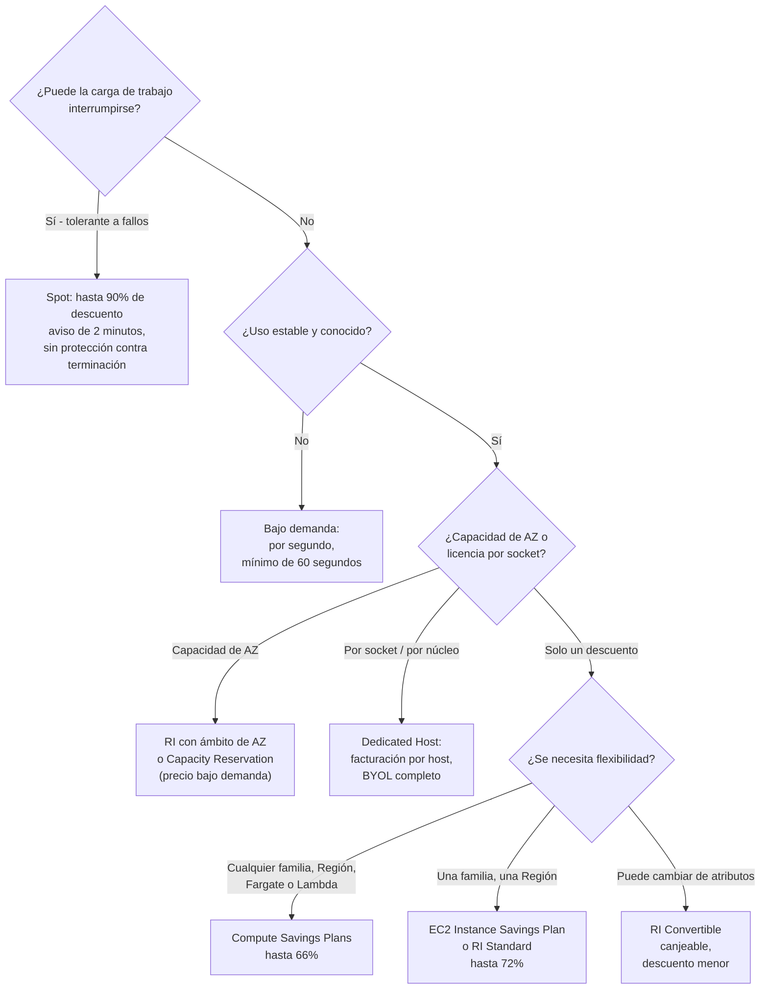
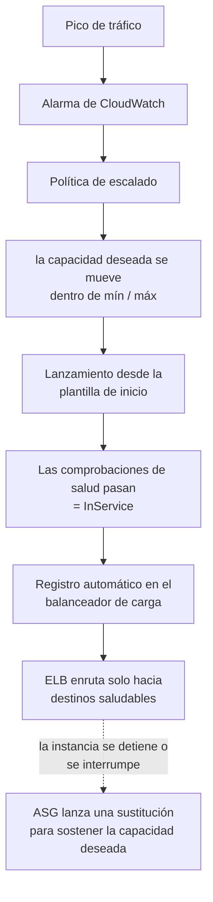
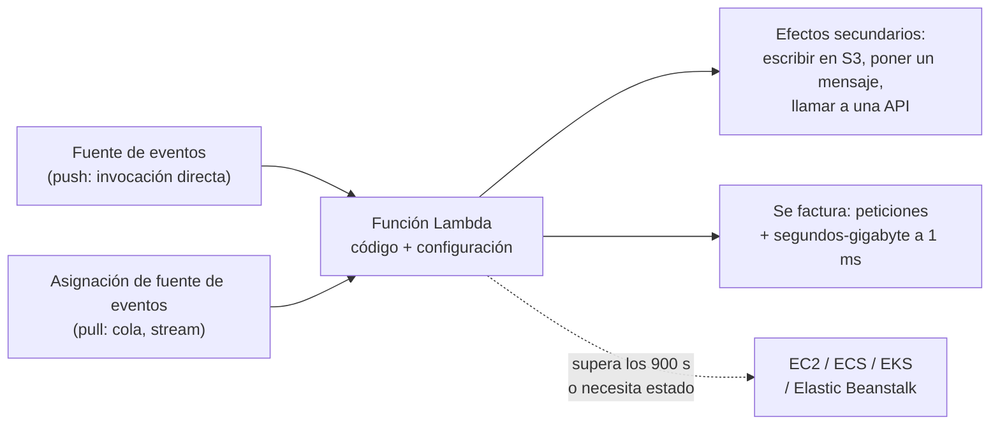
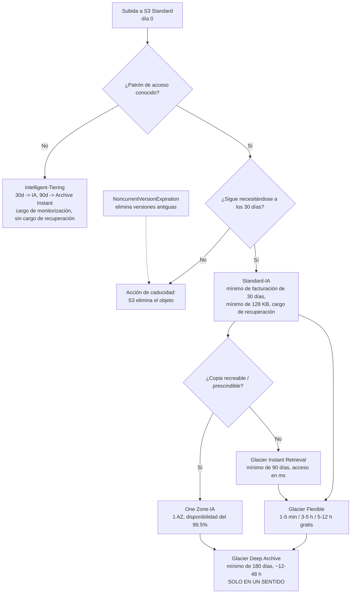
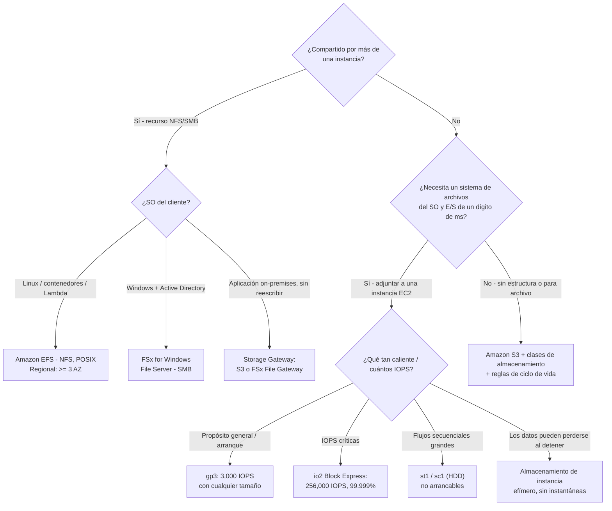

# Servicios de cómputo y almacenamiento

**El Dominio 3 (Tecnología y servicios en la nube) lleva el 34% de la puntuación del CLF-C02**, y dos de sus enunciados de tarea hacen la mayor parte del trabajo: **Tarea 3.3 «Identificar servicios de cómputo de AWS»** y **Tarea 3.6 «Identificar servicios de almacenamiento de AWS»**. La Tarea 3.3 te pide reconocer tipos de instancia, contenedores, opciones serverless, que el *"auto scaling proporciona elasticidad"* y los propósitos de los balanceadores de carga; la Tarea 3.6 te pide identificar servicios de objetos, bloques y archivos, las diferencias entre las clases de almacenamiento de S3, las políticas de ciclo de vida y AWS Backup. Añade la mitad de cómputo de la **Tarea 4.1 del Dominio 4** — las siete opciones de compra — y esta sola lección cubre material que aparece en **dos dominios**.

```text
====================================================================
 LECCIÓN CLF-C02 09 — FICHA DE CÓMPUTO + ALMACENAMIENTO (datos en octubre de 2026)
====================================================================
 CÓMPUTO
  EC2        servidor virtual; tipo de instancia = el hardware
  NOMBRE     [serie][generación][opciones].[tamaño]
             m7i.4xlarge · c6g.large · r7g.xlarge · t3.micro
  COMPRA     bajo demanda (sin compromiso, mínimo 60 s)
             Reserved  (1/3 años, descuento, Standard hasta 72%)
             Savings   (1/3 años, $/h; Compute hasta 66%,
                        EC2 Instance hasta 72%)
             Spot      (capacidad libre, hasta 90% de descuento,
                        aviso de interrupción de 2 minutos)
             Dedicated (Host = por host, Instance = por
                        instancia + $2/Región)
             Capacity Reservation (hueco de AZ a precio bajo demanda)
  ESCALA     Auto Scaling: mín / deseada / máx, multi-AZ
  LAMBDA     serverless, orientado a eventos, por petición + GB-s
             redondeado a 1 ms; 128 MB-10.240 MB; máx 900 s
  CONTEN.    ECS (nativo de AWS, sin cargo) · EKS (Kubernetes
             gestionado, $0.10/clúster/hora) · Fargate
             (serverless, mínimo 1 min) · ECR (imágenes)
  PaaS/VPS   Elastic Beanstalk ($0 de cargo por servicio)
             Lightsail (paquetes planos desde $3.50/mes)
--------------------------------------------------------------------
 ALMACENAMIENTO
  OBJETO     S3: bucket -> objeto -> clave; durabilidad de 11 nueves;
             objeto máx 50 TB (desde 2025-12-02)
  CLASES     Standard · Intelligent-Tiering · Standard-IA ·
             One Zone-IA · Glacier Instant / Flexible / Deep
  BLOQUE     EBS (ligado a la AZ, gp3 por defecto, instantáneas) ·
             almacenamiento de instancia (datos perdidos al detener)
  ARCHIVO    EFS (NFS, POSIX, multi-AZ) · FSx (SMB/ONTAP/ZFS)
  HÍBRIDO    Storage Gateway (sistemas de archivos en caché) ·
             familia Snow (cerrada 2025-11-07, fin de soporte 2026-12-31)
  COPIAS     AWS Backup: planes, bóvedas, Vault Lock = WORM
====================================================================
```

> [!NOTE]
> **Disciplina de alcance.** Cada servicio presentado aquí como evaluable se encuentra o en la **lista oficial de servicios en alcance del CLF-C02** o en un enunciado de tarea del Dominio 3 o del Dominio 4. Dos servicios de cómputo — **AWS Copilot** y **AWS Wavelength** — y un servicio de almacenamiento — **Amazon FSx for Lustre** — están explícitamente **fuera de alcance** y aparecen aquí solo para que puedas eliminarlos. La **familia Snow** no figura en *ninguna* de las dos listas, y **Amazon AppStream 2.0, Amazon WorkSpaces y Amazon WorkSpaces Secure Browser** pertenecen a la tarea 3.8 (escritorios virtuales), no a nuestra tarea 3.3.

En esta lección vas a:

- decodificar un **nombre de instancia EC2** en serie, generación, silicio y tamaño;
- asociar las **familias de instancias** (M/T, C, R, I/D, P/G/F) con sus enunciados de examen;
- recorrer la **lista de comprobación de lanzamiento**: AMI, tipo de instancia, par de claves, grupo de seguridad, plantilla de inicio;
- elegir entre las **siete opciones de compra** con porcentajes de descuento con fuente;
- hacer la aritmética de **Auto Scaling** sobre mín / deseada / máx y explicar por qué multi-AZ es la respuesta de alta disponibilidad por defecto;
- calcular una **invocación de Lambda** en peticiones y segundos-gigabyte, y saber cuándo Lambda es la respuesta incorrecta;
- definir en una sola línea **ECS, EKS, Fargate, ECR, Batch** y luego situar **Elastic Beanstalk** y **Lightsail**;
- recorrer la **gama de clases de almacenamiento de S3**, el versionado, el ciclo de vida, el cifrado y el alojamiento estático;
- elegir un **tipo de volumen de EBS**, explicar las instantáneas y separar EBS del almacenamiento de instancia;
- comparar **EFS frente a FSx**, situar **Storage Gateway**, conocer el estado de la **familia Snow** y usar **AWS Backup**;
- decidir **S3 frente a EBS frente a EFS** en una sola tabla;
- estudiar **dos casos de estudio publicados por AWS** (NASA JPL y Box);
- practicar con **10 preguntas tipo examen** más tres comprobaciones interactivas.

**Revisión de octubre de 2026.** Más allá del esquema anterior, esta lección ahora incluye además **cinco** casos de estudio publicados por AWS, un recuadro de **Actualizaciones de 2026** con sus fuentes, **12** preguntas de práctica, **cuatro** comprobaciones interactivas y **ocho** recuadros *¿Sabías que…?*.

---

## 1. Amazon EC2: el servidor virtual que realmente eliges

### 1.1 Qué es una instancia

AWS define la pieza de construcción en una sola frase: *"una instancia de EC2 es un servidor virtual en la nube de AWS"*. Amazon EC2 *"proporciona capacidad de cómputo bajo demanda y escalable"*, y la elección más trascendental que haces al lanzar es esta: *"cuando lanzas una instancia, el tipo de instancia que especificas determina el hardware del equipo anfitrión usado para tu instancia"*. El tipo de instancia no es, por tanto, un interruptor de precios: es una **decisión de hardware** (generación de CPU, relación de memoria, disco local, GPU, red) que después determina el precio.

| Término | Qué significa en el examen |
|---|---|
| **Instancia** | Un servidor virtual que se ejecuta en un equipo anfitrión de AWS |
| **Tipo de instancia** | La especificación de hardware: familia + tamaño; decide CPU, memoria, almacenamiento y red |
| **AMI** | La imagen que suministra el software necesario para *preparar y arrancar* la instancia |
| **Par de claves** | La clave pública se queda con AWS, la clave privada se queda contigo — se usa para demostrar la identidad de acceso |
| **Grupo de seguridad** | El cortafuegos virtual adjunto a las interfaces de red de la instancia |
| **Plantilla de inicio** | Una receta guardada (AMI, tipo, ajustes de red) — lo que consume un grupo de Auto Scaling |

EC2 es el ejemplo clásico de **IaaS** en el modelo de responsabilidad compartida: AWS posee el anfitrión, tú posees todo desde el sistema operativo invitado hacia arriba.

### 1.2 Leer un nombre de instancia — la habilidad de EC2 más evaluable

AWS publica una gramática de nombres: **`[serie][generación][opciones].[tamaño]`**. La primera posición es la *serie* (por ejemplo `c`), la segunda es la *generación* (por ejemplo `7`), las letras posteriores son *opciones* y todo lo que va después del punto es el *tamaño de instancia*.

| Nombre | Serie | Gen | Opción | Tamaño | Qué te dice |
|---|---|---|---|---|---|
| `m7i.4xlarge` | M — propósito general | 7 | `i` = Intel | 4xlarge | CPU/memoria equilibrados, Intel de 7.ª gen. |
| `c6g.large` | C — optimizada para cómputo | 6 | `g` = Graviton | large | Trabajo limitado por CPU sobre Arm |
| `r7g.xlarge` | R — optimizada para memoria | 7 | `g` = Graviton | xlarge | Cargas de trabajo en memoria |
| `t3.micro` | T — ampliable (burstable) | 3 | — | micro | Ráfaga por encima de una línea base; el hogar del Free Tier |

**Letras de opción:** **a** = AMD · **g** = Graviton · **i** = Intel · **d** = volúmenes de almacenamiento de instancia adjuntos · **n** = optimizado para red y EBS · **e** = almacenamiento o memoria extra · **z** = alta frecuencia de CPU. Después del punto: `small`, `large`, `xlarge`, `2xlarge` … `4xlarge`, y `metal` significa **bare metal**. Dos reglas de decodificación que al examen le encantan: **generación mayor = hardware más nuevo** y `m7i` ≠ `m7g` — el sufijo cambia el **silicio *y* el soporte del sistema operativo**, así que una opción Graviton no es un simple cambio de nombre.

### 1.3 Familias → cargas de trabajo

| Categoría | Letras de familia | El enunciado de examen que apunta a ella |
|---|---|---|
| **Propósito general** | **M**, **T** | *"equilibrio entre cómputo, memoria y red"* — servidores web, repositorios de código, desarrollo/pruebas; **T** = ampliable |
| **Optimizada para cómputo** | **C** | Limitada por CPU: trabajos por lotes, transcodificación, HPC, inferencia de ML |
| **Optimizada para memoria** | **R**, **X**, **Z** | Bases de datos en memoria, caché, analítica |
| **Optimizada para almacenamiento** | **I**, **D**, **H** | NoSQL, almacén de datos, análisis de registros; discos locales, alto rendimiento de IOPS |
| **Cómputo acelerado** | **P**, **G**, **F**, **Inf**, **Trn** | Entrenamiento e inferencia de GPU/ML, renderizado |
| **Alto rendimiento de cómputo** | **Hpc** | Simulaciones grandes, mejor rendimiento por precio a escala |
| **Alta memoria** | **U**, **Z** | Bases de datos en memoria muy grandes (tamaños `*tb` = 3–32 TiB) |

**Ejemplo resuelto E1 — la familia a partir del enunciado (redacción con fuente, en octubre de 2026).** Lee el requisito, elige la letra y después la opción: *"una caché en memoria que debe mantener un conjunto de trabajo residente"* → **R** (optimizada para memoria) → añade `g` si el trabajo se ejecuta en Linux/Arm → `r7g.xlarge`. *"Un transcodificador de vídeo con la CPU al tope"* → **C** → `c6g.large`. *"Una máquina de desarrollo intermitente que debe ser barata cuando está inactiva"* → **T** → `t3.micro`. El examen nunca te pide nombrar una lista real de familias de instancias: te pide leer la correspondencia **enunciado → categoría**.

### 1.4 Dimensionamiento: cuatro decisiones antes de pulsar Lanzar

1. **Forma de la carga de trabajo** → familia (equilibrada / CPU / memoria / almacenamiento / GPU).
2. **Tamaño dentro de la familia** → el número después del punto; las familias optimizadas para memoria también llevan un sufijo de tamaño en memoria.
3. **AMI** — *"proporciona el software necesario para preparar y arrancar una instancia de Amazon EC2"* y *"debes especificar una AMI cuando lanzas una instancia"*. Una AMI queda fijada a una **Región, un sistema operativo, una arquitectura, un tipo de volumen raíz y un tipo de virtualización**, y por eso no puedes lanzar una AMI de Windows sobre un tipo de instancia Graviton.
4. **Opción de compra y red** — cubiertas en §2, más el par de claves y el grupo de seguridad más abajo.

- **📚 ¿Sabías que…?** El **Free Tier de EC2 cambió de era el 15 de julio de 2025**. Las cuentas creadas **antes** de esa fecha conservaron la asignación clásica — **750 horas al mes de `t2.micro`/`t3.micro` durante 12 meses** más 30 GB de EBS. Las cuentas creadas **ese día o después** reciben un **plan Free basado en créditos**: **$100 al registrarte más hasta $100 adicionales**, durante **6 meses o hasta agotar los créditos**, en tamaños elegibles como `t3`/`t4g.micro`, `t3`/`t4g.small`, `c7i-flex.large` y `m7i-flex.large`. Un enunciado que cita «750 horas de t2.micro» depende de la era: lee la fecha (en octubre de 2026; verifica el estado vigente antes de usarlo).

### 1.5 La lista de comprobación de lanzamiento: AMI, tipo, par de claves, grupo de seguridad

| Entrada de lanzamiento | Qué documenta AWS | Consecuencia en el examen |
|---|---|---|
| **AMI** | Suministra el software para preparar y arrancar; obligatoria al lanzar | SO/arquitectura equivocados → no arrancará en ese tipo de instancia |
| **Tipo de instancia** | Determina el hardware del equipo anfitrión | Familia = forma de la carga; tamaño = capacidad |
| **Par de claves** | Conservas la clave **privada**; AWS guarda la clave pública | «Perdí la clave privada» → crea un nuevo par; no puedes recuperar el anterior |
| **Grupo de seguridad** | *"Un grupo de seguridad actúa como un cortafuegos virtual para tus instancias de EC2 y controla el tráfico entrante y saliente."* | **Con estado**, **solo reglas de permitir (nunca denegar)**, un grupo nuevo tiene **reglas de entrada vacías** y una regla de salida que lo permite todo |
| **Plantilla de inicio** | Receta versionada: AMI, tipo, ajustes de red | Entrada obligatoria para un **grupo de Auto Scaling** |

Dos hechos sobre los grupos de seguridad pesan desproporcionadamente: son **con estado** (el tráfico de retorno se permite automáticamente) y **no pueden expresar una denegación** — si una pregunta necesita *«bloquear esta IP»*, la respuesta es una **lista de control de acceso de red** (nivel de subred, permitir *y* denegar, sin estado), no un grupo de seguridad.

**Ejemplo resuelto E2 — del requisito a las entradas de lanzamiento.** *"Una capa web necesita Linux, recursos equilibrados y debe escalar en tres Zonas de disponibilidad."* Entradas: AMI = imagen Linux/x86 o Arm fijada a la Región; familia = **M** (propósito general) o **T** (ampliable, si hay picos y es barata cuando está inactiva); tamaño = lo que pida el modelo de tráfico; grupo de seguridad = permitir entrada **443 desde el grupo de seguridad del balanceador de carga** (no `0.0.0.0/0` directamente), permitir toda la salida; más una **plantilla de inicio** para que un grupo de Auto Scaling pueda reproducirlo. Nada de esa lista es opcional: un grupo de Auto Scaling sin plantilla de inicio no puede lanzar nada.

---

## 2. Las siete opciones de compra de EC2

La Tarea 4.1 del Dominio 4 las nombra explícitamente: *"instancias bajo demanda, Reserved Instances, Spot Instances, AWS Savings Plans, hosts dedicados, instancias dedicadas y reservas de capacidad"*, más *"describir la flexibilidad de las Reserved Instances"* y el comportamiento de las Reserved Instances en AWS Organizations. Esta tabla es la habilidad completa.

### 2.1 La tabla de compra

| Opción | Compromiso | Qué es en realidad | Cuándo la elige el examen | Descuento con fuente (en octubre de 2026) |
|---|---|---|---|---|
| **Bajo demanda** | Ninguno | Pagas por hora o por segundo, **mínimo de 60 segundos**, sin compromiso a largo plazo | Impredecible, con picos, experimental, primer despliegue | — (base para todos los demás %) |
| **Reserved Instances** | **1 o 3 años** | *"No son instancias físicas, sino un descuento de facturación aplicado al uso de instancias bajo demanda"* para una configuración constante (tipo + Región) | Estado estable, fija, especialmente cuando además necesitas una **reserva de capacidad en una AZ** | Standard **hasta el 72%**; Convertible **hasta el 66%** (tabla de la guía de Savings Plans; otra página de AWS muestra 54%, así que cita siempre página + fecha) |
| **Savings Plans** | **1 o 3 años**, compromiso en **USD por hora** | Un descuento sobre una *cantidad de uso en $/hora*, aplicado automáticamente sobre el uso — sin necesidad de canjear nada | Estado estable donde importa la flexibilidad; AWS actualmente **recomienda Savings Plans frente a Reserved Instances** | Compute **hasta el 66%** (cualquier familia/tamaño/Región/SO/hospedaje **+ Fargate + Lambda**); EC2 Instance **hasta el 72%** (una familia, una Región); Database **hasta el 35%**; SageMaker AI **hasta el 64%** |
| **Spot** | Ninguno | *"Capacidad libre de EC2 disponible por menos del precio bajo demanda"* — interrumpible con **aviso de 2 minutos** y **sin protección contra terminación** | Tolerante a fallos, flexible, con puntos de control: lotes, CI/CD, big data, HPC, entrenamiento de ML | **Hasta un 90% de descuento** frente a bajo demanda |
| **Dedicated Hosts** | Bajo demanda o reserva de host | Un **host físico** completo; facturación **por host**; visibilidad total de sockets/núcleos para **traer tu propia licencia** | Requisitos de *"licencia por socket o por núcleo"* | — (precios a nivel de host) |
| **Dedicated Instances** | Bajo demanda o RI | Hardware de inquilino único; facturación **por instancia** **+ un cargo de $2 por Región** | *"Hardware dedicado por cumplimiento"* — solo aislamiento, sin necesidad de topología de licencias | — |
| **Capacity Reservations** | Ninguna, **sin descuento** | Reserva **capacidad de AZ a precio bajo demanda** y **se te factura tanto si la usas como si no** | *"Debe lanzarse en esta AZ concreta"* (software de clúster, colocación regulada) sin renunciar a la flexibilidad de bajo demanda | — |

> ⚠️ **Las Reserved Instances no son servidores reservados.** La propia formulación de AWS es un **descuento de facturación**, no una caja en un rack. Dos consecuencias que el examen prueba: una **RI con ámbito de AZ también reserva capacidad**, una **RI con ámbito de Región es solo un descuento**, y los **Savings Plans no reservan capacidad en absoluto**. Si el enunciado dice «capacidad garantizada en la AZ X», la respuesta es una **RI con ámbito de AZ o una Capacity Reservation** — nunca un Savings Plan.

### 2.2 Reserved Instances frente a Savings Plans frente a Spot — el desempate a tres bandas

| Pregunta que hace el enunciado | Respuesta |
|---|---|
| ¿Comprometerse a una *configuración* o a una *cantidad en dólares*? | Configuración → **RI**; $/hora → **Savings Plans** |
| ¿Necesitar canjear familia/SO/hospedaje más adelante? | **RI Convertible** (descuento menor) o simplemente usar **Savings Plans** (sin canje) |
| ¿Necesitas una reserva de capacidad? | **RI con ámbito de AZ** o **Capacity Reservation** — **no** Savings Plans |
| ¿Puede interrumpirse la carga de trabajo? | Sí → **Spot**; «no puede interrumpirse» → bajo demanda, RI o Savings Plan |
| ¿Spot cuenta para un Savings Plan? | **No.** El uso de Spot queda excluido |
| ¿Qué pasa al terminar el plazo? | Las RI **no se renuevan automáticamente** — vuelves a tarifas de bajo demanda a menos que actúes |



### 2.3 Ejemplos numéricos resueltos — la aritmética detrás de los descuentos

**Ejemplo resuelto E3 — el ahorro con Spot (tarifa ilustrativa; el descuento sí tiene fuente).** AWS afirma que Spot está disponible con *"un descuento de hasta el 90% frente a los precios bajo demanda"* (en octubre de 2026). Los precios horarios exactos de bajo demanda de EC2 dependen de la Región, del SO y del tiempo, y **no** se recopilaron para esta lección, así que usa una **tarifa ilustrativa marcada de $0.10 por hora**:

```text
Tarifa ilustrativa bajo demanda ......... $0.10 / hora
Trabajo por lotes ...................... 100 horas por semana (tolerante a fallos)
Coste semanal bajo demanda ............. 100 x $0.10            = $10.00
Spot con hasta 90% de descuento ........ 100 x $0.10 x 0.10     =  $1.00
Ahorro semanal máximo ..................                          $9.00  (90%)
```

Lee el techo correctamente: **«hasta el 90%»** es un máximo, no una promesa, y lo pagas con **riesgo de interrupción** — un aviso de dos minutos, sin protección contra terminación y **sin cobertura de un Savings Plan**.

**Ejemplo resuelto E4 — el ahorro con Savings Plan / RI (techos con fuente, gasto ilustrativo).** Toma un ritmo estable de **$1.000 al mes** bajo demanda (base ilustrativa):

```text
EC2 Instance Savings Plan - hasta 72% (S12, en octubre de 2026)
  $1,000 x (1 - 0.72) = tan bajo como $280 / mes  -> ahorra hasta $720
Compute Savings Plan - hasta 66% (S12, en octubre de 2026)
  $1,000 x (1 - 0.66) = tan bajo como $340 / mes  -> ahorra hasta $660
En 1 año: $12,000 -> tan bajo como $3,360 (techo del SP de EC2 Instance)
```

**Ejemplo resuelto E5 — la aritmética del plazo.** Un plazo de compromiso es mucho tiempo, y el examen quiere que lo sientas:

```text
1 año  = 31,536,000 segundos  =  8,760 horas
3 años = 94,608,000 segundos  = 26,280 horas  (24 x 7 x 365 x 3)
```

Antes de elegir un Savings Plan de 3 años, responde una pregunta: **¿sigue siendo correcta esta configuración exacta de la carga de trabajo dentro de 26.280 horas?** Si la respuesta puede ser «cambiaremos de familia o de Región», los Compute Savings Plans (cualquier familia, cualquier Región) o las RI Convertible son las respuestas flexibles; si puede ser «puede que ni siquiera lo necesitemos», bajo demanda es más barato que pagar por un compromiso sin usar — porque una **Capacity Reservation se factura se use o no**, y un compromiso de Savings Plan sin usar simplemente deja de ahorrar.

- **📚 ¿Sabías que…?** El porcentaje que citas importa tanto como la opción. AWS publica **hasta el 72%** (RI Standard, EC2 Instance Savings Plan), **hasta el 66%** (Compute Savings Plan, RI Convertible), **hasta el 35%** (Database Savings Plans), **hasta el 64%** (SageMaker AI Savings Plans) y **hasta el 90%** (Spot) — todos *en octubre de 2026*. Una página de optimización de costes de AWS todavía muestra **«hasta el 75%»** para Reserved Instances; esa cifra **no** está corroborada en ningún otro lugar de esta investigación, así que no la memorices. Cualquier pregunta de descuento quiere primero el nombre de la opción y después un número con fecha.

---

## 3. Auto Scaling: elasticidad, mín / deseada / máx, multi-AZ

La Tarea 3.3 enumera *"reconocer que el auto scaling proporciona elasticidad"* — así que la división del trabajo del examen es precisa: **Auto Scaling decide cuántas instancias existen** (elasticidad), un **balanceador de carga decide adónde va el tráfico**. AWS documenta que Elastic Load Balancing *"distribuye automáticamente tu tráfico entrante entre varios destinos… supervisa el salud de sus destinos registrados y enruta el tráfico solo hacia los destinos saludables."*

### 3.1 Los tres números

| Propiedad | Definición | Comportamiento documentado |
|---|---|---|
| **Tamaño mínimo** | Suelo — el grupo nunca baja de él | El propio ejemplo de AWS usa **mín = 4** |
| **Capacidad deseada** | El número objetivo actual de instancias | *"Un grupo de Auto Scaling intenta mantener la capacidad deseada"* — el ejemplo de AWS usa **deseada = 6** |
| **Tamaño máximo** | Techo — las políticas de escalado no pueden superarlo | El ejemplo de AWS usa **máx = 12** |
| **Política de escalado** | Mueve la **capacidad deseada** dentro de [mín, máx] en respuesta a una señal (normalmente una alarma de CloudWatch) | Escalar hacia arriba añade instancias; escalar hacia abajo las elimina |
| **Sustitución** | Se corrige una terminación inesperada | El grupo lanza una sustitución para sostener la capacidad deseada |

La configuración documentada por AWS — **mínimo cuatro, deseada seis, máximo doce** — vale la pena memorizarla como una forma: mín ≤ deseada ≤ máx es un invariante duro, y cualquier opción que ponga la deseada por encima de la máxima (o la mínima por encima de la deseada) es inválida de entrada.

### 3.2 Por qué multi-AZ es la respuesta de alta disponibilidad

Un grupo de Auto Scaling abarca **Zonas de disponibilidad**; cuando una AZ se degrada, el grupo lanza sustituciones en las AZ saludables y rebalancea. Este es el patrón estándar del Dominio 3: **multi-AZ = sobrevivir a una falla de AZ**, **multi-Región = sobrevivir a una falla de Región**. El orden del ciclo de vida también importa: una instancia pasa de **lanzamiento → comprobación de salud → InService**, y AWS señala que un grupo de Auto Scaling con un balanceador de carga adjunto **registra la instancia en el balanceador de carga *antes* de marcarla InService** — así el tráfico nunca llega a una instancia no preparada.



**Ejemplo resuelto E6 — mín / deseada / máx bajo presión.** Usando el grupo documentado por AWS (**mín 4, deseada 6, máx 12**) repartido en tres AZ (2 + 2 + 2):

```text
Estado estable .......... deseada = 6   (2 por AZ)
La alarma pide +4 ....... deseada sería 10 -> permitida (<= 12)
La alarma pide +8 más ... deseada sería 18 -> LIMITADA a 12
La falla de la AZ c quita 2  deseada baja a 4 -> el grupo relanza
                                    en las AZ saludables hasta 6
```

De esa aritmética salen dos puntos de examen: el **máximo es un techo duro** que protege tu presupuesto y el **mínimo es un suelo duro** que protege tu disponibilidad — ninguno sustituye al otro.

---

## 4. AWS Lambda: serverless y orientado a eventos

AWS lo define sin rodeos: *"AWS Lambda es un servicio de cómputo serverless. Con Lambda puedes ejecutar código sin aprovisionar ni gestionar servidores."* AWS se encarga del *"mantenimiento de servidores, aprovisionamiento de capacidad, escalado y parcheado"* — tú suministras código más configuración. Es **orientado a eventos**: *"los eventos pueden activar una función Lambda de dos maneras: mediante invocación directa (push) y mediante asignaciones de fuente de eventos (pull)."*

### 4.1 Por qué Lambda realmente cobra

| Dimensión | Documento de AWS (en octubre de 2026) | Consecuencia |
|---|---|---|
| **Peticiones** | **$0.20 por cada millón de peticiones** | Estar inactiva **no cuesta nada** — solo se factura mientras corre el código |
| **Duración** | Se factura en **segundos-gigabyte**, redondeado al **1 ms** superior | Menos memoria + menos tiempo = menos dinero |
| **Free Tier (siempre gratis)** | **1.000.000 de peticiones + 400.000 segundos-gigabyte al mes** | No es una prueba de 12 meses — se repite cada mes |
| **Memoria** | **128 MB a 10.240 MB** en incrementos de 1 MB; **1.769 MB ≈ una vCPU** | Más memoria compra también más CPU además de más RAM |
| **Tiempo de espera** | Por defecto **3 s**, máximo **900 s (15 minutos)** | El trabajo de larga duración pertenece a EC2/ECS/EKS/Beanstalk |
| **Escalado** | Hasta **1.000 entornos de ejecución cada 10 segundos** | La concurrencia es elástica por defecto |

La guía de AWS sobre el encaje es directa: Lambda *"es más adecuado para invocaciones cortas que duren un segundo o menos."* Los procesos con estado, de larga vida o siempre activos son la respuesta incorrecta clásica.

**Ejemplo resuelto E7 — una microfactura de Lambda (tarifas con fuente, en octubre de 2026).** 2.000.000 de peticiones al mes, cada una ejecutándose **100 ms** con **1.024 MB (1 GB)**:

```text
Peticiones: 2,000,000 - 1,000,000 gratis = 1,000,000 facturables
            1,000,000 / 1,000,000 x $0.20          = $0.20
Duración:   1 GB x 0.100 s = 0.100 GB-s por llamada
            2,000,000 x 0.100 = 200,000 GB-s
            200,000 < 400,000 de franquicia gratis  = $0.00
Total                                              = $0.20 / mes
```

**Ejemplo resuelto E8 — el techo de siempre gratis (con fuente).** ¿Cuánta ejecución continua compran realmente **400.000 segundos-gigabyte**?

```text
Con 512 MB (0.5 GB):  400,000 / 0.5 = 800,000 segundos = ~9.3 días/mes
Con 1,024 MB (1 GB):  400,000 / 1.0 = 400,000 segundos = ~111 horas/mes
```

La lección que quiere el examen: **estar inactiva no cuesta nada, ejecutar cuesta segundos-gigabyte.** Una función que corre una vez al día durante 50 ms es casi gratis; la misma lógica que hace barato a Lambda lo convierte en el hogar incorrecto para un proceso que debe mantener estado durante horas.



> [!WARNING]
> **El muro de 15 minutos.** El tiempo de espera máximo de Lambda es de **900 segundos (15 minutos)**, la memoria llega hasta **10.240 MB** y AWS lo posiciona para invocaciones de *"un segundo o menos"*. Cualquier enunciado que describa una transcodificación de vídeo nocturna de 40 minutos, una conexión de larga duración o una carga de trabajo que necesite un disco local o una GPU está describiendo **EC2, ECS/EKS o Elastic Beanstalk** — no Lambda. Por el contrario, «sin servidores que gestionar» más «solo corre cuando llega un evento» más «pagas por milisegundo» es la firma de Lambda.

- **📚 ¿Sabías que…?** El caso de estudio de Capital One sobre Lambda y ECS de AWS informa de que **una aplicación redujo su coste en un 90%** tras mudarse a Lambda, con comprobaciones ejecutándose **un 80% más rápido** mediante AWS Step Functions, y describe **más de un tercio** de las aplicaciones de Capital One como serverless (aws.amazon.com/solutions/case-studies/capital-one-lambda-ecs-case-study, consultado en octubre de 2026; afirmado por el cliente, sin auditar). La lectura con forma de examen es arquitectónica: **orientado a eventos más inactiva-no-cuesta-nada** es la razón por la que una carga de trabajo pertenece a Lambda en absoluto — y una cifra como el 90% es el resultado de ese cliente, nunca una garantía de AWS.

---

## 5. Contenedores: ECS, EKS, Fargate y ECR

La Tarea 3.3 espera cuatro definiciones de una sola línea, y el examen las recombina constantemente:

| Servicio | Definición de una línea (redacción de AWS) | Firma en el examen |
|---|---|---|
| **Amazon ECS** | *"un servicio de orquestación de contenedores totalmente gestionado"* — nativo de AWS | *"orquestación nativa de AWS"*, **sin cargo de gestión** para los tipos de lanzamiento Fargate y EC2 |
| **Amazon EKS** | *"un servicio de Kubernetes totalmente gestionado"* | «ya ejecutamos Kubernetes» — más **$0.10 por clúster por hora** (soporte estándar, primeros 14 meses; $0.60/h con soporte extendido) |
| **AWS Fargate** | *"un motor de cómputo serverless para contenedores que funciona tanto con Amazon ECS como con Amazon EKS"* | *"sin gestión de nodos"* — se factura **por vCPU + por GB de memoria por segundo**, **mínimo de 1 minuto** |
| **Amazon ECR** | *"un servicio de registro de imágenes de contenedores gestionado por AWS"*, repositorios privados con **permisos basados en recursos usando AWS IAM** | *"subir/bajar imágenes"* — ECR es **almacenamiento de imágenes, no orquestación** |
| **AWS Batch** | *"planifica, programa y ejecuta tus cargas de trabajo por lotes de ML, simulación y analítica contenedorizadas"* en instancias **Spot o bajo demanda** | *"lotes en cola, no interactivos y optimizados en coste"* |

Dos distinciones de responsabilidad llevan la mayor parte de las marcas. **Fargate frente al tipo de lanzamiento EC2 trata de quién gestiona los nodos**, no de la velocidad: con Fargate no hay instancias que parchear (facturación por tarea, mínimo de 1 minuto); con el tipo de lanzamiento EC2 parcheas, escalas y eliges instancias — y **los descuentos de RI/Savings Plan/Spot se aplican** a esas instancias. **ECS frente a EKS trata de portabilidad frente a una cuota de clúster**: ECS es nativo de AWS sin cuota de orquestación; EKS te da Kubernetes estándar a cambio de una cuota horaria por clúster.

**Ejemplo resuelto E9 — la aritmética de Fargate y EKS (tarifas con fuente, us-east-1, en octubre de 2026).**

```text
Fargate: 5 tareas x 1 vCPU x 2 GB, ejecutando 600 s/día durante 30 días
  segundos-vCPU = 5 x 1 x 600 x 30 =  90,000
                  90,000 x $0.000011244            =  $1.01
  segundos-GB   = 5 x 2 x 600 x 30 = 180,000
                  180,000 x $0.000001235           =  $0.22
  Total del mes (solo cómputo)                        $1.23

EKS:  1 clúster x $0.10/h x 730 h  =  ~$73 / mes plano de control
      MÁS lo que ejecuten tus nodos de trabajo (EC2 o Fargate)
ECS:  sin cargo de gestión         ->  pagas solo el cómputo subyacente
```

Esa comparación es la pregunta de contenedores favorita del examen: **EKS cobra extra por el plano de control gestionado; ECS no**, y ninguno incluye el coste de tus nodos.

- **📚 ¿Sabías que…?** La startup de IA de Toronto **WOMBO** le contó a AWS que gestionaba **12.000 GPU** mientras sus aplicaciones alcanzaban **74 millones de descargas en 10 meses en más de 180 países**, citando: *"nuestra infraestructura ha estado en gran medida en piloto automático. Usar Amazon ECS nos ahorra definitivamente mucho tiempo."* (aws.amazon.com/ecs/customers y aws.amazon.com/fargate/customers, consultados en octubre de 2026; voz del cliente). El detalle con forma de examen es el emparejamiento detrás de esa cita — **ECS como orquestador nativo de AWS con Fargate como motor serverless** — más el recordatorio de que la escala viral llega primero como un problema de *tráfico*, que la elasticidad (§3) absorbe mucho antes de que se convierta en un problema de compra (§2).

---

## 6. Elastic Beanstalk y Lightsail: PaaS y VPS

| Servicio | Qué hace AWS | Qué haces tú | Modelo de coste (en octubre de 2026) | Firma en el examen |
|---|---|---|---|---|
| **AWS Elastic Beanstalk** | *"aprovisiona instancias de Amazon EC2 o clústeres de EKS, configura el balanceo de carga… escala dinámicamente tu entorno"* | Sube el código y ajusta unas pocas opciones | **Sin cargo por servicio** — pagas por los recursos que crea (EC2, ELB, EBS) | *"despliega código, no infraestructura"*; **no es serverless** y **no es gratis para ejecutar** |
| **Amazon Lightsail** | Ofrece **paquetes mensuales planos**: instancias, disco y transferencia en un solo precio | Elige un paquete; configuración mínima | De entrada **$3.50/mes** (512 MB de memoria, 2 vCPU, 20 GB SSD, 1 TB de transferencia); **$5/mes** (1 GB); prueba de 90 días | *"una docena escasa de instancias o menos"*, precio predecible; **no** es AWS elástico completo |
| **AWS Outposts** | Infraestructura de AWS **on-premises** | Las mismas API que AWS | Precio por Outpost | La respuesta híbrida de cómputo: *"los datos deben permanecer on-premises pero se quiere usar la herramienta de AWS"* |

La trayectoria esperada en el examen es **empezar sencillo y después crecer**: un blog personal o una pequeña herramienta interna empieza en **Lightsail** o **Elastic Beanstalk**; cuando necesitas Auto Scaling, red a nivel de VPC, Spot o Savings Plans, te mudas a **EC2 con una plantilla de inicio y un grupo de Auto Scaling**. **AWS Batch** es la cuarta opción de esta familia: trabajos por lotes en cola y contenedorizados que AWS escala para ti sobre capacidad Spot o bajo demanda.

---

## 7. Amazon S3: almacenamiento de objetos, clases, versionado, ciclo de vida

La Tarea 3.6 abre con *"identificar los usos del almacenamiento de objetos"* y *"reconocer las diferencias entre las clases de almacenamiento de Amazon S3"*. AWS define la anatomía: *"un objeto es un archivo y cualquier metadato que describe el archivo. Un bucket es un contenedor de objetos."* Los objetos se direccionan por **clave** (más un **identificador de versión** opcional) dentro de un bucket cuyo **nombre es globalmente único** y cuya **Región queda fija al crearse**. Un bucket es **privado por defecto**, con Block Public Access activado y ACLs desactivadas; el techo de la política de bucket es de **20 KB**. El tamaño máximo de objeto es de **50 TB** (ampliado desde 5 TB el **2 de diciembre de 2025**); un único `PUT` es de 5 GB.

La durabilidad es la cifra que se cita: **99,999999999% (11 nueves)** sobre **un mínimo de tres Zonas de disponibilidad por defecto** — durabilidad y disponibilidad son cosas distintas, y One Zone-IA lo demuestra.

### 7.1 La gama de clases de almacenamiento

| Clase | Diseñada para | AZ | Duración mínima de almacenamiento | Objeto mínimo facturable | Cargo por recuperación |
|---|---|---|---|---|---|
| **Standard** (por defecto) | Acceso más de una vez al mes, acceso en milisegundos | ≥3 | — | — | ninguno |
| **Intelligent-Tiering** | Patrones de acceso desconocidos o cambiantes | ≥3 | — | 128 KB (por debajo: nunca se reclasifica sola) | **ninguno** (pequeño cargo de monitorización por objeto) |
| **Standard-IA** | ~una vez al mes, acceso en milisegundos | ≥3 | **30 días** | 128 KB | por GB |
| **One Zone-IA** | Datos recreables, ~una vez al mes | **1** | **30 días** | 128 KB | por GB |
| **Express One Zone** | Latencia de un solo dígito de milisegundos, una AZ | 1 | — | — | ninguno |
| **Glacier Instant Retrieval** | ~una vez al trimestre, acceso en milisegundos | ≥3 | **90 días** | 128 KB | por GB |
| **Glacier Flexible Retrieval** | ~una vez al año, minutos-horas para restaurar | ≥3 | **90 días** | — | por GB (**las recuperaciones masivas son gratis**) |
| **Glacier Deep Archive** | Menos de una vez al año, horas para restaurar | ≥3 | **180 días** | — | por GB |

**Intelligent-Tiering** es la única clase que mueve objetos por ti: **30 días** sin acceso → nivel Infrequent Access, **90 días** → Archive Instant Access (sigue siendo en milisegundos), más los niveles optativos Archive (**≥90 días**) y Deep (**≥180 días**). Cobra un **cargo de monitorización de $0.0000025 por objeto al mes** y **ningún cargo por recuperación** — así que es perfecta para patrones desconocidos y equivocada para millones de objetos pequeños.

**Velocidades de recuperación de Glacier** (en octubre de 2026): Instant = **milisegundos**; Flexible = Expedited **1–5 minutos**, Standard **3–5 horas**, **Bulk 5–12 horas y gratis**; Deep Archive ≈ **12 horas / 48 horas**. Nótese que AWS dice *"no recomendamos usar el servicio Amazon Glacier"* — la respuesta evaluable son las **clases de almacenamiento S3 Glacier**, no un servicio legado aparte.

### 7.2 Versionado, ciclo de vida y replicación

- **El versionado** tiene tres estados (desactivado, activado, suspendido) y *"nunca puede volver a un estado sin versiones"*. Borrar un objeto crea una **marca de borrado**; sobrescribir crea una nueva versión; **cada versión se factura íntegra**, y por eso las reglas de ciclo de vida necesitan una acción `NoncurrentVersionExpiration`.
- **Las reglas de ciclo de vida** tienen **acciones de transición** (mover a otra clase) y **acciones de caducidad** — *"Amazon S3 elimina los objetos caducados en tu nombre"*. El modelo es una **cascada de un solo sentido**: Standard → IA / Intelligent-Tiering / One Zone-IA → cualquier clase de Glacier; One Zone-IA → solo Glacier; Instant → Flexible → Deep; **Deep Archive solo puede ir en una dirección**.
- **La replicación** (CRR/SRR) exige **versionado activado en ambos buckets**, omite los objetos preexistentes a menos que uses Batch Replication, y **S3 Replication Time Control** garantiza el **99,99% de los objetos nuevos en 15 minutos (SLA)**. Los borrados se replican — así que **la replicación no es una copia de seguridad**.

### 7.3 Cifrado y sitios web estáticos

**SSE-S3 es la configuración de cifrado por defecto de todos los buckets** (desde el **5 de enero de 2023**) y no cuesta nada extra; **SSE-KMS** añade coste y control por clave, **SSE-C** trae tu propia clave y **DSSE-KMS** es cifrado doble. Para EBS **no puedes cifrar en el sitio un volumen o instantánea ya existente sin cifrar**. Para alojar: un sitio web estático de S3 necesita un **documento índice**, **Block Public Access desactivado** y un permiso `s3:GetObject` de lectura pública — y *"los sitios web estáticos solo admiten puntos de acceso HTTP"*, así que **HTTPS requiere CloudFront**.

**Ejemplo resuelto E10 — un terabyte-mes repartido entre clases (us-east-1, en octubre de 2026).** Solo almacenamiento, 1.000 GB, ignorando peticiones:

```text
S3 Standard .................... $0.023/GB-mes  ->  $23.00
S3 Standard-IA ................. $0.0125        ->  $12.50  + recuperación
S3 One Zone-IA ................ $0.01          ->  $10.00  + recuperación
Glacier Instant Retrieval ...... $0.004         ->   $4.00  + recuperación
Glacier Flexible Retrieval ..... $0.0036        ->   $3.60  + recuperación
Glacier Deep Archive ........... $0.00099       ->   $0.99  + recuperación
Intelligent-Tiering (Frecuente) . $0.023         ->  $23.00
   + monitorización, 1,000,000 objetos x $0.0000025 ->  $2.50
```

Precios de peticiones de S3 (misma Región y fecha): **PUT/COPY/POST/LIST $0.005 por 1.000**, **GET $0.0004 por 1.000**, **DELETE gratis**.

- **📚 ¿Sabías que…?** **La regla de 30 días tiene dos mitades que se movieron por separado.** La guía de almacenamiento de AWS (actualizada el **5 de octubre de 2026**) dice que S3 *"ya no aplica una duración mínima de almacenamiento de 30 días para las transiciones"* hacia Standard-IA y One Zone-IA — puedes transicionar el día 0. Pero la regla de **facturación de duración mínima de 30 días** para las clases IA todavía se publica en las páginas de precios. Transicionar el día 10 y borrar el día 20 todavía te factura los 30 días completos (en octubre de 2026; verifica el estado vigente antes de usarlo).



---

## 8. Amazon EBS y el almacenamiento de instancia: almacenamiento en bloques

La Tarea 3.6 nombra a la pareja: *"identificar soluciones de almacenamiento en bloques (por ejemplo, Amazon EBS, almacenamiento de instancia)"*. El almacenamiento en bloques es **almacenamiento del sistema operativo con baja latencia y un solo punto de conexión** — el disco que tu instancia ve como `/dev/xvda`.

**Amazon EBS** es un *"volumen en bloques duradero"* para EC2. Dos hechos estructurales: un volumen tiene **ámbito de una Zona de disponibilidad** (está *"replicado automáticamente dentro de su Zona de disponibilidad"*) y solo puede adjuntarse a **hasta 16 instancias** si estas son **io1/io2 en la misma AZ** (Multi-Attach, y la aplicación debe acordonar las escrituras). La durabilidad **no** es la de S3 con 11 nueves: **io2 Block Express ofrece el 99,999%**, los demás tipos de volumen **99,8% a 99,9%**.

### 8.1 Tipos de volumen

| Tipo | Clase | Línea base | Úsalo para | No puede ser |
|---|---|---|---|---|
| **gp3** (por defecto) | SSD | **3.000 IOPS y 125 MiB/s con cualquier tamaño de volumen**; hasta **~20% más barato por GB** que gp2 | Volúmenes de arranque, propósito general, la mayoría de bases de datos | — |
| **gp2** | SSD | Los IOPS escalan con el tamaño (3 IOPS/GB, máx 16.000) | Volúmenes legados — migra a gp3 | — |
| **io1 / io2** | SSD con IOPS aprovisionadas | Hasta 64.000 / 256.000 IOPS; **io2 Block Express: 256.000 IOPS, durabilidad del 99,999%** | IOPS críticas, bases de datos que necesitan un techo sostenido | — |
| **st1** | HDD | Optimizado para throughput, hasta 500 MiB/s | Flujos secuenciales grandes: big data, procesamiento de registros | **Volumen de arranque** |
| **sc1** | HDD | En frío, hasta 250 MiB/s, el más barato por GB | Acceso poco frecuente y secuencial | **Volumen de arranque** |
| **Magnetic (standard)** | HDD legado | — | Cargas de trabajo antiguas | — |

Precios de lista publicados para gp3 **$0.08/GB-mes**, gp2 **$0.10**, io1/io2 **$0.125** (más cargos por IOPS), st1 **$0.045**, sc1 **$0.015** — *publicados en octubre de 2026; la página no indica Región, así que verifica el estado vigente antes de usarlos en tu Región.*

### 8.2 Instantáneas

Una instantánea es *"una copia de seguridad incremental"* almacenada en **S3 — pero invisible para las herramientas de S3**: no puedes ver las instantáneas como objetos de S3, listarlas en un bucket ni pagar tarifas de peticiones de S3 por ellas. Se replican **en toda la Región** (a diferencia de los volúmenes, que están ligados a una AZ). Lo crítico: *"AWS no hace copias de seguridad automáticas de tus volúmenes de EBS"* — debes usar **Amazon Data Lifecycle Manager, AWS Backup o un script manual**. Precios de instantánea (en octubre de 2026): **$0.05 por GB-mes** en estándar, **$0.0125 por GB-mes archivada** (mínimo de 90 días), restauración desde archivo **$0.03 por GB**.

### 8.3 Almacenamiento de instancia frente a EBS

| | **Volumen de EBS** | **Almacenamiento de instancia** |
|---|---|---|
| Qué es | Volumen en bloques duradero conectado por red | Discos unidos físicamente al anfitrión |
| Durabilidad | Replicado en la AZ; hay instantáneas | *"todos los datos se pierden cuando se detiene la instancia"*; se elimina automáticamente al terminar |
| Instantáneas | Sí (incrementales, en S3) | **No** |
| Comportamiento al detener/terminar | El volumen raíz sobrevive a la terminación solo si `DeleteOnTermination=false` | Datos perdidos |
| Enunciado de examen | Persistente, arranque, base de datos | *"temporal"*, *"de trabajo"*, *"se pierde al detener"*, máximo I/O local |

**Ejemplo resuelto E11 — gp3 frente a gp2 y archivo de instantáneas (precios publicados, verifica la Región).**

```text
gp3 vs gp2, volumen de 500 GB:
  gp3:  500 x $0.08 = $40.00 / mes
  gp2:  500 x $0.10 = $50.00 / mes
  ahorro con gp3                 = $10.00 / mes  (~20%)

Archivo de instantáneas, 2 TB durante 6 meses:
  Estándar:  2,000 x $0.05 x 6            = $600.00
  Archivada: 2,000 x $0.0125 x 6          = $150.00
             restaurar 2,000 x $0.03      =  $60.00
             total archivada              = $210.00
```

- **📚 ¿Sabías que…?** **La línea base de gp3 es independiente del tamaño**: 3.000 IOPS y 125 MiB/s *"con cualquier tamaño de volumen"*. Bajo el modelo antiguo de gp2 necesitabas un volumen de **3.000 GB** para conseguir 3.000 IOPS, porque los IOPS escalaban a 3 por GB — y por eso AWS describe gp3 como *"precios hasta un 20% inferiores por GB que los actuales gp2"* siendo además más rápido desde el principio (en octubre de 2026).

---

## 9. Archivos, híbrido y copias de seguridad: EFS, FSx, Storage Gateway, familia Snow, AWS Backup

### 9.1 EFS frente a FSx — la respuesta de archivos

La Tarea 3.6 dice *"identificar servicios de archivos (por ejemplo, Amazon EFS, Amazon FSx)"*.

| | **Amazon EFS** | **Amazon FSx** |
|---|---|---|
| Protocolo | **NFSv4.1 / v4.0**, POSIX | Cuatro motores: **Windows File Server (SMB)**, **NetApp ONTAP** (NFS + SMB + iSCSI), **OpenZFS** (ZFS/Linux), **Lustre** (ML/HPC — **fuera de alcance para CLF-C02**) |
| Clientes | EC2, ECS, EKS, **Lambda**, Fargate — *"usar Amazon EFS con Microsoft Windows… no está soportado"* | Windows Server con Active Directory, ACL de NTFS; ONTAP con instantáneas y jerarquización |
| Alcance | **Regional (≥3 AZ, recomendado)** o **One Zone (1 AZ)** | Una sola AZ o multi-AZ según el motor |
| Clases / precio (us-east-1, en octubre de 2026) | Standard **$0.30/GB-mes**, One Zone **$0.16**, IA **$0.025**, One Zone IA **$0.0133**, Archive **$0.008**, throughput aprovisionado **$6/GB-mes** | Se factura por sistema de archivos y por throughput |
| Enunciado de examen | *"directorios de inicio POSIX compartidos / WordPress entre AZ"* | *"hacer lift-and-shift de un servidor de archivos Windows"* o *"NetApp existente"* |

La durabilidad de EFS es de **11 nueves** con un **99,99% de disponibilidad en la clase Regional sobre ≥3 AZ**; sus clases de ciclo de vida **Standard → IA → Archive** se aplican automáticamente tras **90 días de inactividad**, con una **duración mínima de almacenamiento de 90 días** para Archive.

**Ejemplo resuelto E12 — dimensionamiento de EFS (us-east-1, en octubre de 2026).**

```text
1.2 TB todo en Standard:       1,200 x $0.30             = $360.00 / mes
Mitad en frío (600 Standard + 600 IA):
                               600 x $0.30 + 600 x $0.025 = $195.00 / mes
```

### 9.2 Storage Gateway — la respuesta híbrida y en caché

AWS lo describe como un servicio que *"conecta un dispositivo de software on-premises con almacenamiento basado en la nube"*, y la tarea 3.6 nombra explícitamente *"sistemas de archivos en caché (por ejemplo, AWS Storage Gateway)"*.

| Gateway | Qué emula | Enunciado de examen |
|---|---|---|
| **S3 File Gateway** | Un recurso compartido NFS/SMB local; *"los archivos… se convierten en objetos… con la ruta como clave"* | *"una aplicación on-premises quiere un recurso NFS respaldado por S3"* |
| **FSx File Gateway** | SMB respaldado por FSx | Recursos de Windows con respaldo en la nube |
| **Volume Gateway — en caché** | Volumen iSCSI con datos en **S3** y un subconjunto caliente retenido localmente | **La respuesta del «sistema de archivos en caché»** |
| **Volume Gateway — almacenado** | Copia primaria local, instantáneas asíncronas a S3 | Imágenes de máquina virtual on-prem, recuperación ante desastres |
| **Tape Gateway** | Biblioteca de cintas virtuales que archiva en **S3 Glacier Flexible Retrieval o Deep Archive** | *"cinta virtual"* / retención de cintas del centro de datos |

### 9.3 Familia Snow — el estado importa más que las especificaciones

**AWS Snowball Edge ya no está disponible para clientes nuevos**, se cerró a nuevos clientes el **7 de noviembre de 2025**, y AWS afirma: *"el 31 de diciembre de 2026, AWS dejará de dar soporte a los dispositivos AWS Snowball en todas las Regiones comerciales de AWS."* El dispositivo ofrecía aproximadamente **210 TB** en una unidad Storage Optimized, con trabajos de transferencia completados **dentro de 360 días**. Lo crucial: **la familia Snow no aparece ni en la lista en alcance ni en la lista fuera de alcance** en la guía actual del CLF-C02 — así que es contexto, nunca una respuesta correcta. Las alternativas que AWS dirige para traslados grandes sin conexión son **AWS DataSync**, **Data Transfer Terminal** y **AWS Outposts**.

### 9.4 AWS Backup — un motor de políticas para todo

La Tarea 3.6 nombra *"comprender los casos de uso de AWS Backup"*. Es un **servicio de copias de seguridad central y dirigido por políticas**: los **planes** seleccionan recursos (normalmente **por etiqueta**), las **bóvedas** guardan las copias (cifradas con KMS), y **AWS Backup Vault Lock** aporta protección **write-once-read-many (WORM)**. Las copias son **incrementales** y pueden moverse de **cálido a frío**, se ejecutan **entre Regiones y entre cuentas** y se informan a través de **AWS Backup Audit Manager**. Cubre **EC2/EBS, S3, EFS, FSx, RDS, DynamoDB y volúmenes de Storage Gateway** — pero *"no gobierna las copias de seguridad que tomes… fuera de AWS Backup"*, y es **aditivo**: duplica los mecanismos nativos de instantánea, así que cuesta dinero además de ellos.

Cifras de retención (en octubre de 2026): **1 día a 100 años** para instantáneas; **1 a 35 días** para PITR continuo; **mínimo de 90 días en el nivel frío**; un recurso debe estar en **cálido al menos 8 días** antes de pasar a frío. Servicio complementario: **AWS Elastic Disaster Recovery** hace una *"replicación continua a nivel de bloque"* con un **RPO de segundos** y un **RTO normalmente de 5–20 minutos** — la respuesta de luz piloto para servidores completos.

**Ejemplo resuelto E13 — la aritmética de retención de copias de seguridad (regla con fuente).** Las copias en el nivel frío deben retenerse **al menos 90 días después de la transición a frío**, y la retención en cálido debe ser **≥8 días**:

```text
Requisito: retención total de 300 días, frío-después = 8 días
DeleteAfterDays >= cold-after + 90  ->  >= 308 días
```

- **📚 ¿Sabías que…?** **AWS Backup y las instantáneas nativas resuelven problemas distintos.** Una instantánea es un *mecanismo* (incremental, en toda la Región, $0.05/GB-mes en octubre de 2026); AWS Backup es *gobernanza* — selección por etiqueta en todas las cuentas, un solo calendario de retención, Vault Lock para cumplimiento WORM y copias entre Regiones. Una pregunta que pide «cómo aplicas **una** política de copias de seguridad en 40 cuentas» está pidiendo **AWS Backup**, no un script que llama a `CreateSnapshot` 40 veces.

---

## 10. S3 frente a EBS frente a EFS — la tabla de decisión

Los tres modelos de datos de la Tarea 3.6 son la vía más rápida para puntuar aquí: **bloque** = baja latencia, una sola instancia/contenedor; **archivo** = jerárquico, compartido, NFS/SMB; **objeto** = direccionado por API, clave + metadatos, el más barato a escala.

| Pregunta | **Amazon S3** (objeto) | **Amazon EBS** (bloque) | **Amazon EFS / FSx** (archivo) |
|---|---|---|---|
| Modelo de datos | Objetos: bucket → objeto → clave (+ identificador de versión) | Dispositivos en bloques crudos, ligados a la AZ | Archivos jerárquicos, POSIX (EFS) o SMB (FSx Windows) |
| Acceso | Consola, CLI, SDK, REST — **sin montar** | Adjuntar a **una instancia** (Multi-Attach: io1/io2, 16 Nitro, misma AZ) | **Montado por muchas instancias a la vez**, entre AZ |
| Uso típico | Sitios web, copias de seguridad, data lakes, archivos, alojamiento estático | Volúmenes de arranque, bases de datos, cualquier sistema de archivos | Directorios de inicio compartidos, granjas de WordPress, recursos de Windows |
| Durabilidad / ámbito | **11 nueves**, ≥3 AZ por defecto | Replicado **dentro de una AZ**; 99,999% (io2 Block Express) a 99,8–99,9% | EFS **11 nueves**, Regional ≥3 AZ (o One Zone) |
| Nivel frío más barato | **Glacier Deep Archive — $0.00099/GB-mes** | Archivo de instantánea — $0.0125/GB-mes | EFS Archive — $0.008/GB-mes |
| Ciclo de vida | **Reglas** integradas: transición + caducidad | Instantáneas (manuales o DLM/AWS Backup) | EFS IA/Archive tras 90 días de inactividad |
| Abreviatura de examen | *archivo, web, estático, data lake* | *base de datos, arranque, una sola instancia* | *compartido, POSIX, multi-AZ, Windows* |



**Regla práctica reutilizable:** *una instancia y un sistema de archivos del SO* → **EBS**; *muchas instancias necesitan los mismos archivos* → **EFS/FSx**; *lo que enviarías por correo, alojarías estáticamente o archivarías* → **S3**; *on-premises sin re-arquitectura* → **Storage Gateway**; *una política única, dirigida por etiquetas y con capacidad WORM* → **AWS Backup**.

### Actualizaciones de 2026 (en octubre de 2026)

> [!NOTE]
> **Cinco cambios publicados por AWS entre 2025 y 2026 que tocan los servicios de esta lección.** Cada elemento lleva fecha y fuente; los precios y los límites cambian, así que verifica de nuevo antes de usarlos:
> - **Recorte de precio de S3 Express One Zone — efectivo el 10 de abril de 2025.** En us-east-1, el almacenamiento bajó un **31%** (**$0.16 → $0.11 por GB-mes**), las **peticiones PUT −55%**, las **peticiones GET −85%** y los precios de subida múltiple/recuperación un **60%** (AWS News Blog *"Up to 85% price reductions for Amazon S3 Express One Zone"* y la publicación correspondiente de What's New, 2025-04-10). La clase no cambió: sigue siendo **una AZ** con latencia de **un solo dígito de milisegundos** (§7.1) — un cambio de precio, no un rediseño.
> - **Instancias de EC2 con GPU NVIDIA — anunciadas el 5 de junio de 2025.** Los precios bajo demanda bajaron **hasta un 45%** — P4d/P4de **−33%**, P5 **−44%**, P5en **−25%** — con las tarifas reducidas de Savings Plans vigentes desde el 4 de junio de 2025 (AWS News Blog, 2025-06-05). Esto afecta a las familias de **cómputo acelerado** de §1.3 (**P** y **G**).
> - **Database Savings Plans — lanzados el 2 de diciembre de 2025.** Un Database Savings Plan de 1 año sin pago inicial se compromete hasta un **35%** (bases de datos serverless hasta el 35%, con capacidad aprovisionada hasta el 20%) (AWS News Blog y What's New, 2025-12-02). Salvedad de examen: **la guía actual del CLF-C02 sigue nombrando solo «AWS Savings Plans»** — es una actualización de precios dentro de un enunciado de tarea existente, no una tarea nueva.
> - **Compartir compromisos y herramientas de compra.** El **grupo compartido de Savings Plans / Reserved Instances** pasó a disponibilidad general el **19 de noviembre de 2025**, y **Target Coverage** llegó al Savings Plans Purchase Analyzer el **9 de junio de 2026** (AWS What's New, 2025-11-19; blog de AWS Cloud Financial Management, 2026-06-09). **Los nombres de herramientas de coste evaluables no cambian**: **Cost Explorer, AWS Budgets, Pricing Calculator, Trusted Advisor, Well-Architected Tool**.
> - **Las listas de alcance se movieron en torno a tres servicios que enseña esta lección.** En la guía actual, **la familia Snow no figura ni en la lista en alcance ni en la lista fuera de alcance**, **AWS Wavelength está explícitamente fuera de alcance** y **Amazon FSx for Lustre está fuera de alcance** (listas de servicios en alcance y fuera de alcance, consultadas en octubre de 2026) — exactamente los tres veredictos de distractor ya señalados en la nota de alcance de esta lección.

---

## Casos Reales

AWS publica cómo se ven estos patrones en producción. Cada cifra de abajo es **afirmada por el cliente o por AWS y sin auditar**, citada con su fuente para que puedas comprobarla — el punto evaluable es el **patrón** (qué opción de compra se eligió, qué nivel de almacenamiento se movió, qué número), no el marketing.

### Caso A — NASA JPL: Auto Scaling con Spot, bajo demanda y Capacity Reservations

| Elemento | Detalle |
|---|---|
| **Sector / contexto** | Gobierno y espacio: la misión Perseverance fue *"la primera misión planetaria de NASA, con comunicación crítica para la misión y transferencia de datos de telemetría en la nube"*, y los volúmenes de datos del laboratorio siguen creciendo (NISAR) |
| **Servicios de AWS mencionados** | **Amazon EC2 Auto Scaling** mezclando **Spot Instances + instancias bajo demanda + Capacity Reservations**; escalado tolerante a fallos para cargas de trabajo de respuesta a desastres |
| **Resultados principales (publicados por AWS)** | Procesa unas **4,4 TB de datos bajados diariamente**, generando hasta **70 TB de productos de datos finales**; instancias Spot con *"un descuento de hasta el 90% frente a los precios de Amazon EC2 bajo demanda"* |
| **Lección de cómputo** | Una carga de trabajo, **tres opciones de compra a la vez**: Spot para el grueso interrumpible y tolerante a fallos, bajo demanda para el resto flexible, Capacity Reservations para el hueco de AZ garantizado |
| **Fuente** | aws.amazon.com/solutions/case-studies/nasa-jpl-spot-case-study (consultado en octubre de 2026) |

*Lección de examen:* la respuesta a *«qué opción de compra»* suele ser **una mezcla**, no una sola opción. El **90% de Spot es un techo**, y solo funciona donde el trabajo es **tolerante a fallos y con puntos de control** — y por eso el procesamiento estilo HPC de NASA es elegible y una base de datos transaccional con estado no lo es.

### Caso B — Box: optimización de costes con Well-Architected, sobre todo en almacenamiento

| Elemento | Detalle |
|---|---|
| **Sector / contexto** | SaaS empresarial (más de 120.000 empresas): mejorar la eficiencia del gasto sin dañar seguridad, fiabilidad ni rendimiento |
| **Servicios de AWS mencionados** | **Well-Architected Framework** y revisiones de Solutions Architect; **jerarquización de S3 y S3 Glacier**; **higiene de volúmenes e instantáneas de EBS**; filtrado de eventos de CloudTrail; enrutamiento del tráfico alrededor de los gateways de internet |
| **Resultados principales (publicados por AWS, afirmados por el cliente)** | **Más de 2,23 millones de dólares** desglosados: **$438.000** de transferencia entre AZ + **más de $1,1 millones al año** de salida de datos + **más de $500.000 al año** de almacenamiento + **$192.000 al año** de registros |
| **Lección de almacenamiento** | **Las clases de almacenamiento y la higiene de instantáneas son una palanca de coste** — las dos líneas de almacenamiento solas suponen unos $692K del total |
| **Fuente** | aws.amazon.com/solutions/case-studies/box-case-study (consultado en octubre de 2026) |

*Lección de examen:* este es el **pilar de costes** del Dominio 4 expresado en servicios del Dominio 3. «Movimos objetos poco frecuentes a una clase más fría y ordenamos las instantáneas de EBS» es la misma decisión que nuestras tablas de §7 y §8 — y nótese que la palanca **gratuita** (buena práctica arquitectónica, revisión Well-Architected) produjo la mayor parte del ahorro.

### Lo que comparten los dos casos

| Patrón de valor | Evidencia | Principio subyacente |
|---|---|---|
| Las opciones de compra se mezclan, no son excluyentes | NASA JPL: Spot + bajo demanda + Capacity Reservations | Haz coincidir la **tolerancia a interrupciones** y las **necesidades de capacidad** por nivel de carga de trabajo |
| La jerarquización de almacenamiento es dinero real | Box: >$500K al año de almacenamiento + $192K al año de registros | **Las reglas de ciclo de vida y las clases frías** son la optimización más barata disponible |
| Lo gestionado gana a lo casero | El Auto Scaling de NASA JPL frente a una flota hecha a mano | *"el auto scaling proporciona elasticidad"* es un enunciado de tarea, no un eslogan |

- **📚 ¿Sabías que…?** El propio Amazon S3 es un caso de estudio de 20 años: AWS lo lanzó el **14 de marzo de 2006** con unas **1 PB** de capacidad en unos **400 nodos de almacenamiento en 15 racks**, un tamaño máximo de objeto de **5 GB** y un precio de **15 centavos por gigabyte**; AWS informó el **13 de marzo de 2026** de que el precio actual es *"ligeramente más de 2 centavos por gigabyte"* — una reducción de unos **85%** — mientras que *"el código que escribiste para S3 en 2006 sigue funcionando hoy, sin cambios"* (aws.amazon.com/blogs/aws, consultado en octubre de 2026). El tamaño máximo de objeto actual es de **50 TB**, un aumento de 10 veces hecho el **2 de diciembre de 2025**.

> [!WARNING]
> **Cómo leer las cifras de los casos de estudio el día del examen:** cada porcentaje de aquí es una cifra **afirmada por el cliente o publicada por AWS, sin auditar** — nunca una garantía, y *«hasta»* es un **techo**, nunca un promedio. Atribuye la fuente y la fecha de consulta («caso de estudio de NASA JPL, consultado en octubre de 2026»), no «AWS demuestra». Un caso nunca autoriza una respuesta fuera de alcance: se te pide **seleccionar el servicio en alcance y la opción de compra correcta**, no reproducir la cifra de marketing.

A continuación siguen tres historias más publicadas por AWS, y la precaución anterior gobierna cada una de sus cifras.

### Caso C — Canva: una carga de trabajo, tres opciones de compra

| Elemento | Detalle |
|---|---|
| **Sector / contexto** | Plataforma de diseño SaaS, en AWS desde el primer día; necesitaba escala rentable con un nivel de fiabilidad distinto por plan de usuario |
| **Servicios de AWS mencionados** | **Spot Instances** para proyectos tolerantes del free tier, **bajo demanda + Savings Plans** para la capacidad estable de usuarios Pro, **Reserved Instances** como alternativa, más las herramientas de análisis de costes de AWS |
| **Resultados principales (publicados por AWS, afirmados por el cliente)** | Costes de cómputo **reducidos un 46% en menos de 2 años**; el caso de estudio también reitera las cifras de lista de AWS — **hasta el 72%** para Reserved Instances / Savings Plans y **hasta el 90%** para Spot |
| **Lección de cómputo** | El **nivel de fiabilidad de la carga de trabajo**, no el tamaño de la empresa, elige la opción de compra: interrumpible → Spot, estable → descuento por compromiso, resto elástico → bajo demanda |
| **Fuente** | aws.amazon.com/solutions/case-studies/canva-cost-optimization-case-study (consultado en octubre de 2026) |

*Lección de examen:* este es el desempate de §2 ejecutado como modelo operativo — y nótese que Canva mantuvo **Reserved Instances como alternativa y no como primera opción**, lo que refleja la guía actual de AWS de preferir **Savings Plans frente a Reserved Instances**. El **46%** es el resultado medido de Canva; AWS nunca lo garantiza.

### Caso D — Shutterfly Business Solutions: 400 TB de objetos más un lift-and-shift de un servicio de archivos

| Elemento | Detalle |
|---|---|
| **Sector / contexto** | Comercio electrónico e impresión de fotos: VMware vSphere on-premises, pilas independientes, más de **2.000 máquinas virtuales** y una instalación de colocation que evacuar |
| **Servicios de AWS mencionados** | **VMware Cloud on AWS** como puente, y después **Amazon ECS**, **Amazon EC2**, **Amazon FSx for NetApp ONTAP**, pipelines de CI/CD y **Amazon S3 (unos 400 TB)** |
| **Resultados principales (publicados por AWS, afirmados por el cliente)** | Huella de VM reducida de **2.000 → 1.200**; unos **800 sistemas / 400 TB** migrados de forma nativa **en marzo de 2025 — seis meses antes de lo previsto**; cerca de un **25%** de reducción de gastos operativos; **80% de las cargas de trabajo en ECS**; *"sin incidentes de gravedad"* |
| **Lección de almacenamiento** | Una migración que necesitaba **los dos** modelos de datos: **S3** para unos 400 TB de objetos y **FSx for NetApp ONTAP** para recursos que debían seguir comportándose como un filer existente — la decisión de §9.1 y §10 a escala de producción |
| **Fuente** | aws.amazon.com/solutions/case-studies/shutterfly-migration-case-study (consultado en octubre de 2026) |

*Lección de examen:* FSx aparece en una migración real exactamente como el enunciado que enseña §9.1 — *«hacer lift-and-shift de un servicio de archivos existente»* — mientras que la reducción de unos **25% de opex** por right-sizing y evitación de licencias es el pilar de costes del Dominio 4 apareciendo dentro de una migración del Dominio 3. **El puente de VMware fue un paso, no el destino**: el estado final era AWS nativo.

### Caso E — FarEye: tres palancas de cómputo apiladas en una sola historia

| Elemento | Detalle |
|---|---|
| **Sector / contexto** | SaaS logístico: márgenes finos de última milla y requisito de gasto predecible |
| **Servicios de AWS mencionados** | **Compute Savings Plans**, **EC2 Spot** y **Graviton**, ejecutados sobre **más de 500 instancias Spot y bajo demanda**, junto con las herramientas de costes de AWS |
| **Resultados principales (publicados por AWS, afirmados por el cliente)** | **1 millón de dólares al año** de ahorro en costes de nube; **costes de cómputo de AWS reducidos un 65%**; Graviton aportando **un 30% más de rendimiento** |
| **Lección de cómputo** | Las palancas **se apilan** — un descuento por compromiso, capacidad interrumpible y una elección de silicio son tres decisiones *diferentes*, no tres nombres para la misma |
| **Fuente** | aws.amazon.com/solutions/case-studies/fareye-case-study (consultado en octubre de 2026) |

*Lección de examen:* **−65% es el resultado de FarEye, nunca una garantía de AWS**, y los ahorros de Graviton no son gratis — la `g` de `c7g` significa imágenes y código compatibles con Arm (§1.2), así que «mover todo a Graviton y ya» ignora por completo la trampa de compatibilidad.

### Dónde aterrizan las cinco historias en esta lección

| Caso | La palanca que publicó AWS | Dónde se enseña |
|---|---|---|
| **NASA JPL** | Spot + bajo demanda + Capacity Reservations dentro de un grupo de Auto Scaling → *"hasta un 90% de descuento"* | §2, §3 |
| **Box** | Jerarquización de S3 / Glacier más higiene de instantáneas de EBS → más de **$692K** de un desglose de **$2,23 M** | §7, §8 |
| **Canva** | Mezcla de modelos de compra por nivel de fiabilidad → **−46%** de cómputo en menos de dos años | §2 |
| **Shutterfly** | **400 TB** en S3, **FSx for NetApp ONTAP**, **80%** en ECS → unos **−25%** de opex | §5, §9, §10 |
| **FarEye** | Compute Savings Plans + Spot + Graviton → **−65%** de cómputo, **$1M al año** | §1, §2 |

*Todas las cifras de arriba son afirmadas por el cliente o publicadas por AWS y sin auditar (consultadas en octubre de 2026): atribúyelas al caso de estudio, nunca a una garantía de AWS.*

---

## Preguntas de Práctica (Practice Questions)

```question
{
  "id": "clf-09-q1",
  "type": "multiple-choice",
  "question": "Un ingeniero de datos ve el nombre de instancia `r7g.xlarge` y debe confirmar qué implica antes de lanzarlo. ¿Qué afirmación es correcta?",
  "options": [
    "R = familia optimizada para memoria, 7 = generación, g = procesador Graviton (Arm), xlarge = tamaño dentro de la familia",
    "R = instancia reservada, 7 = licencia de siete años, g = GPU, xlarge = siete veces la memoria normal",
    "R = familia optimizada para almacenamiento, 7 = número de volúmenes adjuntos, g = propósito general, xlarge = disco 4 veces más grande",
    "R = acumulado en ejecución, 7 = siete Zonas de disponibilidad, g = imagen solo con glibc, xlarge = ancho de banda de red adicional"
  ],
  "correct": 0,
  "explanation": "AWS nombra los tipos de instancia como [serie][generación][opciones].[tamaño]: la primera posición es la serie (R = optimizada para memoria), la segunda es la generación (mayor = más nueva), el sufijo de letra es la opción (g = Graviton) y todo lo que va después del punto es el tamaño. Graviton cambia tanto el silicio como el soporte del sistema operativo, así que m7i y m7g no son intercambiables."
}
```

```question
{
  "id": "clf-09-q2",
  "type": "multiple-choice",
  "question": "Un trabajo de analítica por lotes se ejecuta durante 6 horas, tolera la interrupción, hace puntos de control cada 10 minutos y es sensible al precio. ¿Qué opción de compra encaja MEJOR?",
  "options": [
    "Spot Instances - capacidad libre con hasta un 90% de descuento y aviso de interrupción de dos minutos",
    "Capacity Reservations - capacidad de AZ garantizada a precio bajo demanda, facturada se use o no",
    "Dedicated Hosts - un host físico completo facturado por host para cargas de trabajo con licencia propia",
    "Instancias bajo demanda - pagas por segundo con un mínimo de 60 segundos y sin riesgo de interrupción"
  ],
  "correct": 0,
  "explanation": "El trabajo tolerante a fallos, flexible y con puntos de control es el enunciado clásico de Spot: AWS documenta Spot como capacidad libre con hasta un 90% de descuento, aviso de interrupción de dos minutos y sin protección contra terminación. Capacity Reservations garantizan hueco pero no dan descuento y facturan con independencia del uso; Dedicated Hosts responden a una pregunta de licencia por socket; bajo demanda funcionaría pero desperdicia la tolerancia a interrupciones que ofrece la carga de trabajo."
}
```

```question
{
  "id": "clf-09-q3",
  "type": "multiple-choice",
  "question": "Un equipo quiere el mayor descuento posible sobre una carga de trabajo c5 fija e inmutable en una Región durante tres años, y no necesita canjearla. ¿Qué opción ofrece el techo más alto con fuente?",
  "options": [
    "Compute Savings Plans, hasta un 66% de descuento, porque cubren cualquier familia de instancias",
    "Spot Instances, hasta un 90% de descuento, porque el compromiso es largo",
    "Una Reserved Instance Standard o un EC2 Instance Savings Plan, hasta un 72% de descuento",
    "Dedicated Instances, porque el hardware de inquilino único siempre es el más barato"
  ],
  "correct": 2,
  "explanation": "En octubre de 2026 AWS documenta las Reserved Instances Standard y los EC2 Instance Savings Plans con hasta un 72%, los Compute Savings Plans y las RI Convertible con hasta un 66%, y Spot con hasta un 90% - pero Spot es interrumpible y no es en absoluto un descuento por compromiso. Para una configuración fija, el techo del 72% es la cifra más alta con fuente; Dedicated Instances añaden un cargo de $2 por Región y son una respuesta de aislamiento, no una respuesta de descuento."
}
```

```question
{
  "id": "clf-09-q4",
  "type": "multiple-choice",
  "question": "Un grupo de Auto Scaling está documentado con un tamaño mínimo de cuatro, una capacidad deseada de seis y un tamaño máximo de doce. Una política de escalado pide que la capacidad suba ocho instancias. ¿Qué ocurre?",
  "options": [
    "La capacidad deseada pasa a catorce, porque las políticas anulan el máximo",
    "La capacidad deseada se limita a doce, porque el máximo es un techo duro",
    "El grupo termina dos instancias para mantener estable la proporción",
    "La solicitud falla y el grupo se elimina porque mín, deseada y máx son inconsistentes"
  ],
  "correct": 1,
  "explanation": "Un grupo de Auto Scaling intenta mantener su capacidad deseada, pero las políticas de escalado solo mueven la capacidad deseada dentro de los límites mín/máx - seis más ocho serían catorce, así que el grupo se detiene en el máximo de doce. El mínimo cuatro es un suelo y el máximo doce es un techo; ambos se respetan, y las terminaciones inesperadas se sustituyen en lugar de provocar que el grupo se elimine."
}
```

```question
{
  "id": "clf-09-q5",
  "type": "multiple-choice",
  "question": "Usando los componentes de precios de Lambda verificados para esta lección (en octubre de 2026), ¿cuánto cuesta un mes con 2.000.000 de invocaciones a 100 ms y 1.024 MB?",
  "options": [
    "Unos $0.20 - un millón de peticiones facturables a $0.20 por millón, y 200.000 segundos-gigabyte todavía dentro de la franquicia gratis de 400.000",
    "Unos $0.60 - los dos millones de peticiones enteras son facturables a $0.20 por millón",
    "Unos $2.00 - Lambda siempre factura el bloque listado de 1.000 segundos-gigabyte",
    "Cero - Lambda es serverless, así que nunca se factura mientras una función está en ejecución"
  ],
  "correct": 0,
  "explanation": "Peticiones: 2.000.000 menos las 1.000.000 de peticiones siempre gratis dejan 1.000.000 x $0.20 por millón = $0.20. Duración: 1 GB x 0,1 s = 0,1 GB-s por llamada, x 2.000.000 = 200.000 GB-s, que está por debajo de la franquicia mensual de 400.000 segundos-gigabyte, así que la duración es gratis. Lambda solo factura mientras se ejecuta el código - estar inactiva no cuesta nada - pero se factura absolutamente por petición y por segundo-gigabyte cuando corre."
}
```

```question
{
  "id": "clf-09-q6",
  "type": "multiple-choice",
  "question": "Una empresa quiere orquestación de contenedores sin cuota de gestión de clúster y sin nodos de trabajo que parchear, usando el orquestador nativo de AWS. ¿Qué combinación es correcta?",
  "options": [
    "Amazon EKS con el tipo de lanzamiento EC2 - EKS no tiene cuota de clúster y no parcheas nada",
    "Amazon ECS con AWS Fargate - sin cargo de orquestación, y Fargate elimina la gestión de nodos",
    "Amazon ECR con AWS Batch - ECR orquesta y Batch almacena las imágenes",
    "AWS Elastic Beanstalk con Amazon Lightsail - ambas son plataformas de contenedores serverless"
  ],
  "correct": 1,
  "explanation": "ECS es el orquestador nativo de AWS y AWS documenta que no hay cargo de gestión de ECS para los tipos de lanzamiento Fargate o EC2; Fargate es el motor de cómputo serverless que funciona tanto con ECS como con EKS, facturado por vCPU y por GB de memoria por segundo con un mínimo de un minuto. EKS es Kubernetes gestionado y cobra $0.10 por clúster por hora (soporte estándar), ECR es un registro de imágenes y no un orquestador, y ni Beanstalk ni Lightsail es una plataforma de contenedores serverless."
}
```

```question
{
  "id": "clf-09-q7",
  "type": "multiple-choice",
  "question": "Los objetos de un data lake tienen un patrón de acceso desconocido y cambiante, y el equipo se niega a pagar cargos de recuperación por gigabyte. ¿Qué clase de almacenamiento de S3 encaja?",
  "options": [
    "S3 Standard-IA, porque el acceso poco frecuente siempre es más barato",
    "S3 Glacier Deep Archive, porque es la clase más barata en conjunto",
    "S3 Intelligent-Tiering, que mueve los objetos automáticamente y no cobra cargos de recuperación",
    "S3 One Zone-IA, porque una Zona de disponibilidad reduce el coste sin afectar a la durabilidad"
  ],
  "correct": 2,
  "explanation": "Intelligent-Tiering está diseñada para patrones desconocidos o cambiantes: los objetos pasan a Infrequent Access a los 30 días y a Archive Instant a los 90 días, sin cargos de recuperación y solo con un pequeño cargo de monitorización por objeto. Standard-IA y One Zone-IA cobran cargos de recuperación y ambas exigen una duración mínima de almacenamiento de 30 días; Deep Archive es la más barata pero necesita hasta horas para restaurar; y One Zone-IA mantiene la durabilidad de 11 nueves mientras baja la disponibilidad al 99,5% al usar una sola AZ."
}
```

```question
{
  "id": "clf-09-q8",
  "type": "multiple-choice",
  "question": "Un equipo de operaciones necesita sobrescribir y auditar objetos, eliminar automáticamente los caducados y asegurarse de que borrar un objeto no destruye su historial. ¿Qué combinación lo consigue?",
  "options": [
    "Activar el versionado para el historial, añadir una regla de ciclo de vida con acciones de caducidad y de caducidad de versiones no vigentes, y apoyarse en las marcas de borrado en lugar de borrados físicos",
    "Activar solo la replicación, porque la replicación elimina automáticamente las versiones antiguas",
    "Desactivar el cifrado, porque los objetos cifrados no pueden caducar",
    "Usar S3 One Zone-IA, que almacena una segunda copia en otra AZ"
  ],
  "correct": 0,
  "explanation": "El versionado no puede revertirse una vez activado, un borrado solo añade una marca de borrado de modo que las versiones anteriores siguen ahí, las acciones de caducidad del ciclo de vida eliminan los objetos caducados en tu nombre y NoncurrentVersionExpiration limpia las versiones antiguas (cada versión se factura íntegra). La replicación exige versionado en ambos extremos y replica los borrados, así que no es una copia de seguridad; el estado de cifrado es irrelevante para la caducidad y los objetos cifrados siguen cifrados; One Zone-IA usa una AZ, no dos."
}
```

```question
{
  "id": "clf-09-q9",
  "type": "multiple-choice",
  "question": "Una aplicación de Linux necesita un volumen de arranque, IOPS sostenidas de base de datos y la posibilidad de crear instantáneas para restaurar. ¿Qué respuesta de almacenamiento en bloques es correcta?",
  "options": [
    "Almacenamiento de instancia, porque ofrece el mayor I/O local y sobrevive a la detención de la instancia",
    "Un volumen HDD st1 optimizado para throughput, porque el HDD siempre es la opción de arranque más barata",
    "Un volumen gp3 para el arranque más io2 donde se requiera un techo de IOPS aprovisionadas, respaldado por instantáneas incrementales",
    "Un montaje de S3 Glacier Deep Archive, porque las clases de archivo pueden adjuntarse a EC2"
  ],
  "correct": 2,
  "explanation": "gp3 es el SSD por defecto capaz de arrancar, con 3.000 IOPS y 125 MiB/s con cualquier tamaño de volumen; io1/io2 (io2 Block Express hasta 256.000 IOPS, durabilidad del 99,999%) responden a un techo de IOPS críticas. Las instantáneas son incrementales y AWS NO hace copias de seguridad automáticas de los volúmenes de EBS. El almacenamiento de instancia pierde todos los datos al detener la instancia y no admite instantáneas, st1 y sc1 no pueden ser volúmenes de arranque, y S3 no puede montarse como dispositivo de bloques."
}
```

```question
{
  "id": "clf-09-q10",
  "type": "multiple-choice",
  "question": "Un recurso compartido de Windows debe ser compartido por muchos servidores en tres Zonas de disponibilidad con permisos de Active Directory, mientras que una aplicación NFS on-premises debería ganar respaldo en la nube sin reescribirse. ¿Qué emparejamiento encaja?",
  "options": [
    "Amazon EFS para el recurso de Windows y Amazon S3 para la aplicación NFS",
    "FSx for Windows File Server para el recurso y un S3 File Gateway para la aplicación NFS",
    "Amazon EBS Multi-Attach para el recurso y Tape Gateway para la aplicación NFS",
    "AWS Snowball Edge para el recurso y Amazon EFS para la aplicación NFS"
  ],
  "correct": 1,
  "explanation": "FSx for Windows File Server ofrece SMB gestionado con Active Directory y ACL de NTFS - EFS explícitamente no admite clientes de Windows. Para una aplicación NFS on-premises que no debe reescribirse, un S3 File Gateway mantiene la interfaz NFS local mientras los archivos se convierten en objetos de S3 con la ruta como clave. EFS es NFS/POSIX para cargas de trabajo de Linux, EBS Multi-Attach se limita a io1/io2 en hasta 16 instancias Nitro en una AZ, Tape Gateway emula cintas virtuales y Snowball Edge se cierra a nuevos clientes el 7 de noviembre de 2025 con soporte que termina el 31 de diciembre de 2026."
}
```

```question
{
  "id": "clf-09-q11",
  "type": "multiple-choice",
  "question": "El caso de estudio de costes de Canva publicado por AWS (consultado en octubre de 2026) informa de un 46% de reducción de costes de cómputo en menos de dos años tras repartir las cargas de trabajo de la empresa entre tres opciones de compra: Spot para proyectos tolerantes del free tier, bajo demanda más Savings Plans para la capacidad estable de usuarios Pro, y Reserved Instances como alternativa. ¿Por qué ese diseño es el correcto?",
  "options": [
    "Porque cada opción responde a una restricción distinta: Spot compra capacidad interrumpible con hasta un 90% de descuento y aviso de dos minutos, un Savings Plan descuenta un compromiso estable de $/hora, y bajo demanda mantiene flexible el tráfico con picos sin emparejar",
    "Porque los Savings Plans son siempre la opción más barata, así que cualquier carga de trabajo no cubierta por uno está pagando de más automáticamente",
    "Porque comprar un Savings Plan elimina el riesgo de interrupción de Spot siempre que ambos se compren para la misma carga de trabajo",
    "Porque las Reserved Instances se comprometen a una cantidad en dólares por hora mientras los Savings Plans se comprometen a una configuración concreta"
  ],
  "correct": 0,
  "explanation": "El techo de Spot - hasta un 90% de descuento - solo sirve para trabajo tolerante a fallos y con puntos de control, un Savings Plan se compromete al uso medido en $/hora y se aplica automáticamente sin canje, y bajo demanda sigue siendo el resto flexible. La segunda opción es incorrecta porque los descuentos por compromiso no son los más baratos para trabajo impredecible o interrumpible; la tercera es incorrecta porque el uso de Spot queda explícitamente excluido de los Savings Plans; la cuarta invierte las definiciones - un Savings Plan se compromete a $/hora y una Reserved Instance se compromete a una configuración (Standard hasta 72%, Convertible hasta 66% en octubre de 2026)."
}
```

```question
{
  "id": "clf-09-q12",
  "type": "multiple-choice",
  "question": "Dos cambios de precio con fuente de 2025 afectan a esta lección: con efectos desde el 10 de abril de 2025, el almacenamiento de Amazon S3 Express One Zone bajó un 31% ($0.16 a $0.11 por GB-mes en us-east-1) con las peticiones GET un 85% más baratas; el 5 de junio de 2025, los precios de las instancias de EC2 con GPU NVIDIA bajaron hasta un 45%. ¿Qué afirmación sobre estos cambios es correcta?",
  "options": [
    "Ambos son cambios solo de precio: S3 Express One Zone sigue siendo una clase de una sola AZ con latencia de un dígito de milisegundos, y las instancias de GPU siguen siendo capacidad de la familia P de cómputo acelerado - ningún rediseño cambió lo que cada uno sirve para",
    "El recorte de precio de Express One Zone también la promovió a clase de tres AZ con el perfil de disponibilidad de S3 Standard",
    "El recorte de precio de GPU llevó a esas instancias a capacidad solo Spot, de modo que bajo demanda ya no se aplica a ellas",
    "Ambos cambios entraron en vigor en 2026, así que son posteriores a todos los hechos impresos en las tablas de clases de almacenamiento y familias de instancias de esta lección"
  ],
  "correct": 0,
  "explanation": "El anuncio de AWS del 10 de abril de 2025 (What's New más el artículo del AWS News Blog Up to 85% price reductions for Amazon S3 Express One Zone) recortó los precios de almacenamiento, PUT, GET y subida/recuperación en us-east-1 y no cambió nada de la clase: una Zona de disponibilidad, latencia de un solo dígito de milisegundos. El anuncio del 5 de junio de 2025 recortó las tarifas bajo demanda hasta un 45% (P4d/P4de −33%, P5 −44%, P5en −25%) sin alterar el papel de esas instancias como capacidad de cómputo acelerado. Express One Zone nunca ganó una segunda AZ, las instancias de GPU siguieron comprándose bajo demanda, y ambos anuncios están fechados en 2025 - en octubre de 2026, verifica los precios vigentes antes de usarlos."
}
```

```matching
{
  "question": "Empareja cada opción de compra de cómputo con el enunciado que debería llevarte a elegirla:",
  "pairs": [
    {"left": "Instancias bajo demanda", "right": "Uso impredecible o con picos y sin compromiso - pagas por segundo con un mínimo de 60 segundos"},
    {"left": "Reserved Instance Standard", "right": "Configuración fija de 1 o 3 años donde además quieres una reserva de capacidad en una AZ - hasta un 72% de descuento"},
    {"left": "Compute Savings Plans", "right": "Compromiso estable de $/hora que debe seguirte entre familias, Regiones, sistemas operativos, Fargate y Lambda - hasta un 66% de descuento"},
    {"left": "Spot Instances", "right": "Trabajo por lotes tolerante a fallos e interrumpible - capacidad libre con hasta un 90% de descuento y aviso de dos minutos"},
    {"left": "Dedicated Host", "right": "Requisito de licencia propia por socket o por núcleo - facturación por host completo y control de colocación"},
    {"left": "Capacity Reservation", "right": "La carga de trabajo debe lanzarse en esta AZ concreta - precio bajo demanda, facturada se use o no, sin descuento"}
  ],
  "explanation": "Lee el enunciado en busca de la restricción: sin restricción significa bajo demanda, un compromiso estable de dólares por hora significa Savings Plans, un compromiso de configuración más capacidad significa una RI con ámbito de AZ, tolerancia a interrupciones significa Spot, topología de licencias significa un Dedicated Host y una AZ obligatoria con flexibilidad total significa una Capacity Reservation."
}
```

```fillblank
{
  "question": "Completa las afirmaciones de almacenamiento con los términos correctos documentados por AWS:",
  "template": "Un {{1}} de S3 es un contenedor de objetos, y un objeto es un archivo más los metadatos que lo describen. Un volumen de EBS tiene ámbito de una sola {{2}}, mientras que una instantánea de EBS se replica en toda la Región y se almacena en S3 pero es {{3}} para las herramientas de S3. Amazon EFS expone un sistema de archivos {{4}} compartido que no admite clientes de Windows, y el servicio que la guía del examen nombra como la respuesta del sistema de archivos {{5}} es AWS Storage Gateway.",
  "answers": {
    "1": "bucket",
    "2": "Zona de disponibilidad",
    "3": "invisible",
    "4": "NFS",
    "5": "en caché"
  },
  "distractors": ["clave", "Región", "visible", "SMB", "cifrado", "bloque"],
  "explanation": "AWS define un bucket como el contenedor de objetos; los volúmenes de EBS tienen ámbito de AZ y se replican automáticamente dentro de su AZ; las instantáneas viven en S3 pero no pueden verse con las herramientas de S3; EFS es NFSv4.1/v4.0 y POSIX y explícitamente no admite clientes de Windows; y la tarea 3.6 nombra los sistemas de archivos en caché con AWS Storage Gateway como ejemplo."
}
```

```dragdrop
{
  "question": "Ordena estas decisiones de almacenamiento desde la pregunta más amplia (¿compartido o no?) hasta la decisión de servicio más concreta:",
  "items": [
    "¿Los datos están compartidos por más de una instancia?",
    "Si está compartido: ¿qué SO del cliente - Linux/contenedores o Windows con Active Directory?",
    "Si Linux o contenedores: Amazon EFS (NFS, POSIX, Regional en al menos 3 AZ)",
    "Si Windows: FSx for Windows File Server (SMB, AD, ACL de NTFS)",
    "Si es una sola instancia: ¿necesita un sistema de archivos del SO con E/S de baja latencia?",
    "Si sí: elige un tipo de volumen de EBS - gp3 para el arranque, io2 para IOPS críticas, st1/sc1 para HDD secuencial"
  ],
  "correctOrder": [
    "¿Los datos están compartidos por más de una instancia?",
    "Si está compartido: ¿qué SO del cliente - Linux/contenedores o Windows con Active Directory?",
    "Si Linux o contenedores: Amazon EFS (NFS, POSIX, Regional en al menos 3 AZ)",
    "Si Windows: FSx for Windows File Server (SMB, AD, ACL de NTFS)",
    "Si es una sola instancia: ¿necesita un sistema de archivos del SO con E/S de baja latencia?",
    "Si sí: elige un tipo de volumen de EBS - gp3 para el arranque, io2 para IOPS críticas, st1/sc1 para HDD secuencial"
  ],
  "explanation": "La tarea 3.6 es un árbol de decisiones, no una lista: primero pregunta si algo comparte los datos (bloque frente a archivo), después qué protocolo hablan los clientes (NFS frente a SMB) y solo entonces ajusta el caso de una sola instancia según la forma de la carga de trabajo (arranque, techo de IOPS, throughput secuencial). Los datos sin estructura o para archivo que ninguna instancia monta saltan todo este árbol y van directamente a Amazon S3."
}
```

```matching
{
  "question": "Empareja cada descripción de carga de trabajo con la clase de almacenamiento de S3 que mejor le encaja (reglas y precios en octubre de 2026):",
  "pairs": [
    {"left": "Patrón de acceso desconocido o cambiante, y el equipo se niega a pagar cargos de recuperación por gigabyte", "right": "S3 Intelligent-Tiering - jerarquización automática a los 30 y 90 días, pequeño cargo de monitorización por objeto, sin cargo de recuperación"},
    {"left": "Archivo de cumplimiento restaurado como mucho una vez al año donde gana el nivel más barato posible", "right": "S3 Glacier Deep Archive - duración mínima de almacenamiento de 180 días, horas para restaurar"},
    {"left": "Datos de informes mensuales que deben volver en milisegundos", "right": "S3 Standard-IA - duración mínima de almacenamiento de 30 días, objeto mínimo facturable de 128 KB, cargo de recuperación por GB"},
    {"left": "Salida de analítica recreable donde una segunda copia en otra AZ sería dinero desperdiciado", "right": "S3 One Zone-IA - una AZ, disponibilidad del 99,5%, cargo de recuperación por GB"},
    {"left": "Imágenes médicas leídas como mucho cuatro veces al año pero necesarias en cuanto se abren", "right": "S3 Glacier Instant Retrieval - duración mínima de almacenamiento de 90 días, recuperación en milisegundos"},
    {"left": "Recursos de un sitio web estático solicitados constantemente por el público", "right": "S3 Standard - la clase por defecto, al menos 3 AZ, sin duración mínima de almacenamiento, sin cargo de recuperación"}
  ],
  "explanation": "Lee la restricción, no la etiqueta de precio: un patrón desconocido sin cargos de recuperación significa Intelligent-Tiering; acceso en milisegundos con ritmo trimestral significa Glacier Instant Retrieval; mensual pero instantáneo significa Standard-IA; una copia prescindible significa One Zone-IA; el archivo a largo plazo más barato significa Deep Archive; acceso constante significa Standard. Cada clase IA y Glacier lleva una duración mínima de almacenamiento de 30, 90 o 180 días, y un objeto mínimo facturable de 128 KB allí donde aplique - verifica la tarifa vigente antes de usarla."
}
```

> [!IMPORTANT]
> **Veredicto comparativo — cómputo y almacenamiento × on-premises × otras nubes × DIY/gestionado**
> - **Frente a on-premises:** on-premises compras tú mismo el servidor, esperas la entrega y después posees la planificación de capacidad en ambas direcciones — el hardware sobreprovisionado está parado y un pico significa un ciclo de compras. AWS sustituye eso por **instancias lanzadas en minutos**, **grupos de Auto Scaling que mueven la capacidad deseada entre mínima y máxima automáticamente**, **opciones de compra que convierten el compromiso en descuentos de hasta el 72%** y **almacenamiento de objetos con durabilidad de 11 nueves sobre ≥3 AZ** sin ningún array de almacenamiento que rackear. Los **ocho centros de datos** de Capital One y la **recuperación ante desastres multi-AZ** de Bangkok Flight Services son la cara on-premises de ese intercambio (afirmado por el cliente, consultado en octubre de 2026). Sigue siendo tuyo el SO invitado, las decisiones de sistema de archivos, las claves de cifrado y los datos que allí pones.
> - **Frente a otras nubes:** cada gran proveedor ofrece máquinas virtuales, volúmenes en bloques, almacenamiento de objetos y autoescalado, así que las diferencias evaluables son el **vocabulario y las reglas específicas** de AWS — la gramática de nombres **`[serie][generación][opciones].[tamaño]`**, **siete opciones de compra con nombre** con los propios techos de AWS (72% / 66% / 90% en octubre de 2026), **los nombres de clases de almacenamiento de S3 y sus mínimos de 30/90/180 días**, **SSE-S3 como valor por defecto en todos los buckets desde el 5 de enero de 2023**, **EFS como solo NFS sin soporte de Windows** y **AWS Backup con Vault Lock WORM**. No asumas que los nombres de clase, las duraciones mínimas o los porcentajes de descuento de otro proveedor se trasladen.
> - **Frente a DIY / hazlo tú mismo:** una flota construida a mano significa escribir tu propia lógica de escalado, tus propias comprobaciones de salud y tu propia canalización de imágenes; almacenamiento de objetos hecho a mano significa implementar tú mismo la codificación por borrado, el versionado, la jerarquización del ciclo de vida y la durabilidad de 11 nueves; copias de seguridad hechas a mano significan trabajos de cron que nadie prueba. La respuesta del Well-Architected es consistentemente **gestionada y con la menor sobrecarga operativa**: grupos de Auto Scaling en lugar de scripts propios, reglas de ciclo de vida de S3 en lugar de un demonio de jerarquización casero, AWS Backup en lugar de bucles de `CreateSnapshot`, Fargate en lugar de un grupo de nodos de Kubernetes parcheado — y el **cargo de $0 por servicio** de Elastic Beanstalk es la entrada más barata posible a «deja que AWS ejecute la plataforma», aunque los recursos de EC2 y balanceo de carga que crea se te siguen facturando.

> [!WARNING]
> **Trampas de día de examen para esta lección:**
> - **Una Reserved Instance es un descuento de facturación, no un servidor reservado** — las RI con ámbito de AZ *y* las Capacity Reservations reservan capacidad; **los Savings Plans no reservan nada**;
> - **Savings Plans frente a RI** — SP = compromiso en **$/hora**, se aplica solo, sin canje, **sin cobertura de Spot**; RI = **configuración** comprometida; AWS actualmente **recomienda Savings Plans frente a Reserved Instances**;
> - **Techos de descuento en octubre de 2026**: RI Standard / SP de EC2 Instance **hasta el 72%**; SP Compute / RI Convertible **hasta el 66%**; Spot **hasta el 90%**; SP Database **hasta el 35%**; SP de SageMaker AI **hasta el 64%** — y el **«hasta el 75%»** suelto en una página de AWS no está corroborado, así que nunca lo cites;
> - **Spot es interrumpible** — aviso de dos minutos, **sin protección contra terminación**, excluido de los Savings Plans y nunca correcto para una carga de trabajo con estado o no tolerante a fallos;
> - **Dedicated Host frente a Dedicated Instance** — AWS dice que *"no hay diferencias de rendimiento, seguridad ni físicas"*; la separación es **facturación por host frente a por instancia (+ $2/Región)** y **control de licencia y de colocación** («licencia por socket» ⇒ Host);
> - **Las Capacity Reservations se facturan uses o no las uses** y **no dan descuento** — «reservar capacidad barata» es una contradicción;
> - **Auto Scaling proporciona elasticidad (cuántas); un balanceador de carga distribuye y comprueba salud (adónde)** — y una instancia adjunta a un ELB se registra en el balanceador de carga **antes** de marcarse InService;
> - **El techo de Lambda es de 900 segundos (15 minutos)** y **10.240 MB**, posicionado para *"invocaciones que duren un segundo o menos"* — el trabajo de larga duración, con estado o con GPU pertenece a EC2/ECS/EKS/Beanstalk;
> - **EKS tiene cuota de clúster ($0.10/hora estándar); ECS no** — y **ECR almacena imágenes, no orquesta** nada;
> - **Beanstalk es PaaS, no serverless y no gratis** — $0 de cargo por *servicio*, pero pagas por cada recurso EC2/ELB/EBS que aprovisiona; **Lightsail** es un VPS de precio plano para «una docena escasa de instancias o menos»;
> - **Los grupos de seguridad son con estado y solo permiten** con **reglas de entrada vacías por defecto** — «bloquear esta IP» necesita una **lista de control de acceso de red**;
> - **Los sitios web estáticos de S3 son solo HTTP** — HTTPS requiere CloudFront y el alojamiento necesita **Block Public Access desactivado**;
> - **SSE-S3 es el valor por defecto de todos los buckets desde el 5 de enero de 2023** — «debes activar el cifrado para cumplir» está obsoleto en S3 (pero los volúmenes de EBS **no** pueden cifrarse en el sitio);
> - **11 nueves es durabilidad, no disponibilidad** — One Zone-IA mantiene la durabilidad de 11 nueves mientras cae al **99,5% de disponibilidad en una AZ**;
> - **Dos reglas distintas de 30 días en IA** — el mínimo de *edad de transición* se eliminó (guía de AWS, 5 oct 2026) pero el mínimo de *facturación* de 30 días (y el mínimo de 128 KB) sigue en pie;
> - **La durabilidad de EBS no es la de S3** — 99,8–99,9% en general, **99,999% para io2 Block Express**;
> - **El almacenamiento de instancia lo pierde todo al detener**; **st1/sc1 no pueden arrancar una instancia**; **las instantáneas son invisibles para las herramientas de S3** y **AWS no hace copias de seguridad automáticas de EBS**;
> - **EFS es solo NFS — sin clientes de Windows** ⇒ recurso de Windows = **FSx for Windows File Server**; **Amazon FSx for Lustre está fuera de alcance** para CLF-C02;
> - **Storage Gateway es la respuesta del «sistema de archivos en caché»**; **la familia Snow no figura en ninguna de las dos listas del examen**, se cerró a nuevos clientes el **7 nov 2025** con soporte que termina el **31 dic 2026** — las respuestas de la era 2026 son **DataSync, Data Transfer Terminal, Outposts**;
> - **AWS Copilot y AWS Wavelength están fuera de alcance** — son distractores, nunca respuestas correctas;
> - **AWS Backup duplica las instantáneas nativas** (coste adicional) y *"no gobierna las copias de seguridad que tomes fuera de AWS Backup"*;
> - **Las cifras de los casos de estudio son techos afirmados por el cliente y sin auditar** — el *"hasta el 90%"* de NASA JPL y los **$2,23 M** de Box son cifras informadas, nunca garantías de AWS.

> [!SUCCESS]
> **Conclusiones Clave (Key Takeaways):**
> 1. **EC2** te da servidores virtuales donde *"el tipo de instancia… determina el hardware"*; decodifica los nombres como **`[serie][generación][opciones].[tamaño]`** (`m7i.4xlarge`, `c6g.large`, `t3.micro`), asocia familias con enunciados (**M/T** equilibradas · **C** CPU · **R/X/Z** memoria · **I/D/H** almacenamiento · **P/G/F/Inf/Trn** aceleradas) y completa la lista de comprobación de lanzamiento: **AMI → tipo de instancia → par de claves → grupo de seguridad → plantilla de inicio**;
> 2. Los grupos de seguridad son **con estado, solo permiten y no tienen reglas de entrada por defecto** — una regla de denegación o una respuesta de nivel de subred es una **lista de control de acceso de red**;
> 3. Las **siete opciones de compra**: **bajo demanda** (sin compromiso, mínimo 60 s), **Reserved Instances** (1/3 años, descuento, Standard **hasta el 72%**, con ámbito de AZ ⇒ capacidad también), **Savings Plans** (1/3 años **$/hora**, Compute **hasta el 66%** incl. Fargate + Lambda, EC2 Instance **hasta el 72%**, sin reserva de capacidad, sin cobertura de Spot), **Spot** (**hasta un 90% de descuento**, aviso de 2 min, sin protección contra terminación), **Dedicated Host** (por host, BYOL), **Dedicated Instance** (por instancia **+ $2/Región**), **Capacity Reservations** (hueco de AZ a precio bajo demanda, facturado con independencia del uso);
> 4. **Auto Scaling = elasticidad**: mín ≤ **deseada** ≤ máx (el ejemplo de AWS: 4 / 6 / 12), las políticas mueven la capacidad deseada dentro de esos límites, las terminaciones inesperadas se sustituyen, las instancias van de **lanzamiento → comprobación de salud → InService** (registradas primero en el balanceador de carga) y **multi-AZ** es la respuesta por defecto para sobrevivir a una falla de AZ;
> 5. **Lambda** es serverless y orientado a eventos (push = invocación directa, pull = asignación de fuente de eventos), se factura **$0.20 por cada millón de peticiones + segundos-gigabyte redondeados a 1 ms**, siempre gratis **1.000.000 de peticiones + 400.000 GB-s al mes**, memoria **128–10.240 MB** (**1.769 MB ≈ 1 vCPU**), tiempo de espera **máx 900 s** — 2 M × 100 ms × 1 GB cuesta **≈ $0.20 al mes**;
> 6. Contenedores en cuatro líneas: **ECS** = orquestación nativa de AWS, **sin cargo de gestión**; **EKS** = Kubernetes gestionado, **$0.10/clúster/hora**; **Fargate** = nodos serverless para ECS *y* EKS, facturado por vCPU + GB-segundo con **mínimo de 1 minuto**; **ECR** = registro de imágenes con IAM — más **AWS Batch** para trabajo por lotes en cola sobre Spot/bajo demanda;
> 7. **Elastic Beanstalk** aprovisiona EC2/EKS, balanceo de carga y escalado por un **cargo de $0 por servicio** (sigues pagando por lo que crea); **Lightsail** vende paquetes planos desde **$3.50 al mes** (en octubre de 2026); **Outposts** es la respuesta híbrida;
> 8. **S3**: bucket → objeto → clave, **privado por defecto**, **durabilidad de 11 nueves sobre ≥3 AZ**, objeto máx **50 TB** (desde el 2 dic 2025); clases **Standard / Intelligent-Tiering / Standard-IA / One Zone-IA / Glacier Instant / Flexible / Deep** con mínimos de **30 / 90 / 180 días**, objeto mínimo facturable de **128 KB** y cargos de recuperación en las clases IA; **el versionado nunca se revierte** y cada versión se factura; **el ciclo de vida es una cascada de un solo sentido** con caducidad automática; **SSE-S3 por defecto desde el 5 ene 2023**; los sitios estáticos son **solo HTTP**;
> 9. **EBS** está ligado a la AZ y se replica dentro de ella: **gp3 por defecto (3.000 IOPS con cualquier tamaño, ~20% más barato que gp2)**, io1/io2 para IOPS aprovisionadas (**io2 Block Express 256.000 IOPS, 99,999%**), **st1/sc1 no pueden arrancar**; **las instantáneas son incrementales, en toda la Región, invisibles para las herramientas de S3, $0.05/GB-mes** y **AWS nunca hace copias de seguridad automáticas de EBS**; **el almacenamiento de instancia pierde todos los datos al detener**;
> 10. La capa de archivos e híbrida: **EFS** = NFS/POSIX, sin Windows, Regional ≥3 AZ; **FSx** = Windows/SMB/AD, ONTAP, OpenZFS (**Lustre fuera de alcance**); **Storage Gateway** = el **sistema de archivos en caché** (más S3 File, Volume, Tape); **familia Snow cerrada el 7 nov 2025, fin de soporte el 31 dic 2026**; **AWS Backup** = planes dirigidos por etiquetas, Vault Lock **WORM**, retención **1 día–100 años**, frío **≥90 días**, cálido **≥8 días**, aditivo a las instantáneas nativas — y la regla de una sola tabla es **una instancia ⇒ EBS, muchas instancias ⇒ EFS/FSx, sin montar/para archivo ⇒ S3**, como demuestran el mezcla de **Spot + bajo demanda + Capacity Reservation** de NASA JPL y el desglose de **$2,23 M** de Box (afirmado por el cliente, consultado en octubre de 2026).
