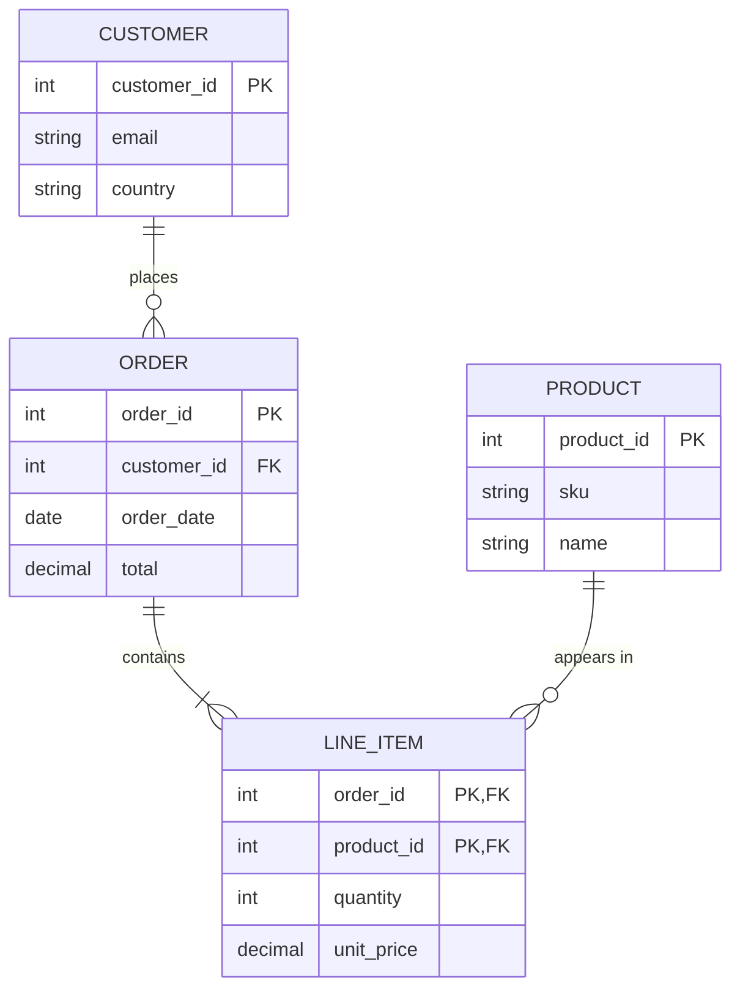
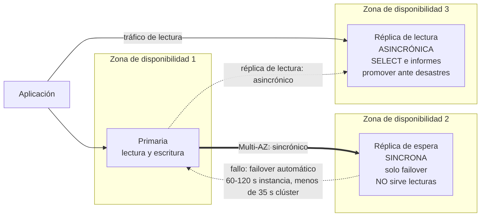
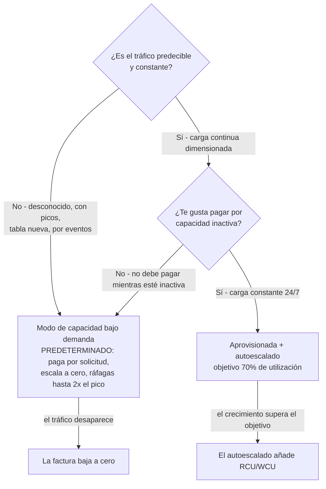
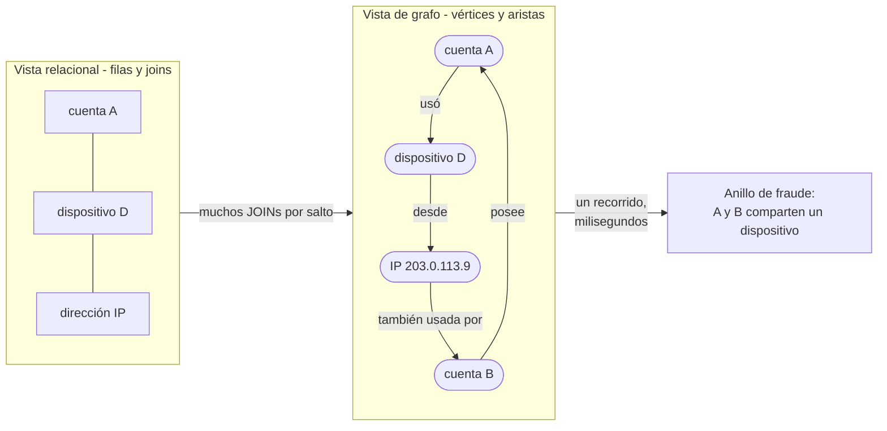
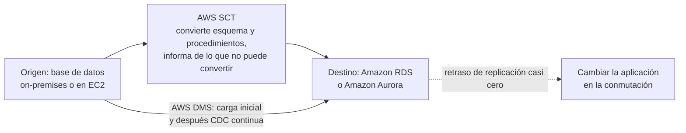
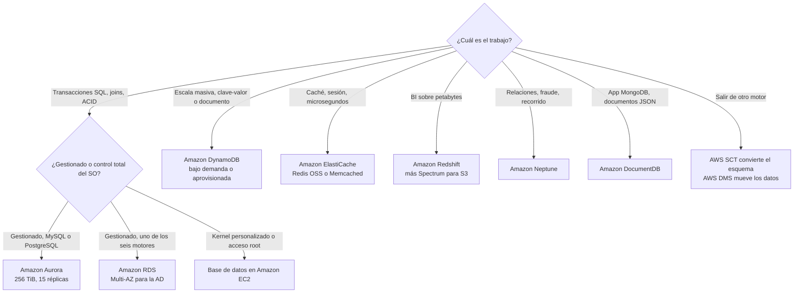

# Servicios de bases de datos: elegir el almacén adecuado

**El Dominio 3 (Tecnología y servicios en la nube) lleva el 34% de la puntuación del CLF-C02**, y dentro suyo hay una tarea que es trabajo de decisión puro: **Tarea 3.4 «Identificar servicios de bases de datos de AWS»**. Sus cinco enunciados de competencia son breves y directos — *"decidir cuándo usar bases de datos alojadas en EC2 o bases de datos gestionadas por AWS"*, identificar bases de datos **relacionales** (Amazon RDS, Amazon Aurora), **NoSQL** (Amazon DynamoDB), **basadas en memoria** (Amazon ElastiCache) y **herramientas de migración de bases de datos** (AWS DMS, AWS SCT). Cada pregunta construida sobre esta tarea tiene el mismo esqueleto: un enunciado de carga de trabajo, cuatro nombres de bases de datos y una sola respuesta correcta. Los nombres de servicios son fáciles; leer el enunciado es el examen.

```text
====================================================================
 LECCIÓN CLF-C02 10 — FICHA DE SERVICIOS DE BASES DE DATOS (datos en octubre de 2026)
====================================================================
 ALCANCE (Tarea 3.4)
   DENTRO   Aurora · DocumentDB · DynamoDB · ElastiCache · Neptune
            · RDS   (+ Redshift en Analítica; DMS + SCT en
              Migración y transferencia)
   FUERA    Amazon Keyspaces · Amazon MemoryDB · AWS AppConfig
 --------------------------------------------------------------------
 RDS        relacional gestionado; 6 motores: IBM Db2, MariaDB,
            Microsoft SQL Server, MySQL, Oracle Database, PostgreSQL
            AWS es dueño de «copias de seguridad, parcheado de
            software, detección automática de fallos y recuperación»
            almacenamiento máx 64 TiB; base gp3 3.000 IOPS / 125 MiB/s
            retención de copias 1-35 días (0 = copias automáticas off)
   Multi-AZ (instancia) . AD; réplica de espera SINCRONA; NO sirve
                          lecturas; failover normalmente 60-120 s
   Multi-AZ (clúster) .. AD + lecturas; failover normalmente < 35 s
   Réplica de lectura ... escalado de lecturas; ASINCRÓNICA (puede
                          estar obsoleta); promoción manual; SIN autoescalado
 AURORA      compatible con MySQL y PostgreSQL; misma consola RDS
             un solo volumen de clúster, copiado en tres AZ,
             autoexpande hasta 256 TiB; hasta 15 réplicas Aurora;
             failover normalmente < 60 s, a menudo < 30 s
 DYNAMODB    serverless, totalmente gestionado, NoSQL distribuido;
             milisegundos de un solo dígito a cualquier escala;
             clave-valor + documento; elemento <= 400 KB; sin JOINs;
             solo IAM; 3 AZ / SLA 99,99%; tablas globales SLA 99,999%
   bajo demanda (predeterminado) . pagas por petición, baja a cero,
                          sube al instante a 2x el pico anterior
   aprovisionada ........ pagas RCU/WCU se usen o no;
                          objetivo de autoescalado 70%
            1 RCU = 1 lectura fuerte/s para elementos de hasta 4 KB
            1 WCU = 1 escritura/s para elementos de hasta 1 KB
 ELASTICACHE  caché en memoria: Valkey, Memcached, Redis OSS
              «lecturas de microsegundos y escrituras submilisegundo»
              una caché EFÍMERA - nunca el sistema de registro
   Memcached ... modelo más simple, multihilo, SIN replicación
                 y SIN failover
   Redis OSS ... tipos complejos, replicación + failover automático
 REDSHIFT     almacén OLAP gestionado a escala de petabytes,
              columnar; Redshift Spectrum lee Amazon S3 directamente
 NEPTUNE      base de datos de grafos gestionada; miles de millones
              de relaciones con latencia de milisegundos; hasta 15 réplicas Neptune
 DOCUMENTDB   compatible con MongoDB; hasta 15 réplicas; hasta 256 TiB
 MIGRACIÓN    AWS SCT convierte esquema y código
              AWS DMS mueve los datos (carga única o CDC continua)
====================================================================
```

> [!NOTE]
> **Disciplina de alcance.** Cada servicio presentado abajo como evaluable se encuentra en la lista oficial de servicios en alcance del CLF-C02 o en un enunciado de tarea del Dominio 3. Tres servicios de bases de datos están explícitamente **fuera de alcance** y aparecen aquí solo para que puedas eliminarlos: **Amazon Keyspaces (for Apache Cassandra)**, **Amazon MemoryDB for Redis OSS** y **AWS AppConfig**. Las respuestas correctas de este examen salen siempre de la lista en alcance — un favorito de página de marketing como MemoryDB nunca puede ser la opción correcta.

En esta lección vas a:

- clasificar cada pregunta de bases de datos en los **cinco cubos** de la Tarea 3.4;
- separar lo que **Amazon RDS** gestiona de lo que **sigue siendo tuyo**;
- derrotar **la trampa de Multi-AZ frente a réplica de lectura** en ambas direcciones;
- comparar **RDS en EC2 frente a autogestionado** usando la propia tabla de responsabilidades de AWS;
- situar **Amazon Aurora** por compatibilidad, autoescalado de almacenamiento y número de réplicas;
- dimensionar **la capacidad de DynamoDB** en RCU y WCU, y elegir el **modo de capacidad** correcto;
- definir en una sola línea **Redis OSS frente a Memcached en ElastiCache**;
- separar **OLAP de OLTP** para que Redshift deje de ser un distractor;
- situar **Neptune y DocumentDB** a partir de enunciados de dos palabras;
- repartir una migración entre **AWS SCT (esquema) y AWS DMS (datos)**;
- recorrer la **tabla de decisión carga de trabajo → base de datos** de principio a fin;
- revisar las **actualizaciones de 2026** que tocan bases de datos — adiciones y retiras de las listas de alcance, Database Savings Plans y el Free Tier dependiente de la era;
- estudiar **cuatro casos de estudio publicados por AWS** (Netflix, Amazon Prime Video, Zendesk y Philip Morris International);
- practicar con **14 preguntas tipo examen** más cuatro comprobaciones interactivas.

---

## 1. Tarea 3.4: cinco cubos y una decisión

### 1.1 Los cinco enunciados de competencia, decodificados

AWS escribe la tarea como cinco viñetas. Decodifica cada una hasta la pregunta que te va a hacer:

| Enunciado de competencia de la Tarea 3.4 | La pregunta que hay detrás | La forma de la respuesta |
|---|---|---|
| Decidir cuándo usar bases de datos **alojadas en EC2** o **gestionadas por AWS** | *"necesitamos acceso root al SO y un kernel personalizado"* frente a *"queremos que AWS los parchee y copie"* | Control ⇒ **EC2**; menor sobrecarga operativa ⇒ **RDS** |
| Identificar bases de datos **relacionales** (Amazon RDS, Amazon Aurora) | Enunciados con SQL, joins, transacciones, esquemas, tablas | **RDS** o **Aurora** |
| Identificar bases de datos **NoSQL** (Amazon DynamoDB) | Acceso clave-valor o documento, escala enorme, milisegundos de un solo dígito, sin joins | **DynamoDB** |
| Identificar bases de datos **basadas en memoria** (Amazon ElastiCache) | Caché, almacén de sesiones, latencia de microsegundos, clasificación | **ElastiCache** |
| Identificar **herramientas de migración de bases de datos** (AWS DMS, AWS SCT) | Salir de Oracle/SQL Server, convertir procedimientos, sincronización continua | **SCT** convierte, **DMS** mueve |

Dos cubos extra no se nombran en el enunciado de tarea pero aparecen en la lista de alcance: **Redshift** (colocado en **Analítica** en la guía del examen, enseñado aquí solo para la decisión almacén frente a transacción) y **Neptune / DocumentDB** (almacenes de grafos y de documentos compatibles con MongoDB).

### 1.2 Las listas de alcance y fuera de alcance

| Categoría | En alcance (de aquí salen las respuestas correctas) | Fuera de alcance (distractores — nunca correctos) |
|---|---|---|
| Bases de datos | **Amazon Aurora, Amazon DocumentDB, Amazon DynamoDB, Amazon ElastiCache, Amazon Neptune, Amazon RDS** | **Amazon Keyspaces (for Apache Cassandra), Amazon MemoryDB for Redis OSS, AWS AppConfig** |
| Analítica | **Amazon Redshift** (la decisión de almacén se enseña en §6) | — |
| Migración y transferencia | **AWS Database Migration Service (AWS DMS), AWS Schema Conversion Tool (AWS SCT)** | — |

- **📚 ¿Sabías que…?** La propia guía de AWS sobre *"databases on AWS: how to choose"* (actualizada el **2 de junio de 2026**) anuncia **más de 15 opciones de bases de datos**, y la página de producto de bases de datos dice **más de 15 motores** — mientras que la guía del examen CLF-C02 nombra **seis** servicios de bases de datos en alcance. El examen no prueba la amplitud; prueba si puedes elegir los seis que a AWS le importan de un catálogo cuatro veces mayor (en octubre de 2026; verifica el estado vigente antes de usarlo).

### 1.3 Ejemplo resuelto E1 — clasificar un enunciado de un solo paso

Lee el enunciado, subraya el *patrón de acceso* y después nombra el cubo:

```text
"El historial de pedidos debe permitir joins contra clientes y
 líneas de pedido, con escrituras ACID"
   -> cubo relacional -> RDS (o Aurora si es MySQL/PostgreSQL)

"Datos de sesión indexados por token, deben devolverse en menos de 1 ms"
   -> cubo basado en memoria -> ElastiCache

"Tráfico de navegación y carrito con picos impredecibles,
 sin joins, elementos de menos de 400 KB"
   -> cubo NoSQL -> DynamoDB (modo de capacidad bajo demanda)

"Tres años de historial de ventas agregados en tableros"
   -> almacén -> Redshift (OLAP, no OLTP)

"Detección de anillos de fraude: seguir cuenta -> dispositivo -> IP -> cuenta"
   -> relaciones -> Neptune (grafos)

"Hoy ejecutamos drivers de MongoDB contra documentos"
   -> compatible con MongoDB -> DocumentDB

"Convertir 400 procedimientos PL/SQL de Oracle y después transmitir las filas"
   -> SCT convierte el código, DMS transmite los datos
```

El **verbo** del enunciado es toda la pregunta: *agregar* ⇒ Redshift, *recorrer* ⇒ Neptune, *cachear* ⇒ ElastiCache, *transaccionar* ⇒ RDS/Aurora, *escalar de forma impredecible* ⇒ DynamoDB.

---

## 2. Amazon RDS: el predeterminado relacional gestionado

### 2.1 Qué compra de verdad «lo gestionado»

AWS define Amazon Relational Database Service como un servicio gestionado que *"gestiona copias de seguridad, parcheado de software, detección automática de fallos y recuperación"*. La versión de esto en el examen es una tabla de responsabilidades, y AWS publica una que compara directamente las bases de datos **on-premises, alojadas en EC2 y gestionadas por RDS**:

| Capacidad | On-premises | Base de datos en Amazon EC2 | Amazon RDS |
|---|---|---|---|
| Optimización de la aplicación | **Cliente** | **Cliente** | **Cliente** |
| Escalado | **Cliente** | **Cliente** | **AWS** |
| Alta disponibilidad | **Cliente** | **Cliente** | **AWS** |
| Copias de seguridad | **Cliente** | **Cliente** | **AWS** |
| Parcheo de la base de datos y del SO | **Cliente** | **Cliente** | **AWS** |
| Hardware, alimentación, instalaciones | **Cliente** | **AWS** | **AWS** |

La conclusión propia de AWS es relevante para el examen: *"recomendamos Amazon RDS como opción predeterminada para la mayoría de los despliegues de bases de datos relacionales"*. Observa la única fila que nunca cambia — **la optimización de la aplicación (tu esquema, tus consultas, tus índices) es tuya en las tres columnas**. La responsabilidad compartida para las bases de datos no es «AWS lo hace todo».

### 2.2 Motores, instancias y almacenamiento

| Elemento | Lo que documenta AWS (en octubre de 2026) | Consecuencia en el examen |
|---|---|---|
| **Motores (6)** | IBM Db2, MariaDB, Microsoft SQL Server, MySQL, Oracle Database, PostgreSQL | *"cualquiera de estos seis nombres"* ⇒ **RDS**; Aurora es una familia de motores aparte (véase §3) |
| **Bloque de construcción** | La **instancia de BD**, usando clases de instancia como `db.m*`, `db.r*`, `db.c*`, `db.t*` | El prefijo `db.` es la nomenclatura propia de RDS; `t` = ampliable, `r` = memoria |
| **Almacenamiento** | respaldado por Amazon EBS, **hasta 64 TiB**; **base de gp3 de 3.000 IOPS y 125 MiB/s** | Un requisito relacional **por encima de 64 TiB** ⇒ mira a Aurora (256 TiB) |
| **Red** | Se ejecuta en una **VPC**, alcanzable a través de **grupos de seguridad** | Las preguntas de seguridad de la base de datos terminan en el grupo de seguridad y la VPC |
| **Modelo de acceso** | SQL, joins, transacciones multilínea | *"necesita JOINs / SQL ad-hoc"* ⇒ RDS o Aurora, nunca DynamoDB |



Esta es la forma que el examen entiende por **relacional**: claves primarias y foráneas, filas en tablas y respuestas que salen de **unirlas**. En cuanto un enunciado dice *"la aplicación no debe hacer JOIN"* o *"desnormalizar por diseño"*, has salido de este diagrama y has entrado en NoSQL.

### 2.3 Multi-AZ frente a réplicas de lectura — LA trampa

Esta es la pregunta más fiable de toda la lección, y AWS enuncia la regla dos veces en la Guía de usuario de RDS: **«La opción de alta disponibilidad no es una solución de escalado para escenarios de solo lectura. No puedes usar una réplica de espera para servir tráfico de lectura. Para servir tráfico de solo lectura, usa un clúster de BD Multi-AZ o una réplica de lectura».**

| | **Multi-AZ (instancia de BD)** | **Réplica de lectura** | **Multi-AZ (clúster de BD)** |
|---|---|---|---|
| **Propósito** | Alta disponibilidad / failover automático | **Escalado de lecturas** | Disponibilidad **y** lecturas |
| **Replicación** | **Sincrónica** | **Asincrónica** | Esperas sincrónicas |
| **¿Sirve tráfico de lectura?** | **No** — *"no puedes usar una réplica de espera para servir tráfico de lectura"* | **Sí**, de solo lectura | **Sí** (las tres instancias) |
| **Failover** | Automático, normalmente **60–120 segundos** | **Promoción** manual (recuperación ante desastres) | Automático, normalmente **menos de 35 segundos** |
| **Riesgo de obsolescencia** | Ninguno (sincrónica) | **Sí** — al ser asincrónica puede rezagarse | Ninguno (sincrónica) |
| **Coste** | Se factura la segunda instancia | Cada réplica se factura como una instancia de BD | Tres instancias |
| **¿Autoescala lecturas?** | n/a | **No** — *"RDS no admite autoescalado de réplicas de lectura"* | Las añades y quitas tú |



Ambas funciones pueden coexistir en la misma base de datos de origen — un despliegue Multi-AZ para sobrevivir **y** una réplica de lectura para los informes. La trampa funciona en ambas direcciones:

- *"aumentar el rendimiento de lecturas / descargar los informes"* ⇒ **réplica de lectura** (Multi-AZ no hace nada por las lecturas);
- *"sobrevivir a una falla de Zona de disponibilidad con failover automático"* ⇒ **Multi-AZ** (una réplica de lectura solo hace failover si la promueves manualmente).

> ⚠️ **Multi-AZ no es una solución de escalado.** La formulación de AWS es absoluta: la opción de alta disponibilidad *"no es una solución de escalado para escenarios de solo lectura"*. Dos matices suman notas: un **clúster de BD Multi-AZ** (dos esperas legibles) *sí* sirve tráfico de lectura, y una réplica de lectura es **asincrónica** — así que una réplica puede estar obsoleta, y exactamente por eso nunca debes enrutar escrituras hacia ella.

### 2.4 Ejemplo resuelto E2 — el pico de informes

*La base de datos MySQL primaria en RDS gestiona 400 escrituras por segundo. Los informes de fin de mes ejecutan 600 SELECT pesados por segundo y la CPU de la primaria se queda en el 95%. Se proponen dos opciones: habilitar Multi-AZ o crear una réplica de lectura. ¿Cuál es correcta y por qué?*

```text
Pregunta de fondo       : "las LECTURAS son demasiado pesadas"
Multi-AZ da             : una espera SINCRONA que NO sirve lecturas
                          -> la CPU sigue en la primaria; sin alivio
La réplica de lectura   : una copia ASINCRONA que acepta SELECT
                          -> los informes se van de la primaria
Veredicto               : crear una réplica de lectura y apuntar
                          el trabajo de informes hacia ella
Riesgo residual         : retraso asincrónico - los informes pueden
                          ir segundos por detrás; la promoción (no la
                          replicación) es la historia de DR
```

Invierte el enunciado: *"la base de datos debe sobrevivir a una caída de AZ con failover automático"* ⇒ **Multi-AZ**, porque la promoción de una réplica de lectura es manual y su replicación es asincrónica.

### 2.5 RDS frente a una base de datos autogestionada en EC2

La Tarea 3.4 prueba explícitamente esta elección. La pregunta decisiva nunca es «cuál es más potente» — es **quién hace el trabajo no diferenciado**.

| Pregunta que hace el enunciado | Base de datos en Amazon EC2 | Amazon RDS |
|---|---|---|
| ¿Quién parchea el motor de la base de datos y el SO? | **Tú** | **AWS** |
| ¿Quién configura las copias de seguridad y la detección de fallos? | **Tú** | **AWS** |
| ¿Quién gestiona el escalado y la alta disponibilidad? | **Tú** | **AWS** |
| ¿Quién escribe el esquema, las consultas y los índices? | **Tú** | **Tú** (sin cambios) |
| ¿Tienes root/SO o un kernel personalizado? | **Sí** | **No** |
| Veredicto de examen | Solo cuando el enunciado exige control de SO/root/motor personalizado | **Opción predeterminada** para la mayoría de los despliegues relacionales |

**Ejemplo resuelto E3 — elegir entre RDS y EC2.** Tres enunciados, tres veredictos:

1. *"Un equipo necesita PostgreSQL con copias de seguridad gestionadas por AWS, parcheado y failover Multi-AZ, y no tiene requisitos de SO inusuales."* ⇒ **Amazon RDS** — cada requisito está en la lista gestionada de RDS, y AWS lo recomienda como predeterminado.
2. *"Una carga de trabajo regulada requiere un módulo de kernel personalizado y acceso root completo en el anfitrión de la base de datos."* ⇒ **Base de datos en Amazon EC2** — RDS no expone el sistema operativo, así que el requisito obliga a la ruta EC2, y el equipo pasa a ser dueño del parcheado, las copias de seguridad y la AD.
3. *"La misma carga de trabajo en PostgreSQL, pero la empresa ya tiene sus propios scripts de copia de seguridad y su calendario de parches y se niega a cambiarlos."* ⇒ **Alojar en EC2 es legítimo**, pero el sesgo del examen lo declara el propio AWS: RDS es el *predeterminado recomendado*, así que un enunciado que solo menciona la comodidad de la costumbre suele estar buscando RDS.

### 2.6 Copias de seguridad, parcheado y retención

| Operación | Comportamiento de AWS (en octubre de 2026) | Lo que sigue siendo tuyo |
|---|---|---|
| **Copias de seguridad automáticas** | Activas por defecto; ventana de retención seleccionable de **1 a 35 días** (0 las desactiva) | Elegir la ventana; probar las restauraciones |
| **Instantáneas manuales** | Se conservan hasta que las eliminas | Ciclo de vida de instantáneas y copias entre Regiones |
| **Parcheado de software** | AWS parchea el motor, el SO y el anfitrión | Tu ventana de mantenimiento; tus pruebas en una copia de preparación |
| **Detección y recuperación de fallos** | Automática | La lógica de reintentos y los tiempos de espera de conexión de tu aplicación |
| **Esquema, credenciales, grupos de seguridad, VPC** | No gestionados | **Tuyos**, siempre |
| **Elección Multi-AZ / réplica de lectura** | No automática | **Tuya** — AWS nunca activa ninguna de las dos por ti |

> [!WARNING]
> **La cifra de retención predeterminada es una trampa en sí misma.** La Guía de usuario de RDS verifica el **rango de 1–35 días** (con 0 significando que las copias automáticas están desactivadas). El ampliamente citado *"el valor predeterminado es 7 días"* proviene de la redacción de una **regla de AWS Config** que comprueba el cumplimiento, no de la propia Guía de usuario de RDS. En el examen, cita el **rango**; si una pregunta pivota sobre el predeterminado, trátala como no verificada y vuelve a comprobar la consola (en octubre de 2026).

**Ejemplo resuelto E4 — el presupuesto de failover.** La lógica de reintentos de la aplicación debe dimensionarse contra el failover *más lento* documentado, no contra el más rápido:

```text
Instancia de BD Multi-AZ ...... normalmente 60-120 segundos
Clúster de BD Multi-AZ ........ normalmente menos de 35 segundos
Failover de Aurora ............ normalmente menos de 60 s, a menudo menos de 30 s
Aurora Global Database
  promoción (DR planificada) .. en menos de 1 minuto
 ------------------------------------------------------------
Regla de diseño: dimensiona los reintentos de conexión para el CASO
                 MÁS LENTO que ejecutes de verdad - 120 segundos - o
                 la app se rinde antes de que vuelva la base de datos.
```

Una pregunta que elogia el *"a menudo menos de 30 segundos"* de Aurora mientras tu tiempo de espera del cliente es de 10 segundos está probando aritmética, no marketing.

- **📚 ¿Sabías que…?** El Free Tier de RDS tiene límite de tiempo y depende de la antigüedad de la cuenta: AWS documenta **750 horas al mes** de un `db.t3.micro` o `db.t4g.micro` en **Single-AZ** — y esa asignación se aplica a cuentas creadas **antes del 17 de julio de 2025**. Las cuentas más antiguas conservaron el Free Tier clásico de 12 meses; las más nuevas reciben en su lugar el plan Free basado en créditos, así que un enunciado que cita «750 horas de db.t3.micro» depende de la era (en octubre de 2026; verifica el estado vigente antes de usarlo).

---

## 3. Amazon Aurora: el alto rendimiento compatible con MySQL/PostgreSQL

### 3.1 Compatibilidad y el volumen compartido del clúster

AWS describe Aurora como **compatible con MySQL y PostgreSQL**, y se aprovisiona y administra a través de **la misma consola, CLI y API de RDS** — aprovisionamiento, parcheado, copias de seguridad y detección de fallos se comportan como RDS. La diferencia está en la capa de almacenamiento: Aurora usa un **único volumen de clúster cuyos datos se replican en tres Zonas de disponibilidad**, y ese volumen es **independiente de las instancias de base de datos** unidas a él. Añadir un lector, por tanto, no copia los datos — la instancia simplemente se conecta al volumen existente.

| Propiedad de Aurora | Cifra de AWS (en octubre de 2026) | Por qué le importa al examen |
|---|---|---|
| **Compatibilidad** | MySQL y PostgreSQL | *"compatible con MySQL/PostgreSQL"* ⇒ Aurora; cualquiera de los **otros seis motores** ⇒ RDS |
| **Almacenamiento** | El volumen del clúster **autoexpande** a medida que crecen los datos, hasta **256 TiB** (y se autoencoge cuando se borran datos) | Sin planificación de capacidad; una necesidad relacional **por encima de 64 TiB** (techo de RDS) cae aquí |
| **Escalado de lecturas** | **Hasta 15 réplicas Aurora** en tres AZ | *"15 lectores"* ⇒ Aurora; las réplicas de lectura de RDS son otra función, gestionada aparte |
| **Failover** | Normalmente **menos de 60 segundos, y a menudo menos de 30 segundos** | Enunciados de recuperación rápida |
| **Reconstrucción de réplicas** | Sin réplicas disponibles, AWS documenta una reconstrucción *"normalmente en menos de 10 minutos"* | Aritmética de recuperación ante desastres |
| **Facturación de I/O** | **Aurora I/O-Optimized** merece la pena cuando el **gasto de I/O es del 25% o más** del gasto de la instancia de BD Aurora | Un umbral raro, específico y con fuente |
| **Global Database** | Una Región primaria más Regiones secundarias, con replicación con *"latencia normalmente inferior a un segundo"*; **conmutación planificada** frente a **failover** en caída de Región | Vocabulario de DR multi-Región |

> [!WARNING]
> **Dos cifras de Aurora se enseñan aquí deliberadamente como no fácticas**, porque las propias páginas de AWS discrepan: (1) el **multiplicador de rendimiento frente a MySQL/PostgreSQL de serie** se publica como **6x** en una página de la Guía de usuario de Aurora, **cinco veces** en otra y **3-5x** en una tercera; (2) el **número de Regiones secundarias en Aurora Global Database** aparece como **hasta 10** en la Guía de usuario y **hasta cinco** en el FAQ. Las cifras oficiales en conflicto están sin verificar por definición (sección G del resumen) — nunca afirmes ninguna de ellas. Lo que *sí* es seguro: *"un rendimiento materialmente superior al de MySQL/PostgreSQL de serie"*, el techo de **256 TiB**, **15 réplicas Aurora** y un failover **a menudo por debajo de 30 segundos**, cada uno citado con página y fecha.

### 3.2 Aurora frente a RDS — el desempate de dos palabras

| Fragmento del enunciado | Respuesta |
|---|---|
| *"compatible con MySQL o PostgreSQL, hasta 15 lectores, almacenamiento autoexpansible"* | **Aurora** |
| *"IBM Db2 / Oracle / SQL Server / MariaDB"* | **RDS** |
| *"base de datos relacional por encima de 64 TiB"* | **Aurora** (volumen de clúster de 256 TiB) |
| *"cualquiera de los seis motores clásicos"* | **RDS** |
| *"relacional, pero el examen dice «serverless y compatible con MySQL/PostgreSQL»"* | **Aurora** |

**Ejemplo resuelto E5 — los techos de almacenamiento como decisión.** Tres requisitos, tres servicios:

```text
"Carga de trabajo relacional, 40 TiB y creciendo"      -> RDS
        (el techo de 64 TiB de almacenamiento basta)
"Carga de trabajo relacional, 200 TiB, compatible con MySQL" -> Aurora
        (el volumen del clúster autoexpande hasta 256 TiB)
"Carga de trabajo relacional, 400 TiB"                 -> no es ni una
        pregunta de base de datos: eso es un almacén (Redshift,
        escala de petabytes) o una pregunta de data lake
```

- **📚 ¿Sabías que…?** La configuración **I/O-Optimized** de Aurora tiene un punto de equilibrio publicado: AWS aconseja cambiarla cuando tu **gasto de I/O alcanza el 25% o más** de tu gasto de instancias de BD Aurora. Es uno de los pocos umbrales de coste de bases de datos que AWS enuncia numéricamente — y como toda cifra de esta lección, es *de octubre de 2026* y debe reverificarse antes de que te apoyes en ella en producción.

---

## 4. Amazon DynamoDB: NoSQL serverless a milisegundos de un solo dígito

### 4.1 Lo que es — y lo que se niega a ser

La definición de AWS es la definición del examen: DynamoDB es *"una base de datos NoSQL distribuida, serverless y totalmente gestionada, con rendimiento de milisegundos de un solo dígito a cualquier escala"*, y admite **tanto el modelo de clave-valor como el de documento**. Lee la letra pequeña, porque es la que genera distractores:

| Propiedad | Declaración de AWS (en octubre de 2026) | Consecuencia |
|---|---|---|
| **Modelo de datos** | Clave-valor **y** documento | No es relacional |
| **Joins** | *"no admite un operador JOIN"* | *«Necesita JOINs»* ⇒ RDS/Aurora, no DynamoDB |
| **Tamaño máximo de elemento** | **400 KB** | Los blobs grandes van a Amazon S3 con un puntero |
| **Autenticación** | IAM — **sin nombres de usuario ni contraseñas** | Los enunciados de seguridad terminan en IAM |
| **Durabilidad / SLA** | Replicado en **tres zonas de disponibilidad**, SLA de disponibilidad del **99,99%** | Los distractores de Single-AZ caen |
| **Tablas globales** | Replicación **multirregión** y **multirrecurso**, SLA de disponibilidad del **99,999%** | *«Distribuido geográficamente, activo en todas partes»* ⇒ tablas globales |
| **Consistencia** | Admite lecturas fuertemente consistentes y transacciones ACID | No es «solo eventualmente consistente» |
| **Free tier** | **25 GB + 25 WCU + 25 RCU** Siempre gratis (≈ 200 millones de solicitudes/mes a escala de tutorial) | Escala de tutorial, no de producción |
| **Cuota predeterminada** | **40.000** RCU + WCU combinadas | Súbela antes de diseñar para ella |

### 4.2 Modos de capacidad — el segundo dato de bases de datos más examinado

| | **Bajo demanda** (predeterminado) | **Aprovisionada** |
|---|---|---|
| **Facturado por** | **Por solicitud** (unidades de solicitud de lectura / de escritura) | **RCU y WCU aprovisionadas por hora, usadas o no** |
| **Planificación de capacidad** | Ninguna | Tú eliges los números |
| **¿Escala a cero?** | **Sí** — sin tráfico, sin coste | **No** — las unidades inactivas se siguen facturando |
| **Comportamiento de ráfaga** | Al instante hasta **2× el pico anterior**; una tabla nueva empieza con margen para **4.000 escrituras/s y 12.000 lecturas/s** | **Autoescalado** hacia un objetivo de CloudWatch del **70%**, activo por defecto en la consola |
| **Definición de unidad** | Unidad de solicitud consumida | **1 RCU** = una lectura fuertemente consistente/s para elementos de hasta **4 KB** (o dos lecturas eventualmente consistentes); **1 WCU** = una escritura/s para elementos de hasta **1 KB** |
| **Cambio de modo** | Aprovisionada ⇒ bajo demanda como máximo **4 veces cada 24 horas**; la inversa en cualquier momento | — |
| **Elección de examen** | Tráfico **desconocido, con picos, nuevo o impulsado por eventos** | Tráfico **continuo, predecible, constante** |



### 4.3 Ejemplos resueltos — la aritmética que el examen realmente usa

**Ejemplo resuelto E6 — dimensionado aprovisionado (el propio patrón resuelto de AWS, en octubre de 2026).**

```text
LECTURAS  80 lecturas fuertemente consistentes/s, tamaño de elemento 3 KB
          3 KB <= 4 KB  ->  1 RCU por lectura
          80 x 1 RCU                    =  80 RCU

ESCRITURAS 100 escrituras/s, tamaño de elemento 512 bytes
          512 B <= 1 KB -> 1 WCU por escritura
          100 x 1 WCU                   = 100 WCU

LECTURAS  elemento de 5 KB, fuertemente consistente
          ceil(5 / 4) = 2 RCU por lectura -> el coste de RCU se dobla
```

**Ejemplo resuelto E7 — economía de los modos.** Una tabla aprovisionada con **100 RCU + 50 WCU**:

```text
Aprovisionada: 150 unidades/hora se facturan haya o no
               quien lea o escriba -> 24 h de inactividad siguen costando
Bajo demanda : sin tráfico -> cero cargos por rendimiento
Punto muerto : el uso continuo 24/7 favorece lo aprovisionado;
               las ráfagas, noches, fines de semana y cargas
               desconocidas favorecen lo bajo demanda (que es el
               modo PREDETERMINADO)
```

**Ejemplo resuelto E8 — margen de ráfaga.** El pico de tráfico anterior en una tabla bajo demanda fue de **50.000 lecturas/s**. AWS documenta que bajo demanda puede escalar al instante hasta **el doble del pico anterior**:

```text
Margen = 2 x 50.000 = 100.000 lecturas/s
Una campaña que necesita 90.000 lecturas/s cabe dentro.
Una campaña que necesita 140.000 lecturas/s NO cabe - la tabla
puede quedar limitada, así que precalienta el tráfico o pide un
incremento de cuota. Cuota combinada predeterminada = 40.000 RCU + WCU.
```

### 4.4 Cuándo el examen elige DynamoDB

| Fragmento del enunciado | Respuesta |
|---|---|
| *«NoSQL serverless, milisegundos de un solo dígito, cualquier escala»* | **DynamoDB** |
| *«Picos impredecibles; no debe pagar cuando esté inactiva»* | **DynamoDB bajo demanda** (el modo predeterminado) |
| *«Clave-valor o documento, sin joins, elementos de 400 KB»* | **DynamoDB** |
| *«Clasificación de juegos / carrito de compras a escala de venta puntual»* | **DynamoDB** |
| *«Necesita JOINs o SQL ad-hoc sobre filas»* | **RDS o Aurora** |
| *«Drivers de MongoDB y documentos, clústeres de instancias»* | **DocumentDB** (véase §7) |

También aparecen dos satélites de DynamoDB:

- **Amazon DynamoDB Accelerator (DAX)** — una **caché en memoria solo para DynamoDB**, compatible con la API, que ofrece lecturas *"hasta 10 veces"* más rápidas y mueve la latencia *"de milisegundos a microsegundos"*. El enunciado son puntos calientes de claves repetidas con muchas lecturas en una tabla de DynamoDB.
- **Tablas globales** — replicación **multirregión** y **multirrecurso**, SLA de disponibilidad del **99,999%**, sin tabla primaria hacia la que fallar. El enunciado es la distribución geográfica.

DAX arregla la **latencia**; las tablas globales arreglan la **geografía**. Confundirlas es una forma fiable de perder una marca.

---

## 5. Amazon ElastiCache: la capa en memoria

### 5.1 Lo que es

AWS define ElastiCache como un *"almacén de datos o entorno de caché distribuido en memoria"*, y funciona con los motores **Valkey, Memcached y Redis OSS**; la guía de elección de AWS le pone una cifra: **lecturas de microsegundos y escrituras submilisegundo como *caché efímera***. Esa última frase es toda la posición de examen: ElastiCache **acelera** una base de datos primaria; **nunca** es el sistema de registro.

### 5.2 Redis OSS frente a Memcached — las de una sola frase

| | **Memcached** | **Redis OSS / Valkey** |
|---|---|---|
| **Modelo** | *"El modelo más simple posible"* — objetos de caché | Tipos de datos complejos: listas, conjuntos, **conjuntos ordenados**, hashes, mapas de bits, geoespacial |
| **Hilos** | **Multihilo** | — |
| **Replicación** | **No** | **Sí** |
| **Failover** | **No** | **Sí** (obligatorio en modo clúster) |
| **Copias de seguridad** | Sin copias basadas en nodos | Admitidas |
| **Pub/sub, cifrado** | No | Sí |
| **Enunciados de examen** | *«Caché de objetos simple, escala horizontal de nodos hacia arriba y abajo»* | **Sesiones, clasificaciones (conjuntos ordenados), colas, límite de tarifas, geoespacial** |

**Ejemplo resuelto E9 — elegir el motor de caché.**

```text
"Cachear fragmentos HTML renderizados; modelo lo más simple posible;
 escalar nodos hacia arriba y abajo"        -> Memcached

"Guardar sesiones de usuario con TTL y construir una clasificación
 en tiempo real ordenada por puntuación"    -> Redis OSS / Valkey
        (conjuntos ordenados + replicación + failover)

"Cachear lecturas de una tabla de DynamoDB con latencia de
 microsegundos"                             -> DAX (solo para DynamoDB)

"Caché efímera delante de MySQL con failover automático"
                                            -> ElastiCache
        (Redis OSS / Valkey - Memcached no tiene failover)
```

> ⚠️ **ElastiCache nunca es la respuesta a «¿dónde se guardan los datos de forma duradera?»** Es una *caché efímera*. Si el enunciado necesita una base de datos primaria duradera, la respuesta es RDS, Aurora, DynamoDB o DocumentDB — y si pide una base de datos **en memoria** duradera, la opción de la página de marketing es **Amazon MemoryDB**, que está **fuera de alcance** para CLF-C02 y por tanto nunca es correcta.

```matching
{
  "question": "Relaciona cada requisito de caché o de memoria con el servicio que el examen CLF-C02 espera que elijas:",
  "pairs": [
    {"left": "El caché de objetos más simple posible, multihilo, escalar nodos hacia arriba y abajo, sin replicación obligatoria", "right": "Memcached en Amazon ElastiCache - sin replicación, sin failover, sin copias basadas en nodos"},
    {"left": "Sesiones con TTL más una clasificación ordenada por puntuación que debe sobrevivir a un fallo de nodo automáticamente", "right": "Redis OSS (o Valkey) en Amazon ElastiCache - tipos complejos, conjuntos ordenados, replicación y failover automático"},
    {"left": "Lecturas de microsegundos para puntos calientes repetidos en una tabla de DynamoDB existente", "right": "Amazon DynamoDB Accelerator (DAX) - una caché en memoria solo para DynamoDB, de milisegundos a microsegundos"},
    {"left": "Una primaria relacional duradera que debe sobrevivir a una falla de zona de disponibilidad con failover automático", "right": "Amazon RDS o Amazon Aurora con Multi-AZ - la caché es efímera y nunca el sistema de registro"},
    {"left": "Una base de datos en memoria duradera citada de una página de marketing de AWS", "right": "Amazon MemoryDB - explícitamente fuera de alcance para CLF-C02, así que nunca puede ser la respuesta correcta"}
  ],
  "explanation": "Ordena según dos preguntas: ¿son duraderos o efímeros los datos, y qué familia de productos es dueña del patrón de acceso? La escala horizontal simple de caché es Memcached; los TTL, los conjuntos ordenados y el failover automático son Redis OSS/Valkey; las lecturas de microsegundos sobre DynamoDB son DAX; todo lo que deba ser el sistema de registro abandona por completo ElastiCache hacia RDS, Aurora, DynamoDB o DocumentDB; y la respuesta de marketing de en memoria duradera, Amazon MemoryDB, está en la lista de fuera de alcance, así que es un distractor por definición."
}
```

---

## 6. Amazon Redshift: el almacén, no la transacción

### 6.1 La trampa OLAP frente a OLTP

AWS define Amazon Redshift como un *"almacén de datos gestionado a escala de petabytes"* *"diseñado específicamente para procesamiento analítico en línea (OLAP)"*. La trampa es que ambas mitades de la pareja son bases de datos, ambas responden preguntas SQL, y solo una de ellas es correcta para tu enunciado.

| | **OLTP — RDS, Aurora, DynamoDB** | **OLAP — Amazon Redshift** |
|---|---|---|
| **Trabajo** | Ejecutar el negocio: capturar transacciones individuales | Analizar el negocio: agregar el historial |
| **Forma de almacenamiento** | Filas (OLTP) | **Columnas** — AWS: *«las aplicaciones OLTP suelen almacenar los datos en filas; Amazon Redshift almacena los datos en columnas»* |
| **Consulta típica** | Un pedido, un cliente, una escritura | *«Ingresos totales por región y por trimestre durante 3 años»* |
| **Escala** | Gigabytes a decenas de terabytes | **Escala de petabytes** |
| **Patrón de escritura** | Inserciones y actualizaciones frecuentes de una sola fila | Cargas masivas, después predominan lecturas |
| **Guía de AWS** | *«Si necesitas un sistema transaccional rápido … elige … Amazon RDS u una base de datos NoSQL, como DynamoDB»* | *«Ideal para procesamiento analítico en línea (OLAP)»* |
| **Ubicación en el examen** | Bases de datos (lista en alcance) | **Analítica** — la categoría nunca cambia la respuesta |

AWS también declara que características de OLTP como **los índices secundarios y las operaciones eficientes de manipulación de una sola fila han sido *omitidas*** de Redshift. Esa es la pista: una base de datos que eliminó deliberadamente la manipulación de filas no es donde pones un carrito de compras.

**Ejemplo resuelto E10 — la pregunta de dos columnas.**

```text
"Los clientes hacen pedidos mientras compran; cada pedido debe
 confirmarse de inmediato, con garantías ACID"
      -> OLTP -> RDS / Aurora (o DynamoDB para escala clave-valor)

"Un tablero de inteligencia de negocio agrega 3 años de
 historial de pedidos en totales regionales cada mañana"
      -> OLAP -> Amazon Redshift

"El mismo requisito de BI, pero los archivos sin procesar ya
 están en Amazon S3 y nadie quiere cargarlos primero"
      -> Redshift Spectrum: consulta los archivos de S3 directamente,
         en servidores dedicados independientes del clúster
```

### 6.2 Redshift Spectrum

AWS documenta que **Redshift Spectrum** te permite *"consultar datos directamente desde archivos en Amazon S3"* usando **servidores independientes de tu clúster**. La consecuencia visible en el examen: puedes consultar **el almacén y el data lake en una sola sentencia SQL** sin pagar por nodos de clúster adicionales para retener los datos del lago.

- **📚 ¿Sabías que…?** La guía del examen archiva **Amazon Redshift bajo Analítica**, no bajo Bases de datos — y aun así la Tarea 3.4 espera que tomes la decisión almacén frente a transacción. La ubicación de categoría es un detalle de metadatos, nunca una razón para descartar un servicio en alcance de una respuesta (en octubre de 2026).

---

## 7. Amazon Neptune y Amazon DocumentDB: los dos almacenes especializados

### 7.1 Neptune — la respuesta de grafos

AWS describe Amazon Neptune como un *"servicio de bases de datos de grafos gestionado"* que maneja **miles de millones de relaciones** con **latencia de milisegundos**, admite **Gremlin y openCypher** para grafos de propiedades y **SPARQL** para RDF, con **hasta 15 réplicas de Neptune** en un volumen compartido de tres zonas de disponibilidad y failover automático.

| Fragmento del enunciado | Respuesta |
|---|---|
| *«Datos altamente conectados; recorrer cuenta → dispositivo → IP → cuenta»* | **Neptune** |
| *«Detección de anillos de fraude, recomendaciones, grafos sociales o de conocimiento, seguridad de red»* | **Neptune** |
| *«Búsquedas clave-valor»* | DynamoDB — las respuestas de grafos son incorrectas aquí |
| *«Documentos / drivers de MongoDB»* | DocumentDB |



Los almacenes de grafos responden una pregunta a la que un esquema relacional responde *lentamente*: a medida que crecen los saltos, el número de JOINs se dispara, mientras Neptune recorre las aristas directamente. Ese intercambio es toda la justificación del cubo de grafos.

### 7.2 DocumentDB frente a DynamoDB — el desempate de MongoDB

| | **Amazon DocumentDB** | **Amazon DynamoDB** |
|---|---|---|
| **Compatibilidad** | *"compatible con MongoDB"* — mismos drivers, herramientas y código | API propietaria; acceso solo con IAM |
| **Modelo** | Documento, **compatible con MongoDB** | Clave-valor **y** documento |
| **Aprovisionamiento** | Clústeres de instancias; el almacenamiento crece en pasos de **10 GB** hasta **256 TiB** | **Serverless** — sin instancias, modos de capacidad |
| **Réplicas** | **Hasta 15** instancias de réplica compartiendo una capa de almacenamiento; **seis copias en tres zonas de disponibilidad** | Replicación en tres AZ por defecto; tablas globales para multirregión |
| **Enunciado de examen** | *«MongoDB», documentos tipo JSON, catálogos, perfiles* | *«Serverless, milisegundos de un solo dígito, escala a cero»* |

Regla práctica: **la palabra MongoDB ⇒ DocumentDB**; **las palabras serverless, modo de capacidad o milisegundo de un solo dígito ⇒ DynamoDB**.

---

## 8. Migración: AWS Schema Conversion Tool y AWS Database Migration Service

### 8.1 La división que debes memorizar

Ambas herramientas están en la categoría **Migración y transferencia** de la guía del examen, y el examen nunca ha preguntado por ellas sin probar la división de trabajo:

| | **AWS Schema Conversion Tool (SCT)** | **AWS Database Migration Service (DMS)** |
|---|---|---|
| **Trabajo** | **Convertir el esquema y el código** | **Mover los datos** |
| **Qué toca** | Esquema de la base de datos, procedimientos almacenados, vistas — *"de un motor de base de datos a otro"*, para un **esquema relacional OLTP o un esquema de almacén de datos** | Filas: una **carga única** o **replicación continua de cambios** (CDC) |
| **Formato** | Aplicación gráfica independiente gratuita | *"Un servidor en la nube de AWS que ejecuta software de replicación"* con puntos de conexión de origen y destino |
| **Salida** | Artefactos convertidos **más un informe de evaluación** de lo que no puede convertir | Una base de datos destino replicada con un retraso que monitorizas hasta cero |
| **Destinos típicos** | — | Amazon RDS, Aurora, Redshift, DynamoDB, Amazon S3 |
| **Palabra clave de examen** | *«Convertir / esquema / DDL / procedimientos / heterogéneo»* | *«Replicar / cambios continuos / conmutación / transmitir los datos»* |

Una tercera respuesta es un atrapadistractores: *«rehospedar servidores o máquinas virtuales enteras»* es el **AWS Application Migration Service**, que no es una herramienta de bases de datos en absoluto.



### 8.2 Ejemplo resuelto E11 — una salida de Oracle

*Una aseguradora ejecuta Oracle Database on-premises con 400 procedimientos PL/SQL y quiere Amazon Aurora PostgreSQL con el mínimo tiempo de inactividad. Secuencia las herramientas:*

```text
Paso 1  AWS SCT convierte el esquema y los procedimientos de Oracle
        a PostgreSQL; su informe de evaluación marca todo lo que
        todavía necesita reescritura humana.
Paso 2  AWS DMS crea los puntos de conexión de origen y destino,
        realiza la carga inicial y después sigue replicando los
        cambios continuos.
Paso 3  Monitoriza el retraso de replicación; cuando sea
        efectivamente cero, cambia la aplicación a Aurora en la
        conmutación.
Por qué no la otra herramienta en solitario:
        DMS sin SCT mueve filas pero deja SQL de Oracle que
        PostgreSQL no puede ejecutar.
        SCT sin DMS te deja con un destino vacío.
        Application Migration Service rehospeda SERVIDOREOS COMPLETOS -
        no convierte un esquema de Oracle a PostgreSQL.
```

---

## 9. La tabla de decisión: carga de trabajo → almacén

### 9.1 Una tabla para toda la tarea

| Patrón de acceso en el enunciado | Cubo | Respuesta | La pista |
|---|---|---|---|
| SQL, joins, transacciones ACID, tablas | Relacional, gestionado | **Amazon RDS** | Cualquiera de los seis motores; parcheado y copias gestionados por AWS |
| Compatible con MySQL/PostgreSQL + almacenamiento autoexpansible + 15 lectores | Relacional, optimizado | **Amazon Aurora** | Volumen de clúster de 256 TiB, failover a menudo por debajo de 30 s |
| Clave-valor o documento a cualquier escala, milisegundos de un solo dígito, sin joins | NoSQL | **Amazon DynamoDB** | Serverless, modos de capacidad, elementos de 400 KB |
| Caché, almacén de sesiones, clasificación, lecturas de microsegundos | Basado en memoria | **Amazon ElastiCache** | Efímera; Redis OSS para failover, Memcached para simplicidad |
| Agregación compleja sobre años de historial, petabytes | Almacén (OLAP) | **Amazon Redshift** | Columnar; *«sistema transaccional rápido»* ⇒ no es Redshift |
| Relaciones, recorrido, anillos de fraude, grafos sociales | Grafo | **Amazon Neptune** | Miles de millones de relaciones con milisegundos |
| Drivers de MongoDB, documentos JSON, catálogos | Documento, compatible | **Amazon DocumentDB** | Clústeres de instancias, hasta 15 réplicas |
| Convertir esquemas y procedimientos almacenados entre motores | Migración | **AWS SCT** | *«Convertir»* |
| Replicar filas para una conmutación con poco tiempo de inactividad | Migración | **AWS DMS** | *«Cambios continuos»* |
| Acceso root, kernel personalizado, control del SO | Autogestionado | **Base de datos en Amazon EC2** | Ahora eres dueño del parcheado, las copias de seguridad y la AD |



```matching
{
  "question": "Relaciona cada carga de trabajo con la base de datos que el examen CLF-C02 espera que elijas:",
  "pairs": [
    {"left": "Tableros de BI de fin de mes que agregan 3 años de ventas, escala de petabytes", "right": "Amazon Redshift - el almacén OLAP gestionado, columnar, con Spectrum para archivos de S3"},
    {"left": "Carrito de compras con picos impredecibles de venta puntual, sin joins, que no debe costar nada mientras esté inactiva", "right": "Amazon DynamoDB en modo de capacidad bajo demanda - NoSQL serverless, pago por solicitud, escala a cero"},
    {"left": "Procedimientos de Oracle por convertir y después filas por transmitir para una conmutación con poco tiempo de inactividad", "right": "AWS SCT convierte el esquema y el código, AWS DMS replica los datos"},
    {"left": "Sesiones y una clasificación en tiempo real que necesitan TTL, conjuntos ordenados y failover automático", "right": "Amazon ElastiCache con el motor Redis OSS o Valkey"},
    {"left": "Detección de anillos de fraude que debe recorrer cuenta a dispositivo a IP a cuenta", "right": "Amazon Neptune - la base de datos de grafos gestionada, miles de millones de relaciones con latencia de milisegundos"},
    {"left": "Sistema de pedidos relacional en MySQL que necesita parcheado gestionado por AWS, copias de seguridad y failover Multi-AZ", "right": "Amazon RDS (o Aurora cuando el enunciado también exija almacenamiento autoexpansible y 15 lectores)"}
  ],
  "explanation": "Lee el patrón de acceso, no las marcas: agregar sobre el historial significa el almacén (Redshift), el tráfico clave-valor impredecible significa DynamoDB bajo demanda, convertir código significa SCT mientras mover filas significa DMS, caché y sesiones significan ElastiCache, recorrer relaciones significa Neptune, y joins con operaciones gestionadas significan RDS o Aurora."
}
```

### 9.2 Ejemplo resuelto E12 — un enunciado, dos respuestas incorrectas cada vez

*«Una startup de entrega de comida necesita: (a) registros de pedidos con joins contra restaurantes y repartidores, (b) un flujo de ubicación de repartidores indexado por ID de repartidor con picos extremos a la hora de cenar, (c) una caché de sesiones que responda en menos de un milisegundo y (d) un almacén de analítica trimestral.»*

```text
(a) joins + ACID            -> Amazon RDS (o Aurora)
    incorrecto: DynamoDB (sin JOINs), Redshift (OLTP omitido)
(b) indexado, con picos, sin joins -> DynamoDB, MODO BAJO DEMANDA
    incorrecto: RDS (mal ajuste para la forma del pico),
               DynamoDB aprovisionada (pagarías toda la noche)
(c) caché submilisegundo    -> ElastiCache (Redis OSS)
    incorrecto: RDS (no está en memoria),
               DAX (solo cachea DynamoDB)
(d) agregación trimestral   -> Amazon Redshift
    incorrecto: RDS (no es un almacén), S3 (no es un almacén SQL)
Cuatro requisitos, cuatro servicios distintos - y esa es
la forma normal de una pregunta de bases de datos del Dominio 3.
```

```fillblank
{
  "question": "Completa las afirmaciones-trampa de bases de datos con el término correcto:",
  "template": "Una espera de Multi-AZ en Amazon RDS replica {{1}} y no sirve tráfico de lectura, así que la función que descarga los informes es {{2}}, que replica {{3}} y por tanto puede estar obsoleta. El modo de capacidad {{4}} de DynamoDB es el predeterminado y cobra por solicitud, mientras que el modo {{5}} cobra por las RCU y WCU se usen o no.",
  "answers": {
    "1": "de forma síncrona",
    "2": "una réplica de lectura",
    "3": "de forma asíncrona",
    "4": "bajo demanda",
    "5": "aprobionada"
  },
  "distractors": ["de forma inversa", "espera de Multi-AZ", "globalmente", "serverless", "ráfaga", "reservada"],
  "explanation": "AWS documenta la replicación de la espera como sincrónica y la de la réplica de lectura como asincrónica, y dice explícitamente que la espera no puede servir tráfico de lectura - así que las lecturas pasan a una réplica de lectura, que puede rezagarse. Bajo demanda es el modo predeterminado de DynamoDB, pago por solicitud que escala a cero; la capacidad aprovisionada factura RCU y WCU por hora sin importar el uso, con autoescalado hacia el 70% de utilización."
}
```

---

## 10. Mantenerse al día: qué cambió en bases de datos

### Actualizaciones de 2026 (en octubre de 2026)

> [!NOTE]
> **Cuatro cambios con fuente que tocan esta lección** — cada uno verificado contra una fuente primaria de AWS (la guía del examen CLF-C02, las listas de servicios en alcance y fuera de alcance, el AWS News Blog) y consultada en **octubre de 2026**. El examen prueba la guía que descargas hoy, no el PDF a partir del cual se revisó tu material de preparación:
> - **La lista de bases de datos en alcance se reestructuró tras el lanzamiento.** La guía de la época del lanzamiento, *Version 1.0*, listaba **128** entradas en alcance; la lista actual tiene **111**, mientras que la lista explícita de fuera de alcance creció de **11** a **55**. Dentro de la categoría de Bases de datos, **Amazon DocumentDB** y **Amazon ElastiCache** se *añadieron*, y **Amazon MemoryDB for Redis OSS**, **Amazon Keyspaces (for Apache Cassandra)** y **AWS AppConfig** están ahora en la lista negra — así que dos de los seis servicios de bases de datos de esta lección son adiciones posteriores al lanzamiento y tres nombres familiares afines a las bases de datos son eliminaciones que puedes hacer a simple vista *(listas en alcance y fuera de alcance, diff calculado 2026-10)*.
> - **Database Savings Plans se lanzó el 2 de diciembre de 2025.** AWS anuncia ahorros de **hasta el 35%** con un compromiso de **1 año sin pago inicial** en cargas de trabajo de bases de datos — serverless hasta **35%**, aprovisionada hasta **20%**, **DynamoDB 18%** y **Amazon Keyspaces 12%** *(AWS News Blog y What's New, 2025-12-02)* — pero **la guía CLF-C02 no lo nombra**: la Tarea 4.1 sigue enseñando *AWS Savings Plans*, instancias reservadas, bajo demanda y Spot, así que Database Savings Plans es noticia reciente, no una respuesta examinable *(descuentos en octubre de 2026; verifica el estado vigente antes de usarlo)*.
> - **El Free Tier pasó a depender de la antigüedad de la cuenta el 15 de julio de 2025.** Las cuentas creadas en esa fecha o después reciben **6 meses** de Free Tier (o hasta que se acaben los créditos) más un crédito de registro de **100 USD** y hasta **100 USD** adicionales ganados — **hasta 200 USD** en total — mientras que las cuentas creadas antes conservan el antiguo Free Tier de **12 meses** con límite de uso *(AWS News Blog 2025-07-15 y la tabla «before and after July 15, 2025» de la Guía de usuario de EC2)*. Cualquier enunciado que cite una asignación de instancia *de base de datos* gratuita depende por tanto de la era: lee la fecha de la cuenta, no tu memoria *(en octubre de 2026; verifica el estado vigente antes de usarlo)*.
> - **El vocabulario de precios de la guía se hizo explícito.** La lista de tecnologías ahora deletrea *"instancias reservadas, instancias bajo demanda, instancias spot"*, y los nombres de herramientas examinables siguen siendo **Cost Explorer, AWS Budgets, Pricing Calculator, Trusted Advisor** y la **Well-Architected Tool** — mientras que las funciones de consola genuinamente nuevas (**Cost Optimization Hub**, **RI/SP Group Sharing** GA el 2025-11-19, **Target Coverage** el 2026-06-09, **Well-Architected Agent** en vista previa el 2026-10-01) son reales y recientes pero **no están nombradas en la guía**, así que son contexto, nunca una respuesta *(guía del examen más entradas de What's New, consultadas 2026-10)*.

- **📚 ¿Sabías que…?** La lista en alcance actual está etiquetada oficialmente como **«no exhaustiva y sujeta a cambios»** y **no lleva número de versión en absoluto**: el único artefacto con marca que AWS publicó jamás para este examen es la guía de la época del lanzamiento *Version 1.0 CLF-C02*, mientras que el PDF de hoy solo imprime *"Copyright © 2026"* — y la cadena `uiVersion=2024.10` de la página de documentación es la versión de la **plantilla del sitio** de AWS Docs, no una revisión de la guía. Por eso exactamente cada cifra de esta lección está fechada **«en octubre de 2026»**: sin changelog que citar, la fecha de consulta *es* la versión (página de inicio y PDF de la guía del examen, consultados 2026-10; verifica el estado vigente antes de usarlo).

---

## Casos Reales

AWS publica cómo se ven estos patrones en producción. Cada cifra de abajo es **afirmada por el cliente o por AWS y sin auditar**, citada con su fuente para que puedas verificarla — el punto examinable es el **patrón** (qué almacén se eligió, qué límite eliminó, qué cifra se movió), no el marketing.

### Caso A — Netflix: consolidación de la infraestructura relacional en Amazon Aurora

| Elemento | Detalle |
|---|---|
| **Industria / contexto** | Transmisión de entretenimiento; *"usa AWS para entregar miles de millones de horas de contenido al mes"* — y una base relacional tan grande que la consolidación misma se convirtió en el proyecto |
| **Servicios de AWS nombrados** | **Amazon Aurora** como destino relacional consolidado; Netflix *"opera activamente en cuatro regiones de AWS"* |
| **Resultados principales (publicados por AWS, afirmados por el cliente)** | *"Hasta un 75% de rendimiento mejorado y un 28% de ahorro de costes al migrar su infraestructura de bases de datos relacionales a Amazon Aurora"*; una entrada posterior del AWS Database Blog (**27 de noviembre de 2025**) informa de que la latencia de dos servicios internos bajó de **26,72 ms a 6,51 ms** (Policy Engine) y de **67,57 ms a 41,70 ms** (Front50) |
| **Lección de bases de datos** | **Lo gestionado le gana a lo autogestionado** en ambos ejes a la vez — rendimiento *y* coste — que es exactamente el argumento de AWS de *«recomendamos Amazon RDS como opción predeterminada»*, ampliado por el volumen de clúster de Aurora y su techo de 15 lectores |
| **Fuente** | aws.amazon.com/solutions/case-studies/innovators/netflix · aws.amazon.com/blogs/database (consultado en octubre de 2026) |

*Lección de examen:* **«hasta un 75%» es un techo, no una promesa**, y es un resultado del *cliente*. Lo que se traslada al día del examen es la *forma* de la decisión: un equipo con una gran base relacional eligió un servicio **gestionado compatible con MySQL/PostgreSQL** en lugar de quedarse en instancias autogestionadas.

### Caso B — Amazon Prime Video: DynamoDB detrás de un pico de deportes en vivo

| Elemento | Detalle |
|---|---|
| **Industria / contexto** | La transmisión de eventos deportivos en vivo es perecedera: *«Con los eventos deportivos en vivo, la fiabilidad y la baja latencia son absolutamente críticas porque cada segundo perdido impacta negativamente a los espectadores»* (voz del cliente: responsable mundial de reproducción y distribución de vídeo digital de Amazon Video) |
| **Servicios de AWS nombrados** | **Amazon DynamoDB** para la capa de control de distribución, junto con seis regiones de AWS, AWS Elemental MediaTailor, Amazon CloudFront y Amazon EC2 |
| **Resultados principales (publicados por AWS, temporada 2017)** | Transmitieron **11 partidos de la NFL** a **18,4 millones** de aficionados en **224 países y territorios**, enviando las emisiones en vivo por **seis regiones de AWS**; **más de 300.000 clientes** consultando por pausa publicitaria; las particiones de DynamoDB se **duplicaron desde la consola** antes de las pausas publicitarias |
| **Lección de bases de datos** | Un almacén **NoSQL serverless** con lecturas de **milisegundos de un solo dígito** se elige para una capa de control que debe absorber una carga de lectura **con picos, programada y enorme** — el enunciado de DynamoDB de libro, y la razón por la que existe el escalado **tipo bajo demanda con capacidad de ráfaga** |
| **Fuente** | aws.amazon.com/solutions/case-studies/amazon-prime-video (consultado en octubre de 2026) |

*Lección de examen:* la operación que vale la pena memorizar es poco glamurosa — **las particiones se duplicaron desde la consola antes del pico**. La capacidad para un evento conocido se dispuso deliberadamente, que es precisamente la diferencia entre un cambio aprovisionado planificado y la ráfaga automática de la capacidad bajo demanda.

### Lo que comparten los dos casos

| Patrón de valor | Evidencia | Principio subyacente |
|---|---|---|
| Lo gestionado le gana a lo autogestionado | Netflix: hasta **+75%** de rendimiento y **−28%** de coste en Aurora | El cambio de responsabilidad de RDS/Aurora: AWS es dueño del parcheado, las copias de seguridad, el escalado y la AD |
| El almacén correcto para el patrón de acceso | Prime Video: lecturas de la capa de control en **DynamoDB**, no en un motor relacional | Clave-valor, con picos, baja latencia ⇒ NoSQL; joins y transacciones ⇒ relacional |
| La capacidad es una decisión, no una esperanza | Prime Video duplicó las **particiones** antes de las pausas publicitarias | Conoce tu tráfico; aprovisiona o lanza ráfagas **a propósito** |
| Los números son techos | «Hasta un 75%», «18,4 millones de aficionados» | Afirmaciones de clientes y sin auditar — nunca una garantía de AWS |

### Caso C — Zendesk: mejor relación precio-rendimiento en el mismo motor Aurora

| Elemento | Detalle |
|---|---|
| **Industria / contexto** | Plataforma SaaS de atención al cliente, totalmente en AWS desde 2018, con una base relacional de **más de 1.200 clústeres Aurora globales** donde coste y rendimiento tenían que mejorar juntos y no uno cada vez |
| **Servicios de AWS nombrados** | **Amazon Aurora** actualizado a instancias de Amazon EC2 **basadas en Graviton**, combinadas con el **ajuste de tamaño** de la flota existente |
| **Resultados principales (publicados por AWS, afirmados por el cliente, completados en mayo de 2023)** | *«mejoró el rendimiento hasta en un 30 por ciento y redujo los costes hasta en un 42 por ciento»* |
| **Lección de bases de datos** | La relación precio-rendimiento en una base de datos suele ser una decisión de **configuración**, no de producto: el mismo motor gestionado, en otra arquitectura de procesador y con una clase de instancia bien dimensionada, movió **ambos** ejes — sin reescritura y sin servicio nuevo |
| **Fuente** | aws.amazon.com/solutions/case-studies/zendesk-graviton-case-study (consultado en octubre de 2026) |

*Lección de examen:* **hasta el 42% es el techo de Zendesk, no una garantía de AWS** — atribúyelo como resultado de un cliente con su fecha de consulta. La jugada transferible es el orden: antes de cambiar de producto de base de datos, agota la **clase de instancia, la arquitectura de procesador (Graviton) y el ajuste de tamaño** — y recuerda la salvedad permanente de AWS de que Graviton requiere primero trabajo de **compatibilidad de código o de imagen de contenedor**.

### Caso D — Philip Morris International: Amazon RDS como zona de aterrizaje para 400 aplicaciones

| Elemento | Detalle |
|---|---|
| **Industria / contexto** | Fabricación regulada que pivota hacia productos sin humo bajo obligaciones de GDPR y PCI, que **vendió primero sus propios centros de datos** y se comprometió con AWS antes de que empezara la migración (agosto de 2020) |
| **Servicios de AWS nombrados** | **Amazon RDS**, un **data lake**, AWS Professional Services con IBM, y revisiones Well-Architected |
| **Resultados principales (publicados por AWS, afirmados por el cliente, a lo largo de 2 años desde agosto de 2020)** | **400 aplicaciones** migradas en **2 años** y ahora *«totalmente en AWS»*; **+50%** de rendimiento; **70%** de las aplicaciones en pipelines automatizados, lo que hizo los cambios un **80%** más rápidos; **hasta un 50%** de ahorro en **algunos costes de RDS**; **más de 500** certificaciones de Cloud Practitioner |
| **Lección de bases de datos** | Un servicio relacional gestionado es la **zona de aterrizaje predeterminada a escala de cartera**: RDS absorbe parcheado, copias de seguridad, detección de fallos y AD para cientos de equipos a la vez, que es exactamente la tabla de responsabilidades de §2.1 multiplicada por toda una cartera de aplicaciones |
| **Fuente** | aws.amazon.com/solutions/case-studies/philip-morris-case-study (consultado en octubre de 2026) |

*Lección de examen:* la propia página de AWS admite que el *"levantar y mudar"* inicial agresivo *«produjo resultados subóptimos»* — los ahorros aparecieron cuando las cargas de trabajo se **replatformaron sobre servicios gestionados**. Eso son los 6 Rs en una historia (rehospedar primero, replatformear después), y la elección de la base de datos parte de la estrategia de migración, no de una nota al pie. Conserva los calificativos: *«hasta un 50% de ahorro en **algunos** costes de RDS»* está acotado y afirmado por el cliente — nunca lo reformules como una rebaja de precio de RDS.

### Lo que añaden los casos C y D

| Patrón de valor | Evidencia | Principio subyacente |
|---|---|---|
| Configurar antes de reemplazar | Zendesk: **+30%** de rendimiento y **−42%** de coste en el *mismo* motor Aurora | La clase de instancia, Graviton y el ajuste de tamaño vienen primero; cambiar de producto de base de datos es el último movimiento, no el primero |
| Lo gestionado escala a escala de programa | PMI: **400** aplicaciones en **RDS**, ahorros de **hasta 50%** en algunos costes de RDS | El cambio de responsabilidad compartida de §2.1 es lo que hace seguro un equipo de plataforma único para cientos de propietarios |
| La estrategia de migración decide el resultado de la base de datos | PMI: el lift-and-shift *«produjo resultados subóptimos»*, replatformear sobre RDS trajo las ganancias | Rehost frente a replatform (los 6 Rs) es un concepto del Dominio 1 que aparece dentro de los enunciados de bases de datos del Dominio 3 |
| Cada número sigue acotado | *«hasta un 42 por ciento»*, *«hasta un 50% … algunos costes de RDS»* | Techos afirmados por el cliente con calificativos — atribuye la fuente y la fecha de consulta, nunca generalices |

- **📚 ¿Sabías que…?** La cartera *«totalmente en AWS»* de Capital One nombra **Amazon RDS** entre las **más de 30 servicios de AWS** que ejecuta, y el banco informa de que construyó el **80% de sus casi 2.000 aplicaciones** nativas de la nube, reduciendo el tiempo necesario para crear un entorno de desarrollo **de 3 meses a minutos** (páginas de caso de Capital One en aws.amazon.com, consultadas en octubre de 2026). A esa escala, el argumento de la base de datos gestionada de §2.1 deja de ser una comodidad: cuando AWS es dueño del parcheado, las copias de seguridad y la detección de fallos, un entorno de desarrollo nuevo — con su base de datos incluida — se convierte en una tarea de minutos en lugar de un proyecto de hardware y licencias.

- **📚 ¿Sabías que…?** La propia página de AWS de *«cómo elegir una base de datos»* ilustra la cartera mixta con **el stack de comercio electrónico de AWS**: **Amazon DocumentDB** para el catálogo, **Amazon DynamoDB** para navegar y el carrito, y **Amazon Aurora** para los datos relacionales de pedidos (aws.amazon.com/databases, actualizada el 2 de junio de 2026). Un minorista, tres motores de bases de datos, cada uno elegido por el patrón de acceso — que es todo el argumento de esta lección, hecho por AWS sobre su propia tienda.

> [!WARNING]
> **Cómo leer las cifras de los casos de estudio el día del examen:** cada porcentaje de aquí es **afirmado por el cliente o publicado por AWS y sin auditar** — nunca una garantía, y *«hasta»* es un **techo**, nunca un promedio. Atribuye la fuente y la fecha de consulta («caso de Netflix sobre Aurora, consultado en octubre de 2026»), no «AWS lo demuestra». Un caso nunca autoriza una respuesta fuera de alcance: se te pide **seleccionar el servicio en alcance y la opción correcta**, no reproducir la cifra de marketing.

---

## Preguntas de Práctica (Practice Questions)

```question
{
  "id": "clf-10-q1",
  "type": "multiple-choice",
  "question": "La primaria de Amazon RDS está al 95% de CPU porque un trabajo de informes ejecuta SELECT pesados cada noche. Dirección propone habilitar Multi-AZ para solucionarlo. ¿Cuál es la MEJOR respuesta?",
  "options": [
    "Habilitar Multi-AZ - la réplica de espera absorbe el tráfico de lectura automáticamente",
    "Crear una réplica de lectura y apuntar el trabajo de informes hacia ella, porque una espera de Multi-AZ no sirve tráfico de lectura",
    "Habilitar Multi-AZ y añadir una segunda espera, porque las esperas duplican la capacidad de lectura",
    "No hacer nada - Multi-AZ también escala las lecturas, así que la propuesta ya funciona"
  ],
  "correct": 1,
  "explanation": "AWS lo dice directamente: «La opción de alta disponibilidad no es una solución de escalado para escenarios de solo lectura. No puedes usar una réplica de espera para servir tráfico de lectura. Para servir tráfico de solo lectura, usa un clúster de BD Multi-AZ o una réplica de lectura». La espera de una instancia Multi-AZ se replica de forma sincrónica y existe solo para el failover; una réplica de lectura se replica de forma asincrónica y acepta SELECT, que es lo que el trabajo de informes necesita."
}
```

```question
{
  "id": "clf-10-q2",
  "type": "multiple-choice",
  "question": "¿Qué afirmación sobre un despliegue Multi-AZ de Amazon RDS (forma de instancia de BD) es correcta?",
  "options": [
    "La espera se replica de forma asincrónica para que la primaria nunca se bloquee, y sirve tráfico de lectura durante la operación normal",
    "La espera se replica de forma sincrónica, no puede servir tráfico de lectura y toma el control automáticamente en normalmente 60-120 segundos al fallar",
    "La espera se replica una vez al día y debe promoverse manualmente antes de poder aceptar escrituras",
    "La espera es una copia fría en Amazon S3 que solo se restaura después de que abras un caso de soporte"
  ],
  "correct": 1,
  "explanation": "AWS documenta la replicación de la instancia Multi-AZ como sincrónica, declara que una réplica de espera no puede servir tráfico de lectura y da tiempos de failover de normalmente 60-120 segundos para la forma de instancia (y normalmente menos de 35 segundos para la forma de clúster de BD Multi-AZ). La replicación es continua, no diaria; la recuperación es automática, no un caso de soporte; y la espera es una instancia de base de datos viva, no una copia en S3."
}
```

```question
{
  "id": "clf-10-q3",
  "type": "multiple-choice",
  "question": "Una empresa quiere una base de datos relacional donde AWS sea dueño de las copias de seguridad, el parcheado de software, la detección automática de fallos y la recuperación, mientras la empresa mantiene la responsabilidad del esquema y la afinación de la aplicación. ¿Qué opción coincide con la propia tabla de responsabilidades de AWS?",
  "options": [
    "Ejecutar PostgreSQL en Amazon EC2 - entonces AWS es dueño del parcheado y las copias de seguridad",
    "Amazon RDS - AWS es dueño del escalado, la alta disponibilidad, las copias de seguridad y el parcheado de la base de datos/SO, y el cliente sigue siendo dueño de la optimización de la aplicación",
    "Hardware on-premises - AWS gestiona las instalaciones mientras el cliente parchea el motor",
    "Amazon S3 con una capa SQL - AWS parchea el motor y el cliente no es dueño de nada"
  ],
  "correct": 1,
  "explanation": "En la comparación publicada por AWS, la optimización de la aplicación pertenece al cliente en las tres columnas, mientras que el escalado, la alta disponibilidad, las copias de seguridad y el parcheado de la base de datos/SO pertenecen a AWS para RDS y al cliente tanto para las bases de datos alojadas en EC2 como para las on-premises. Por eso AWS recomienda Amazon RDS como predeterminado para la mayoría de los despliegues relacionales. En EC2 eres dueño del parcheado y las copias de seguridad; on-premises también eres dueño del hardware y la energía."
}
```

```question
{
  "id": "clf-10-q4",
  "type": "multiple-choice",
  "question": "Una carga de trabajo relacional necesita un motor compatible con MySQL, almacenamiento que siga creciendo sin una decisión de capacidad y hasta 15 puntos de conexión de solo lectura. ¿Qué servicio encaja MEJOR?",
  "options": [
    "Amazon RDS con un despliegue Multi-AZ, porque Multi-AZ proporciona 15 puntos de conexión de lectura",
    "Amazon RDS con seis réplicas de lectura e instantáneas manuales, porque el almacenamiento de RDS nunca se llena",
    "Amazon Aurora - compatible con MySQL, un volumen de clúster que autoexpande hasta 256 TiB y hasta 15 réplicas de Aurora",
    "Amazon Redshift, porque es una base de datos relacional con almacenamiento ilimitado"
  ],
  "correct": 2,
  "explanation": "Aurora es compatible con MySQL y PostgreSQL, su volumen de clúster crece automáticamente hasta un máximo de 256 TiB y admite hasta 15 réplicas de Aurora con failover normalmente por debajo de 60 segundos y a menudo por debajo de 30 segundos. Multi-AZ es una función de alta disponibilidad, no una fuente de 15 puntos de conexión de lectura; el almacenamiento de RDS estándar llega hasta 64 TiB; y Redshift es un almacén OLAP cuyas características OLTP se omiten, así que no es una respuesta transaccional."
}
```

```question
{
  "id": "clf-10-q5",
  "type": "multiple-choice",
  "question": "Una aplicación de marca nueva tiene un patrón de tráfico impredecible, sin historial de uso fiable, y el equipo se niega a pagar por rendimiento mientras la aplicación está inactiva. ¿Qué configuración de DynamoDB deberían elegir?",
  "options": [
    "Capacidad aprovisionada con autoescalado, porque lo aprovisionado siempre es más barato a esta escala",
    "Modo de capacidad bajo demanda - el predeterminado, facturado por solicitud, que escala a cero cuando el tráfico se detiene",
    "Capacidad aprovisionada con un objetivo de utilización del 100%, para que nunca se desperdicie capacidad",
    "Modo de capacidad bajo demanda, que factura un precio fijo por hora haya o no tráfico"
  ],
  "correct": 1,
  "explanation": "Bajo demanda es el modo de capacidad predeterminado de DynamoDB: pagas por solicitud sin planificación de capacidad, la tabla escala a cero para que la inactividad no cueste nada, y puede lanzar ráfagas al instante hasta el doble del pico anterior. La capacidad aprovisionada factura RCU y WCU por hora se usen o no - lo contrario del requisito enunciado - y AWS recomienda un objetivo de autoescalado del 70% en lugar del 100%, porque un objetivo del 100% no deja margen para las ráfagas."
}
```

```question
{
  "id": "clf-10-q6",
  "type": "multiple-choice",
  "question": "Usando las definiciones de unidad documentadas (en octubre de 2026), ¿cuántas unidades de capacidad necesita una tabla para 80 lecturas fuertemente consistentes por segundo de elementos de 3 KB y 100 escrituras por segundo de elementos de 512 bytes?",
  "options": [
    "80 RCU y 100 WCU - 3 KB cabe en la unidad de lectura de 4 KB y 512 bytes cabe en la unidad de escritura de 1 KB",
    "240 RCU y 100 WCU - las lecturas se facturan por kilobyte redondeado hacia arriba",
    "80 RCU y 50 WCU - las escrituras se facturan por 2 KB",
    "160 RCU y 200 WCU - las lecturas y escrituras fuertes siempre se duplican"
  ],
  "correct": 0,
  "explanation": "Una unidad de capacidad de lectura cubre una lectura fuertemente consistente por segundo para elementos de hasta 4 KB (o dos lecturas eventualmente consistentes), así que los elementos de 3 KB necesitan exactamente 1 RCU cada uno: 80 x 1 = 80 RCU. Una unidad de capacidad de escritura cubre una escritura por segundo para elementos de hasta 1 KB, así que los elementos de 512 bytes necesitan 1 WCU cada uno: 100 x 1 = 100 WCU. Un elemento de 5 KB necesitaría ceil(5/4) = 2 RCU por lectura, que es el error del distractor."
}
```

```question
{
  "id": "clf-10-q7",
  "type": "multiple-choice",
  "question": "Un almacén de sesiones debe devolver las sesiones de usuario en microsegundos, expirlas con un TTL, mantener una clasificación ordenada por puntuación y sobrevivir automáticamente al fallo de un nodo de caché. ¿Qué motor deberían elegir?",
  "options": [
    "Memcached, porque es multihilo y tiene el modelo más simple posible",
    "Redis OSS (o Valkey) en Amazon ElastiCache, porque admite tipos complejos además de replicación y failover automático",
    "Amazon MemoryDB, porque las sesiones deben ser duraderas en memoria",
    "Amazon Neptune, porque las clasificaciones son recorridos de grafos"
  ],
  "correct": 1,
  "explanation": "Los conjuntos ordenados impulsan las clasificaciones, y los TTL y el failover automático provienen de la replicación - ambas son características de Redis OSS/Valkey en ElastiCache. Memcached es explícitamente el modelo más simple, sin replicación y sin failover, así que no puede sobrevivir automáticamente al fallo de un nodo. Amazon MemoryDB está fuera de alcance para CLF-C02 y nunca puede ser correcto, y Neptune es la respuesta de grafos para recorrer relaciones, no para datos de sesión ordenados por puntuación."
}
```

```question
{
  "id": "clf-10-q8",
  "type": "multiple-choice",
  "question": "Un equipo necesita agregación rápida a lo largo de tres años de historial de ventas a escala de petabytes, almacenado por columnas para consultas analíticas. ¿Qué servicio es correcto?",
  "options": [
    "Amazon Redshift - un almacén de datos OLAP gestionado a escala de petabytes que almacena los datos en columnas",
    "Amazon RDS - porque las bases de datos OLTP siempre son más rápidas que los almacenes para agregar",
    "Amazon ElastiCache - porque toda la analítica pertenece a la memoria",
    "Amazon DynamoDB - porque su latencia de milisegundos de un solo dígito lo convierte en un almacén"
  ],
  "correct": 0,
  "explanation": "AWS define Redshift como un almacén de datos gestionado a escala de petabytes diseñado específicamente para procesamiento analítico en línea, que almacena los datos en columnas en lugar de filas, y señala que características OLTP como los índices secundarios y la manipulación eficiente de una sola fila se han omitido. Los enunciados de «sistema transaccional rápido» apuntan a RDS/Aurora o DynamoDB. ElastiCache es una caché efímera y DynamoDB es un almacén clave-valor/documento, no un almacén."
}
```

```question
{
  "id": "clf-10-q9",
  "type": "multiple-choice",
  "question": "Una empresa abandona Oracle Database hacia Amazon Aurora PostgreSQL. Necesita 400 procedimientos PL/SQL convertidos y después transmitir las filas con el mínimo tiempo de inactividad. ¿Qué combinación es correcta?",
  "options": [
    "AWS DMS convierte los procedimientos y AWS SCT transmite los cambios continuos",
    "AWS SCT convierte el esquema y el código (con un informe de evaluación) y AWS DMS realiza la carga inicial y la replicación de cambios continuos",
    "AWS Application Migration Service convierte el esquema y Amazon S3 transmite las filas",
    "AWS Snow Family convierte el código y AWS DMS solo ejecuta cargas únicas"
  ],
  "correct": 1,
  "explanation": "AWS SCT convierte el esquema y el código de la base de datos de un motor a otro - para esquemas OLTP o de almacén de datos - y produce un informe de evaluación de lo que no puede convertir. AWS DMS es un servidor que ejecuta software de replicación y realiza migraciones únicas o replica cambios continuos hacia destinos como RDS, Aurora, Redshift, DynamoDB y S3. Invertirlos es el distractor clásico, Application Migration Service rehospeda servidores completos y Snow Family no es una herramienta de conversión de bases de datos."
}
```

```question
{
  "id": "clf-10-q10",
  "type": "multiple-choice",
  "question": "Un arquitecto de soluciones propone Amazon MemoryDB for Redis OSS para una capa de caché, citando un blog de AWS. ¿Qué deberías decir sobre esa elección en este examen?",
  "options": [
    "MemoryDB es la respuesta correcta siempre que se mencione Redis, porque es la opción de Redis más reciente",
    "Amazon MemoryDB y Amazon Keyspaces están explícitamente fuera de alcance para CLF-C02, así que aparecen solo como distractores y nunca pueden ser la respuesta correcta",
    "MemoryDB está en alcance solo para las preguntas de precios del Dominio 4",
    "MemoryDB reemplazó a ElastiCache, así que ElastiCache ya no es una respuesta válida"
  ],
  "correct": 1,
  "explanation": "La lista oficial de fuera de alcance de CLF-C02 nombra Amazon Keyspaces (for Apache Cassandra), Amazon MemoryDB for Redis OSS y AWS AppConfig. Las páginas de marketing listan más de 15 opciones de bases de datos, pero las respuestas correctas salen siempre de la lista en alcance: Aurora, DocumentDB, DynamoDB, ElastiCache, Neptune, RDS (más Redshift, DMS y SCT). ElastiCache sigue totalmente en alcance y sigue siendo la respuesta de caché."
}
```

```question
{
  "id": "clf-10-q11",
  "type": "multiple-choice",
  "question": "La aplicación de un equipo ya usa drivers de MongoDB y documentos JSON, y quiere una base de datos gestionada de clústeres de instancias con hasta 15 réplicas sobre almacenamiento compartido. ¿Qué servicio deberían elegir?",
  "options": [
    "Amazon DynamoDB, porque también almacena documentos",
    "Amazon DocumentDB (compatible con MongoDB) - mismos drivers y herramientas, almacenamiento que crece hasta 256 TiB, hasta 15 réplicas",
    "Amazon RDS, porque toda carga de trabajo de documentos es en realidad relacional",
    "Amazon Neptune, porque los documentos forman un grafo"
  ],
  "correct": 1,
  "explanation": "DocumentDB es compatible con MongoDB: AWS declara que puedes usar los mismos drivers y herramientas que usas con MongoDB, el almacenamiento autoexpande en pasos de 10 GB hasta 256 TiB, y hasta 15 instancias de réplica comparten una capa de almacenamiento con seis copias en tres zonas de disponibilidad. DynamoDB también admite documentos pero es serverless con modos de capacidad y sin compatibilidad con drivers de MongoDB; Neptune es el almacén de grafos; RDS es la respuesta relacional solo cuando la carga de trabajo es SQL."
}
```

```question
{
  "id": "clf-10-q12",
  "type": "multiple-choice",
  "question": "Un equipo de seguridad debe detectar anillos de fraude partiendo de una cuenta, saltando hacia dispositivos y direcciones IP y volviendo a otras cuentas, a lo largo de miles de millones de relaciones. ¿Qué servicio está diseñado para esto?",
  "options": [
    "Amazon Neptune - una base de datos de grafos gestionada que recorre miles de millones de relaciones con latencia de milisegundos",
    "Amazon Redshift - porque las columnas hacen que los recorridos sean rápidos",
    "Amazon ElastiCache - porque los datos de grafos deben vivir en memoria",
    "AWS Database Migration Service - porque replica el grafo"
  ],
  "correct": 0,
  "explanation": "Neptune es la base de datos de grafos totalmente gestionada de AWS, documentada para miles de millones de relaciones con latencia de milisegundos, con Gremlin y openCypher (grafo de propiedades) y SPARQL (RDF), hasta 15 réplicas de Neptune y failover automático; sus usos documentados incluyen detección de fraude, recomendaciones y grafos sociales o de conocimiento. Redshift es el almacén OLAP, ElastiCache es una caché efímera y DMS mueve datos en lugar de consultar relaciones."
}
```

```question
{
  "id": "clf-10-q13",
  "type": "multiple-choice",
  "question": "Un equipo financiero pregunta qué descuento de compromiso se aplica a sus cargas de trabajo de Amazon RDS y Amazon DynamoDB, y cita un anuncio de diciembre de 2025 sobre Database Savings Plans con hasta un 35% de descuento en un compromiso de 1 año sin pago inicial. ¿Qué afirmación es correcta para CLF-C02 en octubre de 2026?",
  "options": [
    "Database Savings Plans reemplazó la facturación bajo demanda para cada base de datos de AWS, así que RDS y DynamoDB ya no se facturan por hora",
    "Database Savings Plans está nombrado en la guía del examen CLF-C02 como una cuarta opción de compromiso junto con bajo demanda, instancias reservadas y Spot",
    "Database Savings Plans es real y se lanzó recientemente (hasta 35%, 1 año, sin pago inicial), pero la guía sigue nombrando solo AWS Savings Plans - así que es noticia, no una respuesta examinable",
    "Database Savings Plans se aplica solo a Amazon Aurora y nunca a DynamoDB ni a otros motores de bases de datos"
  ],
  "correct": 2,
  "explanation": "AWS anunció Database Savings Plans el 2 de diciembre de 2025 con ahorros de hasta el 35% para un compromiso de 1 año sin pago inicial (serverless hasta 35%, aprovisionada hasta 20%, DynamoDB 18%, Amazon Keyspaces 12%) - pero los enunciados de tarea de la guía vigente de CLF-C02 siguen diciendo AWS Savings Plans, y ni Database Savings Plans ni el Well-Architected Agent de 2026 aparecen en ningún lugar de la guía. El examen prueba la guía que descargas hoy: bajo demanda, instancias reservadas, Spot y Savings Plans siguen siendo el vocabulario de compromiso, la cobertura se aplica más allá de Aurora, y los porcentajes son ofertas fechadas que deben reverificarse en octubre de 2026, no garantías."
}
```

```question
{
  "id": "clf-10-q14",
  "type": "multiple-choice",
  "question": "Desde la guía Version 1.0 de la época del lanzamiento, la lista en alcance de CLF-C02 se reconstruyó de 128 entradas a 111 y la lista de fuera de alcance creció de 11 a 55. ¿Qué par de afirmaciones sobre los servicios de bases de datos en esas listas es correcto en octubre de 2026?",
  "options": [
    "Amazon MemoryDB y Amazon Keyspaces se añadieron a la categoría de Bases de datos en alcance, y Amazon DocumentDB se eliminó de ella",
    "La categoría de Bases de datos no cambió en absoluto - solo se reconstruyeron las categorías de Analítica y Aprendizaje automático",
    "Amazon DocumentDB y Amazon ElastiCache se añadieron a la categoría de Bases de datos en alcance, mientras que Amazon MemoryDB y Amazon MSK pasaron a la lista de fuera de alcance",
    "AWS Database Migration Service y AWS Schema Conversion Tool se movieron a la lista de fuera de alcance porque la migración es un tema del Dominio 1"
  ],
  "correct": 2,
  "explanation": "Comparar la guía de la época del lanzamiento con las listas actuales de alcance y fuera de alcance (calculado 2026-10) muestra que Amazon DocumentDB y Amazon ElastiCache son dos de las nueve adiciones, mientras que 26 nombres abandonaron la lista en alcance - incluidos Amazon MemoryDB for Redis OSS y Amazon MSK - y la mayoría aparece ahora en la lista explícita de fuera de alcance. Amazon Keyspaces y AWS AppConfig ya eran eliminaciones para esta lección, y DMS más AWS SCT siguen firmemente en alcance bajo Migración y transferencia, porque identificar herramientas de migración de bases de datos es una de las cinco declaraciones de competencia de la Tarea 3.4."
}
```

```dragdrop
{
  "question": "Ordena estas decisiones de bases de datos desde la primera pregunta que deberías hacer hasta la elección final del servicio:",
  "items": [
    "¿Cuál es el patrón de acceso - transacción, clave-valor, caché, agregación o recorrido?",
    "¿Necesita la respuesta JOINs, transacciones ACID y SQL?",
    "Si sí: ¿también necesita parcheado y copias de seguridad gestionados por AWS? Elige Amazon RDS",
    "Si sí pero es MySQL/PostgreSQL con almacenamiento autoexpansible y 15 lectores: elige Amazon Aurora",
    "Si no: ¿es clave-valor o documento a escala, o una caché, o relaciones?",
    "Clave-valor/documento: Amazon DynamoDB - caché: Amazon ElastiCache - relaciones: Amazon Neptune"
  ],
  "correctOrder": [
    "¿Cuál es el patrón de acceso - transacción, clave-valor, caché, agregación o recorrido?",
    "¿Necesita la respuesta JOINs, transacciones ACID y SQL?",
    "Si sí: ¿también necesita parcheado y copias de seguridad gestionados por AWS? Elige Amazon RDS",
    "Si sí pero es MySQL/PostgreSQL con almacenamiento autoexpansible y 15 lectores: elige Amazon Aurora",
    "Si no: ¿es clave-valor o documento a escala, o una caché, o relaciones?",
    "Clave-valor/documento: Amazon DynamoDB - caché: Amazon ElastiCache - relaciones: Amazon Neptune"
  ],
  "explanation": "La Tarea 3.4 es un árbol de decisiones, no una lista: lee primero el patrón de acceso, después divide según si la respuesta necesita joins y transacciones, después según cuánto debe gestionar AWS y qué compatibilidad o techo de almacenamiento aplica, y solo entonces separa los cubos no relacionales según si los datos están indexados, en caché o conectados. La agregación sobre historial salta el árbol entero y va a Redshift; un enunciado de MongoDB va a DocumentDB; un enunciado de conversión y conmutación va a SCT más DMS."
}
```

> [!IMPORTANT]
> **Veredicto comparativo — bases de datos × on-premises × otras nubes × DIY/gestionado**
> - **Frente a on-premises:** on-premises compras el servidor, lo montas en el rack, licencias el motor y después eres dueño del parcheado, las copias de seguridad, la detección de fallos, el escalado y la alta disponibilidad — la propia tabla de AWS pone **cada uno de esos en el cliente**. Amazon RDS mueve el escalado, la AD, las copias de seguridad y el parcheado de la base de datos/SO hacia AWS dejando la optimización de la aplicación contigo, y la salida de Capital One de **ocho centros de datos** (afirmada por el cliente, consultada en octubre de 2026) es el lado on-premises de ese intercambio. Sigue siendo dueño del diseño del esquema, las credenciales, los grupos de seguridad, la ubicación en la VPC y la decisión entre Multi-AZ y réplicas de lectura — AWS nunca las toma por ti.
> - **Frente a otras nubes:** cada proveedor importante vende servicios gestionados relacionales, clave-valor, caché y almacenes, así que las diferencias examinables son el **vocabulario y las cifras propias de AWS**: seis motores de RDS, almacenamiento de **64 TiB** en RDS frente a **256 TiB** en Aurora, **espera sincrónica sin tráfico de lectura** frente a **réplicas de lectura asincrónicas**, failover de **60–120 s** en instancia frente a failover de **menos de 35 s** en clúster, los modos **bajo demanda frente a aprovisionada** de DynamoDB con **1 RCU por 4 KB** y **1 WCU por 1 KB**, los motores **Valkey, Memcached y Redis OSS** de ElastiCache, y la ubicación exacta de **Redshift bajo Analítica**. No asumas que las unidades, ventanas de failover o techos de almacenamiento de otro proveedor se trasladen.
> - **Frente a DIY / hazlo tú mismo:** una base de datos en EC2 significa que escribes los cron de copia de seguridad, la lógica de failover, el calendario de parches y el plan de escalado de lecturas — y los pruebas todos tú; una caché casera significa implementar la replicación y la expiración por TTL; un almacén casero significa ejecutar almacenamiento columnar y un planificador de consultas. La respuesta Well-Architected es consistentemente **lo gestionado y la menor sobrecarga operativa**: **RDS en lugar de un PostgreSQL parcheado por ti en EC2**, **Aurora en lugar de un volumen de clúster construido a mano**, **DynamoDB bajo demanda en lugar de un clúster clave-valor planificado**, **ElastiCache en lugar de una instalación de memcached que ahora debes replicar**, **AWS DMS más SCT en lugar de ETL a medida** — y si un enunciado exige genuinamente un kernel personalizado o acceso root, lo honesto es alojar en EC2, con toda la propiedad que eso conlleva.

> [!WARNING]
> **Trampas de examen para esta lección:**
> - **Multi-AZ ≠ escalado de lecturas** — AWS: la opción de alta disponibilidad *«no es una solución de escalado para escenarios de solo lectura»*; *«aumentar el rendimiento de lectura»* ⇒ **réplica de lectura**, *«sobrevivir a una falla de AZ»* ⇒ **Multi-AZ**;
> - **El único matiz** — un **clúster de BD Multi-AZ** (esperas legibles, failover **menos de 35 s**) *sí* sirve lecturas; la espera de la **instancia de BD Multi-AZ** no;
> - **Sincrónico frente a asincrónico** — la replicación de la espera es **sincrónica**, la de la réplica de lectura es **asincrónica**, así que una réplica puede estar **obsoleta** y nunca debe recibir escrituras;
> - **Las réplicas de lectura no autoescalan** — AWS declara *«RDS no admite autoescalado de réplicas de lectura»*; tú las añades y quitas;
> - **RDS frente a EC2** — AWS *recomienda RDS como predeterminado*; elige EC2 solo para control de SO/root/motor personalizado, donde **tú** eres dueño del parcheado, las copias de seguridad y la AD;
> - **RDS tiene seis motores** (Db2, MariaDB, SQL Server, MySQL, Oracle, PostgreSQL) y **64 TiB** de almacenamiento máximo; **Aurora** es compatible con MySQL/PostgreSQL con un volumen de clúster autoexpansible de **256 TiB**, **15 réplicas de Aurora** y failover **a menudo por debajo de 30 s**;
> - **Nunca cites el multiplicador de Aurora ni el número de Regiones secundarias de Global Database** — las páginas de AWS publican **6x / cinco veces / 3-5x** y **10 frente a cinco** respectivamente; las cifras oficiales en conflicto están sin verificar;
> - **Retención de copias: cita 1–35 días**, no «7 días» — el predeterminado de 7 días proviene de la redacción de una regla de AWS Config, no de la Guía de usuario de RDS;
> - **Bajo demanda es el modo predeterminado de DynamoDB** (pago por solicitud, escala a cero, 2× el pico anterior); **lo aprovisionado factura se use o no** con un objetivo de autoescalado del **70%**; **1 RCU = 1 lectura fuerte/s ≤ 4 KB**, **1 WCU = 1 escritura/s ≤ 1 KB**, tamaño de elemento **400 KB**;
> - **DynamoDB no tiene JOINs** — *«necesita JOINs / SQL ad-hoc»* ⇒ RDS, Aurora o Redshift, nunca DynamoDB;
> - **DAX solo cachea DynamoDB** (ms → µs, hasta 10×); **las tablas globales** arreglan la geografía (multirregión, multirrecurso, 99,999%);
> - **ElastiCache es una caché efímera, nunca el sistema de registro** — Memcached: el más simple, multihilo, **sin replicación y sin failover**; Redis OSS/Valkey: tipos complejos, **replicación + failover automático**;
> - **Redshift es OLAP y vive bajo Analítica** — *«sistema transaccional rápido»* ⇒ RDS/Aurora o DynamoDB; columnar y características OLTP **omitidas**; **Spectrum** consulta Amazon S3 directamente;
> - **DocumentDB = compatible con MongoDB** (clústeres de instancias, ≤ 15 réplicas, 256 TiB); **Neptune = grafo** (relaciones, fraude, recorrido, ≤ 15 réplicas);
> - **SCT convierte esquema y código; DMS mueve los datos** (único o CDC continuo); *«servidores/máquinas virtuales completos»* ⇒ **AWS Application Migration Service**;
> - **Los distractores fuera de alcance nunca ganan** — **Amazon Keyspaces, Amazon MemoryDB y AWS AppConfig** están en la lista de fuera de alcance; las **más de 15 opciones de bases de datos** de la página de marketing no son la lista del examen;
> - **Las cifras de los casos de estudio son techos afirmados por el cliente y sin auditar** — el rendimiento de Netflix de *«hasta un 75%»* y su ahorro de *«28%»*, y los **18,4 millones** de aficionados de Prime Video, son cifras reportadas, nunca garantías de AWS.

> [!SUCCESS]
> **Conclusiones Clave (Key Takeaways):**
> 1. La Tarea 3.4 son cinco cubos — **alojado en EC2 frente a gestionado**, **relacional (RDS, Aurora)**, **NoSQL (DynamoDB)**, **basado en memoria (ElastiCache)** y **migración (DMS, SCT)** — y las respuestas correctas salen siempre de la lista en alcance: **Aurora, DocumentDB, DynamoDB, ElastiCache, Neptune, RDS** más **Redshift, DMS, SCT**; **Keyspaces, MemoryDB y AppConfig están fuera de alcance**;
> 2. **Amazon RDS** es el predeterminado relacional gestionado: AWS es dueño de *«copias de seguridad, parcheado de software, detección automática de fallos y recuperación»* más escalado y AD, mientras **la optimización de la aplicación (esquema, consultas, índices) sigue siendo tuya**; seis motores (**Db2, MariaDB, SQL Server, MySQL, Oracle, PostgreSQL**), almacenamiento **hasta 64 TiB** (base gp3 de **3.000 IOPS / 125 MiB/s**), retención de copias **1–35 días**;
> 3. **La trampa: Multi-AZ es para la disponibilidad, las réplicas de lectura son para las lecturas** — la replicación de la espera es **sincrónica** y *«no puede servir tráfico de lectura»*, la de la réplica es **asincrónica** (obsoleta, promuévela manualmente para DR), el failover es de **60–120 s** (instancia) o **menos de 35 s** (clúster), y **las réplicas de lectura no autoescalan**;
> 4. **RDS frente a base de datos en EC2:** elige EC2 solo para control de **SO/root/motor personalizado** — entonces eres dueño del parcheado, las copias de seguridad y la AD; el consejo permanente de AWS es *«recomendamos Amazon RDS como opción predeterminada para la mayoría de los despliegues de bases de datos relacionales»*;
> 5. **Amazon Aurora** es **compatible con MySQL y PostgreSQL** en la consola de RDS, con un **único volumen de clúster replicado en tres zonas de disponibilidad** que **autoexpande hasta 256 TiB**, **hasta 15 réplicas de Aurora**, failover **normalmente por debajo de 60 s y a menudo por debajo de 30 s**, y I/O-Optimized que merece la pena a partir del **≥25%** de gasto de I/O — pero el multiplicador de rendimiento y el número de Regiones de Global Database están **en conflicto entre páginas de AWS y sin verificar**;
> 6. **DynamoDB** es *«serverless, totalmente gestionado, NoSQL distribuido, con rendimiento de milisegundos de un solo dígito a cualquier escala»*: clave-valor + documento, **sin JOINs**, elemento **≤ 400 KB**, **solo IAM**, **3 AZ / 99,99%** (tablas globales **99,999%**); **bajo demanda es el predeterminado** (por solicitud, escala a cero, **2× el pico anterior**) frente a **aprobionada** (facturada se use o no, objetivo de autoescalado **70%**), con **1 RCU = 1 lectura fuerte/s ≤ 4 KB** y **1 WCU = 1 escritura/s ≤ 1 KB**;
> 7. **ElastiCache** es una **caché efímera** con **Valkey, Memcached y Redis OSS**: **Memcached** = el más simple, multihilo, **sin replicación/failover**; **Redis OSS** = tipos complejos, **replicación + failover automático** para sesiones, clasificaciones y colas; **DAX** es solo para DynamoDB (ms → µs);
> 8. **Redshift es OLAP** — un almacén **gestionado, a escala de petabytes y columnar** cuyas características OLTP se **omiten** — así que *«agregar tres años para un tablero»* ⇒ Redshift y *«pedidos individuales mientras los clientes compran»* ⇒ RDS/Aurora/DynamoDB; **Spectrum** consulta Amazon S3 en servidores independientes del clúster;
> 9. **Neptune** = grafo (**miles de millones de relaciones**, milisegundos, ≤ 15 réplicas, Gremlin/openCypher/SPARQL) para enunciados de fraude y recorrido; **DocumentDB** = **compatible con MongoDB**, clústeres de instancias, **≤ 15 réplicas** sobre almacenamiento compartido, hasta **256 TiB** — *«MongoDB»* ⇒ DocumentDB, *«serverless, milisegundos de un solo dígito»* ⇒ DynamoDB;
> 10. **División de migración:** **AWS SCT convierte el esquema y el código** (GUI independiente gratuita, informe de evaluación) y **AWS DMS mueve los datos** (carga inicial + CDC continuo a RDS/Aurora/Redshift/DynamoDB/S3) — *«servidores completos»* ⇒ Application Migration Service;
> 11. Ejecuta la tabla de decisión en orden — **patrón de acceso → ¿joins/transacciones? → gestionado frente a root → compatibilidad y techos** — como demuestran la consolidación de Netflix con **hasta +75% de rendimiento / −28% de coste** hacia Aurora y la capa de control de **DynamoDB** de Amazon Prime Video detrás de **18,4 millones** de aficionados en **224 países** a lo largo de **seis regiones** (afirmado por el cliente, consultado en octubre de 2026): lee el enunciado, nombra el cubo y después elige el servicio.
