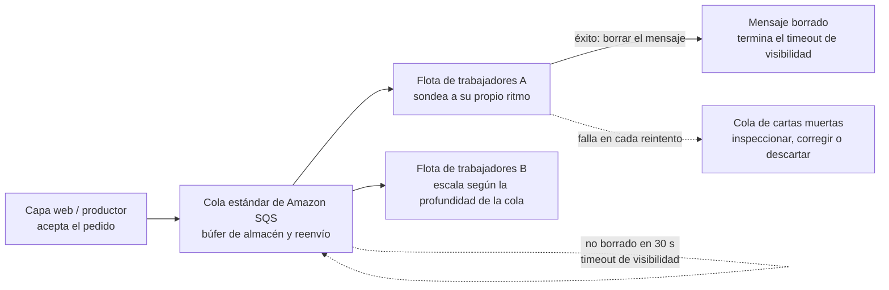
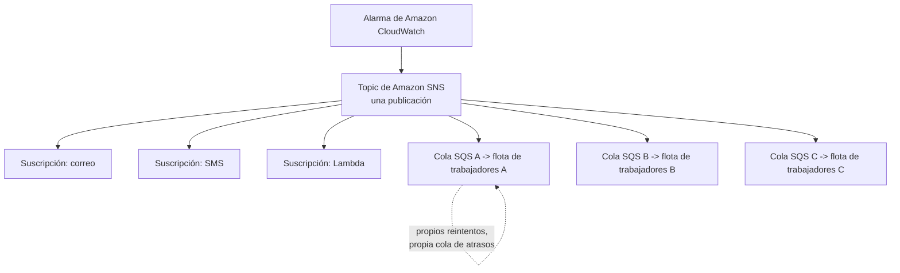
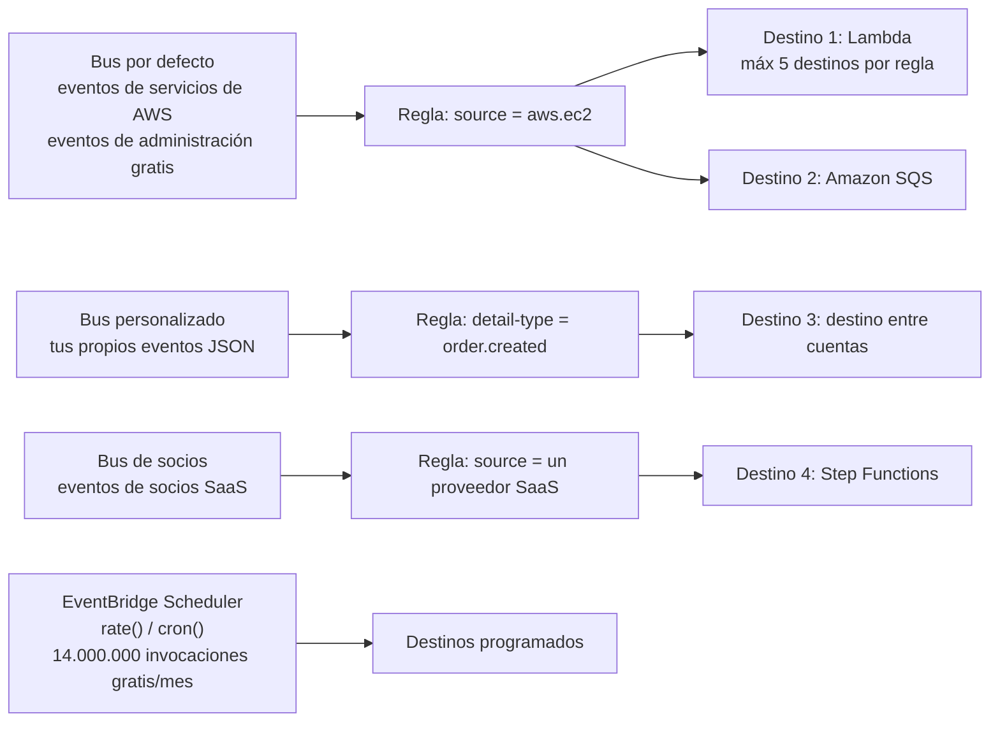
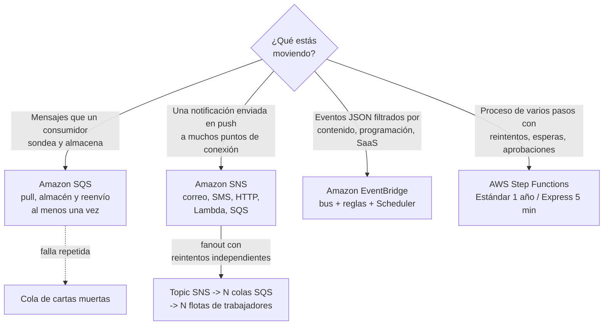
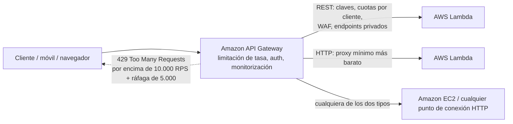
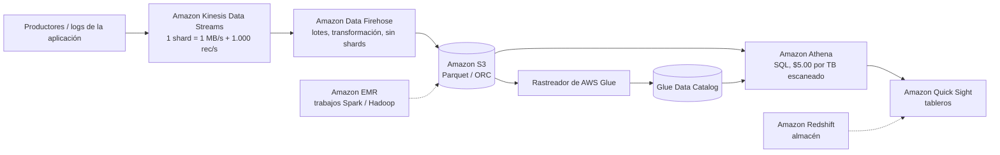
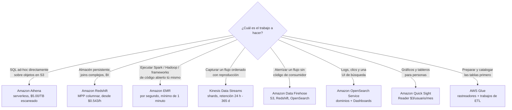

# Integración de aplicaciones, analítica y otros servicios en alcance

El Dominio 3 (Tecnología y servicios en la nube, **34%** de la puntuación) esconde dos enunciados de tarea que arrastran una superficie enorme y dispersa: **Tarea 3.7 «Identificar servicios de inteligencia artificial y aprendizaje automático (AI/ML) de AWS y servicios de analítica»**, con sus enunciados de competencia que nombran *Amazon SageMaker AI, Amazon Lex, Amazon Athena, Amazon Kinesis, AWS Glue y Amazon Quick Sight*, y **Tarea 3.8 «Identificar servicios de otras categorías de servicios de AWS en alcance»**, que lista explícitamente integración de aplicaciones (EventBridge, SNS, SQS), aplicaciones comerciales (Connect, SES), habilitación de clientes (AWS Support), herramientas de desarrollador (CodeBuild, CodePipeline, X-Ray), cómputo de usuario final (AppStream 2.0, WorkSpaces, WorkSpaces Secure Browser), frontend (Amplify) e IoT (IoT Core). Añade **Amazon API Gateway** de la fila de redes y esta sola lección abarca material del que el examen extrae de **dos dominios**.

```text
====================================================================
 LECCIÓN CLF-C02 11 — FICHA RÁPIDA DE INTEGRACIÓN + ANALÍTICA
          (datos en octubre de 2026 — verifica el estado vigente antes de usarlo)
====================================================================
 INTEGRACIÓN DE APLICACIONES
   SQS             cola de tipo pull, búfer de almacén y reenvío
                   Estándar : al menos una vez, orden de mejor esfuerzo
                   FIFO     : procesamiento exactamente una vez, orden estricto
                   timeout de visibilidad 30 s predeterminado (máx 12 h)
                   retención 60 s - 14 días, mensaje máx 1 MiB
   SNS             topic pub/sub push -> N suscripciones
                   correo / SMS / HTTP+S / Lambda / SQS
   fanout          = topic SNS -> N colas -> N trabajadores
   EVENTBRIDGE     eventos JSON emparejados por reglas -> destinos
                   5 destinos por regla - 300 reglas por bus
                   buses por defecto / personalizados / de socios
                   eventos de administración de AWS ingeridos gratis
   STEP FUNCTIONS  orquestación de flujos de trabajo serverless
                   Estándar : hasta 1 año, $0.000025/transición
                   Express  : hasta 5 min, $1.00 por millón
 --------------------------------------------------------------------
 API GATEWAY       la «puerta de entrada»: REST / HTTP / WebSocket
                   10.000 RPS + ráfaga de 5.000 -> HTTP 429
                   REST $3.50/M - HTTP $1.00/M (en octubre de 2026)
 --------------------------------------------------------------------
 ANALÍTICA
   ATHENA          SQL ANSI serverless sobre S3, $5.00/TB escaneado
   GLUE            ETL serverless + Data Catalog, $0.44/DPU-hora
   KINESIS STREAMS shards ordenados: 1 MB/s + 1.000 rec/s de escritura
   DATA FIREHOSE   sin shards: aterrizar datos en S3/Redshift/OpenSearch
   OPENSEARCH      dominios gestionados: logs, búsqueda, Dashboards
   QUICK SIGHT     tableros BI, Reader $3/usuario/mes
   EMR             clústeres gestionados de Hadoop/Spark, por segundo
   REDSHIFT        almacén a escala de petabytes, desde $0.543/hora
 --------------------------------------------------------------------
 ML (una línea cada uno) Rekognition imágenes/video - Comprehend NLP -
   Textract documentos - Transcribe voz a texto - Polly texto a
   voz - Translate - Lex chatbots - SageMaker AI construir/entrenar -
   desplegar - asistentes de IA generativa Amazon Q
 EN ALCANCE OTROS  Connect centro de contactos - SES correo - CLI /
   CodeBuild / CodePipeline / X-Ray - IoT Core - Amplify -
   AppStream 2.0 / WorkSpaces / WorkSpaces Secure Browser -
   AWS Marketplace
====================================================================
```

> [!NOTE]
> **Disciplina de alcance.** Cada servicio presentado abajo como evaluable se encuentra en la lista oficial de **alcance** de CLF-C02 o en un enunciado de tarea de los Dominios 3/4 (verificado contra la guía del examen, 2026-10). Cuatro servicios que *parecen* perfectamente en su sitio aquí están explícitamente **fuera de alcance** y aparecen solo para que puedas eliminarlos: **Amazon AppFlow, Amazon Managed Streaming for Apache Kafka (Amazon MSK), Amazon WorkDocs** y **AWS AppFabric**. Dos cosas que esta investigación **no** pudo verificar y por tanto nunca enseña como hecho: si se examina **Amazon Bedrock** (ausente de la lista en alcance) u otros servicios de IA generativa, y el estado de **AWS CodeCommit** (que no está ni en la lista de alcance ni en la de fuera de alcance).

En esta lección vas a:

- leer **Amazon SQS** como la respuesta de desacoplamiento y separar las garantías de entrega **estándar frente a FIFO**;
- dominar la mecánica de las colas: timeout de visibilidad, sondeo largo, retención, colas de cartas muertas;
- diseñar un **fanout de SNS** y explicar por qué es SNS *más* SQS, no SNS en solitario;
- enrutar **arquitecturas impulsadas por eventos** a través de buses, reglas, destinos y programaciones de EventBridge;
- elegir **Step Functions Estándar frente a Express** y precificar un flujo de trabajo en transiciones de estado;
- usar **API Gateway** como puerta de entrada: REST frente a HTTP frente a WebSocket, limitación de tasa, integración con Lambda;
- precificar una consulta de **Athena** y un trabajo de **Glue**, y explicar por qué la partición sale a cuenta;
- separar **Kinesis Data Streams de Data Firehose** y después ubicar **OpenSearch, QuickSight, EMR y Redshift**;
- dar una línea a cada servicio en alcance restante: **suite de ML, Connect, SES, DevTools, IoT Core, EUC, Amplify, Marketplace**;
- estudiar **cinco casos de estudio publicados por AWS** (Capital One, Paytm, Amazon Prime Video, NASA JPL y la NFL);
- revisar qué hicieron los **cambios de listas de servicios de 2026** con los nombres, categorías y distractores que examina este examen;
- practicar con **12 preguntas tipo examen** más cuatro comprobaciones interactivas.

---

## 1. Amazon SQS: colas, desacoplamiento, estándar frente a FIFO

### 1.1 Lo que una cola realmente desacopla

Amazon SQS es un **búfer de tipo pull y de almacén y reenvío** entre un productor y un consumidor. Sin él, la capa web llama a la capa de trabajadores directamente: la caída de los trabajadores se convierte en la caída de la capa web, y ninguno de los dos lados puede escalar de forma independiente. Con una cola en medio, el productor escribe un mensaje y devuelve; los trabajadores **sondean** a su propio ritmo y con su propio número. La guía de decisiones de AWS describe SQS en una frase que vale la pena memorizar: *«Los mensajes se persisten … entrega al menos una vez»*.

| Propiedad | **Estándar** (predeterminado) | **FIFO** |
|---|---|---|
| Garantía de entrega | **Al menos una vez**: *«un mensaje puede entregarse más de una vez»* | **Procesamiento exactamente una vez** |
| Ordenamiento | Solo orden de **mejor esfuerzo** | Orden estricto de **primero en entrar, primero en salir** |
| Rendimiento (en octubre de 2026) | Llamadas a la API casi ilimitadas por segundo | **300 mensajes/s**; **3.000/s** con lotes; modo de alto rendimiento **hasta 70.000/s** |
| Manejo de duplicados | Ninguno: los duplicados son esperados | Intervalo de deduplicación de **5 minutos** |
| Enunciado de examen | *«escalar consumidores de forma independiente», «puede llegar dos veces, fuera de orden»* | *«exactamente una vez, en orden»* |

Como las colas estándar te entregan duplicados deliberadamente, la propia guía de AWS dice que *«debes diseñar tus aplicaciones para que sean idempotentes»*: un duplicado no debe cobrar dos veces, enviar dos veces ni enviar dos correos. **La idempotencia es trabajo del consumidor; la cola solo promete persistencia.**

### 1.2 La mecánica que aparece en los enunciados

| Mecánica | Valor documentado (en octubre de 2026) | Por qué le importa al examen |
|---|---|---|
| **Timeout de visibilidad** | Predeterminado **30 s**, rango 0 s, 12 h | Un mensaje recibido está *oculto*, no borrado; si el trabajador muere o tarda demasiado, el mensaje **reaparece**, de ahí vienen los duplicados |
| **Sondeo largo** | Tiempo de espera **0 to 20 s** | Esperar en lugar de martillear la cola reduce las respuestas vacías y el coste de solicitudes |
| **Retención** | Predeterminado **4 días**; rango **60 s: 1.209.600 s (14 días)** | Los mensajes sin procesar sobreviven a una caída hasta 14 días |
| **Tamaño de mensaje / retardo** | **1 KiB: 1.024 KiB (1 MiB)**; retardo hasta **15 min** | Pon cargas grandes en S3 y pasa la clave |
| **Cola de cartas muertas** | Una cola que retiene los mensajes que fallan repetidamente | Aislar mensajes venenosos en lugar de reintentar para siempre |

Precios (en octubre de 2026, verifica antes de usarlos): **1 millón de solicitudes al mes gratis**, después aproximadamente **$0.40 por millón** de solicitudes.

### 1.3 De la comunicación directa a una cola: qué cambia de verdad

| Sin cola (punto a punto) | Con **Amazon SQS** en medio |
|---|---|
| El productor debe conocer la dirección del consumidor y estar activo cuando llama | El productor escribe en un endpoint regional y devuelve de inmediato |
| Una caída del consumidor es una caída del productor | Los consumidores fallan, se reinician y escalan sin tocar el productor |
| Añadir un consumidor implica redesplegar o reconfigurar el productor | Añade flotas de trabajadores; consumidores en competencia comparten la misma cola |
| Pico de tráfico = el productor debe limitarse a sí mismo | La cola absorbe el pico; los trabajadores lo drenan a su propio ritmo |
| La lógica de reintentos se escribe a mano por cada llamador | Timeout de visibilidad, reentrega, sondeo largo y DLQ son funciones del servicio |
| Uno a uno, acoplado en el tiempo | Uno a muchos posible (una cola por familia de consumidores), desacoplado en el tiempo |



**Ejemplo resuelto E1: elegir el nivel FIFO.** Un flujo de pagos debe procesarse **exactamente una vez y en orden a 4.000 mensajes por segundo**. FIFO estándar se limita a **300/s**, o **3.000/s con lotes**: todavía por debajo de los 4.000/s necesarios: así que la respuesta documentada es **el modo FIFO de alto rendimiento, hasta 70.000 mensajes por segundo con lotes**. Si el ordenamiento no se hubiera exigido, las colas estándar habrían absorbido la tasa sin techo de rendimiento con el que razonar.

- **📚 ¿Sabías que…?** Las cifras de retención y visibilidad explican la mayoría de los enunciados de «mensaje duplicado» de este examen: un mensaje que **no se borra dentro del timeout de visibilidad predeterminado de 30 segundos** vuelve a estar visible, así que los duplicados son *normales* en las colas estándar: por eso AWS te dice que construyas consumidores **idempotentes** en lugar de prometerte que nunca verás un mensaje dos veces (en octubre de 2026; verifica el estado vigente antes de usarlo).

---

## 2. Amazon SNS: publicación/suscripción y fanout

### 2.1 Push, no sondeo

Amazon Simple Notification Service es la contraparte **push** del **pull** de SQS: un *publicador* envía a un *topic*, y el topic reparte el mensaje hacia cada *suscripción*. AWS lo describe como un *«mecanismo push, que elimina la necesidad de comprobar periódicamente o "sondear"»*. Las suscripciones pueden ser **colas de Amazon SQS, funciones de AWS Lambda, puntos de conexión HTTP/S, correo, SMS y push móvil**: por eso una sola publicación puede a la vez despertar a una persona y alimentar a una máquina.

| | **Amazon SQS** | **Amazon SNS** |
|---|---|---|
| Modelo | **Pull**, los consumidores sondean una cola | **Push**, el topic entrega a los suscriptores |
| Forma del mensaje | Consumidores en competencia, uno recibe cada mensaje | Cada suscripción recibe una copia |
| Garantía documentada | Al menos una vez (estándar) | Al menos una vez para HTTP/S; **exactamente una vez para suscriptores de Lambda y Amazon SQS** |
| Manejo de fallos | Timeout de visibilidad + cola de cartas muertas | Política de reintentos y después una **cola de cartas muertas SQS** en la suscripción |
| Escala (en octubre de 2026) | 1 M de solicitudes/mes gratis | **100.000** topics estándar por cuenta; hasta **12,5 millones** de suscripciones por topic |
| Unidad de facturación | Por solicitud | Cada fragmento de **64 KB** de una carga cuenta como una solicitud |

### 2.2 El patrón de fanout

La respuesta canónica a *«una alerta debe llegar a muchos consumidores independientes»* es **SNS → N colas SQS → N flotas de trabajadores**. SNS **replica** el mensaje; cada cola después **absorbe sus propios reintentos, su cola de atrasos y su escalado**, de modo que un consumidor lento nunca limita a los demás. SNS en solitario está bien para suscriptores ligeros (correo, SMS), pero el patrón que entrena la guía es SNS *con* una cola SQS por familia de consumidores.



### 2.3 Tipos de suscripción a profundidad de un examen

| Suscripción | Qué entrega | Enunciado típico |
|---|---|---|
| **Cola de Amazon SQS** | Una copia a una cola que la familia de consumidores drena | *fanout con reintentos independientes* |
| **AWS Lambda** | Invocación asincrónica directa de una función | *ejecutar código por evento, sin sondeo* |
| **HTTP/S** | Un POST a tu punto de conexión | *nuestro propio receptor de webhooks* |
| **Correo** | Un mensaje a un buzón | *despertar a una persona* |
| **SMS** | Un mensaje de texto | *alertar a un teléfono de guardia* |
| **Push móvil** | Una notificación a un dispositivo | *llegar a una usuaria de la app* |

**Ejemplo resuelto E2: aritmética de fanout y facturación de SNS.** Una alarma publica hacia **seis suscripciones** (correo, SMS, Lambda, tres colas): SNS realiza seis entregas a partir de una sola publicación, y cada cola reintenta de forma independiente. Ahora añade la facturación: SNS cuenta cada **fragmento de 64 KB** como una solicitud, así que una carga de **150 KB** se factura como ceil(150 / 64) = **3 solicitudes**. Mantén las cargas pequeñas, o guarda el cuerpo en S3 y publica la referencia.

> ⚠️ **Push y pull son las marcas más rápidas del Dominio 3.** *«Los consumidores sondean»* ⇒ **SQS**; *«un servicio hace push / una publicación llega a muchos puntos de conexión»* ⇒ **SNS**. Y recuerda: **fanout = SNS + SQS**, porque solo una cola da a cada consumidor un presupuesto de reintentos independiente y un lugar donde enviar sus propias fallas a la carta muerta.

---

## 3. Amazon EventBridge: buses de eventos, reglas y programaciones

### 3.1 Buses, reglas, destinos

EventBridge transporta **eventos JSON**. Un evento aterriza en un **bus**, una **regla** lo empareja por patrón de evento (o por programación), y la regla invoca hasta **cinco destinos**. Los tres tipos de bus son la división examinable:

| Bus | Qué llega allí | Enunciado de examen |
|---|---|---|
| **Por defecto** | Eventos de servicios de AWS; **los eventos de administración de AWS se ingeren en el bus de eventos gratis** | *«reaccionar a un cambio de estado de EC2»* |
| **Personalizado** | Eventos JSON que publicas tú mismo | *«nuestro servicio de pedidos emite order.created»* |
| **De socios** | Eventos de socios SaaS (Datadog, Shopify, Stripe y otros) | *«disparar ante un evento de un SaaS de terceros»* |

Límites duros (en octubre de 2026): **una sola regla puede enviar un evento hasta cinco destinos**, y hay **hasta 300 reglas por bus de eventos**. La facturación cuenta **cada fragmento de 64 KB de una carga como un evento**; los eventos personalizados son **$1.00 por millón**, la entrega entre cuentas de socios **$0.05 por millón** y **AWS Pipes $0.40 por millón**.

### 3.2 Programaciones

Las reglas también pueden dispararse con expresiones `cron` o `rate`, pero AWS ahora etiqueta las reglas programadas como una **función en desuso** y te dirige a **EventBridge Scheduler**, que ofrece **14.000.000 de invocaciones gratis al mes** antes de cobrar **$1.00 por millón**. *«Cada noche a las 02:00 UTC»* es una pregunta de programación, y la respuesta actual es EventBridge Scheduler.



### 3.3 EventBridge frente a SNS frente a SQS cuando el enunciado dice «reaccionar a algo»

AWS publica una guía de decisión de tres vías, y su redacción es material de examen citable:

| Servicio | Lo que dice la guía de decisiones de AWS | Persistencia | Garantía documentada |
|---|---|---|---|
| **Amazon SQS** | *«Los mensajes se persisten»* | Sí: se guardan hasta consumirlos y borrarlos | **Entrega al menos una vez** |
| **Amazon SNS** | *«entregados a los suscriptores en tiempo real»* | No: se envían y desaparecen | **Exactamente una vez para suscriptores de Lambda y Amazon SQS**; al menos una vez para HTTP/S |
| **Amazon EventBridge** | *«Los eventos no persisten; se procesan en tiempo real.»* | No: se emparejan e invocan de inmediato | Filtrado por contenido, programaciones, enrutamiento SaaS y entre cuentas |

**Arquitectura impulsada por eventos en una frase:** los productores publican *hechos que ocurrieron*, nunca llamadas RPC; los consumidores se suscriben a los hechos que les importan. Esa inversión es la razón por la que las preguntas de EventBridge suelen mencionar **filtrado por contenido, fuentes SaaS, enrutamiento entre cuentas o programaciones**: cosas que SQS y SNS no hacen.

- **📚 ¿Sabías que…?** La línea de facturación más barata de EventBridge es gratis: **los eventos de administración de AWS se ingeren en el bus de eventos gratis**, y **EventBridge Scheduler incluye 14.000.000 de invocaciones gratis al mes** (en octubre de 2026). La sorpresa de facturación está en la granularidad, **cada fragmento de 64 KB de una carga se factura como un evento**, así que un evento de 200 KB cuenta como cuatro eventos (verifica el estado vigente antes de usarlo).

---

## 4. AWS Step Functions: orquestación de flujos de trabajo de varios pasos

### 4.1 Estándar frente a Express

Step Functions es **orquestación de flujos de trabajo serverless** escrita en Amazon States Language: secuencia llamadas a Lambda, ECS, SQS, SNS, DynamoDB y Glue y añade **reintentos, bloques catch, estados Parallel y Map, y esperas**. *No* es una cola y *no* es un notificador: es lo que sabe cuál es el siguiente paso.

| | **Estándar** | **Express** |
|---|---|---|
| Duración máxima | **Hasta un año** | **Hasta cinco minutos** |
| Modelo de ejecución | Ejecución de flujo de trabajo **exactamente una vez** | Ejecución **al menos una vez** |
| Tasa de inicio | 2.000 ejecuciones/s | 100.000 ejecuciones/s |
| Facturación (en octubre de 2026) | **Por transición de estado**: **$0.000025** cada una en US East (N. Virginia), **4.000 gratis al mes** | **$1.00 por millón de solicitudes** más duración y memoria |
| Enunciado de examen | De larga duración, aprobación humana, auditoría | De alto volumen, corto, procesamiento de eventos tolerante a fallos |

**Ejemplo resuelto E3, precificar la misma carga de trabajo de dos maneras.** Un flujo de trabajo ejecuta **1.000.005 transiciones de estado** en un mes. Resta la asignación gratuita: 1.000.005 − 4.000 = 996.005; multiplica por el precio unitario: 996.005 × $0.000025 ≈ **$24.90** en el flujo de trabajo Estándar. Si cada ejecución en cambio termina en segundos y tolera ejecuciones al menos una vez, las mismas **1.000.000** solicitudes Express cuestan **$1.00**. Misma lógica de negocio, una brecha de precio de **25×**, el examen quiere que notes la *unidad*: **transiciones de estado frente a solicitudes**.

### 4.2 Elegir entre los cuatro servicios de integración



| Pregunta en el enunciado | Respuesta |
|---|---|
| Almacenar trabajo, dejar que los consumidores escalen de forma independiente, tolerar reintentos | **Amazon SQS** |
| Una publicación debe llegar a correo + SMS + varias colas | **Amazon SNS** (fanout) |
| Eventos filtrados por contenido, programaciones cron/rate, SaaS o entre cuentas | **Amazon EventBridge** |
| Un proceso de negocio con pasos ordenados, reintentos y una espera de días | **AWS Step Functions** |

> **Amazon MQ no es la respuesta en este examen.** La migración de brokers AMQP/MQTT heredados no está en la lista de alcance de CLF-C02, así que un enunciado de *«necesitamos un broker de mensajes empresarial»* se resuelve con uno de los cuatro servicios de arriba.

### 4.3 Ejemplo resuelto E8: recorrer una aprobación de reclamaciones de principio a fin

| Paso | Servicio | Por qué ese servicio |
|---|---|---|
| 1. Validar el envío | **AWS Lambda** | Código corto y sin estado por reclamación |
| 2. Revisar el texto en busca de señales de fraude | **Amazon Comprehend** | NLP preentrenado, sin experiencia de ML |
| 3. Esperar la decisión de una persona (horas o días) | **Step Functions (Estándar)** | Las ejecuciones pueden durar hasta un año con un token de tarea para quien aprueba |
| 4. Notificar a la persona solicitante | **Amazon SNS** | Una publicación llega al correo y a la cola interna |
| 5. Guardar el resultado | **Amazon DynamoDB** | Persistencia clave-valor gestionada para el registro |
| 6. Reintentar un paso que falla tres veces | **Reintento/catch de Step Functions** | Integrado en Amazon States Language en lugar de escrito a mano |

Toda la intención del ejemplo: **Step Functions es dueño de la secuencia y de las esperas, Lambda es dueño de los pasos individuales, SNS es dueño de la notificación**. Una pregunta que pregunta *«¿qué espera tres días por una persona?»* está pidiendo Step Functions Estándar, no una demora de SQS (máximo 15 minutos) ni una ejecución Express de 5 minutos.

---

## 5. Amazon API Gateway: la puerta de entrada

### 5.1 Tres tipos de API

AWS posiciona API Gateway como la *«puerta de entrada»* de los servicios de back-end, gestionando *«gestión de tráfico … autorización y control de acceso, limitación de tasa, monitorización y gestión de versiones de API»* delante de **Lambda, EC2 o cualquier punto de conexión HTTP**.

| Tipo | Elígelo cuando el enunciado dice | Extras (en octubre de 2026) |
|---|---|---|
| **API REST** | Claves de API, **limitación de tasa por cliente**, integración con AWS WAF, endpoints de API privados, caché | Completa, **$3.50 por millón** de llamadas |
| **API HTTP** | El proxy mínimo más barato hacia Lambda o un servicio HTTP, autorizadores JWT | **$1.00 por millón** de llamadas |
| **API WebSocket** | Conexiones bidireccionales persistentes: chat, flujos en vivo, apps colaborativas | Conectar, desconectar, enrutar al back-end |

Free tier (12 meses, en octubre de 2026): **1.000.000 de llamadas a la API al mes para API REST** y **1.000.000 al mes para API HTTP**.

### 5.2 Limitación de tasa

Por defecto la limitación de tasa se aplica **por cuenta y por región**: **10.000 solicitudes por segundo (RPS)** más un depósito de capacidad de **ráfaga** adicional de **5.000 solicitudes** (algunas cuentas están documentadas con 2.500 RPS / ráfaga de 1.250: verifica tus propias cifras). Si la superas, los llamadores reciben **HTTP 429 Too Many Requests**. AWS es explícito en que estos *«no son límites duros»* y se aplican *«de la mejor manera posible»*, y que las cuotas de los planes de uso también son **de mejor esfuerzo**.

**Ejemplo resuelto E4: REST frente a HTTP con el mismo tráfico.** Un mes ocupado produce **5.000.000 de llamadas a la API**; el free tier absorbe el primer **1.000.000** (primeros 12 meses), quedando 4.000.000 facturables. En **REST**: 4 × $3.50 = **$14.00**. En **HTTP**: 4 × $1.00 = **$4.00**. Sin el free tier los totales son **$17.50** y **$5.00**. Comparando función a función la respuesta puede seguir siendo REST: las claves de API, las cuotas por cliente, WAF y los endpoints privados son capacidades REST, pero el enunciado de *precios* siempre se resuelve igual.



### 5.3 Qué gestiona de verdad la puerta de entrada

El examen te pide *identificar* las responsabilidades, no configurarlas. En la propia lista de AWS, API Gateway proporciona la experiencia de **«puerta de entrada»** para los servicios de back-end: **gestión de tráfico, autorización y control de acceso, limitación de tasa, monitorización y gestión de versiones de API**: delante de **instancias de Lambda, EC2 o cualquier punto de conexión HTTP**.

| Responsabilidad | En alcance para ti en este examen |
|---|---|
| Gestión de tráfico | Saber que **10.000 RPS + ráfaga de 5.000** es el predeterminado por cuenta y por región |
| Autorización y control de acceso | Elegir el servicio y el tipo de API: las claves de API y las cuotas por cliente son capacidades de **REST** |
| Limitación de tasa | Solicitudes en exceso ⇒ **HTTP 429 Too Many Requests**; las cuotas de los planes de uso son **de mejor esfuerzo** |
| Monitorización | Listada como responsabilidad del Gateway: el examen te pide reconocerla, nunca configurarla |
| Gestión de versiones de API | También es de Gateway; identifícala como capacidad de la puerta de entrada |
| Integración con Lambda | Los clientes llaman a Gateway, que invoca **Lambda, EC2 o cualquier punto de conexión HTTP** |

> ⚠️ **Las claves de API no son autenticación para tus usuarios.** En este examen, *«claves de API + limitación de tasa por cliente + AWS WAF + endpoints privados»* es la firma de una **API REST**; el proxy de Lambda más barato es una **API HTTP**; y un **429** siempre significa *«superaste la limitación de tasa»*, nunca *«la API está rota»*.

---

## 6. Analítica serverless sobre S3: Amazon Athena y AWS Glue

### 6.1 Amazon Athena: SQL sin clúster

Athena es **SQL interactivo serverless sobre datos que ya están en Amazon S3**: *«ejecuta consultas ad-hoc usando SQL ANSI, sin necesidad de agregar ni cargar los datos en Athena»*. No hay clúster que lanzar ni «primero carga para poder preguntar»: lo apuntas a S3, defines tablas (normalmente mediante el Glue Data Catalog) y consultas.

- **Precios (en octubre de 2026):** **$5.00 por terabyte de datos escaneados**, con un **mínimo de 10 MB por consulta**; **las sentencias DDL y las consultas fallidas cuestan $0**.
- **Por qué el diseño de consultas es una decisión de coste:** AWS documenta que la compresión, la partición y los formatos columnares pueden **ahorrar entre un 30% y un 90% por consulta**.
- **Cuándo *no* usarlo:** para *«muchos joins entre muchas tablas muy grandes»*, AWS dice que elijas **Amazon Redshift**.

**Ejemplo resuelto E5: tres maneras de pagar los mismos 3 TB.**

| Diseño de consulta | Datos escaneados | Coste (en octubre de 2026) |
|---|---|---|
| Datos sin comprimir en bruto, escaneo completo | 3 TB | 3 × $5.00 = **$15.00** |
| GZIP aproximadamente 3:1 | ~1 TB | **$5.00** |
| Columnar + particionado, la consulta lee 1 de 4 columnas | ~0,25 TB | **$1.25** |
| `CREATE TABLE` (DDL) o una consulta que falla |: | **$0.00** |
| Una consulta que escanea solo 3 MB | facturada con el **mínimo de 10 MB** | cargo mínimo |

El patrón a memorizar: **Athena cobra por los bytes leídos, así que la consulta más barata es la que menos lee**: poda columnas, filtra por claves de partición, comprime y convierte a Parquet u ORC.

### 6.2 AWS Glue: el catálogo y el motor de ETL

AWS Glue es un **servicio de ETL y catálogo de datos serverless**. Los **rastreadores** (crawlers) exploran almacenes de datos y escriben definiciones de tablas (esquema, particiones, ubicación) en el **Glue Data Catalog**, que es lo que permite a **Athena, Amazon Redshift y Amazon EMR** tratar los objetos de S3 como tablas. Los **trabajos de ETL** ejecutan Spark o Python para limpiar, deduplicar y dar formato.

- **Precios (en octubre de 2026):** **$0.44 por DPU-hora**; **1 DPU = 4 vCPU y 16 GB de memoria**; los trabajos de ETL se ejecutan con un **mínimo de 2 DPU** (10 por defecto); los rastreadores tienen un **mínimo de 10 minutos**; los **primeros millón de objetos almacenados son gratis** en el catálogo.

**Ejemplo resuelto E6, precificar un trabajo de rastreo y limpieza.** Un trabajo se ejecuta **15 minutos en 6 DPU**: 6 × (15/60) hora × $0.44 = 6 × 0,25 × 0,44 = **$0.66**. Duplica el número de DPU y el precio se duplica, **las DPU son la unidad, el tiempo de reloj de pared es el multiplicador**.

> **La frase de tres servicios que el examen no deja de probar:** **Glue** *cataloga y prepara* los datos, **Athena** *responde preguntas SQL* sobre ellos, **QuickSight** *dibuja el tablero*. Glue nunca responde una consulta, Athena nunca ejecuta una transformación Spark programada, y QuickSight nunca extrae texto de un documento.

- **📚 ¿Sabías que…?** El **mínimo de 10 MB por consulta** de Athena existe para que miles de consultas diminutas sigan produciendo una unidad facturable, y también significa que **las consultas DDL y las fallidas son gratis**. Un equipo que ejecuta un ciclo nocturno de `DROP`/`CREATE` no paga nada por el DDL y todo por el `SELECT` que escanea la tabla, por eso la partición y la poda de columnas son los controles de coste reales (página de precios de Athena, en octubre de 2026; verifica el estado vigente antes de usarlo).

---

## 7. Transmisión, búsqueda y BI: Kinesis, Firehose, OpenSearch, QuickSight, EMR, Redshift

### 7.1 Amazon Kinesis Data Streams frente a Amazon Data Firehose

Este es el par de selección de servicios más fiable del dominio de analítica.

| | **Amazon Kinesis Data Streams** | **Amazon Data Firehose** |
|---|---|---|
| Qué es | Un **registro ordenado dividido en shards** | Un **tubo de entrega gestionado** hacia destinos |
| Unidad de capacidad | **Shard**: **1 MB/s y 1.000 registros/s de escritura**, **2 MB/s de lectura** | Sin shards que dimensionar ni gestionar |
| Retención / reproducción | **24 horas por defecto, hasta 365 días**: la reproducción es posible | Lotes casi en tiempo real, sin ventana de reproducción |
| Destinos | Tus propios consumidores: Lambda, Kinesis Client Library, Firehose | **S3, Amazon Redshift, OpenSearch Service, Splunk, Snowflake** |
| Código | Tú escribes el consumidor | **Sin código de consumidor**; transformación Lambda opcional; conversión a Parquet/ORC |
| Nomenclatura |, | Renombrado desde **Amazon Kinesis Data Firehose** a **Amazon Data Firehose** en **febrero de 2024**, los nombres viejos siguen apareciendo en material antiguo |

**Ejemplo resuelto E7: dimensionado de shards.** Un flujo de clics emite **4.000 registros por segundo** con una media de **10 KB** cada uno: el rendimiento = 4.000 × 10 KB = 40.000 KB/s = **40 MB/s**. Divide por el límite de escritura por shard: 40 ÷ 1 = **40 shards** por ancho de banda, y 4.000 ÷ 1.000 = **40 shards** por tasa de registros. Ambas restricciones coinciden, así que **40 shards**. Si el requisito hubiera sido *«aterrizarlo en S3 sin código de consumidor»*, la respuesta sería **Data Firehose** y la aritmética de shards desaparecería por completo.


### 7.2 OpenSearch, QuickSight, EMR, Redshift

| Servicio | Trabajo a profundidad de un examen | Cifras clave (en octubre de 2026) |
|---|---|---|
| **Amazon OpenSearch Service** | **Dominios** gestionados (= clústeres) para **analítica de logs, monitorización de aplicaciones en tiempo real y análisis de clics**, más búsqueda y **OpenSearch Dashboards** (el sucesor de Kibana) | Renombrado desde **Elasticsearch Service** el **8 de septiembre de 2021**; los precios de instancia varían según el despliegue: véase la página de precios |
| **Amazon Quick Sight** | **BI**: visualizaciones y tableros sobre datos de S3, Athena, Redshift y SaaS; **SPICE** es el motor en memoria frente a la consulta directa | **Reader $3 por usuario al mes**; **10 GB de SPICE** con cada Author aprovisionado (extra de **$0.38/GB-mes**); **una sesión es un periodo de 30 minutos** |
| **Amazon EMR** | Clústeres gestionados de **Hadoop / Spark / Hive / Presto** en EC2 (o EKS o serverless) para procesamiento de big data | Facturación **por segundo** con un **mínimo de un minuto**; pagas EC2 + EBS + el recargo de EMR |
| **Amazon Redshift** | Almacén de datos gestionado **a escala de petabytes**: columnar y SQL masivamente paralelo para joins complejos y BI | **Aprovisionado desde $0.543 por hora**; **Serverless desde $1.50 por hora**; **Spectrum** consulta S3 a **$5 por TB** |

**El desempate de tres vías:** *SQL ad-hoc sobre S3, sin clúster* ⇒ **Athena** · *joins complejos entre tablas muy grandes, un almacén persistente* ⇒ **Redshift** · *ejecutar Spark/Hadoop tú mismo, se necesitan bibliotecas de código abierto* ⇒ **EMR**. Tableros ejecutivos encima de cualquiera de ellos ⇒ **Quick Sight**; UI de logs y búsqueda ⇒ **OpenSearch Service**.

| Pregunta en el enunciado | Athena | Redshift | EMR |
|---|---|---|---|
| Qué operas | Nada: endpoint serverless | Almacén gestionado (o Serverless) | Un clúster de frameworks de código abierto |
| Unidad de facturación (en octubre de 2026) | **$5.00 por TB escaneado** | **Desde $0.543/h** aprovisionado, **$1.50/h** Serverless | EC2 + EBS + recargo de EMR, **por segundo, mínimo de 1 minuto** |
| Lo mejor | Consultas puntuales sobre S3 | BI persistente, muchos joins, escala de petabytes | Trabajos Spark/Hive/Presto que ya ejecutas |
| Lo peor | Joins pesados repetidos entre tablas enormes | Pagar por capacidad inactiva en una consulta diminuta | SQL ad-hoc ocasional (arranque del clúster + coste) |
| Dependencia del catálogo | Lee el **Glue Data Catalog** | Spectrum lee S3 mediante el catálogo | Lee el metastore de Hive / el catálogo de Glue |

**Ejemplo resuelto E9: aritmética de suscripciones de QuickSight.** Cinco analistas necesitan acceso de lectura y dos autores crean tableros (en octubre de 2026): **5 Reader × $3 por usuario al mes = $15.00**. Cada Author aprovisionado incluye **10 GB de SPICE**; si los dos autores necesitan **30 GB** en conjunto: 20 GB por encima de los 20 GB incluidos: el extra cuesta **20 × $0.38 = $7.60 al mes**. Observa también que **una sesión es un periodo de 30 minutos**, así que un Reader que abre cinco tableros dentro de una misma ventana de media hora sigue contando como una sesión de acceso.



### 7.3 Amazon AppFlow: el parecido que está fuera de alcance

**Amazon AppFlow** mueve datos entre aplicaciones SaaS y almacenes de AWS, que suena exactamente al tema de esta lección, y está explícitamente en la lista de **fuera de alcance**. Lo mismo con **Amazon MSK** (Kafka gestionado), **AWS Clean Rooms, AWS Data Exchange** y **Amazon DataZone** en analítica, además de **AWS AppFabric** y **Amazon Simple Workflow Service (SWF)** en integración de aplicaciones. Fuera de alcance no significa inexistente: significa **que solo pueden ser un distractor, nunca la respuesta correcta**.

### 7.4 El árbol de decisión de analítica



---

## 8. Cada servicio en alcance restante, una línea cada uno

### 8.1 La suite de aprendizaje automático (Tarea 3.7)

AWS agrupa estos como **servicios de IA de propósito específico**, APIs preentrenadas que llamas con tus datos, que no requieren experiencia de ML, frente a **Amazon SageMaker AI**, donde construyes, entrenas y despliegas tus propios modelos.

| Servicio | Una línea para el examen |
|---|---|
| **Amazon Rekognition** | Visión por computadora: etiquetar, detectar y analizar **imágenes y vídeo** |
| **Amazon Comprehend** | Procesamiento de lenguaje natural: sentimiento, entidades, frases clave y **PII** en texto |
| **Amazon Textract** | Extrae **texto, manuscritos y datos de documentos escaneados** a campos estructurados |
| **Amazon Transcribe** | **Voz a texto**: grabaciones de llamadas, subtítulos |
| **Amazon Polly** | **Texto a voz realista** |
| **Amazon Translate** | **Traducción neuronal de máquina** entre idiomas |
| **Amazon Lex** | Construye interfaces conversacionales (chatbots y agentes de voz): la tecnología que impulsa **Amazon Connect** |
| **Amazon SageMaker AI** | ML totalmente gestionado: *«construir, entrenar y desplegar modelos de ML en un entorno alojado listo para producción»* |
| **Amazon Q** | Asistentes impulsados por IA generativa (Q Business, Q Developer); AWS los documenta como *«impulsados por Amazon Bedrock»* |

**Regla de estratificación:** *«sin experiencia de ML, solo llamo a una API preentrenada»* ⇒ Rekognition / Comprehend / Textract / Transcribe / Translate / Polly / Lex · *«construir, entrenar y desplegar mi propio modelo»* ⇒ **SageMaker AI** · *«un asistente de IA generativa para empleados o desarrolladores»* ⇒ **Amazon Q**. Nunca cambies el tipo de dato: **imágenes ⇒ Rekognition, documentos ⇒ Textract, texto/NLP ⇒ Comprehend, audio ⇒ Transcribe y Polly**. Distractores fuera de alcance aquí: **Amazon Personalize, Amazon Fraud Detector, Amazon Lookout for Metrics** y **AWS Panorama**.

### 8.2 Aplicaciones comerciales, herramientas de desarrollador, IoT y el resto (Tarea 3.8)

| Categoría | Servicio en alcance | Una línea para el examen |
|---|---|---|
| Aplicación comercial | **Amazon Connect** | **Centro de contactos** en la nube: voz, chat y tareas con enrutamiento inteligente y seguimiento del rendimiento de agentes en tiempo real; **paga solo por uso**, sin cuota por asiento |
| Aplicación comercial | **Amazon SES** | **Correo escalable desde cualquier aplicación**: transaccional, marketing y correo masivo, vía **API o SMTP** |
| Herramientas de desarrollador | **AWS CLI** | Línea de comandos gratuita para servicios de AWS: el lado de *desarrollar y desplegar* de la tarea 3.8 |
| Herramientas de desarrollador | **AWS CodeBuild** | *«Compila tu código fuente, ejecuta pruebas unitarias y produce artefactos»*: facturado **por minuto de compilación**, **100 minutos gratis al mes** |
| Herramientas de desarrollador | **AWS CodePipeline** | **Flujo de lanzamiento** gestionado: modela los pasos, ejecuta las etapas: **V1 $1.00 por pipeline al mes**, **V2 $0.002 por acción-minuto** |
| Herramientas de desarrollador | **AWS X-Ray** | Traza distribuida: segmentos → trazas → un **grafo de servicios**; datos de traza retenidos **30 días** |
| IoT | **AWS IoT Core** | Gateway gestionado que conecta dispositivos por **MQTT o HTTP**: la respuesta de *gestionar dispositivos IoT* |
| Frontend | **AWS Amplify** | Crear y desplegar aplicaciones **web y móviles de frontend** |
| Cómputo de usuario final | **Amazon AppStream 2.0** | Transmite **aplicaciones** de escritorio a cualquier navegador o dispositivo **sin reescribir código** |
| Cómputo de usuario final | **Amazon WorkSpaces** | **Escritorios virtuales persistentes** (VDI / DaaS) en la nube, totalmente gestionados |
| Cómputo de usuario final | **Amazon WorkSpaces Secure Browser** | Navegador alojado en el que *«no se transmite a la máquina local ni HTML, ni el modelo de objetos del documento (DOM), ni datos sensibles de la empresa»* |
| Gestión financiera en la nube | **AWS Marketplace** | *«Catálogo digital curado»* para encontrar, comprar, desplegar y gestionar software, datos y servicios de terceros: por hora, mes, año y **BYOL**, una sola factura, Private Marketplace, derechos vía License Manager |
| Habilitación de clientes | **AWS Support** | La viñeta de habilitación de clientes de la tarea 3.8; los niveles de plan pertenecen al Dominio 4 |

**El enunciado de cómputo de usuario final, textual:** el examen pregunta por *«los servicios que pueden presentar la salida de máquinas virtuales (VM) en las máquinas del usuario final»*: eso es **AppStream 2.0** (aplicaciones), **WorkSpaces** (escritorios completos) y **WorkSpaces Secure Browser** (solo navegador).

> **Trampas de nomenclatura directas de la lista en alcance:** la guía escribe **"Amazon Quick Sight"** (con espacio) y **"Amazon SageMaker AI"** (nunca "SamaMaker" solo). La página de documentación de Connect de AWS también usa ahora la etiqueta *"Amazon Connect Customer"* para el producto de centro de contactos: vincular esa redacción con la formulación del examen es inferencia de esta investigación, no una declaración de examen verificada.

### 8.3 Tabla resumen: la superficie completa de servicios de esta lección

| Categoría | Servicios en alcance cubiertos aquí | Profundidad esperada |
|---|---|---|
| Integración de aplicaciones | Amazon SQS · Amazon SNS · Amazon EventBridge · AWS Step Functions | Elegir por patrón; conocer garantías y límites |
| Redes (API) | Amazon API Gateway | REST frente a HTTP frente a WebSocket, limitación de tasa |
| Analítica | Amazon Athena · Amazon EMR · AWS Glue · Amazon Kinesis · Amazon OpenSearch Service · Amazon Quick Sight · Amazon Redshift | Elegir según el trabajo a hacer; conocer la unidad de facturación |
| Aprendizaje automático | Amazon Comprehend · Amazon Lex · Amazon Polly · Amazon Q · Amazon Rekognition · Amazon SageMaker AI · Amazon Textract · Amazon Transcribe · Amazon Translate | Una línea cada uno: tipo de dato de entrada, tipo de dato de salida |
| Aplicaciones comerciales | Amazon Connect · Amazon SES | Centro de contactos frente a correo a escala |
| Herramientas de desarrollador | AWS CLI · AWS CodeBuild · AWS CodePipeline · AWS X-Ray | Compilar, lanzar, trazar |
| Frontend / IoT | AWS Amplify · AWS IoT Core | Desplegar frontends; gestionar dispositivos |
| Cómputo de usuario final | Amazon AppStream 2.0 · Amazon WorkSpaces · Amazon WorkSpaces Secure Browser | Presentar la salida de VM en máquinas de usuario final |
| Gestión financiera / habilitación | AWS Marketplace · AWS Support | Catálogo de terceros; opciones de soporte |
| Dueños de otras lecciones | Cómputo, Almacenamiento, Bases de datos, Redes y entrega de contenidos, Seguridad e identidad, Gestión y gobernanza, Migración, Facturación y precios | No los vuelvas a estudiar aquí |

### 8.4 Chuleta enunciado → servicio

| Si el enunciado dice … | La respuesta es … |
|---|---|
| «Puede llegar dos veces y fuera de orden; escalar consumidores de forma independiente» | **Amazon SQS (estándar)** |
| «Exactamente una vez, en orden estricto» | **Amazon SQS (FIFO)** |
| «Una alerta a correo, SMS y tres colas» | **Amazon SNS** |
| «Eventos de un proveedor SaaS más un cron nocturno» | **Amazon EventBridge / EventBridge Scheduler** |
| «Aprobación humana que espera tres días» | **AWS Step Functions (Estándar)** |
| «Limitar una API, claves de API, cuotas por cliente, WAF» | **Amazon API Gateway (REST)** |
| «SQL sobre S3, pago por consulta» | **Amazon Athena** |
| «Poblar un catálogo de metadatos desde S3» | **AWS Glue** |
| «Transmitir a S3 sin código de consumidor» | **Amazon Data Firehose** |
| «Flujo ordenado con reproducción y shards» | **Amazon Kinesis Data Streams** |
| «Tableros ejecutivos» | **Amazon Quick Sight** |
| «Sentimiento de tickets de soporte» | **Amazon Comprehend** |
| «Extraer campos de formularios escaneados» | **Amazon Textract** |
| «Construir, entrenar y desplegar mi propio modelo» | **Amazon SageMaker AI** |
| «Compilar y ejecutar pruebas unitarias en CI» | **AWS CodeBuild** |
| «Presentar la salida de VM en máquinas de usuario final» | **AppStream 2.0 / WorkSpaces / Secure Browser** |

**Servicios fuera de alcance que parecen estar en alcance (nunca la respuesta correcta):** Amazon AppFlow · AWS Clean Rooms · AWS Data Exchange · Amazon DataZone · Amazon MSK · AWS AppFabric · Amazon Simple Workflow Service · Amazon WorkDocs · AWS CodeDeploy · AWS CodeArtifact · Amazon CodeGuru · AWS Application Composer · AWS CloudShell · AWS Device Farm · Amazon Personalize · Amazon Fraud Detector · Amazon Lookout for Metrics · AWS Panorama · todos los servicios de AWS Elemental Media · Amazon GameLift · AWS RoboMaker · AWS IoT Greengrass · AWS IoT Device Defender.

- **📚 ¿Sabías que…?** Dos servicios de esta lección fueron **renombrados, no reemplazados**: **Amazon Data Firehose** eliminó «Kinesis Data» de su nombre en **febrero de 2024**, y **Amazon OpenSearch Service** se renombró desde **Elasticsearch Service** el **8 de septiembre de 2021**. Preguntas, blogs y tutoriales antiguos siguen usando ambos nombres viejos, así que un enunciado que mencione «Elasticsearch Service» o «Kinesis Data Firehose» está probando el *mismo* servicio en alcance (consultado en octubre de 2026).

### Actualizaciones de 2026 (en octubre de 2026)

> **Qué cambió en la propia guía.** Cada viñeta de abajo proviene de las listas actuales de servicios **en alcance** y **fuera de alcance** de CLF-C02 y de la guía de la época del lanzamiento `Version 1.0 CLF-C02`, todo consultado el **2026-10**. Los precios y límites siguen derivando, así que vuelve a comprobarlos antes de presentar el examen.
>
> - **La lista de servicios se reconstruyó.** Las entradas en alcance bajaron de **128 → 111** mientras la lista negra explícita creció de **11 → 55** entradas fuera de alcance: para el Dominio 3 lo mayor del «qué cambió» es que AWS ahora anota la mayoría de los distractores que esta lección solía advertirte de memoria.
> - **Tres reescrituras hacen que los nombres viejos estén mal:** **Amazon SageMaker → Amazon SageMaker AI**, **Amazon WorkSpaces Web → Amazon WorkSpaces Secure Browser**, y la lista en alcance imprime el servicio de BI como **"Amazon Quick Sight"** (dos palabras) mientras el nombre del producto es Amazon QuickSight: si el espaciado de la guía es intencional **no** pudo verificarse.
> - **La fila de aprendizaje automático pasó de «construir» a «usar»:** **se añadió Amazon Q**, **Amazon Kendra se eliminó de la lista en alcance**, y **Amazon Bedrock no aparece ni en la lista de alcance ni en la de fuera de alcance** (ambas listas verificadas 2026-10): así que no memorices Bedrock como en alcance, y trata como no verificado si se examina contenido de IA generativa.
> - **Herramientas de desarrollador se redujo de 11 entradas en alcance a 4**, **AWS CLI, AWS CodeBuild, AWS CodePipeline, AWS X-Ray**, exactamente las cuatro cubiertas en la sección 8.2 de esta lección; cualquier cosa que siga listando CodeStar, Cloud9 o un roster más largo de herramientas de desarrollador está citando una guía reemplazada.
> - **Nombres de integración y analítica antes en alcance son ahora distractores:** **Amazon MSK** y **AWS Data Exchange** se movieron de la lista en alcance a la de fuera de alcance, **AWS CodeDeploy, AWS CodeArtifact** y **AWS IoT Greengrass** también están fuera de alcance, y **AWS AppSync** se eliminó de la lista en alcance; **AWS Wavelength** está explícitamente fuera de alcance mientras que **AWS Local Zones** aparece en **ninguna** de las dos listas.
> - **Renombrado de categoría:** `Customer Engagement` → **Customer Enablement**, que ahora contiene solo **AWS Support**: así que AWS Activate, AWS IQ y AWS Managed Services ya no son respuestas en alcance en ningún lugar de este examen.
>
> Fuentes: lista de servicios en alcance de AWS Certified Cloud Practitioner (CLF-C02), lista de servicios fuera de alcance y guía del examen, consultadas 2026-10; línea base = guía del examen `Version 1.0 CLF-C02` de la época del lanzamiento (consultada 2026-10).

- **📚 ¿Sabías que…?** El mayor cambio de 2026 en esta lección no es un precio en absoluto: la lista en alcance **encogió de 128 a 111 entradas** mientras la lista explícita de fuera de alcance **creció de 11 a 55**, y la categoría de herramientas de desarrollador por sí sola pasó de **11 → 4**. Las notas construidas sobre la guía `Version 1.0` de la época del lanzamiento citan por tanto un documento reemplazado, y por eso cada lista de «nunca la respuesta correcta» de esta lección se volvió a verificar contra las listas vigentes (consultadas 2026-10).

---

## Casos Reales

AWS publica cómo se ven estos patrones en producción. Cada cifra de abajo es **afirmada por el cliente o por AWS y sin auditar**, citada con su fuente para que puedas verificarla: el punto examinable es el **patrón** (qué servicio de integración hizo el trabajo, qué motor de analítica se eligió, qué cifra se movió), no el marketing.

### Caso A, Capital One: serverless e integración de aplicaciones a escala bancaria

| Elemento | Detalle |
|---|---|
| **Industria / contexto** | Banco del Fortune 100, regulado: salida de **ocho centros de datos on-premises** y reconstrucción para productos en tiempo real impulsados por ML |
| **Servicios de AWS nombrados** | Más de 30 servicios, entre ellos **Amazon Connect, Amazon SES, AWS Lambda, Amazon ECS y Fargate, AWS SAM, AWS Step Functions y AWS Glue** |
| **Resultados principales (publicados por AWS, afirmados por el cliente)** | **80%** de unos **2.000 aplicaciones** construidas nativas de la nube; tiempo de espera para crear un entorno de desarrollo **3 meses → minutos**; tiempo de prueba de recuperación ante desastres **−70%**; resolución de incidentes y errores de transacción **−50%**; más de un tercio de las aplicaciones serverless |
| **Detalle de integración** | Una aplicación redujo su coste en un **90% con AWS Lambda**, y las comprobaciones fueron un **80% más rápidas con AWS Step Functions** |
| **Cola física** | **103 toneladas de cobre y acero recicladas** de los ocho centros de datos de los que salió |
| **Fuente** | aws.amazon.com/solutions/case-studies/capital-one-all-in-on-aws y …/capital-one-lambda-ecs-case-study (consultado en octubre de 2026) |

*Lección de examen:* esto es cómo se ve la tarea 3.8 en producción: **Step Functions** coordinando los pasos, **Lambda** ejecutando los pasos, **SES** enviando el correo, **Connect** atendiendo las llamadas, **Glue** preparando los datos. El examen no te pide reproducir las cifras; te pide nombrar el servicio que *hace cada trabajo*.

### Caso B, Paytm: economía de Graviton aplicada a la analítica de EMR

| Elemento | Detalle |
|---|---|
| **Industria / contexto** | Una plataforma de pagos con una gran cartera de analítica de Amazon EC2 y **Amazon EMR** en AWS |
| **Servicios de AWS nombrados** | **Amazon EMR** (analítica), **Amazon EC2 sobre Graviton**: con una actualización de base de datos MySQL que tuvo que ocurrir primero |
| **Resultados principales (publicados por AWS, afirmados por el cliente)** | **−35%** de coste de cómputo, **60%** de EC2 ejecutándose sobre Graviton y ahorros de **30 to 35%** en **Amazon EMR** |
| **Lección de analítica** | EMR factura **las instancias sobre las que se ejecuta**, así que la *decisión de compra de cómputo* (relación precio-rendimiento de Graviton) forma parte de la conversación sobre el coste de analítica |
| **Fuente** | aws.amazon.com/solutions/case-studies/paytm-graviton-case-study (consultado en octubre de 2026) |

*Lección de examen:* Amazon EMR **no tiene en esta historia ninguna tarifa fija independiente**: factura una tarifa por segundo (mínimo de un minuto) **por encima de EC2 y EBS**, así que un ahorro de EMR del 30 to 35% se consigue cambiando las instancias de abajo, no pulsando un ajuste de EMR. Ojo con la trampa: Graviton es una elección de **relación precio-rendimiento** que necesita trabajo de compatibilidad (Paytm tuvo que actualizar su base de datos primero), no dinero gratis.

### Lo que comparten los dos casos

| Patrón de valor | Evidencia | Principio subyacente |
|---|---|---|
| Lo gestionado le gana al hazlo tú mismo | Capital One: entorno de desarrollo **3 meses → minutos**; **−90%** de coste en una app | La respuesta Well-Architected es **la menor sobrecarga operativa** |
| Los servicios de integración cargan con el trabajo | Capital One: Step Functions, Lambda, SES, Connect, Glue | Los servicios de la tarea 3.8 son fontanería de producción, no ejercicios de laboratorio |
| El coste de analítica sigue al coste de cómputo | Paytm: ahorros de **30 to 35%** en EMR vía Graviton | EMR = tiempo de instancia por segundo + recargo de EMR; dimensiona bien el motor |
| Cada porcentaje es un resultado del *cliente* | «−90%», «30 to 35%», «−70%» | Nunca escribas «AWS garantiza X%» |

### Caso C, Amazon Prime Video: integración en un pico global de deportes en vivo

| Elemento | Detalle |
|---|---|
| **Industria / contexto** | Transmisión de deportes en vivo, donde AWS cita a su propio equipo de distribución: *«Con los eventos deportivos en vivo, la fiabilidad y la baja latencia son absolutamente críticas porque cada segundo perdido impacta negativamente a los espectadores»* |
| **Servicios de AWS nombrados** | **Seis regiones de AWS**, Amazon CloudFront, Amazon DynamoDB, Amazon EC2, AWS Elemental MediaTailor, failover multirregión y entre zonas de disponibilidad |
| **Resultados principales (publicados por AWS, afirmados por el cliente)** | **11 partidos de la NFL** transmitidos a **18,4 millones** de aficionados en **224 países y territorios** durante la temporada regular de la NFL de 2017; **más de 300.000 clientes consultando por pausa publicitaria**; las **particiones de DynamoDB se duplicaron desde la consola** en las pausas publicitarias |
| **Lección de integración** | Cientos de miles de clientes que *sondean* por pausa publicitaria es exactamente el tráfico para el que existe la división push/pull de este examen: el **sondeo largo de SQS (0 to 20 s)** y el **push** de SNS son las respuestas en alcance a «deja de martillear un endpoint» |
| **Salvedad de examen** | AWS Elemental / **MediaTailor** está en los servicios de Media, que están explícitamente **fuera de alcance**: nombra solo los servicios en alcance que el enunciado pide |
| **Fuente** | aws.amazon.com/solutions/case-studies/amazon-prime-video (consultado en octubre de 2026) |

*Lección de examen:* la cifra que debes llevar a la sala de examen no es 18,4 millones, es **más de 300.000 clientes que sondean por pausa publicitaria**. Cualquier enunciado sobre *muchos clientes que comprueban repetidamente si hay estado nuevo* es una pregunta de push frente a pull: **SNS hace push**, **los consumidores de SQS sondean** (y usan sondeo largo hasta **20 segundos** precisamente para recortar ese tráfico), y **EventBridge empareja eventos sin que nadie sondee**. La segunda lección es la elasticidad: las particiones de DynamoDB se **duplicaron desde la consola durante el partido**, no después de un ciclo de compras, esa es la historia de agilidad del Dominio 1 contada a través de un servicio de integración.

### Caso D, NASA JPL: telemetría a escala de analítica

| Elemento | Detalle |
|---|---|
| **Industria / contexto** | El Laboratorio de Propulsión a Chorro de la NASA (JPL) y el vehículo de exploración Perseverance: el Public Sector Blog de AWS (2021-02-22) lo llama *«la primera misión planetaria de la NASA, con comunicación y transferencia de datos de telemetría críticas para la misión en la nube»* |
| **Servicios de AWS nombrados** | **Auto Scaling** de EC2 mezclando **Spot, bajo demanda y reservas de capacidad**; la historia de la NASA de 2012 en AWS también nombra **SWF**, CloudFront y RDS |
| **Resultados principales (publicados por AWS, afirmados por el cliente)** | **~4,4 TB de datos descendidos al día**, generando **hasta 70 TB de productos de datos finales**; Spot con *«hasta un 90 por ciento de descuento frente a los precios de Amazon EC2 bajo demanda»*; la NASA informó aparte de *«casi un millón de dólares de ahorro anual»* (AWS News Blog, 2012-06-11) |
| **Lección de analítica** | Ingerir → procesar → productos de datos es la forma de pipeline que se enseña aquí con **Kinesis Data Streams, Data Firehose, Glue y Athena**; el caso de estudio solo responde la mitad de *cómputo* de la historia |
| **Trampa de alcance** | **Amazon Simple Workflow Service (SWF)**, el servicio de orquestación de la historia de la NASA de 2012, está ahora **explícitamente fuera de alcance**; en este examen la respuesta de flujo de trabajo es siempre **AWS Step Functions** |
| **Fuente** | aws.amazon.com/solutions/case-studies/nasa-jpl-spot-case-study; aws.amazon.com/blogs/publicsector (2021-02-22); aws.amazon.com/blogs/aws (2012-06-11): todos consultados en octubre de 2026 |

*Lección de examen:* dentro de esta historia se esconden dos preguntas separables. **«¿Cómo procesas terabytes al día?»** → la pila analítica: captura el flujo ordenado (**Kinesis Data Streams**), aterrízalo sin código de consumidor (**Data Firehose**), catálógalo y límpialo (**Glue**), haz preguntas (**Athena**), almacénalo (**Redshift**) y grafícalo (**Quick Sight**). **«¿Cómo pagas por el cómputo de abajo?»** → modelos de precios: **Spot** para lotes tolerantes a fallos e interrumpibles (documentado hasta un **90% de descuento** frente a bajo demanda), con bajo demanda y reservas de capacidad para el resto. Nunca mezcles las mitades: Spot nunca responde un enunciado de selección de analítica, y Athena nunca responde un enunciado de modelo de precios.

### Caso E, NFL: un producto analítico para aficionados

| Elemento | Detalle |
|---|---|
| **Industria / contexto** | El producto digital para aficionados de la NFL, construido sobre AWS |
| **Resultados principales (publicados por AWS, afirmados por el cliente)** | **Más de 1 millón** de aficionados; **actualizaciones cada 3 minutos**; **más de 500 millones de puntos de datos por temporada** |
| **Lección de analítica** | Una temporada de más de 500 millones de puntos de datos refrescados cada tres minutos es una *forma de requisito*: captura ordenada, entrega casi en tiempo real y después una vista presentable |
| **Fuente** | aws.amazon.com/solutions/case-studies/nfl-case-study (consultado en octubre de 2026) |

*Lección de examen:* lee la **cadencia** del enunciado, nunca su marketing. *«Ordenado, reproducible, actualizaciones cada pocos minutos»* ⇒ **Amazon Kinesis Data Streams** (shards, **retención predeterminada de 24 horas hasta 365 días**); *«aterrizarlo en S3 sin código de consumidor»* ⇒ **Amazon Data Firehose**; *«gráficos y tableros para un millón de aficionados»* ⇒ **Amazon Quick Sight**; *«preguntas SQL sobre lo que aterrizó en S3»* ⇒ **Amazon Athena**. La página del caso de estudio es la fuente solo de las *cifras*: la selección del servicio es tuya, y debe salir de la lista en alcance.

### Lo que añaden los casos C, E

| Patrón de valor | Evidencia | Principio subyacente |
|---|---|---|
| El push le gana al sondeo a escala | Prime Video: **más de 300.000 clientes que sondean por pausa publicitaria** | El **sondeo largo de SQS (0 to 20 s)** y el **push** de SNS existen para recortar exactamente ese tráfico |
| La forma del pipeline analítico se repite | NASA JPL: **4,4 TB/día → hasta 70 TB/día** de productos de datos; NFL: **más de 500 millones de puntos de datos por temporada** | Capturar → aterrizar → catalogar → consultar → presentar: Kinesis, Firehose, Glue, Athena, Quick Sight |
| La elasticidad es una acción de consola | Prime Video: **particiones de DynamoDB duplicadas** a mitad del partido | Los servicios gestionados escalan sin ciclo de compras (agilidad del Dominio 1) |
| Modelo de precio ≠ elección de servicio | NASA JPL: **Spot hasta 90% de descuento** frente a bajo demanda | Elige primero el servicio en alcance y después la opción de compra |
| Los nombres fuera de alcance viven dentro de historias reales | AWS Elemental / MediaTailor y **SWF** aparecen en los propios casos de estudio de AWS | Un caso de estudio nunca autoriza una respuesta fuera de alcance |

- **📚 ¿Sabías que…?** El propio caso de Prime Video de AWS informa de **más de 300.000 clientes que sondean por pausa publicitaria**, precisamente el comportamiento que el **sondeo largo** de SQS (esperar hasta **20 segundos** en lugar de volver a sondear de inmediato) y el modelo **push** de SNS están documentados para eliminar, así que la página sirve además como justificación de la propia división push frente pull de este examen (caso consultado en octubre de 2026; límites en octubre de 2026, verifica el estado vigente antes de usarlo).

- **📚 ¿Sabías que…?** La página de NASA JPL cita **hasta un 90 por ciento de descuento** de Spot frente a bajo demanda, mientras que su pipeline de datos procesa **~4,4 TB de descensos al día**: una historia, dos dominios de examen: una respuesta de **modelo de precios del Dominio 4** (Spot para lotes tolerantes a fallos) y una respuesta de **selección de analítica del Dominio 3** (Kinesis, Firehose, Glue, Athena, Redshift), y el servicio de orquestación que usó en 2012, **SWF, ahora está fuera de alcance** (caso de estudio y blogs consultados en octubre de 2026).

- **📚 ¿Sabías que…?** La página de Capital One contiene las dos mitades de esta lección a la vez: la mitad de **integración** (comprobaciones un **80% más rápidas** con Step Functions, una aplicación con **−90%** en Lambda) y la mitad de **aplicaciones comerciales**: es uno de los usuarios publicados por AWS de **Amazon Connect** y **Amazon SES**. AWS también documenta la cola física de la migración: **103 toneladas de cobre y acero recicladas** de los ocho centros de datos de los que salió (caso consultado en octubre de 2026).

> [!WARNING]
> **Cómo leer las cifras de los casos de estudio el día del examen:** cada cifra de arriba es **afirmada por el cliente o publicada por AWS y sin auditar**: nunca una garantía, y *«hasta»* es un **techo**, nunca un promedio. Atribuye la fuente y la fecha de consulta («caso de Capital One, consultado en octubre de 2026»), no «AWS lo demuestra». Un caso nunca autoriza una respuesta fuera de alcance: se te pide **seleccionar el servicio en alcance**, no reproducir la cifra de marketing.

---

## Preguntas de Práctica (Practice Questions)

```question
{
  "id": "clf-11-q1",
  "type": "multiple-choice",
  "question": "Un desarrollador afirma que una cola estándar de Amazon SQS procesa cada mensaje exactamente una vez, en el orden en que se envió. ¿Qué corrección es exacta?",
  "options": [
    "Las colas estándar dan entrega al menos una vez con orden de mejor esfuerzo, mientras que las colas FIFO dan procesamiento exactamente una vez con orden estricto FIFO",
    "Los dos tipos de cola garantizan la entrega exactamente una vez; FIFO solo añade orden estricto",
    "Las colas estándar son exactamente una vez y las colas FIFO son al menos una vez",
    "Los dos tipos son de mejor esfuerzo y el ordenamiento siempre es responsabilidad del llamador"
  ],
  "correct": 0,
  "explanation": "AWS documenta las colas estándar como entrega al menos una vez, en la que un mensaje puede entregarse más de una vez, con orden de mejor esfuerzo, y las colas FIFO como procesamiento exactamente una vez con orden estricto más un intervalo de deduplicación de 5 minutos. Los duplicados en las colas estándar son esperados, así que los consumidores deben ser idempotentes."
}
```

```question
{
  "id": "clf-11-q2",
  "type": "multiple-choice",
  "question": "Una alarma debe notificar a una dirección de correo, un número de SMS y tres servicios consumidores independientes que cada uno reintenta en su propio calendario. ¿Qué diseño es correcto?",
  "options": [
    "Escribir la alarma en una sola cola de Amazon SQS y dejar que los cinco consumidores lean esa cola",
    "Publicar una vez en un topic de Amazon SNS con cinco suscripciones: correo, SMS y tres colas SQS: para que cada suscriptor reintente de forma independiente",
    "Publicar en Amazon EventBridge y hacer que cada destino sondee el bus de eventos",
    "Usar Amazon SES para enviar la alerta a los cinco destinos"
  ],
  "correct": 1,
  "explanation": "SNS es el servicio pub/sub push cuyas suscripciones incluyen correo, SMS, HTTP/S, Lambda y SQS; una sola publicación reparte una copia a cada suscripción, y una cola SQS detrás de cada familia de consumidores le da su propia cola de atrasos y política de reintentos. Una única cola SQS fuerza consumidores en competencia, EventBridge no entrega a correo ni a SMS, y SES es solo correo."
}
```

```question
{
  "id": "clf-11-q3",
  "type": "multiple-choice",
  "question": "Los eventos de un proveedor SaaS deben disparar una función Lambda solo cuando un campo concreto coincide, y un trabajo por lotes debe ejecutarse cada noche a las 02:00 UTC. ¿Qué servicio y qué límites documentados aplican?",
  "options": [
    "Amazon SNS, porque los topics admiten expresiones cron y hasta cinco suscripciones",
    "AWS Step Functions, porque un estado puede esperar hasta las 02:00 UTC",
    "Amazon SQS, porque el sondeo largo puede esperar hasta 20 segundos una programación",
    "Amazon EventBridge: una regla puede tener hasta cinco destinos, hay hasta 300 reglas por bus de eventos, y las reglas programadas las gestiona EventBridge Scheduler"
  ],
  "correct": 3,
  "explanation": "Los eventos JSON filtrados por contenido, las fuentes de socios SaaS y las programaciones son trabajo de EventBridge: una sola regla puede enviar un evento hasta cinco destinos, un bus de eventos admite hasta 300 reglas, y AWS dirige las reglas programadas a EventBridge Scheduler con 14.000.000 de invocaciones gratis al mes. SNS no tiene cron, Step Functions es para procesos de varios pasos, y el sondeo largo de SQS es una espera de recepción de 20 segundos, no un planificador."
}
```

```question
{
  "id": "clf-11-q4",
  "type": "multiple-choice",
  "question": "Un flujo de reclamaciones valida con Lambda, espera hasta tres días la aprobación de una persona y después notifica por SNS. ¿Qué opción encaja?",
  "options": [
    "Step Functions Express: las ejecuciones duran hasta cinco minutos y se facturan a $1.00 por millón de solicitudes",
    "Amazon SQS con demora: los mensajes pueden demorarse hasta 15 minutos y después reaparecer",
    "Step Functions Estándar: las ejecuciones pueden durar hasta un año, facturadas por transición de estado a $0.000025 con 4.000 gratis al mes",
    "Amazon EventBridge: cada regla puede retener un evento durante tres días antes de invocar un destino"
  ],
  "correct": 2,
  "explanation": "Una espera medida en días necesita Step Functions Estándar, que admite ejecuciones de hasta un año, ejecución exactamente una vez y facturación por transición de estado ($0.000025 en US East N. Virginia, 4.000 gratis al mes, en octubre de 2026). Express se limita a cinco minutos, una demora de SQS se limita a 15 minutos, y las reglas de EventBridge entregan eventos en tiempo real."
}
```

```question
{
  "id": "clf-11-q5",
  "type": "multiple-choice",
  "question": "Una API REST en una región recibe de repente 12.000 solicitudes por segundo. ¿Qué hace Amazon API Gateway por defecto?",
  "options": [
    "Pone cada solicitud en cola indefinidamente y todas tienen éxito",
    "Borra la API cuando el depósito de ráfaga de 5.000 solicitudes se vacía",
    "Escala sin límite y añade un recargo por encima de 10.000 RPS",
    "Limita la tasa contra un predeterminado de 10.000 RPS más una ráfaga de 5.000 solicitudes por cuenta y por región, devolviendo HTTP 429 Too Many Requests a las llamadas en exceso: documentado como de mejor esfuerzo, no como un límite duro"
  ],
  "correct": 3,
  "explanation": "La limitación de tasa predeterminada es por cuenta y por región a 10.000 RPS con una capacidad de ráfaga adicional de 5.000 solicitudes; las solicitudes que la superan reciben 429 Too Many Requests, y AWS declara que estos no son límites duros y se aplican de la mejor manera posible. Nada se pone en cola indefinidamente, la API nunca se borra, y no hay ningún recargo automático por encima de la limitación."
}
```

```question
{
  "id": "clf-11-q6",
  "type": "multiple-choice",
  "question": "Los analistas necesitan SQL ANSI ad-hoc directamente sobre objetos en Amazon S3, con un coste proporcional a los datos realmente leídos. ¿Qué servicio y qué motor de coste aplican?",
  "options": [
    "AWS Glue a $0.44 por DPU-hora, porque el SQL sobre S3 requiere un clúster de ETL",
    "Amazon Athena a $5.00 por terabyte escaneado, con un mínimo de 10 MB por consulta",
    "Amazon EMR a una tarifa por segundo con un mínimo de un minuto",
    "Amazon Quick Sight a $3 por usuario al mes para cada analista"
  ],
  "correct": 1,
  "explanation": "Athena es SQL ANSI serverless sobre S3, facturado por consulta a $5.00 por TB de datos escaneados con un mínimo de 10 MB, y el DDL más las consultas fallidas no cuestan nada (en octubre de 2026). Glue cataloga y transforma en lugar de responder SQL, EMR es un clúster que operas, y Quick Sight es la capa de tableros por encima: ninguno factura por los datos escaneados."
}
```

```question
{
  "id": "clf-11-q7",
  "type": "multiple-choice",
  "question": "Los datos de clics deben aterrizar en Amazon S3 como Parquet sin código de consumidor y sin gestión de shards. ¿Qué servicio?",
  "options": [
    "Amazon Kinesis Data Streams con un consumidor Lambda, porque siempre se necesita un flujo primero",
    "Amazon Data Firehose, que hace lotes, transforma opcionalmente y entrega a S3, Redshift, OpenSearch, Splunk o Snowflake sin shards",
    "Amazon OpenSearch Service, porque ingiere datos de clics",
    "AWS Glue, porque solo Glue puede escribir Parquet"
  ],
  "correct": 1,
  "explanation": "Data Firehose es el tubo de entrega gestionado: sin shards, sin código de consumidor, con lotes y una transformación Lambda opcional, y conversión a Parquet u ORC hacia S3, Redshift, OpenSearch, Splunk y Snowflake. Kinesis Data Streams es el registro ordenado y reproducible que lees (shards, retención predeterminada de 24 horas hasta 365 días); OpenSearch es un dominio de búsqueda y analítica de logs; Glue puede transformar pero no es el servicio de entrega."
}
```

```question
{
  "id": "clf-11-q8",
  "type": "multiple-choice",
  "question": "Los archivos han aterrizado en Amazon S3 y los analistas quieren consultarlos en Athena como tablas conocidas con particiones. ¿Qué puebla esos metadatos?",
  "options": [
    "Un rastreador de AWS Glue escribe definiciones de tablas en el Glue Data Catalog, que Athena lee",
    "Amazon Athena escanea S3 según un calendario e inventa los esquemas por sí mismo",
    "Amazon Quick Sight importa los archivos a SPICE y los expone como tablas",
    "Amazon Redshift Spectrum registra las rutas de S3 automáticamente"
  ],
  "correct": 0,
  "explanation": "Los rastreadores de AWS Glue inspeccionan los almacenes de datos y escriben los metadatos de esquema, partición y ubicación en el Glue Data Catalog, que Athena, Redshift y EMR usan para tratar los objetos de S3 como tablas. Athena consulta bajo demanda en lugar de mantener un catálogo, Quick Sight visualiza resultados, y Redshift Spectrum es una función de consulta del almacén, no una herramienta de catalogación."
}
```

```question
{
  "id": "clf-11-q9",
  "type": "multiple-choice",
  "question": "Un equipo de soporte quiere el sentimiento y las frases clave de miles de tickets de texto libre, sin experiencia de ML. ¿Qué servicio en alcance encaja?",
  "options": [
    "Amazon Rekognition, porque analiza contenido de soporte",
    "Amazon Comprehend, un servicio de procesamiento de lenguaje natural que encuentra sentimiento, entidades y PII en texto",
    "Amazon Textract, porque los tickets contienen texto sin estructurar",
    "Amazon SageMaker AI, porque toda tarea de ML requiere construir un modelo"
  ],
  "correct": 1,
  "explanation": "Comprehend es el servicio de NLP para sentimiento, entidades, frases clave y PII en texto; sin necesidad de experiencia de ML. Rekognition maneja imágenes y vídeo, Textract extrae texto, manuscritos y datos de documentos escaneados, y SageMaker AI sirve para construir, entrenar y desplegar tus propios modelos en lugar de llamar a una API preentrenada."
}
```

```question
{
  "id": "clf-11-q10",
  "type": "multiple-choice",
  "question": "¿Cuál de estos servicios está explícitamente FUERA de alcance para CLF-C02 y por tanto nunca puede ser la respuesta correcta?",
  "options": [
    "AWS CodePipeline, el flujo de lanzamiento gestionado",
    "Amazon Athena, el servicio de consultas SQL serverless",
    "Amazon SES, el servicio de correo escalable",
    "Amazon AppFlow, el servicio de flujos de datos SaaS"
  ],
  "correct": 3,
  "explanation": "Amazon AppFlow está en la lista oficial de fuera de alcance aunque parezca perfectamente del tema, así que aparece solo como distractor. CodePipeline, Athena y SES están todos en la lista de alcance: Herramientas de desarrollador, Analítica y Aplicaciones comerciales respectivamente. Fuera de alcance no significa inexistente; significa que nunca es correcto."
}
```

```question
{
  "id": "clf-11-q11",
  "type": "multiple-choice",
  "question": "Las notas de un candidato, construidas a partir de la guía Version 1.0 CLF-C02 de la época del lanzamiento, listan once servicios de herramientas de desarrollador en alcance y Amazon MSK como opción de analítica. ¿Qué afirmación sobre las listas actuales de servicios (verificadas en octubre de 2026) es correcta?",
  "options": [
    "Las herramientas de desarrollador siguen listando once servicios y Amazon MSK sigue en alcance para analítica de streaming",
    "Amazon MSK se borró de ambas listas, así que ahora puede seleccionarse, y AWS CodeDeploy sigue en alcance",
    "Las herramientas de desarrollador tienen ahora exactamente cuatro entradas: AWS CLI, AWS CodeBuild, AWS CodePipeline y AWS X-Ray: mientras Amazon MSK está en la lista de fuera de alcance, así que MSK nunca puede ser la respuesta correcta",
    "La lista en alcance volvió a crecer hasta 128 entradas y Amazon Bedrock se añadió a la categoría de aprendizaje automático"
  ],
  "correct": 2,
  "explanation": "Las listas actuales se reconstruyeron: las entradas en alcance bajaron de 128 a 111, las de fuera de alcance crecieron de 11 a 55, y las herramientas de desarrollador se redujeron de 11 entradas a AWS CLI, CodeBuild, CodePipeline y X-Ray (consultadas 2026-10). Amazon MSK está explícitamente fuera de alcance, así que es un distractor y no una respuesta; Amazon Bedrock no aparece en ninguna de las dos listas, así que la opción 4 es falsa; AWS CodeDeploy está en la lista de fuera de alcance, así que la opción 2 es falsa."
}
```

```question
{
  "id": "clf-11-q12",
  "type": "multiple-choice",
  "question": "Un flujo de clics emite 4.000 registros por segundo con una media de 10 KB cada uno y debe capturarse como un flujo ordenado con reproducción de hasta 365 días. Usando los límites de escritura por shard documentados, ¿cuántos shards se necesitan?",
  "options": [
    "4 shards, porque cada shard está documentado con 10.000 registros por segundo",
    "10 shards, porque cada shard está documentado con 400 registros por segundo",
    "Ilimitados - Kinesis Data Streams es serverless y no tiene límite de shards que calcular",
    "40 shards: el ancho de banda da 40.000 KB/s = 40 MB/s dividido por el límite de escritura de 1 MB/s por shard, y la tasa de registros da 4.000 / 1.000 = 40, así que ambos límites coinciden"
  ],
  "correct": 3,
  "explanation": "Amazon Kinesis Data Streams documenta 1 MB/s y 1.000 registros/s de escritura por shard (con 2 MB/s de lectura): 4.000 x 10 KB = 40.000 KB/s = 40 MB/s, así que 40 shards por ancho de banda, y 4.000 / 1.000 = 40 shards por tasa de registros: ambas restricciones coinciden en 40. La retención de 24 horas por defecto, hasta 365 días, es lo que hace posible la reproducción. Amazon Data Firehose eliminaría por completo la aritmética de shards, pero no tiene ventana de reproducción, así que el requisito de ordenado con reproducción obliga a Data Streams."
}
```

```matching
{
  "question": "Relaciona cada problema de negocio con el único servicio de AWS que el examen CLF-C02 trata como la respuesta:",
  "pairs": [
    {"left": "Almacenar trabajo para que la capa web y los trabajadores escalen de forma independiente, tolerando reintentos", "right": "Amazon SQS: cola de tipo pull y de almacén y reenvío con entrega al menos una vez, timeout de visibilidad y colas de cartas muertas"},
    {"left": "Una publicación debe llegar a la vez a una dirección de correo, un número de SMS y varias colas", "right": "Amazon SNS: topic push que reparte hacia suscripciones de correo, SMS, HTTP/S, Lambda y SQS"},
    {"left": "Filtrar eventos de un SaaS de terceros por contenido y ejecutar un trabajo en un cron", "right": "Amazon EventBridge: buses de eventos, reglas con hasta cinco destinos y EventBridge Scheduler"},
    {"left": "Un proceso de aprobación de varios pasos debe esperar días entre pasos y reintentar de forma fiable", "right": "AWS Step Functions: los flujos de trabajo Estándar duran hasta un año y se facturan por transición de estado"},
    {"left": "SQL ANSI ad-hoc directamente sobre objetos en S3, pagado por los datos leídos", "right": "Amazon Athena - SQL serverless a $5.00 por terabyte escaneado con un mínimo de 10 MB"},
    {"left": "Convertir archivos de registro de S3 sin procesar en tablas consultables sin ejecutar un clúster", "right": "AWS Glue: los rastreadores pueblan el Data Catalog y los trabajos de ETL limpian y dan formato a los datos"}
  ],
  "explanation": "Lee el verbo del enunciado: almacenar y sondear significa SQS, push a muchos puntos de conexión significa SNS, eventos filtrados por contenido y programaciones significan EventBridge, un proceso ordenado de varios pasos significa Step Functions, SQL sobre S3 significa Athena, y catalogar S3 como tablas significa Glue."
}
```

```fillblank
{
  "question": "Completa las afirmaciones de analítica e integración con los términos procedentes de AWS:",
  "template": "Amazon Athena factura ${{1}} por terabyte de datos escaneados con un mínimo de {{2}} MB por consulta, y lee las definiciones de tablas del AWS Glue Data {{3}}. Amazon Data Firehose se renombró desde Amazon Kinesis Data {{4}} en febrero de 2024, y un mensaje de Amazon SQS que no se borra dentro del timeout de visibilidad predeterminado de {{5}} segundos vuelve a estar visible.",
  "answers": {
    "1": "5.00",
    "2": "10",
    "3": "Catalog",
    "4": "Firehose",
    "5": "30"
  },
  "distractors": ["3.50", "64", "Registry", "Streams", "60"],
  "explanation": "Athena se factura a $5.00 por TB escaneado con un mínimo de 10 MB (el DDL y las consultas fallidas son gratis); los rastreadores de Glue escriben en el Glue Data Catalog que lee Athena; el servicio antes llamado Kinesis Data Firehose se renombró Amazon Data Firehose en febrero de 2024; y el timeout de visibilidad de SQS es de 30 segundos por defecto, después del cual un mensaje no borrado reaparece: por eso los consumidores deben ser idempotentes."
}
```

```dragdrop
{
  "question": "Ordena el pipeline analítico serverless desde los datos sin procesar hasta el tablero:",
  "items": [
    "Se producen los logs de la aplicación y los registros de clics",
    "Amazon Kinesis Data Streams los recibe en shards ordenados",
    "Amazon Data Firehose hace lotes, transforma opcionalmente y escribe en Amazon S3",
    "Un rastreador de AWS Glue cataloga los objetos de S3 como tablas",
    "Amazon Athena ejecuta SQL ANSI sobre los datos de S3 catalogados",
    "Amazon Quick Sight construye tableros encima de los resultados"
  ],
  "correctOrder": [
    "Se producen los logs de la aplicación y los registros de clics",
    "Amazon Kinesis Data Streams los recibe en shards ordenados",
    "Amazon Data Firehose hace lotes, transforma opcionalmente y escribe en Amazon S3",
    "Un rastreador de AWS Glue cataloga los objetos de S3 como tablas",
    "Amazon Athena ejecuta SQL ANSI sobre los datos de S3 catalogados",
    "Amazon Quick Sight construye tableros encima de los resultados"
  ],
  "explanation": "Captura primero el flujo (Kinesis Data Streams), aterrízalo sin código de consumidor (Data Firehose), catalogalo (rastreador de Glue hacia el Data Catalog), consúltalo (Athena a $5.00 por TB escaneado) y después visualízalo (Quick Sight). Saltarse el paso del catálogo es el error clásico: Athena solo puede consultar tablas que puede ver, y el Glue Data Catalog es la forma en que las ve."
}
```

```matching
{
  "question": "Relaciona cada servicio con su estado en las listas actuales de servicios de CLF-C02 (listas de alcance y fuera de alcance verificadas en octubre de 2026):",
  "pairs": [
    {"left": "Amazon SageMaker AI", "right": "EN ALCANCE: renombrado desde Amazon SageMaker, así que el sufijo «AI» es ahora parte del nombre obligatorio"},
    {"left": "Amazon Q", "right": "EN ALCANCE: añadido a la categoría de aprendizaje automático desde la guía Version 1.0 de la época del lanzamiento"},
    {"left": "Amazon MSK (Apache Kafka gestionado)", "right": "FUERA DE ALCANCE: movido fuera de la lista de alcance, así que solo puede ser un distractor"},
    {"left": "AWS Wavelength", "right": "FUERA DE ALCANCE: listado explícitamente como fuera de alcance en la guía actual"},
    {"left": "AWS Local Zones", "right": "EN NINGUNA LISTA: ausente tanto de la lista de alcance como de la de fuera de alcance"},
    {"left": "Amazon Bedrock", "right": "EN NINGUNA LISTA: ausente de ambas listas, así que su estado de examen sigue sin verificar en lugar de estar en alcance"}
  ],
  "explanation": "Las listas de servicios se reconstruyeron: las entradas en alcance bajaron de 128 a 111 mientras las de fuera de alcance crecieron de 11 a 55 (consultadas 2026-10). SageMaker AI y Amazon Q están en alcance (un renombrado y una adición genuina), Amazon MSK y AWS Wavelength son distractores explícitos fuera de alcance, y AWS Local Zones y Amazon Bedrock no aparecen en ninguna lista: nunca estén presentes como en alcance, y nunca afirmes que el examen cubre IA generativa."
}
```

> [!IMPORTANT]
> **Veredicto comparativo: integración y analítica × on-premises × DIY punto a punto × otras nubes × servicios gestionados de AWS**
> - **Frente a middleware on-premises / autogestionado:** on-premises aprovisionas VMs de broker y clúster, las parcheas, planificas la capacidad de colas y clústeres en ambas direcciones, y un pico se convierte en un ciclo de compras. AWS sustituye eso por endpoints serverless: colas SQS, topics SNS, buses EventBridge y flujos de trabajo Step Functions **sin una flota de brokers que parchear**, con retención y visibilidad gestionados por ti, además de Athena y QuickSight donde un almacén de datos solía significar comprar hardware y licencias. Los **ocho centros de datos de los que salió Capital One** y sus entornos de desarrollo de **3 meses → minutos** son el lado on-premises de ese intercambio (afirmado por el cliente, consultado en octubre de 2026). Sigue siendo dueño de tus esquemas de mensajes, tu lógica de idempotencia y los datos que pones en S3.
> - **Frente al DIY punto a punto (el servicio A llama al B con código fijo, reintentos a medida, una caja cron en EC2):** cada llamada directa acopla los dos sistemas en el tiempo y en el fallo: una caída se propaga, y añadir un consumidor implica redesplegar el productor. Una cola desacopla en tiempo y en escala; SQS te da timeouts de visibilidad, colas de cartas muertas, semántica al menos una vez y la guía de idempotencia como *mecánica integrada* en lugar de código que escribes una vez y nunca pruebas. Los bucles de reintento caseros no tienen presupuesto, ni DLQ, ni observabilidad; la respuesta gestionada tiene las tres.
> - **Frente a otras nubes:** cada proveedor importante ofrece colas, pub/sub, buses de eventos, motores de flujos de trabajo, SQL serverless y BI, así que las diferencias examinables son **el vocabulario y las cifras propias de AWS**: *entrega al menos una vez* frente a ***procesamiento*** *exactamente una vez*, **5 destinos por regla** y **300 reglas por bus**, **$0.000025 por transición de estado**, **$5.00 por TB escaneado**, **10.000 RPS + ráfaga de 5.000**, y las grafías de la guía («Amazon Quick Sight», «Amazon SageMaker AI»). No traslades nombres, límites o precios de AWS al servicio de otro proveedor, y no asumas que las garantías de otro proveedor se corresponden con las de AWS.
> - **Frente a construirlo tú mismo dentro de AWS (una tabla de DynamoDB como cola, una cadena de reintentos de Lambda anidados, un clúster de EMR gestionado a mano para SQL ad-hoc):** la respuesta Well-Architected es consistentemente **lo gestionado y la menor sobrecarga operativa**: SQS en lugar de un adaptador de DynamoDB-como-cola, EventBridge Scheduler en lugar de un crontab en EC2, Step Functions en lugar de máquina de reintentos hecha a mano, un rastreador de Glue en lugar de un registro de esquemas a medida, Athena en lugar de un clúster siempre encendido para consultas ocasionales. El DIY dentro de AWS solo es correcto cuando una restricción documentada de un servicio gestionado genuinamente no encaja; de lo contrario estás pagando por las operaciones que decidiste no delegar.

> [!WARNING]
> **Trampas de examen para esta lección:**
> - **SQS estándar = al menos una vez + orden de mejor esfuerzo; FIFO = *procesamiento* exactamente una vez + orden estricto**: «entrega exactamente una vez» para una cola estándar es siempre falso, los duplicados son esperados y los consumidores deben ser **idempotentes**;
> - **Pull frente a push:** los consumidores sondean ⇒ **SQS**; un servicio hace push a muchos puntos de conexión ⇒ **SNS**;
> - **Fanout = SNS + SQS**, no SNS en solitario: cada cola absorbe los reintentos, la cola de atrasos y el escalado de su consumidor;
> - **SNS frente a EventBridge:** endpoints de correo/SMS/Lambda/SQS ⇒ SNS; eventos filtrados por contenido, programaciones `cron`/`rate`, buses de socios SaaS, enrutamiento entre cuentas ⇒ EventBridge;
> - **Límites de EventBridge:** **5 destinos por regla**, **300 reglas por bus**, **eventos de administración de AWS ingeridos gratis**, **64 KB = 1 evento**, y las reglas programadas son **en desuso**: la respuesta actual es **EventBridge Scheduler** (14.000.000 de invocaciones gratis al mes);
> - **Step Functions no es ni una cola ni un notificador**: Estándar factura por **transición de estado** (hasta 1 año, exactamente una vez); Express corre ≤ **5 minutos** a **$1.00 por millón** con ejecución al menos una vez;
> - **API Gateway:** **10.000 RPS + ráfaga de 5.000** por cuenta y por región, **429** en exceso, cuotas **de mejor esfuerzo**; claves de API / limitación de tasa por cliente / WAF / endpoints privados ⇒ **REST**; el proxy mínimo de Lambda más barato ⇒ **HTTP**; bidireccional persistente ⇒ **WebSocket**;
> - **Athena factura por TB escaneado** (mínimo de 10 MB; DDL y consultas fallidas **gratis**): la partición, la compresión y los formatos columnares ahorran **30 to 90%**; **Glue cataloga y prepara, nunca responde SQL**; **Quick Sight dibuja gráficos**;
> - **Kinesis Data Streams frente a Data Firehose:** shards, retención **24 h → 365 días** y reproducción frente a **sin shards, sin código de consumidor** aterrizando en S3/Redshift/OpenSearch/Splunk/Snowflake; **Firehose se renombró en febrero de 2024**; **Amazon MSK está fuera de alcance**;
> - **Athena frente a Redshift frente a EMR:** SQL ad-hoc serverless sobre S3 frente a almacén gestionado para joins complejos frente a clústeres de código abierto autogestionados;
> - **Estratificación de ML:** API preentrenada ⇒ Rekognition (imágenes), Textract (documentos), Comprehend (texto), Transcribe (voz→texto), Polly (texto→voz), Translate, Lex; construir el tuyo ⇒ **SageMaker AI**; asistente de IA generativa ⇒ **Amazon Q**, y **Amazon Bedrock no está en la lista de alcance**, así que trátalo como territorio sin verificar;
> - **Trampas de nomenclatura:** **"Amazon Quick Sight"** (grafía de la guía con espacio) y **"Amazon SageMaker AI"**;
> - **Aplicaciones comerciales:** solo **Connect y SES** están en alcance: **Amazon WorkDocs está fuera**; «correo a escala» ⇒ SES, «centro de contactos en la nube» ⇒ Connect; «presentar la salida de VM en máquinas de usuario final» ⇒ **AppStream 2.0 / WorkSpaces / WorkSpaces Secure Browser**;
> - **Herramientas de desarrollador:** dentro = **CLI, CodeBuild, CodePipeline, X-Ray**; fuera = **CodeDeploy, CodeArtifact, CodeGuru, Device Farm, CloudShell, Application Composer**: «compilar y ejecutar pruebas unitarias» ⇒ CodeBuild, «modelar el flujo de lanzamiento» ⇒ CodePipeline, «trazar a través de microservicios» ⇒ X-Ray (retención de 30 días);
> - **Los parecidos fuera de alcance nunca son correctos:** **Amazon AppFlow**, Amazon MSK, SWF, AppFabric, Personalize, Fraud Detector, Lookout for Metrics, Panorama, todos los servicios de Media;
> - **Cambios de listas de 2026 (verificados 2026-10):** **111** entradas en alcance frente a **55** fuera; herramientas de desarrollador = solo **CLI, CodeBuild, CodePipeline, X-Ray**; **Amazon SageMaker → Amazon SageMaker AI**, **Amazon Q** añadido, **Amazon Kendra** eliminado; **Amazon MSK** y **AWS Wavelength** fuera, **AWS Local Zones** y **Amazon Bedrock** en ninguna lista: la lista que descargas el día del examen, no un PDF anterior a 2025, es la que decide;
> - **Sin verificar: no memorices:** si se examina contenido de IA generativa (Bedrock ausente de la lista), el estado de **AWS CodeCommit** (en ninguna lista), las **garantías de entrega de SNS más allá de HTTP/S, Lambda y SQS**, y las **tarifas por minuto de Amazon Connect** (solo «paga por uso, sin cuota por asiento» tiene fuente);
> - **Las cifras de los casos de estudio son techos afirmados por el cliente y sin auditar**: el **−90%** de Capital One y el **30 to 35%** de Paytm son resultados reportados, nunca garantías de AWS; la misma regla cubre los **más de 300.000 clientes que sondean** de Prime Video, los **4,4 TB/día** de NASA JPL y los **más de 500 millones de puntos de datos** de la NFL.

> [!SUCCESS]
> **Conclusiones Clave (Key Takeaways):**
> 1. **SQS** es el búfer de tipo pull que desacopla productores y consumidores: **estándar = al menos una vez + orden de mejor esfuerzo** (rendimiento casi ilimitado, duplicados esperados ⇒ consumidores idempotentes), **FIFO = procesamiento exactamente una vez + orden estricto** (300/s, 3.000/s con lotes, alto rendimiento hasta 70.000/s, deduplicación de 5 minutos);
> 2. Mecánica de colas que vale la pena memorizar: **timeout de visibilidad predeterminado de 30 s (máx 12 h)**, **sondeo largo hasta 20 s**, **retención 60 s: 14 días (predeterminado 4 días)**, **mensaje máx 1 MiB**, **retardo hasta 15 minutos**, y una **cola de cartas muertas** para fallos repetidos; precios de SQS = **1 M de solicitudes gratis/mes, después ≈$0.40/M** (en octubre de 2026);
> 3. **SNS es push, SQS es pull**: una sola publicación se reparte hacia suscripciones de **SQS, Lambda, HTTP/S, correo, SMS y push móvil**: al menos una vez para HTTP/S, **exactamente una vez para suscriptores de Lambda y SQS**; escala = **100.000 topics por cuenta, 12,5 M de suscripciones por topic**, facturado **por fragmento de 64 KB**; **fanout = SNS → N colas SQS → N flotas de trabajadores**;
> 4. **EventBridge** enruta eventos JSON a través de **buses (por defecto/personalizado/de socios)** y **reglas**, **5 destinos por regla, 300 reglas por bus**, **eventos de administración ingeridos gratis**, **$1.00/M** eventos personalizados, **64 KB = 1 evento**, y las programaciones pertenecen a **EventBridge Scheduler** (**14 M de invocaciones gratis al mes**);
> 5. **Step Functions Estándar** corre hasta **1 año**, exactamente una vez, **$0.000025 por transición de estado** con **4.000 gratis al mes** (1.000.005 transiciones ⇒ **≈$24.90**); **Express** corre ≤ **5 minutos**, al menos una vez, **$1.00 por millón de solicitudes**;
> 6. **API Gateway** es la *puerta de entrada* (limitación de tasa, auth, monitorización, versionado) para Lambda, EC2 o cualquier punto de conexión HTTP: **REST** ($3.50/M, claves de API, cuotas por cliente, WAF, endpoints privados) frente a **HTTP** ($1.00/M, proxy mínimo de Lambda) frente a **WebSocket**; límite predeterminado **10.000 RPS + ráfaga de 5.000** por cuenta y por región ⇒ **429**, de mejor esfuerzo;
> 7. **Athena** = SQL ANSI serverless sobre S3 a **$5.00/TB escaneado** con un **mínimo de 10 MB** (DDL y consultas fallidas gratis): 3 TB en bruto **$15**, GZIP 3:1 **$5**, particionado y con columnas podadas **$1.25**;
> 8. **Glue** = ETL serverless + **Data Catalog** (**$0.44/DPU-hora**, 1 DPU = 4 vCPU + 16 GB, mínimo de 2 DPU, mínimo de 10 minutos para rastreadores): **Glue cataloga, Athena consulta, Quick Sight visualiza**;
> 9. **Kinesis Data Streams** = **shards** ordenados (**1 MB/s + 1.000 registros/s de escritura, 2 MB/s de lectura**) con retención de **24 h → 365 días** y reproducción; **Data Firehose** (renombrado en **feb 2024**) = **sin shards, sin código de consumidor**, aterrizando en S3/Redshift/OpenSearch/Splunk/Snowflake;
> 10. BI y big data: **Quick Sight** (Reader **$3/usuario/mes**, 10 GB de SPICE por Author), **EMR** (por segundo, mínimo de 1 minuto, más EC2 y EBS), **Redshift** (almacén, **desde $0.543/h** aprovisionado o **$1.50/h** Serverless, Spectrum **$5/TB**), **OpenSearch Service** (dominios para logs y búsqueda, renombrado desde Elasticsearch Service en 2021);
> 11. Todo lo demás, una línea cada uno: **Rekognition** imágenes · **Comprehend** NLP · **Textract** documentos · **Transcribe** voz→texto · **Polly** texto→voz · **Translate** · **Lex** chatbots · **SageMaker AI** construir/entrenar/desplegar · **Amazon Q** asistentes de IA generativa · **Connect** centro de contactos · **SES** correo · **CodeBuild** compilar/probar (por minuto de compilación) · **CodePipeline** flujo de lanzamiento · **X-Ray** trazado (30 días) · **IoT Core** dispositivos · **Amplify** frontend · **AppStream 2.0 / WorkSpaces / WorkSpaces Secure Browser** salida de VM · **Marketplace** catálogo de terceros, y **AppFlow, Amazon MSK, WorkDocs, SWF, CodeDeploy y Personalize son distractores fuera de alcance**, nunca respuestas correctas;
> 12. **Listas de servicios de 2026 (consultadas en octubre de 2026):** **111** entradas en alcance / **55** fuera, **herramientas de desarrollador = CLI, CodeBuild, CodePipeline, X-Ray**, **Amazon SageMaker → Amazon SageMaker AI**, **Amazon Q** añadido, **Amazon Kendra** eliminado, **MSK** y **Wavelength** fuera, **Local Zones** y **Bedrock** en ninguna lista: descarga las listas actuales, no un PDF anterior a 2025.
