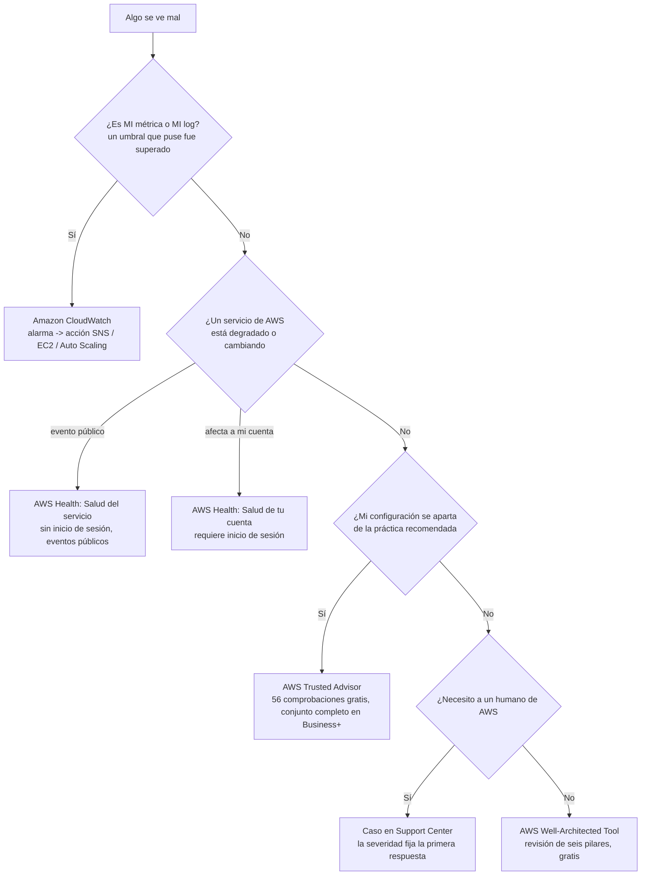
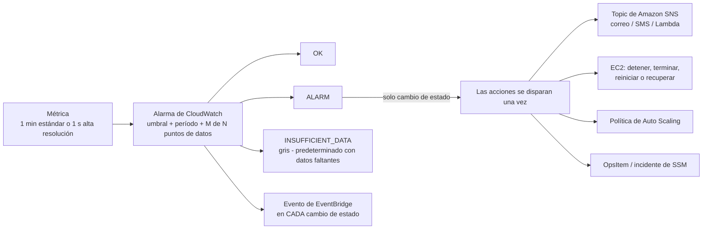
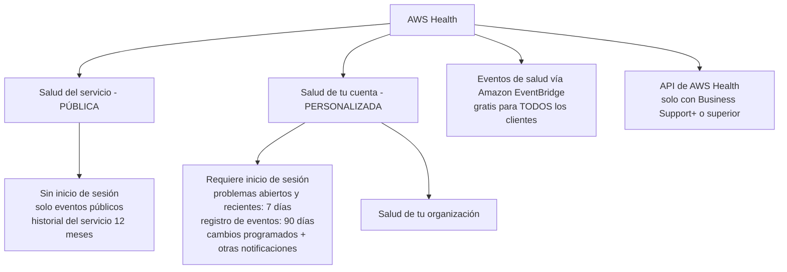
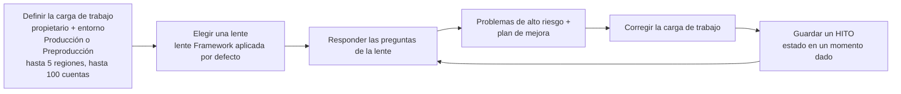

# Monitorización, operaciones, soporte y el marco Well-Architected

Una carga de trabajo en la nube que no puedes ver es una carga de trabajo que no estás ejecutando. Todo lo que hay en esta lección responde una de tres preguntas: **¿está sana?**, **¿está bien construida?**, y **¿a quién llamo cuando no lo está?** Esas tres preguntas se mapean a tres tareas de examen distintas, *monitoreo con Amazon CloudWatch* (tarea 2.2), *AWS Support* como servicio de habilitación de clientes (tarea 3.8), y *planes de soporte, Trusted Advisor y el Health Dashboard* (tarea 4.3), con los **seis pilares de Well-Architected** (tarea 1.2) aportando el estándar contra el que mides. Quien confunde las tres preguntas pierde marcas fáciles, porque el truco favorito del examen es poner una respuesta de monitoreo dentro de una pregunta de soporte y una respuesta de soporte dentro de una pregunta de monitoreo.

```text
=====================================================================
 MAPA DEL TERRENO — QUÉ HERRAMIENTA RESPONDE QUÉ PREGUNTA
=====================================================================
   «¿QUIÉN ESTÁ ENFERMO?»
     mi propia métrica cruzó MI umbral ............. Amazon CloudWatch
     un servicio de AWS está degradado / cambiando . AWS Health - Salud del servicio
     MI cuenta tiene problemas o cambios abiertos .. AWS Health - Salud de tu cuenta
     MI configuración se aparta de la práctica ...... AWS Trusted Advisor
     necesito a un ser humano en AWS ............... Caso en Support Center (según plan)

   «¿QUÉ TAN BIEN ESTÁ CONSTRUIDO?»
     seis pilares, revisión gratuita, plan de mejora  AWS Well-Architected Tool
     brechas de práctica recomendada a nivel cuenta . AWS Trusted Advisor
     acceso a shell sin bastiones ................... Session Manager de Systems Manager
     parcheado sin hoja de cálculo .................. Patch Manager de Systems Manager

   «¿QUÉ OBTENGO POR MI DINERO?»
     Basic = gratis, sin casos técnicos ............. Business Support+ -> $29/mes
     Enterprise = TAM + respuesta top de 15 min ..... Unified Operations = 5 minutos
=====================================================================
```

En esta lección vas a:

- separar **CloudWatch frente a AWS Health frente a Trusted Advisor frente a CloudTrail** leyendo el síntoma, no la lista de servicios;
- construir **métricas, alarmas, tableros y Logs** de CloudWatch como el examen los prueba: granularidad, dimensiones, estados, políticas de datos faltantes y semántica de acciones;
- trabajar la **lógica de umbrales de alarma** (período × puntos de datos, acciones solo en cambio de estado, gris frente a rojo);
- dividir el Health Dashboard en **salud pública del servicio** y **salud personalizada de la cuenta**, y saber qué partes son gratis;
- recordar las **líneas de Systems Manager** (Session Manager, Patch Manager);
- ubicar la **disponibilidad de Trusted Advisor** por plan: **56 comprobaciones gratuitas** frente al conjunto completo;
- leer la **tabla de planes de soporte de 2026**: tiempos de respuesta, canales, acceso a Trusted Advisor, IEM y mínimos, todo con fecha;
- abrir un caso correctamente: **consola, severidad, primera respuesta frente a resolución**;
- nombrar los **seis pilares de Well-Architected** exactamente y manejar la **herramienta Well-Architected** (carga de trabajo → lente → problemas de alto riesgo → plan de mejora → hito);
- aplicar **prácticas de excelencia operativa** a profundidad de examen mediante capacidades de AWS con fuente;
- estudiar **cuatro casos reales de clientes de AWS** y después practicar con **12 preguntas tipo examen** y **cuatro comprobaciones interactivas**.

| Tarea de examen | Dominio (peso) | Qué entrega esta lección |
|---|---|---|
| 1.2 Identificar principios de diseño | Conceptos en la nube (24%) | Los seis pilar, pilar por pilar |
| 2.2 Cumplimiento y gobernanza: *monitoreo con Amazon CloudWatch* | Seguridad y cumplimiento (30%) | §1 completo |
| 3.8 Otras categorías en alcance, *AWS Support* | Tecnología y servicios en la nube (34%) | §5, §6 |
| 4.3 Recursos técnicos y AWS Support: planes, Trusted Advisor, Health Dashboard | Facturación, precios y soporte (12%) | §2, §4, §5 |

---

## 1. Amazon CloudWatch: la salud de *tus* recursos

### 1.1 La definición y la trampa de tres vías

AWS define CloudWatch como el servicio que *«supervisa tus recursos de AWS y las aplicaciones que ejecutas en AWS **en tiempo real**»*. Es una familia de cuatro cosas, **métricas, alarmas, tableros y Logs**, y el examen rara vez pide la definición. Te pide que **no** elijas CloudWatch cuando se pretende otra cosa.

| El síntoma en el enunciado | La herramienta correcta | Por qué |
|---|---|---|
| *«Un umbral que configuré fue cruzado: notifícame y actúa»* | **Amazon CloudWatch** | Monitoreo = estado actual de **mis** recursos |
| *«¿Qué llamada a la API borró el bucket?»* | **AWS CloudTrail** | Auditoría = quién hizo qué (Lección 07) |
| *«¿Estaba el puerto 3306 abierto al mundo el mes pasado?»* | **AWS Config** | Historial de configuración (Lección 07) |
| *«¿Se aparta esta cuenta de la práctica recomendada de AWS?»* | **AWS Trusted Advisor** | Comprobación de brechas de asesoramiento (§4) |
| *«¿Está teniendo un servicio de AWS una caída que me afecta?»* | **AWS Health Dashboard** | Eventos propios de AWS (§2) |
| *«¿Qué opción de soporte me da una respuesta de 15 minutos?»* | **Planes de AWS Support** | Tiempo de respuesta comercial (§5) |



> [!NOTE]
> **La regla rectora:** CloudWatch responde *«¿está funcionando **lo mío**?»*; AWS Health responde *«¿está funcionando **lo de AWS**?»*; Trusted Advisor responde *«¿**estoy yo** siguiendo la práctica recomendada?»*. El Dominio 4 (planes de soporte, Trusted Advisor, Health Dashboard) es donde los estudiantes más a menudo responden **CloudWatch**: esa es la trampa para la que se redactó el enunciado de tarea.

### 1.2 Métricas: aportadas por AWS, personalizadas y las dos granularidades

- **Métricas aportadas por AWS** (EC2 CPUUtilization, S3 BucketSizeBytes, Lambda Invocations …) se publican por ti **sin coste adicional**; las **métricas personalizadas** provienen de tu propia aplicación a través de la **API `PutMetricData`**.
- Las métricas personalizadas se direccionan con tres claves: **espacio de nombres + nombre de la métrica + dimensiones**. Una dimensión es un par nombre/valor que filtra la métrica (por ejemplo `InstanceId`, `AutoScalingGroupName`): una métrica puede llevar **hasta 30 dimensiones** (verifica el estado vigente antes de usarlo).
- **Resolución estándar = granularidad de un minuto** (el predeterminado de AWS); **resolución alta = un segundo**. Paga por la resolución que elijas.
- Los datos de la métrica se retienen hasta **15 meses**, que es lo que hace posible la tendencia a largo plazo sin exportar a ningún sitio (en octubre de 2026).

```text
PutMetricData
  namespace:  "Custom/Checkout"          <-- tu espacio de nombres, tu convención
  metric:     "p95_latency_ms"
  dimensions: [Environment=prod, Service=checkout]
  value:      612
  storage:    estándar (1 min)  o  resolución alta (1 s)
  retention:  hasta 15 meses
```

### 1.3 Alarmas: umbral dentro, acción fuera

Una alarma vigila una métrica (o una **expresión matemática** construida con métricas) contra un **umbral que defines**, y hace dos cosas que nada más en CloudWatch hace: **cambia de estado** y **dispara acciones**.

- **Estados:** `OK` (sin color) · `ALARM` (rojo) · `INSUFFICIENT_DATA` (**gris**, no rojo).
- **Las acciones se disparan solo en cambio de estado**: no una vez por cada punto de datos que cruza el umbral. Una métrica que pasa una hora por encima del umbral genera **una** notificación, no sesenta.
- **Destinos de acción:** **Amazon SNS** (correo/SMS/HTTP/Lambda), **acciones de EC2** (detener, terminar, reiniciar, recuperar), políticas de **Auto Scaling**, **AWS Lambda** y **OpsItems/incidentes de SSM**.
- Cada cambio de estado de una alarma es *también* un evento de **Amazon EventBridge**, así que tu propia herramienta puede reaccionar sin sondear.
- **Tipos:** alarmas de métrica, **alarmas compuestas** (una regla sobre otras alarmas, y las alarmas compuestas **no** pueden ejecutar acciones de EC2 o Auto Scaling), alarmas **PromQL**, alarmas de **log**.
- **Políticas de datos faltantes:** `notBreaching`, `breaching`, `ignore`, `missing` (el predeterminado, que cae en `INSUFFICIENT_DATA`).
- **Límites (en octubre de 2026):** puedes crear **tantas alarmas como quieras** (sin cuota de creación), el **historial de alarmas se conserva 30 días**, y la ventana de evaluación es de **7 días cuando el período es ≥ 1 hora**, y de **1 día** en caso contrario. Pero «sin límites» **no** es gratis: véase el free tier en §1.5.



### 1.4 Ejemplo E1: lógica de umbrales de alarma (la aritmética del examen)

**Escenario:** la latencia al percentil 95 de la API de checkout debe generar alarma cuando supere los **500 ms**. Configuras: métrica `p95_latency_ms`, umbral `> 500`, período **60 segundos**, **períodos de evaluación = 3**, **puntos de datos para la alarma = 3**, política de datos faltantes = predeterminado.

```text
ventana de armado = períodos de evaluación x período = 3 x 60 s = 3 minutos
regla de cruce    = 3 minutos consecutivos por encima de 500 ms -> estado OK -> ALARM
                   (M = 3 de N = 3: cada punto de datos debe cruzar)
cruce parcial     = 2 de 3 minutos por encima de 500 ms -> sigue en OK (sin acción)
acciones          = se disparan UNA vez en la transición OK -> ALARM, después nada
                   hasta que la alarma vuelva a OK y cruce de nuevo
sin datos         = política "missing" -> INSUFFICIENT_DATA (gris), NO ALARM
recuperación      = 3 minutos consecutivos por debajo de 500 ms -> ALARM -> OK (recuperación)
```

**Variantes que al examen le gustan:**

| Configuración | Efecto | Punto de examen |
|---|---|---|
| períodos de evaluación **5**, puntos de datos para la alarma **3** | cualquiera de los últimos 3 de 5 minutos puede cruzar el umbral | **M de N** tolera el ruido |
| período **60 s** → período **300 s** | los mismos 3 períodos abarcan ahora **15 minutos** | la ventana es `período × N`, no `N` |
| datos faltantes = `breaching` | la ausencia de datos cuenta como cruce | bueno para métricas que *deben estar reportando* |
| datos faltantes = `ignore` | el estado no cambia en los huecos | bueno para métricas con picos y poco tráfico |
| alarma compuesta: `latency ALARM AND errors ALARM` | una escalada en lugar de dos | las compuestas **no** pueden detener ni escalar instancias |

> ⚠️ **El gris no es rojo.** `INSUFFICIENT_DATA` es un estado **incierto**, no un fallo: el distractor más común afirma que una alarma que deja de recibir datos «pasa a ALARM». No lo hace. Pregúntate *por qué* dejaron de llegar los datos (¿instancia terminada? ¿agente muerto? ¿typo en el espacio de nombres?) antes de tratar el estado gris como una caída.

### 1.5 Tableros y free tier: Ejemplo E2

Un **tablero de CloudWatch** es un muro de widgets (gráficos, texto, alarmas) que puede abarcar regiones y cuentas; se incluyen **tableros automáticos** para los servicios de AWS, y los **tableros personalizados** consumen el free tier.

**Ejemplo E2: contar el free tier antes de que te cuente a ti (en octubre de 2026; verifica el estado vigente antes de usarlo):**

```text
Free tier de CloudWatch               incluido          este equipo necesita
  datos de log (ingesta + archivo + Insights)   5 GB           12 GB   -> 7 GB por encima
  métricas (personalizadas + detalladas)        10             12      -> 2 por encima
  solicitudes a la API                    1.000.000        800.000  -> dentro
  métricas de alarma                        10             15      -> 5 por encima
  tableros personalizados                     3              2      -> dentro
  métricas por tablero personalizado         50             60      -> 10 por encima
                                              ----            ----
                                              «gratis» es una cantidad, no un interruptor
```

De aquí salen dos lecciones: **sin límites ≠ gratis** (puedes crear todas las alarmas que quieras, pero solo 10 métricas de alarma son gratis), y **«free tier» es siempre una afirmación con fecha**: vuelve a comprobar la página de precios de CloudWatch de AWS antes de presupuestar.

- **📚 ¿Sabías que…?** El lado proactivo de CloudWatch son las **canarias de Synthetics**: scripts configurables en **Node.js, Python o Java** que se ejecutan **según un calendario dentro de AWS Lambda** para golpear tus endpoints y APIs y *«descubrir problemas antes que tus clientes»*, una página de inicio de sesión rota genera alarma **antes** de que el primer cliente se queje. Dos parecidos que debes mantener separados: **CloudWatch Evidently se discontinuó el 16 de octubre de 2025** (un distractor, nunca una respuesta correcta), y **Amazon Managed Grafana / Managed Prometheus no están en la lista de alcance de CLF-C02**, la respuesta en alcance es siempre simplemente **Amazon CloudWatch** (en octubre de 2026).

### 1.6 Logs: grupo de log, flujo de log, evento

```text
grupo de log  "aws/lambda/checkout"   <-- es dueño de RETENCIÓN + MONITOREO + CONTROL DE ACCESO
   |
   +-- flujo de log "2026/10/07/[$LATEST]abc"   <-- un flujo por instancia/sesión
   |      |
   |      +-- eventos de log (líneas con marca de tiempo)  <-- SIN LÍMITE en el número de flujos
   |
   +-- filtro de métrica   -> crea una MÉTRICA -> puede levantar una ALARMA
   +-- filtro de suscripción -> S3 / Kinesis Data Firehose (exportación)
   +-- detección de anomalías / consultas de Logs Insights
```

- Un **grupo de log** es la unidad de **retención, monitoreo y control de acceso**; los flujos que hay dentro heredan esas configuraciones, y AWS no pone **ningún límite** al número de flujos de log.
- **CloudWatch Logs Insights** te permite **buscar y analizar de forma interactiva** datos de log con **3 lenguajes de consulta**, con hasta **100 consultas concurrentes** por cuenta (en octubre de 2026).
- La cadena que los enunciados del examen prueban: **log → filtro de métrica → alarma → acción SNS**. Así es como una línea de *texto* («OutOfStockError») se convierte en una notificación *accionable*.

```fillblank
{
  "question": "Completa las afirmaciones de vocabulario de CloudWatch con los términos procedentes de AWS:",
  "template": "Amazon CloudWatch supervisa tus recursos y aplicaciones de AWS en {{1}}. Las métricas personalizadas se publican con la API {{2}} y se direccionan por espacio de nombres, nombre de la métrica y {{3}}. Las métricas de resolución estándar llegan con granularidad de un minuto mientras la resolución alta es de {{4}} segundo, y los datos de la métrica se retienen hasta {{5}} meses. En CloudWatch Logs, la unidad que es dueña de la retención, el monitoreo y el control de acceso es el {{6}}.",
  "answers": {
    "1": "tiempo real",
    "2": "PutMetricData",
    "3": "dimensiones",
    "4": "1",
    "5": "15",
    "6": "grupo de log"
  },
  "distractors": ["PutLogEvents", "etiquetas", "períodos", "30", "60", "flujo de log", "alarma"],
  "explanation": "AWS define CloudWatch como el monitoreo en tiempo real de tus recursos y aplicaciones; las métricas personalizadas pasan por PutMetricData indexadas por espacio de nombres, nombre de la métrica y dimensiones; la resolución estándar es de un minuto y la alta de un segundo con retención de 15 meses; y el grupo de log: no el flujo de log: es el contenedor que comparte la retención, el monitoreo y la configuración de control de acceso."
}
```

---

## 2. AWS Health Dashboard: la salud de *los* recursos de AWS

### 2.1 Dos vistas, una palabra

El Health Dashboard es un único servicio con **dos vistas completamente distintas**, y el examen las separa por el **requisito de inicio de sesión**.

| | **Salud del servicio** (pública) | **Salud de tu cuenta** (personalizada) |
|---|---|---|
| ¿Requiere inicio de sesión | **No**: cualquiera puede abrirla | **Sí** |
| Contenido | **Eventos públicos**, *«no específicos de una cuenta de AWS»* | **Específicos de la cuenta**: problemas abiertos y recientes (**7 días**), cambios programados, otras notificaciones, **registro de eventos (90 días)** |
| Historial | **Historial del servicio: últimos 12 meses** | Registro de eventos: **90 días** |
| También en la consola |: | Vista **Salud de tu organización** |
| Enunciado típico | *«Comprobar el estado de AWS sin credenciales»* | *«¿Qué eventos de mantenimiento están programados para MI cuenta?»* |



### 2.2 Qué es gratis y qué no

- **El AWS Health Dashboard está disponible para todos los clientes de AWS sin coste adicional**.
- **Todos los clientes de AWS pueden recibir eventos de AWS Health a través de Amazon EventBridge sin coste adicional**: esa es la forma más barata de automatizar una respuesta a eventos del lado de AWS.
- La **API de AWS Health** (que alimenta *tus* sistemas o una herramienta de terceros) es la única pieza con candado: requiere **Business Support+ o superior** (Enterprise y Unified Operations incluidos).

> [!WARNING]
> **Dashboard ≠ API.** *«¿Cuál de estos necesita un plan de soporte de pago?»* → la **API de Health**. El tablero de la consola y el flujo de eventos de EventBridge son gratis para todos, en todos los planes, Basic incluido.

### 2.3 Ejemplo E3: el ejercicio de cinco pasos «¿somos nosotros o es AWS?»

**Escenario:** la latencia p95 de checkout dispara a las 02:10 UTC. Recorre el ejercicio en orden: cada paso tiene exactamente una herramienta correcta.

```text
paso 1  tablero de CloudWatch + estado de alarma  -> ¿MI métrica está realmente cruzando?
paso 2  ¿alarma verde? -> Health: Salud del servicio -> ¿evento público de AWS? (sin inicio de sesión)
paso 3  Health: Salud de tu cuenta                  -> ¿problema específico de la cuenta o cambio programado?
paso 4  brecha en MI configuración (grupo de        -> Trusted Advisor
        seguridad abierto, instancia ociosa, MFA ausente)
paso 5  ¿sigues atascado? -> caso en Support Center -> la severidad fija el reloj de la PRIMERA RESPUESTA
                                                         (véase la sección 5)
```

Saltar directamente al paso 5 con un plan gratuito es el modo de fallo: **Basic Support no puede abrir casos de soporte técnico** (§5). Diagnostica primero; escala después.

- **📚 ¿Sabías que…?** El **tablero** de Health y la **API** de Health se separaron deliberadamente: AWS declara que el tablero está *«disponible para todos los clientes de AWS sin coste adicional»* mientras que la API es una función del plan. Los eventos de salud llegan en **dos sabores**, **eventos públicos** (cualquiera, sin inicio de sesión) y **eventos específicos de la cuenta** (*«tu cuenta o una cuenta de tu organización»*), por eso el mismo incidente aparece en la página pública **y** en tu registro de eventos personalizado (en octubre de 2026).

---

## 3. AWS Systems Manager: dos líneas

**Systems Manager** está en la lista de alcance como servicio de *Gestión y gobernanza*; a profundidad CLF necesitas exactamente dos de sus capacidades, cada una reconocible por una frase.

| Capacidad | Qué hace | La frase que la delata |
|---|---|---|
| **Session Manager** | Una forma totalmente gestionada de conectarse a nodos EC2, de borde y on-premises a través de un **navegador o la CLI de AWS** | *«gestión segura de nodos **sin necesidad de abrir puertos entrantes, mantener hosts bastión ni gestionar claves SSH**»*: las sesiones están **controladas por IAM** y **registradas** |
| **Patch Manager** | *«Automatiza el proceso de parcheado de nodos gestionados»* usando **líneas base de parches** | *«**escanear instancias** … o … **escanear e instalar automáticamente** todos los parches ausentes»; las políticas de parche a nivel de organización se ejecutan desde **Quick Setup**, y los resultados se leen como **cumplimiento** |

```text
REQUISITO                                RESPUESTA
"acceso controlado, sin puertos          Session Manager
 entrantes, sin bastión, sin claves SSH,  (no una VPN, no una caja de salto, no el puerto 22)
 sesiones registradas y controladas por IAM"
"parcheado mensual del SO a escala,      Patch Manager
 Linux + Windows, solo escaneo o escaneo  (no un script manual de Run Command, no
 e instalación, informes de cumplimiento" Trusted Advisor)
```

*Escenario S1:* un equipo debe retirar su único host bastión manteniendo un acceso auditable a 40 instancias EC2. La respuesta con fuente: **habilitar Session Manager**, borrar el bastión, revocar las claves SSH permanentes, controlar el acceso con **IAM** y mantener activo el **registro de sesiones**. Sin cirugía en grupos de seguridad, sin distribución de claves.

*Escenario S2:* el parcheado mensual debe empezar como informe y solo después como despliegue automatizado. La respuesta con fuente: **Patch Manager** con una **línea base de parches**, primero en modo **solo escaneo** para leer el cumplimiento, después **escaneo e instalación**, y después una **política de parche a nivel de organización en Quick Setup**.

---

## 4. AWS Trusted Advisor: disponibilidad por plan

La Lección 07 es dueña de las **seis categorías de comprobación** de Trusted Advisor; esta lección es dueña de **quién recibe qué**, porque esa es la versión de la pregunta de la tarea 4.3.

| Plan (en octubre de 2026) | Acceso a Trusted Advisor |
|---|---|
| **Basic** | **Comprobaciones básicas**: AWS también declara que obtienes **todas las comprobaciones de la categoría Límites de servicio** y **comprobaciones seleccionadas de las categorías Seguridad y Tolerancia a fallos** |
| **Business Support+** | **Conjunto completo** de comprobaciones |
| **Enterprise Support** | Conjunto completo **+ TA Priority** |
| **Unified Operations** | Conjunto completo **+ TA Priority** |
| Developer / Business / Enterprise On-Ramp (en desuso) | Planes en desuso: **discontinuados el 1 de enero de 2027**, así que no construyas una respuesta sobre ellos |

**Recuentos de comprobaciones:** **todas las cuentas de AWS reciben 56 comprobaciones de Trusted Advisor**; **Business Support+ y superiores desbloquean 426 comprobaciones adicionales, para un total de 482**. Una página de AWS anuncia por separado *«más de 500 comprobaciones»* para Business Support+: las dos cifras no se reconcilian públicamente, así que la formulación segura en el examen es **«56 gratis en todos los planes; el conjunto completo con Business Support+»** (en octubre de 2026; verifica el estado vigente antes de usarlo).

> [!NOTE]
> **Trusted Advisor aconseja, no obliga.** La imposición pertenece a **las reglas de remediación de AWS Config**, **las políticas de control de servicios** y **las barreras de Control Tower** (Lección 07). Una opción que dice *«Trusted Advisor bloquea la mala configuración»* es falsa en todos los planes, Enterprise incluido.

---

## 5. Planes de AWS Support: la alineación de 2026

### 5.1 Quién vende qué, en octubre de 2026

La alineación actual de AWS son **cuatro planes**: **Basic · Business Support+ · Enterprise Support · Unified Operations**. Tres planes en desuso están en sus últimos meses: **Developer** y **Business** **no aceptaron nuevas suscripciones después del 2 de diciembre de 2025** y se **discontinúan el 1 de enero de 2027**; **Enterprise On-Ramp** tiene soporte **hasta el 31 de diciembre de 2026** y también se **discontinúa el 1 de enero de 2027**, con AWS moviendo a esos clientes a Enterprise durante 2026. Los planes en desuso siguen disponibles en **AWS GovCloud (US)**.

### 5.2 La tabla de planes de soporte

| | **Basic** | **Developer** † | **Business** † | **Business Support+** | **Enterprise** | **Unified Operations** |
|---|---|---|---|---|---|---|
| **Estado (oct 2026)** | Incluido con cada cuenta de AWS | Sin nuevas suscripciones desde el 2 dic 2025; termina el 1 ene 2027 | Sin nuevas suscripciones desde el 2 dic 2025; termina el 1 ene 2027 | Vigente | Vigente | Vigente |
| **Posicionamiento** | Línea base gratuita | Soporte en horario laboral | (en desuso, no reverificado) | **Plan mínimo recomendado para cargas de trabajo de producción** | Cargas de trabajo **críticas para el negocio** en varias organizaciones | Cargas de trabajo **críticas para la misión** que requieren resiliencia mejorada |
| **Casos de soporte técnico** | **✘ no puede abrir casos técnicos** | ✔ (solo en horario laboral) | ✔ (no reverificado) | ✔ **24×7** | ✔ **24×7** | ✔ **24×7** |
| **Canales** | Facturación/cuenta, **incrementos de cuota**, foros, documentación, salud del servicio: 24×7 | Web + correo, horario laboral | (no reverificado) | Teléfono, web, chat | Teléfono, web, chat | Teléfono, web, chat |
| **Primera respuesta, sistema crítico para el negocio caído** | n/a |, |, | **< 30 minutos** | **< 15 minutos** | **5 minutos**, de un **Incident Management Engineer** |
| **Trusted Advisor** | **Comprobaciones básicas** (56 gratis en todos los planes) |, |, | **Conjunto completo** | Conjunto completo **+ TA Priority** | Conjunto completo **+ TA Priority** |
| **API de AWS Health** | ✘ (solo tablero) |, |, | ✔ | ✔ | ✔ |
| **Technical Account Manager** | ✘ |, |, | ✘ | ✔ **TAM** | ✔ **TAM + DSE** |
| **Soporte de eventos** |: |: |: | **AWS Countdown** como extra | **AWS Countdown** incluido (Premium = extra de pago) | **IEM a corto plazo** + Countdown Premium |
| **AWS Security Incident Response** | ✘ |, |, | Extra | **Incluido** | **Incluido** |
| **Mínimo mensual** | **$0** | no publicado | no publicado | **$29 / mes por cuenta** | **$5.000 / mes** (era $15.000) | **$50.000 / mes** |
| **Compromiso mínimo** | ninguno |, |, | **30 días** | **30 días** | **90 días** |

† Plan en desuso. Las casillas marcadas *no reverificado* no tienen cifra oficial vigente en las fuentes de esta lección: **nunca cites un precio de plan en desuso**; AWS no publica uno, y las cifras de terceros (Developer $29, Business $100, Enterprise On-Ramp $5.500) están sin verificar.

**Los cuatro planes vigentes conservan, gratis:** soporte de facturación y cuenta, **incrementos de cuota**, foros, documentación y salud del servicio: **24×7**. **Business Support+** añade soporte de software de terceros y la **Support API**; **AWS re:Post** da *respuestas priorizadas* en los planes de pago.

### 5.3 La escalera de primera respuesta

AWS publica una escalera de severidad, con la **fila superior** variando según el plan. Todas las cifras son de **primera respuesta**, no de resolución, y AWS solo se compromete a *«todos los esfuerzos razonables»*:

| Severidad (de mayor a menor) | Business Support+ | Enterprise | Unified Operations |
|---|---|---|---|
| **Sistema crítico para el negocio caído** (`critical`) | **< 30 min** | **< 15 min** | **5 min** |
| **Sistema de producción caído** (`urgent`) | < 1 h | < 1 h | < 1 h |
| **Sistema de producción deteriorado** | < 4 h | < 4 h | < 4 h |
| **Sistema deteriorado** | < 12 h | < 12 h | < 12 h |
| **Orientación general** (baja) | < 24 h | < 24 h | < 24 h |

**Ejemplo E4: elegir el plan a partir de la carga de trabajo:**

```text
startup, sin ingresos, solo preguntas de facturación  -> Basic       $0, sin casos técnicos
entorno de staging, basta ayuda en horario laboral    -> (Developer en desuso - fin 1 ene 2027)
carga de trabajo de producción, 24x7 + respuesta top <30 min -> Business Support+  desde $29/mes
crítico para el negocio en muchas cuentas, necesita TAM -> Enterprise  desde $5.000/mes
crítico para la misión, respuesta de ingeniero de 5 min -> Unified Operations desde $50.000/mes
```

**Ejemplo E5: la escalera leída literalmente:**

| Enunciado | Respuesta correcta | Respuesta trampa y por qué falla |
|---|---|---|
| *«Sistema de producción deteriorado, Business Support+»* | **< 4 horas** | 1 hora es *sistema de **producción caído***: una severidad distinta |
| *«Sistema crítico para el negocio caído, Enterprise»* | **< 15 minutos** | 30 minutos es Business Support+ (y, por coincidencia, el Enterprise On-Ramp que se retira: misma cifra, distinto plan) |
| *«Sistema crítico para el negocio caído, Unified Operations»* | **5 minutos de un Incident Management Engineer** | 15 minutos es Enterprise |
| *«Sistema de producción caído, Basic»* | **Sin primera respuesta: Basic no puede abrir casos técnicos** | 1 hora asume un plan que puede abrir un caso |

> ⚠️ **Primera respuesta ≠ resolución.** AWS declara que los tiempos publicados son para la **primera respuesta** y *«no se aplican a las respuestas posteriores»*. Una pregunta que pregunta *«¿cuánto tarda AWS en arreglar mi caída?»* **no** tiene respuesta publicada: la escalera solo mide **qué tan rápido contesta alguien**.

### 5.4 Cuánto cuesta el plan: aritmética resuelta (en octubre de 2026)

El soporte en los planes de pago es un **porcentaje de tus cargas mensuales a AWS**, con un **suelo mensual**:

| Plan | Escalera de porcentajes | Mínimo mensual |
|---|---|---|
| Business Support+ | **9% / 7% / 5% / 3%** | **$29** por cuenta |
| Enterprise | **10% / 7% / 5% / 3%** | **$5.000** (reducido desde $15.000) |
| Unified Operations | **10% / 6% / 5%** (GovCloud 11% / 7% / 6%) | **$50.000** |

**Ejemplo resuelto (a): Business Support+ con $20.000 de cargas mensuales a AWS:**

```text
primer tramo   $10.000 x 9%  =   $900
segundo tramo  $10.000 x 7%  =   $700
                              ----------
                                     $1.600 / mes
mínimo                           $29   -> los $1.600 ganan
```

**Ejemplo resuelto (b): Enterprise con $750.000 de cargas mensuales a AWS:**

```text
El ejemplo publicado por AWS suma: $15.000 + $24.500 + $12.500 = $52.000 / mes
mínimo                            $5.000  -> aplica en cada nivel de gasto,
                                               INCLUYENDO $0 (es decir, $60.000/año en ocio)
```

**Ejemplo resuelto (c): Unified Operations con $1.500.000 de cargas mensuales a AWS:**

```text
$100.000 + $30.000 = $130.000 / mes, frente a un suelo de $50.000
compromiso mínimo: 90 días (30 días en Business Support+ y Enterprise)
```

- **📚 ¿Sabías que…?** El mapa de planes se movió dos veces en un año. **Developer Support y Business Support dejaron de aceptar nuevas suscripciones el 2 de diciembre de 2025** y se **discontinúan el 1 de enero de 2027**; **Enterprise On-Ramp tiene soporte solo hasta el 31 de diciembre de 2026**; mientras tanto **el mínimo mensual de Enterprise bajó de $15.000 a $5.000**. Dos consecuencias para el día del examen: una pregunta de *«respuesta de 30 minutos de Enterprise On-Ramp»* apunta a un plan **que se retira** cuya cifra por casualidad equivale a los 30 minutos de Business Support+, y cualquier material de preparación que cite un precio de **Developer a $29 / Business a $100** está repitiendo cifras de terceros **sin verificar**: AWS no publica precios de planes en desuso (en octubre de 2026).

### 5.5 Extras con sabor a incidentes

| Oferta | Qué es | Disponibilidad (en octubre de 2026) |
|---|---|---|
| **AWS Countdown** | Soporte de eventos antes de un lanzamiento o migración planificados | Extra en **Business Support+**, incluido en **Enterprise** |
| **AWS Countdown Premium** | El nivel mejorado | Extra de pago de **$10.000 por proyecto al mes** (tarifa promocional 2026 de $7.500/mes); **incluido con Unified Operations** |
| **IEM a corto plazo** (gestión de eventos de infraestructura) | Ayuda de ingeniería acotada en el tiempo durante un evento | Listado bajo **Unified Operations** |
| **AWS Incident Detection & Response** | Servicio de detección con respuesta de 5 minutos | **$7.000 o el 2%** de las cargas mensuales agregadas como **extra de Enterprise**; **incluido** con Unified Operations |
| **AWS Security Incident Response** | Respuesta específica de seguridad | No en Basic; **extra** en Business Support+; **incluido** en Enterprise y Unified Operations |
| **AWS Unified Operations** en sí | *«Combina experiencia probada con perspectivas impulsadas por IA»* con **monitoreo de seguridad y rendimiento 24×7** | Nivel superior, suelo de $50.000/mes |

---

## 6. Abrir un caso: consola, severidad, expectativas

**Dónde:** el **AWS Support Center** en la consola es la consola de casos: un solo lugar para abrir, puntuar y cerrar casos. **AWS Professional Services** y los **arquitectos de soluciones** son ofertas de compromiso, no canales de caso; el **equipo de Trust and Safety** maneja los reportes de abuso; **AWS Partner-Led Support** permite que un socio abra casos en tu nombre (en planes elegibles).

**Cómo se evalúa un caso:** eliges una **severidad** al abrirlo, y la severidad, no solo el plan, selecciona la fila de la escalera de §5.3. El detalle que más se pasa por alto: **la severidad más alta es «sistema crítico para el negocio caído»**, y *«sistema de producción caído»* es la fila de abajo (1 hora), no la de arriba.

```text
abrir caso (Support Center)
   -> elegir severidad: crítico para el negocio | producción caída | producción deteriorada
                         | sistema deteriorado | orientación general
   -> el RELOJ que importa es la PRIMERA RESPUESTA (plan + severidad)
   -> plan Basic = para: no hay casos técnicos; usa foros, docs, salud del servicio
   -> ¿necesitas acceso de máquina al propio AWS? -> Support API (Business+ y superiores)
```

**Ejemplo E6: tres escaladas, tres respuestas:**

| Situación | Movimiento correcto | Por qué fallan las alternativas |
|---|---|---|
| Cuenta gratuita de aficionado, cargo inesperado de $4 | **Caso de facturación en Basic** (permitido) | Los casos técnicos están cerrados a Basic, pero la ayuda de facturación/cuenta está incluida |
| API de producción caída, Business Support+ | **Caso en «sistema de producción caído»** → espera primera respuesta **< 1 h** | Abrirlo como «crítico para el negocio» prometería 30 minutos a los que no tienes derecho, y abrirlo en Basic sería imposible |
| Alimentar los eventos de salud de AWS en PagerDuty automáticamente | **Eventos de salud de EventBridge (gratis, cualquier plan)** o la **API de Health (Business+)** | El tablero por sí solo no puede enviar a tu herramienta |

```matching
{
  "question": "Relaciona cada necesidad operativa con el plan o servicio que realmente la satisface (en octubre de 2026):",
  "pairs": [
    {"left": "Cuenta gratuita que necesita ayuda de facturación, incrementos de cuota, foros y salud del servicio: nunca un caso técnico", "right": "Basic Support: incluido con cada cuenta de AWS; los casos de soporte técnico no están disponibles"},
    {"left": "Carga de trabajo de producción que necesita teléfono, web y chat 24x7 con una primera respuesta de severidad máxima por debajo de 30 minutos", "right": "Business Support+ - mínimo $29 al mes por cuenta; conjunto completo de Trusted Advisor; API de AWS Health incluida"},
    {"left": "Cartera crítica para el negocio que necesita un TAM nominal y una primera respuesta por debajo de 15 minutos", "right": "Enterprise Support: mínimo $5.000 al mes; TAM incluido; TA Priority; AWS Countdown incluido"},
    {"left": "Cartera crítica para la misión que quiere un Incident Management Engineer con primera respuesta de 5 minutos más un DSE", "right": "Unified Operations: mínimo $50.000 al mes con compromiso de 90 días; IEM a corto plazo incluido"},
    {"left": "Integrar eventos de salud de AWS en mi propia herramienta de guardia a través de una API", "right": "Business Support+ o superior: el tablero y los eventos de EventBridge son gratis para todos, pero la API de Health tiene candado de plan"},
    {"left": "Un plan solo en horario laboral que dejó de aceptar nuevas suscripciones el 2 de diciembre de 2025", "right": "Developer Support: discontinuado el 1 de enero de 2027; nunca bases una respuesta de 2026 en él"}
  ],
  "explanation": "Lee la restricción, no la marca: sin casos técnicos significa Basic; producción más 24x7 y respuesta máxima por debajo de 30 minutos significa Business Support+; un TAM y 15 minutos significan Enterprise; un ingeniero de 5 minutos significa Unified Operations; una integración por API es la única función de Health con candado de plan; y cualquier plan en desuso es un distractor después de su fecha de fin de venta."
}
```

---

## 7. El marco Well-Architected y la herramienta Well-Architected

### 7.1 Los seis pilares: nombres exactos

El marco aporta las *«prácticas recomendadas de AWS para diseñar y operar cargas de trabajo seguras, fiables, eficientes, rentables y sostenibles»*, publicadas como documentación fechada el **6 de noviembre de 2024**. Hay **seis pilares**, y el examen prueba los nombres **y** las diferencias entre ellos:

| # | Pilar (nombre exacto) | De qué trata (redacción de AWS) |
|---|---|---|
| 1 | **Operational Excellence** | Operar y **monitorear** sistemas |
| 2 | **Security** | **Proteger** sistemas |
| 3 | **Reliability** | **Recuperarse rápidamente del fallo** |
| 4 | **Performance Efficiency** | **Asignar y monitorear** recursos |
| 5 | **Cost Optimization** | **Evitar costes innecesarios** |
| 6 | **Sustainability** | **Minimizar los impactos ambientales** |

> [!WARNING]
> **Pilares ≠ lentes ≠ perspectivas de CAF.** **DevOps, Machine Learning, Migration, Serverless, Data Analytics** y el resto del catálogo de lentes son **lentes**: la guía del examen nunca nombra una lente. **No existe una «lente de Security»** (Security es un *pilar*). El **AWS Cloud Adoption Framework tiene seis *perspectivas***: Business, People, Governance, Platform, Security, Operations: una lista distinta sobre la *preparación organizativa*, no sobre la calidad de la carga de trabajo (Lección 02). Y los **seis principios generales de diseño** del marco se cubren en la Lección 01; esta lección es la mitad de servicios y práctica.

### 7.2 La herramienta Well-Architected: revisiones, problemas de alto riesgo, hitos

La **AWS Well-Architected Tool** es un servicio de consola **disponible sin coste**, que ofrece *«un proceso consistente … para revisar y medir tu arquitectura»*. Una revisión es explícitamente *«una **conversación constructiva** sobre decisiones arquitectónicas, y **no un mecanismo de auditoría**»*: produce **problemas de alto riesgo** y un **plan de mejora**, nunca un certificado.



**Mecánica que debes recordar:**

- Una **carga de trabajo** es *«un conjunto de componentes que aportan valor de negocio»*; registras un **propietario de la revisión**, un **entorno (Producción / Preproducción)**, **hasta 5 regiones** y **hasta 100 ID de cuenta** (nombre de 3 to 100 caracteres, descripción de 3 to 250).
- La **lente Framework** se aplica **por defecto**.
- **Las lentes son de dos tipos:** lentes del **catálogo de lentes** (oficiales, *«no requieren ninguna instalación adicional»*) y **lentes personalizadas** (tus propios pilares y preguntas). **A la vez pueden añadirse cinco lentes**, con un **máximo de 20 lentes** por carga de trabajo.
- Un **hito** *«registra el estado de una carga de trabajo en un momento particular»*: guarda uno **después de completar inicialmente todas las preguntas**, y otro tras aplicar las mejoras, para que puedas mostrar la trayectoria.

**Ejemplo E7: una revisión que produce un hito:**

```text
carga de trabajo "checkout" | propietario: A. Nandi | entorno: Producción
              3 regiones    | 12 ID de cuenta  (dentro de los límites de 5 regiones / 100 cuentas)
lente        lente Framework (predeterminada) + lente Machine Learning (2 de las 5 permitidas a la vez)
salida       problemas de alto riesgo ordenados + plan de mejora (gratis)
acción       corregir los 2 primeros problemas de fiabilidad
hitos        #1 guardado tras el primer conjunto completo de respuestas; #2 guardado tras las correcciones
valor        dos puntos en el tiempo, mismas preguntas -> mejora medible, sin necesidad de auditoría
```

```dragdrop
{
  "question": "Ordena el flujo de revisión de la herramienta Well-Architected exactamente como lo documenta AWS:",
  "items": [
    "Definir la carga de trabajo: propietario, Producción o Preproducción, hasta 5 regiones, hasta 100 cuentas",
    "Abrir la herramienta Well-Architected (gratis) - la lente Framework se aplica por defecto",
    "Añadir más lentes si hace falta: hasta 5 a la vez, máximo 20 por carga de trabajo",
    "Responder las preguntas de la lente",
    "Leer los problemas de alto riesgo y el plan de mejora",
    "Corregir la carga de trabajo",
    "Guardar un hito: el estado de la carga de trabajo en un momento dado"
  ],
  "correctOrder": [
    "Definir la carga de trabajo: propietario, Producción o Preproducción, hasta 5 regiones, hasta 100 cuentas",
    "Abrir la herramienta Well-Architected (gratis) - la lente Framework se aplica por defecto",
    "Añadir más lentes si hace falta: hasta 5 a la vez, máximo 20 por carga de trabajo",
    "Responder las preguntas de la lente",
    "Leer los problemas de alto riesgo y el plan de mejora",
    "Corregir la carga de trabajo",
    "Guardar un hito: el estado de la carga de trabajo en un momento dado"
  ],
  "explanation": "El orden de la herramienta es definir -> revisar (lente Framework por defecto, lentes extra por encima) -> responder -> problemas de alto riesgo más plan de mejora -> corregir -> hito. La propia guía de AWS es guardar un hito tras el primer conjunto completo de respuestas y de nuevo tras las mejoras, porque un hito es un registro de un momento dado, no una nota de aprobado/suspenso: una revisión es una conversación constructiva, nunca una auditoría."
}
```

- **📚 ¿Sabías que…?** Dos voces de AWS describen para qué sirve una revisión: **CyberAgent** dice que les ayuda a *«visualizar riesgos potenciales de negocio»*, mientras que **NEC** dice que el valor está en *«revisar en una fase temprana de la fase de diseño»*: antes de que la arquitectura se endurezca. Por eso también la herramienta es **gratis**: AWS vende la *conversación*, no el certificado, y el único «salida» real de la herramienta es una lista ordenada de **problemas de alto riesgo** que después tienes que ir a corregir (en octubre de 2026).

---

## 8. Excelencia operativa a profundidad de examen

**Operational Excellence** es el pilar de *operar y monitorear* sistemas, y en CLF-C02 se examina como **qué capacidad de AWS realiza qué trabajo operativo**, no como material de redacción. Los principios generales de diseño del marco viven en la Lección 01; aquí está la lista de verificación a nivel de servicio que sostienen nuestras fuentes.

| El trabajo operativo | La capacidad de AWS | Detalle con fuente que te pueden pedir |
|---|---|---|
| Ver la carga de trabajo en tiempo real | **Métricas + tableros de CloudWatch** | 1 min estándar / 1 s alta resolución; retención de 15 meses; métricas personalizadas vía `PutMetricData` |
| Actuar automáticamente cuando se rompe una regla | **Alarmas de CloudWatch** | Umbral + M de N; **acciones solo en cambio de estado**; SNS, detener/recuperar EC2, Auto Scaling, Lambda, SSM |
| Detectar problemas antes que los clientes | **Canarias de CloudWatch Synthetics** | Scripts Node.js/Python/Java programados que se ejecutan en **Lambda** |
| Mantener un único almacén de logs busc y retenido | **CloudWatch Logs** | El **grupo de log** es dueño de la retención, el monitoreo y el control de acceso; **Logs Insights** con 3 lenguajes de consulta |
| Convertir texto en una alerta | **Filtro de métrica → alarma → SNS** | La cadena log → métrica → acción |
| Llegar a los nodos sin bastión | **Session Manager de SSM** | Sin puertos entrantes, sin hosts bastión, sin claves SSH; controlado por IAM; sesiones registradas |
| Mantener el SO parcheado | **Patch Manager de SSM** | Líneas base de parches; **solo escaneo** o **escaneo e instalación**; informes de cumplimiento; políticas de Quick Setup |
| Comprobarme contra la práctica recomendada | **Trusted Advisor** | 56 comprobaciones gratis; conjunto completo en Business Support+; **solo asesoramiento** |
| Saber si es culpa de AWS | **AWS Health Dashboard / API** | Tablero gratis para todos; **la API necesita Business Support+** |
| Escalar con un reloj | **Support Center + plan + severidad** | Escalera de primera respuesta; **Basic no puede abrir casos técnicos** |
| Mejorar la propia arquitectura | **Well-Architected Tool** | Gratis; problemas de alto riesgo; plan de mejora; **hitos** |
| Demostrar que las operaciones mejoran | **Hitos + métricas de casos** | Registros de un momento dado que comparas en revisiones sucesivas |

**Ejemplo E8, poner la lista de verificación junto:** un equipo de 12 personas opera una flota de 40 nodos. El modelo operativo con fuente: **Session Manager** reemplaza al bastión (sin puertos entrantes), **Patch Manager** ejecuta solo escaneo durante una semana para leer el cumplimiento antes de cambiar a escaneo e instalación, las **alarmas de CloudWatch** de CPU y latencia publican hacia un topic de **SNS** que despierta a la guardia, las **canarias de Synthetics** golpean la página de inicio de sesión cada cinco minutos, las 56 comprobaciones gratis de **Trusted Advisor** se revisan cada mes, una **revisión de Well-Architected** se guarda como **hito** cada trimestre, y un caso de **Business Support+** es la vía de escalada cuando todo eso dice *«no somos nosotros»*. Nada de esa lista necesita a una persona escribiendo un stack de monitoreo desde cero, que es exactamente la preferencia de Well-Architected por respuestas **gestionadas con la menor sobrecarga operativa**.

### Actualizaciones de 2026 (en octubre de 2026)

> **Solo con fuente: cada viñeta de abajo lleva fecha y es trazable a una página de AWS consultada el 2026-10.** Nada que no pudo verificarse se declara como hecho, y donde un titular discrepa de la guía del examen, **la guía gana**.
>
> - **La alineación de soporte cambió el 2 de diciembre de 2025, y el texto del examen siguió.** La entrada de noticias de AWS *«New and enhanced AWS Support plans add AI capabilities to expert guidance»* presentó **Business Support+** y **AWS Unified Operations**; **Developer, Business clásico y Enterprise On-Ramp** **no aceptaron nuevas suscripciones después del 2 de diciembre de 2025** con las suscripciones existentes funcionando **hasta el 1 de enero de 2027**, mientras que **Basic sigue gratis**. Mínimos mensuales publicados en octubre de 2026: **$29**, **$5.000** y **$50.000** por cuenta (verifica el estado vigente antes de usarlo).
> - **La propia lista de ejemplo de la tarea 4.3 ahora dice** *«Basic Support, AWS Business Support+, AWS Enterprise Support, AWS Unified Operations»*: la guía actual nombra **cuatro** planes y los nombres en desuso desaparecieron del texto, así que las notas construidas sobre *«Developer Support es el plan de pago de entrada»* están citando una lista borrada.
> - **La categoría que contiene el soporte se renombró:** `Customer Engagement` → **Customer Enablement**, que ahora contiene **solo AWS Support**: AWS Activate, AWS IQ y AWS Managed Services están **explícitamente fuera de alcance**, así que ninguno puede ser una respuesta en alcance en ningún lugar de este examen.
> - **Well-Architected Agent (vista previa) llegó el 1 de octubre de 2026**, que AWS describe como *«la evolución de nueva generación de AWS Trusted Advisor y la herramienta AWS Well-Architected»* (notas de versión de AWS Well-Architected: agente publicado el 10-1-2026). Aparece **en ningún lugar de las listas de servicios de la guía actual del examen** (verificado 2026-10): los nombres examinables siguen siendo **AWS Well-Architected Tool** y **AWS Trusted Advisor**, así que nunca bases una respuesta en una vista previa.
> - **Las listas del Dominio 3 detrás de esta lección se reconstruyeron:** las entradas en alcance bajaron de **128 → 111** mientras la lista de fuera de alcance creció de **11 → 55**, con **Service Quotas** entre las entradas añadidas de Gestión y gobernanza: relevante aquí porque los **incrementos de cuota** son uno de los canales 24×7 que **todos** los planes conservan gratis, Basic incluido.
>
> Fuentes: AWS News Blog (2025-12-02); tarea 4.3 de la guía del examen AWS Certified Cloud Practitioner más las listas de servicios en alcance y fuera de alcance; notas de versión y What's New de AWS Well-Architected (2026-10-01): todo consultado 2026-10.

```text
LÍNEA DE TIEMPO DE SOPORTE + WELL-ARCHITECTED   (con fuente; en octubre de 2026)
  2025-12-02   Developer, Business clásico y Enterprise On-Ramp cierran
               a NUEVAS suscripciones (AWS News Blog, 2025-12-02)
               -> Business Support+ y Unified Operations se convierten en
                  los planes de pago que nombra la guía del examen
  2026-10-01   se anuncia AWS Well-Architected Agent (vista previa)
               -> NO está en las listas de servicios de la guía; la WA Tool y
                  Trusted Advisor siguen siendo los nombres examinables
  oct 2026     ejemplos actuales de la tarea 4.3: Basic | Business Support+ |
               Enterprise | Unified Operations
  2027-01-01   planes en desuso discontinuados (los planes en desuso siguen en
               AWS GovCloud (US))
  siempre      precios y límites con marca «en octubre de 2026» - vuelve a
               comprobar las propias páginas de AWS antes del día del examen
```

- **📚 ¿Sabías que…?** La guía actual del examen **no imprime ningún número de versión**, el PDF solo lleva *«Copyright © 2026»*, y el único artefacto con marca que AWS ha publicado es la guía de la época del lanzamiento **`Version 1.0 CLF-C02`**. El `uiVersion=2024.10` visible en la URL de documentación es la **versión de la plantilla del sitio de AWS Docs**, no una revisión de la guía (verificado 2026-10), y por eso afirmaciones como *«una actualización de la guía de marzo de 2026»* que circulan en material de preparación de terceros siguen sin verificar, el hábito defendible es descargar la guía que AWS publica **hoy** en lugar de confiar en una etiqueta de versión que citó otra persona.

```matching
{
  "question": "Relaciona cada cambio de 2026 con lo que significa para tu respuesta de CLF-C02 (todas las fuentes consultadas en octubre de 2026):",
  "pairs": [
    {"left": "La lista de ejemplos dentro de la tarea 4.3 de la guía actual del examen", "right": "Nombra Basic Support, AWS Business Support+, AWS Enterprise Support y AWS Unified Operations: los cuatro planes que esta lección enseña como vigentes"},
    {"left": "Developer, Business clásico y Enterprise On-Ramp", "right": "Cerrados a nuevas suscripciones el 2 de diciembre de 2025 y discontinuados el 1 de enero de 2027: nunca bases una respuesta de 2026 en ellos"},
    {"left": "La categoría Customer Enablement en la lista de alcance", "right": "Contiene solo AWS Support - AWS Activate, AWS IQ y AWS Managed Services están fuera de alcance"},
    {"left": "AWS Well-Architected Agent (vista previa, anunciado el 1 de octubre de 2026)", "right": "No está nombrado en la guía del examen: los nombres examinables siguen siendo la herramienta AWS Well-Architected y AWS Trusted Advisor"},
    {"left": "Las listas de servicios reconstruidas detrás del Dominio 3", "right": "111 entradas en alcance y 55 fuera de alcance (verificado 2026-10) - la lista que descargas hoy es la que decide"},
    {"left": "Mínimos mensuales de los tres planes de pago, en octubre de 2026", "right": "$29 (Business Support+), $5.000 (Enterprise) y $50.000 (Unified Operations) por cuenta al mes: verifica el estado vigente antes de usarlo"}
  ],
  "explanation": "Lee la fuente, no el titular: la propia tarea 4.3 lista Basic, Business Support+, Enterprise y Unified Operations, así que los nombres de planes en desuso son distractores después del 2 de diciembre de 2025; Customer Enablement contiene solo AWS Support; el Well-Architected Agent es una vista previa real pero no un nombre examinable, así que la Well-Architected Tool y Trusted Advisor de la guía del examen siguen siendo correctas; y las listas reconstruidas (111 dentro, 55 fuera) más los mínimos publicados de $29 / $5.000 / $50.000 son las únicas cifras que citar: todo en octubre de 2026."
}
```

---

## Casos Reales

AWS publica cómo se ven estos patrones en producción. Cada cifra de abajo está **afirmada por el cliente o por AWS y sin auditar**, citada con su fuente para que puedas comprobarla: el punto examinable es el **patrón** (qué capacidad se usó, qué número se movió), no el marketing.

### Caso A, Bangkok Flight Services: monitoreo y auditoría embarcados *con* la migración

| Elemento | Detalle |
|---|---|
| **Industria / contexto** | Manejo de carga aérea alrededor de **60 millones de pasajeros al año**, en crecimiento, con hardware envejecido y **sin sitio de recuperación ante desastres** |
| **Servicios de AWS nombrados** | **AWS Application Migration Service (MGN)**, Amazon EC2, Amazon S3, **AWS CloudTrail**, **Amazon CloudWatch**, **recuperación ante desastres multi-AZ**, socio: DailiTech |
| **Resultados principales (publicados por AWS)** | Migración completada en **7 meses** con **sin reversión y sin interrupciones**; **el tiempo de gestión de la infraestructura de TI se redujo un 50%**; aproximadamente **1 hora al año de tiempo de inactividad no planificado eliminada** |
| **Lección operativa** | CloudWatch y CloudTrail fueron **parte de la solución**, no una reflexión tardía, y la recuperación ante desastres se diseñó en **múltiples zonas de disponibilidad** desde el primer día |
| **Fuente** | aws.amazon.com/solutions/case-studies/bangkok-flight-services (consultado en octubre de 2026) |

*Lección de examen:* **el monitoreo y la auditoría viajan con cada migración.** Un enunciado que dice *«el cliente migró y ahora puede ver la salud de los recursos y la actividad de API»* está describiendo **CloudWatch + CloudTrail**, y la afirmación de resiliencia es **multi-AZ**, no multi-región: la distinción exacta que prueba la Lección 03.

### Caso B, Capital One: la excelencia operativa como disciplina de ingeniería

| Elemento | Detalle |
|---|---|
| **Industria / contexto** | Banco del Fortune 100 que pasa de *pruebas periódicas de recuperación ante desastres* a sistemas que **previenen, detectan y se recuperan automáticamente** |
| **Servicios de AWS nombrados** | **Conmutación por error regional** automatizada, **Amazon Route 53**, **Amazon CloudWatch**, un hub central de recuperación, **AWS GameDay** mensual, ingeniería del caos |
| **Resultados principales (publicados por AWS, afirmados por el cliente)** | **Los eventos de gravedad crítica se redujeron un 80 to 90%**; **el tiempo de recuperación pasó de horas a minutos** en miles de componentes en orden de dependencia; la cadencia de pruebas pasó de **pruebas trimestrales entre regiones a experimentos mensuales de caos** |
| **Lección de excelencia operativa** | La fiabilidad se **demuestra con pruebas automatizadas y repetidas**, no se declara, y CloudWatch se sitúa en la ruta de detención que hace automática la recuperación |
| **Voz del cliente** | *«Creemos que la innovación debería ir a la velocidad de sistemas bien gestionados.»*: Parvez Naqvi, VP de ingeniería de resiliencia y fiabilidad (cita del cliente) |
| **Fuente** | aws.amazon.com/solutions/case-studies/capital-one-improving-resilience-case-study (consultado en octubre de 2026) |

*Lección de examen:* **el 80 to 90% es un resultado del cliente, no una garantía de AWS**, y pertenece al caso de *resiliencia* (la página de migración del mismo cliente tiene un conjunto distinto de cifras: no las mezcles).

### Caso C, Box: una revisión de Well-Architected usada como rutina operativa

| Elemento | Detalle |
|---|---|
| **Industria / contexto** | Box, la plataforma SaaS empresarial usada por **más de 120.000 empresas**, buscando eficiencia de gasto **sin** perjudicar seguridad, fiabilidad o rendimiento |
| **Servicios de AWS nombrados** | **Well-Architected Framework** y revisiones de Solutions Architect, estratificación de Amazon S3 / **S3 Glacier**, higiene de volúmenes y instantáneas de EBS, **filtrado de eventos de AWS CloudTrail**, enrutamiento de tráfico alrededor de las puertas de enlace de internet |
| **Resultados principales (publicados por AWS, afirmados por el cliente)** | **$2,23 millones** desglosados en cuatro palancas: transferencia inter-AZ **$438.000**, salida a internet **$1,1 millones al año**, estratificación de almacenamiento **más de $500.000 al año**, registro **$192.000 al año** |
| **Lección operativa** | La revisión produjo un **backlog ordenado**, no un certificado: el mismo bucle *revisión → problemas de alto riesgo → plan de mejora → hito* que enseña la §7, y la línea de registro demuestra que **el volumen de logs es una decisión operativa**: la retención, los filtros de métrica y los filtros de suscripción se configuran todos en el **grupo de log** (§1.6) |
| **Voz del cliente** | *«Nuestro uso de las mejores prácticas de AWS llevó a ahorros de más de 2 millones de dólares, estableciendo una nueva línea base…»*: Clay Alvord, director de FinOps y SRE (cita del cliente) |
| **Fuente** | aws.amazon.com/solutions/case-studies/box-case-study (consultado en octubre de 2026) |

```text
Desglose publicado de Box (afirmado por el cliente, consultado en octubre de 2026)
  transferencia de datos inter-AZ ..... $  438.000
  salida a internet ................... $1.100.000 / año
  estratificación de almacenamiento ... $  500.000 / año   (AWS imprime ">")
  registro ............................ $  192.000 / año
                                        ------------
  total .............................. $2.230.000  =  «$2.23 million desglosado»
```

*Lección de examen:* **las cuatro cifras pertenecen a Box, no a Capital One**, mezclar cifras de clientes es el error clásico de los casos de estudio. Dos patrones examinables se esconden bajo el marketing: la revisión gratis de la §7 haciendo trabajo de **coste** además de trabajo de arquitectura (Cost Optimization es un pilar de la preparación operativa, no una reflexión tardía), y un hecho operativo, **$192.000 al año de registro** los moldea la retención que eliges en un **grupo de log**, y por eso exacto la §1.6 dice que el grupo de log, no el stream, es dueño de la retención.

### Caso D, athenahealth: visibilidad central gestionada por un equipo de ocho

| Elemento | Detalle |
|---|---|
| **Industria / contexto** | Software sanitario (sensible a HIPAA) que necesitaba **monitoreo de salida por una extensa red de VPC** mientras subían los costes de inspección: operado por un equipo pequeño de ingeniería |
| **Servicios de AWS nombrados** | **AWS Network Firewall** (centralizado), **AWS Transit Gateway**, **AWS RAM** (propagación de políticas a **120 cuentas**, reglas de CloudFormation como código, AWS Direct Connect; AWS Shield en la hoja de ruta |
| **Resultados principales (publicados por AWS, afirmados por el cliente)** | Costes de inspección reducidos un **95%**; cientos de VPC en **120 cuentas** incorporadas *«en solo unos días»*; el nuevo diseño de seguridad fue diseñado y desplegado por **ocho personas** con **sin interrupciones**; los logs del firewall **centralizados** en un solo lugar |
| **Lección operativa** | **Una señal central supera a 120 consolas locales**: automatiza el despliegue con políticas como código en lugar de contratar operadores, que es la preferencia de la excelencia operativa de *automatizar, no personalizar* escrita como caso de estudio |
| **Salvedad de alcance** | **AWS Network Firewall está ahora en la lista de fuera de alcance** para CLF-C02 (verificado 2026-10): usa la historia para el **patrón**, y responde solo con nombres en alcance (CloudWatch, CloudTrail, AWS Health, Trusted Advisor) |
| **Fuente** | aws.amazon.com/solutions/case-studies/athenahealth-case-study (consultado en octubre de 2026) |

*Lección de examen:* lee la **forma**, no la lista de productos. *«Un solo lugar al que mirar, muchas cuentas, equipo pequeño, sin interrupciones»* ⇒ las respuestas en alcance son **tableros de Amazon CloudWatch** para métricas, **AWS CloudTrail** para el historial de API, **AWS Health** para eventos del lado de AWS y **AWS Trusted Advisor** para huecos de configuración. El **−95%** es la cifra de athenahealth, sin auditar, y *«ocho personas»* es un recordatorio de que AWS cuenta **los servicios gestionados como capacidad**: ningún enunciado de examen pide cuántos ingenieros contrató el cliente.

### Lo que los dos primeros casos comparten

| Patrón de valor | Evidencia | Principio subyacente |
|---|---|---|
| La observabilidad se envía con la carga de trabajo | Bangkok: CloudWatch + CloudTrail en el alcance de la migración | **El monitoreo es un entregable**, no una fase 2 |
| La recuperación se prueba, no se asume | Capital One: trimestral → **mensual** experimentos de caos, GameDay | **Fiabilidad = recuperarse rápidamente del fallo** |
| La automatización reduce el trabajo operativo | Bangkok: tiempo de gestión de infraestructura **−50%** | La excelencia operativa favorece operaciones **automatizadas y repetibles** |
| Las herramientas gratis hacen el primer paso | Ambos: CloudWatch + revisión estilo WA/Trusted Advisor antes de escalar | Diagnostica primero, **después** abre un caso |

- **📚 ¿Sabías que…?** Las cifras de Capital One viven en **dos páginas diferentes de AWS** y describen **dos proyectos diferentes**: el caso de resiliencia informa **eventos de gravedad crítica bajando 80 to 90%** con recuperación **horas → minutos**, mientras que el caso de migración informa la salida de **8 centros de datos**, ~**80% de ~2.000 aplicaciones** construidas en la nube y entornos de desarrollo recortados de **3 meses a minutos**. El día del examen, cita la cifra **con el proyecto del que salió**: mezclarlas es el error clásico de los casos de estudio (consultado en octubre de 2026).

### Lo que añaden los casos C y D

| Patrón de valor | Evidencia | Principio subyacente |
|---|---|---|
| Una revisión es trabajo operativo, no papeleo | Box: **revisiones de Well-Architected + Solutions Architect** → cuatro correcciones financiadas que suman **$2,23 M** | El bucle de la §7 (revisión → problemas de alto riesgo → plan de mejora → hito) se paga solo en el pilar de **Cost Optimization** también |
| El registro se diseña, no se descubre | Box: **$192 K al año** de registro señalado como su propia palanca | La retención, los filtros de métrica y los filtros de suscripción viven en el **grupo de log**: elígelos deliberadamente |
| Centraliza la señal, automatiza el despliegue | athenahealth: cientos de VPC, **120 cuentas**, políticas como código, **equipo de 8**, coste de inspección **−95%** | La excelencia operativa prefiere operaciones **gestionadas y automatizadas** a más personal |
| Un caso nunca licencia una respuesta fuera de alcance | El **AWS Network Firewall** de athenahealth está ahora **fuera de alcance** | Nombra solo el servicio en alcance que pide el enunciado (lista verificada 2026-10) |

- **📚 ¿Sabías que…?** Las cuatro líneas de ahorro publicadas de Box suman exactamente: **$438.000 + $1.100.000 + $500.000 + $192.000 = $2.230.000**, el titular de AWS *«$2.23 million»* es la **suma de las cuatro palancas**, no una cifra aparte. De esas cuatro, la línea de **registro** es la única que un equipo operativo controla semana a semana, porque la retención, los filtros y las exportaciones de CloudWatch Logs se configuran todas en el **grupo de log**, que es por qué un enunciado de examen sobre *«reducir el gasto en logs»* es en realidad un enunciado sobre la política de retención (caso de estudio consultado en octubre de 2026).

> [!WARNING]
> **Cómo leer las cifras de los casos de estudio el día del examen:** cada porcentaje de aquí está **afirmado por el cliente o publicado por AWS y sin auditar**: nunca una garantía, y *«hasta»* es un **techo**, nunca una media. Atribuye la fuente y la fecha de consulta (*«caso de estudio de Bangkok Flight Services, consultado en octubre de 2026»*), no *«AWS demuestra»*. Un caso nunca licencia una respuesta fuera de alcance: se te pide **nombrar el servicio en alcance** (CloudWatch, CloudTrail, Health, Trusted Advisor, WA Tool), nunca reproducir la cifra de marketing.

---

## Preguntas de Práctica (Practice Questions)

```question
{
  "id": "clf-12-q1",
  "type": "multiple-choice",
  "question": "El percentil 95 de latencia de un servicio de checkout cruza un umbral que tu equipo configuró en tu propia cuenta, y quieres una notificación más una acción de recuperación automática. ¿Qué servicio deberías usar?",
  "options": [
    "Amazon CloudWatch: una alarma sobre tu métrica con una acción de SNS o EC2",
    "AWS Health Dashboard: vista de salud del servicio",
    "AWS Trusted Advisor: categoría de optimización de costes",
    "AWS CloudTrail: historial de eventos"
  ],
  "correct": 0,
  "explanation": "CloudWatch es la respuesta de monitoreo: las alarmas vigilan una métrica contra un umbral definido por el usuario y disparan acciones en el cambio de estado: SNS para la notificación, más detener/terminar/reiniciar/recuperar EC2, Auto Scaling, Lambda o un OpsItem de SSM. AWS Health cubre los eventos de servicio de la propia AWS, Trusted Advisor informa de huecos de práctica recomendada y CloudTrail registra quién llamó a qué API."
}
```

```question
{
  "id": "clf-12-q2",
  "type": "multiple-choice",
  "question": "Una alarma de CloudWatch con un período de 60 segundos y tres períodos de evaluación deja de recibir datos. La alarma muestra INSUFFICIENT_DATA. ¿Qué afirmación es correcta?",
  "options": [
    "INSUFFICIENT_DATA es un estado rojo que significa que la propia alarma ha fallado",
    "CloudWatch cambia automáticamente el estado a ALARM tras tres períodos sin datos",
    "INSUFFICIENT_DATA es un estado gris e incierto: las acciones no se disparan hasta que la alarma entra realmente en ALARM",
    "Los datos ausentes siempre se tratan como superación del umbral por defecto"
  ],
  "correct": 2,
  "explanation": "Los tres estados son OK, ALARM (rojo) e INSUFFICIENT_DATA (gris). Gris significa que CloudWatch no tiene suficientes puntos de datos: con la política por defecto de datos ausentes la alarma se queda en INSUFFICIENT_DATA en vez de ALARM, así que no se dispara ninguna acción. El comportamiento de solo superación debe elegirse explícitamente con la política de datos ausentes de superación, y las acciones se disparan solo en el cambio de estado."
}
```

```question
{
  "id": "clf-12-q3",
  "type": "multiple-choice",
  "question": "Debes comprobar si un servicio de AWS tiene una interrupción pública y en curso SIN iniciar sesión en la consola de AWS. ¿Qué vista satisface el requisito?",
  "options": [
    "La salud de tu cuenta: eventos personalizados para tu cuenta",
    "AWS Health Dashboard: salud del servicio, que muestra eventos públicos y no requiere inicio de sesión",
    "AWS Trusted Advisor: categoría de tolerancia a fallos",
    "Un tablero de CloudWatch compartido contigo por correo electrónico"
  ],
  "correct": 1,
  "explanation": "La salud del servicio es la vista pública: muestra eventos públicos que no son específicos de ninguna cuenta de AWS, no requiere inicio de sesión y conserva un historial de servicio de 12 meses. La salud de tu cuenta necesita inicio de sesión y muestra contenido específico de la cuenta (problemas abiertos y recientes durante 7 días, cambios programados, un registro de eventos de 90 días). Trusted Advisor y CloudWatch describen tu propia cuenta, no el estado del servicio de AWS."
}
```

```question
{
  "id": "clf-12-q4",
  "type": "multiple-choice",
  "question": "Una empresa quiere que los eventos de AWS Health se envíen a su propio sistema de guardia a través de una API. ¿Qué debe ser cierto para que esto funcione?",
  "options": [
    "Cualquier plan sirve, porque la API de AWS Health es gratis para todos los clientes",
    "Se requiere Business Support+ o superior: el tablero y los eventos de EventBridge son gratis para todos, pero la API de Health está limitada por plan",
    "Solo Unified Operations puede usarla, porque es parte de la detección de incidentes",
    "Basic Support es suficiente, porque el Health Dashboard está incluido con Basic"
  ],
  "correct": 1,
  "explanation": "AWS declara que el Health Dashboard está disponible para todos los clientes sin coste adicional y que todos los clientes pueden recibir eventos de Health a través de Amazon EventBridge gratis: pero la API de AWS Health requiere Business Support+, Enterprise o Unified Operations. Confundir el tablero gratis con la API limitada es la trampa estándar en esta tarea."
}
```

```question
{
  "id": "clf-12-q5",
  "type": "multiple-choice",
  "question": "Un cliente con el plan Basic Support sufre una interrupción en producción y quiere escalar a AWS de inmediato. ¿Qué afirmación es correcta?",
  "options": [
    "Basic incluye una primera respuesta en 1 hora para sistema de producción caído",
    "Basic no puede abrir casos técnicos de soporte: cubre ayuda de facturación y cuenta, incrementos de cuota, foros, documentación y salud del servicio",
    "Basic incluye el conjunto completo de comprobaciones de Trusted Advisor, así que el caso es innecesario",
    "Basic incluye un Technical Account Manager asignado"
  ],
  "correct": 1,
  "explanation": "Los clientes con el plan Basic Support no pueden abrir casos técnicos de soporte. Lo que Basic sí incluye, 24×7, es soporte de facturación y cuenta, incrementos de cuota, foros, documentación y salud del servicio: más las comprobaciones principales de Trusted Advisor (todas las cuentas obtienen 56 comprobaciones gratis). Las escaleras de tiempo de respuesta y los TAM solo existen en planes que pueden abrir casos técnicos."
}
```

```question
{
  "id": "clf-12-q6",
  "type": "multiple-choice",
  "question": "Un sistema crítico para el negocio está caído. ¿Qué combinación de plan y primera respuesta es correcta en octubre de 2026?",
  "options": [
    "Business Support+ - primera respuesta en menos de 15 minutos",
    "Enterprise Support: primera respuesta en menos de 15 minutos",
    "Basic Support: primera respuesta en 1 hora",
    "Enterprise On-Ramp: primera respuesta en menos de 15 minutos"
  ],
  "correct": 1,
  "explanation": "Las primeras respuestas de severidad máxima (sistema crítico para el negocio caído) son: Business Support+ en menos de 30 minutos, Enterprise en menos de 15 minutos y Unified Operations en 5 minutos desde un Incident Management Engineer. Business Support+ son 30 minutos, Basic no puede abrir casos técnicos en absoluto, y Enterprise On-Ramp: cuya cifra de 30 minutos es anterior a la alineación actual: se discontinúa el 1 de enero de 2027."
}
```

```question
{
  "id": "clf-12-q7",
  "type": "multiple-choice",
  "question": "¿Cuál de los siguientes NO es uno de los seis pilares del AWS Well-Architected Framework?",
  "options": [
    "Sustainability",
    "DevOps",
    "Operational Excellence",
    "Performance Efficiency"
  ],
  "correct": 1,
  "explanation": "Los seis pilares son Operational Excellence, Security, Reliability, Performance Efficiency, Cost Optimization y Sustainability. DevOps es una LENTE del catálogo de lentes: una forma de aplicar el marco a un tipo concreto de carga de trabajo: y la guía del examen nunca nombra lentes. Tampoco existe una «lente de Security»: Security es un pilar."
}
```

```question
{
  "id": "clf-12-q8",
  "type": "multiple-choice",
  "question": "¿Qué afirmación sobre una revisión de la herramienta AWS Well-Architected es correcta?",
  "options": [
    "Una revisión certifica la carga de trabajo para cumplimiento, así que debe tratarse como una auditoría",
    "La herramienta es gratis, y un hito registra el estado de una carga de trabajo en un momento particular",
    "Solo los clientes con Enterprise Support pueden ejecutar una revisión",
    "La lente Framework debe reemplazarse por una lente personalizada antes de la primera revisión"
  ],
  "correct": 1,
  "explanation": "La herramienta Well-Architected está disponible sin coste, una revisión es explícitamente una conversación constructiva y no un mecanismo de auditoría, y un hito registra el estado de la carga de trabajo en un momento dado: AWS dice guardar uno después de completar inicialmente todas las preguntas y otro tras las mejoras. La lente Framework se aplica por defecto; las lentes personalizadas son adiciones opcionales (5 a la vez, máximo 20)."
}
```

```question
{
  "id": "clf-12-q9",
  "type": "multiple-choice",
  "question": "Requisito: acceso controlado a nodos gestionados sin puertos entrantes, sin hosts bastión y sin claves SSH, sesiones controladas por IAM y registradas. ¿Qué capacidad de AWS lo satisface?",
  "options": [
    "AWS Systems Manager Session Manager",
    "AWS Systems Manager Patch Manager",
    "Amazon CloudWatch Synthetics",
    "AWS Trusted Advisor"
  ],
  "correct": 0,
  "explanation": "Session Manager es descrito por AWS como gestión segura de nodos totalmente gestionada sin abrir puertos entrantes, mantener hosts bastión ni gestionar claves SSH: el acceso está controlado por IAM y las sesiones se registran. Patch Manager automatiza el parcheo (solo escaneo o escaneo e instalación), Synthetics ejecuta canarias programadas para probar endpoints y Trusted Advisor solo informa de huecos de práctica recomendada."
}
```

```question
{
  "id": "clf-12-q10",
  "type": "multiple-choice",
  "question": "¿Qué afirmación sobre la disponibilidad de AWS Trusted Advisor es correcta en octubre de 2026?",
  "options": [
    "Trusted Advisor está disponible solo en Enterprise Support, con TA Priority en todos los planes",
    "Todas las cuentas de AWS obtienen 56 comprobaciones, Business Support+ desbloquea el conjunto completo, y TA Priority está reservado a Enterprise y Unified Operations",
    "Los clientes con el plan Basic Support no obtienen ninguna comprobación de Trusted Advisor",
    "Business Support+ incluye TA Priority además del conjunto completo de comprobaciones"
  ],
  "correct": 1,
  "explanation": "Todas las cuentas de AWS obtienen 56 comprobaciones de Trusted Advisor y Business Support+ o superior desbloquean 426 adicionales (482 en total en la página de comprobaciones de AWS, que en otro lugar anuncia «más de 500»). Basic obtiene las comprobaciones principales: incluidas todas las de Service Limits y las seleccionadas de Security y tolerancia a fallos: así que «ninguna comprobación en absoluto» es falso. TA Priority es una función de Enterprise y Unified Operations, no de Business Support+."
}
```

```question
{
  "id": "clf-12-q11",
  "type": "multiple-choice",
  "question": "Las notas de Dominio 4 de un candidato, construidas a partir de una guía del examen CLF-C02 más antigua, responden con «Developer Support es el plan de pago de entrada». ¿Qué afirmación sobre el texto actual del examen y la alineación de soporte (verificado en octubre de 2026) es correcta?",
  "options": [
    "La guía actual todavía lista Developer Support en la tarea 4.3, porque la lista de ejemplos no ha cambiado desde 2023",
    "La tarea 4.3 ahora nombra Basic Support, AWS Business Support+, AWS Enterprise Support y AWS Unified Operations; Developer, Business clásico y Enterprise On-Ramp dejaron de aceptar nuevas suscripciones el 2 de diciembre de 2025 y se discontinúan el 1 de enero de 2027",
    "La alineación creció a cinco planes vigentes: Basic, Developer, Business, Business Support+ y Enterprise: así que tanto las notas como la guía nueva tienen parte de razón",
    "Unified Operations es un servicio de AWS en lugar de un plan de soporte, así que no puede aparecer en una tarea de opciones de soporte"
  ],
  "correct": 1,
  "explanation": "La tarea 4.3 de la guía actual del examen da exactamente estos cuatro ejemplos: Basic Support, AWS Business Support+, AWS Enterprise Support y AWS Unified Operations: reflejando la reestructuración del soporte que AWS anunció el 2 de diciembre de 2025. Los planes en desuso no aceptan nuevas suscripciones después de esa fecha y las existentes funcionan hasta el 1 de enero de 2027, así que una respuesta basada en Developer Support memoriza un texto que AWS borró. Unified Operations es un plan de soporte con un mínimo de $50.000 al mes y una primera respuesta de un Incident Management Engineer en 5 minutos, no un servicio."
}
```

```question
{
  "id": "clf-12-q12",
  "type": "multiple-choice",
  "question": "Un anuncio de AWS fechado el 1 de octubre de 2026 describe el AWS Well-Architected Agent (vista previa) como «la evolución de nueva generación de AWS Trusted Advisor y la herramienta AWS Well-Architected». ¿Qué afirmación debe regir tus respuestas de examen?",
  "options": [
    "Responde con el AWS Well-Architected Agent, porque todo anuncio de AWS de 2026 es examinable",
    "Trusted Advisor se retiró el 1 de octubre de 2026, así que sus comprobaciones deben atribuirse al Well-Architected Agent",
    "Las listas de servicios de la guía del examen siguen nombrando la herramienta AWS Well-Architected y AWS Trusted Advisor y no listan el Agent, así que basa tus respuestas en la guía, no en una vista previa",
    "El Well-Architected Agent reemplaza los seis pilares, así que los nombres de los pilares ya no hace falta memorizarlos"
  ],
  "correct": 2,
  "explanation": "El Agent es real y reciente: las notas de versión de Well-Architected de AWS lo registran el 10-1-2026 y AWS lo comercializa como la evolución de nueva generación de Trusted Advisor y la herramienta Well-Architected: pero aparece ni en la lista de alcance ni en la de fuera de alcance de la guía actual del examen (ambas verificadas 2026-10), y la guía todavía nombra la herramienta AWS Well-Architected. El árbitro es la guía que descargas hoy: las vistas previas y los anuncios son contexto, nunca términos clave, y Trusted Advisor sigue en alcance con sus 56 comprobaciones gratis."
}
```

---

> [!IMPORTANT]
> **Veredicto comparativo: monitoreo, soporte y well-architected × on-premises × otras nubes × herramientas nativas de AWS**
> - **Frente a monitoreo on-premises / DIY:** en instalaciones propias montas y vigilas el stack tú mismo: un recolector de métricas, un enrutador de alertas, una rotación de guardia, un plan de parcheo y un número de teléfono al proveedor de hardware, todo lo cual falla en silencio a las 02:00. AWS lo reemplaza con **métricas publicadas para los servicios de AWS sin coste**, **alarmas sin cuota de creación y remediación integrada** (detener, reiniciar, recuperar, escalar), **eventos de Health gratis para cada cuenta incluido vía EventBridge**, **parcheo y acceso al shell como servicios gestionados** (Patch Manager, Session Manager) y una **escalera de primera respuesta publicada** a la que puedes exigirle a un proveedor. La evidencia del cliente es el patrón habitual: Bangkok Flight Services redujo **el tiempo de gestión de la infraestructura de TI un 50%** y Capital One redujo **la recuperación de horas a minutos** con **eventos de gravedad crítica bajando un 80 to 90%** (ambos afirmados por el cliente, consultado en octubre de 2026). Lo que **no** se mueve: sigues siendo dueño de las métricas que no publicas, de las alarmas que no creas y de la revisión que nunca ejecutas.
> - **Frente a otras nubes:** cada proveedor importante vende métricas, alarmas, una página de estado y niveles de soporte de pago, así que las diferencias examinables son **el vocabulario y las cifras exactas de AWS**: los tres estados de alarma (**OK / ALARM / INSUFFICIENT_DATA**) con **acciones solo en el cambio de estado**; **salud del servicio sin inicio de sesión frente a salud de la cuenta con inicio de sesión**; **56 comprobaciones gratis de Trusted Advisor frente al conjunto completo en Business Support+**; el conjunto de planes **Basic / Business Support+ / Enterprise / Unified Operations** con sus respuestas máximas de **30 / 15 / 5 minutos**; y **seis pilares nombrados** revisados con una herramienta **gratis**. La URL de la página de estado, el nombre del nivel de soporte o el número de pilares de otro proveedor no se trasladan a este examen.
> - **Frente a scripts caseros y a herramientas de AWS fuera de alcance:** un monitor casero significa escribir la recolección, el umbral, la deduplicación y la escalada tú mismo; un bastión casero significa claves, cajas de salto y puertos entrantes (exactamente lo que Session Manager elimina); un escáner casero de prácticas recomendadas es lo que **Trusted Advisor** ya hace 56 veces gratis. Dentro de AWS la disciplina es igual de nítida: **CloudWatch es la respuesta de monitoreo en alcance**, mientras que **Amazon Managed Grafana, Amazon Managed Prometheus y el CloudWatch Evidently discontinuado están fuera de alcance como servicios**: una opción que los nombre es un distractor, y la preferencia de Well-Architected es consistentemente la elección **gestionada con la menor sobrecarga operativa**.

> [!WARNING]
> **Trampas de examen para esta lección:**
> - **CloudWatch ≠ Health ≠ Trusted Advisor ≠ CloudTrail**: *mi métrica* → CloudWatch; *el servicio de AWS* → Health; *hueco de práctica recomendada* → Trusted Advisor; *quién llamó a qué* → CloudTrail. Responder **CloudWatch** dentro de una pregunta de soporte/coste de la tarea 4.3 es la trampa;
> - **La salud del servicio no requiere inicio de sesión** (eventos públicos, historial de servicio de 12 meses); **la salud de la cuenta sí** (problemas abiertos de 7 días, registro de eventos de 90 días);
> - **Tablero gratis, API de Health limitada**: el tablero y el flujo de eventos de EventBridge son gratis para todos; **la API necesita Business Support+**;
> - **Basic no puede abrir casos técnicos de soporte**, pero *sí* obtiene **comprobaciones principales de Trusted Advisor** (56 gratis en todos los planes) y facturación/cuenta 24×7, incrementos de cuota, foros, docs y salud del servicio;
> - **Los tiempos de respuesta son PRIMERA respuesta, «todo esfuerzo razonable», nunca resolución**: ningún plan publica un tiempo de corrección;
> - **La severidad máxima es «Business-critical system down»** (30 min Business+ / 15 min Enterprise / 5 min Unified Operations), **no** «Production system down» (1 hora);
> - **Cambio de nombres de planes (2026):** los cuatro vigentes = **Basic, Business Support+, Enterprise, Unified Operations**; **Developer y Business** dejaron de aceptar nuevas suscripciones el **2 dic 2025** y terminan el **1 ene 2027**; **Enterprise On-Ramp** se soporta **solo hasta el 31 dic 2026**: *«On-Ramp 30 minutos»* y *«Business Support+ 30 minutos»* son el mismo número en planes **distintos**;
> - **Nunca cites precios de planes en desuso** (Developer $29, Business $100, On-Ramp $5.500 están sin verificar): AWS solo publica mínimos de **$0 / $29 / $5.000 / $50.000** (el suelo de Enterprise bajó de $15.000);
> - **TAM es solo para Enterprise** (Unified Operations añade un DSE); **IEM está bajo Unified Operations**, Enterprise obtiene **AWS Countdown** con Premium como complemento de pago;
> - **Recuentos de comprobaciones de Trusted Advisor:** AWS publica **56 gratis / 482 con Business+** en una página y *«más de 500»* en otra: di **«56 gratis, conjunto completo en Business Support+»**;
> - **Hechos de las alarmas:** **sin cuota de creación pero solo 10 métricas de alarma gratis**; **las acciones se disparan solo en el cambio de estado**; **INSUFFICIENT_DATA es gris, no rojo**; las alarmas compuestas **no pueden** ejecutar acciones de EC2 o Auto Scaling;
> - **Un grupo de log es dueño de la retención, el monitoreo y el control de acceso**: no un stream de log; la cadena examinable es **log → filtro de métrica → alarma**;
> - **Seis pilares, no seis lentes**: DevOps/ML/Migration/Serverless son **lentes**; **no existe una lente de Security**; las **seis perspectivas del CAF** son una lista completamente distinta;
> - **Una revisión de Well-Architected es una conversación constructiva, no una auditoría**, la herramienta es **gratis**, la **lente Framework es la predeterminada**, puedes adjuntar **5 lentes a la vez (máx. 20)**, y un **hito** es un registro de un momento dado;
> - **Las cifras de los casos de estudio son techos afirmados por el cliente y sin auditar**: el **80 to 90%** de Capital One y el **50%** de Bangkok son resultados reportados, nunca garantías de AWS.

> [!SUCCESS]
> **Conclusiones Clave (Key Takeaways):**
> 1. **Triaje por síntoma:** *mi umbral* → **Amazon CloudWatch** (tarea 2.2); *el servicio de AWS* → **AWS Health**; *hueco de práctica recomendada* → **Trusted Advisor**; *quién llamó a qué* → **CloudTrail**; *un humano en AWS* → **caso en Support Center**; *¿está bien construido?* → **Well-Architected Tool**;
> 2. **CloudWatch = métricas + alarmas + tableros + Logs**, monitoreando tus recursos *«en tiempo real»*: métricas personalizadas vía **`PutMetricData`** indexadas por **namespace + nombre de métrica + dimensiones** (≤30), **resolución estándar de 1 min / alta de 1 s**, retención de **15 meses**; nivel gratis en octubre de 2026 = **5 GB de logs, 10 métricas, 1M de solicitudes de API, 10 métricas de alarma, 3 tableros personalizados × 50 métricas**;
> 3. **Las alarmas** tienen tres estados (**OK / ALARM / INSUFFICIENT_DATA-gris**), disparan **acciones solo en el cambio de estado** (SNS, detener/terminar/reiniciar/recuperar EC2, Auto Scaling, Lambda, SSM), emiten un evento de **EventBridge** cada vez, vienen en versiones métrica/compuesta/PromQL/log, **no tienen cuota de creación pero sí un nivel gratis de 10 métricas**, conservan **30 días de historial** y se evalúan durante **7 días (período ≥1 h) o 1 día** en caso contrario: la ventana es `período × N` (3 × 60 s = **3 minutos** en el ejemplo E1);
> 4. **Logs:** **grupo de log** (retención, monitoreo, control de acceso; streams ilimitados) → stream → eventos, con **filtro de métrica → alarma**, filtros de suscripción y **Logs Insights** (3 lenguajes de consulta, 100 consultas concurrentes); las **canarias de Synthetics** ejecutan Node.js/Python/Java programados en Lambda para detectar problemas *«antes que tus clientes»*;
> 5. **AWS Health** se divide en **salud del servicio** (sin inicio de sesión, eventos públicos, historial de 12 meses) y **salud de tu cuenta** (con inicio de sesión, problemas abiertos de 7 días, registro de eventos de 90 días, vista de organización); **el tablero y los eventos de EventBridge son gratis para todos**, la **API de Health necesita Business Support+**;
> 6. **Frases clave de Systems Manager:** **Session Manager** = sin puertos entrantes, sin bastión, sin claves SSH, controlado por IAM, registrado; **Patch Manager** = líneas base de parches con **solo escaneo o escaneo e instalación**, políticas de parcheo de Quick Setup, informes de cumplimiento;
> 7. **Trusted Advisor por plan:** **56 comprobaciones gratis en cada cuenta** (Basic incluye todas las de Service Limits más las seleccionadas de Security/tolerancia a fallos), **conjunto completo (482 en la página de AWS, «más de 500» en otro lugar) en Business Support+**, **TA Priority en Enterprise y Unified Operations**, y **asesora, nunca impone**;
> 8. **Planes de soporte en octubre de 2026:** los cuatro vigentes = **Basic ($0, sin casos técnicos) · Business Support+ ($29/mes de mínimo) · Enterprise ($5.000/mes de mínimo, antes $15.000) · Unified Operations ($50.000/mes de mínimo, compromiso de 90 días)**; **Developer y Business** cerraron a nuevas suscripciones el **2 dic 2025**, se discontinúan el **1 ene 2027**; **Enterprise On-Ramp** se soporta **hasta el 31 dic 2026**;
> 9. **Escalera de primera respuesta (solo primera respuesta, «todo esfuerzo razonable»):** sistema crítico caído → **<30 min / <15 min / 5 min**; producción caída **1 h**; producción deteriorada **4 h**; sistema deteriorado **12 h**; orientación general **24 h**: las cuotas de soporte de los planes de pago son **9/7/5/3% (Business+)**, **10/7/5/3% (Enterprise)**, **10/6/5% (Unified Operations)**, así que **$20.000 en Business+ = $1.600/mes** y **$750.000 en Enterprise = $52.000/mes**;
> 10. **Well-Architected:** exactamente **seis pilares: Operational Excellence, Security, Reliability, Performance Efficiency, Cost Optimization, Sustainability**; la **herramienta Well-Architected es gratis**, una revisión es *«no un mecanismo de auditoría»*, el flujo = **definir la carga de trabajo (≤5 regiones, ≤100 cuentas) → preguntas de la lente (Framework por defecto; 5 a la vez, máx. 20) → problemas de alto riesgo + plan de mejora → corregir → hito**, y la excelencia operativa significa ejecutar ese bucle con **alarmas de CloudWatch, canarias, Session Manager, Patch Manager, Trusted Advisor y Health**, como demuestran Bangkok Flight Services (**tiempo de gestión de infraestructura −50%**) y Capital One (**eventos de gravedad crítica −80 to 90%**, recuperación **horas → minutos**): afirmado por el cliente, consultado en octubre de 2026.
