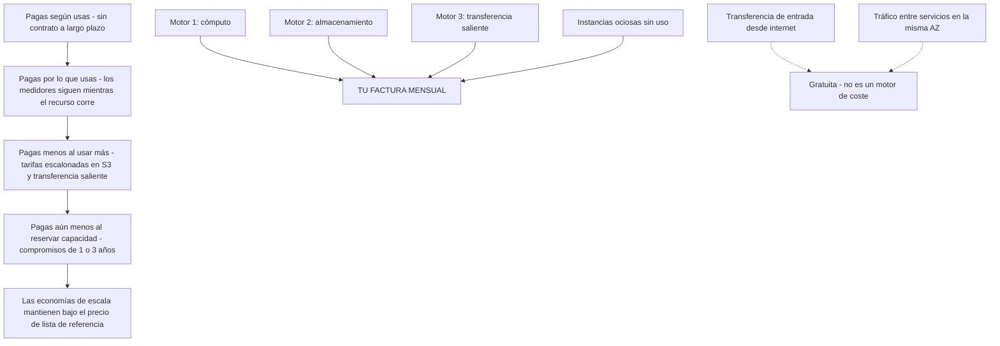
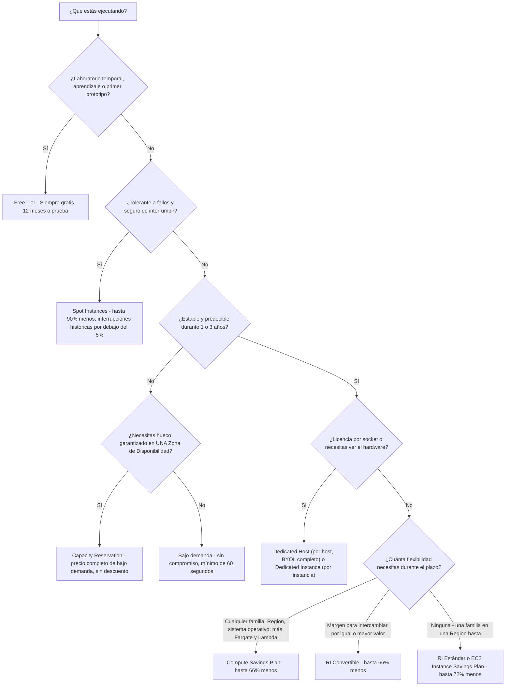
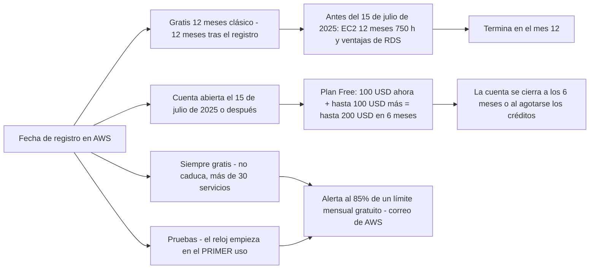
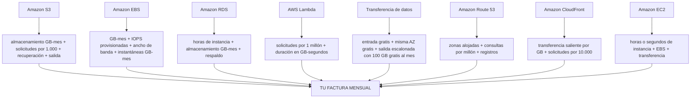
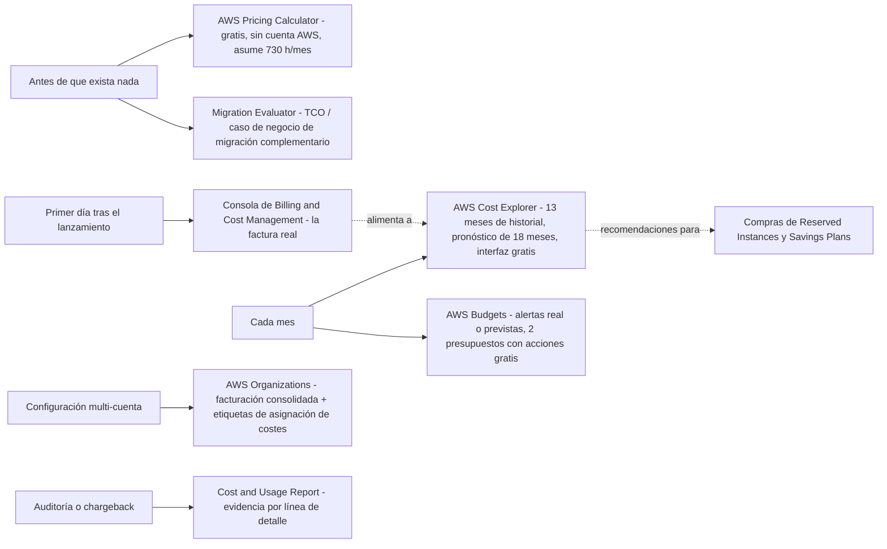
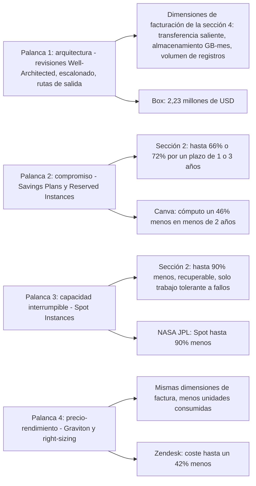

# Modelos de precios de AWS y herramientas de coste

**El Dominio 4 (Facturación, precios y soporte) supone el 12% de la puntuación del CLF-C02**, y dos de sus tres declaraciones de tarea viven dentro de esta lección: **la Tarea 4.1 «Comparar modelos de precios de AWS»**: bajo demanda, Reserved Instances, Spot Instances, Savings Plans, Dedicated Hosts, Dedicated Instances, Capacity Reservations, niveles de almacenamiento y transferencia de datos entrante frente a saliente, y **la Tarea 4.2 «Facturación, presupuesto y gestión de costes»**: Budgets, Cost Explorer, el Pricing Calculator, facturación consolidada de AWS Organizations, etiquetas de asignación de costes y el Cost and Usage Report. Aproximadamente **seis ítems puntuados** provienen del Dominio 4, y la mayoría son preguntas de aritmética y criterio más que definiciones. Quienes suspenden esta área rara vez suspenden porque nunca hubieran oído hablar de Savings Plans; suspenden porque no saben decir *qué* herramienta responde *qué* pregunta, o porque citan un porcentaje de descuento sin saber a qué se comprometen.

```text
====================================================================
 CLF-C02 LECCIÓN 13 — MODELOS DE PRECIOS + HERRAMIENTAS DE COSTE
                   (en octubre de 2026)
====================================================================
 PRINCIPIOS
   pagas según usas -> pagas por lo que usas -> pagas menos al
   usar más -> pagas aún más barato cuando reservas capacidad
   motores ... cómputo . almacenamiento . transferencia SALIENTE
   entrada desde internet ... gratuita
   tráfico entre servicios en la misma AZ ... gratuito
   los precios se fijan por servicio Y por Region
 OPCIONES DE COMPRA DE CÓMPUTO
   Bajo demanda ........ sin compromiso, hora/segundo, mín. 60 s
   RI Estándar ......... 1 o 3 años, hasta 72% menos, ámbito AZ = capacidad
   RI Convertible ...... 1 o 3 años, hasta 66% menos, intercambiable
   SP de cómputo ........ 1 o 3 años, hasta 66% menos, cualquier familia
                        + Fargate + Lambda
   SP de instancia EC2 .. 1 o 3 años, hasta 72% menos, una familia/Region
   Spot ................ sin compromiso, hasta 90% menos, interrumpible
   Dedicated ........... Host = por host + visibilidad de socket + BYOL
                        Instance = por instancia, hardware aislado
   Capacity Res. ....... hueco en una AZ al precio completo de bajo demanda
   Free Tier ........... Siempre gratis / 12 meses / Pruebas
 FREE TIER
   100 USD ahora + hasta 100 USD más = hasta 200 USD en 6 meses
   Siempre gratis ...... más de 30 servicios, no caduca
   alerta por correo al 85% de un límite mensual gratuito
 HERRAMIENTAS DE COSTE
   antes de construir .. AWS Pricing Calculator (gratis, sin cuenta)
   caso de migración ... Migration Evaluator (complementario)
   ¿qué gasté? ......... AWS Cost Explorer (interfaz gratis)
   ¿estoy sobre gasto? . AWS Budgets (2 con acciones gratis)
   la factura .......... consola de Billing and Cost Management
   evidencia ........... Cost and Usage Report (CUR)
   MUNDO REAL  (resultados de clientes, nunca garantías de AWS)
     Box ............... 2,23 M USD = salida + almacenamiento +
                         entre AZ + registros (arquitectura)
     Canva ............. -46% cómputo <2 años (mezcla SP/RI/Spot)
     FarEye ............ -65% cómputo ~1 M USD/año (SP+Spot)
     NASA JPL .......... Spot hasta 90% menos, tolerante a fallos
   ACTUALIZACIONES 2026  (en octubre de 2026, con fuentes)
     free tier ......... 6 meses + hasta 200 USD (15 jul 2025)
     100 GB de salida ... cambio de 2021, sigue vigente
     SP de base de datos . hasta 35%, lanzado el 2 dic 2025
====================================================================
```

> [!NOTE]
> **Disciplina de alcance.** Todo lo que se afirma como hecho más abajo tiene su fuente en páginas de AWS recuperadas en **octubre de 2026**, y todo precio, tarifa y techo de descuento lleva fecha **en octubre de 2026**: AWS cambia precios, cupos y límites de herramientas sin anuncio, así que **verifica el estado actual antes de usarlos**. Cuando una cifra no pudo confirmarse en una fuente principal de AWS, se omite o se marca como algo por verificar; los techos de descuento son siempre los máximos **«hasta»** de la propia AWS, nunca una promesa de lo que pagarás.

En esta lección:

- enuncias los **cuatro principios generales de precios** con la propia redacción de AWS y nombras los **tres motores de coste**;
- explicas por qué **el mismo tipo de instancia cuesta distintas cantidades en distintas Region** y resuelves la aritmética;
- lees la **tabla comparativa de compra de cómputo**: plazos de compromiso, flexibilidad, interrupción y *cuándo el examen elige cada opción*;
- recorres el **árbol de decisión de opciones de compra** desde el laboratorio gratuito hasta la flota comprometida;
- separas **RI Estándar frente a Convertible** y **Compute Savings Plans frente a EC2 Instance Savings Plans** por techo de descuento *y* flexibilidad;
- explicas exactamente qué te cuesta **Spot** en riesgo de interrupción, y qué compra un **Dedicated Host** sobre una **Dedicated Instance**;
- nombras los **tres tipos de Free Tier** con ejemplos con fuente, más la estructura de créditos posterior a julio de 2025;
- listas las **dimensiones de facturación** de S3, EBS, RDS, Lambda, transferencia de datos, Route 53 y CloudFront;
- calculas **solicitudes, salida y zonas alojadas** en ejemplos numéricos resueltos;
- eliges la **herramienta de coste** adecuada: Pricing Calculator, TCO/Migration Evaluator, consola de facturación, Cost Explorer, Budgets;
- conectas cuatro **historias reales de coste de clientes de AWS** (Box, Canva, FarEye, NASA JPL) con la palanca que produjo cada ahorro, y lees el **cuadro de actualizaciones de 2026 con fuentes**;
- practicas con **12 preguntas estilo examen** más cuatro comprobaciones interactivas.

| Tarea del examen | Dominio (peso) | Qué entrega esta lección |
|---|---|---|
| 4.1 Comparar modelos de precios de AWS | Facturación, precios y soporte (12%) | §1 principios, §2 tabla de compra, §3 Free Tier, §4 dimensiones de facturación |
| 4.2 Recursos de facturación, presupuesto y gestión de costes | Facturación, precios y soporte (12%) | §5 las cinco herramientas, Organizations, etiquetas, CUR |

---

## 1. Los cuatro principios generales de precios

### 1.1 La escalera de principios

El whitepaper *How AWS Pricing Works* de AWS (publicado el **24 de febrero de 2023** y hoy etiquetado por AWS como referencia histórica) comprime todo el modelo en una frase: *«Pagas según usas, pagas por lo que usas, pagas menos al usar más y pagas aún menos cuando reservas capacidad»*. La página de precios en vivo añade la mitad contractual del trato: **pago por uso «sin contratos a largo plazo»**.

| Principio | Redacción oficial (AWS) | Qué significa en tu factura | Consecuencia en el examen |
|---|---|---|---|
| **1. Pagas según usas** | *«pago por uso … sin contratos a largo plazo»* | Los cargos se acumulan mientras el recurso corre; lo detienes y el cargo en ejecución se detiene | No hay tarifa de cancelación por dejar un servicio |
| **2. Pagas por lo que usas** | *«pagas por lo que usas»* | El consumo se mide por hora/segundo, GB-mes, solicitud o GB-segundo | Los recursos ociosos son un coste que elegiste pagar |
| **3. Pagas menos al usar más** | *«pagas menos al usar más»* | Tarifas **escalonadas** para S3 y transferencia de datos saliente; los tramos de volumen bajan el precio unitario a medida que crece el uso | La transferencia de datos de **entrada** es **siempre gratuita** |
| **4. Pagas aún menos al reservar** | *«pagas aún menos cuando reservas capacidad»* | El uso comprometido (1 o 3 años) compra un techo de descuento | Reserved Instances y Savings Plans: §2 |

Dos ideas de apoyo completan el modelo. Primero, **economías de escala**: AWS dice que sus clientes *«se benefician de enormes economías de escala»*, que es lo que produce *«precios de pago por uso más bajos»*: el uso agregado de todos los clientes de AWS es la razón por la que el precio de lista ya es bajo antes de cualquier compromiso. Segundo, **los tres motores de coste**: AWS nombra **cómputo, almacenamiento y transferencia de datos saliente** como *«tres motores fundamentales»*, señalando explícitamente que **no hay cargo por la transferencia de datos de entrada**.



### 1.2 Paga menos al usar más: escalonado y lo que es gratuito

«Pagar menos al usar más» no es un eslogan sobre descuentos que tengas que negociar: es **escalonado dentro del precio de lista**. La página de precios de AWS afirma que **S3 y la transferencia de datos saliente están escalonados**, mientras que **la transferencia de datos de entrada es siempre gratuita**. El examen convierte esto en dos preguntas:

1. **¿Qué dirección se factura?** Saliente. La entrada desde internet es gratuita, y el tráfico entre servicios en la **misma Zona de Disponibilidad es gratuito**.
2. **¿El cupo es por servicio o global?** Global: consulta el cuadro de «¿Sabías que…?» más abajo.

AWS también documenta un cuarto coste, más silencioso: **ocio**. El whitepaper de precios afirma que apagar instancias sin uso puede ahorrar **«70 por ciento o más»**, y por eso *apágala* es siempre una respuesta correcta plausible en un enunciado de optimización de costes, y por eso limpiar la capacidad ociosa viene antes de cualquier decisión de compromiso.

- **📚 ¿Sabías que…?** El cupo gratuito de transferencia de datos es **100 GB de transferencia de datos saliente al mes, agregados en todos los servicios de AWS y todas las Region** (excluyendo las Region de China y AWS GovCloud): **no** son 100 GB por servicio ni 100 GB por Region. Amazon CloudFront añade un **1 TB de transferencia de datos saliente gratuita cada mes**. AWS amplió este cupo desde la cifra anterior por Region, así que el material de estudio antiguo que cita «1 GB por Region» está desactualizado (página de expansión de transferencia de datos de Free Tier de AWS, en octubre de 2026).

### 1.3 El compromiso es la única palanca que baja el precio unitario

El escalonado baja el precio de la *siguiente* unidad; **el compromiso baja el precio de cada unidad**. La página de precios de AWS agrupa esto bajo **«Ahorra cuando te comprometas»**, y los Savings Plans están documentados como un compromiso durante **un periodo de uno o tres años**. Las Reserved Instances usan los mismos plazos de 1 o 3 años con tres opciones de pago (**todo por adelantado, parcial por adelantado, sin pago inicial**). Todo en §2 es una variación de esa única frase, y por eso al examen le encanta preguntar *«¿qué opción ofrece el descuento más profundo con la menor flexibilidad?»*.

### 1.4 Los precios se fijan por servicio **y** por Region

La propia orientación de optimización de costes de la guía del examen (COST07-BP02) lo dice claro: *«El precio de los recursos puede ser distinto en cada Region»* por **tierra, fibra, electricidad e impuestos**. **Las Local Zones se precifican de forma distinta (y más alta) que su Region principal.** El mismo tipo de instancia, el mismo sistema operativo, la misma hora pueden costar cantidades materialmente distintas según dónde lo lances.

**Ejemplo resuelto E1: dispersión regional de un tipo de instancia (en octubre de 2026).**
El propio feed de precios bajo demanda de AWS para **t3.medium en Linux** (sin selección de grupo de seguridad), recuperado el **7 de octubre de 2026**:

| Region | USD por hora | frente a N. Virginia |
|---|---|---|
| US East (N. Virginia) | **0.04160** | referencia |
| Asia Pacific (Mumbai) | **0.04480** | +7.7% |
| EU (Ireland) | **0.04560** | +9.6% |
| Asia Pacific (Sydney) | **0.05280** | +27% |
| Asia Pacific (Tokyo) | **0.05440** | +31% |
| South America (São Paulo) | **0.06720** | **+61%** |

AWS factura las instancias bajo demanda por hora (o por segundo con un **mínimo de 60 segundos**), y el Pricing Calculator estandariza un mes en **730 horas**. Así que un t3.medium corriendo todo el mes:

$$
\text{N. Virginia} = 730 \times 0.0416 = \$30.37 \qquad
\text{São Paulo} = 730 \times 0.0672 = \$49.06
$$

Diferencia: **$49.06 − $30.37 = $18.69 al mes, unos +61%**, con software idéntico. *Lección de examen:* **la Region es una decisión de precios**, pero solo *después* de satisfacer los requisitos de latencia, residencia de datos y funcionalidades: AWS nunca publica un ranking de «Region más barata», así que trata el coste como criterio de desempate, no como primer filtro.

> [!IMPORTANT]
> **Tres reglas que atrapan candidatos en el Dominio 4.**
> - **Gratis ≠ ilimitado:** los cupos gratuitos son mensuales, **se calculan en todas las Region** y **no se acumulan**: un mes sin uso no se traslada.
> - **Más barato ≠ correcto:** la Region u opción de compra más barata solo es correcta si satisface la tolerancia de la carga de trabajo a la interrupción, la latencia y las licencias.
> - **Descuento ≠ capacidad:** un descuento (Savings Plan, RI con ámbito de Region) no reserva nada; solo una **RI con ámbito de AZ** o una **Capacity Reservation** reserva hueco, y la reserva se factura la uses o no.

---

## 2. Opciones de compra de cómputo: la comparación sobre la que se construye el examen

El Dominio 4, Tarea 4.1, nombra las opciones explícitamente: **instancias bajo demanda, Reserved Instances, Spot Instances, AWS Savings Plans, Dedicated Hosts, Dedicated Instances, Capacity Reservations**, más niveles de almacenamiento y transferencia de datos. Más abajo está toda la habilidad en una sola tabla, con cada porcentaje fechado **en octubre de 2026**.

### 2.1 La tabla maestra de comparación

| Opción | Plazo de compromiso | Pago | Techo de descuento (en octubre de 2026) | Qué fija / flexibilidad | ¿Interrumpible? | Cuándo la elige el examen |
|---|---|---|---|---|---|---|
| **Bajo demanda** | **Ninguno**: facturado por hora o segundo (**mínimo de 60 segundos**) | Sin pago inicial | **0%** (precio de lista de referencia) | Libertad total: inicia, detiene, cambia de tamaño y termina cuando quieras | **No** | Cargas con picos, desconocidas, experimentales o de vida corta; la opción por defecto cuando no se conoce el patrón |
| **Reserved Instance: Estándar** | **1 o 3 años** | Todo / Parcial / Sin por adelantado | **hasta 72% menos** | Familia de instancia, tamaño, sistema operativo, tenancy y Region fijos; la **con ámbito de Region** cubre cualquier AZ y tamaño de esa Region; la **con ámbito de AZ también reserva capacidad** | **No** | Capacidad de referencia estable y predecible |
| **Reserved Instance, Convertible** | **1 o 3 años** | Todo / Parcial / Sin por adelantado | **hasta 66% menos** | Puede **intercambiarse por RI Convertible de igual o mayor valor**, no es una reconfiguración libre | **No** | Estado estable que pueda necesitar cambiar durante el plazo |
| **Savings Plan, de cómputo** | **1 o 3 años**, compromiso de **$ por hora** | Todo / Parcial / Sin por adelantado | **hasta 66% menos** | **Cualquier** familia de instancia, tamaño, AZ, Region, sistema operativo y tenancy, y se extiende a **AWS Fargate y AWS Lambda** | **No** | Flotas mixtas, contenedores y serverless que deben seguir moviéndose |
| **Savings Plan: de instancia EC2** | **1 o 3 años**, compromiso de **$ por hora** | Todo / Parcial / Sin por adelantado | **hasta 72% menos** | Una **familia de instancia en una Region** (tamaño, sistema operativo y tenancy siguen libres) | **No** | Uso predecible de una sola familia en una Region |
| **Spot Instance** | **Ninguno**: el precio se recalcula **cada 5 minutos** | Sin pago inicial; pagas el precio Spot actual | **hasta 90% menos** | Se ejecuta *«siempre que haya capacidad disponible»*; AWS puede recuperarla con una ventana corta de aviso | **SÍ** | Trabajo tolerante a fallos, sin estado, por lotes, CI y analítica de grandes datos que toleran la interrupción |
| **Dedicated Instance** | Términos bajo demanda, RI o Spot | Las mismas tres familias | **hasta 70%** cuando se compra como Reserved Instance | Aislada físicamente a nivel de hardware de host, **sin visibilidad** ni control de la colocación, **BYOL limitado** | **No** | Requisito de cumplimiento de *«sin hardware compartido»* |
| **Dedicated Host** | Por hora, **por host** | Bajo demanda o comprometido | AWS **no publica un porcentaje titular** para hosts (verifica el estado actual) | **Servidor físico totalmente dedicado**, **visibilidad de socket/núcleo**, afinidad de host, **BYOL completo** | **No** | Licenciamiento por socket/núcleo (Microsoft, Oracle) y cumplimiento que necesita visibilidad |
| **Capacity Reservation (ODCR)** | Ninguno, tarifas de bajo demanda | Sin pago inicial | **0%**, pagas el precio de bajo demanda por la capacidad de AZ reservada **la uses o no** | Reserva capacidad en **una Zona de Disponibilidad concreta** | **No** | Capacidad de lanzamiento garantizada en un momento conocido, sin compromiso de 1 año |
| **Free Tier** |, |, | **100% dentro del cupo** | Límites en §3; el uso **no se acumula** | **No** | Aprendizaje, pruebas, primeros prototipos |

> [!WARNING]
> **Lee la tabla como una cuadrícula de dos ejes: descuento ↔ flexibilidad.** Cada cifra de «hasta» es un **techo**, no un promedio, y cuanto más profundo el descuento, más cedes: Spot cede **disponibilidad**, RI/SP ceden **compromiso de plazo (1 o 3 años)**, las opciones Dedicated ceden **compartición de hardware**, y bajo demanda no cede **nada más que dinero**. El examen redacta distractores que mezclan los ejes: *«la opción más flexible con un 72% de descuento»* no existe.

```text
====================================================================
 TECHO DE DESCUENTO  x  LO QUE CEDES   (en octubre de 2026)
====================================================================
  hasta 90%   Spot ............. disponibilidad - capacidad recuperada
              |
  hasta 72%   SP instancia EC2 -+-- RI Estándar (familia + Region fijas)
              |                  |   Dedicated Instance como RI: hasta 70%
  hasta 66%   SP de cómputo ----+-- RI Convertible (intercambiable)
              |
     ninguno  Bajo demanda ..... nada, pero el precio de lista
              Capacity Reserv. .. nada, Y pagas por la AZ que no usas
  ------------------------------------------------------------------
        FLEXIBILIDAD   baja <---------------------->  alta
  ==================================================================
   El descuento más profundo y la máxima flexibilidad están en los
   EXTREMOS OPUESTOS del eje - ninguna opción es fuerte en ambos.
   Elige tu posición desde la tolerancia de la carga de trabajo,
   nunca desde el porcentaje aislado.
====================================================================
```

**Todos los techos oficiales en una referencia (todos «hasta», en octubre de 2026):**

| Compromiso u opción | Techo de descuento | Nota |
|---|---|---|
| **EC2 Instance Savings Plan** / **Reserved Instance Estándar** | **72%** | El par menos flexible: una RI Estándar fija familia, tamaño, sistema operativo, tenancy y Region; un SP de instancia EC2 se compromete a una familia en una Region |
| **Compute Savings Plan** / **Reserved Instance Convertible** | **66%** | El compromiso más flexible; el SP de cómputo también cubre **Fargate y Lambda** |
| **Spot Instances** | **90%** | No es un compromiso: capacidad disponible interrumpible |
| **Dedicated Instances** compradas como Reserved Instances | **70%** | Primero la respuesta de cumplimiento, después el descuento |
| **SageMaker AI Savings Plans** | **64%** | Adyacente a la tarea; rara vez se pregunta directamente |
| **Database Savings Plans** | **35%** | Compromiso de base de datos gestionada |
| **Bajo demanda / On-Demand Capacity Reservation** | **ninguno** | Precio de lista de referencia; la ODCR factura la capacidad reservada la uses o no |
| **Dedicated Hosts** | **sin porcentaje publicado por AWS** | AWS no cita un ahorro titular: **verifica el estado actual antes de usarlo** |
| **Free Tier** | **100% dentro del cupo** | §3; los cupos son mensuales y no se acumulan |

### 2.2 Ejemplo resuelto E2: la escalera de descuento

Toma un coste de lista bajo demanda hipotético de **100 unidades al mes** para la misma carga de trabajo estable y aplica los techos publicados por AWS (aritmética ilustrativa, **techos en octubre de 2026**):

```text
Bajo demanda (sin compromiso)              100   <- referencia
  Compute Savings Plan        (-66%)    =  34   <- mismo techo que RI Convertible
  RI Convertible (1 o 3 años) (-66%)    =  34
  SP instancia EC2            (-72%)    =  28   <- mismo techo que RI Estándar
  RI Estándar (1 o 3 años)    (-72%)    =  28
  Dedicated Instance como RI  (-70%)    =  30   <- primero la respuesta de cumplimiento
  Spot (sin plazo, interrumpible)(-90%) =  10   <- el único escalón interrumpible
```

Dos lecciones viajan en esas cifras. Primero, **los Savings Plans y las Reserved Instances se corresponden 1:1 por techo**: el SP de cómputo ≈ RI Convertible al **66%**, el SP de instancia EC2 ≈ RI Estándar al **72%**, la FAQ de Savings Plans de AWS dice exactamente eso (*«66% (igual que las RI Convertible)»* y *«72% (igual que las RI Estándar)»*). La diferencia entre los pares es por tanto **flexibilidad, no ahorro**. Segundo, la factura real cae **por encima** de esas cifras, porque un techo es lo mejor que AWS podrá hacer por una carga de trabajo perfectamente ajustada, el ahorro real depende de cuán por completo coincida tu uso con el compromiso.

### 2.3 Reserved Instances: la letra pequeña que el examen reutiliza

| Pregunta | Respuesta oficial (en octubre de 2026) |
|---|---|
| ¿Cuánto dura? | **1 año o 3 años** |
| ¿Cómo pago? | **Todo por adelantado, parcial por adelantado, sin pago inicial** |
| ¿Mayor descuento? | Estándar **hasta 72%**; Convertible **hasta 66%** |
| ¿Reserva capacidad? | **Solo si la RI tiene ámbito de una Zona de Disponibilidad concreta**: una RI con ámbito de Region es solo un descuento |
| ¿Qué puede cambiar? | RI Estándar: esencialmente nada a mitad de plazo. Convertible: **intercambio por RI Convertible de igual o mayor valor** |
| ¿Qué recomienda AWS en su lugar? | *«Recomendamos los Savings Plans»* por su *«flexibilidad para cambiar tu uso»* |
| ¿Puedo vender una que ya no necesito? | La reventa pasa por el **Reserved Instance Marketplace**: las reglas cambian, así que **verifica el estado actual antes de usarlo**; es un mitigante, nunca un plan |

> ⚠️ **Una Reserved Instance es un descuento de facturación, no un servidor reservado.** La redacción de AWS es *«una reserva de capacidad **cuando se usa en una Zona de Disponibilidad concreta»***, el descuento y la reserva son dos cosas separadas que viajan juntas. Y la familia de trampas funciona en ambas direcciones: **un Savings Plan no reserva nada**, mientras que una **On-Demand Capacity Reservation reserva capacidad a precio completo sin descuento alguno**. Si un enunciado dice *«capacidad garantizada en la AZ X con descuento»*, la respuesta es una **RI Estándar con ámbito de AZ**, nada más en la tabla hace ambos trabajos.

### 2.4 Savings Plans: los dos tipos en una sola vista

| | **Compute Savings Plan** | **EC2 Instance Savings Plan** |
|---|---|---|
| Techo de descuento (en octubre de 2026) | **hasta 66%** | **hasta 72%** |
| Compromiso | **$/hora** durante **1 o 3 años** | **$/hora** durante **1 o 3 años** |
| Se aplica a | Cualquier **familia, tamaño, AZ, Region, sistema operativo y tenancy** de instancia, más **AWS Fargate y AWS Lambda** | Una **familia de instancia en una Region** (tamaño, sistema operativo y tenancy flexibles) |
| Techo de RI equivalente | RI Convertible (66%) | RI Estándar (72%) |
| El examen lo elige cuando… | La flota es mixta, multi-Region o incluye contenedores/serverless | El uso es de verdad una familia, una Region, durante todo el plazo |

AWS precifica un año de Savings Plan como **365 días** y tres años como **1.095 días**, y ofrece las mismas opciones de pago **todo / parcial / sin por adelantado**. La propia página de tipos de Savings Plans de AWS plantea la elección como *«flexibilidad para cambiar tu uso»*: comprométete con un **importe por hora** (de cómputo) o con **una familia concreta en una Region** (de instancia EC2).

### 2.5 Spot: 90% de descuento, con una trampa que el examen siempre evalúa

Las Spot Instances ejecutan **capacidad EC2 disponible** a un precio *«por debajo del precio de bajo demanda»* y se comercializan como *«hasta un 90% de descuento»*. Tres mecánicas importan:

1. **El precio se mueve.** La lista de precios Spot se **actualiza cada 5 minutos** y refleja *«tendencias a largo plazo de oferta y demanda»*: a diferencia de bajo demanda, cuyo precio por hora es estático.
2. **La capacidad puede recuperarse.** AWS ejecuta la instancia *«siempre que haya capacidad disponible»* y la interrumpe cuando necesita recuperarla. El propio Instance Advisor de AWS informa de una **frecuencia media de interrupción que históricamente ha estado por debajo del 5%** (vista de 30 días, todas las Region y tipos de instancia, en octubre de 2026): sigue siendo distinta de cero, y por eso Spot *nunca* es la respuesta para una carga con estado, no tolerante a fallos o crítica en latencia.
3. **Diseña para la interrupción.** El par examinable es el trabajo *tolerante a fallos / sin estado / reiniciable*: trabajos por lotes, tuberías de CI, procesamiento de grandes datos, renderizado de imagen y consumidores de colas que pueden releer el trabajo.

- **📚 ¿Sabías que…?** La propia página de precios de Reserved Instances de AWS abre actualmente con *«Recomendamos los Savings Plans»*: la misma página que te vende la RI desvía a los clientes flexibles hacia otro sitio. En el examen, los enunciados del tipo «AWS recomienda X sobre Y» suelen evaluar exactamente esta línea: **Savings Plans por la flexibilidad, RI cuando quieres específicamente la construcción de RI (incluida una reserva de capacidad con ámbito de AZ)**.

### 2.6 Dedicated Host frente a Dedicated Instance frente a Capacity Reservation

Estas tres se confunden constantemente. Los ejes que las distinguen son **qué se factura**, **qué puedes ver** y **qué control de licencias obtienes**:

| | **Dedicated Host** | **Dedicated Instance** | **Capacity Reservation (ODCR)** |
|---|---|---|---|
| Hardware | *«Servidor físico … totalmente dedicado a tu uso»* | *«Aislado físicamente a nivel de hardware de host»* | Cualquier hardware de **una AZ** |
| Facturación | **Por host** (por hora) | **Por instancia** (bajo demanda / RI / Spot) | **Tarifa de bajo demanda** para los huecos reservados |
| Visibilidad | **Visibilidad de socket y núcleo**, afinidad de host | **Sin visibilidad ni control de la colocación de instancias** | No aplica |
| BYOL | **BYOL completo** (p. ej., licencias por socket de Microsoft, Oracle) | **Soporte limitado de BYOL** | Depende de las instancias que lances en ella |
| Descuento | AWS **no publica un % titular**, verifica el estado actual | **hasta 70%** cuando se compra como Reserved Instance | **Ninguno**, pagas uses o no la capacidad |
| El examen lo elige cuando… | Licenciamiento por socket/núcleo, o cumplimiento que necesita ver el host | El requisito es *«sin hardware compartido»* | Necesitas **capacidad de lanzamiento garantizada ahora**, sin plazo de 1 año |

AWS afirma que **no hay diferencia de rendimiento, seguridad ni física** entre Dedicated Hosts y Dedicated Instances: la división es **granularidad de facturación, visibilidad y licenciamiento**.

### 2.7 El árbol de decisión y la adecuación a la carga de trabajo



```matching
{
  "question": "Relaciona cada descripción de carga de trabajo con la opción de compra que el examen CLF-C02 espera:",
  "pairs": [
    {"left": "Un trabajo nocturno por lotes reiniciable que puede perder su progreso sin impacto de negocio", "right": "Spot Instances: hasta 90% menos (en octubre de 2026) porque la capacidad puede recuperarse"},
    {"left": "Una capa de base de datos con el mismo tipo de instancia las 24 horas durante los próximos tres años", "right": "Reserved Instance Estándar o EC2 Instance Savings Plan: hasta 72% menos (en octubre de 2026)"},
    {"left": "Un experimento de dos semanas con un patrón de uso desconocido y sin presupuesto de compromiso", "right": "Bajo demanda: sin compromiso, facturado por hora o segundo con un mínimo de 60 segundos"},
    {"left": "Un despliegue de Oracle licenciado por socket físico que no debe compartir hardware", "right": "Dedicated Host: facturación por host con visibilidad de socket y núcleo y BYOL completo"},
    {"left": "Una flota mixta de contenedores y funciones Lambda que abarca varias Region", "right": "Compute Savings Plans: hasta 66% menos (en octubre de 2026), cubriendo cualquier familia de instancia, Fargate y Lambda"},
    {"left": "Un lanzamiento de producto que debe poder arrancar capacidad en una Zona de Disponibilidad concreta el día uno", "right": "On-Demand Capacity Reservation: reserva capacidad de AZ al precio completo de bajo demanda"},
    {"left": "Un estudiante que levanta una sola instancia pequeña para un trabajo de curso", "right": "Free Tier - Siempre gratis, 12 meses gratis o prueba de un servicio, con un uso que no se acumula"}
  ],
  "explanation": "Cada enunciado nombra uno de los tres ejes que usa el examen: tolerancia a la interrupción (Spot), previsibilidad de la duración (RI frente a Savings Plans frente a bajo demanda) y requisitos de licenciamiento o de colocación de capacidad (Dedicated Host, Capacity Reservation). Relaciona primero el eje y la opción se deduce: el porcentaje de descuento por sí solo nunca decide."
}
```

### 2.8 Leer el enunciado: el mapa de palabras clave

Casi todo ítem de compra del Dominio 4 puede decidirse con dos o tres palabras del enunciado. Usa este mapa antes de leer las opciones: después elimina todo lo que viola la palabra clave:

```text
 PALABRA CLAVE DEL ENUNCIADO                -> PRIMERA OPCIÓN A CONSIDERAR
 ------------------------------------------------------------------
  "tolerante a fallos" "interrumpible"      -> Spot (hasta 90%, <5% de
  "se puede reiniciar / sin estado"          interrupciones históricas,
                                             en octubre de 2026)
  "estable" "predecible" "referencia"       -> RI Estándar o SP instancia EC2
                                             (hasta 72%)
  "puede cambiar de familia / sistema op."  -> RI Convertible o SP de cómputo
                                             (hasta 66%)
  "flotas mixtas" "contenedores"            -> Compute Savings Plan
  "compromiso Lambda / Fargate"             -> SOLO Compute Savings Plan
  "capacidad garantizada en la AZ X"        -> RI Estándar con ámbito de AZ
                                             (descuento Y reserva)
  "capacidad ahora, sin plazo de 1 año"     -> On-Demand Capacity Reservation
                                             (precio completo, sin descuento)
  "licencia por socket" "ver los núcleos"   -> Dedicated Host
  solo "sin hardware compartido"            -> Dedicated Instance
  "aprendizaje / prueba / prototipo"        -> Free Tier
  "patrón desconocido" / "solo esta semana" -> Bajo demanda
 ------------------------------------------------------------------
  FRASES BANDERA ROJA
    "el más barato Y el más flexible"       -> contradicción; no existe
    "Savings Plan reserva capacidad"        -> falso; SP no reserva nada
    "Spot siempre está disponible"          -> falso; se recupera capacidad
    "comprometido = capacidad garantizada"  -> falso salvo RI con ámbito de AZ
    "detenido = $0"                         -> falso para RDS (almacenamiento
                                              + copia) y para EC2 (EBS)
```

## 3. Free Tier: tres tipos y la reestructuración de 2025

### 3.1 Los tres tipos clásicos

La documentación de Free Tier de AWS define tres categorías, y el examen te pide distinguirlas por **cómo se comporta el reloj**:

| Tipo | Regla del reloj (redacción de AWS) | Ejemplos con fuente (en octubre de 2026) | ¿Caduca? |
|---|---|---|---|
| **Siempre gratis** | *«no caducan automáticamente»*: disponible *«indefinidamente»* | **Más de 30 servicios de AWS** en la lista Siempre gratis (aws.amazon.com/free, oct 2026); **Lambda: 1.000.000 de solicitudes + 400.000 GB-segundos al mes**; **transferencia de datos saliente: 100 GB al mes** agregados entre servicios y Region (excepto China y GovCloud) | **No** |
| **Gratis 12 meses** | *«12 meses siguientes a la fecha de registro en AWS»* | Cupos clásicos como **EC2: 750 horas al mes de t2.micro / t3.micro** y **S3: 5 GB de almacenamiento + 20.000 GET + 2.000 PUT** (depende de la fecha de la cuenta, véase §3.2); **uso gratuito de RDS** para cuentas activadas **antes del 15 de julio de 2025** | **Sí**, 12 meses desde el registro |
| **Pruebas** | *«comienzan en el momento del primer uso»* | Ventanas promocionales cortas en servicios concretos, que empiezan con el primer uso y no con el registro | **Sí**: fin de la ventana de prueba |

Dos reglas mecánicas aplican a los tres: el uso gratuito se **«calcula cada mes en todas las regiones»** y **«no se acumula»**, y el uso de Free Tier **no está disponible en AWS GovCloud**, el cupo de 100 GB de transferencia saliente además excluye las **Region de China**. Un cupo mensual queda fuera de los tres clásicos: **Amazon CloudFront lista 1 TB de transferencia de datos saliente más 10.000.000 de solicitudes HTTP(S) al mes**, pero la página no lo etiqueta como Siempre gratis ni de 12 meses, **no afirmes una duración para él sin volver a comprobarlo** (verifica el estado actual antes de usarlo).

### 3.2 Qué cambió el 15 de julio de 2025

El modelo clásico de 12 meses sigue siendo el vocabulario del examen, pero la experiencia de registro actual se basa en créditos. Al **7 de octubre de 2026**, aws.amazon.com/free ofrece:

- **100 USD de crédito de inmediato**, más **hasta 100 USD más ganados**, para **hasta 200 USD en 6 meses**;
- un **plan Free** cuya cuenta *«se cierra por sí sola 6 meses después de abrirla»*, o cuando se agoten los créditos, y que cubre *«más de 90 servicios»*, con **solo las ofertas Siempre gratis activas** en una cuenta de plan Free;
- un **plan Paid** con el catálogo completo, que también es elegible para los créditos;
- categorías sin cambios: **Siempre gratis (más de 30 servicios de AWS)**, **Pruebas** y ofertas de tiempo limitado.

Los tipos de instancia gratuitos de EC2 varían según la fecha de la cuenta: las cuentas **anteriores al 15 de julio de 2025** ven `t2.micro` / `t3.micro` en la vía de 12 meses; las cuentas de esa fecha en adelante reciben `t3.micro`, `t3.small`, `t4g.micro`, `t4g.small`, `c7i-flex.large` y `m7i-flex.large` en la vía de **6 meses o hasta agotar los créditos**. **Verifica el estado actual antes de usarlo**; esta es la zona del Dominio 4 que más rápido cambia.



### 3.3 Ejemplo resuelto E3: qué compra realmente «750 horas al mes»

El cupo clásico de EC2 es de **750 horas al mes** de t2.micro/t3.micro (cifra de la era de 12 meses, en octubre de 2026). El Pricing Calculator de AWS estandariza un mes en **730 horas**, así que:

$$
\frac{750 \text{ horas gratuitas}}{730 \text{ horas en un mes}} = 1.03 \text{ instancias ejecutándose 24/7}
$$

Así que 750 horas significan **exactamente una instancia corriendo las 24 horas durante el mes, con casi nada de sobra**: dos instancias repartidas durante el mes romperán el cupo, y también lo hará una instancia más el resto de una segunda Region, porque el cupo **se calcula cada mes en todas las Region y no se acumula**. La misma aritmética aplica a cualquier cupo gratuito por hora: divide las horas por 730 antes de prometerle a nadie que es «gratis».

> [!NOTE]
> **Free Tier es una trampa de presupuesto, no un modelo de precios.** Nunca aparece como respuesta a una pregunta de carga de trabajo de producción, no se traslada, y AWS te notifica **por correo cuando superas el 85% de un límite de Free Tier**: combínalo con un **presupuesto de 0 USD** (§5) y obtienes una alerta temprana que no cuesta nada. Ten en cuenta también que el **Pricing Calculator de AWS asume que NO estás usando Free Tier**, así que una estimación hecha en la calculadora se verá peor que tu primer mes real.

- **📚 ¿Sabías que…?** El umbral de alerta de Free Tier es el **85 por ciento**, no el 100%: AWS afirma que *«te notifica por correo cuando superas el 85 por ciento de tu límite de Free Tier»*. La notificación es por servicio, el 100% de sobrecoste te toca vigilarlo tú, y una cuenta de plan Free tiene **solo las ofertas Siempre gratis activas**: los cupos de tiempo limitado no existen en ese plan.

---

## 4. Qué se te factura de verdad: dimensiones por servicio

Saber *qué* servicio usar es la mitad del Dominio 4; saber **en qué unidad factura ese servicio** es la otra mitad. Cada precio de abajo está **en octubre de 2026** y debe comprobarse de nuevo antes de confiar en él.

### 4.1 La matriz de dimensiones de facturación

| Servicio | Dimensiones de facturación | Trampas clave (en octubre de 2026) |
|---|---|---|
| **Amazon S3** | **Almacenamiento GB-mes** según la clase · **Solicitudes por 1.000** (PUT/COPY/POST/LIST frente a GET/HEAD) · **Recuperación** por GB en las clases de recuperación · cargos de ciclo de vida/ingesta · **salida** | **Las solicitudes DELETE y CANCEL son gratuitas**; **LIST se factura a la tarifa de PUT**; GET es mucho más barato que PUT; tarifa de almacenamiento **verifica el estado actual antes de usarla** |
| **Amazon EBS** | **GB-mes** (facturado en **incrementos de segundo con un mínimo de 60 segundos**) · **IOPS provisionadas al mes** · **ancho de banda al mes** · **instantáneas GB-mes** | **gp3 incluye 3.000 IOPS provisionadas y 125 MB/s provisionados** en la línea base; tarifa de lista de ejemplo **$0.08/GB-mes** (depende de la Region, en octubre de 2026) |
| **Amazon RDS** | **Horas de instancia de BD** (**incrementos de 1 segundo, mínimo de 10 minutos**) · **almacenamiento GB-mes** · **almacenamiento de respaldo** | **Una instancia detenida sigue facturando almacenamiento y respaldo**: solo se detienen las horas de instancia; más retención de copias = factura mayor |
| **AWS Lambda** | **Solicitudes** (**$0.20 por 1 millón de solicitudes**, us-east-1) · **Duración en GB-segundos** (**$0.0000167 por GB-segundo**, x86) | Cupo gratuito **1.000.000 de solicitudes + 400.000 GB-segundos al mes**; los tramos de duración cambian por encima de 6.000 millones de GB-s/mes |
| **Transferencia de datos** | **Entrada gratis** desde internet · **misma AZ gratis** · **Salida escalonada por GB** con **100 GB/mes gratis en todo el mundo** (excepto China y GovCloud) · salida entre Region por GB | us-east-1 primer tramo **$0.09/GB**, bajando a **$0.085 / $0.070 / $0.050** con volúmenes mayores; la dirección gratuita es la de entrada |
| **Amazon Route 53** | **Zona alojada al mes** (**$0.50** las primeras 25, **$0.10** después) · **Consultas por millón** (**$0.40** las primeras 1.000 millones/mes, después **$0.20**) · **$0.0015 por registro/mes** más allá de 10.000 registros por zona | **Las consultas en zonas alojadas privadas son gratuitas**; los primeros 10.000 registros por zona están incluidos |
| **Amazon CloudFront** | **Transferencia de datos saliente por GB** (escalonada, según la clase de precio) · **Solicitudes por 10.000** · funciones opcionales | Cupo mensual gratuito **1 TB de transferencia saliente + 10.000.000 de solicitudes**; los primeros 1 TB gratis y después **$0.085** durante los siguientes 9 TB (EE. UU., en octubre de 2026); existen planes de tarifa fija |
| **Amazon EC2** | **Horas/segundos de instancia según la opción de compra** · **volúmenes e instantáneas de EBS** · **transferencia de datos** · cargos opcionales por host/capacidad de AZ | La opción de compra elegida en §2 decide la tarifa unitaria; bajo demanda tiene **mínimo de 60 segundos** |



### 4.2 Ejemplos resueltos E4, E6, aritmética de solicitudes, salida y DNS

**E4: la factura de solicitudes de S3 (us-east-1, en octubre de 2026).** Un servicio realiza **500.000 escrituras** y **20.000.000 de lecturas** al mes:

| Operación | Tarifa (en octubre de 2026) | Cálculo | Coste |
|---|---|---|---|
| PUT/COPY/POST/LIST | **$0.005 por 1.000** | 500.000 ÷ 1.000 × 0.005 | **$2.50** |
| GET/HEAD | **$0.0004 por 1.000** | 20.000.000 ÷ 1.000 × 0.0004 | **$8.00** |
| DELETE/CANCEL | **Gratuito** |: | **$0.00** |
| **Total de solicitudes** | | | **$10.50/mes** |

Conclusión: una carga con muchas lecturas es barata en solicitudes, y una carga con muchas operaciones LIST no lo es: LIST se factura a la tarifa de PUT. El almacenamiento GB-mes y la salida son adicionales.

**E5: transferencia de datos saliente con el cupo gratuito global (en octubre de 2026).** Una carga de trabajo saca **600 GB** a internet en un mes desde **us-east-1**:

$$
(600 - 100)_{\text{cupo global gratuito}} \times \$0.09 = 500 \times 0.09 = \$45.00
$$

Conclusión: los **100 GB se agregan en todos los servicios de AWS y todas las Region** (excepto China y GovCloud): no recibes 100 GB nuevos por servicio, y **la transferencia de entrada no cuesta nada**, así que una arquitectura chismosa y con mucha descarga es un problema de salida.

**E6: Route 53 en una cuenta pequeña (en octubre de 2026).** Dos zonas alojadas y **500.000 de consultas estándar** en un mes:

$$
2 \times \$0.50 + \left(\frac{500{,}000}{1{,}000{,}000} \times \$0.40\right) = \$1.00 + \$0.20 = \$1.20 \text{/mes}
$$

Conclusión: **el DNS se factura por zona y por consulta**, y **las consultas en zonas alojadas privadas son gratuitas**: que es la razón estándar por la que una arquitectura con zona privada es la respuesta más barata en el examen.

### 4.3 La regla de «detenido no es gratis»

El dato de facturación más evaluado de esta sección: **Amazon RDS cobra por el almacenamiento provisionado y el almacenamiento de respaldo mientras la instancia está detenida: solo se detienen las horas de instancia de BD.** EC2 es distinto: detener una instancia detiene la facturación por horas de instancia, pero los **volúmenes e instantáneas de EBS siguen facturando**. Así que:

| Acción | Qué deja de facturar | Qué sigue facturando |
|---|---|---|
| Detener una instancia **EC2** | Horas de instancia | Volúmenes EBS, instantáneas, transferencia de datos |
| Detener una instancia **RDS** | Horas de instancia de BD | **Almacenamiento provisionado Y almacenamiento de respaldo** |
| Eliminar recursos sin uso | Todo lo de ese recurso |: |

**Ejemplo resuelto E7 (ilustrativo).** Un equipo detiene la base de datos cada noche esperando **$0**: si la hora de instancia se detiene pero **quedan 100 GB de almacenamiento provisionado y sus copias**, la parada nocturna solo ahorra la línea de cómputo. El enunciado del examen suele ser *«el equipo detuvo la base de datos por la noche para ahorrar costes; ¿por qué la factura no cambia?»*: la respuesta es que **los cargos de almacenamiento y respaldo continúan**.

```fillblank
{
  "question": "Completa las afirmaciones sobre dimensiones de facturación con las unidades y reglas correctas de AWS:",
  "template": "Amazon S3 factura el almacenamiento por {{1}}, más solicitudes por 1.000: las solicitudes DELETE son gratuitas y LIST se factura a la tarifa de PUT. Amazon EBS factura el almacenamiento por GB-mes en incrementos de segundo con un mínimo de {{2}} segundos. Amazon RDS factura horas de instancia, almacenamiento y {{3}} - así que una instancia detenida sigue sin ser gratis. AWS Lambda factura por cada 1 millón de solicitudes y por cada {{4}} de duración. En transferencia de datos, el tráfico {{5}} desde internet es gratuito.",
  "answers": {
    "1": "GB-month",
    "2": "60",
    "3": "almacenamiento de respaldo",
    "4": "GB-second",
    "5": "entrante"
  },
  "distractors": ["GB-hour", "30", "solo almacenamiento de instantáneas", "milisegundo", "saliente", "solicitud"],
  "explanation": "El almacenamiento de S3 se factura por GB-mes (documentación de octubre de 2026); EBS se mide por segundo con un mínimo de 60 segundos; RDS sigue facturando almacenamiento provisionado y de respaldo mientras está detenida; Lambda se precifica por solicitudes más GB-segundos ($0.20 por 1 millón de solicitudes y $0.0000167 por GB-segundo, us-east-1, en octubre de 2026); y la transferencia de datos de entrada desde internet es gratuita: la salida es la dirección que se factura."
}
```

- **📚 ¿Sabías que…?** De los tres motores de coste que nombra AWS (cómputo, almacenamiento, transferencia de datos saliente), solo **uno depende de la dirección**: la transferencia de entrada es gratuita desde internet, el tráfico **entre servicios en la misma AZ** es gratuito, y todo lo interesante se factura en el lado de **salida**: agregado como «AWS Data Transfer Out» con un **cupo gratuito de 100 GB/mes en todos los servicios y Region** (excepto China y GovCloud), en octubre de 2026. Esa sola frase responde más ítems de transferencia de datos del Dominio 4 que cualquier tabla.

### 4.4 Transferencia de datos: cada dirección, con precio

La Tarea 4.1 nombra explícitamente *«los costes de transferencia de datos entrante y saliente (entre Region, intra-Region)»*. La propia orientación de precios de AWS trata la entrada como gratuita y la salida como la dirección medida:

| Dirección | Cargo (en octubre de 2026) | Redacción de la fuente |
|---|---|---|
| **Internet → AWS (entrada)** | **Gratuita** | *«la transferencia de datos de ENTRADA es siempre gratuita»*; *«sin cargo por la transferencia de datos de entrada»* |
| **Entre servicios en la misma Zona de Disponibilidad** | **Gratuita** | El tráfico en la misma AZ no se factura |
| **AWS → internet (salida)** | **Escalonada por GB**, con **100 GB gratuitos al mes** agregados en todos los servicios y Region (excepto China y GovCloud) | Tramos de us-east-1: **$0.090 / $0.085 / $0.070 / $0.050 por GB** según sube el volumen mensual |
| **Region → Region (salida entre Region)** | **Por GB**, tomados del mismo **100 GB/mes** global de transferencia saliente | Mismo feed, **7 de octubre de 2026**: **$0.010/GB** (Ohio), **$0.020/GB** (Irlanda, Tokio, Sídney, São Paulo): **verifica tu par exacto de Region** |
| **AWS → internet a través de CloudFront** | Se factura como transferencia saliente de CloudFront, con **1 TB + 10.000.000 de solicitudes gratuitas al mes** | Página de pago por uso de CloudFront (en octubre de 2026) |
| **AWS → Local Zone** | **Precio distinto (y más alto) que el de su Region principal** | Página de precios de Local Zones |

**Ejemplo resuelto E8: un mes de transferencia mixta (tarifas de us-east-1, en octubre de 2026).**

| Tráfico | Tarifa aplicada | Cálculo | Coste |
|---|---|---|---|
| 500 GB descargados **hacia** AWS desde internet | **Gratuito** |: | **$0.00** |
| 400 GB servidos **hacia** internet | primeros 100 GB gratis en todo el mundo, después **$0.09/GB** | (400 − 100) × 0.09 | **$27.00** |
| 250 GB replicados **a otra Region** | **$0.020/GB** (tarifa del feed, 7 oct 2026) | 250 × 0.020 | **$5.00** |
| 1 TB servido **a través de CloudFront** | dentro del **cupo gratuito mensual de 1 TB** |: | **$0.00** |
| Tráfico **dentro de una Zona de Disponibilidad** | **Gratuito** |: | **$0.00** |
| **Total** | | | **$32.00** |

Conclusión: toda la factura vino de **una dirección** (salida) y **un salto** (entre Region). Las arquitecturas más baratas de este examen mueven datos **hacia dentro gratis, lo mantienen dentro de una Zona de Disponibilidad siempre que pueden, y lo empujan a internet a través de CloudFront** en lugar de directamente desde el origen.

### 4.5 Niveles de almacenamiento: dónde vive realmente el motor de coste «almacenamiento»

La Tarea 4.1 empareja las opciones de compra con *«opciones y niveles de almacenamiento»*. La lógica de precios de cada nivel de almacenamiento es el mismo intercambio: **cuanto más baja la tarifa mensual en GB-mes, más fríos deben estar los datos y más pagas por leerlos de vuelta**:

```text
 ESCALERA DE CALOR  (todas las clases facturan GB-mes; verifica las tarifas)
 ------------------------------------------------------------------
   caliente / acceso frecuente ... mayor $/GB-mes, sin cargo de
                              recuperación, para datos leídos
                              constantemente
   acceso poco frecuente ...... menor $/GB-mes, cargo de recuperación
                              por GB + una duración mínima de
                              almacenamiento (verifica por clase
                              antes de confiar en ella)
   archivo (instantáneo) ...... mucho menor $/GB-mes, cargo de
                              recuperación
   archivo (flexible/profundo)  el menor $/GB-mes, de minutos a horas
                              para restaurar, duración mínima más larga
 ------------------------------------------------------------------
   MUEVE LOS DATOS FRÍOS CON: reglas de ciclo de vida de Amazon S3,
   elección del tipo de volumen EBS, escalonado de instantáneas EBS
   PAGA POR MOVERLOS CON: cargos de transición/ingesta + salida al leer
====================================================================
```

| Dimensión de facturación de almacenamiento | Unidad | Notas (en octubre de 2026) |
|---|---|---|
| **Almacenamiento de objetos S3** | **GB-mes, según la clase** | Clase más fría = tarifa menor, mayor coste de recuperación y duraciones mínimas: **verifica la tarifa actual antes de usarla** |
| **Solicitudes S3** | **por 1.000** | PUT/COPY/POST/LIST **$0.005**, GET/HEAD **$0.0004**, DELETE/CANCEL **gratuito** |
| **Recuperación/ingesta S3** | **por GB** | Recuperación en las clases más frías; se aplican cargos de ciclo de vida y de ingesta por PUT |
| **Almacenamiento de volúmenes EBS** | **GB-mes** | Ejemplo **$0.08/GB-mes** (depende de la Region); medido **por segundo, mínimo de 60 segundos**; **gp3 incluye 3.000 IOPS y 125 MB/s** |
| **Rendimiento provisionado de EBS** | **IOPS y MB/s al mes** | Se factura solo donde el tipo de volumen cobra por rendimiento provisionado |
| **Instantáneas de EBS** | **GB-mes** | Las copias incrementales siguen facturando hasta que se eliminan: las instantáneas nunca son gratuitas |
| **Almacenamiento + respaldo de RDS** | **GB-mes** | Se cobra **incluso mientras la instancia está detenida** |

*Lección de examen:* «archivamos los datos» solo es un ahorro si el **patrón de recuperación** coincide con el nivel: una clase fría que se lee todos los días factura más que la clase caliente que reemplazó, y cualquier dato que salga de AWS hacia internet se factura como **transferencia de datos saliente**.

---

## 5. Herramientas de coste: cinco preguntas, cinco respuestas

La Tarea 4.2 nombra el conjunto de herramientas: **AWS Budgets, AWS Cost Explorer, el AWS Pricing Calculator, AWS Organizations (facturación consolidada), etiquetas de asignación de costes** y el **Cost and Usage Report**. El examen no evalúa profundidad de funciones: evalúa **qué herramienta responde qué pregunta**, más un puñado de umbrales gratuitos y de pago.

### 5.1 La escalera de herramientas

| Pregunta que tienes | Herramienta | Qué te da | Coste y límites (en octubre de 2026) |
|---|---|---|---|
| *«¿Cuánto costará **antes** de construirlo?»* | **AWS Pricing Calculator** | Una estimación modelada de una arquitectura futura | Herramienta web **gratuita**; **no requiere cuenta de AWS**; asume **730 horas en un mes**; **no asume Free Tier**; en consola: **5 estimaciones gratuitas al mes, después $2 cada una** |
| *«¿Es mi parque on-premises más barato que AWS?»* | **Migration Evaluator** (antes TSO Logic) | Un caso de negocio de migración basado en datos / comparación de coste total de propiedad | **Un servicio complementario**; las URL del TCO Calculator independiente no resolvieron al comprobarlo el **7 de octubre de 2026**: **verifica el estado actual antes de usarlo** |
| *«¿Qué gasté realmente?»* | **AWS Cost Explorer** | Tendencias, filtros (servicio, cuenta vinculada, AZ, tipo de compra), **13 meses de historial**, un **pronóstico de 18 meses** y recomendaciones de compra de RI | **Interfaz gratuita**; solo la **API** cuesta **$0.01 por solicitud paginada**; los datos de uso llegan en unas 24 horas |
| *«¿Estoy a punto de gastar de más?»* | **AWS Budgets** | Alertas de coste **real o previsto**, de uso y de utilización/cobertura; acciones opcionales | Monitorización **gratuita**; **los primeros dos presupuestos con acciones son gratuitos**, después **$0.10 al día cada uno**; hasta **20.000 presupuestos**, **5 alertas por presupuesto**, **10 suscriptores de correo y/o SNS** por alerta; actualizados hasta **3 veces al día** |
| *«¿Dónde está la factura oficial y las líneas de detalle?»* | **Consola de Billing and Cost Management** + **Cost and Usage Report (CUR)** | La factura de la cuenta, pagos y créditos; evidencia granular de uso y coste por línea de detalle | El acceso a la consola está incluido con la cuenta; el CUR es la capa de evidencia para el chargeback |
| *«¿Cómo gestiono 50 cuentas?»* | **AWS Organizations** | **Facturación consolidada** más **etiquetas de asignación de costes** para repartir costes por equipo/producto | Incluido con Organizations; la asignación por etiquetas es una habilidad de la Tarea 4.2 |



### 5.2 Ejemplo resuelto E9: elegir la herramienta antes de hacer la cuenta

| Redacción del enunciado | Herramienta correcta | Por qué |
|---|---|---|
| *«Estima el coste mensual de una arquitectura **propuesta** que todavía no existe»* | **AWS Pricing Calculator** | Es explícitamente una herramienta de **planificación previa a la compra**: *«Modela tus soluciones antes de construirlas»*, gratis, sin cuenta de AWS |
| *«Analiza las **tendencias de gasto** del último año y **haz un pronóstico** del próximo trimestre»* | **Cost Explorer** | Hecho para el historial (**13 meses**) y el pronóstico (**18 meses**), con filtros hasta el tipo de compra |
| *«Envíame un **correo cuando** el gasto previsto **supere** los 5.000 USD este mes»* | **AWS Budgets** | Budgets alerta sobre valores **reales o previstos**; los primeros dos presupuestos con acciones son gratuitos |
| *«Construye un **caso de negocio comparando nuestros centros de datos** con AWS»* | **Migration Evaluator** | AWS lo documenta como un servicio complementario de coste total de propiedad / evaluación de migración |
| *«Reparte la factura de este mes entre el equipo de pagos y el equipo de fraude»* | **Etiquetas de asignación de costes** (+ Organizations) | Las etiquetas son el mecanismo de asignación nombrado en la Tarea 4.2 |

**Aritmética de Budgets que merece memorizarse (en octubre de 2026):** la monitorización es gratuita; **los primeros dos presupuestos con acciones no cuestan nada**; el tercero cuesta **$0.10 al día**, así que un mes de 30 días con ese presupuesto son **$3.00**, y cinco presupuestos así son **$15.00/mes**. Los presupuestos **sin acciones son gratuitos**, y esa es la razón por la que la respuesta correcta del examen a *«configura una alerta de gasto gratuita»* es un **presupuesto de coste de 0 USD**: no un plan de pago.

```dragdrop
{
  "question": "Ordena estos pasos de gestión de costes desde el más temprano (todavía no existe nada) hasta el más tardío (evidencia de auditoría):",
  "items": [
    "Estima la arquitectura futura con el AWS Pricing Calculator: gratis, sin cuenta AWS, asume 730 horas al mes",
    "Compárala con el parque actual mediante Migration Evaluator: un caso de negocio de tipo TCO complementario",
    "Lee la primera factura real en la consola de Billing and Cost Management",
    "Sigue tendencias y pronósticos en AWS Cost Explorer: interfaz gratis, 13 meses de historial, pronóstico de 18 meses",
    "Pon barandillas con AWS Budgets: alertas de gasto real o previsto, los primeros dos presupuestos con acciones gratis",
    "Asigna el coste con la facturación consolidada de Organizations y las etiquetas de asignación de costes",
    "Exporta las líneas de detalle como evidencia en el Cost and Usage Report"
  ],
  "correctOrder": [
    "Estima la arquitectura futura con el AWS Pricing Calculator: gratis, sin cuenta AWS, asume 730 horas al mes",
    "Compárala con el parque actual mediante Migration Evaluator: un caso de negocio de tipo TCO complementario",
    "Lee la primera factura real en la consola de Billing and Cost Management",
    "Sigue tendencias y pronósticos en AWS Cost Explorer: interfaz gratis, 13 meses de historial, pronóstico de 18 meses",
    "Pon barandillas con AWS Budgets: alertas de gasto real o previsto, los primeros dos presupuestos con acciones gratis",
    "Asigna el coste con la facturación consolidada de Organizations y las etiquetas de asignación de costes",
    "Exporta las líneas de detalle como evidencia en el Cost and Usage Report"
  ],
  "explanation": "La escalera va de estimar -> comparar -> observar -> alertar -> asignar -> evidencia. El Pricing Calculator es la única herramienta que funciona ANTES de que exista un recurso (y asume que no estás usando Free Tier); Cost Explorer responde qué SUCEDIÓ y qué probablemente SUCEDERÁ; Budgets responde si ESTÁS a punto de gastar de más; Organizations y las etiquetas de asignación de costes distribuyen la cifra; el CUR lo demuestra."
}
```

### 5.3 Dentro de Cost Explorer y Budgets: la mecánica que el examen cita

**Cost Explorer** es una capa de análisis, no un sistema de facturación: AWS afirma que puedes mirar **13 meses de historial**, pronosticar los **próximos 18 meses** y recibir *«recomendaciones sobre qué Reserved Instances comprar»* (cifras de la guía de usuario, en octubre de 2026; las páginas de marketing citan ventanas distintas, así que **verifica el estado actual antes de usarlo**). Varios detalles mecánicos aparecen como distractores:

| Mecánica | Redacción / comportamiento de AWS (en octubre de 2026) | Trampa que desactiva |
|---|---|---|
| **Dimensiones de filtro** | Filtra por **servicio, cuenta vinculada, Zona de Disponibilidad, tipo de compra** y más | «Solo puedes filtrar por servicio» |
| **Lógica de filtro** | **OR** *dentro* de un solo filtro, **AND** *entre* filtros distintos | «Añadir dos valores a un filtro = ambos deben coincidir» |
| **Granularidad** | Granularidad **por hora** durante aproximadamente los **últimos 14 días**; mensual más allá | «Los datos por hora siempre están disponibles» |
| **Frescura de datos** | Los datos de uso aparecen en unas **24 horas** | «El gasto aparece en tiempo real» |
| **Disponibilidad** | La vista de consola es **gratuita**; solo las llamadas a la **API** cuestan dinero (**$0.01 por solicitud paginada**) | «Cost Explorer es un complemento de pago» |

**AWS Budgets** es la barandilla orientada al futuro, y viene en tres tipos de presupuesto, **coste, uso y utilización/cobertura**, con un vocabulario de alertas fijo:

| Concepto de presupuesto / alerta | Qué documenta AWS (en octubre de 2026) |
|---|---|
| **Presupuestos de coste** | Siguen el gasto frente a un umbral en dólares |
| **Presupuestos de uso** | Siguen el consumo de un servicio (GB, horas, solicitudes) |
| **Presupuestos de utilización y cobertura** | Siguen cuánto de un compromiso (RI/SP) se usa realmente |
| **Base de la alerta** | Las alertas se disparan sobre valores **reales O previstos**: las alertas de pronóstico son la alerta temprana |
| **Frecuencia de actualización** | Los presupuestos se actualizan **hasta tres veces al día** |
| **Calidad del pronóstico** | AWS dice que los pronósticos necesitan **aproximadamente 5 semanas de datos de uso** para ser fiables |
| **Volumen** | Hasta **20.000 presupuestos**; **5 alertas por presupuesto**; **10 direcciones de correo** (más opcionalmente **un tema de Amazon SNS**) por alerta |
| **Precio** | La monitorización es **gratuita**; **los primeros dos presupuestos con acciones son gratuitos**, los siguientes **$0.10 al día cada uno**; **los presupuestos sin acciones son gratuitos** |

**Organizations y las etiquetas completan el panorama (Tarea 4.2):** **AWS Organizations** te da **facturación consolidada** entre cuentas miembro, y las **etiquetas de asignación de costes** te permiten dividir una sola factura por equipo, producto o entorno. El **Cost and Usage Report (CUR)** es la evidencia por línea de detalle detrás de ambos. Un emparejamiento práctico que conviene recordar: un **presupuesto de coste de 0 USD** protege el Free Tier mientras el **correo de Free Tier al 85%** de la propia AWS te da la alerta a nivel de servicio: dos sistemas de alerta temprana gratuitos por el precio de ninguno.

```text
 QUÉ HERRAMIENTA, EN UNA LÍNEA (en octubre de 2026)
   "¿cuánto COSTARÁ?"           -> AWS Pricing Calculator  (estimación, sin cuenta)
   "¿cuánto COSTÓ?"             -> AWS Cost Explorer       (interfaz gratis, historial 13 meses)
   "¿ESTOY a punto de pasarme?" -> AWS Budgets             (2 con acciones gratis)
   "¿cómo lo REPARTIMOS?"       -> Organizations + etiquetas de asignación de costes
   "demuestra las LÍNEAS DE DETALLE" -> Cost and Usage Report
   "¿es más barato on-premises?"-> Migration Evaluator     (complementario)
```

> [!WARNING]
> **Trampas de herramientas que aparecen en cada ciclo de examen.**
> - **«El Pricing Calculator muestra mi factura real del primer mes.»** Es una **estimación**: **excluye Free Tier**, excluye impuestos y asume **730 horas al mes**.
> - **«Cost Explorer es una función de pago.»** La **interfaz de consola es gratuita**; solo se factura el uso de la **API** (**$0.01 por solicitud paginada**, en octubre de 2026).
> - **«Budgets cuesta dinero.»** La monitorización y las notificaciones son **gratuitas**; solo los presupuestos **con acciones** pasados los **primeros dos** cuestan **$0.10/día** cada uno.
> - **«El TCO Calculator es la herramienta.»** Las URL del TCO Calculator independiente no resolvieron al comprobarlo el **7 de octubre de 2026**: la orientación de herramientas de precios de AWS apunta al **Pricing Calculator** y al complementario **Migration Evaluator**. **Verifica el estado actual antes de usarlo.**
> - **Las cifras de pronóstico/historial difieren entre páginas de AWS**: la guía de usuario documenta **13 meses de historial y un pronóstico de 18 meses**, las páginas de marketing muestran otras cifras; **verifica el estado actual antes de usarlo** en lugar de citar una sola cifra como permanente.

- **📚 ¿Sabías que…?** El supuesto de **730 horas al mes** del Pricing Calculator (720 horas en un mes de 30 días + 10) está incrustado en sus líneas de coste mensual, y por eso una estimación de la calculadora y una factura real discrepan en meses de 31 días, en febrero y en cualquier mes en el que un recurso haya corrido solo parte del tiempo. Multiplica por 1 cualquier cifra de «$/hora × 730» que veas en material de estudio antes de confiar en ella en un pronóstico real.

### Actualizaciones de 2026 (en octubre de 2026)

> [!IMPORTANT]
> **Seis cambios con fuente detrás de las cifras de esta lección.** Cada punto procede de una página principal de AWS recuperada en **octubre de 2026**; los precios, cupos y límites de herramientas derivan sin anuncio, así que **verifica el estado actual antes de usarlos**, y nunca presentes una cifra antigua como vigente.
> - **Free Tier se reestructuró el 15 de julio de 2025.** Las cuentas creadas **ese día o después** reciben un plan Free que dura **6 meses o hasta agotar los créditos, lo que ocurra primero**, con **100 USD en el registro más hasta 100 USD ganados = hasta 200 USD**, y una lista elegible de EC2 con `t3.micro`, `t3.small`, `t4g.micro`, `t4g.small`, `c7i-flex.large`, `m7i-flex.large`: **`t2.micro` ya no está en la lista** *(AWS News Blog, 15 de julio de 2025; tabla de la Guía de usuario de EC2 «antes y después del 15 de julio de 2025»; en octubre de 2026)*.
> - **El cupo gratuito de 100 GB de transferencia saliente es un cambio de 2021, no de 2025.** La expansión de transferencia de datos de Free Tier de AWS (100 GB/mes desde las Region más 1 TB/mes a través de CloudFront) entró en vigor el **1 de diciembre de 2021** y sigue vigente *(publicación de expansión de transferencia de datos de Free Tier; FAQ de transferencia de datos de EC2; en octubre de 2026)*: el material de preparación que lo llama «nuevo para 2025» está equivocado; el mecanismo realmente nuevo es el punto siguiente.
> - **Sacar datos de AWS tiene su propia regla de salida.** Los clientes que se marchan necesitan **aprobación primero** y después tienen **90 días** para completar la mudanza, mientras que las cuentas que tienen **menos de 100 GB** ya pueden salir gratis bajo el cupo mensual vigente de 100 GB *(FAQ de EC2, «Tarifas de transferencia de datos al sacar todos los datos de AWS»; en octubre de 2026)*: mismas palabras, dos mecanismos distintos.
> - **Los Database Savings Plans se lanzaron el 2 de diciembre de 2025**: una tercera familia de compromiso que paga **hasta un 35%** por un compromiso de **1 año sin pago inicial** (serverless hasta 35%, provisioned hasta 20%) *(AWS News Blog, 2 de diciembre de 2025; en octubre de 2026)*. La guía del examen CLF-C02 sigue nombrando solo **«AWS Savings Plans»**, así que trata los Database SP como noticia y no como vocabulario de examen.
> - **Los Savings Plans tienen una regla de devolución documentada.** Los compromisos **por debajo de $100/hora** pueden devolverse **en el mismo mes calendario**, hasta **10 devoluciones al año**; los compromisos de **$100/hora o más no pueden devolverse** *(blog de AWS Cloud Financial Management, 24 de junio de 2026; en octubre de 2026)*.
> - **Las herramientas de coste se movieron mientras la lista examinable no.** **RI/SP Group Sharing** pasó a disponibilidad general el **19 de noviembre de 2025**, **Target Coverage en Savings Plans Purchase Analyzer** llegó el **9 de junio de 2026**, el **Well-Architected Agent** se previsualizó el **1 de octubre de 2026**, y **Cost Optimization Hub** data del **26 de noviembre de 2023**, y sin embargo la Tarea 4.2 sigue evaluando **Cost Explorer, Budgets, el Pricing Calculator, las etiquetas de asignación de costes y el Cost and Usage Report** *(What's New de AWS y blogs de AWS; guía del examen; en octubre de 2026)*.

---

## Casos Reales

El Dominio 4 se puntúa por **criterio**, y las propias historias de clientes de AWS son donde se formó ese criterio. Cada cifra de abajo está **tal como AWS la publicó en páginas de casos de estudio consultadas en octubre de 2026**, y cada porcentaje es un **resultado de cliente, nunca una garantía de AWS**. El examen rara vez pide el nombre de la empresa: pide **qué palanca produjo el ahorro**: arquitectura, compromiso, capacidad interrumpible o relación precio-rendimiento. Cuatro palancas cubren toda historia de coste que AWS publica.



### Box: 2,23 millones de dólares de las dimensiones de facturación, no del compromiso

El caso de estudio de AWS, con titular *«…destapa más de 2,23 millones de dólares en ahorros»*, sigue a **Box**, una plataforma SaaS empresarial usada por más de 120.000 organizaciones, a lo largo de una serie de revisiones del **AWS Well-Architected Framework** con arquitectos de soluciones de AWS. Fíjate de dónde salió el dinero de verdad: **no** de un compromiso de 1 o 3 años, sino de las dimensiones de facturación de §4:

| Línea de ahorro publicada por AWS | Importe | Sección de la lección que la respalda |
|---|---|---|
| **Salida** a internet | **más de 1,1 millones de dólares al año** | §4.4: transferencia de datos saliente, el tercer motor de coste |
| **Escalonado de almacenamiento** (clases S3 / Glacier) | **más de 500.000 dólares al año** | §4.5: la escalera de calidez del almacenamiento |
| Tráfico **entre Zonas de Disponibilidad** | **438.000 dólares** | §4.4: el tráfico en la misma AZ es gratuito, el que cruza AZ no lo es |
| **Volumen de registros** (filtrado de eventos de CloudTrail) | **192.000 dólares al año** | los cargos por evento de registro también son una dimensión |
| **Total** | **2,23 millones de dólares** | |

La mecánica fue arquitectónica: escalonado de ciclo de vida de S3 y Glacier, higiene de volúmenes e instantáneas de EBS, **filtrado de eventos** de CloudTrail (paga por los eventos que conservas) y enrutamiento del tráfico **alrededor de las puertas de enlace de internet** para que los bytes nunca se convirtieran en salida. El director de FinOps y SRE de Box, hablando en nombre del cliente: *«Nuestro uso de las mejores prácticas de AWS condujo a ahorros de más de 2 millones de dólares, estableciendo una nueva referencia…»*

*Lección de examen:* la línea mayor de esta historia es **transferencia de datos saliente**, el tercer motor de coste de §4.1, y la solución **no costó plazo de compromiso ni riesgo de interrupción**. Cuando un enunciado dice *«reduce el gasto **sin** cambiar la opción de compra»*, acude primero a las dimensiones de facturación de §4; la arquitectura viene antes que el compromiso en toda secuencia de optimización de costes que enseña AWS.

### Canva: la mezcla de modelos de compra

**Canva**, una plataforma de diseño SaaS que corre en AWS desde el primer día, necesitaba escala rentable con distintos niveles de fiabilidad por plan de usuario. El caso de estudio de optimización de costes de AWS informa de que Canva **redujo los costes de cómputo un 46 por ciento en menos de 2 años** mezclando deliberadamente opciones de compra en lugar de elegir una sola:

| Porción de la carga de trabajo | Opción de compra usada | A qué fila de §2 pertenece |
|---|---|---|
| Proyectos de free tier / interrumpibles | **Spot Instances** | hasta **90% menos**, capacidad recuperable |
| Capacidad estable de usuarios Pro | **Bajo demanda + Savings Plans** | compromiso de 1 o 3 años a **$/hora** |
| Compromisos que podrían cambiar | **Reserved Instances como alternativa** | escalera Estándar / Convertible |
| Visibilidad del resultado | **Herramientas de coste de AWS** | §5: Cost Explorer y Budgets |

La propia página de AWS cita los techos en los que se apoyó Canva: las RI con *«un descuento de hasta el 72 por ciento frente a bajo demanda»*, los Savings Plans con *«hasta un 72 por ciento … a cambio de un compromiso de gasto horario de 1 o 3 años»*, y Spot con *«hasta un 90 por ciento de descuento»* (todos **en octubre de 2026**).

*Lección de examen:* los parques de producción rara vez compran una sola opción. **«Comparar modelos de precios de AWS» (Tarea 4.1) significa aplicar el árbol de decisión de §2 por carga de trabajo**, el suelo de capacidad estable con un compromiso, el desbordamiento elástico en Spot, y el 46 por ciento de Canva es lo que esa mezcla produjo *para Canva*, no un techo que AWS prometa a nadie.

### FarEye: tres palancas tiradas a la vez

**FarEye**, una plataforma SaaS de logística que combate márgenes finos en la última milla, necesitaba un gasto predecible. El caso de estudio de AWS atribuye el resultado a **tres palancas apiladas juntas** a lo largo de **más de 500 instancias Spot y bajo demanda**:

- **Compute Savings Plans**: el suelo comprometido (§2.4, techo del 66%);
- **EC2 Spot**: el desbordamiento interrumpible (§2.5, techo del 90%);
- **Graviton**: precio-rendimiento, la cuarta palanca (mismas dimensiones de factura, menos unidades consumidas).

AWS publicó el resultado como **costes de cómputo reducidos un 65 por ciento**, **cerca de 1 millón de dólares al año** de ahorro en la nube, y **+30% de rendimiento** en Graviton (caso de estudio consultado en octubre de 2026).

*Lección de examen:* el compromiso y Spot **no son rivales**: se apilan: base estable en el Savings Plan, trabajo elástico y reiniciable en Spot. Lo que nunca hacen es reservar capacidad; solo una RI con ámbito de AZ o una Capacity Reservation lo hace (§2.3).

### NASA JPL: Spot donde la interrupción es asumible

Para la misión **Perseverance**, el Jet Propulsion Laboratory de NASA se convirtió en el ejemplo más claro del examen de una estrategia de compra mixta: EC2 Auto Scaling combinando **Spot + bajo demanda + Capacity Reservations**, procesando **unas 4,4 TB de datos transmitidos al día** en **hasta 70 TB de productos de datos finales**. AWS cita la línea de Spot textualmente: *«hasta un 90 por ciento de descuento frente a los precios bajo demanda de Amazon EC2»* (caso de estudio consultado en octubre de 2026).

*Lección de examen:* las tres opciones aparecen juntas **por una razón**: **Spot** lleva el procesamiento reiniciable con hasta 90% menos, **bajo demanda** cubre la ruta crítica que no puede interrumpirse, y la **Capacity Reservation** garantiza hueco de lanzamiento **al precio completo de bajo demanda**. El descuento nunca viene de la reserva, y la reserva nunca es gratuita.

### Más resultados publicados por AWS: resultados de clientes, no promesas

| Cliente | Palanca usada | Resultado publicado por AWS |
|---|---|---|
| **Zendesk** | Graviton + right-sizing en más de 1.200 clústeres de Aurora | **hasta +30% de rendimiento, hasta −42% de coste** |
| **Netflix** | Consolidación de bases de datos relacionales en Amazon Aurora | **hasta +75% de rendimiento, −28% de coste** (AWS Database Blog, 27 nov 2025) |
| **Shutterfly** | Right-sizing + evitación de licencias, 2.000 → 1.200 VM | **unas reducciones del 25% del opex**, migración terminada en **marzo de 2025** |
| **Paytm** | Adopción de Graviton | **−35% de cómputo**, 60% de EC2 en Graviton |
| **SmartNews** | Spot para la carga de trabajo principal | **−50%** en esa carga de trabajo |
| **Coinbase** | Migración y modernización | **−62% de coste** desde 2022 |
| **Capital One** | AWS Lambda para una aplicación | **−90% de coste en esa aplicación** |
| **NASA** | Adopción temprana de la nube | *«casi un millón de dólares de ahorro anual»* (**11 de junio de 2012**: date siempre la fecha) |

```matching
{
  "question": "Relaciona cada historia de cliente de AWS con la palanca de coste que el examen CLF-C02 espera que reconozcas:",
  "pairs": [
    {"left": "Box: 2,23 millones de USD de ahorro, de los cuales solo la salida vale más de 1,1 millones al año", "right": "Arquitectura e higiene de dimensiones de facturación: escalonado de almacenamiento, filtrado de eventos de CloudTrail y rutas alrededor de las puertas de enlace de internet, sin ninguna compra de compromiso"},
    {"left": "Canva: costes de cómputo un 46 por ciento menos en menos de dos años con cargas de trabajo mixtas", "right": "Mezcla de modelos de compra: Spot para proyectos interrumpibles, bajo demanda más Savings Plans para capacidad estable, Reserved Instances como alternativa"},
    {"left": "FarEye: costes de cómputo un 65 por ciento menos, unos 1 millón de USD al año", "right": "Compromiso apilado más capacidad disponible: Compute Savings Plans para el suelo estable, EC2 Spot para el desbordamiento elástico, Graviton para el precio-rendimiento"},
    {"left": "NASA JPL: 4,4 TB de datos transmitidos al día convertidos en hasta 70 TB de productos de datos", "right": "Spot con hasta 90 por ciento menos dentro de Auto Scaling, emparejado con bajo demanda para la ruta crítica y Capacity Reservations para hueco de lanzamiento garantizado"},
    {"left": "Zendesk: hasta un 30 por ciento más rápido y hasta un 42 por ciento más barato en Aurora", "right": "Precio-rendimiento: procesadores Graviton más right-sizing, informado como resultado de cliente y no como garantía de AWS"},
    {"left": "Shutterfly: de 2.000 VM a 1.200 antes del corte de marzo de 2025", "right": "Right-sizing y evitación de licencias: unas reducciones del 25 por ciento del gasto operativo"}
  ],
  "explanation": "Cuatro palancas cubren toda historia de coste que publica AWS: arquitectura (Box), precios de compromiso (Canva, FarEye), capacidad interrumpible (NASA JPL) y precio-rendimiento (Zendesk). Relaciona primero el enunciado con la palanca: el nombre de la empresa y el porcentaje son decoración. Toda cifra se publicó en una página de caso de estudio de AWS consultada en octubre de 2026 y describe el parque de ese cliente, nunca una garantía que AWS haga por el tuyo."
}
```

> ⚠️ **Los resultados de clientes no son garantías de AWS.** El error de redacción del Dominio 4 más común es convertir *«Zendesk redujo los costes hasta un 42 por ciento»* en *«AWS garantiza un ahorro del 42 por ciento»*. AWS publica **logros conseguidos por clientes nombrados en sus propios parques**, nunca una tasa prometida. Segundo error: **las cifras pierden sus fechas en el material de preparación**. El *«casi un millón de dólares»* de NASA es de **11 de junio de 2012**, el recorte de Shutterfly llegó en **marzo de 2025**, el −28% de Netflix/Aurora es de un blog del **27 de noviembre de 2025**, y cada porcentaje de aquí está **en octubre de 2026**, restátalos con la fecha, di *«lo logró el cliente»* y **verifica el estado actual antes de usarlos**.

- **📚 ¿Sabías que…?** Amazon S3 se lanzó el **14 de marzo de 2006** a **$0.15 por GB al mes**, respaldado por unas **1 PB en unos 400 nodos de almacenamiento en 15 bastidores** y **15 Gbps** de ancho de banda total, con un **tamaño máximo de objeto de 5 GB**. La propia retrospectiva de veinte años de AWS (AWS News Blog, **13 de marzo de 2026**) dice que S3 cobra ahora *«ligeramente más de 2 céntimos por gigabyte»*: unas **reducciones del 85% desde el lanzamiento**, y que S3 Intelligent-Tiering ha ahorrado a los clientes **más de 6.000 millones de dólares**. Eso es lo que producen las *economías de escala* de AWS (§1.1) a lo largo de veinte años de un solo servicio: el precio de pago por uso cae mientras el medidor sigue corriendo: precios en octubre de 2026, **verifica el estado actual antes de usarlos**.

- **📚 ¿Sabías que…?** Los 2,23 millones de Box vinieron de revisiones del **AWS Well-Architected Framework**: orientación de mejores prácticas **gratuita**: que es un animal distinto de **Trusted Advisor** (compara *la configuración de tu cuenta* con las recomendaciones de AWS) y de un **plan de soporte de AWS** (ayuda humana de pago). Los tres se confunden constantemente: **Well-Architected revisa el diseño, Trusted Advisor revisa la cuenta, Soporte habla con AWS**, y ninguno es una opción de compra (en octubre de 2026).

---

## Preguntas de Práctica (Practice Questions)

```question
{
  "id": "clf-13-q1",
  "type": "multiple-choice",
  "question": "¿Qué afirmación captura MEJOR los principios generales de precios de AWS en la secuencia propia de AWS?",
  "options": [
    "Pagar un contrato anual fijo y luego negociar rebates por volumen cada año",
    "Pagar según usas, pagar por lo que usas, pagar menos al usar más y pagar aún menos cuando reservas capacidad",
    "Pagar por adelantado toda la capacidad y luego recibir créditos por las horas sin usar",
    "Pagar por asiento de usuario, con descuentos aplicados solo por acuerdo empresarial"
  ],
  "correct": 1,
  "explanation": "El whitepaper How AWS Pricing Works de AWS (publicado el 24 de febrero de 2023) establece exactamente esa secuencia, y la página de precios en vivo añade que el pago por uso funciona «sin contratos a largo plazo». Los tres motores de coste son cómputo, almacenamiento y transferencia de datos saliente, con la transferencia de entrada gratuita."
}
```

```question
{
  "id": "clf-13-q2",
  "type": "multiple-choice",
  "question": "Un trabajo de procesamiento por lotes es totalmente reiniciable, no tiene estado y puede tolerar perder su trabajo a mitad de ejecución. ¿Qué opción de compra espera el examen y por qué?",
  "options": [
    "On-Demand Capacity Reservation, porque garantiza capacidad con descuento",
    "Una Reserved Instance Estándar, porque ofrece el descuento más profundo para una familia",
    "Spot Instances, porque la capacidad disponible puede recuperarse: AWS documenta hasta un 90% de descuento y una frecuencia de interrupción que históricamente ha estado por debajo del 5%",
    "Un Dedicated Host, porque el trabajo tolerante a fallos nunca debe compartir hardware"
  ],
  "correct": 2,
  "explanation": "Spot es la única opción interrumpible y está posicionada para cargas de trabajo tolerantes a fallos con hasta un 90% de descuento (en octubre de 2026). Una Capacity Reservation factura al precio completo de bajo demanda sin descuento, una RI Estándar se compromete durante 1 o 3 años sin necesidad de hacerlo, y los Dedicated Hosts abordan licenciamiento y cumplimiento, no la tolerancia a la interrupción."
}
```

```question
{
  "id": "clf-13-q3",
  "type": "multiple-choice",
  "question": "¿Qué emparejamiento de opción de compromiso y techo de descuento (en octubre de 2026) es correcto?",
  "options": [
    "Compute Savings Plans: hasta 72% menos; EC2 Instance Savings Plans: hasta 66% menos",
    "Reserved Instances Estándar: hasta 72% menos; Reserved Instances Convertible: hasta 66% menos",
    "Reserved Instances Convertible: hasta 72% menos; Spot Instances: hasta 66% menos",
    "Dedicated Hosts: hasta 90% menos; On-Demand Capacity Reservations: hasta 72% menos"
  ],
  "correct": 1,
  "explanation": "AWS corresponde los techos 1:1: la RI Estándar y los EC2 Instance Savings Plans ambos llegan hasta el 72%, mientras que la RI Convertible y los Compute Savings Plans ambos llegan hasta el 66% - la FAQ de Savings Plans de AWS dice «66% (igual que las RI Convertible)» y «72% (igual que las RI Estándar)». Spot llega hasta el 90%, las Capacity Reservations no dan ningún descuento y AWS no publica un porcentaje titular de ahorro para Dedicated Hosts."
}
```

```question
{
  "id": "clf-13-q4",
  "type": "multiple-choice",
  "question": "Un equipo detiene su base de datos Amazon RDS cada noche para ahorrar dinero, pero la factura apenas se mueve. ¿Qué afirmación explica los cargos restantes?",
  "options": [
    "Las instancias RDS detenidas se facturan por almacenamiento provisionado y almacenamiento de respaldo: solo se detienen las horas de instancia de BD",
    "RDS factura un mínimo de 10 minutos por cada operación de parada y arranque realizada",
    "RDS convierte la instancia a precios Spot mientras está detenida, lo cual no es más barato",
    "El almacenamiento de respaldo es gratuito durante los primeros 12 meses sin importar la antigüedad de la cuenta"
  ],
  "correct": 0,
  "explanation": "AWS afirma que mientras una instancia de base de datos está detenida se cobra por el almacenamiento provisionado y el almacenamiento de respaldo, pero no por las horas de instancia de BD. La facturación de instancias corre en incrementos de 1 segundo con un mínimo de 10 minutos mientras está activa, pero ese mínimo no es lo que genera el cargo de la instancia detenida: y una retención de copias más larga simplemente lo aumenta."
}
```

```question
{
  "id": "clf-13-q5",
  "type": "multiple-choice",
  "question": "¿Cómo se aplica el cupo gratuito de transferencia de datos saliente, en octubre de 2026?",
  "options": [
    "100 GB por Region por servicio, reiniciándose al comienzo de cada trimestre fiscal",
    "100 GB al mes agregados en todos los servicios de AWS y todas las Region, excepto las Region de China y AWS GovCloud",
    "1 GB por Region al mes, con el cupo sin usar acumulándose durante 12 meses",
    "100 GB al mes, pero solo para el tráfico que permanece dentro de una sola Zona de Disponibilidad"
  ],
  "correct": 1,
  "explanation": "AWS documenta 100 GB de transferencia de datos saliente gratuita al mes agregados en todos los servicios y Region de AWS, excluyendo China y GovCloud. La transferencia de ENTRADA desde internet es siempre gratuita, el tráfico en la misma AZ entre servicios de AWS es gratuito, y el uso gratuito no se acumula ni se traslada."
}
```

```question
{
  "id": "clf-13-q6",
  "type": "multiple-choice",
  "question": "Un ingeniero quiere estimar el coste mensual de una arquitectura de tres capas propuesta que todavía no está construida. ¿Qué herramienta debería usar?",
  "options": [
    "AWS Cost Explorer, porque pronostica los próximos 18 meses de gasto",
    "AWS Budgets, porque un presupuesto de coste de 0 USD puede seguir el gasto previsto",
    "AWS Pricing Calculator, una herramienta de planificación web gratuita que modela una solución antes de construirla y no requiere una cuenta de AWS",
    "La consola de Billing and Cost Management, porque muestra las facturas proyectadas"
  ],
  "correct": 2,
  "explanation": "El Pricing Calculator es explícitamente para modelar soluciones antes de construirlas, es gratis y no necesita cuenta de AWS: mientras asume 730 horas al mes y NO asume el uso de Free Tier. Cost Explorer analiza el gasto que ya ocurrió (más pronósticos), Budgets alerta sobre el gasto real o previsto y la consola de facturación muestra la factura en sí."
}
```

```question
{
  "id": "clf-13-q7",
  "type": "multiple-choice",
  "question": "Usando el feed de precios bajo demanda de AWS para t3.medium en Linux (en octubre de 2026), ¿cuánto cuesta una instancia durante el mes completo en cada Region, asumiendo 730 horas? US East (N. Virginia) = $0.0416/hora; South America (São Paulo) = $0.0672/hora.",
  "options": [
    "Unos $30.37 en N. Virginia y unos $49.06 en São Paulo: una diferencia mensual de unos $18.69",
    "Unos $12.48 en N. Virginia y unos $12.48 en São Paulo, porque los precios de AWS son globales",
    "Unos $49.06 en N. Virginia y unos $30.37 en São Paulo, porque las Region invierten el orden",
    "Unos $41.60 en N. Virginia y unos $67.20 en São Paulo, porque el precio es por cada 10 horas"
  ],
  "correct": 0,
  "explanation": "730 x 0.0416 = $30.37 y 730 x 0.0672 = $49.06, una diferencia de $18.69 (unos +61%). AWS fija precios por servicio y por Region: la tierra, la fibra, la electricidad y los impuestos difieren: así que el mismo tipo de instancia puede costar materialmente más en una Region. Las Local Zones también se precifican por encima de su Region principal."
}
```

```question
{
  "id": "clf-13-q8",
  "type": "multiple-choice",
  "question": "¿Qué combinación ofrece A LA VEZ un descuento y una reserva de capacidad garantizada en una Zona de Disponibilidad concreta?",
  "options": [
    "Un Compute Savings Plan más una instancia bajo demanda",
    "Una On-Demand Capacity Reservation comprada a una tarifa con descuento",
    "Una Reserved Instance Estándar con ámbito de una Zona de Disponibilidad concreta",
    "Una flota de Spot Instances repartida por tres Zonas de Disponibilidad"
  ],
  "correct": 2,
  "explanation": "Solo una Reserved Instance Estándar con ámbito de AZ ofrece ambas cosas: el descuento (hasta el 72% en octubre de 2026) y la reserva de capacidad. Los Savings Plans no reservan nada; una On-Demand Capacity Reservation reserva capacidad de AZ pero factura al precio completo de bajo demanda sin descuento; la capacidad Spot puede recuperarse en cualquier momento."
}
```

```question
{
  "id": "clf-13-q9",
  "type": "multiple-choice",
  "question": "¿Qué afirmación sobre las herramientas de coste es correcta en octubre de 2026?",
  "options": [
    "La API de AWS Cost Explorer cuesta $0.01 por solicitud paginada mientras la interfaz de consola es gratuita, y su guía de usuario documenta 13 meses de historial y un pronóstico de 18 meses",
    "AWS Budgets cobra $0.10 al día por cada presupuesto, incluidos los presupuestos sin acciones",
    "El AWS Pricing Calculator requiere una cuenta de AWS e incluye siempre los cupos de Free Tier en su estimación",
    "Migration Evaluator es un complemento de pago que reemplaza a AWS Cost Explorer"
  ],
  "correct": 0,
  "explanation": "Solo el uso de la API en Cost Explorer se factura ($0.01 por solicitud paginada); la interfaz de consola es gratuita, con 13 meses de historial y un pronóstico de 18 meses en la guía de usuario (las páginas de marketing muestran cifras distintas: verifica el estado actual). Los presupuestos sin acciones son gratuitos y solo los presupuestos con acciones pasados los primeros dos cuestan $0.10/día. El Pricing Calculator no necesita cuenta y excluye Free Tier. Migration Evaluator es complementario."
}
```

```question
{
  "id": "clf-13-q10",
  "type": "multiple-choice",
  "question": "¿Qué par de costes es GRATUITO según la documentación de precios de AWS (en octubre de 2026)?",
  "options": [
    "La transferencia de datos de ENTRADA desde internet, y las consultas en zonas alojadas privadas de Route 53",
    "La transferencia de datos de SALIDA hacia internet, y las consultas de Route 53 en zonas alojadas públicas",
    "Las solicitudes DELETE de S3 y las solicitudes LIST de S3",
    "El almacenamiento de RDS mientras una instancia está detenida, y las instantáneas de EBS"
  ],
  "correct": 0,
  "explanation": "La transferencia de datos de ENTRADA desde internet es siempre gratuita, y Route 53 no cobra por las consultas en zonas alojadas privadas. La transferencia saliente es la dirección que se factura (escalonada, con un cupo gratuito mensual de 100 GB agregado en servicios y Region excepto China y GovCloud); LIST de S3 se factura a la tarifa de PUT; y una instancia RDS detenida sigue facturando almacenamiento y respaldo."
}
```

```question
{
  "id": "clf-13-q11",
  "type": "multiple-choice",
  "question": "El caso de estudio de Box de AWS informa de 2,23 millones de dólares en ahorros: más de 1,1 millones al año de la salida, más de 500.000 al año del almacenamiento, 438.000 del tráfico entre Zonas de Disponibilidad y 192.000 al año de los registros. ¿Qué lectura de esta historia coincide con lo que espera el examen CLF-C02?",
  "options": [
    "Los ahorros de Box vinieron de las opciones de compra: se comprometió con Reserved Instances y Savings Plans para toda carga de trabajo de su parque",
    "Los ahorros de Box vinieron de la arquitectura y la higiene de dimensiones de facturación: escalonado de almacenamiento, volumen de registros y rutas de transferencia de datos; conseguidos sin ninguna compra de compromiso",
    "Los ahorros de Box vinieron de migrar a la Region de AWS más barata, porque la elección de Region es siempre la palanca de precios individual más grande",
    "Los ahorros de Box vinieron de cupos de Free Tier aplicados a su almacenamiento y transferencia de datos de producción"
  ],
  "correct": 1,
  "explanation": "AWS atribuye los 2,23 millones a las revisiones del Well-Architected Framework, el escalonado S3/Glacier, la higiene de volúmenes e instantáneas de EBS, el filtrado de eventos de CloudTrail y el enrutamiento del tráfico alrededor de las puertas de enlace de internet: las dimensiones de facturación de la sección 4, con la transferencia saliente como mayor línea individual: y no a la escalera de compromiso de la sección 2. Free Tier nunca responde una pregunta de carga de trabajo de producción, la elección de Region es un criterio de desempate y no un primer filtro, y la cifra es un resultado de cliente en octubre de 2026, nunca una garantía de AWS."
}
```

```question
{
  "id": "clf-13-q12",
  "type": "multiple-choice",
  "question": "¿Qué conjunto de afirmaciones sobre los cambios recientes de precios, salida y free tier de AWS es correcto en octubre de 2026?",
  "options": [
    "El cupo mensual gratuito de 100 GB de transferencia saliente empezó con un cambio en vigor el 1 de diciembre de 2021; las cuentas creadas el 15 de julio de 2025 o después reciben un plan Free de 6 meses con hasta 200 USD en créditos y con t2.micro ya no en la lista de instancias elegibles; y los Database Savings Plans se lanzaron el 2 de diciembre de 2025 con hasta un 35% para un compromiso de 1 año sin pago inicial",
    "El cupo de 100 GB en Region y el cupo de 1 TB de CloudFront se introdujeron ambos en 2025; toda cuenta recibe 12 meses de t2.micro; y los Database Savings Plans están nombrados en la guía del examen CLF-C02 como vocabulario central",
    "Las cuentas nuevas reciben 12 meses de Free Tier más 200 USD en créditos; la transferencia de SALIDA hacia internet es gratuita por debajo de 1 TB al mes; y los compromisos de Savings Plans nunca pueden devolverse",
    "Los Database Savings Plans dan hasta un 72% de descuento; la reestructuración de Free Tier entró en vigor el 1 de enero de 2026; y el cupo gratuito de 100 GB de salida solo se aplica en us-east-1"
  ],
  "correct": 0,
  "explanation": "La expansión de transferencia de datos de Free Tier de AWS (100 GB/mes desde las Region más 1 TB/mes a través de CloudFront) entró en vigor el 1 de diciembre de 2021 y sigue vigente en octubre de 2026. La reestructuración del 15 de julio de 2025 da a las cuentas más nuevas un plan Free de 6 meses o hasta agotar los créditos - 100 USD en el registro más hasta 100 USD ganados: con los tipos elegibles t3.micro, t3.small, t4g.micro, t4g.small, c7i-flex.large y m7i-flex.large, no t2.micro. Los Database Savings Plans se lanzaron el 2 de diciembre de 2025 con hasta un 35% (1 año, sin pago inicial), pero la guía del examen sigue listando solo «AWS Savings Plans». Y los compromisos por debajo de $100/hora SÍ pueden devolverse en el mismo mes calendario, hasta 10 al año, así que «nunca se devuelven» es falso."
}
```

> [!IMPORTANT]
> **Veredicto comparativo: modelos de precios × capex on-premises × otras nubes × opciones de compromiso de AWS**
> - **Frente al capex on-premises:** en on-premises la unidad de compra es un **servidor físico comprado una vez y depreciado**, así que la factura es una función escalonada, compras de más para sobrevivir al siguiente pico, y la capacidad que no llegaste a usar es dinero ya gastado. AWS convierte ese gasto de capital en un **gasto operativo variable y medido** donde los mismos tres motores (cómputo, almacenamiento, transferencia saliente) se acumulan solo mientras se usan, donde **apagar instancias sin uso puede ahorrar «70 por ciento o más»**, y donde el *lado malo* es nuevo: **un medidor sin vigilancia también corre en la dirección equivocada**. La comparación on-premises del examen siempre termina igual, el capex compra hardware que debes pronosticar; los precios de la nube compran capacidad que debes *vigilar*.
> - **Frente a otras nubes:** todo hipervisor ofrece pago por uso, almacenamiento escalonado, compromisos reservados y capacidad spot, así que las diferencias examinables son el **vocabulario y las cifras concretas de AWS**: siete opciones de compra con nombre, los techos **72% / 66% / 90%**, **SP de cómputo frente a SP de instancia EC2**, **Dedicated Host frente a Dedicated Instance frente a Capacity Reservation**, el **cupo global de 100 GB de transferencia saliente**, la convención de **730 horas** de la calculadora y los umbrales gratuitos y de pago de **Cost Explorer (interfaz gratuita)** y **Budgets (los primeros dos con acciones gratuitos)**: todo en octubre de 2026. La «VM reservada» de otro proveedor no es una RI, y sus porcentajes de descuento no se transfieren.
> - **Frente a las propias opciones de compromiso de AWS:** esta es la escalera que debes saber trepar bajo la presión del examen: **bajo demanda (0%, máxima flexibilidad)** → **SP de cómputo / RI Convertible (hasta 66%)** → **SP de instancia EC2 / RI Estándar (hasta 72%, la menos flexible)**, con **Spot (hasta 90%) a un lado como un intercambio de flexibilidad por precio, no como un escalón más profundo**, y **Dedicated Host / Dedicated Instance / Capacity Reservation como respuestas de cumplimiento y capacidad que nunca tratan del descuento**. La propia AWS recomienda ahora **Savings Plans sobre Reserved Instances** por la flexibilidad, que es el criterio de desempate siempre que ambos encajen.
> - **Frente a la gestión de costes hecha a mano:** las hojas de cálculo y los scripts caseros te dan los datos de ayer sin pronóstico; la respuesta gestionada por AWS es siempre la de menor sobrecarga operativa, **Pricing Calculator antes de construir, Cost Explorer después de construir, Budgets como barandilla, Organizations y etiquetas de asignación de costes para la asignación, y el CUR como evidencia**, de modo que *«lo seguimos nosotros mismos»* nunca sea la mejor opción disponible en este examen.

> [!WARNING]
> **Trampas del día del examen para esta lección:**
> - **Spot es barato porque puede quitársele**: hasta un 90% de descuento (en octubre de 2026), recalculado aproximadamente **cada 5 minutos**, históricamente **por debajo del 5%** de interrupciones medias, nunca correcto para cargas con estado o no interrumpibles;
> - **Los techos de descuento son techos**: 72% (RI Estándar, SP de instancia EC2), 66% (RI Convertible, SP de cómputo), 90% (Spot), 70% (Dedicated Instances compradas como RI), 35% (SP de base de datos), 64% (SP de SageMaker AI): todos **en octubre de 2026**, todos **«hasta»**; un *AWS Pricing Overview* archivado (30 oct 2020) dice **«hasta un 75 por ciento»**, que **no** es el techo vigente: usa 72% / 66%;
> - **RI es un descuento, no un servidor**: solo una **RI con ámbito de AZ** reserva capacidad; **los Savings Plans no reservan nada**; una **On-Demand Capacity Reservation reserva a precio completo sin descuento**;
> - **Convertible no es reconfiguración gratuita**, el remedio documentado es un **intercambio por RI Convertible de igual o mayor valor**; y **vender una RI en el Reserved Instance Marketplace es un mitigante, no una respuesta de flexibilidad**, las reglas del mercado cambian, así que **verifica el estado actual antes de usarlo**;
> - **Dedicated Instance ≠ Dedicated Host**: facturación **por instancia** frente a **por host**, **sin visibilidad** frente a **visibilidad de socket/núcleo**, **BYOL limitado** frente a **BYOL completo**; AWS dice que no hay diferencia de rendimiento, seguridad ni física;
> - **Free Tier tiene tres relojes**, Siempre gratis (sin caducidad), Gratis 12 meses (desde el registro), Pruebas (desde el primer uso), y desde el **15 de julio de 2025** las cuentas nuevas siguen el **plan Free basado en créditos** de 6 meses (100 USD ahora + hasta 100 USD más = hasta 200 USD); **el uso gratuito no se acumula**, **GovCloud queda excluido de Free Tier**, y las **Region de China quedan excluidas del cupo de 100 GB de transferencia de datos**;
> - **Gratis no significa gratis para siempre**: **los 1 TB + 10M de solicitudes de CloudFront** son un cupo mensual cuya duración AWS no etiqueta en la página, así que nunca afirmes «siempre gratis» para él sin volver a comprobarlo;
> - **Una instancia RDS detenida sigue facturando almacenamiento y respaldo**; **una EC2 detenida sigue facturando EBS**: «lo paramos por la noche» nunca pone una factura a cero;
> - **El cupo gratuito de 100 GB de transferencia saliente es global**, agregado en servicios y Region excepto China y GovCloud: **no** por servicio y **no** por Region;
> - **La transferencia de datos de ENTRADA es gratuita; la de SALIDA es el motor**, y el tráfico en la misma AZ entre servicios de AWS es gratuito, así que «cargos por AZ cruzada» son un distractor que deberías verificar en lugar de citar (no se confirmó para esta lección una tarifa por GB de AZ cruzada con fuente en AWS);
> - **El Pricing Calculator excluye Free Tier, asume 730 horas/mes y es una estimación**: nunca predice tu primera factura exacta;
> - **La consola de Cost Explorer es gratuita** (solo la API cuesta $0.01 por solicitud paginada); **la monitorización de Budgets es gratuita** y solo **los presupuestos con acciones pasados los primeros dos** cuestan **$0.10/día**;
> - **El TCO Calculator independiente no resolvió al comprobarlo el 7 de octubre de 2026**: la pareja vigente es **Pricing Calculator + Migration Evaluator (complementario)**; y las cifras de historial/pronóstico de Cost Explorer difieren entre páginas de AWS, así que **verifica el estado actual antes de usarlo**;
> - **La Region cambia el precio**: misma instancia, misma hora, distinto dinero (t3.medium: $0.0416/h en N. Virginia frente a $0.0672/h en São Paulo, en octubre de 2026), y **las Local Zones cuestan más que su Region principal**.

> [!SUCCESS]
> **Conclusiones Clave (Key Takeaways):**
> 1. La escalera de principios de AWS es **pagas según usas → pagas por lo que usas → pagas menos al usar más → pagas aún menos cuando reservas capacidad**, movida exactamente por tres cosas, **cómputo, almacenamiento y transferencia de datos saliente**, con **transferencia de entrada gratuita**, **tráfico en la misma AZ gratuito** y precios fijados **por servicio y por Region** (Local Zones por encima de su Region principal, en octubre de 2026);
> 2. **El escalonado por volumen baja la siguiente unidad; el compromiso baja cada unidad**: las tarifas escalonadas se aplican a S3 y a la transferencia de datos saliente, mientras que los **compromisos de 1 o 3 años** (todo / parcial / sin por adelantado) compran los techos de descuento;
> 3. La escalera de compra en octubre de 2026: **bajo demanda (0%, mínimo de 60 segundos)** → **Compute Savings Plan / RI Convertible (hasta 66%)** → **EC2 Instance Savings Plan / RI Estándar (hasta 72%)**, con **Spot hasta 90% e interrumpible (<5% de media histórica)**, **Dedicated Instances hasta 70% como RI**, **Dedicated Hosts por host con BYOL completo y sin % publicado**, y **Capacity Reservations al precio completo de bajo demanda**;
> 4. **Los Savings Plans y las RI se corresponden 1:1 por techo y se separan por flexibilidad**: SP de cómputo ≈ RI Convertible (66%), SP de instancia EC2 ≈ RI Estándar (72%); la propia página de AWS dice *«Recomendamos los Savings Plans»*, los SP de cómputo también cubren **Fargate y Lambda**, y un año de SP son **365 días** (1.095 para tres);
> 5. **Solo una RI Estándar con ámbito de AZ ofrece a la vez descuento y reserva de capacidad**: los Savings Plans no reservan nada, las ODCR cuestan a precio completo uses o no, y las RI Convertible solo cambian por **intercambio de igual o mayor valor**;
> 6. **Free Tier tiene tres relojes**, Siempre gratis (p. ej. **Lambda 1M de solicitudes + 400.000 GB-s/mes**, **100 GB de transferencia saliente/mes**), Gratis 12 meses (p. ej. **750 h/mes de t2.micro/t3.micro**, **S3 5 GB + 20.000 GET + 2.000 PUT**), Pruebas (desde el primer uso), más el plan de créditos posterior al **15 de julio de 2025** (**100 USD ahora + hasta 100 USD más = hasta 200 USD en 6 meses**), una **alerta por correo al 85%**, sin traslado, sin Free Tier en **GovCloud**, y el cupo de 100 GB de transferencia además excluye las **Region de China**;
> 7. **Las unidades de facturación deciden la factura**: S3 = **GB-mes + solicitudes por 1.000 (DELETE gratis, LIST a la tarifa de PUT)**; EBS = **GB-mes medido por segundo con mínimo de 60 segundos, más IOPS provisionadas, ancho de banda e instantáneas GB-mes (gp3 incluye 3.000 IOPS y 125 MB/s)**; RDS = **horas de instancia (incrementos de 1 segundo, mínimo de 10 minutos) + almacenamiento + respaldo, incluso detenida**; Lambda = **$0.20 por cada 1M de solicitudes + $0.0000167 por GB-segundo**; Route 53 = **$0.50/zona para las primeras 25 + $0.40 por millón de consultas, consultas en zona privadas gratuitas**; CloudFront = **por GB de salida + por 10.000 solicitudes, con 1 TB + 10M de solicitudes gratis al mes**;
> 8. **Aritmética resuelta que deberías poder reproducir**: S3 **500.000 escrituras + 20.000.000 lecturas = $10.50/mes**; **600 GB de salida = (600 − 100) × $0.09 = $45.00**; **2 zonas + 500k consultas = $1.20**; **730 h × $0.0416 = $30.37 frente a 730 h × $0.0672 = $49.06**; **750 horas gratuitas ÷ 730 = 1,03 instancias ejecutándose 24/7**; **tercer presupuesto con acciones = $0.10/día = $3.00 por mes de 30 días**;
> 9. **Cinco herramientas, cinco preguntas**, *¿cuánto costará?* **Pricing Calculator** (gratis, sin cuenta, 730 h/mes, excluye Free Tier) · *¿cuánto cuesta mi parque on-premises frente a AWS?* **Migration Evaluator** (complementario, antes TSO Logic) · *¿qué gasté y qué viene?* **Cost Explorer** (interfaz gratis, historial de 13 meses, pronóstico de 18 meses según la guía de usuario) · *¿estoy a punto de gastar de más?* **Budgets** (monitorización gratuita, primeros dos con acciones gratis, después $0.10/día) · *¿dónde está la prueba línea a línea?* **consola de Billing and Cost Management + Cost and Usage Report**, con la **facturación consolidada de AWS Organizations** y las **etiquetas de asignación de costes** para la asignación, y **verifica el estado actual antes de usarlo** en cada tarifa;
> 10. **Los casos de estudio son la capa de historia, nunca la garantía**, los resultados de clientes publicados por AWS (**Box 2,23 M USD** entre salida, almacenamiento, entre AZ y registros; **Canva −46% de cómputo** con una mezcla de Spot + Savings Plans + RI; **FarEye −65% ≈ 1 M USD/año**; **NASA JPL Spot hasta 90% menos**) son resultados de *esos* parques **en octubre de 2026**; las cuatro palancas son **arquitectura, compromiso, capacidad interrumpible y precio-rendimiento**, y el **cuadro de actualizaciones de 2026** registra los cambios con fuente, **Free Tier reestructurado el 15 de julio de 2025** (**6 meses o créditos agotados**, hasta **200 USD**, `t2.micro` fuera), el cupo de **100 GB** de salida con origen en el **1 de diciembre de 2021**, los **Database Savings Plans** desde el **2 de diciembre de 2025** con **hasta un 35%**, y la **regla de devolución** de los Savings Plans (por debajo de **$100/hora**, mismo mes calendario, **≤10 al año**).
