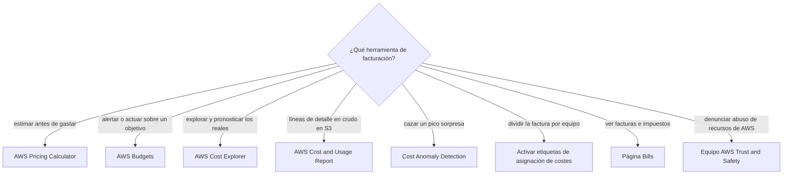
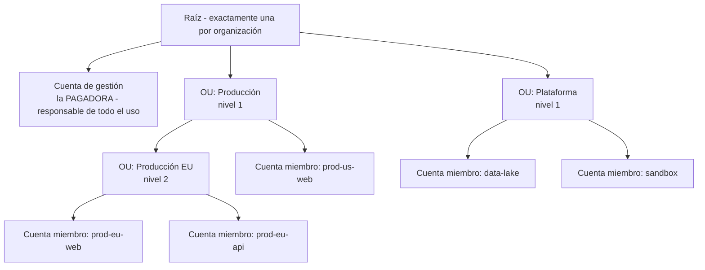
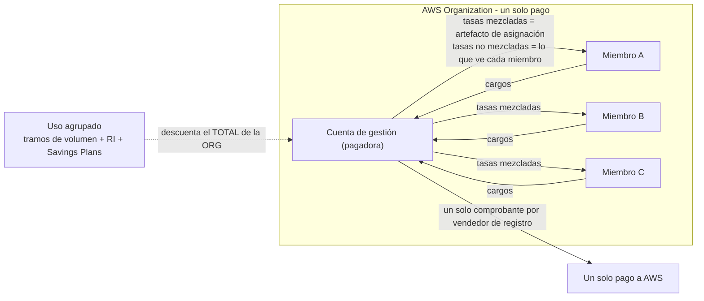
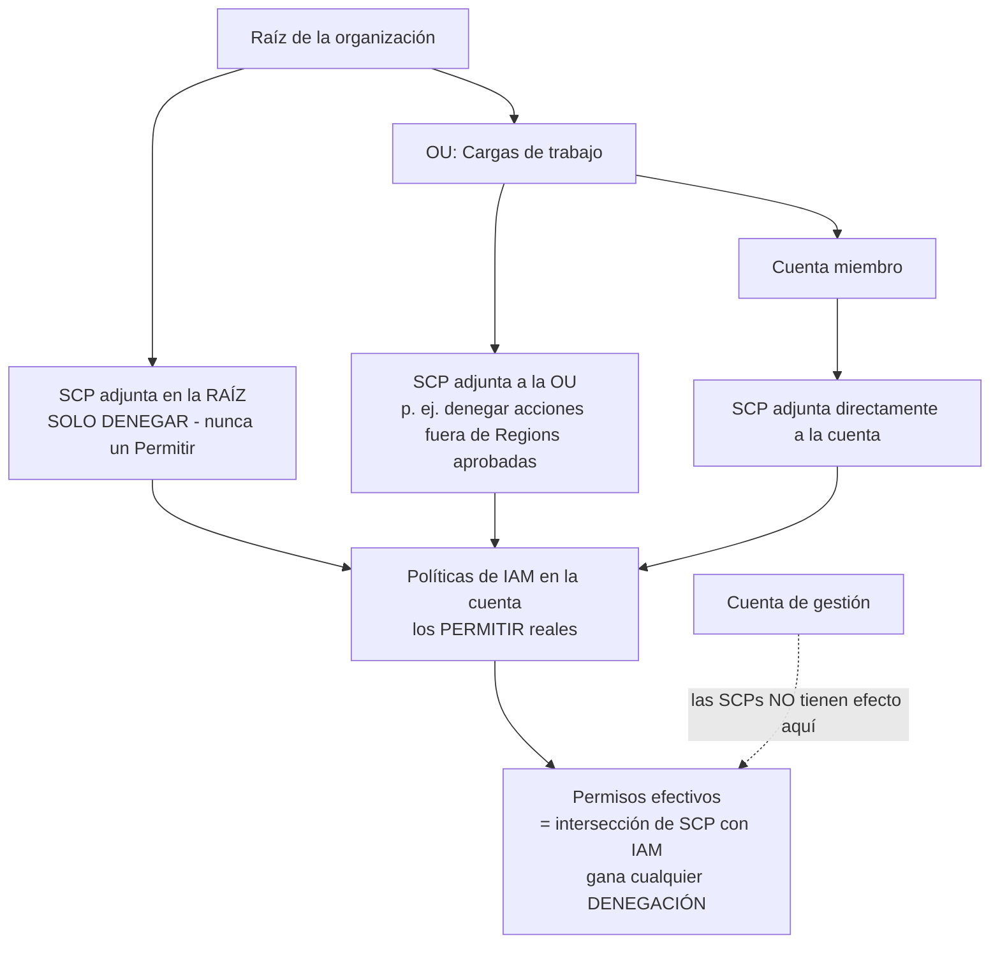
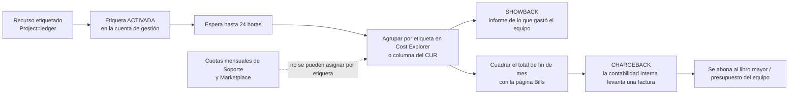

# Facturación, AWS Organizations y gobernanza de costes

El dinero es donde los exámenes de nube se vuelven personales. El Dominio 4 (**Facturación, precios y soporte**, **12%** del contenido puntuado) lleva unas seis preguntas puntuadas, y la declaración de tarea **4.2 — «Comprender los recursos para la facturación, el presupuesto y la gestión de costes»** — se queda con la mayoría de las de esta lección: soporte e información de facturación, **AWS Organizations**, **etiquetas de asignación de costes**, y los *«usos y capacidades apropiados de AWS Budgets y AWS Cost Explorer»* más *«la facturación consolidada y la asignación de costes»*. El patrón de fallo siempre es el mismo: los candidatos conocen los servicios pero no **qué página responde qué pregunta**, y caen en las dos trampas que AWS reutiliza sin fin — *«una SCP concede acceso»* y *«la factura sigue el árbol de OUs»*. Ninguna de las dos es cierta.

```text
=====================================================================
 MAPA DEL DINERO — QUÉ HERRAMIENTA RESPONDE QUÉ PREGUNTA
=====================================================================
  "MUÉSTRAME LA FACTURA"
    factura PDF, impuestos, emitida vs pendiente ..... página Bills
    cargos de TODAS las cuentas (solo gestión) ....... pestaña Charges by account
    qué gastamos por servicio / Region ............... inicio del panel de facturación
    líneas de detalle en crudo a mi propio cubo S3 ... Cost and Usage Report

  "¿POR QUÉ SE MOVIO / QUÉ VIENE?"
    explora y agrupa reales + pronóstico 12 meses .... AWS Cost Explorer
    avísame al 80% de 50.000 USD y luego ACTÚA ...... AWS Budgets + acción
    caza un pico nocturno que no planeé .............. Cost Anomaly Detection
    estima un sistema que aún no construí ............ AWS Pricing Calculator

  "¿QUIÉN PAGA?"
    un solo pago, descuentos agrupados ............... Facturación consolidada
    reparte el gasto por equipo, proyecto, entorno ... Etiquetas de asignación activadas
    enseña el número sin emitir factura .............. Showback
    levanta una factura interna ..................... Chargeback

  "¿QUÉ NO SE PUEDE COMPRAR?"
    techo de solo denegación sobre una OU ............ Service Control Policy
    catálogo curado de productos de Marketplace ...... Private Marketplace (todas las características)
=====================================================================
```

En esta lección:

- abres la **consola de Billing and Cost Management** y nombras la página exacta para cada pregunta de dinero habitual;
- construyes **AWS Organizations**: una raíz, hasta **cinco niveles de OU**, cuenta de gestión como pagadora, cuentas miembro como usuarias;
- explicas la **facturación consolidada** — una factura por vendedor de registro, **sin coste adicional**, descuentos por volumen agrupados, descuentos **RI/SP** compartidos;
- calculas desde cero un ejemplo de **descuento por volumen consolidado** y un ejemplo de **tarifa mezclada con reparto de RI**;
- separas los costes **mezclados de los no mezclados** y dices exactamente quién ve cuáles;
- separas **las SCPs de IAM** — solo denegación, intersección, inmunidad de la cuenta de gestión;
- activas **etiquetas de asignación de costes** (generadas por AWS frente a definidas por ti) y ejecutas un flujo de **showback → chargeback**;
- eliges entre **Budgets, Cost Explorer, CUR, Pricing Calculator y detección de anomalías** — incluido lo que cuesta cada uno;
- lees los informes de **reserva, utilización y cobertura de RI/SP** y diagnosticas sobrecompra frente a infracompra;
- navegas por **AWS Marketplace**: facturación consolidada de compras de terceros, ofertas privadas y Private Marketplace;
- gestionas **facturas, divisas y básicos de pago**, y sabes que **el soporte de facturación es gratuito para todos**;
- practicas con **12 preguntas estilo examen** más cuatro comprobaciones interactivas.

---

## 1. La consola de Billing and Cost Management: una consola, muchas páginas

### 1.1 La página Bills: la vista de factura

La página **Bills** es la respuesta canónica de «¿dónde está mi factura?». Su contenido es fijo y examinable:

| Elemento de la página Bills | Qué muestra | Nota de examen |
|---|---|---|
| Resumen de factura | Estado **Emitida** frente a **Pendiente** de la factura actual | Pendiente no significa pago fallido; significa que el periodo no se ha cerrado |
| Información de pago | Importe adeudado y estado del pago | Combínalo con **Payment preferences** para método y divisa |
| **Charges by service** | Gasto dividido por servicio, con detalle **hasta la Region** | *«¿Por qué EC2 se disparó en eu-west-1?»* → esta pestaña |
| **Charges by account** | Totales de cada cuenta miembro | **Solo la cuenta de gestión** — las cuentas miembro no reciben esta pestaña |
| Facturas | Facturas **PDF** descargables | Las preguntas de divisa de factura viven aquí y en Payment preferences |
| Savings | Descuentos aplicados | Refuerza que los descuentos agrupados reducen el total de la organización |
| Taxes | Líneas de impuestos | Preguntas de impuestos → página Bills, no Cost Explorer |

AWS lo afirma directamente: *«Si usas la función de facturación consolidada en AWS Organizations, la página **Bills** lista los totales de todas las cuentas en la pestaña **Charges by account**»* (en octubre de 2026).

### 1.2 El inicio del panel de facturación: la vista exploratoria

El panel **Home** está respaldado por Cost Explorer y es donde se hace el troceado. Sus widgets agrupan el gasto por **servicio · AWS Region · cuenta miembro (solo la cuenta de gestión) · etiqueta de asignación de costes · categoría de coste**. Tres comportamientos importan el día del examen:

- simplemente **visitar la página activa automáticamente Cost Explorer** (no hay forma vía API de activarlo más tarde);
- el resumen de costes **excluye créditos y reembolsos** — una cifra en Home puede diferir legítimamente de la factura;
- los datos se actualizan **como mínimo cada 24 horas**.

| Otras páginas de la consola | Trabajo que desempeña |
|---|---|
| **Cost Explorer** | *«¿Por qué se movió el coste?»* — agrupa, filtra, pronostica los reales |
| **AWS Budgets** | Alertas de umbral y, opcionalmente, **acciones de presupuesto** |
| **Cost and Usage Report** | Líneas de detalle en crudo entregadas **a tu propio cubo S3** |
| **Payment preferences** | Método de pago, divisa, **paga ahora** |
| **Billing preferences** | Facturas por correo, reparto de créditos, **interruptores de reparto RI/SP** |

- **📚 ¿Sabías que…?** El soporte de facturación no es un extra de pago: el Knowledge Center de AWS afirma *«Todos los propietarios de cuentas de AWS tienen acceso al soporte de cuenta y facturación **de forma gratuita**»* — todos los planes, incluido Basic. Por eso *«debes mejorar tu plan de soporte para hacer una pregunta de facturación»* es una respuesta equivocada fiable (en octubre de 2026).



```matching
{
  "question": "Relaciona cada pregunta de facturación con la página de consola o la herramienta que la responde:",
  "pairs": [
    {"left": "Descargar la factura PDF y ver las líneas de impuestos", "right": "Página Bills - resumen de factura, facturas, impuestos, cargos por servicio y por cuenta"},
    {"left": "Agrupar el gasto del mes pasado por Region y por etiqueta de asignación de costes", "right": "Inicio del panel de facturación o Cost Explorer - widgets de servicio, Region, cuenta miembro, etiqueta y categoría de coste"},
    {"left": "Avisarme antes de llegar a 50.000 USD este mes y detener el aprovisionamiento nuevo si llego", "right": "AWS Budgets con una notificación de umbral más una acción de presupuesto como una política de IAM que deniega el aprovisionamiento"},
    {"left": "Estimar una aplicación de tres capas que aún no he construido", "right": "AWS Pricing Calculator - estima antes de gastar, no lee tu uso real"},
    {"left": "Entregar líneas de detalle horarias en crudo a mi propio cubo S3 para Athena", "right": "AWS Cost and Usage Report - CSV o Parquet, al menos una vez al día"},
    {"left": "Averiguar quién revende nuestra AMI robada", "right": "Equipo AWS Trust and Safety - denuncias de abuso, separadas del Soporte de AWS"}
  ],
  "explanation": "El examen se fija en el verbo del enunciado: estimar = Pricing Calculator, alertar/actuar = Budgets, explorar/pronosticar = Cost Explorer, exportar = Cost and Usage Report, pico sorpresa = Cost Anomaly Detection, factura/impuestos = página Bills, abuso = Trust and Safety."
}
```

> [!NOTE]
> **La consola es el temario.** La tarea 4.2 pide *«soporte e información de facturación»* y *«información de precios de los servicios de AWS»* — eso se traduce en páginas reales, no en teoría. Cuando una pregunta describa un **síntoma**, visualiza la página que abrirías: factura → **Bills**; movimiento → **Cost Explorer**; umbral → **Budgets**; exportación en crudo → **CUR**; estimación previa → **Pricing Calculator**; divisa o tarjeta → **Payment preferences**.

---

## 2. AWS Organizations: raíces, OUs y quién paga

### 2.1 La estructura

Una organización es un árbol, y el árbol tiene reglas duras:

- **una raíz** por organización;
- **unidades organizativas (OU)** anidadas hasta **cinco niveles de profundidad** (verifica el estado actual antes de usarlo);
- **cuentas** unidas a la raíz o a una OU — las cuentas son las hojas donde realmente corren los recursos;
- la **cuenta de gestión** es la **pagadora**, y AWS dice que es responsable de *«todo el uso, los datos y los recursos usados por las cuentas de la organización»*;
- **AWS Organizations se ofrece sin coste adicional**, y la facturación consolidada no añade **ningún recargo** (en octubre de 2026).



### 2.2 Cuenta de gestión frente a cuenta miembro

| Capacidad | Cuenta de gestión | Cuenta miembro |
|---|---|---|
| Paga a AWS | **Sí — un solo pago para la organización** | No; genera cargos que la pagadora liquida |
| Pestaña **Charges by account** en Bills | **Sí** | No |
| Widgets del panel de facturación por cuenta miembro | **Sí** | No |
| Activa **etiquetas de asignación de costes** | **Sí** (también las cuentas independientes) | **No** |
| Afectada por **SCPs** | **No** — las SCPs no tienen efecto sobre usuarios y roles de la cuenta de gestión | **Sí** |
| Puede salir de la organización | no aplica (es la organización) | Sí, con la acción de la pagadora |
| Suscripción de soporte | Independiente | Independiente — *«Cada cuenta se suscribe de forma independiente»* |

### 2.3 Dos conjuntos de características, y lo que una organización solo de facturación no puede hacer

Organizations se envía en dos conjuntos de características, y la diferencia es oro de examen:

| Conjunto de características | Lo que obtienes | Lo que **no** obtienes |
|---|---|---|
| **Solo facturación consolidada** | Una factura, descuentos agrupados, reparto RI/SP | **Sin SCPs, sin políticas de etiquetas, sin integraciones de servicios** (incluido Private Marketplace) |
| **Todas las características** | Todo lo anterior **más SCPs**, políticas de etiquetas, integraciones | — |

En una organización solo de facturación, los miembros siguen *«de otro modo independientes»*: cada uno puede **registrarse en servicios y usar Premium Support de forma independiente**. Por eso una pregunta que describe *«los miembros se registran libremente, sin guardrails, pero con una factura combinada»* está describiendo el conjunto de características **solo de facturación consolidada**.

- **📚 ¿Sabías que…?** AWS advierte que *«**Tu factura no reflejará la estructura que hayas definido en tu organización**»* — el árbol de OUs es un dispositivo de gobernanza, no una dimensión de facturación. Si una pregunta te pide facturar por separado la OU `data`, la respuesta son **etiquetas de asignación de costes activadas** (o categorías de coste), nunca *«crear otra OU»* (en octubre de 2026).

---

## 3. Facturación consolidada: un pago, uso agrupado, descuentos compartidos

### 3.1 Los cuatro beneficios documentados

| Beneficio | Lo que AWS dice que te da |
|---|---|
| **Una factura** | Una factura por **vendedor de registro** — el uso de AWS Marketplace cae en la misma factura |
| **Seguimiento fácil** | La cuenta de gestión puede ver **los cargos por cuenta** |
| **Uso combinado** | *«comparte los **descuentos por volumen de precios, los descuentos de Reserved Instance y los Savings Plans**»* entre cuentas |
| **Sin coste adicional** | Añadir facturación consolidada no cuesta nada |

### 3.2 Los umbrales de tramo se agrupan, no son por cuenta

La frase más evaluable de todo el tema: *«**AWS trata a todas las cuentas de una organización como una sola cuenta. Las cuentas miembro no alcanzan los umbrales de tramo individualmente.**»* La agregación es **por servicio**, cada mes **empieza en cero**, y el sobrante de una cuenta (horas de RI, progreso de tramo) puede usarlo otra.

**Ejemplo resuelto E1 — la ilustración de tramo de 95 TB publicada por AWS** *(la tabla de tramos es el precio publicado de S3 Standard de AWS: $0,10/GB en los primeros 1.000 GB, $0,08/GB en los siguientes 49.000 GB y $0,06/GB a partir de ahí; en octubre de 2026, verifica el precio vigente antes de usarlo)*

Tres cuentas miembro almacenan cada una unos **31.667 GB** en el mismo mes (3 × 31.667 ≈ 95.000 GB = 95 TB; el reparto equitativo que aparece es ilustrativo — AWS publica los dos totales, $6.720 agrupado frente a $7.660 por separado):

| Facturado por separado (sin organización) | Agrupado por facturación consolidada |
|---|---|
| Cada cuenta: $0,10 × 1.000 = **$100,00** más $0,08 × 30.666,67 = **$2.453,33** → **$2.553,33** | Primeros 1.000 GB × $0,10 = **$100,00** |
| Tres cuentas: 3 × $2.553,33 = **$7.660,00** | Siguientes 49.000 GB × $0,08 = **$3.920,00** |
| | Restantes 45.000 GB × $0,06 = **$2.700,00** |
| | **Total agrupado = $6.720,00** |
| **Diferencia: $940,00 ahorrados (12,3%)** | |

Ninguna cuenta alcanzó por sí sola los 1.000 GB, y aun así la organización cruzó tres umbrales — exactamente lo que significa *«las cuentas miembro no alcanzan los umbrales de tramo individualmente»*.

**Ejemplo resuelto E2 — dos cuentas y la tasa media escrita de vuelta** *(tramos como arriba; la aritmética se trabaja aquí)*

La cuenta A almacena **900 GB** y la cuenta B **600 GB**:

- **Por separado:** A = 900 × $0,10 = **$90,00**; B = 600 × $0,10 = **$60,00** → **$150,00**
- **Agrupado:** 1.500 GB → primeros 1.000 × $0,10 = $100,00; restantes 500 × $0,08 = $40,00 → **$140,00**
- **Ahorro:** **$10,00 (6,67%)**
- **Tasa media de asignación:** $140,00 ÷ 1.500 GB = **$0,0933333/GB**
- Cuota de A: 900 × 0,0933333 = **$84,00** (ahorra $6,00) · Cuota de B: 600 × 0,0933333 = **$56,00** (ahorra $4,00) · comprobación: 84 + 56 = **$140,00** ✓

### 3.3 Tarifas mezcladas frente a no mezcladas: la trampa que nunca muere

- **Tasas mezcladas (blended)** promedian la tarifa de Reserved Instance y la de bajo demanda entre las cuentas miembro; **las tasas mezcladas de EC2 se calculan por hora**. El orden de asignación es **horas de RI → horas de Free Tier → horas bajo demanda**.
- **No mezcladas (unblended)** es lo que se muestra a cada cuenta miembro: AWS afirma que *«**AWS muestra a cada cuenta miembro sus cargos como costes no mezclados.**»*
- En el **Cost and Usage Report**, `lineItem/BlendedRate` se calcula en la **cuenta de gestión** para que la organización pueda repartir el coste hacia abajo.



> [!WARNING]
> **Una cuenta miembro puede mostrar cargos completos bajo demanda mientras el total de la organización baja.** Como a los miembros se les muestran costes **no mezclados**, un equipo cuya carga fue descontada por la Reserved Instance de *otra* cuenta puede seguir viendo la línea sin descuento — el ahorro aparece en la factura a **nivel de organización** y en las columnas **mezcladas** del CUR. A este truco le encanta el examen: *«La factura de la cuenta B no cambió, luego el reparto de RI no sirvió de nada»* es **falso**.

### 3.4 El soporte nunca se agrupa

La facturación consolidada **no** fusiona el soporte: *«AWS calcula **las tarifas de soporte de forma independiente para cada cuenta miembro** … **Cada cuenta se suscribe de forma independiente.**»* Los clientes Enterprise pueden optar por la **facturación mensual agregada** de las tarifas de soporte — eso es agregación de facturación, **no** de derechos. Los planes Developer, Business y Enterprise tienen cada uno un **mínimo mensual** (en octubre de 2026; los nombres de plan están en plena reorganización — véase la sección 9.3).

---

## 4. Reserved Instances y Savings Plans entre cuentas

### 4.1 Las reglas de reparto

| Instrumento | Redacción de AWS | Orden de asignación |
|---|---|---|
| **Reserved Instances** | La función de facturación consolidada *«trata a todas las cuentas de la organización como una sola cuenta»*, de modo que *«todas las cuentas … pueden recibir el beneficio de coste por hora de las Reserved Instances compradas por cualquier otra cuenta»* | Empieza por la **cuenta compradora** y continúa con los **tipos de uso idénticos en la misma zona de disponibilidad**; las RI **regionales** se aplican a la instancia más pequeña de la familia |
| **Savings Plans** | Se aplican primero a la cuenta **propietaria** y después se comparten; AWS aplica las tasas de SP al uso cubierto **empezando por el mayor descuento** | Primero el propietario y después las demás cuentas de la organización |

Dos límites que memorizar: **el reparto se puede desactivar** en Billing preferences (los interruptores de **reparto RI/SP**), y **ninguno de los dos instrumentos cruza el límite de la organización** — una RI comprada en la Organización 1 nunca descuenta la Organización 2.

**Ejemplo resuelto E3 — una RI comprada por un equipo ahorra a otro** *(ejemplo de tasa media publicado por AWS, recortado a dos cuentas; en octubre de 2026)*

Un mes de 30 días = **720 horas**; `t2.small` en una zona de disponibilidad; tarifa bajo demanda de **$0,023/h**. La organización posee **2 RI de pago total por adelantado** (1.440 h de capacidad) y **1 RI de pago parcial por adelantado** (720 h).

| Concepto | Valor |
|---|---|
| Consumo de horas reservadas de la cuenta 1 | **2.160 h** |
| Uso bajo demanda de la cuenta 2 | **720 h** |
| Total de la organización | 2.160 + 720 = **2.880 h** |
| Cargo bajo demanda por el uso no cubierto de la organización | 720 × $0,023 = **$16,56** |
| **Tasa media (blended)** | $16,56 ÷ 2.880 = **$0,00575/h** (cifra publicada por AWS) |
| Asignación media de la cuenta 1 | 2.160 × 0,00575 = **$12,42** |
| Asignación media de la cuenta 2 | 720 × 0,00575 = **$4,14** (comprobación: 12,42 + 4,14 = **$16,56** ✓) |

La cuenta 2 **no compró nada** y aun así su cuota media es de **$4,14** en lugar de $16,56 — se subió a las reservas de la cuenta 1 porque la organización se trata como una sola cuenta. Su línea **no mezclada** sigue diciendo **$16,56**.

- **📚 ¿Sabías que…?** El reparto de RI y Savings Plans es una **preferencia, no un destino inevitable**: la página **Billing preferences** contiene los interruptores de reparto RI/SP, de modo que *«el reparto no se puede desactivar»* es en sí misma una respuesta equivocada. El hábito de examen que hay que construir: cada vez que una respuesta diga *«nunca»*, *«siempre»* o *«no se puede desactivar»*, busca el interruptor que AWS documenta (en octubre de 2026).

---

## 5. SCP frente a IAM: el techo de solo denegación

### 5.1 Qué es una SCP — y qué no es

Una **Service Control Policy** es un guardrail de Organizations que se adjunta en la **raíz o en una OU**, y se aplica a cada cuenta miembro que esté por debajo. La definición de AWS ocupa una frase y de ella cuelga medio examen: *«**Las SCPs no conceden permisos**»*, y proporcionan *«control central sobre los **permisos máximos disponibles**»* — un techo, nunca un suelo. Dos notas al pie que merece la pena memorizar: las SCPs **sí** obligan al **usuario raíz** de una cuenta miembro, y **no tienen efecto sobre los roles vinculados a un servicio**.

| Propiedad | Service Control Policy (SCP) | Política de IAM |
|---|---|---|
| Dirección | **Techo de solo denegación** — solo puede quitar, nunca añadir | **Concede** (permitir) y puede denegar dentro de su ámbito |
| Mecanismo | Permisos efectivos = **intersección** de las SCPs con las políticas de identidad/recurso | Permitir o denegar directamente a los principios |
| Precedencia | **Cualquier Denegación en cualquier parte gana** — una denegación explícita en una SCP, en IAM o en una política de recurso anula cualquier permitir | Misma regla de «gana la denegación» dentro de IAM |
| Ámbito | OUs y cuentas enteras (gobernanza de toda la organización) | Usuarios, roles, grupos y recursos de una sola cuenta |
| Cuenta de gestión | **Sin efecto** sobre usuarios y roles de la cuenta de gestión | Se aplica plenamente |
| Conjunto de características requerido | **Todas las características** en AWS Organizations | Siempre disponible |



**Ejemplo resuelto E4 — los dos enunciados clásicos de SCP** *(lógica de reglas, no de precios)*

1. *«Que las cuentas miembro no lancen instancias fuera de las Regions aprobadas, sin tocar nada más que puedan hacer.»* → adjunta una **SCP de solo denegación** en la OU. Quitaste un permiso y no concediste nada — y solo funciona si la organización está en el conjunto de **todas las características**.
2. *«Que el equipo de datos tenga permiso para leer el cubo compartido»* → una **política de IAM** (o una política de recurso). Una SCP no puede hacerlo, porque una SCP que diga `Allow` sobre `s3:GetObject` no cambia nada: a la intersección le sigue faltando un `Allow` de IAM por debajo.

```fillblank
{
  "question": "Completa las afirmaciones de gobernanza con los términos correctos de AWS:",
  "template": "Una SCP es una política de {{1}}: solo puede quitar permisos, nunca concederlos, así que AWS dice que las SCPs no {{2}} permisos. Los permisos efectivos son la {{3}} de las SCPs y tus políticas de IAM, y una {{4}} explícita en cualquier parte gana. Las SCPs no tienen efecto sobre la cuenta de {{5}}, y requieren el conjunto de características {{6}} de Organizations.",
  "answers": {
    "1": "solo denegación",
    "2": "conceden",
    "3": "intersección",
    "4": "denegación",
    "5": "gestión",
    "6": "todas las características"
  },
  "distractors": ["solo permitir", "permiso", "unión", "permitir", "miembro", "facturación consolidada"],
  "explanation": "La propia redacción de AWS: «las SCPs no conceden permisos»; los permisos efectivos son la intersección con las políticas de identidad y de recursos; gana cualquier Denegación; las SCPs no afectan a la cuenta de gestión; las SCPs necesitan el conjunto de todas las características (las organizaciones solo con facturación consolidada no pueden usarlas)."
}
```

> [!WARNING]
> **La trampa clásica, dicha con todas las letras: una SCP nunca concede acceso.** Si el resultado correcto necesita que alguien *haga* algo, la respuesta es una **política de IAM** (o una política de recurso, o un límite de permisos). Si el resultado correcto necesita que una cuenta miembro *deje de* hacer algo en general, la respuesta es una **SCP de solo denegación** — y si una pregunta ofrece *«adjuntar una SCP para permitir…»*, esa opción se contradice a sí misma y es falsa. Segunda mitad de la trampa: **las SCPs no se aplican a la cuenta de gestión**, así que *«gobernar a la pagadora con una SCP»* también es incorrecta.

---

## 6. Etiquetas y etiquetas de asignación de costes: showback y chargeback

### 6.1 Dos tipos de etiqueta, una regla de activación para cada una

Una **etiqueta** es una clave (con un valor opcional) adjunta a un recurso; cada clave es única por recurso. Para facturación, AWS divide las etiquetas en exactamente dos tipos:

| Tipo | Definida/adjuntada por | Prefijo en las herramientas de AWS | En un informe de asignación de costes |
|---|---|---|---|
| **Generada por AWS** | AWS, o un **ISV de AWS Marketplace** | `aws:` | Aparece bajo su clave de AWS |
| **Definida por ti** | Tú | cualquier clave que elijas | Aparece como **`user:` + clave** |

Tres reglas deciden si tu etiqueta llega algún informe:

1. **Hay que activar los dos tipos por separado** — *«Debes activar los dos tipos de etiquetas por separado para que puedan aparecer en Cost Explorer o en un informe de asignación de costes.»*
2. **La activación vive en la cuenta de gestión (o en una cuenta independiente)** — las cuentas miembro no pueden activar etiquetas de asignación de costes.
3. **Permite hasta 24 horas** para que las etiquetas activadas empiecen a fluir (verifica el dato vigente antes de usarlo).

**Ejemplo resuelto E5 — «etiquetamos todo y el informe está vacío»** *(secuencia de diagnóstico)*

| Síntoma | Causa | Solución |
|---|---|---|
| 400 instancias etiquetadas con `Project=ledger`, el informe no muestra nada | Etiqueta **adjuntada pero nunca activada** | Cuenta de gestión → activar `user:Project` |
| Activada ayer y hoy sigue sin aparecer | Retardo de propagación de **hasta 24 horas** | Espera y vuelve a comprobar |
| Algunas filas muestran `Project = (not allocated)` | Recursos creados **antes de que empezara el etiquetado**, **sin etiquetar**, o de un **servicio que no admite etiquetas** | Rellena las etiquetas; espera una fila sin etiquetar por diseño |
| Faltan las cuotas mensuales de Soporte o Marketplace | **No se pueden asignar de ninguna forma** | Asigna esas con otra regla o acepta la fila sin etiquetar |

### 6.2 Lo que el informe de asignación de costes puede y no puede dividir

El informe es un CSV agrupado por etiquetas activas, con filas explícitas de **etiquetado y sin etiquetar**, y sus **totales de fin de mes cuadran con la página Bills**. No puede asignar:

- recursos creados **a mitad de mes antes de que empezara el etiquetado**;
- recursos **sin etiquetar** y **servicios que no admiten etiquetas**;
- *«**Los cargos por suscripción, como las cuotas mensuales de AWS Support y de AWS Marketplace, no se pueden asignar**»*.

Las **categorías de coste** — asignaciones basadas en reglas que defines tú — conviven **junto a** las etiquetas como dimensión en Cost Explorer, Budgets y la página Bills, que es la salida cuando un tipo de carga no admite etiquetas.

### 6.3 Showback frente a chargeback

| | **Showback** | **Chargeback** |
|---|---|---|
| Redacción de la guía de etiquetas de AWS | *«presentación, cálculo e informe de los cargos incurridos por una entidad concreta»* | *«un cobro real de los costes incurridos … mediante los procesos contables internos de una organización»* |
| ¿Alguien paga? | **No** — solo un informe | **Sí** — una factura interna |
| La diferencia en una línea | *«si se espera o no que alguien efectúe un pago»* | |
| Riesgo de percepción | Informativo | AWS señala que el chargeback *«puede percibirse como un impuesto»* |



**Ejemplo resuelto E6 — un reparto entre dos equipos** *(cifras ilustrativas — el flujo está documentado, los importes se inventan para practicar)*

| Equipo | Etiqueta | Cuota al agrupar en Cost Explorer | Acción |
|---|---|---|---|
| Plataforma de ledger | `Project=ledger` | **$39.000 (65%)** | Informe de showback al responsable del equipo |
| Plataforma interna | `Project=platform` | **$21.000 (35%)** | Informe de showback al responsable del equipo |
| **Total de la organización** | | **$60.000** | Debe igualar el total de fin de mes de la página Bills |
| Compartido: cuotas mensuales de Soporte + Marketplace | (sin etiqueta) | aparece en la fila **sin etiquetar** | Reparte con una regla acordada o usa una **categoría de coste** |

El showback se detiene aquí (no hay pago). El chargeback continúa: finanzas abona a cada equipo $39.000 / $21.000 por la contabilidad interna — la diferencia entre ambos es *si se espera que alguien pague*.

```dragdrop
{
  "question": "Ordena los pasos que convierten las etiquetas de recursos en una factura de chargeback:",
  "items": [
    "Etiqueta cada recurso facturable con una clave coherente como Project",
    "Activa la etiqueta definida por ti como etiqueta de asignación de costes en la cuenta de gestión",
    "Espera hasta 24 horas a que la etiqueta fluya hacia los datos de coste",
    "Agrupa por la etiqueta en Cost Explorer o inspecciona el Cost and Usage Report",
    "Cuadra el total de fin de mes con la página Bills",
    "Emite el informe de showback y deja que la contabilidad interna levante la factura de chargeback"
  ],
  "correctOrder": [
    "Etiqueta cada recurso facturable con una clave coherente como Project",
    "Activa la etiqueta definida por ti como etiqueta de asignación de costes en la cuenta de gestión",
    "Espera hasta 24 horas a que la etiqueta fluya hacia los datos de coste",
    "Agrupa por la etiqueta en Cost Explorer o inspecciona el Cost and Usage Report",
    "Cuadra el total de fin de mes con la página Bills",
    "Emite el informe de showback y deja que la contabilidad interna levante la factura de chargeback"
  ],
  "explanation": "El etiquetado por sí solo nunca produce datos de coste: la activación en la cuenta de gestión es un paso aparte, tarda hasta 24 horas, el informe debe cuadrar con la página Bills y solo el último paso — la contabilidad interna — convierte el showback en chargeback."
}
```

- **📚 ¿Sabías que…?** **Las etiquetas generadas por AWS pueden crearlas un tercero**: la documentación de asignación de costes de AWS cuenta como generadas por AWS las etiquetas *«definidas y aplicadas por AWS **o un ISV de AWS Marketplace**»*. Así que la etiqueta de un vendedor de Marketplace puede aparecer en tus datos de coste antes de que escribas una sola línea de política de etiquetado — aun así hay que **activarla por separado** de las tuyas (en octubre de 2026).

---

## 7. Gestión de costes: Budgets, Cost Explorer, informes de RI/SP y el CUR

### 7.1 AWS Budgets: primero avisa, después actúa

AWS Budgets supervisa un **objetivo** y te notifica. Los hechos documentados:

| Hecho | Valor (en octubre de 2026; verifica el dato vigente antes de usarlo) |
|---|---|
| Tipos de presupuesto | **Coste · Uso · Utilización de RI · Cobertura de RI · Utilización de SP · Cobertura de SP** (seis) |
| Dirección de la notificación | *«supere o se prevea que supere»* para coste/uso; *«baje por debajo»* para presupuestos de RI/SP |
| Canales de entrega | **Amazon SNS, correo electrónico o ambos** |
| Refresco | **Hasta 3 veces al día, normalmente con 8–12 horas de separación** |
| Vistas supervisadas | Variantes mezcladas, no mezcladas, amortizadas y netas; pueden **excluir** reembolsos, tarifas de soporte e impuestos |
| Límites por presupuesto | **≤5 notificaciones**, cada una con **≤1 tema SNS + ≤10 direcciones de correo** |
| Límite del presupuesto de RI/SP | `BudgetLimit` **viene por defecto en 100 y 100 es el único valor válido** (utilización/cobertura son porcentajes) |
| En una organización | Un presupuesto dirigido a una cuenta miembro se muestra **solo si esa cuenta tiene concedido el acceso**; AWS: *«no admitimos el uso entre cuentas»* |
| Precio | Supervisión y notificaciones **gratis**; los **primeros 2 presupuestos con acciones al mes son gratis** y después **$0,10/día cada uno**; un **informe de presupuesto entregado = $0,01 por informe** |

Las **acciones de presupuesto** son lo que separa una alerta de un control: se ejecutan *«de forma programática o con tu aprobación»* y pueden aplicar **políticas de IAM, SCPs o recursos de AWS**, integrándose con **AWS Chatbot** (Slack/Chime) y **Service Catalog**. El ejemplo de configuración de AWS propio es el que hay que memorizar: notificar al **80 por ciento** del importe presupuestado y aplicar una acción — por ejemplo, una política de IAM personalizada que **deniegue aprovisionar recursos adicionales**.

**Ejemplo resuelto E7 — aritmética de presupuesto con una acción** *(el patrón del 80% documentado por AWS; importes ilustrativos)*

| Evento | Aritmética | Resultado |
|---|---|---|
| Presupuesto = **$50.000/mes** | Alerta A al **80% real** = 0,80 × 50.000 | **$40.000** |
| Alerta B | **previsión** de superar el 100% | salta por previsión, no por real |
| Gasto del día 12: **$21.000** | 21.000 < 40.000 | silencio |
| Gasto del día 20: **$41.500** | 41.500 > 40.000 | **Salta la alerta A**, se aplica la acción opcional |
| Presupuestos con acciones #1 y #2 | gratis | **$0,00** |
| Presupuesto con acciones #3 durante 30 días | 30 × $0,10 | **$3,00** |
| 4 informes semanales de presupuesto | 4 × $0,01 | **$0,04** |
| **Total del mes para lo anterior** | 3,00 + 0,04 | **≈ $3,04** |

> [!NOTE]
> **Una notificación no es un límite.** Las alertas de presupuesto no detienen el gasto — la entrega además va por detrás del cargo, porque los datos de Budgets solo se refrescan unas pocas veces al día. Detener el gasto exige una **acción de presupuesto** (política de IAM, SCP o recurso). Esa distinción — *avisar frente a aplicar* — es un par favorito de correcto/incorrecto.

### 7.2 Cost Explorer: explora, agrupa, filtra, pronostica

| Comportamiento | Redacción o cifra de AWS (en octubre de 2026) |
|---|---|
| Actualidad de los datos | *«Todos los costes reflejan tu uso hasta el día anterior.»* |
| Activación | **Solo consola** — *«No puedes activar Cost Explorer con la API»* |
| Historial al activarlo | **Mes actual + últimos 12 meses** |
| Pronóstico | **Próximos 12 meses** |
| Refresco / desactivación | Refresco **≥24 h**; una vez activado **no se puede desactivar** |
| Dimensiones de filtro/agrupación | `SERVICE`, `LINKED_ACCOUNT`, `REGION`, `AZ`, `TAG`, `COST_CATEGORY`, `CHARGE_TYPE` |
| Informes por defecto | **Coste y uso** más **informes de Reserved Instance**; se entrega con **Amazon Q** |
| Precio de la API | **$0,01 por solicitud** (cada página paginada cuenta); vistas de facturación personalizadas **$0,01 por origen** |
| Granularidad horaria | Retroceso de 14 días a **$0,00000033 por registro de uso al día** ≈ **$0,01 por 1.000 registros al mes** |

**Ejemplo resuelto E8 — lo que cuesta de verdad el Cost Explorer «gratis»** *(tarifario oficial; aritmética aquí)*

- Un script llama a la API de Cost Explorer **5.000 veces** en un mes: 5.000 × $0,01 = **$50,00**.
- Un equipo activa la **granularidad horaria** para **10.000 registros de uso** durante un día: 10.000 × 0,00000033 = **$0,0033**; en 30 días ≈ **$0,10** — por eso el resumen de la documentación dice *«unos $0,01 por 1.000 registros al mes»*.
- Clics en la consola en la vista diaria por defecto: **$0** — mirar tu panel no es una llamada a la API.

### 7.3 Reserva, utilización y cobertura: tres preguntas distintas

| Informe | La que responde | Señal de que algo va mal |
|---|---|---|
| **Reserva (inventario)** | ¿Qué tengo, cuánto ahorra frente a bajo demanda y qué caduca este mes? | Compromisos caducando sin usarse |
| **Utilización** | De lo que **compré**, ¿cuánto **usé**? | **Comprar de más** |
| **Cobertura** | De las horas que **corrieron**, ¿cuántas estuvieron **cubiertas**? | **Comprar de menos** |

**Ejemplo resuelto E9 — utilización del 98% frente a cobertura del 90%** *(ejemplos de Savings Plans publicados por AWS; en octubre de 2026)*

- **Utilización:** un compromiso de **$10/hora** con un uso facturado a tarifas de Savings Plans de **$9,80** → 9,80 ÷ 10,00 = **98% de utilización**. El 2% de lo que pagaste se quedó sin usar — estás cerca de **comprar de más**.
- **Cobertura:** **9 de 10** instancias idénticas que cuestan **$1,00/hora** corren a tarifas de Savings Plans → cubiertos $9,00 de $10,00 = **90% cubierto** — una instancia-hora sigue facturándose a bajo demanda, así que estás **comprando de menos**.
- Los informes usan **unidades normalizadas** para que se comparen justamente tamaños distintos de instancia.

### 7.4 El Cost and Usage Report (CUR)

El CUR es la exportación en bruto: líneas de detalle entregadas **a tu propio cubo S3 al menos una vez al día**, con granularidad **horaria, diaria o mensual**, en **CSV o Parquet**. Contiene tanto `lineItem/UnblendedRate` como `lineItem/BlendedRate` — este último calculado en la **cuenta de gestión** — de ahí que el CUR sea la herramienta de asignación de nivel chargeback, mientras que Cost Explorer es la herramienta de exploración.

### 7.5 Ítems de concienciación (no están en la lista oficial de servicios examinables)

Dos funciones reales de consola **no** figuran en la lista de servicios examinables de CLF-C02 — trátalas como conocimiento extra y **nunca como respuesta clave** cuando también encaje Budgets o Cost Explorer:

| Herramienta | Qué hace | Límites que conviene conocer (en octubre de 2026) |
|---|---|---|
| **Cost Anomaly Detection** | Aprendizaje automático para *«detectar y alertar sobre patrones de gasto anómalos»*; flujo = **monitor de costes → suscripción de alertas → notificación** | **1 monitor de servicio de AWS + hasta 500 personalizados**; **≤10 correos o 1 tema SNS**; necesita **≥10 días** de historial; alertas en **24 h**; los monitores de cuenta enlazada/etiqueta/categoría de coste son **solo para la cuenta de gestión** |
| **Cost Optimization Hub** | Consolida recomendaciones de rightsizing, recursos ociosos, Savings Plans y RI — *«más de **18 tipos**»* | Refresco **diario**; hay que **activarlo**; los datos se sirven desde **us-east-1** |

Y la trampa inversa: **AWS Billing Conductor está explícitamente fuera del alcance** de este examen, igual que Amazon DevPay y AWS Application Cost Profiler — una opción que nombre Billing Conductor es un distractor.

- **📚 ¿Sabías que…?** Cost Explorer es deliberadamente difícil de quitar: AWS te deja activarlo **solo desde la consola** (*«No puedes activar Cost Explorer con la API»*), te da **12 meses de historial más un pronóstico de 12 meses en cuanto lo activas** y después **no puedes desactivarlo**. AWS cobra por el acceso *programático* (**$0,01 por solicitud de API**) y por la granularidad *horaria* (unos **$0,01 por 1.000 registros al mes**) — leer el panel sigue siendo gratis, automatizarlo se factura (en octubre de 2026).

---

## 8. AWS Marketplace: compra a terceros, paga a AWS

### 8.1 Qué es y cómo factura

AWS define Marketplace como *«un **catálogo digital curado** que los clientes pueden usar para **encontrar, comprar, desplegar y gestionar software, datos y servicios de terceros»***; entre los tipos de producto disponibles están SaaS, AMIs, contenedores, plantillas de CloudFormation, ofertas de SageMaker y productos de datos.

| Aspecto | Comportamiento (en octubre de 2026) |
|---|---|
| Quién te factura | **AWS**: *«Al principio del mes recibes una factura de Amazon Web Services (AWS) por tus cargos de AWS Marketplace.»* AWS cobra **en nombre del vendedor** |
| Dónde aparece | En tu factura normal de AWS — uso en la **factura consolidada** (normalmente el día 2 o 3 del mes) |
| Divisa | Mayoritariamente **USD**, salvo que actives la facturación en divisa local; divisas de factura de oferta privada: **USD EUR GBP AUD JPY INR** |
| Oferta privada | Precio negociado más EULA para cuentas con nombre (**hasta 25**), aceptada en la **cuenta de gestión o en una cuenta miembro**; *«No hay diferencia en el producto de software»* |
| Reparto de suscripción anual | Comprada por una cuenta, **compartida en toda la familia de cuentas enlazadas** |
| **Private Marketplace** | *«catálogos curados de productos aprobados»*; **se integra con AWS Organizations**; experiencias con ámbito en la **organización completa, OUs o cuentas**; los usuarios aún pueden **solicitar** otros productos; requiere el conjunto de **todas las características** |
| Ángulo 4.3 del examen | **Gestión de costes** (líneas del CUR/Cost Explorer + presupuestos) · **gobernanza** (Private Marketplace + solicitudes de compra) · **derecho de uso** (suscripción ligada a tu cuenta de AWS) |

> [!IMPORTANT]
> **Oferta privada ≠ Private Marketplace.** Una **oferta privada** es un *trato negociado* para hasta 25 cuentas con nombre. Un **Private Marketplace** es un *catálogo curado* gobernado por organización, OU o cuenta, y necesita Organizations en el conjunto de **todas las características** — la misma familia de prerrequisitos que **las SCPs y las políticas de etiquetas**. Si una pregunta ofrece *«activar Private Marketplace solo con facturación consolidada»*, es incorrecta.

- **📚 ¿Sabías que…?** Marketplace se monta en tu factura existente — pero sus **cuotas mensuales no se pueden asignar por etiqueta**, de modo que un modelo de chargeback debe gestionar las suscripciones de Marketplace mediante una regla acordada o una **categoría de coste**, no mediante etiquetas (en octubre de 2026).

---

## 9. Facturas, divisas, básicos de pago — y a quién preguntar

### 9.1 Lo que está verificado sobre divisas y facturas

| Hecho (en octubre de 2026; verifica el dato vigente antes de usarlo) | Estado de la fuente |
|---|---|
| **Divisa de factura por defecto = USD** | Verificado |
| AWS publica una lista de **divisas de pago** (~30 códigos, p. ej. EUR, GBP, JPY, BRL, CAD, AUD, INR, CNY…) | Artículo oficial de AWS en re:Post *«actualizado hace un año»* en el momento del acceso — trata la **lista exacta como dato a verificar** |
| Divisas **solo con tarjeta**: **NOK CLP COP EGP NGN UAH UYU**; **AED es solo de factura** | Mismo artículo — misma advertencia |
| La emisión de facturas para las cuentas con facturación usa **transferencia electrónica de fondos con condiciones netas a 30 días**, y *«contactas con AWS Support desde la cuenta del usuario raíz»* para recibirlas | Verificado |
| **Configuración de facturas de AWS**: máximo **500 unidades de factura por cuenta pagadora** | Verificado |

> [!WARNING]
> **Lo que NO se pudo verificar — no lo memorices:** los **umbrales de elegibilidad para pagar por factura** de AWS (gasto, antigüedad de la cuenta, comprobaciones de crédito) **no tienen fuente** en nuestra investigación. Si una opción tipo examen cita un umbral en dólares o una regla de *«6 meses de historial»* para volverse elegible a factura, trátala como **no verificada** — las únicas afirmaciones con fuente son las condiciones netas a 30 días por transferencia y el contacto con Support desde el usuario raíz. Del mismo modo, la lista exacta de divisas cambia según el vendedor de registro y la ubicación; cita *«USD por defecto, las demás divisas varían»* en lugar de recitar códigos.

### 9.2 Dónde cambias cada cosa

| Quieres… | Página |
|---|---|
| Cambiar tarjeta, método bancario o pagar ahora | **Payment preferences** (método, divisa, pagar ahora) |
| Recibir facturas por correo, repartir créditos, activar o desactivar el reparto RI/SP | **Billing preferences** |
| Leer la factura en sí, impuestos, emitida o pendiente | **Bills** |

### 9.3 Referencias cruzadas de planes de soporte (de la lección de soporte)

Cuatro hechos de la tarea 4.3 del Dominio 4 que pertenecen a una respuesta de facturación:

1. **El soporte de facturación y de cuenta es gratuito en todos los planes** — *«Todos los propietarios de cuentas de AWS tienen acceso al soporte de cuenta y facturación de forma gratuita.»*
2. **Basic Support no puede abrir casos técnicos**, pero sí puede abrir casos de **cuenta y facturación** y casos de **aumento de límite de servicio** (24×7).
3. **El soporte es por cuenta, no por organización** — *«Cada cuenta se suscribe de forma independiente»*; Enterprise solo puede optar por la **facturación mensual agregada** de las tarifas de soporte.
4. **Dónde preguntar qué:** *¿cómo etiqueto 400 instancias?* → **AWS re:Post** (comunidad gestionada por AWS + Knowledge Center, con *«más de 4.000»* artículos y vídeos oficiales) — **no** para preguntas con reloj o específicas de una cuenta; *la factura no coincide con mi estimación* → **Support Center**, caso de cuenta y facturación; *alguien revende nuestra imagen robada* → **equipo AWS Trust and Safety**.

Plantilla de planes actual en octubre de 2026 (verifica los nombres antes del día del examen): **Basic · Business Support+ · Enterprise · Unified Operations**. **Developer** y **Business** dejaron de aceptar nuevas suscripciones el **2 de diciembre de 2025** y se retiran el **1 de enero de 2027**, igual que **Enterprise On-Ramp** — que solo tiene soporte **hasta el 31 de diciembre de 2026**. Los nombres de plan son el dato más inestable del Dominio 4, así que vuelve a repasar la lección de soporte antes del examen.

---

## 10. Ejercicio de decisión de un minuto

```text
SÍNTOMA                                          -> RESPUESTA
------------------------------------------------ ------------------------------------------
"muéstrame la factura PDF y las líneas de impuestos" -> página Bills
"¿por qué saltó EC2 en eu-west-1"                -> Cost Explorer (o Bills: cargos por servicio)
"gasto por cuenta miembro este mes"              -> Bills: cargos por cuenta (SOLO gestión)
"gasto por etiqueta Project"                      -> activar etiqueta -> Cost Explorer / CUR
"avísame al 80% de 50.000 y para el aprovisionamiento" -> AWS Budgets + ACCIÓN de presupuesto
"estimar antes de construir"                     -> AWS Pricing Calculator
"líneas horarias en bruto en mi propio cubo S3"  -> Cost and Usage Report
"cazar un pico nocturno sin explicación"         -> Cost Anomaly Detection (ítem de concienciación)
"que las OUs no compren fuera de Regions aprobadas" -> SCP de solo denegación (todas las características)
"que el equipo de datos lea el cubo"             -> política de IAM (las SCPs nunca conceden)
"una factura para 40 cuentas con descuentos agrupados" -> Organizations + facturación consolidada
"facturar por separado a la OU de datos"         -> etiquetas de asignación de costes / categorías de coste
"¿usamos lo que compramos?"                      -> informe de UTILIZACIÓN de RI/SP
"¿estamos cubriendo lo que corre?"               -> informe de COBERTURA de RI/SP
"comprar software de terceros verificado vía AWS" -> AWS Marketplace (+ Private Marketplace)
```

---

## Casos Reales

Las secciones 1 a 10 enseñan las herramientas; estas cinco historias publicadas por AWS las miden contra facturas reales. **Cada cifra de aquí es el resultado de un *cliente* publicado por la propia AWS** (páginas oficiales de casos de estudio consultadas el **2026-10**) — ninguna es una garantía de AWS y ninguna es un número de examen que haya que memorizar. Lo que se traslada al día del examen es la **palanca**: qué tipo de carga, qué modelo de precio y qué mecanismo de gobernanza se movió de verdad.

| Caso | Gancho de dominio | Lo que publicó AWS (consultado en octubre de 2026) | Sección de esta lección que demuestra |
|---|---|---|---|
| **Box** — SaaS empresarial | D4 gobernanza de costes | **$2,23 M** en total: entre-zonas de disponibilidad **$438 K** + salida a Internet **$1,1 M/año** + almacenamiento **>$500 K/año** + registros **$192 K/año** | Sección 6 etiquetas · Sección 7 herramientas de coste |
| **Canva** — plataforma de diseño SaaS | D4 modelos de precio | costes de cómputo **−46% en menos de 2 años** | Sección 4 RI/SP/Spot |
| **FarEye** — logística SaaS | D4 modelos de precio | cómputo **−65%**, **$1 M/año**, **+30%** de rendimiento con Graviton | Sección 4 + Sección 7.1 presupuestos |
| **athenahealth** — software sanitario | D2/D4 gobernanza multicuenta | costes de inspección **−95%**; cientos de VPC en **120 cuentas** en días; equipo de **8** | Sección 2 Organizations · Sección 5 SCPs |
| **Shutterfly / SBS** — comercio electrónico de impresión | D4 right-sizing y licencias | recorte de opex de **~25%**; de **2.000 a 1.200** VM | Sección 7.3 utilización/cobertura |

### Caso 1 — Box: $2,23 M de arquitectura, no de un código de descuento

*Desafío:* recortar el gasto sin debilitar seguridad, fiabilidad ni rendimiento. *Servicios:* Well-Architected Framework con revisiones de Solutions Architect, estratificación de almacenamiento S3/S3 Glacier, higiene de volúmenes y instantáneas de EBS, filtrado de eventos de CloudTrail y enrutado del tráfico alrededor de las puertas de enlace de Internet.

*Lo que publicó AWS:* **$2,23 millones** desglosados en cuatro **tipos de carga**:

| Palanca que enumera AWS | Cifra publicada |
|---|---|
| Salida a Internet (transferencia de datos saliente) | **más de $1,1 millones al año** |
| Estratificación de almacenamiento (S3 / S3 Glacier) | **más de $500.000 al año** |
| Transferencia entre zonas de disponibilidad | **$438.000** |
| Volumen de registros (filtrado de eventos de CloudTrail) | **$192.000 al año** |
| **Total** | **más de $2,23 millones** |

Voz del cliente — Clay Alvord, director de FinOps y SRE: *«Nuestro uso de las mejores prácticas de AWS nos llevó a ahorros de más de 2 millones de dólares, marcando una nueva línea base…»*

**Enlace con el examen:** ni un dólar salió de un código de descuento ni de Organizations. Tres de las cuatro palancas son **arquitectura e higiene**, y por eso AWS encuadra la optimización de costes en el **pilar de coste** de Well-Architected; la cuarta (almacenamiento) es una decisión de **estratificación y compra**. Esta lección conecta en los dos extremos: las etiquetas de asignación de costes activadas y Cost Explorer/CUR (secciones 6–7) son lo que te *muestran* que la transferencia entre zonas de disponibilidad y el volumen de registros se disparan — pero solo un rediseño *elimina* el cargo.

```plot
{
  "type": "bar",
  "title": "Box: ahorros publicados por AWS según tipo de carga (USD)",
  "data": [
    {"chargeType": "Internet egress", "usd": 1100000},
    {"chargeType": "Storage tiering", "usd": 500000},
    {"chargeType": "Inter-AZ transfer", "usd": 438000},
    {"chargeType": "Log volume", "usd": 192000}
  ],
  "xKey": "chargeType",
  "yKey": "usd",
  "xLabel": "Tipo de carga",
  "yLabel": "USD ahorrados"
}
```

*Cifras exactamente como las publica AWS: la salida a Internet («más de $1,1 millones al año») y el almacenamiento («más de $500.000») son suelos; los $438.000 de transferencia entre zonas de disponibilidad y los $192.000 de registros son exactos — en octubre de 2026.*

### Caso 2 — Canva: la escalera de modelos de precio como negocio

*Desafío:* escala rentable con niveles de fiabilidad por plan de usuario. *Servicios:* **Spot** para los proyectos de nivel gratuito, **bajo demanda + Savings Plans** para los usuarios Pro de pago, **Reserved Instances** como respaldo, además de las herramientas de coste de AWS.

*Lo que publicó AWS:* **costes de cómputo reducidos un 46% en menos de 2 años** — y el caso de estudio cita al lado las propias declaraciones de lista de AWS: RI *«un descuento de hasta el 72% frente a bajo demanda»*, Savings Plans *«hasta el 72% … a cambio de un compromiso de gasto por hora de 1 o 3 años»*, Spot *«descuento de hasta el 90%»* (en octubre de 2026; verifica el dato vigente antes de usarlo).

**Enlace con el examen:** esto es la sección 4 convertida en plan — **base estable → Savings Plans** (compromiso flexible de $/hora), **carga estable anclada a familia/zona de disponibilidad → Reserved Instances**, **capacidad sobrante interrumpible → Spot**. Dos hábitos que conservar: los descuentos por compromiso siempre son porcentajes *«de hasta»*, nunca garantizados, y el tramo más barato de una aplicación es exactamente lo que existe Spot para cubrir.

### Caso 3 — FarEye: tres palancas en una factura

*Desafío:* márgenes finos en logística de última milla y necesidad de gasto predecible. *Servicios:* **Compute Savings Plans**, **EC2 Spot** y **Graviton** en más de 500 instancias Spot/bajo demanda.

*Lo que publicó AWS:* costes de cómputo de AWS **reducidos un 65%**, **$1 millón al año** de ahorro en coste de nube y **+30%** de rendimiento con Graviton.

**Enlace con el examen:** el gasto predecible es el relato de la sección 7.1 — una empresa que tiene que pronosticar al dólar ejecuta **umbrales y acciones de presupuesto**, no sorpresas de fin de mes; y la escalera de descuentos que escaló (Savings Plans → Spot → precio-rendimiento de Graviton) es la misma escalera que Canva escaló en el caso 2.

### Caso 4 — athenahealth: gobernanza en 120 cuentas

*Desafío:* supervisar la salida a Internet de un vasto conjunto de VPC mientras subían los costes de inspección, con un equipo pequeño. *Servicios:* **AWS Network Firewall** centralizado, Transit Gateway, **AWS RAM** para extender políticas, reglas como código con CloudFormation, Direct Connect.

*Lo que publicó AWS:* costes de inspección **reducidos un 95%**; cientos de VPC en **120 cuentas** añadidas *«en solo unos días»*; **ocho personas** diseñaron y desplegaron el nuevo diseño de seguridad sin interrupciones.

**Enlace con el examen:** 120 cuentas solo son operables gracias a **AWS Organizations** (sección 2: una raíz, OUs de cinco niveles, la cuenta de gestión como pagadora) más mecanismos de reparto como **AWS RAM**; el **techo de solo denegación de la SCP** de la sección 5 es lo que mantiene a las cuentas miembro dentro de los guardrails mientras una única firewall central hace la inspección. La lección de costes refleja la sección 6: **centraliza una vez, asigna muchas** — una capa de inspección facturada una vez gana a 120 copias, y el dinero aparece primero en la vista de **cargos por cuenta** de la cuenta de gestión.

### Caso 5 — Shutterfly: right-sizing y evitación de licencias

*Desafío:* VMware on-premises, pilas aisladas, más de 2.000 VM y una salida de colocation. *Servicios:* VMware Cloud on AWS como puente (agosto de 2022) y después migración nativa completada en **marzo de 2025 — seis meses antes de lo previsto** — unos 800 sistemas y 400 TB, cerca del 80% de las cargas en ECS.

*Lo que publicó AWS:* huella de VM de **2.000 a 1.200** y un **recorte de opex de aproximadamente el 25%** por la evitación de licencias más el right-sizing.

**Enlace con el examen:** el *right-sizing* es la palanca gratuita — es lo que existen para encontrar las recomendaciones de Cost Explorer, Cost Optimization Hub (sección 7.5) y una revisión de costes de Well-Architected, y la utilización frente a cobertura (sección 7.3) es cómo demuestras que dejaste de comprar de más; la *evitación de licencias* es el argumento clásico de TCO de on-premises a nube (Dominio 1) aterrizando en una factura del Dominio 4.

> [!WARNING]
> **Resultado de cliente ≠ garantía de AWS — la forma más rápida de perder una pregunta del Dominio 4.** *Zendesk* redujo costes hasta un **42%**, *Canva* un **46%**, *FarEye* un **65%**: esos son **los resultados publicados por los clientes**, y AWS nunca te los promete a ti. Las cifras de descuento que genuinamente pertenecen a AWS son las de **lista** — *«hasta el 72%»* para Reserved Instances y Savings Plans, *«hasta el 90%»* para Spot (en octubre de 2026; verifica el dato vigente antes de usarlo). Cualquier opción que diga *«AWS garantiza un ahorro del X%»* es falsa a primera vista.

- **📚 ¿Sabías que…?** El texto de AWS sobre Box está firmado por el director de FinOps y SRE del **cliente**, no por AWS — y nuestro resumen de investigación de 2026-10 encontró el mismo patrón en toda la biblioteca de casos de estudio (aproximadamente el **95% de las citas destacadas son personal del cliente**, no ejecutivos de AWS). Lee cada ahorro como *«lo logró el cliente»*, nunca como *«lo garantiza AWS»*. Dos de los relatos de aquí son también **de multicuenta** por diseño: las **120 cuentas** de athenahealth y el conjunto independiente de SBS de Shutterfly dependen de una estructura tipo Organizations antes de que cualquier herramienta de coste pueda agregar ni un euro.

---

### Actualizaciones de 2026 (en octubre de 2026)

Los datos de dinero se mueven más rápido que la guía del examen. Todo lo que sigue procede de nuestra ronda de investigación de octubre de 2026 — **solo se afirma lo que publicó AWS**; no se afirma nada no verificable.

> [!NOTE]
> **Cambios con fuente desde 2025 — consola de facturación, Organizations y compromisos:**
> - **La consola se movió, el temario no.** AWS puso en GA el **reparto grupal de Savings Plans / Reserved Instances** (AWS What's New, 2025-11-19) y **Target Coverage en el Savings Plans Purchase Analyzer** (blog de AWS Cloud Financial Management, 2026-06-09), después de **Cost Optimization Hub** (2023-11-26) y junto a la vista previa del **Well-Architected Agent** (2026-10-01) — sin embargo, los nombres examinables de la guía siguen siendo **AWS Budgets, AWS Cost Explorer y AWS Pricing Calculator**, así que las secciones 7 a 8 de esta lección siguen respondiendo al examen.
> - **Database Savings Plans se lanzaron el 2025-12-02**: hasta un **35%** con compromiso de 1 año sin pago por adelantado (hasta 35% en serverless, hasta 20% en provisioned, 18% en DynamoDB y 12% en Amazon Keyspaces). Real y reciente — pero **no aparece nombrado en la guía CLF-C02**, así que nunca es la respuesta clave cuando encaja **AWS Savings Plans**.
> - **Los Savings Plans ya tienen una regla de devolución publicada:** los compromisos con precio **por debajo de 100 USD/hora** se pueden devolver en el **mismo mes calendario**, con **≤10 devoluciones al año**; los compromisos de **100 USD/hora o más no se pueden devolver** (blog de AWS Cloud Financial Management, 2026-06-24; en octubre de 2026, verifica el dato vigente antes de usarlo).
> - **La tarea 4.2 quitó AWS Billing Conductor** — la guía vigente dice *«Comprender los usos y capacidades apropiados de AWS Budgets y AWS Cost Explorer»*, y Billing Conductor figura ahora en la lista oficial **fuera de alcance** (55 entradas) — que es exactamente como lo trata la sección 7.5: un distractor, nunca la respuesta.
> - **Los nombres de soporte de la tarea 4.3 cambiaron en el propio texto del examen:** *Basic Support, AWS Business Support+, AWS Enterprise Support, AWS Unified Operations*; Developer, Business clásico y Enterprise On-Ramp **no aceptan nuevas suscripciones después del 2025-12-02** y las existentes siguen **hasta el 2027-01-01** — coherente con la sección 9.3 y recordatorio de que los nombres de plan son el dato más inestable del Dominio 4.
> - **La lista de alcance ahora escribe la exportación «AWS Cost and Usage Reports»** (en plural) — un cambio de nombre del CUR de la sección 7.4, no un servicio nuevo; la misma lista confirma la copia propia del examen de **AWS Cost and Usage Report(s)** junto a Budgets y Cost Explorer.
> - **Marketplace:** nuestras fuentes de 2026-10 no contenían **ningún cambio verificable en la facturación de AWS Marketplace**, así que trata todos los hechos de la sección 8 de arriba como vigentes en octubre de 2026 — y nunca inventes una «actualización» de Marketplace de memoria.

- **📚 ¿Sabías que…?** **El propio Free Tier cambió el 2025-07-15**: las cuentas creadas en esa fecha o después reciben **6 meses** (o hasta agotar los créditos) más un **crédito de registro de 100 USD y hasta 100 USD ganables = hasta 200 USD**, mientras que las cuentas antiguas conservan el Free Tier legado de **12 meses** basado en `t2.micro` — y `t2.micro`/`t3.micro` dieron paso a `t3.micro`, `t3.small`, `t4g.micro`, `t4g.small`, `c7i-flex.large` y `m7i-flex.large`. Ambos comportamientos son comportamiento correcto de AWS; la trampa es dar por sentada una regla única y universal (en octubre de 2026; verifica el dato vigente antes de usarlo).

---

## Preguntas de Práctica (Practice Questions)

```question
{
  "id": "clf-14-q1",
  "type": "multiple-choice",
  "question": "Necesitas la factura PDF, las líneas de impuestos y el estado de emitida frente a pendiente de la factura de AWS de este mes. ¿Qué página abres?",
  "options": [
    "La página de inicio del panel de facturación",
    "La página Bills",
    "El informe por defecto de AWS Cost Explorer",
    "Payment preferences"
  ],
  "correct": 1,
  "explanation": "La página Bills contiene el resumen de factura (emitida frente a pendiente), la información de pago, los cargos por servicio (con detalle hasta la Region), los cargos por cuenta (solo en la cuenta de gestión), las facturas PDF descargables, los ahorros y los impuestos. Home es la vista explorativa con widgets, Cost Explorer responde a «¿por qué se movió el coste?» y Payment preferences es donde cambias el método o la divisa."
}
```

```question
{
  "id": "clf-14-q2",
  "type": "multiple-choice",
  "question": "Una empresa quiere impedir que las cuentas miembro lancen recursos fuera de dos Regions aprobadas, sin conceder ningún permiso nuevo. La organización usa el conjunto de todas las características. ¿Qué debes hacer?",
  "options": [
    "Adjuntar una Service Control Policy de solo denegación en la OU o en la raíz correspondientes",
    "Adjuntar una SCP que solo permita las dos Regions aprobadas, porque las SCPs conceden permisos",
    "Adjuntar una política de IAM a cada usuario de cada cuenta miembro",
    "Mover las cuentas a una OU nueva, porque la pertenencia a una OU por sí sola bloquea los lanzamientos en Regions"
  ],
  "correct": 0,
  "explanation": "Las SCPs son un techo de solo denegación: AWS dice que «las SCPs no conceden permisos», los permisos efectivos son la intersección con IAM y gana cualquier Denegación en cualquier parte. Una SCP que diga «permitir» no cambia nada por sí sola. La estructura de OUs por sí sola no restringe nada, y las políticas de IAM por usuario no dan gobernanza de toda la organización. Ten en cuenta también que las SCPs no tienen efecto sobre la cuenta de gestión."
}
```

```question
{
  "id": "clf-14-q3",
  "type": "multiple-choice",
  "question": "Tres cuentas miembro almacenan cada una unos 31.667 GB en un mes; ninguna alcanza por sí sola un tramo de 1.000 GB. Usando los tramos publicados por AWS para S3 Standard ($0,10/GB en los primeros 1.000 GB, $0,08/GB en los siguientes 49.000 GB y $0,06/GB a partir de ahí, en octubre de 2026), ¿qué cambia la facturación consolidada?",
  "options": [
    "Nada: las cuentas miembro siempre alcanzan los umbrales de tramo individualmente",
    "La organización agrupada paga unos $6.720 en lugar de unos $7.660 facturados por separado, un ahorro de unos $940",
    "Cada cuenta se recalcula a $0,06/GB porque la organización es grande",
    "Los tramos solo se aplican a la cuenta de gestión, y a las cuentas miembro se les cobra a las tarifas de almacenamiento bajo demanda"
  ],
  "correct": 1,
  "explanation": "AWS afirma que trata a todas las cuentas de una organización como una sola cuenta y que las cuentas miembro no alcanzan los umbrales de tramo individualmente. Aparte: 3 × (1.000 × $0,10 + 30.666,67 × $0,08) = 3 × $2.553,33 = $7.660. Agrupado: $100 + $3.920 + $2.700 = $6.720. Ahorro = $940 (unos 12,3%). Las tarifas no se recalculan por cuenta — solo el uso agregado recorre los tramos."
}
```

```question
{
  "id": "clf-14-q4",
  "type": "multiple-choice",
  "question": "La carga de la cuenta B fue descontada por una Reserved Instance comprada por la cuenta A en la misma organización. ¿Qué afirmación es correcta?",
  "options": [
    "La factura de la cuenta B mostrará el importe descontado, porque la facturación consolidada reescribe los cargos de cada miembro como costes mezclados",
    "A la cuenta B se le muestran cargos no mezclados, de modo que su línea puede indicar el precio completo bajo demanda mientras el total de la organización es menor",
    "Los descuentos de RI nunca cruzan los límites de cuenta dentro de una organización",
    "El descuento solo aparece si las dos cuentas están en Regions distintas"
  ],
  "correct": 1,
  "explanation": "AWS muestra a cada cuenta miembro sus cargos como costes no mezclados; las tasas mezcladas son un artefacto de asignación calculado en la cuenta de gestión (lineItem/BlendedRate en el CUR). Los descuentos de RI sí cruzan los límites de cuenta dentro de la organización — las cuentas se tratan como una sola, la asignación empieza por la cuenta compradora y sigue con los tipos de uso idénticos en la misma zona de disponibilidad — y las RI regionales se aplican a la instancia más pequeña de la familia."
}
```

```question
{
  "id": "clf-14-q5",
  "type": "multiple-choice",
  "question": "Todas las instancias EC2 están etiquetadas con Project=ledger, pero el informe de asignación de costes no muestra ninguna columna Project. ¿Cuál es la causa más probable?",
  "options": [
    "Las etiquetas solo aparecen cuando se han activado como etiquetas de asignación de costes — por separado para las generadas por AWS y las definidas por ti — lo cual solo se puede hacer en la cuenta de gestión o en una independiente, y puede tardar hasta 24 horas",
    "Las etiquetas de asignación de costes solo funcionan con el Cost and Usage Report, nunca con Cost Explorer",
    "Las cuentas miembro deben etiquetar los recursos para que la cuenta de gestión pueda verlos",
    "Las etiquetas están activas automáticamente pero solo rastrean cómputo, nunca almacenamiento"
  ],
  "correct": 0,
  "explanation": "Adjuntar una etiqueta y activarla son dos pasos distintos: «Debes activar los dos tipos de etiquetas por separado para que puedan aparecer en Cost Explorer o en un informe de asignación de costes», la activación solo está disponible en cuentas de gestión o independientes y puede tardar hasta 24 horas en mostrar datos. En el informe aparecen filas etiquetadas y sin etiquetar, y los totales de fin de mes cuadran con la página Bills."
}
```

```question
{
  "id": "clf-14-q6",
  "type": "multiple-choice",
  "question": "Requisito: notificar al canal de finanzas al 80% de un presupuesto mensual de 50.000 USD E impedir automáticamente la creación de recursos adicionales si se supera el presupuesto. ¿Qué combinación lo satisface?",
  "options": [
    "AWS Cost Explorer con una alerta de pronóstico y un tema SNS",
    "AWS Budgets con una notificación de umbral más una acción de presupuesto que aplique una política de IAM que deniegue el aprovisionamiento",
    "Una SCP por sí sola, porque las SCPs limitan el gasto",
    "El Cost and Usage Report entregado a diario en S3"
  ],
  "correct": 1,
  "explanation": "El patrón documentado por AWS es notificar al 80 por ciento del importe presupuestado y aplicar una acción — por ejemplo una política de IAM personalizada que deniegue aprovisionar recursos adicionales. Las acciones de presupuesto pueden ejecutarse de forma programática o con aprobación, y pueden aplicar políticas de IAM, SCPs o recursos de AWS, integrándose con AWS Chatbot. Cost Explorer explora y pronostica pero nunca aplica; una SCP puede denegar acciones de aprovisionamiento, pero no puede vigilar un objetivo de gasto ni notificar a nadie; el CUR es solo una exportación."
}
```

```question
{
  "id": "clf-14-q7",
  "type": "multiple-choice",
  "question": "Tienes un compromiso de Savings Plans de 10 USD/hora; el uso facturado a tarifas de Savings Plans sumó 9,80 USD. Por otro lado, 9 de 10 instancias idénticas de 1,00 USD/hora corrieron a tarifas de Savings Plans. ¿Qué indican estas dos lecturas?",
  "options": [
    "Utilización del 98% (ligero riesgo de comprar de más) y cobertura del 90% (una instancia sigue bajo demanda)",
    "Cobertura del 98% y utilización del 90%: ambas indican que se compra de menos",
    "Utilización del 98% y cobertura del 90%: ambas indican que se compra de menos",
    "El informe de reserva muestra las dos cifras; utilización y cobertura son la misma métrica"
  ],
  "correct": 0,
  "explanation": "La utilización responde «de lo que compré, ¿cuánto usé?» — 9,80/10,00 = 98%, de modo que el 2% de lo que pagaste se quedó ocioso (señal de sobrecompra). La cobertura responde «de las horas que corrieron, ¿cuántas estuvieron cubiertas?» — 9/10 = 90%, así que el 10% sigue corriendo a tarifas bajo demanda (señal de infracompra). Son tipos distintos de Budgets e informes distintos de Cost Explorer, y los informes usan unidades normalizadas para que los tamaños de instancia se comparen justamente."
}
```

```question
{
  "id": "clf-14-q8",
  "type": "multiple-choice",
  "question": "¿Qué afirmación sobre AWS Support dentro de una organización con facturación consolidada es correcta?",
  "options": [
    "Las tarifas de soporte se agrupan en toda la organización, de modo que cada miembro hereda el plan de la cuenta de gestión",
    "Las tarifas de soporte se calculan de forma independiente para cada cuenta miembro y cada cuenta se suscribe de forma independiente",
    "Solo la cuenta de gestión puede contactar con AWS en absoluto; las cuentas miembro no tienen acceso a soporte",
    "El soporte de facturación y de cuenta requiere un plan de pago en todas las cuentas"
  ],
  "correct": 1,
  "explanation": "AWS calcula las tarifas de soporte de forma independiente para cada cuenta miembro y cada cuenta se suscribe de forma independiente; los clientes Enterprise pueden optar por la facturación mensual agregada, que solo agrega facturación, no derechos. El soporte de facturación y de cuenta es gratuito para todos los propietarios de cuentas de AWS, y los clientes con el plan Basic Support pueden abrir casos de cuenta y facturación y casos de aumento de límite de servicio — simplemente no pueden abrir casos técnicos."
}
```

```question
{
  "id": "clf-14-q9",
  "type": "multiple-choice",
  "question": "¿Qué par de afirmaciones sobre AWS Marketplace es correcto en octubre de 2026?",
  "options": [
    "AWS factura directamente al vendedor y los cargos de Marketplace nunca aparecen en tu factura de AWS",
    "AWS te factura al principio del mes en tu factura normal de AWS, y Private Marketplace — un catálogo curado de productos aprobados con ámbito en la organización, las OUs o las cuentas — requiere Organizations con todas las características",
    "Una oferta privada y un Private Marketplace son la misma función",
    "Las cuotas mensuales de Marketplace se pueden asignar con una etiqueta de asignación de costes"
  ],
  "correct": 1,
  "explanation": "AWS cobra el pago de Marketplace en nombre del vendedor y te factura al principio del mes, con el uso en la factura consolidada. Private Marketplace se integra con AWS Organizations, cura productos aprobados y necesita el conjunto de todas las características — la misma familia de prerrequisitos que las SCPs y las políticas de etiquetas. Una oferta privada es en cambio un precio negociado y un EULA para hasta 25 cuentas con nombre, y los cargos por suscripción como las cuotas mensuales de Soporte y Marketplace no se pueden asignar por etiqueta."
}
```

```question
{
  "id": "clf-14-q10",
  "type": "multiple-choice",
  "question": "El vicepresidente quiere que cada OU de la organización reciba su propia sección de la factura de AWS de forma automática. ¿Qué respuesta es correcta?",
  "options": [
    "Crear una OU por vicepresidente y AWS generará facturas por OU: la factura sigue el árbol de OUs",
    "La factura no reflejará la estructura de OUs — usa etiquetas de asignación de costes activadas (o categorías de coste) para categorizar el gasto, porque solo la cuenta de gestión ve los cargos por cuenta",
    "Activar el modo solo de facturación consolidada, porque el modo de todas las características oculta la estructura de OUs a la factura",
    "Activar el reparto de RI para que los informes de Reserved Instance creen facturas a nivel de OU"
  ],
  "correct": 1,
  "explanation": "AWS lo afirma directamente: «Tu factura no reflejará la estructura que hayas definido en tu organización». La asignación se hace con etiquetas de asignación de costes activadas (o categorías de coste basadas en reglas), y la pestaña de cargos por cuenta solo existe en la cuenta de gestión. El conjunto de características controla los guardrails (SCPs, políticas de etiquetas), no el diseño de la factura, y el reparto de RI solo extiende descuentos — nunca crea facturas."
}
```

```question
{
  "id": "clf-14-q11",
  "type": "multiple-choice",
  "question": "Durante una revisión de costes un ingeniero escribe: «AWS dice que ahorraremos $2,23 millones, así que deberíamos presupuestarlo». La referencia es el caso de estudio de Box de AWS. ¿Qué par de afirmaciones es correcto?",
  "options": [
    "AWS publicó los $2,23 M como resultado de un cliente desglosado en las palancas de salida a Internet, estratificación de almacenamiento, transferencia entre zonas de disponibilidad y volumen de registros: un resultado de cliente, nunca una garantía de AWS",
    "AWS garantiza $2,23 millones de ahorro a cualquier cliente que complete una revisión de Well-Architected",
    "Los $2,23 M procedieron de los descuentos por volumen de la facturación consolidada agrupados en las 120 cuentas de la organización",
    "Los $2,23 M son un crédito de AWS Marketplace aplicado automáticamente a las cuentas con Enterprise Support"
  ],
  "correct": 0,
  "explanation": "El caso de estudio de Box de AWS informa de más de $2,23 millones de ahorro como cuatro palancas de cliente: más de $1,1 M/año de salida a Internet, más de $500.000/año de estratificación de almacenamiento, $438.000 de transferencia entre zonas de disponibilidad y $192.000/año de volumen de registros — logrados con revisiones de Well-Architected, estratificación S3/S3 Glacier, higiene de instantáneas de EBS y filtrado de eventos de CloudTrail. Los porcentajes y totales de los casos de estudio son resultados de cliente que AWS publica, nunca garantías (la cifra del 42% es de Zendesk y el 46% de Canva). Los descuentos agrupados de la facturación consolidada son reales pero no produjeron esta cifra; la de las 120 cuentas es de athenahealth; los créditos de Marketplace no financian ahorros."
}
```

```question
{
  "id": "clf-14-q12",
  "type": "multiple-choice",
  "question": "Un equipo se arrepiente de un compromiso de Savings Plans que compró este mes. En octubre de 2026, ¿qué afirmación sobre las devoluciones es correcta (blog de AWS Cloud Financial Management, 2026-06-24)?",
  "options": [
    "Los compromisos con precio por debajo de 100 USD/hora se pueden devolver en el mismo mes calendario, hasta 10 devoluciones al año; los compromisos de 100 USD/hora o más no se pueden devolver",
    "Cualquier compromiso de Savings Plans se puede devolver en cualquier momento con reembolso íntegro, independientemente del precio",
    "Los compromisos por debajo de 100 USD/hora se pueden devolver un número ilimitado de veces, mientras que los de 100 USD/hora o más se pueden devolver hasta 10 veces al año",
    "Los compromisos solo se pueden devolver después de 30 días en marcha y solo mediante un caso de Enterprise Support"
  ],
  "correct": 0,
  "explanation": "La regla publicada por AWS es precisa: los compromisos con precio por debajo de 100 USD/hora se pueden devolver en el mismo mes calendario y tienen un tope de 10 devoluciones al año, mientras que los compromisos de 100 USD/hora o más no se pueden devolver en absoluto. Precio, mes calendario y tope anual son las tres variables que el examen puede rotar — no los niveles de soporte ni un periodo de espera de 30 días. En octubre de 2026; verifica el dato vigente antes de usarlo."
}
```

---

> [!IMPORTANT]
> **Veredicto comparativo — facturación, AWS Organizations y gobernanza de costes × on-premises × otras nubes × gobernanza de AWS Organizations**
> - **Frente a la facturación on-premises en silos:** on premises, cada centro de coste lleva su propia compra, su propio servidor de licencias y su propia hoja de cálculo, de modo que consolidar es un proyecto trimestral de finanzas con cifras caducadas; AWS te da **facturación consolidada sin coste adicional**, **una factura por vendedor de registro**, **tramos de volumen agrupados y descuentos de RI/SP calculados mensualmente desde el primer día**, y **12 meses de historial de Cost Explorer más un pronóstico de 12 meses en cuanto se activa**. Lo que **no** se mueve: un modelo de chargeback on-premises y uno de AWS fallan ambos sin etiquetado disciplinado, y AWS sigue facturando **por cuenta, no por OU** — tienes que construir tú mismo la capa de asignación (etiquetas activadas o categorías de coste), y **las cuotas mensuales de Soporte y Marketplace no se pueden asignar por etiqueta** de ninguna forma.
> - **Frente a otras nubes:** cada hiperescalador ofrece una cuenta pagadora con descuentos agrupados, pero el examen se fija en **el vocabulario y las cifras exactas de AWS**: **cinco niveles de OU**, **SCPs que nunca conceden y nunca tocan la cuenta de gestión**, **no mezcladas mostradas a los miembros mientras lo mezclado existe solo como artefacto de asignación**, **seis tipos de Budgets con el patrón del 80% más acción**, **utilización (sobrecompra) frente a cobertura (infracompra)**, **la activación solo desde consola de Cost Explorer y su API de $0,01/solicitud**, y **Private Marketplace que necesita el conjunto de todas las características**. Las pestañas de consola, el lenguaje de políticas o los nombres de alertas de otro proveedor no se trasladan a este examen.
> - **Frente a scripts caseros y herramientas AWS fuera de alcance:** un partidor de facturas hecho a mano significa rastrear facturas, cuadrar impuestos y volver a derivar la aritmética de tramos cada mes; AWS ya entrega el **CUR (horario/diario/mensual, CSV o Parquet, al menos una vez al día)** y **acciones de presupuesto que pueden aplicar, no solo notificar**. Dentro de AWS la disciplina es igual de estricta: **AWS Budgets y AWS Cost Explorer son las respuestas dentro de alcance**, mientras que **AWS Billing Conductor, Amazon DevPay y AWS Application Cost Profiler están fuera de alcance**, y **Cost Anomaly Detection / Cost Optimization Hub son solo de concienciación** — nunca la respuesta clave cuando también encaja Budgets o Cost Explorer.

> [!WARNING]
> **Trampas del día del examen para esta lección:**
> - **«Las SCPs conceden acceso» es siempre falso** — solo denegación, **intersección** con IAM, **gana cualquier Denegación**, **sin efecto sobre la cuenta de gestión**, requiere el conjunto de **todas las características**; conceder = **política de IAM**;
> - **La factura NO sigue el árbol de OUs** — AWS: *«Tu factura no reflejará la estructura que hayas definido en tu organización»* → usa **etiquetas de asignación de costes activadas** (o categorías de coste);
> - **Etiqueta adjunta ≠ datos de coste** — los dos tipos de etiqueta deben **activarse por separado**, la activación es **solo en cuenta de gestión o independiente**, y los datos pueden tardar **hasta 24 horas**;
> - **Los miembros ven NO MEZCLADAS; lo mezclado es un artefacto de asignación** — la línea de un miembro puede mostrar el precio completo bajo demanda mientras el total de la organización baja;
> - **La facturación consolidada es gratis, Organizations es gratis, el soporte de facturación es gratis** — las partes de pago son la **API de Cost Explorer ($0,01/solicitud)**, **los presupuestos con acciones más allá de los dos ($0,10/día)**, **Budgets Reports ($0,01/informe)**, **la granularidad horaria de Cost Explorer** y el almacenamiento/consultas del CUR;
> - **El soporte nunca se agrupa** — *«Cada cuenta se suscribe de forma independiente»*; Enterprise solo puede agregar la **facturación** de las tarifas de soporte;
> - **Las alertas de presupuesto no detienen el gasto** — aplicar exige una **acción de presupuesto** (política de IAM / SCP / recursos), y el refresco va por detrás del cargo (hasta 3 veces al día, con 8–12 h de separación);
> - **Utilización ≠ cobertura** — utilización = usar lo que **compraste** (sobrecompra); cobertura = cubrir lo que **corre** (infracompra);
> - **El reparto de RI empieza por la cuenta compradora** (misma zona de disponibilidad, tipos de uso idénticos; RI regionales → instancia más pequeña de la familia); **Savings Plans** van primero el propietario y primero el mayor descuento; **ninguno cruza el límite de la organización**, y el reparto puede **desactivarse**;
> - **Oferta privada ≠ Private Marketplace** — un trato para hasta **25 cuentas con nombre** frente a un catálogo curado que necesita **todas las características**;
> - **Las cuotas mensuales de Marketplace y el AWS Support no se pueden asignar por etiqueta** — espera una fila **sin etiquetar** por diseño;
> - **Selección de herramientas:** estimar → **Pricing Calculator**; avisar/aplicar → **Budgets**; explorar/pronosticar → **Cost Explorer**; exportar → **CUR**; pico → **Cost Anomaly Detection** (concienciación); **AWS Billing Conductor está fuera de alcance**;
> - **Cost Explorer**: activación solo desde consola, **no se puede desactivar**, 12 meses hacia atrás + 12 meses hacia delante, refresco ≥24 h, los costes reflejan el uso **hasta el día anterior**;
> - **Divisa:** divisa de factura por defecto **USD**; los umbrales de elegibilidad para pagar por factura están **sin verificar** — nunca cites un umbral en dólares de memoria.

> [!SUCCESS]
> **Conclusiones Clave (Key Takeaways):**
> 1. **Mapeo de página a síntoma:** factura/impuestos/emitida frente a pendiente → **Bills**; movimiento por servicio/Region/etiqueta/cuenta → **inicio del panel de facturación o Cost Explorer**; umbral → **AWS Budgets**; exportación en crudo → **Cost and Usage Report**; estimación previa → **AWS Pricing Calculator**; pico → **Cost Anomaly Detection**; método/divisa/pagar ahora → **Payment preferences**; abuso → **AWS Trust and Safety**;
> 2. **Estructura de Organizations:** exactamente **una raíz**, OUs anidadas hasta **cinco niveles**, cuentas como hojas; **la cuenta de gestión es la pagadora** responsable de *«todo el uso, los datos y los recursos»*; **Organizations y la facturación consolidada no cuestan nada**; los conjuntos de características son **solo facturación consolidada** (sin SCPs, sin políticas de etiquetas, sin integraciones) frente a **todas las características**;
> 3. **Facturación consolidada = una factura por vendedor de registro + uso combinado:** los descuentos por volumen, los descuentos de RI y los Savings Plans se agrupan, y *«AWS trata a todas las cuentas de una organización como una sola cuenta. Las cuentas miembro no alcanzan los umbrales de tramo individualmente»* — resuelto: tres cuentas de ~31.667 GB pagan **$7.660 por separado frente a $6.720 agrupados ($940 de ahorro)**, y 900 GB + 600 GB pagan **$150 → $140** con una media de **$0,0933333/GB**;
> 4. **Mezcladas frente a no mezcladas:** a los miembros se les muestran **no mezcladas**; **lo mezclado** (en EC2 se calcula por hora; orden RI → Free Tier → bajo demanda) es la asignación de la cuenta de gestión escrita en `lineItem/BlendedRate` — ejemplo de RI resuelto: **2.880 h**, bajo demanda **$16,56**, media **$0,00575/h**, reparto **$12,42 / $4,14**;
> 5. **Reparto de RI/SP:** todas las cuentas pueden recibir el beneficio por hora de la RI de otra cuenta, la asignación **empieza por la cuenta compradora** y sigue con el uso idéntico en la misma zona de disponibilidad (RI regionales → instancia más pequeña de la familia); los Savings Plans van **primero el propietario, primero el mayor descuento**; los interruptores de reparto viven en **Billing preferences**; nada cruza el límite de la organización; **las tarifas de soporte nunca se agrupan**;
> 6. **SCP frente a IAM:** *«las SCPs no conceden permisos»* — los permisos efectivos son la **intersección**, **gana cualquier Denegación**, **sin efecto sobre la cuenta de gestión**, se requiere **todas las características**; parar a un miembro → **SCP de solo denegación**, conceder a un equipo → **política de IAM**;
> 7. **Etiquetas de asignación de costes:** dos tipos — **generadas por AWS** (AWS o un **ISV de AWS Marketplace**, prefijo `aws:`) y **definidas por ti** (se informan como `user:` + clave); ambas necesitan **activación por separado**, **solo en cuenta de gestión o independiente**, **hasta 24 h**; el informe incluye filas **sin etiquetar** y **cuadra con la página Bills**; **las cuotas mensuales de Soporte y Marketplace no se pueden asignar**;
> 8. **Showback frente a chargeback:** showback = *presentación, cálculo e informe* (nadie paga); chargeback = *un cobro real mediante contabilidad interna* (alguien paga) — y el chargeback *«puede percibirse como un impuesto»*;
> 9. **Budgets:** seis tipos (coste, uso, utilización de RI/SP, cobertura de RI/SP), notificaciones por **SNS/correo/ambos**, *«supere o se prevea que supere»* frente a *«baje por debajo»*, refresco **hasta 3 veces al día (8–12 h)**, **≤5 notificaciones** (≤1 SNS + ≤10 correos cada una), límite del presupuesto de RI/SP **solo 100**; las acciones aplican **políticas de IAM, SCPs o recursos** (Chatbot, Service Catalog); supervisión y notificaciones gratis, **los primeros dos presupuestos con acciones al mes gratis y después $0,10/día**, informes **$0,01 cada uno** — resuelto: **presupuesto de $50.000, 80% = alerta de $40.000, tercer presupuesto con acciones = $3,00 + 4 informes = $0,04 ≈ $3,04/mes**;
> 10. **Cost Explorer:** los costes reflejan el uso **hasta el día anterior**, **activación solo desde consola, no se puede desactivar**, **12 meses de historial + 12 meses de pronóstico**, refresco **≥24 h**, dimensiones `SERVICE`, `LINKED_ACCOUNT`, `REGION`, `AZ`, `TAG`, `COST_CATEGORY`, `CHARGE_TYPE`; **API $0,01/solicitud**, granularidad horaria ≈ **$0,01 por 1.000 registros/mes**; **utilización del 98%** ($9,80 de un compromiso de $10/hora) = señal de sobrecompra, **cobertura del 90%** (9 de 10 instancias) = señal de infracompra; **el CUR** aterriza en tu cubo S3 **al menos una vez al día** en **CSV o Parquet**;
> 11. **Marketplace:** un *«catálogo digital curado»* por el que **encontras, compras, despliegas y gestionas**; AWS te factura **al principio del mes** en la misma factura, cobrando **en nombre del vendedor**; **oferta privada** = trato negociado para **hasta 25 cuentas**; **Private Marketplace** = catálogo curado de productos aprobados con ámbito en **organización/OU/cuenta** y **requiere todas las características**; sus **cuotas mensuales no se pueden asignar por etiqueta**;
> 12. **Básicos de dinero:** divisa de factura por defecto **USD** (las divisas de pago varían según el vendedor de registro — verifica antes de usar); las cuentas con facturación usan **transferencia electrónica de fondos con condiciones netas a 30 días** y las facturas se solicitan **desde el usuario raíz mediante AWS Support**; **el soporte de facturación y de cuenta es gratuito para todos**, **Basic no puede abrir casos técnicos**, el soporte se suscribe **por cuenta**, y las consultas generales de cómo hacerlo van a **AWS re:Post** (Knowledge Center: **más de 4.000** artículos oficiales) — todas las cifras **en octubre de 2026**.


