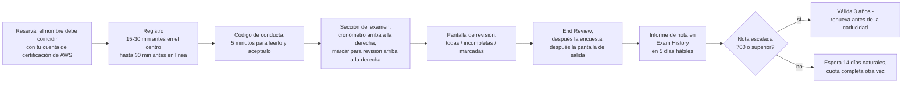
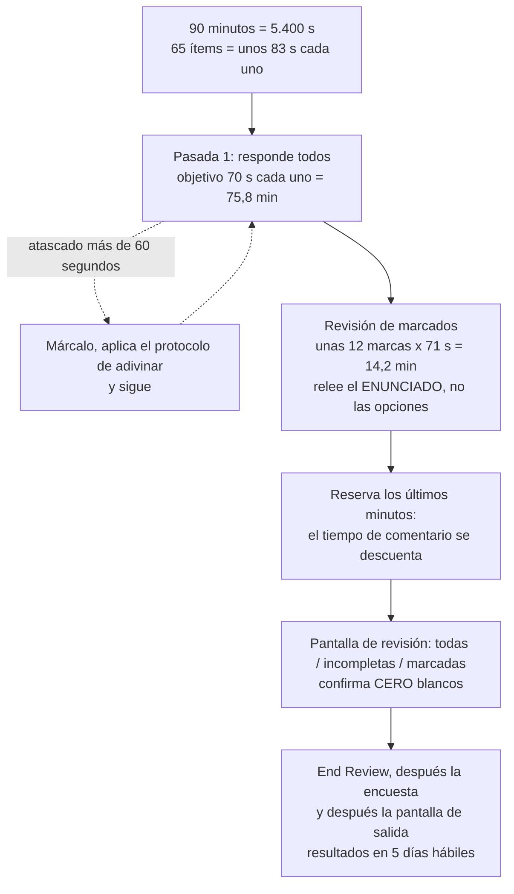
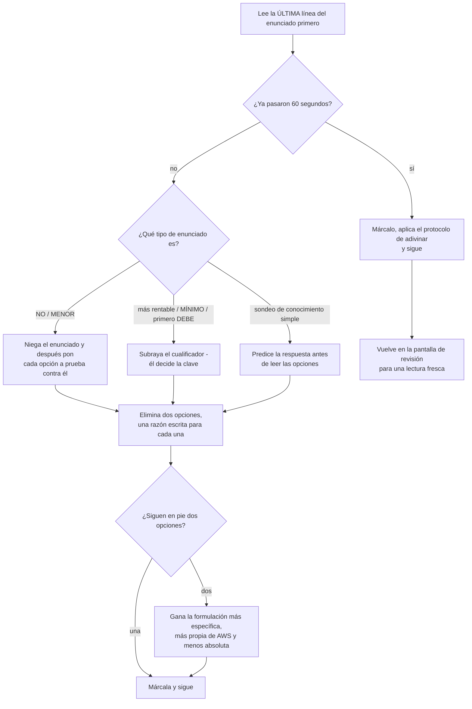
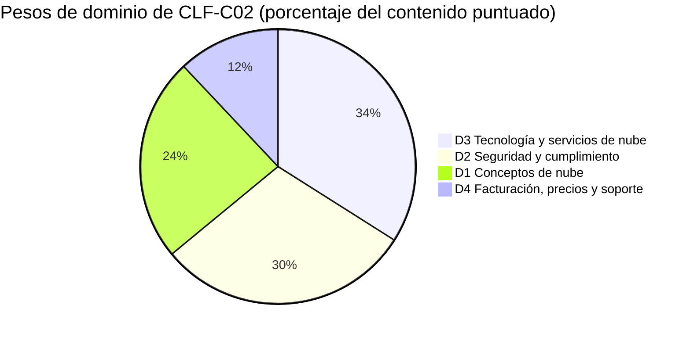
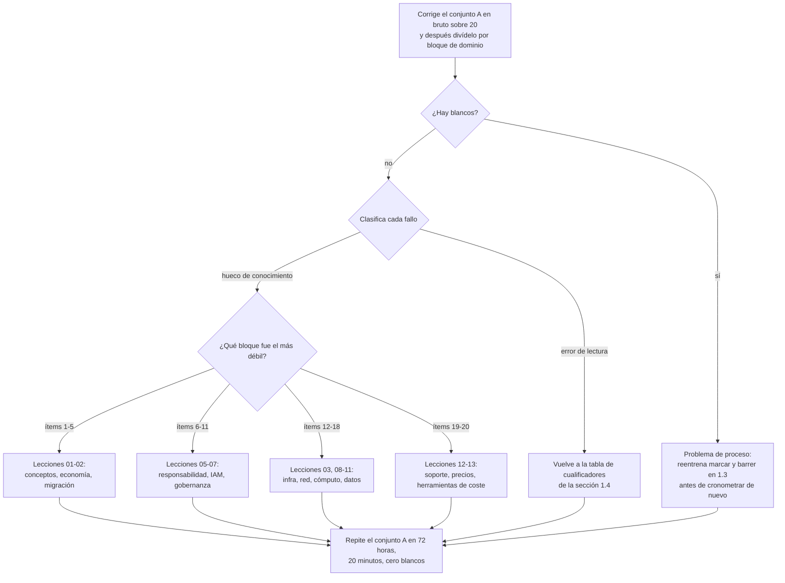

# Simulacro de examen A: conjunto de práctica completo + estrategia

Catorce lecciones te dieron el contenido. Esta te da el **contenedor**: cómo se construye de verdad un ítem CLF-C02, cómo se comporta el reloj de 90 minutos, cómo AWS redacta un distractor, y después el **conjunto A**: veinte ítems tipo examen que pasas con reloj y corriges con honestidad. Todo lo anterior a esta lección fue conocimiento de dominio; todo lo de aquí es **oficio de examen**, y en una escala compensatoria de 100 a 1.000 con 700 para aprobar, el oficio de examen vale tanto como otra hora de repaso.

```text
=====================================================================
 EXAMEN CLF-C02 DE UN VISTAZO        (todas las cifras en octubre de 2026)
=====================================================================
 FORMATO ...... 65 preguntas = 50 puntuadas + 15 no puntuadas (sin identificar)
 TIPOS ........ opción múltiple (1 correcta + 3 distractores)
                respuesta múltiple (2+ correctas de 5+ opciones)
 TIEMPO ....... 90 minutos = 5.400 s  ->  ~83 s por ítem (aritmética)
 ESCALA ....... 100 - 1.000, se aprueba con 700, COMPENSATORIA, sin corte por sección
 ADIVINAR ..... sin penalización por fallar; EN BLANCO = incorrecto
 PESOS ........ D1 Conceptos de nube 24% | D2 Seguridad 30%
                D3 Tecnología de nube 34% | D4 Facturación 12%
 COSTE ........ 100 USD por intento (puede aplicarse impuesto)
 VALIDEZ ...... 3 años; tras un SUSPENSO espera 14 días naturales,
                intentos ilimitados, cuota completa cada vez
 ENTREGA ...... centro de exámenes Pearson VUE o supervisión en línea
 RESULTADOS ... publicados en tu cuenta de certificación de AWS
                en un plazo de 5 días hábiles (techo oficial)
--------------------------------------------------------------------
 CONJUNTO A (esta lección) ...... 20 ítems en orden de ponderación: 5 / 6 / 7 / 2
=====================================================================
```

> [!NOTE]
> **Cómo usar esta lección.** Lee las secciones 1.1 a 1.7 una vez, esa es la mitad de estrategia. Después pasa el **conjunto A (sección 2) con un cronómetro de 20 minutos, sin apuntes, sin buscar y sin mirar los desgloses**. Autocorrige con la sección 3, convierte la nota bruta con la rúbrica de allí y deja que la tabla de enrutamiento te devuelva a la lección que de verdad necesitas. Todo lo que esta lección no pudo verificar contra una página de AWS de primera parte está listado en la sección 1.7, trátalo como *no lo afirmes*, no como hechos que memorizar.

Al terminar esta lección sabrás:

- enunciar de memoria todos los datos logísticos publicados (65 / 50 / 15, 90 minutos, 700/1.000, 100 USD, 3 años, 14 días);
- hacer la aritmética del ritmo de 83 segundos y defender un plan de dos pasadas que nunca deja un ítem en blanco;
- aplicar la técnica de marcar y barrer en menos de un minuto por ítem;
- leer un enunciado superlativo, *más rentable*, *menos intensivo operativamente*, *MÍNIMO*, *primero DEBE*, y saber qué opción compra ese cualificador;
- descodificar las siete familias de distractores que AWS reutiliza en los cuatro dominios;
- pasar el conjunto A, corregirlo **por dominio y no por total** y enrutar cada fallo a la lección correcta;
- defender el **veredicto comparativo** entre el autoaprendizaje, el bootcamp y la formación de AWS.

---

## 1. Estrategia: las cuatro técnicas que deciden el conjunto A

### 1.1 La logística que no debes volver a derivar el día del examen

Cada número de abajo está publicado por AWS y se recuperó en octubre de 2026. Se te permite olvidar datos menores de servicios; no se te permite volver a derivarlos con el reloj en marcha.

| Dato | El valor publicado | Por qué cambia tu estrategia |
|---|---|---|
| **Preguntas presentadas** | **65** | Tienes que *ver* las 65: la cobertura gana a la profundidad |
| **Puntuadas / no puntuadas** | **50 puntuadas + 15 no puntuadas**, y las 15 **no están identificadas** | Trata cada ítem como puntuado |
| **Tipos de pregunta** | **Opción múltiple** (1 correcta + 3 distractores) y **respuesta múltiple** (2+ correctas de 5+ opciones) | Dos procedimientos de descarte distintos, un reloj |
| **Tiempo** | **90 minutos** | 5.400 s ÷ 65 ≈ **83 s por ítem** |
| **Escala** | **100 to 1.000**, puntuación mínima de aprobado **700** | 700 es un umbral *escalado*, no un 70 % |
| **Modelo de puntuación** | **Compensatorio**; sin nota de corte por dominio | Un dominio flojo también te hunde |
| **Adivinar** | **Sin penalización**; las preguntas sin respuesta se puntúan como incorrectas | El blanco es el único cero garantizado |
| **Coste** | **100 USD** por intento (en octubre de 2026; pueden aplicarse impuestos) | Cada repetición son 100 USD nuevos |
| **Validez** | **3 años** | Anota la caducidad el día que apruebes |
| **Tras un suspensa** | Espera **14 días naturales**, sin límite de intentos, cuota completa en cada uno | Presupuesta el intento dos *antes* del intento uno |
| **Tras un aprobado** | El mismo examen no se puede repetir durante **2 años** | No puedes «refrescar» un aprobado antes de tiempo |
| **Entrega** | Centro de exámenes **Pearson VUE** o supervisión en línea | Mismo examen, mismo precio, ambas vías |
| **Resultados** | En un plazo de **5 días hábiles** en tu cuenta de certificación de AWS | Planea una semana tranquila, no refrescar cada hora |
| **Acomodación** | La acomodación ESL añade **+30 minutos** | Solicítala con mucha antelación |

- **📚 ¿Sabías que…?** Los **15 ítems no puntuados se parecen exactamente a los 50 puntuados**: AWS afirma que «no están identificados en el examen». La respuesta racional es la simetría: un ítem de preprueba mal contestado no te cuesta nada, un ítem puntuado saltado cuesta todos los puntos, así que el incentivo nunca apunta hacia «déjalo en blanco y vuelve». Marca, adivina, sigue.

**La interfaz que recibirás.** Conocer los controles *antes* del día del examen son puntos gratis, porque el examen no te da ninguna visita guiada:

| Control | Dónde está | Qué hace |
|---|---|---|
| **Cronómetro** | Arriba a la derecha | Cuenta atrás de toda la sección del examen; aparece una advertencia cuando **quedan 5 minutos** |
| **Marcar para revisión** | Arriba a la derecha | Marca un ítem para que aparezca en la pantalla de revisión: cuesta un clic |
| **Comentario** | Arriba a la izquierda | Nota de texto libre; **el tiempo de comentario se descuenta de tu tiempo de examen**, así que comenta cuando hayas terminado |
| **Código de conducta** | Antes de la sección del examen | **5 minutos** para leerlo y aceptarlo; agotarse el tiempo termina el examen sin reembolso |
| **Pantalla de revisión** | Al final | Muestra las preguntas **todas, incompletas o marcadas**; eliges el filtro y después `End Review` |
| **Encuesta + salida** | Después de `End Review` | Una encuesta breve y después la pantalla de salida (que «proporciona información sobre los resultados del examen») |



---

### 1.2 El plan de ritmo: 65 ítems, 90 minutos

AWS **no publica presupuesto por pregunta**: las únicas entradas oficiales de ritmo son la duración de 90 minutos, la **advertencia de 5 minutos** en pantalla y un blog de AWS de 2021 que sugiere marcar en lugar de demorarse. Todo lo demás de abajo es aritmética sobre cifras publicadas, y así se etiqueta.

**Ejemplo resuelto 1: el techo.**

$$
\frac{90 \times 60}{65} = \frac{5{,}400}{65} \approx 83.1\ \text{s por ítem} \quad (\text{unos }1\text{ min }23\text{ s})
$$

**Ejemplo resuelto 2, el reparto en dos pasadas.** Ejecuta la primera pasada a **70 s por ítem**: $65 \times 70 = 4{,}550$ s $= 75,8$ minutos. Eso deja $90 - 75,8 = 14,2$ minutos, que son 850 segundos, y $850 \div 71 \approx 12$ ítems marcados releídos a 71 segundos cada uno. Doce marcas es el presupuesto. No veinte.

**Ejemplo resuelto 3, lo que cuesta marcar de más.** Veinte marcas a los mismos 71 s cada una son $20 \times 71 = 1{,}420$ s $= 23,7$ minutos, encima de los 75,8 minutos de la primera pasada, **99,5 minutos en total**, unas **9,5 minutos por encima del límite de 90 minutos**. Marcar no es gratis: una marca es un segundo intento programado, y la programación tiene un número fijo de huecos.

| Fase | Reloj | Minutos | La regla que no puedes romper |
|---|---|---|---|
| **Pasada 1**: las 65 | 0:00 → 1:16 | 75,8 | **~70 s por ítem**; responde *todos* los ítems |
| **Revisión de marcados** | 1:16 → 1:30 | 14,2 | Vuelve a leer el **enunciado**, no las opciones |
| **Colchón de parada** | dentro de los últimos 5 min |: | El tiempo de comentario se **descuenta** de tu tiempo de examen |
| **Barrido sin blancos** | en la pantalla de revisión |: | Confirma **cero blancos** y después `End Review` |



**Ejemplo resuelto 4, el propio reloj del conjunto A.** El conjunto A tiene 20 ítems, así que las dos mismas reglas se reducen: una primera pasada a 60 s por ítem son $20 \times 60 = 1{,}200$ s $= \mathbf{20}$ **minutos**, y el techo de 83 segundos te daría $20 \times 83 = 1{,}660$ s $= 27,7$ minutos. Pasa el conjunto A en **20 minutos exactos**, eso entrena el ritmo que usarás para las 65, no solo para las veinte que tienes delante.

**Ejemplo resuelto 5: la ilusión de lo solo puntuado.** Frente solo a los ítems puntuados, el presupuesto parecería $5{,}400 \div 50 = 108$ s. No puedes saber cuáles de las 50 están puntuadas, así que **83 s es la cifra con la que planificas** y 108 s es una trampa contra la que nunca debes presupuestar.

**Los dos formatos cuestan minutos distintos.** CLF-C02 publica exactamente dos tipos de pregunta: no hay ítems de ordenación, emparejamiento ni de caso de estudio en este examen, así que no presupuestes para ellos. Todo lo que está por debajo de la fila de *estructura* es aritmética de planificación de esta lección, **no una cifra de AWS**:

| Tipo | Estructura | Cómo falla | Presupuesto de planificación |
|---|---|---|---|
| **Opción múltiple** | 1 respuesta correcta + 3 distractores | Ingeniería de distractores: el casi-correcto gana a la respuesta obvia | ~50 to 60 s en la pasada 1 |
| **Respuesta múltiple** | 2 o más correctas de 5 o más opciones | Perder una opción correcta; dar por sentado que existe nota parcial | ~75 to 90 s en la pasada 1 |
| **Cualquiera de los dos** | De cuatro a seis opciones tomadas de la **misma familia de servicios** | Leer las opciones antes de subrayar el cualificador del enunciado | nunca: lee la última línea primero |

- **📚 ¿Sabías que…?** Como los ítems de respuesta múltiple tardan aproximadamente un 50 % más, son los más propensos a empujarte por encima del umbral de marca de 60 segundos, y son los que los candidatos *menos* quieren marcar, porque releer cinco o seis opciones se siente productivo. Márcalos igualmente. Un ítem de respuesta múltiple marcado al que vuelves con una lectura fresca del enunciado gana a uno sin marcar que sigues minando en el sitio.

---

### 1.3 Marcar y barrer: la técnica, ítem a ítem

La propia guía de preparación de examen de AWS enseña una secuencia de cinco pasos, y el quinto es el que los candidatos se saltan. Entrenada hasta que sea automática, se ve así:

| Paso | Consejo publicado por AWS | Lo que haces de verdad |
|---|---|---|
| 1 | «Lee y comprende la pregunta antes de mirar las opciones de respuesta» | Lee primero la **última línea** y después el cuerpo del enunciado: las opciones te anclan |
| 2 | «Identifica las **frases clave y los cualificadores»** | Subraya `MÍNIMO`, `más rentable`, `primero DEBE`, `NO`, `Selecciona DOS` |
| 3 | «Descarta alguna de las opciones de respuesta en función de lo que sabes» | Elimina dos opciones con **una razón escrita para cada una** |
| 4 | «Compara y contrasta las opciones restantes» | Pone a prueba a las supervivientes contra el *dolor del enunciado*, no contra la bondad general |
| 5 | «Si estás dedicando demasiado tiempo, elige tu mejor aproximación y **marca** la pregunta» | Más allá de ~60 s: adivina, marca, sigue: nunca releas una respuesta de la que estás seguro |



El **barrido** es la otra mitad del nombre. En la pantalla de revisión no estás volviendo a responder; estás comprobando tres cosas y nada más:

1. **Blancos.** Cero. Un ítem sin respuesta se puntúa como incorrecto y no hay penalización por un error al adivinar, así que el blanco está estrictamente dominado por cualquier aproximación.
2. **La pregunta formulada.** Relee el enunciado y confirma que respondiste *esa*: la pérdida clásica es responder a la pregunta contigua, la más familiar.
3. **Orden de operaciones.** Cambia una opción solo si puedes enunciar la razón en una cláusula. «Se sentía mal» no es una cláusula.

El blog de desglose de preguntas de AWS de 2021 comprime el mismo hábito en tres preguntas que haces a **cada** opción, en este orden, y el orden importa, porque una opción puede ser cierta y aun así irrelevante:

1. **¿Qué requisito plantea la pregunta?**: nombra en una cláusula la restricción que impone el enunciado.
2. **¿Cuál es la condición?**: la situación, la forma de la carga de trabajo, el riesgo que hay que eliminar.
3. **¿Cuál es la mejor solución según las mejores prácticas de AWS?**: solo ahora compara las opciones supervivientes.

```dragdrop
{
  "question": "Ordena los seis movimientos de la rutina de marcar y barrer para un solo ítem atascado:",
  "items": [
    "En la pantalla de revisión, relee SOLO el enunciado: nunca primero las opciones",
    "Confirma que respondiste la pregunta que realmente se formulaba",
    "Pulsa Marcar para revisión y sigue de inmediato",
    "Elige tu mejor aproximación para que no quede ningún blanco",
    "Se alcanzaron 60 segundos: deja de releer las opciones",
    "Ejecuta el barrido final sin blancos antes de End Review"
  ],
  "correctOrder": [
    "Se alcanzaron 60 segundos: deja de releer las opciones",
    "Elige tu mejor aproximación para que no quede ningún blanco",
    "Pulsa Marcar para revisión y sigue de inmediato",
    "En la pantalla de revisión, relee SOLO el enunciado: nunca primero las opciones",
    "Confirma que respondiste la pregunta que realmente se formulaba",
    "Ejecuta el barrido final sin blancos antes de End Review"
  ],
  "explanation": "El orden lo fija el riesgo: el reloj es la restricción vinculante, así que el límite de tiempo salta primero y fuerza una aproximación antes de la marca, lo que garantiza que no quede ningún blanco. La marca solo compra una segunda lectura, y esa lectura debe empezar por el enunciado porque la pérdida clásica es responder a la pregunta contigua. El barrido sin blancos va al final porque es la comprobación final de que no quedó nada sin responder. Nota: CLF-C02 publica solo dos tipos de pregunta: opción múltiple y respuesta múltiple: así que esta secuencia es un ejercicio de estudio, no un formato de examen que te vayan a pedir."
}
```

---

### 1.4 Leer el enunciado: superlativos, negaciones y palabras de ordenación

La mayoría de las derrotas en CLF-C02 son derrotas de lectura. El **cualificador** del enunciado, no el nombre del servicio, decide la clave: así que el primer movimiento es siempre el mismo: encuentra el cualificador, anota lo que exige, y *después* lee las opciones.

| El enunciado dice… | Lo que realmente pregunta | Tu primer movimiento | Dónde se prueba en el conjunto A |
|---|---|---|---|
| **«más rentable»** | El coste **total** más bajo para *esta* carga de trabajo, no el precio de etiqueta más bajo | Nombra la forma de la carga de trabajo (estable, con picos, única) antes de comparar opciones | Q12 (Spot), Q13 (clase de almacenamiento), Q20 (herramientas de coste) y el ejemplo resuelto 6 de abajo |
| **«menos intensivo operativamente»** | El trabajo manual, a medida y cotidiano más pequeño | Prefiere la respuesta gestionada; desconfía de todo lo que implique una canalización hecha a mano | Q7 (parcheo de RDS frente a EC2), Q14 (réplica de lectura frente a redimensionado) |
| **«MÍNIMO»** | La opción *más baja* que satisface la restricción | Nunca respondas de más: el nivel que «tiene la función seguro» suele ser un escalón demasiado alto | Q19 (planes de soporte) |
| **«primero DEBE» / «A CONTINUACIÓN»** | El paso previo o el de eliminación de riesgos | Ordena las opciones por dependencia y toma la más temprana que exija el riesgo del enunciado | Q5 (right-sizing antes de comprometerse), Q16 (RPO/RTO) |
| **«NO» / «MENOR»** | La única opción que *viola* la restricción | Relee la última línea dos veces; el distractor suele ser la opción que sencillamente es cierta | No se usa en el conjunto A: conserva el reflejo para el examen real |
| **«(Selecciona DOS/TRES)»** | Se requiere cada respuesta correcta | Lee *todas* las opciones antes de comprometerte; la regla publicada de AWS es que debes seleccionar todas las respuestas correctas para recibir la puntuación | Q2, Q9, Q17, Q18, Q20 |

**Ejemplo resuelto 6: leer un superlativo de principio a fin.** Toma un enunciado que nunca aparece en el conjunto A: *«Una carga de producción corre 24/7 durante tres años, no puede interrumpirse y se mantendrá en una sola familia de instancias en una sola Region. ¿Qué opción ofrece el mayor techo de descuento?»*

1. **Subraya los cualificadores antes de mirar ninguna opción:** 24/7 · tres años · *no puede interrumpirse* · una familia de instancias · una Region.
2. **Deja que el cualificador más duro elimine.** «No puede interrumpirse» mata las Spot Instances en el acto: aunque Spot lleve la cifra titular más grande, **hasta un 90 % de descuento** (en octubre de 2026), porque la capacidad de Spot se puede reclamar con unos dos minutos de aviso.
3. **Haz coincidir el horizonte.** Tres años de ejecución invitan a un compromiso de tres años: **Savings Plans de instancia EC2 a 3 años / Reserved Instances estándar, hasta un 72 %** (en octubre de 2026).
4. **Toma el mayor techo que sobrevivió al paso 2.** Un Compute Savings Plan a 1 año llega como mucho al **66 %** (en octubre de 2026) y compromete un año mientras la carga corre tres; bajo demanda es la línea base sin descuento.
5. **Dí la trampa en voz alta:** saltaron dos trampas a la vez: el porcentaje más grande fue descalificado por una *restricción*, y la opción con porcentaje más barato era más *flexible* en lugar de más adecuada. Verifica cada techo en la página de precios vigente antes de apoyarte en él.

```fillblank
{
  "question": "Completa los cuatro reflejos de lectura de enunciados de la sección 1.4:",
  "template": "1) Lee primero la última línea y subraya el {{1}} - él decide la clave. 2) «Más rentable» significa el {{2}} total más bajo para la carga de trabajo descrita, no el precio de etiqueta más bajo. 3) «DEBE configurarse primero» pide el paso {{3}} o el de eliminación de riesgos. 4) Todo lo que no puedas resolver en unos minutos recibe {{4}} y una aproximación: nunca un blanco.",
  "answers": {
    "1": "cualificador",
    "2": "coste",
    "3": "previo",
    "4": "marca"
  },
  "distractors": ["nombre del servicio", "precio de etiqueta", "paso opcional", "se salta", "ponderación del dominio", "punto extra", "se reescribe"],
  "explanation": "Cuatro reflejos, uno por línea: el cualificador (MÍNIMO, más, primero, NO) es lo que la propia guía de AWS te dice que identifiques antes de comparar opciones; «más rentable» es el coste total para la forma de carga de trabajo que describe el enunciado; «primero DEBE» es una pregunta de dependencia o de eliminación de riesgos, así que la respuesta es el paso previo; y pasado más o menos un minuto el movimiento correcto es marcar, adivinar y seguir: porque las preguntas sin respuesta se puntúan como incorrectas y no hay penalización por adivinar mal."
}
```

- **📚 ¿Sabías que…?** El consejo número cinco de preparación de examen de AWS dice literalmente «elige tu mejor aproximación y marca la pregunta para revisarla más tarde»: la marca es una técnica **oficial**, no un truco. La interfaz del examen te da un control `Flag for Review` y una pantalla de revisión que puede mostrar **todas, incompletas o marcadas** las preguntas, así que una marca te cuesta un clic y compra una segunda lectura programada.

### 1.5 Las siete familias de distractores

AWS afirma que los distractores son «respuestas generalmente plausibles que coinciden con el área de contenido». No son aleatorias; las mismas siete formas se repiten, y cada una castiga una confusión concreta. Aquí se etiquetan como **T1, T7** para que nunca se confundan con las etiquetas de dominio **D1, D4**.

| # | Familia de distractor | Cómo te tienta | Tu contramovimiento |
|---|---|---|---|
| **T1** | **Servicio hermano** | Se ofrece DynamoDB para una necesidad *relacional*, ElastiCache para un sistema de registro | Relaciona el **sustantivo** del enunciado con el modelo de datos primero |
| **T2** | **Error de capa** | EBS para una necesidad de base de datos, Multi-AZ para una necesidad de escala de lectura | Familia correcta, *capa* equivocada: bloque frente a archivo frente a objeto, HA frente a escala de lectura |
| **T3** | **Ámbito / nomenclatura** | Un servicio fuera de alcance que suena más avanzado que la clave real | La respuesta está siempre en la lista **dentro de alcance** |
| **T4** | **Sobreafirmación** | Se ofrece soporte de nivel Enterprise para una pregunta de *MÍNIMO* | Responde al superlativo, no al tema |
| **T5** | **Inversión de responsabilidad** | «Es el firewall de AWS, luego lo configura AWS» | Pregunta: ¿esto es *del* cloud o *en* el cloud? |
| **T6** | **Cebo numérico** | Un porcentaje, techo o fecha equivocados unidos a una afirmación cierta | Escribe la unidad y la cifra antes de comparar |
| **T7** | **Cierto pero irrelevante** | Un hecho correcto que responde a una pregunta vecina | Pone a prueba cada opción contra el *dolor del enunciado* |

```matching
{
  "question": "Relaciona cada disparador de enunciado con el servicio o control que de verdad lo responde: los siete pares de trampa con más probabilidades de quitar puntos en el conjunto A:",
  "pairs": [
    {"left": "Bloquear un rango CIDR conocido como malo en el nivel de SUBRED con una regla DENY explícita", "right": "Regla de ACL de red"},
    {"left": "Estimar el coste mensual de una aplicación propuesta ANTES de que existan recursos", "right": "AWS Pricing Calculator"},
    {"left": "Demostrar QUÉ principal de IAM borró una tabla de DynamoDB el martes pasado", "right": "AWS CloudTrail"},
    {"left": "Servir el tráfico de lectura de un equipo de informes sin tocar al escritor ni a su conmutación", "right": "Una réplica de lectura de la base de datos principal"},
    {"left": "Entregar a un auditor los informes SOC 2 y PCI de la propia AWS bajo demanda", "right": "AWS Artifact"},
    {"left": "Adjuntar un juego de reglas de capa 7 que bloquee inyección SQL y XSS a un Application Load Balancer", "right": "AWS WAF"},
    {"left": "Conseguir el plan de soporte MÍNIMO que incluye soporte técnico por teléfono", "right": "Business Support+ (nomenclatura de 2026)"}
  ],
  "explanation": "Cada par lo decide un cualificador: DENY más subred selecciona la ACL de red (los grupos de seguridad solo permiten y actúan a nivel de instancia); antes de que existan recursos selecciona el Pricing Calculator (Cost Explorer necesita uso real y Budgets necesita un objetivo); QUÉ principal selecciona CloudTrail (Config registra estado, no actores); el tráfico de lectura selecciona la réplica de lectura (un en espera Multi-AZ no sirve lecturas); los informes propios de AWS viven en Artifact (Config registra TUS recursos); SQLi y XSS son capa 7, luego WAF (Shield es DDoS); y MÍNIMO te impone responder de más con Enterprise. Las familias de trampa T2, T4, T5, T6 y T7 aparecen todas en este ejercicio."
}
```

---

### 1.6 Los pesos de dominio y el plano del conjunto A

Solo se publican los porcentajes **por dominio**. Los recuentos de ítems son aritmética sobre los 50 ítems puntuados: una ayuda de planificación, nunca una cifra de AWS.

| Dominio | Ponderación publicada | Ítems puntuados en el examen real (derivado: 50 × w) | Ítems del conjunto A aquí | Pista de prioridad |
|---|---|---|---|---|
| **D1** Conceptos de nube | **24 %** | ≈ 12 | **5** (Q1: Q5) | Ventajas, pilares, los 6 Rs, economía |
| **D2** Seguridad y cumplimiento | **30 %** | ≈ 15 | **6** (Q6: Q11) | Responsabilidad compartida, IAM, controles |
| **D3** Tecnología y servicios de nube | **34 %** | ≈ 17 | **7** (Q12: Q18) | Cómputo, almacenamiento, bases de datos, red, DR |
| **D4** Facturación, precios y soporte | **12 %** | ≈ 6 | **2** (Q19: Q20) | Herramientas de coste, niveles de soporte, cualificadores |
| **Total** | **100 %** | **≈ 50** | **20** | La columna «ítems puntuados» es aritmética, no de AWS |

**Ejemplo resuelto 7, de pesos a ítems.** $50 \times 0{,}24 = 12$, $50 \times 0{,}30 = 15$, $50 \times 0{,}34 = 17$, $50 \times 0{,}12 = 6$; $12 + 15 + 17 + 6 = 50$. Los dominios 2 y 3 suman el **64 %** del contenido puntuado, por eso el conjunto A les da 13 de sus 20 ítems.



- **📚 ¿Sabías que…?** **700 no es un 70 %.** La escala va de 100 a 1.000, así que el rango útil es de 900 puntos y la nota de aprobado está a $\frac{700 - 100}{1{,}000 - 100} = \frac{600}{900} \approx \mathbf{66{,}7\,\%}$ de distancia desde el suelo. AWS no publica cuántas respuestas correctas equivalen a 700, las formas de examen se equiparan, así que cualquier afirmación de «35 de 50 = aprobado» que encuentres en línea está sin fuente. Planifica para **≥ 80 % en práctica mixta con cero blancos** y deja que la nota escalada se ocupe de sí misma.

> [!IMPORTANT]
> **Veredicto comparativo: preparación para el examen: autoaprendizaje × bootcamp × formación de AWS**
> - **Autoaprendizaje (gratis, vía oficial).** Suficiente para este examen Fundacional, y AWS lo dice directamente: *«AWS no exige que sigas una formación de AWS para prepararte.»* La vía gratuita completa es la guía del examen → el **Official Practice Question Set** gratuito (20 preguntas, comentarios detallados y recursos recomendados) → **AWS Cloud Practitioner Essentials** → documentos técnicos y preguntas frecuentes de productos → la demostración gratuita **AWS Exam Demo** para la interfaz. El ritmo propio de AWS para nivel Fundacional es de **2 to 3 semanas**, en bloques de 30 to 60 minutos, con **al menos un examen de práctica completo cronometrado** primero. El modo de fallo conocido es el autoaprendizaje puramente de contenido que nunca entrena el reloj: que es exactamente el hueco que existen para cerrar las secciones 1.1 a 1.4 y el conjunto A.
> - **Bootcamp / formación presencial (de pago).** El material propio de preparación de examen de AWS en aula vende **oficio de examen**, no contenido examinable nuevo: «cómo abordar diferentes tipos de pregunta y cómo identificar las ideas erróneas comunes que aparecen en el examen» más «práctica guiada con preguntas tipo examen y debates basados en escenarios». Cómpralo si ya has suspendido una vez o si no puedes autocoerte una sesión cronometrada. No añade **ningún** conocimiento de dominio que la guía ya enumere.
> - **Formación de AWS / Skill Builder.** El nivel gratuito cubre el conjunto de preguntas de práctica y Cloud Practitioner Essentials; la **suscripción Individual de pago empieza en 29 USD al mes** (en octubre de 2026) y desbloquea el **Official Practice Exam**, que AWS describe como con el *«mismo estilo de pregunta, profundidad y rigor»* que el examen de certificación, además de laboratorios, SimuLearn y tarjetas de memoria. Suscríbete por el mes en que piensas terminar, no por un año.
> - **Regla práctica.** Presupuesta **2 to 3 semanas**, una carrera completa cronometrada y **100 USD por intento** (en octubre de 2026). El camino más barato hacia un aprobado es material oficial gratuito más trabajo disciplinado con el reloj; el más caro es volver a presentarse sin haber hecho nunca una carrera cronometrada: 14 días de espera y otros 100 USD cada vez. **Nunca** uses «preguntas reales del examen» compartidas: AWS afirma que compartirlas o acceder a ellas incumple el Acuerdo del Programa de Certificación de AWS.

### 1.7 Lo que esta lección deliberadamente no afirma

Estos puntos se marcan en lugar de enseñarse, porque un resumen marcado *(G)* nunca es un hecho:

1. **Nota parcial en la respuesta múltiple.** La guía CLF-C02 dice «dos o más respuestas correctas de cinco o más opciones de respuesta» pero nunca escribe «selecciona todas las respuestas correctas» ni «nota parcial». La frase de todo-o-nada publicada por AWS, *«Debes seleccionar todas las respuestas correctas para recibir la puntuación de la pregunta»*, procede de la guía de AWS AI Practitioner y de una entrada de blog de AWS de 2024. Enséñate a ti mismo **todo-o-nada, cero nota parcial**; no reclames que CLF-C02 lo publica.
2. **Cuántos ítems de respuesta múltiple** trae el examen real y si cada enunciado indica el recuento; sin publicar.
3. **Ritmo por pregunta.** 83 segundos es aritmética de 90 minutos ÷ 65; AWS no publica ninguna guía de ritmo, y el límite de lectura de 45 to 60 segundos de un blog de AWS de 2021 es la práctica de un autor concreto.
4. **Tasas de aprobación.** AWS no publica ninguna. Cualquier cifra de «tasa de aprobación en el primer intento» es una estimación de la comunidad.
5. **Hoja de borrador.** Las reglas recuperadas listan notas, bolígrafos y teléfonos como prohibidos en la supervisión en línea, pero no zanjan la práctica en el centro de exámenes. Nunca digas que se proporciona: ni que está prohibida.
6. **Aprobado/suspenso en pantalla.** El texto oficial solo dice que la pantalla de salida «proporciona información sobre los resultados del examen», mientras que los resultados tardan hasta cinco días hábiles.
7. **Conversión de nota bruta a escalada y ponderaciones por objetivo.** Solo existen porcentajes por dominio; los objetivos no tienen ponderación publicada.
8. **Presentación de los planes de soporte.** El recorrido de 2023 de AWS hizo depender la respuesta de soporte telefónico de «Business»; la guía de examen actual enumera **Basic, AWS Business Support+, AWS Enterprise Support, AWS Unified Operations**. Enseña los nombres de 2026, con fecha (véase la Q19).

---

## Casos Reales

AWS nunca imprime el nombre de un cliente en un ítem de CLF-C02, pero las *formas* de sus casos de estudio publicados se filtran constantemente en los enunciados: una frase de un caso de estudio se convierte en la condición del enunciado, y las cuatro opciones se convierten en las cuatro maneras en que los candidatos la leen mal. Los dos ejercicios de abajo convierten casos de estudio reales de AWS en breves análisis de escenario para ejecutarlos **antes** del conjunto A: cada uno termina con *qué dominio prueba* y *qué preguntaría el examen*.

Dos reglas gobiernan todo lo de esta sección:

1. **Un resultado de cliente nunca es una garantía de AWS.** «Zendesk redujo costes hasta un 42 %» es el resultado comunicado por Zendesk en una página de AWS; AWS no se compromete con ningún porcentaje. Cualquier opción redactada «AWS garantiza…» es falsa a primera vista.
2. **El dominio lo elige el cualificador, no la historia.** La misma narrativa de Capital One siembra un enunciado del Dominio 1 (agilidad), uno del Dominio 3 (servicios) o uno del Dominio 4 (coste) según qué cláusula subraye el examen: exactamente el reflejo de la sección 1.4.

### Ejercicio de caso 1, Capital One «todo en AWS»: ¿qué dominio prueba una historia de agilidad?

**La historia tal y como la publica AWS** (páginas de casos de estudio de clientes de AWS, consultadas en octubre de 2026):

| Elemento | Lo que publicó AWS |
|---|---|
| **Desafío** | Ocho centros de datos on-premises más un ciclo de renovación de hardware, y la necesidad de escalar para aprendizaje automático y personalización en tiempo real |
| **Servicios nombrados** | Más de 30, entre ellos Amazon EC2, Amazon S3, Amazon RDS, AWS Lambda, Amazon ECS con AWS Fargate, AWS Step Functions |
| **Resultado de migración** | Salida de **8** centros de datos (el último en 2020); **80 %** de unas **2.000** aplicaciones construidas en la nube desde cero; reciclados **103 toneladas** de cobre y acero |
| **Resultado de velocidad** | Tiempo medio para construir un entorno de desarrollo: **3 meses → minutos** |
| **Resultado de resiliencia** (una página *distinta* de AWS) | Eventos de gravedad crítica **−80 % a −90 %**; tiempo de recuperación **horas → minutos**; tiempo de prueba de DR **−70 %** |

**¿Qué dominio prueba esto?** Principalmente **D1 Conceptos de nube (24 %)**: valor de negocio, agilidad, los 6 Rs, economía. Gancho secundario: **D3 Tecnología y servicios de nube (34 %)** si el enunciado nombra los servicios, **D4 Facturación, precios y soporte (12 %)** si nombra la palanca de coste (ponderaciones en octubre de 2026).

**¿Qué preguntaría el examen?** Tres formas de enunciado, todas construidas a partir de la tabla de arriba:

1. *«…redujo el tiempo medio necesario para construir un entorno de desarrollo de 3 meses a solo minutos. ¿Qué ventaja de la nube de AWS ilustra esto?»* → **Aumentar la velocidad y la agilidad**. El cualificador es el *plazo de aprovisionamiento*. Las opciones perdedoras son todas ventajas genuinas de AWS: *economías de escala* (precio unitario), *lleva tu negocio al mundo en minutos* (Regions y latencia), *cambia el gasto fijo por gasto variable* (forma de la factura). Esa es la familia de trampa **T7, cierto pero irrelevante**: una opción puede ser cierta y aun así responder a otra pregunta.
2. *«La empresa construyó el 80 % de sus aplicaciones desde cero. ¿Cuál de los 6 Rs?»* → **Refactorizar / re-arquitectar**, decidido por la cláusula *«desde cero»*. Cambia esa cláusula y se mueve la clave: *«copió las imágenes de máquina virtual sin cambios»* → **Rehospedar**; *«movió la base de datos a un servicio gestionado, código intacto»* → **Replataformar**. Una historia, tres claves, todas elegidas por el cualificador que subrayaste primero.
3. *«¿Qué afirmación sobre los ahorros comunicados es correcta?»* → son **resultados de cliente** publicados en una página de AWS, nunca compromisos de AWS. Una opción redactada *«AWS garantiza…»* o *«AWS entrega hasta un X % de ahorro a cada cliente»* falla antes de que siquiera compruebes la cifra.

**La trampa que hay que decir en voz alta:** Capital One está en **dos páginas distintas de AWS con dos juegos de cifras distintos**: la página de migración lleva *«3 meses → minutos»* y un tiempo de prueba de DR de **−70 %**, mientras que la página de resiliencia lleva un **−80 % a −90 %** de eventos de gravedad crítica y una recuperación de *horas → minutos*. Un enunciado que cita la cifra de una página dentro de la historia de la otra es un distractor por construcción.

- **📚 ¿Sabías que…?** Amazon S3 se lanzó el **14 de marzo de 2006** a **15 centavos por gigabyte** sobre unos **petabyte** repartidos en unos 400 nodos de almacenamiento, y la retrospectiva de 20 años de la propia AWS (AWS News Blog, publicado el **2026-03-13**) sitúa el precio actual en *«ligeramente por encima de 2 centavos por gigabyte»*, unas reducciones del **85 %**, mientras señala que el código escrito para S3 en 2006 sigue funcionando sin cambios. Pon fecha a ambos puntos: son cifras publicadas por AWS en octubre de 2026, y el precio vigente debe verificarse antes de apoyarte en él.

---

### Ejercicio de caso 2, Box: leer un ahorro de $2,23 M como cuatro palancas de examen

**La historia tal y como la publica AWS** (caso de estudio de cliente de AWS, consultado en octubre de 2026): Box, proveedor de SaaS empresarial, aplicó el **AWS Well-Architected Framework** y revisiones de Solutions Architect para recortar el gasto sin degradar seguridad, fiabilidad ni rendimiento, y publicó **$2,23 millones** de ahorro repartidos en cuatro palancas. En palabras del propio cliente: *«Nuestro uso de las mejores prácticas de AWS nos llevó a ahorros de más de 2 millones de dólares»*: el director de FinOps y SRE de Box, voz de cliente antes que afirmación de AWS.

**Ejemplo resuelto 10: la cascada suma.**

$$438{,}000 + 1{,}100{,}000 + 500{,}000 + 192{,}000 = 2{,}230{,}000$$

**$438 K entre zonas de disponibilidad + $1,1 M de salida + >$500 K de almacenamiento + $192 K de registros = $2,23 M**, y cada barra es un concepto de facturación examinable:

| Palanca de Box | Tal y como se publica | El concepto examinable que hay detrás |
|---|---|---|
| **Transferencia entre zonas de disponibilidad** | **$438.000** | El tráfico *entre zonas de disponibilidad dentro de una Region* se factura; la solución arquitectónica es mantener el tráfico de cada capa dentro de una sola zona de disponibilidad |
| **Salida a Internet** | **$1,1 M al año** | Transferencia de datos **saliente** hacia Internet; la franquicia gratuita es de **100 GB al mes** desde las Regions (un cambio de 2021, aún vigente en octubre de 2026) más 1 TB al mes mediante Amazon CloudFront |
| **Almacenamiento** | **>$500 K al año** | Clases de almacenamiento de S3 y estratificación: el mismo razonamiento que la Q13 del conjunto A (Glacier Instant Retrieval para lecturas trimestrales en milisegundos) |
| **Registros** | **$192.000** | Volumen y retención de registros: una decisión de filtrado de eventos de CloudTrail, no un control de seguridad nuevo |

**¿Qué dominio prueba esto?** **D4 Facturación, precios y soporte (12 %)** primero, cargos de transferencia de datos, economía de almacenamiento, las cuatro herramientas de coste, con ganchos de **D3 (34 %)** (clases de almacenamiento) y de **D1 (24 %)** (coste total de propiedad, el pilar de coste de Well-Architected).

**¿Qué preguntaría el examen?** Tres formas de enunciado:

1. *«La factura de una empresa está dominada por el tráfico que fluye entre zonas de disponibilidad. ¿Qué cambio la REDUCE MÁS?»* → arreglar la **arquitectura**: mantener los componentes de una capa dentro de una única zona de disponibilidad. Cada distractor responde a una pregunta vecina: las Reserved Instances cambian la tarifa de *cómputo*, la MFA es un control de seguridad y «moverse a una Region más barata» deja intacto el patrón entre zonas de disponibilidad.
2. *«¿Qué servicio de AWS podría estimar el coste mensual de esta arquitectura antes de que existan recursos?»* → **AWS Pricing Calculator**: gratis y utilizable sin cuenta de AWS. Cost Explorer necesita uso real, AWS Budgets vigila un objetivo y el Cost and Usage Report exporta facturas ya incurridas (desglose de la Q20 del conjunto A).
3. *«¿Qué marco de AWS produjo estas recomendaciones?»* → el **AWS Well-Architected Framework / Well-Architected Review**: guía de mejores prácticas gratuita. *No* es Trusted Advisor (que revisa la configuración de tu cuenta), *no* es un plan de soporte de AWS y *no* es una certificación.

**La trampa que hay que decir en voz alta:** la palanca **gratuita** de esta historia es la *arquitectura*, una revisión de Well-Architected no cuesta nada, mientras que cada dólar y porcentaje de la página es el resultado de **Box**. Una opción que te prometa los mismos $2,23 M, que llame a la revisión «certificación» o que la archive bajo Trusted Advisor es falsa solo por redacción.

```matching
{
  "question": "Relaciona cada afirmación de caso de estudio con la corrección que el examen de verdad premia: seis pares de trampa tomados de las propias historias de clientes de AWS:",
  "pairs": [
    {"left": "\"AWS garantiza una reducción de costes del 42% cuando te mueves a Graviton\"", "right": "Resultado de cliente: lo comunicó Zendesk; AWS no garantiza ningún porcentaje"},
    {"left": "\"La página de resiliencia de Capital One demuestra una mejora del 70% en DR\"", "right": "Dos páginas, dos juegos de cifras: el -70% del tiempo de prueba de DR está en la página de MIGRACIÓN"},
    {"left": "\"Un despliegue multi-AZ protege la Region entera\"", "right": "Multi-AZ aísla una falla de zona de disponibilidad; multi-Region aísla una falla de Region"},
    {"left": "\"Savings Plans y Spot Instances son el mismo tipo de descuento\"", "right": "SP = compromiso de 1-3 años en USD/hora; Spot = capacidad sobrante interrumpible, hasta un 90% de descuento"},
    {"left": "\"FedRAMP es un producto de AWS que compra el cliente\"", "right": "FedRAMP es una autorización gubernamental: AWS suministra GovCloud y controles heredados, el cliente recibe el ATO"},
    {"left": "\"El Well-Architected Review es una certificación\"", "right": "Revisión gratuita de mejores prácticas: ni una certificación ni Trusted Advisor"}
  ],
  "explanation": "Cada par gira sobre un cualificador, exactamente como en la sección 1.4: «garantiza» convierte un resultado de cliente en una promesa de AWS (nunca cierto); las páginas de Capital One no deben mezclarse (página de migración frente a página de resiliencia); zona de disponibilidad frente a Region es el sustantivo de ámbito; compromiso frente a interrumpible es la condición; FedRAMP es una autorización, no un producto; y una revisión es una guía, no una credencial. Todos los porcentajes y dólares son resultados de cliente publicados por AWS, en octubre de 2026: nunca compromisos."
}
```

### Actualizaciones de 2026 (en octubre de 2026)

Seis cambios de 2025-2026 deciden si tus apuntes son correctos o incorrectos el día del examen. Cada punto tiene como fuente una página de AWS de primera parte recuperada en octubre de 2026; cuando una afirmación no pudo verificarse se etiqueta como tal y nunca debe memorizarse como hecho.

> [!NOTE]
> **Qué se movió entre 2025 y octubre de 2026:**
> - **Los nombres de los planes de soporte cambiaron dentro del propio texto del examen.** El ejemplo de la tarea 4.3 del Dominio 4 de la guía actual dice ahora *«Basic Support, AWS Business Support+, AWS Enterprise Support, AWS Unified Operations»*; la guía de la época del lanzamiento, la *Versión 1.0*, decía «AWS Developer Support, AWS Business Support, AWS Enterprise On-Ramp Support, AWS Enterprise Support». El anuncio de AWS del **2025-12-02** cerró Developer, Business clásico y Enterprise On-Ramp a las suscripciones **nuevas** después de esa fecha (las suscripciones existentes siguen **hasta el 2027-01-01**), y Basic sigue siendo gratuito. Aprende los nombres de 2026: son en los que se apoya la Q19 del conjunto A.
> - **Las ponderaciones de dominio no se han movido:** 24 % / 30 % / 34 % / 12 %, sin cambios desde que CLF-C02 entró en vigor el **2023-09-19**. El material que sigue citando el 26 / 25 / 33 / 16 de CLF-C01 está citando un apéndice que AWS **eliminó** de la guía actual.
> - **Las listas de alcance se reconstruyeron.** Frente a la guía de la época del lanzamiento, la *Versión 1.0*, las entradas dentro de alcance pasaron de **128 a 111** y la lista explícita de fuera de alcance fue de **11 a 55** (diferencia calculada en 2026-10). AWS Wavelength, Amazon MSK, AWS Network Firewall y AWS Billing Conductor están ahora explícitamente fuera de alcance, y AWS Local Zones no aparece en **ninguna** de las dos listas. La lista se define a sí misma como «no exhaustiva y sujeta a cambios»: responde a las preguntas de alcance con la guía que descargues esa semana.
> - **La logística de entrega no cambia**, 90 minutos, 65 preguntas, 100 USD, centro de exámenes Pearson VUE o supervisión en línea, 12 idiomas, pero **el italiano y el alemán se retiran después del 2026-12-31**. Si ese es tu idioma de examen, reserva antes de esa fecha límite.
> - **El Free Tier cambió de forma para las cuentas nuevas.** Las cuentas creadas **el 2025-07-15 o después** conservan el Free Tier durante **6 meses** o hasta agotar los créditos, lo que ocurra primero, con un **crédito de registro de 100 USD más hasta 100 USD ganables** (hasta 200 USD) y tipos elegibles entre `t3.micro`, `t3.small`, `t4g.micro`, `t4g.small`, `c7i-flex.large` y `m7i-flex.large`. Las cuentas anteriores conservan el Free Tier legado de **12 meses** que incluía `t2.micro`. «12 meses de t2.micro» es por tanto solo media respuesta: la otra mitad es la fecha de la cuenta del enunciado (en octubre de 2026; verifica el dato vigente antes de usarlo).
> - **La guía no lleva número de versión.** El PDF actual solo imprime «Copyright © 2026»; el único artefacto con sello es la *«Version 1.0 CLF-C02»* de la época del lanzamiento, y el `uiVersion=2024.10` de la página de documentación es la **plantilla del sitio** de AWS Docs, no una revisión de la guía. Las afirmaciones de actualizaciones numeradas (por ejemplo «v1.3, marzo de 2026») **no se pudieron verificar** y no deben repetirse como hecho: vuelve a descargar la guía antes de presentarte.

- **📚 ¿Sabías que…?** AWS anunció el **AWS Well-Architected Agent** (vista previa, **2026-10-01**) y lo describe como *«la evolución de nueva generación de AWS Trusted Advisor y de la AWS Well-Architected Tool»*, mientras que los **Database Savings Plans** llegaron el **2025-12-02**, y sin embargo **ninguno de los dos nombres aparece en la guía del examen**, que sigue listando AWS Well-Architected Tool y AWS Savings Plans. La meta-habilidad de 2026: un servicio puede ser real, reciente y aun así *no examinable*. La lista de alcance de la guía es el único árbitro.

---

## 2. Preguntas de Práctica (Practice Questions), conjunto A: 20 ítems en el orden publicado de ponderación

El conjunto A refleja el formato **dominante** del examen real, una respuesta correcta y tres distractores, mientras entrena además cinco ítems de **respuesta múltiple**. Los ítems van en orden de ponderación por dominio: **D1 cinco, D2 seis, D3 siete, D4 dos**.

### 2.0 Cómo pasar el conjunto A

| Ajuste | La regla | Por qué importa |
|---|---|---|
| **Cronómetro** | **20 minutos exactos** (60 s por ítem: el presupuesto de la primera pasada) | Entrena el ritmo que usarás para 65 ítems |
| **Materiales** | Sin apuntes, sin búsqueda, sin desglose visible | Puntuar con libro abierto mide tus apuntes, no a ti |
| **Ritmo** | Responde todos los ítems; marca lo que pase de 60 segundos y sigue | Un blanco es un cero garantizado: la regla no cambia con el tamaño del conjunto |
| **Respuesta múltiple** | Lee **todas** las opciones; en este conjunto las afirmaciones correctas van precombinadas en una sola opción, de modo que cada ítem conserva una única clave | Entrena el pensamiento de todo-o-nada sin romper el formato de clave única |
| **Segunda pasada** | Solo después de que pare el cronómetro, revisa los ítems marcados | Simula la ventana de revisión de marcados |
| **Corrección** | Por **bloque de dominio** primero y total después (sección 3) | La puntuación compensatoria castiga el valle, no la media |
| **Repetición** | 72 horas después, de memoria | Los huecos cortos miden reconocimiento, no retención |

**Comprobación previa: ejecútala en los 60 segundos antes de arrancar el cronómetro:**

1. Cronómetro a **20 minutos**, notificaciones apagadas, móvil en otra habitación.
2. Una hoja en blanco para las palabras cualificadoras (`MÍNIMO`, `más`, `primero`, `NO`, `Selecciona DOS`): escribir el cualificador es toda la técnica.
3. Hoja de respuestas o contador listo, para que corregir tome 30 segundos después.
4. Acuerdo contigo mismo: **cero blancos**, y ningún cambio de opción sin una razón de una cláusula.
5. Acuerdo contigo mismo: a los **60 segundos** el ítem se marca y se adivina, lo que digan tus instintos.
6. Desgloses ocultos. Si los ves, estás midiendo tu comprensión lectora, no tu recuerdo.

### 2.1 Dominio 1: Conceptos de nube (24 %) · ítems 1 to 5

```question
{
  "id": "clf-15-q1",
  "type": "multiple-choice",
  "question": "Una startup se niega a comprar servidores dimensionados para un pico que ocurre dos semanas al año; lanza y termina cómputo según cambia la demanda. ¿Qué ventaja de la nube de AWS ilustra esto?",
  "options": [
    "Beneficiarse de enormes economías de escala",
    "Cambiar el gasto fijo por gasto variable",
    "Lleva tu negocio al mundo en minutos",
    "Aumentar la velocidad y la agilidad"
  ],
  "correct": 1,
  "explanation": "Pagar solo por los recursos consumidos convierte el gasto de capital en gasto variable, que es exactamente la queja por dimensionamiento de picos del enunciado."
}
```

**Desglose, Q1 · fijo → variable.** **Por qué es correcta:** un gasto variable medido significa que nunca compras capacidad para un pico de dos semanas, ese es el desplazamiento de fijo a variable. **Por qué pierden las trampas:** **A** es el argumento de *agregación* (cientos de miles de clientes rebajan el precio unitario), no un argumento de dimensionamiento de picos; **C** son Regions, latencia y residencia de datos; **D** es el tiempo hasta el mercado. **Trampa:** «economías de escala» es la frase con más acento económico de la lista de opciones, pero la palabra clave del enunciado es *pico de dos semanas al año*. **Fuente:** semilla del banco de preguntas Q01 · resumen de conceptos de nube §B (las seis ventajas de la computación en la nube de AWS).

```question
{
  "id": "clf-15-q2",
  "type": "multiple-choice",
  "question": "(Selecciona DOS.) ¿Cuáles DOS están entre las seis ventajas de la computación en la nube que publica AWS? En el formato de clave única de este conjunto las dos ventajas van precombinadas dentro de una opción: elige la opción en la que AMBOS elementos son ventajas publicadas.",
  "options": [
    "Cambiar el gasto fijo por gasto variable; dejar de adivinar la capacidad",
    "Eliminar el modelo de responsabilidad compartida; garantizar un 100% de disponibilidad para todas las aplicaciones",
    "Ejecutar toda carga de trabajo en una sola Region para reducir coste; mantener todos los datos del cliente on-premises",
    "Cambiar el gasto fijo por gasto variable; eliminar el modelo de responsabilidad compartida"
  ],
  "correct": 0,
  "explanation": "Las seis publicadas incluyen cambiar el gasto fijo por variable y dejar de adivinar la capacidad: la capacidad nueva está disponible con solo unos minutos de aviso."
}
```

**Desglose, Q2 · dos de las seis ventajas.** **Por qué es correcta:** las dos mitades están en la lista publicada: fijo → variable y dejar de adivinar la capacidad. **Por qué pierden las trampas:** **B** ofrece dos afirmaciones falsas, el modelo de responsabilidad compartida se aplica siempre y AWS suministra primitivas resilientes mientras que *la disponibilidad es una responsabilidad compartida*, así que no existe garantía general alguna; **C** es lo contrario de «lleva tu negocio al mundo en minutos» más un giro extraño de soberanía de datos; **D** introduce la mitad falsa «eliminar la responsabilidad compartida» dentro de una pareja de por sí válida. **Trampa:** los candidatos premian la *prudencia* (una sola Region, mantener los datos cerca) en lugar de comprobar la lista publicada. **Forma en el examen real:** marcarías dos casillas separadas; la regla publicada de AWS para este tipo es de todo-o-nada. **Fuente:** semilla Q05 · resumen de conceptos de nube §B · resumen de responsabilidad compartida §B.

```question
{
  "id": "clf-15-q3",
  "type": "multiple-choice",
  "question": "Un equipo despliega una aplicación en dos zonas de disponibilidad para que siga funcionando si una zona falla. ¿Qué pilar del AWS Well-Architected Framework aborda esto?",
  "options": [
    "Optimización de costes",
    "Eficiencia de rendimiento",
    "Seguridad",
    "Fiabilidad"
  ],
  "correct": 3,
  "explanation": "La fiabilidad es la capacidad de una carga de trabajo para desempeñar su función prevista de forma correcta y consistente cuando se espera; eliminar puntos únicos de fallo con una segunda zona de disponibilidad es el movimiento clásico de fiabilidad."
}
```

**Desglose: Q3 · qué pilar.** **Por qué es correcta:** multi-AZ elimina puntos únicos de fallo, que es exactamente la definición de fiabilidad. **Por qué pierden las trampas:** **A** trata del precio más bajo para el valor de negocio: una segunda zona de disponibilidad *cuesta más*, así que esta opción se mueve en dirección contraria al cambio; **B** trata de usar recursos con eficiencia a medida que cambian la demanda o la tecnología; **D** protege datos y sistemas: necesario en todas partes, pero no es lo que compra específicamente una segunda zona de disponibilidad. **Trampa:** «varias zonas» tienta hacia el *rendimiento* (más capacidad) y hacia el *coste* (parece desperdicio). Memoriza los seis pilares: excelencia operativa, seguridad, fiabilidad, eficiencia de rendimiento, optimización de costes y sostenibilidad. **Fuente:** semilla Q02 · resumen de monitorización/soporte F.9 · AWS Well-Architected Framework.

```question
{
  "id": "clf-15-q4",
  "type": "multiple-choice",
  "question": "Una empresa copia sus imágenes de máquina virtual existentes a Amazon EC2 sin cambios, sin editar la aplicación, para salir de su centro de datos lo más rápido posible. ¿Qué estrategia de migración es esta?",
  "options": [
    "Replataformar",
    "Refactorizar o re-arquitectar",
    "Rehospedar",
    "Recomprar"
  ],
  "correct": 2,
  "explanation": "Rehospedar es lift and shift: mover la carga de trabajo literalmente. Es la estrategia más rápida y la que se elige cuando no hay tiempo para cambiar código."
}
```

**Desglose: Q4 · cuál de los 6 Rs.** **Por qué es correcta:** «sin editar la aplicación» *es* la definición de rehospedar. **Por qué pierden las trampas:** **A** es «levantar, remendar, trasladar»: una optimización pequeña como mover una base de datos a un servicio gestionado, que el enunciado descarta; **B** significa reescribir para la nube, lo contrario de «sin cambios»; **D** significa cambiarse a un producto SaaS. **Trampa:** «sin ediciones» también tienta a **Retener** (mantenerlo on-premises), pero las imágenes *sí se mueven*, luego Retener es incorrecta; y si el enunciado alguna vez dice «movido a una base de datos gestionada», la clave se invierte hacia Replataformar. **Fuente:** semilla Q04 · resumen de economía/migración §B.4 y F.1 (los 6 Rs: Retirar, Retener, Rehospedar, Reubicar, Recomprar, Replataformar, Refactorizar).

```question
{
  "id": "clf-15-q5",
  "type": "multiple-choice",
  "question": "Cost Explorer muestra varias instancias de Amazon EC2 corriendo por debajo del 10% de CPU el mes pasado. ¿Qué acción debe tomar el equipo de costes PRIMERO?",
  "options": [
    "Redimensionar las instancias",
    "Comprar Reserved Instances de 3 años",
    "Convertirlas en Spot Instances",
    "Moverlas a una Region más barata"
  ],
  "correct": 0,
  "explanation": "El right-sizing ajusta el tamaño de la instancia al uso MEDIDO cumpliendo aún el rendimiento, y debe venir antes de cualquier compromiso: comprometerse con una forma sobredimensionada consagra el desperdicio."
}
```

**Desglose: Q5 · PRIMERO.** **Por qué es correcta:** *PRIMERO* pide el paso previo, y un infrauso medido solo se arregla redimensionando antes que nada. **Por qué pierden las trampas:** **B** compromete dinero con la forma equivocada durante tres años; **C** cambia el perfil de interrupción sin arreglar el tamaño; **D** cambia la tarifa por hora, no el desperdicio, y puede romper requisitos de latencia o de residencia de datos. **Trampa:** «el mayor descuento» te empuja hacia Reserved o Spot, pero la regla económica del examen es *primero right-sizing, después elegir un modelo de descuento*. **Fuente:** semilla Q07 · resumen de economía/migración F.8 · resumen de precios §C (techos de compromiso, en octubre de 2026).

---

### 2.2 Dominio 2: Seguridad y cumplimiento (30 %) · ítems 6 to 11

```question
{
  "id": "clf-15-q6",
  "type": "multiple-choice",
  "question": "Bajo el modelo de responsabilidad compartida de AWS, ¿qué tarea corresponde al CLIENTE?",
  "options": [
    "Parchear el hipervisor",
    "Controlar el acceso físico al centro de datos",
    "Configurar el grupo de seguridad proporcionado por AWS",
    "Reemplazar discos averiados"
  ],
  "correct": 2,
  "explanation": "La configuración del firewall proporcionado por AWS llamado grupo de seguridad es explícitamente responsabilidad del cliente, aunque AWS construya y opere el servicio."
}
```

**Desglose, Q6 · ¿de quién es la tarea?** **Por qué es correcta:** el servicio es de AWS; las *reglas que escribes* son tuyas, seguridad del cloud frente a seguridad en el cloud. **Por qué pierden las trampas:** **A** y **D** están en la capa de hardware y de host que AWS posee; **B** es imposible para los clientes, los centros de datos no están abiertos a visitantes. **Trampa:** «es el firewall de AWS, luego lo configura AWS» es la familia de trampa **T5, inversión de responsabilidad**, la respuesta incorrecta más fiable de todo este dominio. **Fuente:** semilla Q11 · resumen de responsabilidad compartida F.2 · modelo de responsabilidad compartida de AWS.

```question
{
  "id": "clf-15-q7",
  "type": "multiple-choice",
  "question": "¿Qué afirmación sobre el modelo de responsabilidad compartida de AWS es CORRECTA?",
  "options": [
    "AWS parchea el sistema operativo huésped de cada instancia de Amazon EC2",
    "En Amazon EC2 el cliente parchea el sistema operativo huésped; en Amazon RDS AWS parchea el SO y el motor de la base de datos",
    "En AWS Lambda el cliente debe parchear el sistema operativo del host",
    "Usar un servicio gestionado transfiere la responsabilidad de los datos del cliente a AWS"
  ],
  "correct": 1,
  "explanation": "La línea se mueve con el servicio: IaaS mantiene el parcheo del SO huésped en el cliente, los servicios de base de datos gestionados se llevan el parcheo del SO y del motor, y los datos del cliente siempre son del cliente."
}
```

**Desglose, Q7 · dónde se desplaza la línea.** **Por qué es correcta:** esta es exactamente la habilidad de «las responsabilidades se mueven según el servicio» de la tarea 2.1, EC2, RDS y Lambda son los tres ejemplos nombrados. **Por qué pierden las trampas:** **A** es falsa, AWS parchea solo el hipervisor en EC2; **C** es falsa, Lambda no tiene sistema operativo gestionado por el cliente; **D** es falsa en todos los servicios: cifrado, clasificación y acceso a los datos nunca se transfieren. **Trampa:** los candidatos se corrigen en exceso hacia «gestionado = AWS lo hace todo», que es el espejo del error de la Q6. **Fuente:** semilla Q12 · resumen de responsabilidad compartida F.2 · resumen de la guía del examen §B.2 tarea 2.1 (literal: EC2, RDS, Lambda).

```question
{
  "id": "clf-15-q8",
  "type": "multiple-choice",
  "question": "Un ingeniero de seguridad debe impedir que un rango CIDR conocido como malo llegue a una SUBRED COMPLETA, y la regla debe poder DENEGAR tráfico explícitamente. ¿Qué control debería usar?",
  "options": [
    "Una regla de ACL de red",
    "Una regla de entrada de grupo de seguridad",
    "Una política de IAM",
    "Una política de cubo de S3"
  ],
  "correct": 0,
  "explanation": "Las ACL de red operan a nivel de subred y son el único control de red de aquí que admite reglas de permitir Y denegar; los grupos de seguridad solo permiten."
}
```

**Desglose, Q8 · DENY + subred.** **Por qué es correcta:** dos cualificadores hacen todo el trabajo, *subred* (las ACL de red son de subred, los grupos de seguridad son de instancia) y *DENY* (las ACL de red admiten denegar, los grupos de seguridad no). **Por qué pierden las trampas:** **B** es la respuesta firewall por reflejo pero no puede expresar denegación en absoluto y actúa sobre una interfaz de red elástica; **C** gobierna acciones de API, no el flujo de paquetes; **D** gobierna el acceso al cubo, no el tráfico de la subred. **Trampa:** la opción que «suena a firewall» es incorrecta aquí, los cualificadores, no el sustantivo, deciden la clave. **Fuente:** semilla Q13 · resumen de seguridad/IAM F.4, F.6 · resumen de red F.3, F.5.

```question
{
  "id": "clf-15-q9",
  "type": "multiple-choice",
  "question": "(Selecciona DOS.) Una empresa ejecuta todo en AWS Lambda. ¿Cuáles DOS siguen siendo responsabilidad del CLIENTE? En el formato de clave única de este conjunto las dos responsabilidades van precombinadas dentro de una opción: elige la opción en la que AMBOS elementos son del cliente.",
  "options": [
    "La seguridad del código de la función; la seguridad física de la Region de AWS",
    "El parcheo del sistema operativo del host; el reemplazo del hardware averiado",
    "Los permisos concedidos al rol de ejecución de Lambda; el reemplazo del hardware averiado",
    "La seguridad del código de la función; los permisos concedidos al rol de ejecución de Lambda"
  ],
  "correct": 3,
  "explanation": "AWS opera el sistema operativo y la plataforma de aplicaciones de Lambda; el cliente es dueño de la seguridad del código y de los permisos de IAM entregados al rol de ejecución."
}
```

**Desglose, Q9 · lo serverless aún tiene deberes del cliente.** **Por qué es correcta:** las dos mitades siguen siendo tuyas, tu código y la política de IAM que adjuntas al rol que Lambda asume. **Por qué pierden las trampas:** **A** es una pareja 50/50 (tu código, la Region de AWS), así que no supera la prueba de «ambos»; **B** es 100 % de AWS, Lambda no tiene host parcheado por el cliente y el reemplazo de hardware es de AWS; **C** también es 50/50 (los permisos de tu rol, el hardware de AWS). **Trampa:** «Lambda = sin deberes del cliente» es la idea errónea serverless más común, la *infraestructura* gestionada nunca mueve los deberes de IAM ni de datos. **Forma en el examen real:** dos casillas, todo-o-nada. **Fuente:** semilla Q15 · resumen de despliegue/operaciones §B.5 · resumen de responsabilidad compartida F.2.

```question
{
  "id": "clf-15-q10",
  "type": "multiple-choice",
  "question": "¿Qué práctica se recomienda para el usuario RAÍZ de la cuenta de AWS?",
  "options": [
    "Crear un par de claves de acceso para que la raíz use la CLI a diario",
    "Activar la MFA y no crear claves de acceso de la raíz",
    "Compartir la contraseña de la raíz con el equipo de finanzas para la facturación",
    "Usar el usuario raíz para cambiar reglas de grupos de seguridad con regularidad"
  ],
  "correct": 1,
  "explanation": "El usuario raíz tiene permisos sin restricciones, así que AWS recomienda MFA y cero claves de acceso de la raíz, dejando el trabajo diario a las identidades de IAM."
}
```

**Desglose, Q10 · protege la raíz.** **Por qué es correcta:** MFA más cero claves de acceso de la raíz es la línea base publicada de protección de la raíz, porque la raíz puede realizar *cada* tarea de la cuenta. **Por qué pierden las trampas:** **A** contradice directamente la regla de no crear claves de acceso de la raíz; **C** extiende la credencial más potente a un segundo equipo; **D** usa la raíz para trabajo que un usuario o rol de IAM puede hacer. **Trampa:** «la automatización necesita una clave de raíz», la automatización usa un rol de IAM o un usuario de IAM, nunca la raíz. **Fuente:** semilla Q16 · resumen de seguridad/IAM §B (protección de la raíz: MFA, sin claves de acceso de la raíz).

- **📚 ¿Sabías que…?** En octubre de 2026, AWS ha **retirado la autenticación de dos factores basada en SMS** y orienta la protección de la raíz y de IAM hacia passkeys, llaves de seguridad FIDO y dispositivos TOTP físicos o virtuales. El material de estudio antiguo y los tests de práctica más antiguos aún recomiendan «MFA por SMS»: pon fecha a cada respuesta de MFA con el año en que te presentes al examen.

```question
{
  "id": "clf-15-q11",
  "type": "multiple-choice",
  "question": "Un Application Load Balancer delante de una aplicación web pública debe bloquear peticiones de inyección SQL y de scripting entre sitios. ¿Qué servicio debería adjuntarsele?",
  "options": [
    "AWS Shield",
    "Amazon GuardDuty",
    "AWS WAF",
    "AWS Firewall Manager"
  ],
  "correct": 2,
  "explanation": "AWS WAF es el firewall de aplicación web de capa 7: sus reglas inspeccionan peticiones HTTP(S), pueden devolver HTTP 403 y deben adjuntarse explícitamente a un recurso admitido como un Application Load Balancer."
}
```

**Desglose: Q11 · SQLi y XSS.** **Por qué es correcta:** los ataques de inyección contra peticiones web son problemas de capa 7, y WAF es el control de capa 7 que se adjunta. **Por qué pierden las trampas:** **A** es protección DDoS en las capas 3/4, y Shield Standard es automático y gratuito, así que no hay nada que «adjuntar»; **B** *detecta* amenazas a partir de registros y nunca filtra peticiones; **D** *administra* las políticas de WAF, Shield y grupos de seguridad en toda una Organización: no hace el filtrado por sí mismo. **Trampa:** «el firewall» te empuja hacia Shield; lo que importa es el verbo del enunciado (*bloquear inyección SQL*). **Fuente:** semilla Q20 · resumen de seguridad/IAM §B.5 · resumen de la guía del examen §B.2 tarea 2.4 (WAF, Firewall Manager, Shield y GuardDuty nombrados literalmente).

---

### 2.3 Dominio 3: Tecnología y servicios de nube (34 %) · ítems 12 to 18

```question
{
  "id": "clf-15-q12",
  "type": "multiple-choice",
  "question": "Un trabajo por lotes nocturno tolerante a fallos se puede pausar y reiniciar en cualquier momento, y el coste importa más que la continuidad. ¿Qué opción de compra de Amazon EC2 encaja MEJOR?",
  "options": [
    "Spot Instances",
    "Instancias bajo demanda",
    "Reserved Instances",
    "Dedicated Instances"
  ],
  "correct": 0,
  "explanation": "Spot compra capacidad sobrante con hasta un 90% de descuento (en octubre de 2026), AWS lo orienta a cargas de trabajo tolerantes a fallos y flexibles, y las interrupciones llegan con unos dos minutos de aviso."
}
```

**Desglose: Q12 · más rentable para *esta* forma.** **Por qué es correcta:** el enunciado suministra los dos cualificadores requeridos: *se puede pausar y reiniciar* (interrupciones aceptables) y *el coste importa más que la continuidad*: que es el perfil de Spot de manual. **Por qué pierden las trampas:** **B** nunca interrumpe pero cuesta precio completo, lo contrario de la prioridad del enunciado; **C** nunca interrumpe pero bloquea un compromiso de 1 o 3 años para un trabajo que solo corre de noche; **D** existe para aislamiento de licencias y de cumplimiento, no para descuento. **Trampa:** «hasta un 90 % de descuento» parece atractivo para *cualquier* carga de trabajo, pero el porcentaje más grande queda descalificado en cuanto la carga no pueda interrumpirse. **Fuente:** semilla Q24 · resumen de cómputo/almacenamiento F.4 · resumen de precios C1, C2 (Spot hasta 90 %, ~2 minutos de aviso, en octubre de 2026: verifica el dato vigente antes de usarlo).

```question
{
  "id": "clf-15-q13",
  "type": "multiple-choice",
  "question": "Un archivo fotográfico se lee unas veces por trimestre y cada lectura debe devolverse en milisegundos. ¿Qué clase de almacenamiento de Amazon S3 es la MÁS rentable?",
  "options": [
    "S3 Standard-IA",
    "S3 Glacier Flexible Retrieval",
    "S3 Glacier Deep Archive",
    "S3 Glacier Instant Retrieval"
  ],
  "correct": 3,
  "explanation": "S3 Glacier Instant Retrieval está diseñado para datos de archivo a los que se accede unas veces por trimestre con recuperación en milisegundos, a un precio de almacenamiento inferior al de S3 Standard-IA."
}
```

**Desglose: Q13 · el cualificador es la velocidad de recuperación.** **Por qué es correcta:** dos restricciones lo deciden: *unas veces por trimestre* (archivo) y *milisegundos* (sin paso de restauración), que es exactamente el punto de diseño de Glacier Instant Retrieval. **Por qué pierden las trampas:** **A** almacena a un precio más alto sin beneficio de latencia a esta tasa de acceso; **B** y **C** requieren una restauración que tarda de minutos a horas antes de cualquier lectura, rompiendo el requisito de milisegundos. **Trampa:** las tres opciones «Glacier» suenan a archivo: el discriminador es *Instant*. Ten en cuenta las duraciones mínimas (Standard-IA 30 días; Glacier Instant y Flexible 90 días; Deep Archive 180 días: verifica el dato vigente antes de usarlo). **Fuente:** semilla Q25 · resumen de cómputo/almacenamiento §B.5: B.7, C6.

```question
{
  "id": "clf-15-q14",
  "type": "multiple-choice",
  "question": "Un equipo de informes quiere ejecutar consultas intensivas en lectura contra una base de datos Amazon RDS de producción sin ralentizar al escritor, y su comportamiento de conmutación no debe cambiar. ¿Qué característica debería añadirse?",
  "options": [
    "Una instancia en espera Multi-AZ",
    "Una clase de instancia Multi-AZ más grande",
    "Una réplica de lectura",
    "Un volumen de almacenamiento de instancia"
  ],
  "correct": 2,
  "explanation": "Las réplicas de lectura sirven tráfico de solo lectura de forma asíncrona, que es exactamente el caso de descarga de informes, mientras que Multi-AZ queda intacto para la conmutación automática."
}
```

**Desglose, Q14 · escala de lectura, no disponibilidad.** **Por qué es correcta:** el enunciado pide *escala de lectura*; las réplicas la entregan de forma asíncrona y dejan la conmutación en paz. **Por qué pierden las trampas:** **A**, un en espera Multi-AZ **no puede servir tráfico de lectura** y se factura como una segunda instancia puramente por alta disponibilidad; **B** es un redimensionamiento vertical, que añade capacidad pero no concurrencia de lectura, y perturba la propia instancia de la que depende el escritor; **D** es efímero y local a una zona de disponibilidad, así que no puede ser la capa de informes. **Trampa:** «Multi-AZ» es la respuesta de alta disponibilidad que los candidatos mejor conocen; las dos características pueden coexistir, pero solo una resuelve *este* problema. **Fuente:** semilla Q29 · resumen de servicios de base de datos §B.4 (alta disponibilidad síncrona Multi-AZ frente a réplicas de lectura asíncronas).

```question
{
  "id": "clf-15-q15",
  "type": "multiple-choice",
  "question": "Una empresa necesita una ruta de red constante, privada y determinista entre su centro de datos y AWS para la replicación continua de una base de datos, y no quiere que el tráfico cruce la Internet pública. ¿Qué servicio?",
  "options": [
    "AWS Direct Connect",
    "AWS Site-to-Site VPN",
    "AWS Client VPN",
    "Amazon Connect"
  ],
  "correct": 0,
  "explanation": "AWS Direct Connect enlaza tu red interna con una ubicación de Direct Connect mediante un enlace dedicado, constante y privado porque tu empresa es la única usuaria."
}
```

**Desglose: Q15 · constante y privado.** **Por qué es correcta:** *constante* y *privado* son los cualificadores; un enlace dedicado entrega ambos de forma determinista. **Por qué pierden las trampas:** **B** está cifrado pero corre sobre la Internet pública compartida, así que no puede prometer constancia; **C** conecta portátiles y clientes individuales, no un centro de datos entero; **D** es un centro de contacto en la nube: un distractor puro de servicio hermano. **Trampa:** VPN es la palabra de reflejo para «conexión privada»: *cifrado no es privado*. Site-to-Site VPN siempre cifra; Direct Connect es privado por defecto. **Fuente:** semilla Q31 · resumen de despliegue/operaciones §B.9 · recorrido de preparación de examen de AWS re:Invent 3.1.

```question
{
  "id": "clf-15-q16",
  "type": "multiple-choice",
  "question": "Una base de datos falla a las 12:00. La última copia de seguridad terminó a las 09:00 y el servicio se restablece a las 14:00. ¿Cuáles son el RPO y el RTO?",
  "options": [
    "RPO = 2 horas, RTO = 3 horas",
    "RPO = 3 horas, RTO = 2 horas",
    "RPO = 5 horas, RTO = 0",
    "RPO = 3 horas, RTO = 5 horas"
  ],
  "correct": 1,
  "explanation": "El RPO mide la PÉRDIDA DE DATOS aceptable: el hueco entre la falla y la última copia buena (12:00 - 09:00 = 3 horas). El RTO mide la INACTIVIDAD aceptable: de la falla al servicio restablecido (14:00 - 12:00 = 2 horas)."
}
```

**Desglose, Q16 · la aritmética y las letras.** **Por qué es correcta:** $12{:}00 - 09{:}00 = 3$ h de datos en riesgo (RPO), y $14{:}00 - 12{:}00 = 2$ h de caída (RTO). **Por qué pierden las trampas:** **A** calcula bien los dos huecos y después intercambia las dos definiciones; **C** suma los intervalos, que no es ninguna de las dos métricas; **D** mide la caída desde la copia de seguridad en lugar de desde la falla. **Trampa:** calcularás bien las dos cifras y aun así perderás el ítem, memoriza **RPO = datos, RTO = tiempo** y la aritmética sale sola. **Fuente:** semilla Q32 · ejemplo resuelto §H.5 del resumen de infraestructura global y bandas de recuperación REL13-BP02.

```question
{
  "id": "clf-15-q17",
  "type": "multiple-choice",
  "question": "(Selecciona DOS.) Un negocio requiere una estrategia de recuperación ante desastres capaz de servir tráfico INMEDIATAMENTE, aunque con capacidad reducida, tras un suceso regional. ¿Cuáles DOS estrategias califican? En el formato de clave única de este conjunto las dos estrategias van precombinadas dentro de una opción: elige la opción en la que AMBAS califican.",
  "options": [
    "Copia de seguridad y restauración; piloto en caliente",
    "Piloto en caliente; copiar instantáneas de EBS a otra Region",
    "Copia de seguridad y restauración; en espera templada",
    "En espera templada; activo-activo multirregión multisitio"
  ],
  "correct": 3,
  "explanation": "Una en espera templada ejecuta una copia reducida pero funcional que puede atender tráfico con capacidad reducida de inmediato, y el activo-activo sirve a capacidad completa con un tiempo de recuperación casi nulo."
}
```

**Desglose, Q17 · «inmediatamente» es toda la pregunta.** **Por qué es correcta:** las dos estrategias de **D** mantienen una copia *en ejecución*, una con capacidad reducida y otra a capacidad completa. **Por qué pierden las trampas:** **A** falla en las dos mitades: la copia de seguridad y restauración necesita una reconstrucción, y el piloto en caliente «no puede procesar peticiones sin que antes se tome alguna acción adicional»; **B** falla por la misma razón más el paso de copia de instantánea; **C** es el casi-correcto, la en espera templada califica pero la copia y restauración no, así que la pareja no supera la prueba de «ambos». **Trampa:** el piloto en caliente es la respuesta incorrecta más seleccionada porque mantiene los datos replicados, **replicar no es capacidad de servir**. Coste y complejidad suben de copia de seguridad → piloto en caliente → en espera templada → activo-activo a medida que mejoran RTO y RPO. **Fuente:** semilla Q35 · resumen de infraestructura global §B y REL13-BP02 (bandas de recuperación literales).

```question
{
  "id": "clf-15-q18",
  "type": "multiple-choice",
  "question": "(Selecciona TRES.) ¿Qué TRES servicios se usan para desacoplar, notificar u orquestar cargas de trabajo? En el formato de clave única de este conjunto los tres servicios van precombinados dentro de una opción: elige la opción en la que LOS TRES califican.",
  "options": [
    "Amazon SQS; Amazon SNS; AWS Step Functions",
    "Amazon SQS; Amazon Route 53; AWS Direct Connect",
    "Amazon SNS; AWS Shield; Amazon Athena",
    "AWS Step Functions; Amazon Route 53; Amazon Quick Sight"
  ],
  "correct": 0,
  "explanation": "Amazon SQS es la cola y el búfer de tipo pull, Amazon SNS es la publicación/suscripción de tipo push que hace abanico, y AWS Step Functions es el orquestador de flujos de trabajo serverless."
}
```

**Desglose: Q18 · pull, push, orquestar.** **Por qué es correcta:** las tres mueven trabajo de la aplicación: SQS amortigua y desacopla, SNS despliega notificaciones en abanico, Step Functions secuencia procesos de varios pasos. **Por qué pierden las trampas:** **B** contiene un servicio correcto y dos que no mueven mensajes (Route 53 es DNS, Direct Connect es un enlace de red); **C** mezcla un notificador correcto con un servicio DDoS y un servicio de consulta interactiva; **D** empareja al orquestador con DNS y BI. **Trampa:** cada opción fallante está *parcialmente* bien: esa es la familia de trampa **T7, cierto pero irrelevante**: un solo nombre correcto en una terna no vuelve correcta a la terna. Separa además SQS y SNS: **SQS hace pull** (un consumidor por mensaje), **SNS hace push** (abanico a muchos suscriptores), y la combinación clásica es SNS → muchas colas SQS. **Fuente:** semilla Q34 · tabla de decisión §B.2 del resumen de integración/analítica/serverless.

---

### 2.4 Dominio 4: Facturación, precios y soporte (12 %) · ítems 19 to 20

```question
{
  "id": "clf-15-q19",
  "type": "multiple-choice",
  "question": "¿Cuál es el plan de soporte de AWS MÍNIMO que proporciona soporte técnico mediante llamadas telefónicas?",
  "options": [
    "Basic Support",
    "AWS Unified Operations",
    "Business Support+",
    "Basic Support con un complemento de pago"
  ],
  "correct": 2,
  "explanation": "Business Support+ es el nivel más bajo de la plantilla actual que incluye soporte técnico por teléfono y chat; los niveles superiores también lo ofrecen, pero no son el mínimo."
}
```

**Desglose, Q19 · el MÍNIMO.** **Por qué es correcta:** en la plantilla de 2026 (Basic · Business Support+ · Enterprise · Unified Operations, en octubre de 2026), Business Support+ es el plan *más bajo* con soporte técnico telefónico. **Por qué pierden las trampas:** **A** cubre preguntas de cuenta, facturación y cuotas pero **no puede abrir casos de soporte técnico**; **B** es el nivel superior con un mínimo de 50.000 USD al mes, capacidad correcta, superlativo equivocado; **D** no existe como producto. **Trampa:** dos errores a la vez, responder *Enterprise* porque «tiene soporte telefónico seguro» (responder de más al MÍNIMO, familia **T4**) y responder *Developer*, que dejó de aceptar suscripciones nuevas el 2 de diciembre de 2025. **Con fecha:** el propio recorrido de 2023 de AWS lo hizo depender de «Business»; si el examen real presenta «Business Support» o «Business Support+» no está confirmado, así que enseña el nombre de 2026 y vuelve a comprobar la página de soporte antes de presentarte. **Fuente:** semilla Q38 · recorrido TNC108 de AWS re:Invent 4.3 · resumen de monitorización/soporte §A, C3, C6.

```question
{
  "id": "clf-15-q20",
  "type": "multiple-choice",
  "question": "(Selecciona DOS.) ¿Cuáles DOS afirmaciones sobre las herramientas de gestión de costes de AWS son CORRECTAS? En el formato de clave única de este conjunto las dos afirmaciones van precombinadas dentro de una opción: elige la opción en la que AMBAS son correctas.",
  "options": [
    "La consola de AWS Cost Explorer cobra 0,01 USD por cada vista de página; las alertas de AWS Budgets detienen automáticamente todo el gasto posterior en AWS",
    "AWS Pricing Calculator estima el coste antes de que existan recursos y no necesita cuenta de AWS; la supervisión y las notificaciones de AWS Budgets son gratuitas",
    "AWS Pricing Calculator requiere una suscripción de AWS de pago; AWS Cost Explorer guarda cinco años de historial por defecto",
    "Las alertas de AWS Budgets limitan automáticamente el gasto; el Cost and Usage Report de AWS pronostica el gasto del próximo mes"
  ],
  "correct": 1,
  "explanation": "El Pricing Calculator es gratuito y funciona sin cuenta de AWS, y AWS Budgets no cobra nada por la supervisión y las notificaciones: las dos afirmaciones son correctas."
}
```

**Desglose, Q20 · cuatro herramientas, cuatro trabajos.** **Por qué es correcta:** la calculadora estima *antes* de que exista nada y no necesita cuenta; la supervisión y las notificaciones de Budgets son gratuitas (en octubre de 2026, los primeros dos presupuestos con acciones son gratis y después unos 0,10 USD al día cada uno). **Por qué pierden las trampas:** **A** es incorrecta dos veces, la **interfaz de consola de Cost Explorer es gratuita** (solo se cobran las llamadas a la API, a 0,01 USD por solicitud paginada) y una *alerta* de Budgets es una notificación, no un límite: detener el gasto exige una acción de presupuesto explícita; **C** es incorrecta dos veces, la calculadora es gratuita y el historial por defecto de Cost Explorer es de 13 meses, no cinco años; **D** repite el error de que notificar equivale a limitar, y el Cost and Usage Report es una exportación en bruto de líneas de detalle de facturas ya incurridas, no un pronóstico. **Trampa:** la división de cuatro es todo el dominio en una línea, **Calculadora = estimar antes de construir · Cost Explorer = explorar y pronosticar los reales · Budgets = avisar y actuar sobre un objetivo · Cost and Usage Report = exportación en bruto de líneas de detalle**. **Fuente:** semilla Q39 · resumen de precios C12 · resumen de facturación/organizaciones F.8, F.9 (todas las cifras en octubre de 2026).

- **📚 ¿Sabías que…?** El **Official Practice Question Set** que AWS ofrece para CLF-C02 contiene exactamente **20 preguntas**, la misma cantidad que el conjunto A de aquí, es gratuito, se puede repetir y reordena los mismos ítems en cada intento. Es lo primero que pide el plan de preparación en cuatro pasos de la propia AWS, y sus comentarios opción a opción citan recursos recomendados. Si el conjunto A te pareció largo, eso es información útil sobre tu ritmo; si te pareció corto, haz los oficiales 20 después.

### 2.5 Ítems de ejercicios de caso y de actualizaciones de 2026 · 21 to 22 (fuera del cronómetro de 20 minutos)

Estos dos ítems están **fuera** de los veinte cronometrados del conjunto A: prueban los ejercicios de caso y las actualizaciones de 2026 que acabas de leer, así que cronométralos aparte a unos 90 segundos cada uno o introdúcelos en tu repetición de las 72 horas. Tu nota del conjunto A sigue siendo sobre 20.

```question
{
  "id": "clf-15-q21",
  "type": "multiple-choice",
  "question": "El caso de estudio de Capital One de AWS indica que el banco redujo el tiempo medio necesario para construir un entorno de desarrollo de 3 meses a solo minutos tras moverse a AWS. ¿Qué ventaja de la nube de AWS ilustra MEJOR ese resultado?",
  "options": [
    "Beneficiarse de enormes economías de escala",
    "Aumentar la velocidad y la agilidad",
    "Cambiar el gasto fijo por gasto variable",
    "Lleva tu negocio al mundo en minutos"
  ],
  "correct": 1,
  "explanation": "Minutos en lugar de meses es el plazo de aprovisionamiento: la ventaja de velocidad y agilidad. Economías de escala es precio unitario, fijo a variable es la forma de la factura, y llevarlo al mundo es Regions y latencia; las tres son ventajas genuinas de AWS que responden a una pregunta distinta."
}
```

**Desglose, Q21 · de tres meses a minutos.** **Por qué es correcta:** el cualificador es el *plazo de aprovisionamiento*, un entorno de desarrollo funcionando que aparece en minutos en lugar de meses es la ventaja de agilidad y de tiempo hasta el mercado. **Por qué pierden las trampas:** **A** es el argumento de agregación que rebaja el precio unitario y nunca menciona el tiempo de construcción; **C** es el cambio de forma de facturación (fijo → variable) y el enunciado no dice nada de cómo se paga la infraestructura; **D** son Regions, latencia y residencia de datos, «minutos» aquí es un tiempo de construcción, no una geografía de despliegue. **Trampa:** cada opción es una ventaja genuina de AWS, así que esta es la familia **T7, cierto pero irrelevante**, pon a prueba cada opción contra el *dolor del enunciado*, nunca contra la bondad general. **Fuente:** caso de estudio de cliente Capital One (AWS, consultado en octubre de 2026) · resumen de conceptos de nube §B (seis ventajas de la computación en la nube) · resumen de casos de estudio C2. Resultado de cliente, no una garantía de AWS.

```question
{
  "id": "clf-15-q22",
  "type": "multiple-choice",
  "question": "Un candidato creó una cuenta de AWS el 1 de agosto de 2025. ¿Qué afirmación sobre el AWS Free Tier es CORRECTA en octubre de 2026?",
  "options": [
    "El Free Tier dura 12 meses desde el día en que se creó la cuenta e incluye Amazon EC2 t2.micro",
    "El Free Tier dura 6 meses o hasta agotar los créditos de registro, lo que ocurra primero, y los tipos elegibles incluyen t3.micro y t4g.small, con hasta 200 USD de créditos disponibles",
    "Cada instancia de la familia t3 es gratuita mientras exista la cuenta",
    "Activar el Free Tier requiere al menos el plan Business Support+"
  ],
  "correct": 1,
  "explanation": "La fecha del enunciado es el cualificador: las cuentas creadas el 2025-07-15 o después reciben el Free Tier de 6 meses basado en créditos (100 USD de registro más hasta 100 USD ganables, en octubre de 2026), mientras que las creadas antes de esa fecha conservan el Free Tier legado de 12 meses que incluía t2.micro. Ninguna familia de instancias es siempre gratuita y no se requiere ningún plan de soporte: Basic Support es gratuito."
}
```

**Desglose, Q22 · dos Free Tiers, una fecha en el enunciado.** **Por qué es correcta:** la fecha de la cuenta, **1 de agosto de 2025**, es el cualificador, y cae el 2025-07-15 o después, así que se aplica la nueva forma de **6 meses basada en créditos** con la nueva lista de instancias elegibles (`t3.micro`, `t3.small`, `t4g.micro`, `t4g.small`, `c7i-flex.large`, `m7i-flex.large`). **Por qué pierden las trampas:** **A** es la regla legada para cuentas creadas *antes* del 2025-07-15, comportamiento correcto de AWS, enunciado equivocado; **C** confunde el Free Tier con los servicios siempre gratuitos, ya que ninguna familia de instancias es gratuita sin límite; **D** no tiene base en ninguna parte, el Free Tier no requiere ningún plan de soporte. **Trampa:** los candidatos memorizan una frase («Free Tier = 12 meses de t2.micro») y nunca leen la fecha del enunciado; las dos reglas son comportamiento correcto de AWS y la fecha decide entre ellas, el mismo reflejo de cualificador que en la Q1, Q20. **Con fecha:** en octubre de 2026; verifica el dato vigente antes de usarlo. **Fuente:** AWS News Blog 2025-07-15 · tabla «antes y después del 15 de julio de 2025» de la guía de usuario de EC2 · resumen aws-updates-2026 C14, C16.

---

## 3. Puntuar el conjunto A y enrutar tus próximas 72 horas

### 3.1 La rúbrica

| Capa | Lo que publica AWS | Lo que deberías planificar |
|---|---|---|
| **Escala** | 100 to 1.000, **aprobado = 700** | Apunta a **≥ 80 %** en práctica mixta para dejar margen de dificultad de forma |
| **Bruta → escalada** | **No publicada** (las formas se equiparan) | Nunca razones «X de 50 correctas = aprobado» |
| **Estructura** | 50 puntuadas + 15 ocultas, sin marcar | Trata **cada** ítem como puntuado |
| **Regla de dominio** | **Compensatorio**; sin aprobado por sección | Nunca sacrifiques un dominio; un D4 flojo también te hunde |
| **Adivinar** | **Sin penalización**; blanco = incorrecto | Adivina **el 100 % de las veces**: elimina hasta dos y después elige |
| **Comentarios** | El informe de nota da un desglose por dominio; AWS advierte de que hay que «usar precaución al interpretar los comentarios a nivel de sección» | Arregla primero el dominio **más débil** |

**Ejemplo resuelto 8, el 700 otra vez, en términos brutos.** $700 - 100 = 600$ puntos útiles por encima del suelo, de un rango de $1{,}000 - 100 = 900$, así que el umbral es $600 \div 900 \approx \mathbf{66{,}7\,\%}$ del rango, **no** un 70 % de las preguntas, y AWS nunca publica el número de ítems que hay detrás.

### 3.2 Leer tu nota del conjunto A

| Resultado en el conjunto A | Señal bruta | Lo que predice | Qué hacer después |
|---|---|---|---|
| **18 to 20 / 20** | Banda de examen listo | Margen cómodo en todos los dominios | Repite en 72 h a **17 minutos** para asegurar la velocidad |
| **15 to 17 / 20** | Cerca | Un bloque flojo se esconde en el total | Corrige **por dominio**, repara el más débil y repite en 72 h |
| **12 to 14 / 20** | Hueco de contenido | El recuerdo está incompleto bajo presión de tiempo | Vuelve a las lecciones mapeadas de abajo antes de cronometrar de nuevo |
| **≤ 11 / 20** | Hueco de fundamento | La responsabilidad compartida, las reglas de cualificadores o los modelos de datos aún no son automáticos | Reinicia en las lecciones 01, 05 y 09: aún no repitas |
| **Cualquier resultado con blancos** | Fallo de proceso automático | En el examen real un blanco es un cero garantizado | Arregla primero el *proceso*: marcar, adivinar y seguir |

**Corrige por bloque de dominio, no por total.** Un 17/20 que esconde tres fallos en el bloque del Dominio 4, ponderado un 12 %, es más peligroso que un 15/20 repartido por igual, porque la puntuación compensatoria castiga el **valle**, no la media. Después clasifica cada fallo como **hueco de conocimiento** (no lo sabías) o **error de lectura** (lo sabías y elegiste el distractor). Los huecos de conocimiento van a la tabla de enrutamiento; los errores de lectura vuelven a la sección 1.4.

**Ejemplo resuelto 9: el valle, no la media.** Dos candidatos pasan el conjunto A:

| Candidato | Bruta | D1 (ítems 1 to 5) | D2 (ítems 6 to 11) | D3 (ítems 12 to 18) | D4 (ítems 19 to 20) |
|---|---|---|---|---|---|
| **A** | **17 / 20** | 5 / 5 = 100 % | 6 / 6 = 100 % | 6 / 7 ≈ 86 % | **0 / 2 = 0 %** |
| **B** | **15 / 20** | 4 / 5 = 80 % | 4 / 6 ≈ 67 % | 5 / 7 ≈ 71 % | 2 / 2 = 100 % |

El candidato A tiene el mejor total y el peor perfil: un bloque de dominio entero a cero. La puntuación es **compensatoria**, así que A no suspende automáticamente, no hay nota de corte por dominio, pero el informe de nota de A mostrará un cero duro en Facturación, precios y soporte, que es un 12 % del examen real (≈ 6 ítems puntuados por la aritmética de la sección 1.6). Ese es exactamente el perfil que AWS tiene en mente cuando advierte a los candidatos de que «hay que usar precaución al interpretar los comentarios a nivel de sección». Arregla el valle primero, aunque el total parezca cómodo.

**Seis síntomas, y lo que cada uno es en realidad:**

| Lo que muestra tu guion del conjunto A | Lo que realmente es | La solución |
|---|---|---|
| Ítems que quedan sin leer cuando agotan los 20 minutos | Ritmo, no conocimiento | Repite a 60 s por ítem; limita las marcas a 12 (sección 1.2) |
| Varias respuestas correctas cambiadas a incorrectas en el barrido | Saltar de opción sin razón | La regla de una cláusula: cambia solo con una razón enunciada |
| Fallos repetidos en ítems tipo Q6/Q7 | La **inversión de responsabilidad** (T5) | Lecciones 05 y 06: pregunta siempre «del cloud» o «en el cloud» |
| Nominas la familia de servicios correcta pero eliges la hermana | El sustantivo/cualificador del enunciado nunca se anotó | Relaciona sustantivo → modelo de datos y después subraya el cualificador (sección 1.4) |
| Las cifras se desvanecen con el tiempo (techos, duraciones, tramos) | Cebo numérico (T6) | Escribe la unidad y la cifra junto a cada opción antes de comparar |
| Los ítems de respuesta múltiple pierden una opción correcta cada vez | No se leen todas las opciones | Marca cada opción como *seguro que sí / seguro que no / tal vez*, resuelve los tal vez y después envía |

---

### 3.3 La tabla de enrutamiento: fallo → lección

| Bloque del conjunto A | Ítems | Fallar aquí significa… | Reabre |
|---|---|---|---|
| **D1 Conceptos de nube** | 1 to 5 | Las ventajas, los pilares, los 6 Rs o el orden económico están flojos | **01** (guía del examen y conceptos de nube), **02** (economía, migración, Well-Architected) |
| **D2 Seguridad** | 6 to 11 | La línea de responsabilidad, las reglas del usuario raíz o el vocabulario de controles | **05** (responsabilidad compartida), **06** (IAM, grupos de seguridad/ACL de red, WAF), **07** (CloudTrail, Config, Artifact) |
| **D3 Tecnología** | 12 to 18 | Clases de almacenamiento, elecciones de base de datos, enlaces híbridos o aritmética de recuperación | **03** (infraestructura global y DR), **08** (red e híbrido), **09** (cómputo y almacenamiento), **10** (bases de datos), **11** (integración y serverless) |
| **D4 Facturación** | 19 to 20 | Los trabajos de las herramientas de coste, los niveles de soporte o la propia lectura del superlativo | **12** (planes de soporte y Well-Architected), **13** (modelos de precio y herramientas de coste), más la sección 1.4 de esta lección |



### 3.4 Las últimas 48 horas

| Cuándo | Haz | No hagas |
|---|---|---|
| **T-48 h** | Repite el conjunto A con cronómetro de 20 minutos; corrige por bloque | Empieza un tema nuevo: nada de lo aprendido en 48 h sobrevive al estrés |
| **T-24 h** | Vuelve a leer las secciones 1.2 a 1.4: el reloj, la marca, los cualificadores | Releas algo que nunca has visto; te parecerá familiar y será incorrecto |
| **T-12 h** | Escribe de memoria las cuatro ponderaciones, las seis ventajas, los seis pilares y la línea de responsabilidad | Memorices lo que liste la sección 1.7: no es tuyo para afirmar |
| **Mañana del examen** | Come, llega 15 to 30 min antes o lanza hasta 30 min antes, identificación lista, escritorio despejado | Tarjetas nuevas, pánico en foros o un examen de práctica «rápido» completo |
| **Minuto 0** | Lee la última línea del primer enunciado; arranca el ritmo de 70 segundos de inmediato | Dediques cinco minutos a admirar la interfaz |

La meta de las últimas 48 horas no es conocimiento nuevo: es **práctica de recuperación sobre lo que ya tienes**, de modo que las cuatro reglas de decisión (primero el cualificador, elimina dos, desempate por lo más específico y menos absoluto, marca a los 60 segundos) salten solas en el ítem 1.

### 3.5 Lo que el conjunto A no puede decirte

Una simulación honesta solo es útil si sabes lo que **no** mide. Seis límites, enunciados para que nunca sobreinterpretes una nota de práctica:

1. **Tu nota escalada.** El conjunto A informa de un recuento bruto sobre 20. El examen real proyecta el rendimiento bruto sobre 100 to 1.000 mediante fijación de estándares y equiparación entre formas, y esa correspondencia **no está publicada**. Nunca conviertas «17/20» en «eso es un 850».
2. **Resistencia.** Veinte ítems en 20 minutos entrena precisión y ritmo; **no** entrena 65 ítems en 90 minutos. Solo una sesión cronometrada completa pone a prueba el presupuesto de marcas, la fatiga del último tercio y si tu disciplina de 70 segundos sobrevive a una hora.
3. **La composición de la forma real.** Cuántos ítems de respuesta múltiple trae el examen real y si cada enunciado indica su recuento está sin publicar. El reparto de 5 sobre 20 del conjunto A es una decisión didáctica, no una cifra de AWS.
4. **Calibración de dificultad.** AWS no publica la dificultad de los ítems, y las etiquetas fácil/medio/difícil que se usen en este curso se derivan del número de pasos, no de estadísticas de AWS. Un ítem difícil aquí puede no estar puntuado en el examen real, y uno fácil puede estarlo.
5. **Predicción de aprobado.** Ningún porcentaje de práctica predice un aprobado, porque el umbral es escalado y las 15 ítems no puntuadas están ocultas. Usa las bandas de la sección 3.2 como *señales de estudio*, nunca como previsiones.
6. **Cobertura del plano completo.** El conjunto A muestrea 20 de la materia de las 19 declaraciones de tarea de la guía; una nota perfecta significa que manejaste estos 20 ítems, no que cada objetivo de las ocho declaraciones de tarea del Dominio 3 esté asegurado.

La lectura correcta de una nota del conjunto A es por tanto estrecha y de comportamiento: **¿terminé a tiempo, dejé cero blancos, apliqué la regla del cualificador y perdí ítems por un patrón que puedo nombrar?** Si sí, la nota está haciendo su trabajo: te dice dónde gastar la siguiente sesión, no si vas a aprobar.

---

> [!WARNING]
> **Trampas del día del examen para esta lección: los errores que restan puntos justo en este material:**
> - **Dejar un ítem en blanco.** Las preguntas sin respuesta se puntúan como incorrectas y **no hay penalización por adivinar**: un blanco es el único cero garantizado del examen.
> - **Tratar los 15 ítems no puntuados como regalo.** **No están identificados**; no puedes saltártelos, así que cada ítem recibe toda tu atención.
> - **Calcular un aprobado.** La conversión de bruta a escalada **no está publicada**; 700/1.000 es un umbral escalado ≈ 66,7 % del rango, no un 70 % de las preguntas. Planifica para ≥ 80 % en práctica.
> - **Sacrificar un dominio.** La puntuación es **compensatoria**: un Dominio 3 fuerte nunca rescata a un Dominio 4 flojo. Arregla el valle, no la media.
> - **Responder de más a un superlativo.** `MÍNIMO`, `menor`, `primero DEBE` y `NO` compran exactamente una opción cada uno; el nivel o servicio que «tiene la función seguro» suele ser un escalón demasiado alto.
> - **Leer mal la respuesta múltiple.** La regla publicada de AWS es que debes seleccionar **todas** las respuestas correctas para recibir la puntuación, pero esa frase procede de la guía de AWS AI Practitioner y de un blog de 2024, **no** de la guía CLF-C02. Practica de todo-o-nada; no la cites como texto de CLF-C02.
> - **Marcar de más.** Doce marcas caben en la ventana de revisión de 14,2 minutos; veinte necesitan 23,7 minutos y reventarían el reloj en unos 9,5 minutos.
> - **Añadir comentarios durante el examen.** El tiempo de comentario se **descuenta** de tu tiempo de examen: marca y guarda cualquier comentario para cuando termines.
> - **Creer un dato caducado.** Pon fecha a la guía de MFA (SMS retirado en octubre de 2026), a los nombres de los planes de soporte (plantilla de 2026), a los techos de descuento y a cada precio (en octubre de 2026; verifica el dato vigente antes de usarlo).
> - **Usar «preguntas reales» compartidas.** AWS afirma que compartir o acceder a preguntas o respuestas del examen incumple el Acuerdo del Programa de Certificación de AWS: los volcados de cerebro pueden invalidar o revocar una certificación.
> - **Afirmar lo no verificado.** Si una afirmación está en la lista de la sección 1.7, no la presentes como material de recuerdo el día del examen.

> [!SUCCESS]
> **Conclusiones Clave (Key Takeaways):**
> 1. **El contenedor:** 65 preguntas (50 puntuadas + 15 sin identificar), 90 minutos ≈ **83 s por ítem**, escala **100 to 1.000 con 700 para aprobar**, puntuación **compensatoria**, **sin penalización por adivinar**, **100 USD** por intento, validez de **3 años**, **14 días naturales** tras un suspensa, resultados en un plazo de **5 días hábiles** (todo en octubre de 2026).
> 2. **El plan del reloj:** pasada 1 a ~70 s × 65 = **75,8 min**, revisión de marcados = **14,2 min ≈ 12 marcas a 71 s cada una**, reserva los últimos minutos porque el tiempo de comentario se descuenta y barre buscando **cero blancos** en la pantalla de revisión.
> 3. **Marcar y barrer:** lee **primero la última línea**, identifica el cualificador, elimina dos con una razón cada uno, desempata por *lo más específico, propio de AWS y menos absoluto*, y pasados ~60 segundos, **marca, adivina y sigue**.
> 4. **El cualificador es la clave:** *más rentable* = coste total más bajo para la carga de trabajo indicada; *menos intensivo operativamente* = lo más gestionado; *MÍNIMO* = nunca respondas de más; *primero DEBE* = paso previo o de eliminación de riesgos; *NO/MENOR* = encuentra la opción que viola la restricción.
> 5. **Los distractores se diseñan, no son aleatorios:** servicio hermano, error de capa, nomenclatura fuera de alcance, sobreafirmación, inversión de responsabilidad, cebo numérico, cierto pero irrelevante: pon a prueba cada opción contra el *dolor del enunciado*, no contra la bondad general.
> 6. **Los pesos deciden tu tiempo:** D1 24 % · D2 30 % · D3 34 % · D4 12 % (≈ 12/15/17/6 de los 50 puntuados: aritmética, no de AWS), de modo que los dominios 2 y 3 son el **64 %** del examen y los 20 ítems del conjunto A se reparten 5 / 6 / 7 / 2.
> 7. **Referencia del conjunto A:** **15/20 o mejor con cero blancos**, corregido **por bloque de dominio** primero; los huecos de conocimiento van a la tabla de enrutamiento, los errores de lectura vuelven a la sección 1.4; repite **72 horas** después con cronómetro de 20 minutos.
> 8. **La evidencia gana a la afirmación, y lo no verificado sigue sin reclamarse:** la redacción de nota parcial, el ritmo por ítem, las tasas de aprobado, las reglas de la hoja de borrador y la conversión de bruta a escalada están todos en la lista de la sección 1.7: enseña el proceso, nunca el folclore.

