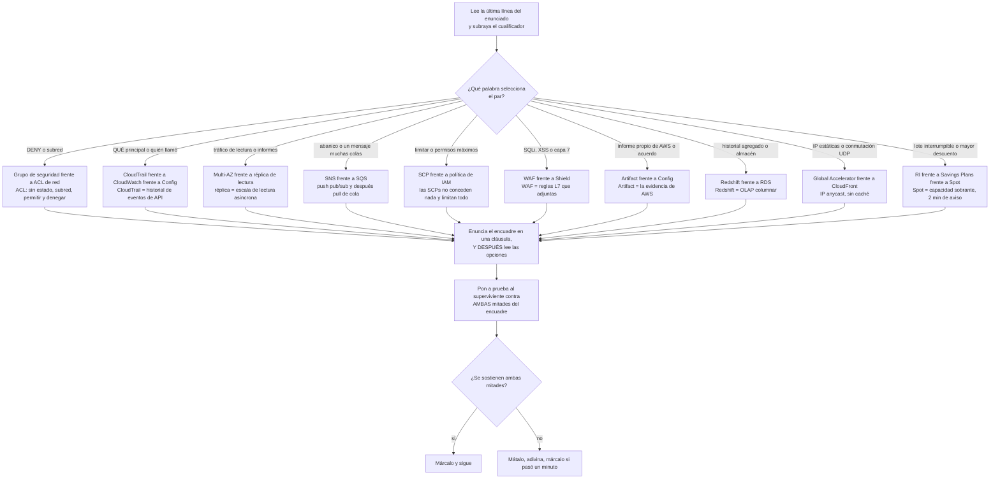
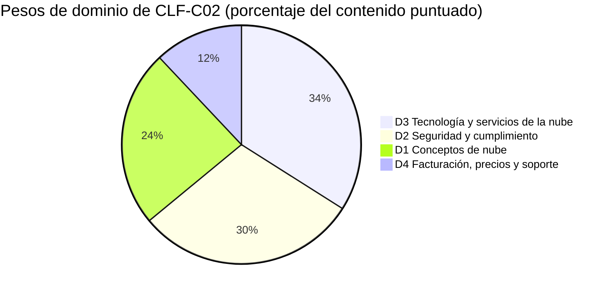
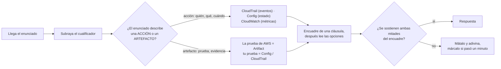
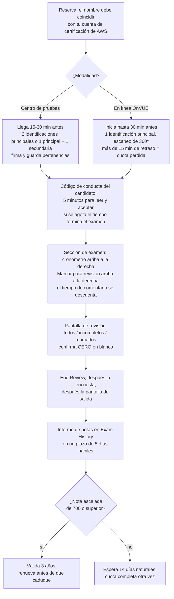
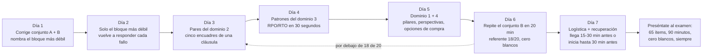

# Simulacro de examen B: segundo conjunto de práctica, ejercicios de trampa y día del examen

Quince lecciones te dieron el contenido y el conjunto A te dio una primera simulación. Este es el **segundo pase**, y un segundo pase mide algo distinto: no si conoces el material, sino si puedes mantener separados a dos servicios vecinos *mientras corre el reloj*. Casi nadie susp CLF-C02 porque no haya oído hablar nunca de AWS Config; suspenden porque el enunciado pedía la evidencia **de AWS** y ellos aportaron **la suya**, o porque el enunciado decía *tráfico de lectura* y la opción decía *Multi-AZ*. En una escala compensatoria de 100 a 1.000 con 700 para aprobar, la discriminación es lo que separa un aprobado cómodo de un casi aprobado.

```text
=====================================================================
 CLF-C02 / CONJUNTO B DE UN VISTAZO    (todas las cifras en octubre de 2026)
=====================================================================
 FORMATO ...... 65 preguntas = 50 puntuadas + 15 no puntuadas (sin identificar)
 TIPOS ........ opción múltiple (1 correcta + 3 distractores)
                respuesta múltiple (2+ correctas de 5+ opciones)
 TIEMPO ....... 90 minutos = 5.400 s  ->  ~83 s por ítem (aritmética)
 ESCALA ....... 100 - 1.000, se aprueba con 700, COMPENSATORIA, sin corte por sección
 ADIVINAR ..... sin penalización por fallar; EN BLANCO = incorrecto
 PESOS ........ D1 Conceptos de nube 24% | D2 Seguridad 30%
                D3 Tecnología de nube 34% | D4 Facturación 12%
 COSTE ........ 100 USD por intento (puede aplicarse impuesto)
 VALIDEZ ...... 3 años; tras un SUSPENSO espera 14 días naturales,
                intentos ilimitados, cuota completa cada vez
 RESULTADOS ... publicados en tu cuenta de certificación de AWS en
                un plazo de 5 días hábiles (techo oficial)
--------------------------------------------------------------------
 CONJUNTO B (esta lección) ...... 20 ítems en orden de ponderación: 5 / 6 / 7 / 2
 CONJUNTO B AÑADE .............. los diez pares de trampa, la lista
                                  del día del examen y un plan final de 7 días
=====================================================================
```

> [!NOTE]
> **Cómo usar esta lección.** Lee las secciones 1 y 2 una vez, esa es la mitad de estrategia, y está construida enteramente alrededor de *pares*. Después pasa el **conjunto B (sección 3) con un cronómetro de 20 minutos, sin apuntes, sin buscar y sin mirar los desgloses**. Autocorrige con la sección 6, entrena los diez pares en la sección 4, recorre la lista del día del examen en la sección 5 y deja que el plan de 7 días de la sección 7 decida qué ocurre entre ahora y tu cita. Todo lo que esta lección no pudo verificar contra una página de AWS de primera parte está listado en la sección 6.4, trátalo como *no lo afirmes*, no como hechos que memorizar.

Al terminar esta lección sabrás:

- enunciar el encuadre correcto en una línea para cada uno de los diez pares de trampa con más probabilidades de costarte puntos;
- detectar una **opción media-verdadera**, el distractor que intercambia exactamente un atributo de un par, y matarla en una cláusula;
- manejar enunciados de **respuesta múltiple** con un procedimiento de todo-o-nada que nunca da por sentada la nota parcial;
- ejecutar la aritmética que el examen realmente pide: **RPO/RTO**, **techos de descuento** y selección de **base de datos por patrón**;
- recitar la logística oficial del día del examen: identificaciones, llegada, registro, descansos, tiempo de comentario, momento de los resultados;
- corregir el conjunto B **por bloque de dominio** frente a umbrales explícitos de listo frente a no listo, y defender el **veredicto comparativo** entre reservar ahora o esperar siete días más;
- ejecutar un **plan de estudio de 7 días** impulsado por ponderación que repasa por el valle de dominio y no por el orden de capítulos.

---

## 1. Estrategia: pares de trampa y cómo el examen los arma

### 1.1 Qué es un par y a qué se parece de verdad un distractor

AWS describe sus propios distractores como *«respuestas generalmente plausibles que coinciden con el área de contenido»*. La consecuencia práctica es que la mayoría de opciones que enfrentas proceden de **la misma decisión que la clave**: lo que significa que la mayoría de las derrotas en este examen no son fallos de conocimiento, son **fallos de par**: conocías un miembro del par pero no podías enunciar la línea entre ellos bajo presión de tiempo.

Un par se convierte en un ítem mediante exactamente tres movimientos:

1. **Intercambia un atributo por opción**: con estado/sin estado, permitir/denegar, push/pull, síncrono/asíncrono, conceder/limitar.
2. **Intercambia la petición**: el enunciado quiere *escala de lectura*, la opción ofrece *disponibilidad*; el enunciado quiere *evidencia sobre AWS*, la opción ofrece *evidencia sobre ti*.
3. **Intercambia al propietario**: el trabajo de AWS frente al tuyo, bajo el modelo de responsabilidad compartida.

Ejemplo resuelto 1: una opción media-verdadera, diseccionada antes de que leas el enunciado. Toma el par grupo de seguridad / ACL de red y construye las cuatro opciones tal y como lo hace el examen:

| Opción | Lo que la opción acierta | Dónde se rompe | Veredicto |
|---|---|---|---|
| **A** | La primera coincidencia, de menor número de regla a mayor, *sí* es una regla de evaluación real, pero pertenece a las **ACL de red** | La opción entrega el comportamiento de las ACL de red a los grupos de seguridad y después llama con estado a las ACL de red | ambas propiedades invertidas |
| **B** | Los grupos de seguridad **sí** son con estado y el tráfico de respuesta se permite automáticamente; las ACL de red **sí** son sin estado y necesitan una regla de retorno explícita |: | las dos mitades correctas |
| **C** | Las dos *son* controles de red | Los grupos de seguridad evalúan **todas** sus reglas y no pueden expresar denegación, así que ninguna de las dos afirmaciones de la opción sobrevive | dos afirmaciones, ambas falsas |
| **D** | Los grupos de seguridad *sí* son solo de permitir; las ACL de red *sí* son de subred | Las cruza: los grupos de seguridad son **de instancia**, y las ACL de red **sí** admiten denegación | las dos mitades intercambiadas entre miembros |

Solo **B** sobrevive, y sobrevive porque evaluaste *ambas mitades* en lugar de reconocer una palabra familiar. Las opciones A, C y D contienen cada una una frase que has leído en la documentación: eso es el diseño. **Un distractor no tiene por qué ser falso; tiene que ser falso en el lugar del que pregunta el enunciado.**



---

### 1.2 Las tres preguntas para cualquier ítem de par

Los candidatos lentos leen las opciones; los candidatos rápidos interrogan primero al *par*. Haz estas tres, en este orden, antes de mirar una sola opción:

1. **¿Qué hace cada miembro del par de verdad?** Una cláusula cada uno, de memoria. Si no puedes decir en una cláusula qué hace una réplica de lectura, las opciones te lo van a responder: mal.
2. **¿Qué cualificador del enunciado selecciona entre ellos?** `DENY`, `subnet`, `read traffic`, `fan out`, `maximum permissions`, `layer 7`, `AWS's own`, `interruptible`. El sustantivo del enunciado suele ser el señuelo; el cualificador es la clave.
3. **¿Satisface la opción superviviente *ambas* mitades?** Para un enunciado `(Selecciona DOS)` esto es literal: ambas afirmaciones tienen que ser correctas, y la regla publicada en otro lugar del material de certificación de AWS es que debes seleccionar todas las respuestas correctas para recibir la puntuación.

```fillblank
{
  "question": "Completa los cuatro reflejos de pares de la sección 1.2:",
  "template": "1) Enuncia lo que hace cada miembro del par en una {{1}} ANTES de leer las opciones. 2) Encuentra el {{2}} del enunciado que selecciona entre ellos: DENY, subnet, read traffic, fan out. 3) Pon a prueba la opción superviviente contra AMBAS mitades del {{3}}. 4) Pasados unos {{4}}, márcala y adivina: nunca dejes una en blanco.",
  "answers": {
    "1": "clause",
    "2": "qualifier",
    "3": "framing",
    "4": "flag"
  },
  "distractors": ["sentence", "service name", "option list", "skip", "rewrite", "guess twice", "domain weight"],
  "explanation": "Los cuatro reflejos son todo el sistema defensivo en una línea cada uno: el encuadre de una cláusula impide que las opciones te enseñen la distinción equivocada, el cualificador es la palabra que realmente decide la clave, la prueba de ambas mitades es lo que mata una opción media-verdadera (y es literal para los enunciados Selecciona DOS), y pasados unos minutos el movimiento correcto es marcar, adivinar y avanzar: las preguntas sin responder se puntuán como incorrectas y no hay penalización por una respuesta equivocada."
}
```

- **📚 ¿Sabías que…?** La **Official Practice Question Set** propia de AWS para CLF-C02 contiene exactamente **20 preguntas**, la misma cantidad que los conjuntos A y B de aquí, es **gratuita**, se puede repetir, reordena los mismos ítems en cada intento y ofrece *comentarios detallados sobre las opciones de respuesta, incluidos recursos recomendados*. Es el primer paso del plan de preparación de cuatro pasos de AWS y es la medida oficial más cercana del ritmo que entrenas en esta lección (en octubre de 2026).

---

## 2. Estrategia: las tres formas de ítem que deciden el conjunto B

CLF-C02 publica exactamente **dos** tipos de pregunta: opción múltiple (una respuesta correcta más tres distractores) y respuesta múltiple (dos o más respuestas correctas de cinco o más opciones). En este examen no hay ítems de ordenación, de emparejamiento ni de caso de estudio, así que no les reserves tiempo. Lo que el conjunto B añade sobre el conjunto A es práctica en las tres *formas* que más puntos cuestan: **respuesta múltiple**, **cálculo** y **selección por patrón**.

### 2.1 Respuesta múltiple sin nota parcial

| Regla | Lo que está publicado | Qué significa en la mesa |
|---|---|---|
| **Estructura** | 2+ respuestas correctas de **5+** opciones | Lee *cada* opción antes de comprometerte con nada |
| **Puntuación** | La frase de todo-o-nada de AWS, *«Debes seleccionar todas las respuestas correctas para recibir la puntuación»*, aparece en la guía de AI Practitioner de AWS y en un artículo de AWS de 2024, **no** en la guía CLF-C02 | Practica **todo-o-nada, cero nota parcial**; no la cites como texto CLF-C02 (sección 6.4) |
| **Recuento** | Cuántos ítems de respuesta múltiple lleva el examen real y si cada enunciado indica su recuento está **sin publicar** | Espera que el enunciado te diga el recuento; si lo hace, subráyalo |
| **Formato del conjunto B** | Cada enunciado de respuesta múltiple aquí precombina sus afirmaciones correctas dentro de una sola opción | Entrena el pensamiento de todo-o-nada manteniendo el esquema JSON de clave única |

El procedimiento que sobrevive al contacto con cinco u seis opciones:

1. Marca cada opción **sí definitivo / no definitivo / tal vez**: en una sola pasada, sin elegir.
2. Resuelve cada *tal vez* releyendo el **cualificador**, no la opción.
3. Envía solo cuando no quede ningún *tal vez*. Dos respuestas obvias más una quinta correcta ignorada son el cero clásico.

### 2.2 Las formas de cálculo y selección

Tres familias aparecen repetidamente, y cada una tiene un único procedimiento mecánico:

**Ejemplo resuelto 2: aritmética de RPO/RTO.** Una base de datos falla a las **14:00**. La última copia de seguridad correcta terminó a las **08:00** y el servicio se restaura a las **16:30**.

$$
\text{RPO} = 14{:}00 - 08{:}00 = 6\ \text{h de datos en riesgo} \qquad \text{RTO} = 16{:}30 - 14{:}00 = 2.5\ \text{h de caída}
$$

**RPO = datos, RTO = tiempo.** Calcula primero los dos huecos y después asigna las letras: los candidatos que las asignan primero pierden el ítem aunque hagan bien la aritmética (véase el ítem 17 del conjunto B).

**Ejemplo resuelto 3, techos de descuento, en octubre de 2026 (verifica lo vigente antes de usarlo).** Para una carga de trabajo sin interrupciones que corre 24/7 durante tres años en una misma familia de instancias: Spot es **hasta un 90 %** pero interrumpible (dos minutos de aviso), un Compute Savings Plan de 1 año es **hasta un 66 %** y se compromete durante un año, un EC2 Instance Savings Plan de 3 años es **hasta un 72 %** y coincide con el horizonte, y bajo demanda es la línea base sin descuento. El mayor techo que *sobrevive* es **72 %**, el número de titular más grande fue descalificado por una restricción, no por la aritmética (véase el ítem 19).

**Ejemplo resuelto 4: selección de base de datos por patrón.** Traduce los sustantivos del enunciado a un modelo de datos *antes* de leer nombres de servicios:

| El enunciado dice | El modelo | El servicio que selecciona |
|---|---|---|
| *relacional*, compatible con MySQL/PostgreSQL, copias de seguridad gestionadas | OLTP relacional | Amazon Aurora o Amazon RDS |
| lecturas en *microsegundos*, conjuntos ordenados, clasificaciones | Caché en memoria | Amazon ElastiCache |
| *agregar tres años* de ventas para un panel | Almacén OLAP columnar | Amazon Redshift |
| *clave-valor*, milisegundos de un solo dígito, ítems de 400 KB | NoSQL clave-valor | Amazon DynamoDB |
| *montable*, POSIX, varias zonas de disponibilidad | Fichero compartido | Amazon EFS |

Dos de esas filas se convierten en los ítems 15 y 16 del conjunto B. El patrón nunca cambia: **sustantivo → modelo de datos → servicio**, y solo después las opciones.

### 2.3 El plano del conjunto B, su reloj y sus ponderaciones

Solo los porcentajes de **dominio** están publicados; los recuentos de ítems de abajo son aritmética sobre 50 ítems puntuados: una ayuda de planificación, nunca una cifra de AWS.

| Dominio | Ponderación publicada | Ítems puntuados en el examen real (derivado: 50 × w) | Ítems del conjunto B aquí | Qué prueba realmente este bloque |
|---|---|---|---|---|
| **D1** Conceptos de nube | **24 %** | ≈ 12 | **5** (P1: P5) | Pilares frente a perspectivas, elasticidad, los 6 Rs, viñetas de economía |
| **D2** Seguridad y cumplimiento | **30 %** | ≈ 15 | **6** (P6: P11) | Encuadres de pares: SG/NACL, Trail/Config, SCP/IAM, WAF/Shield, Artifact |
| **D3** Tecnología y servicios de la nube | **34 %** | ≈ 17 | **7** (P12: P18) | Almacenamiento, base de datos por patrón, cómputo, balanceo de carga, aritmética de recuperación |
| **D4** Facturación, precios y soporte | **12 %** | ≈ 6 | **2** (P19: P20) | Elección de opción de compra y la estimación previa a construir |
| **Total** | **100 %** | **≈ 50** | **20** | La columna «ítems puntuados» es aritmética, no una declaración de AWS |

**Ejemplo resuelto 5, de ponderaciones a ítems, dos veces.** En el examen real: $50 \times 0.24 = 12$, $50 \times 0.30 = 15$, $50 \times 0.34 = 17$, $50 \times 0.12 = 6$, y $12 + 15 + 17 + 6 = 50$. En el conjunto B: las mismas propiedades se redondean a **5 / 6 / 7 / 2**, y $5 + 6 + 7 + 2 = 20$. Los dominios 2 y 3 suman juntos el **64 %** del contenido puntuado, por eso retienen 13 de estos 20 ítems.

**Ejemplo resuelto 6, el propio reloj del conjunto B.** Veinte ítems con el presupuesto de primera pasada de 60 s cada uno son $20 \times 60 = 1{,}200\ \text{s} = \mathbf{20}$ **minutos**. El techo completo de 83 segundos daría $20 \times 83 = 1{,}660\ \text{s} = 27.7$ minutos, cómodo, pero entrena un ritmo que no podrás mantener durante 65 ítems. Pasa el conjunto B en **20 minutos exactos**; si terminas con tiempo, dedícalo a los ítems marcados, no a releer los que ya dominas.



- **📚 ¿Sabías que…?** El ritmo publicado por el propio AWS para una certificación **Foundational** es de **2 to 3 semanas** de preparación en bloques de **30 to 60 minutos**, con *al menos un examen de práctica cronometrado completo* antes del tutelado. El plan de 7 días de la sección 7 es por tanto un plan **comprimido**: da por hecho que las lecciones 01 to 15 y el conjunto A ya están a tu espalda y dedica la semana a la discriminación y a la logística en lugar de a contenido nuevo.

---

## Casos Reales

Dos historias de clientes publicadas por AWS, convertidas en los dos únicos movimientos que este examen hace nunca con una historia: **mapearla a un dominio** y después **predecir el enunciado**. Cada porcentaje de abajo es un *resultado de cliente* que AWS decidió publicar: nunca una promesa de AWS y nunca una cifra sin su fecha (las páginas de caso de estudio no llevan fecha de publicación, así que la única marca de tiempo disponible es la fecha de acceso; todas las cifras de abajo se consultaron en **octubre de 2026**).

### Caso 1, Capital One: de ocho centros de datos a cero

**El escenario.** Un banco regulado (Fortune 100) opera ocho centros de datos on-premises bajo un ciclo de renovación de hardware mientras intenta escalar el trabajo de aprendizaje automático y personalización en tiempo real. El relato publicado por AWS: Capital One **abandonó los ocho centros de datos** al migrar a AWS (el último en 2020), construyó aproximadamente el **80 % de sus ~2.000 aplicaciones** en la nube desde cero, recicló **103 toneladas** de cobre y acero, redujo el tiempo medio de construcción de un entorno de desarrollo de **tres meses a minutos**, redujo el tiempo de prueba de recuperación ante desastres un **70 %** y redujo la resolución de incidentes y los errores de transacción un **50 %**.

**¿Qué dominio?** **D1 Conceptos de nube (24 %)**: la historia es un argumento sobre agilidad, opex frente a capex y las estrategias de migración, no sobre un servicio. Los ganchos que llegan a **D3** (servicios sin servidor, servicios de migración) y la página de resiliencia de AWS para el mismo cliente (**eventos de gravedad crítica reducidos entre un 80 y un 90 %**, recuperación de **horas a minutos**) son *secundarios*: esas cifras provienen de otro caso de estudio, así que nunca mezcles las dos páginas en una misma respuesta.

**¿Qué preguntaría el examen?** Las cuatro formas de enunciado en las que esta historia suele convertirse:

| Forma del enunciado | El cualificador que lo decide | A qué apunta la clave |
|---|---|---|
| «…entornos que tardaban meses ahora tardan minutos» | *plazo de entrega*, no *precio* | **Agilidad** |
| «…reconstruyó sus aplicaciones para la nube en lugar de moverlas tal cual» | *reconstruyó* frente a *lift and shift* | el extremo de refactorización de los **6 Rs** |
| «AWS construye la infraestructura; el cliente sigue parcheando dentro de sus cargas de trabajo» | *quién posee qué* | el **modelo de responsabilidad compartida** |
| «El cliente logró una reducción del 70 %: ¿qué significa esa cifra?» | *resultado de cliente* frente a *garantía* | un **resultado publicado, no un SLA de AWS** |

**Trampa a precargar:** «AWS garantiza un ahorro del 90 %» es incorrecta dos veces: convierte el resultado de un cliente en una promesa, y AWS nunca publica tal garantía. Reescribe cada porcentaje de caso como *«AWS informa de que \<cliente\> logró …»*.

### Caso 2, Box: 2,23 millones de dólares encontrados en cuatro partidas

**El escenario.** Una empresa SaaS corporativa quiere reducir el gasto **sin** debilitar seguridad, fiabilidad ni rendimiento. Aplica el marco Well-Architected y revisiones de expertos y después ataca cuatro facturas concretas: estratificación de almacenamiento S3 y Glacier, higiene de volúmenes y instantáneas de EBS, filtrado de eventos de CloudTrail y tráfico enrutado lejos de las puertas de enlace de internet. AWS informa de **2,23 millones de dólares** en ahorros, desglosados así:

| Partida | Qué es en el examen |
|---|---|
| **438.000 $** de transferencia de datos entre zonas de disponibilidad | el coste de los diseños Multi-AZ muy conversadores |
| **1,1 millones de $ al año** de salida a internet | la partida individual más grande: una decisión de arquitectura |
| **> 500.000 $ al año** de almacenamiento | **clases** de almacenamiento y estratificación por ciclo de vida |
| **192.000 $ al año** de registro | volumen de logs y filtrado |
| **= 2,23 millones de $** en total | 438.000 + 1.100.000 + 500.000 + 192.000 |

**¿Qué dominio?** **D4 Facturación, precios y soporte (12 %)**, con un gancho de D3 sobre clases de almacenamiento. La moraleja del historia es el *ranking*: el mayor ahorro no fue una negociación de descuento, fue **arquitectura**.

**¿Qué preguntaría el examen?**

- *«¿Qué palanca produjo el mayor ahorro individual?»* → **transferencia de datos saliente** (egress), no un descuento por compromiso.
- *«¿Qué recurso gratuito ofrece orientación de costes según las mejores prácticas antes de escribir ni una línea de código?»* → la **revisión del marco Well-Architected**: orientación gratuita, distinta de **Trusted Advisor** (que examina tu cuenta) y de un **plan de soporte de pago** (que abre casos).
- *«¿Dónde vería un cliente acumularse cargos entre zonas de disponibilidad?»* → **Cost Explorer** / vistas de asignación de costes: nunca el **Pricing Calculator**, que estima un gasto que todavía no existe (la división en cuatro de la P20 se aplica sin cambios).

**Trampa a precargar:** revisión de Well-Architected ≠ Trusted Advisor ≠ plan de soporte: tres preguntas distintas con una sola palabra encima. Y 2,23 millones de dólares es el resultado de *Box*; al examen le encanta una opción que lo reescriba como garantía de AWS.

- **📚 ¿Sabías que…?** El total de titular de Box es aritmética que puedes comprobar en una línea: **438.000 + 1.100.000 + 500.000 + 192.000 = 2.230.000**. Las cifras de los casos de estudio de este examen casi siempre se pueden descomponer: cuando los componentes de una opción no suman su propio total, está mal aunque cada número individual te resulte familiar.

### Actualizaciones de 2026 (en octubre de 2026)

> [!NOTE]
> **Qué cambió entre la guía de la que estudiaban los candidatos y la guía que AWS publica hoy.** Cada viñeta procede del diff de la guía de octubre de 2026 y de los anuncios de AWS detrás de él (digest de investigación 18; todas las fuentes se consultaron en octubre de 2026).
> - **Cambió el alcance, no las ponderaciones.** Las ponderaciones de dominio siguen siendo **24 / 30 / 34 / 12**; lo que se movió fue la *lista de servicios*: entradas en alcance **128 → 111**, fuera de alcance **11 → 55** desde el PDF de la época del lanzamiento `Version 1.0 CLF-C02`. **AWS Network Firewall, Amazon MSK, AWS Billing Conductor** y **AWS Wavelength** figuran ahora en la lista de fuera de alcance: legales como distractores, nunca como clave. El material de preparación que todavía cita las ponderaciones CLF-C01 **26 / 25 / 33 / 16** está citando un apéndice que AWS eliminó.
> - **Cambiaron los nombres de los planes de soporte dentro del texto del examen.** La tarea 4.3 dice ahora *«Basic Support, AWS Business Support+, AWS Enterprise Support, AWS Unified Operations»*. Developer, Business clásico y Enterprise On-Ramp **no aceptaron nuevas suscripciones después del 2025-12-02** (las existentes corren hasta el 2027-01-01): una opción que ofrezca «Developer Support» como plan de pago de entrada está obsoleta.
> - **Free Tier depende de la fecha de la cuenta.** Las cuentas creadas **el 2025-07-15 o después** reciben **6 meses** (o hasta agotar los créditos) más **100 USD de registro y hasta 100 USD ganables**; el nivel de **12 meses `t2.micro`** pertenece solo a las cuentas creadas antes, y `t2.micro` no está en la nueva lista de elegibles. La fecha de la cuenta del enunciado es el cualificador.
> - **Dos reglas distintas de «salida gratuita».** **100 GB al mes** de transferencia de datos saliente gratuita desde las Regiones es un cambio de **2021**; el movimiento más nuevo de crédito por abandonar AWS es por aprobación y tiene **90 días** para completarse. Misma palabra, dos mecanismos (en octubre de 2026).
> - **Las noticias no son temario.** El **Well-Architected Agent** (vista previa, 2026-10-01) y los **Database Savings Plans** (2025-12-02) son reales pero no aparecen en ninguna parte de la guía del examen: las herramientas de coste evaluables siguen siendo Cost Explorer, Budgets, Pricing Calculator, Cost and Usage Reports, Trusted Advisor y la **herramienta** Well-Architected. Y las sesiones en **italiano y alemán** se retiran después del **2026-12-31** (12 idiomas en octubre de 2026).

```dragdrop
{
  "question": "Ordena estos cambios de AWS de 2025-2026 de más antiguo a más reciente y después comprueba las fechas en la explicación:",
  "items": [
    "Se anuncia la Región de la Nube Europea Soberana de AWS eusc-de-east-1 como generalmente disponible",
    "Transferencia de datos saliente gratuita a internet que alcanza los 100 GB al mes desde las Regiones de AWS",
    "Reforma del soporte: lanzamiento de Business Support+ y cierre de los nombres de planes antiguos a nuevas suscripciones",
    "El AWS Well-Architected Agent entra en vista previa: real, pero no nombrado en la guía del examen",
    "Rediseño de Free Tier: 6 meses más hasta 200 USD en créditos para las cuentas recién creadas"
  ],
  "correctOrder": [
    "Transferencia de datos saliente gratuita a internet que alcanza los 100 GB al mes desde las Regiones de AWS",
    "Rediseño de Free Tier: 6 meses más hasta 200 USD en créditos para las cuentas recién creadas",
    "Reforma del soporte: lanzamiento de Business Support+ y cierre de los nombres de planes antiguos a nuevas suscripciones",
    "Se anuncia la Región de la Nube Europea Soberana de AWS eusc-de-east-1 como generalmente disponible",
    "El AWS Well-Architected Agent entra en vista previa: real, pero no nombrado en la guía del examen"
  ],
  "explanation": "La secuencia verificada es 2021-12-01 (100 GB al mes de transferencia de datos saliente gratuita: la regla más antigua y de la que más veces se maldata), después 2025-07-15 (rediseño de Free Tier), después 2025-12-02 (reforma del soporte que introduce Business Support+ y cierra Developer, Business clásico y Enterprise On-Ramp a nuevas suscripciones), después 2026-01-14 (anuncio de disponibilidad general de la Región de la Nube Europea Soberana de AWS) y después 2026-10-01 (vista previa del Well-Architected Agent). El uso de esta línea de tiempo el día del examen es disciplina de fechas: el examen prueba la guía que descargas hoy, no la de la que estudiaste, así que todo hecho de precios, alcance y nombres de planes se sella «en octubre de 2026» y cualquier cosa más antigua se comprueba contra la guía actual antes de afirmarla."
}
```

- **📚 ¿Sabías que…?** El PDF de la guía del examen actual **no imprime número de versión alguno**: solo `Copyright © 2026`. El único artefacto sellado es el PDF de la época del lanzamiento `Version 1.0 CLF-C02`, y el `uiVersion=2024.10` que puedas ver en la URL de la documentación es la **versión de plantilla del sitio de AWS Docs**, no una fecha de revisión de la guía (comprobado en octubre de 2026). Siempre que un sitio de preparación afirme «guide v1.3, marzo de 2026», trata esa afirmación como no verificada hasta que la veas en la propia página de AWS.

---

## 3. Preguntas de Práctica (Practice Questions), conjunto B: 20 ítems en el orden publicado de ponderación

El conjunto B refleja el formato **dominante** del examen real, una respuesta correcta, tres distractores, mientras entrena cuatro enunciados con forma de **respuesta múltiple**. Los ítems siguen el orden de ponderación de dominio: **D1 cinco, D2 seis, D3 siete, D4 dos**, que es la división publicada de 24 / 30 / 34 / 12 redondeada sobre veinte ítems.

### 3.0 Cómo pasar el conjunto B

| Ajuste | La regla | Por qué importa |
|---|---|---|
| **Cronómetro** | **20 minutos exactos** (60 s por ítem: el presupuesto de primera pasada) | Entrena el ritmo que usarás para 65 ítems |
| **Materiales** | Sin apuntes, sin búsqueda, sin ver los desgloses | La puntuación con libros abiertos mide tus apuntes, no a ti |
| **Ritmo** | Contesta todos los ítems; marca cualquier ítem que supere los 60 segundos y sigue | Un blanco es un cero garantizado: la regla nunca cambia con el tamaño del conjunto |
| **Regla de par** | Antes de leer las opciones, escribe el encuadre del par en una cláusula | Ese es todo el punto del conjunto B |
| **Respuesta múltiple** | Lee **todas** las opciones; las afirmaciones correctas van precombinadas en una opción para que cada ítem conserve una sola clave | Entrena el pensamiento de todo-o-nada sin romper el esquema |
| **Corrección** | Primero por **bloque de dominio**, después el total (sección 6) | La puntuación compensatoria castiga el valle, no la media |
| **Repetición** | 72 horas después, de memoria | Los huecos cortos miden reconocimiento, no retención |

### 3.1 Dominio 1: Conceptos de nube (24 %) · ítems 1 to 5

```question
{
  "id": "clf-16-q1",
  "type": "multiple-choice",
  "question": "¿Qué perspectiva del AWS Cloud Adoption Framework cubre la gobernanza de TI, la gestión de servicios de TI y el riesgo?",
  "options": [
    "Business",
    "Governance",
    "Platform",
    "Operations"
  ],
  "correct": 1,
  "explanation": "El AWS Cloud Adoption Framework tiene seis perspectivas: Business, People, Governance, Platform, Security y Operations, y Governance es la dueña de las estructuras de política, riesgo y cumplimiento."
}
```

**Desglose: P1 · qué perspectiva del CAF.** **Por qué es correcta:** Governance es la perspectiva dueña de la gobernanza de TI, la gestión de servicios de TI, las políticas y el riesgo. **Por qué pierden las trampas:** **A** es el caso financiero y de valor (beneficios, ingresos, menor riesgo empresarial); **C** es el cimiento de implementación: migración e infraestructura; **D** es operaciones y entrega de servicios. **Trampa:** las seis **perspectivas** del CAF se confunden habitualmente con los seis **pilares** de Well-Architected: *Governance* solo existe en CAF, *Sustainability* solo en Well-Architected (véase la P3). Nunca intercambies los dos vocabularios. **Fuente:** seed Q03 · digest de economía de nube/migración F.3 (lista de perspectivas del CAF de AWS).

```question
{
  "id": "clf-16-q2",
  "type": "multiple-choice",
  "question": "Una aplicación añade capacidad automáticamente durante un pico de tráfico y la libera cuando cae la demanda. ¿Qué concepto se demuestra?",
  "options": [
    "Scalability",
    "Elasticity",
    "High availability",
    "Economies of scale"
  ],
  "correct": 1,
  "explanation": "Elasticidad significa crecer Y reducir según la demanda; escalar hacia fuera es solo la mitad de la cuestión, y el enunciado describe ambas direcciones."
}
```

**Desglose: P2 · el comportamiento bidireccional.** **Por qué es correcta:** el enunciado contiene dos verbos: *añade* y *libera*, y solo la elasticidad cubre la mitad de la liberación. **Por qué pierden las trampas:** **A** es la capacidad de manejar crecimiento, sin exigencia de reducir; **C** es sobrevivir a la caída de un componente entre zonas de disponibilidad, algo que el enunciado nunca menciona; **D** es el argumento de la agregación: cientos de miles de clientes rebajando el precio unitario: un efecto de precios, no un comportamiento de escalado. **Trampa:** «escalar hacia fuera» empuja a los candidatos hacia *scalability*; el discriminante es el comportamiento **bidireccional**, no la presencia de escalado. **Fuente:** seed Q06 · digest de conceptos de nube F.5 (elasticidad ≠ escalabilidad ≠ alta disponibilidad).

```question
{
  "id": "clf-16-q3",
  "type": "multiple-choice",
  "question": "¿Cuál de los siguientes es uno de los seis pilares del marco AWS Well-Architected Framework?",
  "options": [
    "Compliance",
    "Scalability",
    "Sustainability",
    "Agility"
  ],
  "correct": 2,
  "explanation": "Los seis pilares son excelencia operativa, seguridad, fiabilidad, eficiencia de rendimiento, optimización de costes y sostenibilidad."
}
```

**Desglose: P3 · pilar, no tema.** **Por qué es correcta:** Sustainability es uno de los seis pilares publicados. **Por qué pierden las trampas:** **A** es un titular del dominio 2: el cumplimiento se sitúa bajo gobernanza, no bajo los pilares del marco; **B** y **D** son beneficios reales de la nube del dominio 1, y eso es exactamente por lo que suenan a pilar. **Trampa:** las cuatro opciones son *afirmaciones verdaderas sobre AWS*; solo una es un **pilar**. Memorízalos como conjunto: excelencia operativa, seguridad, fiabilidad, eficiencia de rendimiento, optimización de costes, sostenibilidad. **Fuente:** seed Q08 · digest de monitorización/soporte F.9 · digest de guía del examen §B.2 tarea 1.2 (lista de pilares literal).

```question
{
  "id": "clf-16-q4",
  "type": "multiple-choice",
  "question": "(Selecciona TRES.) ¿Cuáles son TRES aspectos de la economía de la nube nombrados en la declaración de tarea 1.4 de CLF-C02? En el formato de clave única de este conjunto, los tres aspectos van precombinados dentro de una sola opción: elige la opción en la que LOS TRES se nombran en la declaración de tarea 1.4.",
  "options": [
    "Rightsizing; comparación de la licencia propia (BYOL) con las licencias incluidas; beneficios de la automatización",
    "Rightsizing; recuperación ante desastres activa-activa entre Regiones; configuración de las listas de control de acceso a la red",
    "Comparación de la licencia propia (BYOL) con las licencias incluidas; rightsizing; disponibilidad garantizada del 100 % para todas las aplicaciones",
    "Beneficios de la automatización; economías de escala; eliminar el modelo de responsabilidad compartida"
  ],
  "correct": 0,
  "explanation": "La declaración de tarea 1.4 enumera costes fijos frente a variables, costes on-premises, estrategias de licenciamiento (BYOL comparado con licencias incluidas), rightsizing, beneficios de la automatización y economías de escala: los tres ítems de la opción con clave están en esa lista."
}
```

**Desglose: P4 · tres de seis, todos de una sola tarea.** **Por qué es correcta:** rightsizing, el licenciamiento BYOL frente a las incluidas y los beneficios de la automatización se nombran todos en la tarea 1.4: allí los beneficios de la automatización son explícitamente un beneficio *económico*, no técnico. **Por qué pierden las trampas:** **B** mezcla un ítem verdadero con una decisión de diseño de fiabilidad (recuperación ante desastres, territorio de la tarea 3.2) y un control de seguridad de red (tarea 3.5): ambos están fuera de la lista; **C** empareja dos ítems verdaderos con una afirmación absoluta que AWS nunca publica: la disponibilidad es una responsabilidad compartida, así que no existe garantía; **D** es la más ruda de las cuatro: dos de sus tres ítems *sí* están en la lista, pero «eliminar el modelo de responsabilidad compartida» es falso, así que el trío falla. **Trampa:** un trío de 3 con 2 válidos es el distractor de respuesta múltiple estándar: debes validar **cada** miembro, no los dos primeros que reconozcas. **Forma en el examen real:** tres casillas, todo-o-nada. **Fuente:** seed Q09 · digest de guía del examen §B.2 tarea 1.4 (viñetas de conocimientos y habilidades literales).

```question
{
  "id": "clf-16-q5",
  "type": "multiple-choice",
  "question": "Una empresa mantiene su parque VMware on-premises y lo extiende a AWS con una experiencia de operación coherente en ambos. ¿Qué modelo de despliegue de nube es este?",
  "options": [
    "Public cloud",
    "Private cloud",
    "Hybrid cloud",
    "Multi-cloud"
  ],
  "correct": 2,
  "explanation": "El modelo híbrido integra la infraestructura on-premises o privada de una empresa con la nube pública para que la experiencia sea coherente de la nube a on-premises y hasta el edge."
}
```

**Desglose: P5 · extiende, no sustituye.** **Por qué es correcta:** el enunciado tiene dos mitades: *sigue ejecutando VMware on-premises* **y** *lo extiende a AWS con una experiencia coherente*, y el híbrido es el único modelo que conserva ambas. **Por qué pierden las trampas:** **A** es infraestructura alojada en AWS a la que se llega por internet público, lo que ignora la mitad on-premises; **B** es infraestructura de una sola organización (AWS la ilustra con Amazon VPC) e ignora la mitad *lo extiende a AWS*; **D** exige dos o más **proveedores públicos**, y tu propio centro de datos no es un proveedor. **Trampa:** «sigue ejecutándose on-premises» tira hacia *private cloud*; *extiende* es el verbo operativo. **Fuente:** seed Q10 · digest de despliegue/operaciones §B.2 (modelos de despliegue con la redacción de AWS).

---

### 3.2 Dominio 2: Seguridad y cumplimiento (30 %) · ítems 6 to 11

```question
{
  "id": "clf-16-q6",
  "type": "multiple-choice",
  "question": "¿Qué par de afirmaciones sobre grupos de seguridad y ACL de red es CORRECTO?",
  "options": [
    "Los grupos de seguridad son sin estado y usan la evaluación de menor número de regla primero; las ACL de red son con estado",
    "Los grupos de seguridad son con estado y el tráfico de retorno se permite automáticamente; las ACL de red son sin estado y necesitan una regla explícita para el tráfico de retorno",
    "Ambas se evalúan por primera coincidencia y ambas admiten reglas de denegación",
    "Ambas operan a nivel de subred y ambas son solo de permitir"
  ],
  "correct": 1,
  "explanation": "Los grupos de seguridad son con estado, solo de permitir y de nivel de instancia, y se evalúan todas sus reglas; las ACL de red son sin estado, permiten Y deniegan, son de nivel de subred y gana la primera coincidencia."
}
```

**Desglose, P6 · memoriza el par, no las palabras.** **Por qué es correcta:** con estado y respuesta automática para los grupos de seguridad, y sin estado y regla de retorno explícita para las ACL de red, son las dos propiedades que nunca se intercambian. **Por qué pierden las trampas:** **A** invierte *ambas* propiedades: las ACL de red son las sin estado y de primera coincidencia; **C** injerta la denegación de las ACL de red sobre la evaluación de los grupos de seguridad, porque los grupos de seguridad no pueden expresar denegación en absoluto; **D** invierte el alcance (los grupos de seguridad se adjuntan a una interfaz de red elástica, las ACL de red a una subred) e ignora la denegación de las ACL de red. **Trampa:** todo en A, C y D es *media-verdad*: el examen intercambia **un atributo por opción**, así que sostén el par como un bloque de cuatro líneas: SG = con estado, solo de permitir, ENI, se evalúan todas las reglas · NACL = sin estado, permitir+denegar, subred, la primera coincidencia detiene. **Fuente:** seed Q14 · digest de seguridad/IAM F.4, F.7 · digest de red F.3, F.5.

```question
{
  "id": "clf-16-q7",
  "type": "multiple-choice",
  "question": "¿Qué afirmación sobre la autenticación multifactor (MFA) en AWS es VERDADERA en octubre de 2026?",
  "options": [
    "La MFA basada en SMS se ha discontinuado; se admiten passkeys/llaves FIDO y dispositivos TOTP físicos o virtuales",
    "La MFA por SMS es el método que AWS más recomienda para el usuario root",
    "La MFA se aplica solo a los usuarios de IAM y nunca al usuario root",
    "La MFA es opcional porque las políticas de IAM ya aplican el privilegio mínimo"
  ],
  "correct": 0,
  "explanation": "AWS ha retirado la MFA basada en SMS y dirige la protección de root y de IAM hacia opciones resistentes al phishing, passkeys, llaves de seguridad FIDO, y dispositivos TOTP físicos o virtuales."
}
```

**Desglose: P7 · sella con fecha cada respuesta de MFA.** **Por qué es correcta:** la MFA por SMS está retirada en octubre de 2026 y el conjunto admitido es passkeys/FIDO más dispositivos TOTP. **Por qué pierden las trampas:** **B** repite el método retirado y es la respuesta de hecho obsoleto más común en el material de estudio escrito antes de la retirada; **C** está invertida: proteger al usuario root con MFA es la *primera* recomendación; **D** confunde *quién puede actuar* (políticas de IAM) con *quién está actuando* (acreditación de identidad): el privilegio mínimo no prueba la identidad. **Trampa:** los apuntes antiguos y los tests de práctica antiguos siguen diciendo «SMS MFA». Sella con fecha el año de tu examen cada respuesta de MFA y vuelve a leer la documentación de identidad actual si un hecho huele a viejo. **Fuente:** seed Q17 · digest de seguridad/IAM F.19 y §B (registro de MFA de root).

- **📚 ¿Sabías que…?** La **adaptación ESL añade +30 minutos** al examen CLF-C02 y se solicita **una sola vez** a través de la política de previa al examen (en octubre de 2026). Si tienes derecho a ella, solicítala mucho antes de tu cita: las adaptaciones no se conceden en la mesa, y la misma página de política dice que los precios son válidos para un solo intento de examen.

```question
{
  "id": "clf-16-q8",
  "type": "multiple-choice",
  "question": "Un equipo de seguridad debe demostrar QUÉ principal de IAM eliminó una tabla de DynamoDB el martes pasado. ¿Qué servicio proporciona ese registro?",
  "options": [
    "Amazon CloudWatch",
    "AWS CloudTrail",
    "AWS Config",
    "AWS Trusted Advisor"
  ],
  "correct": 1,
  "explanation": "AWS CloudTrail registra qué principal realizó qué acción de API, cuándo y desde dónde: las llamadas de consola, CLI, SDK y API aparecen todas como eventos."
}
```

**Desglose: P8 · el cualificador es QUÉ principal.** **Por qué es correcta:** *qué principal* es una pregunta de actor, y un rastro de auditoría de eventos de API es exactamente lo que guarda CloudTrail. **Por qué pierden las trampas:** **A** responde «¿está sano? / ¿está alta la CPU?»: métricas, alarmas y paneles, no actores; **C** registra el *estado* de configuración de los recursos a lo largo del tiempo, lo que te dice a qué se parecía la tabla, no quién la eliminó; **D** recomienda brechas de mejores prácticas y no puede producir historial de API en absoluto. **Trampa:** la palabra *monitorización* aparece en muchos enunciados y empuja a los candidatos hacia CloudWatch: pregúntate si el enunciado quiere **quién actuó** (Trail), **cuál era el estado** (Config) o **si está superando un umbral** (CloudWatch). **Fuente:** seed Q18 · digest de gobernanza/cumplimiento F.1, F.3.

```question
{
  "id": "clf-16-q9",
  "type": "multiple-choice",
  "question": "(Selecciona DOS.) ¿Cuáles de las dos afirmaciones sobre AWS CloudTrail y AWS Config son CORRECTAS? En el formato de clave única de este conjunto, las dos afirmaciones van precombinadas dentro de una sola opción: elige la opción en la que LAS DOS son correctas.",
  "options": [
    "CloudTrail registra eventos de API como quién llamó a una acción y cuándo; Config puede alertar sobre eventos de inicio de sesión de la consola del usuario root sin CloudTrail",
    "Config registra el estado de configuración de los recursos a lo largo del tiempo y puede evaluar reglas contra él; Config sustituye a Amazon GuardDuty para la detección de amenazas",
    "CloudTrail registra eventos de API como quién llamó a una acción y cuándo; Config registra el estado de configuración de los recursos a lo largo del tiempo y puede evaluar reglas contra él",
    "CloudTrail conserva todos los eventos de datos durante 90 días gratis en cada cuenta; CloudTrail registra eventos de API como quién llamó a una acción y cuándo"
  ],
  "correct": 2,
  "explanation": "CloudTrail es el historial de eventos (quién y cuándo) y Config es el historial de estados (cómo se veía y si cumple); AWS recomienda activar ambos en lugar de elegir entre ellos."
}
```

**Desglose, P9 · dos trampas en un ítem.** **Por qué es correcta:** ambas afirmaciones son el trabajo publicado de cada servicio: eventos para CloudTrail, estado de configuración y evaluación de reglas para Config. **Por qué pierden las trampas:** **A** es medio cierta y después afirma que Config puede hacer el trabajo de CloudTrail: el recorrido oficial de AWS empareja CloudWatch *con* CloudTrail precisamente porque la alerta de inicio de sesión necesita el flujo de eventos; **B** es medio cierta y después entrega a Config el trabajo de GuardDuty (detección de amenazas), y la palabra *sustituye* es la pista; **D** introduce por la puerta trasera el mito de «los 90 días gratis lo cubren todo»: el historial de eventos gratuito cubre eventos de **gestión**, y una retención más larga o la cobertura de todas las cuentas exige una traza, mientras que su segunda afirmación es verdadera. **Trampa:** una opción con una afirmación verdadera y otra falsa es **incorrecta**, no «casi correcta», y los dos mitos que este ítem ataca (*Config puede hacer el trabajo de CloudTrail* y *los 90 días gratis lo cubren todo*) son extremadamente comunes. **Forma en el examen real:** dos casillas, todo-o-nada. **Fuente:** seed Q19 · digest de gobernanza/cumplimiento F.3, F.4 · recorrido de preparación de examen de AWS re:Invent 2.2.

```question
{
  "id": "clf-16-q10",
  "type": "multiple-choice",
  "question": "(Selecciona TRES.) ¿Qué TRES servicios se nombran explícitamente en la declaración de tarea 2.4 de CLF-C02 como características o servicios de seguridad? En el formato de clave única de este conjunto, los tres servicios van precombinados dentro de una sola opción: elige la opción en la que LOS TRES se nombran en la declaración de tarea 2.4.",
  "options": [
    "AWS WAF; AWS Firewall Manager; AWS Shield",
    "AWS WAF; AWS Network Firewall; AWS Shield",
    "AWS Firewall Manager; Amazon Cloud Directory; Amazon Inspector",
    "AWS Shield; AWS CloudFormation; AWS Batch"
  ],
  "correct": 0,
  "explanation": "La declaración de tarea 2.4 enumera, literalmente, AWS WAF, AWS Firewall Manager, AWS Shield y Amazon GuardDuty entre sus ejemplos de características y servicios de seguridad."
}
```

**Desglose: P10 · la respuesta siempre está en la lista de en alcance.** **Por qué es correcta:** los tres servicios nombrados aparecen literalmente en la tarea 2.4 y los tres figuran en la lista actual de en alcance. **Por qué pierden las trampas:** **B** sustituye AWS Network Firewall, que está en la lista oficial de **fuera de alcance**: legal como opción, nunca como clave; **C** sustituye Amazon Cloud Directory, también fuera de alcance, y cambia Shield por Inspector (un servicio real en alcance, pero no uno que la tarea 2.4 nombre); **D** empareja un nombre correcto con CloudFormation y Batch, que pertenecen a categorías totalmente distintas. **Trampa:** los servicios fuera de alcance se eligen como distractores precisamente porque suenan **más avanzados** que la clave real. Las respuestas correctas en este examen son siempre servicios en alcance: confírmalo contra la lista actual de en alcance, no contra tu intuición sobre lo que «suena serio». **Fuente:** seed Q21 · digest de guía del examen §B.2 tarea 2.4 + §E.1 / §E.2 (listas de en alcance y fuera de alcance).

```question
{
  "id": "clf-16-q11",
  "type": "multiple-choice",
  "question": "Un auditor le pide a la empresa los informes SOC 2 y PCI propios de Amazon Web Services. ¿Qué recurso de autoservicio debería usar el equipo de cumplimiento?",
  "options": [
    "AWS Artifact",
    "AWS Config",
    "AWS Control Tower",
    "Amazon Inspector"
  ],
  "correct": 0,
  "explanation": "AWS Artifact es el portal gratuito de autoservicio para los informes y acuerdos de cumplimiento propios de Amazon Web Services, incluidos los documentos SOC, ISO y PCI y el BAA."
}
```

**Desglose: P11 · ¿de quién es la evidencia?** **Por qué es correcta:** el enunciado dice informes *propios de Amazon Web Services*: esa frase es todo el ítem, y Artifact es el repositorio bajo demanda de las atestaciones de AWS. **Por qué pierden las trampas:** **B** registra **tu** configuración de recursos a lo largo del tiempo, que es la respuesta en espejo; **C** construye una zona de aterrizaje con barandillas; **D** escanea tus cargas de trabajo en busca de vulnerabilidades conocidas. **Trampa:** «evidencia de cumplimiento» es una pregunta de dos caras: **Artifact guarda la evidencia de AWS, Config guarda la tuya**. Si el enunciado dice «recopilar *nuestra* evidencia de auditoría», la clave se voltea a Config, CloudTrail o Security Hub. **Fuente:** seed Q22 · digest de gobernanza/cumplimiento §B + F.6.

---

### 3.3 Dominio 3: Tecnología y servicios de la nube (34 %) · ítems 12 to 18

```question
{
  "id": "clf-16-q12",
  "type": "multiple-choice",
  "question": "¿Qué servicio ejecuta código en respuesta a eventos sin aprovisionar ni gestionar servidores?",
  "options": [
    "Amazon EC2",
    "AWS Lambda",
    "Amazon Lightsail",
    "AWS Elastic Beanstalk"
  ],
  "correct": 1,
  "explanation": "AWS Lambda es cómputo sin servidor: no hay instancias que lanzar, escalado automático y facturación por solicitud y por duración."
}
```

**Desglose: P12 · la frase y sus impostores.** **Por qué es correcta:** *sin aprovisionar ni gestionar servidores* es la definición de Lambda: subes el código y el servicio lo ejecuta bajo demanda. **Por qué pierden las trampas:** **A** es infraestructura como servicio: sigues eligiendo, lanzando y parcheando el sistema operativo; **C** es un producto de servidor virtual privado con un paquete fijo; **D** es plataforma como servicio que *suena* sin servidor: solo subes código: pero aprovisiona y gestiona recursos EC2 o de contenedores dentro de **tu** cuenta. **Trampa:** el marketing de Elastic Beanstalk es la imitación más parecida a lo sin servidor de este examen; el discriminante es quién gestiona las instancias subyacentes. **Fuente:** seed Q23 · digest de cómputo §B (Lambda: sin servidor, facturación por solicitud y duración) · digest de despliegue/operaciones §B.10 (Beanstalk = PaaS).

```question
{
  "id": "clf-16-q13",
  "type": "multiple-choice",
  "question": "Un lago de datos guarda objetos cuyo patrón de acceso es desconocido y se espera que cambie, y el dueño se niega a pagar tarifas de recuperación cuando los objetos se mueven entre capas. ¿Qué opción encaja MEJOR?",
  "options": [
    "S3 Intelligent-Tiering",
    "S3 Standard con una regla de ciclo de vida hacia Standard-IA",
    "S3 One Zone-IA",
    "S3 Glacier Flexible Retrieval"
  ],
  "correct": 0,
  "explanation": "S3 Intelligent-Tiering mueve los objetos automáticamente a medida que cambian los patrones de acceso y no cobra tarifas de recuperación: solo pagas la pequeña carga de monitorización por objeto."
}
```

**Desglose, P13 · patrón desconocido más tarifa cero de recuperación.** **Por qué es correcta:** dos cualificadores lo deciden, *desconocido y cambiante* (así que movimiento automático) y *se niega a pagar tarifas de recuperación* (así que una clase sin cargo de recuperación al mover de capa). Intelligent-Tiering es la única opción que satisface ambos. **Por qué pierden las trampas:** **B** es el impostor: una regla de ciclo de vida *parece* automática, pero es una regla **que tú escribes** contra un patrón que adivinaste, y el acceso desde Standard-IA sí conlleva tarifas de recuperación; **C** pone los objetos en una sola zona de disponibilidad, lo que trata de coste frente a durabilidad, no de un patrón desconocido; **D** añade un paso de restauración medido en minutos u horas encima del mismo problema de adivinación. **Trampa:** «estratificación automática» tira hacia la respuesta de regla de ciclo de vida: **Intelligent-Tiering es una clase de almacenamiento, no una regla de ciclo de vida**, y su diferencia documentada en este enunciado es la ausencia de tarifas de recuperación. Ten presentes las duraciones mínimas de las clases IA y Glacier (30 / 90 / 180 días: verifica lo vigente antes de usarlo). **Fuente:** seed Q26 · digest de cómputo/almacenamiento §B.6, C5 y F.3.

```question
{
  "id": "clf-16-q14",
  "type": "multiple-choice",
  "question": "Una carga de trabajo necesita un sistema de ficheros compartido que admita semántica POSIX y sea montable desde instancias en varias zonas de disponibilidad. ¿Qué servicio?",
  "options": [
    "Amazon EBS",
    "Amazon EFS",
    "Amazon S3",
    "Instance store"
  ],
  "correct": 1,
  "explanation": "Amazon EFS es un sistema de ficheros de red gestionado que pueden montar de forma concurrente instancias de varias zonas de disponibilidad con semántica POSIX."
}
```

**Desglose: P14 · compartido, POSIX, varias zonas.** **Por qué es correcta:** los tres cualificadores: *compartido*, *POSIX*, *varias zonas de disponibilidad*: apuntan a la respuesta de servicios de fichero, y EFS es el servicio NFS gestionado en alcance. **Por qué pierden las trampas:** **A** es almacenamiento de bloques adjuntable a una instancia en una zona de disponibilidad (existe el multi-adjunto, pero hay que configurarlo deliberadamente y no es un sistema de ficheros compartido); **C** almacena *ficheros*, que es el cebo: pero es almacenamiento de objetos al que se llega por HTTP, no un sistema de ficheros montable; **D** es efímero y local a una instancia en una zona, así que desaparece cuando la instancia se detiene. **Trampa:** «almacena mis ficheros» es el cebo más fiable de este dominio; lo que importa es el cualificador *sistema de ficheros montable*, y eso se mapea a bloque (EBS) / fichero (EFS) / objeto (S3) antes de mapearse a cualquier nombre de servicio. **Fuente:** seed Q27 · digest de cómputo/almacenamiento §E (división bloque, fichero y objeto de la tarea 3.6).

```question
{
  "id": "clf-16-q15",
  "type": "multiple-choice",
  "question": "La base de datos de pedidos de un sitio web debe ser relacional y compatible con MySQL o PostgreSQL, y AWS debe gestionar las copias de seguridad, los parches y la detección de fallos. ¿Qué servicio?",
  "options": [
    "Amazon DynamoDB",
    "Amazon Aurora",
    "Amazon Elastic Block Store",
    "AWS Global Accelerator"
  ],
  "correct": 1,
  "explanation": "Amazon Aurora es una base de datos relacional compatible con MySQL y PostgreSQL construida para la nube y operada mediante las herramientas de RDS para aprovisionamiento, parches, copias de seguridad y detección de fallos."
}
```

**Desglose: P15 · la palabra *relacional* prohíbe el buque insignia.** **Por qué es correcta:** el sintagma nominal del enunciado es *base de datos relacional, compatible con MySQL o PostgreSQL, gestionada*, que es el punto de diseño exacto de Aurora. **Por qué pierden las trampas:** **A** es la base de datos buque insignia de AWS: rápida, gestionada y escalable, todo verdadero, pero es NoSQL clave-valor/documento, y ninguna cantidad de coincidencia de adjetivos prevalece sobre *relacional*; **C** es almacenamiento de bloques, ni siquiera es una base de datos; **D** es un servicio de optimización de tráfico de red, un error de categoría puro. **Trampa:** DynamoDB es el nombre de base de datos más *reconocible* de la lista de opciones, así que «registra los nuevos pedidos de clientes» tira de los candidatos hacia él. **Regla de base de datos por patrón:** traduce primero los sustantivos a un modelo de datos (ejemplo resuelto 4): *relacional* → Aurora o RDS, *clave-valor* → DynamoDB. **Fuente:** seed Q28 · digest de servicios de base de datos §B.6 · recorrido de preparación de examen de AWS re:Invent 3.4 (misma familia de distractores: Global Accelerator / DynamoDB / EBS).

```question
{
  "id": "clf-16-q16",
  "type": "multiple-choice",
  "question": "Una aplicación necesita un almacén de sesiones con lecturas en microsegundos para claves repetidas, orden estricto para clasificaciones y conmutación por error automática. ¿Qué servicio encaja MEJOR?",
  "options": [
    "Amazon ElastiCache (motor Redis OSS/Valkey)",
    "Amazon S3",
    "Amazon DynamoDB solo bajo demanda",
    "AWS Step Functions"
  ],
  "correct": 0,
  "explanation": "Amazon ElastiCache es el almacén en memoria gestionado que ofrece lecturas en microsegundos, tipos de datos complejos como conjuntos ordenados, replicación y conmutación por error automática: sesiones y clasificaciones son sus enunciados clásicos."
}
```

**Desglose: P16 · microsegundos más conjuntos ordenados.** **Por qué es correcta:** *lecturas en microsegundos* y *orden estricto para clasificaciones* son los dos discriminantes: un motor en memoria con tipos de datos de conjuntos ordenados y replicación con conmutación por error automática. **Por qué pierden las trampas:** **B** es almacenamiento de objetos con latencias de solicitud lejos de los microsegundos y sin primitivas de orden; **C** es un almacén clave-valor genuino y una respuesta de «sesión» plausible, pero su titular es de milisegundos de un solo dígito y no tiene tipos de datos de clasificaciones; **D** orquesta flujos de trabajo y no almacena datos de aplicación en absoluto. **Trampa:** *almacén de sesiones* tira hacia DynamoDB: los dos servicios pelean exactamente por este enunciado: así que fíjate en **microsegundos** y **conjunto ordenado**. Y recuerda que ElastiCache es una caché efímera, nunca tu registro del sistema. **Fuente:** seed Q30 · digest de servicios de base de datos §B.10 (Valkey / Redis OSS frente a Memcached; lecturas en microsegundos).

```question
{
  "id": "clf-16-q17",
  "type": "multiple-choice",
  "question": "Una base de datos falla a las 14:00. La última copia de seguridad correcta terminó a las 08:00 y el servicio se restaura a las 16:30. ¿Cuáles son el RPO y el RTO?",
  "options": [
    "RPO = 6 horas, RTO = 2,5 horas",
    "RPO = 2,5 horas, RTO = 6 horas",
    "RPO = 8,5 horas, RTO = 0",
    "RPO = 6 horas, RTO = 8,5 horas"
  ],
  "correct": 0,
  "explanation": "El RPO mide la PÉRDIDA DE DATOS aceptable: el hueco entre el fallo y la última copia buena (14:00 - 08:00 = 6 horas). El RTO mide la CAÍDA aceptABLE: del fallo al servicio restaurado (16:30 - 14:00 = 2,5 horas)."
}
```

**Desglose: P17 · calcula ambos y después asigna las letras.** **Por qué es correcta:** $14{:}00 - 08{:}00 = 6$ horas de datos en riesgo (RPO) y $16{:}30 - 14{:}00 = 2.5$ horas de caída (RTO); véase el ejemplo resuelto 2. **Por qué pierden las trampas:** **B** hace bien la aritmética y después **intercambia las definiciones**; **C** suma los dos intervalos ($8.5$ h), que no es ninguna de las dos métricas, y afirma una caída cero que ninguna restauración implica; **D** mide la caída desde la *copia* en lugar de desde el fallo, lo que cuenta dos veces la ventana previa al fallo. **Trampa:** calcularás bien las dos cifras y aun así perderás este ítem si asignas las letras primero. Memoriza **RPO = datos, RTO = tiempo**, calcula y después etiqueta. La misma aritmética sustenta la escalera de recuperación: copia/restauración (RPO de horas, RTO de hasta 24 h) → pilot light (minutos / decenas de minutos) → redundancia en caliente (segundos / minutos) → activa-activa (casi cero / potencialmente cero). **Fuente:** seed Q32 · digest de infraestructura global §H.5 ejemplo resuelto + bandas de recuperación REL13-BP02.

```question
{
  "id": "clf-16-q18",
  "type": "multiple-choice",
  "question": "(Selecciona DOS.) ¿Cuáles de las dos afirmaciones sobre Elastic Load Balancing son CORRECTAS? En el formato de clave única de este conjunto, las dos afirmaciones van precombinadas dentro de una sola opción: elige la opción en la que LAS DOS son correctas.",
  "options": [
    "Un Application Load Balancer puede enrutar por host y ruta en la capa 7; un Application Load Balancer necesita destinos en una sola zona de disponibilidad",
    "Un Application Load Balancer puede enrutar por host y ruta en la capa 7; un Application Load Balancer puede asociarse a AWS WAF",
    "Un Network Load Balancer admite las ACL web de AWS WAF; un Network Load Balancer termina peticiones de la capa 7",
    "Un Application Load Balancer puede asociarse a AWS WAF; un Network Load Balancer termina peticiones de la capa 7"
  ],
  "correct": 1,
  "explanation": "El Application Load Balancer es el balanceador de la capa 7 con enrutamiento por host y ruta e integración con AWS WAF, y exige destinos sanos en al menos dos zonas de disponibilidad."
}
```

**Desglose: P18 · el mínimo de zonas es la restricción enterrada.** **Por qué es correcta:** ambas mitades son comportamiento publicado del Application Load Balancer: enrutamiento L7 por host/ruta y asociación con WAF. **Por qué pierden las trampas:** **A** empareja una afirmación verdadera con un falso numérico: un Application Load Balancer exige destinos en **al menos dos** zonas de disponibilidad, así que «solo una» mata el par; **C** es incorrecta dos veces: las ACL web de AWS WAF se adjuntan a recursos de la capa 7 como Application Load Balancer, CloudFront y API Gateway, no a un Network Load Balancer, y un NLB trabaja en la capa 4; **D** empareja una afirmación verdadera sobre WAF con la afirmación de capa 7 sobre el balanceador equivocado. **Trampa:** probablemente sepas que «ALB = capa 7»: el ítem está construido para que *dejes de leer después de la primera mitad*. En un enunciado de respuesta múltiple, **cada** afirmación es una pregunta aparte, y una sola cláusula falsa deja la opción en cero. **Fuente:** seed Q33 · digest de red F.10 (división Application Load Balancer / Network Load Balancer, ≥ 2 zonas).

---

### 3.4 Dominio 4: Facturación, precios y soporte (12 %) · ítems 19 to 20

```question
{
  "id": "clf-16-q19",
  "type": "multiple-choice",
  "question": "Una carga de trabajo de producción de Amazon EC2 corre 24/7 durante tres años, no puede interrumpirse y se mantendrá en una familia de instancias de una sola Región. ¿Qué opción ofrece el mayor techo de descuento?",
  "options": [
    "Spot Instances (hasta un 90% de descuento)",
    "Compute Savings Plans de 1 año (hasta un 66% de descuento)",
    "EC2 Instance Savings Plans de 3 años (hasta un 72% de descuento)",
    "On-Demand Instances"
  ],
  "correct": 2,
  "explanation": "Para una configuración estable e interrumpible el techo es la tarifa del EC2 Instance Savings Plan del 72% con un compromiso de tres años que coincide con el horizonte de la carga de trabajo (techos en octubre de 2026: verifica lo vigente antes de usarlo)."
}
```

**Desglose: P19 · el número más grande pierde.** **Por qué es correcta:** tres restricciones se apilan: *no puede interrumpirse*, *tres años*, *una familia de instancias en una Región*, y el mayor techo que sobrevive a las tres es el EC2 Instance Savings Plan de 3 años con **hasta un 72 %** (en octubre de 2026: verifica lo vigente antes de usarlo). **Por qué pierden las trampas:** **A** tiene el porcentaje de titular más grande, pero la capacidad Spot se puede reclamar con unos **dos minutos de aviso**, algo que la restricción *no puede interrumpirse* prohíbe de plano; **B** se compromete durante un año mientras la carga de trabajo corre tres, y su techo es menor porque los Compute Savings Plans compran flexibilidad entre familia de instancia, Región y SO; **D** es la línea base sin descuento que solo aceptas cuando nada más encaja. **Trampa:** dos trampas se disparan a la vez: el porcentaje más grande es descalificado por una **restricción**, y el producto más flexible lleva el techo **más pequeño**. Lee los cualificadores *antes* que los porcentajes (ejemplo resuelto 3). **Fuente:** seed Q36 · digest de precios C1, F.1: F.4 · digest de cómputo/almacenamiento C3: C5 (72 % / 66 % / 90 %, en octubre de 2026).

```question
{
  "id": "clf-16-q20",
  "type": "multiple-choice",
  "question": "Un arquitecto debe estimar el coste mensual de una aplicación de tres capas propuesta ANTES de crear ningún recurso, y no se requiere ninguna cuenta de AWS. ¿Qué herramienta debería usarse?",
  "options": [
    "AWS Cost Explorer",
    "AWS Budgets",
    "AWS Pricing Calculator",
    "AWS Cost and Usage Report"
  ],
  "correct": 2,
  "explanation": "El AWS Pricing Calculator estima costes antes de lanzar, no necesita ninguna cuenta de AWS y trabaja a partir de un supuesto de 730 horas al mes (en octubre de 2026)."
}
```

**Desglose, P20 · *antes de que existan recursos* es todo el ítem.** **Por qué es correcta:** solo el calculador estima un gasto que todavía no ha ocurrido, y solo él funciona sin cuenta de AWS: el enunciado declara ambas restricciones. **Por qué pierden las trampas:** **A** analiza el gasto histórico y previsto **real** dentro de una cuenta, así que no tiene nada que analizar el día cero; **B** te avisa cuando el gasto real o previsto cruza un objetivo que tú fijas, un objetivo que exige que exista gasto; **D** es la exportación de partidas bruta de las facturas ya incurridas. **Trampa:** las cuatro son palabras de coste, así que los candidatos eligen la que más usan. La división en cuatro es todo el dominio en una línea: **Calculador = estimar antes de construir · Cost Explorer = explorar y prever reales · Budgets = alertar y actuar sobre un objetivo · Cost and Usage Report = exportación bruta de partidas.** **Fuente:** seed Q37 · digest de precios C12 · digest de facturación/organizaciones F.9.

### 3.5 Ítems de refuerzo 21 to 22: enunciados de caso y de actualización 2026 (fuera del recuento 5 / 6 / 7 / 2)

El plano del conjunto B son 20 ítems en orden de ponderación; estos dos ítems de extensión se construyen a partir de la sección **Casos Reales** y del recuadro de **Actualizaciones de 2026**. Corrígelos **por separado**: nunca cuentan para el referente de 18/20 de la sección 6.

```question
{
  "id": "clf-16-q21",
  "type": "multiple-choice",
  "question": "Un banco regulado informa de que la construcción de un entorno de desarrollo pasó de tres meses a minutos tras salir de sus propios centros de datos y reconstruir la mayoría de sus aplicaciones en AWS. ¿Qué beneficio de la nube ilustra MEJOR esto?",
  "options": [
    "Agilidad: la capacidad de aprovisionar recursos en minutos e iterar rápidamente",
    "Economías de escala: menor coste unitario porque AWS agrega el uso entre sus clientes",
    "Alta disponibilidad: sobrevivir a la caída de un componente entre zonas de disponibilidad",
    "Elasticidad: añadir Y liberar capacidad automáticamente según cambia la demanda"
  ],
  "correct": 0,
  "explanation": "El discriminante es el plazo de entrega: de tres meses a minutos mide con qué rapidez se pueden aprovisionar y iterar infraestructura y entornos, y eso es agilidad. Los otros tres son beneficios reales del dominio 1, pero ninguno aparece en el enunciado: no hay precio, ni caída, ni curva de demanda en él."
}
```

**Desglose: P21 · el sustantivo de la historia, no su fama.** **Por qué es correcta:** el único medible del enunciado es el *plazo de entrega* (tres meses → minutos), y la agilidad es el beneficio que compra el plazo de entrega. **Por qué pierden las trampas:** **B** es el argumento de la agregación: cientos de miles de clientes rebajando el precio unitario: un efecto de precios, y el enunciado nunca menciona precio; **C** necesita que aparezcan una caída de componente y zonas de disponibilidad, y no hay ninguna; **D** exige una respuesta bidireccional a la demanda (un pico *y* una liberación), y una historia de tiempo de construcción no es una historia de escalado. **Trampa:** las cuatro opciones son afirmaciones verdaderas sobre la nube, y ese es justo el punto de la sección 1.2: el cualificador del enunciado selecciona, la familiaridad no. Una segunda trampa se esconde en la cifra: los porcentajes del 70 %, del 80 to 90 % y del 50 % vinculados a este cliente son *resultados publicados de clientes*, nunca garantías de AWS (caso 1). **Forma en el examen real:** un beneficio del dominio 1 con la historia de un cliente real. **Fuente:** caso 1 · digest 17 §D.1 caso 1 y §F.1 (resultado de cliente ≠ garantía).

```question
{
  "id": "clf-16-q22",
  "type": "multiple-choice",
  "question": "Un candidato que revisa con material anterior a 2026 recuerda la plantilla de soporte del dominio 4 como «AWS Developer Support, AWS Business Support, AWS Enterprise On-Ramp Support, AWS Enterprise Support». ¿Qué opción coincide con la tarea 4.3 de la guía de examen CLF-C02 ACTUAL en octubre de 2026?",
  "options": [
    "Basic Support; AWS Business Support+; AWS Enterprise Support; AWS Unified Operations",
    "AWS Developer Support; AWS Business Support; AWS Enterprise On-Ramp Support; AWS Enterprise Support",
    "Basic Support; AWS Business Support; AWS Enterprise On-Ramp Support; AWS Enterprise Support",
    "AWS Free Tier; AWS Business Support+; AWS Enterprise On-Ramp Support; AWS Unified Operations"
  ],
  "correct": 0,
  "explanation": "La tarea 4.3 de la guía actual nombra, literalmente, «customer service and communities, Basic Support, AWS Business Support+, AWS Enterprise Support, AWS Unified Operations»: la guía se actualizó después de la reforma de soporte del 2025-12-02."
}
```

**Desglose: P22 · el examen prueba la guía que descargas hoy.** **Por qué es correcta:** la opción A reproduce la propia lista de ejemplo de la guía actual (consultada en octubre de 2026), y los cuatro nombres son nombres del plan vigente. **Por qué pierden las trampas:** **B** es la redacción de la época del lanzamiento de la `Version 1.0` casi literal: Developer, Business clásico y Enterprise On-Ramp dejaron de aceptar **nuevas** suscripciones después del 2025-12-02 (las existentes corren hasta el 2027-01-01), así que es la respuesta de hecho obsoleto más probable; **C** conserva un solo nombre retirado pero aún así se queda sin Business Support+ ni Unified Operations; **D** mezcla dos nombres correctos con uno retirado y con **AWS Free Tier**, que ni siquiera es un plan de soporte. **Trampa:** cuanto más viejos sean tus apuntes, más correctas te parecerán estas opciones: este es un ítem de *fecha*, no de conocimiento. Cuando un enunciado de plan de soporte huela a recuerdo de un PDF antiguo, derivándolo del texto del dominio 4 de la guía de examen actual (en octubre de 2026). **Fuente:** digest 18 §A (cita de la tarea 4.3 S2), §B.6 y §C23 · anuncio de planes de soporte 2025-12-02.

- **📚 ¿Sabías que…?** Cada cuenta de AWS recibe **56 comprobaciones de AWS Trusted Advisor gratis**, y Business Support+ o superior desbloquean **426 más, para un total de 482** (la página del plan también dice «más de 500», en octubre de 2026). Eso importa para el ejercicio de trampas de la sección 4: Trusted Advisor responde *«¿mi configuración se desvía de las mejores prácticas?»*, que es otra vez una tercera pregunta, distinta de la de Config *«¿cuál era el estado?»* y de la de CloudTrail *«¿quién actuó?»*.

---

## 4. Ejercicio de trampa: los diez pares, encuadrados correctamente

Diez pares causan la mayor parte del daño en este examen. La regla de esta tabla es estricta: **la columna de encuadre debe poder decirse en una cláusula**, porque eso es lo único que sobrevive al contacto con un presupuesto de 60 segundos. Lee la fila, tapa la columna de encuadre, díla en voz alta y después comprueba.

| # | Par | El encuadre correcto (una cláusula) | El movimiento de trampa | La palabra del enunciado que lo decide |
|---|---|---|---|---|
| 1 | **Grupo de seguridad frente a ACL de red** | SG = con estado, solo de permitir, instancia/ENI, se evalúan todas las reglas, respuestas permitidas automáticamente; NACL = sin estado, permitir **y** denegar, subred, la primera coincidencia detiene | Intercambiar un atributo por opción para que cada elección sea medio verdadera | `DENY`, `subnet` |
| 2 | **CloudTrail frente a CloudWatch** | CloudTrail **audita llamadas de API** (*quién borró el bucket, cuándo, desde qué IP*); CloudWatch **monitoriza en tiempo real** (métricas → alarmas → paneles) | Responder CloudWatch porque el enunciado dice *monitorización* | `WHICH principal`, `who called` |
| 3 | **RI / Savings Plans frente a Spot** | RI y Savings Plans son **descuentos por compromiso** (1 o 3 años; los Savings Plans se precian por hora y **sin** reserva de capacidad); Spot es **capacidad sobrante, hasta un 90 % de descuento, dos minutos de aviso de interrupción** (en octubre de 2026) | Elegir el porcentaje más grande sin comprobar la restricción de interrupción | `cannot be interrupted`, `flexible` |
| 4 | **Multi-AZ frente a réplica de lectura** | Multi-AZ es una **redundancia síncrona para la conmutación por error** y *«no puedes usar una réplica en espera para servir tráfico de lectura»*; una réplica de lectura es una **copia asíncrona para escala de lectura** | Alcanzar Multi-AZ porque es la respuesta de HA que mejor conoces | `read traffic`, `reporting` |
| 5 | **SNS frente a SQS** | SNS es pub/sub de tipo *push* que abanica; SQS es una cola de tipo *pull* que persiste mensajes y absorbe reintentos: el abanico es *SNS → muchas colas SQS* | Tratarlos como alternativas en lugar de como dos mitades de un patrón | `fan out`, `many subscribers` |
| 6 | **SCP frente a política de IAM** | *«Las SCPs no conceden permisos»*: **limitan los permisos disponibles máximos** por intersección, cualquier Deny gana, y **no afectan a usuarios ni roles de la cuenta de gestión** | Creer que una SCP puede *conceder* acceso, o que se aplica a la cuenta de gestión | `cap`, `maximum permissions`, `organization` |
| 7 | **WAF frente a Shield** | WAF es **capa 7** (SQLi, XSS, reglas basadas en tasa), debe **adjuntarse** y devuelve HTTP 403; Shield es protección **DDoS** en las capas 3/4, y Shield Standard es **automático y gratuito** | Tratar Shield como «el cortafuegos» al que hay que suscribirse | `SQLi`, `XSS`, `layer 7`, `DDoS` |
| 8 | **Config frente a Artifact** | Config = estado de configuración de **tus** recursos a lo largo del tiempo y evaluación de reglas; Artifact = documentos de seguridad y cumplimiento **propios de AWS**, bajo demanda | Entregar al auditor la cara equivocada del modelo de responsabilidad compartida | `AWS's own`, `our resources` |
| 9 | **Redshift frente a RDS** | Redshift es un **almacén OLAP columnar a escala de petabytes** para agregar historial; RDS/Aurora son **OLTP relacionales** transaccionales | Asumir que «base de datos rápida y gestionada» encaja en ambos: la *forma de la consulta* decide | `aggregate history`, `dashboard`, `transactions` |
| 10 | **CloudFront frente a Global Accelerator** | CloudFront **cachéa** contenido HTTP(S) en *edge locations*; Global Accelerator da **IP anycast estáticas y enrutamiento de la columna vertebral de AWS sin caché**, para no-HTTP (UDP) y conmutación por error determinista | Decir «hacerlo más rápido globalmente» sin comprobar si es cacheable | `cacheable`, `static IPs`, `UDP`, `failover` |



```matching
{
  "question": "Empareja cada disparador de enunciado con el servicio o control que responde a él: los diez pares de trampa de la tabla de arriba:",
  "pairs": [
    {"left": "Bloquear un rango CIDR conocido como malicioso a nivel de SUBRED con una regla DENY explícita", "right": "ACL de red: sin estado, nivel de subred, permitir y denegar"},
    {"left": "Demostrar QUÉ principal de IAM llamó a una API el martes pasado", "right": "AWS CloudTrail: historial de eventos de API: quién, cuándo, desde dónde"},
    {"left": "Trabajo por lotes interrumpible que quiere el descuento más profundo y acepta dos minutos de aviso", "right": "Spot Instances: capacidad sobrante, hasta un 90% de descuento, en octubre de 2026"},
    {"left": "Descargar las lecturas de un equipo de informes sin cambiar el comportamiento de conmutación por error del escritor", "right": "Una réplica de lectura: escala de lectura asíncrona"},
    {"left": "Abanicar un evento hacia muchas colas de consumidor independientes", "right": "Amazon SNS push hacia muchas colas pull de Amazon SQS"},
    {"left": "Limitar los permisos máximos disponibles para cada cuenta miembro de una organización", "right": "Una política de control de servicio: las SCPs no conceden nada y se saltan la cuenta de gestión"},
    {"left": "Devolver HTTP 403 contra inyección SQL y XSS en un Application Load Balancer", "right": "AWS WAF: reglas de capa 7, adjuntadas explícitamente al recurso"},
    {"left": "Entregar al auditor los informes SOC 2 y PCI propios de Amazon Web Services", "right": "AWS Artifact: los documentos de cumplimiento propios de AWS, bajo demanda"},
    {"left": "Agregar tres años de historial de ventas en una única consulta de panel", "right": "Amazon Redshift: almacén OLAP columnar"},
    {"left": "IP anycast estáticas y conmutación por error UDP para un juego, con nada cacheable", "right": "AWS Global Accelerator: IP estáticas y columna vertebral de AWS, sin caché"}
  ],
  "explanation": "Cada par lo decide un solo cualificador: DENY más subred selecciona la ACL de red (los grupos de seguridad son solo de permitir y de nivel de instancia); QUÉ principal selecciona CloudTrail (Config registra estado, no actores); una restricción de interrupción descualifica a Spot sin importar lo profundo del descuento; tráfico de lectura selecciona la réplica de lectura (una redundancia Multi-AZ no sirve lecturas); el abanico es push y después pull; una limitación es una SCP, que no concede nada; SQLi y XSS son capa 7, así que WAF (Shield es DDoS y Standard no necesita suscripción); los informes propios de AWS viven en Artifact (Config registra TUS recursos); el historial agregado es OLAP, así que Redshift; y lo no-HTTP con IP estáticas es Global Accelerator, que nunca cachea."
}
```

---

## 5. Día del examen: la lista oficial de logística

Cada fila de abajo procede de las páginas de política de certificación de AWS o de la guía del examen, tal y como se consultaron en octubre de 2026. Aquí no hay folklore, y no se afirma nada que AWS no publique: véase la sección 6.4 para la lista de lo que queda fuera.

### 5.1 Antes del día

| Comprobación | La regla oficial | Por qué cuesta puntos si la omites |
|---|---|---|
| **Nombre** | Debe ser **idéntico** al de tu cuenta de certificación de AWS; los cambios requieren hasta **48 horas (2 días hábiles)** de antelación | Un nombre que no coincide es un fallo de registro, no un trámite que se arregla |
| **Elección de modalidad** | **Centro de pruebas Pearson VUE** o **examen en línea con supervisor (OnVUE)** | Mismo examen, mismos 100 USD (en octubre de 2026), reglas distintas |
| **Reprogramar / cancelar** | Reprograma hasta **24 horas** antes, máximo **2 cambios**; cancela con ≥ 24 h de antelación para el reembolso | Un tercer cambio significa cancelar y reservar de nuevo: decídelo antes del día final |
| **Adaptación** | La adaptación ESL añade **+30 minutos**, solicitada una sola vez por adelantado | Solicítala mucho antes de tu fecha, nunca la semana del examen |
| **Tecnología / habitación (en línea)** | Prueba de sistema el día anterior; **6 Mbps de bajada / 2 Mbps de subida**; **Windows 10 o macOS 14+**; una pantalla; **sin VPN**; escritorio *«completamente vacío»* salvo el ordenador y una bebida sin etiqueta; debes permanecer **solo** | Los requisitos sin cumplir significan *no puedes presentarte y tu cuota se perderá* |
| **Material de apunte** | Las reglas en línea enumeran notas, papel y bolígrafos entre los objetos prohibidos; las reglas del centro remiten al Acuerdo de normas del candidato de Pearson VUE | **Nunca asumas que se proporciona, o que está prohibido** (sección 6.4) |

### 5.2 Registro

| Modalidad | La regla oficial |
|---|---|
| **Centro de pruebas** | **Llega 15 to 30 minutos** antes de tu cita; trae **dos identificaciones principales**, o **una principal más una secundaria**; firma el acuerdo; guarda tus pertenencias; te escoltan a una estación de trabajo |
| **En línea** | Puedes **iniciar hasta 30 minutos** antes de tu cita; **más de 15 minutos de retraso hace perder la cuota**; trae **una identificación principal** (original, vigente, emitida por el gobierno, con foto **y** firma); autoregistro y después un supervisor, con una foto tuya y de tu identificación y un **escaneo de la habitación de 360°** |
| **Ambas** | Tu nombre debe coincidir con tu cuenta de certificación de AWS |

### 5.3 Durante el examen

| Control | Dónde / cuándo | La regla |
|---|---|---|
| **Código de conducta del candidato** | Antes de la sección de examen | **5 minutos** para leerlo y aceptarlo: si se agota el tiempo, **el examen termina sin reembolso** |
| **Cronómetro** | Arriba a la derecha | Cuenta hacia atrás la sección de examen; aparece un aviso cuando **quedan 5 minutos** |
| **Marcar para revisión** | Arriba a la derecha | Un clic; el ítem vuelve a aparecer en la pantalla de revisión |
| **Comentario** | Arriba a la izquierda | **El tiempo de comentario se resta de tu tiempo de examen**: marca durante el examen, comenta después |
| **Descansos** |: | **No hay descansos programados.** En un centro de pruebas se permite un descanso no programado pero *«el tiempo del examen no se detendrá»* y no puedes salir del edificio; en línea no puedes salir del campo de la cámara por ningún motivo, ni siquiera para ir al baño |
| **En blanco** | Pantalla de revisión | Las preguntas sin responder se puntúan como incorrectas y **no hay penalización por adivinar**: confirma **cero en blanco** |
| **Pantalla de revisión** | Al final | Filtra por **todos, incompletos o marcados**, después `End Review`, después una breve encuesta y la pantalla de salida (que *«proporciona información sobre los resultados del examen»*) |



### 5.4 Después del examen

| Evento | La regla oficial |
|---|---|
| **Resultados** | Publicados en tu cuenta de certificación de AWS **en un plazo de 5 días hábiles** (techo oficial); localízalos en **Exam History → Score Report** |
| **Informe de notas** | Aprobado/suspenso más un desglose por dominio; AWS advierte de que hay que *«proceder con precaución al interpretar los comentarios a nivel de sección»* |
| **Suspensión** | Espera **14 días naturales**, **sin límite de intentos**, **cuota completa cada vez** |
| **Aprobación** | El mismo examen no se puede repetir durante **2 años**; la certificación es válida **3 años** |
| **Recurso** | Dentro de los **14 días naturales** siguientes al examen o a una sanción |

```fillblank
{
  "question": "Completa las cifras del día del examen que no debes volver a derivar con el reloj corriendo:",
  "template": "1) Centro de pruebas: llega {{1}} minutos antes y trae dos identificaciones principales, o una principal más una secundaria. 2) En línea: inicia hasta {{2}} minutos antes, y más de {{3}} minutos de retraso hace perder la cuota. 3) Tienes {{4}} minutos para leer y aceptar el Código de conducta del candidato. 4) Los resultados se publican en {{5}} días hábiles, y un SUSPENSO inicia una espera de {{6}} días naturales.",
  "answers": {
    "1": "15-30",
    "2": "30",
    "3": "15",
    "4": "5",
    "5": "5",
    "6": "14"
  },
  "distractors": ["10", "60", "20", "3", "10", "7", "30", "48", "24", "90"],
  "explanation": "Seis cifras, cada una publicada en una página de política de AWS y consultada en octubre de 2026: llega 15-30 minutos antes a un centro de pruebas; en línea el inicio se abre 30 minutos antes de la cita y a los 15 minutos de retraso se pierde la cuota; el Código de conducta recibe 5 minutos y si se agota el tiempo el examen termina sin reembolso; los resultados llegan en un plazo de 5 días hábiles; y un suspenso inicia una espera de 14 días naturales con la cuota completa a pagar en cada intento."
}
```

- **📚 ¿Sabías que…?** La interfaz del examen te ofrece una **pantalla de revisión que puede filtrar todas las preguntas, las incompletas o las marcadas**, así que marcar es una mecánica oficial y documentada, no un truco. Sumado al hecho de que *«las preguntas sin responder se marcarán como incorrectas»* mientras *«no hay penalizaciones por respuestas incorrectas»*, el único final racional es un barrido que encuentre **cero en blanco** y solo cambie una respuesta cuando puedas enunciar el motivo en una cláusula.

---

## 6. Corregir el conjunto B y el veredicto de listo frente a no listo

### 6.1 La rúbrica

| Capa | Lo que publica AWS | Lo que deberías planificar |
|---|---|---|
| **Escala** | 100 to 1.000, **se aprueba con 700** | Apunta a **≥ 80 %** en práctica mixta para dejarte margen de dificultad de formulario |
| **Bruta → escalada** | **No publicada** (los formularios se ecualizan) | Nunca razones «X de 50 correctas = aprobado» |
| **Estructura** | 50 puntuadas + 15 ocultas, sin marcar | Trata **cada** ítem como puntuado |
| **Regla de dominio** | **Compensatoria**: no hay aprobación por sección | Nunca sacrifiques un dominio: un dominio 4 débil aún te hunde |
| **Adivinar** | **Sin penalización**; en blanco = incorrecto | Adivina **el 100 %** de las veces: elimina hasta dos y elige |
| **Comentarios** | El informe de notas da un desglose por dominio, con la advertencia de AWS sobre la interpretación por secciones | Repara primero el dominio **más débil** |

**Ejemplo resuelto 7: convertir una nota bruta del conjunto B en una señal.** $\frac{17}{20} = 0.85 = \mathbf{85\,\%}$, $\frac{14}{20} = \mathbf{70\,\%}$, $\frac{11}{20} = \mathbf{55\,\%}$. Esas tres cifras son **señales de estudio, nunca previsiones**: el corte real está escalado, los 15 ítems sin puntuar están ocultos y no existe ninguna conversión publicada. Para qué sirven los porcentajes es para compararte contigo mismo: conjunto B frente a conjunto A, y esta semana frente a la anterior.

### 6.2 Leer tu nota del conjunto B

| Resultado del conjunto B | Señal bruta | Qué predice | Qué hacer después |
|---|---|---|---|
| **18 to 20 / 20** | Banda de preparación para el examen | Margen cómodo en todos los dominios | Repite en 72 h a **17 minutos** para consolidar la velocidad y después reserva |
| **15 to 17 / 20** | Cerca | Se esconde un bloque blando en el total | Corrige **por dominio**, repara el más débil, repite en 72 h |
| **12 to 14 / 20** | Brecha de contenido | El recuerdo está incompleto bajo presión de tiempo | Vuelve a las lecciones mapeadas antes de cronometrar de nuevo |
| **≤ 11 / 20** | Brecha de cimientos | Los encuadres de pares o las reglas de cualificador aún no son automáticos | Reinicia en las lecciones 01, 05 y 09: aún no repitas |
| **Cualquier resultado con blancos** | Fallo automático de proceso | En el examen real un blanco es un cero garantizado | Repara primero el *proceso*: marcar, adivinar, avanzar |

**Corrige por bloque de dominio, no por total.** Un 17/20 que mete tres de sus fallos en el bloque de 7 ítems del dominio 3, eso es $4/7 \approx 57\,\%$ en el dominio más pesado del examen, es peor que un 15/20 repartido por igual, porque la puntuación compensatoria castiga el **valle**, no la media. Después clasifica cada fallo como **brecha de conocimiento** (no lo sabías) o **error de lectura** (lo sabías y elegiste el distractor): las brechas de conocimiento vuelven a la lección, los errores de lectura vuelven a la sección 1.2.

**Las tres comparaciones que de verdad deciden tu fecha:**

| Compara | Listo se parece a | No listo se parece a |
|---|---|---|
| **Conjunto B frente a A** | Conjunto B ≥ conjunto A − 1, con cero blancos en ambos | Conjunto B más de 2 puntos por debajo de A: suele ser ritmo, a veces pánico |
| **Bloques de dominio** | Ningún bloque por debajo del 70 % y ningún bloque a cero | Un bloque en el 50 % o por debajo: ese bloque es del 12 al 34 % del examen real |
| **Recuerdo de pares** | Los diez encuadres dichos en una cláusula cada uno, en frío | Tres encuadres o más que aún necesitan las opciones para activarse |

> [!IMPORTANT]
> **Veredicto comparativo: listo frente a no listo: los umbrales que deciden si reservas esta semana**
> - **LISTO: reserva la cita.** Conjunto B **18 to 20 de 20 con cero blancos**, conjunto A **15 o mejor**, **ningún bloque de dominio por debajo del 70 %**, los **diez encuadres de pares** dichos en una cláusula cada uno de memoria y las cifras de logística de la sección 5 escritas correctamente la noche anterior. En este punto estudiar más tiene un retorno esperado *menor* que el propio examen: el coste de reservar es **100 USD por intento** (en octubre de 2026) y el coste de esperar es una semana que no puedes recuperar si se cierra una franja.
> - **CASI: reserva en 7 días, no hoy.** Conjunto B **15 to 17 de 20**, o un bloque de dominio en la franja del 50 to 70 %, o una nota del conjunto B más de un punto por debajo de la del conjunto A. La brecha es *un* dominio, no el temario: dedica los días 1 to 4 solo a ese bloque, repite el conjunto B el día 6 y reserva el día 7 condicionado a **≥ 18/20 con cero blancos**. Este es el camino más barato: una demora de siete días no cuesta nada, mientras que un intento fallido cuesta **100 USD más una espera de 14 días naturales** antes de poder intentarlo de nuevo.
> - **NO LISTO: no reserves todavía.** Conjunto B **≤ 14 de 20**, **cualquier blanco**, o **dos bloques de dominio o más por debajo del 70 %**, o los diez encuadres aún sin memorizar. Reservar ahora te compra un dato que ya tienes. Compara las alternativas con honestidad: **autoestudio por la ruta oficial gratuita** (guía del examen, Official Practice Question Set gratuita, Cloud Practitioner Essentials, blancos de papel y FAQ, la AWS Exam Demo) frente a **una suscripción de Skill Builder de pago** (desde 29 USD/mes en octubre de 2026) por un mes del Official Practice Exam: ninguno sustituye a las dos cosas que solo tú puedes hacer: pasar un conjunto cronometrado y corregirlo por dominio.
> - **La regla que anula a las otras tres:** un **blanco** siempre es no listo. Ningún umbral de arriba es alcanzable mientras quede algún ítem sin responder, porque las preguntas sin responder se puntúan como incorrectas y no hay penalización por una respuesta equivocada.

### 6.3 La tabla de enrutamiento: fallo → lección

| Bloque del conjunto B | Ítems | Fallos aquí significan que… | Reabre |
|---|---|---|---|
| **D1 Conceptos de nube** | 1 to 5 | Los pilares frente a perspectivas, la elasticidad, los 6 Rs o las viñetas de economía de la 1.4 están flojos | **01** (guía del examen y conceptos de nube), **02** (economía, migración, Well-Architected) |
| **D2 Seguridad** | 6 to 11 | Encuadres de pares: SG/NACL, Trail/Config, SCP/IAM, WAF/Shield, Artifact | **05** (responsabilidad compartida), **06** (IAM y controles), **07** (CloudTrail, Config, Artifact, SCPs) |
| **D3 Tecnología** | 12 to 18 | Clases de almacenamiento, base de datos por patrón, balanceo de carga o aritmética de recuperación | **03** (infraestructura global y recuperación ante desastres), **08** (redes), **09** (cómputo y almacenamiento), **10** (bases de datos), **11** (integración y sin servidor) |
| **D4 Facturación** | 19 to 20 | Restricciones de opción de compra o la estimación previa a construir | **12** (soporte y Well-Architected), **13** (modelos de precios y herramientas de coste), **14** (facturación y organizaciones) |

### 6.4 Lo que esta lección deliberadamente no afirma

Un digest marcado *(G)* nunca es un hecho. Estos puntos se señalan en lugar de enseñarse:

1. **Nota parcial en respuesta múltiple.** La guía CLF-C02 dice *«dos o más respuestas correctas de cinco o más opciones de respuesta»* pero nunca escribe «selecciona todas las respuestas correctas» ni «nota parcial». La frase de todo-o-nada de AWS procede de su guía de **AI Practitioner** y de un artículo de AWS de 2024. Practica el todo-o-nada; no lo cites como texto CLF-C02.
2. **Cuántos ítems de respuesta múltiple** lleva el examen real y si cada enunciado indica el recuento: sin publicar. La división de 4 de 20 del conjunto B es una elección didáctica, no una cifra de AWS.
3. **Tasas de aprobación.** AWS no publica ninguna. Cualquier tasa de aprobación de primera vez que leas en internet es una estimación comunitaria.
4. **Papel para apuntar en un centro de pruebas.** Las reglas en línea consultadas enumeran notas y papel como prohibidos; las reglas del centro remiten al Acuerdo de normas del candidato de Pearson VUE, que aquí no se consultó. Nunca afirmes que se proporciona: ni que está prohibido.
5. **Aprobado/suspenso en pantalla.** El texto oficial solo dice que la pantalla de salida *«proporciona información sobre los resultados del examen»*, mientras que los resultados tardan hasta cinco días hábiles.
6. **Conversión de nota bruta a escalada y ponderaciones por objetivo.** Solo existen porcentajes de dominio; los objetivos no llevan ponderación publicada; los formularios de examen se ecualizan.
7. **Ritmo por pregunta.** 83 segundos es aritmética (5.400 ÷ 65). AWS no publica orientación de ritmo; el tope de lectura de 45 to 60 segundos de un artículo de AWS de 2021 es la práctica de un autor.
8. **Representación del plan de soporte.** La guía del examen en HTML muestra un nombre de plan como `AWS Business Support\+`: un artefacto de la página del que no se tiene constancia de su significado. Enseña los nombres actuales, sellados con fecha, y vuelve a comprobar la página de soporte antes de presentarte.
9. **Si CLF-C02 adopta otros tipos de pregunta** (ordenación, emparejamiento, caso de estudio). La guía actual solo enumera opción múltiple y respuesta múltiple.

---

## 7. El plan de estudio final de 7 días

Este plan está **impulsado por ponderación y por el valle**: no relee el temario en orden, dedica la semana a los bloques que te costaron puntos y a la logística que no puedes volver a derivar. El ritmo publicado por el propio AWS para una certificación Foundational es de **2 to 3 semanas** en bloques de **30 to 60 minutos**: da por hecho que ese trabajo ya está hecho y trata estos siete días como práctica de discriminación.

| Día | Enfoque (ponderado por el valle, no por el capítulo) | Sesión | Entregable: el punto de control que debes superar |
|---|---|---|---|
| **Día 1** | Diagnosticar: corrige el conjunto **A** y el **B** por bloque de dominio; nombra el bloque más débil | 45 min | Una frase: *«mi bloque más débil es D__, porque __ de mis fallos están ahí»* |
| **Día 2** | Bloque más débil: reabre solo las lecciones que nombra la tabla de enrutamiento de la sección 6.3 | 60 min | Cada fallo de ese bloque vuelto a responder de memoria, sin opciones visibles |
| **Día 3** | Pares del dominio 2: SG/NACL, Trail/Config, SCP/IAM, WAF/Shield, Artifact | 45 min | Los cinco encuadres dichos en frío, uno en una cláusula cada uno |
| **Día 4** | Patrones del dominio 3: clase de almacenamiento, base de datos por patrón, balanceador, RPO/RTO | 45 min | Cinco enunciados resueltos por *sustantivo → modelo de datos → servicio*; aritmética de RPO/RTO en menos de 30 s |
| **Día 5** | Dominio 1 + dominio 4: pilares frente a perspectivas, las viñetas de economía de la 1.4, restricciones de opción de compra, herramientas de coste | 30 min | Los seis pilares y las seis perspectivas del CAF listados sin mezclar los dos vocabularios |
| **Día 6** | Repite el **conjunto B**, 20 minutos, sin apuntes; corrige por bloque; ejecuta el ejercicio de emparejamiento de la sección 4 | 40 min | **≥ 18/20, cero blancos**, y los diez pares de trampa emparejados correctamente |
| **Día 7** | Mañana del examen: solo logística y recuperación de memoria: nada de material nuevo | 20 min | Ponderaciones, normas de identificación, ventana de llegada y protocolo de marcao escritos de memoria |



**Ejemplo resuelto 8, las horas.** Seis días de estudio de 45 / 60 / 45 / 45 / 30 / 40 minutos son $45 + 60 + 45 + 45 + 30 + 40 = 265$ minutos ≈ **4,4 horas** de trabajo enfocado, más 20 minutos en la mañana del examen. Es deliberadamente pequeño: las horas dedicadas *después* de haber aprendido el contenido valen más cuando se gastan en **discriminación** (los diez pares), **aritmética** (RPO/RTO, techos) y **ensayo** (el reloj y la lista de comprobación), no en otra pasada por un vídeo.

```dragdrop
{
  "question": "Ordena los movimientos de la semana final desde el más lejano hasta la mañana del examen:",
  "items": [
    "Mañana del examen: nada de material nuevo: llega 15-30 minutos antes, o inicia hasta 30 minutos antes, con la identificación lista",
    "Dos días antes: repite el conjunto B con un cronómetro de 20 minutos y después corrige por bloque de dominio",
    "Siete días antes: corrige los conjuntos A y B por bloque de dominio y nombra el único bloque más débil",
    "Tres días antes: practica los pares del dominio 2 hasta que los cinco encuadres sean de una cláusula cada uno",
    "Un día antes: escribe de memoria las cuatro ponderaciones de dominio, los diez encuadres de pares y las cifras de logística"
  ],
  "correctOrder": [
    "Siete días antes: corrige los conjuntos A y B por bloque de dominio y nombra el único bloque más débil",
    "Tres días antes: practica los pares del dominio 2 hasta que los cinco encuadres sean de una cláusula cada uno",
    "Dos días antes: repite el conjunto B con un cronómetro de 20 minutos y después corrige por bloque de dominio",
    "Un día antes: escribe de memoria las cuatro ponderaciones de dominio, los diez encuadres de pares y las cifras de logística",
    "Mañana del examen: nada de material nuevo: llega 15-30 minutos antes, o inicia hasta 30 minutos antes, con la identificación lista"
  ],
  "explanation": "El orden lo fija lo que cada movimiento aún puede cambiar: el diagnóstico va primero porque decide adónde van los días 2-5; la práctica de pares va después porque los encuadres necesitan repetición espaciada para sobrevivir al estrés; la repetición cronometrada llega tarde para que la nota mida el estado terminado y no uno en curso; la noche anterior es solo recuperación de memoria, porque nada nuevo sobrevive a una noche; y la mañana del examen es solo logística: el material nuevo en ese punto solo añade ruido a un proceso que ya has ensayado."
}
```

- **📚 ¿Sabías que…?** AWS afirma que *«necesitas lograr una nota de aprobación, no una nota perfecta»*. En un conjunto de 20 ítems ese permiso importa: **18 de 20 es el 90 %**, y es una señal *mejor* que un 20/20 nervioso conseguido gastando cuatro minutos en un ítem y comiéndote tu ventana de revisión. El examen premia la cobertura de los 65 ítems y los cero en blanco: la profundidad en un ítem que ya tenías no vale nada.

> [!WARNING]
> ⚠️ **Trampas del día del examen para esta lección: los errores que cuestan puntos en este material exacto:**
> - **Dejar un ítem en blanco.** Las preguntas sin responder se puntúan como incorrectas y **no hay penalización por adivinar**: un blanco es el único cero garantizado del examen.
> - **Contestar el par que sabes en lugar del par que preguntan.** Escribe el encuadre **antes** de las opciones: `read traffic` no es `availability`, y `AWS's own` no es `our resources`.
> - **Aceptar una opción media-verdadera.** Un solo atributo intercambiado (con estado, solo de permitir, subred, push, conceder) basta para hacer falsa a una opción: pon a prueba **ambas mitades**.
> - **Parar tras la primera cláusula de una opción de respuesta múltiple.** Ambas afirmaciones deben ser correctas: no hay nota parcial que cobrar.
> - **Llevarte el porcentaje más grande.** Hasta un 90 % (Spot, en octubre de 2026) queda descalificado en cuanto el enunciado dice que la carga de trabajo *no puede interrumpirse*.
> - **Asignar RPO y RTO antes de calcular.** Calcula los dos huecos y después etiqueta: **RPO = datos, RTO = tiempo**.
> - **Sacrificar un dominio.** La puntuación es **compensatoria**: un dominio 3 fuerte nunca rescata a un dominio 4 débil. Repara el valle, no la media.
> - **Sobre-responder a un superlativo.** `MINIMUM`, `least`, `first` y `NOT` compran exactamente una opción cada uno; el nivel que «tiene definitivamente la característica» está un peldaño demasiado alto.
> - **Comentar durante el examen.** El tiempo de comentario se **resta** de tu tiempo de examen: marca durante el examen, comenta después.
> - **Llegar tarde.** En línea, **más de 15 minutos de retraso hace perder la cuota**; en un centro, llega **15 to 30 minutos** antes con el número correcto de identificaciones.
> - **Creer un hecho obsoleto.** Sella con fecha la orientación sobre MFA (SMS retirado en octubre de 2026), los nombres de los planes de soporte, los techos de descuento y todos los precios (en octubre de 2026: verifica lo vigente antes de usarlos).
> - **Usar «preguntas reales» compartidas.** AWS afirma que compartir o acceder a preguntas o respuestas del examen viola el Acuerdo del Programa de Certificación de AWS: los *brain dumps* pueden invalidar o revocar una certificación.
> - **Afirmar lo no verificado.** Si una afirmación está en la lista de la sección 6.4, no la presentes como material de repaso el día del examen.

> [!SUCCESS]
> **Conclusiones Clave (Key Takeaways):**
> 1. **El contenedor:** 65 preguntas (50 puntuadas + 15 sin identificar), 90 minutos ≈ **83 s por ítem**, escala **100 to 1.000 con 700 para aprobar**, puntuación **compensatoria**, **sin penalización por adivinar**, **100 USD** por intento, válida **3 años**, **14 días naturales** después de un suspenso, resultados en un plazo de **5 días hábiles** (todo en octubre de 2026).
> 2. **El método de pares:** enuncia en una cláusula lo que hace cada miembro, encuentra el cualificador del enunciado y después pon a prueba la opción contra **ambas mitades**: los diez pares (SG/NACL, Trail/CloudWatch, RI/SP/Spot, Multi-AZ/réplica, SNS/SQS, SCP/IAM, WAF/Shield, Config/Artifact, Redshift/RDS, CloudFront/Global Accelerator) son el 80 % del trabajo de discriminación del examen.
> 3. **La respuesta múltiple es todo-o-nada:** lee cada opción, marca sí/no/tal vez, resuelve los «tal vez» contra el cualificador y nunca asumas nota parcial: la guía CLF-C02 no publica esa frase (sección 6.4).
> 4. **La aritmética que debes dominar:** **RPO = datos, RTO = tiempo** (calcula y después etiqueta), techos de descuento **72 % / 66 % / 90 %** con la restricción de interrupción decidiendo (en octubre de 2026), y base de datos por patrón como *sustantivo → modelo de datos → servicio*.
> 5. **Las ponderaciones deciden tus horas:** D1 24 % · D2 30 % · D3 34 % · D4 12 % (≈ 12/15/17/6 de los 50 puntuados: aritmética, no de AWS), así que los dominios 2 y 3 son el **64 %** del examen y los 20 ítems del conjunto B se reparten **5 / 6 / 7 / 2**.
> 6. **Referente del conjunto B:** **18 to 20 de 20 con cero blancos**, corregido **por bloque de dominio**, con ningún bloque por debajo del 70 %: por debajo de eso, siete días más de reparación enfocada en el valle superan a reservar hoy, porque un intento fallido cuesta **100 USD más una espera de 14 días**.
> 7. **El día del examen es logística, no improvisación:** llega **15 to 30 min** antes o inicia hasta **30 min** antes, **1 identificación principal en línea / 2 principales o 1+1 en un centro**, **5 minutos** para el código de conducta, tiempo de comentario **descontado**, **cero en blanco** en la pantalla de revisión, resultados en un plazo de **5 días hábiles**.
> 8. **Los últimos 7 días son recuperación de memoria, no descubrimiento:** diagnostica → repara el valle → practica los pares → repite con tiempo → escribe las cifras → duerme → logística. Si una afirmación está en la lista de la sección 6.4, no es tuya para afirmarla.

