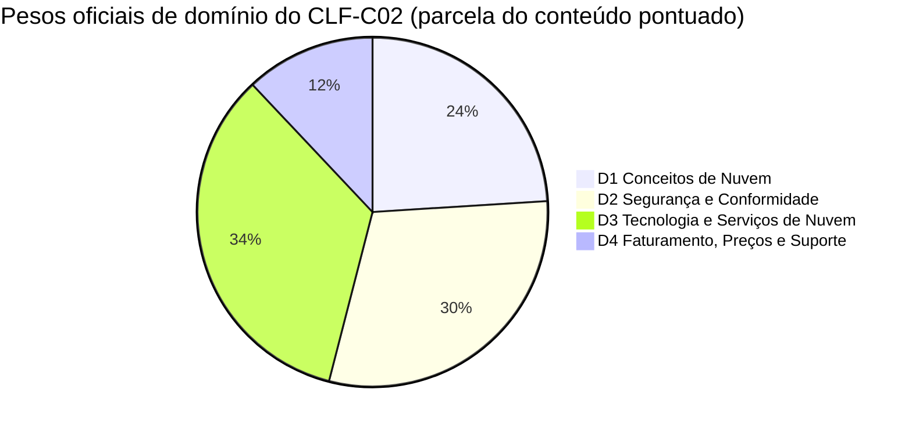
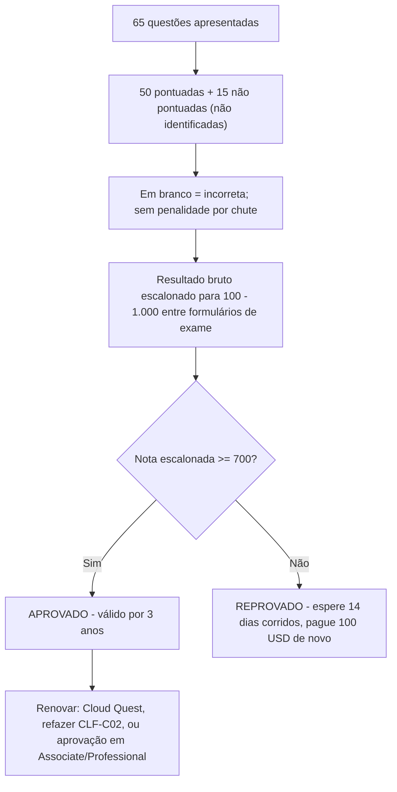
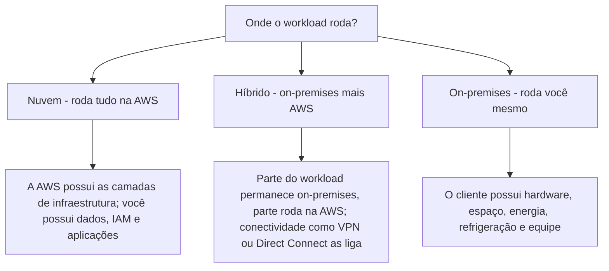
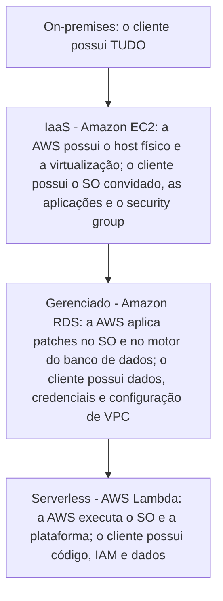

# Guia do Exame CLF-C02 e Conceitos de Nuvem

Toda certificação da AWS começa com um documento: o **guia oficial do exame**. Para o CLF-C02, esse único documento faz dois trabalhos ao mesmo tempo — ele diz exatamente *como* o exame é construído (códigos, minutos, questões, nota de corte, pesos) e define o *vocabulário de nuvem* que você precisa dominar no Domínio 1 (Conceitos de Nuvem, 24% do conteúdo pontuado). Candidatos que pulam o guia e vão direto para flashcards caem nas mesmas três armadilhas: julgam errado o orçamento de tempo, confundem uma **nota escalonada** com uma porcentagem, e não conseguem separar o que está **no escopo** do que apenas soa como trabalho real de nuvem.

```text
=====================================================================
 CLF-C02 — AWS CERTIFIED CLOUD PRACTITIONER (FOUNDATIONAL)
=====================================================================
  Código ............. CLF-C02         Nível .... Foundational
  Duração ............ 90 minutos      Questões . 65 apresentadas
  Itens pontuados .... 50              Não pont. .. 15 (não identificados)
  Escala ............. 100 - 1.000     Corte ..... 700
  Pontuação .......... compensatória (apenas global, sem aprovação por domínio)
  Custo .............. 100 USD (em outubro de 2026, impostos podem aplicar)
  Validade ........... 3 anos          Aplicação . centro Pearson VUE
                                        ou proctor online
  Idiomas ............ 12 (italiano e alemão se aposentam após
                          31 de dezembro de 2026)
---------------------------------------------------------------------
  DOMÍNIO                                     PESO   ITENS (50 x w)
  1. Conceitos de Nuvem                        24%          12
  2. Segurança e Conformidade                  30%          15
  3. Tecnologia e Serviços de Nuvem            34%          17
  4. Faturamento, Preços e Suporte             12%           6
                                              ------         -----
                                              100%           50
---------------------------------------------------------------------
  TIPOS DE QUESTÃO: múltipla escolha | múltipla resposta
                    (sem penalidade por chute; em branco = errada)
  NOTA: a contagem de itens acima é 50 x peso — aritmética, NÃO
        publicada pela AWS. Apenas as porcentagens são oficiais.
=====================================================================
```

> [!NOTE]
> **O guia é o contrato.** Qualquer coisa que não esteja no guia do exame — não importa quão popular seja em posts de blog — não tem garantia de aparecer. A AWS rotula explicitamente suas duas listas de serviços como **"não exaustivas e sujeitas a alterações"**, então trate o guia como o piso do que você precisa saber, não como o teto.

Nesta lição você vai:

- ler o guia do exame como um redator de exames leria — código, tempo, custo, pontuação, idiomas;
- transformar os **pesos de domínio** em um orçamento concreto de horas de estudo;
- mapear todas as **19 declarações de tarefa** nos quatro domínios de conteúdo;
- dominar os **dois tipos de questão** e o modelo de pontuação compensatória;
- separar a **lista de serviços no escopo** da **lista fora do escopo** que alimenta os distratores;
- definir computação em nuvem e contrastar **on-premises versus nuvem** com as próprias palavras do guia;
- reconhecer os três **modelos de implantação** (nuvem, híbrido, on-premises) e a escada de modelos de serviço;
- explicar **elasticidade, escalabilidade, alta disponibilidade e agilidade** sem confundi-los;
- enunciar as **seis vantagens da computação em nuvem** e a proposta de valor da AWS;
- aplicar os pilares do **Well-Architected Framework** e seus seis princípios gerais de design;
- percorrer a economia de nuvem: **custo fixo versus variável, right-sizing, BYOL, automação**;
- estudar **quatro estudos de caso reais de clientes da AWS** — serviços, números e fontes;
- ler a **caixa de atualizações de outubro de 2026** — que fatos do guia mudaram e quais não mudaram;
- praticar com **12 questões em formato de exame** mais três verificações interativas.

---

## 1. O que o exame CLF-C02 mede

### 1.1 O candidato alvo

CLF-C02 é uma credencial **Foundational**, e o material da própria AWS descreve seu público como **profissionais de fora de TI** — vendas, produto e gerenciamento de projetos — que precisam de **letramento em nuvem**, não de engenharia de nuvem. Ninguém espera que você construa infraestrutura. Você é avaliado sobre **julgamento, vocabulário, seleção de serviços e consciência de custo**.

| Atributo do candidato | O que o guia diz | O que isso significa para o seu preparo |
|---|---|---|
| Código e nível | CLF-C02 / **Foundational** | Amplitude de vocabulário, não profundidade de implementação |
| Público | Funções de fora de TI que precisam de letramento em nuvem | Conceitual, não troubleshooting hands-on |
| Programação | **Fora do escopo** | Nenhum script, nenhuma memorização de sintaxe de CLI |
| Design de arquitetura | **Fora do escopo** | Você reconhece princípios; você não desenha arquiteturas |
| Testes de carga e desempenho | **Fora do escopo** | Você sabe *que* eles existem, não *como* executá-los |

### 1.2 As tarefas de trabalho fora do escopo — literalmente

O guia traça uma linha dura, e vale memorizá-la palavra por palavra:

> "A lista a seguir contém tarefas de trabalho que não se espera que o candidato alvo consiga realizar. Esta lista não é exaustiva. Estas tarefas estão fora do escopo do exame: **Programação / Projetar arquitetura de nuvem / Solução de problemas / Implementação / Testes de carga e desempenho**"

Esta lista não é decoração. Itens dela aparecem como **distratores**, porque um distrator que soa como "trabalho real de nuvem" é a resposta errada mais tentadora de todas.

> [!WARNING]
> **⚠️ A paradoxa do escopo — fora do escopo não significa nunca mencionado.**
> - *"Projetar arquitetura de nuvem"* está fora do escopo, mas a Tarefa 1.2 ainda pede que você nomeie os **pilares do Well-Architected** — princípios, não desenhos.
> - *"Implementação"* está fora do escopo, mas a Tarefa 3.1 ainda pede que você **escolha** entre o console, a CLI, os SDKs e infraestrutura como código — uma decisão, não uma construção.
> - *"Solução de problemas"* está fora do escopo, mas a Tarefa 3.8 ainda nomeia "ferramentas para desenvolver, implantar e **solucionar problemas** em aplicações" — você precisa conhecer o *papel* de uma ferramenta, não passos de depuração.
> O exame quer **seleção e reconhecimento**; qualquer opção que peça que você escreva, construa ou depure está testando se você percebeu uma tarefa fora do escopo.

### 1.3 Apêndice A: a lista de tecnologias e conceitos

Ao lado dos domínios, o guia traz um apêndice com **28 tecnologias e conceitos** que "podem aparecer no exame", explicitamente **sem indicação de seus pesos relativos**. As entradas do Domínio 1 são benefícios de migração para nuvem, AWS Cloud Adoption Framework (CAF), gerenciamento de custos, infraestrutura global, infraestrutura como código, migração e transferência de dados, AWS Prescriptive Guidance, AWS Pricing Calculator, AWS Professional Services, AWS Partner Network, arquitetos de soluções e o Well-Architected Framework. Leia-o como uma *checklist de vocabulário*, nunca como um peso.

- **📚 Você sabia?** O exame tem **dois artefatos oficiais de guia** que genuinamente discordam: um guia em HTML em `docs.aws.amazon.com` e um PDF mais antigo carimbado com "Version 1.0 CLF-C02" em `d1.awsstatic.com`. **13 das 19 declarações de tarefa diferem** entre eles (verificado em outubro de 2026). A regra que a própria estrutura da AWS implica: **o guia em HTML vence** qualquer PDF antigo, post de blog ou simulado de terceiros.

---

## 2. Logística do exame: os números que mudam sua estratégia

### 2.1 A tabela de logística

Cada linha abaixo vem do guia do exame, da visão geral do exame na página de certificação ou das FAQ de certificação da AWS, todas acessadas em **outubro de 2026**.

| Atributo | Valor | Onde está declarado |
|---|---|---|
| Código / nível | CLF-C02 / Foundational | Guia do exame |
| Duração | **90 minutos** | Visão geral do exame |
| Questões apresentadas | **65** (múltipla escolha ou múltipla resposta) | Visão geral do exame |
| Pontuadas / não pontuadas | **50 afetam sua nota / 15 não** — as 15 **não são identificadas** no exame | Guia do exame |
| Tipos de resposta | ME: 1 correta + 3 distratores · MR: 2+ corretas de 5+ opções | Guia do exame |
| Política de chute | Não respondida = **incorreta**; **sem penalidade** por chute | Guia do exame |
| Escala da nota | Escalonada **100–1.000**; aprovação mínima **700** | Guia do exame |
| Modelo de pontuação | **Compensatório** — apenas o resultado global precisa passar | Guia do exame |
| Taxa | **100 USD** em outubro de 2026 (exames nível Foundational; impostos como VAT podem aplicar) | FAQ de certificação |
| Aplicação | Centro de testes Pearson VUE **ou** exame proctor online | Visão geral do exame |
| Idiomas | **12**: árabe, inglês, francês (França), alemão, italiano, japonês, coreano, português (Brasil), espanhol (América Latina), espanhol (Espanha), chinês simplificado, chinês tradicional | Visão geral do exame |
| Aposentadoria de idiomas | **italiano e alemão se aposentam após 31 de dezembro de 2026** | Visão geral do exame |
| Validade | **3 anos** | Página de certificação |
| Renovação | Cloud Quest Recertify Cloud Practitioner (sem exame), refazer e passar no CLF-C02, ou passar em **qualquer um** exame nível Associate ou Professional | Página de recertificação |
| Refazer após reprovação | Espere **14 dias corridos**; **sem limite** de tentativas; **taxa integral a cada vez** | FAQ de certificação |
| Refazer após aprovação | Bloqueado por **2 anos** (a menos que a AWS publique um novo guia e série de código) | FAQ de certificação |

### 2.2 Exemplo resolvido E1 — o orçamento de tempo por questão

O número mais útil de todo o guia é uma aritmética que ninguém publica:

$$
t = \frac{90 \times 60}{65} = \frac{5{,}400}{65} \approx 83.1 \text{ segundos por questão}
$$

Reserve **10 minutos** para revisão e o orçamento real vira $80 \times 60 / 65 \approx$ **73,8 segundos** por item. Regra prática de orçamento: responda rápido no começo e depois gaste o excedente nos itens de múltipla resposta, mais lentos.

### 2.3 Exemplo resolvido E2 — pontuados versus não pontuados

$$
65 = 50 + 15 \qquad \frac{15}{65} = 23.1\% \text{ do exame não afeta sua nota}
$$

Quase um quarto da prova é material piloto invisível — e **você não consegue dizer quais 15 são**. A única estratégia razoável é tratar cada item como pontuado.

### 2.4 Exemplo resolvido E3 — o custo de refazer o exame

| Evento | Dia do calendário | Carteira |
|---|---|---|
| Primeira tentativa (reprovou) | Dia 0 | 100 USD (em outubro de 2026) |
| Elegível para refazer | Dia 14 | — |
| Segunda tentativa (reprovou) | Dia 14 ou depois | +100 USD |
| Terceira tentativa | +14 dias após a segunda reprovação | +100 USD |
| **Total após três tentativas reprovadas** | — | **300 USD** |

Três tentativas custam **300 USD** em outubro de 2026 mais pelo menos **28 dias corridos** de espera entre elas. **Faltar à prova** é diferente de novo: anula a taxa, mas **não** conta como tentativa reprovada.

- **📚 Você sabia?** A validade de **3 anos não significa uma refação obrigatória**. A AWS lista três rotas de renovação, e uma delas — **Cloud Quest Recertify Cloud Practitioner** — não precisa de exame nenhum; alternativamente, passar em *qualquer* exame nível Associate ou Professional a renova. Então um candidato que planeja continuar no caminho da AWS pode deixar o CLF-C02 expirar de propósito.

---

## 3. Os quatro domínios e seus pesos

### 3.1 Pesos oficiais

O guia declara quatro domínios de conteúdo, e as porcentagens são parcelas do **conteúdo pontuado apenas**:

| Domínio | Peso oficial |
|---|---|
| **1. Conceitos de Nuvem** | **24%** |
| **2. Segurança e Conformidade** | **30%** |
| **3. Tecnologia e Serviços de Nuvem** | **34%** |
| **4. Faturamento, Preços e Suporte** | **12%** |
| **Total** | **100%** |



### 3.2 Exemplo resolvido E4 — contagens de itens derivadas (aritmética, não da AWS)

Multiplique os **50 itens pontuados** por cada peso:

```text
Domínio   peso   50 x peso   leitura
D1        24%         12      cerca de 12 itens pontuados
D2        30%         15      cerca de 15 itens pontuados
D3        34%         17      cerca de 17 itens pontuados
D4        12%          6      cerca de  6 itens pontuados
                                ------
                              50 itens pontuados
```

> [!IMPORTANT]
> Os **pesos são oficiais** (guia do exame, em outubro de 2026). As **contagens de itens são aritmética** — 50 × peso — e **não são publicadas pela AWS**. As contagens de questões por domínio são desconhecidas, e como 15 dos 65 itens são pilotos não pontuados, a sua forma real de exame não vai bater exatamente com esta grade. Use-a para **alocar tempo de estudo**, nunca para prever um número fixo de questões.

### 3.3 De CLF-C01 para CLF-C02

O exame foi atualizado em setembro de 2023 (o CLF-C01 rodou até **18 de setembro de 2023**; o CLF-C02 a partir de **19 de setembro de 2023**), e o apêndice de comparação do próprio guia mostra como o enfoque mudou:

| Domínio | CLF-C01 | CLF-C02 |
|---|---|---|
| 1. Conceitos de Nuvem | 26% | **24%** |
| 2. Segurança e Conformidade | 25% | **30%** |
| 3. Tecnologia → Tecnologia e Serviços de Nuvem | 33% | **34%** |
| 4. Faturamento e Preços → Faturamento, Preços e Suporte | 16% | **12%** |

Três fatos decorrem dessa tabela: **segurança cresceu cinco pontos**; **faturamento encolheu quatro**; e a AWS declara **"Nenhum conteúdo foi removido do exame"** — conteúdo de sete declarações de tarefa antigas foi **recategorizado** nas novas. A única adição genuína é a **Tarefa 1.3**, que introduziu o **AWS Cloud Adoption Framework (CAF)**.

### 3.4 Exemplo resolvido E5 — transformando pesos em horas de estudo

Suponha que você tenha **40 horas** antes do dia do exame. Os pesos convertem-se diretamente em horas:

```text
Domínio   peso   horas (40 h)   para onde vão as horas
D1        24%        9,6 h      benefícios, Well-Architected, CAF, economia
D2        30%       12,0 h      responsabilidade compartilhada, IAM, conformidade
D3        34%       13,6 h      infraestrutura global, compute, armazenamento,
                                bancos de dados, rede, IA/ML
D4        12%        4,8 h      modelos de preços, ferramentas de custo, planos de Suporte
                                ---------
                                40,0 h
```

Os Domínios 2 + 3 são **64% da nota**. Um candidato que gasta todo o seu tempo em conceitos de nuvem porque "esse é o tópico do Cloud Practitioner" aloca dois terços da prova de forma errada.

---

## 4. O mapa das declarações de tarefa: 4 domínios → 19 tarefas

O guia não publica tópicos; ele publica **declarações de tarefa** — cada uma um par "Conhecimento de" mais "Habilidade em". Todo conteúdo examinável pende de uma dessas 19.

```mermaid
flowchart TD
    R["CLF-C02 - 19 declarações de tarefa em 4 domínios"] --> D1["D1 Conceitos de Nuvem 24%"]
    R --> D2["D2 Segurança e Conformidade 30%"]
    R --> D3["D3 Tecnologia e Serviços de Nuvem 34%"]
    R --> D4["D4 Faturamento, Preços e Suporte 12%"]
    D1 --> A1["1.1 Benefícios da AWS Cloud"]
    D1 --> A2["1.2 Princípios de design da AWS Cloud"]
    D1 --> A3["1.3 Benefícios e estratégias de migração"]
    D1 --> A4["1.4 Economia de nuvem"]
    D2 --> B1["2.1 Modelo de responsabilidade compartilhada"]
    D2 --> B2["2.2 Conceitos de segurança, governança e conformidade"]
    D2 --> B3["2.3 Capacidades de gerenciamento de acesso"]
    D2 --> B4["2.4 Componentes e recursos de segurança"]
    D3 --> C1["3.1 Implantação e operação na nuvem"]
    D3 --> C2["3.2 Infraestrutura global"]
    D3 --> C3["3.3 Serviços de computação"]
    D3 --> C4["3.4 Serviços de banco de dados"]
    D3 --> C5["3.5 Serviços de rede"]
    D3 --> C6["3.6 Serviços de armazenamento"]
    D3 --> C7["3.7 Serviços de IA/ML e análise de dados"]
    D3 --> C8["3.8 Outras categorias de serviços no escopo"]
    D4 --> E1["4.1 Comparar modelos de preços da AWS"]
    D4 --> E2["4.2 Faturamento, orçamento e gerenciamento de custos"]
    D4 --> E3["4.3 Recursos técnicos e Suporte da AWS"]
```



### 4.1 O Domínio 1 em detalhe — as quatro tarefas com que este curso começa

| Tarefa | Conhecimento de | Habilidade em (o que você precisa ser capaz de *fazer*) |
|---|---|---|
| **1.1 Definir os benefícios da AWS Cloud** | Proposta de valor da AWS Cloud | Benefícios da infraestrutura global (velocidade de implantação, alcance global); vantagens da **alta disponibilidade, elasticidade e agilidade** |
| **1.2 Identificar princípios de design** | AWS Well-Architected Framework | Os seis **pilares**; **diferenças entre os pilares** |
| **1.3 Benefícios e estratégias de migração** | Estratégias de adoção de nuvem; recursos que apoiam a jornada | Componentes do **AWS CAF** (redução de risco de negócios; melhora de desempenho ESG; aumento de receita; aumento de eficiência operacional); identificação de estratégias de migração (por exemplo, **replicação de banco de dados**) |
| **1.4 Conceitos de economia de nuvem** | Aspectos da economia de nuvem; economia de custo ao migrar para a nuvem | **Custo fixo versus variável**; drivers de custo on-premises; **BYOL versus licenças incluídas**; **right-sizing**; benefícios da **automação**; **economias de escala** |

### 4.2 As outras 15 tarefas em uma linha cada

| Tarefa | Foco em uma linha |
|---|---|
| 2.1 | Responsabilidade compartilhada — AWS, cliente e controles compartilhados, e como a linha **muda por serviço** (RDS, Lambda, EC2) |
| 2.2 | Conformidade e governança — Artifact, criptografia, logs (CloudTrail, Config), monitoramento com CloudWatch |
| 2.3 | Gerenciamento de acesso — IAM, proteção de usuário root, menor privilégio, MFA, IAM Identity Center, federação |
| 2.4 | Recursos de segurança — WAF, Shield, GuardDuty, Inspector, terceiros do Marketplace, Trusted Advisor |
| 3.1 | Formas de operar — acesso programático (APIs, SDKs, CLI) versus console versus IaC; modelos de implantação **nuvem, híbrido, on-premises** |
| 3.2 | Infraestrutura global — Regiões, Zonas de Disponibilidade, locais de borda; alta disponibilidade multi-AZ |
| 3.3 | Computação — tipos de instância EC2, ECS/EKS, Fargate/Lambda, auto scaling, balanceadores de carga |
| 3.4 | Bancos de dados — RDS, Aurora, DynamoDB, ElastiCache; migração com DMS e SCT |
| 3.5 | Redes — sub-redes e gateways de VPC, NACLs e security groups, Route 53, VPN e Direct Connect |
| 3.6 | Armazenamento — objeto (classes do S3), bloco (EBS, armazenamento de instância), arquivo (EFS, FSx), Storage Gateway, políticas de ciclo de vida, AWS Backup |
| 3.7 | IA/ML e análise — SageMaker AI, Lex; Athena, Kinesis, Glue, Quick Sight |
| 3.8 | Outras categorias — EventBridge, SNS, SQS; Connect, SES; CodeBuild, CodePipeline, X-Ray; AppStream 2.0, WorkSpaces; Amplify; IoT Core; Suporte da AWS |
| 4.1 | Modelos de preços — On-Demand, Reserved, Spot, Savings Plans, Dedicated, Capacity Reservations; camadas de armazenamento; transferência de dados entrada/saída |
| 4.2 | Ferramentas de custo — Budgets, Cost Explorer, Pricing Calculator, faturamento consolidado do Organizations, tags de alocação de custo, o Relatório de Custos e Uso |
| 4.3 | Suporte e recursos — whitepapers, Prescriptive Guidance, Knowledge Center, re:Post, planos de Suporte, Trusted Advisor, Health Dashboard, Marketplace, Professional Services |

---

## 5. Tipos de questão e mecânica de pontuação

### 5.1 Exatamente dois tipos de questão

| Tipo | Estrutura | Regra de crédito |
|---|---|---|
| **Múltipla escolha** | Uma resposta correta e **três respostas incorretas (distratores)** | Selecione a melhor resposta única |
| **Múltipla resposta** | **Duas ou mais corretas** entre **cinco ou mais** opções | Toda resposta correta é necessária para crédito |

Não há **itens de ordenação, associação, arrastar e soltar ou estudo de caso** no guia CLF-C02 — se um simulado mostrar esses formatos, não está seguindo o guia deste exame.

### 5.2 O pipeline de pontuação



**Compensatório** significa uma coisa apenas: apenas o resultado **global** precisa passar de 700. Você **não** precisa chegar a 700 dentro de cada domínio — um Domínio 4 fraco pode ser carregado por um Domínio 3 forte, e dominar um domínio não resgata uma nota global abaixo da corte.

### 5.3 Exemplo resolvido E6 — 700 não é 70%

700 de 1.000 *parece* 70%, e a conversão ingênua $0.70 \times 50 = 35$ respostas corretas é aritmeticamente limpa — e **errada como fato de exame**. A escala começa em 100, então a faixa utilizável é $1{,}000 - 100 = 900$ pontos:

$$
\frac{700 - 100}{900} = \frac{600}{900} \approx 66.7\%
$$

A AWS escalona notas **entre múltiplos formulários de exame que podem diferir em dificuldade**, então o número bruto de respostas corretas exigido para 700 **não é fixo** e não é publicado. A única regra determinística é comportamental: **itens em branco são pontuados como incorretos**, então responda todos os 65.

> [!WARNING]
> **Nunca deixe um item em branco "para garantir".** Não há **penalidade por chute** — um chute errado não lhe custa nada além do ponto que você já perderia pulando o item, enquanto um em branco garante zero. Hábito: elimine, comprometa-se, marque e siga. A ~83 segundos por item, uma questão que você "pretendia voltar" é o hábito mais caro deste exame.

---

## 6. Serviços no escopo versus fora do escopo

### 6.1 Duas listas, uma regra

O guia publica uma lista de **Serviços da AWS no Escopo** abrangendo **19 categorias**, e uma lista separada de **Serviços da AWS Fora do Escopo**. Ambas são rotuladas como **não exaustivas e sujeitas a alterações** (em outubro de 2026). A lista no escopo é o que você precisa reconhecer; a lista fora do escopo diz quais nomes estão sendo usados como **iscas**.

| Categoria no escopo (19 no total) | Nomes que o guia lista |
|---|---|
| Análise de dados | Athena, EMR, Glue, Kinesis, OpenSearch, Quick Sight, Redshift |
| Integração de aplicações | EventBridge, SNS, SQS, Step Functions |
| Gerenciamento Financeiro em Nuvem | AWS Budgets, Relatórios de Custo e Uso, Cost Explorer, AWS Marketplace |
| Computação | Batch, EC2, Elastic Beanstalk, Lightsail, Outposts |
| Contêineres | ECR, ECS, EKS |
| Banco de dados | Aurora, DocumentDB, DynamoDB, ElastiCache, Neptune, RDS |
| Aprendizado de Máquina | Comprehend, Lex, Polly, Q, Rekognition, SageMaker AI, Textract, Transcribe, Translate |
| Gerenciamento e Governança | Auto Scaling, CloudFormation, CloudTrail, CloudWatch, Compute Optimizer, Config, Control Tower, Organizations, Trusted Advisor, **Well-Architected Tool**, … |
| Migração e Transferência | Application Discovery Service, Application Migration Service, DMS, Migration Evaluator, Migration Hub, SCT |
| Redes e Entrega de Conteúdo | API Gateway, CloudFront, Direct Connect, Global Accelerator, PrivateLink, Route 53, Transit Gateway, VPC, VPN |
| Segurança, Identidade e Conformidade | Artifact, ACM, CloudHSM, Cognito, Detective, GuardDuty, **IAM**, **IAM Identity Center**, Inspector, KMS, Macie, RAM, Secrets Manager, Security Hub, Shield, WAF |
| Serverless | Fargate, Lambda |
| Armazenamento | AWS Backup, EBS, EFS, Elastic Disaster Recovery, FSx, S3, S3 Glacier, Storage Gateway |

### 6.2 A lista fora do escopo — serviços que existem mas não são examináveis

Amazon AppFlow · AWS Clean Rooms · AWS Data Exchange · Amazon DataZone · **Amazon MSK** · AWS AppFabric · Amazon WorkDocs · AWS Wavelength · AWS Copilot · Amazon GameLift · **AWS CloudShell** · **AWS CodeDeploy** · AWS CodeArtifact · AWS Device Farm · Amazon CodeGuru · AWS IoT Greengrass · Amazon Fraud Detector · Amazon Personalize · Amazon Lookout for Metrics · AWS Chatbot · **AWS Billing Conductor** · todos os serviços de mídia da AWS Elemental · **Amazon MemoryDB** · **AWS Network Firewall** · AWS RoboMaker · **Amazon FSx for Lustre** · AWS Transfer Family · AWS IQ · AWS Activate · AWS Managed Services (AMS) · Amazon Keyspaces · AWS Launch Wizard · AWS AppConfig · Amazon Data Lifecycle Manager · Amazon Elastic Transcoder · AWS Cloud Map · AWS Ground Station · Amazon VPC Lattice · Amazon Cloud Directory · AWS Migration Hub Refactor Spaces · AWS Network Access Analyzer · AWS IoT Device Defender · Amazon Monitron · AWS Application Composer · Amazon Interactive Video Service (Amazon IVS).

> [!IMPORTANT]
> **Um serviço estar fora do escopo não significa que ele é falso, descontinuado ou errado.** São serviços da AWS reais e atuais. Eles simplesmente **não podem ser a resposta correta** de uma questão CLF-C02 enquanto um serviço no escopo se encaixar. Se a opção que soa melhor numa questão estiver na lista fora do escopo, continue lendo — quase certamente há uma opção melhor, no escopo.

### 6.3 Armadilhas de nomenclatura na lista no escopo

- O guia grafia **"Amazon Quick Sight"** (duas palavras) — a página do produto diz QuickSight.
- A Tarefa 4.2 diz "AWS Cost and Usage **Report**" enquanto a lista de serviços diz **"AWS Cost and Usage Reports"** (plural).
- É **"AWS IAM Identity Center"** — a redação antiga "(AWS Single Sign-On)" não aparece mais.
- **AWS VPN**, **AWS Site-to-Site VPN** e **AWS Client VPN** estão listados como **três marcadores separados**, não como um serviço com três modos.
- O serviço é **Amazon SageMaker AI** — o nome mais antigo "SageMaker" sem "AI" é o que simulados mais antigos usam.

### 6.4 Qual guia vence

| Artefato | Situação (out. 2026) | Regra |
|---|---|---|
| Guia HTML em `docs.aws.amazon.com` | Atual | **Use este** |
| PDF carimbado com "Version 1.0 CLF-C02" | Mais antigo; 13 das 19 declarações de tarefa diferem | Apenas referência |
| Simulados de terceiros | Variam | Nunca autoritativos |

A versão HTML removeu itens como "AWS Snowball" e "AWS Audit Manager" das declarações de tarefa e mudou as listas de serviços substancialmente — a lista fora do escopo passou de 11 nomes em 3 categorias no PDF para uma lista muito mais longa no HTML.

- **📚 Você sabia?** **AWS Snowball** é uma armadilha em *duas* direções ao mesmo tempo: o guia de exame em PDF mais antigo ainda o nomeia dentro da Tarefa 1.3, contudo ele aparece **em nenhuma** das listas atual — **nem** no escopo **nem** fora do escopo — e a documentação do Snowball Edge carrega um aviso de que o dispositivo **não está mais disponível para novos clientes** (em outubro de 2026). Ambas as listas de serviços são não exaustivas, então a AWS nunca reconciliou a contradição; não construa seu plano de estudo em torno dela.

### Atualizações de 2026 (em outubro de 2026)

> [!NOTE]
> **O que de fato mudou entre o guia da época do lançamento e o guia que você baixa hoje** — cada linha abaixo foi verificada contra uma fonte primária da AWS em **outubro de 2026**, e cada uma é examinável porque o exame testa o guia *atual*:
> - **Os pesos dos domínios não mudaram**: continuam **24 / 30 / 34 / 12**, inalterados desde que o CLF-C02 entrou no ar em **19 de setembro de 2023**. Qualquer página de preparação que afirme mudança recente de peso (por exemplo "Segurança 28% → 30%") é não corroborada — PDF atual do guia de exame, p. 3, acesso em outubro de 2026.
> - **Ambas as listas de serviços foram reconstruídas**: entradas no escopo **128 → 111** nas mesmas 19 categorias, entradas fora do escopo **11 → 55** — páginas oficiais de serviços no escopo e fora do escopo, acesso em outubro de 2026.
> - **A Tarefa 4.3 agora ensina o lineup de suporte pós-2025**: seu exemplo diz "customer service and communities, **Basic Support, AWS Business Support+, AWS Enterprise Support, AWS Unified Operations**"; Developer, o Business clássico e Enterprise On-Ramp **não aceitaram novas assinaturas após 2 de dezembro de 2025** (Tarefa 4.3 do guia de exame; AWS News Blog, 2 de dez. de 2025).
> - **A Tarefa 4.2 removeu o AWS Billing Conductor** — a redação atual é apenas "AWS Budgets and AWS Cost Explorer", e o Billing Conductor agora está na lista **fora do escopo**, onde só pode ser um distrator (guia de exame da época do lançamento versus atual, acesso em outubro de 2026).
> - **A infraestrutura global continua crescendo**: **39 Regiões e 124 Zonas de Disponibilidade**, com **7 AZs a mais** e **2 Regiões a mais** (Reino da Arábia Saudita e Chile) anunciadas mas ainda não abertas (mapa de Regiões e AZs, acesso em outubro de 2026 — verifique o status atual antes de usar).
> - **Dois idiomas estão com o relógio correndo**: são oferecidos **12 idiomas**, mas **italiano e alemão se aposentam após 31 de dezembro de 2026** (página de certificação, acesso em outubro de 2026).

- **📚 Você sabia?** O PDF atual do guia de exame **não tem número de versão algum** — ele imprime apenas "Copyright © 2026", e o único artefato carimbado ainda em circulação é o **"Version 1.0 CLF-C02"** da época do lançamento. O `uiVersion=2024.10` que você pode ver na URL da documentação é a **versão do template de site da AWS Docs**, não uma data de revisão do guia (verificado em outubro de 2026). Também não existe página de changelog da AWS para este guia, então afirmações do tipo "o guia foi atualizado em março de 2026" são inverificáveis.

---

## 7. Fundamentos de nuvem: o que é a nuvem e o que muda quando você migra

### 7.1 O que é computação em nuvem

Neste exame, a computação em nuvem é definida pela sua **consequência, não pelo hardware**: você para de possuir e manter infraestrutura e passa a consumir um serviço medido, pagando apenas enquanto ele roda. A própria página de vantagens da AWS carrega todo o argumento econômico em uma linha:

> "Troque despesa fixa por despesa variável … pague somente quando consumir recursos de computação"

A AWS descreve a plataforma como oferecendo **mais de 200 serviços completos** (em outubro de 2026), e sua página de origens afirma que a intenção fundadora era permitir que qualquer pessoa "acesse a mesma tecnologia poderosa das maiores e mais sofisticadas empresas do mundo". Os seis benefícios da Seção 8 são o que a Tarefa 1.1 quer dizer com a **"proposta de valor da AWS Cloud"**.

### 7.2 On-premises versus nuvem

| Dimensão | On-premises | AWS Cloud |
|---|---|---|
| Tipo de despesa | **Fixa / capital** — comprada antes de ser usada | **Variável / operacional** — medida enquanto roda |
| Decisão de capacidade | Comprada para o **pico**, ociosa o resto do tempo | Crescida ou reduzida **com poucos minutos de aviso** |
| Renovação | Ciclo de renovação de hardware de cerca de **5 anos** (AWS, 2022) | Sem ciclo de renovação para o cliente |
| Compra | Tipicamente **6–9 meses** de antecedência (AWS, 2022) | Minutos |
| Utilização típica | **Abaixo de 15%** para servidores de data center on-premises (AWS, 2024) | Você paga pelo que consome |
| Superprovisionamento | **20%–50%** acima do pico previsto (AWS, 2022) | Não é necessário — a elasticidade absorve picos |
| Trabalho da equipe | Instalar racks, empilhar e energizar servidores | Transferido para a AWS |
| Alcance | Limitado a onde o hardware está | **Vá global em minutos** |

Os quatro números on-premises acima são estimativas de indústria publicadas pela AWS (posts de 2022 e 2024), válidas em outubro de 2026 — **verifique o status atual antes de usar**.

### 7.3 Exemplo resolvido E7 — os custos on-premises que uma lista de preços nunca mostra

Um cenário hipotético de implantação pequena de **10 servidores** em um **horizonte de cinco anos**. Os valores em dólares são **pressupostos ilustrativos, não preços da AWS** (em outubro de 2026 — verifique o status atual antes de usar); o ponto do exemplo é quais linhas normalmente são esquecidas:

```text
Item de linha                         Custo de 5 anos
Hardware do servidor                     $ 30.000
Manutenção anual (5 anos)                $ 30.000
Energia e refrigeração  $25 x 10 x 60 meses $ 15.000
Espaço no piso                            $  6.000
Administrador de sistemas 0,25 EMT       $ 112.500
                                       ----------
Subtotal (antes de licenças, renovação
  e custo de capital)                    $ 193.500
```

A lição não é o total — é que **quatro dessas cinco linhas são invisíveis** para quem compara o preço de etiqueta de um servidor com uma taxa horária. A orientação da AWS é explícita de que comparações falhas omitem mão de obra, renovação e instalações físicas.

### 7.4 Modelos de implantação

A Tarefa 3.1 nomeia exatamente **três** modelos de implantação:



Um modelo **híbrido** é a resposta quando parte do parque precisa permanecer on-premises enquanto nova capacidade é construída na AWS; **on-premises** é a resposta quando nada muda; **nuvem** é a resposta quando tudo muda.

### 7.5 A escada de modelos de serviço — quanto a AWS assume

O guia não enumera IaaS/PaaS/SaaS em uma declaração de tarefa, mas ele *testa* a ideia subjacente através da **transferência de responsabilidade compartilhada**: quanto mais gerenciado o serviço, menor a sua parte.

| Camada | On-premises | IaaS — Amazon EC2 | Gerenciado — Amazon RDS | Serverless — AWS Lambda |
|---|---|---|---|---|
| Hardware físico, hipervisor | Cliente | **AWS** | **AWS** | **AWS** |
| Patch do SO convidado | Cliente | **Cliente** | AWS | AWS (sem SO do cliente) |
| Runtime, capacidade, escala | Cliente | Cliente | AWS | AWS |
| Security groups / configuração de rede | Cliente | **Cliente** | **Cliente** | n/a |
| Código da aplicação / função | Cliente | Cliente | Cliente | **Cliente** |
| Usuários IAM, papéis, MFA | Cliente | Cliente | Cliente | **Cliente** |
| Dados, classificação, criptografia | Cliente | Cliente | Cliente | **Cliente** |



**Constantes independentemente da posição na escada:** a segurança física da nuvem é **sempre da AWS**; decisões de dados, IAM e criptografia são **sempre do cliente**.

```dragdrop
{
  "question": "Ordene a escada de modelos de serviço do ponto em que o CLIENTE carrega a maior responsabilidade para o ponto em que a AWS carrega a maior:",
  "items": [
    "On-premises - o cliente possui hardware, espaço, energia, refrigeração e equipe",
    "IaaS - Amazon EC2: a AWS possui o host físico e o hipervisor; o cliente possui o SO convidado, aplicações e security groups",
    "Gerenciado - Amazon RDS: a AWS aplica patches no SO e no motor do banco de dados; o cliente possui dados, credenciais e configuração de VPC",
    "Serverless - AWS Lambda: a AWS executa o SO e a plataforma; o cliente possui código, IAM e dados"
  ],
  "correctOrder": [
    "On-premises - o cliente possui hardware, espaço, energia, refrigeração e equipe",
    "IaaS - Amazon EC2: a AWS possui o host físico e o hipervisor; o cliente possui o SO convidado, aplicações e security groups",
    "Gerenciado - Amazon RDS: a AWS aplica patches no SO e no motor do banco de dados; o cliente possui dados, credenciais e configuração de VPC",
    "Serverless - AWS Lambda: a AWS executa o SO e a plataforma; o cliente possui código, IAM e dados"
  ],
  "explanation": "Cada degrau da escada transfere mais uma camada não diferenciada para a AWS, e é por isso que o exame lê a escada como uma questão de responsabilidade compartilhada: o patch do SO convidado passa do cliente (EC2) para a AWS (RDS, Lambda), enquanto a classificação de dados, usuários IAM, papéis e criptografia permanecem com o cliente em TODOS os degraus - inclusive serverless. On-premises vem primeiro porque o cliente possui tudo, camada física incluída."
}
```

### 7.6 Quatro palavras que o exame mantém separadas

| Termo | Definição no exame |
|---|---|
| **Elasticidade** | Crescer **e diminuir** automaticamente conforme a demanda muda |
| **Escalabilidade** | A capacidade de **lidar com crescimento** |
| **Alta disponibilidade** | Sobreviver a uma **falha de componente** (múltiplas Zonas de Disponibilidade) |
| **Agilidade** | Velocidade de provisionamento — **"de semanas para apenas minutos"** |

```fillblank
{
  "question": "Complete as frases de conceitos de nuvem usando o próprio vocabulário do guia do exame:",
  "template": "A nuvem troca despesa {{1}} por despesa {{2}}, então você paga apenas quando {{3}} recursos de computação. Combinar o tamanho e o tipo da instância com a utilização medida, ainda atendendo ao desempenho, é chamado de {{4}}, e a vantagem estrutural de preço que vem de agregar a demanda de centenas de milhares de clientes é chamada de {{5}} de escala.",
  "answers": {
    "1": "fixo",
    "2": "variável",
    "3": "consumir",
    "4": "right-sizing",
    "5": "economias"
  },
  "distractors": ["capital", "operacional", "provisionar", "superprovisionamento", "autoscaling", "elasticidade", "virtualização"],
  "explanation": "Os seis benefícios da AWS dizem a troca diretamente: 'Troque despesa fixa por despesa variável ... pague somente quando consumir recursos de computação', e 'Beneficie-se de enormes economias de escala'. Right-sizing é a habilidade do guia de exame de combinar tamanho e tipo com a utilização MEDIDA, ainda atendendo ao desempenho - não é a mesma coisa que escolher a instância mais barata."
}
```

---

## 8. Proposta de valor da AWS: os seis benefícios

### 8.1 Os seis benefícios, com as palavras da AWS

A "proposta de valor" da Tarefa 1.1 é examinada através de seis benefícios, e as questões frequentemente citam uma frase **literal**:

| # | Benefício (redação da AWS) | O que ele elimina do on-premises |
|---|---|---|
| 1 | **"Troque despesa fixa por despesa variável"** — pague apenas quando consumir | Comprar para o pico |
| 2 | **"Beneficie-se de enormes economias de escala"** — o uso de centenas de milhares de clientes é agregado, gerando preços pay-as-you-go menores | Pagar o varejo por um único rack |
| 3 | **"Pare de adivinhar a capacidade"** — escale para cima ou para baixo com poucos minutos de aviso | 20–50% de superprovisionamento |
| 4 | **"Aumente a velocidade e a agilidade"** — de semanas para apenas minutos | Compra com 6–9 meses de antecedência |
| 5 | **"Pare de gastar dinheiro executando e mantendo data centers"** — o trabalho pesado de instalar racks, empilhar e energizar servidores | Instalações físicas e mão de obra |
| 6 | **"Vá global em minutos"** — menor latência para os usuários finais | Construir no exterior |

A Tarefa 1.1 acrescenta os quatro **benefícios** principais: benefícios da **infraestrutura global** (velocidade de implantação, alcance global) e as vantagens da **alta disponibilidade, elasticidade e agilidade**.

### 8.2 Exemplo resolvido E8 — por que economias de escala são estruturais, e não uma promoção

Dois clientes precisam cada um de um pico de **10 unidades** de capacidade, mas seus picos ocorrem em momentos diferentes (anticorrelacionados):

```text
Sem agregação:  10 + 10 = 20 unidades de hardware de pico
Com agregação:  pico combinado = 12 unidades
Redução de hardware:  (20 - 12) / 20 = 40% menos hardware para demanda idêntica
```

Como a AWS agrega a demanda, ela compra e executa **~40% menos hardware para o mesmo pico total do cliente**, e repassa a economia estrutural como uma **taxa variável menor**. É isso que "enormes economias de escala" significam — não é um desconto por tempo limitado.

### 8.3 Exemplo resolvido E9 — vinte anos da mesma unidade de preço

A retrospectiva de 20 anos do próprio S3 da AWS apresenta as duas extremidades da curva de preço: o Amazon S3 foi lançado em **14 de março de 2006** a **15 centavos por gigabyte**, e o post da AWS de março de 2026 situa o valor atual em **levemente acima de 2 centavos por gigabyte** — cerca de uma **redução de 85%** (em outubro de 2026 — verifique os preços atuais antes de usar). Em **100 TB** ($102{,}400$ GB):

$$
\text{2006: } 102{,}400 \times 0.15 \approx \$15{,}360/\text{mo} \qquad \text{2026: } 102{,}400 \times 0.02 \approx \$2{,}048/\text{mo}
$$

Mesma unidade, mesmo serviço, mesma API — o preço caiu porque escala e eficiência se compõem. O blog também observa que o código escrito para o S3 em 2006 **ainda funciona inalterado**, o que é um argumento de durabilidade tanto quanto um argumento de preço.

### 8.4 O Well-Architected Framework — Tarefa 1.2

O framework é o conjunto de "melhores práticas da AWS para projetar e operar workloads seguros, confiáveis, eficientes, economicamente viáveis e sustentáveis". Uma revisão é explicitamente **"uma conversa construtiva … não um mecanismo de auditoria"**, e a **AWS Well-Architected Tool** que a realiza é **gratuita** e está na lista no escopo.

| Pilar | O que ele protege |
|---|---|
| **Excelência Operacional** | Executar, monitorar e melhorar continuamente — incluindo automação |
| **Segurança** | Proteger informações e sistemas |
| **Confiabilidade** | Fazer o que devem fazer e se recuperar rapidamente de falhas |
| **Eficiência de Desempenho** | Usar computação de forma eficiente conforme demanda e tecnologia mudam |
| **Otimização de Custos** | Evitar custos desnecessários |
| **Sustentabilidade** | Minimizar o impacto ambiental |

```matching
{
  "question": "Associe cada pilar do AWS Well-Architected Framework ao que ele protege no exame CLF-C02:",
  "pairs": [
    {"left": "Excelência Operacional", "right": "Executar, monitorar e melhorar continuamente o workload - incluindo automatizar mudança e resposta"},
    {"left": "Segurança", "right": "Proteger informações e sistemas - confidencialidade, integridade e disponibilidade"},
    {"left": "Confiabilidade", "right": "Fazer o que o workload deveria fazer e se recuperar rapidamente de falhas"},
    {"left": "Eficiência de Desempenho", "right": "Usar recursos de computação de forma eficiente conforme demanda, tecnologia e requisitos de negócio mudam"},
    {"left": "Otimização de Custos", "right": "Evitar custos desnecessários - o pilar que orienta conversas de TCO e right-sizing"},
    {"left": "Sustentabilidade", "right": "Minimizar o impacto ambiental de executar workloads em nuvem"}
  ],
  "explanation": "Os seis pilares NÃO são intercambiáveis e eles se opõem uns aos outros - capacidade ociosa ajuda Confiabilidade enquanto prejudica Otimização de Custos, e é por isso que a tarefa 1.2 também pede que você identifique DIFERENÇAS entre os pilares. A Well-Architected Tool que executa a revisão é gratuita e está na lista de serviços no escopo."
}
```

Os **seis princípios gerais de design** do framework fazem todos o mesmo truque subjacente — eles convertem gasto fixo, antecipado e ocioso em gasto medido, sob demanda: **pare de adivinhar suas necessidades de capacidade**; **teste sistemas em escala de produção**; **automatize com experimentação arquitetural em mente**; **considere arquiteturas evolutivas**; **oriente arquiteturas usando dados**; **melhore através de game days**.

- **📚 Você sabia?** Três listas diferentes de "seis/cinco itens" se confundem neste exame, e elas não são variantes umas das outras: os **6 pilares do Well-Architected Framework** (qualidade do workload), as **6 perspectivas do AWS Cloud Adoption Framework** (prontidão organizacional: Negócios, Pessoas, Governança, Plataforma, Segurança, Operações) e os **5 pilares do Cloud Value Framework** (valor de negócios, dos quais a economia de custo é apenas o pilar 1). "Sustentabilidade" e "Custo" aparecem em mais de uma lista com **significados diferentes** — leia o enunciado para saber qual lista está valendo.

---

## 9. Economia de nuvem: fixo, variável, e para onde o dinheiro realmente vai

### 9.1 A distinção central

- **Custo fixo** existe quer o serviço rode ou não: hardware próprio, espaço em piso, equipe assalariada.
- **Custo variável** acompanha o consumo: recursos de nuvem medidos.
- **Capex** (despesa de capital) compra um ativo que você possui e deprecia; **opex** (despesa operacional) paga pelo que você usa. A nuvem transforma capex em opex — esse é o benefício #1 reformulado como fato contábil.

### 9.2 Drivers de custo on-premises que você precisa ser capaz de nomear

Hardware **+ manutenção anual** · licenças de sistema operacional e aplicações · **espaço, energia e refrigeração** · **mão de obra de TI** · o **ciclo de renovação de ~5 anos** · **compra com 6–9 meses de antecedência** · **20–50% de superprovisionamento** · custo de capital · largura de banda. Uma comparação que conta apenas o preço de compra do servidor contra taxas horárias é o modelo falho que a AWS alerta.

### 9.3 Exemplo resolvido E10 — right-sizing

Um servidor é provisionado com **12 vCPU / 64 GB**, mas mede **25% de CPU e 25% de memória** de utilização em um mês representativo:

```text
Provisionado   12 vCPU / 64 GB   100%
Medido         3 vCPU / 16 GB     25%
Alvo correto   4 vCPU / 16 GB     - combina com a demanda medida, ainda atende ao desempenho
Capacidade removida = (12 - 4) / 12 = 66.7% da instância
```

**Right-sizing não é "escolher a instância mais barata."** É combinar tamanho e tipo com a **utilização medida, ainda atendendo ao desempenho** — e a ordem importa: **faça right-sizing primeiro, depois escolha um modelo de compromisso ou desconto.**

### 9.4 Licenciamento: BYOL versus incluído

| | **Licença incluída** | **BYOL (Bring Your Own License)** |
|---|---|---|
| Quem fornece a licença | A AWS a embute no preço da instância | Você traz a licença **e** o mídia |
| Quem é responsável pela conformidade | **AWS** | **Você** |
| Forma do custo | Você paga apenas **enquanto a instância roda** | Custo marginal da licença ≈ 0 |
| Melhor quando | Tempo de atividade variável ou interrompível | Alto tempo de atividade mais licenças com desconto existentes |

O **AWS License Manager** é a ferramenta no escopo que rastreia licenças entre AWS, on-premises e outras nuvens.

### 9.5 Automação e serviços gerenciados

- **Automação / infraestrutura como código:** templates são versionados, revisáveis, repetíveis e com capacidade de rollback. O exemplo de automação nomeado no guia é o **AWS CloudFormation** (a renderização em PDF da Tarefa 1.4 o nomeia explicitamente; o guia HTML diz apenas "benefícios da automação" — aceite ambas as formulações). Note a distinção: **automação ≠ auto scaling**. O CloudFormation torna o provisionamento repetível; o **Auto Scaling** fornece elasticidade. Ambos estão no escopo e respondem a perguntas diferentes.
- **Serviços gerenciados** absorvem trabalho não diferenciado: o Amazon RDS assume patches do motor, backups e failover; ECS e EKS assumem a plataforma; DynamoDB assume capacidade e operação. **RDS, ECS, EKS e DynamoDB** são os exemplos de serviços gerenciados nomeados (novamente, nomeados na versão em PDF da Tarefa 1.4).

- **📚 Você sabia?** A AWS enquadra custo deliberadamente como **apenas o pilar 1 de 5** no seu **Cloud Value Framework** — o custo total de propriedade é o primeiro pilar, não o argumento inteiro, e a AWS o associa a pesquisas de terceiros alegando **custo de operação 50% menor em cinco anos** e um **payback de 10 meses** (IDC para a AWS, 2022, conforme citado pela AWS, em outubro de 2026). São achados de pesquisa em uma base de clientes, nunca uma garantia para qualquer cliente individual.

---

## Casos Reais

A AWS publica como essas abstrações aparecem na produção. Todo valor abaixo é **afirmação do cliente ou da AWS, não auditado**, com a fonte nomeada para que você possa conferir — o ponto examinável é o **padrão** (qual princípio foi aplicado, quais serviços fizeram o trabalho, qual número se moveu), não o marketing.

### Caso A — Capital One: saindo do data center (migração e agilidade)

| Elemento | Detalhe |
|---|---|
| Cliente | **Capital One**, banco (Fortune 100, indústria regulada) |
| Desafio | Oito data centers on-premises, ciclos de renovação de hardware e a necessidade de construir capacidade mais rápido |
| Serviços | Mais de 30 serviços da AWS, incluindo Amazon EC2, Amazon S3, Amazon RDS, AWS Lambda, Amazon ECS, AWS Step Functions, AWS Glue, Amazon Connect, Amazon SES |
| Resultados | **Saiu de oito data centers on-premises**; **80%** de quase **2.000 aplicações** construídas na nuvem **do zero**; tempo médio para construir um ambiente de desenvolvimento cortado de **3 meses para minutos**; tempo de teste de recuperação de desastres **−70%**; resolução de incidentes e erros de transação **−50%**; custo de uma aplicação **−90%** após migrar para o Lambda; **103 toneladas** de cobre e aço recicladas |
| Domínio do exame | **Domínio 1** (valor de negócio e agilidade) com conexões com o Domínio 3 (migração, serverless) |
| Fonte | `aws.amazon.com/solutions/case-studies/capital-one-all-in-on-aws` (acesso em outubro de 2026) |

> "Estamos genuinamente all in na nuvem, e a AWS tem sido instrumental para nos permitir aproveitar plenamente os benefícios de estar na nuvem." — Chris Nims, SVP de engenharia de nuvem e produtividade, Capital One

> [!WARNING]
> **Não misture as duas páginas de estudo de caso da Capital One.** A página de migração é a fonte para **8 data centers, 80% de ~2.000 apps, 3 meses → minutos, DR −70%**. Uma *outra* página de resiliência relata **eventos de severidade crítica −80–90%** e recuperação **horas → minutos**. Ambas são páginas reais da AWS; citá-las como um único conjunto de números é como um fato "correto" se torna errado.

### Caso B — Box: otimização de custo com Well-Architected (o pilar de custo na prática)

| Elemento | Detalhe |
|---|---|
| Cliente | **Box**, empresa de SaaS corporativo (mais de 120.000 empresas) |
| Desafio | Melhorar a eficiência de gasto sem degradar segurança, confiabilidade ou desempenho |
| Serviços | Revisões de **AWS Well-Architected Framework** e de Solutions Architect; organização em camadas de classes de armazenamento Amazon S3 / S3 Glacier; higiene de volumes e snapshots do EBS; filtragem de eventos do AWS CloudTrail; redesenho de caminhos de tráfego em torno de internet gateways |
| Resultados | **2,23 milhões de dólares** em economias (em outubro de 2026), detalhados abaixo |
| Domínio do exame | **Domínio 4** (otimização de custo, camadas de armazenamento, encargos de transferência de dados) |
| Fonte | `aws.amazon.com/solutions/case-studies/box-case-study` (acesso em outubro de 2026) |

| Alavanca | Economia publicada pela AWS (em outubro de 2026) |
|---|---|
| Transferência de dados entre Zonas de Disponibilidade | $438.000 |
| Saída de internet | $1,1 milhão por ano |
| Organização em camadas de armazenamento | mais de $500.000 por ano |
| Volume de logging | $192.000 por ano |
| **Total** | **$438.000 + $1.100.000 + $500.000 + $192.000 = $2.230.000 = $2,23 mi** |

> "Nosso uso de melhores práticas da AWS levou a economias de mais de 2 milhões de dólares, estabelecendo uma nova linha de base…" — Clay Alvord, diretor de FinOps e SRE, Box

Note o padrão: **nenhuma das quatro alavancas da Box foi uma negociação com a AWS.** Três são arquiteturais (para onde o tráfego vai, qual classe de armazenamento, quanto é logado) e uma é um processo de revisão — e é precisamente por isso que o pilar de **Otimização de Custos** do Well-Architected, e não um cupom de desconto, é o conceito do Domínio 4.

### Caso C — Philip Morris International: 400 aplicações em dois anos (valor da migração)

| Elemento | Detalhe |
|---|---|
| Cliente | **Philip Morris International (PMI)**, fabricante de bens de consumo regulado migrando para produtos livres de fumaça e vendas diretas ao consumidor |
| Desafio | Vender primeiro seus próprios data centers para que a opção de recuo desapareça, depois migrar cumprindo obrigações de **GDPR** e **PCI** em um relógio fixo de dois anos |
| Serviços | **AWS Professional Services** com um parceiro (IBM), revisões Well-Architected, **Amazon RDS**, construção de um data lake, pipelines automatizados de CI/CD |
| Resultados | **400 aplicações migradas em 2 anos** a partir de **agosto de 2020**, e a PMI agora é descrita como **"all in on AWS"**; desempenho **+50%**; **70%** das aplicações em pipelines automatizados, então mudanças são entregues **80% mais rápido**; **até 50%** de economia em alguns custos de Amazon RDS; **mais de 500** pessoas obtendo certificações AWS Cloud Practitioner |
| Domínio do exame | **Domínio 1** (benefícios de migração e valor de adoção de nuvem, Tarefa 1.3) com conexões com o Domínio 4 (economia de custo) e o Domínio 2 (workloads regulados) |
| Fonte | `aws.amazon.com/solutions/case-studies/philip-morris-case-study` (acesso em outubro de 2026) |

O ponto examinável não é a contagem de aplicações — é que uma empresa **regulada** comprou a janela de migração eliminando o hardware primeiro, e que o próprio texto da AWS registra que a tentativa inicial agressiva de **lift and shift** "produziu resultados subótimos" antes de o programa se apoiar no Professional Services, nas revisões Well-Architected e na automação. Todo valor acima é afirmação do cliente/AWS, não auditado (em outubro de 2026).

### Caso D — Canva: um portfólio de modelos de preços (economia de nuvem na prática)

| Elemento | Detalhe |
|---|---|
| Cliente | **Canva**, plataforma de design online, cliente da AWS desde o primeiro dia |
| Desafio | Escalar de forma economicamente eficiente mantendo os níveis de confiabilidade alinhados aos planos de usuários gratuitos, Pro e corporativos |
| Serviços | **Amazon EC2 Spot** para projetos do Free Tier tolerantes a falhas; **On-Demand mais Savings Plans** para capacidade estável de usuários Pro; **Reserved Instances** como plano B; ferramentas de gerenciamento de custos da AWS |
| Resultados | Custos de computação **−46% em menos de dois anos** (afirmação do cliente, acesso em outubro de 2026); o estudo de caso cita os teto publicados pela AWS de **até 72%** para Reserved Instances e Savings Plans versus On-Demand, e **até 90%** para Spot (em outubro de 2026 — verifique os preços atuais antes de usar) |
| Domínio do exame | **Domínio 1** Tarefa 1.4 (economia de nuvem) alimentando diretamente o **Domínio 4** Tarefa 4.1 (comparar modelos de preços da AWS) |
| Fonte | `aws.amazon.com/solutions/case-studies/canva-cost-optimization-case-study` (acesso em outubro de 2026) |

Leia a Canva como o contra-exemplo de "encontre a opção mais barata": a resposta que o exame quer é uma **mistura combinada com a forma do workload** — capacidade interrompível para trabalho interrompível, compromisso para trabalho estável, On-Demand para o que sobra — que é exatamente a ordenação right-sizing → compromisso → Spot da Seção 9.

| Caso | Princípio que ele demonstra | Domínio |
|---|---|---|
| Capital One | Agilidade, velocidade de implantação, economias de escala, migração | D1 Conceitos de Nuvem |
| Box | Otimização de custo, camadas de armazenamento, encargos de transferência de dados | D4 Faturamento, Preços e Suporte |
| Philip Morris International | Benefícios de migração em um negócio regulado, Professional Services, automação | D1 Conceitos de Nuvem |
| Canva | Economia de nuvem — misturando On-Demand, Savings Plans, Reserved e Spot | D1 → D4 Faturamento, Preços e Suporte |

- **📚 Você sabia?** O estudo de caso da própria AWS sobre a Philip Morris é incomumente franco: afirma que o **lift and shift** inicial e agressivo da empresa "produziu resultados subótimos" — uma admissão publicada pela AWS de que a *estratégia* de migração vence a *velocidade* de migração. É por isso que a Tarefa 1.3 pede que você identifique estratégias de migração (por exemplo, **replicação de banco de dados**), e não apenas nomeie uma ferramenta de rehosting, e por que "é só mover tudo, rápido" é um distrator clássico (fonte acessada em outubro de 2026).

---

## Perguntas de Prática (Practice Questions)

```question
{
  "id": "clf-01-q1",
  "type": "multiple-choice",
  "question": "Qual domínio de conteúdo do CLF-C02 carrega a maior parcela de conteúdo pontuado?",
  "options": [
    "Conceitos de Nuvem",
    "Segurança e Conformidade",
    "Tecnologia e Serviços de Nuvem",
    "Faturamento, Preços e Suporte"
  ],
  "correct": 2,
  "explanation": "O Domínio 3 Tecnologia e Serviços de Nuvem carrega 34% do conteúdo pontuado, à frente do Domínio 2 (30%), do Domínio 1 (24%) e do Domínio 4 (12%). O tempo de estudo deve seguir os pesos, e o Domínio 3 sozinho é cerca de um terço da prova."
}
```

```question
{
  "id": "clf-01-q2",
  "type": "multiple-choice",
  "question": "Qual dos itens abaixo aparece na lista de tarefas de trabalho do guia de exame CLF-C02 que o candidato alvo NÃO se espera que consiga realizar?",
  "options": [
    "Explicar o modelo de responsabilidade compartilhada da AWS",
    "Comparar modelos de preços da AWS",
    "Projetar arquitetura de nuvem",
    "Identificar serviços de armazenamento da AWS"
  ],
  "correct": 2,
  "explanation": "A lista fora do escopo diz: Programação / Projetar arquitetura de nuvem / Solução de problemas / Implementação / Testes de carga e desempenho. Explicar responsabilidade compartilhada, comparar modelos de preços e identificar serviços de armazenamento são todas declarações de tarefa nomeadas (2.1, 4.1 e 3.6, respectivamente)."
}
```

```question
{
  "id": "clf-01-q3",
  "type": "multiple-choice",
  "question": "Qual afirmação sobre os tipos de questão do CLF-C02 está correta?",
  "options": [
    "Múltipla escolha tem uma resposta correta e três distratores; múltipla resposta tem duas ou mais respostas corretas entre cinco ou mais opções",
    "O exame também inclui itens de ordenação, associação e estudo de caso",
    "Múltipla resposta concede crédito parcial por selecionar algumas das opções corretas",
    "Itens de múltipla escolha sempre apresentam cinco opções de resposta com duas respostas corretas"
  ],
  "correct": 0,
  "explanation": "O guia define exatamente dois tipos: múltipla escolha (1 correta + 3 incorretas) e múltipla resposta (2+ corretas de 5+). O CLF-C02 não lista itens de ordenação, associação, arrastar e soltar ou estudo de caso, e a múltipla resposta exige todas as respostas corretas para crédito."
}
```

```question
{
  "id": "clf-01-q4",
  "type": "multiple-choice",
  "question": "Você reprova no CLF-C02 hoje e depois reprova em uma segunda tentativa. Considerando que cada tentativa custa 100 USD (em outubro de 2026), quanto você pagou e qual é a espera mínima antes de cada nova tentativa?",
  "options": [
    "200 USD no total; 14 dias corridos entre tentativas, com tentativas ilimitadas permitidas",
    "200 USD no total; 7 dias corridos entre tentativas",
    "100 USD no total porque uma nova tentativa tem desconto após a primeira reprovação",
    "200 USD no total; você pode refazer imediatamente após receber seu relatório de nota"
  ],
  "correct": 0,
  "explanation": "A taxa se aplica integralmente a cada tentativa (200 USD em outubro de 2026 para duas tentativas, 300 USD para três), a espera após reprovação é de 14 dias corridos, e a AWS afirma que não há limite de tentativas. Após uma APROVAÇÃO, o mesmo exame fica bloqueado por dois anos, a menos que um novo guia de exame e código de série sejam publicados."
}
```

```question
{
  "id": "clf-01-q5",
  "type": "multiple-choice",
  "question": "Um colega diz: 'Vou deixar as 15 questões não pontuadas em branco para não desperdiçar tempo com elas.' Qual é a interpretação correta?",
  "options": [
    "Correto - itens não pontuados são removidos da pontuação, então pulá-los não custa nada",
    "Incorreto - os 15 itens não pontuados não são identificados no exame, itens em branco são pontuados como incorretos e não há penalidade por chute, então todo item deve ser tentado",
    "Correto apenas se você já tiver respondido todas as 50 questões pontuadas",
    "Incorreto - questões não pontuadas são pontuadas, mas valem apenas meio ponto"
  ],
  "correct": 1,
  "explanation": "A AWS afirma que o exame inclui 50 questões que afetam sua nota mais 15 que não afetam, e que essas questões não pontuadas não são identificadas no exame. Questões em branco são pontuadas como incorretas e não há penalidade por chute - então tratar qualquer item como pulável é uma perda pura."
}
```

```question
{
  "id": "clf-01-q6",
  "type": "multiple-choice",
  "question": "Uma empresa atualmente compra servidores para cobrir a demanda de pico e os deixa ociosos a maior parte do ano. Qual frase da proposta de valor da AWS aborda diretamente esse problema?",
  "options": [
    "Vá global em minutos",
    "Troque despesa fixa por despesa variável - pague apenas quando consumir recursos de computação",
    "Beneficie-se de enormes economias de escala",
    "Pare de gastar dinheiro executando e mantendo data centers"
  ],
  "correct": 1,
  "explanation": "Comprar para o pico cria custo fixo e capacidade ociosa; o benefício que o elimina é trocar despesa fixa por despesa variável, para que você pague apenas pelo que consome. 'Pare de adivinhar a capacidade' é intimamente relacionado, mas entre estas opções a troca de fixo para variável é a resposta direta. Economias de escala tratam de demanda agregada, e o benefício do data center trata de instalações físicas e mão de obra."
}
```

```question
{
  "id": "clf-01-q7",
  "type": "multiple-choice",
  "question": "Qual destes serviços está explicitamente na lista de serviços FORA DO ESCOPO do CLF-C02?",
  "options": [
    "AWS Glue",
    "AWS Database Migration Service (AWS DMS)",
    "Amazon Managed Streaming for Apache Kafka (Amazon MSK)",
    "AWS Cost Explorer"
  ],
  "correct": 2,
  "explanation": "O Amazon MSK aparece na lista fora do escopo, então não pode ser a resposta correta enquanto uma opção no escopo se encaixar. AWS Glue (Análise de dados), AWS DMS (Migração e Transferência) e AWS Cost Explorer (Gerenciamento Financeiro em Nuvem) estão todos na lista no escopo."
}
```

```question
{
  "id": "clf-01-q8",
  "type": "multiple-choice",
  "question": "Qual conjunto corresponde aos modelos de implantação de nuvem nomeados na Declaração de Tarefa 3.1 do guia de exame CLF-C02?",
  "options": [
    "Público, privado, comunidade e multi-nuvem",
    "Nuvem, híbrido e on-premises",
    "IaaS, PaaS e SaaS",
    "Locatário único, locatário múltiplo e metal nu"
  ],
  "correct": 1,
  "explanation": "A Tarefa 3.1 pede que você identifique modelos de implantação 'por exemplo, nuvem, híbrido, on-premises'. A opção A lista modelos que o guia não nomeia, a opção C descreve modelos de serviço em vez de modelos de implantação, e a opção D descreve locatários, não um modelo de implantação."
}
```

```question
{
  "id": "clf-01-q9",
  "type": "multiple-choice",
  "question": "Qual dos itens abaixo NÃO é um dos seis pilares do AWS Well-Architected Framework?",
  "options": [
    "Sustentabilidade",
    "Eficiência de Desempenho",
    "Excelência Operacional",
    "Escalabilidade"
  ],
  "correct": 3,
  "explanation": "Os seis pilares são Excelência Operacional, Segurança, Confiabilidade, Eficiência de Desempenho, Otimização de Custos e Sustentabilidade. Escalabilidade é um benefício de nuvem discutido no Domínio 1, mas não é um pilar - e os pilares não são intercambiáveis: a tarefa 1.2 também pede que você identifique diferenças entre eles."
}
```

```question
{
  "id": "clf-01-q10",
  "type": "multiple-choice",
  "question": "Um administrador quer cortar o gasto de uma instância provisionada com 12 vCPU / 64 GB que mede 25% de CPU e 25% de memória de utilização. O que o conceito de right-sizing do CLF-C02 exige?",
  "options": [
    "Comprar uma Reserved Instance para o tamanho existente para reduzir a taxa horária",
    "Migrar para Spot Instances para que a capacidade possa ser interrompida a qualquer momento",
    "Combinar o tamanho e o tipo da instância com a utilização medida, ainda atendendo ao desempenho, e então escolher um modelo de compromisso ou desconto",
    "Excluir a instância e mover o workload para um servidor on-premises"
  ],
  "correct": 2,
  "explanation": "Right-sizing significa combinar tamanho e tipo com a utilização MEDIDA, ainda atendendo ao desempenho - aqui uma classe de 4 vCPU / 16 GB remove cerca de 66,7% da capacidade provisionada. A ordem correta é right-sizing primeiro, depois um modelo de compromisso ou desconto; comprar um desconto no tamanho errado, usar capacidade interrompível para um workload estável ou voltar para on-premises erram todos o ponto."
}
```

```question
{
  "id": "clf-01-q11",
  "type": "multiple-choice",
  "question": "Um colega revisa o Domínio 4 a partir do PDF 'Version 1.0 CLF-C02' da época do lançamento, que diz conhecer 'AWS Budgets, AWS Cost Explorer, e AWS Billing Conductor' (Tarefa 4.2) e 'AWS Developer Support' (Tarefa 4.3). Qual afirmação está correta em outubro de 2026?",
  "options": [
    "Ambas as afirmações continuam corretas - a AWS nunca reescreve um guia de exame publicado",
    "A Tarefa 4.2 agora nomeia apenas AWS Budgets e AWS Cost Explorer, o AWS Billing Conductor está na lista fora do escopo, e as opções de suporte de exemplo da Tarefa 4.3 agora incluem Basic Support, AWS Business Support+ e AWS Unified Operations",
    "As Tarefas 4.2 e 4.3 foram excluídas por completo, então planos de suporte e ferramentas de custo não são mais examináveis",
    "O PDF mais antigo é autoritativo e o guia HTML é apenas um resumo que omite detalhes"
  ],
  "correct": 1,
  "explanation": "O guia atual (acesso em outubro de 2026) diz 'Understanding the appropriate uses and capabilities of AWS Budgets and AWS Cost Explorer' - o Billing Conductor foi removido da Tarefa 4.2 e movido para a lista fora do escopo, onde só pode ser um distrator. O exemplo vigente da Tarefa 4.3 é 'customer service and communities, Basic Support, AWS Business Support+, AWS Enterprise Support, AWS Unified Operations', refletindo a reforma dos planos de suporte de 2 de dezembro de 2025 que encerrou Developer, o Business clássico e Enterprise On-Ramp para novas assinaturas. O guia que você baixa hoje vence qualquer PDF mais antigo."
}
```

```question
{
  "id": "clf-01-q12",
  "type": "multiple-choice",
  "question": "A Canva, cliente da AWS desde o primeiro dia, relata ter cortado custos de computação em 46% em menos de dois anos (estudo de caso da AWS, acesso em outubro de 2026). Qual mistura de modelos de preços a AWS diz que a Canva usou para chegar lá?",
  "options": [
    "Apenas Reserved Instances, com toda a necessidade de capacidade coberta por um compromisso de três anos com pagamento total antecipado",
    "Spot Instances para projetos do Free Tier tolerantes a falhas, On-Demand mais Savings Plans para capacidade estável de usuários Pro, e Reserved Instances como plano B",
    "Dedicated Hosts para todo workload mais um desconto privado negociado indisponível para outros clientes",
    "Um único Savings Plan cobrindo 100% da capacidade, sem nenhum uso On-Demand"
  ],
  "correct": 1,
  "explanation": "O estudo de caso da Canva da AWS descreve um portfólio, e não uma alavanca: Spot para trabalho interrompível do Free Tier, On-Demand mais Savings Plans para capacidade estável de usuários Pro, Reserved Instances como plano B - uma redução de 46% em custos de computação alegada pelo cliente em menos de dois anos (acesso em outubro de 2026), nunca uma garantia. Os teto citados no estudo de caso são os valores publicados pela AWS: até 72% para Reserved Instances e Savings Plans versus On-Demand, e até 90% para Spot, que é interrompível por design (em outubro de 2026). Combinar o modelo com a forma do workload é exatamente o 'compare modelos de preços da AWS' da Tarefa 4.1."
}
```

> [!IMPORTANT]
> **Veredito Comparativo — como este tópico se compara no dia do exame**
> - **Versus on-premises:** on-premises é **fixo/capex** com renovação de ~5 anos, compra com 6–9 meses de antecedência, 20–50% de superprovisionamento e utilização abaixo de 15%; a nuvem é **variável/opex**, medida, elástica e global. No exame, a nuvem vence em agilidade, economia e alcance — mas on-premises ainda é a resposta *correta* sempre que o modelo de implantação solicitado for on-premises. Nunca afirme que a nuvem está sempre certa; afirme que ela está certa **para o requisito enunciado**.
> - **Versus outras nuvens:** o guia testa **apenas serviços da AWS** — nada no CLF-C02 compara a AWS com outro provedor, e as duas listas de serviços são todo o universo de nomes examináveis. Qualquer opção que pivote para uma nuvem concorrente, ou para uma estatística multi-nuvem de terceiro não verificada, está fora do escopo por construção. Responda com um serviço da AWS no escopo ou um princípio publicado pela AWS.
> - **Versus DIY / construa você mesmo:** programação, projetar arquitetura de nuvem, solução de problemas, implementação e testes de carga estão **explicitamente fora do escopo**, e os exemplos de serviços gerenciados da AWS (RDS, ECS, EKS, DynamoDB) mais a Infraestrutura como Código (CloudFormation) mostram onde está a preferência do exame: **gerenciado e repetível acima de sob medida e manual**. Escolha a opção com menos trabalho manual e sob medida — uma opção descrevendo infraestrutura construída à mão é um distrator, não um bônus.
> - **Versus um processo manual e humano:** os $2,23 mi da Box (em outubro de 2026) e o "3 meses → minutos" da Capital One são resultados alegados por clientes de *princípios* (revisão, organização em camadas, elasticidade), não garantias. Trate toda porcentagem publicada como "o cliente alcançou", nunca como "a AWS garante".

> [!WARNING]
> ⚠️ **Armadilhas do dia do exame desta lição:**
> - **65 apresentadas ≠ 65 pontuadas** — 50 itens afetam sua nota, 15 não, e os 15 **não são identificados**; trate todo item como pontuado.
> - **700/1.000 é uma nota escalonada, não 70%** — a escala começa em 100, e a AWS não publica o corte bruto; o número exato de respostas corretas varia por formulário de exame.
> - **Em branco = incorreto, chute é de graça** — nunca deixe um item sem resposta.
> - **Pesos são oficiais, contagens de itens não são** — 12/15/17/6 é aritmética sobre 50 itens pontuados, apenas para planejamento.
> - **Pontuação compensatória** — você precisa de 700 **globalmente**, não em cada domínio; não há mínimo por domínio.
> - **Fora do escopo ≠ não existe** — Programação, Projetar arquitetura de nuvem, Solução de problemas, Implementação e Testes de carga são tarefas que *você* não vai realizar; serviços *fora do escopo* (MSK, CodeDeploy, Network Firewall, Billing Conductor, FSx for Lustre …) são distratores, não nomes fictícios.
> - **O guia HTML vence o PDF** — 13 das 19 declarações de tarefa diferem entre eles; nunca memorize um marcador de um PDF antigo.
> - **14 dias após reprovação, 2 anos após aprovação** — e os 100 USD integrais (em outubro de 2026) se aplicam a cada tentativa; a ausência anula a taxa, mas não é reprovação.
> - **Elasticidade ≠ escalabilidade ≠ alta disponibilidade ≠ agilidade** — diminua, cresça, sobreviva a falha, provisione rápido.
> - **Automação ≠ auto scaling** — o CloudFormation torna o provisionamento repetível; o Auto Scaling fornece elasticidade.
> - **Números de estudos de caso são alegações não auditadas de clientes** — as páginas de migração e de resiliência da Capital One são dois conjuntos de dados diferentes; "até" é um teto, não uma média.

> [!SUCCESS]
> **Pontos Principais (Key Takeaways):**
> 1. CLF-C02 é um exame **Foundational, de 90 minutos, 65 questões (50 pontuadas + 15 não pontuadas), 100 USD** (em outubro de 2026) com **corte escalonado de 700/1.000**, pontuação **compensatória**, **sem penalidade por chute**, **12 idiomas**, validade de **3 anos** e aplicação via **Pearson VUE** (centro de testes ou proctor online).
> 2. Tarefas de trabalho fora do escopo são **Programação, Projetar arquitetura de nuvem, Solução de problemas, Implementação e Testes de carga e desempenho** — você é testado em **seleção e reconhecimento**, nunca em construir ou depurar.
> 3. Os pesos dos domínios são **24 / 30 / 34 / 12**, então **Domínios 2 + 3 são 64% do exame** — um plano de 40 horas se converte em **9,6 / 12 / 13,6 / 4,8 horas**.
> 4. O guia publica **19 declarações de tarefa** (1.1–1.4, 2.1–2.4, 3.1–3.8, 4.1–4.3); tudo examinável pende de uma delas, e as 28 tecnologias do Apêndice A têm **peso nenhum declarado**.
> 5. Existem exatamente **dois tipos de questão** — múltipla escolha (1 correta + 3 distratores) e múltipla resposta (2+ corretas de 5+) — e **itens em branco são pontuados como incorretos**.
> 6. On-premises é **fixo/capex** (renovação de ≈5 anos, compra com 6–9 meses de antecedência, 20–50% de superprovisionamento, utilização abaixo de 15%); a nuvem é **variável/opex**, agregada em **economias de escala** e elástica "com poucos minutos de aviso".
> 7. Os **seis benefícios** são fixo→variável, economias de escala, pare de adivinhar a capacidade, velocidade e agilidade, sem manutenção de data center, vá global em minutos — e os **seis pilares do Well-Architected** são Excelência Operacional, Segurança, Confiabilidade, Eficiência de Desempenho, Otimização de Custos e Sustentabilidade, revisados com a Well-Architected Tool **gratuita**.
> 8. **Os modelos de implantação são nuvem, híbrido, on-premises**; a escada de serviços vai de on-premises → IaaS (EC2) → gerenciado (RDS) → serverless (Lambda), enquanto **dados, IAM e criptografia permanecem do cliente** em todos os níveis.
> 9. Economia de nuvem = **fixo versus variável**, drivers de custo on-premises, **right-sizing** (utilização medida primeiro, desconto segundo — 12 vCPU a 25% → 4 vCPU, −66,7%), **BYOL versus licença incluída**, e automação via **CloudFormation**.
> 10. Leia todo número de estudo de caso como uma **afirmação do cliente**: a Capital One saiu de **8 data centers** com ambientes de desenvolvimento cortados de **3 meses para minutos**, e a Box acumulou **$2,23 mi** ($438 mil + $1,1 mi + $500 mil + $192 mil) por meio de revisões Well-Architected — padrões para raciocinar, nunca garantias para repetir.
> 11. Dois padrões adicionais: a **Philip Morris International** moveu **400 aplicações em 2 anos** em um negócio regulado (e a própria página da AWS admite que seu primeiro lift and shift "produziu resultados subótimos"), enquanto a **Canva** cortou computação em **46% em menos de dois anos** *misturando* Spot, On-Demand + Savings Plans e Reserved Instances (afirmações de clientes, acesso em outubro de 2026).
> 12. A **diferença do guia de outubro de 2026**: pesos inalterados em **24/30/34/12**, entradas no escopo **111** versus fora do escopo **55**, a Tarefa 4.2 não nomeia mais o **AWS Billing Conductor**, a Tarefa 4.3 agora nomeia **Basic Support, Business Support+, Enterprise, Unified Operations**, o mapa mostra **39 Regiões / 124 AZs**, e **italiano e alemão se aposentam após 31 de dezembro de 2026**.
