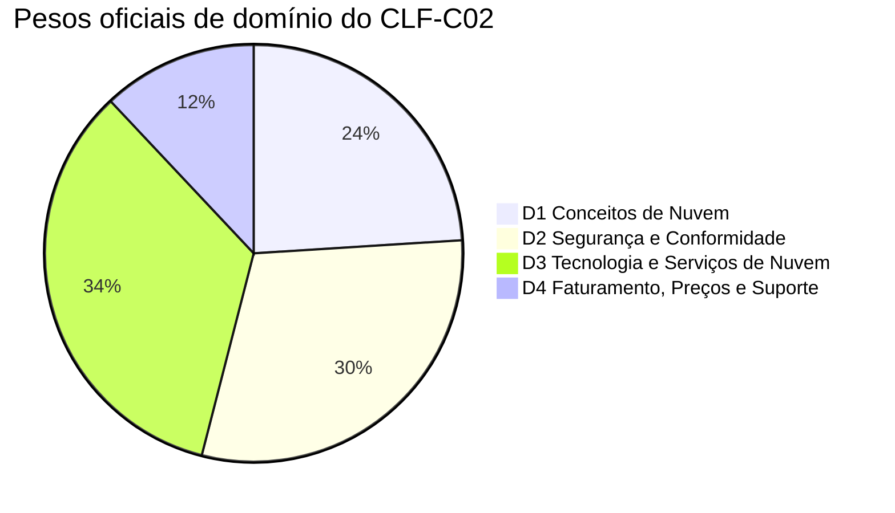
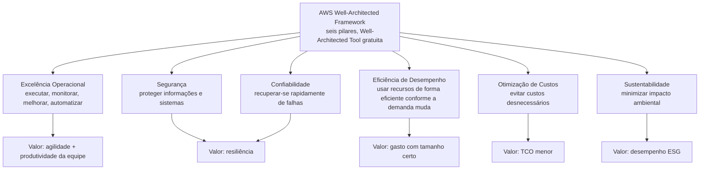
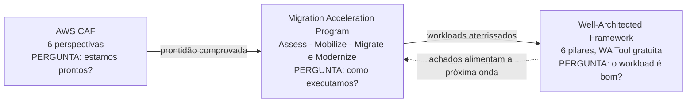
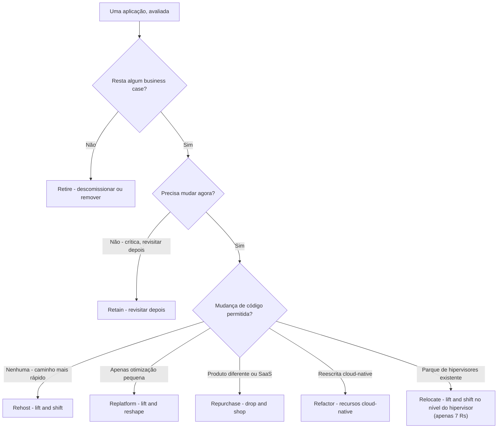
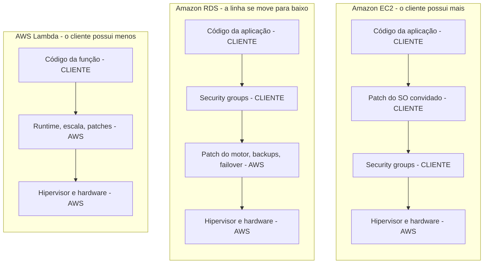

# Economia de Nuvem, Estratégias de Migração e a Jornada de Nuvem

O Domínio 1 do exame CLF-C02 carrega **24% do conteúdo pontuado** — o segundo maior domínio da prova — e é o único domínio em que a AWS pede que você argumente na linguagem de um **business case**, e não de uma característica de serviço. Todo o resto do exame (segurança, infraestrutura global, serviços, faturamento) assume que você já aceita a premissa; o Domínio 1 *é* a premissa. Candidatos que chegam com uma longa lista de nomes de serviços, mas sem vocabulário para custo fixo versus variável, capex versus opex, ou "por que rehost e depois replatform", perdem pontos que nunca esperaram ter que responder.

```text
=====================================================================
 CLF-C02 DOMÍNIO 1 - CONCEITOS DE NUVEM (24% DO CONTEÚDO PONTUADO)
=====================================================================
  TAREFA 1.1  Definir os benefícios da AWS Cloud
              - proposta de valor da AWS Cloud
              - velocidade de implantação, alcance global
              - alta disponibilidade, elasticidade, agilidade
              - economias de escala (redação do guia em PDF)
  TAREFA 1.2  Identificar princípios de design da AWS Cloud
              - AWS Well-Architected Framework e seus pilares
              - identificar diferenças entre os pilares
  TAREFA 1.3  Compreender os benefícios e as estratégias de migração
              - componentes do AWS CAF (redução de risco de negócios,
                melhor desempenho ESG, aumento de receita, eficiência
                operacional)
              - estratégias de migração (por exemplo, replicação de
                banco de dados)
              - recursos que apoiam a jornada de migração de nuvem
              - uso do AWS Snowball (redação do guia em PDF)
  TAREFA 1.4  Compreender conceitos de economia de nuvem
              - custos fixos comparados a custos variáveis
              - custos associados a ambientes on-premises
              - estratégias de licenciamento (BYOL versus licenças
                incluídas)
              - right-sizing; benefícios da automação; economias de escala
              - AWS CloudFormation; serviços gerenciados da AWS (redação
                do PDF)
---------------------------------------------------------------------
  PESOS DO EXAME INTEIRO:  D1 24% | D2 30% | D3 34% | D4 12%
  FORMATO: 50 itens pontuados + 15 não pontuados | aprovação 700
           (escala 100-1.000)
=====================================================================
```



> [!NOTE]
> **Existem dois guias de exame, e eles diferem.** O guia de exame em HTML e o guia de exame em PDF não são idênticos: o PDF acrescenta **economias de escala** à tarefa 1.1, nomeia o **AWS Snowball** na tarefa 1.3, e acrescenta **AWS CloudFormation** mais **serviços gerenciados da AWS (Amazon RDS, Amazon ECS, Amazon EKS, Amazon DynamoDB)** à tarefa 1.4. A AWS não publica nenhuma declaração reconciliando-os, então esta lição ensina a **união** de ambos — um objetivo que aparece em qualquer versão é legítimo no dia do exame.

Nesta lição você vai:

- enunciar os **seis benefícios da computação em nuvem** com as palavras da própria AWS;
- separar **economias de escala, alcance global, velocidade, elasticidade, escalabilidade e alta disponibilidade**;
- percorrer os **seis pilares do Well-Architected** e os seis princípios gerais de design, e mostrar como os pilares **se opõem** uns aos outros;
- mapear as **seis perspectivas do AWS CAF** para seus proprietários e para os quatro resultados examináveis;
- escolher entre as estratégias de migração **6 Rs e 7 Rs** com uma árvore de decisão, e nomear as ferramentas por trás da **replicação de banco de dados**;
- situar a jornada **Assess → Mobilize → Migrate & Modernize** e seus recursos de apoio em um único mapa;
- converter um parque on-premises de custo fixo e capex em um modelo de nuvem de custo variável e opex;
- construir uma **comparação de TCO e ROI** com aritmética resolvida que você consegue reproduzir em 90 segundos;
- decidir entre **BYOL e licença incluída**, e ordenar **right-sizing antes dos descontos**;
- explicar como a **linha de responsabilidade se move** entre EC2, RDS e Lambda;
- ler **dois estudos de caso reais de migração da AWS** e lidar com seus números com honestidade;
- responder **10 questões em formato de exame** mais três verificações interativas;
- então ampliar o conjunto de casos com **Netflix, Box e FarEye**, trabalhar a **caixa de atualizações de 2026**, e treinar uma verificação de **associação de estudo de caso** mais duas questões extras (**clf-02-q11**, **clf-02-q12**).

---

## 1. A proposta de valor da AWS Cloud (tarefa 1.1)

### 1.1 Os seis benefícios, literalmente

A AWS publica seis benefícios da computação em nuvem em um whitepaper, e as questões do exame citam as frases quase palavra por palavra. Aprenda a **frase-gatilho em negrito** de cada linha — é essa string que o enunciado da questão vai reproduzir.

| # | Benefício (redação da AWS) | A frase-gatilho | O que ele elimina do on-premises |
|---|---|---|---|
| 1 | **Troque despesa fixa por despesa variável** | *"pague apenas quando consumir recursos de computação"* | Comprar hardware antes de precisar dele |
| 2 | **Beneficie-se de enormes economias de escala** | o uso de *"centenas de milhares de clientes"* é agregado → *"preços pay-as-you-go menores"* | Pagar o varejo pelo volume de uma empresa |
| 3 | **Pare de adivinhar a capacidade** | provisione *"sob demanda"* com *"apenas poucos minutos de aviso"* | 20–50% de superprovisionamento contra uma previsão de pico |
| 4 | **Aumente a velocidade e a agilidade** | o tempo de implantação cai *"de semanas para apenas minutos"* | Prazos de compra com 6–9 meses de antecedência |
| 5 | **Pare de gastar dinheiro executando e mantendo data centers** | pare de pagar por *"instalar racks, empilhar e energizar servidores"* | Instalações físicas, energia, refrigeração, mão de obra física |
| 6 | **Vá global em minutos** | uma *"presença global"* traz *"menor latência"* | Construir seu próprio data center no exterior |

A AWS também afirma operar **mais de 200 serviços completos** (em outubro de 2026) — um valor que vale a pena memorizar porque distratores como "mais de 1.000 serviços" são fáceis de eliminar.

### 1.2 Exemplo E1 — economias de escala, aritmeticamente

Economias de escala são **estruturais, não uma promoção**. O provedor de nuvem agrega a demanda entre clientes, então compra energia, hardware e espaço em piso a um preço que nenhuma empresa sozinha consegue atingir — e repassa parte da diferença em uma taxa variável menor.

Dois clientes, cada um precisando de um **pico de 10 unidades**, mas seus picos são **anticorrelacionados** (um está ocupado quando o outro está ocioso):

```text
Parques separados:   cliente A provisiona 10  +  cliente B provisiona 10  = 20 unidades
Agregação compartilhada: os picos não coincidem, pico combinado = 12 unidades
Diferença de hardware:   20 - 12 = 8 unidades economizadas  ->  8/20 = 40% MENOS hardware
Resultado:               demanda idêntica, 40% menos infraestrutura,
                         de onde vêm os "preços pay-as-you-go menores"
```

### 1.3 Alcance global, velocidade de implantação e agilidade

| Benefício | Significado examinável | Cuidado |
|---|---|---|
| **Alcance global** | *"Vá global em minutos"* — implante em múltiplas Regiões da AWS sem construir instalações | Não é o mesmo que alta disponibilidade (isso são Zonas de Disponibilidade) |
| **Velocidade de implantação** | *"de semanas para apenas minutos"* — infraestrutura sob demanda | Nunca a cite como "segundos" |
| **Agilidade** | Times experimentam e iteram porque o custo de um teste falho é medido, e não afundado | Agilidade é um benefício organizacional, não um serviço |
| **Alta disponibilidade** | Sobreviver à falha de um componente abrangendo múltiplas **Zonas de Disponibilidade** | Não é redundância entre Regiões (isso é recuperação de desastres) |
| **Elasticidade** | Crescer **e diminuir** capacidade automaticamente com a demanda | Elasticidade ≠ escalabilidade |
| **Escalabilidade** | Absorver crescimento (scale out / scale up) | Apenas crescimento — sem menção a diminuir |

- **📚 Você sabia?** Em outubro de 2026 a AWS relata **39 Regiões geográficas** e **124 Zonas de Disponibilidade**, com cada Região obrigada a ter um **mínimo de três AZs isoladas, fisicamente separadas**, todas a menos de **100 km (60 milhas)** uma da outra. Uma Zona de Disponibilidade é definida como *"um ou mais data centers discretos, cada um com energia, rede e conectividade redundantes"* — então uma AZ não é um rack, e uma Região não é uma AZ.

### 1.4 Exemplo E2 — "pare de adivinhar a capacidade" em números

Uma equipe prevê um **pico de 100 vCPU**. A prática on-premises é comprar **20%–50% acima da demanda prevista para o pico**, para que a previsão não morda:

```text
Previsão de pico .............. 100 vCPU
Superprovisionamento .......... +20% a +50%  ->  compre 120 a 150 vCPU
Utilização média típica de um servidor on-premises: 12% a 18%
Trabalho útil a 15% ........... 150 x 0,15  = 22,5 vCPU
Ocioso mas ainda pago ......... 150 - 22,5  = 127,5 vCPU  (~85% ocioso)
```

É isso que *"pare de adivinhar a capacidade"* significa: em vez de comprar para o pico e ficar ocioso, você provisiona conforme a demanda medida, em minutos, e deixa a **elasticidade** absorver o pico. A mesma lógica se repete em cada camada posterior desta lição — capacidade ociosa é o inimigo no right-sizing, no licenciamento e na tabela de TCO.

---

## 2. Princípios de design: o AWS Well-Architected Framework (tarefa 1.2)

### 2.1 O que é o Framework

O AWS Well-Architected Framework documenta **melhores práticas para projetar e operar workloads seguros, confiáveis, eficientes, economicamente viáveis e sustentáveis**. O detalhe relevante para o exame sobre o *processo* é este: uma revisão Well-Architected é *"uma conversa construtiva ... não um mecanismo de auditoria"* — você nunca será pedido para "passar" em uma, e a **AWS Well-Architected Tool** que a executa é **gratuita** e está na lista de serviços no escopo.

### 2.2 Os seis pilares

| Pilar | Do que se trata (redação da AWS) | O valor que ele entrega |
|---|---|---|
| **Excelência Operacional** | Executar, monitorar e **melhorar continuamente** processos e procedimentos; **automatizar** | Agilidade e produtividade da equipe |
| **Segurança** | Proteger informações e sistemas — confidencialidade, integridade, disponibilidade | Resiliência e conformidade |
| **Confiabilidade** | Fazer o que devem fazer e **se recuperar rapidamente de falhas** | Resiliência |
| **Eficiência de Desempenho** | Usar recursos de computação **de forma eficiente conforme demanda e tecnologia mudam** | Gasto com tamanho certo |
| **Otimização de Custos** | **Evitar custos desnecessários** | Custo total de propriedade (TCO) menor |
| **Sustentabilidade** | **Minimizar o impacto ambiental** de executar workloads | Desempenho ESG |



### 2.3 Os seis princípios gerais de design

Todos os seis princípios fazem o mesmo movimento subjacente: eles convertem **gasto antecipado, fixo e ocioso** em **gasto medido, sob demanda e guiado por evidências**.

| Princípio (redação da AWS) | O hábito que ele substitui |
|---|---|
| **Pare de adivinhar suas necessidades de capacidade** | Comprar para um pico previsto |
| **Teste sistemas em escala de produção** | Testar apenas em um pequeno conjunto de staging |
| **Automatize com experimentação arquitetural em mente** | Mudanças construídas à mão, irrepetíveis |
| **Considere arquiteturas evolutivas** | Projetos de grande escala, big-bang, de cinco anos |
| **Oriente arquiteturas usando dados** | Opiniões em vez de métricas |
| **Melhore através de game days** | Esperar que a falha nunca aconteça |

### 2.4 Exemplo E3 — os pilares *não* são intercambiáveis

A tarefa 1.2 pede explicitamente que você identifique **diferenças entre os pilares**. Eles entram em conflito, e o exame testa se você percebe:

```text
Decisão: manter três instâncias reserva quentes ociosas para que uma falha
         nunca alcance os usuários.
Confiabilidade ......... MELHORA  (capacidade reserva absorve a falha)
Otimização de Custos ... PIORA   (ilustrativo: $400/mês x 12 = $4.800/ano pagos
                                  por capacidade que não faz nada; valor didático,
                                  em outubro de 2026 - NÃO é um preço de lista da AWS)
```

Não há pilar que vence automaticamente. A postura correta no exame é um **trade-off deliberado e medido**, e não a afirmação de que um pilar é "o mais importante". Note também que **Sustentabilidade** e **Otimização de Custos** falam ambos de redução, e **Segurança** e **Confiabilidade** falam ambos de resiliência — palavras parecidas, pilares diferentes, proprietários diferentes.

```matching
{
  "question": "Associe cada pilar do Well-Architected ao valor que ele entrega no exame CLF-C02:",
  "pairs": [
    {"left": "Excelência Operacional", "right": "Agilidade e produtividade da equipe - executar, monitorar, melhorar continuamente e automatizar"},
    {"left": "Segurança", "right": "Resiliência e conformidade - proteger informações e sistemas"},
    {"left": "Confiabilidade", "right": "Resiliência - fazer o que devem fazer e se recuperar rapidamente de falhas"},
    {"left": "Eficiência de Desempenho", "right": "Gasto com tamanho certo - usar recursos de computação de forma eficiente conforme demanda e tecnologia mudam"},
    {"left": "Otimização de Custos", "right": "Custo total de propriedade menor - evitar custos desnecessários"},
    {"left": "Sustentabilidade", "right": "Desempenho ESG - minimizar o impacto ambiental de executar workloads"}
  ],
  "explanation": "Os pilares não são intercambiáveis e se opõem uns aos outros. Excelência Operacional mapeia para agilidade/produtividade, os dois pilares de proteção (Segurança, Confiabilidade) mapeiam para resiliência, Eficiência de Desempenho para gasto com tamanho certo, Otimização de Custos para TCO, e Sustentabilidade para desempenho ambiental (ESG)."
}
```

- **📚 Você sabia?** O Cloud Adoption Framework (Seção 3), o Well-Architected Framework (esta seção) e o Cloud Value Framework (Seção 6) são **três listas diferentes de cinco ou seis itens** que os candidatos misturam constantemente: o Well-Architected tem **6 pilares** sobre *qualidade do workload*, o CAF tem **6 perspectivas** sobre *prontidão organizacional*, e o Cloud Value Framework tem **5 pilares** sobre *valor de negócio* — dos quais o **TCO é apenas o pilar 1 de 5**.

---

## 3. O AWS Cloud Adoption Framework (tarefa 1.3)

### 3.1 Seis perspectivas, seis proprietários

O AWS Cloud Adoption Framework (AWS CAF) agrupa suas capacidades em seis perspectivas. Cada perspectiva é uma **conversa com uma parte diferente da organização** — é por isso que o exame pede que você associe uma perspectiva a um stakeholder ou a uma preocupação.

| Perspectiva | Proprietário típico | O que ela cobre |
|---|---|---|
| **Business** | CEO, CFO, COO, CIO, CTO | Estratégia, oportunidades de transformação, realização de valor |
| **People** | RH, líderes de cultura | Cultura, estrutura organizacional, habilidades da força de trabalho |
| **Governance** | Risco, finanças, conformidade | Maximizar benefícios e minimizar risco; gerenciamento de portfólio |
| **Platform** | Arquitetos | Plataforma híbrida escalável, modernização, fábrica de migração |
| **Security** | CISO e equipes de segurança | Confidencialidade, integridade, disponibilidade de dados e sistemas |
| **Operations** | Operações de TI | Serviços entregues nos níveis de negócio acordados |

**Contagens de capacidades publicadas (em outubro de 2026):** People **7**, Governance **7**, Platform **7**, Security **9**, Operations **9**. A AWS não publica uma contagem para a perspectiva Business nas fontes verificadas para esta lição, então não memorize um total.

### 3.2 Os quatro resultados examináveis

A tarefa 1.3 nomeia os resultados que você precisa reconhecer. Um programa liderado pelo CAF é avaliado por:

1. **Redução do risco de negócios**
2. **Melhora no desempenho ambiental, social e de governança (ESG)**
3. **Aumento da receita**
4. **Aumento da eficiência operacional**

### 3.3 Um mapa: CAF → MAP → Well-Architected

Esses três frameworks aparecem juntos em quase toda questão de migração. Eles respondem a três perguntas diferentes, nesta ordem:



> [!WARNING]
> ⚠️ **Três listas que você nunca deve misturar.** Well-Architected **6 pilares** = qualidade do workload. AWS CAF **6 perspectivas** = prontidão organizacional (Business, People, **Governance**, Platform, Security, Operations). Cloud Value Framework **5 pilares** = valor de negócio. Um distrator vai oferecer "Sustentabilidade" como perspectiva do CAF ou "Governance" como pilar do Well-Architected — ambos estão errados. Separadamente, o Migration Acceleration Program diz que sua fase Assess identifica lacunas de capacidade em **seis dimensões** (negócio, processo, pessoas, plataforma, operações, segurança), e esses seis **não** são os seis do CAF — use os nomes do CAF quando a questão disser "perspectiva".

---

## 4. Estratégias de migração: os 6 Rs (tarefa 1.3)

### 4.1 As estratégias e suas glosas

O enquadramento mais antigo da AWS e ainda popular em exames é o dos **6 Rs**, construído sobre os cinco Rs que a Gartner esboçou. O enquadramento atual do AWS Prescriptive Guidance é o dos **7 Rs**, que acrescenta **Relocate**. Ambos aparecem em material de estudo; o próprio guia de exame nunca enumera nenhuma das listas.

| R | Glosa da AWS | O que você de fato faz | Escolha quando |
|---|---|---|---|
| **Rehost** | *"lift and shift"* | Mover o workload inalterado (máquinas virtuais para EC2) | Nenhuma mudança de código permitida; caminho mais rápido; grandes portfólios primeiro |
| **Replatform** | *"lift and reshape"* | Pequena otimização sem mudar a arquitetura central (por exemplo, VM → banco de dados gerenciado) | Você quer um benefício gerenciado com esforço limitado |
| **Repurchase** | *"drop and shop"* | Substituir por um produto diferente, geralmente SaaS | O produto atual não é estratégico |
| **Refactor / re-architect** | *"recursos cloud-native"* | Reescrever para capacidades cloud-native | Você precisa de recursos cloud-native; o mais complexo e caro |
| **Retire** | *"descomissionar ou remover"* | Desligar a aplicação | Não há business case, ou a aplicação não é usada |
| **Retain** | *"revisitar"* | Manter onde está, planejar mudar depois | Crítico agora, refactor depois (residência de dados, timing) |
| **Relocate** *(apenas 7 Rs)* | *"lift and shift no nível do hipervisor"* | Mover todo o parque de plataforma/hipervisor para a nuvem | Você já executa um parque de hipervisores suportado |

> [!NOTE]
> **6 Rs versus 7 Rs — como responder.** O blog de estratégia da AWS de 2016 diz **6 Rs**; o AWS Prescriptive Guidance de hoje diz *"Existem sete estratégias de migração ... conhecidas como os 7 Rs."* Se uma questão perguntar "qual **NÃO** é um dos 6 Rs?", **Relocate** é a isca desenhada. Se ela pedir o conjunto atual da AWS, responda **7 Rs**.



### 4.2 Exemplo E4 — organizando um portfólio de 40 aplicações

Uma empresa avalia **40 aplicações**. Usando a própria orientação de ordem de grandeza da AWS de que *"tanto quanto 10%–20% de um portfólio de TI de empresa grande não é mais útil e pode ser desligado"*:

```text
Retire .........  4 apps  (10% do portfólio - desligadas, custo de migração zero)
Retain .........  6 apps  (críticas, revisitar depois)
Rehost ......... 16 apps  (mais rápido, sem mudança de código - faça estas primeiro)
Relocate .......  0 apps  (nenhuma plataforma de hipervisor para mover como unidade)
Repurchase .....  3 apps  (substituídas por SaaS)
Replatform .....  8 apps  (banco de dados gerenciado / mudanças de motor)
Refactor .......  3 apps  (reescrita cloud-native - maior valor, maior custo)
                         ------
                          40 apps
```

Regra de sequenciamento para migrações grandes: **rehost, replatform, relocate e retire primeiro; modernize depois.** Pagar uma fábrica de migração para mover 40 aplicações em paralelo é como programas estouram o orçamento; aposentar 4 delas antes de qualquer pessoa escrever uma linha de código é como programas se financiam.

### 4.3 As duas ferramentas nomeadas por trás das estratégias

| Preocupação | Serviço | Papel |
|---|---|---|
| **Replicação de banco de dados** (o exemplo nomeado do exame para a tarefa 1.3) | **AWS Database Migration Service (AWS DMS)** | Replicação contínua do banco de dados de origem para o destino enquanto a aplicação continua rodando |
| Diferenças de esquema entre motores | **AWS Schema Conversion Tool (AWS SCT)** | Converte esquemas, código e procedimentos armazenados para que a replicação possa pousar |
| Execução do **Rehost** | **AWS Application Migration Service (MGN)** | Lift and shift automatizado, baseado em agente, de servidores para EC2 |
| Descobrir o que você possui | **AWS Application Discovery Service** | Mapeia dependências antes de você escolher um R |

### 4.4 Exemplo E5 — o teste de realidade do Snowball

Para **transferência em escala de petabyte sobre um link restrito**, a resposta clássica é um dispositivo físico: um único **Snowball Edge Storage Optimized** move **aproximadamente 210 TB** (em outubro de 2026 — verifique as especificações atuais antes de usar), e um trabalho **deve ser concluído em até 360 dias após ser preparado**.

Dois ressalvos que você precisa sustentar ao mesmo tempo:

```text
FATO A (guia de exame em PDF) ... a tarefa 1.3 nomeia "uso do AWS Snowball"
FATO B (aviso na doc da AWS) .... "AWS Snowball Edge não está mais disponível
                                  para novos clientes"
                                  A AWS aponta novos clientes para DataSync,
                                  Data Transfer Terminal, soluções de parceiros
                                  e Outposts
CONCLUSÃO ....................... Snowball é uma armadilha DUAS vezes - pode ser
                                  a resposta correta "offline / link restrito",
                                  e pode ser a resposta desatualizada. Leia o
                                  enunciado: ele está perguntando o mecanismo
                                  clássico ou a recomendação atual?
```

- **📚 Você sabia?** O Snowball Edge Storage Optimized vem com cerca de **210 TB de NVMe utilizáveis** (em outubro de 2026), enquanto a variante Compute Optimized troca armazenamento por silício — cerca de **28 TB de NVMe** contra **416 GB de memória**. O dispositivo está **em nenhuma** das listas de serviços no escopo ou fora do escopo do CLF-C02 (ambas as listas são explicitamente *"não exaustivas"*), então se ele é examinável não pode ser verificado — trate-o como conhecimento, não como certeza.

---

## 5. A jornada de migração de nuvem e seus recursos (tarefa 1.3)

### 5.1 As três fases

O programa de migração da AWS roda em três fases, e o exame pergunta a ordem:

```text
1. ASSESS                  construa o business case, descubra o parque,
                           "identifique lacunas de capacidade em seis dimensões"
2. MIGRATE e MODERNIZE     execute as ondas, depois modernize o que pousou
3. (antes disso) MOBILIZE  feche as lacunas: financiamento, governança,
                           habilidades, ferramentas
```

Leia literalmente: **Assess → Mobilize → Migrate & Modernize**. O Mobilize fica *entre* o business case e a primeira onda, porque as lacunas encontradas no Assess precisam ser fechadas antes de a migração começar.

### 5.2 Os recursos que apoiam a jornada

| Recurso | O que ele faz por você |
|---|---|
| **Migration Acceleration Program (MAP)** | Ferramentas, treinamento e **investimentos financeiros** para o programa de três fases. **Créditos exigem tagging** — sem tags, sem créditos |
| **AWS Migration Hub / Migration Hub Journeys** | Planeje, execute e acompanhe: **fases → módulos → tarefas → subtarefas** com progresso visível em um só lugar |
| **AWS Prescriptive Guidance** | Estratégias de migração testadas pelo tempo e guias passo a passo (fonte dos 7 Rs) |
| **Migration Evaluator** | **Business case e modelo de TCO** guiados por dados antes de você se comprometer |
| **AWS Professional Services** | Capacidade de entrega hands-on para a própria migração |
| **AWS Partner Network (APN) + Migration Competency Partners** | Capacidade de entrega de terceiros, avaliada contra critérios de competência da AWS |
| **AWS Pricing Calculator** | Estime a taxa de execução alvo antes de mover qualquer coisa |

```dragdrop
{
  "question": "Coloque as três fases do AWS Migration Acceleration Program (MAP) em ordem:",
  "items": [
    "Migrate and Modernize",
    "Assess",
    "Mobilize"
  ],
  "correctOrder": [
    "Assess",
    "Mobilize",
    "Migrate and Modernize"
  ],
  "explanation": "O MAP executa Assess (business case, descoberta do parque, lacunas de capacidade em seis dimensões) primeiro, depois Mobilize (fecha as lacunas de financiamento, governança, habilidades e ferramentas expostas pela avaliação), e só então Migrate and Modernize (executa as ondas e moderniza em seguida). Rehost, replatform, relocate e retire primeiro; modernize depois que a migração estiver estável."
}
```

> [!WARNING]
> ⚠️ **O MAP diz seis dimensões; o CAF diz seis perspectivas — e são listas diferentes.** A fase Assess do MAP identifica lacunas de capacidade em *negócio, processo, pessoas, plataforma, operações, segurança*. As perspectivas do CAF são *Business, People, **Governance**, Platform, Security, Operations*. "Governance" substitui "processo". Se a questão disser **perspective**, use os nomes do CAF; e nunca cite um valor de crédito do MAP — a AWS publica apenas *"investimentos financeiros"*, sem percentuais publicados.

---

## 6. Economia de nuvem (tarefa 1.4)

### 6.1 Custo fixo versus custo variável

**Custo fixo** existe quer o serviço rode ou não: hardware próprio, espaço em piso, equipe assalariada. **Custo variável** acompanha o consumo. A frase mais citada do Domínio 1 é: *"A nuvem troca despesa fixa por despesa variável — você paga apenas quando consome recursos de computação."*

**Exemplo E6 — doze meses, valores ilustrativos (em outubro de 2026; apenas números didáticos, não são preços de lista da AWS):**

| Período | On-premises (fixo) | AWS (variável) | Por que a linha da nuvem se move |
|---|---|---|---|
| T1 — trimestre de lançamento | $6.000 | $4.200 | Tráfego de burst escala para cima e depois para baixo |
| T2 — negociação normal | $6.000 | $2.700 | Acompanha a demanda medida |
| T3 — trimestre tranquilo | $6.000 | $1.350 | Ambiente de teste desligado para **$0** |
| T4 — pico de férias | $6.000 | $3.900 | A elasticidade absorve o pico sem pedido de compra |
| **Total** | **$24.000** | **$12.150** | **−$11.850 (−49,4%)** |

A linha on-premises é uma linha reta porque você pagou por ela no ano do capital — o tráfego não tem nada a ver com isso. A linha da nuvem pode cair a **zero** para um workload que você desliga.

### 6.2 Os drivers de custo de um ambiente on-premises

A tarefa 1.4 pede especificamente por *"custos associados a ambientes on-premises"*. Cada linha abaixo precisa aparecer em um modelo de TCO, ou o modelo está errado:

| Driver | O que ele realmente custa |
|---|---|
| **Hardware** | Preço de compra de servidores, armazenamento, rede |
| **Manutenção anual** | Contrato de suporte, tipicamente uma porcentagem do hardware, todo ano |
| **Licenças de sistema operacional e hipervisor** | Pagas quer o servidor esteja ocupado ou ocioso |
| **Licenças de aplicações** | O mesmo — e frequentemente a maior linha única |
| **Espaço, energia, refrigeração** | Aluguel de espaço em piso, eletricidade, sobrecarga de refrigeração |
| **Mão de obra de TI** | Administradores para instalar racks, aplicar patches, fazer backup, monitorar, planejar |
| **Ciclo de renovação** | Equipamentos de capital tipicamente têm um **ciclo de renovação de cinco anos** |
| **Prazo de compra** | Equipamento é comprado **seis a nove meses de antecedência** |
| **Superprovisionamento** | **20%–50% acima da demanda prevista para o pico** |
| **Custo de capital** | Dinheiro imobilizado em ativos em vez do negócio |
| **Largura de banda** | Conectividade para o parque |

### 6.3 Exemplo E7 — os insumos on-premises ocultos

A maioria dos modelos on-premises falha ao contar apenas o hardware. Eis dez servidores ao longo de cinco anos, com todos os valores ilustrativos (em outubro de 2026, números didáticos, não são preços de lista da AWS):

```text
Hardware do servidor (10 unidades) ..............  $30.000
Manutenção de hardware por 5 anos ...............  $30.000
Energia e refrigeração: $25 x 10 x 60 meses .....  $15.000
Espaço em piso (5 anos) ........................   $6.000
Administração de TI: 0,25 EMT ao longo de 5 anos . $112.500
                                             ------------
Subtotal, 5 anos ............................... $193.500
ANTES: licenças de software, renovação no ano 5, custo de capital, largura de banda
```

A própria orientação da AWS sobre comparações precisas é direta: despesas de capital geralmente têm um **ciclo de renovação de cinco anos**, o equipamento é comprado **seis a nove meses de antecedência**, e os clientes **superprovisionam 20%–50% acima da demanda prevista para o pico**. Um modelo que omite mão de obra, renovação e instalações subestima o custo on-premises — é por isso que o exame trata "comparar o preço de compra do servidor com uma taxa horária" como o modelo clássico de TCO falho.

### 6.4 De capex para opex

| | **Capex** (on-premises) | **Opex** (nuvem) |
|---|---|---|
| Forma | Pagamento grande e antecipado por um ativo que você possui | Consumo medido, pay-as-you-go |
| Contabilidade | Capitalizado, depois depreciado (ciclo de ~5 anos) | Reconhecido como despesa no período em que é incorrido |
| Risco | Você o possui quer use ou não | Você para de pagar quando para de consumir |
| Previsão | Baseada em uma suposição de capacidade | Baseada em uso medido |
| Frase do exame | *"despesa fixa"* | *"despesa variável"* — *"pague apenas quando consumir"* |

### 6.5 Exemplo E8 — TCO e ROI, resolvidos

**TCO** é a comparação *global, de múltiplos anos* de custos de aquisição **e** de operação — hardware, software, instalações, mão de obra e capital — on-premises versus AWS. Não é uma lista de preços, e a AWS o enquadra explicitamente como apenas **pilar 1 de 5** do **Cloud Value Framework**.

> **Todos os valores em dólares da tabela abaixo são números didáticos ilustrativos criados para esta lição (em outubro de 2026). NÃO são preços de lista da AWS e não devem ser citados como tal.**

| Categoria de custo (5 anos) | On-premises | AWS (ilustrativo) | Diferença |
|---|---|---|---|
| Computação — equivalente a 10 servidores | $60.000 (hardware $30 mil + manutenção $30 mil) | $54.000 ($900/mês de média medida) | −$6.000 |
| Instalações — energia, refrigeração, espaço em piso | $21.000 ($15 mil energia + $6 mil espaço) | $0 (absorvido pelo provedor e precificado na taxa) | −$21.000 |
| Mão de obra de TI — 0,25 EMT on-prem versus 0,10 EMT | $112.500 | $45.000 | −$67.500 |
| Licenciamento de software | $40.000 (possuído e renovado) | $18.000 (licença incluída, pago enquanto roda) | −$22.000 |
| **Total** | **$233.500** | **$117.000** | **−$116.500 (−49,9%)** |

Agora os dois números que um entrevistador (ou o enunciado de uma questão) de fato quer:

```text
Investimento na migração (ilustrativo) .......  $25.000
                                                (avaliação, esforço de replatform,
                                                 dias de Professional Services)
Benefício líquido de 5 anos .................  $116.500 - $25.000 = $91.500
ROI simples = benefício líquido / investimento  $91.500 / $25.000 x 100 = 366%
Economia média anual .........................  $116.500 / 5 = $23.300
Payback simples = investimento / economia anual $25.000 / $23.300 = 1,07 anos
                                                ~= 13 meses
```

**Verificação de sanidade contra um valor publicado:** a AWS cita a IDC (2022) alegando **custo de operação 50% menor em 5 anos** na AWS — uma afirmação citada pelo cliente/AWS, não auditada, e nosso ilustrativo −49,9% cai no mesmo bairro por construção, não por coincidência. Sempre atribua tais valores ("IDC para a AWS, 2022"), nunca os apresente como garantidos.

### 6.6 Licenciamento: BYOL versus licença incluída

**Licença incluído** significa instâncias do Amazon EC2 que embutem o custo da licença no custo de computação — **a AWS é responsável pela conformidade de licenciamento**, e você paga apenas enquanto a instância roda. **BYOL** significa que você traz sua própria licença **e mídia** — **você é responsável pela conformidade**. O **AWS License Manager** é uma ferramenta **gratuita** que rastreia ambos entre AWS, on-premises e outras nuvens.

**Exemplo E9 — workload com 30% de tempo de atividade, taxas ilustrativas (em outubro de 2026; apenas valores didáticos):**

```text
Pressuposto: taxa all-in com licença incluída = $0,75 / hora
             taxa de computação BYOL           = $0,40 / hora
             licença BYOL                      = $150 / mês (paga quer usada ou não)
             mês = 730 horas

A 30% de tempo de atividade (219 horas):
  Licença incluída ... 219 x $0,75              = $164,25 / mês
  BYOL ................ $150 + (219 x $0,40)     = $237,60 / mês
  Vencedor: LICENÇA INCLUÍDA por $73,35 / mês

A 100% de tempo de atividade (730 horas):
  Licença incluída ... 730 x $0,75              = $547,50 / mês
  BYOL ................ $150 + (730 x $0,40)     = $442,00 / mês
  Vencedor: BYOL por $105,50 / mês

Ponto de equilíbrio: $150 / ($0,75 - $0,40) = 428,6 horas ~= 59% de tempo de atividade
```

**Regra:** tempo de atividade variável ou intermitente → **licença incluída**; tempo de atividade alto e estável mais licenças com desconto existentes → **BYOL**. Lembre-se de que uma licença do Windows pode representar **50% ou mais do custo de computação** (AWS, 2022-04-28), então esta não é uma decisão de arredondamento.

### 6.7 Right-sizing

**Right-sizing** significa combinar o tamanho e o tipo da instância com a utilização **medida** *ainda atendendo aos requisitos de desempenho*. Não é "escolher a instância mais barata", e a ordem das operações importa.

**Exemplo E10 — de 12 vCPU para 4 vCPU, taxa ilustrativa (em outubro de 2026; apenas valor didático: $0,06 por vCPU-hora):**

```text
Instância atual ....... 12 vCPU / 64 GB
Utilização medida ..... média de 25% de CPU, média de 25% de RAM
Necessário ............ 12 x 0,25 = 3 vCPU ; 64 x 0,25 = 16 GB
Classe com tamanho certo  4 vCPU / 16 GB (folga incluída)
Capacidade ociosa paga . 12 - 3 = 9 vCPU = 75% do que você compra

Custo antigo  12 x $0,06 = $0,72/h  x 730 h = $525,60 / mês
Custo novo     4 x $0,06 = $0,24/h  x 730 h = $175,20 / mês
Economia ................................. = $350,40 / mês
                                          = $4.204,80 / ano
                                          = 66,7% menos gasto com computação
```

O **AWS Compute Optimizer** *"fornece recomendações de right-sizing e identifica recursos ociosos"*. Apenas **depois** do right-sizing você escolhe um modelo de compromisso — porque se comprometer com um desconto em uma instância superdimensionada simplesmente compra um desconto sobre desperdício. A AWS documenta **Savings Plans** como *"até 72% menores em alguns casos"* versus on-demand e **Spot** como *"até 90% de desconto em relação aos preços on-demand"* (ambos AWS, 2022-04-28 — verifique as taxas atuais antes de usar).

- **📚 Você sabia?** Os valores publicados de utilização são o núcleo econômico desta lição: servidores on-premises têm média de utilização de **12%–18%**, **mais de 30% dos servidores rodam com utilização abaixo de 10%**, e um data center on-premises é descrito como *"abaixo de 15%"* (blogs da AWS, 2022-04-28 e 2024-10-01). É por isso que **right-sizing primeiro, compromisso depois** é a ordem canônica de FinOps no exame.

```fillblank
{
  "question": "Complete as frases de economia de nuvem usando o vocabulário da tarefa 1.4:",
  "template": "A nuvem troca despesa {{1}} por despesa {{2}}, então você paga apenas quando consome recursos. O gasto on-premises é registrado como {{3}}, enquanto o gasto medido na nuvem é registrado como {{4}}. Combinar o tamanho da instância com a utilização medida, ainda atendendo ao desempenho, é chamado de {{5}}, e isso deve acontecer ANTES de escolher um modelo de compromisso ou desconto. Trazer sua própria licença e mídia é {{6}}, enquanto a AWS embutir a licença no custo de computação é licença incluída.",
  "answers": {
    "1": "fixo",
    "2": "variável",
    "3": "capex",
    "4": "opex",
    "5": "right-sizing",
    "6": "BYOL"
  },
  "distractors": ["pico", "despesa de capital", "elasticidade", "refatoração", "rehosting", "TCO", "Savings Plans", "governança"],
  "explanation": "Fixo versus variável e capex versus opex são os dois enquadramentos do mesmo movimento; right-sizing significa combinar tamanho e tipo com a utilização medida (o AWS Compute Optimizer sinaliza right-sizing e recursos ociosos) e vem primeiro, depois o compromisso; BYOL significa que você traz licença e mídia e é responsável pela conformidade, enquanto licença incluída significa que a AWS embute a licença e é responsável pela conformidade de licenciamento."
}
```

---

## 7. Automação, serviços gerenciados e a transferência de responsabilidade (tarefa 1.4)

### 7.1 Benefícios da automação

**Infraestrutura como código (IaC)** significa provisionar e dar suporte à infraestrutura de computação **usando código em vez de processos e configurações manuais**. O exame nomeia o **AWS CloudFormation**, que *"permite que você crie e provisione implantações de infraestrutura da AWS de forma previsível e repetida"*.

| Provisionamento manual | Automatizado (CloudFormation / IaC) |
|---|---|
| Construído à mão, único, difícil de reproduzir | Templates são **repetíveis** entre ambientes |
| Mudanças acontecem silenciosamente | **Versionados, revisáveis, auditáveis** (change sets) |
| Rollback é um pânico | **Com rollback** — delete a stack e os recursos vão embora |
| Escala com o número de pessoas | Escala com um pipeline |

> [!NOTE]
> **Automação ≠ auto scaling.** O exemplo de automação da tarefa 1.4 é o **CloudFormation** (infraestrutura repetível). O **Auto Scaling** é o mecanismo de *elasticidade* (crescer e diminuir com a demanda). Ambos estão no escopo, respondem a perguntas diferentes, e um distrator vai trocá-los.

### 7.2 Serviços gerenciados absorvem trabalho não diferenciado

O guia de exame em PDF acrescenta *"Identificar serviços gerenciados da AWS (por exemplo, Amazon RDS, Amazon ECS, Amazon EKS, Amazon DynamoDB)"* à tarefa 1.4. Cada um transfere trabalho da sua equipe:

| Serviço gerenciado | O que a AWS assume |
|---|---|
| **Amazon RDS** | Patches do motor, backups automatizados, failover |
| **Amazon ECS / Amazon EKS** | Operação da plataforma de contêineres |
| **Amazon DynamoDB** | Gerenciamento de capacidade e sobrecarga operacional |

Menos tarefas não diferenciadas significa **menos tempo da equipe e menos software para licenciar** — uma linha direta para a linha de mão de obra da tabela de TCO da Seção 6.5.

### 7.3 A transferência de responsabilidade compartilhada: EC2 versus RDS versus Lambda

Quanto mais gerenciado o serviço, **menor a parte do cliente** na pilha. A linha se move; ela nunca desaparece.

| Camada | **Amazon EC2** (IaaS) | **Amazon RDS** (gerenciado) | **AWS Lambda** (serverless) |
|---|---|---|---|
| Hardware físico e hipervisor | AWS | AWS | AWS |
| Patch do SO convidado | **Cliente** | AWS | AWS (sem SO do cliente) |
| Runtime, capacidade, escala | Cliente | AWS | AWS |
| Security groups / configuração de rede | **Cliente** | **Cliente** | n/a |
| Código da aplicação ou função | **Cliente** | **Cliente** | **Cliente** |
| Usuários IAM, papéis, MFA | **Cliente** | **Cliente** | **Cliente** |
| Dados, classificação, criptografia | **Cliente** | **Cliente** | **Cliente** |



**Constantes que nunca se movem:** a segurança física e a segurança **da** nuvem são sempre da AWS; **decisões de dados, IAM e criptografia** são sempre do cliente. **Controles compartilhados** — gerenciamento de patches, gerenciamento de configuração, conscientização e treinamento — são de propriedade *de cada parte para a própria camada*.

- **📚 Você sabia?** A própria formulação da AWS importa: para serviços abstratos como **Amazon S3 e Amazon DynamoDB**, *"os clientes são responsáveis por gerenciar seus dados (incluindo opções de criptografia) e por usar ferramentas de IAM para aplicar as permissões apropriadas."* E conforme a infraestrutura se moderniza, *"mais responsabilidade é transferida para o provedor do serviço"* — o que é um movimento da **linha**, não uma transferência da sua responsabilidade sobre dados. Serverless não é "problema de outra pessoa".

---

## Casos Reais

Todo valor abaixo é **afirmação do cliente ou da AWS, não auditado**, atribuído com sua fonte para que você possa conferir. O ponto examinável é sempre o *padrão* — qual estratégia foi escolhida, qual alavanca se moveu — nunca o número de marketing.

### Capital One — "all in on AWS" (banca, regulada)

| Dimensão | Detalhe |
|---|---|
| Desafio | Oito data centers mais uma renovação contínua de hardware; precisava de escala para ML e personalização em tempo real |
| Estratégia | Saída completa do parque — predominantemente **rehost + replatform + refactor**, com adoção de serverless |
| Serviços | Mais de 30, incluindo EC2, S3, RDS, Lambda, ECS/Fargate, Step Functions, Glue, Amazon Connect |
| Resultados (alegados) | Saiu de todos os **8 data centers** (o último em 2020); **80%** das ~2.000 aplicações agora construídas na nuvem; provisionamento de ambiente de desenvolvimento **3 meses → minutos**; custo de DR **−70%**; resolução de incidentes e erros de transação **−50%**; mais de um terço das aplicações serverless; **uma aplicação com −90% de custo** no Lambda; **103 toneladas** de metais recicladas |
| Gancho de domínio | Proposta de valor da tarefa 1.1 (agilidade) + economia da tarefa 1.4 |

> *"Estamos genuinamente all in na nuvem, e a AWS tem sido instrumental para nos permitir aproveitar plenamente os benefícios de estar na nuvem."* — Chris Nims, SVP de engenharia de nuvem e produtividade, Capital One (estudo de caso da AWS)

### Shutterfly / SBS — VMware para a AWS (impressão de e-commerce)

| Dimensão | Detalhe |
|---|---|
| Desafio | VMware vSphere on-premises, stacks independentes, **mais de 2.000 VMs**, evacuação de colocation |
| Estratégia | **Ponte depois nativo**: VMware Cloud on AWS primeiro (concluído em ago. 2022), depois migração nativa para ECS/EC2 — uma sequência de manual *relocate → replatform* |
| Serviços | VMware Cloud on AWS, Amazon ECS, EC2, FSx for NetApp ONTAP, CI/CD, S3 (**400 TB**) |
| Resultados (alegados) | **2.000 → 1.200 VMs**; migração nativa entregue em **março de 2025, seis meses antes do prazo**; ~**800 sistemas / 400 TB** movidos; **~25% de corte de opex** com *evitação de licenças mais right-sizing*; **80%** dos workloads no ECS; *"nenhum incidente de severidade alta"* |
| Gancho de domínio | Tarefa 1.4 — right-sizing e licenciamento são literalmente nomeados como a fonte da economia |

> *"Demos passos grandes para queimar dívida técnica para que possamos focar na transformação e nos mover com o tipo de agilidade que tínhamos nos primeiros dias."* — Ian Wright, VP de Infraestrutura, Shutterfly/SBS (estudo de caso da AWS)

```text
PADRÃO EM AMBOS OS CASOS
  Capital One ........ agilidade primeiro, depois custo   (provisionamento 3 meses -> minutos)
  Shutterfly ......... custo primeiro, depois agilidade   (evitação de licenças + right-sizing -> ~25%)
  Comum .............. a estratégia (qual R) foi escolhida ANTES de qualquer número ser prometido
```

- **📚 Você sabia?** Um terceiro padrão de migração que vale reconhecer aparece no mesmo conjunto de pesquisa: o **Bangkok Flight Services** usou o **AWS Application Migration Service (MGN)** para um **rehost** puro, terminando em **7 meses** com *"sem rollback, sem disrupção"*, cortando o tempo de gerenciamento da infraestrutura de TI em **50%** e substituindo um site de DR inexistente por um projeto multi-AZ — enquanto a **Philip Morris International** migrou **400 aplicações em dois anos** e o próprio texto da AWS registra que seu lift and shift inicial e agressivo *"produziu resultados subótimos"*. Mesmo R, lição oposta: rehost é rápido, mas fazer rehost de tudo é um erro de estratégia.

### Netflix — streaming global em escala da AWS (entretenimento)

| Dimensão | Detalhe |
|---|---|
| Desafio | Entregar um serviço de streaming mundial cujo tráfego sobe por hora do dia e por título, sem comprar hardware para cada pico |
| Estratégia | **Construção cloud-native mais replatform/refactor** — elasticidade em massa primeiro, depois consolidação em um banco de dados gerenciado (não uma mudança de empilhamento) |
| Serviços | Amazon EC2, Amazon S3, Amazon Aurora, Amazon EKS, Local Zones, auto scaling multi-Região |
| Resultados (alegados) | Entrega **bilhões de horas de conteúdo mensalmente**; a AWS *"permite à Netflix implantar rapidamente milhares de servidores e terabytes de armazenamento em minutos"*; consolidar sua infraestrutura de banco de dados relacional no **Amazon Aurora** entregou **até 75% de melhoria de desempenho e 28% de economia de custo**; opera em **quatro Regiões da AWS**; o Aurora cortou a latência do Policy Engine de **26,72 ms → 6,51 ms** e a do Front50 de **67,57 ms → 41,70 ms** (AWS Database Blog, 2025-11-27) |
| Gancho de domínio | Tarefa 1.1 (elasticidade, alcance global) + tarefa 1.3 (replatform / refactor) |

Todos os valores da Netflix acima foram publicados pela AWS e acessados em outubro de 2026; qualquer coisa sobre o histórico de indisponibilidades da Netflix antes da AWS vive no próprio site da Netflix e não é ensinada aqui como fato da AWS.

### Box — otimização de custo com Well-Architected (SaaS corporativo)

| Dimensão | Detalhe |
|---|---|
| Desafio | Melhorar a eficiência de gasto em um grande parque da AWS que atende mais de 120.000 empresas sem degradar segurança, confiabilidade ou desempenho |
| Estratégia | **A alavanca gratuita primeiro**: uma revisão do AWS Well-Architected Framework com AWS Solutions Architects, depois correções no nível da arquitetura — nenhuma compra de compromisso necessária |
| Serviços | Revisões do Well-Architected Framework, organização em camadas Amazon S3 / S3 Glacier, higiene de volumes e snapshots do EBS, filtragem de eventos do CloudTrail, roteamento de tráfego em torno de internet gateways |
| Resultados (alegados) | **2,23 milhões de dólares** desdobrados = **$438.000** de transferência entre AZs + **$1,1 milhão por ano** de saída de internet + **mais de $500.000 por ano** de armazenamento + **$192.000 por ano** de logging (estudo de caso da AWS, acesso em outubro de 2026) |
| Gancho de domínio | Tarefa 1.4 — arquitetura, classes de armazenamento e encargos de transferência de dados como drivers de custo nomeados |

> *"Nosso uso de melhores práticas da AWS levou a economias de mais de 2 milhões de dólares, estabelecendo uma nova linha de base…"* — Clay Alvord, diretor de FinOps e SRE, Box (estudo de caso da AWS)

### FarEye — Savings Plans + Spot + Graviton (logística SaaS)

| Dimensão | Detalhe |
|---|---|
| Desafio | Margens finas na entrega de última milha e um negócio que precisa de gasto previsível |
| Estratégia | **Empilhe as alavancas de preço na ordem canônica**: faça right sizing e migre para Graviton primeiro, depois acrescente compromisso (Compute Savings Plans) e capacidade interrompível (Spot) |
| Serviços | Compute Savings Plans, Amazon EC2 Spot, instâncias baseadas em Graviton (mais de 500 instâncias Spot e On-Demand) |
| Resultados (alegados) | **1 milhão de dólares por ano** de economia de custos de nuvem; custos de computação da AWS **−65%**; Graviton entregou **+30% de desempenho** (estudo de caso da AWS, acesso em outubro de 2026) |
| Gancho de domínio | Tarefa 1.4 — precificação por compromisso, Spot e relação preço-desempenho em uma única história |

```text
PADRÃO NOS TRÊS CASOS EXTRAS
  Netflix ................. replatform / refactor, depois deixe elasticidade + Regiões carregarem a carga
  Box ..................... alavanca de ARQUITETURA - revisão Well-Architected, nenhuma compra necessária
  FarEye .................. alavanca de COMPROMISSO - right-sizing/Graviton, depois Savings Plans + Spot
  Os três ................. toda porcentagem é um resultado de cliente publicado pela AWS
                            (acesso em outubro de 2026), nunca uma garantia da AWS
```

### Atualizações de 2026 (em outubro de 2026)

Seis mudanças com fonte que tocam migração e economia de nuvem desde a última vez que você atualizou suas notas — todo valor com data, e preços/limites mudam, então **verifique o status atual antes de usar**:

- **A ferramenta de migração mudou de escopo.** O **Migration Evaluator** entrou na lista de serviços no escopo (categoria Migração e Transferência), enquanto a **AWS Snow Family** foi para a lista fora do escopo; as entradas no escopo foram de **128 → 111** e as fora do escopo de **11 → 55** (páginas oficiais do CLF-C02 no escopo / fora do escopo, diff calculado em 2026-10). Ambas as listas são explicitamente *"não exaustivas e sujeitas a alterações"*.
- **Uma nova opção de compromisso chegou: Database Savings Plans**, lançados em **2025-12-02** e anunciados com **até 35%** para um compromisso de 1 ano, sem pagamento antecipado (serverless até 35%, provisionado até 20%). Compute e EC2 Instance Savings Plans permanecem inalterados, e o guia de exame ainda nomeia apenas *"AWS Savings Plans"* (AWS News Blog e What's New, 2025-12-02).
- **O lineup de suporte foi reescrito** em **2025-12-02**: **Business Support+** a partir de **29 USD/mês**, **AWS Enterprise** a **5.000 USD/mês** e **AWS Unified Operations** a **50.000 USD/mês**, com **Basic** grátis; Developer, o Business clássico e Enterprise On-Ramp **não aceitaram novas assinaturas após 2025-12-02** (as existentes seguem até **2027-01-01**), e a Tarefa 4.3 do Domínio 4 do guia de exame atual agora diz *"Basic Support, AWS Business Support+, AWS Enterprise Support, AWS Unified Operations"* (AWS News Blog, 2025-12-02; PDF do guia de exame, © 2026; preços em outubro de 2026).
- **O Free Tier passou a depender da idade da conta** (mudança vigente a partir de **2025-07-15**): contas criadas naquela data ou depois recebem **6 meses** (ou até os créditos acabarem) mais **USD 100 de crédito de inscrição e até USD 100 a mais — até USD 200** — em `t3.micro`, `t3.small`, `t4g.micro`, `t4g.small`, `c7i-flex.large`, `m7i-flex.large`; contas criadas antes mantêm o Free Tier legado de **12 meses** com `t2.micro` / `t3.micro` (AWS News Blog, 2025-07-15; tabela do Amazon EC2 User Guide *"before and after July 15, 2025"*).
- **As ferramentas de custo continuam se movendo mesmo quando os nomes examináveis não se movem**: Cost Optimization Hub (**2023-11-26**), **RI/SP Group Sharing** em disponibilidade geral (**2025-11-19**), **Target Coverage no Savings Plans Purchase Analyzer** (**2026-06-09**) e a preview do **Well-Architected Agent** (**2026-10-01**, que a AWS chama de *"a evolução de próxima geração do AWS Trusted Advisor e do AWS Well-Architected Tool"*). O exame ainda testa **Cost Explorer, AWS Budgets, AWS Pricing Calculator, Trusted Advisor e o AWS Well-Architected Tool**.
- **Preços e egress continuam se mexendo sob o modelo de TCO**: o **Amazon S3 Express One Zone** cortou armazenamento em cerca de **31%** e preços de requisições GET em até **85%** (vigente a partir de **2025-04-10**), e instâncias **EC2 com GPU NVIDIA** em até **45%** (**2025-06-05**); na saída você ainda tem **100 GB por mês de transferência de dados gratuita para fora** das Regiões da AWS (uma mudança de **2021**, não de 2025) mais uma **janela de 90 dias** baseada em aprovação para concluir a movimentação de dados para fora da AWS quando você sai (FAQs e blogs da AWS; em outubro de 2026).

- **📚 Você sabia?** O próprio histórico de preços do Amazon S3 é a ilustração publicada mais limpa de economias de escala: ele foi lançado em **14 de março de 2006 a $0,15 por GB por mês**, atendendo *"aproximadamente um petabyte de capacidade total de armazenamento em cerca de 400 nós de armazenamento"*, e a AWS relatou em março de 2026 que agora cobra *"levemente acima de 2 centavos por gigabyte"* — **uma redução de aproximadamente 85% desde o lançamento** — enquanto o código escrito para o S3 em 2006 *"ainda funciona hoje, inalterado"* (AWS News Blog, 2026-03-13; em outubro de 2026 — verifique os preços atuais antes de citá-los).

- **📚 Você sabia?** Algumas histórias de custo da AWS são mais antigas do que o material de estudo da maioria dos candidatos: a NASA relatou economizar *"quase um milhão de dólares em economia de custos por ano"* em **2012-06-11**, e o NASA JPL agora processa cerca de **4,4 TB de dados baixados diariamente** (gerando até **70 TB** de produtos de dados finais) usando EC2 Auto Scaling com **Spot Instances com até 90 por cento de desconto em comparação aos preços Amazon EC2 On-Demand** (estudo de caso da AWS, acesso em outubro de 2026). Datas importam — nunca apresente um valor de 2012 como um valor atual.

```matching
{
  "question": "Associe cada história de cliente publicada pela AWS à estratégia de migração ou à alavanca de economia que ela melhor demonstra:",
  "pairs": [
    {"left": "Capital One", "right": "Saída completa do parque, agilidade primeiro - ambientes de desenvolvimento passaram de 3 meses para minutos e cerca de 80% das ~2.000 aplicações são construídas na nuvem"},
    {"left": "Shutterfly / SBS", "right": "Ponte depois nativo - VMware Cloud on AWS primeiro, depois ECS; ~25% de corte de opex com evitação de licenças mais right-sizing"},
    {"left": "Netflix", "right": "Replatform e refactor - consolidar bancos de dados relacionais no Amazon Aurora trouxe até 75% mais desempenho e 28% de economia de custo"},
    {"left": "Box", "right": "Alavanca de arquitetura - uma revisão Well-Architected produziu 2,23 milhões de dólares em transferência entre AZs, egress, armazenamento e logging"},
    {"left": "FarEye", "right": "Alavancas de compromisso e Spot - Compute Savings Plans mais Spot mais Graviton cortaram computação em 65%, cerca de 1 milhão de dólares por ano"},
    {"left": "Bangkok Flight Services", "right": "Rehost com AWS Application Migration Service (MGN) - 7 meses, sem rollback, tempo de gerenciamento da infraestrutura de TI 50% menor"}
  ],
  "explanation": "Cada história mostra uma alavanca diferente. Capital One é uma migração all in com agilidade primeiro; Shutterfly usou o VMware Cloud on AWS como ponte antes do replatforming nativo; a Netflix fez replatform e refactor para um banco de dados gerenciado; Box é a alavanca de arquitetura gratuita de uma revisão Well-Architected; a FarEye empilha right-sizing e Graviton com precificação por compromisso (Compute Savings Plans) e capacidade Spot interrompível; o Bangkok Flight Services é um rehost puro executado com o AWS Application Migration Service. Toda porcentagem é um resultado de cliente publicado pela AWS (acesso em outubro de 2026), nunca uma garantia."
}
```

> [!WARNING]
> ⚠️ **Como ler números de estudos de caso no dia do exame:** (1) são **afirmações do cliente, não auditadas**; (2) *"até"* é um **teto**, nunca uma média; (3) atribua a fonte e o ano — "IDC para a AWS, 2022", não "a AWS prova"; (4) um caso nunca autoriza uma resposta fora do escopo; (5) uma estratégia que funcionou para um banco regulado (saída completa do parque) não está automaticamente certa para um portfólio em que **Retain** ou **Retire** é a resposta correta.

---

## Perguntas de Prática (Practice Questions)

```question
{
  "id": "clf-02-q1",
  "type": "multiple-choice",
  "question": "Um executivo pergunta por que a AWS Cloud pode oferecer preços pay-as-you-go menores do que uma empresa sozinha construindo seu próprio data center. Qual afirmação corresponde MELHOR à redação da AWS?",
  "options": [
    "A AWS repassa descontos de volume porque o uso de centenas de milhares de clientes é agregado na nuvem, produzindo enormes economias de escala",
    "A AWS cobra abaixo do custo de computação em horários de baixa demanda",
    "A AWS reutiliza hardware descomissionado de outros clientes sem garantia",
    "A AWS evita pagar por energia e refrigeração nas Regiões onde a energia é barata"
  ],
  "correct": 0,
  "explanation": "Os seis benefícios afirmam que o uso de centenas de milhares de clientes é agregado na nuvem, e que isso permite à AWS oferecer preços pay-as-you-go menores - as economias de escala são estruturais, não uma promoção. As outras opções inventam mecanismos que a AWS não descreve."
}
```

```question
{
  "id": "clf-02-q2",
  "type": "multiple-choice",
  "question": "Uma equipe provisiona 150 vCPU contra uma previsão de pico de 100 vCPU e tem média de 15% de utilização. Qual par de valores isso ilustra?",
  "options": [
    "20%–50% de superprovisionamento acima da demanda prevista para o pico, e utilização on-premises típica de 12%–18% - cerca de 85% da frota ociosa",
    "Elasticidade funcionando como projetada, com 85% da capacidade absorvida pelo auto scaling",
    "Um sucesso de right-sizing: 15% de utilização significa que o parque está dimensionado corretamente",
    "Um desconto de instância Spot de até 90% aplicado à capacidade on-demand"
  ],
  "correct": 0,
  "explanation": "A AWS documenta a compra on-premises como 20%–50% acima da demanda prevista para o pico e utilização média de servidor de 12%–18% (com 'abaixo de 15%' citado para data centers on-premises). 150 x 0,15 = 22,5 vCPU de trabalho útil, então cerca de 127,5 vCPU (85%) estão ociosas mas ainda pagas - o argumento atrás de 'pare de adivinhar a capacidade' e atrás do right-sizing."
}
```

```question
{
  "id": "clf-02-q3",
  "type": "multiple-choice",
  "question": "Qual afirmação sobre o AWS Well-Architected Framework está correta?",
  "options": [
    "Uma revisão Well-Architected é um mecanismo de auditoria do qual você passa ou reprova, e a Well-Architected Tool é cobrada por revisão",
    "Ele documenta melhores práticas para workloads seguros, confiáveis, eficientes, economicamente viáveis e sustentáveis; a revisão é uma conversa construtiva, e a Well-Architected Tool é gratuita",
    "Seus seis pilares são Business, People, Governance, Platform, Security e Operations",
    "Seus pilares devem ser satisfeitos em ordem, começando pela Otimização de Custos"
  ],
  "correct": 1,
  "explanation": "A AWS descreve o Framework como melhores práticas para workloads seguros, confiáveis, eficientes, economicamente viáveis e sustentáveis, e afirma que uma revisão é 'uma conversa construtiva ... não um mecanismo de auditoria'. A Tool é gratuita e está no escopo. A opção C lista as perspectivas do AWS CAF, não os pilares do Well-Architected, e nenhum pilar tem prioridade."
}
```

```question
{
  "id": "clf-02-q4",
  "type": "multiple-choice",
  "question": "Manter três instâncias reserva quentes ociosas para que uma falha nunca alcance os usuários será julgada como pelos pilares do Well-Architected?",
  "options": [
    "Melhora a Confiabilidade enquanto piora a Otimização de Custos - os pilares se opõem e não são intercambiáveis",
    "Melhora Segurança e Otimização de Custos simultaneamente",
    "Melhora Sustentabilidade porque instâncias ociosas não consomem energia",
    "Não tem impacto em nenhum pilar; capacidade reserva é uma preocupação apenas de operações"
  ],
  "correct": 0,
  "explanation": "A tarefa 1.2 testa 'identificar diferenças entre os pilares'. Capacidade reserva eleva Confiabilidade (a falha é absorvida) e reduz Otimização de Custos (ilustrativo: $400/mês = $4.800/ano em outubro de 2026 - um valor didático, não um preço de lista da AWS - não compra nada). Não há pilar que vence universalmente - o exame quer um trade-off deliberado e medido."
}
```

```question
{
  "id": "clf-02-q5",
  "type": "multiple-choice",
  "question": "Qual lista nomeia corretamente as seis perspectivas do AWS Cloud Adoption Framework (CAF)?",
  "options": [
    "Business, People, Governance, Platform, Security, Operations",
    "Business, People, Culture, Platform, Security, Operations",
    "Operational Excellence, Security, Reliability, Performance Efficiency, Cost Optimization, Sustainability",
    "Business, Process, People, Platform, Operations, Security"
  ],
  "correct": 0,
  "explanation": "O AWS CAF agrupa suas capacidades em seis perspectivas: Business, People, Governance, Platform, Security e Operations. A opção C é o conjunto de pilares do Well-Architected. A opção D são as seis dimensões nomeadas pela fase Assess do MAP - quase, mas 'process' não é uma perspectiva do CAF e 'Governance' está faltando."
}
```

```question
{
  "id": "clf-02-q6",
  "type": "multiple-choice",
  "question": "Um workload regulado não pode mudar agora, mas precisa ser revisado de novo em dezoito meses. Qual estratégia de migração se encaixa, e de qual lista ela vem?",
  "options": [
    "Retire, dos 6 Rs",
    "Retain, dos 6 Rs (e dos 7 Rs)",
    "Relocate, dos 6 Rs",
    "Replatform, dos 7 Rs"
  ],
  "correct": 1,
  "explanation": "Retain significa 'manter e revisitar depois' - correto para um workload crítico que você não pode mudar agora. Retain está em AMBAS as listas: os 6 Rs (blog de 2016) e os 7 Rs (Prescriptive Guidance atual). Relocate é a estratégia exclusiva dos 7 Rs, então não pode vir dos 6 Rs; Retire significa descomissionamento, e Replatform implica uma otimização que você acabou de descartar."
}
```

```question
{
  "id": "clf-02-q7",
  "type": "multiple-choice",
  "question": "Uma questão pergunta: qual NÃO é um dos 6 Rs para migrar aplicações para a nuvem?",
  "options": [
    "Refactor",
    "Relocate",
    "Repurchase",
    "Replatform"
  ],
  "correct": 1,
  "explanation": "Os 6 Rs são Rehost, Replatform, Repurchase, Refactor, Retire e Retain. Relocate - o lift and shift no nível do hipervisor - foi acrescentado quando a AWS passou para os 7 Rs no AWS Prescriptive Guidance. É a isca desenhada para exatamente este enunciado."
}
```

```question
{
  "id": "clf-02-q8",
  "type": "multiple-choice",
  "question": "O guia de exame lista 'replicação de banco de dados' como exemplo de uma estratégia de migração. Qual par de serviços a implementa?",
  "options": [
    "AWS Database Migration Service (DMS) para replicação contínua e AWS Schema Conversion Tool (SCT) para conversão de esquema",
    "AWS Application Migration Service (MGN) e AWS DataSync",
    "AWS Snowball Edge e AWS Storage Gateway",
    "AWS Migration Hub Refactor Spaces e AWS Transfer Family"
  ],
  "correct": 0,
  "explanation": "Replicação de banco de dados é DMS (replicação contínua enquanto a aplicação continua rodando) mais SCT (conversão de esquema e código para que o destino aceite). MGN é a ferramenta de rehost, não uma ferramenta de banco de dados; Snowball é transferência física de dados; Migration Hub Refactor Spaces e AWS Transfer Family estão explicitamente FORA DO ESCOPO deste exame."
}
```

```question
{
  "id": "clf-02-q9",
  "type": "multiple-choice",
  "question": "Usando a tabela ilustrativa de TCO desta lição (on-premises $233.500 versus AWS $117.000 ao longo de cinco anos, investimento na migração de $25.000 - valores didáticos, em outubro de 2026, não são preços de lista da AWS), quais são o ROI de cinco anos e o período de payback simples?",
  "options": [
    "ROI 366%; payback de cerca de 13 meses",
    "ROI 49,9%; payback de cerca de 5 anos",
    "ROI 366%; payback de cerca de 5 anos",
    "ROI 49,9%; payback de cerca de 13 meses"
  ],
  "correct": 0,
  "explanation": "Benefício líquido = $116.500 - $25.000 = $91.500; ROI = 91.500 / 25.000 x 100 = 366%. Economia média anual = 116.500 / 5 = $23.300; payback = 25.000 / 23.300 = 1,07 anos, cerca de 13 meses. O valor de 49,9% é a porcentagem de redução de TCO (116.500 / 233.500), não o ROI - o exame confunde os dois deliberadamente."
}
```

```question
{
  "id": "clf-02-q10",
  "type": "multiple-choice",
  "question": "Um workload Windows roda apenas 30% do mês. Qual estratégia de licenciamento e regra de ordenação a orientação da AWS apoia?",
  "options": [
    "BYOL, porque uma licença existente sempre vence pagar por uma - e o right-sizing deve ser feito depois de escolher um modelo de compromisso",
    "Licença incluída, porque você paga pela licença embutida apenas enquanto a instância roda - e o right-sizing deve ser feito ANTES de escolher um modelo de desconto ou compromisso",
    "Qualquer uma, porque licenciamento não tem efeito na economia de nuvem",
    "Licença incluída, e o auto scaling deve ser aplicado antes de qualquer right-sizing"
  ],
  "correct": 1,
  "explanation": "A 30% de tempo de atividade a opção com licença incluída vence porque a AWS embute a licença e você paga apenas enquanto roda (e a AWS é responsável pela conformidade de licenciamento); o BYOL vence apenas acima de cerca de 59% de tempo de atividade no nosso modelo ilustrativo. A ordem canônica de FinOps é right-sizing primeiro - combine com a utilização medida - depois escolha um compromisso/desconto como Savings Plans, porque se comprometer com um desconto em uma instância superdimensionada compra um desperdício com desconto."
}
```

```question
{
  "id": "clf-02-q11",
  "type": "multiple-choice",
  "question": "O estudo de caso da Box da AWS tem o título 'Unpacks over $2.23 Million in Savings'. Qual decomposição desse total corresponde à publicação da AWS (valores conforme publicados, acesso em outubro de 2026)?",
  "options": [
    "$438.000 de right-sizing + $1,1 milhão de organização em camadas de armazenamento + $500.000 de egress + $192.000 de logging",
    "$1.100.000 de transferência entre AZs + $500.000 de egress + $438.000 de armazenamento + $192.000 de logging",
    "$438.000 de transferência entre AZs + $1,1 milhão por ano de saída de internet + mais de $500.000 por ano de armazenamento + $192.000 por ano de logging",
    "$2.230.000 de um único compromisso de instância Spot que cobre as quatro categorias de uma vez"
  ],
  "correct": 2,
  "explanation": "A AWS publica os $2,23 milhões da Box como quatro conceitos de faturamento separados: $438.000 de transferência de dados entre AZs, $1,1 milhão por ano de saída de internet, mais de $500.000 por ano de armazenamento (organização em camadas S3/S3 Glacier) e $192.000 por ano de logging (estudo de caso da AWS, acesso em outubro de 2026). Os distratores embaralham os pares, e a opção D está errada em dois pontos: as economias da Box vieram de uma revisão Well-Architected e correções de arquitetura - a alavanca gratuita - e não de uma compra de capacidade interrompível, e nenhum mecanismo único produziu o total. Como em todo estudo de caso, estes são valores alegados pelo cliente, não auditados, nunca uma garantia da AWS."
}
```

```question
{
  "id": "clf-02-q12",
  "type": "multiple-choice",
  "question": "Um colega atualizou suas notas em 2024. Qual afirmação é VERDADEIRA em outubro de 2026?",
  "options": [
    "A tarefa de suporte do Domínio 4 ainda nomeia Developer Support e Enterprise On-Ramp como as opções de suporte pagas que os candidatos precisam reconhecer",
    "Toda conta da AWS recebe o Free Tier legado de 12 meses com t2.micro, independentemente de quando a conta foi criada",
    "Os AWS Database Savings Plans substituíram Compute e EC2 Instance Savings Plans, então o valor de 'até 72%' dos Savings Plans não se aplica mais",
    "Contas criadas em 2025-07-15 ou depois recebem um Free Tier de 6 meses mais até USD 200 em créditos, enquanto contas criadas antes daquela data mantêm o Free Tier legado de 12 meses"
  ],
  "correct": 3,
  "explanation": "A mudança do Free Tier entrou em vigor em 2025-07-15: contas mais novas recebem 6 meses (ou até os créditos acabarem) com um crédito de inscrição de USD 100 mais até USD 100 ganhos, em t3.micro/t3.small/t4g.micro/t4g.small/c7i-flex.large/m7i-flex.large; contas mais antigas mantêm o Free Tier legado de 12 meses (AWS News Blog, 2025-07-15; EC2 User Guide 'before and after July 15, 2025'). A opção A está desatualizada: a Tarefa 4.3 do guia atual nomeia Basic Support, AWS Business Support+, AWS Enterprise Support e AWS Unified Operations (o Developer/Business/Enterprise On-Ramp clássico encerrou novas assinaturas após 2025-12-02). A opção C é falsa: os Database Savings Plans (lançados em 2025-12-02, até 35% em um compromisso de 1 ano) são uma adição, não uma substituição. O comportamento do Free Tier e dos planos de suporte tem data - verifique o status atual antes de usar."
}
```

> [!IMPORTANT]
> **Veredito Comparativo — como este tópico se compara no dia do exame**
> - **× Versus on-premises:** on-premises é **fixo, capex, próprio e adivinhado** — renovação de cinco anos, compra com 6–9 meses de antecedência, 20–50% de superprovisionamento, 12–18% de utilização, mão de obra e instalações que nunca aparecem em um modelo só de hardware. A nuvem é **variável, opex, medida e aferida** — você paga apenas quando consome e pode derrubar um workload para $0. A resposta padrão do exame para "compare os dois" é **TCO (global, de múltiplos anos)**, nunca um preço de hardware versus uma taxa horária.
> - **× Versus outras nuvens:** o CLF-C02 não pede que você posicione a AWS contra o Azure ou o Google Cloud; ele pergunta se o seu modelo está *completo*. O diferencial que você é testado é o **andame específico da AWS** — seis benefícios, seis pilares do Well-Architected, seis perspectivas do CAF, 7 Rs, MAP, Cloud Value Framework — então se uma opção argumenta nomeando o desconto de outro provedor, é um distrator.
> - **× Versus DIY / construa você mesmo:** cada R é uma escolha sobre **quem é dono do trabalho não diferenciado**. DIY (autogerenciado, on-prem ou ferramentas construídas à mão) maximiza controle e carga operacional — o cliente aplica patches no SO convidado, licencia a plataforma e coloca gente no pager. Gerenciado e serverless movem essa linha: **RDS** assume patches do motor e failover, **ECS/EKS** assumem a plataforma, **Lambda** assume runtime e escala — mas **código, IAM e dados permanecem seus em todos os níveis**. Escolha gerenciado a menos que um requisito enunciado force controle, e nunca assuma que "serverless" transfere sua responsabilidade sobre dados.

> [!WARNING]
> **Armadilhas do dia do exame desta lição:**
> - **6 Rs versus 7 Rs** — os 6 Rs são Rehost, Replatform, Repurchase, Refactor, Retire, Retain; **Relocate** é a estratégia exclusiva dos 7 Rs e a isca clássica de "qual NÃO é um dos 6 Rs?";
> - **Snowball é uma armadilha duas vezes** — o guia de exame em PDF o nomeia, contudo **Snowball Edge não está mais disponível para novos clientes** e aparece em nenhuma das listas, no escopo ou fora;
> - **Nunca misture as três listas** — Well-Architected **6 pilares** (qualidade do workload) ≠ AWS CAF **6 perspectivas** (prontidão organizacional) ≠ Cloud Value Framework **5 pilares** (valor de negócio, TCO = pilar 1 de 5);
> - **As seis dimensões do MAP ≠ as seis perspectivas do CAF** — o MAP diz *process*, o CAF diz *Governance*;
> - **Elasticidade ≠ escalabilidade ≠ alta disponibilidade** — elasticidade cresce **e diminui**, escalabilidade lida com crescimento, alta disponibilidade sobrevive a falha de componente nas **AZs**;
> - **A linha de responsabilidade se move, a responsabilidade não se transfere** — o cliente aplica patches no SO convidado **no EC2**, a AWS aplica patches no SO e no motor **no RDS**, **Lambda** não tem SO gerenciado pelo cliente — mas decisões de dados, IAM e criptografia são **sempre** do cliente;
> - **Right-sizing antes dos descontos** — só se comprometa com Savings Plans depois que a instância estiver com o tamanho certo, ou você estará descontando desperdício;
> - **Automação ≠ auto scaling** — o exemplo de automação da tarefa 1.4 é **CloudFormation** (IaC), não Auto Scaling;
> - **TCO ≠ preço ≠ porcentagem de economia** — TCO é global e de múltiplos anos; uma "economia de 50%" é uma afirmação atribuída e datada (IDC para a AWS, 2022), nunca uma garantia;
> - **Direção capex/opex** — on-premises = capex/fixo, nuvem = opex/variável; um distrator vai inverter os dois.

> [!SUCCESS]
> **Pontos Principais (Key Takeaways):**
> 1. O Domínio 1 é **24% do CLF-C02** e é avaliado em linguagem de negócio: proposta de valor, princípios de design, migração, economia — tarefas **1.1 → 1.4**;
> 2. Os **seis benefícios** com as palavras da própria AWS são: trocar despesa **fixa por variável**, **enormes economias de escala** (uso agregado de *centenas de milhares de clientes* → preços pay-as-you-go menores), **pare de adivinhar a capacidade**, **aumente velocidade e agilidade** (*semanas para apenas minutos*), **pare de rodar data centers** (*instalar racks, empilhar e energizar servidores*), e **vá global em minutos**;
> 3. Economias de escala são **estruturais**: dois clientes com picos de 10 unidades anticorrelacionados precisam de **12 unidades combinadas, não 20** — **40% menos hardware** para demanda idêntica;
> 4. Os **seis pilares do Well-Architected** são Excelência Operacional, Segurança, Confiabilidade, Eficiência de Desempenho, Otimização de Custos, Sustentabilidade — eles **se opõem** (capacidade reserva ajuda Confiabilidade, prejudica Otimização de Custos), a revisão é *"uma conversa construtiva, não um mecanismo de auditoria"*, e a **Well-Architected Tool é gratuita**;
> 5. As **seis perspectivas do AWS CAF** são Business, People, Governance, Platform, Security, Operations, entregando **redução de risco de negócios, melhora de desempenho ESG, aumento de receita e aumento de eficiência operacional** — o CAF mede *prontidão organizacional*, o Well-Architected mede *qualidade do workload*;
> 6. As estratégias de migração são os **6 Rs** (Rehost, Replatform, Repurchase, Refactor, Retire, Retain) e os **7 Rs** atuais (acrescenta **Relocate**); sequencie **rehost/replatform/relocate/retire primeiro, modernize depois**, e lembre da própria orientação da AWS de que **10%–20% de um portfólio pode simplesmente ser aposentado**;
> 7. **Replicação de banco de dados = AWS DMS + AWS SCT**; **rehost = AWS Application Migration Service (MGN)**; **Snowball Edge ≈ 210 TB por dispositivo** (em outubro de 2026) mas está **fechado para novos clientes**; a jornada roda **Assess → Mobilize → Migrate & Modernize**, rastreada em **Migration Hub Journeys** e financiada por **créditos do MAP que exigem tagging**;
> 8. Economia de nuvem: **fixo versus variável**, **capex → opex**, e a lista completa de drivers on-premises (hardware, manutenção, licenças, espaço/energia/refrigeração, mão de obra, **renovação de 5 anos**, **compra com 6–9 meses de antecedência**, **20–50% de superprovisionamento**, custo de capital, largura de banda) — omita mão de obra, renovação ou instalações e o modelo de TCO está errado;
> 9. Aritmética resolvida que você deve reproduzir (todos valores didáticos ilustrativos, **em outubro de 2026**, nunca preços de lista da AWS): insumos ocultos on-prem ≈ **$193.500 em 5 anos** antes de licenças e renovação; TCO ilustrativo **$233.500 versus $117.000 (−49,9%)**; **ROI 366%**; **payback ≈ 13 meses**; right-sizing de 12 vCPU → 4 vCPU a 25% de utilização economiza **66,7%**; ponto de equilíbrio do BYOL ≈ **59% de tempo de atividade** (licença incluída abaixo dele, BYOL acima);
> 10. **Licença incluída** (a AWS é responsável pela conformidade, pague enquanto roda) versus **BYOL** (você traz licença e mídia, você é responsável pela conformidade, **License Manager é gratuito**); a **ordem das operações é right-sizing primeiro, depois compromisso/desconto** (Savings Plans *"até 72%"*, Spot *"até 90%"*, ambos AWS 2022-04-28); automação é **CloudFormation/IaC**; e na escada de responsabilidade **EC2 → RDS → Lambda** a linha desce enquanto **código, IAM e dados permanecem com o cliente**.
