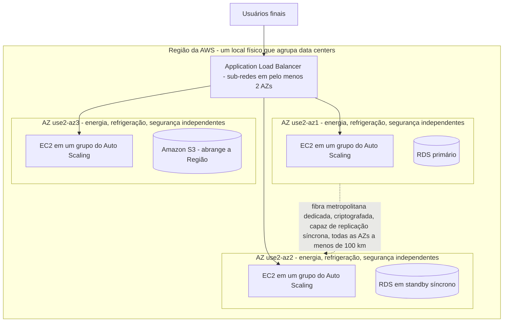
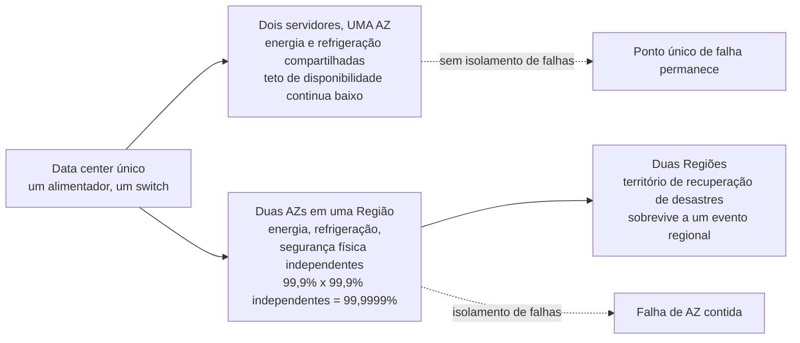
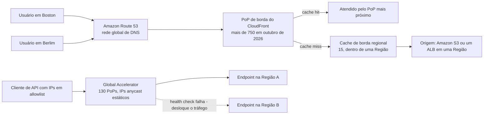
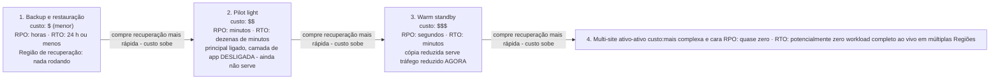
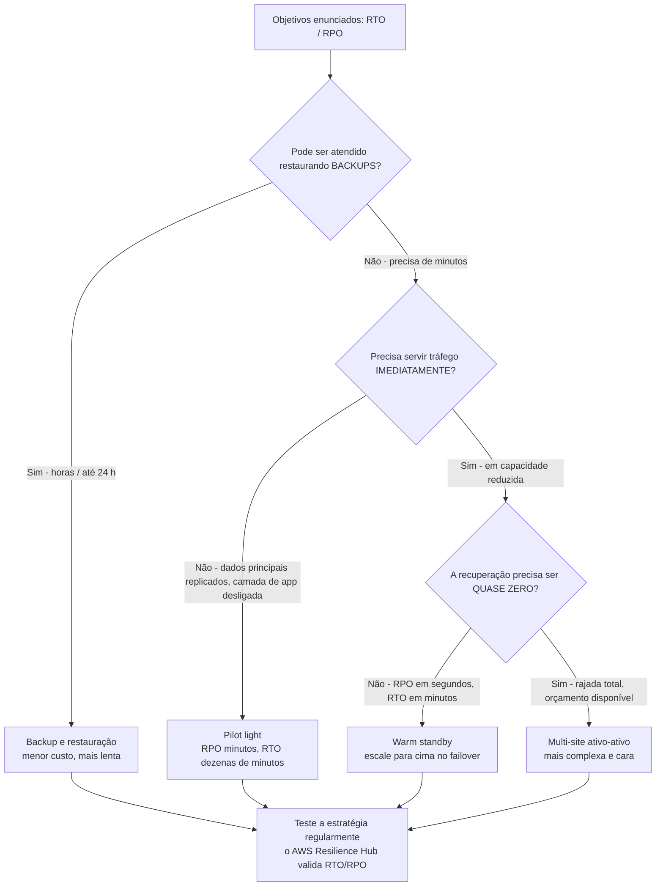
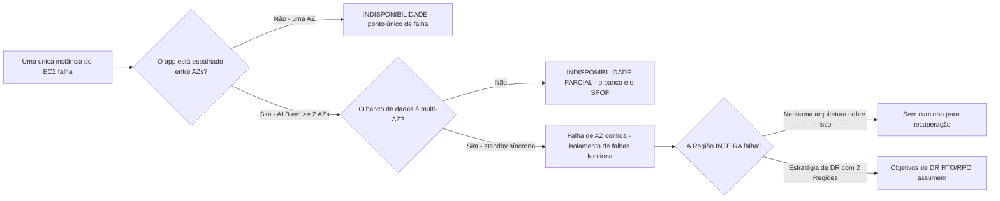

# Infraestrutura Global da AWS e Resiliência

Todo workload da AWS eventualmente responde a uma pergunta: *onde ele roda, e o que acontece quando aquele lugar quebra?* O exame chama isso de **Domínio 3, Tarefa 3.2: "Definir a infraestrutura global da AWS"**, e é uma das tarefas de maior rendimento no CLF-C02, porque um único erro de vocabulário (Região versus Zona de Disponibilidade versus local de borda) pode lhe custar várias questões de uma vez. A própria formulação da AWS é direta: o CTO da Amazon, Werner Vogels, diz **"Tudo falha, o tempo todo"**, e o Well-Architected Framework existe para que você *"prepare seu workload para a falha"* em vez de fingir que ela não vai acontecer.

```text
====================================================================
 INFRAESTRUTURA GLOBAL DA AWS — AS TRÊS CAMADAS (em outubro de 2026)
====================================================================
  Regiões geográficas ....... 39 no ar (+2 anunciadas: Arábia Saudita,
                               Chile); 34 visíveis para uma conta
                               padrão; 17 habilitadas por padrão
  Zonas de Disponibilidade .. 124 nessas 39 Regiões
                               (mínimo de 3 por Região por projeto)
  Borda global da AWS ....... mais de 750 PoPs do CloudFront, 15
                               caches de borda regionais, 130 PoPs do
                               Global Accelerator, Route 53 DNS em todo
                               o mundo
---------------------------------------------------------------------
  CAMADA            VOCÊ IMPLANTA WORKLOADS AQUI?   DOMÍNIO DE FALHA
  Região            sim                              Região inteira
  Zona de Disponib. sim                              uma AZ (de >= 2)
  Local de borda    não - camada de entrega/cache    um PoP
---------------------------------------------------------------------
  ESCADA DE RESILIÊNCIA (Well-Architected REL13-BP02)
  backup e restauração  RPO horas      RTO <= 24 h
  pilot light           RPO minutos    RTO dezenas de minutos
  warm standby          RPO segundos   RTO minutos
  multi-site (AA)       RPO quase zero RTO potencialmente zero
====================================================================
```

> [!NOTE]
> **As contagens acima são um instantâneo, não um syllabus.** Todo valor de Região, AZ, PoP e Zone desta lição está carimbado **em outubro de 2026**, e a AWS os revisa continuamente. O que o exame de fato testa é a *relação* entre as camadas, Regiões contêm AZs, AZs contêm data centers, locais de borda ficam na frente de ambas, mais as regras estáveis de projeto (mínimo de três AZs por Região, seu aplicativo em pelo menos duas).

Nesta lição você vai:

- separar **Regiões, Zonas de Disponibilidade e locais de borda** por definição, contagem e capacidade;
- explicar **por que as Regiões são isoladas**: tolerância a falhas, residência de dados e latência;
- escolher uma Região usando o conjunto de decisão **conformidade, latência, preço e funcionalidades**;
- aplicar a **regra de projeto de AZ** (a AWS entrega ≥3 AZs por Região; seu aplicativo usa ≥2);
- diferenciar **CloudFront, Route 53 e Global Accelerator** por seu plano de entrada;
- situar **Local Zones, Wavelength, Outposts e Snow** no contínuo híbrido de borda;
- definir com precisão **resiliência, disponibilidade, tolerância a falhas, alta disponibilidade e recuperação de desastres**;
- ler e calcular **RTO e RPO**, e ranquear as **quatro estratégias de DR** por custo versus velocidade de recuperação;
- estudar **quatro estudos de caso de resiliência publicados pela AWS**, dois deles adicionados nesta revisão;
- aprender **o que a AWS de fato lançou entre 2025 e outubro de 2026**: Regiões, Local Zones e planos anunciados mas ainda não abertos;
- praticar com **12 questões em formato de exame** mais quatro verificações interativas.

---

## 1. Regiões, Zonas de Disponibilidade e locais de borda

### 1.1 As três definições, com as palavras da própria AWS

| Camada | Definição da AWS (com fonte) | O que ela é fisicamente | Implantar workloads? |
|---|---|---|---|
| **Região da AWS** | *"um local físico ao redor do mundo onde agrupamos data centers"* | Uma área geográfica contendo múltiplas AZs, com seu próprio plano de controle e catálogo de serviços | **Sim**: você escolhe uma Região quando lança qualquer coisa |
| **Zona de Disponibilidade (AZ)** | *"um ou mais data centers discretos com energia, rede e conectividade redundantes em uma Região da AWS"*; cada AZ tem *"energia, refrigeração e segurança física independentes"* | Um ou mais data centers, a **unidade de isolamento de falhas e de alta disponibilidade** | **Sim**: suas sub-redes e instâncias vivem dentro de AZs |
| **Local de borda / PoP** | Um ponto de presença do CloudFront ou do Global Accelerator que armazena em cache conteúdo ou termina conexões de usuários perto dos espectadores | Uma presença menor em cidades ao redor do mundo, *na frente* das Regiões | **Não**: você não pode lançar uma instância do EC2 em um local de borda |

Três fatos sobre a relação fazem a maior parte do trabalho do exame:

1. **Uma Região contém pelo menos três AZs**: *"Cada Região da AWS consiste em um mínimo de três AZs, isoladas e fisicamente separadas, dentro de uma área geográfica"* (em outubro de 2026: **39 Regiões e 124 AZs** no ar, com **7 AZs a mais e 2 Regiões a mais** anunciadas para o Reino da Arábia Saudita e o Chile).
2. **AZs não compartilham pontos únicos de falha.** A Tarefa 3.2 no guia de exame exige explicitamente o conhecimento de que *"Zonas de Disponibilidade não compartilham pontos únicos de falha."*
3. **Locais de borda são uma camada de entrega, não uma camada de computação.** Os benefícios dos locais de borda, segundo o guia de exame, são latência e descarga para *entrega*: nunca "rode minha aplicação aqui".

### 1.2 Exemplo E1: reconciliando a contagem de AZs

O bloco de estatísticas da AWS diz **124 AZs (em outubro de 2026)**. As tabelas de AZ ID na documentação de infraestrutura global cobrem apenas as 34 Regiões que uma conta padrão pode ver. Reconcilie as duas:

```text
AZ IDs listados para as 34 Regiões padrão ....... 109   (contados em out. 2026)
+ Regiões AWS GovCloud (US) (2 x 3 AZs) .........   6
+ Regiões AWS China (2 x 3 AZs) .................   6
+ Região European Sovereign da AWS ...............   3
                                                 -----
                                                  124  = total publicado pela AWS
```

A aritmética só fecha se o **124 publicado contar as Regiões que existem hoje**, e não a Região da Arábia Saudita anunciada mas ainda não aberta. Adições anunciadas (**+7 AZs, +2 Regiões**) são *planos*, nunca fatos de lançamento, o exame não vai creditá-lo por tratar um anúncio como uma abertura.



### 1.3 Para que cada camada serve

| Pergunta que você precisa responder | Camada correta | Respostas erradas que o exame pendura |
|---|---|---|
| "Onde lanço minhas instâncias do EC2?" | Região + AZ (via sub-redes) | local de borda, PoP, Local Zone (a menos que latência/residência seja o objetivo enunciado) |
| "Como sobreviver à falha de um data center?" | Zona de Disponibilidade | "adicione outra Região" (superdimensionamento), "faça um backup" (lento demais) |
| "Como sobreviver à falha da Região inteira?" | Segunda Região (recuperação de desastres) | "outra AZ na mesma Região" (a Região levou junto) |
| "Como entregar conteúdo estático rápido em mais de 100 cidades?" | Locais de borda do CloudFront | "replicue meu banco de dados em mais AZs" (não encurta o caminho do usuário) |
| "Onde meus dados estão fisicamente armazenados?" | Região (e a AZ dentro dela) | local de borda (uma cópia em cache não é seu sistema de registro) |

- **📚 Você sabia?** A AWS interconecta *"todas as AZs ... com rede de alta largura de banda e baixa latência sobre fibra metropolitana dedicada, totalmente redundante"*, criptografa **todo o tráfego entre AZs**, e afirma que o desempenho *"é suficiente para realizar replicação síncrona entre AZs"*. As AZs são *"separadas fisicamente por uma distância significativa, muitos quilômetros"* e contudo *"todas ficam a menos de 100 km (60 milhas) uma da outra"* (em outubro de 2026). Essa envelope apertada mas não minúscula é exatamente por que a replicação síncrona multi-AZ é possível *e* por que uma Região inteira ainda pode ser derrubada por um evento regional.

### 1.4 Onde as Regiões estão (em outubro de 2026)

Contar as Regiões lançadas por geografia dá uma verificação de sanidade útil para alegações de "alcance global", e mostra por que **você não pode assumir que sua Região preferida existe**:

| Geografia | Regiões lançadas | Listadas no mapa da AWS | Observação |
|---|---|---|---|
| América do Norte | 9 | 9 |: |
| América do Sul | 1 | 2 | Uma entrada listada ainda não disponível |
| Europa | 9 | 9 | Inclui a Região European Sovereign da AWS |
| Oriente Médio | 3 | 4 | Uma entrada listada ainda não disponível |
| África | 1 | 1 | Região única |
| Ásia Pacífico | 13 | 13 | Maior contagem no total |
| Austrália / Nova Zelândia | 3 | 3 |: |
| **Total** | **39 lançadas** | **41 listadas** | **+7 AZs e 2 Regiões anunciadas (Arábia Saudita, Chile)** |

Duas lições se seguem. Primeiro, **"a AWS não tem Região em X" é uma resposta legítima no exame**: a disponibilidade de serviços é um fator real de seleção de Região, não uma formalidade, porque um conjunto definido de serviços principais acompanha cada lançamento de Região, enquanto um nível adicional *"geralmente é lançado em até 12 meses após o lançamento de uma nova Região"*. Segundo, as contagens mudam a cada trimestre: trate a tabela como um instantâneo carimbado **em outubro de 2026**, e verifique de novo as páginas de infraestrutura global da AWS antes de citar qualquer valor fora desta lição. (Esta pesquisa não conseguiu reconciliar cada entrada do mapa com a tabela de documentação da própria AWS, então a coluna "listadas" é uma contagem de mapa, não um total oficial.)

### Atualizações de 2026 (em outubro de 2026)

A infraestrutura global não ficou parada enquanto você revisava. O que segue é toda adição de infraestrutura **com data, publicada pela AWS**, de 2025 to 26 encontrada neste ciclo de pesquisa: lançamentos carregam data, planos não, e apenas lançamentos contam:

> [!NOTE]
> - **Ásia Pacífico (Tailândia), `ap-southeast-7`: lançada em 2025-01-07** (histórico de documentação de Regiões da AWS, acesso em 2026-10).
> - **México (Central), `mx-central-1`: lançada em 2025-01-14** (histórico de documentação de Regiões da AWS, acesso em 2026-10).
> - **Ásia Pacífico (Taipei), `ap-east-2`: lançada em 2025-06-06** (histórico de documentação de Regiões da AWS, acesso em 2026-10).
> - **Ásia Pacífico (Nova Zelândia), `ap-southeast-6`: lançada em 2025-09-02**, a entrada mais recente no histórico de documentação de Regiões da AWS em outubro de 2026 (histórico de documentação de Regiões da AWS, acesso em 2026-10).
> - **AWS European Sovereign Cloud, `eusc-de-east-1`, disponibilidade geral anunciada em 2026-01-14** (AWS News Blog, 2026-01-14). Ela está **ausente da página pública de contagem de Regiões e AZs da AWS** (verificado em 2026-10), então a AWS não lhe dá confirmação de que ela fica dentro dos 39 publicados, cite *"39 Regiões Geográficas / 124 Zonas de Disponibilidade, em outubro de 2026"* e datar o European Sovereign Cloud separadamente.
> - **Adições de borda:** a **AWS Local Zone em Nova York** atingiu disponibilidade geral em **2025-01-08** (AWS What's New, 2025-01-08) e a **AWS Local Zone em Hanói** foi anunciada em **2026-06-22** (AWS Weekly Roundup, 2026-06-22), dentro de uma presença que a AWS descreve como **"mais de 30 locais em seis continentes"** (página de produto das AWS Local Zones, em outubro de 2026).

> [!WARNING]
> **⚠️ Anunciado não é lançado (em outubro de 2026).** A página de infraestrutura da AWS ainda diz *"planos anunciados para mais 7 Zonas de Disponibilidade e mais 2 Regiões da AWS no Reino da Arábia Saudita e no Chile."* Esses são **planos**: este ciclo de pesquisa não conseguiu confirmar uma data de abertura para nenhuma das duas Regiões em nenhum comunicado da AWS, então ambas ficam fora das 39 Regiões / 124 AZs acima. No exame, uma Região anunciada não vale nada até a AWS publicar seu lançamento, e uma Região nova só fica *visível* uma vez que o tipo da sua conta e o status de opt-in o permitam (§3.3).

- **📚 Você sabia?** 2025 foi o ano mais denso para aberturas de Regiões neste ciclo de pesquisa, **quatro Regiões em pouco mais de oito meses** (Tailândia 2025-01-07, México 2025-01-14, Taipei 2025-06-06, Nova Zelândia 2025-09-02), e contudo o número principal publicado pela AWS em outubro de 2026 ainda era **39 Regiões e 124 AZs**. Cada uma dessas aberturas vem com o mínimo de projeto da AWS de **pelo menos três AZs isoladas, fisicamente separadas**, e é por isso que a contagem de AZs e a de Regiões sobem juntas, em vez de independentemente.

---

## 2. Por que as Regiões são isoladas: tolerância a falhas, residência de dados, latência

### 2.1 Tolerância a falhas: domínios de falha separados de propósito

As Regiões são isoladas para que nenhum evento regional único possa derrubar tudo o que você roda. O mecanismo é o **isolamento de falhas**, a orientação prescritiva da AWS o define como restringir *"o escopo do impacto a um contêiner de falha pretendido quando ocorre uma falha"*, e afirma que *"Redundância, Tolerância a falhas é alcançada por meio de redundância que elimina pontos únicos de falha (SPOFs)."*

| Nível de isolamento | O que ele contém | O que ele **não** contém |
|---|---|---|
| **Data center** | Energia, refrigeração, falha de hardware | Um incêndio no prédio, um corte de fibra no anel metropolitano |
| **Zona de Disponibilidade** | *"melhor isolada e protegida de problemas como quedas de energia, raios, tornados, terremotos"* | Um evento de Região inteira (problema de plano de controle, evento de rede regional, grande ação regulatória) |
| **Região** | Raio de explosão regional | Um evento global (DNS, autoridade de certificados, seu próprio deploy ruim): é por isso que você também precisa de uma camada **global** (CloudFront, Route 53) |

A própria **tolerância a falhas** tem uma definição precisa: *"a capacidade de resistir a falha de subsistema e manter disponibilidade (fazer a coisa certa dentro de um SLA estabelecido). Para implementar tolerância a falhas, os workloads usam subsistemas reserva (ou redundantes)."* Reservas quentes custam dinheiro; esse custo é por que a tolerância a falhas fica acima da alta disponibilidade simples na escala de preço.

### 2.2 Residência de dados e soberania

Alguns workloads podem rodar legal ou contratualmente apenas em uma geografia específica. A AWS lhe dá três níveis aninhados de controle de residência:

1. **Nível Região**: escolha uma Região dentro da jurisdição exigida (e, quando necessário, um tipo de conta especial como **AWS GovCloud (US)** ou as Regiões **AWS China**);
2. **Nível Local Zone**: a AWS descreve as Local Zones como uma forma de *"atender a requisitos de residência de dados"* deixando você *"controlar onde seus workloads rodam e onde seus dados residem"* em uma metrópole específica;
3. **Nível Wavelength Zone**: os dados *"permanecem dentro dos limites geográficos que você especifica"* quando você coloca computação dentro de uma instalação 5G de uma operadora.

> [!WARNING]
> **Residência não é disponibilidade, e backup também não é.** Escolher Frankfurt para uma regra de residência alemã lhe diz *onde* os dados podem viver; não diz nada sobre *quão rápido você se recupera*. Inversamente, um workload perfeitamente replicado que armazena dados regulados na jurisdição errada parece conforme e é ilegal. No exame, se o enunciado nomeia um **limite legal ou regulatório**, responda com seleção de Região/Local Zone/Wavelength; se ele nomeia **tempo de inatividade ou perda de dados**, responda com contagem de AZ ou estratégia de DR.

### 2.3 Latência: proximidade é um insumo de projeto

A documentação de Regiões da AWS é direta: *"você pode reduzir a latência de rede quando seleciona uma Região próxima à maioria dos seus usuários"* (em outubro de 2026). A consequência prática é uma regra de dois níveis:

- **Computação que precisa estar perto dos usuários** → escolha a Região mais próxima que tenha os serviços de que você precisa, ou uma Local Zone / Wavelength Zone naquela metrópole;
- **Conteúdo que pode ser armazenado em cache** → deixe o workload em uma única Região e deixe os **mais de 750 PoPs do CloudFront (em outubro de 2026)** encurtarem o caminho para todos os outros.

### 2.4 Exemplo E2: redundância multiplica disponibilidade

A documentação de confiabilidade da AWS mostra a aritmética de componentes independentes. Dois componentes que estão cada um **99,9%** disponíveis, falhando *independentemente*, se combinam como:

$$
1 - (0.001 \times 0.001) = 1 - 10^{-6} = 0.999999 = \mathbf{99.9999\%}
$$

Essa é a promessa por trás de rodar em **duas AZs**: a probabilidade de falha de cada AZ é (aproximadamente) independente da outra, então o *par* está vastamente mais disponível do que qualquer membro. A mesma fórmula explica o lado de baixo: três dependências duras que estão cada uma em **99,99%** limitam o workload inteiro a:

$$
0.9999^3 = 0.9997 = \mathbf{99.97\%}
$$

**Uma fraqueza abaixa o teto de uma arquitetura de outra forma excelente.** Essa é a aritmética de resiliência favorita do exame: a redundância só ajuda quando as partes redundantes são genuinamente independentes (AZs diferentes, não dois servidores em um único rack).



---

## 3. Escolhendo uma Região: conformidade, latência, preço e funcionalidades

### 3.1 Os quatro fatores (mais dois que você esquece)

| Fator | A pergunta por trás dele | Orientação da AWS com fonte (em outubro de 2026) |
|---|---|---|
| **Conformidade / residência** | Estes dados podem viver aqui legalmente? | Seleção de Região ou tipo de conta; Local Zones para *"atender a requisitos de residência de dados"* |
| **Latência** | Onde está a maioria dos meus usuários? | *"selecione uma Região próxima à maioria dos seus usuários"* |
| **Preço** | Quanto custa rodar aqui? | COST07-BP02: *"O preço dos recursos pode ser diferente em cada Região. Identifique diferenças de custo regionais e implante apenas em Regiões com custos mais altos para atender a requisitos de latência, residência de dados e soberania de dados."* Os preços diferem *"devido a diferenças no custo de terra, fibra, eletricidade e impostos, por exemplo."* |
| **Serviços / funcionalidades** | Esta Região sequer tem o que eu preciso? | A AWS inclui um conjunto definido de serviços principais em **todo** lançamento de Região, com um nível adicional que *"geralmente é lançado em até 12 meses após o lançamento de uma nova Região"*, então uma Região totalmente nova pode carecer de um serviço de nicho |
| **Status de opt-in** *(fácil de esquecer)* | A Região está habilitada para a minha conta? | **17 Regiões habilitadas por padrão**; o restante é **opt-in** (em outubro de 2026) |
| **Tipo de conta** *(fácil de esquecer)* | Padrão, **AWS GovCloud (US)** ou **AWS China**? | A disponibilidade de Regiões é limitada pelo tipo da sua conta |

A ordem importa mais do que a lista: no exame, **um limite legal ou regulatório enunciado vence todos os outros fatores**, e *"é mais barato em outro lugar"* nunca vence quando residência está em jogo. A própria formulação da AWS para o fator de custo é condicional: implante em uma Região mais cara *apenas* quando latência, residência ou soberania o exigir.

### 3.2 Exemplo E3, o orçamento anual de disponibilidade

Porcentagens de disponibilidade são **orçamentos anuais, não garantias por indisponibilidade**. 8.760 horas em um ano:

| Meta de disponibilidade | Orçamento de inatividade por ano | Aritmética |
|---|---|---|
| 99% | 3 dias 15 horas | $0.01 \times 8{,}760 = 87{,}6$ h |
| **99,9%** | **8 horas 45 minutos** | $0.001 \times 8{,}760 = 8{,}76$ h ≈ 8 h 45 min |
| 99,95% | 4 horas 22 minutos | $0.0005 \times 8{,}760 = 4{,}38$ h |
| 99,99% | 52 minutos | $0.0001 \times 8{,}760 = 0{,}876$ h ≈ 52,6 min |
| 99,999% | 5 minutos | $0.00001 \times 8{,}760 = 0{,}0876$ h ≈ 5,26 min |

Leia como um **orçamento**: um workload prometido em 99,9% já gastou um terço de sua cota anual após **2 horas 55 minutos** de inatividade. É por isso que um requisito de negócio de "quatro noves ou melhor" muda sua arquitetura: ele o empurra de AZ única para multi-AZ, e eventualmente de uma Região para duas.

Faça o gráfico da mesma tabela e a *forma* do orçamento é inconfundível: cada nove extra é aproximadamente um corte de **dez vezes** na inatividade que você tem permissão para ter:

```plot
{
  "type": "bar",
  "title": "Orçamento anual de inatividade por meta de disponibilidade (minutos por ano, em outubro de 2026)",
  "xLabel": "Meta de disponibilidade",
  "yLabel": "Orçamento de inatividade (minutos por ano)",
  "xKey": "target",
  "data": [
    {"target": "99%", "minutes": 5256},
    {"target": "99.9%", "minutes": 525.6},
    {"target": "99.95%", "minutes": 262.8},
    {"target": "99.99%", "minutes": 52.6},
    {"target": "99.999%", "minutes": 5.3}
  ]
}
```

> [!IMPORTANT]
> **Noves são por ano, por workload, nunca por incidente.** Um SLA de 99,99% com um orçamento anual de **52 minutos** não o salvará se uma única indisponibilidade queimar todos os 52 minutos em janeiro. E observe os SLAs de serviço da AWS, separados e muito mais estritos: o **Amazon CloudFront promete pelo menos 99,9% de tempo de atividade mensal**, enquanto o **Route 53 só conta como indisponível se todos os quatro servidores de nomes virtuais atribuídos à hosted zone falharem em responder a todas as consultas DNS** (em outubro de 2026), a barra para chamar o Route 53 de "fora" é intencionalmente quase inatingível.

- **📚 Você sabia?** A AWS opera *"quase 20 milhões de quilômetros"* de fibra de rede em outubro de 2026, e o preço de Região *não* é uniforme: o pilar de custo do Well-Architected diz explicitamente para você *"Identificar diferenças de custo regionais"* em vez de assumir uma lista de preços global. Os recursos de Local Zone também são precificados **acima** da Região pai (em outubro de 2026): proximidade custa dinheiro. Qualquer opção que afirme *"preços idênticos em toda Região"* está errada de cara.

### 3.3 Exemplo E4: por que "39 Regiões" não é o que sua conta vê

Três totais diferentes de Região circulam na documentação da AWS, e apenas um deles é o que seu console mostra (todos em outubro de 2026):

```text
Regiões lançadas em todo o mundo .................. 39
  - Regiões AWS GovCloud (US) .....................  2   (tipo de conta especial)
  - Regiões AWS China .............................  2   (tipo de conta especial)
  - Região European Sovereign da AWS ...............  1   (opt-in / registro separado)
                                                   -----
Regiões visíveis para uma conta comercial padrão .. 34
  - habilitadas por padrão ......................... 17
                                                   -----
Regiões nas quais você deve fazer opt-in explícito . 17
```

Confira a aritmética: $39 - 2 - 2 - 1 = 34$, e $34 - 17 = 17$. O exame usa isso para testar se você confunde **lançadas**, **visíveis** e **habilitadas**:

| Total | O que ele significa | Quando é o número certo |
|---|---|---|
| **39** | Regiões que a AWS lançou (mais planos anunciados para Arábia Saudita e Chile) | "Quantas Regiões a AWS tem?" |
| **34** | Regiões que uma conta comercial padrão pode ver | "Quantas Regiões a minha conta pode listar?" |
| **17** | Regiões **habilitadas por padrão**; o restante é opt-in | "Posso usar esta Região sem habilitá-la antes?" |

Se uma questão diz *"todas as 39 Regiões estão disponíveis para todo cliente por padrão"*, está errada em dois pontos ao mesmo tempo: tipo de conta **e** status de opt-in.

---

## 4. A regra de projeto de Zona de Disponibilidade

### 4.1 Dois números diferentes, ambos corretos

Esta é a distinção examinada de forma mais confiável no Domínio 3, e os candidatos a erram ao fundir duas regras que respondem a perguntas diferentes:

| Regra | Número | De quem é a regra | Fonte |
|---|---|---|---|
| **O projeto de Região da AWS** | **mínimo de 3 AZs por Região** | A infraestrutura da AWS | *"Cada Região tem pelo menos três Zonas de Disponibilidade. Isso ajuda você a projetar aplicações altamente disponíveis na AWS."* |
| **O projeto do seu aplicativo** | **pelo menos 2 AZs** | Suas (a arquitetura sob revisão) | O console do **Application Load Balancer** impõe: *"Selecione sub-redes de pelo menos duas Zonas de Disponibilidade"* |

Então: **a AWS lhe dá ≥3; você deve usar ≥2.** Uma questão descrevendo *sua arquitetura* com sub-redes de apenas uma AZ está descrevendo um ponto único de falha: independentemente de quantas AZs a Região por acaso contenha. A AWS também observa que você pode *"rodar em múltiplas AZs para alcançar tolerância a falhas ainda maior"*, ou seja, três estão disponíveis se seu orçamento e tolerância a complexidade permitirem.

### 4.2 AZ IDs versus códigos de AZ

Uma armadilha sutil que apareceu em exames reais:

- **Códigos de AZ** (`us-east-1a`, `us-east-1b`) são **relativos à conta**: em Regiões mais antigas, a letra que uma conta vê é mapeada para um data center físico diferente para contas diferentes (contas criadas antes de novembro de 2025).
- **AZ IDs** (`euw1-az1`, `use1-az1`) identificam o **mesmo local físico em toda conta da AWS**, o identificador seguro para regras entre contas, landing zones e network peerings.

Em outubro de 2026, as tabelas de AZ ID listam **109 AZ IDs nas 34 Regiões padrão**. Regra prática para o exame: se uma questão envolve **duas contas**, a resposta envolve **AZ IDs**, não letras.

### 4.3 Exemplo E5: seu projeto usa as AZs que você recebeu?

Uma Região com **3 AZs (em outubro de 2026, a configuração mais comum)** executa um aplicativo com um ALB cujas sub-redes ficam todas em uma AZ, uma instância do EC2 e um banco de dados sem standby:

```text
Contagem de AZs da Região ............. 3      (regra de projeto da AWS satisfeita)
AZs realmente usadas pelo app ......... 1      (regra de projeto do aplicativo VIOLADA)
Falha do data center dessa AZ ......... aplicativo inteiro offline
Falha da Região ....................... aplicativo inteiro offline
```

Corrija em ordem de prioridade: **(1)** adicione sub-redes e instâncias em uma segunda AZ (mínimo do ALB, remove o ponto único de falha da AZ); **(2)** habilite um deploy de banco de dados multi-AZ (standby síncrono na segunda AZ); **(3)** apenas então considere uma segunda Região com uma estratégia de DR para falha *regional*. O passo 1 custa menos e remove a falha sobre a qual o exame pergunta com mais frequência.

> [!NOTE]
> **Multi-AZ não é multi-Região.** Multi-AZ = alta disponibilidade e isolamento de falhas **dentro de uma Região** (protege contra falha de AZ). Multi-Região = **recuperação de desastres, continuidade de negócio, soberania de dados e latência global** (protege contra falha de Região). Uma questão sobre "proteção contra falha de uma Zona de Disponibilidade" nunca precisa de uma segunda Região; uma questão sobre "proteção contra falha de uma Região" nunca é satisfeita por uma terceira AZ.

---

## 5. Serviços de borda: CloudFront, Route 53 e Global Accelerator

Os três ficam *na frente* das suas Regiões, e os três aparecem na Tarefa 3.2 como **benefícios dos locais de borda**. O exame os diferencia por **plano de entrada**: respostas de DNS, conteúdo em cache, ou um endereço IP anycast estático.

### 5.1 Amazon CloudFront, o plano de cache/CDN

- *"Reduza a latência entregando dados por meio de mais de 750 Pontos de Presença (PoPs) dispersos globalmente"*: **mais de 750 PoPs em mais de 100 cidades em mais de 50 países**, mais **mais de 1.140 PoPs embutidos em mais de 300 cidades** dentro de ISPs, e **15 caches de borda regionais** que ficam *dentro* de uma Região (todos em outubro de 2026).
- Mecânica: o DNS resolve o usuário para o PoP mais próximo → em um **cache hit** o PoP responde → em um **cache miss** ele busca da sua **origem** (Amazon S3, um ALB, uma origem de mídia) e armazena o resultado em cache.
- **SLA: pelo menos 99,9% de tempo de atividade mensal** (em outubro de 2026).
- Uso no exame: armazenar em cache e entregar conteúdo perto dos usuários, mais **failover de origem** como uma alavanca documentada de deslocamento de tráfego para DR.

### 5.2 Amazon Route 53, o plano de DNS

- *"O Route 53 usa uma rede global de servidores DNS em uma série de locais em todo o mundo para oferecer alta disponibilidade e desempenho aumentado."*
- Políticas de roteamento que o exame nomeia: **latência, geoproximity, baseada em IP, failover e weighted**: mais **health checks**, que é como o failover de DNS automatizado é alcançado.
- **SLA:** indisponível *"apenas se todos os quatro servidores de nomes virtuais atribuídos à Hosted Zone falharem em responder a todas as consultas DNS"*; créditos de serviço começam abaixo de **100%** de tempo de atividade (em outubro de 2026).
- A pegadinha que você precisa memorizar: as respostas de DNS são **armazenadas em cache por resolvedores conforme o TTL**, então um failover pode demorar tanto quanto o TTL que você configurou.

### 5.3 AWS Global Accelerator, o plano de IP anycast

- *"Melhore o desempenho de rede das suas aplicações em até 60%"* e forneça *"failover rápido para arquiteturas multi-Região e multi-AZ"* com *"roteamento determinístico ao remover dependências de cache de DNS"* (alegações em outubro de 2026).
- Dá ao seu aplicativo **endereços IP estáticos anunciados via anycast pela rede de borda da AWS**: clientes conectam a um IP fixo, e o tráfego é direcionado na borda para endpoints saudáveis.
- **130 Pontos de Presença em 95 cidades em 53 países** (em outubro de 2026).
- Uso no exame: **workloads não-HTTP ou sensíveis a allowlist de IP** e failover que não pode esperar pelo TTL de DNS.

### 5.4 A comparação dos três planos

| | **Amazon Route 53** | **Amazon CloudFront** | **AWS Global Accelerator** |
|---|---|---|---|
| Plano de entrada | Resposta de DNS | Conteúdo em cache em um PoP | Endereço IP anycast estático |
| O que o cliente recebe | Um endereço IP para conectar | O próprio objeto (do cache) | Endereços IP anycast estáticos |
| Velocidade de mudança / failover | Limitada pelo **DNS TTL** | Invalidação de cache + failover de origem | Health checks na borda, sem espera por DNS TTL |
| Contagens (out. 2026) | ~93 locais listados na página de recursos do Route 53 da AWS (contados para esta lição; a AWS não publica um total) | mais de 750 PoPs · 15 caches de borda regionais · mais de 1.140 PoPs embutidos | 130 PoPs (95 cidades, 53 países) |
| Melhor encaixe no exame | DNS global com roteamento por latência/failover | Conteúdo estático, cacheável e de alto volume | Failover rápido, IPs fixos, protocolos não-HTTP |



- **📚 Você sabia?** Os três serviços podem ser empilhados em vez de escolhidos isoladamente: o **Route 53** resolve um nome amigável, o **CloudFront** serve o front-end em cache do mais próximo de mais de 750 PoPs (em outubro de 2026), e o **Global Accelerator** carrega o tráfego de API em IPs anycast estáticos para duas Regiões com failover por health check. O whitepaper de recuperação de desastres da AWS lista exatamente esses três, Route 53, Global Accelerator e failover de origem do CloudFront, como o kit de ferramentas de **gerenciamento de tráfego** para deslocar usuários durante a recuperação.

```matching
{
  "question": "Associe cada serviço de infraestrutura global ao seu plano de entrada e uso no exame (contagens em outubro de 2026):",
  "pairs": [
    {"left": "Amazon Route 53", "right": "Plano de DNS: retorna um endereço IP, suporta roteamento por latência, failover, geoproximity, weighted e IP-based, mas a velocidade do failover é limitada pelo DNS TTL"},
    {"left": "Amazon CloudFront", "right": "Plano de cache/CDN: mais de 750 PoPs entregam conteúdo em cache do ponto de presença mais próximo, buscando de uma origem em um cache miss"},
    {"left": "AWS Global Accelerator", "right": "Plano de IP anycast - 130 PoPs e IPs anycast estáticos dão failover rápido sem dependência de cache de DNS"},
    {"left": "Cache de borda regional", "right": "15 caches que ficam DENTRO de uma Região, um nível atrás dos PoPs de borda, mantendo conteúdo cuja popularidade está decaindo"},
    {"left": "Zona de Disponibilidade", "right": "Uma unidade de isolamento de falhas implantável dentro de uma Região: energia, refrigeração e segurança física independentes, mín. 3 por Região"},
    {"left": "Local de borda (PoP)", "right": "Um ponto de entrega na frente das Regiões: você não pode lançar uma instância do EC2 aqui"}
  ],
  "explanation": "O Route 53 responde DNS, o CloudFront serve objetos em cache, o Global Accelerator termina IPs anycast na borda, e os caches de borda regionais são o único nível de borda que vive dentro de uma Região. AZs e locais de borda são separados por capacidade: AZs rodam seu workload, locais de borda apenas o entregam ou o armazenam em cache."
}
```

### 5.5 Exemplo E6: a janela do DNS TTL faz parte do seu tempo de failover

Suponha que um registro de failover do Route 53 tenha TTL de **300 segundos**, e que o endpoint primário falhe em `t = 0`. Um resolvedor recursivo que pediu a resposta **240 segundos** antes da falha ainda mantém uma resposta em cache válida:

```text
TTL configurado no registro de failover .......... 300 s
Idade da resposta em cache deste resolvedor ...... 240 s
Vida restante do cache no momento da falha .......  60 s
   -> esses usuários continuam sendo enviados ao endpoint FALHADO
Pior caso (resolvedor pediu 1 s antes da falha) .. 300 s = 5 min de redirecionamento para um beco sem saída
Mesmo failover via Global Accelerator ........... health checks do endpoint na borda,
                                                  sem cache de resolvedor para esperar expirar
```

Nada aqui condena o failover de DNS, **os health checks e o roteamento de failover do Route 53 são uma alavanca documentada de gerenciamento de tráfego de DR**, e para política de DNS global (latência, geoproximity, weighted) é a resposta correta. O ponto examinável é aritmética sobre *os seus próprios objetivos*: se o **RTO enunciado é 60 segundos** e o TTL do seu registro de failover é **300 segundos**, a camada de DNS sozinha pode estourar o orçamento, e o enunciado está apontando você para o **Global Accelerator** (IPs anycast estáticos, *"roteamento determinístico ao remover dependências de cache de DNS"*) ou para encurtar o TTL. Sempre trate o TTL como um componente invisível do tempo de recuperação, em outubro de 2026 a AWS não publica um tempo de failover padrão, então o número que você configura é o número que você tem.

---

## 6. O contínuo híbrido de borda: Local Zones, Wavelength, Outposts e Snow

Nem todo workload pertence ao núcleo de uma Região. A AWS oferece um contínuo de **totalmente operado pela AWS, bem dentro de uma Região** até **hardware no seu próprio prédio**, o exame testa se você consegue situar cada opção nesse contínuo.

| Opção | Onde ela vive fisicamente | Quem a opera | Relação com a pai | Motivo principal no exame |
|---|---|---|---|---|
| **Região da AWS** | Data centers da AWS em uma geografia | AWS |: | Linha de base; capacidade, serviços, conformidade |
| **AWS Local Zone** | Um local de **metrópole**, *"uma extensão de uma Região da AWS"* | AWS | Estende uma Região específica | Latência de **dígito único de ms**, *"atender a requisitos de residência de dados"* |
| **AWS Wavelength Zone** | **Dentro do data center de uma operadora de telecomunicações** (Bell, BT, KDDI, Verizon, Orange), por exemplo `us-east-1-wl1-bos-wlz-1` | AWS + operadora | Anexada a uma Região pai | Borda 5G/telecom; dados *"permanecem dentro dos limites geográficos que você especifica"* |
| **AWS Outposts** | **Seu site**: um rack único autossuficiente de **42U** que requer **10 to 30 kVA** com uplinks de **10/40/100 Gbps** (ou servidores Outposts de 1U/2U, que *não* são instaláveis no fator de forma de 42U) | AWS (hardware *e* software gerenciados) | Conecta a uma **Região pai** | Mesmas APIs on-premises; processamento local verdadeiro |
| **AWS Snowball Edge** | **Seu site**, offline: você envia o dispositivo | Dispositivo da AWS, suas mãos | Os dados se movem para uma Região quando conectado | Transferência de dados muito grande, offline/remota |
| **AWS Ground Station** | Antenas terrestres de satélite da AWS | AWS | Baixa dados para uma Região | Ingestão de dados de satélite |

Três esclarecimentos que as questões de exame adoram borrar:

- **Local Zones são implantadas pela AWS; Outposts são implantadas pelo cliente.** Ambas apresentam as *mesmas APIs da AWS*, então a frase decisiva do enunciado é *"em uma metrópole operada pela AWS"* (Local Zone) versus *"no meu data center"* (Outposts).
- **Wavelength é embutida na operadora**: você não a escolhe só por residência; você a escolhe quando o workload precisa ficar ao lado de uma **rede 5G/telecom**.
- **Snowball é um dispositivo de transferência, não um destino de computação**, e a AWS publicou uma data dura: *"Em 31 de dezembro de 2026, a AWS encerrará o suporte aos dispositivos AWS Snowball em todas as Regiões comerciais da AWS"* (Storage Optimized e Compute Optimized), enquanto **clientes de GovCloud e da Região ADC com jobs Snow ativos não são afetados** (anúncio em outubro de 2026).

> [!WARNING]
> **Armadilha de escopo para o CLF-C02 (em outubro de 2026):** o guia de exame atual nomeia **AWS Outposts** (computação híbrida) como no escopo, mas **AWS Wavelength e AWS Ground Station estão listados como fora do escopo**, e a **AWS Snow Family não aparece mais** nas listas atuais no escopo. Aprenda-os mesmo assim, como *contexto* para o contínuo híbrido, mas nunca escolha um dos nomes fora do escopo como o serviço "correto" quando uma alternativa no escopo (Outposts, Local Zones, Storage Gateway, Direct Connect) se encaixa na história. Lembre-se também de que precisar de capacidade **nova** do Snowball em uma Região comercial após **31 de dezembro de 2026** exige uma alternativa online.

- **📚 Você sabia?** A página de produto das Local Zones da AWS descreve *"mais de 30 metrópoles em todo o mundo"* em seis continentes (em outubro de 2026), enquanto o bloco de estatísticas de infraestrutura global da AWS publica um valor diferente para Local Zones e sua página de locais lista mais títulos de cidades do que qualquer um dos dois; esta pesquisa **não conseguiu reconciliar** essas contagens, então trate qualquer total de Local Zone como não verificado e confira de novo antes de citá-lo. A mesma cautela se aplica às Wavelength Zones (o bloco de estatísticas e os códigos de zona contados discordam). **Contagens mudam; relações não mudam.**

---

## 7. Vocabulário de resiliência: tolerância a falhas, alta disponibilidade, recuperação de desastres

### 7.1 Cinco termos, cinco significados

| Termo | Definição com fonte na AWS | Leitura de exame em uma linha |
|---|---|---|
| **Resiliência** | *"a capacidade de um workload de se recuperar de interrupções de infraestrutura ou de serviços, adquirir dinamicamente recursos de computação para atender à demanda e mitigar interrupções"* | A capacidade- guarda-chuva: recuperar, escalar e absorver |
| **Disponibilidade** | *"a porcentagem do tempo em que um workload está disponível para uso"* | Uma **porcentagem**, medida ao longo do tempo (veja a tabela de noves na §3.2) |
| **Tolerância a falhas** | *"a capacidade de resistir a falha de subsistema e manter disponibilidade … os workloads usam subsistemas reserva (ou redundantes)"* | Continuar servindo **através** da falha: reservas quentes, a mais cara |
| **Alta disponibilidade (HA)** | *"a capacidade de uma aplicação ou sistema de TI de operar continuamente em um nível alto, independentemente do número de usuários"* | Manter um workload rodando rodando: redundância + replicação + balanceamento de carga + failover, tipicamente **entre AZs em uma Região** |
| **Recuperação de desastres (DR)** | *"A Recuperação de Desastres foca em objetivos de recuperação de única ocorrência"*; a DR trabalha em *"cópias discretas do workload inteiro"* enquanto a disponibilidade foca em *"componentes do workload"* | Restaurar **depois** que caiu: tipicamente **entre Regiões** |

A página "o que é alta disponibilidade" da AWS acrescenta a fronteira que o exame testa literalmente: *"Sistemas de alta disponibilidade não fazem parte da recuperação de desastres … A recuperação de desastres trata de colocar seus sistemas de volta no ar se seus sistemas de HA existentes falharem."* Em outras palavras: **a HA mantém no ar; a DR traz de volta.** A tolerância a falhas é o primo mais caro da HA: ela não apenas se recupera rapidamente, ela nunca para visivelmente.

### 7.2 RTO e RPO: os dois números pelos quais um plano de DR vive ou morre

Ambos são definidos pela **sua organização**, e não pela AWS (em outubro de 2026):

- **RTO: Recovery Time Objective:** *"o atraso máximo aceitável entre a interrupção do serviço e a restauração do serviço."* → **por quanto tempo você tem permissão para estar fora do ar.**
- **RPO: Recovery Point Objective:** *"a quantidade máxima aceitável de tempo desde o último ponto de recuperação de dados."* → **quanto dado você tem permissão para perder.**

```text
   último ponto de recuperação (backup / lag de replicação)     desastre atinge     serviço restaurado
            |                                                              |                    |
            |<--------------------------- RPO ---------------------------->|                    |
            |                                                              |<------- RTO ------>|
            |                                                              |                    |
   RPO fica ANTES do desastre (janela de perda de dados)                   RTO fica DEPOIS dele (janela de inatividade)
```

Direção é onde os candidatos perdem pontos: **RTO = inatividade, RPO = perda de dados.** Uma janela de RPO *maior* é *pior* (mais dados perdidos); um RTO *maior* é *pior* (indisponibilidade mais longa). Para medição, o RTO se comporta como o MTTR, e o RPO sempre fica **antes** do desastre na linha do tempo.

### 7.3 Exemplo E7: lendo RTO e RPO em uma linha do tempo

Um banco de dados falha às **12:00**. O backup utilizável mais recente foi escrito às **09:00**, e o serviço foi restaurado às **14:00**.

$$
RPO = 12{:}00 - 09{:}00 = \mathbf{3\ hours\ of\ acceptable\ data\ loss}, \qquad RTO = 14{:}00 - 12{:}00 = \mathbf{2\ hours\ of\ downtime}
$$

Agora inverta em um *requisito*: o negócio declara **RTO ≤ 1 minuto, RPO ≤ 1 segundo** para o checkout. Um RPO de 3 horas e um RTO de 2 horas falham em ambas as metas por ordens de grandeza: a resposta é uma estratégia com replicação contínua (warm standby ou multi-site ativo-ativo), e não um melhor agendamento de backup. E se o negócio em vez disso declarar **RTO ≤ 24 horas, RPO em horas**, backup e restauração podem satisfazê-lo com o menor custo das quatro estratégias.

```fillblank
{
  "question": "Complete as frases do vocabulário de resiliência com os termos corretos com fonte na AWS:",
  "template": "O atraso máximo aceitável entre a interrupção do serviço e a restauração do serviço é o {{1}}, enquanto a quantidade máxima aceitável de tempo desde o último ponto de recuperação de dados é o {{2}}. Manter um workload rodando rodando com redundância, balanceamento de carga e failover entre AZs é {{3}}; continuar servindo ATRAVÉS de uma falha com subsistemas reserva é {{4}}; restaurar cópias discretas do workload inteiro após um evento em larga escala é {{5}}.",
  "answers": {
    "1": "RTO (Recovery Time Objective)",
    "2": "RPO (Recovery Point Objective)",
    "3": "alta disponibilidade",
    "4": "tolerância a falhas",
    "5": "recuperação de desastres"
  },
  "distractors": ["MTBF", "SLA", "tempo médio entre falhas", "janela de backup", "orçamento de latência", "reserva de capacidade"],
  "explanation": "O RTO mede inatividade e o RPO mede perda de dados, ambos definidos pela organização (Pilar de Confiabilidade do Well-Architected). A alta disponibilidade mantém o workload rodando com o mínimo de tranco; a tolerância a falhas acrescenta subsistemas reserva para que ele nunca pare visivelmente; a recuperação de desastres restaura cópias discretas do workload inteiro depois que ele caiu: a AWS afirma que sistemas de alta disponibilidade não fazem parte da recuperação de desastres."
}
```

### 7.4 Disponibilidade, tolerância a falhas e DR são três perguntas diferentes

| | **Disponibilidade** | **Tolerância a falhas** | **Recuperação de desastres** |
|---|---|---|---|
| Pergunta | Com que frequência é utilizável? | Ela continua servindo *durante* uma falha? | Quão rápido nós a trazemos *de volta*? |
| Unidade | Porcentagem ao longo do tempo | SLA sustentado através de uma falha | Objetivos de recuperação de única ocorrência (RTO/RPO) |
| Escopo | Componentes do workload | Subsistemas com reservas | **Cópias discretas do workload inteiro** |
| Forma típica na AWS | Multi-AZ + balanceador de carga + Auto Scaling | Standby/reservas quentes, subsistemas redundantes | Segunda Região, replicação, deslocamento de tráfego |
| Custo | Médio | Alto (reservas ociosas) | Sobe acentuadamente conforme RTO/RPO encolhem |

### 7.5 Transformando o enunciado de uma questão no termo certo

A maneira mais rápida de pontuar em vocabulário é ler a *forma temporal* do enunciado em vez de seus substantivos:

| Se o enunciado enfatiza… | Ele está perguntando sobre… | A resposta com forma da AWS |
|---|---|---|
| Uma porcentagem do tempo, uma meta de uptime, "com que frequência é utilizável" | **Disponibilidade** | Multi-AZ, balanceamento de carga, Auto Scaling; noves medidos **por ano** |
| "Continua servindo *durante* a falha", reservas, sem interrupção visível | **Tolerância a falhas** | Subsistemas redundantes/reserva, isolamento de falhas com raio de explosão limitado |
| "Trazer de volta", uma indisponibilidade que já aconteceu, desastre natural, ataque | **Recuperação de desastres** | Cópias discretas do workload inteiro, geralmente uma segunda Região |
| Um número de inatividade com um relógio | **RTO** | Tudo entre falha e restauração: incluindo DNS TTL |
| Um número de perda de dados medido para trás a partir da falha | **RPO** | Distância do último ponto de recuperação até o desastre |
| "Uma AZ falhou e o app continuou funcionando" | **Alta disponibilidade / isolamento de falhas** | ALB em ≥2 AZs, banco de dados multi-AZ, Auto Scaling por AZ |

Duas frases fecham o circuito do vocabulário: **"A HA mantém um workload rodando rodando; a tolerância a falhas continua servindo através de uma falha; a DR restaura um workload que caiu."** E a frase de fronteira da própria AWS, *"Sistemas de alta disponibilidade não fazem parte da recuperação de desastres"*, significa que uma questão oferecendo *"nosso projeto multi-AZ satisfaz nossos requisitos de DR"* está oferecendo uma armadilha: multi-AZ cobre **uma AZ falhando**, não a **Região inteira**.

---

## 8. Estratégias de recuperação de desastres: custo versus velocidade de recuperação

### 8.1 As quatro estratégias e suas faixas publicadas

O Pilar de Confiabilidade do Well-Architected (REL13-BP02) publica as faixas de objetivo, e o whitepaper de DR publica a forma de custo/complexidade (todos em outubro de 2026):

| Estratégia | Faixa de RPO | Faixa de RTO | O que está rodando na Região de recuperação | Custo e complexidade |
|---|---|---|---|---|
| **Backup e restauração** | horas (backups contínuos podem chegar a ~5 min) | 24 horas ou menos | **Nada**: dados, AMIs e infraestrutura como código são restaurados sob demanda | **Menor / mais lenta** |
| **Pilot light** | minutos | dezenas de minutos | Replicação e infraestrutura principal **sempre ligadas**; camada de aplicação desligada, redesployada via IaC | Baixa: média; **não pode servir até ser ligado** |
| **Warm standby** | segundos | minutos | Uma cópia **reduzida mas funcional** sempre rodando; escale para cima no failover | Média; **serve tráfego reduzido imediatamente** |
| **Multi-Região multi-site ativo-ativo** | quase zero | potencialmente zero | O **workload completo servindo tráfego ao vivo** em múltiplas Regiões simultaneamente | *"a abordagem mais complexa e cara … reduza seu tempo de recuperação a quase zero"* |

A frase que decide a maioria das questões de pilot light versus warm standby: *"pilot light não pode processar requisições sem uma ação adicional tomada primeiro, enquanto warm standby pode lidar com tráfego (em níveis de capacidade reducidos) imediatamente."* (Um warm standby executado em capacidade total é frequentemente chamado de **hot standby**.)



### 8.2 Exemplo E8: qual estratégia se encaixa no objetivo?

O negócio publica estes objetivos (todos em outubro de 2026):

```text
Cenário A: RPO em HORAS, RTO em 24 HORAS OU MENOS   -> backup e restauração     ($ )
Cenário B: RPO em MINUTOS, RTO em DEZENAS DE MINUTOS  -> pilot light              ($$)
Cenário C: RPO em SEGUNDOS, RTO em MINUTOS           -> warm standby             ($$$)
Cenário D: RPO QUASE ZERO, RTO POTENCIALMENTE ZERO   -> multi-site ativo-ativo   ($$$$)
Cenário E: RTO <= 1 min E RPO <= 1 s, custo irrelev -> warm standby no mínimo,
                                                        ativo-ativo se zero for exigido
```

Custo e recuperação se movem **juntos**: conforme você demanda RTO/RPO menores, você compra mais capacidade ociosa. O padrão do exame é entregar um número ("RTO em dezenas de minutos") e pedir a estratégia: **dezenas de minutos é a assinatura do pilot light**; *RPO em segundos com RTO em minutos* é warm standby; *quase zero / potencialmente zero* é ativo-ativo.

### 8.3 Deslocamento de tráfego e testes: a mecânica de DR

A recuperação é inútil se os usuários não conseguem alcançar a cópia restaurada. O whitepaper de DR da AWS nomeia explicitamente o kit de ferramentas de gerenciamento de tráfego:

| Alavanca | Como ela desloca usuários | Latência do deslocamento |
|---|---|---|
| Health checks + roteamento de failover/weighted do **Route 53** | A resposta de DNS muda para o endpoint de recuperação | Limitada pelo **DNS TTL** |
| Controles de tráfego + health checks de endpoint do **Global Accelerator** | Direcionamento na borda em IPs anycast estáticos | Sem dependência de cache de DNS |
| **Failover de origem do CloudFront** | O CDN rebusca da origem secundária | Comportamento de troca de cache/origem |

E a disciplina que torna qualquer uma das coisas real: **"avalie e teste regularmente sua estratégia de recuperação de desastres."** O **AWS Resilience Hub** existe para validar seus **alvos de RTO e RPO** declarados contra sua arquitetura real (em outubro de 2026). Um plano de DR não testado é uma hipótese, não uma estratégia.



```dragdrop
{
  "question": "Ordene as quatro estratégias de recuperação de desastres da AWS da mais barata e lenta para a mais cara e rápida (faixas do Well-Architected REL13-BP02, em outubro de 2026):",
  "items": [
    "Pilot light: RPO minutos, RTO dezenas de minutos",
    "Backup e restauração: RPO horas, RTO 24 horas ou menos",
    "Multi-site ativo-ativo: RPO quase zero, RTO potencialmente zero",
    "Warm standby: RPO segundos, RTO minutos"
  ],
  "correctOrder": [
    "Backup e restauração: RPO horas, RTO 24 horas ou menos",
    "Pilot light: RPO minutos, RTO dezenas de minutos",
    "Warm standby: RPO segundos, RTO minutos",
    "Multi-site ativo-ativo: RPO quase zero, RTO potencialmente zero"
  ],
  "explanation": "Custo e velocidade de recuperação sobem juntos: backup e restauração é o mais barato e lento (horas / até 24 h), depois pilot light (minutos / dezenas de minutos, não pode servir até ser ligado), depois warm standby (segundos / minutos, serve tráfego reduzido imediatamente), e finalmente multi-site ativo-ativo (RTO quase zero / potencialmente zero) que a AWS chama da abordagem mais complexa e cara."
}
```

- **📚 Você sabia?** O pilar de confiabilidade da AWS publica uma tabela de aritmética de disponibilidade que você pode reusar literalmente: **99% → 3 dias 15 horas**, **99,9% → 8 horas 45 minutos**, **99,95% → 4 horas 22 minutos**, **99,99% → 52 minutos**, **99,999% → 5 minutos** de inatividade por ano (em outubro de 2026). Combine-a com as faixas de DR e você pode converter qualquer SLA de negócio em uma estratégia: quatro noves de disponibilidade não podem ser atendidos por uma restauração uma vez por dia, e cinco noves essencialmente mandam warm standby ou ativo-ativo mais recuperação automática.

### 8.4 Ativo/passivo, quente/morno, e as três perguntas a fazer primeiro

O vocabulário de DR tem dois eixos extras que as questões de exame deslizam sem aviso:

| Eixo | Termo | Significado |
|---|---|---|
| Postura de tráfego | **Ativo/passivo** | O secundário serve **nenhum tráfego** até o failover: backup e restauração e pilot light são passivos |
| Postura de tráfego | **Ativo/ativo** | Ambas as cópias servem tráfego ao vivo continuamente: *"a abordagem mais complexa e cara"* |
| Prontidão do secundário | **Pilot light** | Dados principais replicados, camada de aplicação **desligada**: não pode servir até ser ligado |
| Prontidão do secundário | **Warm standby** | Reduzido mas funcional: serve **capacidade reduzida imediatamente** |
| Prontidão do secundário | **Hot standby** | Warm standby dimensionado para carga total: mais próximo de ativo/ativo em custo |

Antes de qualquer estratégia ser escolhida, o whitepaper de DR da AWS faz você acertar três decisões:

1. **Quais são os RTO e RPO numéricos?** Ambos são *"definidos pela organização"*: sem números, toda estratégia "qualifica" e nenhuma é justificada.
2. **Qual é a topologia de escrita?** Ativo-ativo só faz sentido quando escritas podem ser tratadas entre Regiões (globais, locais ou particionadas): um workload majoritariamente de leitura e um globalmente particionado têm custos completamente diferentes.
3. **Quanto custará a capacidade ociosa, e a estratégia foi testada?** O whitepaper da AWS instrui as equipes a *"avaliar e testar regularmente sua estratégia de recuperação de desastres"*, e o **AWS Resilience Hub** valida os **alvos de RTO e RPO** declarados contra a arquitetura (em outubro de 2026).

Uma heurística de exame útil: se o enunciado lhe dá números **e** um orçamento, desça a escada a partir de ativo-ativo até que os objetivos ainda sejam atendidos ao menor custo; se o enunciado lhe dá números e diz que **custo não é objeto**, a resposta é a estratégia mais rápida que os atende.

---

## 9. Projeto para falha: os princípios operacionais

### 9.1 Os princípios de design de confiabilidade do Well-Architected

Escolhas de infraestrutura só compensam quando pareadas com hábitos operacionais. Os princípios de design de confiabilidade do Well-Architected (em outubro de 2026) são curtos o bastante para memorizar:

| Princípio | O que ele significa na prática |
|---|---|
| **Recupere-se automaticamente da falha** | Alarme → remediação roteirizada/automática, não um humano acordado às 03:00 |
| **Teste procedimentos de recuperação** | Experimentos de caos e game days; um runbook não testado é um palpite |
| **Escale horizontalmente para aumentar a disponibilidade agregada do workload** | Muitas unidades pequenas falham com mais elegância do que uma grande |
| **Pare de adivinhar a capacidade** | Auto Scaling em vez de superprovisionar "por precaução" |
| **Gerencie mudança através de automação** | A maioria das indisponibilidades são deploys; automatize e restrinja mudança |

O blog de arquitetura da AWS destila a mentalidade na frase de Vogels, *"Tudo falha, o tempo todo"*, e acrescenta que *"nós deveríamos projetar com a falha em mente … O AWS Well-Architected Framework foi projetado para ajudar você a preparar seu workload para a falha."* A lente de mobilidade conectada enuncia o corolário como um requisito duro: *"A arquitetura deveria garantir que não haja nenhum ponto único de falha."*



> [!NOTE]
> **Raio de explosão é a ideia unificadora.** Todo conceito desta lição é uma decisão de raio de explosão: uma AZ contém uma falha de data center, uma Região contém uma falha regional, uma camada de borda contém problemas *globais* de caminho do usuário, e uma estratégia de DR define o que acontece depois que a contenção falha. Quando uma questão descreve uma falha, primeiro pergunte **"qual é o menor contêiner no qual essa falha cabe?"**: a arquitetura correta é a menor que a contém.

### 9.2 Os anti-padrões que o exame chama de errados

| Anti-padrão no enunciado | Por que ele falha | A resposta corrigida |
|---|---|---|
| Todas as sub-redes e instâncias em uma **única AZ** | Um data center = um ponto único de falha, sem isolamento de falhas | ALB em **≥2 AZs**, banco de dados multi-AZ, Auto Scaling por AZ |
| **Multi-AZ apresentado como recuperação de desastres** | AWS: *"Sistemas de alta disponibilidade não fazem parte da recuperação de desastres"* | Multi-AZ para falha de AZ; uma segunda Região + estratégia de DR para falha de Região |
| Um plano de DR que **nunca foi executado** | *"Teste procedimentos de recuperação"*; *"avalie e teste regularmente sua estratégia de recuperação de desastres"* | Testes de failover agendados, experimentos de caos, game days; Resilience Hub para validar RTO/RPO |
| **Recuperação manual, movida a heroísmo** | Humanos são lentos e indisponíveis às 03:00 | *"Recupere-se automaticamente da falha"* + *"Gerencie mudança através de automação"* |
| **Superprovisionar "por precaução"** | Capacidade ociosa é custo sem benefício de disponibilidade | *"Pare de adivinhar a capacidade"*: Auto Scaling conforme a demanda |
| Servir um **público global direto de uma Região** | Cada usuário distante paga a ida e volta | Armazenamento em cache do CloudFront na borda (mais de 750 PoPs em outubro de 2026) mais DNS ciente de borda |
| **Região mais barata escolhida acima de uma regra de residência** | O COST07-BP02 torna o custo condicional à conformidade | Conformidade/residência primeiro, depois latência, depois preço, depois funcionalidades |
| Tratar um **backup como uma recuperação** | Backups atendem ao RPO; não dizem nada sobre o RTO até você medir uma restauração | Converta o RPO/RTO do negócio em uma das quatro estratégias de DR e teste-a |

```text
==============================================================
 CARTÃO DE RESILIÊNCIA DE UMA PÁGINA (números em out. 2026)
--------------------------------------------------------------
 CAMADAS   Região (39 lançadas / 34 visíveis / 17 padrão)
           -> AZ (124 no total, mín. 3 por Região, use >= 2)
           -> borda (CloudFront mais de 750 PoPs, 15 caches
              de borda regionais; Global Accelerator 130 PoPs)
 ISOLAR    tolerância a falhas = reservas; isolamento de falhas
           = raio de explosão; disponibilidade = % do tempo útil
 OBJETIVOS RTO = inatividade (depois), RPO = perda de dados
           (antes), ambos definidos pela SUA organização
 ESCADA DR backup e restauração  horas / <= 24 h      $
           pilot light           minutos / dezenas min $$
           warm standby          segundos / minutos    $$$
           ativo-ativo           quase zero / ~zero    $$$$
 DESLOCAR  Route 53 (limitado ao TTL) | Global Accelerator
           (anycast) | failover de origem do CloudFront
 LEMBRE    teste o plano; noves são por ANO; preço varia
           por Região; HA != DR
==============================================================
```

---

## Casos Reais

A AWS publica como esses padrões aparecem na produção. Todo valor abaixo é **afirmação do cliente ou da AWS, não auditado**, citado para que você possa conferir a fonte, o ponto examinável é o **padrão** (qual domínio de falha estava sendo protegido, qual serviço fez o deslocamento, qual objetivo se moveu), não o número de marketing.

### Caso A, Capital One: failover regional automatizado (resiliência multi-Região)

| Elemento | Detalhe |
|---|---|
| **Indústria / contexto** | Banco Fortune 100, regulado; migrando de testes periódicos de DR para sistemas que *"previnem, detectam e se recuperam automaticamente"* |
| **Domínio de falha abordado** | **Nível de Região**, o padrão acima do multi-AZ, ou seja, recuperação de desastres e continuidade de negócio |
| **Serviços da AWS nomeados** | **Failover regional** automatizado, **Amazon Route 53**, **Amazon CloudWatch**, um hub central de recuperação, **AWS GameDay** mensal, engenharia de caos |
| **Resultados principais (publicados pela AWS, alegados pelo cliente)** | **Eventos de severidade crítica reduzidos em 80 to 90%**; **tempo de recuperação de horas para minutos** em milhares de componentes em ordem de dependência |
| **Hábito operacional** | Testes trimestrais entre Regiões escalando para **experimentos mensais de caos**, o princípio "teste procedimentos de recuperação" em produção |
| **Fonte** | aws.amazon.com/solutions/case-studies/capital-one-improving-resilience-case-study (acesso em outubro de 2026) |

*Lição de exame:* a página de resiliência da Capital One é uma história **multi-Região**, enquanto sua página de migração é uma história de **custo/agilidade**: não misture os números delas (o *tempo de teste de DR −70%* e o *ambiente de dev 3 meses → minutos* da página de migração pertencem a uma página de caso diferente). O que torna isto um caso de resiliência é a combinação de **failover automatizado + deslocamento de tráfego do Route 53 + testes contínuos**.

### Caso B, Amazon Prime Video: seis Regiões para uma transmissão ao vivo (resiliência em escala global)

| Elemento | Detalhe |
|---|---|
| **Indústria / contexto** | Esportes ao vivo é perecível: *"confiabilidade e baixa latência são absolutamente críticas porque cada segundo perdido impacta negativamente os espectadores"* (Amazon Video, citada como voz do cliente no estudo de caso da AWS) |
| **Domínio de falha abordado** | Entrega **multi-Região + multi-AZ** em um pico global espicado |
| **Serviços da AWS nomeados** | **Seis Regiões da AWS**, AWS Elemental MediaTailor, **Amazon DynamoDB**, **Amazon CloudFront**, EC2, multi-AZ mais failover regional |
| **Resultados principais (publicados pela AWS, alegados pelo cliente)** | **11 jogos da NFL transmitidos para 18,4 milhões de fãs em 224 países e territórios** durante a temporada regular da NFL de 2017; **mais de 300.000 clientes consultando por intervalo de anúncio**; partições do DynamoDB dobradas pelo console nos intervalos de anúncio |
| **Fonte** | aws.amazon.com/solutions/case-studies/amazon-prime-video (acesso em outubro de 2026) |

*Lição de exame:* isto é o que **"uso de múltiplas Regiões"** (Tarefa 3.2 do guia de exame) parece quando o motivo é **alcance global e baixa latência**, não soberania. Note que seis Regiões foram usadas para *entrega e processamento*, enquanto o **CloudFront** ainda carregava a última milha: a camada de borda e a camada de Região resolvem partes diferentes do mesmo problema.

### Caso C, Bangkok Flight Services: recuperação de desastres multi-AZ para um manuseador de cargas

| Elemento | Detalhe |
|---|---|
| **Indústria / contexto** | Manuseio de carga de aviação, com hardware envelhecido, workload crescendo e **nenhum site de recuperação de desastres** antes da AWS: manchete da AWS: *"Bangkok Flight Services Achieves 50% Reduction in IT Infrastructure Management Time on AWS"* |
| **Domínio de falha abordado** | **Zona de Disponibilidade**, o degrau *abaixo* da Capital One e do Prime Video: remover o ponto único de falha da AZ primeiro, no degrau mais barato da escada de custo |
| **Serviços da AWS nomeados** | **AWS Application Migration Service (MGN)** para a mudança, **Amazon EC2, Amazon S3, AWS CloudTrail, Amazon CloudWatch**, um deploy **multi-AZ** com DR entre AZs, parceiro da AWS DailiTech |
| **Resultados principais (publicados pela AWS, alegados pelo cliente)** | Migração concluída em **7 meses, sem rollback e sem disrupção**; **tempo de gerenciamento da infraestrutura de TI cortado em 50%**; DR espalhado entre múltiplas AZs; cerca de **1 hora por ano** de indisponibilidade não planejada eliminada |
| **Fonte** | aws.amazon.com/solutions/case-studies/bangkok-flight-services (acesso em outubro de 2026) |

*Lição de exame:* esta é a **regra de projeto de aplicativo ≥2 AZs** comprada como um resultado de negócio. Sem site de DR on-premises, o primeiro movimento de resiliência da AWS foi **multi-AZ dentro de uma Região**: alta disponibilidade e isolamento de falhas, *não* recuperação de desastres multi-Região. Se o enunciado pergunta o que protege contra **uma AZ falhando**, Bangkok é a forma da resposta; se pergunta sobre **a Região inteira falhando**, este projeto sozinho não é suficiente.

### Caso D, NASA JPL / Perseverance: escala tolerante a falhas para uma missão que você não pode repetir

| Elemento | Detalhe |
|---|---|
| **Indústria / contexto** | Governo / espaço: *"a primeira missão planetária da NASA, com comunicação crítica para a missão e transferência de dados de telemetria na nuvem"* (AWS Public Sector Blog, 2021-02-22) |
| **Domínio de falha abordado** | **Falha de capacidade sob um pico**: disponibilidade através de escala horizontal, mais o lado de custo da capacidade tolerante a falhas |
| **Serviços da AWS nomeados** | **Amazon EC2 Auto Scaling** combinando **Spot Instances, On-Demand Instances e Capacity Reservations** |
| **Resultados principais (publicados pela AWS, alegados pelo cliente)** | O JPL *"processa cerca de 4,4 TB de dados baixados diariamente, gerando até 70 TB de produtos de dados finais"*; o Spot carrega *"até 90 por cento de desconto em comparação aos preços Amazon EC2 On-Demand"* (em outubro de 2026) |
| **Fontes** | aws.amazon.com/solutions/case-studies/nasa-jpl-spot-case-study (acesso em outubro de 2026); aws.amazon.com/blogs/publicsector/perseverance-lands-mars-cloud-ready-explore (2021-02-22) |

*Lição de exame:* o Perseverance é o par do Well-Architected *"escale horizontalmente para aumentar a disponibilidade agregada do workload"* e *"pare de adivinhar a capacidade"* em produção: um surto de telemetria é absorvido por **mais unidades pequenas** em vez de uma maior, e o Spot é acessível *porque* o trabalho é tolerante a falhas e interrompível: que é exatamente como a AWS enquadra para quais workloads o Spot serve. Note a data do blog: uma história de missão de 2021 com data de acesso de outubro de 2026, nunca apresentada como um valor fresco.

### O que os quatro casos têm em comum

| Padrão de valor | Evidência nestes casos | Princípio subjacente |
|---|---|---|
| Objetivo movido de lento para rápido | Capital One: recuperação de **horas para minutos** | RTO é um insumo de projeto, não um pensamento posterior |
| Frequência de eventos de falha caiu | Capital One: **eventos críticos −80 to 90%** | Isolamento de falhas + recuperação automatizada vence heroísmo |
| Escala servida globalmente | Prime Video: **18,4 mi de fãs, 224 países, seis Regiões** | Multi-Região para alcance; borda para a última milha |
| Teste é o diferencial | GameDay mensal / experimentos de caos | *"Teste procedimentos de recuperação"* (Well-Architected) |
| Falha de nível de AZ removida no degrau mais baixo | Bangkok Flight Services: DR multi-AZ, **−50%** de tempo de gerenciamento da infraestrutura de TI, sem site de DR antes da AWS | A AWS entrega **≥3 AZs por Região**; seu aplicativo usa **≥2**: a resiliência mais barata que você pode comprar |
| Pico de capacidade absorvido horizontalmente | NASA JPL: Auto Scaling sobre Spot + On-Demand + Capacity Reservations, **4,4 TB/dia → até 70 TB** de produtos diários | *"Escale horizontalmente para aumentar a disponibilidade agregada do workload"*; *"Pare de adivinhar a capacidade"* |

> [!WARNING]
> **Como ler números de estudos de caso no dia do exame:** toda porcentagem aqui é um valor **alegado pelo cliente, não auditado**, publicado pela AWS: nunca uma garantia, e "até" é um **teto**, nunca uma média. Um caso nunca autoriza uma resposta fora do escopo: pede-se que você **selecione o padrão** (multi-AZ para falha de AZ, multi-Região para falha de Região, um serviço de borda para problema global de entrega), e não que recorde o número de marketing.

- **📚 Você sabia?** Os quatro casos se empilham em uma única **escada de domínios de falha**: o Bangkok Flight Services protege a **AZ** (multi-AZ dentro de uma Região), a Capital One protege a **Região** (failover regional automatizado, horas → minutos), o Prime Video protege a **entrega global** (seis Regiões mais a borda do CloudFront), e o NASA JPL protege a **própria capacidade** (Auto Scaling sobre Spot e On-Demand, 4,4 TB de telemetria por dia). Diferentes degraus, mesma regra: combine o degrau com a falha que o enunciado descreve, e nunca pague por um degrau mais alto do que aquele sobre o qual você foi perguntado.

---

## Perguntas de Prática (Practice Questions)

```question
{
  "id": "clf-03-q1",
  "type": "multiple-choice",
  "question": "Um arquiteto de soluções está desenhando a infraestrutura global da AWS para um novo time. Qual afirmação está correta em outubro de 2026?",
  "options": [
    "Cada Região da AWS consiste em um mínimo de três Zonas de Disponibilidade isoladas e fisicamente separadas, e 124 AZs abrangem 39 Regiões lançadas",
    "Cada Região da AWS contém exatamente uma Zona de Disponibilidade, e locais de borda são Zonas de Disponibilidade adicionais em outros países",
    "Zonas de Disponibilidade são fisicamente o mesmo site em toda Região, e uma Região é um único data center",
    "Há mais Regiões do que Zonas de Disponibilidade porque toda Região deve conter pelo menos duas Regiões"
  ],
  "correct": 0,
  "explanation": "A AWS afirma que cada Região tem um mínimo de três AZs isoladas e fisicamente separadas, e seu bloco de estatísticas relata 124 AZs em 39 Regiões lançadas em outubro de 2026 (mais planos anunciados para mais 7 AZs e mais 2 Regiões na Arábia Saudita e no Chile). Regiões agrupam múltiplos data centers, AZs são data centers discretos com energia, refrigeração e segurança física independentes, e locais de borda são pontos de entrega: não AZs."
}
```

```question
{
  "id": "clf-03-q2",
  "type": "multiple-choice",
  "question": "Uma Região oferece três Zonas de Disponibilidade, mas o Application Load Balancer do time está configurado com sub-redes de apenas uma AZ e uma única instância de banco de dados. Qual regra é violada?",
  "options": [
    "A regra de projeto de Região da AWS, porque Regiões devem conter pelo menos duas AZs",
    "A regra de projeto do aplicativo: o console do ALB exige sub-redes de pelo menos duas Zonas de Disponibilidade, e um deploy de AZ única deixa um ponto único de falha no nível da AZ",
    "A regra do local de borda, porque o CloudFront exige duas AZs por origem",
    "A regra de residência de dados, porque bancos de dados devem abranger duas Regiões"
  ],
  "correct": 1,
  "explanation": "Existem duas regras diferentes: o projeto de Região da AWS garante pelo menos três AZs por Região (satisfeito aqui), enquanto sua arquitetura deve usar pelo menos duas: o Application Load Balancer exige explicitamente que você 'Selecione sub-redes de pelo menos duas Zonas de Disponibilidade'. Uma AZ significa um domínio de falha para o aplicativo inteiro. Projeto de Região, CloudFront e residência não são o que esta configuração quebra."
}
```

```question
{
  "id": "clf-03-q3",
  "type": "multiple-choice",
  "question": "Um workload regulado deve manter todos os dados pessoais dentro de uma jurisdição nacional específica, e o negócio também quer baixa latência para usuários locais. Qual fator de seleção de Região tem prioridade?",
  "options": [
    "Preço: o pilar de custo do Well-Architected diz para implantar na Região mais barata disponível",
    "Conformidade e residência de dados: um limite legal enunciado vence latência e preço, com latência como a próxima consideração",
    "Contagem de serviços: sempre escolha a Região com mais serviços independentemente da jurisdição",
    "Status de opt-in: apenas as 17 Regiões habilitadas por padrão podem armazenar dados regulados"
  ],
  "correct": 1,
  "explanation": "O conjunto de decisão de Região é conformidade/residência, latência, preço, funcionalidades e status de opt-in: e um limite legal ou regulatório sempre vence. O COST07-BP02 diz o oposto da opção A: implante em Regiões de custo mais alto apenas quando latência, residência de dados ou soberania exigir, porque os preços diferem devido a terra, fibra, eletricidade e impostos. O status de opt-in determina visibilidade, não legalidade, e a disponibilidade de serviços é uma restrição, não uma prioridade."
}
```

```question
{
  "id": "clf-03-q4",
  "type": "multiple-choice",
  "question": "Um banco de dados falha às 12:00. O backup utilizável mais recente foi escrito às 09:00 e o serviço é restaurado às 14:00. Quais são o RPO e o RTO?",
  "options": [
    "RPO 3 horas (perda de dados) e RTO 2 horas (inatividade)",
    "RPO 2 horas (perda de dados) e RTO 3 horas (inatividade)",
    "RPO 5 horas (janela total) e RTO 0 horas",
    "RPO 12 horas e RTO 14 horas, ambos medidos da meia-noite"
  ],
  "correct": 0,
  "explanation": "O RPO é medido PARA TRÁS a partir do desastre até o último ponto de recuperação: 12:00 - 09:00 = 3 horas de perda de dados aceitável. O RTO é medido PARA FRENTE a partir do desastre até a restauração: 14:00 - 12:00 = 2 horas de inatividade. Ambos os objetivos são definidos pela organização, não pela AWS; o RPO sempre fica antes do desastre na linha do tempo e o RTO depois dele."
}
```

```question
{
  "id": "clf-03-q5",
  "type": "multiple-choice",
  "question": "Uma Região de recuperação mantém dados replicados e infraestrutura principal sempre rodando, mas a camada de aplicação está desligada e precisa ser redesployada a partir de infraestrutura como código durante a recuperação. Ela não pode processar requisições até que essa chave seja virada. Qual é esta estratégia?",
  "options": [
    "Backup e restauração, porque nada está rodando até que os dados sejam reidratados",
    "Warm standby, porque uma cópia reduzida está sempre rodando e servindo tráfego reduzido",
    "Pilot light, porque a infraestrutura principal está replicada e sempre ligada, mas não pode processar requisições sem uma ação adicional primeiro",
    "Multi-site ativo-ativo, porque os dados são continuamente replicados"
  ],
  "correct": 2,
  "explanation": "O Pilar de Confiabilidade do Well-Architected desenha exatamente esta linha: 'pilot light não pode processar requisições sem uma ação adicional tomada primeiro, enquanto warm standby pode lidar com tráfego (em níveis de capacidade reducidos) imediatamente.' Backup e restauração tem nada rodando na Região de recuperação; ativo-ativo executa o workload completo. Pilot light carrega RPO em minutos e RTO em dezenas de minutos (em outubro de 2026)."
}
```

```question
{
  "id": "clf-03-q6",
  "type": "multiple-choice",
  "question": "Um time precisa que usuários façam failover para uma Região secundária em segundos, sem esperar caches de DNS expirarem, e o cliente conecta usando um endereço IP fixo em allowlist. Qual serviço se encaixa?",
  "options": [
    "Roteamento de failover do Amazon Route 53, porque TTLs de DNS são sempre inferiores a um segundo",
    "Amazon CloudFront, porque armazenar conteúdo em cache remove a necessidade de health checks de endpoint",
    "AWS Global Accelerator, porque ele fornece IPs anycast estáticos e roteamento determinístico que remove dependências de cache de DNS",
    "AWS Outposts, porque ele mantém o failover nas premissas do cliente"
  ],
  "correct": 2,
  "explanation": "O Global Accelerator distribui IPs anycast estáticos da rede de borda da AWS e anuncia 'failover rápido para arquiteturas multi-Região e multi-AZ' com 'roteamento determinístico ao remover dependências de cache de DNS' (130 PoPs em outubro de 2026) - exatamente o requisito de IP fixo, sem DNS TTL. O failover do Route 53 é limitado pelo DNS TTL que você configura, o CloudFront é um plano de cache/CDN para conteúdo, e o Outposts é computação híbrida."
}
```

```question
{
  "id": "clf-03-q7",
  "type": "multiple-choice",
  "question": "Um negócio exige um RPO de quase zero e um RTO potencialmente zero para um workload distribuído globalmente, e o custo explicitamente não é uma restrição. Qual estratégia de DR corresponde a esses objetivos?",
  "options": [
    "Backup e restauração, porque backups são a forma mais durável de proteção",
    "Pilot light, porque a infraestrutura principal está sempre ligada",
    "Warm standby, porque uma cópia reduzida pode ser elevada a capacidade total",
    "Multi-Região multi-site ativo-ativo, descrita pela AWS como a abordagem mais complexa e cara que reduz o tempo de recuperação a quase zero"
  ],
  "correct": 3,
  "explanation": "O REL13-BP02 publica as faixas: backup e restauração = RPO horas / RTO 24 h ou menos; pilot light = RPO minutos / RTO dezenas de minutos; warm standby = RPO segundos / RTO minutos; multi-Região multi-site ativo-ativo = RPO quase zero / RTO potencialmente zero. O whitepaper de DR chama ativo-ativo de 'a abordagem mais complexa e cara ... reduza seu tempo de recuperação a quase zero', o que corresponde a um requisito enunciado de custo irrelevante."
}
```

```question
{
  "id": "clf-03-q8",
  "type": "multiple-choice",
  "question": "Qual afirmação separa corretamente tolerância a falhas, alta disponibilidade e recuperação de desastres?",
  "options": [
    "Alta disponibilidade é um subconjunto da recuperação de desastres, então um projeto de HA satisfaz automaticamente objetivos de DR",
    "Tolerância a falhas significa restaurar o workload depois que ele cai; DR significa mantê-lo no ar com subsistemas reserva",
    "Tolerância a falhas resiste a falha de subsistema usando subsistemas reserva ou redundantes; alta disponibilidade mantém um workload operando continuamente com interrupção mínima; recuperação de desastres restaura cópias discretas do workload inteiro após um evento em larga escala: e a AWS afirma que sistemas de alta disponibilidade não fazem parte da recuperação de desastres",
    "Os três termos descrevem a mesma métrica de porcentagem do tempo e podem ser usados de forma intercambiável em planos de DR"
  ],
  "correct": 2,
  "explanation": "A AWS define tolerância a falhas como resistir a falha de subsistema via reservas, alta disponibilidade como operar continuamente em um nível alto, e recuperação de desastres como recuperação de única ocorrência focada em cópias discretas do workload inteiro (a disponibilidade foca em componentes). A página o-que-é-HA afirma literalmente que 'Sistemas de alta disponibilidade não fazem parte da recuperação de desastres', o que contradiz diretamente a opção A: a armadilha clássica."
}
```

```question
{
  "id": "clf-03-q9",
  "type": "multiple-choice",
  "question": "Um engenheiro afirma ter implantado 'a aplicação em 1.140 locais de borda para disponibilidade máxima'. Qual correção está correta em outubro de 2026?",
  "options": [
    "1.140 é o número de Regiões da AWS com caches de borda; a disponibilidade é melhorada adicionando mais Regiões",
    "1.140+ refere-se aos PoPs embutidos do CloudFront dentro de ISPs: uma camada de entrega e cache na qual você não pode implantar workloads; a disponibilidade vem de rodar em pelo menos duas Zonas de Disponibilidade (das três mínimas por Região)",
    "1.140 é a contagem de PoPs do Global Accelerator, e o Global Accelerator fornece disponibilidade executando instâncias do EC2",
    "Locais de borda são Zonas de Disponibilidade em outros países, então 1.140 locais de borda significam 1.140 AZs"
  ],
  "correct": 1,
  "explanation": "Em outubro de 2026 as contagens são: CloudFront mais de 750 PoPs (mais de 100 cidades, mais de 50 países), mais de 1.140 PoPs embutidos em mais de 300 cidades, 15 caches de borda regionais; Global Accelerator 130 PoPs; Route 53 cerca de 93 locais contados a partir da página de recursos da AWS (a AWS não publica um total oficial). Locais de borda entregam e armazenam em cache: você não pode lançar EC2 lá: e a disponibilidade do workload é trabalho de múltiplas AZs dentro de uma Região."
}
```

```question
{
  "id": "clf-03-q10",
  "type": "multiple-choice",
  "question": "Uma empresa precisa de computação e armazenamento da AWS dentro de seu próprio data center mantendo as mesmas APIs da AWS e uma conexão de volta a uma Região pai, e pode fornecer um rack único autossuficiente de 42U que requer 10-30 kVA. Qual opção da AWS se encaixa?",
  "options": [
    "AWS Outposts, hardware e software gerenciados pela AWS no site do cliente, conectados a uma Região pai",
    "Uma AWS Local Zone: uma extensão de Região operada pela AWS colocada no prédio do cliente",
    "AWS Ground Station: antenas de satélite que entregam computação ao rack do cliente",
    "AWS Wavelength Zone: uma zona instalada pela operadora de telecomunicações dentro do data center do próprio cliente"
  ],
  "correct": 0,
  "explanation": "O Outposts é a opção híbrida que fisicamente fica no seu site: o fator de forma de rack único é um rack autossuficiente de 42U que requer 10-30 kVA com uplinks de 10/40/100 Gbps (os servidores Outposts de 1U/2U são um fator de forma separado e não podem ser instalados no rack de 42U), e ele se conecta a uma Região pai com as mesmas APIs da AWS. Local Zones são extensões de metrópole de uma Região operadas pela AWS, Wavelength fica dentro de uma instalação de operadora, e Ground Station (fora do escopo para o CLF-C02) ingere dados de satélite."
}
```

```question
{
  "id": "clf-03-q11",
  "type": "multiple-choice",
  "question": "Qual afirmação sobre as adições de infraestrutura global da AWS entre 2025 e outubro de 2026 está correta?",
  "options": [
    "Quatro novas Regiões abriram durante 2025: Ásia Pacífico (Tailândia) em 2025-01-07, México (Central) em 2025-01-14, Ásia Pacífico (Taipei) em 2025-06-06 e Ásia Pacífico (Nova Zelândia) em 2025-09-02: e a AWS ainda publicou 39 Regiões e 124 AZs em outubro de 2026",
    "A Região AWS European Sovereign Cloud (eusc-de-east-1) está listada na página pública de contagem de Regiões e AZs da AWS como uma das 39 Regiões em outubro de 2026",
    "As Regiões anunciadas no Reino da Arábia Saudita e no Chile já estão abertas, então estão incluídas nas 39 Regiões lançadas",
    "A AWS Local Zone em Nova York (GA 2025-01-08) e a AWS Local Zone em Hanói (2026-06-22) cada uma acrescenta uma entrada à contagem de Regiões da AWS"
  ],
  "correct": 0,
  "explanation": "O histórico de documentação de Regiões da AWS registra exatamente essas quatro datas de lançamento de 2025 (acesso em 2026-10), e sua página de infraestrutura ainda diz 'The AWS Cloud spans 124 Availability Zones within 39 Geographic Regions, with announced plans for 7 more Availability Zones and 2 more AWS Regions in the Kingdom of Saudi Arabia, and Chile' (em outubro de 2026). O GA do European Sovereign Cloud foi anunciado em 2026-01-14, mas está ausente da página pública de contagem, então datar-o separadamente em vez de somá-lo aos 39. Arábia Saudita e Chile são planos anunciados, não abertas: um anúncio nunca é um lançamento. Local Zones são extensões de metrópole de uma Região pai operadas pela AWS, então nunca mudam a contagem de Regiões."
}
```

```question
{
  "id": "clf-03-q12",
  "type": "multiple-choice",
  "question": "Uma empresa de manuseio de cargas sem site de recuperação de desastres migra para a AWS e implanta sua aplicação atrás de um Application Load Balancer cujas sub-redes ficam em duas Zonas de Disponibilidade, mais um banco de dados multi-AZ. Qual afirmação descreve melhor este projeto em outubro de 2026?",
  "options": [
    "Satisfaz a regra de projeto do aplicativo (pelo menos duas AZs) e contém uma falha de AZ, mas não é recuperação de desastres: a AWS afirma que sistemas de alta disponibilidade não fazem parte da recuperação de desastres, então sobreviver a uma falha de Região ainda precisa de uma segunda Região e de uma estratégia de DR testada",
    "Qualifica como multi-site ativo-ativo, porque tráfego ao vivo é servido de duas Zonas de Disponibilidade ao mesmo tempo",
    "Satisfaz todo requisito de recuperação de desastres, porque um deploy multi-AZ protege contra falhas de AZ e falhas de Região",
    "Viola a regra de projeto de Região da AWS, porque uma Região deve ser pareada com uma Local Zone antes que qualquer workload de produção possa rodar"
  ],
  "correct": 0,
  "explanation": "A AWS entrega pelo menos três AZs por Região enquanto seu aplicativo deve usar pelo menos duas: o console do ALB exige sub-redes de pelo menos duas Zonas de Disponibilidade: e é exatamente isso que remove o ponto único de falha da AZ, o padrão que a AWS publicou para o Bangkok Flight Services (DR multi-AZ entre AZs, migração de 7 meses, corte alegado de 50% no tempo de gerenciamento da infraestrutura de TI). Mas a página de alta disponibilidade da AWS afirma literalmente que 'Sistemas de alta disponibilidade não fazem parte da recuperação de desastres': multi-AZ é HA e isolamento de falhas dentro de uma Região, enquanto uma falha de Região precisa de uma segunda Região mais uma das quatro estratégias de DR, testada. Ativo-ativo significa o workload completo servindo continuamente em múltiplas Regiões (RPO quase zero, RTO potencialmente zero), e nenhuma regra da AWS pareia uma Região com uma Local Zone."
}
```

> [!IMPORTANT]
> **Veredito Comparativo: infraestrutura global × on-premises × outras nuvens × DIY/gerenciado**
> - **Versus on-premises:** on-premises você *constrói e paga* por cada domínio de falha você mesmo: um segundo data center significa um segundo prédio, segunda energia, segunda equipe de rede, e os objetivos de DR são limitados por quão rápido você consegue entregar hardware no site. A AWS lhe dá **≥3 AZs por Região por projeto (em outubro de 2026)**, fibra metropolitana dedicada entre elas com desempenho capaz de replicação síncrona, e faixas de DR que você pode comprar à hora (backup e restauração → ativo-ativo). On-premises, "isolamento de Região" é um projeto de capital; na AWS é um dropdown. O trade-off que você herda é a **responsabilidade compartilhada**: a AWS isola a infraestrutura, você ainda precisa projetar através dela.
> - **Versus outras nuvens:** todo grande provedor oferece regiões e zonas, então as diferenças examináveis são o vocabulário *específico* da AWS e os números publicados: mínimo de **três AZs por Região**, **IDs** de AZ estáveis entre contas, as quatro **faixas de DR do REL13-BP02**, a divisão **17 Regiões habilitadas por padrão / 34 visíveis para uma conta padrão** (em outubro de 2026), e o trio de borda nomeado (**CloudFront mais de 750 PoPs, Global Accelerator 130 PoPs, Route 53 DNS**, todos em outubro de 2026). Não assuma que contagens de zonas, contagens de borda ou Regiões habilitadas por padrão de outro provedor se transferem para a AWS.
> - **Versus DIY / construa você mesmo:** um CDN feito à mão, um failover de DNS feito à mão e um direcionamento de tráfego multi-Região feito à mão precisam todos ser construídos, monitorados e pagos estando ociosos, enquanto a AWS os oferece como alavancas gerenciadas (health checks do Route 53, controles de endpoint do Global Accelerator, failover de origem do CloudFront) com SLAs publicados (CloudFront **≥99,9% mensal**; Route 53 indisponível apenas quando **todos os quatro** servidores de nomes virtuais falham, em outubro de 2026). A resposta do Well-Architected é consistentemente **gerenciado e com a menor sobrecarga operacional**: compre as primitivas de resiliência, gaste seu esforço na arquitetura, mínimo de **duas AZs** para disponibilidade, uma segunda **Região** e uma estratégia de DR testada para recuperação de desastres.

> [!WARNING]
> **Armadilhas do dia do exame desta lição:**
> - **Região ≠ AZ ≠ local de borda**: você não pode lançar uma instância do EC2 em um local de borda; locais de borda apenas armazenam em cache e entregam;
> - **≥3 versus ≥2**, o projeto de Região da AWS garante um mínimo de três AZs; *seu aplicativo* deve usar pelo menos duas (a regra de sub-redes do ALB);
> - **Multi-AZ ≠ multi-Região**: multi-AZ = HA/isolamento de falhas dentro de uma Região; multi-Região = DR, soberania e latência global;
> - **HA ≠ tolerância a falhas ≠ DR**: HA mantém no ar com um tranco mínimo, tolerância a falhas continua servindo *através* da falha com reservas, DR restaura depois que caiu; a AWS afirma **HA não faz parte da DR**;
> - **Direção RTO versus RPO**: RTO é inatividade (depois do desastre), RPO é perda de dados (antes dele); um RPO maior significa *mais* dados perdidos;
> - **Pilot light versus warm standby**: pilot light *não* pode servir até ser ligado; warm standby serve **tráfego reduzido imediatamente** (o par de DR mais testado);
> - **Escada de custo**: backup e restauração < pilot light < warm standby < ativo-ativo, com RTO/RPO melhorando exatamente na mesma ordem;
> - **Nunca misture contagens**: mais de 750 PoPs do CloudFront, mais de 1.140 PoPs embutidos, 15 caches de borda regionais, 130 PoPs do Global Accelerator, ~93 locais do Route 53 (uma contagem feita para esta lição), 124 AZs, 39 Regiões: nomeie o serviço e carimbe **em outubro de 2026**; várias contagens (Local Zones, Wavelength) não puderam ser reconciliadas neste ciclo de pesquisa e nunca são fatos de exame;
> - **Noves de disponibilidade são por ano**: 99,99% = 52 minutos de inatividade por ano, não 52 minutos por indisponibilidade;
> - **Preço idêntico em toda Região está sempre errado**: os preços variam com terra, fibra, eletricidade e impostos, e os recursos de Local Zone custam mais do que sua Região pai (em outubro de 2026);
> - **Escopo**: **Outposts está no escopo**; **Wavelength e Ground Station estão fora do escopo**; a **Snow Family não é mais listada**, e o suporte ao Snowball em Regiões comerciais termina em **31 de dezembro de 2026**;
> - **Números de estudos de caso são alegações de clientes**, não auditados, e frequentemente tetos de "até": nunca garantias da AWS.

> [!SUCCESS]
> **Pontos Principais (Key Takeaways):**
> 1. Três camadas, uma relação: **Regiões (39 lançadas, 124 AZs em outubro de 2026) contêm Zonas de Disponibilidade (mínimo de três cada), e locais de borda (CloudFront mais de 750 PoPs) ficam na frente de ambas**: você implanta workloads em Regiões e AZs, nunca em locais de borda;
> 2. Regiões são isoladas para **tolerância a falhas** (isolamento de falhas sem pontos únicos de falha compartilhados), **residência de dados** (limites de Região / Local Zone / Wavelength) e **latência** (*"próxima à maioria dos seus usuários"*); AZs são independentes em energia, refrigeração e segurança física, ligadas por fibra metropolitana dedicada, criptografadas, e todas a menos de **100 km** uma da outra (em outubro de 2026);
> 3. Escolher uma Região ordena **conformidade/residência → latência → preço → funcionalidades**, depois a realidade da conta (**17 Regiões habilitadas por padrão**, 34 visíveis para uma conta padrão em outubro de 2026); *"preços idênticos em todo lugar"* está sempre errado porque o custo difere por terra, fibra, eletricidade e impostos;
> 4. A regra de projeto de AZ em dois números: **a AWS entrega ≥3 AZs por Região; seu app usa ≥2** (o ALB exige sub-redes de pelo menos duas AZs), e para regras entre contas use **AZ IDs**, e não letras de AZ relativas à conta;
> 5. O trio de borda difere por plano de entrada: **Route 53 = DNS (failover limitado ao TTL, todos os quatro servidores de nomes precisam falhar para "indisponível")**, **CloudFront = cache/CDN (mais de 750 PoPs, 15 caches de borda regionais, SLA mensal de ≥99,9%)**, **Global Accelerator = IPs anycast estáticos e sem dependência de cache de DNS (130 PoPs, alegações de até 60% mais rápido, todos em outubro de 2026)**;
> 6. O contínuo híbrido roda **Região → Local Zone (extensão de metrópole da AWS) → Wavelength (dentro de uma instalação de operadora) → Outposts (seu rack de 42U, 10 to 30 kVA, Região pai) → Snowball (transferência offline, suporte comercial termina em 31 de dez. de 2026)**; **Outposts está no escopo, Wavelength e Ground Station não estão**;
> 7. Vocabulário de resiliência: **disponibilidade** = porcentagem do tempo utilizável (99,9% ≈ 8 h 45 min por ano, 99,99% ≈ 52 min), **tolerância a falhas** = servir *através* da falha com reservas, **HA** = mantê-lo rodando entre AZs, **DR** = restaurar cópias discretas do workload inteiro entre Regiões, e **HA não faz parte da DR**;
> 8. **RTO = inatividade máxima aceitável** (medida depois do desastre), **RPO = perda de dados máxima aceitável** (medida antes dele), ambos definidos pela sua organização: leia-os direto da linha do tempo, nunca de trás para frente;
> 9. As quatro estratégias de DR e suas faixas (REL13-BP02, em outubro de 2026): **backup e restauração (horas / ≤24 h, mais barata) → pilot light (minutos / dezenas de minutos, não pode servir até ser ligado) → warm standby (segundos / minutos, serve tráfego reduzido) → multi-site ativo-ativo (quase zero / potencialmente zero, mais complexa e cara)**, e o tráfego se desloca via health checks do Route 53, controles do Global Accelerator ou failover de origem do CloudFront, o que só conta se você os **testar** (o AWS Resilience Hub valida RTO/RPO);
> 10. **Projete para a falha**: *"Tudo falha, o tempo todo"*, automatize recuperação, teste procedimentos de recuperação, escale horizontalmente, pare de adivinhar a capacidade e automatize mudança; os casos de resiliência publicados pela AWS mostram o pagamento (Capital One: **eventos de severidade crítica −80 to 90%, recuperação de horas para minutos** com failover regional automatizado, Route 53 e GameDay mensal; Prime Video: **11 jogos, 18,4 mi de fãs, 224 países em seis Regiões**, 2017), valores alegados por clientes, não auditados, que ilustram o *padrão*, nunca uma garantia da AWS;
> 11. **Date toda afirmação de infraestrutura (2025, out. 2026)**: quatro Regiões abriram em 2025 (**Tailândia 2025-01-07, México 2025-01-14, Taipei 2025-06-06, Nova Zelândia 2025-09-02**), o **AWS European Sovereign Cloud teve GA anunciado em 2026-01-14** mas está ausente da página pública de contagem da AWS, Local Zones acrescentaram **Nova York (GA 2025-01-08)** e **Hanói (2026-06-22)** dentro de uma presença de "mais de 30 locais em seis continentes", enquanto **Arábia Saudita e Chile permanecem como apenas planos anunciados** (+7 AZs, +2 Regiões), **anunciado nunca é lançado**, e os totais publicados permanecem **39 Regiões / 124 AZs em outubro de 2026**.
