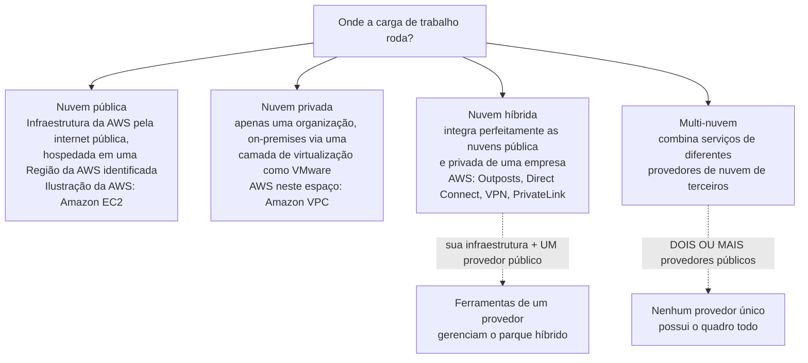
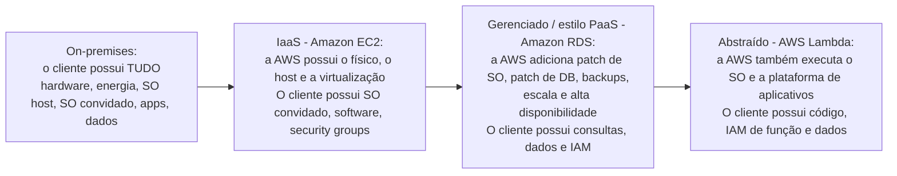
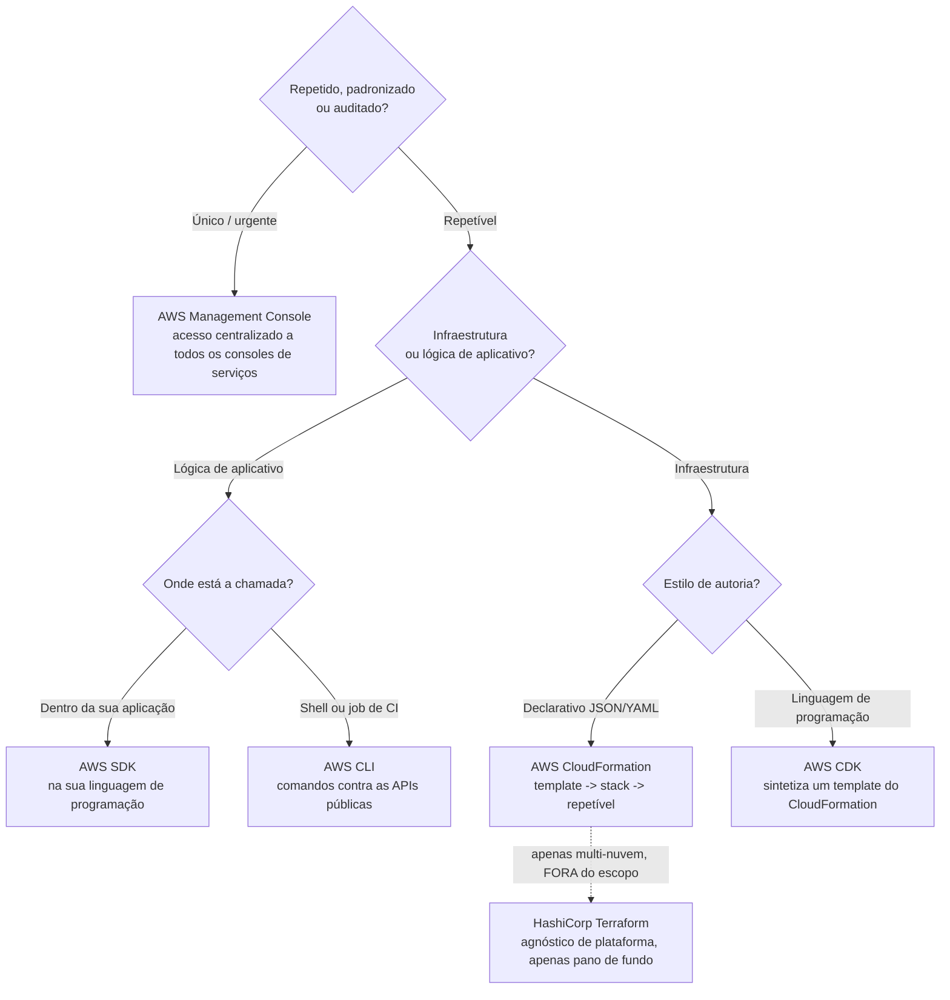
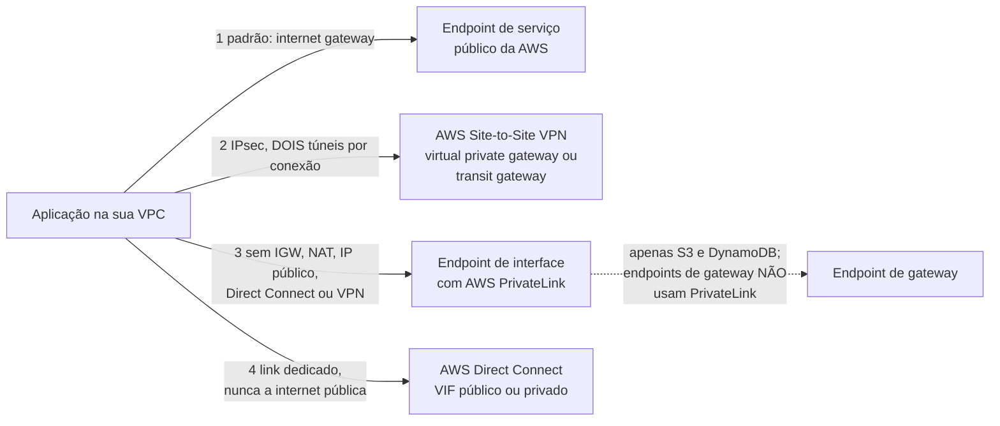
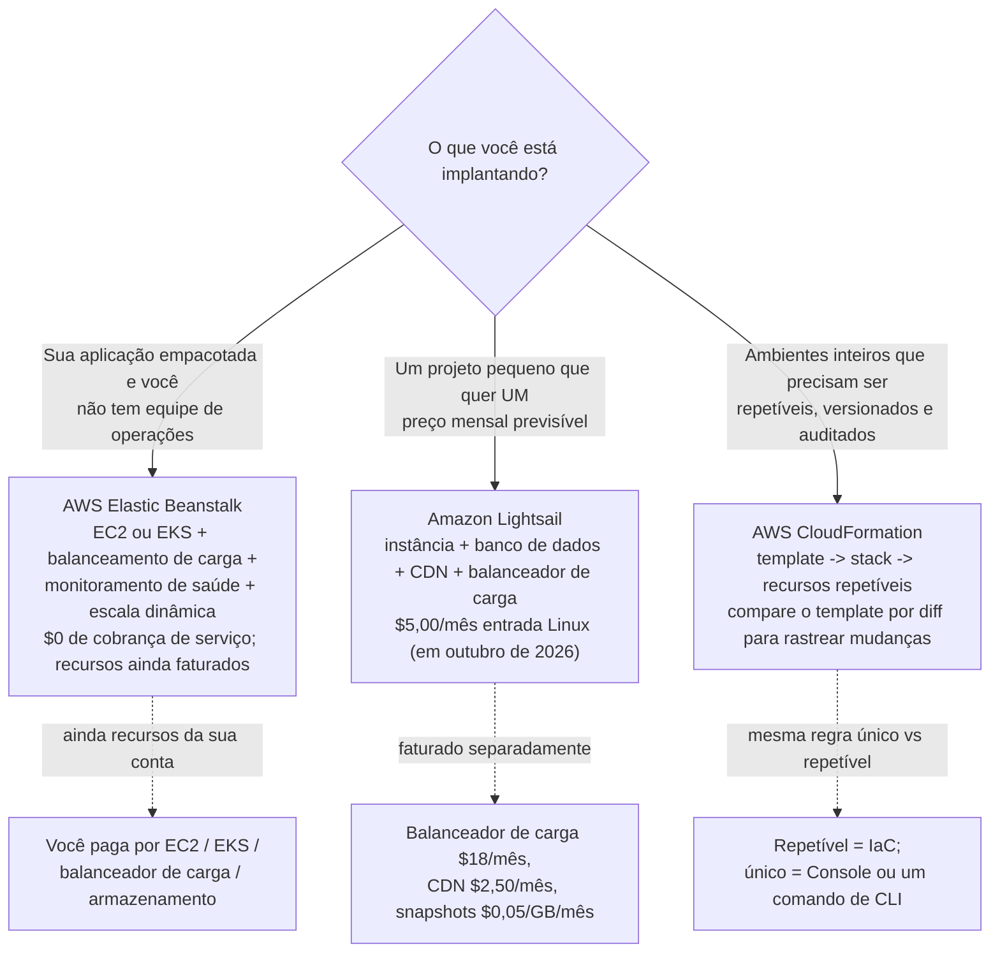

# Modelos de Implantação em Nuvem e Operação na AWS

Toda carga de trabalho precisa responder duas perguntas antes de ir ao ar: *onde ela roda?* e *como vamos operá-la de novo amanhã?* O exame chama isso de **Domínio 3, Tarefa 3.1, "Definir métodos de implantação e operação na AWS Cloud"**, e é a tarefa mais orientada a decisão do CLF-C02: a AWS testa explicitamente se você consegue **escolher** entre o Console, o acesso programático e a infraestrutura como código, se um trabalho é **único ou repetível**, e qual **modelo de implantação** corresponde a uma descrição. A armadilha é que a Tarefa 3.1 parece uma tarefa de programação e não é, "Implementação" está listada como tarefa de trabalho fora do escopo, então nunca lhe perguntam *como* escrever o script, apenas *qual* porta atravessar.

```text
====================================================================
 CLF-C02 DOMÍNIO 3 - TAREFA 3.1: DEFINIR MÉTODOS DE IMPLANTAÇÃO E
 OPERAÇÃO NA AWS CLOUD              (verificado contra o guia de
                                    exame, em outubro de 2026)
====================================================================
 CONHECIMENTO                    HABILIDADES (o que se pede a você)
 - diversas formas de provisionar - decidir entre acesso
   e operar na AWS Cloud            programático (APIs, SDKs, CLI),
 - diversas formas de acessar       o AWS Management Console e
   serviços da AWS                  infraestrutura como código (IaC)
 - tipos de modelos de             - avaliar se usar OPERAÇÕES
   implantação em nuvem               ÚNICAS ou PROCESSOS REPETÍVEIS
                                  - identificar modelos de implantação
                                    (nuvem, híbrido, on-premises)
---------------------------------------------------------------------
 NO ESCOPO PARA A 3.1
   Compute .... Elastic Beanstalk, Lightsail, Outposts
   Acesso ..... AWS CLI, AWS Management Console
   IaC/gov .... CloudFormation, Service Catalog, Systems Manager,
                Auto Scaling
   Rede ....... Direct Connect, PrivateLink, VPC, AWS VPN,
                Site-to-Site VPN, Client VPN, API Gateway
   Outros ..... Storage Gateway, Lambda
 NO ESCOPO, MAS EXAMINADO SOB A TAREFA 3.8
   AWS Amplify (web e aplicativos móveis de frontend), AWS IoT Core
 FORA DO ESCOPO (aparecem apenas como distratores)
   CloudShell, CodeDeploy, CodeArtifact, Application Composer,
   Device Farm, Wavelength, IoT Device Defender, IoT Greengrass,
   Monitron
 EM NENHUMA DAS LISTAS (material não examinável)
   AppSync, IoT Device Management, IoT Analytics, Snow Family,
   Terraform, Pulumi, SAM
====================================================================
```

> [!NOTE]
> **Dois vocabulários, uma tarefa.** A própria linha de habilidade do guia de exame diz *"Identificar modelos de implantação (por exemplo, nuvem, híbrido, on-premises)"*, enquanto as páginas "o que é" da AWS ensinam **público, privado, híbrido e multi-nuvem**. Ambos aparecem em material de estudo. A Seção 2 os reconcilia, porque uma pergunta pode ser redigida de qualquer forma e ambas têm uma resposta correta.

Nesta lição você vai:

- nomear os **quatro modelos de implantação** com as palavras da própria AWS e separar **híbrido de multi-nuvem**;
- mapear **IaaS, PaaS e SaaS** para exemplos da AWS e ler a **transferência de responsabilidade** que cada um aciona;
- escolher entre **Console, CLI, SDKs, APIs e IaC**, e aplicar a regra **único versus repetível**;
- distinguir **CloudFormation de CDK** (e saber por que Terraform é pano de fundo, não syllabus);
- escolher a **porta de conectividade** certa: internet, **Direct Connect**, **Site-to-Site VPN** ou um **endpoint de VPC / PrivateLink**;
- situar **Amplify, AppSync e IoT Core** onde o guia de exame realmente os testa;
- diferenciar **Elastic Beanstalk, Lightsail e CloudFormation** pelo trabalho que cada um faz;
- estudar **quatro estudos de caso publicados pela AWS** sobre Lightsail, operações repetíveis, velocidade de ambiente e migração;
- conferir o que **mudou em 2026** nas listas de escopo, nas ferramentas do console e onde você pode provisionar;
- praticar com **12 questões em formato de exame** mais cinco verificações interativas.

---

## 1. O que a Tarefa 3.1 realmente pede

### 1.1 A tarefa, dividida em conhecimento e habilidades

| Metade da tarefa | Redação exata do guia de exame | O que você precisa ser capaz de fazer |
|---|---|---|
| Conhecimento | *"Diversas formas de provisionar e operar na AWS Cloud"* | Reconhecer o conjunto de ferramentas: Console, CLI, SDKs, APIs, IaC e os serviços gerenciados de implantação |
| Conhecimento | *"Diversas formas de acessar serviços da AWS"* | Saber que todo serviço é alcançável por mais de uma porta |
| Conhecimento | *"Tipos de modelos de implantação de nuvem"* | Identificar público, privado, híbrido, multi-nuvem (e a redação nuvem / híbrido / on-premises do guia) |
| Habilidades | *"Decidir entre opções como acesso programático (por exemplo, APIs, SDKs, CLI), o AWS Management Console e infraestrutura como código (IaC)"* | Ler um cenário e escolher **um** método |
| Habilidades | *"Avaliar requisitos para determinar se devem ser usadas operações únicas ou processos repetíveis"* | Classificar a carga de trabalho e então escolher o método adequado |
| Habilidades | *"Identificar modelos de implantação (por exemplo, nuvem, híbrido, on-premises"* | Correlacionar uma descrição com o nome de um modelo |

### 1.2 A linha de escopo: uma decisão, não uma construção

O guia CLF-C02 lista **"Implementação"** entre as tarefas de trabalho fora do escopo. Essa única palavra remodela toda questão 3.1: uma opção que diz *"escrever um script Python que cria 40 subnets"* ou *"elaborar um template do CloudFormation com Lambda inline"* está descrevendo **implementação**, e implementação não é o que este exame mede. A opção correta é sempre a **seleção**: Console versus CLI versus SDK versus IaC, único versus repetível, público versus híbrido.

| Pergunta que o exame lhe faz | Pergunta que ele nunca lhe faz |
|---|---|
| Qual método de acesso se encaixa neste cenário? | Como eu escrevo o comando da CLI / a chamada de SDK? |
| Isso é único ou repetível? | Como eu estruturo o YAML? |
| Qual é o modelo de implantação disso? | Como eu configuro a camada de virtualização? |
| Qual serviço provisiona e gerencia isso? | Como eu ajusto a instância subjacente? |

- **📚 Você sabia?** A AWS publica uma regra de paridade que mata uma família inteira de distratores: toda função de administração, gerenciamento e acesso do IaaS disponível na **AWS Management Console** também está disponível na **AWS API e na AWS CLI** *"no lançamento ou dentro de 180 dias do lançamento."* Então a opção que começa com *"o Console é a única forma de…"* quase sempre está errada, o Console é simplesmente *"o método mais comum"*, não o exclusivo.

### 1.3 As três listas de serviços que você deve manter separadas

| Lista | Membros (guia de exame, out. 2026) | Como se comporta no dia do exame |
|---|---|---|
| **No escopo para a 3.1** | Elastic Beanstalk, Lightsail, Outposts, AWS CLI, Management Console, CloudFormation, Service Catalog, Systems Manager, Auto Scaling, Direct Connect, PrivateLink, VPC, AWS VPN, Site-to-Site VPN, Client VPN, API Gateway, Storage Gateway, Lambda | Uma resposta correta, geralmente pareada com um cenário |
| **No escopo para a 3.8** | **AWS Amplify** (web e aplicativos móveis de frontend), **AWS IoT Core** (IoT) | Respostas corretas, mas testadas sob a tarefa 3.8: conheça o *papel* deles |
| **Fora do escopo** | **AWS CloudShell**, CodeDeploy, CodeArtifact, Application Composer, Device Farm, **AWS Wavelength**, IoT Device Defender, IoT Greengrass, Monitron | Distratores plausíveis; a resposta é um serviço no escopo |
| **Em nenhuma das listas** | AppSync, IoT Device Management, IoT Analytics, Snow Family, Terraform, Pulumi, SAM | Conhecimento de pano de fundo; nunca ensine a si mesmo estes itens como fatos do syllabus |

> ⚠️ **O CloudShell é o distrator perfeito.** O AWS CloudShell é *"um shell baseado em navegador, pré-autenticado, que você pode iniciar diretamente a partir do AWS Management Console"*, com AWS CLI, EB CLI, ECS CLI e SAM pré-instalados (imagem Amazon Linux 2023). Ele soa ideal para "formas de acessar a AWS", e está **explicitamente fora do escopo** do CLF-C02. Se uma questão oferece CloudShell ao lado de Console, CLI, SDK e IaC, o CloudShell está ali para ser eliminado, não selecionado. O mesmo destino aguarda as opções de **Wavelength**, **IoT Greengrass** e **Snow Family**.

> [!NOTE]
> **"Fora do escopo" não significa "não existe".** Estes serviços são reais e amplamente usados; eles simplesmente não estão na lista deste exame. Guias de estudo mais antigos ainda listam CloudShell, CodeDeploy e Wavelength como respostas da 3.1, o guia de exame atual vence. E observe a diferença entre *fora do escopo* (listado, excluído) e *em nenhuma das listas* (nunca mencionado): apenas o primeiro é uma exclusão documentada.

### Atualizações de 2026 (em outubro de 2026)

> [!NOTE]
> **O que mudou depois que a maior parte do material de estudo foi escrita: cada fonte abaixo acessada em 2026-10.**
> - **As listas de serviços foram reconstruídas, a maior mudança de 2026 para a Tarefa 3.1.** As entradas no escopo foram de **128 → 111** e as fora do escopo de **11 → 55** entre o guia da época do lançamento `Version 1.0` e o atual (diff calculado em 2026-10). Nomes de provisionamento e conectividade como **AWS PrivateLink, AWS Transit Gateway, AWS Site-to-Site VPN, AWS Client VPN** e **Service Quotas** foram *adicionados* à lista no escopo, enquanto **AWS CloudShell, AWS CodeDeploy, AWS CodeArtifact, AWS Device Farm** e **AWS AppSync** migraram para a lista negativa explícita, e a categoria Developer Tools desabou de **11 para 4** entradas (AWS CLI, CodeBuild, CodePipeline, X-Ray). *Fonte: páginas "In-Scope AWS Services" e "Out-of-Scope AWS Services", acesso em 2026-10.*
> - **Computação de borda foi discretamente deslocada.** **AWS Wavelength** agora está explicitamente fora do escopo e **AWS Local Zones** aparece em **nenhuma** das listas, então um guia mais antigo que credita qualquer um deles como resposta da 3.1 está citando texto removido. *Fonte: guia de exame atual e ambas as listas de serviços, 2026-10.*
> - **O console se move mesmo quando o guia de exame não se move.** O **AWS Well-Architected Agent** entrou em prévia em **2026-10-01** como *"a evolução de próxima geração do AWS Trusted Advisor e do AWS Well-Architected Tool"*, mas o guia ainda nomeia **AWS Well-Architected Tool** e **Trusted Advisor**, então o novo agente é pano de fundo, não uma resposta do syllabus. *Fonte: AWS News Blog e notas de versão do Well-Architected, 2026-10-01.*
> - **Mais lugares para provisionar.** Quatro Regiões abriram durante 2025: Ásia Pacífico (Tailândia) **2025-01-07**, México (Central) **2025-01-14**, Ásia Pacífico (Taipei) **2025-06-06**, Ásia Pacífico (Nova Zelândia) **2025-09-02**, e o **AWS European Sovereign Cloud** (`eusc-de-east-1`) teve disponibilidade geral anunciada em **2026-01-14**. O mapa público lê **39 Regiões / 124 Zonas de Disponibilidade**, com mais 7 AZs e mais 2 Regiões (Arábia Saudita, Chile) anunciadas em outubro de 2026. *Fonte: histórico de documentação das Regiões e o mapa de Regiões/AZs, 2026-10: verifique o estado atual antes do uso.*
> - **O Free Tier mudou de forma para orçamentos de provisionamento.** Contas criadas **em ou após 2025-07-15** recebem **6 meses** de Free Tier (ou até os créditos acabarem) mais um **crédito de cadastro de 100 USD e até 100 USD acumulados = até 200 USD**; o tier de 12 meses baseado em `t2.micro` pertence a contas criadas antes dessa data, e `t2.micro` não está mais na nova lista de elegíveis. *Fonte: AWS News Blog 2025-07-15 e a tabela do Free Tier do Manual do Usuário do EC2 "antes e depois de 15 de julho de 2025", acesso em 2026-10: verifique o estado atual antes do uso.*

> [!WARNING]
> **Notícia não é syllabus.** Tudo na caixa acima é real, datado e com fonte, e nada disso se torna examinável só porque é recente. As próprias listas do guia são o árbitro: o **AWS Well-Architected Agent**, os **Database Savings Plans** e os novos nomes de planos **Business Support+ / Unified Operations** são genuinamente novos, mas apenas o que o guia de exame atual imprime ganha marca. Revise pelo guia que você baixa hoje, não pelo PDF que baixou em 2024.

---

## 2. Modelos de implantação: público, privado, híbrido e multi-nuvem

### 2.1 As quatro definições da AWS, com as palavras da própria AWS

| Modelo | Definição da AWS (com fonte, out. 2026) | Onde roda | Ilustração da AWS |
|---|---|---|---|
| **Nuvem pública** | *"infraestrutura e serviços pela internet pública … hospedados em uma Região da AWS identificada"* | Data centers do provedor, hardware subjacente compartilhado, cobrado conforme o uso | **Amazon EC2** |
| **Nuvem privada** | *"infraestrutura de nuvem para uso exclusivo de uma única organização … provisionada on-premises usando uma camada de virtualização (por exemplo, VMware)"* | Suas instalações, seu hardware, um único locatário | *"No espaço de nuvem privada, a AWS fornece a **Amazon VPC**"* |
| **Nuvem híbrida** | *"um design de infraestrutura de TI que integra perfeitamente as nuvens pública e privada de uma empresa"* | Ambos: seu parque mais uma nuvem pública, operados como um só | **AWS Outposts**, Direct Connect, Site-to-Site VPN, PrivateLink |
| **Multi-nuvem** | *"uma estratégia de nuvem que combina serviços de diferentes provedores de nuvem de terceiros"* | Dois ou mais provedores públicos | Sem ilustração da AWS: por definição não é uma história de provedor único |

O enquadramento híbrido da AWS vale memorizar: *"Nuvem híbrida com a AWS oferece uma experiência AWS consistente onde você precisa: da nuvem para on-premises e para a borda"*, e **AWS Outposts** é *"uma família de serviços totalmente gerenciados que entrega infraestrutura e serviços da AWS para praticamente qualquer local on-premises ou de borda, para uma experiência híbrida verdadeiramente consistente."*



### 2.2 Duas taxonomias, e a linha híbrido/multi-nuvem

O guia de exame diz **"nuvem, híbrido, on-premises"**. As páginas "o que é" da AWS dizem **público, privado, híbrido, multi-nuvem**. Elas se sobrepõem em vez de conflitar:

| Redação do guia | Redação mais próxima da página da AWS | Nota |
|---|---|---|
| **nuvem** (ou seja, rodando na nuvem pública) | **nuvem pública** | Mesma ideia: Regiões da AWS, infraestrutura compartilhada |
| **on-premises** | **nuvem privada** (quando virtualizada e parecida com nuvem) | Privada ≠ automaticamente só on-premises, mas a página de nuvem privada da AWS descreve virtualização on-premises |
| **híbrido** | **híbrido** | Idêntico nos dois vocabulários |

A distinção que o exame realmente protege é esta:

- **Híbrido** = *sua infraestrutura + uma nuvem pública*. A AWS diz que o gerenciamento híbrido *"pode ser feito usando serviços de um único provedor de nuvem."*
- **Multi-nuvem** = *serviços de dois ou mais provedores de nuvem de terceiros*. No momento em que um enunciado diz "AWS **e** outro provedor", você está em multi-nuvem, não em híbrido.

> [!WARNING]
> **A armadilha de duas palavras: "híbrido" versus "multi-nuvem".** Uma empresa que roda metade do seu parque no próprio data center e metade na AWS é **híbrida**, mesmo que isso seja complicado. Uma empresa que roda uma aplicação na AWS e outra em um diferente provedor público é **multi-nuvem**, mesmo que nada seja on-premises. *"Dois fornecedores"* ⇒ multi-nuvem; *"nosso data center mais a nuvem"* ⇒ híbrido. Lembre também que uma questão descrevendo **apenas** virtualização on-premises sem nuvem pública ligada é **nuvem privada**, não híbrida.

### 2.3 O kit híbrido da AWS que está no escopo

| Serviço | Papel no modelo híbrido | Nota de escopo |
|---|---|---|
| **AWS Outposts** | Infraestrutura, serviços, APIs e ferramentas da AWS estendidos para suas instalações, gerenciados *"como parte de uma Região da AWS"* | No escopo (3.1) |
| **AWS Direct Connect** | Conexão de rede dedicada entre sua rede on-premises e a AWS, *"contornando seu provedor de serviços de internet"* | No escopo (3.1) |
| **AWS Site-to-Site VPN** | Conexão IPsec segura de um data center ou escritório regional para a AWS | No escopo (3.1) |
| **AWS Client VPN** | Usuários remotos individuais | No escopo (3.1) |
| **AWS PrivateLink / endpoints de VPC** | Conectividade privada a serviços *"como se estivessem na sua VPC"* | No escopo (3.1) |
| **Amazon VPC** | Sua rede de nuvem logicamente isolada, o bloco de construção da nuvem privada | No escopo (3.1) |
| **AWS Storage Gateway** | Ponte de armazenamento híbrido entre armazenamento on-premises e em nuvem | No escopo (3.1) |
| **AWS Wavelength**, **Snow Family** | Computação de borda / transferência de dados offline | **Fora do escopo / não listado**: nunca uma resposta da 3.1 |

- **📚 Você sabia?** O Outposts é entregue como um **rack autossuficiente de 42U** que precisa de **10 to 30 kVA**, e como **servidores 1U/2U** (tamanhos e valores de potência em outubro de 2026: verifique o estado atual antes do uso). O que torna isso um fato de *modelo de implantação* e não um fato de hardware é que um Outpost é gerenciado *"como parte de uma Região da AWS"*, então a história híbrida permanece um único modelo operacional: mesmas APIs, mesmo console, mesma ferramenta, CEP diferente.

---

## 3. Modelos de serviço: IaaS, PaaS, SaaS, e a transferência de responsabilidade

### 3.1 Os três modelos de serviço

| Modelo | O que o provedor gerencia (redação da AWS) | O que você gerencia | Exemplo da AWS |
|---|---|---|---|
| **IaaS** | *"manter a infraestrutura física"*: computação, armazenamento e rede entregues *"em base pague-conforme-usa pela internet"* | Sistema operacional convidado, patches, runtime, software instalado, aplicação, dados, IAM, grupos de segurança | **Amazon EC2** |
| **PaaS** | *"a infraestrutura subjacente (geralmente hardware e sistemas operacionais)"*, então você *"foca na implantação e no gerenciamento das suas aplicações"* | Sua aplicação e seus dados | **AWS Elastic Beanstalk**, **Amazon Lightsail** |
| **SaaS** | A própria aplicação, entregue *"aos usuários finais por meio de um navegador da internet"* | Decisões de uso; seus próprios dados dentro do produto | A AWS não vende nenhum: *"Embora a AWS não ofereça serviços de SaaS, ela oferece muitas opções que você pode usar para construir aplicações e soluções personalizadas de SaaS de terceiros."* |



### 3.2 Exemplo E1: contando a transferência de responsabilidade

A documentação do RDS publica as mesmas nove linhas operacionais para três ambientes. Conte quem possui cada linha:

```text
LINHA (da matriz do manual do usuário do Amazon RDS)  On-prem   EC2   RDS
------------------------------------------------------  --------  ----  ----
1 Otimização da aplicação                              Cliente   Cli   Cli
2 Escala                                               Cliente   Cli   Cli
3 Alta disponibilidade                                 Cliente   Cli   Cli
4 Backups do banco de dados                            Cliente   Cli    AWS
5 Patch do software do banco de dados                  Cliente   Cli    AWS
6 Patch do sistema operacional (SO)                    Cliente   Cli    AWS
7 Manutenção do servidor                               Cliente    AWS   AWS
8 Ciclo de vida do hardware                            Cliente    AWS   AWS
9 Energia, rede e refrigeração                         Cliente    AWS   AWS
------------------------------------------------------  --------  ----  ----
Linhas possuídas pelo CLIENTE                             9       6      3
Linhas possuídas pela AWS                                 0       3      6
```

Seguem três leituras, e todas as três são examináveis:

1. **On-premises a contagem é 9 de 9**: você possui tudo, incluindo a energia do prédio.
2. **O EC2 move três linhas para a AWS** (manutenção de servidor, ciclo de vida de hardware, energia/refrigeração) mas deixa **seis** na sua coluna: é isso que "o IaaS exige que o cliente realize todas as tarefas necessárias de configuração e gerenciamento de segurança" significa na prática.
3. **O RDS inverte a maioria para a AWS (seis de nove)**: ainda assim *"Otimização da aplicação"* permanece **Cliente** em todas as colunas. **"A AWS gerencia o banco de dados" nunca significa "a AWS ajusta suas consultas."**

### 3.3 O invariante: segurança DA versus NA Nuvem

O modelo de responsabilidade compartilhada é a moldura por baixo de tudo isso: a AWS é responsável pela segurança **"DA" Nuvem**, o cliente é responsável pela segurança **"NA" Nuvem**. Para **serviços abstraídos** como Amazon S3 e Amazon DynamoDB, *"a AWS opera a camada de infraestrutura, o sistema operacional e as plataformas … Os clientes são responsáveis por gerenciar seus dados … e por usar as ferramentas do IAM."* Para o **AWS Lambda**, a AWS gerencia *"a infraestrutura subjacente e os serviços de base, o sistema operacional e a plataforma de aplicativos"*, enquanto você é dono *"da segurança do seu código e do AWS IAM para o serviço Lambda e dentro da sua função."*

```fillblank
{
  "question": "Complete as afirmações do modelo de responsabilidade compartilhada de que a Tarefa 3.1 depende:",
  "template": "A AWS é responsável pela segurança {{1}} nuvem, e o cliente é responsável pela segurança {{2}} nuvem. No Amazon EC2 (IaaS), o cliente ainda aplica patches no sistema operacional {{3}} e configura o firewall fornecido pela AWS chamado de grupo de {{4}}. No Amazon RDS, a AWS assume o patch do sistema operacional, o patch do banco de dados, backups, escala e alta disponibilidade, enquanto a otimização de {{5}} permanece com o cliente.",
  "answers": {
    "1": "da",
    "2": "na",
    "3": "convidado",
    "4": "segurança",
    "5": "aplicativo"
  },
  "distractors": ["em", "sob", "host", "rede", "plataforma", "banco de dados", "dados"],
  "explanation": "O modelo de responsabilidade compartilhada separa a segurança DA nuvem (AWS) da segurança NA nuvem (cliente). O EC2 é categorizado como IaaS, então o SO convidado e a configuração do firewall fornecido pela AWS chamado de grupo de segurança permanecem tarefas do cliente. A matriz do RDS mantém a otimização de aplicativo do lado do cliente em todo ambiente, enquanto a AWS assume patch de SO, patch de banco de dados, backups, escala e alta disponibilidade."
}
```

### 3.4 A nuance de patch que o exame testa sorrateiramente

Nem todos os serviços gerenciados lhe dão o mesmo grau de controle:

| Tipo de serviço | Quem aplica patch | O que você ainda faz (redação da AWS) |
|---|---|---|
| **Gerenciado de locatário único** (Amazon RDS, Amazon ElastiCache) | A AWS publica patches *"dentro do SLA de patch do serviço"* | *"facilitar o patch selecionando janelas de manutenção"* |
| **Abstraído de locatário múltiplo** (Amazon DynamoDB, Amazon S3) | A AWS aplica patches *"sem exigir ação do cliente"* | Nada sobre patch: você é dono de dados, criptografia, classificação e IAM |
| **IaaS (Amazon EC2)** | Você aplica patch no SO convidado | Tudo abaixo do hipervisor é da AWS; tudo acima é seu |

```dragdrop
{
  "question": "Ordene estes quatro ambientes do MAIOR para o MENOR grau de responsabilidade do cliente (a AWS assume mais a cada passo):",
  "items": [
    "Data center on-premises",
    "Amazon EC2 (IaaS)",
    "Amazon RDS (serviço de banco de dados gerenciado)",
    "AWS Lambda (serviço abstraído)"
  ],
  "correctOrder": [
    "Data center on-premises",
    "Amazon EC2 (IaaS)",
    "Amazon RDS (serviço de banco de dados gerenciado)",
    "AWS Lambda (serviço abstraído)"
  ],
  "explanation": "Cada passo move linhas da sua coluna para a da AWS: on-premises você possui as nove linhas operacionais; o EC2 move manutenção de servidor, ciclo de vida de hardware e energia/refrigeração para a AWS; o RDS também move patch de SO, patch de banco de dados, backups, escala e alta disponibilidade; o Lambda remove adicionalmente o sistema operacional e a plataforma de aplicativos. O que nunca se move é o seu código, seus dados, suas escolhas de IAM e a otimização de aplicativo."
}
```

> ⚠️ **"A AWS gerencia isso" não é "a AWS assume tudo".** Duas armadilhas vivem aqui. Primeiro, **o RDS não é delegação total**, otimização de aplicativo, suas consultas, seu schema e seus dados permanecem seus em toda coluna da matriz. Segundo, **SaaS não é um produto da AWS**: a AWS afirma que não oferece serviços de SaaS, ela oferece as ferramentas para *construir* SaaS de terceiros. Uma opção afirmando "WorkMail / QuickSight é a oferta de SaaS da AWS" não é suportada por nenhuma página da AWS nesta pesquisa, trate-a como errada.

---

## 4. Formas de acessar a AWS: Console, CLI, SDKs, APIs e IaC

### 4.1 As cinco portas (mais a que está fora do escopo)

| Método | Redação da AWS (com fonte) | Melhor encaixe em um enunciado |
|---|---|---|
| **AWS Management Console** | *"uma aplicação baseada em navegador que contém e fornece acesso centralizado a todos os consoles individuais de serviços da AWS"*; o IAM o chama de *"o método mais comum"* | Único, visual, exploratório, urgente, aprendizado |
| **AWS CLI** | *"uma ferramenta de código aberto que permite interagir com serviços da AWS usando comandos no seu shell de linha de comando"* | Trabalho de shell em script, repetível e jobs de CI |
| **AWS SDKs** | *"a AWS oferece Software Development Kits (SDKs) para várias linguagens de programação"*: chamadas emitidas de dentro da sua própria aplicação | O enunciado diz *da aplicação* ou *em código em tempo de execução* |
| **AWS APIs** | *"emitir solicitações HTTPS diretamente para o serviço"* (o exemplo da IAM Query API) | Ferramentas próprias, agnósticas de linguagem, qualquer cliente HTTPS |
| **Infraestrutura como Código** | *"provisionar e gerenciar a infraestrutura de uma aplicação por meio de um conjunto de arquivos de configuração"* | Repetível, versionada, infraestrutura multiambiente |
| ~~AWS CloudShell~~ | *"shell baseado em navegador, pré-autenticado"* | **Fora do escopo: um distrator** |

- **📚 Você sabia?** O Amazon S3 foi lançado em **14 de março de 2006** a **$0,15 por GB-mês**, com tamanho máximo de objeto de **5 GB** e cerca de **1 PB** de capacidade em aproximadamente 400 nós de armazenamento; a AWS agora diz que o preço está *"levemente acima de 2 centavos por gigabyte"*, uma **redução de cerca de 85%**, e que *"o código que você escreveu para o S3 em 2006 ainda funciona hoje, inalterado"* (AWS News Blog, 2026-03-13; preços em outubro de 2026, verifique o estado atual antes do uso). O ponto examinável é o de *operação*: **APIs estáveis são o que faz a automação repetível sobreviver**, a chamada de CLI ou a solicitação de SDK que você colocou em script anos ainda funciona, e é exatamente por isso que a AWS pareia "processos repetíveis" com acesso programático.

### 4.2 Operações únicas versus processos repetíveis

Esta é a frase mais testável da Tarefa 3.1. A habilidade é *"avaliar os requisitos para determinar se devem ser usadas operações únicas ou processos repetíveis"*, e a orientação de IaC da AWS fornece o raciocínio na outra metade:

| Sinal no enunciado | Classificação | Método que o exame quer |
|---|---|---|
| Exploratório, urgente, "só desta vez", "rapidamente no navegador" | **Único** | **AWS Management Console** (ou um único comando de CLI |
| A mesma mudança mensal, "em 20 contas", "todo novo ambiente", auditada, padronizada | **Repetível** | **Infraestrutura como código**: CloudFormation (ou CDK) |
| Chamadas de tempo de execução feitas por uma aplicação em execução | Nenhum dos dois: é lógica de aplicativo | **SDK** ou **API** |
| Um pipeline de shell/CI precisa criar infraestrutura sob demanda | Repetível, com forma de script | **CLI** para comandos únicos, **IaC** para infraestrutura |

Os próprios argumentos da AWS para a metade repetível, citados:

- a IaC torna *"novos ambientes repetíveis, confiáveis e consistentes"*;
- *"escreva seu código IaC uma vez e implante o mesmo código em centenas de ambientes em uma fração do tempo"*;
- *"A deriva de configuração ocorre quando a configuração que provisionou seu ambiente não corresponde mais ao ambiente real"*: a criação manual é *"sujeita a erros"*, e um template é um arquivo de texto, então você *"simplesmente rastreie as diferenças nos seus templates para rastrear mudanças na sua infraestrutura."*

**A regra operacional:** quando um ambiente derivou, **reaplique o template**. Editar manualmente o recurso vivo recria exatamente a deriva que você está tentando remover.

### 4.3 Exemplo E2: a aritmética das operações manuais

Suponha que 100 ambientes precisem cada um da mesma mudança, e que um humano leve 10 minutos por ambiente clicando pelo Console:

$$
T_{\text{manual}} = 100 \times 10 \text{ min} = 1{,}000 \text{ min} \approx 16.7 \text{ horas}
$$

16,7 horas de esforço humano não dirigido, com 100 chances de clicar na coisa errada, repetidas todo mês. A promessa de IaC da AWS é o contrafactual: *"escreva seu código IaC uma vez e implante o mesmo código em centenas de ambientes em uma fração do tempo."* O exame não pede que você prove isso: ele pede que você **reconheça a forma**: muitos ambientes + uma mudança padrão ⇒ **IaC**.

### 4.4 Exemplo E3: um template, quatro ambientes, aritmética da deriva

O padrão repetível canônico da documentação do CloudFormation da AWS é a *mesma stack de 12 recursos* implantada em desenvolvimento, staging, produção e uma segunda Região da AWS:

```text
Abordagem manual        12 recursos x 4 ambientes = 48 CRIAÇÕES de recurso
                        (48 chances separadas de mal configurar, 48 auditorias separadas)
Abordagem por template  1 arquivo de template x 4 lançamentos = 4 stacks, 48 recursos
                        o template é texto -> compare como código-fonte
Exemplo de deriva       se 3 dos 48 recursos vivos agora diferem do
                        template, isso é DERIVA DE CONFIGURAÇÃO; a correção é
                        reaplicar o template, não editar manualmente os 3 recursos
```

As conclusões examináveis: um template é **reutilizado**, **versionado** e **comparado por diff**; os recursos de uma stack são criados e configurados *para* você; e excluir a stack exclui os recursos que ela criou: razão pela qual a IaC é a resposta mais limpa para "limpar este ambiente".



### 4.5 O trio de IaC: CloudFormation, CDK e o terceiro nome na sala

| Ferramenta | O que é (redação da AWS) | Status no exame |
|---|---|---|
| **AWS CloudFormation** | *"Você cria um template que descreve todos os recursos da AWS que você deseja … e o CloudFormation cuida de provisionar e configurar esses recursos para você"*; reutilize-o *"de maneira consistente e repetível"* | **No escopo**: a resposta padrão de IaC |
| **AWS CDK** | *"um framework de desenvolvimento de software de código aberto para definir infraestrutura de nuvem em código e provisioná-la por meio do AWS CloudFormation"* | **No escopo**: a resposta "queremos uma linguagem de verdade" |
| HashiCorp Terraform | De terceiros, *"agnóstico de plataforma"* | **Em nenhuma das listas**: apenas pano de fundo |
| AWS SAM / Pulumi | Nomeados ao lado dos acima na comparação de ferramentas de IaC da AWS | **Em nenhuma das listas** |

A orientação prescritiva da AWS compara **cinco** ferramentas de IaC, CloudFormation, SAM, CDK, Terraform e Pulumi, e entrega a regra de seleção que você precisa: *"Se você gerencia sua infraestrutura inteiramente na AWS, então o AWS CloudFormation e o AWS Cloud Development Kit (AWS CDK) são boas opções"*, enquanto *"O Terraform pode ser uma boa escolha porque é agnóstico de plataforma."*

> [!WARNING]
> **O CDK não compete com o CloudFormation, o CDK produz CloudFormation.** O CDK é *"provisioná-la por meio do AWS CloudFormation"*, então uma questão que oferece "CloudFormation **ou** CDK" como motores de infraestrutura rivais errou o relacionamento: você autora em TypeScript, Python, Java, C#/.NET, JavaScript ou Go (seis linguagens, em outubro de 2026), e o CDK **sintetiza um template do CloudFormation** que o serviço então executa. E se um enunciado mencionar um parque **multi-nuvem**, o Terraform se torna a ferramenta *conceitualmente* correta, mas ele está ausente da lista no escopo deste exame, então não será a resposta creditada no CLF-C02.

- **📚 Você sabia?** Os templates do CloudFormation são arquivos de texto simples, razão pela qual a AWS diz que você pode *"simplesmente rastrear as diferenças nos seus templates para rastrear mudanças na sua infraestrutura."* Essa propriedade é a mesma que torna a deriva de configuração detectável: compare o template com a stack viva, encontre as edições manuais, reaplique. Infraestrutura que você não consegue comparar por diff é infraestrutura que você não consegue auditar.

```matching
{
  "question": "Associe cada cenário operacional ao método de acesso que o CLF-C02 espera:",
  "pairs": [
    {"left": "Uma mudança exploratória às 2 a.m. no navegador", "right": "AWS Management Console: acesso centralizado a todos os consoles individuais de serviços; o método mais comum"},
    {"left": "A mesma mudança todo mês em 20 contas da AWS", "right": "Infraestrutura como código: um template do CloudFormation reutilizado de maneira consistente e repetível"},
    {"left": "A aplicação em execução cria um bucket sozinha", "right": "AWS SDK: chamadas de serviço embutidas na sua própria linguagem de programação"},
    {"left": "Uma etapa de shell dentro de um pipeline de CI", "right": "AWS CLI: comandos emitidos no seu shell de linha de comando"},
    {"left": "Uma ferramenta própria emitindo solicitações HTTPS para um endpoint de serviço", "right": "AWS API: emitir solicitações HTTPS diretamente para o serviço"},
    {"left": "Um shell pré-autenticado iniciado a partir do navegador", "right": "AWS CloudShell: explicitamente FORA DO ESCOPO do CLF-C02, então é o distrator"}
  ],
  "explanation": "A habilidade do guia de exame é decidir entre acesso programático (APIs, SDKs, CLI), o AWS Management Console e IaC, e então classificar o trabalho como único ou repetível. O Console serve para trabalho visual único, a IaC serve para mudança padronizada repetida, o SDK serve para chamadas dentro da aplicação, a CLI serve para trabalho de shell em script, as APIs servem para ferramentas próprias, e o CloudShell, embora real e conveniente, está na lista fora do escopo então nunca ganha a marca."
}
```

---

## 5. Conectividade: as quatro portas para dentro e para fora de uma VPC

### 5.1 A visão geral (apenas serviços no escopo)

| Porta | Mecanismo | Números (em outubro de 2026; verifique o estado atual antes do uso) | Encaixe no exame |
|---|---|---|---|
| **1. Internet pública** | O **internet gateway** da sua VPC roteia tráfego para endpoints públicos de serviços da AWS | Configuração padrão, menor custo de setup | Acesso público geral; não privado |
| **2. AWS Direct Connect** | Uma conexão de rede dedicada que *"contorna seu provedor de serviços de internet"*, *"seu tráfego de rede permanece na rede global da AWS e nunca toca a internet pública"* | Portas dedicadas **1, 10, 100, 400 Gbps**; conexões hospedadas **50 Mbps, 25 Gbps**; SLA de Alta Resiliência **99,9%**, SLA de Máxima Resiliência **99,99%** | Thruput privada, estável e previsível |
| **3. AWS Site-to-Site VPN** | Uma conexão segura totalmente gerenciada usando túneis **IP Security (IPSec)** | **Dois túneis por conexão** para redundância; **1,25 Gbps** por túnel no padrão, **até 5 Gbps** com Large Bandwidth Tunnel | Link privado rápido, barato, sobre internet |
| **4. Endpoints de VPC** | **Endpoints de interface com AWS PrivateLink** ou **endpoints de gateway** | PrivateLink precisa de *"nenhum internet gateway, dispositivo NAT, endereço IP público, conexão Direct Connect ou conexão AWS Site-to-Site VPN"*; endpoints de gateway cobrem **apenas Amazon S3 e Amazon DynamoDB** e *"não usam o AWS PrivateLink"* | Acesso privado a serviços da AWS sem sair da VPC |
| **Indivíduos remotos** | **AWS Client VPN** | Conectividade por usuário | Pessoas, não sites |

> [!NOTE]
> **Um conflito que esta pesquisa não conseguiu resolver: trate como não verificado.** Uma página de visão geral da AWS anuncia velocidades do Direct Connect *"partindo de 50 Mbps e escalando até 100 Gbps"*, enquanto o Manual do Usuário do Direct Connect lista portas dedicadas de **1, 10, 100 e 400 Gbps** e conexões hospedadas de **50 Mbps a 25 Gbps**. Estas duas páginas da AWS discordam. Esta lição cita os valores do **Manual do Usuário** e os carimba **em outubro de 2026**; verifique novamente nas páginas de preços e de opções de conexão antes de confiar em qualquer número de largura de banda.



### 5.2 Exemplo E4: dois túneis, quatro números

O AWS Site-to-Site VPN inclui **dois túneis por conexão**, e cada túnel tem um teto de largura de banda:

```text
Túneis padrão         2 túneis x 1,25 Gbps = teto agregado de 2,5 Gbps
Large Bandwidth Tunnels 2 túneis x 5 Gbps   = teto agregado de 10   Gbps
Razão                 10 / 2,5 = 4x a largura de banda anunciada
```

Duas observações que o exame recompensa. Primeiro, os **dois túneis existem para alta disponibilidade**, não primariamente para velocidade, a AWS diz que *"Cada conexão VPN inclui dois túneis VPN que você pode usar simultaneamente para alta disponibilidade."* Segundo, a largura de banda é um **teto por túnel**, então um enunciado que diz "uma conexão Site-to-Site VPN entrega 1,25 Gbps no total" está errado por um fator de dois. Todos os valores **em outubro de 2026, verifique o estado atual antes do uso**.

### 5.3 Exemplo E5: quanto um SLA de resiliência custa em minutos

O Direct Connect publica dois designs de resiliência. Converta as porcentagens em orçamentos de downtime ao longo de um ano de 365 dias ($8{,}760$ horas):

$$
8{,}760 \times (1 - 0.999) = 8.76 \text{ horas por ano}
$$

$$
8{,}760 \times (1 - 0.9999) = 0.876 \text{ horas} \approx 52.6 \text{ minutos por ano}
$$

| Design de resiliência | SLA publicado | Orçamento anual de downtime | Leitura aproximada |
|---|---|---|---|
| Alta Resiliência | **99,9%** | **8,76 horas** | Cerca de um dia de trabalho por ano |
| Máxima Resiliência | **99,99%** | **52,6 minutos** | Cerca de uma pausa para café por ano |

O exame não pede esta aritmética: ele pede que você **case o requisito com o design**: "thruput privada estável com a disponibilidade publicada mais apertada" ⇒ Direct Connect com Máxima Resiliência; "precisamos de um link privado esta tarde" ⇒ Site-to-Site VPN. Valores de SLA **em outubro de 2026**.

### 5.4 Exemplo E6: escolhendo a porta do Direct Connect

Uma filial precisa de **400 Mbps**; o data center central precisa de **100 Gbps**:

```text
Filial            400 Mbps  -> faixa de conexão hospedada é 50 Mbps - 25 Gbps  => porta HOSTED serve
Data center       100 Gbps  -> opções de porta dedicada são 1, 10, 100, 400 Gbps => porta DEDICATED serve
```

Regra prática da página de opções de conexão: **conexões hospedadas** escalam de **50 Mbps a 25 Gbps** (entregues por meio de parceiros do AWS Direct Connect), enquanto **conexões dedicadas** são de **1, 10, 100 ou 400 Gbps**. Um enunciado citando **50 Mbps** é um sinal de porta hospedada; um enunciado citando **100 Gbps** é um sinal de porta dedicada. Valores **em outubro de 2026: verifique o estado atual antes do uso**.

### 5.5 PrivateLink e endpoints de gateway, com precisão

| Pergunta no enunciado | Porta correta | Por que os distratores falham |
|---|---|---|
| "…com **nenhum** internet gateway, dispositivo NAT, IP público, Direct Connect ou VPN" | **Endpoint de interface com PrivateLink** | O enunciado cita literalmente as condições de "quando usar" do PrivateLink |
| "…acesso privado **apenas ao Amazon S3 ou DynamoDB**" | **Endpoint de gateway** | Endpoints de gateway são S3 + DynamoDB apenas, e *"não usam o AWS PrivateLink"* |
| "…funcionários remotos individuais conectando" | **AWS Client VPN** | Client VPN é por usuário; Site-to-Site VPN é por site |
| "…o serviço precisa ser alcançável *como se estivesse na minha VPC*" | **PrivateLink** | Essa é a própria definição de PrivateLink da AWS |

- **📚 Você sabia?** Os endpoints de VPC vêm em duas famílias e o exame testa a exceção: **endpoints de gateway** (Amazon S3, Amazon DynamoDB) **não usam o AWS PrivateLink**, enquanto **endpoints de interface** são o tipo com tecnologia PrivateLink. Então a afirmação *"todos os endpoints de VPC são com tecnologia PrivateLink"* é falsa: um contra-exemplo, direto da documentação de VPC da AWS, é suficiente para derrubá-la.

```matching
{
  "question": "Associe cada requisito de conectividade à opção da AWS no escopo:",
  "pairs": [
    {"left": "Thruput privada estável do data center que nunca toca a internet pública", "right": "AWS Direct Connect: uma conexão dedicada contornando seu provedor de serviços de internet"},
    {"left": "Uma conexão privada rápida e de baixo custo estabelecida com túneis IPsec", "right": "AWS Site-to-Site VPN: dois túneis por conexão para redundância"},
    {"left": "Acesso privado a um serviço sem internet gateway, dispositivo NAT, IP público, Direct Connect ou VPN", "right": "Endpoint de interface com AWS PrivateLink"},
    {"left": "Acesso privado apenas ao Amazon S3 ou Amazon DynamoDB", "right": "Endpoint de gateway: cobre S3 e DynamoDB e não usa o AWS PrivateLink"},
    {"left": "Conectividade para funcionários remotos individuais", "right": "AWS Client VPN"},
    {"left": "Uma ponte de armazenamento híbrida entre o data center e o armazenamento em nuvem", "right": "AWS Storage Gateway"}
  ],
  "explanation": "Cada par mapeia uma condição citada da AWS ao serviço que a possui: Direct Connect é o link dedicado cujo tráfego nunca toca a internet pública, Site-to-Site VPN é a opção IPsec com dois túneis, PrivateLink é a porta sem IGW/NAT/IP público/DX/VPN, endpoints de gateway são apenas S3 e DynamoDB, Client VPN atende pessoas em vez de sites, e Storage Gateway é a ponte de armazenamento híbrido no escopo."
}
```

---

## 6. Frontend, móveis e IoT: o que a tarefa 3.8 acrescenta

A Tarefa 3.1 é sobre *provisionar e operar*; o guia de exame testa frontend/móveis e IoT sob a **Tarefa 3.8: "Identificar serviços de outras categorias de serviços da AWS no escopo."** Ambas as habilidades são de nomeação: *"Identificar os serviços que podem criar e implantar serviços de frontend e móveis"* e *"Identificar os serviços que gerenciam dispositivos IoT."*

### 6.1 AWS Amplify: a resposta de frontend e móveis

| Atributo | Redação da AWS (com fonte) |
|---|---|
| Categoria no guia de exame | **Frontend Web and Mobile**, o único serviço nomeado nessa categoria |
| Modelo de hospedagem | *"Amplify Hosting fornece um fluxo de trabalho baseado em Git para hospedar aplicações web full-stack serverless com implantação contínua"* |
| Entrega | *"O Amplify implanta seu aplicativo para o CDN global de entrega de conteúdo (CDN) da AWS"* |
| Comportamento de release | *"Implantações atômicas eliminam janelas de manutenção"* |
| Encaixe no exame | O enunciado diz *frontend / móveis / aplicativo web / baseado em Git / implantação contínua* |

A palavra **"atômica"** é a dica: como um novo deploy substitui o antigo como uma unidade, um release falhado não deixa um site meio atualizado, razão pela qual a AWS diz que janelas de manutenção desaparecem. Amplify é, portanto, também uma história de **operação**, releases repetíveis acionados por Git em vez de uploads manuais.

### 6.2 AppSync: uma ressalva de nomenclatura

**Amazon AppSync** aparece em **nenhuma** das listas, no escopo ou fora do escopo, no guia de exame atual do CLF-C02. Trate-o como **vocabulário de pano de fundo apenas**: não é material examinável, então não o memorize como "a resposta de GraphQL deste exame" e não espere que ele seja creditado. O serviço de frontend/móveis creditado no guia é **AWS Amplify**.

### 6.3 AWS IoT Core: a resposta de IoT

| Atributo | Redação / fato da AWS (com fonte) |
|---|---|
| Papel | *"AWS IoT fornece os serviços de nuvem que conectam seus dispositivos IoT a outros dispositivos e a serviços de nuvem da AWS"* |
| Categoria no guia de exame | **Internet of Things (IoT)**: AWS IoT Core é o único serviço nomeado |
| Protocolos suportados | **MQTT**, **MQTT sobre WSS**, **HTTPS**, **LoRaWAN** |
| Encaixe no exame | *Device gateway / conectar dispositivos aos serviços da AWS* |
| Fora do escopo (distratores) | **AWS IoT Device Defender**, **AWS IoT Greengrass**, **Amazon Monitron** |
| Em nenhuma das listas | AWS IoT Device Management, AWS IoT Analytics: status no exame desconhecido; nunca ensine como syllabus |

> ⚠️ **Duas armadilhas de IoT.** Primeiro, **IoT Device Defender e IoT Greengrass estão fora do escopo**, uma questão descrevendo execução de Lambda no dispositivo ou monitoramento de comportamento de segurança está atraindo você para serviços que não estão na lista; a resposta no escopo é **AWS IoT Core**. Segundo, **IoT Device Management e IoT Analytics aparecem em nenhuma das listas**, então não são nem respostas nem exclusões documentadas, se você os vir, trate a questão como um teste de saber o que *está* listado.

---

## 7. Elastic Beanstalk, Lightsail e CloudFormation: três papéis distintos

### 7.1 AWS Elastic Beanstalk: implantação estilo PaaS do seu código

| Atributo | Redação / fato da AWS (com fonte) |
|---|---|
| O que faz | *"provisiona instâncias Amazon EC2 ou clusters EKS, configura balanceamento de carga, configura monitoramento de saúde e escala dinamicamente o seu ambiente"* |
| O que você entrega a ele | Uma versão de aplicação que *"aponta para um objeto do Amazon Simple Storage Service (Amazon S3) que contém o código implantável"* |
| Cobrança | *"Não há cobrança adicional pelo Elastic Beanstalk. Você paga apenas pelos recursos subjacentes da AWS que sua aplicação consome"* (**em outubro de 2026**) |
| Modelo de serviço | **Estilo PaaS**: a AWS executa a infraestrutura e a plataforma, você executa a aplicação |
| O que não é | Não é serverless; não é gratuito; não é uma ferramenta de IaC |

A armadilha tripartite em uma linha: **$0 de cobrança de serviço ≠ $0 na fatura**, porque as instâncias EC2, o balanceador de carga e o armazenamento que ele cria são faturados na sua conta; **Beanstalk não é serverless**, porque ele provisiona EC2 ou EKS; e **Beanstalk não é IaC**, porque você está lhe entregando código, não um template de infraestrutura reutilizável.

### 7.2 Amazon Lightsail, o ponto de entrada de preço previsível

| Atributo | Redação / fato da AWS (com fonte, **em outubro de 2026: verifique o estado atual antes do uso**) |
|---|---|
| Posicionamento | *"a maneira mais fácil de começar com a AWS … a um preço mensal baixo e previsível"* |
| Encaixe | *"melhor adequado a projetos que requerem algumas dezenas de instâncias ou menos"* |
| Plano de entrada tipo Linux | **$0,0067 USD/hora = $5 USD/mês** |
| Plano de entrada Windows | **$0,0127 USD/hora = $9,50 USD/mês** |
| Add-ons | Balanceador de carga **$18/mês**; CDN **$2,50/mês** (faixa de 50 GB, depois **$10**, depois **$35**); snapshots **$0,05/GB/mês** |
| Modelo de serviço | **Pacote estilo PaaS**: instância, banco de dados, CDN e balanceador de carga sob um único preço |

### 7.3 Exemplo E7, o bundle do Lightsail, precificado de duas formas

**Aritmética do bundle:**

```text
Instância Linux do Lightsail ....... $5,00 / mês
+ add-on de CDN do Lightsail ....... $2,50 / mês (faixa de 50 GB)
                                    ----------
Total do bundle .................... $7,50 / mês  antes de excessos de transferência
```

**Hora versus teto mensal.** O Lightsail cobra por hora mas limita a cobrança ao preço mensal. Um mês cheio tem $750$ horas:

$$
0.0067 \times 750 = 5.025 \text{ USD} \longrightarrow \text{limitado a } 5.00 \text{ USD}
$$

Um mês parcial de $200$ horas: $0.0067 \times 200 \approx$ **$1,34$**. Então o preço mensal é um **teto, não um piso**: você paga pelo que roda até o limite. Todos os valores **em outubro de 2026**; tamanhos, faixas e preços mudam, então verifique o estado atual antes do uso.

### 7.4 Exemplo E8: Elastic Beanstalk custa $0 para executar *como serviço*

O Elastic Beanstalk cobra **$0** por si mesmo. A fatura vem do que ele cria. Para ilustração (valores didáticos, **não** preços de lista da AWS: verifique o estado atual antes do uso):

```text
Cenário: um pequeno ambiente web deixado rodando por um mês
  Cobrança de serviço do Elastic Beanstalk ........... $0,00
  Recursos subjacentes que ele provisiona (EC2 +
    balanceador de carga + armazenamento) ............ faturados na sua conta
Contraste com uma construção manual:
  mesmo ambiente, construído à mão no Console ........ mesma fatura de recursos
  mais esforço de configuração, sem monitoramento de
    saúde, sem escala dinâmica, sem versionamento de ambiente
Conclusão: Beanstalk compra OPERAÇÃO, não um desconto.
```

A frase examinável: **o Elastic Beanstalk remove o trabalho operacional, não o custo dos recursos.**



### 7.5 A decisão dos três em um

| Sinal no enunciado | Serviço correto | Por que os outros falham |
|---|---|---|
| "Envie meu código; provisione, balanceie, monitore e escale; sem cobrança pelo serviço" | **Elastic Beanstalk** | Lightsail é um bundle de preço fixo, não um pipeline de envio de código; CloudFormation é infraestrutura, não uma plataforma de aplicativo |
| "Algumas dezenas de instâncias ou menos a um preço mensal previsível" | **Amazon Lightsail** | Elastic Beanstalk cobra por recurso subjacente; EC2 carece da simplicidade do bundle |
| "A mesma mudança em muitas contas/ambientes, versionada e auditável" | **AWS CloudFormation** | Beanstalk e Lightsail implantam *um* ambiente; nenhum lhe dá um template comparável por diff para *todos* eles |
| "Computação e armazenamento da AWS dentro do meu próprio prédio, mesmas APIs" | **AWS Outposts** | Os três acima rodam em Regiões da AWS, não no seu site |

- **📚 Você sabia?** A versão de aplicação do Elastic Beanstalk é armazenada como *"um objeto do Amazon Simple Storage Service (Amazon S3) que contém o código implantável"*, então "onde o Beanstalk guarda meu código?" tem resposta de uma palavra: **S3**. Isso também explica o versionamento estilo blue/green: você promove um objeto S3 diferente como versão atual, e a configuração do ambiente continua descritível como dados em vez de cliques.

---

## Casos Reais

A AWS publica como essas escolhas aparecem em produção. Todo valor abaixo é **afirmação do cliente ou da AWS, não auditado**, com a fonte nomeada para que você possa conferir, o ponto examinável é o **padrão** (qual modelo de implantação, qual método de acesso, qual hábito de operação), não o número de marketing.

### Caso A, Gourmeat: Lightsail como pequeno ponto de entrada previsível

| Elemento | Detalhe |
|---|---|
| **Setor / contexto** | Boutique de carne operando no Uruguai e nos EUA; estoque rastreado em Excel sem acesso simultâneo para a equipe |
| **Padrão de implantação / operação** | **Entrada estilo PaaS**: um ambiente pequeno e de preço previsível em vez de rede de EC2 montada à mão, o encaixe *"algumas dezenas de instâncias ou menos"* da página do Lightsail |
| **Serviços AWS nomeados** | **Amazon Lightsail**, com o AWS Partner Nub8 |
| **Resultados principais (publicados pela AWS, afirmados pelo cliente)** | Relatórios de estoque e criação de relatórios caíram de **~4 horas por semana para menos de 20 minutos**; **produtividade mais de 40% maior**; ambientes de teste e produção entregues em **6 semanas** (estudo de caso datado de outubro de 2020) |
| **Fonte** | aws.amazon.com/solutions/case-studies/gourmeat-lightsail (acesso em outubro de 2026) |

*Lição de exame:* esta é a resposta **Lightsail** em forma humana, o valor alegado é **operacional** (horas de relatório manual removidas, uma fatura mensal previsível), não um benchmark bruto de computação. A questão de exame construída a partir deste padrão pergunta *"equipe pequena, poucas instâncias, quer um preço mensal previsível"*, e Lightsail é a opção para alcançar, com Elastic Beanstalk como quase-resposta (também de baixa operação, mas precificado por recurso subjacente em vez de empacotado).

### Caso B, athenahealth: operações repetíveis em 120 contas

| Elemento | Detalhe |
|---|---|
| **Setor / contexto** | Software de saúde (sensível ao HIPAA); monitoramento de egress em um vasto parque de VPCs, custo de inspeção em alta, uma equipe de oito |
| **Padrão de implantação / operação** | **Processos repetíveis** em produção: um design centralizado, expresso como código e compartilhado por política, em vez de cliques por conta |
| **Serviços AWS nomeados** | **AWS Network Firewall** (centralizado), **AWS Transit Gateway**, **AWS RAM** (distribuição por política), regras como código do **AWS CloudFormation**, **AWS Direct Connect**; AWS Shield no roadmap |
| **Resultados principais (publicados pela AWS, afirmados pelo cliente)** | Custos gerais de inspeção **reduzidos em 95%**; centenas de VPCs em **120 contas** implantadas *"em apenas alguns dias"*; **oito pessoas** projetaram e implantaram o novo design de segurança sem interrupções |
| **Voz do cliente** | *"Por escalável, eu quero dizer que é magia da AWS. Não precisamos pensar em escalabilidade alguma."*: Aaron Baer, membro principal do pessoal técnico |
| **Fonte** | aws.amazon.com/solutions/case-studies/athenahealth-case-study (acesso em outubro de 2026) |

*Lição de exame:* esta é a linha de *"processos repetíveis"* da Tarefa 3.1 com números anexados. **Regras como código no CloudFormation** é o mecanismo, **AWS RAM** é o método de distribuição, e **Direct Connect** é a porta de conectividade. Oito pessoas não poderiam configurar à mão centenas de VPCs em 120 contas em poucos dias: a aritmética só fecha quando a mudança é escrita uma vez e aplicada muitas vezes, que é exatamente o argumento de IaC da Seção 4.

### Caso C, Capital One: ambientes de desenvolvimento de meses para minutos

| Elemento | Detalhe |
|---|---|
| **Setor / contexto** | Banco Fortune 100 (regulado); oito data centers on-premises para sair, ciclos de renovação de hardware para escapar, e uma decisão de construir versus comprar |
| **Padrão de implantação / operação** | **Nuvem pública, "all in"**, com **provisionamento repetível**: ambientes produzidos da mesma forma sob demanda em vez de enfileirados e construídos à mão um de cada vez |
| **Serviços AWS nomeados** | 30+ incluindo **Amazon EC2, Amazon S3, Amazon RDS, AWS Lambda, AWS ECS / AWS Fargate, AWS Step Functions, AWS Glue** |
| **Resultados principais (publicados pela AWS, afirmados pelo cliente)** | Saiu de **8** data centers; **80%** de quase **2.000** aplicações construídas na nuvem do zero; tempo médio para construir um **ambiente de desenvolvimento cortado de 3 meses para minutos**; tempo de teste de recuperação de desastres **−70%**; resolução de incidentes e erros de transação **−50%**; **103 toneladas** de cobre e aço reciclados |
| **Voz do cliente** | *"Ir 'all in' na nuvem permitiu tanto o provisionamento instantâneo de infraestrutura quanto a inovação rápida."*: Chris Nims, SVP de engenharia de nuvem e produtividade |
| **Fonte** | aws.amazon.com/solutions/case-studies/capital-one-all-in-on-aws (acesso em outubro de 2026) |

*Lição de exame:* **"de 3 meses para minutos" é a regra de uma vez versus repetível com um relógio anexado.** Um prazo de três meses é o que um ambiente *montado à mão, uma única vez* custa quando cada pedido é sob medida; "minutos" é o que o mesmo ambiente custa quando a construção é um processo repetível que você reexecuta sob demanda. A leitura do modelo de implantação é igualmente limpa: um parque com **zero** de restinho on-premises é a ilustração de **nuvem pública** em escala empresarial: híbrido exigiria os data centers continuando ali, e multi-nuvem exigiria um segundo provedor público. E a aritmética por baixo é a da Seção 4: 90 dias de prazo removidos *por ambiente* se acumulam em uma organização de engenharia de 11.000 pessoas.

- **📚 Você sabia?** O estudo de caso da Capital One afirma que o banco *"saiu de oito data centers on-premises"* e *"construiu 80% das quase 2.000 aplicações que agora roda na nuvem do zero"* (estudo de caso da AWS, acesso em outubro de 2026). O indicador do modelo de implantação é a expressão **"all in"**: nada fica rodando on-premises, então o modelo de implantação é **nuvem pública**, não híbrido: um setor regulado escolhendo nuvem pública não transforma a resposta em "privada" ou "híbrida" no dia do exame.

### Caso D, Bangkok Flight Services: uma migração repetível com operações multi-AZ

| Elemento | Detalhe |
|---|---|
| **Setor / contexto** | Manipulador de carga aérea em Bangkok; hardware envelhecendo, **sem site de recuperação de desastres**, volume de passageiros crescente |
| **Padrão de implantação / operação** | **Um padrão aplicado muitas vezes**: um rehost uniforme em todo o parque, depois um **modelo de operação multi-AZ** permanente para recuperação e monitoramento |
| **Serviços AWS nomeados** | **AWS Application Migration Service (MGN)**, **Amazon EC2**, **Amazon S3**, **AWS CloudTrail**, **AWS CloudWatch**, recuperação de desastres multi-AZ, AWS Partner DailiTech |
| **Resultados principais (publicados pela AWS, afirmados pelo cliente)** | Migração concluída em **7 meses** com **sem rollback e sem interrupção**; **tempo de gerenciamento da infraestrutura de TI reduzido em 50%**; recuperação de desastres em **múltiplas Zonas de Disponibilidade**; cerca de **1 hora por ano** de indisponibilidade não planejada eliminada |
| **Fonte** | aws.amazon.com/solutions/case-studies/bangkok-flight-services (acesso em outubro de 2026) |

*Lição de exame:* dois padrões se encontram aqui. A **migração em si é um processo repetível**, um único método de rehost, aplicado em todo o parque, terminado em sete meses sem rollback, o oposto de uma série de eventos heroicos de uma única vez. **As operações depois dela também são repetíveis**: CloudWatch e CloudTrail fornecem a observação, e a Zona de Disponibilidade é a unidade de isolamento de falhas dentro da qual o design de recuperação opera (uma AZ protege contra falha de nível de data center dentro de uma Região; uma segunda Região é o que protege contra falha de nível de Região). **Ressalva de escopo vale memorizar:** o AWS Application Migration Service aparece neste estudo de caso, mas um estudo de caso nunca torna um serviço examinável, apenas a lista no escopo do guia de exame atual faz isso. Confira a lista, não a história.

### O que os dois casos iniciais compartilham

| Padrão de valor | Evidência nestes casos | Princípio subjacente da Tarefa 3.1 |
|---|---|---|
| Esforço manual removido | Gourmeat: **4 h/semana → menos de 20 min** | Escolha o modelo de operação mais simples que caiba na escala |
| Escala com uma equipe minúscula | athenahealth: **8 pessoas, 120 contas, centenas de VPCs** | Processos repetíveis vencem headcount |
| Custo unitário menor | athenahealth: custos de inspeção **−95%** | Centralize o design, depois distribua como código |
| Tempo até o ambiente colapsado | Gourmeat: teste + produção em **6 semanas** | Entrada gerenciada/estilo PaaS remove o trabalho de construção |
| Previsibilidade valorizada | Gourmeat: preço empacotado do Lightsail | Combine a forma do preço com a forma do workload |

### O que os casos C e D acrescentam

| Padrão de valor | Evidência nestes casos | Princípio subjacente da Tarefa 3.1 |
|---|---|---|
| O prazo de espera, não só a mão de obra, colapsa | Capital One: ambiente de desenvolvimento **3 meses → minutos** | Um processo repetível remove o tempo de fila além do esforço |
| A sobrecarga de operação cai pela metade e permanece assim | Bangkok Flight Services: tempo de gerenciamento de infraestrutura de TI **−50%** | Operações gerenciadas se acumulam mês após mês |
| Resiliência é projetada, não acrescentada depois | Bangkok Flight Services: DR em **múltiplas Zonas de Disponibilidade** | Uma Zona de Disponibilidade é a unidade de isolamento de falhas na qual você opera |
| Migração é um programa, não um evento | Bangkok Flight Services: **7 meses, sem rollback** | Um método aplicado muitas vezes = processo repetível |

```matching
{
  "question": "Relacione cada história publicada pela AWS ao padrão da Tarefa 3.1 que ela ilustra:",
  "pairs": [
    {"left": "Gourmeat: relatórios caíram de cerca de 4 horas por semana para menos de 20 minutos em uma única fatura mensal empacotada", "right": "Amazon Lightsail: um preço mensal baixo e previsível para algumas dezenas de instâncias ou menos"},
    {"left": "athenahealth: um único design empurrado para centenas de VPCs em 120 contas em poucos dias", "right": "Processos repetíveis: regras como código no AWS CloudFormation escritas uma vez e aplicadas muitas vezes"},
    {"left": "Capital One: tempo de construção de ambiente de desenvolvimento cortado de 3 meses para minutos", "right": "Provisionamento repetível: ambientes produzidos sob demanda em vez de construídos à mão um de cada vez"},
    {"left": "Bangkok Flight Services: tempo de gerenciamento de infraestrutura cortado pela metade após um rehost de 7 meses", "right": "Operações contínuas: observação com CloudWatch e CloudTrail, recuperação de desastres multi-AZ como padrão permanente"},
    {"left": "Um banco regulado com zero de restinho on-premises, todos os workloads em Regiões da AWS", "right": "Nuvem pública, infraestrutura e serviços pela internet pública, hospedados em uma Região da AWS identificada"},
    {"left": "Uma empresa meio em seu próprio data center e meio em AWS, operada como um único parque", "right": "Nuvem híbrida: um design de infraestrutura de TI que integra perfeitamente as nuvens pública e privada de uma empresa"}
  ],
  "explanation": "Cada par é uma história ou definição com fonte: Gourmeat é a resposta do bundle do Lightsail, athenahealth é a distribuição de IaC, Capital One é o relógio da regra de uma vez versus repetível, Bangkok Flight Services é migração mais operações permanentes dentro de Zonas de Disponibilidade. As duas últimas são modelos de implantação: um parque todo em AWS é nuvem pública mesmo quando é regulado e enorme, enquanto 'nosso data center mais AWS' é híbrido. Os números dos casos são alegações de clientes não auditadas; a parte examinável é sempre o padrão."
}
```

> ⚠️ **Como ler os números de estudos de caso no dia do exame:** toda porcentagem aqui é **alegação do cliente, não auditada**, e *"até"* é um **teto**, nunca uma média. Atribua a fonte e a data: "estudo de caso da athenahealth, acesso em outubro de 2026", não "a AWS prova". Um caso nunca licencia uma resposta fora do escopo: pede-se para **selecionar o padrão** (Lightsail para um bundle pequeno e previsível; IaC para muitas contas), nunca reproduzir o número de marketing. Os valores do Gourmeat vêm de um estudo de caso de **outubro de 2020** e são relatados como a AWS os publicou.

---

## Perguntas de Prática (Practice Questions)

```question
{
  "id": "clf-04-q1",
  "type": "multiple-choice",
  "question": "Uma empresa executa sua camada web na AWS enquanto um armazenamento regulado permanece em seu próprio data center virtualizado, e ambos os lados são operados como um único parque. Qual modelo de implantação em nuvem descreve melhor isso?",
  "options": [
    "Nuvem pública, porque parte do workload roda em uma Região da AWS",
    "Nuvem privada, porque parte do parque é dedicada a uma única organização on-premises",
    "Nuvem híbrida, porque integra perfeitamente as nuvens pública e privada da empresa",
    "Multi-nuvem, porque duas plataformas de infraestrutura estão envolvidas"
  ],
  "correct": 2,
  "explanation": "A AWS define nuvem híbrida como um design de infraestrutura de TI que integra perfeitamente as nuvens pública e privada de uma empresa, e o gerenciamento híbrido 'pode ser feito usando serviços de um único provedor de nuvem'. Duas plataformas sozinhas não fazem multi-nuvem: multi-nuvem exige serviços de diferentes provedores de nuvem de TERCEIROS (dois ou mais provedores públicos). Nuvem privada descreve apenas a metade on-premises, e nuvem pública descreve apenas a metade da AWS."
}
```

```question
{
  "id": "clf-04-q2",
  "type": "multiple-choice",
  "question": "Uma startup roda deliberadamente uma aplicação na AWS e uma segunda aplicação em um provedor de nuvem público diferente, com nada on-premises. Qual declaração está correta?",
  "options": [
    "Isso é nuvem híbrida, porque híbrido significa usar mais de uma plataforma de infraestrutura",
    "Isso é nuvem privada, porque o segundo provedor atua como uma extensão privada",
    "Isso é implantação on-premises, porque nenhum workload está no data center da própria empresa",
    "Isso é multi-nuvem, uma estratégia de nuvem que combina serviços de diferentes provedores de nuvem de terceiros: o que não é o mesmo que híbrido"
  ],
  "correct": 3,
  "explanation": "A página de multi-nuvem da AWS define como combinar serviços de diferentes provedores de nuvem de terceiros e observa explicitamente que o gerenciamento de nuvem híbrida pode ser feito usando serviços de UM único provedor de nuvem. Híbrido = sua infraestrutura mais uma nuvem pública; multi-nuvem = dois ou mais provedores públicos. Sem um parque on-premises, 'on-premises' e 'nuvem privada' estão ambos errados."
}
```

```question
{
  "id": "clf-04-q3",
  "type": "multiple-choice",
  "question": "Um desenvolvedor lança Amazon EC2, Amazon RDS e AWS Lambda e pergunta qual modelo de serviço cada um ilustra. Qual mapeamento está correto?",
  "options": [
    "EC2 = PaaS, RDS = IaaS, Lambda = SaaS",
    "EC2 = IaaS, RDS = um serviço de banco de dados gerenciado em que a AWS aplica patches do SO e do banco de dados mas a otimização da aplicação permanece com o cliente, Lambda = serviço abstraído em que a AWS executa o SO e a plataforma",
    "EC2 = SaaS, RDS = PaaS, Lambda = IaaS",
    "Os três são IaaS porque o cliente ainda possui dados e IAM em todos os casos"
  ],
  "correct": 1,
  "explanation": "A AWS categoriza o Amazon EC2 como IaaS e diz que ele 'requer que o cliente realize todas as tarefas necessárias de configuração e gerenciamento de segurança' (SO convidado, software, configuração de security group). Para o RDS, a matriz dá à AWS patches de SO, patches de banco de dados, backups, dimensionamento e alta disponibilidade, enquanto a otimização da aplicação permanece como Cliente em toda coluna. Lambda é abstraído: a AWS gerencia a infraestrutura, o SO e a plataforma da aplicação; o cliente possui o código, o IAM da função e os dados. Nada aqui é SaaS: a AWS afirma que não oferece serviços SaaS."
}
```

```question
{
  "id": "clf-04-q4",
  "type": "multiple-choice",
  "question": "Sob o modelo de responsabilidade compartilhada, uma equipe move um workload de on-premises para Amazon EC2 e depois para Amazon RDS. Qual tarefa passa para a AWS no passo do RDS mas NÃO no passo do EC2?",
  "options": [
    "Aplicação de patches do sistema operacional e de patches do software do banco de dados",
    "Configuração do firewall fornecido pela AWS chamado security group",
    "Otimização da aplicação e ajuste de consultas",
    "Gerenciamento de dados do cliente e escolha de permissões de IAM"
  ],
  "correct": 0,
  "explanation": "A matriz publicada mostra patches de SO e patches de banco de dados como Cliente on-premises e no EC2, e como AWS no RDS: exatamente a troca que o passo do RDS compra para você. Manutenção do servidor, ciclo de vida do hardware e energia/refrigeração já passam para a AWS no passo do EC2. Configuração de security group, otimização da aplicação, dados e IAM permanecem com o cliente em todo lugar."
}
```

```question
{
  "id": "clf-04-q5",
  "type": "multiple-choice",
  "question": "Uma equipe de plataforma deve aplicar uma mudança de rede idêntica todo mês em 20 contas da AWS, e a mudança deve ser auditável. Qual abordagem a Tarefa 3.1 espera?",
  "options": [
    "AWS Management Console, porque é o método mais comum e mostra a mudança visualmente",
    "AWS CloudShell, porque um shell de navegador pode colocar a mudança em script nas contas",
    "Infraestrutura como código com AWS CloudFormation, porque o processo é repetível e o template é um arquivo de texto que você pode rastrear e comparar",
    "Amazon EC2, porque a mudança pode ser feita a partir de uma instância em cada conta"
  ],
  "correct": 2,
  "explanation": "A habilidade do guia de exame é avaliar se usar operações únicas ou processos repetíveis. Mudança mensal em 20 contas é a definição de repetível, e a AWS diz que IaC torna os ambientes 'repetíveis, confiáveis e consistentes' e permite 'escrever seu código de IaC uma vez e implantar o mesmo código em centenas de ambientes'. O Console serve para trabalho único, não para repetição padronizada. CloudShell está na lista fora do escopo, e EC2 nem sequer é um método de acesso."
}
```

```question
{
  "id": "clf-04-q6",
  "type": "multiple-choice",
  "question": "Qual destas opções está na lista FORA DO ESCOPO do CLF-C02 e deve ser eliminada mesmo que pareça ideal para acessar a AWS?",
  "options": [
    "AWS Command Line Interface (AWS CLI)",
    "AWS CloudFormation",
    "AWS CloudShell",
    "AWS Management Console"
  ],
  "correct": 2,
  "explanation": "AWS CloudShell: um shell baseado em navegador, pré-autenticado, lançado a partir do Console: está explicitamente fora do escopo do CLF-C02, então aparece apenas como distrator em uma questão de 'formas de acessar a AWS'. O CLI, o CloudFormation e o Management Console estão todos na lista no escopo. Outros nomes fora do escopo para observar: CodeDeploy, CodeArtifact, Application Composer, Device Farm, Wavelength, IoT Device Defender, IoT Greengrass e Monitron."
}
```

```question
{
  "id": "clf-04-q7",
  "type": "multiple-choice",
  "question": "Uma equipe Python quer definir infraestrutura de nuvem em código mas ainda quer que a AWS provisione e configure de forma nativa. Qual combinação está correta?",
  "options": [
    "AWS CDK: ele define infraestrutura em código e a provisiona por meio do AWS CloudFormation, em linguagens incluindo Python",
    "AWS CloudShell: ele executa Python interativamente contra as APIs da AWS",
    "HashiCorp Terraform: porque é o único framework de infraestrutura como código nativo da AWS",
    "AWS Elastic Beanstalk: porque compila Python em um template do CloudFormation"
  ],
  "correct": 0,
  "explanation": "AWS CDK é 'um framework de desenvolvimento de software de código aberto para definir infraestrutura de nuvem em código e provisioná-la por meio do AWS CloudFormation', com suporte a TypeScript, JavaScript, Python, Java, C#/.NET e Go (seis linguagens em outubro de 2026). O CDK sintetiza um template do CloudFormation: não rivaliza com ele. CloudShell está fora do escopo, Terraform é de terceiros e agnóstico de plataforma (ausente da lista no escopo), e Elastic Beanstalk implanta código de aplicação em vez de compilar infraestrutura."
}
```

```question
{
  "id": "clf-04-q8",
  "type": "multiple-choice",
  "question": "Uma equipe precisa de acesso privado a um serviço da AWS a partir de uma VPC sem internet gateway, sem dispositivo NAT, sem endereço IP público, sem conexão Direct Connect e sem Site-to-Site VPN. Qual opção se encaixa?",
  "options": [
    "Um endpoint de interface alimentado pelo AWS PrivateLink",
    "AWS Site-to-Site VPN com dois túneis IPsec",
    "Uma VIF pública sobre AWS Direct Connect",
    "AWS Client VPN para os servidores da aplicação"
  ],
  "correct": 0,
  "explanation": "A própria documentação do AWS PrivateLink lista exatamente essas condições: você não precisa de internet gateway, dispositivo NAT, endereço IP público, conexão Direct Connect ou conexão Site-to-Site VPN, e o serviço é acessível 'como se estivessem na sua VPC'. Site-to-Site VPN e Direct Connect são conexões (o enunciado descarta ambos), e Client VPN atende usuários individuais em vez de workloads de aplicação. Observe também que os endpoints de gateway: apenas Amazon S3 e DynamoDB: não usam PrivateLink."
}
```

```question
{
  "id": "clf-04-q9",
  "type": "multiple-choice",
  "question": "Uma equipe pequena quer uma aplicação web rodando a um preço mensal baixo e previsível para um projeto que precisa apenas de algumas dezenas de instâncias ou menos, sem interesse em montar componentes de rede. Qual serviço se encaixa melhor?",
  "options": [
    "AWS Elastic Beanstalk, porque é gratuito: não há cobrança adicional pelo serviço",
    "Amazon Lightsail, que empacota instâncias, bancos de dados, CDN e opões de load balancer a um preço mensal previsível",
    "AWS Outposts, porque entrega infraestrutura da AWS no local do cliente",
    "Amazon EC2 Reserved Instances, porque compromissos sempre produzem o menor valor mensal"
  ],
  "correct": 1,
  "explanation": "Lightsail se posiciona como 'a maneira mais fácil de começar com AWS... por um preço mensal baixo e previsível' e é 'mais adequado a projetos que precisam de algumas dezenas de instâncias ou menos' (plano de entrada 0,0067 USD/hora = 5 USD/mês, Linux, em outubro de 2026: verifique os valores atuais antes de usar). Elastic Beanstalk é uma escolha válida de baixa operação mas é precificado pelos recursos subjacentes, não por um único bundle, e '$0 de cobrança de serviço' não significa gratuito. Outposts roda no seu local, e Reserved Instances são um compromisso de preço, não um ponto de entrada estilo PaaS empacotado."
}
```

```question
{
  "id": "clf-04-q10",
  "type": "multiple-choice",
  "question": "Um desenvolvedor quer um fluxo de trabalho baseado em Git que implante continuamente uma aplicação web full-stack serverless no CDN global da AWS com implantações atômicas. Qual serviço no escopo é projetado para isso?",
  "options": [
    "AWS IoT Core, porque conecta dispositivos e aplicações aos serviços da nuvem da AWS",
    "AWS CloudShell, porque fornece um shell dentro do console",
    "AWS Amplify, o serviço de web e mobile frontend com implantação contínua baseada em Git e implantações atômicas",
    "AWS Elastic Beanstalk, porque provisiona instâncias EC2 e balanceamento de carga"
  ],
  "correct": 2,
  "explanation": "AWS Amplify é o único serviço nomeado na categoria Frontend Web and Mobile do guia de exame, e o Amplify Hosting 'fornece um fluxo de trabalho baseado em Git para hospedar aplicações web full-stack serverless com implantação contínua', implantando na 'rede global de entrega de conteúdo (CDN) da AWS' onde 'implantações atômicas eliminam janelas de manutenção'. IoT Core cobre dispositivos (categoria de IoT da tarefa 3.8), CloudShell está fora do escopo, e Elastic Beanstalk provisiona ambientes EC2/EKS em vez de hospedagem de frontend acionada por Git."
}
```

```question
{
  "id": "clf-04-q11",
  "type": "multiple-choice",
  "question": "Um candidato revisa com um guia de estudos construído sobre um guia de exame mais antigo, que lista AWS CloudShell, AWS CodeDeploy e AWS Wavelength como serviços que podem render crédito sob a Tarefa 3.1. Consultando as listas de serviços atuais do CLF-C02 (acesso em outubro de 2026), qual declaração está correta?",
  "options": [
    "Os três estão na lista fora do escopo, enquanto AWS PrivateLink, AWS Transit Gateway, AWS Site-to-Site VPN e AWS Client VPN foram adicionados à lista no escopo",
    "Os três permanecem no escopo da Tarefa 3.1, porque são serviços da AWS que ajudam a provisionar e operar workloads",
    "Os três não aparecem em nenhuma das listas, então não são nem respostas nem exclusões documentadas",
    "AWS CloudShell entrou na lista no escopo em 2026, enquanto CodeDeploy e Wavelength permaneceram fora do escopo"
  ],
  "correct": 0,
  "explanation": "Entre o guia da época do lançamento Versão 1.0 e o atual (diff calculado em 2026-10), as entradas no escopo foram de 128 para 111 e as fora do escopo de 11 para 55. CloudShell, CodeDeploy e Wavelength caíram todos na lista negativa explícita: Wavelength é nomeado fora do escopo e CloudShell/CodeDeploy também são nomeados lá: enquanto PrivateLink, Transit Gateway, Site-to-Site VPN e Client VPN foram adicionados às entradas de Rede e Entrega de Conteúdo no escopo. 'Em nenhuma das listas' descreve AppSync, Snow Family, Terraform e afins, não estes três, e um serviço fora do escopo nunca rende crédito não importa quão conveniente ele pareça."
}
```

```question
{
  "id": "clf-04-q12",
  "type": "multiple-choice",
  "question": "A Capital One relata que 'reduziu o tempo médio necessário para construir um ambiente de desenvolvimento de 3 meses para apenas minutos' após ir 'all in' na AWS. Em termos da Tarefa 3.1, qual explicação corresponde à habilidade que o exame testa?",
  "options": [
    "O workload se tornou um processo repetível: os ambientes são provisionados da mesma forma sob demanda em vez de montados à mão como operações únicas",
    "A empresa adotou multi-nuvem, então um segundo provedor poderia construir os ambientes de desenvolvimento em paralelo",
    "A equipe mudou para operações únicas no Console, porque o AWS Management Console é o método de acesso mais comum",
    "A AWS assumiu a otimização da aplicação, então o ambiente não precisava mais ser construído"
  ],
  "correct": 0,
  "explanation": "A habilidade do guia de exame é 'avaliar requisitos para determinar se usar operações únicas ou processos repetíveis'. Um ambiente sob medida, montado à mão, leva tanto tempo quanto a fila e os cliques levam; o mesmo ambiente produzido por um processo repetível leva minutos: que é o próprio argumento de IaC da AWS de que você 'escreve seu código de IaC uma vez e implanta o mesmo código em centenas de ambientes em uma fração do tempo'. Multi-nuvem precisa de dois ou mais provedores públicos de terceiros (a Capital One roda apenas na AWS), o Console serve para trabalho visual único e não encolheria uma fila de 3 meses, e a otimização da aplicação nunca passa para a AWS em nenhuma coluna da matriz de responsabilidade. Valores publicados pela AWS, alegados pelo cliente, acesso em outubro de 2026."
}
```

> [!IMPORTANT]
> **Veredito Comparativo: modelos de implantação em nuvem e métodos de operação × on-premises × outras nuvens × DIY/gerenciado**
> - **Versus on-premises:** on-premises você possui **nove de nove** linhas operacionais: ciclo de vida do hardware, energia/refrigeração, SO de host e convidado, patches, backups, dimensionamento e disponibilidade, e cada implantação é um evento manual único que você reexecuta à mão. Os modelos de implantação em nuvem invertem a propriedade: **EC2 (IaaS)** move três linhas para a AWS, **RDS/gerenciado estilo PaaS** move seis, e **Lambda/abstraído** move oito, deixando dados, IAM, código e otimização da aplicação com você. A troca examinável: você abre mão do controle direto do substrato e ganha **provisionamento repetível, escala elástica e o SLA de patches de outra pessoa**: a linha de responsabilidade compartilhada se move, nunca desaparece.
> - **Versus outras nuvens:** todo provedor grande oferece IaaS, PaaS, conectividade híbrida e infraestrutura como código, então os discriminadores são **o vocabulário e as listas específicas da AWS**: modelos de implantação com as palavras da AWS (*"integra perfeitamente as nuvens pública e privada de uma empresa"* versus *"combina serviços de diferentes provedores de nuvem de terceiros"*), os **serviços nomeados no escopo** (CloudFormation, CDK, Direct Connect, PrivateLink, Site-to-Site VPN, Elastic Beanstalk, Lightsail, Amplify, IoT Core) e a **lista explícita fora do escopo** (CloudShell, Wavelength, IoT Greengrass e afins). Não importe nomes de serviços de outro provedor nem o escopo de outro exame para uma resposta do CLF-C02.
> - **Versus DIY / construa você mesmo:** montar à mão o mesmo quadro significa escrever seus próprios scripts de provisionamento, sua própria detecção de desvio, seu próprio monitoramento de saúde e seu próprio dimensionamento: todos falham silenciosamente às 3 da manhã. Os equivalentes gerenciados da AWS são prontos e em grande parte isentos de cobranças de *serviço*: **Elastic Beanstalk com $0 de cobrança de serviço** (você paga apenas pelos recursos subjacentes), **CloudFormation com $0 de cobrança de serviço pela orquestração** com templates que você compara como código-fonte, **bundle flat do Lightsail** (entrada Linux de 5,00 USD/mês em outubro de 2026: verifique os valores atuais antes de usar). A resposta do Well-Architected é consistentemente **menor sobrecarga operacional**: compre os primitivos, escreva apenas o que é genuinamente seu: sua aplicação e seus dados.

> [!WARNING]
> ⚠️ **Armadilhas do dia do exame desta lição:**
> - **Decisão, não construção**: "Implementação" está fora do escopo: você escolhe Console vs CLI vs SDK vs API vs IaC, nunca os escreve;
> - **Único versus repetível é a frase de maior rendimento em 3.1**: exploratório/urgente ⇒ Console ou um único comando de CLI; repetido/padronizado/auditado nas contas ⇒ **IaC (CloudFormation)**;
> - **CloudShell está fora do escopo**: um shell de navegador pré-autenticado que parece o "jeito de acessar a AWS" perfeito e é um distrator; assim são **Wavelength, CodeDeploy, CodeArtifact, Application Composer, Device Farm, IoT Device Defender, IoT Greengrass, Monitron**;
> - **AppSync, IoT Device Management, IoT Analytics, Snow Family, Terraform, Pulumi e SAM não estão em nenhuma das listas**: apenas contexto, nunca fatos do syllabus;
> - **Híbrido ≠ multi-nuvem**: seu parque + um provedor público = híbrido; dois ou mais provedores de terceiros = multi-nuvem, mesmo sem nada on-premises;
> - **Duas taxonomias de implantação**, o guia de exame diz *nuvem, híbrido, on-premises*; as páginas "o que é" da AWS dizem *pública, privada, híbrida, multi-nuvem*; ambas são formulações legítimas;
> - **A AWS não oferece SaaS**: a AWS afirma que oferece opções *"para construir aplicações SaaS personalizadas de terceiros"*, então opções de "produto SaaS da AWS" estão erradas;
> - **EC2 ≠ RDS ≠ Lambda em responsabilidade**, SO convidado e security groups permanecem seus no EC2; patches de SO/banco de dados, backups, dimensionamento e alta disponibilidade mudam no RDS; **a otimização da aplicação nunca muda**;
> - **CDK produz CloudFormation**, eles não são rivais; **Terraform é agnóstico de plataforma mas não está na lista no escopo**;
> - **Elastic Beanstalk não é gratuito nem serverless**: $0 de cobrança de *serviço*, mas EC2/EKS/load balancer/armazenamento são cobrados; uma versão aponta para um **objeto do S3**;
> - **Lightsail é para "algumas dezenas de instâncias ou menos"** e a cobrança por hora é **limitada ao preço mensal**: todos os preços **em outubro de 2026, verifique os valores atuais antes de usar**;
> - **Dois túneis VPN são para disponibilidade, não velocidade**: 1,25 Gbps padrão ou até 5 Gbps por túnel (Large Bandwidth Tunnel), **dois túneis por conexão**;
> - **Endpoints de gateway (S3, DynamoDB) não usam PrivateLink**, então "todos os endpoints de VPC usam PrivateLink" é falso;
> - **As páginas da AWS discordam sobre as velocidades do Direct Connect** (50 Mbps: 100 Gbps no overview vs 1/10/100/400 Gbps dedicado e 50 Mbps: 25 Gbps hosted no User Guide): trate a largura de banda como não resolvida e carimbe qualquer valor com a data;
> - **Amplify e IoT Core são material da tarefa 3.8**: conheça seus papéis (hospedagem de frontend baseada em Git; gateway de dispositivos com MQTT, MQTT sobre WSS, HTTPS e LoRaWAN), não seus internos;
> - **Os números de estudos de caso são alegações de clientes**, não auditados e muitos datados: os valores do Gourmeat são de **outubro de 2020**; nunca os cite como garantias da AWS.

> [!SUCCESS]
> **Pontos Principais (Key Takeaways):**
> 1. A Tarefa 3.1 é uma **tarefa de decisão**: conhecimento de *"formas de provisionar e operar"*, *"formas de acessar serviços da AWS"* e *"tipos de modelos de implantação em nuvem"*, mais três habilidades: escolher Console vs acesso programático vs IaC, julgar **único versus repetível**, e identificar o modelo de implantação; **implementação está fora do escopo**;
> 2. Quatro modelos de implantação com as palavras da AWS: **público** (*"pela internet pública … hospedado em uma Região da AWS identificada"*, ilustrado por EC2), **privado** (*"exclusivamente por uma única organização … on-premises usando uma camada de virtualização"*, com **Amazon VPC** como resposta da AWS), **híbrido** (*"integra perfeitamente as nuvens pública e privada de uma empresa"*), **multi-nuvem** (*"combina serviços de diferentes provedores de nuvem de terceiros"*): **híbrido = seu parque + um provedor; multi-nuvem = ≥2 provedores públicos**;
> 3. Os modelos de serviço mapeiam para responsabilidade: **IaaS (EC2)** = a AWS mantém físico/hardware, você mantém SO convidado, software e security groups; **estilo PaaS (Elastic Beanstalk, Lightsail)** = a AWS também assume infraestrutura e SO, você envia a aplicação; **SaaS** = a AWS oferece **nenhum**: oferece as ferramentas para *construir* SaaS de terceiros;
> 4. O deslocamento de nove linhas: on-premises **9/9 cliente** → EC2 **6/9** → RDS **3/9**, e **a otimização da aplicação permanece com o cliente em toda coluna**; o invariante é AWS = segurança *da* Nuvem, cliente = segurança *na* Nuvem;
> 5. Métodos de acesso: **Console** (*"acesso centralizado a todos os consoles individuais de serviços da AWS"*, o método mais comum, trabalho único), **CLI** (shell/CI), **SDK** (dentro da aplicação), **API** (HTTPS direto), **IaC** (infraestrutura repetível), e **CloudShell está fora do escopo**; toda função de IaC do Console alcança a API e o CLI *"no lançamento ou dentro de 180 dias do lançamento"*);
> 6. **Único ⇒ Console ou um único comando de CLI; repetível ⇒ IaC**: porque IaC torna os ambientes *"repetíveis, confiáveis e consistentes"*, permite *"escrever seu código de IaC uma vez e implantar o mesmo código em centenas de ambientes"*, e expõe o **desvio de configuração (drift)**; corrija o drift **reaplicando o template**, nunca editando à mão;
> 7. O trio de IaC: **CloudFormation** (template → stack, provisiona *e* configura, texto comparável, delete a stack para limpar), **AWS CDK** (código em seis linguagens que **sintetiza um template do CloudFormation**), **Terraform** (de terceiros, *"agnóstico de plataforma"*, **não está na lista no escopo**); a AWS compara cinco ferramentas: CloudFormation, SAM, CDK, Terraform, Pulumi;
> 8. Quatro portas de conectividade: **internet gateway** (padrão), **Direct Connect** (dedicado, *"nunca toca a internet pública"*; 1/10/100/400 Gbps dedicado, 50 Mbps: 25 Gbps hosted, SLAs 99,9% / 99,99% em outubro de 2026), **Site-to-Site VPN** (IPsec, **dois túneis**, 1,25 Gbps ou até 5 Gbps cada), **endpoints de VPC** (PrivateLink não precisa de IGW/NAT/IP público/DX/VPN; **endpoints de gateway = S3 + DynamoDB e não usam PrivateLink**), mais **Client VPN** para indivíduos;
> 9. Acréscimos da tarefa 3.8: **AWS Amplify** = implantação contínua baseada em Git de aplicações web full-stack serverless no CDN global com **implantações atômicas** (sem janelas de manutenção); **AWS IoT Core** = o gateway de dispositivos que suporta **MQTT, MQTT sobre WSS, HTTPS e LoRaWAN**: enquanto **IoT Device Defender e IoT Greengrass estão fora do escopo** e AppSync/IoT Device Management/IoT Analytics não estão em nenhuma das listas;
> 10. Os três papéis de implantação: **Elastic Beanstalk** provisiona EC2 ou EKS + balanceamento de carga + monitoramento de saúde + dimensionamento dinâmico com **$0 de cobrança de serviço** (você ainda paga pelos recursos; uma versão aponta para um **objeto do S3**), **Lightsail** empacota algumas dezenas ou menos instâncias a um **preço mensal previsível** (entrada Linux de 5,00 USD/mês, hora limitada ao mensal, **em outubro de 2026**), **CloudFormation** é o motor repetível, versionado e auditável, e a prova em produção está nos casos: **Gourmeat** cortou relatórios de **~4 h/semana para menos de 20 min** com Lightsail, **athenahealth** espalhou regras como código do CloudFormation por **centenas de VPCs em 120 contas em poucos dias** com uma equipe de **8** e **−95%** de custos de inspeção (ambos alegados pelo cliente, não auditados).
