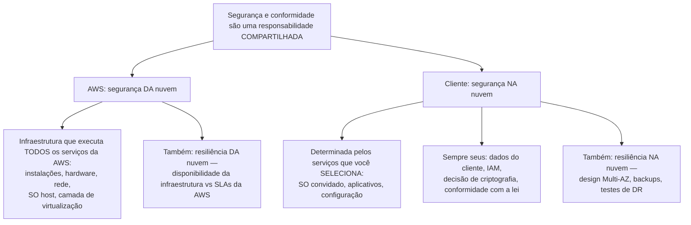
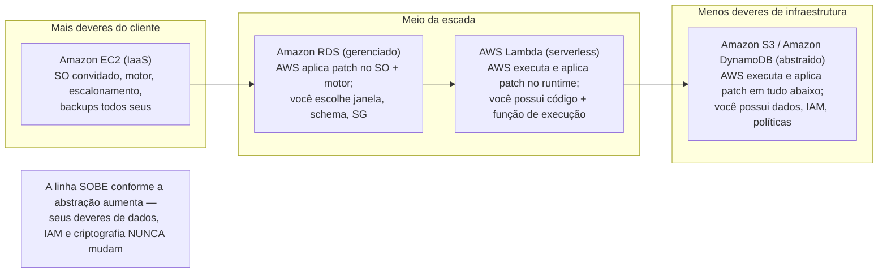
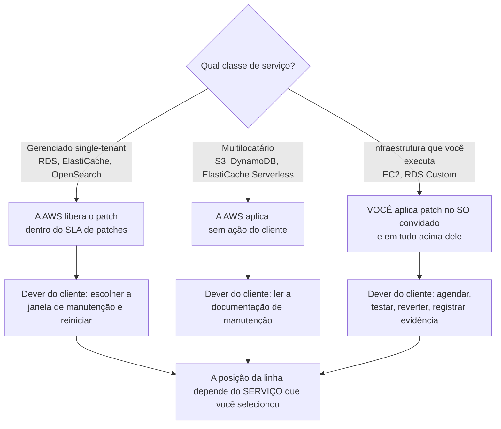
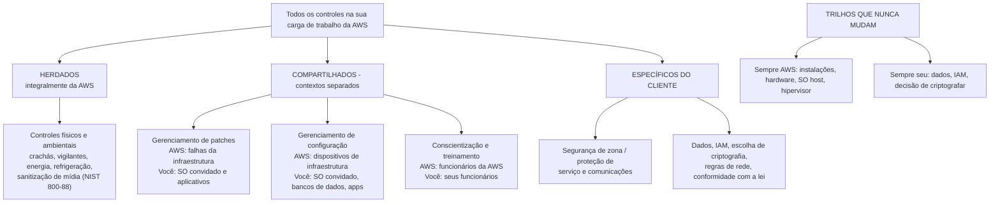
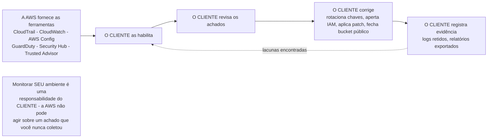

# O Modelo de Responsabilidade Compartilhada da AWS

Toda questão de segurança do CLF-C02 eventualmente se reduz a uma frase: *quem conserta isso?* O exame chama isso de **Domínio 2, Tarefa 2.1 — "Reconhecer os componentes do modelo de responsabilidade compartilhada da AWS"**, e o Domínio 2 vale **30% da sua pontuação (em outubro de 2026)**, então este único modelo é estatisticamente o conceito mais lucrativo de todo o teste. A AWS enuncia a premissa sem rodeios: *"Segurança e conformidade são uma responsabilidade compartilhada entre a AWS e o cliente."* Compartilhado **não** significa dividido ao meio — significa *duas organizações diferentes, cada uma totalmente responsável por sua própria camada*, e a fronteira entre essas camadas **muda dependendo do serviço que você escolher**.

```text
====================================================================
 MODELO DE RESPONSABILIDADE COMPARTILHADA DA AWS — DOMÍNIO 2, TAREFA 2.1 (em outubro de 2026)
====================================================================
  DOMÍNIO 2 "Segurança e Conformidade" ............ 30% do exame
---------------------------------------------------------------------
  AS DUAS METADES (memore as preposições)
    AWS ......... segurança DA nuvem — a infraestrutura
    VOCÊ ........ segurança NA nuvem — o que você configura
                  ("determinado pelos serviços da AWS Cloud
                    que um cliente seleciona")
---------------------------------------------------------------------
  CAMADA / CONTROLE                    EC2      RDS    LAMBDA      S3
  Instalações, energia, refrigeração   AWS      AWS      AWS       AWS
  Ciclo de vida do hardware, descarte  AWS      AWS      AWS       AWS
  SO host + hipervisor                 AWS      AWS      AWS       AWS
  Patch do SO convidado                VOCÊ     AWS      n/a       n/a
  Instalação/patch do motor de banco   (próprio) AWS     n/a       n/a
  Patch de runtime/linguagem           VOCÊ     VOCÊ     AWS*      n/a
  Escalabilidade, ALTA, backups auto   VOCÊ     AWS      AWS       AWS
  Código do aplicativo, IAM, dados, escolha
  de criptografia, regras de SG        VOCÊ     VOCÊ     VOCÊ      VOCÊ
---------------------------------------------------------------------
  TAXONOMIA DE CONTROLES (redação oficial da AWS)
    Herdados ........... controles físicos e ambientais
    Compartilhados ..... gerenciamento de patches, gerenciamento
                         de configuração, conscientização e
                         treinamento (contextos separados)
    Específicos do
    cliente ............ proteção de serviço e comunicações /
                         segurança de zona
---------------------------------------------------------------------
  * Lambda "Auto" = AWS atualiza; "Function update" / "Manual" = você
    atualiza; imagens de contêiner = AWS publica, você reconstrói.
  ÂNCORAS FIXAS: AWS sempre possui instalações + hardware + hipervisor.
                 VOCÊ sempre possui dados + IAM + a decisão de
                 criptografar.
====================================================================
```

> [!NOTE]
> **O modelo não tem preço e nenhum serviço para ligar.** É uma *declaração de deveres*, não um produto. Tudo o que você pode comprar para *provar* seu lado — AWS Artifact para os relatórios da AWS, AWS CloudTrail, AWS Config, Amazon CloudWatch, Amazon GuardDuty, AWS Security Hub — fica do **seu** lado da linha: a AWS fornece a ferramenta, você a ativa, você age com base no que ela diz.

Nesta lição você vai:

- separar **segurança DA nuvem (AWS)** de **segurança NA nuvem (você)** usando a própria redação da AWS;
- posicionar a fronteira exatamente: **do SO host e da camada de virtualização para baixo** = AWS, **do SO convidado para cima** = você;
- ler a **tabela completa do detalhamento de responsabilidades** — instalações, hardware, hipervisor, dados, identidade, criptografia, conformidade;
- observar a linha **mudar entre o Amazon EC2, o Amazon RDS, o AWS Lambda e o Amazon S3**, incluindo as nuances do RDS Custom e do modo de runtime do Lambda;
- classificar cada controle como **herdado, compartilhado ou específico do cliente** — e entender por que *compartilhado ≠ 50/50*;
- listar o que **os clientes ainda possuem**: classificação de dados, identidade e acesso, patch de SO no EC2, configuração de rede, escolhas de criptografia, segurança de aplicativos;
- listar o que **a AWS possui**: instalações, hardware, virtualização e a infraestrutura dos serviços gerenciados;
- reconhecer as **armadilhas clássicas de atribuição incorreta** que alimentam a maioria das opções erradas neste tópico;
- estudar **quatro estudos de caso de segurança e conformidade publicados pela AWS** — dois operacionais, dois baseados em autorização;
- conferir as **mudanças de guia e de lista de serviços de 2026** (em outubro de 2026) que decidem o que o Domínio 2 ainda testa;
- praticar com **12 questões em formato de exame** mais quatro verificações interativas.

---

## 1. Segurança DA nuvem versus segurança NA nuvem

### 1.1 A própria redação da AWS

A página de conformidade da AWS define as duas metades em um único parágrafo, e o exame a cita quase literalmente:

| Metade | Proprietário | Definição da AWS (com fonte, acesso em outubro de 2026) | O que está dentro dela |
|---|---|---|---|
| **Segurança *da* nuvem** | **AWS** | *"A AWS é responsável por proteger a infraestrutura que executa todos os serviços oferecidos na AWS Cloud"* | Centros de dados, hardware, rede, o **sistema operacional host e a camada de virtualização**, a segurança física das instalações |
| **Segurança *na* nuvem** | **Cliente** | *"A responsabilidade do cliente será determinada pelos serviços da AWS Cloud que um cliente seleciona"* | Seus dados, sua identidade e permissões, seu SO convidado, seu código de aplicativo, sua configuração, suas decisões de criptografia |

A segunda linha é a que os alunos leem errado. Seus deveres **não são fixos** — eles são *derivados da sua escolha de serviços*. Execute o Amazon EC2 e você herda um sistema operacional para dar patch; execute o Amazon S3 e esse dever desaparece, enquanto o dever de classificar seus dados não.

### 1.2 A preposição é o truque inteiro



> [!WARNING]
> **Armadilha da inversão.** Qualquer opção que diga *"a AWS é responsável pela segurança na nuvem"* ou *"o cliente é responsável pela segurança da nuvem"* está **errada na cara**, antes mesmo de você ler o resto da opção. AWS = **da** (ela possui a infraestrutura). Você = **na** (você configura o que roda nela). O whitepaper de GDPR da AWS repete isso: *"Os clientes são responsáveis pela 'segurança NA nuvem'… configurando e gerenciando a segurança dos serviços da AWS que utilizam."*

### 1.3 Exemplo E1 — classificando seis afirmações em menos de um minuto

Leia cada afirmação, identifique a metade e decida se ela sequer é plausível:

| # | Afirmação | Metade | Veredito |
|---|---|---|---|
| 1 | A AWS aplica patch no hipervisor do host que executa sua instância | Da nuvem | Correto — dever da AWS |
| 2 | Você decide se o bucket S3 que guarda registros de clientes é público | Na nuvem | Correto — dever do cliente |
| 3 | A AWS configura as regras do grupo de segurança na sua instância EC2 | Da nuvem | **Errado** — a AWS *fornece* o firewall, **você configura** |
| 4 | Você patrulha os corredores do centro de dados | Na nuvem | **Errado** — a segurança física é um controle *herdados* da AWS |
| 5 | A AWS criptografa seus dados com seu consentimento e no seu cronograma | Na nuvem | **Redação errada** — a AWS fornece o KMS e a criptografia no lado do serviço; **você escolhe se criptografa**, qual chave e como as chaves são tratadas |
| 6 | Você monitora sua própria conta com CloudTrail e CloudWatch | Na nuvem | Correto — a AWS fornece a ferramenta, você ativa e age |

O padrão nas linhas 3, 4 e 5 é o exame inteiro: **a AWS fornece um recurso; você toma a decisão.** Fornecido ≠ configurado, e ferramentas ≠ responsabilidade.

- **📚 Você sabia?** O modelo é *o motivo de a conformidade na nuvem ser mais barata*. A AWS escreve que ele permite que os clientes *"desloquem o gerenciamento de certos controles de TI para a AWS"* e herdem um ambiente de controle auditado em vez de construir instalações e segurança física — mantendo dados, identidade, configuração e conformidade. É também por isso que o **AWS Artifact existe como um portal de autoserviço sem custo, com acesso sob demanda aos relatórios de conformidade da AWS**: a evidência da metade da AWS já está escrita; você só precisa buscá-la.

---

## 2. Onde a linha se situa na pilha

### 2.1 A frase da fronteira

A página canônica da AWS desenha a linha em uma única frase — recite-a para si mesmo até que se torne automática:

> *"A AWS opera, gerencia e controla os componentes desde o sistema operacional host e a camada de virtualização até a segurança física das instalações em que o serviço opera. O cliente assume a responsabilidade e o gerenciamento do **sistema operacional convidado** (incluindo atualizações e patches de segurança), do outro software de aplicativo associado e da configuração do firewall de grupo de segurança fornecido pela AWS."*

```text
  SEU LADO DA LINHA  ("segurança NA nuvem")
  =================================================================
  7. Dados do cliente — classificação, retenção, criptografia LIGADA ou DESLIGADA
  6. Identidade e acesso — usuários IAM, funções, políticas, MFA, root
  5. Segurança de aplicativo — código, dependências, segredos, sessões
  4. Configuração de rede — grupos de segurança, NACLs, roteamento, VPC
  3. Sistema operacional convidado — atualizações e patches de segurança
  ----------------------------------------------------------------
  ------------------- A LINHA DE RESPONSABILIDADE COMPARTILHADA ----
  ----------------------------------------------------------------
  2. Sistema operacional host — aplicado e reforçado pela AWS
  1. Camada de virtualização / hipervisor — AWS
  0. Hardware, servidores, dispositivos de armazenamento, equipamentos de rede — AWS
  -1. Instalações — energia, refrigeração, acesso físico, destruição de mídia
  =================================================================
  LADO DA AWS DA LINHA  ("segurança DA nuvem")
```

Duas consequências aparecem em toda prova:

1. **O Amazon EC2 faz de você um administrador de sistemas.** Você escolheu IaaS, então as camadas 3–7 são suas, incluindo *"atualizações e patches de segurança"* do SO convidado.
2. **A linha não é um objeto físico.** É uma *divisão contratual de deveres* que a AWS redesenha por serviço — que é a segunda metade da Tarefa 2.1 (Seção 4).

### 2.2 A resiliência usa as mesmas duas preposições

O Pilar de Confiabilidade do Well-Architected repete a divisão para disponibilidade, o que é uma fonte favorita de distratores:

| | **Resiliência *da* nuvem (AWS)** | **Resiliência *na* nuvem (você)** |
|---|---|---|
| Redação da AWS | *"A AWS é responsável pela resiliência da infraestrutura… garantindo que a disponibilidade do serviço atenda ou exceda os Acordos de Nível de Serviço (SLAs) da AWS"* | Os clientes são *"responsáveis por projetar, testar e implantar seus aplicativos"* |
| Deveres concretos | Zonas de Disponibilidade isoladas e conectadas; ≥3 AZs fisicamente separadas por Região (em outubro de 2026); energia e refrigeração redundantes; padrão N+1 de centro de dados | **Implantação Multi-AZ**, backups, versionamento, replicação, testes de failover, planos de DR |
| Falha que evita | Um centro de dados ou AZ inteiro apagado | Seu aplicativo colapsando mesmo com a infraestrutura saudável |

> [!IMPORTANT]
> **Garantir disponibilidade pela AWS não torna seu aplicativo disponível.** A AWS fornece *primitivas* resilientes; se sua carga de trabalho as atravessa é decisão sua. A orientação da AWS para serviços financeiros torna a divisão explícita: a AWS garante que os serviços que executa *"estejam continuamente disponíveis"*, enquanto os clientes *"são responsáveis por projetar, testar e implantar seus aplicativos"* — e nomeia três ações de programa para o lado do cliente: **Validar, Demonstrar, Monitorar**.

### 2.3 Exemplo E2 — a aritmética das 124 AZs e o que ela *não* compra

A AWS relata **124 Zonas de Disponibilidade em 39 Regiões Geográficas**, cada Região com *"pelo menos três Zonas de Disponibilidade independentes e fisicamente separadas"* (em outubro de 2026).

$$
39 \times 3 = 117 \text{ AZs as the design minimum} \quad\Rightarrow\quad 124 - 117 = 7 \text{ AZs above the minimum}
$$

Então a AWS projetou sete domínios de falha a mais do que seu próprio piso exige — e **sua conta ainda possui a diferença na prática**. Uma implantação de uma única AZ dentro de uma Região de 3 AZs herda zero dessa engenharia. A checklist do lado do cliente depois da aritmética:

1. implante em **pelo menos duas AZs** (a própria regra de design da AWS para disponibilidade);
2. ative **backups** e teste a restauração deles;
3. decida se um evento em nível de **Região** precisa de uma estratégia de DR (essa é uma pergunta de Região, não de AZ);
4. **teste** o failover — um plano não testado é uma hipótese.

- **📚 Você sabia?** A AWS descomissiona mídia que continha dados de clientes usando técnicas detalhadas na **NIST 800-88**, o acesso físico às salas de servidores exige **autorização multifator**, e o acesso aos centros de dados é *"registrado, monitorado e retido"* — ainda que auditores externos testem a AWS contra **mais de 2.600 requisitos ao longo do ano** (em outubro de 2026). Tudo isso fica do lado da AWS, e é exatamente por isso que é um controle *herdado* para você: você recebe a garantia sem operar os leitores de crachá.

---

## 3. O detalhamento completo das responsabilidades

### 3.1 Cada linha, cada proprietário

Esta é a tabela em que a Tarefa 2.1 se apoia. Aprenda-a como três colunas de lógica: **sempre AWS**, **sempre seu**, e **depende do serviço**.

| Item | Proprietário | Categoria de controle | Fonte (acesso em outubro de 2026) |
|---|---|---|---|
| Instalações físicas — crachás, câmeras, vigilantes, gaiolas | **AWS** | Herdados | Modelo de Responsabilidade Compartilhada; Trust Center; Data Layer |
| Ciclo de vida do hardware e descarte de dispositivos | **AWS** | Herdados | Modelo de Responsabilidade Compartilhada; whitepaper do NHS |
| Sanitização e destruição de mídia (NIST 800-88) | **AWS** | Herdados | AWS Trust Center |
| Camada de virtualização / hipervisor / firmware host | **AWS** | Herdados (da nuvem) | Modelo de Responsabilidade Compartilhada |
| Sistema operacional host (sob sua instância) | **AWS** | Herdados | Modelo de Responsabilidade Compartilhada |
| **Dados do cliente** — conteúdo, onde moram, criptografados ou não | **Cliente** | Específico do cliente | Modelo de Responsabilidade Compartilhada; Security Quick Reference |
| **Gerenciamento de identidade e acesso** — usuários, funções, políticas | **Cliente** | Específico do cliente | Modelo de Responsabilidade Compartilhada; whitepaper de GDPR |
| **Patch do SO convidado** no EC2 / IaaS | **Cliente** | Compartilhado (contextos separados) | Modelo de Responsabilidade Compartilhada; Security Quick Reference |
| **Configuração de grupo de segurança / firewall** por instância | **Cliente** | Específico do cliente | Modelo de Responsabilidade Compartilhada |
| **Escolhas de criptografia** — no cliente; ativação no lado do servidor; tipo de chave | **Cliente** | Específico do cliente | Modelo de Responsabilidade Compartilhada; proteção de dados do EC2 |
| **Software de aplicativo** que você instala ou escreve | **Cliente** | Específico do cliente | Modelo de Responsabilidade Compartilhada |
| Gerenciamento de patches (SO convidado e aplicativos) | **Compartilhado** — a AWS aplica patch na infraestrutura, você aplica patch na sua camada | Compartilhado | Modelo de Responsabilidade Compartilhada; Pilar de Segurança do Well-Architected |
| Gerenciamento de configuração | **Compartilhado** — a AWS mantém a configuração dos dispositivos de infraestrutura, você configura SO convidado, bancos de dados e aplicativos | Compartilhado | Modelo de Responsabilidade Compartilhada |
| Conscientização e treinamento | **Compartilhado** — a AWS treina funcionários da AWS, você treina os seus | Compartilhado | Modelo de Responsabilidade Compartilhada |
| Proteção de serviço e comunicações / segurança de zona | **Específico do cliente** | Específico do cliente | Modelo de Responsabilidade Compartilhada |
| Conformidade com as leis e regulamentações aplicáveis à sua carga de trabalho | **Cliente** | Específico do cliente | AWS Compliance; Programas de Conformidade |
| Resiliência da infraestrutura vs SLAs da AWS | **AWS** | Herdados | Pilar de Confiabilidade do Well-Architected |
| Design Multi-AZ, backups, replicação, testes de DR | **Cliente** | Específico do cliente | Pilar de Confiabilidade do Well-Architected |

### 3.2 Exemplo E3 — a mesma carga de trabalho, três colunas

Uma equipe de banco de dados on-premises documenta o que cada opção de hospedagem exige. O Guia do Usuário do Amazon RDS publica exatamente esta comparação:

| Dever | No local | Amazon EC2 | Amazon RDS |
|---|---|---|---|
| Patch do sistema operacional | Cliente | Cliente | **AWS** |
| Patch do software de banco de dados | Cliente | Cliente | **AWS** |
| Escalabilidade, alta disponibilidade, backups do banco | Cliente | Cliente | **AWS** |
| Manutenção do servidor | Cliente | AWS | **AWS** |
| Ciclo de vida do hardware | Cliente | AWS | **AWS** |
| Energia, rede, refrigeração | Cliente | AWS | **AWS** |

Leia as colunas da esquerda para a direita e você está vendo ** a linha subir**: três deveres do cliente se tornam deveres da AWS conforme você sai do autogerenciado para o gerenciado. Leia as *linhas* e você vê o que nunca muda — **nada nesta tabela trata dos seus dados, das suas políticas de IAM ou da sua obrigação de conformidade**, porque esses vivem acima da fronteira em toda coluna.

---

## 4. Como a linha muda entre serviços (a habilidade mais difícil da Tarefa 2.1)

### 4.1 Os três exemplares do exame mais um

O guia do exame nomeia **Amazon RDS, AWS Lambda e Amazon EC2** como exemplos de mudança. Acrescente o **Amazon S3** (o caso do armazenamento abstraído) e você cobre toda forma de pergunta.

| Responsabilidade | **Amazon EC2** (IaaS) | **Amazon RDS** (gerenciado) | **AWS Lambda** (serverless) | **Amazon S3** (abstraido) |
|---|---|---|---|---|
| Instalações, hardware, energia/refrigeração | AWS | AWS | AWS | AWS |
| SO host + hipervisor | AWS | AWS | AWS | AWS |
| Patch do SO convidado | **Cliente** | **AWS** | n/a — nenhum SO convidado exposto | n/a |
| Instalação e patch do motor de banco | Cliente (você instalou) | **AWS** | n/a | n/a |
| Patch de runtime/linguagem | Cliente | Cliente (lado do aplicativo) | **AWS**, mas pode ser preciso acionar a atualização | n/a |
| Escalabilidade, ALTA, backups automáticos | Você projeta (Auto Scaling, Multi-AZ) | **AWS** | AWS | AWS |
| Código e lógica do aplicativo | Cliente | Cliente (schema, ajuste de consulta) | **Cliente** | Cliente |
| Permissões de IAM | Cliente | Cliente | Cliente (função de execução) | Cliente (política do bucket, ACLs) |
| Dados, classificação, escolha de criptografia | Cliente | Cliente | Cliente | Cliente |
| Regras de grupo de segurança / rede | Cliente (o firewall fornecido pela AWS) | Cliente (SG no endpoint do banco) | Cliente (configuração de VPC, se conectada) | Cliente (Block Public Access, política do bucket) |

Dois invariantes sobrevivem a cada linha dessa tabela: **a AWS sempre possui instalações, hardware e o hipervisor**, e **você sempre possui dados, IAM e a decisão de criptografia**. Apenas as linhas do meio mudam.



### 4.2 A auditoria do dever de patch (exemplo resolvido E4)

Quem aplica patch no sistema operacional? Seis cargas de trabalho, uma resposta cada:

| Carga de trabalho | Configuração | SO convidado atualizado por | Por quê |
|---|---|---|---|
| Servidor web no **Amazon EC2** | Amazon Linux AMI | **Você** | IaaS: o SO convidado é seu |
| **MySQL autogerenciado no EC2** | Você instalou o motor | **Você** (SO *e* motor) | Nada gerenciado foi comprado |
| **Amazon RDS** para PostgreSQL | Serviço gerenciado single-tenant | **AWS** (SO *e* motor) | Você só seleciona a janela de manutenção |
| **Amazon RDS Custom** para Oracle | Gerenciado *mais* acesso privilegiado ao SO | **Você** | Você deliberadamente retomou o host |
| **AWS Lambda** no modo de atualização **Auto** | Runtime gerenciado | **AWS** | O Lambda aplica atualizações a todas as funções |
| **AWS Lambda** no modo **Manual**, runtime fixado | Runtime gerenciado, seu modo de controle | **Você** | *"você é responsável por atualizar sua função para usar a versão mais recente do runtime"* |
| **Amazon S3** | Armazenamento abstraido | **AWS** (não existe SO de cliente) | Multilocatário; nada para você aplicar patch |

As duas armadilhas nessa tabela — **RDS Custom** e **Lambda Manual** — valem uma seção cada.

### 4.3 A válvula de escape do RDS Custom

O Amazon RDS Custom existe porque algumas cargas de trabalho precisam de acesso privilegiado ao sistema operacional. A própria redação da AWS: *"Com o RDS Custom, você usa os recursos gerenciados do Amazon RDS, mas gerencia o host e personaliza o SO como faz no Amazon EC2."* A tabela de responsabilidades publicada **devolve o patch de SO e o patch do software de banco de dados ao Cliente** para o RDS Custom, enquanto o Amazon RDS padrão mantém ambos na AWS.

> [!NOTE]
> **A abstração pode ser negociada de propósito.** Uma equipe que precisa de módulos de kernel, um nível de patch específico ou um agente de terceiros no host do banco escolhe o RDS Custom e *compra de volta* um dever de patch. Consequência no exame: a opção que diz *"Amazon RDS sempre significa que a AWS aplica todos os patches"* é **falsa**, porque o exame sabe que o RDS Custom existe.

### 4.4 A nuance do runtime do Lambda

A AWS publica o gerenciamento de runtime como um tópico de **responsabilidade compartilhada**:

- *"O Lambda é responsável por curar e publicar atualizações de segurança para todos os runtimes gerenciados e imagens de contêiner suportados."*
- *"Para funções configuradas para usar o modo de atualização Manual de runtime, você é responsável por atualizar sua função para usar a versão mais recente do runtime."*

| Modo de atualização | Quem aplica a atualização | Dever prático para você |
|---|---|---|
| **Auto** | O Lambda atualiza todas as funções | Verifique depois; conserte o que uma nova runtime quebrar |
| **Function update** / **Manual** | Você | Observe datas de descontinuação, redesploy, teste |
| Funções com **imagem de contêiner** | A AWS publica **imagens base** corrigidas | **Reconstrua e envie** sua imagem para receber a correção |

### 4.5 Exemplo E5 — uma runtime descontinuada que ninguém corrigiu

Uma função roda em uma versão de runtime que a AWS marcou para descontinuação. A AWS já publicou a correção de segurança (a metade do Lambda está cumprida). A auditoria da equipe:

| Configuração | Runtime corrigida? | Proprietário da lacuna |
|---|---|---|
| Modo de atualização **Auto** | Sim — o Lambda aplicou | Nenhuma (monitore para detectar quebras) |
| Modo de atualização **Manual**, ninguém redesploya | **Não** | **Cliente** — a correção existia, o dever era seu |
| Imagem de contêiner, imagem não reconstruída | **Não** | **Cliente** — a AWS corrigiu a base, você deve reconstruir |

Conte as falhas: **0 falhas da AWS, 1 falha do cliente em cada uma das duas últimas linhas.** O modelo funcionou exatamente como projetado — uma correção publicada mais um dever ignorado ainda iguala uma função não corrigida, e o exame vai pedir que você nomeie o proprietário.

### 4.6 Patch single-tenant versus multilocatário

O Pilar de Segurança do Well-Architected divide os serviços gerenciados em dois comportamentos de patch, e a diferença é *quanto você ainda tem que fazer*:

| Classe de serviço | Exemplos | Quem aplica o patch | O que você ainda faz |
|---|---|---|---|
| **Gerenciado single-tenant** | Amazon ElastiCache, **Amazon RDS**, Amazon OpenSearch Service | A AWS *"libera patches dentro do SLA de patches do serviço"* | **Facilite**: selecione janelas de manutenção, aplique atualizações do serviço, agende reinicializações necessárias |
| **Multilocatário** | ElastiCache Serverless, **Amazon DynamoDB**, **Amazon S3** | A AWS aplica patches **sem ação do cliente** | *Consulte* a documentação de patches e manutenção |



```matching
{
  "question": "Associe cada carga de trabalho a quem aplica patch no sistema operacional (ou runtime) no exame CLF-C02:",
  "pairs": [
    {"left": "Instância Amazon EC2", "right": "Cliente - o SO convidado e seus patches de segurança são seus no IaaS"},
    {"left": "MySQL autogerenciado no Amazon EC2", "right": "Cliente - você instalou o motor, então aplica patch no SO e no banco de dados"},
    {"left": "Amazon RDS (padrão)", "right": "AWS - a AWS aplica patch no SO e no motor; você só escolhe a janela de manutenção"},
    {"left": "Amazon RDS Custom", "right": "Cliente - você gerencia o host e personaliza o SO como faz no Amazon EC2"},
    {"left": "AWS Lambda no modo Auto", "right": "AWS - o Lambda aplica atualizações de runtime a todas as funções"},
    {"left": "AWS Lambda no modo Manual", "right": "Cliente - você é responsável por atualizar sua função para a runtime mais recente"},
    {"left": "Amazon S3", "right": "AWS - armazenamento abstraido multilocatário; não existe SO convidado do seu lado"}
  ],
  "explanation": "A preposição nunca muda (AWS = segurança DA, você = segurança NA), mas a linha de patch muda com o serviço: mais abstração significa que a AWS absorve mais da pilha. As duas nuances deliberadas são o RDS Custom (o dever de SO volta para você) e o modo Manual do Lambda (o dever de runtime fica com você mesmo tendo a AWS publicado a correção)."
}
```

```dragdrop
{
  "question": "Ordene estes quatro tipos de serviço do MAIOR número de deveres de infraestrutura do cliente para o MENOR:",
  "items": [
    "Amazon EC2 (IaaS)",
    "Amazon RDS (banco de dados gerenciado)",
    "AWS Lambda (computação serverless)",
    "Amazon S3 (armazenamento abstraido)"
  ],
  "correctOrder": [
    "Amazon EC2 (IaaS)",
    "Amazon RDS (banco de dados gerenciado)",
    "AWS Lambda (computação serverless)",
    "Amazon S3 (armazenamento abstraido)"
  ],
  "explanation": "A escada funciona por abstração: no EC2 você possui o SO convidado, o motor, o escalonamento e os backups; no RDS a AWS assume SO, motor, escalonamento, ALTA e backups; no Lambda não há SO para gerenciar; no S3 até o runtime desaparece. O que NÃO desce na escada é seu dados, IAM, configuração de rede e escolha de criptografia - esses permanecem responsabilidade do cliente em todos os degraus."
}
```

- **📚 Você sabia?** O mesmo modelo governa *quem remove o hardware*: a orientação da AWS alinhada ao NHS chama a segurança do centro de dados de *"inteiramente responsabilidade da AWS"* e diz que o descomissionamento e o deprovisionamento *"cabem à AWS sob o Modelo de Responsabilidade Compartilhada"*. Sua obrigação começa nos seus dados — *"Você sempre possui seus dados, incluindo a capacidade de criptografá-los, movê-los e gerenciar a retenção"* — e termina nas suas políticas de retenção e exclusão, nunca no triturador.

---

## 5. A taxonomia de controles: herdados, compartilhados, específicos do cliente

### 5.1 As três categorias oficiais da AWS

A AWS não divide controles apenas em "seu/meu". A taxonomia publicada tem **quatro rótulos**, e o exame pede que você coloque um exemplo na categoria certa:

| Categoria | Definição da AWS (com fonte) | Exemplos canônicos |
|---|---|---|
| **Herdados** | *"Controles que um cliente herda integralmente da AWS"* | Controles físicos e ambientais: acesso por crachá, vigilantes, câmeras, energia, refrigeração, destruição de mídia |
| **Compartilhado** | Aplica-se às duas camadas *"mas em contextos completamente separados"* | **Gerenciamento de patches** (AWS: falhas da infraestrutura; você: SO convidado e aplicativos) · **Gerenciamento de configuração** (AWS: dispositivos de infraestrutura; você: SO convidado, bancos de dados, aplicativos) · **Conscientização e treinamento** (a AWS treina funcionários da AWS; você treina os seus) |
| **Específico do cliente** | Inteiramente seu | Proteção de serviço e comunicações ou **segurança de zona**; classificação de dados; IAM; decisões de criptografia |
| **Responsabilidade da AWS "da nuvem"** / **do cliente "na nuvem"** | A divisão de nível superior | Tudo acima se resolve em uma dessas duas metades |

> [!IMPORTANT]
> **Compartilhado ≠ 50/50.** A redação da AWS é *"em contextos completamente separados"*: a AWS executa **seu** patch de **sua** infraestrutura, você executa **seu** patch do **seu** SO convidado e aplicativos — sobre o mesmo controle abstrato, em camadas diferentes, com evidências diferentes. Uma pergunta que ofereça *"responsabilidades compartilhadas são divididas igualmente entre a AWS e o cliente"* está testando se você leu a definição.



### 5.2 A heurística das cinco perguntas

Quando uma opção for desconhecida, execute esta ordem de testes — ela resolve quase todo item da Tarefa 2.1:

```text
1. Identifique a CLASSE DE SERVIÇO:  IaaS / gerenciado / abstraido / serverless
2. Configurável, enviável, nomeável, concedível, classificável  -> CLIENTE
3. Fisicamente intocável (centro de dados, hardware, hipervisor)  -> AWS
4. Patch / configuração / conscientização                       -> COMPARTILHADO
                                                 (implementações separadas)
5. Dados, IAM, criptografia, conformidade com a lei             -> CLIENTE, SEMPRE
```

### 5.3 Exemplo E6 — classificando doze controles

Classifique os doze controles da Seção 3 na taxonomia e conte-os:

| Lote | Contadores (total) |
|---|---|
| **Herdados** (4) | Crachá/acesso físico · ciclo de vida do hardware · sanitização de mídia pela NIST 800-88 · SO host e hipervisor |
| **Compartilhados** (3) | Gerenciamento de patches · gerenciamento de configuração · conscientização e treinamento |
| **Específicos do cliente** (5) | Classificação de dados · permissões de IAM · regras de grupo de segurança · escolha de criptografia · conformidade com a lei aplicável |
| **Inclassificável — lado errado da linha** | *"A AWS configura seu grupo de segurança"* · *"A AWS criptografa seus dados em seu nome como uma obrigação padrão"* · *"A AWS é responsável pela sua conformidade com o HIPAA"* |

Quatro mais três mais cinco igualam doze, e cada uma das três afirmações "inclassificáveis" falha na tabela de armadilhas da Seção 8. Se você consegue classificar um controle em menos de dez segundos, consegue responder à pergunta.

### 5.4 Controles compartilhados em operação contínua

Um controle só é real se executa continuamente, então o exame também testa a forma *contínua* dos três controles compartilhados. Cada linha nomeia o que a AWS faz para sempre, o que você deve fazer para onde a evidência cai:

| Controle compartilhado | Implementação da AWS (contínua) | Sua implementação (contínua) | Onde a evidência fica |
|---|---|---|---|
| **Gerenciamento de patches** | Aplicar patches e corrigir falhas na infraestrutura; liberar patches dos serviços gerenciados dentro do SLA de patches do serviço | Aplicar patches no SO convidado e nos aplicativos; para serviços gerenciados single-tenant, selecionar janelas de manutenção, aplicar atualizações do serviço e agendar reinicializações; para multilocatários, ler a documentação de manutenção | AWS: relatórios de auditoria via **AWS Artifact** · Você: relatórios de conformidade de patches e registros de alterações |
| **Gerenciamento de configuração** | Manter a configuração dos dispositivos de infraestrutura da AWS | Configurar sistemas operacionais convidados, bancos de dados e aplicativos; manter regras de grupo de segurança, NACL e VPC como código revisado | AWS: declarações de escopo SOC/ISO · Você: regras do AWS Config, modelos do CloudFormation revisados |
| **Conscientização e treinamento** | Treinar funcionários da AWS | Treinar seus próprios funcionários sobre o modelo compartilhado, sobre o manuseio de dados e sobre higiene de conta (MFA do root, privilégio mínimo) | AWS: controles de pessoas auditados · Você: registros de treinamento dentro da sua evidência de conformidade |

A orientação da AWS para serviços financeiros enquadra o lado cliente desse loop como três ações de programa repetidas: **Validar** (o controle está projetado corretamente?), **Demonstrar** (você consegue mostrar a evidência?), **Monitorar** (ainda está funcionando?). Isso é monitoramento contínuo *na* nuvem — e nada disso se transfere para a AWS, porque a AWS não pode validar uma decisão que você não tomou.

```text
LOOP DE MONITORAMENTO CONTÍNUO (lado do cliente do modelo)
====================================================================
  Lado da AWS (sempre executando)     Seu lado (você executa)
  ---------------------------         --------------------------------
  patch de infraestrutura             habilitar -> CloudTrail, AWS Config,
  SLA de patch do serviço                       GuardDuty, Security Hub
  logging de acesso físico            revisar   -> achados, desvio, config
  sanitização de mídia (NIST 800-88)  agir      -> rotacionar, apertar,
  publicação de relatório (Artifact)            aplicar patch, fechar
                                       expondo publicamente
                                      provar    -> exportar evidência,
                                                  revalidar, redesmonstrar
  ------------------------------------------------------------------
  REGRA: a AWS fornece a ferramenta; o CLIENTE a habilita, revisa,
         age sobre ela e registra evidência. Achados que você nunca
         coleta são achados que ninguém corrige.
====================================================================
```

```matching
{
  "question": "Associe cada serviço da lista atual no escopo do CLF-C02 (em outubro de 2026) a onde sua divisão de responsabilidades realmente cai:",
  "pairs": [
    {"left": "AWS PrivateLink", "right": "A AWS executa e aplica patch na infraestrutura do serviço - você possui as políticas de endpoint, quais principais e contas podem anexar, e a configuração de VPC"},
    {"left": "AWS Transit Gateway", "right": "A AWS executa e aplica patch na infraestrutura do serviço - você possui as tabelas de roteamento, as conexões e a política de compartilhamento de recursos"},
    {"left": "AWS Site-to-Site VPN", "right": "A AWS executa os endpoints de VPN gerenciados - você possui a configuração do gateway do cliente, o roteamento e as configurações de criptografia/autenticação que escolhe"},
    {"left": "AWS Client VPN", "right": "A AWS executa o serviço - você possui a fonte de autenticação, as regras de autorização e quais usuários recebem um perfil"},
    {"left": "AWS IAM Identity Center", "right": "A AWS executa o serviço - você possui a fonte de identidade, as atribuições de conjuntos de permissões e a autenticação multifator da sua força de trabalho"},
    {"left": "AWS Support (a única entrada na categoria Customer Enablement)", "right": "A AWS fornece a organização de suporte e sua orientação - você escolhe o plano, abre os casos e age com base nas recomendações"}
  ],
  "explanation": "Todo serviço se divide do mesmo jeito: a AWS possui a infraestrutura do serviço sob ele (segurança DA nuvem), e o cliente possui toda decisão tomada no topo dele - rotas, conexões, endpoints, identidades, permissões e MFA (segurança NA nuvem). Nomes novos no escopo, como AWS PrivateLink, AWS Transit Gateway, AWS Site-to-Site VPN e AWS Client VPN, mudam o que você pode ser perguntado, mas nunca mudam onde a linha se situa. Confirme a lista atual no escopo antes do uso: a AWS a rotula como não exaustiva e sujeita a alterações."
}
```

---

## 6. O que os clientes ainda possuem

A abstração remove *tarefas de infraestrutura*, nunca *propriedade*. Mesmo no serviço mais abstraído, seis deveres são permanentemente seus:

| # | Dever do cliente | O que isso significa na prática | Evidência que você produz |
|---|---|---|---|
| 1 | **Classificação de dados** | Decidir o que é sensível, onde pode morar, se pode ser público | Inventário de dados, esquema de classificação, regras de retenção |
| 2 | **Gerenciamento de identidade e acesso** | Usuários IAM, funções, políticas, MFA (incluindo **MFA do root**), privilégio mínimo, hábitos de rotação de chaves | Revisões de políticas, relatórios de cobertura de MFA, alertas de login do root no CloudTrail |
| 3 | **Patch de SO no EC2** (e em qualquer camada autogerenciada) | Agendar, aplicar e reverter patches do SO convidado | Relatórios de conformidade de patches (ex.: via AWS Systems Manager Patch Manager) |
| 4 | **Configuração de rede** | Regras de grupo de segurança e NACL, design de VPC, tabelas de rotas, se um bucket é público | Conjuntos de regras revisados, registros de alterações |
| 5 | **Escolhas de criptografia** | Se criptografar, no cliente vs no lado do servidor, qual tipo de chave, como as chaves são tratadas | Políticas de chaves do KMS, configurações de criptografia de bucket |
| 6 | **Segurança de aplicativo** | Código, dependências, gerenciamento de segredos, tratamento de sessões, validação de entrada | Revisão de código, varredura de dependências, rotação de segredos |

### 6.1 O dever de monitoramento do cliente

A AWS fornece as ferramentas de detecção; **habilitá-las e agir com base nelas é seu**. A própria orientação da AWS para segurança de contas coloca o caso mais agudo primeiro: *"É crítico que você proteja sua conta root contra acesso não autorizado, começando pela autenticação multifator"*, e o root deve ser usado **apenas em emergências**.



### 6.2 Exemplo E7 — a auditoria de exposição da conta root

Três achados em uma única conta (as contagens são do cenário, não métricas da AWS):

| Achado | Contagem | Proprietário da correção | Correção |
|---|---|---|---|
| Usuário(s) root sem MFA | 1 | Cliente | Imponha MFA no usuário root imediatamente |
| Chaves de acesso root de longa duração | 2 | Cliente | Exclua-as; chaves de root são um artefato só para emergências |
| Alertas de login do root | 0 | Cliente | Ative um alerta de detecção em toda a organização (a orientação de segurança do CAF da AWS recomenda controles de detecção em logins do root) |
| Segurança física do centro de dados no lado da AWS | funcionando | AWS (herdado) | Nada a fazer — já auditado |

**Exposição = 1 + 2 + 0 = 3 lacunas do lado do cliente, 0 lacunas do lado da AWS.** Note o que a aritmética mostra: cada lacuna é uma *decisão que ninguém tomou*, e cada correção usa uma ferramenta que a AWS já fornece. Note também o controle de cadastro do lado da AWS que **não** é seu: na criação da conta a AWS retém **1 USD (ou equivalente) por 3 a 5 dias para verificar sua conta e prevenir fraude** (em outubro de 2026).

### 6.3 Verifique-se — os deveres que nunca mudam

```fillblank
{
  "question": "Complete as afirmações do lado do cliente do modelo de responsabilidade compartilhada da AWS:",
  "template": "O cliente possui a classificação e a retenção de {{1}}, o gerenciamento de {{2}} e acesso (incluindo autenticação multifator no usuário root), a {{3}} de rede, como regras de grupo de segurança, a escolha de se e como {{4}} dados, o patch do {{5}} convidado no Amazon EC2, e a segurança do próprio {{6}}.",
  "answers": {
    "1": "dados",
    "2": "identidade",
    "3": "configuração",
    "4": "criptografar",
    "5": "sistema operacional",
    "6": "aplicativo"
  },
  "distractors": ["hipervisor", "datacenter", "virtualização", "firmware", "refrigeração", "largura de banda"],
  "explanation": "Todos os seis são responsabilidades do cliente em todo serviço: classificação de dados, gerenciamento de identidade e acesso, configuração de rede, a decisão de criptografia, patch de SO convidado no IaaS e segurança de aplicativo. Os distratores são todas camadas da AWS - hipervisor, centro de dados, virtualização, firmware e energia/refrigeração ficam do lado da segurança DA nuvem."
}
```

- **📚 Você sabia?** Sua evidência de conformidade se divide pela mesma linha. Para uma carga de trabalho PCI você puxaria evidência do lado da AWS — segurança física, destruição de mídia, patch de infraestrutura, proteção de rede, treinamento de equipe — do **AWS Artifact**, um *"portal de autoserviço sem custo, com acesso sob demanda aos relatórios de conformidade da AWS"*, enquanto fornece sua própria evidência de privilégio mínimo de IAM, regras de grupo de segurança, configurações de criptografia e retenção de logs. A AWS suporta **143 padrões de segurança e certificações de conformidade**, incluindo PCI-DSS, HIPAA/HITECH, FedRAMP, GDPR, FIPS 140-3 e NIST 800-171, e oferece **mais de 300 serviços e recursos de segurança, conformidade e governança** (todos em outubro de 2026).

---

## 7. O que a AWS possui

Tudo a partir do sistema operacional host para baixo, além da maquinaria de executar o próprio serviço:

| Área da propriedade da AWS | O que a AWS faz | Detalhe com fonte (acesso em outubro de 2026) |
|---|---|---|
| **Instalações** | Seleção do local, segurança física, proteção ambiental | O acesso físico às salas de servidores exige autorização multifator; o acesso ao centro de dados é registrado, monitorado e retido; aplicativos centrais implantados em um **padrão N+1** |
| **Hardware** | Servidores, dispositivos de armazenamento, equipamentos de rede, ciclo de vida e descarte | Mídia que continha dados de clientes é descomissionada usando técnicas detalhadas na **NIST 800-88** |
| **Virtualização** | SO host, hipervisor, firmware sob sua instância | *"…desde o sistema operacional host e a camada de virtualização até a segurança física das instalações"* |
| **Infraestrutura de serviços gerenciados** | Os binários do motor de banco de dados, o runtime serverless, o interior do serviço de armazenamento | O Amazon RDS aplica patch no SO e no motor; o Lambda cura e publica atualizações de segurança de runtime; serviços multilocatários aplicam patch sem ação do cliente |
| **Resiliência da infraestrutura global** | Regiões, AZs, energia e rede redundantes | **124 Zonas de Disponibilidade em 39 Regiões Geográficas**, cada Região com pelo menos três AZs fisicamente separadas (em outubro de 2026); resiliência *da* nuvem vs SLAs da AWS |
| **Identidade de infraestrutura** | Quem pode entrar fisicamente em um centro de dados | Controles físicos por crachá e multifator — *suas* identidades de IAM são um sistema diferente, do lado do cliente |
| **Auditoria do lado da AWS** | Auditoria de terceiros e interna, publicação de relatórios | Auditado contra **mais de 2.600 requisitos** ao longo do ano; **185 serviços** no relatório SOC 1 do Verão de 2026 cobrindo 1º de jul. de 2025 – 30 de jun. de 2026 (publicado em 11 de ago. de 2026); **mais de 100** serviços da AWS certificados contra o CISPE Data Protection Code of Conduct |

> [!NOTE]
> **"A AWS foi auditada" não é "você está em conformidade."** A AWS publica *"Services in Scope by Compliance Program"* (SOC atualizado pela última vez em 11 de ago. de 2026, FedRAMP em 29 de set. de 2026, C5 em 13 de jan. de 2026), mas a AWS também declara claramente que *"os clientes da AWS permanecem responsáveis por cumprir as leis e regulamentações de conformidade aplicáveis"* e que *"nenhuma certificação formal está disponível para (ou distribuível por) um provedor de serviços de nuvem"* nesses domínios legais. Não existe coisa como um "provedor de nuvem certificado pelo HIPAA" — a certificação, a autorização e a responsabilidade recaem sobre **você**.

---

## 8. Armadilhas clássicas de atribuição incorreta

### 8.1 As nove respostas erradas, corrigidas

Estas são as atribuições incorretas que enchem os distratores. Leia a versão errada e diga a certa em voz alta:

| ❌ Afirmação errada que você verá | ✅ Afirmação correta |
|---|---|
| A AWS cuida da segurança *na* nuvem | A AWS cuida da segurança *da* nuvem; você cuida da *na* |
| A AWS aplica patch no seu sistema operacional EC2 | A AWS aplica patch no **hipervisor e no SO host**; **você** aplica patch no **SO convidado** |
| A AWS gerencia seu IAM | Permissões e identidades são **sempre** responsabilidade do cliente |
| A AWS é responsável por criptografar seus dados | A AWS **fornece** o KMS e a criptografia no lado do serviço; **você** escolhe se criptografa, o tipo de chave e o tratamento das chaves |
| A AWS é responsável pela conformidade na nuvem | A AWS atesta *seus* controles; **você** cumpre as leis aplicáveis à sua carga de trabalho |
| Amazon RDS significa ausência de dever de patch para o cliente | Você ainda seleciona janelas de manutenção, aplica atualizações do serviço e agenda reinicializações; **RDS Custom** devolve o patch de SO inteiramente a você |
| AWS Lambda significa zero de deveres do cliente | Código, função de execução, dependências, reconstruções de contêiner e atualizações de runtime nos modos Function-update/Manual ficam com você |
| Grupos de segurança são o firewall da AWS, então a AWS os configura | Configurar *"o firewall de grupo de segurança fornecido pela AWS"* é explicitamente **responsabilidade do cliente** |
| A AWS garante disponibilidade, então meu aplicativo está disponível | A AWS fornece primitivas resilientes; **design Multi-AZ, backups, versionamento, replicação e testes de DR são seus** |
| A atestação de terceiros da AWS significa que estamos em conformidade | Os relatórios da AWS cobrem controles da AWS; sua implementação e conformidade legal continuam sendo suas |

### 8.2 Exemplo E8 — reescrevendo três distratores

Tome um enunciado de prática: *"Uma carga de trabalho regulamentada está implantada no Amazon RDS. Qual afirmação é correta?"*

| Opção como escrita | Diagnóstico | Reescrita correta |
|---|---|---|
| *"A AWS é responsável por criptografar o banco de dados em repouso, então o cliente não tem dever de criptografia."* | Isca meio-verdade — a AWS *oferece* criptografia | O cliente ainda decide **se** a criptografia está ligada, **qual chave** e como as chaves são tratadas |
| *"Como a AWS aplica patch no motor, o cliente não configura mais o acesso de rede."* | Confunde duas linhas | A AWS aplica patch no SO + motor; o **grupo de segurança no endpoint do banco** é configurado pelo cliente |
| *"O relatório SOC da AWS satisfaz a obrigação regulatória do cliente."* | Erro de categoria | O relatório da AWS evidencia **controles da AWS**; o cliente fornece sua própria evidência e detém a obrigação legal |

O padrão: cada opção errada pega **uma linha verdadeira** da tabela da Seção 3 e anexa **a linha de outra pessoa** a ela. Separe as linhas de volta e a opção desaba.

### 8.3 Onde o exame planta a armadilha

```text
FAMÍLIA DE ARMADILHA          COMO A OPÇÃO O ISENTA      MOVIMENTO DEFENSIVO
------------------------------------------------------------------------
Troca de preposição           "A AWS protege dados NA     Diga DA = AWS, NA = você
                              nuvem automaticamente"      antes de ler mais
Fornecido vs configurado      "A AWS gerencia o firewall" AWS fornece; VOCÊ
                                                          configura
Ferramenta vs dever           "CloudTrail torna a AWS     Você habilita e age na
                              responsável por auditar"    própria conta
Atestação vs conformidade     "A AWS é certificada,       Relatório deles, sua
                              então nós estamos"          obrigação
Abstração criativa            "Serverless significa zero  Código, IAM, dados e
                              de deveres"                 criptografia nunca mudam
Linguagem de garantia         "A AWS garante que meu app  O SLA cobre a
                              está disponível"            infraestrutura, não
                                                          seu design
------------------------------------------------------------------------
HEURÍSTICA: configurável / enviável / nomeável / concedível /
classificável  ->  SEU.  Fisicamente intocável  ->  AWS.
```

> [!WARNING]
> **Dois red herrings a mais que circulam como material "oficial".** **Não existe "modelo CUP" publicado pela AWS** para responsabilidade compartilhada — não use essa sigla. E o serviço de auditoria é o **AWS CloudTrail**; qualquer opção que nomeie um produto de auditoria parecido é invenção. Fique na taxonomia que a AWS realmente publica: **herdados, compartilhados, específicos do cliente**.

---

## Casos Reais

A AWS publica como a responsabilidade compartilhada aparece em uma conta de produção regulamentada. Cada número abaixo é **afirmado pelo cliente ou pela AWS e não auditado**, com a fonte nomeada para que você possa verificar — o ponto examinável é a **divisão** (quais controles foram herdados, quais o cliente precisou construir), não o número de marketing.

### Caso A — athenahealth: segurança de rede centralizada em 120 contas (Domínio 2)

| Elemento | Detalhe |
|---|---|
| **Setor / contexto** software de saúde, sensível ao HIPAA | Monitoramento de egress em um vasto conjunto de VPCs, custo de inspeção em alta, equipe de segurança pequena |
| **Serviços AWS nomeados** | **AWS Network Firewall** (centralizado), AWS Transit Gateway, **AWS RAM** (distribuição de política para **120 contas**), regras como código no CloudFormation, AWS Direct Connect; AWS Shield no roadmap |
| **Onde termina a metade da AWS** | O *dispositivo* de firewall, seu escalonamento e a infraestrutura subjacente — capacidade de serviço gerenciado que a equipe nunca precisou dimensionar |
| **Onde começa a metade do cliente** | As **regras**, a **política de compartilhamento de recursos** em 120 contas, as **guardrails do CloudFormation**, a arquitetura de inspeção e a revisão de logs |
| **Resultados principais (publicados pela AWS, afirmados pelo cliente)** | Custos de inspeção **reduzidos em 95%**; centenas de VPCs em **120 contas** implantadas *"em apenas alguns dias"*; o design e o rollout foram feitos por **oito pessoas** sem interrupções |
| **Fonte** | aws.amazon.com/solutions/case-studies/athenahealth-case-study (acesso em outubro de 2026) |

*Lição de exame:* esta é uma história de **configuração de rede do lado do cliente** executando na **infraestrutura do lado da AWS**. A citação do cliente — *"Por escalável, quero dizer que é mágica da AWS. Não precisamos pensar em escalabilidade alguma."* — trata da metade herdada; as regras como código e a distribuição de política em 120 contas são a metade "na nuvem" que nenhum provedor pode fazer por você.

### Caso B — Avalon Healthcare Solutions: acesso Zero Trust a PHI (Domínio 2)

| Elemento | Detalhe |
|---|---|
| **Setor / contexto** insights de laboratório de saúde, informação de saúde protegida, auditorias contra **mais de 700 controles** | Acesso baseado em navegador a relatórios sem proliferação de VPN |
| **Serviços AWS nomeados** | **AWS Verified Access** com Okta (OpenID Connect), o **modelo de responsabilidade compartilhada** destacado explicitamente no estudo de caso, firewall implantado atrás da camada de acesso |
| **Onde termina a metade da AWS** | O serviço Verified Access, a infraestrutura de centro de dados e de rede sob ele |
| **Onde começa a metade do cliente** | A **identidade** (quem pode alcançar qual relatório), a integração do aplicativo, a classificação de PHI e a evidência contínua de controles |
| **Resultados principais (publicados pela AWS, afirmados pelo cliente)** | Configuração da rede de perímetro **dias → cerca de uma hora**; muito menos tentativas de violação; **50 usuários de negócio** integrados até fevereiro de 2024 enquanto ainda atendiam **mais de 700 controles** |
| **Fonte** | aws.amazon.com/solutions/case-studies/avalon-aws-verified-access-case-study (acesso em outubro de 2026) |

*Lição de exame:* **a identidade é sempre responsabilidade do cliente**, e a Avalon mostra o padrão que o exame quer: compre o *serviço* de acesso (lado da AWS), possua o *quem* e a *evidência* (lado do cliente). Exemplo relacionado publicado pela AWS: a **Socure** relata ter *"herdado mais de 46 controles de segurança exigidos pelo FedRAMP do AWS GovCloud (US)"* (AWS Public Sector Blog, 14 de novembro de 2024) — uma contagem limpa de controles **herdados**, com tudo o resto ainda sendo dela.

### O que os dois casos compartilham

| Padrão de valor | Evidência | Princípio subjacente |
|---|---|---|
| Carga de infraestrutura absorvida | athenahealth nunca dimensionou dispositivos de firewall | A segurança **da** nuvem é herdada |
| Carga de configuração retida | regras, políticas, identidade, evidência | A segurança **na** nuvem nunca é herdada |
| Velocidade segue a divisão | dias → ~1 hora (Avalon); dias (athenahealth) | Menos trabalho herdado = entrega mais rápida |
| A auditoria ainda recai no cliente | mais de 700 controles (Avalon); 46+ herdados (Socure) | Controles herdados *reduzem* sua evidência, nunca a substituem |

### Dois casos a mais do Domínio 2: o par de autorização

Os casos A e B são construções de segurança *operacionais*. Os próximos dois são histórias de *autorização* — mesmo modelo, evidência diferente: a metade da AWS chega pré-auditada dentro de uma Região em conformidade, e a metade do cliente é a implementação do controle **e** a própria autorização. Ambos são publicados pela AWS, ambos são afirmados pelo cliente, e ambos estão aqui porque o exame ama a palavra *herdado*.

### Caso C — Socure: contando os 46+ controles FedRAMP que você herda (Domínio 2)

| Elemento | Detalhe |
|---|---|
| **Setor / contexto** fornecedor de verificação de identidade vendendo ao setor público dos EUA, autorização FedRAMP exigida | Construir um ambiente em conformidade com o FedRAMP escalável e seguro em vez de um sob medida |
| **Serviços AWS nomeados** | **AWS GovCloud (US)** como ambiente operacional em conformidade; a fonte também nomeia ferramentas complementares de terceiros (a mistura de serviços não é detalhada na fonte) |
| **Onde termina a metade da AWS** | O ambiente de controle do GovCloud que o cliente herda — *"herdamos mais de 46 controles de segurança exigidos pelo FedRAMP do AWS GovCloud (US)"* |
| **Onde começa a metade do cliente** | Estrutura de conta, identidade de privilégio mínimo, logging e configuração, monitoramento contínuo da própria carga de trabalho e os controles FedRAMP restantes que deve implementar e evidenciar |
| **Números principais (publicados pela AWS, afirmados pelo cliente)** | **46+** controles exigidos pelo FedRAMP herdados — uma *redução de trabalho de evidência*, nunca uma autorização em si |
| **Fonte** | AWS Public Sector Blog, 14 de novembro de 2024 (acesso em outubro de 2026) |

*Lição de exame:* **a herança reduz sua evidência; ela nunca substitui sua autorização.** Os 46 controles são *herdados* (infraestrutura e camada física da AWS, já auditadas) — tudo acima da linha, mais o pacote de autorização, permanece responsabilidade do cliente. A frase examinável é a que já está na Seção 7: **FedRAMP é uma autorização governamental, não um produto da AWS.**

### Caso D — Smartsheet Gov: FedRAMP-ready em menos de 90 dias (Domínio 2)

| Elemento | Detalhe |
|---|---|
| **Setor / contexto** SaaS de colaboração para clientes regulamentados e governamentais, entrando no AWS GovCloud (US) sem presença prévia | Alcançar prontidão FedRAMP rápido o suficiente para continuar vendendo a compradores do setor público |
| **Serviços AWS nomeados** | **AWS GovCloud (US)** e **ATO on AWS** (o caminho de autorização empacotado da AWS); orientação da AWS Professional Services / parceiros ao lado |
| **Onde termina a metade da AWS** | O ambiente de controle auditado da Região GovCloud e os artefatos do lado da AWS que o ATO on AWS monta — *"Ao construir no AWS GovCloud, a Smartsheet e seus clientes governamentais podem hospedar dados sensíveis e cargas de trabalho regulamentadas, atendendo a requisitos rigorosos de segurança e conformidade do governo dos EUA"* (Dave Levy, VP de Governo Federal dos EUA, AWS) |
| **Onde começa a metade do cliente** | Implementar seus próprios controles, escrever e manter seu plano de segurança do sistema, coletar evidência e deter a autorização resultante |
| **Números principais (publicados pela AWS, afirmados pelo cliente)** | Sem presença no GovCloud → **FedRAMP ready em menos de 90 dias**, contra prazos típicos *"às vezes de 12 a 18 meses"* |
| **Fonte** | AWS Public Sector Blog, 29 de agosto de 2019 (acesso em outubro de 2026) |

*Lição de exame:* **a velocidade vem da herança, a obrigação não.** Aproximadamente 4–6× mais rápido que o caminho típico de 12–18 meses (90 dias vs 360–540 dias: $360 \div 90 = 4$ a $540 \div 90 = 6$) — mas o cliente ainda *obtém* a autorização. Uma opção que diga *"o AWS GovCloud torna uma carga de trabalho autorizada pelo FedRAMP"* é o mesmo erro de categoria de *"a AWS é certificada, então estamos em conformidade."*

### O que o par de autorização acrescenta

| Padrão de valor | Evidência | Princípio subjacente |
|---|---|---|
| Controles pré-auditados são contados, não reconstruídos | Socure: **46+** herdados | Controles **herdados** são controles físicos/de infraestrutura que a AWS já evidenciou |
| A herança compra tempo de calendário | Smartsheet Gov: **<90 dias** vs 12–18 meses | Menos trabalho acima da linha = autorização mais rápida, não automática |
| A Região é da AWS, o pacote é seu | GovCloud (US) + ATO on AWS | A AWS fornece o ambiente em conformidade; **o cliente obtém a autorização** |
| Autorização ≠ certificação do provedor | FedRAMP / ATO | *"Nenhuma certificação formal está disponível para (ou distribuível por) um provedor de serviços de nuvem"* |

- **📚 Você sabia?** O ATO on AWS é o mecanismo por trás da história dos 90 dias: a AWS empacota seus próprios artefatos para que o avaliador do cliente não precise reauditar a metade da infraestrutura — a mesma razão de o **AWS Artifact** existir como um *"portal de autoserviço sem custo, com acesso sob demanda aos relatórios de conformidade da AWS"*. A herança é real (a Socure conta 46+, a Smartsheet conta semanas), mas em ambos os casos o número publicado pela AWS descreve **quanto menos o cliente precisou construir**, nunca **quem é legalmente responsável**. Datas importam também: o número da Smartsheet é de **29 de agosto de 2019** e o da Socure de **14 de novembro de 2024** — números antigos nunca devem ser apresentados como atuais, e ambos são resultados afirmados pelo cliente, não auditados.

> [!WARNING]
> **Como ler números de estudos de caso no dia do exame:** toda porcentagem aqui é **afirmada pelo cliente e não auditada**, e "até" é um teto, nunca uma média. Um caso nunca licencia uma resposta fora do escopo — você é pedido a **identificar a que lado do modelo cada ação pertence**, nunca a relembrar que os custos de inspeção caíram um número específico. Lembre-se também da armadilha da conformidade: **FedRAMP é uma autorização governamental, não um produto da AWS** — a AWS fornece a Região e os controles herdados, e **o cliente obtém a autorização**.

---

## O que Mudou para o Exame de 2026

### Atualizações de 2026 (em outubro de 2026)

O guia do exame é um documento em movimento: o PDF atual imprime apenas *"Copyright © 2026"* com **número de versão**, sendo o único artefato carimbado o guia da era de lançamento `Version 1.0 CLF-C02`. Então o método defensável é diferenciar essa linha de base contra as páginas que a AWS publica hoje — e cada item abaixo está carimbado com data **em outubro de 2026** com sua fonte nomeada. **Verifique o estado atual antes do uso.**

> [!NOTE]
> **Seis mudanças com fonte que afetam responsabilidade compartilhada, segurança e Domínio 2 (todas em outubro de 2026):**
> - **O Domínio 2 ainda carrega 30%.** O guia atual mantém os pesos de lançamento inalterados — Conceitos de Nuvem 24%, **Segurança e Conformidade 30%**, Tecnologia e Serviços de Nuvem 34%, Faturamento, Precificação e Suporte 12% *(PDF atual do guia do exame, "© 2026", acesso em outubro de 2026)*. Qualquer alegação de que Segurança "caiu para 25%" ou "subiu para 34%" está citando um apêndice aposentado ou um boato de terceiros.
> - **A lista de serviços no escopo foi reconstruída: 128 → 111 entradas, enquanto a lista explícita fora do escopo cresceu de 11 → 55** *(guia Version 1.0 da era de lançamento vs as páginas atuais In-Scope / Out-of-Scope, diferencial calculado em outubro de 2026)*. A AWS rotula a lista como *"não exaustiva e sujeita a alterações"*, então qualquer cópia de terceiros — incluindo a de onde você revisou — já é candidata a estar desatualizada.
> - **Quatro serviços de rede entraram na lista no escopo: AWS PrivateLink, AWS Transit Gateway, AWS Site-to-Site VPN e AWS Client VPN** *(página In-Scope atual, acesso em outubro de 2026)*. Nenhum deles move a linha: a AWS executa e aplica patch na infraestrutura do serviço, enquanto rotas, conexões, políticas de endpoint, gateways e identidade permanecem **deveres de configuração do cliente**.
> - **O AWS Network Firewall saiu do escopo** — agora está na lista atual fora do escopo *(verificado em outubro de 2026)*. Ele continua válido como contexto de estudo de caso (a athenahealth o usou), mas não é mais um *nome de serviço examinável*; a lição de responsabilidades que ensinou (a AWS fornece o dispositivo, você escreve as regras) se transfere para o serviço de rede no escopo que a pergunta usar.
> - **Rebrands que mudam o vocabulário:** a categoria **"Customer Engagement" agora é "Customer Enablement" e contém apenas o AWS Support** — AWS Activate, AWS IQ e AWS Managed Services estão explicitamente fora do escopo — e o **AWS IAM Identity Center (AWS Single Sign-On)** agora é publicado simplesmente como **AWS IAM Identity Center** *(guia e listas de serviços atuais, acesso em outubro de 2026)*. Nomes antigos estão errados ou ambíguos à primeira vista.
> - **Redação de segurança desatualizada ainda é examinável.** **"AWS Security Center" é marca obsoleta** mas ainda aparece nos itens de habilidade do Domínio 2 do guia atual — ensine-o como *"onde as informações de segurança da AWS vivem"* e reconheça-o **como escrito**. E o **AWS Well-Architected Agent** (prévia, 1 de out. de 2026), descrito pela AWS como *"a evolução de próxima geração do AWS Trusted Advisor e do AWS Well-Architected Tool"*, **não é nomeado no guia** — as ferramentas examináveis permanecem **AWS Trusted Advisor** e o **AWS Well-Architected Tool**.

> [!WARNING]
> > **⚠️ A armadilha de 2026 é uma *data*, não um *conceito*.** Nenhuma mudança de 2025–2026 move a própria linha de responsabilidade compartilhada — DA vs NA, a fronteira do SO convidado, herdados / compartilhados / específicos do cliente, e os exemplos de mudança EC2 / RDS / Lambda estão todos inalterados. O que *mudou* é o **vocabulário ao redor do modelo**: quais nomes de serviço estão no escopo (AWS PrivateLink, AWS Transit Gateway, AWS Site-to-Site VPN, AWS Client VPN entram; **AWS Network Firewall** sai), qual nome de categoria você deve dizer (**Customer Enablement**, não Customer Engagement), e qual nome de produto de identidade está atual (**AWS IAM Identity Center**). Um guia desatualizado não ensina a divisão errada — ele ensina os *nomes* errados, e o exame corrige os nomes que publica hoje. Confirme a lista ao vivo no escopo antes do dia do exame: a AWS a chama de **não exaustiva e sujeita a alterações** (em outubro de 2026, verifique o estado atual antes do uso).

Duas consequências específicas para esta lição: os *nomes de serviço* sobre os quais você pode ser testado mudaram (quatro serviços de rede entraram, o AWS Network Firewall saiu), mas o *modelo* não se moveu nada — DA/NA, herdados/compartilhados/específicos do cliente, as âncoras fixas e os exemplos de mudança (**Amazon EC2, Amazon RDS, AWS Lambda**) são idênticos. Carimbe com data cada contagem que você memorizar e reconfirme a lista ao vivo antes do dia do exame.

- **📚 Você sabia?** A rotatividade do guia é aritmética mensurável: as entradas no escopo caíram **128 → 111** (−17, −13,3%) enquanto a lista negativa explícita cresceu **11 → 55** (+44), então o par se moveu por $111 + 55 = 166$ entradas documentadas versus $128 + 11 = 139$ antes — uma expansão de **27 entradas** de orientação *explícita*, quase toda nomeando o que está **fora** do escopo. É por isso que material de preparação de 2024 diz com confiança que AWS Data Exchange, Amazon MSK, AWS Local Zones, AWS Wavelength, AWS Snow Family, AWS Audit Manager e **AWS Network Firewall** estão no escopo, e é por isso que a lista atual diz o contrário (todos verificados em outubro de 2026 — verifique o estado atual antes do uso). A meta-habilidade que o exame recompensa: **o guia que você baixa hoje é o exame que você faz**, não o PDF de onde você revisou.

---

## Perguntas de Prática (Practice Questions)

```question
{
  "id": "clf-05-q1",
  "type": "multiple-choice",
  "question": "Um novo membro da equipe resume o modelo de responsabilidade compartilhada da AWS da seguinte forma. Qual afirmação é correta?",
  "options": [
    "A AWS é responsável pela segurança na nuvem, e o cliente é responsável pela segurança da nuvem",
    "A AWS é responsável pela segurança da nuvem, e o cliente é responsável pela segurança na nuvem",
    "A AWS e o cliente dividem a segurança igualmente, 50/50, independentemente dos serviços usados",
    "O cliente é responsável pela segurança da nuvem apenas ao usar o Amazon EC2"
  ],
  "correct": 1,
  "explanation": "A própria redação da AWS é segurança DA nuvem (proteger a infraestrutura que executa todos os serviços da AWS) versus segurança NA nuvem (os deveres do cliente, determinados pelos serviços selecionados). As preposições são fixas, a divisão nunca é 50/50 - controles compartilhados aplicam-se em contextos completamente separados - e o lado do cliente existe em todo serviço, não só no EC2."
}
```

```question
{
  "id": "clf-05-q2",
  "type": "multiple-choice",
  "question": "Uma instância Amazon EC2 executa um aplicativo do cliente e precisa de um patch de segurança para seu sistema operacional convidado. Quem é responsável por aplicá-lo?",
  "options": [
    "A AWS, porque a AWS possui a infraestrutura sob a instância",
    "O cliente, porque o sistema operacional convidado (incluindo atualizações e patches de segurança) é responsabilidade do cliente",
    "A AWS, porque o gerenciamento de patches é listado como um controle exclusivo da AWS",
    "O cliente apenas se a instância estiver em uma Zona de Disponibilidade single-tenant"
  ],
  "correct": 1,
  "explanation": "A AWS opera e controla componentes desde o sistema operacional host e a camada de virtualização para baixo; o cliente assume a responsabilidade pelo sistema operacional convidado, incluindo atualizações e patches de segurança. O gerenciamento de patches é um controle COMPARTILHADO em contextos separados - a AWS corrige falhas na infraestrutura dela, você corrige o SO convidado - e a locatização da Zona de Disponibilidade é irrelevante para a fronteira."
}
```

```question
{
  "id": "clf-05-q3",
  "type": "multiple-choice",
  "question": "O guia do exame CLF-C02 diz que as responsabilidades da AWS e do cliente podem mudar dependendo do serviço usado. Qual responsabilidade muda entre o Amazon EC2, o Amazon RDS e o AWS Lambda?",
  "options": [
    "Quem possui os dados do cliente, o que é sempre o cliente",
    "Quem configura as permissões de IAM, o que é sempre o cliente",
    "Quem aplica patch no SO convidado e no runtime, o que é o cliente no EC2, a AWS no Amazon RDS padrão, e a AWS (com atualizações acionadas pelo cliente em alguns modos do Lambda) para o Lambda",
    "Quem protege fisicamente o centro de dados, o que se move para o cliente em serviços serverless"
  ],
  "correct": 2,
  "explanation": "A Tarefa 2.1 nomeia explicitamente EC2, RDS e Lambda como exemplos de mudança, e o que se move é o dever de infraestrutura: patch do SO convidado e patch do motor. Propriedade de dados, configuração de IAM e segurança física são âncoras fixas - dados, IAM e instalações nunca mudam de lado na linha."
}
```

```question
{
  "id": "clf-05-q4",
  "type": "multiple-choice",
  "question": "Qual dos seguintes é um controle HERDADO — um que o cliente herda integralmente da AWS?",
  "options": [
    "Gerenciamento de configuração dos sistemas operacionais convidados e aplicativos do cliente",
    "Conscientização e treinamento para os próprios funcionários do cliente",
    "Controles físicos e ambientais, como controle de acesso ao centro de dados, energia e refrigeração",
    "Proteção de serviço e comunicações ou segurança de zona para a carga de trabalho do cliente"
  ],
  "correct": 2,
  "explanation": "A taxonomia oficial da AWS lista Controles Físicos e Ambientais como o exemplo de controle herdado. O gerenciamento de configuração do SO convidado e o treinamento de funcionários são controles COMPARTILHADOS implementados separadamente por cada parte, e proteção de serviço/comunicações ou segurança de zona é um controle ESPECÍFICO DO CLIENTE."
}
```

```question
{
  "id": "clf-05-q5",
  "type": "multiple-choice",
  "question": "Uma empresa de saúde pergunta se as certificações de conformidade da AWS cobrem suas obrigações do HIPAA. Qual resposta é correta?",
  "options": [
    "Sim - as certificações da AWS transferem a obrigação de conformidade para a AWS em todas as cargas de trabalho",
    "Nenhuma certificação formal está disponível para ou distribuível por um provedor de serviços de nuvem, então os clientes da AWS permanecem responsáveis por cumprir as leis e regulamentações de conformidade aplicáveis à sua própria carga de trabalho",
    "Sim - o AWS Artifact emite um certificado HIPAA para cada conta de cliente automaticamente",
    "Não - a AWS não oferece relatórios de conformidade, então o cliente deve auditar a AWS fisicamente"
  ],
  "correct": 1,
  "explanation": "A AWS declara que os clientes permanecem responsáveis por cumprir as leis e regulamentações de conformidade aplicáveis, e que nenhuma certificação formal está disponível para (ou distribuível por) um provedor de serviços de nuvem nesses domínios. O AWS Artifact é um portal de autoserviço sem custo para os próprios relatórios de conformidade da AWS - ele fornece evidência para o lado da AWS, não transfere sua obrigação legal, e não emite nenhum certificado de cliente."
}
```

```question
{
  "id": "clf-05-q6",
  "type": "multiple-choice",
  "question": "Um revisor de segurança afirma que a AWS configura o firewall de grupo de segurança de uma instância Amazon EC2 porque a AWS o fornece. O que o modelo de responsabilidade compartilhada realmente diz?",
  "options": [
    "Correto - a AWS fornece e configura todos os componentes de firewall para todo serviço",
    "Correto - grupos de segurança são um controle herdado porque o firewall é hardware da AWS",
    "Incorreto - o cliente é responsável pela configuração do firewall de grupo de segurança fornecido pela AWS",
    "Incorreto - grupos de segurança são configurados pelo AWS Support em nome do cliente"
  ],
  "correct": 2,
  "explanation": "O texto canônico da AWS nomeia isso diretamente: o cliente assume a responsabilidade pelo SO convidado, pelo software de aplicativo associado e pela configuração do firewall de grupo de segurança fornecido pela AWS. Fornecer um recurso não é o mesmo que configurá-lo - a configuração é responsabilidade do cliente, o que torna as regras de grupo de segurança um controle específico do cliente."
}
```

```question
{
  "id": "clf-05-q7",
  "type": "multiple-choice",
  "question": "A qual categoria de controle 'Conscientização e Treinamento' pertence no modelo de responsabilidade compartilhada da AWS, e por quê?",
  "options": [
    "Herdado, porque todo cliente herda automaticamente os programas de treinamento da AWS",
    "Específico do cliente, porque só o cliente algum dia treina alguém em uma carga de trabalho de nuvem",
    "Compartilhado, porque a AWS treina funcionários da AWS enquanto o cliente deve treinar seus próprios funcionários - duas implementações separadas de um único controle",
    "Fora do escopo, porque treinamento nunca é um controle de conformidade"
  ],
  "correct": 2,
  "explanation": "Conscientização e Treinamento é um dos três controles COMPARTILHADOS publicados, ao lado do gerenciamento de patches e do gerenciamento de configuração. A definição de compartilhado da AWS é 'em contextos completamente separados': a AWS treina funcionários da AWS, você treina os seus - não é uma atividade conjunta 50/50, e certamente não é herdado ou exclusivo do cliente."
}
```

```question
{
  "id": "clf-05-q8",
  "type": "multiple-choice",
  "question": "Uma equipe move um banco de dados Oracle legado para o Amazon RDS Custom porque precisa de acesso privilegiado ao sistema operacional. O que acontece com a responsabilidade de patch?",
  "options": [
    "A AWS ainda aplica patch no SO convidado e no motor do banco de dados, exatamente como no Amazon RDS padrão",
    "O cliente gerencia o host e personaliza o SO como no Amazon EC2, então o patch de SO e o patch do software de banco de dados retornam ao cliente",
    "Nenhuma das partes aplica patch - o RDS Custom roda sem patches por design",
    "A AWS aplica patch apenas no SO, enquanto um parceiro de terceiros aplica patch no motor do banco"
  ],
  "correct": 1,
  "explanation": "A AWS documenta o RDS Custom como usando recursos gerenciados do RDS enquanto o cliente gerencia o host e personaliza o SO como no Amazon EC2 - e sua tabela de responsabilidades devolve o patch de SO e o patch de software de banco de dados ao Cliente. Isso torna 'Amazon RDS significa que a AWS aplica patch em tudo' um absoluto falso, que é exatamente por que o RDS Custom aparece como distrator."
}
```

```question
{
  "id": "clf-05-q9",
  "type": "multiple-choice",
  "question": "Uma função Lambda usa uma runtime fixada em uma versão mais antiga e a função está configurada para atualizações Manuais de runtime. A AWS já publicou uma correção de segurança para essa runtime. Quem deve agir?",
  "options": [
    "A AWS, porque o Lambda é responsável por toda segurança de runtime independentemente do modo de atualização",
    "O AWS Support, quando o cliente abre um tíquete sobre a runtime descontinuada",
    "O cliente - para funções configuradas para usar o modo de atualização Manual de runtime, o cliente é responsável por atualizar a função para a versão mais recente do runtime",
    "Ninguém - runtimes do Lambda nunca recebem atualizações de segurança"
  ],
  "correct": 2,
  "explanation": "A AWS cura e publica atualizações de segurança para runtimes gerenciados e imagens de contêiner suportados, mas no modo Manual a responsabilidade de atualizar a função fica com o cliente. No modo Auto o Lambda aplica atualizações a todas as funções, e para imagens de contêiner a AWS publica imagens base corrigidas que você deve reconstruir - a classe de serviço sozinha nunca decide a resposta."
}
```

```question
{
  "id": "clf-05-q10",
  "type": "multiple-choice",
  "question": "Uma equipe de operações argumenta que, como a AWS garante a disponibilidade da infraestrutura, seu aplicativo não precisa de implantação Multi-AZ nem de backups testados. Qual resposta corresponde ao modelo?",
  "options": [
    "Correto - os SLAs da AWS cobrem o aplicativo do cliente de ponta a ponta",
    "Correto - resiliência é um controle compartilhado, então uma divisão 50/50 significa que a AWS cuida do design",
    "Incorreto - a AWS é responsável pela resiliência da infraestrutura frente aos seus SLAs, enquanto o cliente é responsável por projetar, testar e implantar o aplicativo, incluindo design Multi-AZ e backups",
    "Incorreto - o cliente é responsável pela resiliência da infraestrutura da nuvem também"
  ],
  "correct": 2,
  "explanation": "O eixo da resiliência espelha o eixo da segurança: resiliência DA nuvem (disponibilidade da infraestrutura atendendo ou excedendo os SLAs da AWS) é da AWS; resiliência NA nuvem (design Multi-AZ, backups, replicação, testes de DR) é do cliente. A cobertura de SLA da infraestrutura nunca se estende a como você implanta sobre ela, e resiliência não é um controle 50/50."
}
```

```question
{
  "id": "clf-05-q11",
  "type": "multiple-choice",
  "question": "A Socure, uma cliente do setor público da AWS, relata ter \"herdado mais de 46 controles de segurança exigidos pelo FedRAMP do AWS GovCloud (US)\" (AWS Public Sector Blog, 14 de novembro de 2024). Sob o modelo de responsabilidade compartilhada, qual afirmação é correta?",
  "options": [
    "A herança completa a autorização - uma vez herdados 46 controles, a carga de trabalho está autorizada pelo FedRAMP sem nenhum trabalho adicional do cliente",
    "Os controles herdados cobrem a metade da AWS (controles físicos, ambientais e de infraestrutura que a AWS já evidenciou), enquanto o cliente ainda implementa e evidencia seus próprios controles e obtém a autorização em si - FedRAMP é uma autorização governamental, não um produto da AWS",
    "O AWS GovCloud (US) é um produto de conformidade que emite automaticamente um certificado FedRAMP para cada conta de cliente",
    "Controles herdados podem ser contados duas vezes, então o cliente só precisa evidenciar o restante de seu conjunto de controles"
  ],
  "correct": 1,
  "explanation": "A herança é a categoria HERDADOS da taxonomia de controles: o cliente herda integralmente os controles físicos, ambientais e de infraestrutura da AWS, razão pela qual a Socure pode contar 46+ deles. A herança reduz a evidência que você deve produzir; ela nunca transfere a obrigação. A AWS declara que nenhuma certificação formal está disponível para (ou distribuível por) um provedor de serviços de nuvem, então a autorização, os controles restantes e a responsabilidade legal permanecem com o cliente - 'até 46 herdados' é um número de redução de trabalho, não uma autorização, e é um número afirmado pelo cliente de 14 de novembro de 2024, não uma garantia."
}
```

```question
{
  "id": "clf-05-q12",
  "type": "multiple-choice",
  "question": "Um candidato que revisa a partir de um guia de estudos CLF-C02 da era de lançamento afirma que o exame mudou em 2026. Qual par de afirmações está correto em outubro de 2026?",
  "options": [
    "O Domínio 2 caiu de 30% para 25%, e o AWS Network Firewall foi adicionado à lista de serviços no escopo",
    "O Domínio 2 permanece em 30% do conteúdo pontuado, enquanto a lista de serviços foi reconstruída - as entradas no escopo caíram de 128 para 111 e a lista explícita fora do escopo cresceu de 11 para 55 - e a categoria Customer Engagement foi renomeada para Customer Enablement, contendo apenas o AWS Support",
    "O Domínio 2 subiu para 34%, e a categoria Customer Engagement foi expandida para incluir AWS Activate, AWS IQ e AWS Managed Services",
    "Os pesos de domínio foram removidos do guia inteiramente, e AWS Local Zones e AWS Wavelength estão ambos novos no escopo"
  ],
  "correct": 1,
  "explanation": "O guia atual mantém 24/30/34/12, então Segurança e Conformidade ainda é 30% (em outubro de 2026). A lista de serviços foi genuinamente reconstruída - 128 para 111 no escopo, 11 para 55 fora do escopo - e a única renomeação de categoria é Customer Engagement para Customer Enablement contendo só o AWS Support, com AWS Activate, AWS IQ e AWS Managed Services explicitamente fora do escopo. O AWS Network Firewall saiu DO escopo, o AWS Wavelength está explicitamente fora do escopo, o AWS Local Zones não aparece em nenhuma das listas, e os pesos permanecem no guia. Lembre a regra meta: o exame testa o guia que você baixa hoje, e a AWS rotula a lista como não exaustiva e sujeita a alterações - verifique o estado atual antes do uso."
}
```

> [!IMPORTANT]
> > **Veredito Comparativo — responsabilidade compartilhada × on-premises × outras nuvens × DIY/autogerenciado**
> > - **Versus on-premises:** no local o cliente possui *a pilha inteira* — instalações, ciclo de vida do hardware, energia e refrigeração, SO host, SO convidado, aplicativos, rede e segurança física — como a própria coluna do Guia do Usuário do RDS mostra (toda linha "Cliente"). Mover para a AWS converte quatro linhas — manutenção do servidor, ciclo de vida do hardware, energia/rede/refrigeração e, em serviços gerenciados, patch de SO e de banco de dados — de cliente para AWS, que é o valor inteiro de um ambiente de controle **herdado**. O trade que você aceita é que seus deveres restantes (dados, IAM, configuração de rede, criptografia, conformidade) agora são *visíveis e auditáveis*, não escondidos dentro de uma sala de servidores que você também precisava guardar.
> > - **Versus outras nuvens:** todo grande provedor executa um modelo de responsabilidade compartilhada com a mesma divisão básica — o provedor protege a infraestrutura, você protege o que põe nela — então a diferença examinável é o **vocabulário específico e a taxonomia publicada da AWS**: *da* versus *na*, **herdados / compartilhados / específicos do cliente**, os controles compartilhados nomeados (gerenciamento de patches, gerenciamento de configuração, conscientização e treinamento), o controle específico do cliente nomeado (proteção de serviço e comunicações ou segurança de zona) e os exemplos de mudança nomeados (**Amazon EC2, Amazon RDS, AWS Lambda**). Não assuma que os rótulos, formatos de relatório ou nomes de serviço de outro provedor se transferem — a evidência da AWS chega via **AWS Artifact**, e as contagens da AWS (143 padrões e certificações, mais de 300 serviços e recursos de segurança/conformidade/governança, 185 serviços no relatório SOC 1 do Verão de 2026, todos em outubro de 2026) são números da AWS.
> > - **Versus DIY / autogerenciado:** rodar seu próprio banco de dados em um servidor autogerenciado mantém **toda linha** da tabela de patch e configuração do seu lado — patch de SO, patch de motor, escalonamento, ALTA, backups, manutenção do servidor — com zero herança. Escolher Amazon RDS, AWS Lambda ou Amazon S3 compra responsabilidade absorvida, e escolher **RDS Custom** deliberadamente compra parte de volta. A resposta Well-Architected é consistentemente **gerenciado e com menor sobrecarga operacional**: herde o que a AWS auditará por você, e gaste seu esforço limitado nos controles que só você pode executar — classificação, identidade, regras de rede, decisões de criptografia e evidência de conformidade.

> [!WARNING]
> **Armadilhas do dia do exame para esta lição:**
> - **Inversão da vs na** — AWS = segurança *da* nuvem (infraestrutura); cliente = segurança *na* nuvem (dados, aplicativos, configuração, identidade). A troca é o jeito mais rápido de eliminar duas opções;
> - **Fornecido ≠ configurado** — a AWS *fornece* o firewall de grupo de segurança, o KMS e o CloudTrail; **você configura, habilita e age sobre os três**;
> - **Compartilhado ≠ 50/50** — controles compartilhados operam *"em contextos completamente separados"*: a AWS aplica patch na infraestrutura dela, você aplica patch no seu SO convidado e aplicativos;
> - **Dados, IAM, escolha de criptografia e conformidade com a lei nunca mudam** — nenhuma quantidade de abstração os transfere para a AWS;
> - **Amazon RDS ≠ zero de dever de patch** — você escolhe janelas de manutenção, aplica atualizações do serviço e agenda reinicializações; **RDS Custom** coloca o patch de SO e de motor de volta em você;
> - **AWS Lambda ≠ zero de dever do cliente** — código, função de execução, dependências, reconstruções de contêiner e upgrades de runtime Manual/Function-update ficam seus;
> - **Relatório deles ≠ sua conformidade** — a AWS atesta controles da AWS; você permanece responsável por cumprir as leis aplicáveis; não existe certificação de CSP;
> - **SLA ≠ sua disponibilidade** — a AWS possui a resiliência *da* infraestrutura; Multi-AZ, backups, replicação e testes de DR são seus;
> - **Controles herdados são os físicos** — crachás, energia, refrigeração, hardware, destruição de mídia (NIST 800-88); qualquer coisa que você possa configurar não é herdada;
> - **Sem "modelo CUP", sem serviço de auditoria parecido** — o serviço de auditoria é o **AWS CloudTrail**, e a AWS não publica nenhuma sigla assim;
> - **Contagens são carimbadas com data** — 143 padrões/certificações, 300+ serviços e recursos de segurança/conformidade/governança, 185 serviços SOC 1, 2.600+ requisitos de auditoria, 124 AZs em 39 Regiões: todos **em outubro de 2026**, verifique o estado atual antes do uso;
> - **Números de estudos de caso são afirmados pelo cliente**, não auditados, frequentemente tetos "até" — nunca garantias da AWS, e FedRAMP é uma autorização que **o cliente** obtém.

> [!SUCCESS]
> > **Pontos Principais (Key Takeaways):**
> > 1. O modelo é **uma frase com duas preposições**: a AWS é responsável pela **segurança DA nuvem** (a infraestrutura que executa todos os serviços da AWS), o cliente é responsável pela **segurança NA nuvem**, cuja extensão *"será determinada pelos serviços da AWS Cloud que um cliente seleciona"*;
> > 2. A fronteira situa-se **no SO convidado**: a AWS opera, gerencia e controla *"desde o sistema operacional host e a camada de virtualização até a segurança física das instalações"*; o cliente gerencia o **SO convidado (atualizações e patches de segurança), o software de aplicativo e a configuração do firewall de grupo de segurança fornecido pela AWS**;
> > 3. **Âncoras fixas** que nunca mudam — AWS: instalações, hardware, SO host, hipervisor, infraestrutura de serviços gerenciados; cliente: **dados, IAM, escolha de criptografia, configuração de rede, segurança de aplicativo e conformidade com a lei aplicável**;
> > 4. A linha **muda com o serviço**: no **Amazon EC2** você aplica patch no SO convidado e constrói escalonamento/ALTA/backups você mesmo; no **Amazon RDS** a AWS aplica patch no SO e no motor enquanto você escolhe janelas de manutenção, schema e grupos de segurança; no **AWS Lambda** a AWS executa e aplica patch no runtime mas você possui código, função de execução e upgrades Manual/Function-update; no **Amazon S3** e em outros serviços abstraidos a AWS possui a pilha inteira abaixo dos seus dados, IAM e políticas;
> > 5. Duas nuances derrotam absolutos: o **RDS Custom** devolve o patch de SO e de banco de dados ao cliente, e o **Lambda** no modo **Manual** (ou uma imagem de contêiner não reconstruída) deixa a correção do runtime sem implantar mesmo tendo a AWS publicado;
> > 6. A taxonomia oficial de controles é **Herdados** (controles físicos e ambientais), **Compartilhados** (gerenciamento de patches, gerenciamento de configuração, conscientização e treinamento — *"em contextos completamente separados"*, nunca 50/50) e **Específico do cliente** (proteção de serviço e comunicações / segurança de zona, mais seus dados, IAM e criptografia);
> > 7. **A resiliência espelha a divisão**: resiliência *da* nuvem = disponibilidade da infraestrutura da AWS vs seus SLAs (124 AZs em 39 Regiões, ≥3 por Região em outubro de 2026); resiliência *na* nuvem = seu design Multi-AZ, backups, replicação e testes de DR — um aplicativo single-AZ não testado não herda nada;
> > 8. **Monitoramento e evidência são deveres do cliente**: a AWS fornece CloudTrail, CloudWatch, AWS Config, GuardDuty, Security Hub e Trusted Advisor; você os habilita, revisa achados e corrige — proteger a **conta root com MFA** e usar o root apenas em emergências é inteiramente seu;
> > 9. **A conformidade se divide do mesmo jeito**: a AWS suporta **143 padrões de segurança e certificações de conformidade** e **mais de 300** serviços e recursos de segurança, conformidade e governança, publica **185 serviços** no relatório SOC 1 do Verão de 2026 (1º de jul. de 2025 – 30 de jun. de 2026) e é auditada contra **mais de 2.600 requisitos** (todos em outubro de 2026) — enquanto *"os clientes da AWS permanecem responsáveis por cumprir as leis e regulamentações de conformidade aplicáveis"*, com evidência reunida para o lado da AWS via **AWS Artifact**;
> > 10. Reconheça as nove **armadilhas de atribuição incorreta** (troca da/na, fornecido-vs-configurado, ferramenta-vs-dever, atestação-vs-conformidade, absolutos do RDS/Lambda, SLA-vs-disponibilidade) e os dois red herrings (não existe "modelo CUP", o serviço de auditoria é o **AWS CloudTrail**) — então prove a divisão em produção: a **athenahealth** construiu regras como código em 120 contas com o AWS Network Firewall (custos de inspeção −95%, equipe de 8) e a **Avalon** pareou o AWS Verified Access com identidade de propriedade do cliente para cortar a configuração do perímetro de dias para cerca de uma hora enquanto ainda atendia mais de 700 controles.
> > 11. **A herança reduz a evidência sem transferir a obrigação, e só o vocabulário muda**: a **Socure** relata *"herdado mais de 46 controles de segurança exigidos pelo FedRAMP do AWS GovCloud (US)"* (AWS Public Sector Blog, 14 de novembro de 2024) e a **Smartsheet Gov** alcançou FedRAMP ready em **menos de 90 dias** contra prazos típicos de 12–18 meses (AWS Public Sector Blog, 29 de agosto de 2019) — ambos afirmados pelo cliente, ambos ainda a autorização a ser obtida pelo cliente; e em outubro de **2026** o Domínio 2 se mantém em **30%** enquanto o guia reconstruiu a lista de serviços (**128 → 111** no escopo, **11 → 55** fora do escopo), adicionou **AWS PrivateLink, AWS Transit Gateway, AWS Site-to-Site VPN, AWS Client VPN**, removeu o **AWS Network Firewall** do escopo, renomeou **Customer Engagement → Customer Enablement** (só AWS Support) e publica o **AWS IAM Identity Center** sem seu antigo parentesco — carimbe com data cada contagem e **verifique o estado atual antes do uso**.
