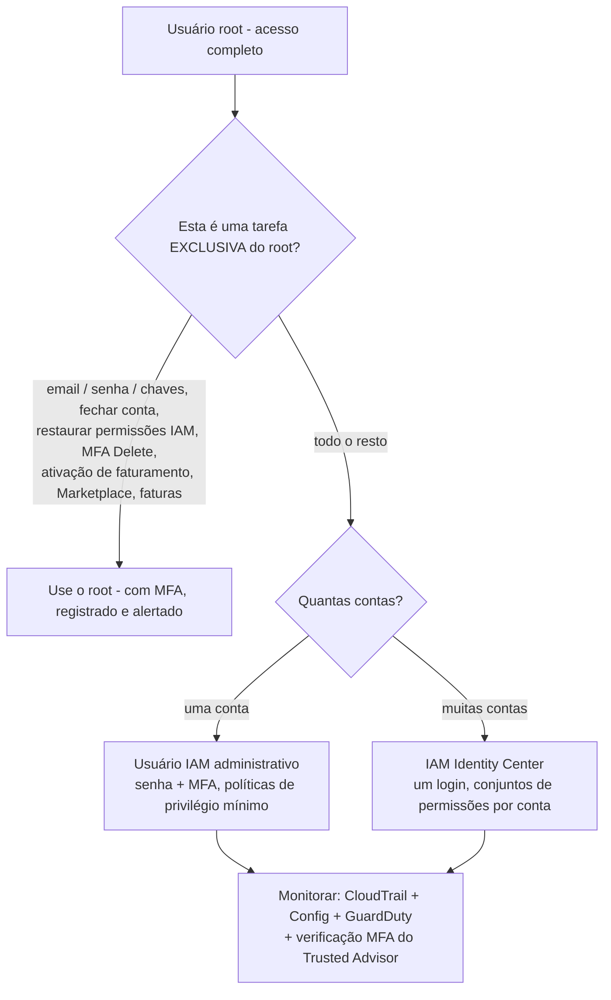
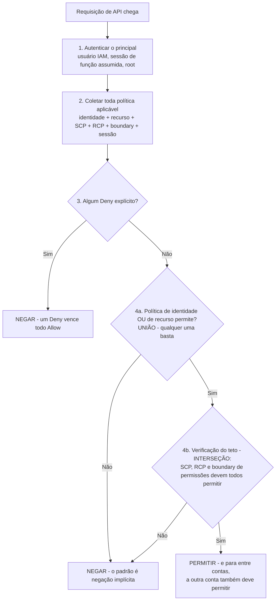
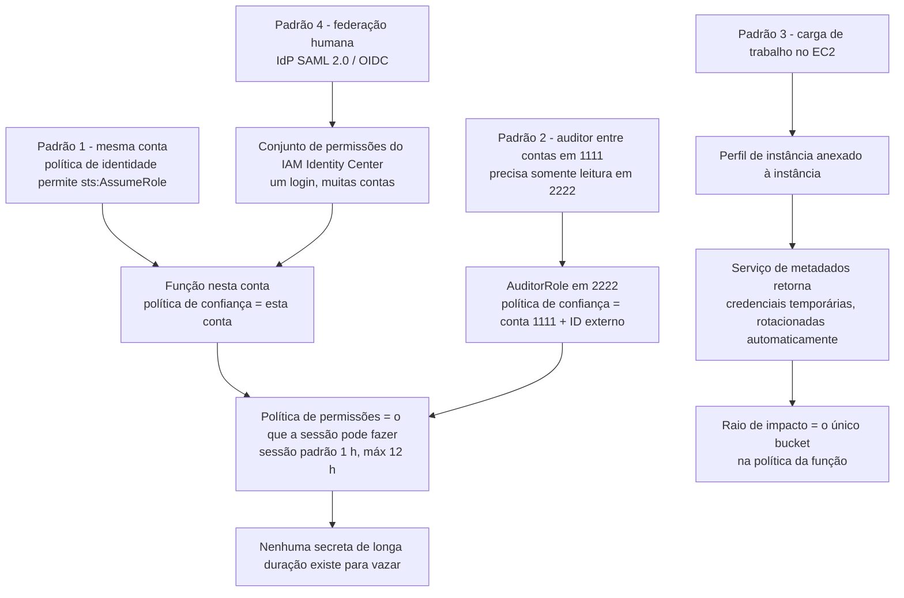
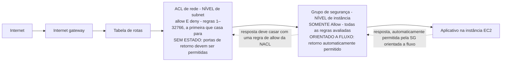
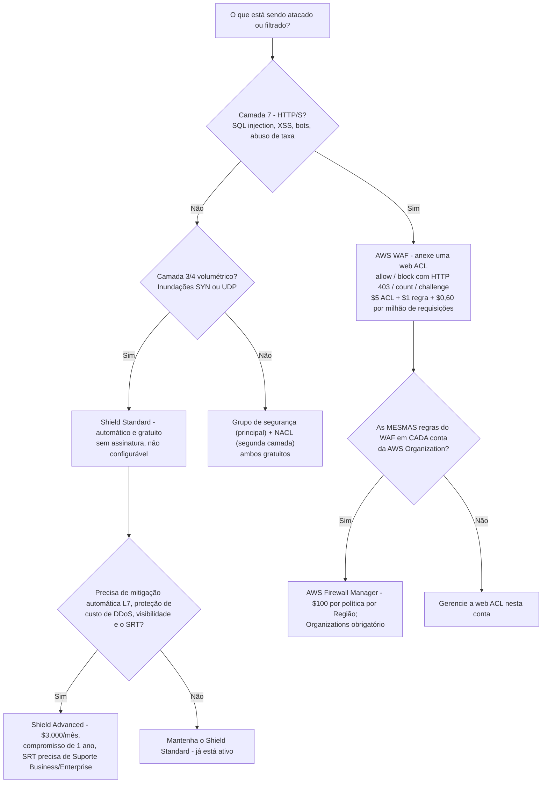
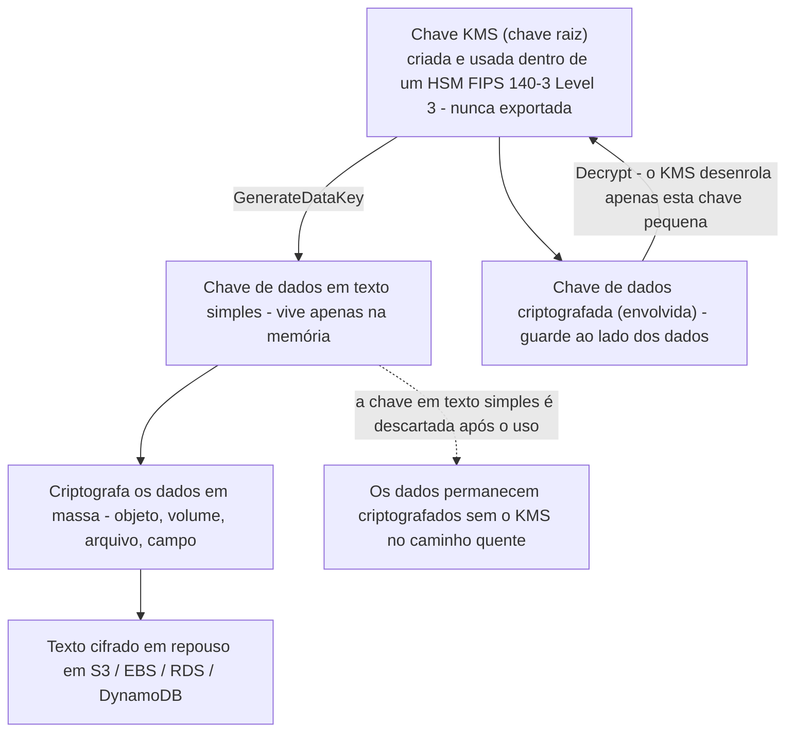

# Identidade, Controle de Acesso e Proteção de Dados

Segurança é o domínio individual mais pesado do CLF-C02: **o Domínio 2 carrega 30% do conteúdo pontuado**, e suas duas tarefas de acesso (2.3 "Identificar capacidades de gerenciamento de acesso da AWS" e 2.4 "Identificar componentes e recursos para segurança") são as mais confiavelmente testadas de todo o exame. O próprio enquadramento da AWS começa com uma frase desconfortável sobre o usuário root: ele tem *"acesso completo a todos os serviços e recursos da AWS"*. Todo o resto desta lição, MFA, funções, Identity Center, privilégio mínimo, grupos de segurança, WAF, criptografia, existe para garantir que essa frase nunca se torne um incidente.

```text
====================================================================
 CLF-C02 DOMÍNIO 2 — CARTÃO DA LIÇÃO DE SEGURANÇA (fatos em outubro de 2026)
====================================================================
 ROOT        1 identidade/conta · acesso completo · MFA em até
             35 dias · até 8 dispositivos MFA · SEM chaves de
             acesso · senha 8–128 caracteres, ≥ 3 de 4 classes
---------------------------------------------------------------------
 IAM         usuário = identidade permanente, credenciais de longo
             prazo (≤ 2 chaves de acesso)
             grupo = usuários + 1 política de identidade, NÃO é um
                     principal, não aninhável, sem grupo padrão
             função = política de permissões (o que) + política de
                     confiança (quem) -> credenciais temporárias STS
             política = baseada em identidade (usuário/grupo/função)
                        OU baseada em recurso (no próprio recurso)
 AVALIAÇÃO   qualquer Deny explícito vence -> identidade UNIÃO
             recurso -> teto: SCP + RCP + boundary devem todos permitir
             -> entre contas: AMBAS as contas devem permitir
---------------------------------------------------------------------
 REDE        grupo de segurança = nível de instância, SOMENTE Allow,
                     orientado a fluxo, todas as regras avaliadas,
                     padrão outbound allow-all / inbound de si mesmo
             ACL de rede       = nível de subnet, allow E deny,
                     sem estado, regras 1–32766 vence a primeira
                     que casa, padrão allow-all + `*` DENY catch-all
                     ambos: sem cobrança (em outubro de 2026)
---------------------------------------------------------------------
 BORDA       WAF = Camada 7 (SQLi, XSS), anexe uma web ACL,
                    $5/web ACL + $1/regra + $0,60/milhão de req
              Shield Standard = automático, $0, não configurável
              Shield Advanced = $3.000/mês, compromisso de 1 ano
              Firewall Manager = empurrão de política na org (Organizations)
---------------------------------------------------------------------
 DADOS       em repouso = KMS / SSE-S3 (padrão desde 2023-01-05)
             em trânsito = TLS 1.2 exigido, 1.3 recomendado
             criptografia de envelope: a chave KMS envolve a chave
             de dados, a chave de dados criptografa os dados em massa
====================================================================
```

> [!NOTE]
> **Disciplina de escopo.** Todo serviço nomeado como examinável nesta lição aparece na **lista no escopo** do CLF-C02 ou em uma declaração de tarefa do Domínio 2/3 (AWS Artifact, ACM, CloudHSM, Cognito, Detective, Directory Service, Firewall Manager, GuardDuty, IAM, IAM Identity Center, Inspector, KMS, Macie, RAM, Secrets Manager, Security Hub, Shield, WAF, além de CloudTrail, Config, CloudWatch, Trusted Advisor, Systems Manager das declarações de tarefa). Qualquer outra coisa é rotulada como aside de estudo de caso ou distrator fora do escopo, nunca como um fato que você deve selecionar.

Nesta lição você vai:

- proteger o **usuário root**: limites de dispositivos MFA, a regra dos 35 dias, sem chaves de acesso do root e as tarefas que só o root pode fazer;
- construir o IAM a partir de seus quatro objetos: **usuários, grupos, funções e políticas**;
- separar **políticas baseadas em identidade de baseadas em recurso** e executar a lógica de avaliação: negação explícita, união, tetos, entre contas;
- escolher **funções versus usuários** a partir do enunciado: entre contas, perfis de instância EC2, federação, ID externo;
- posicionar corretamente **IAM Identity Center (SSO da força de trabalho)**, **Cognito (identidade do cliente)** e **Directory Service (AD corporativo)**;
- escolher uma **opção de autenticação**: passkeys/FIDO, TOTP virtual, TOTP de hardware, chaves de acesso, credenciais temporárias do STS;
- comparar **grupos de segurança e ACLs de rede** em escopo, regras, orientação a fluxo e padrões;
- escolher entre **AWS WAF, Shield Standard, Shield Advanced e Firewall Manager**: com aritmética real de conta;
- proteger dados **em repouso e em trânsito** e seguir a **criptografia de envelope do KMS** e os três tipos de chave;
- resumir em uma linha cada **serviço de detecção de ameaças** no escopo e executar uma **checklist de privilégio mínimo**;
- estudar **quatro estudos de caso de segurança e conformidade publicados pela AWS**: política de rede centralizada, acesso baseado em identidade, controles FedRAMP herdados e autorização mais rápida;
- acompanhar as **atualizações de guia e ferramentas de 2026** que tocam IAM, escopo de política e ferramentas de segurança: cada item com fonte e data;
- praticar com **12 questões em formato de exame** mais quatro verificações interativas.

---

## 1. A conta root: uma identidade, alcance ilimitado

### 1.1 O que é o root

Existe exatamente **uma identidade root por conta da AWS**, um endereço de e-mail mais uma senha, e a AWS documenta que ela tem *"acesso completo a todos os serviços e recursos da AWS"*, incluindo faturamento. Ela não pode ser excluída, não pode ser restrita por uma política de IAM dentro da própria conta, e contorna verificações de MFA no momento em que é usada. É por isso que a tarefa 2.3 do Domínio 2 lista *"importância de proteger a conta da raiz (root) da AWS"* como **conhecimento** e *"identificar tarefas que apenas o usuário raiz da conta pode realizar"* como uma **habilidade**: o exame quer que você saiba tanto *por que* o root importa quanto *quais* tarefas genuinamente o exigem.

| Propriedade do root | O que a AWS documenta | Consequência no exame |
|---|---|---|
| Contagem | Uma identidade root por conta | "Criar um segundo usuário root" está sempre errado |
| Alcance | *"acesso completo a todos os serviços e recursos da AWS"* | Nenhuma política pode ser anexada para limitá-lo dentro da conta |
| Credenciais | Senha (8 to 128 caracteres, ≥3 de 4 classes de caracteres, não pode corresponder ao nome/e-mail da conta) | **Chaves de acesso do root nunca são recomendadas** |
| MFA | Registrar **em até 35 dias** do primeiro login; **até 8 dispositivos MFA**, qualquer mistura | MFA por SMS não é mais oferecido no IAM |
| Uso diário | Deve ser usado apenas para tarefas exclusivas do root | Trabalho administrativo pertence a um usuário do IAM ou ao Identity Center |

### 1.2 Tarefas que apenas o usuário root pode realizar

A lista é curta, memorizável e examinável; estas são as respostas para "qual ação exige o usuário root?":

- mudar o **e-mail, a senha ou as chaves de acesso** da própria identidade root (contas independentes);
- **fechar ou reabrir** uma conta independente;
- **restaurar permissões de usuários do IAM**: a recuperação do bloqueio do último administrador;
- ativar **acesso do IAM ao console de faturamento**;
- visualizar certas **faturas de impostos**;
- registrar-se no **EC2 Reserved Instances Marketplace**;
- ativar o **S3 MFA Delete**;
- editar ou excluir uma **política de recurso do S3 ou SQS que nega a todos os principais**;
- cadastro no GovCloud e chaves do root; vincular uma conta **Amazon Mechanical Turk**.

Todo o resto no exame, criar usuários do IAM, anexar políticas, iniciar EC2, escrever políticas de bucket, redefinir a senha de um colega, é feito por uma **identidade administrativa**, nunca pelo root.

### 1.3 Exemplo E1: endurecimento do root no dia 1, passo a passo

Uma nova conta de produção é aberta. A sequência de endurecimento abaixo usa apenas limites verificados:

| # | Ação | Número para lembrar |
|---|---|---|
| 1 | E-mail do root → um **apelido de grupo** (`aws-root@company.com`), não uma caixa pessoal | uma caixa compartilhada, telefone de recuperação separado |
| 2 | Senha forte do root | **8 to 128 caracteres**, ≥**3 de 4** classes |
| 3 | Registrar MFA: um **autenticador virtual no celular** *e* um **token de hardware no cofre** | **2 dos máximos 8** dispositivos; registro **em até 35 dias** |
| 4 | **Sem chaves de acesso do root**: nunca | 0 chaves |
| 5 | Identidade administrativa vive no **IAM Identity Center** (multi-conta) ou como usuário admin do IAM (conta única) | humanos recebem federação |
| 6 | Trilha **CloudTrail** para um bucket privado com validação de arquivo de log; **Config** e **GuardDuty** ligados | O histórico de eventos é grátis por **90 dias** |
| 7 | Regra do EventBridge no login do root → SNS → canal de chat | detecte uso incomum do root rápido |
| 8 | Na AWS Organizations: remova credenciais do root de contas membro e/ou anexe um **SCP** negando ações do root da conta membro | SCPs filtram, nunca concedem |

- **📚 Você sabia?** A página de melhores práticas do usuário root da AWS recomenda **aprovação multipessoal** para o root: um grupo detém a senha da conta, um grupo diferente detém o dispositivo MFA, então nenhum único funcionário pode agir como root sozinho. A mesma página limita o MFA a **oito dispositivos por usuário root** e diz para registrar o MFA do root **em até 35 dias** do primeiro login: dois números que o gosta de citar de volta para você (em outubro de 2026; verifique o estado atual antes do uso).



> [!WARNING]
> **Família de armadilhas do root.** Se uma opção descreve uma tarefa administrativa comum, "criar um usuário do IAM", "anexar uma política", "parar uma instância EC2", "mudar uma política de bucket", e a justificativa é "para que o root possa fazê-la", está errada: essas tarefas nunca exigem o root. As respostas corretas do root são a lista curta da §1.2, e *ativar o MFA Delete* é a que pega a maioria dos candidatos.

---

## 2. Blocos de construção do IAM: usuários, grupos, funções e políticas

### 2.1 Os quatro objetos, exatamente

| Objeto | O que é | Credenciais / mecânica | Armadilhas no exame |
|---|---|---|---|
| **Usuário do IAM** | Uma **identidade permanente** dentro de uma conta | Longo prazo: senha do console + MFA; **máximo de duas chaves de acesso por usuário**; chave secreta mostrada uma vez | Credenciais de longa duração = rotacionar e aposentar; não é a resposta padrão para cargas de trabalho |
| **Grupo do IAM** | Uma coleção de usuários que compartilha **uma política de identidade** | Sem credenciais próprias | **Não pode ser um `Principal`**, não pode ser aninhado, **sem grupo padrão de usuários** |
| **Função do IAM** | Um conjunto de permissões mais uma **política de confiança** definindo quem pode assumi-la | Assumi-la produz **credenciais de segurança temporárias do STS** | *"Funções são a principal forma de conceder acesso entre contas"* |
| **Política de permissões** | O documento que diz **o que** é permitido ou negado | JSON, anexada a um principal (baseada em identidade) ou a um recurso (baseada em recurso) | `Deny` explícito vence todo `Allow` |

Uma função tem **duas metades e ambas são obrigatórias**: a **política de permissões** responde *o que a sessão pode fazer*, a **política de confiança** (uma política baseada em recurso anexada à função) responde *quem pode assumi-la*. Uma política de permissões perfeitamente escrita com uma política de confiança que não nomeia ninguém é inútil: é uma porta trancada com uma placa escrita "somente funcionários" e nenhum funcionário listado nela.

### 2.2 Políticas baseadas em identidade versus baseadas em recurso

| | **Política baseada em identidade** | **Política baseada em recurso** |
|---|---|---|
| Anexada a | Usuário, grupo ou função | O próprio recurso (bucket S3, fila SQS, tópico SNS, chave KMS, endpoint de VPC, confiança de função) |
| Formato | Pode ser gerenciada pela AWS, gerenciada pelo cliente ou inline | **Somente inline** |
| Nomeia um principal? | Implícito, o principal a que está anexada | Pode nomear um principal em **outra conta da AWS** |
| Papel típico no exame | "Dê a esta equipe acesso de leitura a `reports/*`" | "Permita que esta conta 1111 leia este bucket" / "Negue requisições não-HTTPS" |

Políticas **gerenciadas pela AWS** são pontos de partida amplos, mantidos pela AWS (funções de trabalho como administração somente leitura). Políticas **gerenciadas pelo cliente** são as que você escreve e refina, o estado final de privilégio mínimo. Políticas **inline** são embutidas em um principal e são excluídas com ele, o que as torna úteis para permissões de uso único e perigosas como padrão.

### 2.3 Como a AWS avalia uma requisição: negação explícita vence

A ordem documentada da AWS, comprimida nos quatro movimentos que aparecem no exame:

1. **Autenticar** o chamador (quem é este?).
2. **Reunir** toda política aplicável: baseada em identidade *e* baseada em recurso, além de SCPs, RCPs, boundaries de permissão e políticas de sessão.
3. **Qualquer `Deny` explícito em qualquer lugar vence.** A AWS *"primeiro verifica todas as políticas em busca de um `Deny`"*: uma negação, em qualquer documento aplicável, vence todo allow.
4. Caso contrário, calcule a **união** dos allows baseados em identidade e em recurso, e então intersecte-a com o **teto**: boundaries de permissão, SCPs e RCPs devem *todos* permitir (uma **interseção**). **SCPs não concedem nada**: eles apenas filtram o que uma identidade dentro da conta poderia de outra forma fazer.



> [!NOTE]
> **União versus interseção é a frase de maior rendimento do Domínio 2.** Identidade ∪ recurso = **união** (qualquer documento pode permitir). Boundary / SCP / RCP = **interseção** (todos devem permitir; eles só podem restringir). E a alegação *"anexar um SCP para conceder acesso"* está sempre errada: políticas de controle de serviço *filtram*, elas nunca *dão*.

### 2.4 Exemplo E2: permissões efetivas do João (três camadas)

A política de identidade do João permite `s3:Get*` em `reports/*`. A política do bucket `reports` diz **Negar `s3:*` quando `aws:SecureTransport` for falso**. O SCP da conta diz **Negar `s3:*` fora da Região principal**.

| Requisição | Camadas em jogo | Resultado | Por quê |
|---|---|---|---|
| (a) GET HTTPS, Região principal | 1 allow, 0 negações aplicáveis | **Permitido** | Identidade ∪ recurso = união de allows; nenhuma negação casou |
| (b) GET HTTP simples, Região principal | 1 allow, 1 negação de recurso | **Negado** | `Deny` explícito do recurso vence o `Allow` da identidade |
| (c) GET HTTPS, outra Região | 1 allow, 1 negação de SCP | **Negado** | O teto do SCP intersecta: ele só pode subtrair, nunca somar |

Conte as camadas: **um allow, duas negações, três tipos de política**, e leia a direção de cada requisição antes de escolher. Note o que aconteceria se a política de identidade fosse removida: (a) se torna uma negação implícita, então remover uma concessão é uma mitigação real, não uma formalidade.

### 2.5 Boundaries de permissão e as ferramentas de privilégio mínimo

Um **boundary de permissão** é uma política gerenciada que define o **máximo** que uma política de identidade pode conceder. Ele não concede nada por si só; seu caso de uso no exame é a **delegação segura**: deixe um desenvolvedor escrever a própria política de identidade, mas limite-a com um boundary para que ele nunca possa exceder, digamos, somente leitura mais um bucket de sandbox. O kit de ferramentas de restrição para privilégio mínimo é:

- comece por uma **política de função de trabalho gerenciada pela AWS**;
- refine com o **IAM Access Analyzer** (gera políticas a partir da atividade do CloudTrail, valida acesso externo/público, pré-visualiza exposição entre contas);
- verifique as **informações de último acesso** para excluir permissões que ninguém usa.

- **📚 Você sabia?** Um **grupo não pode ser usado como um `Principal`** em nenhuma política da AWS: você anexa uma política *a* um grupo, mas nunca pode *permitir um grupo* em uma política de bucket ou de confiança de função; você deve nomear seus usuários ou, melhor, uma função. Grupos também não podem ser aninhados, e **não existe grupo padrão de usuários** no IAM (em outubro de 2026).

```matching
{
  "question": "Associe cada documento de política ao único trabalho que ele executa na lógica de avaliação da AWS:",
  "pairs": [
    {"left": "Política baseada em identidade em um usuário, grupo ou função", "right": "Concede ações ao principal a que está anexada: uma metade da UNIÃO com políticas baseadas em recurso"},
    {"left": "Política baseada em recurso em um bucket S3, fila ou tópico", "right": "Vive no próprio recurso, é somente inline e pode nomear um principal em outra conta da AWS"},
    {"left": "Política de confiança em uma função do IAM", "right": "Documento baseado em recurso que responde QUEM pode assumir a função; não concede ações por si só"},
    {"left": "Boundary de permissão", "right": "Política gerenciada definindo o MÁXIMO que uma política de identidade pode conceder: um teto dentro da INTERSEÇÃO"},
    {"left": "Política de controle de serviço (SCP)", "right": "Anexada a UPs ou contas na AWS Organizations; filtra o que uma identidade poderia fazer e nunca concede"},
    {"left": "Negação na política do bucket quando aws:SecureTransport é falso", "right": "Um Deny explícito que vence todo Allow, então HTTP simples falha mesmo quando uma política de identidade permite"}
  ],
  "explanation": "Leia a direção de cada documento. Políticas baseadas em identidade e em recurso formam uma UNIÃO: qualquer uma pode permitir. Boundaries de permissão, SCPs e RCPs formam um teto de INTERSEÇÃO que só pode subtrair. Uma política de confiança é baseada em recurso mas autoriza apenas a assunção, e um único Deny explícito: como uma condição aws:SecureTransport: encerra a avaliação em uma negação não importa quantos Allows existam."
}
```

---

## 3. Funções versus usuários: a decisão que o exame repete

### 3.1 A tabela de casos de uso

| Use uma **função** quando… | O mecanismo | Use um **usuário do IAM** apenas quando… |
|---|---|---|
| Uma carga de trabalho roda no **EC2 / Lambda / ECS / EKS** | **Perfil de instância** (EC2) ou **função de execução**; credenciais vêm do serviço de metadados da instância e **se auto-atualizam** | A carga de trabalho genuinamente não consegue assumir funções (alguns plugins de terceiros) |
| **Acesso entre contas** | Função na conta confiante; a política de identidade do chamador concede `sts:AssumeRole` | Uma conta legada ou de emergência com MFA e controles apertados |
| **Federação** de usuários humanos | IdP SAML 2.0 / OIDC, ou **conjuntos de permissões do IAM Identity Center** | Ferramentas da AWS de terceiros sem suporte ao Identity Center |
| Um **auditor externo** precisa de acesso | Função + **ID externo** na política de confiança (defesa contra deputado confuso) | Credenciais de longa duração específicas do serviço (desencorajado) |
| Um **serviço age em seu nome** | Função de serviço ou **função vinculada ao serviço** |: |
| "…sem **credenciais de longa duração**" em qualquer lugar | Credenciais temporárias do STS | Uma chave CLI de longa duração em um laptop (permitido, não preferido) |

Aritmética de sessão que vale memorizar: sessões `AssumeRole` duram até **43.200 segundos = 12 horas**, enquanto o **encadeamento de funções** (assumir uma segunda função a partir de uma primeira) é limitado a **1 hora**: uma diferença de 12×. Durante uma sessão, as permissões da função **substituem** as do chamador pela duração.



### 3.2 Exemplo E3: a função de auditoria entre contas

Um auditor na **conta 1111** precisa de acesso somente leitura à **conta 2222**. Dois documentos, ambos obrigatórios:

| Conta | Documento | Conteúdo |
|---|---|---|
| 2222 (confiante) | **Política de confiança do `AuditorRole`** (baseada em recurso) | Permite `sts:AssumeRole` para a conta **1111**, com um **ID externo** porque um terceiro está envolvido |
| 2222 | Política de permissões da função | Permissões no estilo `ReadOnlyAccess` |
| 1111 (chamadora) | Política de identidade no grupo do auditor | Permite `sts:AssumeRole` naquele **ARN** de função |

**Qualquer política sozinha falha**: confiança sem concessão de identidade dá "você não está autorizado"; concessão de identidade sem confiança dá "não autorizado a executar sts:AssumeRole". A sessão é **temporária** (1 hora por padrão, até 12 horas): nada para vazar, nada para rotacionar, e o acesso desaparece quando a confiança da função é revogada.

### 3.3 Exemplo E4, o perfil de instância EC2, zero chaves embarcadas

Um aplicativo no EC2 deve ler `s3://photos`. Em vez de copiar uma chave de acesso na AMI:

1. Crie a função `Get-pics` cuja **política de confiança** permite o serviço `ec2.amazonaws.com`.
2. Anexe uma política de permissões permitindo **`s3:GetObject` somente naquele bucket**.
3. Anexe a função à instância por meio de um **perfil de instância**.
4. O SDK lê credenciais temporárias do serviço de metadados da instância e **as atualiza antes do vencimento**, o desenvolvedor nunca vê uma secreta.

Se a instância for comprometida, o atacante herda exatamente uma permissão em exatamente um bucket: o **raio de impacto é o documento de política**, não a conta da AWS da empresa. Contraste com a resposta do usuário do IAM: uma chave de acesso embutida em uma AMI é uma credencial sem vencimento, sem fronteira de escopo além de sua política, e um hábito que o exame marca como errado.

- **📚 Você sabia?** O encadeamento de funções merece seu próprio mnemônico: **12 horas para um único `AssumeRole`, 1 hora para um encadeado** (43.200 s vs 3.600 s, em outubro de 2026). A AWS limita o encadeamento precisamente porque cada salto multiplica a chance de uma sessão obsoleta sobreviver à pessoa que a iniciou.

---

## 4. IAM Identity Center: a resposta da força de trabalho

O **AWS Single Sign-On foi renomeado AWS IAM Identity Center** em **26 de julho de 2022**, e o exame ainda recompensa você por saber os dois nomes. O Identity Center é o SSO da **força de trabalho** da AWS: funcionários recebem **um login** que abre muitas contas da AWS e aplicativos da AWS, com permissões entregues por meio de **conjuntos de permissões**, o pacote nomeado de permissões da AWS aplicado a um usuário ou grupo, sem chaves de longa duração.

| Atributo | Detalhe (profundidade do exame) |
|---|---|
| Para quem é | **Força de trabalho**: funcionários e contratados, não os clientes do seu aplicativo |
| Fonte de identidade | Diretório interno, ou um provedor de identidade externo **SAML 2.0 / OIDC** |
| Modelo de concessão | **Conjuntos de permissões** aplicados a usuários ou grupos; o acesso é vinculado à sessão e não emite chaves de longa duração |
| Escopo | Uma **instância de organização** é recomendada para que todas as contas compartilhem um diretório |
| Relação com o IAM | O Identity Center *usa* funções do IAM por baixo; ele não substitui o IAM em si |

O padrão para memorizar: **12 contas, um login, sem usuários do IAM** → IAM Identity Center. A própria redação de melhores práticas da AWS é *"Exigir que usuários humanos usem federação"* e preferir *"MFA resistente a phishing, como passkeys e chaves de segurança"*, o Identity Center é como essa recomendação escala além de um punhado de contas.

> [!IMPORTANT]
> **Os três serviços de identidade, nunca trocados:**
> - **IAM Identity Center** → sua **força de trabalho** (funcionários) em contas da AWS;
> - **Amazon Cognito** → os **clientes do seu aplicativo** (cadastro/login em um site ou aplicativo móvel);
> - **AWS Directory Service** → um **Active Directory corporativo** (AWS Managed Microsoft AD, AD Connector como *"um serviço de proxy"*, ou Simple AD).
>
> Uma pergunta sobre 700 funcionários em 12 contas é Identity Center; uma pergunta sobre compradores criando uma conta no seu app é Cognito; uma pergunta sobre usuários de AD on-premises alcançando EC2 é Directory Service.

---

## 5. Amazon Cognito: identidade do cliente na profundidade do exame

O Cognito é a opção de **identidade do cliente (CIAM)**, e a AWS o descreve como três coisas em um serviço: *"um diretório de usuários, um servidor de autenticação e um serviço de autorização"*. Ele fica em uma altitude diferente do IAM: os usuários do seu aplicativo não são usuários do IAM e nunca veem o console da AWS.

| Componente | O que faz | O que retorna |
|---|---|---|
| **User pool** | O **diretório de usuários + autenticação**: cadastro/login, federação a IdPs sociais/corporativos, políticas de senha, **MFA por TOTP ou SMS** | **Tokens JWT** para o seu app |
| **Identity pool** | **Autorização**: troca um token válido (de um user pool ou outro IdP) por acesso à AWS | **Credenciais temporárias da AWS de privilégio limitado** via STS |
| Ambos juntos | O app autentica o cliente *e então* toca S3/DynamoDB/Lambda diretamente | Diretório → token → credenciais do STS |

A profundidade do exame para exatamente aí: saiba que **user pools autenticam**, **identity pools autorizam acesso à AWS**, que as credenciais da AWS são **temporárias**, e que o Cognito é para *clientes* enquanto o IAM Identity Center é para a *força de trabalho*. Tópicos mais profundos (customização da UI hospedada, triggers lambda, recursos avançados de segurança) não é o que uma pergunta de praticante pede.

```fillblank
{
  "question": "Complete o vocabulário de identidade para o CLF-C02:",
  "template": "Funcionários em 12 contas da AWS entram uma vez via {{1}}, que entrega acesso por meio de {{2}} aplicados a seus usuários e grupos, sem chaves de longa duração. Os compradores de um aplicativo usam o {{3}}, cujo {{4}} mantém o diretório e emite JWTs, enquanto seu {{5}} troca um token por credenciais temporárias da AWS do STS.",
  "answers": {
    "1": "AWS IAM Identity Center",
    "2": "permission sets",
    "3": "Amazon Cognito",
    "4": "user pool",
    "5": "identity pool"
  },
  "distractors": ["AWS Directory Service", "AWS CloudHSM", "security group", "trust policy", "Amazon Inspector", "resource-based policy"],
  "explanation": "IAM Identity Center é a resposta do SSO da força de trabalho: o AWS Single Sign-On foi renomeado para ele em 26 de julho de 2022: e permission sets são seu modelo de concessão: pacotes de permissões nomeados aplicados a usuários e grupos, emitidos sem chaves de longa duração. Cognito é identidade de cliente: o user pool é o diretório mais autenticação (JWTs), e o identity pool retorna credenciais temporárias da AWS de privilégio limitado do STS. Directory Service é Active Directory corporativo, não identidade de cliente."
}
```

---

## 6. Opções de autenticação e MFA

### 6.1 As cinco maneiras de provar quem você é

| Opção | Vida útil da credencial | Uso típico | Limites (em outubro de 2026) |
|---|---|---|---|
| **Senha do console + MFA** | Senha de longa duração | Login humano no console | **Passkeys / chaves de segurança FIDO** (resistentes a phishing, recomendadas), **autenticador virtual (TOTP)**, **TOTP de hardware**; **até 8 dispositivos MFA**; **suporte a MFA por SMS encerrado** |
| **Chaves de acesso** | Longo prazo | CLI, SDK, API de uma estação de trabalho | **Máximo de duas chaves de acesso por usuário**; chave secreta mostrada **uma vez**; nunca commite no controle de código-fonte |
| **Credenciais temporárias do STS** | Minutos a 12 horas | Funções, perfis de instância, funções de execução do Lambda, identity pools do Cognito, IAM Roles Anywhere | Padrão preferido: vence sozinha |
| **IAM Identity Center** | Vinculada à sessão, federada | Força de trabalho em contas | Um login, conjuntos de permissões, sem chaves de longa duração |
| **Directory Service** | Diretório corporativo | Identidades de AD on-premises alcançando a AWS | AWS Managed Microsoft AD, AD Connector (proxy), Simple AD |

A redação de melhores práticas da AWS para reconhecer: *"Exigir que usuários humanos usem federação"* e usar *"MFA resistente a phishing, como passkeys e chaves de segurança"*. A opção armadilha recomenda **MFA por SMS**: a AWS encerrou o suporte para habilitar autenticação multifator por SMS no IAM, então qualquer resposta que diga "habilitar MFA por SMS no usuário root" está errada.

> ⚠️ **Dois números de credencial, duas armadilhas.** Primeiro, **MFA por SMS não é uma opção do IAM**: os fatores suportados são passkeys/chaves de segurança FIDO (resistentes a phishing e recomendados), autenticador virtual (TOTP) e TOTP de hardware, então "proteger o usuário root com um código SMS" está sempre errado, ainda que um **user pool do Cognito** ainda possa enviar códigos SMS aos *clientes* do seu aplicativo. Segundo, **dois é o teto de chaves de acesso por usuário do IAM** e **zero** é a recomendação para o root; uma "correção" que cunha uma terceira chave, ou uma chave de acesso do root "só para este script", responde à pergunta errada.

### 6.2 Onde os segredos vivem

A tarefa 2.3 nomeia explicitamente o armazenamento de credenciais: **AWS Secrets Manager** e **AWS Systems Manager Parameter Store (SecureString)**. Chaves codificadas em um repositório, em uma AMI ou em variáveis de ambiente de um Lambda público são o antipadrão que o exame testa por inversão: a resposta correta sempre recupera um segredo em tempo de execução de um desses dois serviços, ou evita o segredo inteiramente usando uma função.

### 6.3 Exemplo E5: contando as credenciais em uma conta

Uma configuração de conta única tem: root (0 chaves de acesso), 6 usuários do IAM cada um com 2 chaves de acesso, 10 funções, 3 conjuntos de permissões no Identity Center.

| Identidade | Secretas de longa duração | Credenciais temporárias |
|---|---|---|
| Root | **0** (a política as proíbe) |: |
| 6 usuários do IAM | **12** pares de chaves de acesso no teto (6 × 2) | Sessões de console com MFA |
| 10 funções | 0 | Até **12 horas** por sessão `AssumeRole` (1 hora se encadeada) |
| 3 conjuntos de permissões | 0 | Acesso vinculado à sessão em cada conta |

A pergunta de auditoria se escreve sozinha: **12 secretas de longa duração existem e só 2 pessoas precisam delas.** A correção não é "adicionar MFA": é substituir os usuários por **grupos e funções do Identity Center**, excluir as chaves não usadas e manter os pares restantes em um cronograma de rotação.

- **📚 Você sabia?** O teto de **duas chaves de acesso por usuário** é deliberado: cunhe a chave um enquanto a chave dois ainda está viva permite rotacionar sem downtime (atualize o aplicativo, então exclua a chave antiga). A AWS mostra a secreta **exatamente uma vez**: depois disso, a única recuperação é criar um novo par de chaves, razão pela qual "ver a chave secreta antiga novamente" nunca é uma opção válida.

---

## 7. Grupos de segurança versus ACLs de rede

Ambos são os filtros de pacotes da VPC, ambos são **gratuitos** (em outubro de 2026), e diferem em quatro eixos que o exame testa sem piedade.

| Característica | **Grupo de segurança** | **ACL de rede** |
|---|---|---|
| Escopo | **Nível de instância / interface de rede** | **Nível de subnet** (uma NACL padrão por subnet) |
| Ação da regra | **Somente Allow: sem regras de deny** | **Allow e deny** |
| Avaliação | **Todas as regras avaliadas**; permite se qualquer casar | Regras numeradas **1 to 32766**, **menor primeiro, a primeira que casa para** |
| Estado | **Orientado a fluxo**, o tráfego de retorno é automaticamente permitido | **Sem estado**, o tráfego de retorno deve ser explicitamente permitido |
| Padrão | Inbound **apenas de si mesmo**; **outbound permite tudo** | **Permite tudo inbound e outbound** além de DENY catch-all `*` |
| Referência | Pode referenciar **outros grupos de segurança** | Não pode referenciar grupos de segurança |
| Cobrança | Nenhuma | Nenhuma |
| Orientação AWS | *"Use grupos de segurança como o mecanismo principal"* | Segunda camada de defesa em profundidade / lista de negação |

Duas consequências seguem diretamente da coluna de estado: com um grupo de segurança **orientado a fluxo** você abre 443 inbound e as respostas fluem de volta automaticamente; com uma NACL **sem estado** você deve **também** permitir as portas de retorno efêmeras inbound, ou a conexão nunca completa. E nenhum dos dois dispositivos filtra **DNS, DHCP, o serviço de metadados da instância, os metadados de tarefa do ECS ou o Time Sync**: esses os contornam por design.

### 7.1 Os padrões não são "seguros"

- O **grupo de segurança padrão** permite todo outbound e inbound **apenas de si mesmo**: utilizável, não seguro.
- A **ACL de rede padrão** permite **todo** tráfego para dentro e para fora, além de regras DENY `*` que sempre ficam no fundo da lista: permissiva por padrão, com o catch-all de negação disponível para um bloqueio rápido.

Nenhum padrão é a resposta para "como eu restrinjo isso", e *"adicionar uma regra de deny ao grupo de segurança"* está sempre errado: **grupos de segurança não têm regras de deny**: use uma NACL, ou negue na camada de IAM/política de bucket.

### 7.2 Exemplo E6: defesa de rede em camadas

Um aplicativo de três camadas voltado para a internet, montado a partir de comportamento verificado:

| Camada | Dispositivo | Regra | Por quê aqui |
|---|---|---|---|
| 1. Internet → ALB | **Grupo de segurança** no ALB | Permitir **443 de 0.0.0.0/0** apenas | Nível de instância, orientado a fluxo, mecanismo principal |
| 2. ALB → camada de app | **Grupo de segurança** nas instâncias de app | Permitir 8080 **do grupo de segurança do ALB** (referência de SG) | As camadas confiam umas nas outras, não no mundo |
| 3. App → banco de dados | **Grupo de segurança** no RDS | Permitir 5432 **apenas do grupo de segurança do app** | Nunca abra o banco a uma subnet |
| 4. Borda da subnet pública | **ACL de rede** | **Negar** um CIDR conhecido como ruim, regra numerada **100** (sem estado, a primeira que casa vence) | Negação instantânea em toda a subnet sem tocar nas instâncias |
| 5. Camada HTTP | **Web ACL do AWS WAF** no ALB | AWS Managed Rules (SQLi, XSS, entradas ruins) + regra baseada em taxa | Inspeção de camada 7 que uma NACL não faz |
| 6. DDoS volumétrico | **Shield Standard** | Já ativo, sem assinatura | Automático em L3/L4 |
| 7. Escala de organização | **AWS Firewall Manager** | Empurrar a política do WAF para cada UP | Contas novas a herdam |

O modelo mental: **NACL = o segurança da subnet com uma lista negra; grupo de segurança = o firewall da instância com apenas uma lista de convidados; WAF = o inspetor da camada de aplicativo; Shield = o guarda-chuva anti-DDoS.**



- **📚 Você sabia?** Regras de grupo de segurança podem **referenciar outros grupos de segurança**, é assim que o padrão em camadas acima funciona sem codificar blocos CIDR, e é por isso que mover uma camada de aplicativo para uma nova subnet exige **nenhuma edição de regra**. ACLs de rede, em contraste, são vinculadas à subnet e baseadas em IP por natureza (em outubro de 2026; cotas por VPC e por SG se aplicam, verifique o estado atual antes do uso).

---

## 8. AWS WAF, AWS Shield e AWS Firewall Manager

Três serviços, três altitudes. Confundi-los custa várias perguntas, porque cada um tem uma identidade de uma frase:

| | **AWS WAF** | **AWS Shield Standard** | **AWS Shield Advanced** | **AWS Firewall Manager** |
|---|---|---|---|---|
| Camada | **7**: requisições HTTP/S | **3/4** volumétrico (mais mitigação L7 no Advanced) | **3/4 + mitigação automática L7** | Administração de política, não filtragem de pacotes |
| O que para | *"SQL injection ou XSS"*, bots, abuso de taxa | *"Inundações SYN ou UDP"* automaticamente | O mesmo, mais ataques avançados |: (ele **gerencia** os outros) |
| Ativação | **Anexe uma web ACL** ao CloudFront, ALB, API Gateway, AppSync, Cognito, App Runner, Amplify | **Automático, sem assinatura** | Pago, **compromisso de 1 ano** | Exige **AWS Organizations** |
| Custo (em outubro de 2026) | **$5 por web ACL/mês** + **$1 por regra/mês** + **$0,60 por milhão de requisições** | **$0**: *"fornecido automaticamente e sem custo adicional"* | **$3.000/mês por pagador** + cobranças de transferência de saída de dados do DDoS | **$100 por política por Região por mês** |
| Assinatura | Ações: allow / **block (HTTP 403)** / count / challenge | Não configurável | **Shield Response Team** (exige **Suporte Business ou Enterprise**) | Política central, painel de conformidade, cobertura automática de recursos novos |

A capacidade do WAF é medida em **Web ACL Capacity Units (WCUs)**; regras podem ser personalizadas, **AWS Managed Rules** ou grupos de regras do Marketplace, além de conjuntos de IP/regex e regras baseadas em taxa. O Shield Advanced também inclui **até 50 bilhões de requisições WAF por mês** por ID de pagador e **proteção de custo de DDoS** (reembolso de cobranças de escalonamento causadas por um ataque).

### 8.1 Exemplo E7: a conta do WAF

A AWS publica seu próprio exemplo resolvido, e a aritmética se generaliza:

| Configuração | Matemática mensal | Total |
|---|---|---|
| 1 web ACL + 5 regras + 10 M de requisições | $5 + (5 × $1) + (10 × $0,60) | **$16,00** |
| Caso publicado pela AWS: 1 web ACL + 19 regras + 10 M de requisições | $5 + $19 + $6 | **$30,00** |
| 3 web ACLs + 24 regras + 35 M de requisições | $15 + $24 + $21 | **$60,00** |

Observe o que **não** aparece na conta: grupos de segurança e ACLs de rede são **gratuitos**, então "adicionar uma regra de grupo de segurança" é a resposta de custo quando a pergunta é sobre filtrar tráfego que nunca alcança um conjunto de regras HTTP.

### 8.2 Exemplo E8: aritmética do Shield Advanced

| Cenário | Matemática (em outubro de 2026) | Total |
|---|---|---|
| Assinatura Shield Advanced, sem ataque | $3.000 | **$3.000/mês**, compromisso de 1 ano |
| + 1.000 GB de transferência de saída de dados de DDoS via **ELB/EC2/Global Accelerator** | $3.000 + (1.000 × $0,050) | **$3.050/mês** |
| + 1.000 GB de DDoS out via **CloudFront** | $3.000 + (1.000 × $0,025) | **$3.025/mês** |
| Uma política do Firewall Manager, uma Região | $100 (o exemplo completo publicado pela AWS com cobranças de WAF e Config totaliza **$106,40**) | **≈$106,40/mês** |

O teste de redação é confiável: **"proteção DDoS gratuita e automática"** → Shield Standard; **"parar SQL injection neste ALB"** → WAF; **"aplicar este conjunto de regras a cada conta na organização"** → Firewall Manager.



> [!WARNING]
> **As três armadilhas do WAF/Shield.** (1) *"Assinar o Shield Standard"*: impossível, é automático e gratuito. (2) *"Configurar regras do Shield Standard"*: não configurável; a configuração pertence ao WAF ou ao Shield Advanced. (3) *"Firewall Manager inspeciona pacotes"*: não inspeciona; ele **empurra política** (WAF, Shield Advanced, grupos de segurança, ACLs de rede, Network Firewall, DNS Firewall) por uma **AWS Organization** e exige que Organizations esteja habilitado.

---

## 9. Proteção de dados: em repouso, em trânsito e KMS

### 9.1 As duas direções

| | **Criptografia em repouso** | **Criptografia em trânsito** |
|---|---|---|
| Protege contra | Alguém lendo o meio: um disco roubado, um snapshot copiado, um backup vazado | *"escuta clandestina, adulteração de dados e ataques man-in-the-middle"* |
| Mecanismo | Chaves do **KMS** e criptografia no lado do serviço (SSE) | **TLS/SSL**: HTTPS, VPN, Direct Connect; condições `aws:SecureTransport` |
| Exemplo padrão AWS | **O SSE-S3 tem sido o nível base de criptografia para todo bucket desde 5 de janeiro de 2023** (AES-256, sem custo adicional) | As APIs da AWS exigem **TLS 1.2** e recomendam **TLS 1.3** |
| Redação no exame | "O S3 criptografa dados automaticamente" = **em repouso** | Sempre procure HTTPS/TLS/VPN na opção |

**Escolhas de criptografia do S3** na profundidade do exame: **SSE-S3** (padrão, gratuito), **SSE-KMS** (cobranças por requisição, além de um trilha de auditoria por uso no CloudTrail), **DSSE-KMS** (camada dupla), **SSE-C** (você fornece a chave) e criptografia no cliente. Imponha trânsito com uma política de bucket ou um SCP que nega `aws:SecureTransport = false`: a negação da §2.4, aplicada à proteção de dados.

### 9.2 KMS: chaves e criptografia de envelope

O AWS Key Management Service mantém chaves dentro de **módulos de hardware de segurança (HSMs) validados FIPS 140-3 Security Level 3**: as chaves são geradas lá e **nunca saem daquele limite sem criptografia**. Como chamar o HSM para cada byte seria absurdo, o KMS usa **criptografia de envelope**: *"criptografar a chave de dados sob outra chave"*.



| Tipo de chave | Quem a possui | Custo (em outubro de 2026) | Controle |
|---|---|---|---|
| **Gerenciada pelo cliente** | Você, na sua conta | **Taxa mensal** (proporcional por hora) **+ taxa de uso** | Política de chave, habilitar/desabilitar, agendar exclusão, rotação personalizada |
| **Gerenciada pela AWS** | Você, na sua conta, alias `aws/<serviço>` (ex.: `aws/ebs`) | **Sem taxa mensal**; apenas cobranças de uso | Política de chave fixa, **rotação automática a cada cerca de 365 dias**, não editável nem excluível por você |
| **Possuída pela AWS** | A própria conta do serviço | Grátis | Não visível para você, não auditável, não excluível por você |

Rotacionar a chave **nunca recriptografa seus dados em massa**: a chave raiz apenas reenvolve a chave de dados, que é a razão prática de a criptografia de envelope existir.

### 9.3 Exemplo E9: criptografia de envelope em um objeto de 1 GB

1. Seu aplicativo chama o KMS `GenerateDataKey` com uma chave gerenciada pelo cliente. O KMS retorna **uma chave de dados em texto simples** e **a mesma chave criptografada sob a chave KMS**.
2. O aplicativo criptografa o **objeto de 1 GB** com a chave de dados em texto simples na memória; a chave em texto simples é descartada.
3. A **chave de dados envolvida** é armazenada ao lado do texto cifrado. O KMS nunca vê o objeto; o HSM nunca exporta a chave raiz.
4. Para ler o objeto depois, o aplicativo envia apenas a **chave envolvida** de volta ao KMS (`Decrypt`), recebe a chave em texto simples e decriptografa localmente.
5. Se você rotacionar a chave KMS amanhã, **apenas o envolvimento do passo 4 muda**, o objeto de 1 GB permanece intocado.

| Abordagem | O que a AWS mantém | O que você administra | Pista no exame |
|---|---|---|---|
| **KMS** | Frota de HSMs gerenciada e compartilhada; políticas de chave + IAM | Política de chave, rotação, auditoria de uso, precificação por uso | *"Conveniente, integrado, pague conforme usa"* |
| **CloudHSM** | HSMs dedicados **single-tenant**; *"criptografia ponta a ponta não é visível para a AWS"* | Você administra os usuários do HSM (fora do IAM) e os algoritmos | *"A AWS não pode ver meus dados e eu controlo a criptografia"* |

- **📚 Você sabia?** Chaves KMS gerenciadas pela AWS agora rotacionam **a cada cerca de 365 dias**, uma mudança feita em **maio de 2022**, quando o intervalo encurtou de três anos, e **não carregam taxa mensal de chave** (taxas de uso ainda se aplicam, em outubro de 2026). A chave gerenciada pelo cliente é o único tipo que lhe dá controle da política de chave, habilitar/desabilitar, exclusão agendada e rotação personalizada, razão pela qual "qual chave me dá controle total" quase sempre significa **gerenciada pelo cliente**, não "a que eu criei" versus "a que a AWS criou".

---

## 10. Detecção de ameaças, auditoria e postura: resumos no escopo

A tarefa 2.4 do Domínio 2 pede que você descreva recursos de segurança e identifique *"serviços para identificar problemas de segurança"*. Cada linha abaixo está na lista no escopo do CLF-C02 ou em uma declaração de tarefa do Domínio 2: nada mais.

| Serviço | Uma linha (o que é) | Entradas / detalhe |
|---|---|---|
| **Amazon GuardDuty** | **Detecção de ameaças** | Eventos de gerenciamento do AWS CloudTrail, **VPC Flow Logs** e **logs de DNS** (+ planos de proteção opcionais), inteligência de ameaças e ML → achados |
| **Amazon Inspector** | **Gerenciamento de vulnerabilidades**: varredura contínua de **EC2, imagens ECR e Lambda** | CVEs e exposição de rede |
| **Amazon Macie** | **Descoberta de dados sensíveis no S3** usando *"aprendizado de máquina e correspondência de padrões"* | PII, credenciais, achados de bucket público; **teste grátis de 30 dias** na primeira ativação |
| **Amazon Detective** | **Investigação**: *"analisar, investigar e identificar rapidamente a causa raiz"* | Grafo de comportamento construído a partir do CloudTrail, VPC Flow Logs e achados do GuardDuty |
| **AWS Security Hub** | **Agregador / CSPM**: consolida e prioriza achados, verifica contra padrões | O painel único para onde outros serviços alimentam |
| **AWS Trusted Advisor** | **Verificações de melhores práticas** em segurança, custo, limites e tolerância a falhas | Inclui a verificação de **MFA no root** |
| **AWS CloudTrail** | **Log de auditoria: quem fez o quê**; registra *"Ações executadas por um usuário, função ou um serviço da AWS"* | **Histórico de eventos: últimos 90 dias, grátis**; trilhas entregam no S3 |
| **AWS Config** | **Estado de configuração e conformidade ao longo do tempo** | "O MFA do root ainda está ligado? Existem chaves de acesso do root?" |
| **AWS Artifact** | **Relatórios e acordos de conformidade sob demanda** (SOC, PCI, ISO…) | A resposta para "onde eu obtenho o relatório de auditoria?" |

**Mnemônico:** GuardDuty **detecta** · Inspector **varre** · Macie **encontra dados sensíveis** · Detective **explica** · Security Hub **agrega** · Trusted Advisor **aconselha** · CloudTrail **registra** · Config **lembra** · Artifact **certifica**.

```matching
{
  "question": "Associe cada serviço de segurança no escopo ao seu trabalho de uma frase:",
  "pairs": [
    {"left": "Amazon GuardDuty", "right": "Detecção de ameaças: correlaciona eventos de gerenciamento do CloudTrail, VPC Flow Logs e logs de DNS com inteligência de ameaças"},
    {"left": "Amazon Inspector", "right": "Gerenciamento de vulnerabilidades: varre EC2, imagens de contêiner do ECR e funções Lambda por CVEs e exposição de rede"},
    {"left": "Amazon Macie", "right": "Descoberta de dados sensíveis no S3 usando aprendizado de máquina e correspondência de padrões para PII e credenciais"},
    {"left": "Amazon Detective", "right": "Investigação: constrói um grafo de comportamento para que você encontre a causa raiz de um achado"},
    {"left": "AWS Security Hub", "right": "Agregador: consolida, prioriza e verifica achados contra padrões de segurança"},
    {"left": "AWS CloudTrail", "right": "Log de auditoria: registra ações executadas por um usuário, função ou serviço da AWS; 90 dias grátis de histórico de eventos"},
    {"left": "AWS Config", "right": "Conformidade de configuração ao longo do tempo: o MFA do root estava habilitado ontem e está habilitado agora"},
    {"left": "AWS Trusted Advisor", "right": "Verificações de melhores práticas em segurança, custo e limites de serviço, incluindo MFA no usuário root"}
  ],
  "explanation": "Serviços de detecção se distinguem pelo verbo: detectar (GuardDuty), varrer (Inspector), descobrir dados (Macie), investigar (Detective), agregar (Security Hub), aconselhar (Trusted Advisor), registrar (CloudTrail), lembrar a configuração ao longo do tempo (Config). Os oito estão no escopo para o Domínio 2 do CLF-C02."
}
```

> [!IMPORTANT]
> **Armadilha de nomenclatura.** A redação da tarefa 2.4 do guia do exame inclui a frase *"AWS Security Center"*, mas o serviço na **lista no escopo** é o **AWS Security Hub**. Selecione o Security Hub para perguntas de consolidação e postura; trate "Security Center" como prosa do guia, não como um serviço para escolher. Da mesma forma, o **AWS Network Firewall** aparece em material de estudo de caso mas está **fora do escopo** para perguntas de seleção de serviço do CLF-C02 no guia atual.

- **📚 Você sabia?** O **histórico de eventos do CloudTrail é grátis e automático para os últimos 90 dias** de eventos de gerenciamento em cada conta: você não precisa criar uma trilha para responder "quem terminatei minha instância mês passado". Uma **trilha** para um bucket S3 privado com **validação de arquivo de log** é o upgrade que lhe registra completo e à prova de adulteração que a checklist de melhores práticas exige (em outubro de 2026).

---

## 11. A checklist de melhores práticas de privilégio mínimo

### 11.1 Cinco grupos de hábitos

| # | Grupo | O que você realmente faz |
|---|---|---|
| 1 | **Proteger o root** | MFA (passkey/TOTP), **sem chaves de acesso**, apelido de e-mail de grupo, monitoramento (CloudTrail, alarmes, GuardDuty), remova credenciais do root de contas membro, opcionalmente um **SCP** negando ações do root da conta membro |
| 2 | **Privilégio mínimo** | Restrinja **gerenciada pela AWS → gerenciada pelo cliente**; use **IAM Access Analyzer** e **informações de último acesso**; humanos via **federação + credenciais temporárias** (Identity Center); cargas de trabalho via **funções/perfis de instância**; **sem chaves codificadas** |
| 3 | **MFA e higiene de credenciais** | **MFA em todo lugar**, resistente a phishing primeiro; rotacione e aposente chaves, usuários, funções e políticas; armazene segredos no **Secrets Manager** ou **SSM Parameter Store (SecureString)**; máx **2 chaves de acesso** por usuário, **0** para o root |
| 4 | **Logging e detecção** | **CloudTrail em todas as Regiões** para um bucket travado com validação de arquivo de log; **Config** ligado; **GuardDuty, Inspector, Macie** ligados; revise no **Security Hub**; verificação MFA do **Trusted Advisor** verde |
| 5 | **Defesa em profundidade** | Subnets privadas; **grupo de segurança como principal**, NACL como segunda camada; nunca `0.0.0.0/0` em 22/3389; VPC Flow Logs; **WAF em L7**; Shield; **Firewall Manager** em escala de organização; **criptografe em repouso (KMS) e em trânsito (TLS ≥1.2)**; somente HTTPS via políticas de bucket, SCPs ou RCPs; **AWS Marketplace** para o que a AWS não entrega |

### 11.2 Exemplo E10: pontuando uma conta contra a checklist

| Achado do Trusted Advisor / Config / Access Analyzer | Hábito violado | Correção |
|---|---|---|
| Root sem **MFA** | 1: proteger o root | Registre passkey ou TOTP **em até 35 dias** |
| 4 usuários do IAM, **3 chaves de acesso não usadas** com mais de 90 dias | 3: higiene de credenciais | Exclua chaves não usadas; mova o trabalho para funções |
| Uma política permite `s3:*` em `*` | 2: privilégio mínimo | Access Analyzer → gere a partir da atividade → restrinja a buckets/ações específicos |
| **Sem trilha do CloudTrail** em duas Regiões (apenas histórico de eventos) | 4: logging | Crie trilha de organização, todas as Regiões, validação de arquivo de log, bucket privado |
| Grupo de segurança permite **22 de 0.0.0.0/0** | 5: defesa em profundidade | Restrinja a um grupo de segurança bastião ou use SSM Session Manager |
| Política de bucket permite `Principal: *` sobre **HTTP** | 5: proteção de dados | Negue `aws:SecureTransport=false`; exija HTTPS |
| 12 contas, 40 usuários do IAM com senhas de console | 2: federação | IAM Identity Center com conjuntos de permissões, exclua os usuários |

```dragdrop
{
  "question": "Ordene estas ações de privilégio mínimo na ordem que as melhores práticas da AWS implicam (fundação primeiro, refinamento por último):",
  "items": [
    "Proteger o usuário root com MFA e sem chaves de acesso",
    "Exigir que usuários humanos usem federação com credenciais temporárias",
    "Dar funções às cargas de trabalho em vez de chaves de acesso",
    "Começar por uma política de função de trabalho gerenciada pela AWS",
    "Restringi-la com IAM Access Analyzer e dados de último acesso",
    "Ligar CloudTrail, Config, GuardDuty, Inspector e Macie"
  ],
  "correctOrder": [
    "Proteger o usuário root com MFA e sem chaves de acesso",
    "Exigir que usuários humanos usem federação com credenciais temporárias",
    "Dar funções às cargas de trabalho em vez de chaves de acesso",
    "Começar por uma política de função de trabalho gerenciada pela AWS",
    "Restringi-la com IAM Access Analyzer e dados de último acesso",
    "Ligar CloudTrail, Config, GuardDuty, Inspector e Macie"
  ],
  "explanation": "A sequência é proteger a conta (root), substituir credenciais de longa duração (federação para humanos, funções para cargas de trabalho), então refinar permissões (AWS managed como ponto de partida, Access Analyzer e informações de último acesso para restringir) e finalmente adicionar a camada de detecção que prova que os controles estão funcionando. Privilégio mínimo é um ciclo: os dados de detecção alimentam a próxima passada de restrição."
}
```

---

## Casos Reais

A AWS publica como esses padrões parecem em produção. Cada número abaixo é **afirmado pelo cliente ou pela AWS e não auditado**, citado com sua fonte para que você possa verificar, o ponto examinável é o **padrão** (qual controle foi centralizado, qual modelo de identidade substituiu qual, qual número se moveu), não o número de marketing.

### Caso A, athenahealth: segurança de rede centralizada em 120 contas

| Elemento | Detalhe |
|---|---|
| **Setor / contexto** | Software de saúde com cargas de trabalho sensíveis ao HIPAA; um vasto conjunto de VPCs, custo de inspeção de egress em alta e uma equipe pequena |
| **Serviços AWS nomeados** | **AWS Network Firewall** (centralizado), Transit Gateway, **AWS Resource Access Manager (RAM)** para distribuição de política, **regras como código no CloudFormation**, Direct Connect; AWS Shield no roadmap |
| **Resultados principais (publicados pela AWS, afirmados pelo cliente)** | Custos de inspeção **reduzidos em 95 por cento**; **centenas de VPCs em 120 contas** atualizadas **"em apenas alguns dias"**; **"Apenas oito pessoas projetaram e implantaram o novo design de segurança sem interrupções"** |
| **Lição de identidade/segurança** | **Política central como código** mais **compartilhamento via RAM** vence a edição manual por conta: a mesma lógica do empurrão em toda a organização do Firewall Manager |
| **Fonte** | aws.amazon.com/solutions/case-studies/athenahealth-case-study (acesso em outubro de 2026) |

*Lição de exame:* o número a lembrar não é 95%, são **120 contas e oito pessoas**. A resposta do Domínio 2 para "como você impõe um controle em toda parte" é sempre **centralizar a política e compartilhá-la** (RAM, Firewall Manager, SCPs, um CloudTrail de organização), nunca "entrar em cada conta". Note que o **AWS Network Firewall está fora do escopo** para perguntas de seleção de serviço do CLF-C02 no guia atual, conheça o *padrão de centralização*, selecione o serviço no escopo.

### Caso B, Avalon Healthcare Solutions: acesso baseado em identidade em vez de VPN

| Elemento | Detalhe |
|---|---|
| **Setor / contexto** | Insights de laboratório de saúde tratando **PHI**, sujeito a auditorias de **mais de 700 controles**; acesso a relatórios por navegador sem proliferação de VPN |
| **Serviços AWS nomeados** | **AWS Verified Access** com **Okta (OpenID Connect)** como IdP, um firewall posicionado atrás dele e uma divisão explícita do **modelo de responsabilidade compartilhada** |
| **Resultados principais (publicados pela AWS, afirmados pelo cliente)** | Configuração da rede de perímetro **de dias para cerca de uma hora**; **50 usuários de negócio** integrados até fevereiro de 2024; **mais de 700 controles ainda atendidos**; *"muito menos tentativas de violação"* relatadas |
| **Lição de identidade** | Autenticação e autorização se movem para a **camada de identidade**: uma decisão de IdP federado, não uma decisão de perímetro de rede |
| **Fonte** | aws.amazon.com/solutions/case-studies/avalon-aws-verified-access-case-study (acesso em outubro de 2026) |

*Lição de exame:* esta é a forma de **Zero Trust** que o Domínio 2 recompensa: verifique a identidade, conceda estreitamente e pare de tratar a rede como a fronteira. **O AWS Verified Access não está na lista de segurança no escopo do CLF-C02**, então aparece apenas como distrator: as seleções no escopo para este padrão são **IAM Identity Center (federação da força de trabalho)**, **Cognito (identidade do cliente)** e **funções do IAM entre contas**.

### Caso C, Smartsheet Gov: FedRAMP ready em menos de 90 dias

| Elemento | Detalhe |
|---|---|
| **Setor / contexto** | SaaS voltado para o governo **sem presença prévia no AWS GovCloud (US)** e com uma autorização FedRAMP a perseguir |
| **Serviços AWS nomeados** | **AWS GovCloud (US)**, **ATO on AWS**, suporte de parceiros da AWS; a autorização em si permanece com o cliente |
| **Resultados principais (publicados pela AWS, afirmados pelo cliente)** | FedRAMP ready **em menos de 90 dias**, contra prazos típicos declarados pela AWS de **12 to 18 meses** (AWS Public Sector Blog, **29 de agosto de 2019**) |
| **Lição de conformidade** | Um **conjunto de controles pré-herdados** mais evidência que você fornece vence construir cada controle do zero: a herança encurta o relógio, ela não concede o ATO |
| **Fonte** | aws.amazon.com/blogs/publicsector/smartsheet-gov-achieves-fedramp-p-ato-taps-aws-govcloud-us-and-ato-on-aws-to-accelerate-journey/ (acesso em outubro de 2026) |

*Lição de exame:* o número a reter é **<90 dias versus 12 to 18 meses**: uma história de evidência, não de seleção de serviço. FedRAMP é uma **autorização governamental**, não um produto da AWS: a AWS fornece o GovCloud (US) e os controles herdados, o cliente obtém o ATO. Quando uma pergunta pede de onde vem o papel da auditoria, a resposta no escopo é **AWS Artifact**; quando pergunta quem aplica patch no hipervisor, a resposta é o modelo de responsabilidade compartilhada.

### Caso D, Socure: 46+ controles FedRAMP herdados do GovCloud

| Elemento | Detalhe |
|---|---|
| **Setor / contexto** | Fornecedor de verificação de identidade (fraude) construindo um ambiente escalável e em conformidade com o FedRAMP |
| **Serviços AWS nomeados** | **AWS GovCloud (US)** mais ferramentas complementares de parceiros; **IAM, chaves e configuração de aplicativo de propriedade do cliente** |
| **Resultados principais (publicados pela AWS, afirmados pelo cliente)** | *"herdamos mais de 46 controles de segurança exigidos pelo FedRAMP do AWS GovCloud"* (AWS Public Sector Blog, **14 de novembro de 2024**) |
| **Lição de responsabilidade compartilhada** | A herança cobre a **"Segurança DA Nuvem"**; os 46 controles não dizem nada sobre suas políticas de IAM, escolhas de criptografia ou SO convidado: esses são **"Segurança NA Nuvem"** |
| **Fonte** | aws.amazon.com/blogs/publicsector/building-a-scalable-and-secure-fedramp-compliant-cloud-environment-socures-proven-strategies-with-aws-and-complementary-tools/ (acesso em outubro de 2026) |

*Lição de exame:* **46 herdados, zero delegados.** Controles herdados são o argumento inteiro do modelo de responsabilidade compartilhada: a AWS cobre a plataforma, você ainda possui identidade, privilégio mínimo, criptografia e configuração. As seleções examináveis atrás deste parágrafo são **KMS, CloudTrail, Config, GuardDuty, Security Hub, IAM** e **AWS Artifact** para a evidência em si: não as ferramentas complementares nomeadas no blog.

- **📚 Você sabia?** A herança corta nos dois sentidos nestas duas histórias: a Smartsheet Gov alcançou FedRAMP ready em **menos de 90 dias** onde a AWS diz que o processo pode levar **12 to 18 meses**, e a Socure contou **46+ controles FedRAMP herdados**: ainda assim ambos continuaram possuindo seu próprio IAM, chaves e configuração. É exatamente por isso que o modelo de responsabilidade compartilhada tem duas colunas, e por que "a AWS cuida da segurança, então eu pulo o MFA" nunca é a resposta (AWS Public Sector Blog, 29 de agosto de 2019 e 14 de novembro de 2024; números publicados pelo cliente).

### O que os casos de segurança compartilham

| Padrão de valor | Evidência | Princípio subjacente |
|---|---|---|
| Controles herdados em vez de construídos | **Socure: "mais de 46 controles de segurança exigidos pelo FedRAMP" herdados** do AWS GovCloud (AWS Public Sector Blog, 14 de novembro de 2024) | Responsabilidade compartilhada: a AWS cobre a *"Segurança DA Nuvem"*, você cobre a *"Segurança NA Nuvem"* |
| A autorização acelera quando a plataforma já está autorizada | Smartsheet Gov: FedRAMP ready **<90 dias** vs típico **12 to 18 meses** (AWS Public Sector Blog, 29 de agosto de 2019) | GovCloud (US) + **ATO on AWS**; o cliente ainda arquiva a evidência |
| Centralização vence o trabalho por conta | athenahealth: **120 contas, 8 pessoas, dias** | SCPs, Firewall Manager, CloudTrail de organização, compartilhamento via RAM |
| Identidade substitui o perímetro | Avalon: **dias → ~1 hora**, sem proliferação de VPN | Federação e privilégio mínimo na camada de identidade |
| Conformidade é evidência, não opinião | Mais de 700 controles, relatórios SOC/PCI/ISO | **AWS Artifact** fornece documentos de conformidade sob demanda |

> [!WARNING]
> **Como ler números de estudos de caso no dia do exame:** toda porcentagem aqui é um número **afirmado pelo cliente, não auditado** publicado pela AWS: nunca uma garantia, e "até" é um **teto**, nunca uma média. Um caso nunca licencia uma resposta fora do escopo: você é pedido a **selecionar o controle no escopo** (grupo de segurança, NACL, WAF, Shield, Identity Center, SCP, KMS), não a nomear o serviço exclusivo de estudo de caso que por acaso aparece no parágrafo.

### Atualizações de 2026 (em outubro de 2026)

> [!INFO]
> **O que se moveu em torno de IAM, escopo de política e ferramentas de segurança: seis itens com fonte, toda fonte acessada em 2026-10:**
> - **As listas de serviços foram reconstruídas.** As entradas no escopo foram de **128 (guia Version 1.0 da era de lançamento) → 111**, e a lista explícita fora do escopo de **11 → 55**, então "estava no meu PDF antigo" não é mais evidência de escopo (páginas de serviços no escopo e fora do escopo do CLF-C02, 2026-10).
> - **`AWS IAM Identity Center (AWS Single Sign-On)` agora é listado simplesmente como `AWS IAM Identity Center`**, o parentesco foi removido da lista no escopo. A renomeação em si (AWS Single Sign-On → IAM Identity Center, 26 de julho de 2022) está inalterada, mas o texto atual do exame usa o nome curto (página de serviços no escopo, 2026-10).
> - **`AWS Network Firewall` e `AWS Audit Manager` passaram para a lista fora do escopo.** O Network Firewall ainda aparece em parágrafos de estudo de caso (athenahealth) mas agora é um distrator explícito, nunca uma resposta selecionável (página de serviços fora do escopo, 2026-10).
> - **O Domínio 2 ainda é 30% do conteúdo pontuado**: os pesos **24 / 30 / 34 / 12** não se moveram desde que o CLF-C02 substituiu o CLF-C01 em **19 de setembro de 2023**; trate qualquer alegação de que uma revisão posterior do guia mudou o peso de Segurança como não verificada (PDF atual do guia do exame, © 2026, e Apêndice B do guia Version 1.0 da era de lançamento, 2026-10).
> - **"AWS Security Center" desapareceu da lista de tecnologias do guia mas sobrevive dentro da redação das habilidades do Domínio 2.** O serviço no escopo que você seleciona para consol permanece **AWS Security Hub** (guia do exame + página de serviços no escopo, 2026-10).
> - **O AWS Well-Architected Agent foi para prévia em 1 de outubro de 2026**, que a AWS chama de *"a evolução de próxima geração do AWS Trusted Advisor e do AWS Well-Architected Tool"*, mas **não é nomeado no guia do exame**, então os nomes examináveis permanecem **Trusted Advisor** e **Well-Architected Tool** (AWS News Blog e notas de versão do Well-Architected, 2026-10-01).

- **📚 Você sabia?** O PDF atual do guia do exame carrega **nenhum número de versão**, apenas *"Copyright © 2026"*, enquanto o único artefato carimbado que a AWS já publicou é o guia da era de lançamento ***Version 1.0 CLF-C02***. A string `uiVersion=2024.10` visível nas URLs do AWS Docs é a **versão do template do site de documentação**, não uma revisão do guia, e a página no escopo avisa que sua lista é **"não exaustiva e sujeita a alterações"** (os três verificados em 2026-10).

---

## Perguntas de Prática (Practice Questions)

```question
{
  "id": "clf-06-q1",
  "type": "multiple-choice",
  "question": "Um líder de equipe pergunta qual das seguintes ações PODE ser executada APENAS pelo usuário root da conta. Qual resposta é correta?",
  "options": [
    "Habilitar MFA Delete em um bucket S3 e criar um usuário IAM administrativo",
    "Anexar uma política de permissões a um grupo do IAM e fechar uma conta independente",
    "Mudar a senha e as chaves de acesso do root, fechar uma conta independente e restaurar permissões de usuários do IAM após o bloqueio do último administrador",
    "Parar uma instância Amazon EC2 e habilitar o Amazon GuardDuty"
  ],
  "correct": 2,
  "explanation": "Tarefas exclusivas do root incluem gerenciar as credenciais do root em si, fechar ou reabrir uma conta independente, restaurar permissões de usuários do IAM (a recuperação do bloqueio), ativar acesso do IAM ao faturamento, visualizar certas faturas de impostos, registro no EC2 Reserved Instances Marketplace e S3 MFA Delete. Criar usuários do IAM e anexar políticas são tarefas administrativas normais, e parar o EC2 ou habilitar o GuardDuty nunca exige o root."
}
```

```question
{
  "id": "clf-06-q2",
  "type": "multiple-choice",
  "question": "Uma política de identidade do IAM permite s3:GetObject em reports/*, mas a política do bucket nega s3:* sempre que aws:SecureTransport for falso, e a requisição é feita sobre HTTP simples. Qual é o resultado?",
  "options": [
    "Permitido: a política de identidade é avaliada primeiro e políticas de identidade têm precedência sobre políticas de recurso",
    "Negado: a AWS primeiro verifica todas as políticas aplicáveis em busca de um Deny explícito, e um Deny vence todo Allow",
    "Permitido: políticas baseadas em identidade e em recurso são combinadas por interseção, e o Allow da identidade basta",
    "Negado: todas as políticas de bucket do S3 negam automaticamente requisições não-HTTPS independentemente do conteúdo de qualquer política"
  ],
  "correct": 1,
  "explanation": "A AWS avalia coletando toda política aplicável e verificando primeiro um Deny explícito; um único Deny em qualquer documento aplicável vence todos os Allows. Políticas de identidade e de recurso formam uma UNIÃO (qualquer uma pode permitir), não uma interseção, e nada é negado apenas por ser uma requisição ao S3: o texto da política do bucket é o que nega."
}
```

```question
{
  "id": "clf-06-q3",
  "type": "multiple-choice",
  "question": "Um líder propõe anexar uma política de controle de serviço (SCP) para dar a uma equipe de auditoria acesso somente leitura a uma conta membro. Por que isso está errado?",
  "options": [
    "SCPs só podem ser anexados a usuários do IAM, não a unidades organizacionais",
    "SCPs nunca concedem permissões: eles apenas filtram o que uma identidade na conta poderia de outra forma fazer, e a equipe de auditoria ainda precisa de uma identidade ou função que permita as ações",
    "SCPs aplicam-se apenas ao usuário root da conta de gerenciamento",
    "SCPs são políticas baseadas em recurso e portanto não podem nomear um principal em outra conta"
  ],
  "correct": 1,
  "explanation": "SCPs são um teto: eles intersectam com o que a identidade é permitida a fazer, e não concedem nada por si só. O acesso ainda requer uma política baseada em identidade ou uma função na conta membro, além (para entre contas) de um allow em ambos os lados. SCPs anexam-se a UPs, contas ou a raiz de uma organização: não a usuários do IAM."
}
```

```question
{
  "id": "clf-06-q4",
  "type": "multiple-choice",
  "question": "Qual afirmação sobre grupos de segurança e ACLs de rede é correta?",
  "options": [
    "Grupos de segurança são sem estado e suportam regras de deny; ACLs de rede são orientadas a fluxo e suportam apenas regras de allow",
    "Grupos de segurança aplicam-se no nível da subnet e avaliam regras em ordem numérica, a primeira que casa vence",
    "ACLs de rede são sem estado, aplicam-se no nível da subnet, suportam regras de allow e deny numeradas 1-32766 com avaliação first-match-wins, e grupos de segurança são orientados a fluxo, nível de instância e somente allow",
    "Ambos os dispositivos filtram tráfego de DNS, DHCP e metadados da instância, e ambos são cobrados por regra"
  ],
  "correct": 2,
  "explanation": "ACLs de rede são sem estado (o tráfego de retorno deve ser explicitamente permitido), com escopo de subnet, allow-or-deny, números de regra 1-32766 com o menor número avaliado primeiro e a avaliação parando na primeira correspondência. Grupos de segurança são orientados a fluxo (respostas automaticamente permitidas), nível de instância, somente allow com todas as regras avaliadas, e podem referenciar outros grupos de segurança. Nenhum dos dois filtra tráfego de DNS, DHCP ou IMDS, e ambos são gratuitos em outubro de 2026."
}
```

```question
{
  "id": "clf-06-q5",
  "type": "multiple-choice",
  "question": "Um aplicativo voltado para o público atrás de um Application Load Balancer deve bloquear tentativas de SQL injection e cross-site scripting em requisições HTTP. Qual serviço deve ser usado?",
  "options": [
    "AWS Shield Standard, porque filtra cargas maliciosas da Camada 7 automaticamente",
    "Uma regra de grupo de segurança que nega requisições HTTP contendo palavras-chave de SQL",
    "AWS WAF, anexando uma web ACL ao balanceador de carga com AWS Managed Rules: ele funciona na Camada 7 e pode retornar HTTP 403 (Forbidden)",
    "Amazon Macie, porque descobre padrões maliciosos em dados armazenados"
  ],
  "correct": 2,
  "explanation": "O AWS WAF é o firewall de aplicativos web da Camada 7 feito exatamente para isso: regras de SQL injection e XSS, AWS Managed Rules, regras baseadas em taxa e ações de block que retornam o código de status HTTP 403. Grupos de segurança não têm regras de deny, o Shield Standard é proteção DDoS não configurável nas Camadas 3/4, e o Macie é descoberta de dados sensíveis para o S3."
}
```

```question
{
  "id": "clf-06-q6",
  "type": "multiple-choice",
  "question": "Uma equipe de segurança quer proteção DDoS gratuita e automática para suas cargas de trabalho da AWS, sem assinatura e sem configuração. Qual afirmação corresponde à documentação da AWS?",
  "options": [
    "Assine o Shield Standard e configure suas regras de mitigação",
    "Shield Standard é fornecido automaticamente e sem custo adicional; Shield Advanced é a opção paga com compromisso de 1 ano, proteção de custo de DDoS e o Shield Response Team, que exige Suporte Business ou Enterprise",
    "Habilite o Shield Advanced primeiro, depois faça downgrade para o Shield Standard se nenhum ataque ocorrer",
    "Compre o AWS Firewall Manager, que inclui proteção DDoS gratuita para todas as contas"
  ],
  "correct": 1,
  "explanation": "Shield Standard vem automaticamente sem custo adicional e não pode ser assinado nem configurado. Shield Advanced custa $3.000/mês por pagador com compromisso de 1 ano (em outubro de 2026), adiciona mitigação automática da Camada 7, proteção de custo de DDoS e até 50 bilhões de requisições WAF por mês, e seu Shield Response Team exige Suporte Business ou Enterprise. Firewall Manager gerencia política em uma organização; não é a proteção DDoS em si."
}
```

```question
{
  "id": "clf-06-q7",
  "type": "multiple-choice",
  "question": "Qual conjunto de afirmações sobre os tipos de chave do AWS KMS está correto (em outubro de 2026)?",
  "options": [
    "Chaves possuídas pela AWS vivem na sua conta e podem ser excluídas em um cronograma; chaves gerenciadas pelo cliente são gratuitas mensalmente",
    "Chaves gerenciadas pelo cliente carregam uma taxa mensal mais cobranças de uso e lhe dão controle da política de chave; chaves gerenciadas pela AWS usam aliases como aws/ebs, rotacionam a cada cerca de 365 dias, não têm taxa mensal de chave e não podem ser excluídas por você; chaves possuídas pela AWS não são nem visíveis nem auditáveis por você",
    "Chaves gerenciadas pela AWS são armazenadas fora da sua conta e chaves gerenciadas pelo cliente nunca rotacionam",
    "Os três tipos de chave são idênticos em controle, e apenas o alias difere"
  ],
  "correct": 1,
  "explanation": "Chaves gerenciadas pelo cliente são suas: controle da política de chave, habilitar/desabilitar, exclusão agendada e rotação personalizada, cobradas mensalmente (proporcional por hora) mais uso. Chaves gerenciadas pela AWS vivem na sua conta sob aliases como aws/ebs, rotacionam a cada cerca de 365 dias, não têm taxa mensal de chave e não podem ser editadas ou excluídas por você. Chaves possuídas pela AWS pertencem à própria conta do serviço: gratuitas, invisíveis e não excluíveis por você."
}
```

```question
{
  "id": "clf-06-q8",
  "type": "multiple-choice",
  "question": "Uma empresa tem 12 contas da AWS e 400 funcionários, enquanto um aplicativo de consumo separado precisa de cadastro de clientes e acesso limitado ao S3. Qual combinação está correta?",
  "options": [
    "Funcionários: IAM Identity Center com conjuntos de permissões e um login; clientes: user pool do Amazon Cognito para autenticação mais um identity pool para credenciais temporárias da AWS",
    "Funcionários: um usuário IAM compartilhado por departamento; clientes: Simple AD do AWS Directory Service",
    "Funcionários: user pools do Amazon Cognito; clientes: conjuntos de permissões do IAM Identity Center",
    "Funcionários: usuários do IAM em cada conta com a mesma senha; clientes: credenciais do usuário root para o app"
  ],
  "correct": 0,
  "explanation": "IAM Identity Center é a resposta da força de trabalho: um login em muitas contas, fonte de identidade federada, conjuntos de permissões que se tornam funções com credenciais temporárias. Cognito é identidade de cliente: o user pool é o diretório mais autenticação (emitindo JWTs), e o identity pool troca um token por credenciais temporárias da AWS de privilégio limitado via STS. Directory Service é Active Directory corporativo, e compartilhar usuários do IAM: ou usar o root: nunca está correto."
}
```

```question
{
  "id": "clf-06-q9",
  "type": "multiple-choice",
  "question": "Um aplicativo rodando no Amazon EC2 deve ler objetos de um bucket S3, e nenhuma credencial de longa duração pode ser embarcada com o código. Qual design se ajusta à melhor prática do exame?",
  "options": [
    "Criar um usuário do IAM com uma chave de acesso, armazenar a secreta na configuração do aplicativo e rotacioná-la uma vez por ano",
    "Criar uma função que confia em ec2.amazonaws.com com uma política permitindo s3:GetObject apenas naquele bucket, e anexá-la à instância por meio de um perfil de instância para que credenciais temporárias sejam automaticamente atualizadas do serviço de metadados",
    "Usar as chaves de acesso do root da conta para que o aplicativo nunca fique sem permissões",
    "Anexar uma política de administrador gerenciada pela AWS à função da instância para evitar mudanças de permissão futuras"
  ],
  "correct": 1,
  "explanation": "Funções mais um perfil de instância dão à carga de trabalho credenciais de segurança temporárias que se atualizam automaticamente, com um raio de impacto definido por uma política estreita. Chaves de acesso são de longa duração (máximo duas por usuário do IAM) e não devem ser embutidas, chaves de acesso do root nunca devem existir, e anexar uma política de administrador viola o princípio do privilégio mínimo."
}
```

```question
{
  "id": "clf-06-q10",
  "type": "multiple-choice",
  "question": "Uma equipe provisiona 1 web ACL do AWS WAF com 5 regras e inspeciona 10 milhões de requisições em um mês. Usando os componentes de preços verificados para esta lição (em outubro de 2026), qual é o total mensal?",
  "options": [
    "$16,00 - $5 pela web ACL, $5 pelas regras e $6 pelas requisições",
    "$11,00: as regras são gratuitas e apenas a ACL e as requisições são cobradas",
    "$30,00: a AWS sempre cobra o total do exemplo publicado de 19 regras",
    "$60,00: o WAF cobra $5 por regra mais uma taxa fixa de requisições de $55"
  ],
  "correct": 0,
  "explanation": "Os componentes verificados são $5,00 por web ACL por mês, $1,00 por regra por mês e $0,60 por 1 milhão de requisições: $5 + (5 x $1) + (10 x $0,60) = $16,00. O próprio exemplo resolvido da AWS com 19 regras e 10 milhões de requisições totaliza $30,00, e grupos de segurança e ACLs de rede permanecem gratuitos, então nem $30,00 nem um total sem regras está correto aqui."
}
```

```question
{
  "id": "clf-06-q11",
  "type": "multiple-choice",
  "question": "Um candidato revisa a partir de um PDF CLF-C02 da era de lançamento cuja lista de serviços no escopo lê 'AWS IAM Identity Center (AWS Single Sign-On)' e contém 128 entradas. O que o guia atual do exame diz (em outubro de 2026)?",
  "options": [
    "A lista no escopo agora lê 'AWS IAM Identity Center' com o parentesco removido e tem 111 entradas, enquanto a lista explícita fora do escopo tem 55 entradas e inclui AWS Network Firewall e AWS Audit Manager",
    "Nada mudou: o parentesco AWS Single Sign-On e a lista no escopo com 128 entradas ainda estão ambos atuais",
    "AWS IAM Identity Center foi aposentado em favor do Amazon Cognito, e AWS Network Firewall foi promovido para a lista no escopo",
    "O parentesco foi mantido para compatibilidade, e a lista fora do escopo encolheu de 55 entradas para 11"
  ],
  "correct": 0,
  "explanation": "A página de serviços no escopo acessada em 2026-10 lista 'AWS IAM Identity Center' sem nenhum parentesco AWS Single Sign-On, e diferenciá-la do guia Version 1.0 da era de lançamento dá 128 -> 111 entradas no escopo e 11 -> 55 fora do escopo. AWS Network Firewall e AWS Audit Manager agora estão na lista explícita fora do escopo, então são distratores ainda que Network Firewall ainda apareça em texto de estudo de caso; a renomeação subjacente (AWS Single Sign-On -> IAM Identity Center, 26 de julho de 2022) está inalterada."
}
```

```question
{
  "id": "clf-06-q12",
  "type": "multiple-choice",
  "question": "A Smartsheet Gov relata ter ido de nenhuma presença no AWS GovCloud (US) para FedRAMP ready em menos de 90 dias, um processo que a AWS descreve como às vezes levando 12-18 meses. A equipe de conformidade então pergunta: 'Onde obtemos o relatório ou acordo de auditoria para entregar ao nosso avaliador?' Qual serviço no escopo responde a essa pergunta?",
  "options": [
    "AWS Artifact, relatórios e acordos de conformidade sob demanda como documentos SOC, PCI e ISO",
    "AWS Trusted Advisor: verificações de melhores práticas em segurança, custo e limites de serviço, incluindo MFA no usuário root",
    "Amazon GuardDuty: detecção de ameaças a partir de eventos de gerenciamento do CloudTrail, VPC Flow Logs e logs de DNS",
    "AWS Config: estado de configuração e conformidade ao longo do tempo para seus próprios recursos"
  ],
  "correct": 0,
  "explanation": "AWS Artifact é o serviço no escopo para relatórios e acordos de conformidade sob demanda: a resposta direta para 'onde eu obtenho o relatório de auditoria'. O número da Smartsheet Gov (FedRAMP ready em menos de 90 dias contra prazos típicos de 12-18 meses, AWS Public Sector Blog, 29 de agosto de 2019) é uma história de herança e evidência: os controles vêm do AWS GovCloud (US) e do ATO on AWS, mas a autorização e o papel ficam com o cliente. Trusted Advisor verifica sua conta, GuardDuty detecta ameaças e Config rastreia sua configuração: nenhum deles entrega a um avaliador um documento de conformidade de terceiros."
}
```

> [!IMPORTANT]
> > **Veredito Comparativo: identidade e proteção de dados × on-premises × outras nuvens × DIY/gerenciado**
> > - **Versus on-premises:** no local você constrói a pilha inteira você mesmo, um servidor de diretório, um dispositivo de MFA, um dispositivo de firewall de aplicativos web, um HSM para custódia de chaves, além do patch, ALTA e evidência de auditoria para cada um. A AWS lhe dá **identidade como API** (IAM, funções, STS), **MFA em minutos** (passkey ou TOTP, até 8 dispositivos), **chaves do KMS dentro de HSMs FIPS 140-3 Level 3 sem hardware para comprar**, e **proteção DDoS gratuita e automática (Shield Standard)** mais **grupos de segurança e NACLs gratuitos**. O preço dessa herança é a **responsabilidade compartilhada**: a AWS possui a *"Segurança DA Nuvem"*, você possui a *"Segurança NA Nuvem"*, configuração, IAM, escolhas de criptografia e sistemas operacionais convidados permanecem seus.
> > - **Versus outras nuvens:** todo grande provedor oferece IAM, chaves gerenciadas no estilo do KMS, WAF e proteção DDoS, então as diferenças examináveis são o vocabulário e as regras *específicas* da AWS: **negação explícita sempre vence**, **identidade ∪ recurso é união enquanto SCP/boundary é interseção**, **SCPs nunca concedem**, **grupos de segurança orientados a fluxo vs NACLs sem estado**, **Shield Standard automático e gratuito vs Shield Advanced de $3.000/mês com compromisso de 1 ano**, **SSE-S3 como padrão para todo bucket desde 5 de janeiro de 2023**, e **IAM Identity Center renomeado de AWS Single Sign-On em 26 de julho de 2022** (todos em outubro de 2026). Não assuma que a ordem de avaliação, a data de criptografia padrão ou a precificação de outro provedor se transferem para a AWS.
> > - **Versus DIY / construa-você-mesmo:** gerenciamento de chaves artesanal significa gerar, armazenar, dar backup e rotacionar chaves você mesmo, sem atestação de HSM e sem auditoria de uso; regras de WAF artificiais significam escrever analisadores de SQLi/XSS e absorver ataques de Camada 7 que você não antecipou; identidade artesanal significa credenciais compartilhadas de longa duração e sem federação. A resposta Well-Architected é consistentemente **gerenciado e com menor sobrecarga operacional**: funções em vez de chaves, Identity Center em vez de um diretório, criptografia de envelope do KMS em vez de criptografia personalizada, AWS Managed Rules em vez de assinaturas escritas à mão, e **privilégio mínimo** como a disciplina que amarra os quatro.

> [!WARNING]
> **Armadilhas do dia do exame para esta lição:**
> - **Negação explícita vence todo allow**: um `Deny` em qualquer lugar aplicável encerra a avaliação, não importa quantos `Allow`s existam;
> - **União versus interseção**: identidade ∪ recurso = união (qualquer uma permite); SCP, RCP e boundary de permissão = interseção (todos devem permitir), e **SCPs nunca concedem**;
> - **Entre contas precisa de um allow em AMBAS as contas**: a política de confiança sozinha, ou a política do chamador sozinha, não basta;
> - **Grupos não podem ser principais**, não podem ser aninhados, e não há grupo padrão: anexe políticas *a* um grupo, mas você não pode *permitir* um grupo;
> - **Grupos de segurança não têm regras de deny**: precisa de um deny? Use uma NACL (ou uma política de IAM/bucket);
> - **Orientado a fluxo versus sem estado**: respostas de grupo de segurança são automaticamente permitidas; respostas da NACL devem ser permitidas por uma regra explícita;
> - **Escopo e ordem de avaliação**: grupo de segurança = instância/ENI, todas as regras avaliadas; NACL = subnet, menor número de regra primeiro, a primeira que casa para;
> - **Os padrões são permissivos**: a NACL padrão permite tudo; o grupo de segurança padrão permite todo outbound e inbound apenas de si mesmo;
> - **WAF é apenas Camada 7** e deve ser anexado a um recurso suportado: não é um substituto de grupo de segurança;
> - **Shield Standard é automático e gratuito**: nunca responda "assinar" ou "configurá-lo"; Advanced = **$3.000/mês, compromisso de 1 ano** (em outubro de 2026), e o **Shield Response Team precisa de Suporte Business ou Enterprise**;
> - **Firewall Manager ≠ WAF**: ele gerencia WAF/grupos de segurança/NACLs/Network Firewall/DNS Firewall em uma **AWS Organization**, que é um requisito;
> - **Funções para cargas de trabalho, entre contas, federação e auditadores**; usuários do IAM apenas para legado ou ferramentas que não podem usar funções, e **sem credenciais de longa duração** é a frase que aponta para uma função;
> - **Uma política de confiança é baseada em recurso e não concede ações**: ambas as metades (confiança + permissões) são obrigatórias;
> - **Cognito = clientes, Identity Center = força de trabalho, Directory Service = AD corporativo**: trocá-los é a clássica armadilha tripla;
> - **Em repouso = KMS/SSE; em trânsito = TLS**: "O S3 criptografa automaticamente" significa em repouso (padrão SSE-S3 desde 2023-01-05), não em trânsito;
> - **KMS vs CloudHSM**: gerenciado/compartilhado/pague-por-uso vs dedicado/**single-tenant**/você administra e *"criptografia ponta a ponta não é visível para a AWS"*;
> - **Chaves gerenciadas pelo cliente vs gerenciadas pela AWS**: ambas vivem na sua conta; apenas a gerenciada pelo cliente dá controle da política de chave, habilitar/desabilitar, exclusão e rotação personalizada;
> - **MFA por SMS no IAM foi descontinuado**: uma opção recomendando MFA por SMS para o console/root está errada; passkeys/FIDO e TOTP são as opções atuais;
> - **Chaves de acesso: máximo duas por usuário**, secreta mostrada uma vez, nunca para o root, e "ver a secreta antiga novamente" nunca é uma resposta;
> - **Apenas serviços no escopo**, GuardDuty, Inspector, Macie, Detective, Security Hub, Trusted Advisor, CloudTrail, Config, Artifact, WAF, Shield, Firewall Manager, KMS, Cognito, Identity Center, Secrets Manager; serviços exclusivos de estudo de caso (Network Firewall, Verified Access) e a redação *"AWS Security Center"* do guia são distratores, o serviço é **Security Hub**;
> - **Números de estudos de caso são afirmados pelo cliente**, tetos não auditados: nunca garantias da AWS.

> [!SUCCESS]
> > **Pontos Principais (Key Takeaways):**
> > 1. **Root** é a única identidade com *"acesso completo a todos os serviços e recursos da AWS"*: MFA **em até 35 dias**, até **8 dispositivos MFA**, **sem chaves de acesso**, senha **8 to 128 caracteres / ≥3 de 4 classes**, e apenas uma curta lista de tarefas exclusivas do root (credenciais do root, fechar/reabrir conta independente, restaurar permissões IAM, ativação de faturamento, faturas de impostos, EC2 RI Marketplace, **S3 MFA Delete**, edições de políticas S3/SQS que negam a todos);
> > 2. Os quatro objetos do IAM: **usuário** (permanente, ≤**2 chaves de acesso**), **grupo** (usuários + uma política de identidade, **não é um principal**, sem aninhamento, sem padrão), **função** (**política de permissões = o que + política de confiança = quem** → credenciais temporárias do STS), **política** (**baseada em identidade**: gerenciada pela AWS/gerenciada pelo cliente/inline vs **baseada em recurso**: somente inline, pode nomear outra conta);
> > 3. Avaliação em quatro movimentos: autenticar → coletar todas as políticas → **qualquer Deny explícito vence** → **união** de identidade ∪ recurso, então intersecte com o **teto** (SCP, RCP, boundary de permissões: **SCPs não concedem nada**) e, para entre contas, **allow em ambas as contas**;
> > 4. **Funções são a resposta padrão** para acesso entre contas, cargas de trabalho EC2/Lambda (**perfil de instância**), federação e auditores externos (**ID externo**); sessões duram até **43.200 s (12 h)**, funções encadeadas **1 h**: usuários do IAM são para legado ou ferramentas que só usam chaves;
> > 5. **IAM Identity Center** (renomeado de AWS Single Sign-On, **26 de julho de 2022**) serve a **força de trabalho** com um login e **conjuntos de permissões**; **Cognito** serve **clientes** (user pool = diretório + autenticação → JWTs; identity pool → **credenciais temporárias da AWS de privilégio limitado**); **Directory Service** serve **AD corporativo**;
> > 6. Opções de autenticação: **passkeys/FIDO (resistentes a phishing, recomendadas), TOTP virtual, TOTP de hardware** (≤8 dispositivos; **MFA por SMS descontinuado no IAM**), **chaves de acesso** (≤2 por usuário, secreta mostrada uma vez), **credenciais temporárias do STS**, e segredos armazenados no **Secrets Manager / SSM Parameter Store SecureString**;
> > 7. **Grupo de segurança vs NACL**: instância vs subnet; somente allow vs allow+deny; todas as regras vs **regras 1 to 32766 a primeira que casa**; **orientado a fluxo vs sem estado**; SG padrão = outbound allow-all + inbound de si mesmo, NACL padrão = allow-all com DENY catch-alls `*`; **ambos gratuitos**, nenhum filtra DNS/DHCP/IMDS, e a AWS chama grupos de segurança de mecanismo **principal**;
> > 8. **WAF = Camada 7** (SQLi, XSS, blocks HTTP 403; **$5 ACL + $1 regra + $0,60/milhão de requisições**: 1 ACL + 5 regras + 10M = **$16/mês**); **Shield Standard = automático e gratuito**; **Shield Advanced = $3.000/mês, compromisso de 1 ano**, proteção de custo de DDoS, SRT precisa de **Suporte Business/Enterprise**; **Firewall Manager = $100/política/Região**, em toda a organização, **Organizations obrigatório**;
> > 9. Proteção de dados: **em repouso = KMS/SSE** (**SSE-S3 padrão para todo bucket desde 5 de janeiro de 2023**), **em trânsito = TLS 1.2 exigido / 1.3 recomendado**; o KMS executa **criptografia de envelope** (a chave KMS em um **HSM FIPS 140-3 Level 3** envolve a chave de dados, a chave de dados criptografa os dados em massa, rotacionar nunca recriptografa seus dados) com tipos de chave **gerenciada pelo cliente** (mensal + uso, controle total), **gerenciada pela AWS** (`aws/<serviço>`, rotação anual, sem taxa mensal) e **possuída pela AWS** (invisível, não excluível): **CloudHSM** quando a AWS não pode ver o plano de dados;
> > 10. Detecção em uma linha cada: **GuardDuty detecta** (CloudTrail + VPC Flow Logs + logs de DNS), **Inspector varre** (EC2, ECR, Lambda), **Macie encontra PII no S3**, **Detective explica**, **Security Hub agrega**, **Trusted Advisor aconselha** (verificação MFA), **CloudTrail registra** (**90 dias grátis**), **Config lembra**, **Artifact certifica**, e privilégio mínimo é um ciclo: **proteger root → federar humanos → dar funções às cargas de trabalho → restringir com Access Analyzer → registrar e detectar**, como praticado nos casos da AWS (athenahealth: **120 contas, 8 pessoas, custos de inspeção −95%**; Avalon: configuração de perímetro **dias → ~1 hora**, **mais de 700 controles** atendidos; Socure: **46+ controles FedRAMP herdados**), números afirmados pelo cliente que mostram o *padrão*, nunca uma garantia da AWS;
> > 11. **Em outubro de 2026** a lista no escopo do guia tem **111 entradas** (fora do escopo **55**), o nome do serviço é **AWS IAM Identity Center** com o parentesco AWS Single Sign-On removido, **AWS Network Firewall** e **AWS Audit Manager** estão fora do escopo, o Domínio 2 ainda é **30%** (24/30/34/12 inalterado desde **2023-09-19**), "AWS Security Center" é prosa do guia para **Security Hub**, e a prévia do Well-Architected Agent é real mas **não examinável**: enquanto os casos de conformidade mostram herança sem delegação (Smartsheet Gov: FedRAMP ready **<90 dias** vs típico **12 to 18 meses**; Socure: **46+** controles herdados), então o relatório de auditoria sempre vem do **AWS Artifact**.
