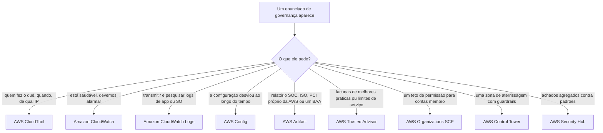
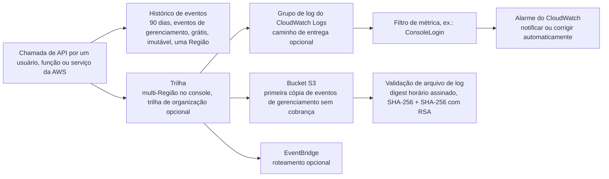
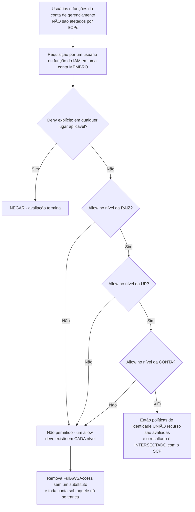
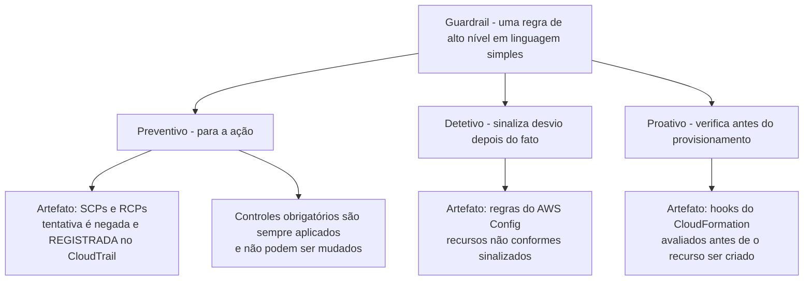
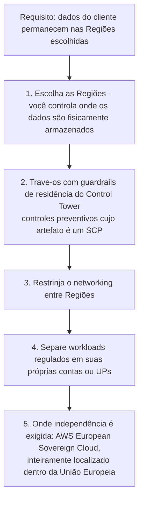

# Governança, Auditoria e Conformidade na AWS

O Domínio 2 carrega **30% da nota do CLF-C02**, e a tarefa 2.2 é sua metade de governança: *"conceitos de conformidade e governança da AWS"*, *"Onde capturar e localizar logs associados à segurança da nuvem"*, *"identificar onde encontrar informações de conformidade da AWS (por exemplo, AWS Artifact)"*, e *"Reconhecer serviços que auxiliam na governança e conformidade (por exemplo, monitoramento com o Amazon CloudWatch; auditoria com o AWS CloudTrail e o AWS Config; relatórios com relatórios de acesso)"*. Essa única frase nomeia quase toda ferramenta desta lição, e também planta a armadilha, porque **monitoramento é CloudWatch enquanto auditoria é CloudTrail e Config**. Alunos que borrão esses dois verbos perdem pontos fáceis em enunciados que de outra forma são puro decoreba.

```text
====================================================================
 CLF-C02 DOMÍNIO 2, TAREFA 2.2 — CARTÃO DE FERRAMENTAS DE GOVERNANÇA (em outubro de 2026)
====================================================================
 QUEM FEZ O QUÊ        CloudTrail — eventos registrados para cada
                      usuário, função ou serviço da AWS; Histórico
                      de eventos = grátis, imutável, 90 dias,
                      eventos de gerenciamento, uma Região
                      (NÃO é uma trilha)
 LOG DE API LONGO      trilha -> S3 (+ CloudWatch Logs e
                      EventBridge opcionais); primeira cópia de
                      eventos de gerenciamento no S3 = $0;
                      multi-Região no console; trilha de
                      organização cobre toda conta membro
 INTEGRIDADE DE LOG    hashing SHA-256 + SHA-256 com assinatura
                      RSA, arquivo de digest horário, LIGADO por
                      padrão para trilhas novas
 COMO ERA COM O        AWS Config — o gravador escreve itens de
 TEMPO                 configuração no S3 (+SNS); regras = sua
                      configuração ideal; conformance pack =
                      regras + remediação como 1
 OS PRÓPRIOS PAPEIS    AWS Artifact — grátis, sob demanda SOC /
                      ISO / PCI mais acordos (BAA, NDA)
 LACUNAS DE            Trusted Advisor — 6 categorias, apenas
 MELHORES PRÁTICAS     consultoria, profundidade depende do
                      plano de suporte
 TETO DE PERMISSÃO     AWS Organizations + SCP — somente negação,
                      não concede nada, sem efeito na conta de
                      gerenciamento
 ZONA DE ATERRISSAGEM  AWS Control Tower — preventivo (SCP/RCP),
                      detetivo (Config), proativo (hooks CFN)
 EVIDÊNCIA             143 padrões e certificações; a AWS é
                      auditada pela segurança DA nuvem, você pela
                      NA nuvem; conformidade varia por serviço
====================================================================
```

Nesta lição você vai:

- decodificar o **enunciado de uma frase** que diz qual ferramenta de governança o exame quer;
- usar o **AWS CloudTrail** para quem fez o quê: incluindo **histórico de eventos versus trilhas**, **trilhas de organização** e **validação de integridade de arquivo de log**;
- resistir à **armadilha do CloudWatch Logs** (um pipeline de entrega para eventos, não o registro de auditoria em si);
- usar o **AWS Config** para histórico de configuração, regras, estado de conformidade, conformance packs e agregadores;
- encontrar os relatórios SOC / ISO / PCI da AWS e assinar um **BAA** no **AWS Artifact**: grátis e de autoserviço;
- mapear as **seis categorias de verificação do Trusted Advisor** ao que cada **plano de suporte** realmente desbloqueia;
- aplicar **SCPs** corretamente: somente-negação, um allow em cada nível, qualquer negação vence, conta de gerenciamento intocada;
- posicionar **guardrails do AWS Control Tower** (preventivo / detetivo / proativo) em uma zona de aterrissagem;
- ler os **lotes de programas de conformidade** (certificação vs lei vs alinhamento) por meio do **modelo de responsabilidade compartilhada**;
- projetar uma **estratégia de tags** que sobreviva a uma auditoria e divida a conta;
- separar **residência de dados, soberania de dados e privacidade**, e responder enunciados de seleção de Região;
- triar um evento de segurança com **CloudWatch vs CloudTrail vs Config vs Trusted Advisor**;
- estudar **quatro casos reais de conformidade da AWS**, depois fazer **12 questões em formato de exame** mais verificações interativas;
- auditar o **guia ao vivo do exame em outubro de 2026**: listas de escopo reconstruídas, os novos nomes de planos de suporte e movimentos de console que *não* são examináveis.

---

## 1. Uma pergunta, uma ferramenta

### 1.1 O decodificador de enunciados

Toda pergunta de governança neste exame é uma pergunta *disfarçada* sobre qual ferramenta possui qual tipo de evidência. Leia o enunciado por seu verbo e seu substantivo: não pelo nome de serviço que um colega uma vez mencionou.

| O enunciado realmente pergunta | Ferramenta | O que ela de fato armazena |
|---|---|---|
| Quem fez o quê, quando, de qual IP? | **AWS CloudTrail** | **Eventos** de API: usuário, função ou serviço, ação, hora, origem |
| O serviço está saudável? CPU acima de 80%? Dispare um alarme | **Amazon CloudWatch** | **Métricas** e alarmes sobre o estado atual |
| Transmitir e pesquisar logs de aplicativo ou SO centralmente | **Amazon CloudWatch Logs** | **Eventos de log** de aplicativos, arquivos e serviços |
| A configuração desviou, e como estava em 1 de março? | **AWS Config** | **Itens de configuração**: estado atual mais histórico |
| A própria AWS é SOC 2 / ISO 27001 / PCI, e onde está o BAA? | **AWS Artifact** | Os **próprios** relatórios e acordos da AWS |
| A conta está seguindo melhores práticas? Onde estão as lacunas? | **AWS Trusted Advisor** | **Recomendações** em seis categorias |
| Limite o que as contas membro podem algum dia fazer | **AWS Organizations SCP** | Um teto de permissão **somente-negação** |
| Venda contas e guardrails como uma zona de aterrissagem | **AWS Control Tower** | Guardrails expressos em linguagem simples |
| Agregue achados contra padrões de segurança | **AWS Security Hub** | Um **painel único** para achados |



### 1.2 A própria divisão de trabalho do guia do exame

A AWS a formula de forma estreita, e a estreiteza é examinável: **monitoramento = Amazon CloudWatch**, **auditoria = AWS CloudTrail e AWS Config**, e (tarefa 2.4) **identificar problemas de segurança = AWS Trusted Advisor**. Então uma opção que diz *"usar CloudWatch para identificar problemas de segurança"* não é uma nuance: é o verbo errado. O CloudWatch lhe diz que o sistema está se comportando mal *agora*; o CloudTrail lhe diz o que foi chamado; o Config lhe diz como o recurso estava; o Trusted Advisor lhe diz onde está a lacuna contra as melhores práticas.

> [!NOTE]
> **Dois nomes para manter diretos.** **AWS Security Hub** é o agregador no escopo: a AWS o descreve como uma capacidade CSPM que *"avalia seu ambiente da AWS contra padrões e melhores práticas da indústria de segurança"* e *"recebe achados de outros serviços da AWS, como o Amazon GuardDuty"* para um *"painel único"*. **AWS Audit Manager** foi **removido do guia do exame HTML do CLF-C02**, trate-o como um distrator fora do escopo, nunca como uma resposta-chave.

```matching
{
  "question": "Associe cada ferramenta de governança à pergunta que ela responde:",
  "pairs": [
    {"left": "AWS CloudTrail", "right": "Quem executou qual ação em qual recurso, e quando: eventos de API de usuários, funções e serviços da AWS"},
    {"left": "Amazon CloudWatch", "right": "A carga de trabalho está saudável agora: métricas, limites e alarmes como idade de fila acima de uma hora"},
    {"left": "Amazon CloudWatch Logs", "right": "Centralizar, reter e pesquisar fluxos de log de aplicativos e sistemas operacionais, depois executar filtros de métrica sobre eles"},
    {"left": "AWS Config", "right": "Como este recurso foi configurado, se desviou, e se a porta 22 estava aberta para 0.0.0.0/0 no mês passado"},
    {"left": "AWS Artifact", "right": "Dê-me os relatórios próprios SOC, ISO e PCI da AWS e me deixe aceitar o BAA para minhas contas"},
    {"left": "AWS Trusted Advisor", "right": "Onde esta conta diverge das melhores práticas da AWS, incluindo MFA no root e snapshots públicos"},
    {"left": "AWS Organizations SCP", "right": "Impedir contas membro de criar usuários do IAM ou chamar serviços fora de uma Região"},
    {"left": "AWS Control Tower", "right": "Vender contas pré-guardrailed e mostrar desvio por conta e UP em um painel"},
    {"left": "AWS Security Hub", "right": "Consolidar achados do GuardDuty e outros, então verificá-los contra padrões de segurança"}
  ],
  "explanation": "O exame identifica uma ferramenta pelo substantivo no enunciado: eventos vão para o CloudTrail, métricas para o CloudWatch, fluxos de log para o CloudWatch Logs, estado de configuração para o Config, papéis da AWS para o Artifact, lacunas de melhores práticas para o Trusted Advisor, um teto de permissão para o SCP, uma zona de aterrissagem para o Control Tower, achados agregados para o Security Hub."
}
```

---

## 2. AWS CloudTrail: quem fez o quê

### 2.1 O que o CloudTrail registra

A definição da AWS é o serviço inteiro em uma linha: *"Ações executadas por um usuário, função ou um serviço da AWS são registradas como eventos"*. Esses eventos são capturados quer a chamada tenha vindo do **console, da CLI, de uma SDK/API ou de outro serviço da AWS**, e a AWS nomeia o propósito diretamente: *"auditoria operacional e de risco, governança e conformidade"*.

| Tipo de evento | Exemplos da documentação da AWS | Padrão? | Base de custo (em outubro de 2026) |
|---|---|---|---|
| **Eventos de gerenciamento** (plano de controle) | `RunInstances`, `AuthorizeSecurityGroupIngress`, `ConsoleLogin` | **Registrado por padrão** | Primeira cópia no S3 **$0**; cópias extras **$2,00 / 100 mil** |
| **Eventos de dados** (plano de dados) | S3 `GetObject`, invocação do Lambda, operações de item do DynamoDB | **Opt-in, custo extra** | **$0,10 / 100 mil** |
| Eventos de atividade de rede | Registros de atividade em nível de rede | Opt-in | **$0,10 / 100 mil** |
| **Insights** | Picos incomuns na atividade da API de gerenciamento `write` e nas taxas de erro | **Desligado por padrão**, cobrado | **$0,35 / 100 mil** eventos de gerenciamento por tipo; **$0,03 / 100 mil** eventos de dados |

- **📚 Você sabia?** **O histórico de eventos do CloudTrail é grátis e automático**: a AWS o descreve como um *"registro visível, pesquisável, baixável e imutável dos últimos 90 dias de eventos de gerenciamento em uma Região da AWS"*. Você não o cria, não pode desligá-lo, e ele é **por Região** e **apenas eventos de gerenciamento**: que é exatamente por que não é um substituto para uma trilha (em outubro de 2026).

### 2.2 O histórico de eventos não é uma trilha

| Propriedade | **Histórico de eventos** | **Trilha** | **CloudTrail Lake** |
|---|---|---|---|
| Criar? | Não: ligado por padrão | Sim | Sim |
| Janela | **90 dias** | Enquanto você mantiver os objetos | Retenção de até **2.557 dias (7 anos)** ou **3.653 dias (~10 anos)**, extensível |
| Escopo | **Apenas eventos de gerenciamento**, uma Região | Eventos de gerenciamento; **eventos de dados opt-in** | Lojas de dados de eventos selecionadas |
| Destino | Visão no console | **S3** (+ **CloudWatch Logs** e **EventBridge** opcionais) | Loja de dados de eventos consultável |
| Cobrança | **Grátis** | Primeira cópia de eventos de gerenciamento no S3 **$0**, depois por 100 mil | Teste grátis de 30 dias; cobrado depois |

*(Cobranças em outubro de 2026; verifique o estado atual antes do uso.)*

O enunciado que entrega isso é um enunciado de *retenção*: **"reter logs de API por cinco anos em todas as contas"** ou **"entregar eventos de gerenciamento contínuos a um bucket"**: ambos exigem uma **trilha** (ou CloudTrail Lake), porque o histórico de eventos para em 90 dias, apenas eventos de gerenciamento, em uma Região.



> [!NOTE]
> **Multi-Região é o padrão do console.** A AWS afirma que *"Todas as trilhas criadas usando o console do CloudTrail são trilhas multi-Região"*, o que significa que um único bucket recebe eventos de **todas as Regiões habilitadas**. Regiões opt-in ainda devem ser habilitadas antes de registrar qualquer coisa.

### 2.3 Trilhas de organização: um log para cada conta

Uma **trilha de organização** escreve *"a conta de gerenciamento e todas as contas membro"* em **um** bucket S3, um grupo do CloudWatch Logs e um destino do EventBridge. As regras ao redor dela são material clássico de exame:

- apenas a **conta de gerenciamento ou um administrador delegado** pode criá-la;
- o CloudTrail cria a **função vinculada ao serviço `AWSServiceRoleForCloudTrail`** em cada conta membro;
- **contas membro podem ver a trilha mas não podem modificá-la ou excluí-la**: esse é o ponto de governança: um admin membro comprometido não consegue silenciar o log de auditoria;
- a política do bucket deve admitir apenas aquela função de serviço e o ID da organização.

- **📚 Você sabia?** A **validação de integridade de arquivo de log** do CloudTrail usa *"SHA-256 para hashing e SHA-256 com RSA para assinatura digital"* e escreve um **arquivo de digest horário** encadeado ao digest anterior, tornando *"comprovadamente inviável modificar, excluir ou forjar arquivos de log do CloudTrail sem detecção"*. A AWS diz que o recurso está **habilitado por padrão para trilhas novas**, então *"provar que o log não foi editado"* é respondido pela validação, não por uma política de bucket (em outubro de 2026).

### 2.4 Exemplo E1: a conta do CloudTrail

Um mês de atividade: **5.000.000 de eventos de gerenciamento** (uma cópia para o S3), **15.000.000 de eventos de dados**, **5.000.000 de eventos de atividade de rede**, mais uma segunda cópia de **2.500.000** eventos de gerenciamento encaminhada a um segundo bucket para o SIEM.

```text
primeira cópia de eventos de gerenciamento   5.000.000 x $0,00     = $  0,00
eventos de dados                             15.000.000 / 100.000 = 150 x $0,10 = $ 15,00
eventos de atividade de rede                 5.000.000 / 100.000 =  50 x $0,10 = $  5,00
cópia extra de eventos de gerenciamento      2.500.000 / 100.000 =  25 x $2,00 = $ 50,00
                                                              ---------
                                                              = $70,00
```

O ponto didático não é a aritmética, é a **primeira cópia grátis**: *"Você pode entregar uma cópia dos seus eventos de gerenciamento contínuos ao seu bucket S3 sem cobrança."* Eventos de dados **nunca** são grátis, e Insights está **desligado por padrão** e cobrado separadamente (todas as taxas em outubro de 2026; verifique o estado atual antes do uso).

### 2.5 Exemplo E2: uma trilha para 40 contas

Um líder de governança precisa provar *"registramos toda atividade da conta"* para 40 contas membro. O padrão documentado:

1. A **conta de gerenciamento** cria uma **trilha de organização multi-Região**.
2. Um **bucket S3** recebe tudo, com uma **pasta por ID de conta membro**; um **grupo do CloudWatch Logs**; roteamento opcional do EventBridge para automação.
3. A **validação de arquivo de log permanece ligada**, e a política do bucket admite apenas `AWSServiceRoleForCloudTrail` mais o ID da organização.
4. Admins membro **podem ver a trilha, não podem parar ou editá-la**.
5. Athena sobre o bucket (ou uma consulta `lookup-events`) responde *"toda chamada de API que excluiu um bucket S3 no último trimestre, com principal e IP de origem."*

Resultado: logging uniforme, **uma** fonte de evidência para o auditor, e nenhum desvio de configuração por conta, o padrão exato que o exame quer que você prefira a 40 trilhas construídas à mão.

### 2.6 A armadilha do CloudWatch Logs

> [!WARNING]
> **⚠️ CloudTrail e CloudWatch Logs são perguntas diferentes vestindo a mesma palavra: "logs".** Uma trilha **entrega uma cópia de seus eventos** a um **grupo de log** do CloudWatch Logs para que **filtros de métrica** e **alarmes** disparem: aquele pipeline é um *consumidor* do CloudTrail, não o registro de auditoria. Enunciados que dizem *"centralizar os logs de todos os seus sistemas, aplicativos e serviços da AWS"* estão descrevendo o **Amazon CloudWatch Logs**; enunciados que dizem *"quem executou qual ação em qual recurso, e quando"* estão descrevendo o **AWS CloudTrail**. Nunca escolha o CloudTrail para um enunciado de alarme, e nunca escolha o CloudWatch para histórico de API.

## 3. AWS Config: histórico de configuração e estado de conformidade

### 3.1 O gravador e os itens de configuração

O AWS Config oferece *"uma visão detalhada da configuração dos recursos da AWS"* incluindo *"como eles foram configurados no passado"*. Mecanicamente: você escolhe quais **tipos de recurso** registrar, o **gravador** escreve **itens de configuração (CIs)** no **Amazon S3** e notifica por meio do **Amazon SNS** (o gravador assume uma **função do IAM** para fazê-lo), e você obtém **estado atual mais histórico de mudanças**: uma série de instantâneos, não um fluxo de eventos.

| Modo de gravação | Quando um CI é escrito | Uso típico |
|---|---|---|
| **Contínuo** | Em **mudança de configuração** | Histórico grau auditoria: "quando abriu, e quando fechou" |
| **Periódico** | No máximo **uma vez a cada 24 horas**, e **apenas se o recurso mudou** | Monitoramento de desvio mais barato onde histórico em nível de hora não importa |

### 3.2 Regras, estado de conformidade e remediação

Uma **regra** do Config codifica *"suas configurações ideais"*. O motor de regras avalia seus recursos e carimba cada um como **em conformidade** ou **não em conformidade**, sinaliza o recurso, notifica você e pode **remediar** por meio de um documento do **AWS Systems Manager**.

| Tipo de regra | O que é |
|---|---|
| **Gerenciada** | Verificações publicadas pela AWS que você liga |
| **Personalizada** | Sua própria lógica em uma função **AWS Lambda** |
| **Vinculada ao serviço** | Criada e mantida por um serviço da AWS |
| **Organizacional** | Implantada em uma organização a partir da conta de gerenciamento |

Dois objetos de nível superior se apoiam acima, e o exame os distingue com precisão:

- **Conformance pack** = *"uma coleção de regras do AWS Config e ações de remediação … implantada como uma única entidade"*: escrito em **YAML**, implantável **em uma organização**;
- **Agregador** = uma visão **entre contas, entre Regiões** de configuração e conformidade;
- **Consulta avançada** = consulte o histórico de configuração por schema no agregador.

### 3.3 Exemplo E3: gravação contínua versus periódica

Uma conta registra **100 instâncias EC2** que cada uma muda **10 vezes por dia**.

```text
contínuo: 100 x 10 = 1.000 itens de configuração por dia
            1.000 x $0,003 = $3,00 por dia

periódico:   cada um dos 100 recursos é escrito no máximo uma vez a cada 24 h
            100 x $0,012   = $1,20 por dia
```

A gravação contínua custa **2,5×** mais aqui mas lhe dá histórico em nível de hora; a periódica custa menos e descarta silenciosamente o detalhe intra-dia. Escolha pela pergunta: *"quando mudou?"* significa contínuo; *"está em conformidade agora?"* torna a periódica defensável (taxas em outubro de 2026; verifique o estado atual antes do uso).

### 3.4 Exemplo E4: precificando um pacote de conformidade

O próprio pacote resolvido da AWS: **10.000 itens de configuração** + **50.000 avaliações de regra** + **15.000 avaliações de conformance pack** por mês.

```text
10.000 CIs          x $0,003 = $30,00
50.000 evals regra  x $0,001 = $50,00
15.000 conformance  x $0,001 = $15,00
                                    --------
total do pacote               = $95,00 por mês
```

Observe para onde o dinheiro vai: **avaliação, não armazenamento**. Adicionar regras é barato; registrar tudo continuamente é o que move a conta (em outubro de 2026; verifique o estado atual antes do uso).

### 3.5 CloudTrail registra ações; Config registra estado

Esta é a distinção de maior rendimento da lição:

| Pergunta | Resposta | Por quê |
|---|---|---|
| "`RevokeSecurityGroupIngress` foi chamado em 3 de março?" | **CloudTrail** | É uma **chamada de API**: um evento com um principal e um carimbo de tempo |
| "A porta 22 estava aberta para `0.0.0.0/0` em 1 de março?" | **AWS Config** | É **estado ao longo de um período**: apenas instantâneos do Config respondem |
| "Quem abriu?" | **CloudTrail** | Eventos carregam identidade; Config carrega configuração |
| "Permaneceu fechada desde então?" | **AWS Config** | Estado de conformidade ao longo do tempo |

Habilite **ambos**. Um examinador que escreve *"o grupo de segurança estava aberto por seis horas"* está testando se você sabe que nenhum log de eventos, em qualquer nuvem, pode reconstruir uma duração sem um histórico de configuração.

- **📚 Você sabia?** Algumas **verificações do Trusted Advisor são alimentadas pelo AWS Config**, razão pela qual desligar o Config pode degradar silenciosamente os conselhos que você recebe, e razão pela qual **conformance packs** (regras mais remediação como um único artefato YAML) são o jeito mais rápido de entregar a um auditor uma declaração de conformidade repetível em toda a organização em vez de uma captura de tela (em outubro de 2026).

---

## 4. AWS Artifact: onde as próprias informações de conformidade da AWS vivem

### 4.1 Relatórios, sob demanda e grátis

O AWS Artifact é *"downloads sob demanda de documentos de segurança e conformidade da AWS"*: relatórios **ISO**, **Payment Card Industry (PCI)** e **System and Organization Controls (SOC)**, certificações emitidas por organismos de acreditação e documentos de Marketplace/ISV. Ele é **gratuito**, de autoserviço, e é a resposta literal do exame à habilidade da tarefa 2.2: *"identificar onde encontrar informações de conformidade da AWS (por exemplo, AWS Artifact)"*.

### 4.2 Acordos: o BAA e o NDA

O Artifact também é onde você *"revisa, aceita e rastreia o status dos seus acordos com a AWS para sua conta da AWS e para várias contas da AWS na sua organização"*. O FAQ de conformidade nomeia o **Business Associate Agreement (BAA)** e o **NDA**. Então o enunciado *"assinar um BAA para minha conta e 20 contas membro"* tem uma única resposta: **AWS Artifact**.

> [!IMPORTANT]
> **O Artifact mantém a evidência da AWS, nunca a sua.** A saída do Artifact é *"artefatos de auditoria"*: relatórios SOC, certificados ISO, atestações, acordos assinados. Sua própria evidência de controle (políticas, configurações, logs) vem do **CloudTrail, AWS Config e sua própria documentação**, e a AWS é explícita de que os clientes permanecem responsáveis pela própria conformidade. *"Enviar nossa evidência para o Artifact"* nunca é uma opção válida.

- **📚 Você sabia?** **O SOC 3 é público**, você não precisa de uma requisição específica de conta para lê-lo, enquanto a AWS publica **SOC 1 trimestralmente** e **SOC 2 e SOC 3 a cada seis meses** sobre **períodos de 12 meses** (desde 30 de setembro de 2023), com relatórios novos prontos *"em ~6 semanas"*. Todos chegam por meio do **AWS Artifact**, e nenhum deles é um certificado HIPAA, porque um não existe (em outubro de 2026).

---

## 5. AWS Trusted Advisor: verificações de melhores práticas e o que seu plano desbloqueia

### 5.1 As seis categorias de verificação

As recomendações do Trusted Advisor existem *"para economizar dinheiro, melhorar a disponibilidade e o desempenho do sistema, ou ajudar a fechar lacunas de segurança"*. A lista de categorias é fixa em **seis**: rejeite qualquer opção que invente um sétimo:

| Categoria | Verificações típicas |
|---|---|
| **Otimização de custo** | Recursos ociosos e subutilizados, higiene de snapshots |
| **Desempenho** | Folga de throughput e utilização |
| **Segurança** | MFA no root, snapshots públicos, permissões de bucket, exposição de grupo de segurança |
| **Tolerância a falhas** | Redundância, lacunas de backup e failover |
| **Limites de serviço** | Consumo se aproximando de uma cota |
| **Excelência Operacional** | Recomendações operacionais e de processo |

As páginas de marketing da AWS às vezes dizem **"resiliência"** onde a documentação diz **"tolerância a falhas"**: mesma categoria, e **"conformidade"** não é uma das seis.

### 5.2 Disponibilidade por plano de suporte

| Plano | O que você obtém | Atualização |
|---|---|---|
| **Basic / Developer** | Apenas console: **todas as verificações de Limites de Serviço** mais seis verificações nomeadas, **Amazon EBS Public Snapshots, Amazon RDS Public Snapshots, Amazon S3 Bucket Permissions, MFA on root account, Security Groups, Specific Ports Unrestricted, AWS STS global endpoint usage across AWS Regions** | Atualização **manual**, sem API |
| **Business / Enterprise / Unified Operations** | **Todas as verificações**, mais acesso a **API e CLI**, eventos do **EventBridge** e atualização automática **semanal** | Automática |

Em outubro de 2026 a AWS anuncia **56 verificações grátis para todos os planos** e **482 no total** assim que Business ou superior adiciona **426** a mais, mas no dia do exame cite a regra *qualitativa* (**planos grátis recebem um subconjunto, planos pagos recebem todas**), porque as contagens de verificações mudam (verifique o estado atual antes do uso).

### 5.3 Exemplo E5, o que cada plano desbloqueia

```text
Plano Basic, "MFA no root?"                -> SIM: uma das seis verificações grátis nomeadas
Plano Basic, "varrer todas as contas
               semanalmente via API"       -> NÃO: apenas console, atualização manual,
                                              sem API, subconjunto de verificações
Plano Business, biblioteca completa        -> SIM: 56 + 426 = 482 verificações, API/CLI,
                                              EventBridge, atualização semanal
Qualquer plano, "Trusted Advisor impõe"    -> NÃO: ele ACONSELHA, ele não impõe
```

O Trusted Advisor é **consultivo**. A imposição vem de **regras do Config e remediação**, **SCPs** (preventivos) e **guardrails do Control Tower**, e a **Visão Organizacional** agrega o conselho em toda a organização.

## 6. AWS Organizations e SCPs: o teto somente-negação

### 6.1 Estrutura e conjuntos de recursos

O AWS Organizations lhe dá uma **raiz** → **unidades organizacionais (UPs)**, que se aninham e podem ir **cinco níveis de profundidade** → **contas membro**. A **conta de gerenciamento** é a pagadora e a *"proprietária final … controle final sobre políticas de segurança, infraestrutura e finanças"*; uma conta membro *"pode pertencer a apenas uma organização por vez"*.

| Conjunto de recursos | O que suporta |
|---|---|
| **Todos os recursos** (padrão) | UPs, **SCPs**, políticas de tag e as integrações de serviço da AWS |
| **Apenas faturamento consolidado** | Uma conta, mas ela *"não pode … usar políticas para restringir o que usuários e funções em diferentes contas podem fazer"* |

### 6.2 SCPs nunca concedem

A redação da AWS é absoluta, e opções do exame rotineiramente a invertem;

- SCPs dão *"controle central sobre as **permissões máximas disponíveis** para os usuários do IAM e funções do IAM na sua organização"*;
- ***"SCPs não concedem permissões … Nenhuma permissão é concedida por um SCP"***;
- permissões efetivas são a **interseção lógica** do SCP com políticas baseadas em identidade e em recurso;
- ***"SCPs não afetam usuários ou funções na conta de gerenciamento"***, apenas contas membro, **incluindo seu usuário root**, e não afetam **funções vinculadas ao serviço**.

### 6.3 Como a avaliação realmente roda



Duas regras caem daquela imagem: **um Allow deve existir em cada nível** (raiz → UP → conta), então o SCP gerenciado pela AWS **`FullAWSAccess`** é a rede de segurança de negar-por-padrão, **nunca o remova sem substituí-lo por uma política de allow**, e **um Deny em qualquer nível vence**, razão pela qual uma política *somente-negação* é tudo de que você precisa para bloquear uma Região ou um serviço.

### 6.4 Exemplo E6: um SCP negar-por-padrão

A raiz mantém **`FullAWSAccess`**. A **UP Prod** adiciona uma política que nega `ec2:*` e `rds:*` fora de `eu-central-1`, e nega `iam:CreateUser` e `iam:CreateAccessKey` em todo lugar.

```text
conta sob a UP Prod, chamador detém AdministratorAccess
  -> allow existe na raiz (FullAWSAccess)        SIM
  -> allow existe na UP Prod (FullAWSAccess)     SIM
  -> allow existe na conta                       SIM
  -> Deny explícito na política da UP?           SIM -> NEGADO
resultado: acesso total de serviço DENTRO de eu-central-1,
           nenhum EC2 ou RDS fora dele,
           nenhum usuário novo do IAM em toda aquela UP
conta de gerenciamento: não afetada por design
```

Aquela última linha é um distrator favorito: **SCPs não têm efeito nos usuários e funções da conta de gerenciamento**.

### 6.5 Exemplo E7: faturamento consolidado agrupa uso

*"A AWS trata todas as contas da organização como uma conta"*, então uso combinado atinge níveis de volume, descontos de Reserved Instance e Savings Plans mais rápido, e o desconto é alocado de volta. Duas contas puxando **8 TB** e **4 TB**:

```text
nível 1: $0,17/GB para os primeiros 10 TB -> 1 TB = 1.024 GB -> $174,08 por TB
nível 2: $0,13/GB para os próximos 40 TB                    -> $133,12 por TB

agrupado  (8 TB + 4 TB = 12 TB): 10 x $174,08 + 2 x $133,12
                              = $1.740,80 + $266,24 = $2.007,04
independente: 8 x $174,08 + 4 x $133,12 = $1.392,64 + $532,48 = $2.088,96
economia:     $2.088,96 - $2.007,04 = $81,92
```

**O AWS Organizations é oferecido sem custo adicional**, e o faturamento consolidado não carrega **taxa extra**, mas note a pegadinha que o exame testa: **a conta não espelha a árvore de UPs**. Dividir gastos por projeto é um trabalho de **tag de alocação de custo**, não de UP (preços em outubro de 2026; verifique o estado atual antes do uso).

### 6.6 Limites que valem memorizar (verifique o estado atual antes do uso)

| Objeto | Limite de tamanho | Anexações |
|---|---|---|
| **SCP** | **10.240 caracteres** | Máx **10** por raiz / UP / conta |
| **RCP** | **5.120 caracteres** | Máx **5** |
| Políticas de tag, backup e declarativas | **10.000 caracteres** | Máx **10** |
| Hierarquia de UP |: | **5 níveis**, **uma raiz** por organização |

---

## 7. AWS Control Tower: guardrails em uma zona de aterrissagem

### 7.1 O que ele constrói

O Control Tower governa um **ambiente multi-conta** da AWS, orquestrando **AWS Organizations, AWS Service Catalog e AWS IAM Identity Center** para construir uma **zona de aterrissagem** *"em menos de uma hora"*. Seu vocabulário é deliberadamente simples: um **controle = guardrail** = *"uma regra de alto nível … expressa em linguagem simples"*, com orientação graduada **obrigatório / fortemente recomendado / eletivo**, além da **Account Factory** para vender contas e um **Dashboard** que mostra desvio por conta e UP.

### 7.2 Os três tipos de guardrail



| Tipo | Momento | Serviço de suporte |
|---|---|---|
| **Preventivo** | Antes da ação ter sucesso | **SCPs e RCPs**: a tentativa é *"negada e registrada no CloudTrail"* |
| **Detetivo** | Depois do fato | **Regras do AWS Config** |
| **Proativo** | Antes do provisionamento | **Hooks do CloudFormation** |

### 7.3 Guardrails de residência de dados

Em **novembro de 2021** a AWS anunciou **17 guardrails novos** para que *"[dados do cliente] não sejam armazenados ou processados fora de uma ou mais Regiões da AWS específicas"*; exemplos preventivos incluem *"Desabilitar acesso à internet para uma instância do Amazon VPC"* e *"Desabilitar conexões do Amazon Virtual Private Network (VPN)"*. **O artefato de cada controle preventivo é um SCP**, razão pela qual Control Tower, Organizations e SCPs são sempre ensinados juntos.

- **📚 Você sabia?** A divisão de trabalho vale memorizar como três frases: **AWS Organizations** é o encanamento de contas e políticas, o **SCP** é o teto de permissão, e o **AWS Control Tower** é a camada de zona de aterrissagem opinativa acima que vende contas com guardrails e reporta desvio. A AWS também afirma que *"Controles obrigatórios são sempre aplicados e não podem ser mudados."* (em outubro de 2026)

```dragdrop
{
  "question": "Ordene a construção de governança da forma como os serviços da AWS se compõem (fundação primeiro, evidência por último):",
  "items": [
    "Criar a organização: uma raiz, UPs e contas membro com AWS Organizations",
    "Habilitar todos os recursos para que SCPs e políticas de tag fiquem disponíveis",
    "Anexar o SCP FullAWSAccess gerenciado pela AWS, então adicione suas próprias políticas somente-negação",
    "Assentar a zona de aterrissagem com AWS Control Tower: Account Factory, guardrails obrigatórios, painel",
    "Adicionar a camada de evidência: uma trilha de organização no CloudTrail mais regras do Config e conformance packs",
    "Padronizar tags, então ativar tags de alocação de custo para que a conta possa ser dividida por projeto"
  ],
  "correctOrder": [
    "Criar a organização: uma raiz, UPs e contas membro com AWS Organizations",
    "Habilitar todos os recursos para que SCPs e políticas de tag fiquem disponíveis",
    "Anexar o SCP FullAWSAccess gerenciado pela AWS, então adicione suas próprias políticas somente-negação",
    "Assentar a zona de aterrissagem com AWS Control Tower: Account Factory, guardrails obrigatórios, painel",
    "Adicionar a camada de evidência: uma trilha de organização no CloudTrail mais regras do Config e conformance packs",
    "Padronizar tags, então ativar tags de alocação de custo para que a conta possa ser dividida por projeto"
  ],
  "explanation": "Contas e UPs vêm primeiro porque toda política se pendura nelas; todos os recursos é o interruptor que liga SCPs e políticas de tag; FullAWSAccess deve permanecer anexado enquanto você adiciona políticas somente-negação; o Control Tower então impõe a zona de aterrissagem opinativa; a camada de evidência (trilha de organização, regras do Config, conformance packs) prova que funciona; tags e alocação de custo fecham o loop para as finanças."
}
```

---

## 8. Programas de conformidade e o modelo de responsabilidade compartilhada

### 8.1 Os três lotes

A AWS afirma que *"suporta 143 padrões de segurança e certificações de conformidade, incluindo PCI-DSS, HIPAA/HITECH, FedRAMP, GDPR, FIPS 140-3 e NIST 800-171"*, e os separa em três lotes muito diferentes (em outubro de 2026; verifique o estado atual antes do uso):

| Lote | Significado | Membros |
|---|---|---|
| **Certificações / atestações** | Auditado por terceiros; a AWS pode guardar e distribuir | **ISO 27001 / 27018 / 42001, SOC 1 / SOC 2 / SOC 3, PCI DSS, CSA STAR, FedRAMP, FIPS 140-3, C5 (DE), IRAP (AU), MTCS (SG), ISMAP (JP), ENS High** |
| **Leis / regulamentações** | *"Os clientes da AWS permanecem responsáveis por cumprir … Nenhuma certificação formal está disponível para (ou distribuível por) um provedor de serviços de nuvem"* | **HIPAA, CJIS, FERPA, FISMA, IRS 1075, SEC 17a-4(f), DORA** |
| **Alinhamentos** | A AWS mapeia seus controles para um framework | **NIST 800-53, NIST CSF** |

### 8.2 As três perguntas que os alunos erram

| Pergunta | Resposta correta |
|---|---|
| *"A AWS é certificada HIPAA?"* | **Não.** A AWS afirma *"Não existe certificação HIPAA para um provedor de serviços de nuvem (CSP) como a AWS."* A AWS se alinha às regras do HHS, ao FedRAMP e ao NIST 800-53, **assinará um BAA padrão** (aceito **no AWS Artifact**), apenas **serviços elegíveis para HIPAA** podem processar **PHI**, e *você* cuida do resto da HIPAA. |
| *"Precisamos aderir ao DPA do GDPR?"* | **Nenhuma ação necessária**, o Aditivo de Processamento de Dados está nos Termos de Serviço da AWS e **se aplica automaticamente desde 25 de maio de 2018**. |
| *"Quão atuais são os relatórios SOC?"* | **SOC 1 trimestralmente; SOC 2 e SOC 3 a cada 6 meses**, sobre **períodos de 12 meses** desde 30 de setembro de 2023, prontos *"em ~6 semanas"*; **SOC 3 é público**. Busque-os no **AWS Artifact**. |

### 8.3 Responsabilidade compartilhada, reformulada para auditores

A linha de auditoria é a mesma da lição 5: **a AWS é auditada pela segurança *da* nuvem, os clientes pela segurança *nela***. Três consequências aparecem repetidamente como opções:

- herdar os controles da AWS **nunca** remove sua metade do modelo;
- **a conformidade varia por serviço**: verifique a lista **AWS Services in Scope** em vez de assumir uma cobertura de Região inteira;
- *"AWS Compliance Center"* **não** é uma resposta-chave para a tarefa 2.2; a própria declaração de habilidade nomeia o **AWS Artifact**.

- **📚 Você sabia?** O site de conformidade da AWS publica pesquisas abrangendo **mais de 60 países**, e sua página de programas separa certificações de leis por um motivo: um **provedor de serviços de nuvem não pode ser "certificado HIPAA"**, porque tal certificação não existe para distribuir: razão pela qual a resposta HIPAA correta no exame é sempre o trio **BAA via Artifact + serviços elegíveis para HIPAA + responsabilidade do cliente** (em outubro de 2026).

## 9. Estratégia de tags como governança

### 9.1 O que é uma tag e por que a governança se importa

Uma tag é *"um rótulo simples formado por uma chave e um valor opcional"*, e chaves e valores são **sensíveis a maiúsculas/minúsculas**. A própria lista de motivos da AWS é a resposta do exame: a tagagem consistente permite *"filtrar e pesquisar recursos, monitorar custo e uso, e gerenciar seu ambiente da AWS"*. Na prática, uma taxonomia de tags limpa é o **CMDB** da nuvem, o índice que um auditor consulta em vez de uma planilha.

| Uso da tag | Serviço | O que lhe dá |
|---|---|---|
| Padronizar chaves e maiúsculas preferidas | **Tag policies** (AWS Organizations) | Imposição em tipos de recursos especificados; precisa de **todos os recursos** |
| Dividir a conta | **Cost allocation tags** | Aparecem no Cost Explorer e no relatório de alocação de custo **após a ativação** |
| Detectar tags ausentes | **Regras do AWS Config** | Recursos não conformes sinalizados e remediáveis |
| Encontrar e agir sobre recursos | **Resource Groups, Tag Editor, Resource Groups Tagging API** | Pesquisa e operações em massa |

### 9.2 A pilha de quatro camadas

```text
1. padrão de nomenclatura  -> vocabulário chave/valor acordado, maiúsculas incluídas
2. tag policies            -> IMPÕEM o padrão (Organizations, todos os recursos)
3. cost allocation tags    -> ATIVE-as antes de a conta poder usá-las
4. regras do Config        -> DETECTEM recursos sem uma tag obrigatória
```

> [!WARNING]
> **⚠️ Duas armadilhas de tag.** Primeiro, **você deve ativar os dois tipos de tag de alocação de custo separadamente**, tags geradas pela AWS (por exemplo `createdBy`) e suas tags **definidas pelo usuário** são ativadas independentemente, e nada aparece no Cost Explorer ou no relatório de alocação de custo até que você o faça. Segundo, **tag policies não avaliam recursos sem tag nem chaves indefinidas**, então *"impomos tagagem em todo lugar"* exagera o que o serviço faz. E lembre-se da consequência de faturamento da seção 6: **a conta consolidada não segue a árvore de UPs**, tags são como você atribui gastos.

---

## 10. Soberania e residência de dados

### 10.1 Três palavras, três significados

| Termo | Pergunta que ele responde |
|---|---|
| **Residência de dados** | **Onde** os dados são armazenados e processados? |
| **Soberania de dados** | **Sob qual jurisdição e controle** eles estão? |
| **Privacidade de dados** | **Como** eles são tratados, acessados e retidos? |

Para o CLF-C02, o ângulo examinável é um **motivo de seleção de Região**: a AWS observa que os clientes *"mantêm controle completo sobre quais Regiões da AWS seus dados são fisicamente armazenados"*, e **Regiões opt-in devem ser habilitadas explicitamente** antes que qualquer coisa rode lá.

### 10.2 A pilha de controles de residência



O material de proteção de dados da AWS afirma claramente que *"você controla seus dados … para determinar onde seus dados são armazenados, como eles são protegidos"* e que *"o AWS Control Tower fornece governança e controles para residência de dados"*: enquanto os clientes *"mantêm controle completo sobre quais Regiões da AWS seus dados são fisicamente armazenados"*.

> [!NOTE]
> **Enunciados de residência são enunciados de Região.** Se a lista de opções oferecer um serviço de monitoramento para um requisito de *"os dados devem permanecer na UE"*, é um distrator: a resposta é **escolher a Região, impor com os guardrails de residência do Control Tower (SCPs), isolar o workload** e, onde independência jurisdicional é exigida, uma oferta como o **AWS European Sovereign Cloud** (*"inteiramente localizado dentro da União Europeia"*). Outposts e Local Zones **não** estão na lista no escopo deste exame, então nunca os escolha.

- **📚 Você sabia?** Carimbe a data em seus números de infraestrutura ou eles apodrecem: a AWS Cloud abrange **39 Regiões Geográficas e 124 Zonas de Disponibilidade**, com **7 AZs a mais** e **2 Regiões a mais** (Reino da Arábia Saudita e Chile) *anunciadas mas ainda não abertas*, enquanto a Região **AWS European Sovereign Cloud** `eusc-de-east-1` foi anunciada como disponibilidade geral em **14 de janeiro de 2026** mas **não** aparece no mapa público de Regiões. Cite os números **39 / 124** e a data do `eusc` **separadamente**, e rotule ambos "em outubro de 2026, verifique o estado atual antes de usar".

---

## 11. Identificação de eventos de segurança: qual ferramenta responde qual pergunta

### 11.1 A tabela de triagem

| Situação | Ferramenta | Motivo em uma linha |
|---|---|---|
| *"Quem terminou minha instância às 02:14, e de qual IP?"* | **AWS CloudTrail** | Eventos carregam identidade, ação, hora e origem |
| *"A idade da fila passou de uma hora: nos avise"* | **Amazon CloudWatch** | Métricas e alarmes sobre o estado atual |
| *"Transmitir e pesquisar os logs do aplicativo do último ano"* | **Amazon CloudWatch Logs** | Armazenamento e consultas centralizadas de log |
| *"MFA no root estava ligado ontem? Está ligado agora?"* | **AWS Config** | Estado de configuração ao longo do tempo |
| *"MFA no root, no plano Basic"* | **AWS Trusted Advisor** | Uma das seis verificações grátis nomeadas |
| *"Toda chamada de API que excluiu um bucket S3 no último trimestre"* | **Trilha do CloudTrail → S3**, depois validação | Histórico de API de longo prazo, com detecção de adulteração |
| *"Provar que o arquivo de log não foi editado"* | **Validação de arquivo de log do CloudTrail** | Digest assinado horário, SHA-256 + RSA |
| *"Nosso SOC 2 Type II e o BAA"* | **AWS Artifact** | Os próprios relatórios e acordos da AWS |
| *"Achados contra NIST / PCI em todas as contas"* | **AWS Security Hub** | Painel único, agregação CSPM |

### 11.2 Exemplo E8: as quatro perguntas do auditor

| O auditor pergunta | Ferramenta | Configuração necessária previamente |
|---|---|---|
| (a) *Toda chamada de API que excluiu um bucket S3 no último trimestre, com principal e IP de origem* | **AWS CloudTrail** | Trilha de organização → S3, depois `lookup-events` / Athena, depois `validate-log-files` |
| (b) *A porta 3306 estava aberta em 1 de março, e quando fechou?* | **AWS Config** | Gravação **contínua** do tipo de recurso do grupo de segurança |
| (c) *Seu SOC 2 Type II, certificado ISO 27001 e PCI AOC* | **AWS Artifact** | Nada: downloads grátis e de autoserviço |
| (d) *MFA no root? Snapshots públicos do EBS?* | **AWS Trusted Advisor** | Funciona no **Basic**: eles estão entre as seis verificações grátis nomeadas |

Nenhuma das quatro exige uma nova compra; as quatro exigem **previsão**: a trilha, o gravador e o esquema de tags devem existir *antes* de o auditor chegar.

### 11.3 Confira seu vocabulário

```fillblank
{
  "question": "Complete as afirmações de vocabulário de governança com os termos corretos da AWS:",
  "template": "O registro grátis, ligado por padrão e imutável dos últimos {{1}} dias de eventos de gerenciamento em uma única Região da AWS é o histórico de eventos do CloudTrail; o objeto que entrega eventos contínuos a um bucket S3 para retenção de longo prazo é uma {{2}}. No AWS Config, o componente que escreve itens de configuração no Amazon S3 e no Amazon SNS é o {{3}}, e uma coleção implantável de regras do Config com ações de remediação é um {{4}}. O AWS Organizations protege permissões com uma política somente-negação chamada {{5}}, e a biblioteca de autoserviço de relatórios e acordos de conformidade da AWS é {{6}}.",
  "answers": {
    "1": "90",
    "2": "trilha",
    "3": "gravador",
    "4": "conformance pack",
    "5": "SCP",
    "6": "AWS Artifact"
  },
  "distractors": ["guardrail", "painel", "política de bucket", "grupo de log", "Trusted Advisor", "agregador"],
  "explanation": "O histórico de eventos cobre 90 dias de eventos de gerenciamento por Região e não é uma trilha; o gravador é o que escreve itens de configuração; um conformance pack é regras do Config mais remediação implantadas como uma única entidade; um SCP é o teto somente-negação; o AWS Artifact é a biblioteca grátis de autoserviço de relatórios e acordos. Um guardrail é vocabulário do Control Tower e um agregador é uma visão entre contas do Config: ambos estão perto mas errados aqui."
}
```

### 11.4 Pedido de evidência → ferramenta e recurso

A mesma triagem, rodada para trás: o auditor declara a *evidência*, você nomeia a *ferramenta* e o *recurso* exato que a produz. Essa é a forma que os enunciados tomam quando escondem o nome do serviço atrás de um requisito.

```matching
{
  "question": "Associe cada pedido de evidência à ferramenta e ao recurso exato que o satisfaz:",
  "pairs": [
    {"left": "Provar que os arquivos de log do CloudTrail no bucket nunca foram editados após a entrega", "right": "Validação de integridade de arquivo de log do CloudTrail: hashing SHA-256, assinatura SHA-256 com RSA e um digest horário encadeado ao digest anterior"},
    {"left": "Implantar um conjunto nomeado de regras do AWS Config junto com suas ações de remediação em toda a organização", "right": "Conformance pack do AWS Config: uma coleção de regras e ações de remediação implantada como uma única entidade"},
    {"left": "Mostrar itens de configuração e estado de conformidade de cada conta e Região em uma única visão", "right": "Agregador do AWS Config: uma visão entre contas e entre Regiões, pesquisável com consulta avançada"},
    {"left": "Listar toda chamada de API que excluiu um bucket S3 no último trimestre, na conta de gerenciamento e em todas as contas membro", "right": "Trilha de organização do AWS CloudTrail para o S3: criada pela conta de gerenciamento ou por um administrador delegado, visível aos membros mas não modificável por eles"},
    {"left": "Baixar o próprio relatório SOC 2 Type II da AWS e aceitar um BAA para 20 contas membro", "right": "AWS Artifact: relatórios grátis, de autoserviço e sob demanda mais acordos como o BAA e o NDA"},
    {"left": "Verificar o MFA na conta root enquanto a conta ainda está no plano de suporte grátis", "right": "AWS Trusted Advisor: uma das seis verificações nomeadas disponíveis no Basic, atualizada manualmente no console"},
    {"left": "Impedir contas membro de criarem usuários do IAM sem conceder uma única permissão", "right": "SCP do AWS Organizations: um teto somente-negação sobre as permissões máximas disponíveis, sem efeito na conta de gerenciamento"},
    {"left": "Ver desvio de guardrail por conta e UP enquanto a Account Factory vende contas pré-guardrailed", "right": "AWS Control Tower - SCPs e RCPs preventivos, regras detetivas do Config, hooks proativos do CloudFormation"}
  ],
  "explanation": "Leia o substantivo no pedido e a ferramenta segue: detecção de adulteração é a validação de arquivo de log do CloudTrail, um pacote de regras implantável é um conformance pack do Config, uma visão única entre contas e Regiões é um agregador do Config, histórico de API de todas as contas é uma trilha de organização, os papéis e acordos próprios da AWS são o Artifact, a passada grátis de melhores práticas é o Trusted Advisor, um teto somente-negação é um SCP, e o painel da zona de aterrissagem com a Account Factory é o Control Tower. Pedidos formulados como resultados em vez de nomes de serviço são exatamente como o Domínio 2 veste a tarefa 2.2, então responda à evidência, não à redação."
}
```

---

## 12. O guia ao vivo do exame: o que mudou até 2026

### Atualizações de 2026 (em outubro de 2026)

O exame testa o guia que você baixa **hoje**, não o PDF que alguém revisou em 2023. Cada item abaixo foi conferido contra as próprias páginas da AWS em **outubro de 2026**, e cada um muda como você deve ler um enunciado de governança, suporte ou escopo.

- **As listas de serviços foram reconstruídas, e o escopo agora é examinável por si só.** As entradas no escopo caíram de **128** no guia da época do lançamento `Version 1.0 CLF-C02` para **111 em 19 categorias** (lista oficial no escopo, verificada em 2026-10), enquanto a **lista fora do escopo** cresceu de 11 entradas no lançamento para mais de 50. Para esta lição: **AWS Network Firewall está explicitamente fora do escopo** (é detalhe da história da athenahealth, nunca uma resposta-chave), **AWS Audit Manager** e **AWS Resource Groups and Tag Editor** aparecem em **nenhuma das listas**, removidos do escopo, então trate-os como distratores, exatamente como avisa a §1.2, e **Service Quotas** é um serviço de *Gerenciamento e Governança* recém-listado ao lado de CloudTrail, CloudWatch, AWS Config, Control Tower, Organizations e Trusted Advisor.
- ⚠️ **Correção de escopo (substitui qualquer afirmação anterior):** **AWS Outposts está na lista no escopo atual** sob *Computação* (verificado em 2026-10), então ignore qualquer material que o chame de fora do escopo; **AWS Local Zones** aparece em **nenhuma** das listas e **AWS Wavelength** está explicitamente fora do escopo. Os três são não-respostas em um enunciado de governança de qualquer modo: escolha CloudTrail, AWS Config, AWS Artifact, Trusted Advisor, Organizations/SCP, Control Tower, CloudWatch ou Security Hub.
- **A tarefa de suporte do Domínio 4 foi reescrita depois da reforma de suporte de dezembro de 2025.** O guia atual diz *"Identificar opções de Suporte da AWS para clientes da AWS (por exemplo, customer service and communities, Basic Support, AWS Business Support+, AWS Enterprise Support, AWS Unified Operations)"*: a redação mais antiga *"AWS Developer Support … AWS Enterprise On-Ramp Support"* sumiu. **Developer, Business clássico e Enterprise On-Ramp pararam de aceitar novas assinaturas após 2 de dezembro de 2025** (existentes rodam até **1 de janeiro de 2027**) e **Basic continua grátis** (AWS News Blog, 2 de dezembro de 2025). A regra do Trusted Advisor da §5 está intocada: **planos grátis recebem um subconjunto de verificações, Business ou superior recebe todas**.
- **O console continua se movendo mesmo quando o guia não move.** **Cost Optimization Hub** (AWS News Blog, 26 de novembro de 2023) reúne toda ação recomendada de economia em um só lugar; **Target Coverage** chegou ao Savings Plans Purchase Analyzer (9 de junho de 2026); **compartilhamento de grupo de RI/SP** entrou em disponibilidade geral (19 de novembro de 2025). Nenhum desses nomes está em nenhuma das listas de escopo (verificado em 2026-10), e a tarefa de custo do guia ainda nomeia apenas **AWS Budgets** e **AWS Cost Explorer**, então uma opção oferecendo o Cost Optimization Hub para um enunciado de governança ou auditoria é um distrator, não a resposta.
- **O Well-Architected Agent é real, e ainda não examinável pelo nome.** A AWS o anunciou em preview em **1 de outubro de 2026** e o descreve como *"a evolução de próxima geração do AWS Trusted Advisor e da AWS Well-Architected Tool"*: ainda assim a lista no escopo continua dizendo **AWS Trusted Advisor** e **AWS Well-Architected Tool**. Escolha os nomes do guia, não a manchete.
- **Duas renomeações para memorizar.** A categoria `Customer Engagement` agora é **`Customer Enablement`**, que contém **apenas AWS Support** (AWS Activate, AWS IQ e AWS Managed Services mudaram para a lista fora do escopo), e o guia escreve **AWS IAM Identity Center** sem o parêntese "(AWS Single Sign-On)" (listas oficiais de escopo, verificadas em 2026-10).

- **📚 Você sabia?** O guia do exame é um documento em movimento **sem número de versão**: o PDF atual imprime apenas *"Copyright © 2026"*, o único artefato carimbado é o guia da época do lançamento *"Version 1.0 CLF-C02"*, e o **Apêndice B** daquele guia, as datas do CLF-C01 e os antigos pesos 26 / 25 / 33 / 16, foi **excluído** do documento ao vivo. O `uiVersion=2024.10` da página inicial da documentação é a **versão do template de UI da AWS Docs**, não uma data de revisão do guia, e os próprios pesos não se moveram absolutamente nada: **24 / 30 / 34 / 12** em outubro de 2026.

**Regra de leitura:** as listas oficiais no escopo e fora do escopo são o árbitro. Um serviço ausente da lista no escopo pode aparecer dentro de um estudo de caso como detalhe da história, mas nunca pode ser a resposta-chave, e qualquer afirmação de que o guia traz um número de versão, ou de que um peso mudou silenciosamente, é inverificável e não deve ser ensinada como fato.

---

## Casos Reais

Quatro histórias publicadas pela AWS mostram como a governança parece quando ela é *projetada* em vez de remendada. Todo número abaixo é **afirmação do cliente ou da AWS, não auditado**, o ponto examinável é o **padrão** (qual alavanca de governança foi puxada, quais serviços fizeram o trabalho), nunca o número de marketing.

### Caso A, athenahealth: governança como código em 120 contas

**Desafio.** Uma empresa de software de saúde (workloads sensíveis à HIPAA) precisava de monitoramento de saída por um vasto parque de VPCs enquanto os custos de inspeção subiam e a equipe de segurança permanecia pequena.

**Serviços.** **AWS Network Firewall** implantado centralmente, **AWS Transit Gateway**, **AWS RAM** para dispersar a política até as contas membro, **CloudFormation** regras como código, **AWS Direct Connect**, com AWS Shield no roadmap.

**Resultado (afirmação do cliente).** Custos de inspeção **−95%**; centenas de VPCs em **120 contas** erguidas *"em apenas alguns dias"*; **oito pessoas** projetaram e implantaram o novo design de segurança *"sem interrupções"*; logs de firewall centralizados.

**Mapeamento no domínio.** Domínio 2: defesa em profundidade, **governança através de infraestrutura como código** e reutilização consistente de políticas em vez de 120 contas configuradas à mão. A lição de governança: o controle foi expresso **uma vez**, depois **compartilhado** (AWS RAM) e **codificado** (CloudFormation), então a evidência de auditoria *é* o template.

### Caso B, Smartsheet Gov: pronta para FedRAMP em menos de 90 dias

**Desafio.** Um fornecedor de SaaS do setor público *sem presença* no **AWS GovCloud (US)** precisava de uma autorização de nível de governo dos EUA; a AWS descreve o prazo típico dessa jornada como **12 to 18 meses**.

**Serviços.** **AWS GovCloud (US)** mais **ATO on AWS**: a AWS publica o material do programa subjacente e os controles herdados, o cliente constrói por cima.

**Resultado (publicado pela AWS, 29 de agosto de 2019).** De nenhuma presença no GovCloud para **pronta para FedRAMP em menos de 90 dias**, contra prazos típicos *"de até 12-18 meses"*: cerca de uma compressão de **4 to 6×**.

**Mapeamento no domínio.** Domínio 2: programas de conformidade e **responsabilidade compartilhada**. A distinção examinável: **FedRAMP é uma autorização governamental, não um produto da AWS**; a AWS fornece a Região e os controles herdados, e **o cliente obtém a autorização**. Herdar controles encurta o trabalho, mas não transfere responsabilidade.

### Caso C, Avalon Healthcare Solutions: mais de 700 controles de auditoria sem VPN

**Desafio.** Uma empresa de insights laboratoriais de saúde que processa **PHI** e é auditada contra **mais de 700 controles** precisava de acesso via navegador a relatórios e dados de pacientes sem VPN espalhada por sua equipe.

**Serviços.** **AWS Verified Access** para acesso baseado em identidade, apenas via navegador (federação OpenID Connect através do Okta), atrás de um firewall: nenhum endpoint de VPN em todo o design.

**Resultado (publicado pela AWS).** Configuração de rede de perímetro comprimida de **dias para cerca de uma hora**; **50 usuários de negócios** incorporados até **fevereiro de 2024**; os **mais de 700 controles** continuaram sendo atendidos; a AWS também relata muito menos tentativas de violação após a mudança.

**Mapeamento no domínio.** Domínio 2, acesso baseado em identidade, Zero Trust e o modelo de responsabilidade compartilhada. A lição de governança é que um conjunto fixo de controles é satisfeito mudando **quem pode alcançar o quê**, não abaixando a barra: a superfície de auditoria encolheu enquanto os controles permaneceram em 700+. Note o ângulo do exame: **o AWS Verified Access aparece nem na lista no escopo nem na fora do escopo** (verificado em 2026-10), então é apenas detalhe da história, uma resposta-chave para perguntas de acesso ainda vem do IAM, do IAM Identity Center ou do AWS WAF.

### Caso D, Socure: herdar controles, não responsabilidade

**Desafio.** Um fornecedor de identidade contra fraude construindo um ambiente **em conformidade com o FedRAMP** para clientes governamentais no **AWS GovCloud (US)**, onde a AWS descreve a jornada de autorização como levando até 12 to 18 meses (o prazo típico citado na história do Smartsheet acima).

**Serviços.** **AWS GovCloud (US)** mais ferramentas complementares, o ponto da história é o que a AWS já carrega antes de o cliente escrever uma única declaração de controle.

**Resultado (AWS Public Sector Blog, 14 de novembro de 2024, afirmação do cliente).** A Socure afirma que *"herdou mais de 46 controles de segurança exigidos pelo FedRAMP do AWS GovCloud"*: mais de **46** controles chegaram **já satisfeitos** pela nuvem subjacente.

**Mapeamento no domínio.** Domínio 2: responsabilidade compartilhada, colocada em números. A herança encolhe *sua* matriz de controles, mas **a autorização continua sendo sua** e também configuração, identidade e segurança de aplicativos. Duas armadilhas de exame para arquivar aqui: nunca leia *"46 herdados"* como *"46 no total"* (o conjunto de controles do FedRAMP é muito maior), e lembre-se do Caso B de que **FedRAMP é uma autorização governamental, não um produto da AWS que você pode comprar**.

> [!WARNING]
> **Como ler números de estudos de caso no dia do exame:** porcentagens são **afirmações do cliente e não auditadas**, e **"até" é um teto, nunca uma média**; a data importa (o número do Smartsheet é de **2019**); e um caso nunca licencia uma resposta fora do escopo: serviços exclusivos de estudos de caso aparecem como detalhe da história, enquanto a resposta **chave** deve vir da lista no escopo (CloudTrail, AWS Config, AWS Artifact, Trusted Advisor, AWS Organizations, AWS Control Tower, Amazon CloudWatch, AWS Security Hub).

---

## Perguntas de Prática (Practice Questions)

```question
{
  "id": "clf-07-q1",
  "type": "multiple-choice",
  "question": "Um engenheiro de segurança pergunta qual serviço registra toda chamada de API feita na conta, incluindo o chamador, o horário e o IP de origem. Qual serviço responde MELHOR a essa pergunta?",
  "options": [
    "Amazon CloudWatch, porque armazena todo log que a conta produz",
    "AWS CloudTrail, porque ações executadas por um usuário, função ou serviço da AWS são registradas como eventos",
    "AWS Trusted Advisor, porque identifica problemas de segurança na conta",
    "AWS Config, porque registra o estado de cada recurso"
  ],
  "correct": 1,
  "explanation": "O CloudTrail registra ações: eventos com identidade, ação, hora e origem: em chamadas de console, CLI, SDK e serviços da AWS, o que a AWS nomeia como possibilitador de auditoria operacional e de risco, governança e conformidade. O CloudWatch cuida de métricas e alarmes, o Trusted Advisor recomanda correções e o Config registra estado de configuração, não chamadas de API."
}
```

```question
{
  "id": "clf-07-q2",
  "type": "multiple-choice",
  "question": "Uma equipe apoia-se no histórico de eventos do CloudTrail como evidência de auditoria, mas o auditor pede dois anos de atividade de API de cada conta da organização. Qual é a lacuna?",
  "options": [
    "O histórico de eventos não pode ser pesquisado ou baixado, então é inútil para auditorias",
    "O histórico de eventos cobre apenas os últimos 90 dias de eventos de gerenciamento em uma única Região da AWS, então é necessária uma trilha (ou CloudTrail Lake) entregando eventos ao S3",
    "O histórico de eventos exclui eventos de gerenciamento por padrão e deve ser habilitado por conta",
    "O histórico de eventos só funciona na conta de gerenciamento e para assim que existe uma trilha"
  ],
  "correct": 1,
  "explanation": "A AWS documenta o histórico de eventos como um registro imutável dos últimos 90 dias de eventos de gerenciamento em uma Região da AWS: grátis, ligado por padrão, por Região, apenas eventos de gerenciamento, e não é uma trilha. Retenção de vários anos em todas as contas exige uma trilha entregando eventos contínuos ao S3 (uma trilha de organização cobre toda conta membro), ou CloudTrail Lake com retenção estendida."
}
```

```question
{
  "id": "clf-07-q3",
  "type": "multiple-choice",
  "question": "Um auditor pergunta: 'A porta 3306 estava aberta para 0.0.0.0/0 em 1 de março, e quando fechou?' Qual serviço pode responder?",
  "options": [
    "AWS CloudTrail, porque registra toda chamada de AuthorizeSecurityGroupIngress",
    "AWS Config, porque a gravação contínua armazena itens de configuração que mostram como o grupo de segurança foi configurado ao longo do tempo",
    "AWS Trusted Advisor, porque verifica portas de grupo de segurança sem restrição",
    "Amazon CloudWatch, porque gera alarmes sobre mudanças em grupos de segurança"
  ],
  "correct": 1,
  "explanation": "Esta é uma pergunta de estado de configuração ao longo de um período, que apenas o AWS Config responde por meio de itens de configuração capturados pelo gravador. O CloudTrail registra que uma mudança foi feita (a ação), o Trusted Advisor aconselha sobre a lacuna atual e o CloudWatch monitora métricas: nenhum deles reconstrói uma duração."
}
```

```question
{
  "id": "clf-07-q4",
  "type": "multiple-choice",
  "question": "Qual afirmação sobre as políticas de controle de serviço (SCPs) do AWS Organizations está correta?",
  "options": [
    "Um SCP anexado a uma UP concede as permissões que lista para toda função do IAM nas contas abaixo dela",
    "Um SCP define as permissões máximas disponíveis: ele nunca concede, um deny explícito em qualquer nível vence, e não afeta usuários ou funções na conta de gerenciamento",
    "SCPs se aplicam apenas à conta de gerenciamento, porque as contas membro mantêm suas próprias políticas",
    "SCPs substituem o IAM por completo, então as políticas de identidade de contas membro se tornam redundantes"
  ],
  "correct": 1,
  "explanation": "A AWS afirma que SCPs fornecem controle central sobre as permissões máximas disponíveis e que nenhuma permissão é concedida por um SCP: permissões efetivas são a interseção com políticas de identidade e de recurso, e um Deny em qualquer nível vence. SCPs não afetam usuários ou funções na conta de gerenciamento (apenas contas membro, incluindo seu usuário root), e o IAM permanece a camada que efetivamente concede acesso."
}
```

```question
{
  "id": "clf-07-q5",
  "type": "multiple-choice",
  "question": "Qual dos itens abaixo NÃO é uma das seis categorias de verificação do AWS Trusted Advisor?",
  "options": [
    "Otimização de custo",
    "Desempenho",
    "Tolerância a falhas",
    "Conformidade"
  ],
  "correct": 3,
  "explanation": "As seis categorias documentadas são Otimização de custo, Desempenho, Segurança, Tolerância a falhas, Limites de serviço e Excelência Operacional. 'Conformidade' é uma sétima categoria inventada: um distrator que soa plausível precisamente porque esta é uma lição de conformidade. As páginas de marketing da AWS às vezes dizem 'resiliência' por tolerância a falhas, mas conformidade nunca é uma categoria."
}
```

```question
{
  "id": "clf-07-q6",
  "type": "multiple-choice",
  "question": "Uma startup de saúde pergunta se a AWS é certificada HIPAA e o que deve fazer para processar informações protegidas de saúde (PHI). Qual resposta está correta?",
  "options": [
    "Sim: a AWS possui uma certificação HIPAA em toda Região, então nenhuma ação adicional é necessária uma vez que você selecione uma Região",
    "Nenhum provedor de serviços de nuvem pode possuir uma certificação HIPAA; a AWS assinará um BAA padrão que você aceita no AWS Artifact, você pode usar apenas serviços elegíveis para HIPAA para PHI, e você permanece responsável por sua parte da conformidade",
    "Sim: o certificado HIPAA é baixável dos conformance packs do AWS Config",
    "Não: a HIPAA aplica-se apenas a sistemas on-premises, então a questão não surge na AWS"
  ],
  "correct": 1,
  "explanation": "A AWS afirma explicitamente: 'Não existe certificação HIPAA para um provedor de serviços de nuvem (CSP) como a AWS.' A AWS se alinha às regras do HHS, assinará um BAA padrão aceito no AWS Artifact, e apenas serviços elegíveis para HIPAA podem processar PHI, enquanto o cliente mantém suas próprias obrigações. Conformance packs são artefatos do AWS Config, não repositórios de certificação."
}
```

```question
{
  "id": "clf-07-q7",
  "type": "multiple-choice",
  "question": "Um perito forense precisa provar que os arquivos de log do CloudTrail armazenados no bucket S3 não foram alterados após a entrega. Qual recurso fornece essa evidência?",
  "options": [
    "CloudTrail Insights, porque sinaliza atividade de API incomum",
    "Validação de integridade de arquivo de log, que usa hashing SHA-256 e SHA-256 com assinatura digital RSA mais um arquivo de digest horário encadeado ao digest anterior",
    "Um filtro de métrica do CloudWatch Logs no grupo de log de entrega",
    "Uma regra do AWS Config que avalia a política do bucket"
  ],
  "correct": 1,
  "explanation": "A validação de arquivo de log torna computacionalmente inviável modificar, excluir ou forjar arquivos de log do CloudTrail sem detecção: SHA-256 para hashing, SHA-256 com RSA para assinatura e um arquivo de digest horário encadeado ao digest anterior. Ela está habilitada por padrão para trilhas novas. Insights sinaliza atividade anômala, filtros de métrica alimentam alarmes e o Config avalia configuração: nenhum deles prova que os bytes do arquivo estão inalterados."
}
```

```question
{
  "id": "clf-07-q8",
  "type": "multiple-choice",
  "question": "Você precisa do relatório SOC 2 da AWS, do certificado ISO 27001 e de uma Attestation of Compliance PCI, e precisa assinar um Business Associate Agreement para sua conta e 20 contas membro. Para onde você vai?",
  "options": [
    "AWS Artifact: downloads grátis, de autoserviço e sob demanda de documentos de segurança e conformidade da AWS mais acordos",
    "AWS Trusted Advisor: a categoria de Segurança publica atestações",
    "AWS Config: conformance packs exportam os relatórios",
    "AWS Organizations: o faturamento consolidado inclui os acordos"
  ],
  "correct": 0,
  "explanation": "O AWS Artifact fornece downloads sob demanda de documentos de segurança e conformidade da AWS (relatórios e certificações ISO, PCI e SOC de organismos de acreditação) gratuitamente, e é onde você revisa, aceita e rastreia acordos como o BAA e o NDA em contas da sua organização. O Trusted Advisor aconselha, o Config avalia seus recursos e o Organizations cuida de estrutura e faturamento."
}
```

```question
{
  "id": "clf-07-q9",
  "type": "multiple-choice",
  "question": "Qual afirmação sobre uma trilha de organização do AWS CloudTrail está correta?",
  "options": [
    "Qualquer administrador de conta membro pode criá-la e depois pará-la para reduzir o volume de log",
    "Apenas a conta de gerenciamento ou um administrador delegado a cria; ela entrega eventos de gerenciamento da conta de gerenciamento e de todas as contas membro a um único destino, e as contas membro podem vê-la mas não modificá-la",
    "Cada conta membro deve criar sua própria trilha e encaminhar seus eventos ao bucket da conta de gerenciamento",
    "Ela registra eventos de dados de cada conta automaticamente sem custo adicional"
  ],
  "correct": 1,
  "explanation": "Uma trilha de organização registra a conta de gerenciamento e todas as contas membro em um bucket, um grupo do CloudWatch Logs e um destino do EventBridge; apenas a conta de gerenciamento ou um administrador delegado pode criá-la, o CloudTrail cria o AWSServiceRoleForCloudTrail em cada conta membro, e os membros podem ver mas não modificar ou excluir. Eventos de dados são opt-in e sempre custam extra, e trilhas por conta são exatamente o que uma trilha de organização substitui."
}
```

```question
{
  "id": "clf-07-q10",
  "type": "multiple-choice",
  "question": "Um workload regulado deve garantir que dados do cliente nunca sejam armazenados ou processados fora do eu-central-1. Qual combinação MELHOR impõe isso?",
  "options": [
    "Habilitar eu-central-1 e confiar que os engenheiros o selecionem, depois monitorar com alarmes do CloudWatch sobre transferência de dados",
    "Guardrails de residência de dados do Control Tower (controles preventivos entregues como SCPs), o workload isolado em sua própria conta ou UP, e o networking entre Regiões restrito",
    "Uma atualização semanal do AWS Trusted Advisor mais um conformance pack na conta de gerenciamento",
    "Baixar a declaração de residência do AWS Artifact e arquivá-la com o auditor"
  ],
  "correct": 1,
  "explanation": "A AWS afirma que o AWS Control Tower fornece governança e controles para residência de dados, e seus guardrails de residência são controles preventivos cujo artefato é um SCP: então uma ação de saída de Região é negada e registrada no CloudTrail. Isolar o workload e restringir o networking entre Regiões completam o controle. O CloudWatch monitora, o Trusted Advisor aconselha e o Artifact mantém apenas os próprios documentos da AWS."
}
```

```question
{
  "id": "clf-07-q11",
  "type": "multiple-choice",
  "question": "Um candidato revisou a partir de um guia de exame mais antigo e memorizou que 'AWS Developer Support é o plano pago de entrada, com Enterprise On-Ramp entre Business e Enterprise'. Verificado contra o guia CLF-C02 atual e os anúncios de suporte da AWS em outubro de 2026, qual resposta está correta?",
  "options": [
    "A lista antiga ainda está certa: Developer Support, Business Support e Enterprise On-Ramp permanecem sendo os planos nomeados na tarefa 4.3 do Domínio 4",
    "O guia atual nomeia Basic Support, AWS Business Support+, AWS Enterprise Support e AWS Unified Operations; Developer, o Business clássico e Enterprise On-Ramp pararam de aceitar novas assinaturas após 2 de dezembro de 2025 (assinaturas existentes vão até 1 de janeiro de 2027), e a regra do Trusted Advisor permanece inalterada: planos grátis recebem um subconjunto de verificações, Business ou superior recebe todas",
    "Todo plano de suporte pago foi aposentado, então as verificações do Trusted Advisor agora são idênticas em todas as contas, incluindo Basic",
    "Planos de suporte não são mais examináveis, porque o Domínio 4 foi removido do CLF-C02 quando os pesos mudaram"
  ],
  "correct": 1,
  "explanation": "A tarefa 4.3 do Domínio 4 do guia de exame atual diz 'Basic Support, AWS Business Support+, AWS Enterprise Support, AWS Unified Operations', refletindo a reforma de suporte de 2 de dezembro de 2025: sem novas assinaturas de Developer, Business clássico ou Enterprise On-Ramp após aquela data (existentes vão até 1 de janeiro de 2027), enquanto Basic continua grátis. O que esta lição ensina sobre o Trusted Advisor permanece intocado: a profundidade das verificações segue o plano (planos grátis recebem um subconjunto, Business ou superior recebe tudo), e os pesos dos domínios ainda são 24 / 30 / 34 / 12."
}
```

```question
{
  "id": "clf-07-q12",
  "type": "multiple-choice",
  "question": "Uma história do AWS Public Sector Blog datada de 14 de novembro de 2024 cita a Socure afirmando que ela 'herdou mais de 46 controles de segurança exigidos pelo FedRAMP do AWS GovCloud (US)'. O que esse único número ilustra?",
  "options": [
    "A AWS agora detém a autorização FedRAMP para os clientes da Socure, então a Socure não carrega nenhuma obrigação FedRAMP adicional própria",
    "Herdar os controles da AWS encolhe a própria matriz de controles do cliente, mas a autorização e a configuração, identidade e segurança de aplicativo do cliente permanecem como a metade do cliente do modelo de responsabilidade compartilhada",
    "FedRAMP é um produto da AWS que vem com o AWS GovCloud (US), então qualquer conta naquela Região é automaticamente autorizada",
    "46 é o conjunto completo de controles do FedRAMP, então o trabalho de conformidade terminou no momento em que a Região foi selecionada"
  ],
  "correct": 1,
  "explanation": "A herança é a ilustração de responsabilidade compartilhada do exame: a AWS carrega um pedaço do conjunto de controles (a Socure conta 'mais de 46'), enquanto o cliente ainda possui sua própria configuração, identidade, segurança de aplicativo e a própria autorização: a mesma lição do caso Smartsheet, onde FedRAMP é uma autorização governamental e não um produto da AWS. 46 controles é um subconjunto, não o framework inteiro, e nenhum provedor de serviços de nuvem pode deter a autorização em nome do cliente."
}
```

---

> [!IMPORTANT]
> **Veredito Comparativo: governança, auditoria e conformidade × on-premises × outras nuvens × auditoria DIY/autogerenciada**
> - **Versus on-premises:** on-premises você constrói a cadeia de evidências você mesmo, uma fazenda de syslog, um CMDB para histórico de configuração, um banco de dados de gerenciamento de mudanças, atestações manuais de captura de tela, mais a equipe para correlacioná-las. A AWS lhe dá **histórico de eventos de graça (90 dias, imutável)**, uma **primeira cópia de eventos de gerenciamento no S3 sem cobrança**, **histórico do Config como um gravador gerenciado**, **AWS Artifact para os próprios papéis SOC/ISO/PCI do provedor sem cobrança** e **AWS Organizations sem custo adicional**, o preço dessa herança é a **responsabilidade compartilhada**: a AWS é auditada pela segurança *da* nuvem, você pela segurança *nela*.
> - **Versus outras nuvens:** todo provedor maior oferece logs de auditoria de API, um serviço de histórico de configuração e um equivalente de portal de conformidade, então as diferenças examináveis são as mecânicas *específicas* da AWS: **SCPs são somente-negação e nunca concedem**, **um allow deve existir em todo nível enquanto qualquer deny vence**, **SCPs não tocam a conta de gerenciamento**, **histórico de eventos é 90 dias / apenas gerenciamento / por Região**, **validação de arquivo de log está ligada por padrão para trilhas novas**, **Artifact é grátis e de autoserviço**, e **guardrails do Control Tower mapeiam para SCP e RCP (preventivo), regras do Config (detetivo) e hooks do CloudFormation (proativo)**. Não assuma que a ordem de avaliação ou os padrões de outro provedor se transferem para a AWS.
> - **Versus DIY / auditoria autogerenciada:** ferramentas de auditoria feitas à mão significam escrever sua própria cadeia de log com detecção de adulteração, seus próprios instantâneos e diffs de configuração, sua própria planilha de mapeamento de controles e sua própria coleção de relatórios, tudo isso apodrece no momento em que o autor sai. A resposta do Well-Architected é consistentemente **gerenciado e com mínimo overhead operacional**: uma **trilha de organização com validação de arquivo de log** em vez de um remetente caseiro, **regras do Config e conformance packs** em vez de scripts sob medida, **tetos de SCP** em vez de esperar que revisões de política do IAM peguem tudo, **AWS Control Tower** em vez de uma zona de aterrissagem construída à mão, e **Trusted Advisor** como a primeira passada barata que diz o que corrigir.

> [!WARNING]
> **Armadilhas do dia do exame desta lição:**
> - **CloudTrail vs CloudWatch Logs**: *"quem fez o quê"* → CloudTrail; *"centralizar e pesquisar logs de aplicativo/sistema"* → CloudWatch Logs; uma trilha pode *entregar* ao CloudWatch Logs, mas aquele é um pipeline, não o registro de auditoria;
> - **Monitoramento vs auditoria vs identificação**, o guia mapeia **monitoramento = CloudWatch**, **auditoria = CloudTrail + Config**, **identificar problemas de segurança = Trusted Advisor**; *"usar CloudWatch para identificar problemas de segurança"* é uma armadilha;
> - **Histórico de eventos ≠ trilha**: 90 dias, **apenas eventos de gerenciamento**, **uma Região**, grátis, sem S3; *"reter 5 anos em todas as contas"* precisa de uma **trilha** (ou CloudTrail Lake), e **eventos de dados nunca são grátis**;
> - **CloudTrail registra ações; Config registra estado**: *"estava aberta?"* → Config; *"quem abriu?"* → CloudTrail; habilite ambos;
> - **Regra ≠ conformance pack ≠ guardrail**: uma verificação / uma **coleção** implantável de regras mais remediação / uma regra de organização em linguagem simples (**preventivo = SCP e RCP, detetivo = regra do Config, proativo = hook do CloudFormation**);
> - **AWS Artifact é grátis e mantém a evidência da AWS, nunca a sua**: incluindo o **BAA**; *"enviar nossa evidência para o Artifact"* é sempre errado;
> - **"A AWS é certificada HIPAA?" → Não**: trio correto: **BAA via Artifact + serviços elegíveis para HIPAA + responsabilidade do cliente**; armadilha gêmea: o **DPA do GDPR se aplica automaticamente desde 25 de maio de 2018**, sem cadastro;
> - **A profundidade do Trusted Advisor segue o plano de suporte**: Basic/Developer: apenas console, atualização manual, **todas as verificações de Limites de Serviço mais seis verificações nomeadas**; Business e acima: **todas as verificações + API/CLI + EventBridge + atualização semanal**; e **apenas consultoria, nunca imposição**;
> - **O Trusted Advisor tem exatamente seis categorias**: rejeite uma sétima inventada como *"conformidade"*;
> - **SCPs nunca concedem**: interseção com políticas de identidade/recurso, **qualquer Deny em qualquer lugar vence**, **sem efeito na conta de gerenciamento**, e **remover `FullAWSAccess` sem um substituto tranca tudo**;
> - **Faturamento consolidado ≠ todos os recursos**: organizações apenas de faturamento não podem usar **SCPs nem políticas de tag**; **AWS Organizations é grátis**; **a conta não segue a árvore de UPs**, então **tags de alocação de custo devem ser ativadas** (geradas pela AWS e definidas pelo usuário, separadamente);
> - **Control Tower vs Organizations vs SCP vs Config**: zona de aterrissagem + guardrails / encanamento de contas e políticas / teto de permissão / histórico de configuração;
> - **Soberania de dados é um motivo de seleção de Região**, não uma resposta de monitoramento; **Security Hub** é o agregador no escopo, **AWS Audit Manager está fora do escopo**, e **"AWS Compliance Center" não é uma resposta-chave**;
> - **A conformidade varia por serviço**: verifique a lista **AWS Services in Scope**; herdar controles da AWS nunca remove sua metade do modelo de responsabilidade compartilhada;
> - **Números de estudos de caso são afirmações de clientes**, tetos não auditados: nunca garantias da AWS.

> [!SUCCESS]
> **Pontos Principais (Key Takeaways):**
> 1. Governança na AWS é **uma pergunta, uma ferramenta**: **quem fez o quê → CloudTrail**, **está saudável ou devemos alarmar → CloudWatch**, **pesquisar logs de app e SO → CloudWatch Logs**, **como foi configurado ao longo do tempo → AWS Config**, **os próprios papéis SOC/ISO/PCI da AWS e o BAA → AWS Artifact**, **lacunas de melhores práticas → Trusted Advisor**, **teto de permissão → SCP**, **zona de aterrissagem + guardrails → Control Tower**, **achados agregados → Security Hub**;
> 2. **CloudTrail** registra *"ações executadas por um usuário, função ou um serviço da AWS"*: **histórico de eventos = 90 dias, eventos de gerenciamento, uma Região, grátis, imutável**; uma **trilha** vai para **S3 (primeira cópia de eventos de gerenciamento sem cobrança)** com **CloudWatch Logs e EventBridge** opcionais; **multi-Região é o padrão do console**; uma **trilha de organização** é criada apenas pela **conta de gerenciamento ou por um administrador delegado**, cria o `AWSServiceRoleForCloudTrail`, e **os membros podem ver mas não modificá-la**;
> 3. **Validação de integridade de arquivo de log** = **hashing SHA-256 + assinatura SHA-256 com RSA** com um **digest horário** encadeado ao anterior, **ligada por padrão para trilhas novas**: essa é a resposta para *"provar que o log não foi editado"*;
> 4. **AWS Config** = **gravador → itens de configuração → S3 + SNS (função do IAM)**, estado atual mais histórico; **regras** (gerenciadas / personalizadas em Lambda / vinculadas ao serviço / organizacionais) carimbam **estado de conformidade** e podem **remediar via Systems Manager**; um **conformance pack** é regras mais remediação *"implantado como uma única entidade"*; **agregadores** dão uma visão entre contas e entre Regiões; contínuo vs periódico é **$0,003 vs $0,012 por CI** (100 instâncias × 10 mudanças/dia → **$3,00 vs $1,20** por dia; o pacote de 10.000 CIs + 50.000 regras + 15.000 conformance = **$95 por mês**) (em outubro de 2026; verifique o estado atual antes do uso);
> 5. **AWS Artifact** é **grátis, sob demanda e de autoserviço** para os relatórios **ISO, PCI e SOC** da AWS, certificações e **acordos (BAA, NDA)** em toda uma organização: ele mantém **a evidência da AWS, nunca a sua**; **SOC 1 é trimestral, SOC 2 e SOC 3 a cada 6 meses sobre períodos de 12 meses**, e **SOC 3 é público**;
> 6. **Trusted Advisor** tem **seis categorias**, Otimização de custo, Desempenho, Segurança, Tolerância a falhas, Limites de serviço, Excelência Operacional, é **apenas consultivo**, e é travado pelo plano: **Basic/Developer = console, atualização manual, todas as verificações de Limites de Serviço + seis verificações nomeadas**; **Business e acima = todas as verificações (56 grátis + 426 = 482 em outubro de 2026) + API/CLI + EventBridge + atualização semanal**;
> 7. **AWS Organizations**: uma **raiz → UPs (máx. 5 níveis) → contas**, a conta de gerenciamento é a pagadora; **SCPs negam apenas e nunca concedem**, permissões efetivas são uma **interseção**, **um allow deve existir em todo nível**, **qualquer Deny vence**, **a conta de gerenciamento não é afetada**, **funções vinculadas ao serviço são isentas**, e **`FullAWSAccess` nunca deve ser removido sem um substituto**; **Organizations e faturamento consolidado são grátis**, o uso **agrupa entre contas** (8 TB + 4 TB → **$2.007,04 agrupado vs $2.088,96**, economia de **$81,92** em outubro de 2026) mas **a conta não segue a árvore de UPs**;
> 8. **AWS Control Tower** constrói uma zona de aterrissagem *"em menos de uma hora"* sobre **Organizations + Service Catalog + IAM Identity Center**; guardrails são **preventivos (SCPs e RCPs, negados e registrados no CloudTrail), detetivos (regras do Config) e proativos (hooks do CloudFormation)**, com **controles obrigatórios inalteráveis**, **Account Factory** vendendo contas e um **Dashboard** de desvio; seus **17 guardrails de residência de dados** (anunciados em **29 de novembro de 2021**) mantêm dados do cliente dentro das Regiões escolhidas;
> 9. Programas de conformidade se dividem em **certificações (ISO, SOC, PCI DSS, FedRAMP, FIPS 140-3, C5, IRAP, MTCS, ISMAP, ENS), leis (HIPAA, CJIS, FERPA, FISMA, DORA, nenhum provedor de serviços de nuvem pode deter tal certificação) e alinhamentos (NIST 800-53, NIST CSF)**, a AWS suporta **143 padrões e certificações** em outubro de 2026; **HIPAA = BAA via Artifact + serviços elegíveis para HIPAA + sua responsabilidade**, **o DPA do GDPR se aplica automaticamente desde 25 de maio de 2018**, e **a conformidade varia por serviço**;
> 10. Higiene de governança = **tags como o CMDB da nuvem** (chave + valor opcional, **sensível a maiúsculas/minúsculas**) via **tag policies → tags de alocação de custo ativadas → regras do Config para tags ausentes**, **residência como escolha de Região travada por guardrails do Control Tower e isolamento de workload** (com o **AWS European Sovereign Cloud** onde independência é exigida), e **triagem de eventos de segurança** que você agora pode fazer de cor: decodifique o enunciado, escolha a ferramenta, prove, como nas quatro perguntas do auditor (**CloudTrail → Config → Artifact → Trusted Advisor**), o padrão que as próprias histórias da athenahealth (**120 contas, 8 pessoas, custos de inspeção −95%**) e da Smartsheet Gov (**pronta para FedRAMP em menos de 90 dias vs 12 to 18 meses típicos**) mostram em produção, números alegados por clientes que revelam o *padrão*, nunca uma garantia da AWS.
