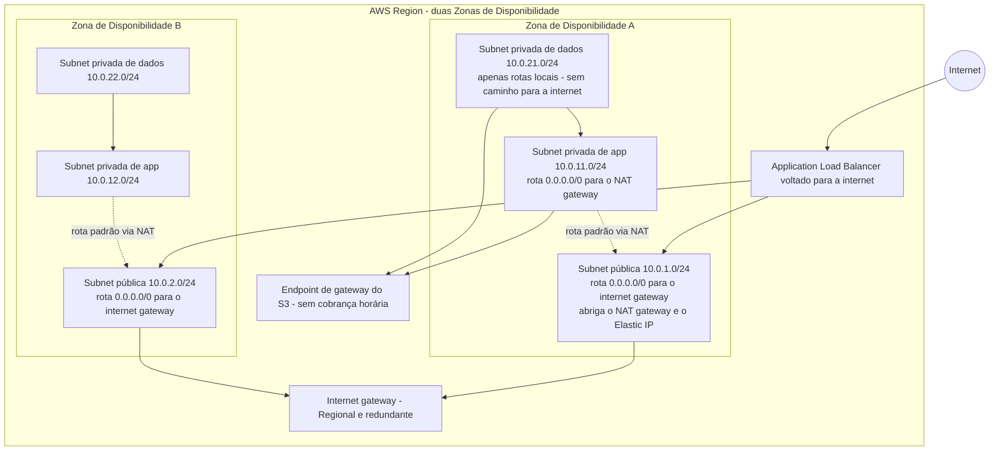
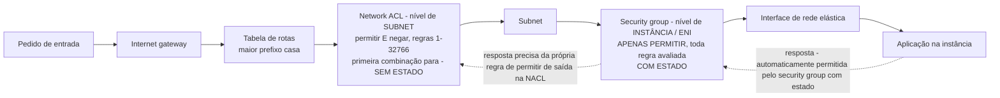
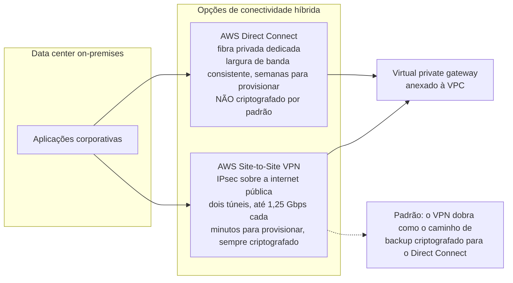
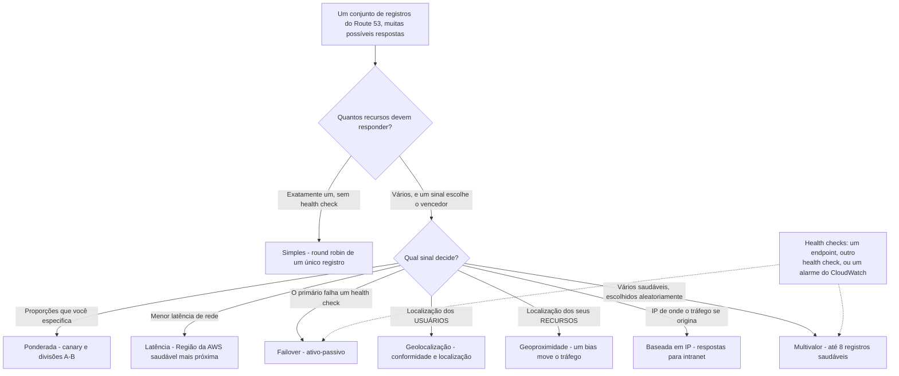
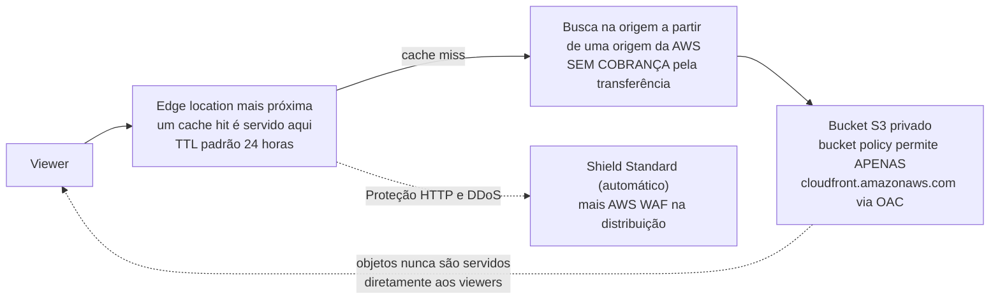
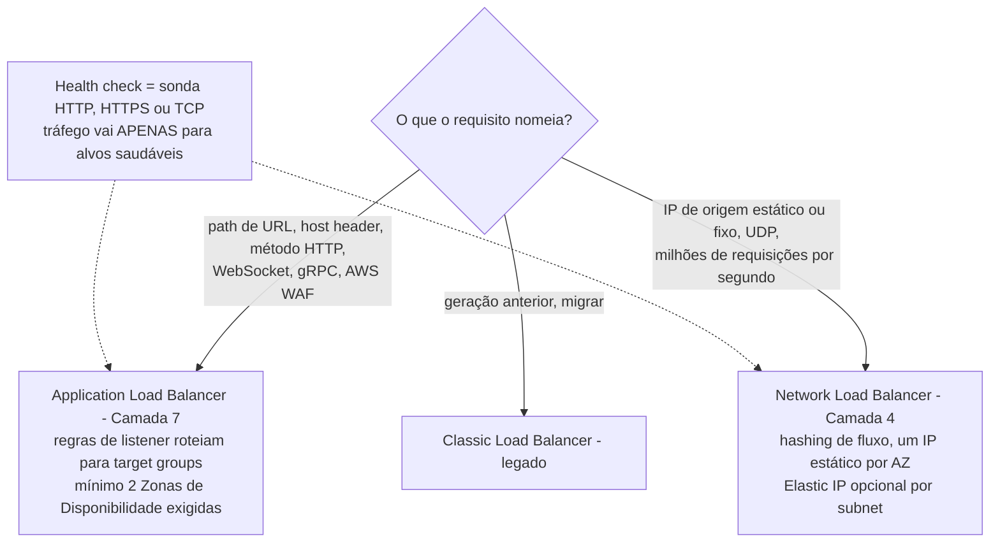
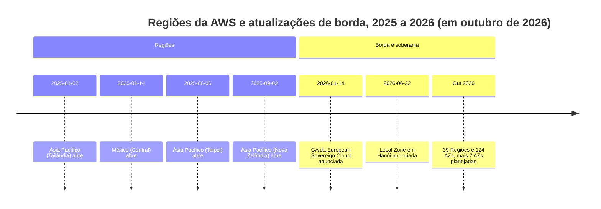

# Rede, Entrega de Conteúdo e Conectividade Híbrida

O Domínio 3 (**Tecnologia e Serviços de Nuvem**) carrega **34% do conteúdo pontuado** no CLF-C02, e sua tarefa 3.5: *"Identificar serviços de rede da AWS"*: é o bloco de conhecimento mais mecânico do exame. Tudo nele é uma definição mais uma regra: uma subnet vive em exatamente uma Zona de Disponibilidade, uma subnet pública é uma **decisão de roteamento** em vez de uma caixa de seleção, um NAT gateway é **apenas saída**, um security group é **com estado** enquanto uma network ACL é **sem estado**, VPC peering **não é transitivo**, e Direct Connect é **dedicado com largura de banda consistente**. Acrescente os *"propósitos de load balancers"* da tarefa 3.3, as **edge locations** da tarefa 3.2, e você tem uma lição onde quase toda questão tem exatamente uma resposta defensável: desde que você memorize as regras em vez do marketing.

```text
====================================================================
 CLF-C02 DOMÍNIO 3 (parte) — CARTÃO DE LIÇÃO DE REDE (em outubro de 2026)
====================================================================
 VPC         grátis · CIDR /16 - /28 · uma VPC padrão por Região
 SUBNET      vive em exatamente UMA AZ · pública SE E SÓ SE a
             tabela de rotas aponta para um internet gateway
             (não existe caixa de seleção)
 TAB. ROTAS  destino -> alvo, uma por subnet, CASA MAIOR
             PREFIXO vence
 IGW         escalado horizontalmente, redundante, REGIONAL;
             anexar não faz nada até 0.0.0.0/0 -> igw-xxx
 NAT GW      APENAS SAÍDA para subnets privadas; NAT público
             fica em subnet pública com Elastic IP
             $0,045/hora + $0,045/GB (US East Ohio)
 EIP         IPv4 público estático, cobrado EM USO OU OCIOSO
             $0,005/hora -> $3,65/mês por IP
 VPC PADRÃO  uma subnet pública por AZ + IGW roteado + DNS ativo
---------------------------------------------------------------------
 SEGURANÇA  security group = INSTÂNCIA / ENI, APENAS PERMITIR,
             COM ESTADO, todas as regras avaliadas, padrão:
             entrada da própria si, saída tudo
             network ACL  = SUBNET, permitir E negar, SEM ESTADO,
             regras 1-32766 menor primeiro, primeira combinação
             para, padrão: permitir tudo nos dois sentidos
             ambos $0; nenhum dos dois filtra DNS, DHCP, IMDS,
             Sincronização de Hora
---------------------------------------------------------------------
 CONEXÃO    2 VPCs ............... peering (1:1, NÃO transitivo, $0)
             muitas VPCs + on-prem ... Transit Gateway
                                     ($0,05/anexo/h)
             S3 / DynamoDB apenas . endpoint de gateway ($0)
             qualquer serviço da AWS  interface endpoint/PrivateLink
                                     ($0,01/h por AZ + $0,01/GB)
             on-prem, consistente ... Direct Connect (fibra dedicada)
             on-prem, rápido ........ Site-to-Site VPN
                                     (IPsec, 2 túneis)
---------------------------------------------------------------------
 DNS         Route 53 = registro + roteamento + health checks
             hosted zone = contêiner de registros (pública /
             privada VPC)
             8 políticas: simples, ponderada, latência, failover,
             geolocalização, geoproximidade, baseada em IP,
             multivalor (<= 8)
             zona $0,50/mês as primeiras 25 · consultas
             $0,40/milhão
             alias para alvos da AWS $0 · CNAME não fica no ápice
---------------------------------------------------------------------
 BORDA       CloudFront = cache HTTP(S) em edge locations
             TTL padrão 24 h, mín 0 s · busca na origem da
             AWS grátis
             S3 privado + OAC (OAI é legado) · WAF + Shield
             Standard
             ALB = L7, regras host/path, WAF, >= 2 AZs, $0,0225/h
             NLB = L4, IP estático por AZ, sem WAF, $0,0225/h
             Global Accelerator = 2 IPs anycast estáticos,
             SEM cache
====================================================================
```

> [!NOTE]
> **Disciplina de escopo.** Todo serviço ensinado aqui como examinável está ou na **linha "Rede e Entrega de Conteúdo" no escopo** do CLF-C02 (Amazon CloudFront, AWS Direct Connect, AWS Global Accelerator, AWS PrivateLink, Amazon Route 53, AWS Transit Gateway, Amazon VPC, AWS VPN / Site-to-Site VPN / Client VPN) ou nomeado em uma declaração de tarefa do Domínio 3 (network ACLs, security groups, Amazon Inspector, load balancers, edge locations). **Amazon API Gateway** fica na mesma linha mas é coberto onde pertence na lição de APIs; **Amazon VPC Lattice, AWS Cloud Map, AWS Network Access Analyzer e AWS Ground Station** estão na lista **fora do escopo** do guia e aparecem apenas como distratores.

Nesta lição você vai:

- nomear todo **componente de VPC**: subnets, tabelas de rotas, internet gateways, NAT gateways, Elastic IPs, interfaces de rede elásticas;
- decidir **pública versus privada** apenas pela tabela de rotas, e explicar por que **NAT é apenas saída**;
- separar a **VPC padrão** de uma VPC customizada e saber quando a AWS manda você construir a sua;
- vencer **security group versus network ACL** em todo eixo: escopo, ação da regra, estado, avaliação, padrões e referenciamento;
- aplicar a **regra de peering não transitiva** e a regra de não edge-to-edge;
- escolher **endpoint de gateway vs interface endpoint vs PrivateLink**: incluindo o de graça;
- separar **Site-to-Site VPN de Direct Connect** em tempo de provisionamento, consistência de largura de banda e criptografia;
- usar hosted zones do **Route 53**, todas as oito políticas de roteamento e health checks;
- colocar **CloudFront** na frente de uma origem S3 privada com **Origin Access Control**;
- escolher **ALB sobre NLB**, e saber por que o Classic Load Balancer é a *"geração anterior"*;
- enunciar a frase de uma linha do **Global Accelerator** e a escolha de borda em quatro vias;
- auditar as **armadilhas de custo ocioso**: NAT gateways, Elastic IPs, aceleradores desativados, portas de Direct Connect;
- estudar **quatro estudos de caso publicados pela AWS**, depois praticar com **12 questões no estilo do exame** mais quatro verificações interativas.

---

## 1. A VPC: uma rede isolada que você projeta

### 1.1 O conjunto de componentes

Amazon VPC é uma *"rede virtual logicamente isolada"* que você define dentro de uma Região, e a AWS afirma que **não há cobrança adicional por usar uma VPC** (em outubro de 2026). A tarefa 3.5 pede apenas para **identificar os componentes**, mas a redação do exame assume que você sabe exatamente o que cada componente faz.

| Componente | O que é | A regra do exame |
|---|---|---|
| **VPC** | Sua rede isolada, uma por Região por conta mais uma **VPC padrão** | Blocos CIDR de **/16 a /28**; criar uma é **grátis** |
| **Subnet** | Um intervalo CIDR **dentro de exatamente uma Zona de Disponibilidade** | Pública ou privada é decidido pela **tabela de rotas**, nunca por uma caixa de seleção |
| **Tabela de rotas** | Uma lista ordenada de rotas destino CIDR → alvo | Uma associada por subnet (a tabela **principal** por padrão); **maior prefixo casa** |
| **Internet gateway (IGW)** | Um ponto de entrada e saída redundante, **escalado horizontalmente, Regional** | Anexá-lo **não faz nada** até você adicionar `0.0.0.0/0 → igw-xxx` |
| **NAT gateway** | Internet apenas saída para recursos em subnets **privadas** | Um NAT público vive em uma **subnet pública** e possui um **Elastic IP** |
| **Elastic IP (EIP)** | Um endereço IPv4 público estático que você pode remapear | Cobrado **em uso *e* ocioso**: $0,005/hora, ou seja **$3,65/mês por IP** (em outubro de 2026) |
| **Interface de rede elástica (ENI)** | A NIC virtual anexada a uma instância ou serviço de VPC | É nisso que um **security group** se anexa, daí *"escopo de instância"* |
| **VPC flow logs** | Registros de metadados de tráfego permitido e rejeitado | Captura **metadados, não o payload** |
| **Resolvedor DNS fornecido pela AWS** | O resolvedor embutido da VPC | Saiba que ele existe; o endereço específico do resolvedor não é material de exame |

### 1.2 Pública versus privada é uma decisão de roteamento

Uma subnet não tem atributo *"pública"*. Ela é **pública se e somente se sua tabela de rotas carrega uma rota para um internet gateway**; caso contrário, é privada. Essa única frase responde mais itens do CLF-C02 do que qualquer outro fato de rede, porque dissolve três armadilhas relacionadas de uma vez:

- anexar um IGW à VPC **não** torna nenhuma subnet pública: você ainda precisa da rota;
- uma subnet privada **com** uma rota para um NAT gateway continua **privada**: NAT dá a ela internet de *saída*, não de entrada;
- uma subnet pública sem instâncias com endereços IPv4 públicos continua pública: ela simplesmente não tem nada para onde rotear.



> [!NOTE]
> **Leia o diagrama como um conjunto de regras.** As subnets de dados **não têm rota para nem um internet gateway nem um NAT gateway**: é exatamente isso que as torna inalcançáveis a partir da internet. As subnets de app têm exatamente **um caminho de saída**, o NAT gateway. As subnets são públicas puramente por causa da rota `0.0.0.0/0 → igw` em *suas próprias* tabelas de rotas.

### 1.3 O NAT gateway é apenas saída

A AWS é explícita sobre a direção: com um NAT gateway em vigor, *"serviços externos não podem iniciar uma conexão"* com suas instâncias privadas. Uma instância privada pode então **puxar atualizações do sistema operacional, baixar pacotes e chamar APIs da AWS**, enquanto nada na internet consegue alcançá-la por dentro. Se uma questão precisa de tráfego de internet **de entrada** para um workload privado, a resposta é um **load balancer voltado para a internet** (ou uma instância genuinamente pública): nunca *"abrir o NAT gateway"*.

O formato do custo também importa (US East Ohio, em outubro de 2026; verifique os valores atuais antes de usar): **$0,045 por hora** mais **$0,045 por GB** processado, cobrado em incrementos de uma hora para horas parciais, e um **NAT gateway regional é implantado por Zona de Disponibilidade**, então um design de duas AZs paga a cobrança horária duas vezes.

### 1.4 A VPC padrão versus uma VPC customizada

A AWS cria uma **VPC padrão em toda Região**, e ela está pronta para receber lançamentos:

| Comportamento da VPC padrão | O que ela te dá |
|---|---|
| Subnets | **Uma subnet pública por Zona de Disponibilidade** |
| Internet | **IGW anexado e já roteado**: instâncias recebem IPv4 público automaticamente |
| DNS | **Resolução DNS habilitada** |
| Segurança | **Security group padrão** (entrada apenas da própria si, saída permitir tudo) |
| ACL | **Network ACL padrão** (permitir tudo, nos dois sentidos) |

Essa conveniência é exatamente por que a AWS recomenda uma **VPC customizada para produção**: apenas em uma VPC customizada você escolhe o CIDR, decide quais subnets são privadas, controla as rotas e decide o que fica exposto. No exame, *"lançar na VPC padrão"* é uma resposta de prototipagem, nunca uma resposta de arquitetura.

- **📚 Você sabia?** **Endereços IPv4 públicos custam dinheiro mesmo ociosos**, $0,005 por hora em uso *ou* sem uso, o que é **$3,65 por mês por endereço** em um mês de 730 horas (em outubro de 2026; verifique os valores atuais antes de usar). **Endereços IPv4 privados nunca são cobrados**, e o Free Tier inclui **750 horas por mês de IPv4 público com Amazon EC2**. Quatro Elastic IPs esquecidos e desanexados custam portanto cerca de **$14,60 por mês para absolutamente nada**, um item de fatura que o exame adora disfarçar dentro de uma questão de otimização de custos.

### 1.5 Exemplo E1: a VPC em três camadas, de ponta a ponta

**Cenário.** Uma aplicação web deve ser alcançável a partir da internet, deve sair para a internet em busca de atualizações, e deve manter um banco de dados que nunca é diretamente alcançável. Projete-a do jeito que o exame espera.

| Passo | Decisão | Por quê (regra do exame) |
|---|---|---|
| 1 | VPC `10.0.0.0/16`, duas AZs | VPCs são Regionais; AZs fornecem isolamento de falhas |
| 2 | Públicas `10.0.1.0/24` e `10.0.2.0/24` | Uma subnet por AZ, cada uma com `0.0.0.0/0 → igw` |
| 3 | App privada `10.0.11.0/24` e `10.0.12.0/24` | Cada uma com `0.0.0.0/0 → nat-xxx`: apenas saída |
| 4 | Dados privados `10.0.21.0/24` e `10.0.22.0/24` | **Apenas rotas locais**: sem rota de internet gateway, sem rota de NAT |
| 5 | **ALB** voltado para a internet nas subnets públicas | O único caminho de entrada sancionado para as camadas privadas |
| 6 | NAT gateway mais Elastic IP em uma subnet pública | Acesso de saída para a camada de app |
| 7 | Security groups encadeados **por referência**: SG do ALB → SG de app → SG de DB | As camadas confiam umas nas outras, nunca CIDRs codificados |
| 8 | Network ACLs deixadas permissivas, ou com uma negação explícita para um CIDR ruim | A NACL é a ferramenta de negação no nível da subnet |

### 1.6 Exemplo E2: a fatura do NAT

Um design de duas AZs roda **dois NAT gateways por 730 horas**, egraga **500 GB pelo processamento de NAT**, e envia outros **500 GB para a internet** a $0,09 por GB (em outubro de 2026; verifique os valores atuais antes de usar):

$$
2 \times 730 \times 0,045 = 65,70, \quad 500 \times 0,045 = 22,50, \quad 500 \times 0,09 = 45,00
$$

$$
\text{Total} = 65,70 + 22,50 + 45,00 = \$133,20 \text{ por mês}
$$

A lição não é a aritmética, são as **três cobranças separadas**: horária, processamento de NAT por GB e transferência de dados de saída para a internet. Qualquer opção que cite um total de cobrança única está testando se você percebeu as três.

---

## 2. Security groups versus network ACLs, o item clássico

A tarefa 3.5 diz *"Compreender a segurança em uma VPC (network ACLs, security groups, Amazon Inspector)"*. A comparação security-group-versus-NACL é a questão de rede mais confiável do CLF-C02, e ela é decidida em sete eixos.

| Característica | **Security group** | **Network ACL** |
|---|---|---|
| Escopo | **Nível de instância / ENI** (ele se anexa à interface de rede) | **Nível de subnet** (uma por subnet) |
| Ação da regra | **Apenas permitir: sem regras de negação** | **Permitir *e* negar** |
| Estado | **Com estado**, o tráfego de retorno é automaticamente permitido | **Sem estado**, o tráfego de retorno deve ser permitido por uma regra explícita |
| Avaliação | **Todas as regras avaliadas**; permite se qualquer uma casar | Regras numeradas **1 to 32766**, menor primeiro, **primeira combinação para** |
| Referenciamento | Pode referenciar **outros security groups** | Não pode referenciar security groups; funciona com CIDRs |
| Padrão | Entrada **apenas da própria si**; **saída permitir tudo** | **Permitir tudo** na entrada e na saída |
| Cobrança | **$0** | **$0** |

Duas consequências seguem da linha de *estado* sozinha. Com um security group **com estado** você abre 443 na entrada e as respostas fluem de volta intactas. Com uma NACL **sem estado** você deve **também** permitir as portas efêmeras de retorno, ou a conexão nunca completa: a falha clássica de *"minha NACL quebrou minha aplicação"*.

### 2.1 O caminho do pacote



> [!WARNING]
> **Nenhum dos dois dispositivos filtra tudo.** Security groups e network ACLs **não** filtram Amazon DNS, DHCP, o **serviço de metadados da instância (169.254.169.254)** ou Sincronização de Hora: esses os contornam por design. Qualquer opção que diga *"bloquear o endpoint de metadados com um security group"* está automaticamente errada; o controle correto vive no **nível da instância** (as opções de IMDS, como exigir tokens IMDSv2) ou na camada de IAM.

### 2.2 Os padrões são permissivos, não seguros

- O **security group padrão** permite toda saída e entrada **apenas da própria si**: utilizável, mas não é uma postura de segurança.
- A **network ACL padrão** permite **todo** tráfego para dentro e para fora.

E a regra que os alunos mais esquecem: **security groups não podem negar**. Se uma questão exige que você bloqueie um CIDR de parceiro independente do que as regras de instância permitem, a resposta é uma **regra de negação de network ACL** (ou uma negação de IAM / bucket policy): nunca *"adicionar uma regra de negação ao security group"*.

### 2.3 Exemplo E3: negar um CIDR, na subnet inteira

**Cenário.** A rede do parceiro `203.0.113.0/24` deve ser bloqueada de alcançar uma subnet inteira imediatamente, sem tocar em uma única instância.

| Opção | Funciona? | Por quê |
|---|---|---|
| **Negação** de entrada no security group | **Não** | Security groups **não têm regras de negação** |
| Regra de **NACL** numerada `100`, `DENY 203.0.113.0/24` | **Sim** | Escopo de subnet, sem estado, primeira combinação para: regra 100 vence o permitir-tudo padrão |
| Revogar o `0.0.0.0/0` de entrada do security group | Parcialmente | Também bloqueia todo mundo mais; não é o comportamento pedido |
| Regra do AWS WAF | Camada errada | WAF é **Camada 7** anexada a um load balancer ou recurso semelhante: não filtra tráfego cru de subnet |

```fillblank
{
  "question": "Complete as frases de vocabulário de VPC com os termos corretos da AWS:",
  "template": "Uma subnet é pública apenas quando sua tabela de rotas carrega uma rota para um {{1}}. Um NAT gateway dá a uma subnet privada acesso à internet apenas de {{2}}. Um security group é {{3}} e nunca pode conter uma regra de negação, enquanto uma network ACL é {{4}}, tem escopo de uma {{5}}, e avalia suas regras numeradas da menor para a maior até a primeira combinação parar.",
  "answers": {
    "1": "internet gateway",
    "2": "saída",
    "3": "com estado",
    "4": "sem estado",
    "5": "subnet"
  },
  "distractors": ["virtual private gateway", "entrada", "sem conexão", "zona de disponibilidade", "interface de rede elástica", "local de borda", "endpoint de interface", "processador de rotas"],
  "explanation": "Pública versus privada é uma decisão de roteamento: a rota para um internet gateway é o que torna uma subnet pública. NAT gateways são apenas saída. Security groups são com estado e apenas-permitir; network ACLs são sem estado, permitir-e-negar, e com escopo de subnet com avaliação menor-primeiro até a primeira combinação parar."
}
```

- **📚 Você sabia?** Uma regra de security group pode **referenciar outro security group** em vez de um intervalo de IP, é assim que o padrão em camadas do Exemplo E1 funciona com zero CIDRs codificados, e por que mover uma camada de aplicação para uma nova subnet **não exige nenhuma edição de regra**. Network ACLs, por outro lado, são presas à subnet e baseadas em IP por natureza. Ambas permanecem **gratuitas** (em outubro de 2026; aplicam-se cotas por conta e por VPC, verifique os valores atuais antes de usar).

---
## 3. VPC peering: par a par, nunca transitivo

**VPC peering** é uma conexão de rede privada entre duas VPCs que permite que instâncias em uma se comportem *"como se estivessem na mesma rede"*. A AWS é incomumente direta sobre seus limites, e esses limites são o exame.

| Fato de peering | Detalhe |
|---|---|
| Topologia | Um relacionamento estrito **um-para-um**: **relacionamentos de peering transitivos não são suportados** |
| Direção | Totalmente **bidirecional** *dentro* de um par (A↔B funciona nos dois sentidos) |
| Edge-to-edge | Recursos na VPC B **não** podem usar o internet gateway, NAT gateway, VPN, Direct Connect ou endpoint de gateway da VPC A |
| CIDR sobreposto | **Não permitido**: as duas VPCs devem ter intervalos de endereço sem sobreposição |
| Custo | **Sem cobrança para criar** uma conexão de peering; transferência de dados na mesma AZ grátis, **$0,01/GB entre AZs** (em outubro de 2026; verifique os valores atuais antes de usar) |
| MTU | **9001 bytes**; **8500 bytes** para peering entre Regiões |
| Pedidos pendentes | Expiram após **7 dias** se não forem aceitos |
| O que não é | *"Nem um gateway nem uma conexão VPN"* |

### 3.1 Exemplo E4: a armadilha do peering

**Cenário.** A VPC **A** faz peering com a VPC **B**, e a VPC **A** também faz peering com a VPC **C**. Um novo serviço em **B** precisa alcançar um serviço em **C**.

```text
   B  <---- peering ---->  A  <---- peering ---->  C
        B alcança A               A alcança C
        ...mas B NÃO alcança C   (peering não é transitivo)
```

| Correção proposta | Veredito |
|---|---|
| *"O tráfego vai fluir porque A está no meio"* | **Errado**: A não roteia entre seus peers; não é um roteador |
| *"Adicionar uma rota à tabela de rotas de A apontando B para C"* | **Errado**: as rotas de A nunca se tornam as rotas de B ou de C |
| *"B pode usar o internet gateway de A para alcançar C"* | **Errado**: **sem edge-to-edge**; um peer nunca pode emprestar seu IGW, NAT, VPN, Direct Connect ou endpoint de gateway |
| Criar uma **terceira conexão de peering** B↔C | **Correto em pequena escala** (três VPCs) |
| Anexar ambos ao **AWS Transit Gateway** | **Correto em escala**: um hub com tabelas de rotas, construído explicitamente para *"interconectar… VPCs e redes on-premises"* |

**Transit Gateway** é cobrado por anexo (**$0,05 por hora-de-anexo ≈ $36,50/mês**) mais **$0,02 por GB processado**, com MTU de **8500 bytes** (em outubro de 2026; verifique os valores atuais antes de usar). Seis anexos mais 1 TB de processamento dá:

$$
6 \times 0,05 \times 730 + 1024 \times 0,02 = 219,00 + 20,48 = \$239,48 \text{ por mês}
$$

Peering é grátis mas par a par; o hub custa dinheiro mas escala. *"Como essas VPCs conversam?"* é respondido **contando-as**: duas → peering, muitas mais on-premises → Transit Gateway.

- **📚 Você sabia?** Peering não tem cobrança horária mas não é isento de cobranças de **transferência de dados**: tráfego na mesma AZ através de uma conexão de peering é grátis, enquanto **tráfego entre AZs é $0,01 por GB** (em outubro de 2026; verifique os valores atuais antes de usar). Uma opção de *"peering grátis"* em uma questão de custo é portanto apenas meia verdade, e um pedido de peering não aceito **expira silenciosamente após 7 dias**, que é exatamente o tipo de detalhe operacional que a AWS gosta de enterrar em um distrator.

---

## 4. Endpoints de VPC e PrivateLink: alcançar a AWS sem a internet

Um serviço da AWS que você alcança pela internet pública precisa de um NAT gateway ou de um internet gateway. Um **endpoint de VPC** dá à sua VPC um caminho privado para o serviço, e os dois tipos de endpoint diferem precisamente nos eixos que o exame pergunta.

| | **Endpoint de gateway de VPC** | **Endpoint de interface (AWS PrivateLink)** |
|---|---|---|
| Serviços | **Apenas Amazon S3 e Amazon DynamoDB** | Essencialmente **qualquer serviço da AWS**, mais serviços de parceiros e os seus |
| Mecanismo | Uma rota adicionada à sua tabela de rotas (uma prefix list) | Uma **interface de rede elástica por subnet** em cada AZ |
| Precisa IGW / NAT? | **Não**: funciona sem internet gateway e sem dispositivo NAT | Não |
| Cobrança | **$0 horário e $0 por GB** | **$0,01 por hora por AZ** + **$0,01 por GB processado** |
| Alcance | **Apenas local à VPC**: não pode servir redes on-premises, peers de outras Regiões ou tráfego de Transit Gateway | Amigável entre contas e entre Regiões; o provedor deve colocar o serviço atrás de um **load balancer** |
| Cota | **20 por Região, 255 por VPC** (verifique os valores atuais antes de usar) | **20 por Região** por padrão (verifique os valores atuais antes de usar) |
| Melhor para | *"Cortar minha fatura de NAT para tráfego do S3"* | Expor um serviço privatamente, ou alcançar qualquer serviço não-S3/DynamoDB |

**AWS PrivateLink** é a tecnologia por trás dos endpoints de interface: consumidores alcançam o serviço de um provedor *"como se estivessem na sua VPC"*, o tráfego nunca sai da rede da AWS, e os consumidores não podem ver uns aos outros. Observe o limite: **PrivateLink expõe um *serviço*, não uma VPC inteira**: para conectividade de VPC inteira a resposta ainda é **peering** ou **Transit Gateway**.

### 4.1 Exemplo E5: aritmética de endpoint de gateway versus interface

Um workload em **três Zonas de Disponibilidade** processa **200 GB por mês** para o Amazon S3.

$$
\text{Endpoint de interface} = 3 \times 730 \times 0,01 + 200 \times 0,01 = 21,90 + 2,00 = \$23,90 \text{ por mês}
$$

$$
\text{Endpoint de gateway para S3} = \$0,00 \text{ por mês}
$$

Mesmo destino, mesmo tráfego: **$23,90 versus nada** (em outubro de 2026; verifique os valores atuais antes de usar). Essa lacuna é todo o ponto do exame: se o serviço é **S3 ou DynamoDB**, o endpoint de gateway é a resposta padrão, e *"criar um endpoint de interface para alcançar S3"* é o distrator.

### 4.2 Exemplo E6, o padrão S3 de subnet privada

**Cenário.** Instâncias em uma subnet privada devem ler objetos de um bucket: sem IP público, sem NAT gateway, sem caminho para a internet.

1. Crie um **endpoint de gateway de VPC** para o S3 na VPC.
2. Aceite a rota que ele adiciona à tabela de rotas da subnet (a rota da prefix list).
3. Restrinja uma **endpoint policy** ao que é exatamente necessário, por exemplo `s3:GetObject`.
4. Deixe o bucket privado, o tráfego nunca sai da rede da Amazon.

**Resultado:** zero cobrança horária, zero cobrança por GB, nenhum NAT gateway para pagar, e nenhuma exposição de entrada. Esta é a resposta canônica de *"reduzir custos de NAT"*.

### 4.3 Cenário, o serviço privado do provedor SaaS

Um provedor quer vender um microsserviço interno para várias contas de clientes sem publicá-lo na internet.

| Parte | O que constroem |
|---|---|
| **Provedor (conta P)** | Um **NLB** na frente do serviço, publicado como um **serviço de endpoint PrivateLink**; consumidores recebem acesso explicitamente |
| **Consumidores (contas A e B)** | Um **endpoint de interface** cada, dentro de suas próprias VPCs |
| **Resultado** | O tráfego permanece na rede da AWS, os consumidores não podem ver uns aos outros, e o provedor nunca expõe um endpoint público |

Contraste no exame: **uma API pública** → API Gateway; **VPCs inteiras conversando entre si** → peering ou Transit Gateway; **um serviço, privatamente, muitas contas** → PrivateLink.

---

## 5. Conectividade híbrida: Site-to-Site VPN versus Direct Connect

A tarefa 3.5 nomeia o par diretamente: *"Identificar opções de conectividade de rede com a AWS (AWS VPN, AWS Direct Connect)"*. Um é rápido e criptografado sobre a internet; o outro é dedicado, consistente e **não criptografado por padrão**.

| | **AWS Direct Connect** | **AWS Site-to-Site VPN** |
|---|---|---|
| Meio | **Fibra privada dedicada**: funciona *"contornando provedores de serviços de internet no seu caminho de rede"* | **Túneis IP Security (IPsec) sobre a internet pública** |
| Provisionamento | **Semanas** (uma porta física deve ser provisionada) | **Minutos** |
| Largura de banda | **Consistente**, de 50 Mbps até 100 Gbps de velocidades de porta | **Melhor esforço**; **até 1,25 Gbps por túnel** |
| Criptografia | **Não criptografado por padrão**, é um circuito privado, e MACsec é opcional | **Sempre criptografado**, IPsec é o ponto da conexão |
| Redundância | Pares de portas e múltiplos locais | **Dois túneis VPN por conexão**, com failover automático |
| Cobrança recorrente (em outubro de 2026) | **$0,30/h (1 Gbps), $2,25/h (10 Gbps), $22,50/h (100 Gbps), $85,00/h (400 Gbps)** dedicado; portas hosted a partir de **$0,03/h (50 Mbps)** | **$0,05/hora por conexão ≈ $36,50/mês** |
| Melhor para | Workloads híbridos estáveis e de alto volume e replicação onde a latência deve ser previsível | Início rápido, tráfego em rajada, escritórios regionais, e o **caminho de backup criptografado para um link Direct Connect** |

Opções no escopo relacionadas: **AWS Client VPN** para usuários remotos individuais (OpenVPN gerenciado), e **AWS VPN CloudHub** para roteamento hub-and-spoke entre várias conexões Site-to-Site VPN. **AWS Transit Gateway** é a resposta quando o requisito é *muitas* VPCs **e** redes on-premises dentro de um único hub.



### 5.1 Exemplo E7: DX versus VPN, o preço da consistência

Para um mês completo de 730 horas (em outubro de 2026; verifique os valores atuais antes de usar):

| Opção | Aritmética | Mensal |
|---|---|---|
| **Porta dedicada Direct Connect de 10 Gbps** | $2,25 × 730 | **$1.642,50** |
| **Uma conexão Site-to-Site VPN** | $0,05 × 730 | **$36,50** |
| Razão | $1.642,50 ÷ $36,50 | **≈ 45×** |

Nenhum dos números é *"a resposta certa"* por si só. O exame quer que você leia o **requisito**: *"conexão privada dedicada com largura de banda consistente"* → **Direct Connect**; *"túnel criptografado, estabelecido rapidamente"* → **Site-to-Site VPN**; *"laptop"* → **Client VPN**; *"muitas VPCs mais on-premises"* → **Transit Gateway**.

> [!IMPORTANT]
> **A armadilha da criptografia corre nas duas direções.** Os alunos assumem que *"privado significa criptografado"*, então marcam Direct Connect como criptografado, ele **não é criptografado por padrão**. E eles assumem que *"sobre a internet significa inseguro"*, então marcam Site-to-Site VPN como não criptografado, ele **sempre é IPsec**. Leia o verbo do requisito: *largura de banda consistente* seleciona Direct Connect, *criptografado* seleciona o VPN.

```matching
{
  "question": "Relacione cada requisito de conectividade à opção da AWS que o exame espera:",
  "pairs": [
    {"left": "Duas VPCs precisam conversar privatamente sem cobrança horária", "right": "VPC peering: par a par, não transitivo, grátis para criar, $0,01/GB entre AZs"},
    {"left": "Muitas VPCs mais redes on-premises dentro de um hub", "right": "AWS Transit Gateway - $0,05 por hora-de-anexo mais $0,02 por GB processado"},
    {"left": "Uma subnet privada alcançando o Amazon S3 sem fatura de NAT", "right": "Endpoint de gateway de VPC: apenas S3 e DynamoDB, $0 horário e $0 por GB"},
    {"left": "Um serviço interno exposto privatemente para várias contas", "right": "Endpoint de interface AWS PrivateLink - $0,01 por hora por AZ mais $0,01 por GB"},
    {"left": "Escritórios regionais precisando de um link criptografado em minutos", "right": "AWS Site-to-Site VPN - IPsec sobre a internet, dois túneis, $0,05 por hora"},
    {"left": "Um data center precisando de largura de banda consistente em um circuito privado", "right": "AWS Direct Connect: fibra dedicada, semanas para provisionar, NÃO criptografado por padrão"},
    {"left": "Laptops remotos individuais precisando de acesso remoto gerenciado", "right": "AWS Client VPN - OpenVPN gerenciado para usuários individuais"}
  ],
  "explanation": "Leia a escala do requisito primeiro: duas VPCs inteiras significa peering, muitas VPCs mais on-premises significa Transit Gateway, um serviço privado significa um endpoint (endpoint de gateway grátis para S3 e DynamoDB, endpoint de interface pago / PrivateLink para todo o resto). Para os links híbridos, minutos e criptografia significa Site-to-Site VPN, um circuito privado dedicado com largura de banda consistente significa Direct Connect, e um único laptop significa Client VPN."
}
```

- **📚 Você sabia?** Toda conexão Site-to-Site VPN oferece **dois túneis VPN**, que é por que *"configurar ambos os túneis"* é a resposta padrão de alta disponibilidade: a AWS documenta o teto por túnel como **até 1,25 Gbps**, então um único túnel nunca é vendido como 1,25 Gbps garantidos de throughput de aplicação (em outubro de 2026; verifique os valores atuais antes de usar). Portas de Direct Connect, enquanto isso, **são cobradas com ou sem tráfego fluindo**: uma porta ociosa de 10 Gbps ainda custa cerca de **$1.642,50 por mês**.

---
## 6. Amazon Route 53: DNS, hosted zones, políticas de roteamento e health checks

A tarefa 3.5 diz apenas *"Compreender o propósito do Amazon Route 53"*, mas a AWS define esse propósito como **três funções em um único serviço**: um serviço web de **Sistema de Nomes de Domínio (DNS)** altamente disponível e escalável, **registro de nomes de domínio**, e **health checking**.

### 6.1 Hosted zones

Uma **hosted zone** é um contêiner para registros.

| Tipo | O que roteia | Cobrança (em outubro de 2026; verifique os valores atuais antes de usar) |
|---|---|---|
| **Hosted zone pública** | Registros resolvíveis **na internet** | **$0,50/mês para as primeiras 25**, depois $0,10 cada; 10.000 registros incluídos, registros extras **$0,0015/mês** cada |
| **Hosted zone privada** | Registros resolvíveis **dentro de uma ou mais VPCs** | Preço da zona como acima; **consultas dentro da VPC são grátis** |

Duas regras de registro são básicas do exame: um **CNAME não fica no ápice da zona** (a raiz do domínio) enquanto um **registro alias fica**, e registros alias que apontam para alvos da AWS, load balancers, distribuições CloudFront, endpoints de site do S3, incorrem em **nenhuma cobrança pelas consultas**.

Preço padrão de consultas, se precisar (em outubro de 2026; verifique os valores atuais antes de usar): **$0,40 por milhão** de consultas padrão, **$0,60 por milhão** para latência, **$0,70 por milhão** para geolocalização e geoproximidade, **$0,80 por milhão** para roteamento baseado em IP.

### 6.2 As oito políticas de roteamento

| Política | A frase-gatilho no enunciado | O que faz |
|---|---|---|
| **Simples** | *"um recurso"*, sem health check | Respostas de round-robin simples de um único registro |
| **Ponderada** | *"nas proporções que você especificar"* | Releases canário e divisões A/B por porcentagem |
| **Latência** | *"múltiplas Regiões da AWS"*, **melhor latência** | Envia cada usuário para a Região com a menor latência de rede |
| **Failover** | *"**ativo-passivo** failover"* | O primário é respondido até seu **health check** falhar, então o secundário |
| **Geolocalização** | a localização dos seus **usuários** | Localização e conformidade por país, continente ou região do usuário |
| **Geoproximidade** | a localização dos seus **recursos**, com um **bias** | Um viés numérico aumenta ou diminui a área que cada recurso serve |
| **Baseada em IP** | o **endereço IP de onde o tráfego se origina** | Respostas diferentes para redes de origem diferentes (intranet-específica) |
| **Multivalor** | *"até oito registros saudáveis"*, retornados **aleatoriamente** | Uma alternativa leve, no nível do DNS, a um load balancer |



```matching
{
  "question": "Relacione cada política de roteamento do Route 53 à frase-gatilho que a sinaliza no exame:",
  "pairs": [
    {"left": "Roteamento simples", "right": "Um recurso e sem health check: respostas de round-robin de um único registro"},
    {"left": "Roteamento ponderado", "right": "Nas proporções que você especifica: releases canário e divisões A/B"},
    {"left": "Roteamento por latência", "right": "A Região da AWS que dá aos seus usuários a menor latência de rede"},
    {"left": "Roteamento de failover", "right": "Failover ativo-passivo dirigido por um health check no endpoint primário"},
    {"left": "Roteamento geográfico", "right": "A localização dos seus USUÁRIOS, conformidade e localização"},
    {"left": "Roteamento geoproximal", "right": "A localização dos seus RECURSOS, com um bias que move o tráfego"},
    {"left": "Roteamento baseado em IP", "right": "O endereço IP de onde o tráfego se origina: respostas para intranet"},
    {"left": "Roteamento multivalor", "right": "Até oito registros saudáveis retornados aleatoriamente: um load balancer no nível do DNS"}
  ],
  "explanation": "O Route 53 publica oito políticas de roteamento. Leia o enunciado pelo gatilho: proporções significa ponderada, melhor latência significa latência, ativo-passivo significa failover mais um health check, usuários significa geolocalização, recursos e bias significa geoproximidade, IP de origem significa baseada em IP, até oito saudáveis significa multivalor, e um recurso significa simples."
}
```

### 6.3 Health checks dirigem o failover

Um **health check do Route 53** monitora *"a saúde e o desempenho dos seus recursos"* e pode ser apontado para **um endpoint, outro health check, ou um alarme do CloudWatch**. Seus dois trabalhos de exame: dirigir o **failover de DNS** e filtrar registros de **resposta multivalor** para que apenas os saudáveis sejam retornados.

Cobrança (em outubro de 2026; verifique os valores atuais antes de usar): os **primeiros 50 health checks de endpoint da AWS são grátis**, depois **$0,50 por mês** para endpoints da AWS ou **$0,75 por mês** para endpoints não-AWS: enquanto verificações contra **endpoints do Elastic Load Balancing e endpoints de site do S3 são grátis e automáticas**.

> [!WARNING]
> **O failover de DNS não é instantâneo.** Uma resposta de DNS é **cacheada por seu TTL**, então um failover dirigido apenas por health checks do Route 53 só tem efeito tão rápido quanto o registro em cache expira. Quando uma questão exige failover **sub-segundo**, ou redação como *"sem esperar no TTL do DNS"* para um workload TCP ou UDP, a resposta esperada é **AWS Global Accelerator** ou um health check do **Elastic Load Balancing**: não Route 53 sozinho.

### 6.4 Exemplo E8: a vitrine global

**Cenário.** Uma vitrine precisa de baixa latência mundialmente, uma origem S3 privada, residência de dados na UE, e um caminho de recuperação de desastres.

| Requisito | Escolha de Route 53 / borda |
|---|---|
| Origem privada atrás de um CDN | Distribuição **CloudFront** na frente de um **bucket S3 privado** com **OAC** |
| Enviar usuários da UE para a UE | **Roteamento geográfico** |
| DR automático quando a origem primária falha | **Roteamento de failover** mais um **health check** no primário |
| Consultas DNS grátis no ápice | **Registro alias A** apontando para a distribuição CloudFront (alias para alvos da AWS é **$0**) |
| Proteger a camada HTTP | **AWS WAF** na distribuição, com **Shield Standard** já ativo |

- **📚 Você sabia?** **O roteamento multivalor retorna até oito registros saudáveis aleatoriamente**: um detalhe que a AWS afirma explicitamente, e a razão pela qual a política é às vezes descrita como o load balancer do pobre. Ainda assim não pode fazer o que um load balancer de verdade faz: sem lógica de balanceamento entre zonas, sem connection draining, sem regras de Camada 7. Quando o enunciado menciona **roteamento baseado em path ou target groups com health check**, a resposta é Elastic Load Balancing, não Route 53.

---

## 7. Amazon CloudFront e edge locations

A tarefa 3.2 nomeia **edge locations** e os **benefícios das edge locations**. CloudFront é construído sobre uma *"rede mundial de data centers chamada edge locations"*: a edge location mais próxima serve uma cópia em cache, o que produz **menor latência, taxas de transferência de dados mais altas e melhor confiabilidade** para os viewers.

| Conceito | Detalhe em profundidade de exame |
|---|---|
| **Origem** | Amazon S3, ou uma **origem customizada**: EC2, um endpoint do Application Load Balancing, seu servidor HTTP, ou um endpoint de *site* do S3 |
| **Cache** | **TTL padrão de 24 horas**, mínimo **0 segundos**; **invalidation** limpa antes da hora: **1.000 caminhos por mês grátis**, depois **$0,005 por caminho** |
| **Busca na origem** | A transferência da origem para o CloudFront é **sempre grátis quando se usam origens da AWS** (em outubro de 2026), o download na *borda* é o que você é cobrado |
| **Conteúdo privado** | **URL assinada = um objeto**; **cookie assinado = vários objetos** |
| **Padrão S3 privado** | Bucket fica **privado** + **Origin Access Control (OAC)** + uma bucket policy permitindo apenas `cloudfront.amazonaws.com`: a AWS diz *"Recomendamos que você use OAC"*. **OAI é a opção legada** |
| **Cota grátis** | **1 TB de transferência de dados de saída + 10.000.000 de requisições HTTP(S) + 2.000.000 de CloudFront Functions por mês** (em outubro de 2026; verifique os valores atuais antes de usar) |
| **Sinergia DDoS** | **Shield Standard** é automático na frente do CloudFront, e **AWS WAF** pode ser anexado à distribuição: proteção HTTP e proteção DDoS chegam com o CDN, não depois dele |
| **Classes de preço** | **Todos os locais / 200 / 100**: restrinja a entrega a regiões mais baratas |
| **Contagem de edges** | *"Centenas"* de edge locations mundialmente; a AWS não publica um único número verificável, então **verifique os valores atuais antes de usar** |

### 7.1 O padrão S3 privado, e as duas versões erradas



| Versão | Veredito |
|---|---|
| **Bucket público** para o CloudFront poder lê-lo | **Errado**: qualquer pessoa pode contornar o CDN e ler os objetos |
| **OAC** mais uma bucket policy nomeando `cloudfront.amazonaws.com`, idealmente condicionada ao ARN da distribuição | **Correto**, o bucket fica privado e os viewers precisam passar pelo CloudFront |
| **OAI** (Origin Access Identity) | **Legado**: sem novas Regiões após janeiro de 2023 e sem suporte a SSE-KMS; mantenha-o apenas para preservar uma configuração existente |

### 7.2 Exemplo E9: a fatura do CloudFront

Um site entrega **2 TB (2.048 GB)** e **30 milhões de requisições HTTPS** em um mês a partir dos Estados Unidos (em outubro de 2026; verifique os valores atuais antes de usar). A cota grátis absorve **1 TB** e **10.000.000 de requisições**:

$$
\text{Transferência de dados} = (2048 - 1024) \times 0,085 = 1024 \times 0,085 = \$87,04
$$

$$
\text{Requisições} = \frac{30{,}000{,}000 - 10{,}000{,}000}{10{,}000} \times 0,0100 = 2{,}000 \times 0,0100 = \$20,00
$$

$$
\text{Total} = 87,04 + 20,00 = \$107,04 \text{ por mês}
$$

Observe o que **não** está nessa fatura: **buscas na origem a partir do S3 são $0**, e os primeiros **1.000 caminhos de invalidation** são grátis. A linha recorrente do exame é que CloudFront na frente do S3 **economiza** dinheiro no lado da origem enquanto cobra na borda.

- **📚 Você sabia?** CloudFront precifica **requisições HTTPS separadamente de HTTP**: $0,0100 versus $0,0075 por 10.000 requisições após a cota grátis (em outubro de 2026; verifique os valores atuais antes de usar). Para 20 milhões de requisições pós-Free Tier, essa diferença sozinha é **$5,00 por mês**, o que torna *"forçar HTTPS"* simultaneamente uma resposta de segurança e uma observação de preço. E porque as buscas na origem são grátis com origens da AWS, uma origem que já é um bucket S3 nunca cobra você duas vezes pelos mesmos bytes.

---

## 8. Elastic Load Balancing: ALB versus NLB

A tarefa 3.3 exige *"Identificar os propósitos de load balancers"*. A própria definição da AWS desse propósito é uma frase com duas metades: um load balancer distribui tráfego entre alvos em **pelo menos uma Zona de Disponibilidade** e roteia o tráfego **apenas para os alvos saudáveis**.

| | **Application Load Balancer (ALB)** | **Network Load Balancer (NLB)** | **Classic Load Balancer (CLB)** |
|---|---|---|---|
| Camada OSI | **Camada 7**, *"funciona na camada de aplicação, a sétima camada"* | **Camada 4**, *"funciona na quarta camada"* | Camada 4 e Camada 7 (legado) |
| Protocolos | HTTP, HTTPS, WebSocket, gRPC | TCP, UDP, TLS | HTTP, HTTPS, TCP |
| Roteamento | **Regras de listener** por host, path e método → target groups | **Hashing de fluxo** na tupla da conexão | Round robin / menos requisições pendentes |
| Endereços | Um nome DNS com **IPs de nós rotativos** | **Um IP estático por Zona de Disponibilidade**, mais um **Elastic IP opcional por subnet** | IPs de nós atrás de um nome DNS |
| Zonas de Disponibilidade | **Mínimo 2 AZs habilitadas exigidas**; cross-zone ativado por padrão | Múltiplas recomendadas; cross-zone **desativado por padrão** | Recomendadas |
| AWS WAF | **Sim** | Não | Não |
| Perfil de throughput | Workloads web gerais | **Milhões de requisições por segundo** |: |
| Cobrança (em outubro de 2026) | **$0,0225/hora + $0,008 por LCU-hora** (1 LCU = 25 conexões novas/s, 3.000 conexões ativas/min, 1 GB/hora; **primeiras 10 regras grátis**) | **$0,0225/hora + $0,006 por NLCU-hora** (1 NLCU TCP = 800 conexões novas/s, 100.000 conexões ativas/min) | O Free Tier compartilha **750 horas/mês** com o ALB |
| Status | Escolha padrão para aplicações web | IPs estáticos, desempenho extremo, UDP/TLS | A AWS chama de *"a geração anterior"*: migre |

Três regras decidem a maioria das questões de ELB:

1. **"path de URL" / "host header" / "método HTTP" / "AWS WAF"** → **ALB**.
2. **"IP de origem estático ou fixo" / "UDP" / "milhões de requisições por segundo"** → **NLB**.
3. **"geração anterior" / "migrar"** → **Classic Load Balancer**.

E um fato contraintuitivo: **tanto load balancers voltados para a internet quanto internos alcançam seus alvos por endereços IP privados** (em outubro de 2026). *"Voltado para a internet"* descreve o próprio endpoint do load balancer, não o caminho até suas instâncias, então um design em camadas é ALB voltado para a internet → camada web → ALB **interno** → camada de aplicação.

### 8.1 Exemplo E10: aritmética ALB versus NLB

Para um mês completo de 730 horas (em outubro de 2026; verifique os valores atuais antes de usar):

| Load balancer | Base | Unidades de capacidade | Total |
|---|---|---|---|
| **ALB** | 730 × $0,0225 = $16,43 | 3 LCUs × 730 × $0,008 = $17,52 | **$33,95/mês** |
| **NLB** | 730 × $0,0225 = $16,43 | 1 NLCU × 730 × $0,006 = $4,38 | **$20,81/mês** |

O NLB é mais barato aqui, mas uma fatura mais barata nunca é a resposta para *"qual load balancer eu preciso?"*. Escolha por **capacidade primeiro** (regras de Camada 7 e WAF → ALB; IPs estáticos e UDP → NLB), depois leia a fatura.



```dragdrop
{
  "question": "Ordene estas opções de conectividade do acesso a serviço privado mais estreito para a conexão híbrida mais ampla:",
  "items": [
    "Endpoint de gateway de VPC: apenas S3 e DynamoDB, sem cobrança horária",
    "Endpoint de interface (PrivateLink) - qualquer serviço da AWS ou de parceiro, horário mais por GB",
    "VPC peering: duas VPCs inteiras, par a par, não transitivo",
    "AWS Transit Gateway: muitas VPCs mais on-premises, cobrado por anexo",
    "AWS Site-to-Site VPN: link criptografado sobre a internet, pronto em minutos",
    "AWS Direct Connect: fibra privada dedicada com largura de banda consistente"
  ],
  "correctOrder": [
    "Endpoint de gateway de VPC: apenas S3 e DynamoDB, sem cobrança horária",
    "Endpoint de interface (PrivateLink) - qualquer serviço da AWS ou de parceiro, horário mais por GB",
    "VPC peering: duas VPCs inteiras, par a par, não transitivo",
    "AWS Transit Gateway: muitas VPCs mais on-premises, cobrado por anexo",
    "AWS Site-to-Site VPN: link criptografado sobre a internet, pronto em minutos",
    "AWS Direct Connect: fibra privada dedicada com largura de banda consistente"
  ],
  "explanation": "A escada começa em um único serviço privado dentro de uma VPC (endpoint de gateway grátis), alarga para qualquer serviço (endpoint de interface pago), depois para VPCs inteiras (peering), depois para muitas VPCs mais redes on-premises (Transit Gateway), e finalmente para os dois links híbridos: o VPN para velocidade e criptografia, Direct Connect para um caminho de produção dedicado e de largura de banda consistente."
}
```

- **📚 Você sabia?** **Uma entrada de DNS do Elastic Load Balancing tem TTL de 60 segundos**, que é por que substituir toda uma frota atrás de um load balancer se propaga em cerca de um minuto em vez de instantaneamente: um caso raro em que o exame espera que você saiba que **o DNS, não o load balancer, é a parte lenta**. Separadamente, **o ALB exige pelo menos duas Zonas de Disponibilidade habilitadas** (em outubro de 2026), então um ALB dentro de uma VPC de AZ única é uma configuração inválida por design, não uma economia de custo.

---
## 9. AWS Global Accelerator e a escolha de borda em quatro vias

**A frase de uma linha para memorizar:** Global Accelerator te dá **dois endereços IPv4 anycast estáticos** anunciados das edge locations da AWS, e então carrega o tráfego TCP e UDP pela **rede global da AWS** até o **regional endpoint saudável** mais próximo: um ALB, NLB, instância EC2 ou Elastic IP. É um **ponto de entrada fixo com failover rápido e sem cache**, construído para workloads TCP/UDP **não-cacheáveis** como games, IoT e VoIP.

| | **Amazon CloudFront** | **AWS Global Accelerator** | **Amazon Route 53** | **Elastic Load Balancing** |
|---|---|---|---|---|
| Camada do trabalho | **Cacha objetos HTTP(S) na borda** | **IPs anycast estáticos mais roteamento backbone** | **Tradução nome DNS → IP** | **Distribuição Regional para alvos saudáveis** |
| Cache | **Sim**: esse é todo o ponto | **Nenhum cache** | Não | Não |
| Endereços | O nome de domínio da distribuição | **Dois endereços IPv4 estáticos** (quatro dual-stack) | Registros da hosted zone | Um nome DNS com IPs de nós rotativos |
| Velocidade de failover | Comportamento do cache e da origem | **Sub-segundo, sem esperar no TTL de DNS** | Depende do **TTL do registro** | Health checks a cada poucos segundos |
| Cobrança (em outubro de 2026) | Pague por GB e por requisição, com um Free Tier generoso | **$0,025/hora, cobrado mesmo quando desativado**, mais transferência de dados por GB, e cada IP estático é **$0,005/hora** | Hosted zone mais cobranças de consultas | Horário mais unidades de capacidade |

### 9.1 Exemplo E11, o acelerador desativado ainda cobra

Um acelerador é criado, testado, então **desativado** por um mês completo de 730 horas com **zero tráfego** (em outubro de 2026; verifique os valores atuais antes de usar):

$$
\text{Acelerador} = 0,025 \times 730 = \$18,25, \qquad \text{Dois IPs estáticos} = 2 \times 0,005 \times 730 = \$7,30
$$

$$
\text{Total com zero tráfego} = 18,25 + 7,30 = \$25,55 \text{ por mês}
$$

Dois hábitos de exame saem daqui: **"desativado" não significa "grátis"**, e **qualquer endereço estático, Elastic IP ou IP do Global Accelerator, é uma cobrança contínua**. Pareados com o NAT gateway do Exemplo E2 e a porta ociosa de Direct Connect do Exemplo E7, eles formam a família de armadilhas de *recursos ociosos* do exame.

- **📚 Você sabia?** A escolha em quatro vias colapsa em uma pergunta: **o cliente precisa de um cache ou de um IP fixo?** Conteúdo web cacheável → **CloudFront**; um IP fixo para TCP/UDP não-cacheável → **Global Accelerator**; um nome legível por humanos → **Route 53**; distribuir um workload regional entre alvos por saúde → **Elastic Load Balancing**. O prêmio por GB de transferência de dados do Global Accelerator varia por Região e borda, e a AWS publica a taxa horária do acelerador mas não um único valor flat por GB: trate qualquer número específico por GB do Global Accelerator como **não verificado**.

---

## 10. Custo de rede: o que é grátis e o que cobra discretamente

Metade das questões de preço do Domínio 3 concernem serviços que são **grátis por design**, e a outra metade concernem recursos que **cobram enquanto ociosos**.

| Grátis (em outubro de 2026) | Cobra (em outubro de 2026; verifique os valores atuais antes de usar) |
|---|---|
| Criar e usar uma **VPC**, **subnets**, **tabelas de rotas** | **NAT gateway**: $0,045/h + $0,045/GB |
| **Security groups** e **network ACLs** | **IPv4 público / Elastic IP**: $0,005/h **em uso ou ocioso** |
| **Criar** uma conexão de peering de VPC | Peering **transferência de dados entre AZs**: $0,01/GB |
| **Endpoints de gateway de VPC** ($0/h, $0/GB) | **Endpoints de interface**: $0,01/h por AZ + $0,01/GB |
| **Consultas de hosted zone privada** e **consultas de alias para alvos da AWS** | **Transit Gateway**: $0,05/hora-de-anexo + $0,02/GB |
| **Buscas na origem do CloudFront** a partir de origens da AWS | **Site-to-Site VPN**: $0,05/h ≈ $36,50/mês |
| **Primeiros 50 health checks de endpoint da AWS**; verificações ELB e de site S3 | **Portas de Direct Connect**: cobradas com zero tráfego |
| **Primeiros 1.000 caminhos de invalidation do CloudFront** por mês | **Global Accelerator**: cobrado mesmo quando **desativado** |
| **Primeiros 1 TB mais 10.000.000 de requisições** no CloudFront por mês | **ALB e NLB** cobranças horárias mais unidades de capacidade |

A família de armadilhas é consistente: uma questão descreve um recurso **silencioso, não utilizado, ou deletado mas ainda anexado** e pergunta o impacto mensal. O padrão para memorizar é:

```text
recurso que detém um endereço IP        -> cobrado usado ou não
recurso com porta/anexo horário         -> cobrado usado ou não
recurso marcado "desativado"            -> geralmente AINDA cobrado
tráfego que cruza AZs ou sai da AWS     -> cobrado por GB
```

> [!NOTE]
> **Nunca cite um preço sem data.** Todo valor nesta lição está carimbado **em outubro de 2026** e deve ser **verificado nos valores atuais antes de usar**: a AWS muda os preços de NAT, IPv4, Route 53, CloudFront, ELB e Direct Connect em seu próprio cronograma, e o exame testa *qual recurso cobra*, não sua memória do centavo exato.

---

## 11. Atualizações de 2026 que tocam rede, borda e transferência de dados

### Atualizações de 2026 (em outubro de 2026)

> [!NOTE]
> **Mudanças com fonte por trás dos números desta lição.** Cada item é citado de uma página da AWS acessada **em outubro de 2026**: reabra a mesma página antes de confiar no valor, porque todos eles mudam:
> - **A rede continua crescendo.** *"A AWS Cloud abrange 124 Zonas de Disponibilidade em 39 Regiões Geográficas, com planos anunciados para 7 Zonas de Disponibilidade a mais e mais 2 Regiões da AWS no Reino da Arábia Saudita, e no Chile."* Quatro Regiões abriram durante 2025: Ásia Pacífico (Tailândia) `ap-southeast-7` em **2025-01-07**, México (Central) `mx-central-1` em **2025-01-14**, Ásia Pacífico (Taipei) `ap-east-2` em **2025-06-06**, Ásia Pacífico (Nova Zelândia) `ap-southeast-6` em **2025-09-02** *(mapa de Regiões e Zonas de Disponibilidade da AWS; histórico da documentação de Regiões)*.
> - **A AWS European Sovereign Cloud (`eusc-de-east-1`) teve disponibilidade geral anunciada em 2026-01-14**, mas ela **não** aparece na página pública de contagem de Regiões, então cite *"39 Regiões / 124 AZs em outubro de 2026"* e data a nuvem soberana separadamente em vez de dobrá-la ao total *(AWS News Blog, 2026-01-14; mapa de Regiões)*.
> - **A borda cresce para baixo, não só para fora.** AWS Local Zones são anunciadas como **"30+ locais em seis continentes"**, com a Local Zone de **Nova York** GA em **2025-01-08** e uma Local Zone de **Hanói** anunciada em **2026-06-22**. Verificação de escopo: **AWS Wavelength está explicitamente fora do escopo** e **AWS Local Zones não aparece em nenhuma das listas no escopo ou fora do escopo**, então uma questão de *borda* do Domínio 3 ainda espera **edge locations do CloudFront** *(página de produto do Local Zones; What's New 2025-01-08; AWS Weekly Roundup 2026-06-22; listas de serviços do guia de exame)*.
> - **Egress grátis são três mecanismos, não um.** **100 GB por mês** de transferência de dados de saída é grátis das Regiões da AWS, mais **1 TB por mês** separado grátis através do Amazon CloudFront: uma mudança de **2021** (efetiva em 2021-12-01) que ainda está vigente em outubro de 2026. Um cliente *saindo* da AWS recebe um **crédito de saída baseado em aprovação** com **90 dias** para completar a migração *(FAQ de transferência de dados do EC2; AWS News Blog, 2021)*.
> - **A lista de rede no escopo foi reconstruída.** **AWS PrivateLink, AWS Transit Gateway, AWS Site-to-Site VPN e AWS Client VPN** foram todos **adicionados** desde o guia da época do lançamento `Versão 1.0`, enquanto **AWS Network Firewall**, AWS Data Exchange e Amazon MSK se moveram para a lista **fora do escopo**: entradas no escopo **128 → 111**, fora do escopo **11 → 55** *(listas de serviços no escopo / fora do escopo, acesso em outubro de 2026)*.
> - **Transferência de dados ainda é examinável.** O guia atual removeu o bullet de conhecimento da época do lançamento *"Cobranças de transferência de dados"* da Tarefa 4.1, mas a lista de habilidades ainda exige *"Compreender custos de transferência de dados de entrada e de saída (por exemplo, de uma Região da AWS para outra Região, dentro da mesma Região)"* *(guia de exame da época do lançamento versus atual, acesso em outubro de 2026)*.



- **📚 Você sabia?** A cota grátis de **100 GB por mês** de transferência de dados de saída é rotineiramente descrita em material de preparação mais novo como uma mudança de Free Tier de 2025: não é. A AWS a publicou em **2021** (efetiva em 2021-12-01) e ela ainda está vigente em **outubro de 2026**; o mecanismo genuinamente novo é o *crédito de saída baseado em aprovação* com uma janela de **90 dias** para clientes migrando da AWS completamente. Três números diferentes: **100 GB saindo de uma Região**, **1 TB através do CloudFront**, **90 dias para sair**: descrevem três regras diferentes, e apenas os dois primeiros são cotas mensais.

---
## Casos Reais

A AWS publica como esses padrões parecem em produção. Todo valor abaixo é **alegação do cliente ou da AWS, não auditado**, citado com sua fonte para que você possa verificar, o ponto examinável é o **padrão** (qual serviço de borda foi escolhido, qual cobrança de transferência de dados foi eliminada por arquitetura, qual failover foi automatizado), não o número de marketing.

### Caso A, Amazon Prime Video, Thursday Night Football: seis Regiões e um CDN de borda

| Elemento | Detalhe |
|---|---|
| **Setor / contexto** | Streaming de esportes ao vivo, onde *"confiabilidade e baixa latência são absolutamente críticas porque cada segundo perdido impacta negativamente os viewers"* (BA Winston, chefe global de playback e entrega de vídeo digital, Amazon Video) |
| **Serviços AWS nomeados** | **Seis Regiões da AWS**, **Amazon CloudFront**, AWS Elemental MediaTailor, Amazon DynamoDB, Amazon EC2, **failover multi-AZ e regional** |
| **Resultados principais (publicados pela AWS)** | **11 jogos da NFL transmitidos para 18,4 milhões de fãs em 224 países e territórios** durante a temporada regular de 2017 da NFL; partições do DynamoDB foram **dobradas a partir do console** antes dos picos de intervalos publicitários; transmissões foram enviadas *"por seis Regiões da AWS e AWS Elemental"* |
| **Lição de rede** | **Entrega na borda mais uma origem multi-Região mais failover com health check**: CloudFront encerra a longa jornada do viewer em uma edge location enquanto health checks de load balancer e DNS protegem a origem atrás dele |
| **Fonte** | aws.amazon.com/solutions/case-studies/amazon-prime-video (acesso em outubro de 2026) |

*Lição de exame:* a questão nunca é *"quantos fãs"*, é **qual serviço fez o trabalho de entrega**. Quando o enunciado é sobre **cachear objetos perto de viewers globais**, a resposta é **edge locations do CloudFront**; quando é sobre **a origem sobrevivendo a uma falha de Região**, a resposta é **multi-AZ mais multi-Região com health checks**. Vídeo ao vivo que **não pode** ser cacheado pertence à mesma família, é onde **Global Accelerator** (IPs estáticos, sem cache) ganha sua frase de uma linha.

### Caso B, Box: $2,23 milhões encontrados na fatura de transferência de dados

| Elemento | Detalhe |
|---|---|
| **Setor / contexto** | SaaS corporativo atendendo 120.000+ organizações; o briefing era melhorar a eficiência de gastos *"sem prejudicar segurança, confiabilidade ou desempenho"* |
| **Serviços AWS nomeados** | Revisões do **Well-Architected Framework** com Solution Architects, **tiering de S3 e S3 Glacier**, higiene de volumes e snapshots do EBS, filtragem de eventos do CloudTrail, e **roteamento de tráfego ao redor de internet gateways** para evitar cobranças desnecessárias de transferência de dados |
| **Resultados principais (publicados pela AWS, afirmados pelo cliente)** | **$2,23 milhões em economias**, decompostos como **$438.000 entre AZs**, **mais de $1,1 milhão por ano em egress**, **mais de $500.000 por ano em armazenamento**, e **$192.000 por ano em logging** |
| **Lição de rede** | **Transferência de dados é uma decisão de arquitetura**: movimento entre AZs e egress para a internet são cobranças por GB que uma mudança de roteamento, manter o tráfego em uma AZ, mantê-lo fora do caminho da internet, remove permanentemente |
| **Fonte** | aws.amazon.com/solutions/case-studies/box-case-study (acesso em outubro de 2026) |

*Lição de exame:* as duas linhas de rede da Box, **$438.000 de transferência entre AZs** e **$1,1 milhão de egress**, são a mesma aritmética da fatura de NAT do Exemplo E2 e da fatura do CloudFront do Exemplo E9, apenas em escala empresarial. O padrão: **mantenha o tráfego dentro de uma Zona de Disponibilidade sempre que possível, use um endpoint de gateway em vez de NAT para o S3, e deixe o CloudFront absorver o egress público**: suas buscas na origem são grátis com origens da AWS.

### Caso C, Capital One: failover do Route 53 e recuperação regional automatizada

| Elemento | Detalhe |
|---|---|
| **Setor / contexto** | Banco Fortune 100 saindo de testes periódicos de recuperação de desastres para sistemas que *"previnem, detectam e recuperam automaticamente"* |
| **Serviços AWS nomeados** | **Failover regional automatizado**, **Amazon Route 53**, Amazon CloudWatch, um hub central de recuperação, exercícios mensais de **AWS GameDay** e chaos engineering |
| **Resultados principais (publicados pela AWS)** | **Redução de eventos de severidade crítica em 80 to 90%**; tempo de recuperação cortado **de horas para minutos** em milhares de componentes, restaurados em ordem de dependência; testes trimestrais entre Regiões se tornaram **experimentos de chaos mensais** |
| **Lição de rede** | **Health checks de DNS mais roteamento de failover são a metade visível de um design multi-Região**: Route 53 observa o endpoint primário e responde com o secundário uma vez que o health check falha, enquanto os endpoints regionais atrás dele são pré-provisionados: a troca é uma mudança de roteamento, não uma reconstrução |
| **Fonte** | aws.amazon.com/solutions/case-studies/capital-one-improving-resilience-case-study (acesso em outubro de 2026) |

*Lição de exame:* quando o enunciado diz **o primário falha seu health check e o secundário deve responder**, a resposta é **roteamento de failover do Route 53 mais um health check** (Seção 6.2), e o caso é como isso parece em escala empresarial. Dois qualificadores viajam com ele: **multi-Região protege uma Região, multi-AZ protege uma AZ**: são requisitos diferentes; e porque uma resposta de DNS é **cacheada por seu TTL**, *"recuperação em minutos"* é um resultado projetado, não um instante de failover de DNS. Quando um enunciado exige failover **sub-segundo**, a resposta ainda é **Global Accelerator** ou um health check do **Elastic Load Balancing** (Seção 6.3).

### Caso D, athenahealth: centenas de VPCs atrás de um hub Transit Gateway

| Elemento | Detalhe |
|---|---|
| **Setor / contexto** | Software de saúde (sensível ao HIPAA) onde o monitoramento de egress estava espalhado por um vasto parque de VPCs e o custo de inspeção continuava subindo |
| **Serviços AWS nomeados** | **AWS Transit Gateway**, **AWS Direct Connect**, **AWS Network Firewall** (centralizado), distribuição de política do **AWS RAM** para contas, regras como código do AWS CloudFormation, AWS Shield no roadmap |
| **Resultados principais (publicados pela AWS)** | *"Ao migrar para um modelo de implantação centralizado na AWS, a empresa reduziu seus custos gerais de inspeção em 95%"*; política de firewall adicionada a **centenas de VPCs em 120 contas "em apenas alguns dias"**; *"Apenas oito pessoas projetaram e implantaram o novo design de segurança sem interrupções."* |
| **Lição de rede** | **Um hub vence uma malha**: Transit Gateway interconecta as VPCs e o link on-premises, então um ponto de inspeção é anexado e governado uma vez em vez de ser clonado por VPC: exatamente a regra de *"muitas VPCs mais on-premises → Transit Gateway"* da Seção 3 |
| **Fonte** | aws.amazon.com/solutions/case-studies/athenahealth-case-study (acesso em outubro de 2026) |

*Lição de exame:* **a lista de serviços de um estudo de caso não é a lista no escopo do exame.** Os nomes nesta página incluem **AWS Network Firewall**, que agora está na lista **fora do escopo** do CLF-C02 (em outubro de 2026), então ele só pode aparecer como um distrator: enquanto o mesmo parágrafo nomeia **Transit Gateway** e **Direct Connect**, ambos prontamente no escopo. Leia o parágrafo pelo *padrão* (centralizar o hub, distribuir uma política), depois responda apenas com serviços no escopo.

- **📚 Você sabia?** O guia de exame atual **adicionou** quatro serviços de rede que o guia V1.0 da época do lançamento não listava, **AWS PrivateLink, AWS Transit Gateway, AWS Site-to-Site VPN e AWS Client VPN**, e **moveu o AWS Network Firewall para fora**, para a lista fora do escopo (listas de serviços no escopo e fora do escopo, acesso em outubro de 2026). Notas de revisão escritas antes que essas listas fossem reconstruídas vão te dizer o contrário, que é por que o guia que você baixa *hoje* é a única autoridade sobre o que é examinável.

### O que os dois primeiros casos compartilham

| Padrão de valor | Evidência | Princípio de rede subjacente |
|---|---|---|
| A borda faz o trabalho da distância | Prime Video: **18,4 M de fãs, 224 países**, CloudFront | **Edge locations** encurtam a última milha enquanto a origem permanece autoritativa |
| Failover é projetado, não desejado | Prime Video: seis Regiões, multi-AZ mais failover regional | Health checks mais roteamento dão **ativo-passivo** (failover do Route 53) ou **ativo-ativo** (latência e multivalor) |
| Transferência de dados é uma linha de custo de primeira classe | Box: **$438 K entre AZs mais $1,1 M de egress** | Fronteiras de AZ e internet gateways são **arestas cobradas** |
| Arquitetura vence desconto | Box: uma revisão Well-Architected antes de qualquer pricing por compromisso | A camada de rede é a alavanca **gratuita**; compromissos são a paga |

### O que os casos C e D acrescentam

| Padrão de valor | Evidência | Princípio de rede subjacente |
|---|---|---|
| Failover é um controle projetado e testável | Capital One: **eventos de severidade crítica −80 to 90%**, recuperação **horas → minutos** | **Roteamento de failover do Route 53 mais um health check**, com endpoints pré-provisionados em uma segunda Região |
| Hub-and-spoke vence uma malha em escala de contas | athenahealth: **centenas de VPCs, 120 contas, um modelo central** | **Transit Gateway** interconecta onde peering não pode (não transitivo), e uma política se distribui uma vez |
| Dedicação é uma palavra-requisito | athenahealth: **Direct Connect** ao lado do hub | *Largura de banda consistente / dedicado* seleciona **Direct Connect**; *criptografado / minutos* seleciona **Site-to-Site VPN** |
| Serviços do caso ≠ escopo do exame | athenahealth nomeia **AWS Network Firewall** | Responda apenas com nomes **no escopo**: serviços fora do escopo são distratores mesmo quando a AWS os usa |

> [!WARNING]
> **Como ler os números de estudos de caso no dia do exame:** todo valor acima é um número **alegado pelo cliente, não auditado**, publicado pela AWS, nunca uma garantia da AWS, e *"até"* é um **teto**, nunca uma média. Um caso nunca licencia uma resposta fora do escopo: pede-se para **selecionar o serviço no escopo** (CloudFront, Route 53, Elastic Load Balancing, VPC, Direct Connect, Global Accelerator, Transit Gateway, PrivateLink), não o serviço exclusivo de estudo de caso que por acaso aparece no parágrafo. Observe também que **Amazon VPC Lattice, AWS Cloud Map, AWS Network Access Analyzer e AWS Ground Station** estão na lista **fora do escopo** do guia, são distratores.

---

## Perguntas de Prática (Practice Questions)

```question
{
  "id": "clf-08-q1",
  "type": "multiple-choice",
  "question": "Qual declaração sobre security groups e network ACLs está correta?",
  "options": [
    "Security groups são sem estado e com escopo de subnet, enquanto network ACLs são com estado e com escopo de instância",
    "Security groups são com estado, apenas-permitir e com escopo de interface de rede, enquanto network ACLs são sem estado, permitir-e-negar e com escopo de subnet",
    "Ambos são com estado, ambos têm escopo de subnet, e ambos suportam regras de negação",
    "Security groups suportam regras de negação e avaliam regras da menor para a primeira, enquanto network ACLs não"
  ],
  "correct": 1,
  "explanation": "Um security group se anexa a uma interface de rede elástica (escopo de instância), é COM ESTADO então respostas são automaticamente permitidas, contém apenas regras de permitir, e avalia cada regra. Uma network ACL aplica no nível da SUBNET, é SEM ESTADO então tráfego de retorno precisa de um permitir explícito, suporta tanto permitir quanto negar, e avalia regras numeradas 1-32766 da menor para a maior até a primeira combinação parar. Ambos são permissivos por padrão e ambos são grátis."
}
```

```question
{
  "id": "clf-08-q2",
  "type": "multiple-choice",
  "question": "Instâncias em uma subnet privada devem baixar patches do sistema operacional, mas nada na internet deve poder alcançar essas instâncias. Qual design atende ao requisito?",
  "options": [
    "Anexar um internet gateway à VPC e adicionar uma rota 0.0.0.0/0 para o internet gateway na tabela de rotas da subnet privada",
    "Colocar um NAT gateway com um Elastic IP em uma subnet pública e apontar a rota 0.0.0.0/0 da subnet privada para ele, dando acesso apenas de saída",
    "Atribuir endereços IPv4 públicos às instâncias e abrir a porta 22 em seus security groups",
    "Fazer peering da VPC privada com uma terceira VPC que tem acesso à internet, usando roteamento edge-to-edge"
  ],
  "correct": 1,
  "explanation": "Um NAT gateway é apenas saída: serviços externos não podem iniciar uma conexão com as instâncias privadas, enquanto as instâncias ainda podem alcançar a internet. Adicionar uma rota de internet gateway tornaria a subnet pública, atribuir endereços IPv4 públicos expõe as instâncias, e peering nunca concede acesso edge-to-edge: um peer não pode emprestar o internet gateway de outra VPC."
}
```

```question
{
  "id": "clf-08-q3",
  "type": "multiple-choice",
  "question": "A VPC A faz peering com a VPC B, e a VPC A também faz peering com a VPC C. Um serviço na VPC B deve alcançar um serviço na VPC C. Qual declaração está correta?",
  "options": [
    "O tráfego flui automaticamente, porque VPC peering é transitivo por padrão",
    "Peering não é transitivo: você deve criar uma conexão de peering direta de B para C, ou usar AWS Transit Gateway quando muitas VPCs estão envolvidas",
    "Adicionar uma rota à tabela de rotas da VPC A transforma a VPC A em um roteador entre B e C",
    "A VPC B pode usar o internet gateway da VPC A para alcançar a VPC C, porque peering permite roteamento edge-to-edge"
  ],
  "correct": 1,
  "explanation": "A AWS documenta peering como um relacionamento estrito um-para-um: relacionamentos de peering transitivos não são suportados, e roteamento edge-to-edge é bloqueado, então recursos em um peer não podem usar o internet gateway, NAT gateway, VPN, Direct Connect ou endpoint de gateway de outro peer. Uma terceira conexão de peering funciona em pequena escala; AWS Transit Gateway é a resposta de hub em escala."
}
```

```question
{
  "id": "clf-08-q4",
  "type": "multiple-choice",
  "question": "Uma subnet privada deve ler objetos do Amazon S3 sem internet gateway, sem NAT gateway e sem endereços IP públicos, com zero cobrança horária e zero cobrança de endpoint por GB. Qual opção se encaixa?",
  "options": [
    "Um endpoint de interface (AWS PrivateLink) para o Amazon S3 em cada Zona de Disponibilidade",
    "Um endpoint de gateway de VPC para o Amazon S3, cuja rota é adicionada à tabela de rotas da subnet, sem cobrança horária e sem cobrança por GB",
    "Um NAT gateway na subnet pública mais uma rota de internet gateway",
    "Uma conexão de VPC peering com uma VPC que já tem acesso à internet"
  ],
  "correct": 1,
  "explanation": "Endpoints de gateway de VPC estão disponíveis apenas para Amazon S3 e Amazon DynamoDB, não requerem internet gateway ou dispositivo NAT, e não custam nada por hora ou por GB. Endpoints de interface cobram cerca de $0,01 por hora por Zona de Disponibilidade mais $0,01 por GB processado, NAT gateways adicionam tanto uma cobrança horária quanto uma por GB, e peering nunca fornece acesso à internet edge-to-edge."
}
```

```question
{
  "id": "clf-08-q5",
  "type": "multiple-choice",
  "question": "Um workload financeiro requer uma conexão privada dedicada com um data center on-premises com largura de banda consistente, contornando provedores de serviços de internet no caminho de rede. Qual serviço o arquiteto deve selecionar?",
  "options": [
    "AWS Site-to-Site VPN: dois túneis IPsec estabelecidos sobre a internet pública em minutos",
    "AWS Direct Connect: uma conexão privada dedicada com largura de banda consistente",
    "AWS Client VPN: um VPN de acesso remoto gerenciado para usuários individuais",
    "AWS Transit Gateway: um hub que interconecta VPCs e redes on-premises"
  ],
  "correct": 1,
  "explanation": "Direct Connect é o link privado dedicado que contorna ISPs e fornece largura de banda consistente; note que ele NÃO é criptografado por padrão. Site-to-Site VPN é a opção rápida, sempre criptografada, melhor esforço, com dois túneis de até 1,25 Gbps cada. Client VPN atende laptops individuais, e Transit Gateway é o hub de muitas-VPCs-mais-on-premises em vez de um circuito ponto-a-ponto dedicado."
}
```

```question
{
  "id": "clf-08-q6",
  "type": "multiple-choice",
  "question": "Um design de recuperação de desastres deve responder com o endpoint primário enquanto ele estiver saudável e trocar para o endpoint secundário no momento em que o primário falhar seu health check. Qual configuração do Route 53 é necessária?",
  "options": [
    "Roteamento por latência para a Região da AWS com o melhor desempenho de rede",
    "Roteamento ponderado que envia uma proporção fixa de tráfego para o secundário",
    "Roteamento de failover pareado com um health check no endpoint primário",
    "Roteamento geográfico que redireciona usuários com base em seu país"
  ],
  "correct": 2,
  "explanation": "Roteamento de failover é o padrão ativo-passivo e depende de um health check do Route 53, que pode observar um endpoint, outro health check ou um alarme do CloudWatch. Roteamento por latência escolhe a Região mais rápida, roteamento ponderado divide pelas proporções que você especifica para releases canário ou A/B, e roteamento geográfico responde pela localização do usuário: nenhum deles troca por saúde."
}
```

```question
{
  "id": "clf-08-q7",
  "type": "multiple-choice",
  "question": "Uma equipe quer que o Amazon CloudFront sirva objetos de um bucket Amazon S3 que deve permanecer privado, para que viewers nunca possam contornar o CDN. Qual configuração a AWS recomenda?",
  "options": [
    "Definir a ACL do bucket como public-read e confiar no cache do CloudFront para limitar a exposição",
    "Habilitar Origin Access Control (OAC) na distribuição e adicionar uma bucket policy que permite apenas cloudfront.amazonaws.com ler os objetos",
    "Copiar manualmente cada objeto para cada edge location e deletar o bucket de origem",
    "Anexar AWS WAF ao bucket S3 e deixar a bucket policy inalterada"
  ],
  "correct": 1,
  "explanation": "A AWS recomenda Origin Access Control: o bucket fica privado, a bucket policy nomeia cloudfront.amazonaws.com como o único principal, idealmente condicionada ao ARN da distribuição, e viewers precisam buscar através do CloudFront. OAI é a alternativa legada, um bucket público deixa qualquer pessoa contornar o CDN, e WAF se anexa à distribuição em vez de a um bucket S3."
}
```

```question
{
  "id": "clf-08-q8",
  "type": "multiple-choice",
  "question": "Uma aplicação web precisa de roteamento baseado em host e em path, terminação HTTPS, proteção AWS WAF, e deve ser distribuída por pelo menos duas Zonas de Disponibilidade. Qual load balancer se encaixa?",
  "options": [
    "Network Load Balancer - Camada 4 com hashing de fluxo e um IP estático por Zona de Disponibilidade",
    "Application Load Balancer: regras de listener de Camada 7 roteando para target groups, com suporte a WAF e mínimo de duas Zonas de Disponibilidade habilitadas",
    "Classic Load Balancer: a geração anterior que a AWS recomenda migrar",
    "Roteamento multivalor do Route 53, que retorna até oito registros saudáveis aleatoriamente"
  ],
  "correct": 1,
  "explanation": "Apenas o ALB opera na Camada 7 com regras de listener por host e path, suporta AWS WAF, e formalmente exige pelo menos duas Zonas de Disponibilidade habilitadas. O NLB é Camada 4 sem regras de host ou path e sem WAF, o Classic Load Balancer é explicitamente chamado de geração anterior, e Route 53 não consegue realizar roteamento com health check no nível do alvo para uma aplicação."
}
```

```question
{
  "id": "clf-08-q9",
  "type": "multiple-choice",
  "question": "Um backend de games deve apresentar um endereço de origem fixo e previsível para uma allow-list de um parceiro e deve lidar com volumes muito altos de tráfego UDP. Qual opção deve ser escolhida?",
  "options": [
    "Um Application Load Balancer, porque fica na frente de serviços HTTP com IPs de nós rotativos atrás de um nome DNS",
    "Um Network Load Balancer, que fornece um IP estático por Zona de Disponibilidade, um Elastic IP opcional por subnet, desempenho de Camada 4 na casa de milhões de requisições por segundo, e suporte a UDP",
    "Cookies assinados do Amazon CloudFront, que fixam o IP da origem pela duração do cookie",
    "Roteamento simples do Amazon Route 53, que retorna um único registro e portanto um único endereço"
  ],
  "correct": 1,
  "explanation": "IPs estáticos ou fixos de origem mais UDP são a assinatura do Network Load Balancer: Camada 4, hashing de fluxo, um IP estático por Zona de Disponibilidade e Elastic IPs opcionais por subnet, a milhões de requisições por segundo. Os IPs de nós do ALB rotacionam atrás de seu nome DNS e ele não suporta UDP, CloudFront é um CDN cacheado sem contrato de IP estático voltado para o cliente, e roteamento simples não oferece health checking."
}
```

```question
{
  "id": "clf-08-q10",
  "type": "multiple-choice",
  "question": "Em outubro de 2026, um design roda dois NAT gateways por um mês completo de 730 horas em US East (Ohio) a $0,045 por hora, processa 500 GB pelo NAT a $0,045 por GB, e envia outros 500 GB para a internet a $0,09 por GB. Qual é o total mensal aproximado?",
  "options": [
    "$65,70: apenas as duas cobranças horárias são cobradas",
    "$88,20: cobranças horárias mais processamento de NAT, mas egress para a internet é grátis",
    "$110,70: cobranças horárias mais egress para a internet, mas processamento de NAT é grátis",
    "$133,20: cobranças horárias mais processamento de NAT mais transferência de dados de saída para a internet"
  ],
  "correct": 3,
  "explanation": "Existem três cobranças separadas: 2 x 730 x $0,045 = $65,70 horárias, 500 x $0,045 = $22,50 de processamento de NAT, e 500 x $0,09 = $45,00 de transferência de dados de saída para a internet, dando $133,20 por mês. Opções oferecendo um total de cobrança única estão testando se você percebeu que um NAT gateway cobra por hora E por GB, e que sair da AWS ainda custa por GB."
}
```

```question
{
  "id": "clf-08-q11",
  "type": "multiple-choice",
  "question": "Em outubro de 2026, um workload em uma Região padrão da AWS envia um total de 120 GB para a internet em um mês, e nenhum desse tráfego passa pelo Amazon CloudFront. Qual declaração está correta?",
  "options": [
    "Todos os 120 GB são grátis, porque a AWS fornece transferência de dados de saída grátis ilimitada de cada Região",
    "Os primeiros 100 GB de transferência de dados de saída por mês são grátis e os 20 GB restantes são cobrados na taxa padrão de transferência de dados de saída",
    "Todos os 120 GB são grátis desde que a conta também use Amazon CloudFront em outro lugar da arquitetura",
    "Nada é grátis: a cota mensal grátis de transferência de dados de saída só se aplica a contas que estão sendo encerradas"
  ],
  "correct": 1,
  "explanation": "A AWS dá 100 GB por mês de transferência de dados de saída grátis das Regiões da AWS, e os 20 GB excedentes são cobrados: uma mudança efetiva em 2021-12-01 que ainda está vigente em outubro de 2026. Amazon CloudFront tem uma cota separada e maior de 1 TB por mês que se aplica apenas ao tráfego que realmente flui pelo CloudFront, não ao egress de Região. O crédito de saída baseado em aprovação com janela de 90 dias é um mecanismo diferente para clientes saindo da AWS completamente, não uma cota mensal."
}
```

```question
{
  "id": "clf-08-q12",
  "type": "multiple-choice",
  "question": "Uma empresa de saúde roda centenas de VPCs em 120 contas e precisa de um hub que as interconecte entre si e com um data center on-premises sobre um link dedicado com largura de banda consistente. Qual par de serviços no escopo do CLF-C02 entrega esse design?",
  "options": [
    "Uma malha completa de conexões de VPC peering mais um NAT gateway para carregar o tráfego on-premises",
    "AWS Transit Gateway para as muitas VPCs mais AWS Direct Connect para o link dedicado on-premises",
    "Apenas AWS Site-to-Site VPN mais AWS PrivateLink para conectividade de VPC inteira entre contas",
    "Amazon CloudFront mais roteamento geográfico do Amazon Route 53 para posicionar o tráfego"
  ],
  "correct": 1,
  "explanation": "Peering é um relacionamento estrito um-para-um, não transitivo, então uma malha de peerings é exatamente o que a AWS construiu o Transit Gateway ($0,05 por hora-de-anexo mais $0,02 por GB processado) para substituir quando muitas VPCs e redes on-premises se encontram em um hub. Direct Connect é o circuito privado dedicado com largura de banda consistente: semanas para provisionar e NÃO criptografado por padrão. Site-to-Site VPN é criptografado e rápido de construir mas é um túnel de internet melhor esforço em vez de um link dedicado, PrivateLink expõe um único serviço em vez de VPCs inteiras, e CloudFront mais Route 53 são serviços de borda e DNS, não interconexão de VPC. Observe que o caso real da athenahealth também usou AWS Network Firewall, que está na lista fora do escopo em outubro de 2026 e só pode aparecer como um distrator."
}
```

> [!IMPORTANT]
> **Veredito Comparativo: rede e entrega de conteúdo × on-premises × outras nuvens × DIY/gerenciado**
> - **Versus on-premises:** on-premises você compra o plano inteiro você mesmo, roteadores, switches, firewalls, appliances de load balancer, um concentrador VPN, um contrato de CDN, mais o cabeamento, os pares de HA, o planejamento de capacidade e o orçamento de hardware reserva. A AWS te dá uma **VPC logicamente isolada de graça**, **security groups e NACLs sem cobrança**, um **endpoint de gateway grátis para o S3**, **DNS com oito políticas de roteamento por $0,50 por hosted zone por mês**, **proteção DDoS grátis do Shield Standard na frente do CloudFront**, e **load balancers cobrados por hora e por unidade de capacidade em vez de por appliance**. A troca é que você para de possuir a camada física e herda a metade da AWS da responsabilidade compartilhada, você ainda projeta as subnets, as rotas, as regras e o failover.
> - **Versus outras nuvens:** todo provedor grande oferece uma rede virtual, um CDN, um serviço de DNS e links híbridos, então as diferenças examináveis são o *vocabulário e as regras específicas* da AWS: **pública significa "rota para um internet gateway"**, **NAT é apenas saída**, **security group com estado versus NACL sem estado**, **peering não transitivo sem edge-to-edge**, **endpoints de gateway são apenas S3/DynamoDB e grátis**, **Direct Connect não é criptografado por padrão enquanto Site-to-Site VPN sempre é**, **OAC é recomendado e OAI é legado**, e **o ALB precisa de duas AZs** (todos em outubro de 2026). Não assuma que os padrões, a nomenclatura ou os preços de outro provedor se transferem para a AWS.
> - **Versus DIY / construa você mesmo:** load balancing feito à mão significa rodar uma frota de reverse-proxy com seus próprios health checks e sem opção de IP estático; failover de DNS feito à mão significa escrever seu próprio observador de TTL e ainda esperar no TTL; cache de borda feito à mão significa comprar servidores em cada cidade; criptografia feito à mão sobre sua WAN significa gerenciar você mesmo a troca de chaves IPsec. A resposta do Well-Architected é consistentemente **gerenciado e menor sobrecarga operacional**: **CloudFront em vez de um cache auto-hospedado**, **health checks do Route 53 em vez de um cron job**, **ALB/NLB em vez de um cluster de proxy**, **Direct Connect ou Site-to-Site VPN em vez de um túnel DIY**, e **um endpoint de gateway em vez de pagar por NAT para alcançar o S3**: com a **escolha de arquitetura (gratuita) tentada antes de qualquer pricing por compromisso (pago)**.

> [!WARNING]
> ⚠️ **Armadilhas do dia do exame desta lição:**
> - **Pública versus privada é uma decisão de tabela de rotas**: uma subnet é pública apenas se rotear para um internet gateway; anexar um IGW não muda nada por si só;
> - **NAT gateway é apenas saída**: internet de entrada para um workload privado precisa de um **load balancer voltado para a internet** (ou uma instância pública), nunca do NAT;
> - **VPC padrão = uma subnet pública por AZ, IGW anexado e roteado, DNS ativo**: ainda assim a AWS recomenda uma **VPC customizada para produção**;
> - **Security group = instância/ENI, apenas-permitir, com estado, todas as regras avaliadas**; **NACL = subnet, permitir-e-negar, sem estado, regras 1 to 32766 primeira combinação para**;
> - **Nem SGs nem NACLs filtram DNS, DHCP, IMDS (169.254.169.254) ou Sincronização de Hora**: *"bloquear o endpoint de metadados com um security group"* está sempre errado;
> - **Security groups não podem negar**: precisa negar? Isso é uma **regra de network ACL**, ou uma negação de IAM/bucket policy;
> - **Peering não é transitivo e não tem edge-to-edge**: um peer não pode emprestar seu IGW, NAT, VPN, Direct Connect ou endpoint de gateway; duas VPCs → peering, muitas mais on-premises → **Transit Gateway**;
> - **Endpoint de gateway = apenas S3/DynamoDB, grátis, local à VPC**; **endpoint de interface = horário mais por GB, e o provedor precisa de um load balancer**; **PrivateLink expõe um serviço, não uma VPC inteira**;
> - **Direct Connect NÃO é criptografado por padrão; Site-to-Site VPN sempre é**: as duas metades da armadilha usual de *"privado significa criptografado"*;
> - **Site-to-Site VPN = dois túneis, até 1,25 Gbps cada**: *"configurar ambos os túneis"* é a resposta padrão de alta disponibilidade, e o VPN também é o **caminho de backup criptografado para o Direct Connect**;
> - **Correspondência de palavras do Route 53**: proporções → **ponderada**; melhor latência → **latência**; ativo-passivo → **failover mais um health check**; usuários → **geolocalização**; recursos e bias → **geoproximidade**; IP de origem → **baseada em IP**; até 8 saudáveis → **multivalor**; um recurso → **simples**;
> - **Um CNAME não fica no ápice da zona; um alias fica**, e **consultas de alias para alvos da AWS são grátis**, o failover de DNS é cacheado pelo TTL, então nunca é instantâneo;
> - **CloudFront cacheia nas bordas enquanto a origem permanece autoritativa**: S3 privado mais CloudFront significa **OAC mais uma bucket policy** (OAI é legado), buscas na origem a partir de origens da AWS são **grátis**, o TTL padrão é **24 h**, e **1.000 caminhos de invalidation por mês são grátis**;
> - **Global Accelerator não é um CDN**: dois IPs anycast estáticos, **sem cache**, construído para TCP/UDP não-cacheável, e um **acelerador desativado ainda cobra $0,025/hora**;
> - **ALB = L7, regras de host e path, WAF, pelo menos 2 AZs**; **NLB = L4, IP estático por AZ, milhões de requisições por segundo, sem WAF**; *"geração anterior"* = **Classic Load Balancer**;
> - **Load balancers voltados para a internet *e* internos alcançam alvos por IPs privados**: *"voltado para a internet"* descreve o endpoint do load balancer, não o caminho até suas instâncias;
> - **ELB é testado através da tarefa 3.3 mesmo que não apareça na linha de serviços no escopo**: não o pule;
> - **Recursos ociosos cobram**: NAT gateways, Elastic IPs e IPv4 público, portas de Direct Connect, e aceleradores desativados, e todo preço deve ser lido **em outubro de 2026, verifique os valores atuais antes de usar**;
> - **Números de estudos de caso são tetos alegados por clientes, não auditados**: nunca garantias da AWS.

> [!SUCCESS]
> **Pontos Principais (Key Takeaways):**
> 1. Uma **VPC é grátis** (CIDR **/16, /28**), uma **subnet vive em exatamente uma AZ**, e uma subnet é **pública se e somente se sua tabela de rotas roteia para um internet gateway**, anexar um IGW não faz nada até você adicionar `0.0.0.0/0 → igw`;
> 2. Um **NAT gateway é apenas saída**, fica em uma **subnet pública com um Elastic IP**, e cobra **$0,045/h + $0,045/GB**, enquanto **IPv4 público e Elastic IPs cobram $0,005/h em uso *e* ocioso ($3,65/mês cada)** (em outubro de 2026; verifique os valores atuais antes de usar);
> 3. A **VPC padrão** traz **uma subnet pública por AZ, um IGW anexado e roteado, DNS habilitado** e padrões permissivos: a AWS ainda recomenda uma **VPC customizada para produção**;
> 4. **Security group versus NACL**: instância/ENI versus subnet · apenas-permitir versus permitir-e-negar · **com estado versus sem estado** · todas as regras versus **regras 1 to 32766, primeira combinação para** · pode referenciar outros SGs versus apenas CIDRs · padrão permitir-entrada-da-própria-si e permitir-saída-tudo versus **permitir-tudo**: **ambos grátis**, e nenhum dos dois filtra DNS, DHCP, IMDS ou Sincronização de Hora;
> 5. **Peering é uma conexão estrita um-para-um**: não transitivo, sem edge-to-edge, sem CIDRs sobrepostos, **grátis para criar** mas **$0,01/GB entre AZs**, e pedidos pendentes **expiram após 7 dias**: escale com **Transit Gateway** ($0,05/hora-de-anexo + $0,02/GB) em vez disso;
> 6. **Endpoints de gateway são apenas S3/DynamoDB e custam $0**; **endpoints de interface / PrivateLink** custam **$0,01/h por AZ + $0,01/GB**, precisam de um load balancer do provedor, e expõem um **serviço em vez de uma VPC inteira** (três AZs mais 200 GB = **$23,90 vs $0,00** por mês, em outubro de 2026);
> 7. **Direct Connect** = fibra privada dedicada, **largura de banda consistente**, semanas para provisionar, **não criptografado por padrão**; **Site-to-Site VPN** = IPsec sobre a internet, **dois túneis até 1,25 Gbps cada**, pronto em minutos, **sempre criptografado**, **$0,05/h ≈ $36,50/mês**: uma porta DX de 10 Gbps custa cerca de **$1.642,50/mês**, aproximadamente **45×** mais;
> 8. **Route 53** faz três trabalhos, **registro, roteamento DNS, health checks**, com **hosted zones públicas e privadas**, **oito políticas de roteamento** chaveadas por frases-gatilho (proporções → ponderada, melhor latência → latência, ativo-passivo → **failover + health check**, usuários → geolocalização, recursos → geoproximidade, IP de origem → baseada em IP, até 8 saudáveis → multivalor, um recurso → simples), **consultas de alias grátis para alvos da AWS**, e um **CNAME que não fica no ápice**;
> 9. **CloudFront cacheia em centenas de edge locations** (TTL padrão **24 h**, **1 TB + 10.000.000 de requisições grátis** por mês, **buscas na origem grátis** com origens da AWS, **1.000 invalidations grátis**), protege uma origem S3 privada com **OAC** (OAI é legado) e ganha **Shield Standard mais AWS WAF** na distribuição;
> 10. **ALB é Camada 7** (regras de host e path, WAF, **pelo menos duas AZs**, $0,0225/h + $0,008/LCU) e **NLB é Camada 4** (IP estático por AZ, UDP, milhões de requisições por segundo, sem WAF, $0,0225/h + $0,006/NLCU), enquanto **Global Accelerator fornece dois IPs anycast estáticos sem cache**, e porque **todo recurso ocioso cobra** (NAT gateways, Elastic IPs, portas DX, até um acelerador *desativado* a $18,25 + $7,30 = **$25,55/mês**), o hábito do praticante é **projetar primeiro e comprometer depois**, exatamente como Prime Video (**CloudFront, seis Regiões, 18,4 M de fãs em 224 países**) e Box (**$2,23 M, dos quais $438 K entre AZs e $1,1 M de egress eram cobranças de rede**) mostram, números alegados por clientes que demonstram o padrão, nunca uma garantia da AWS.
