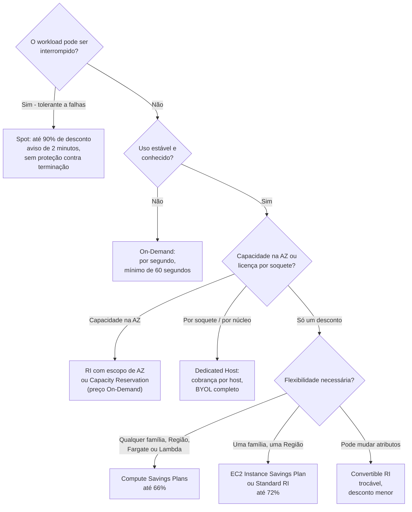
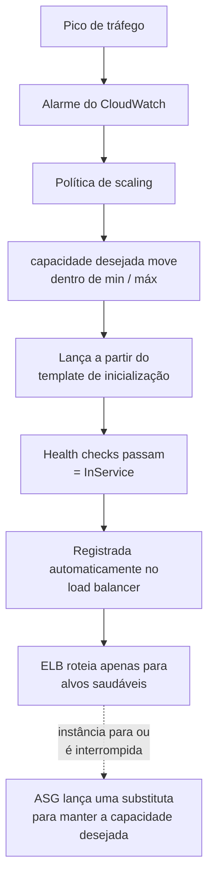
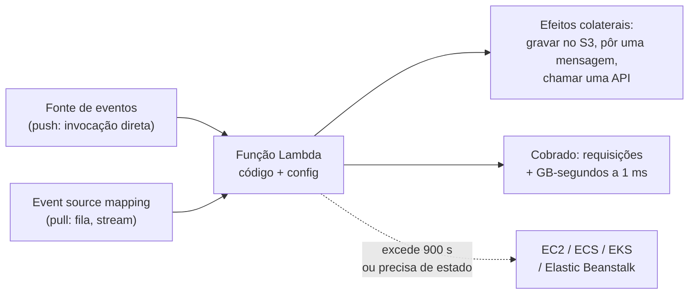
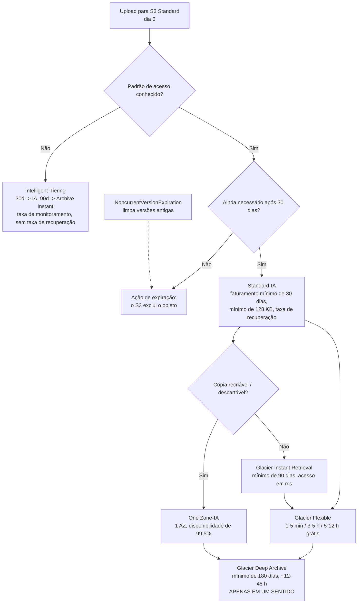
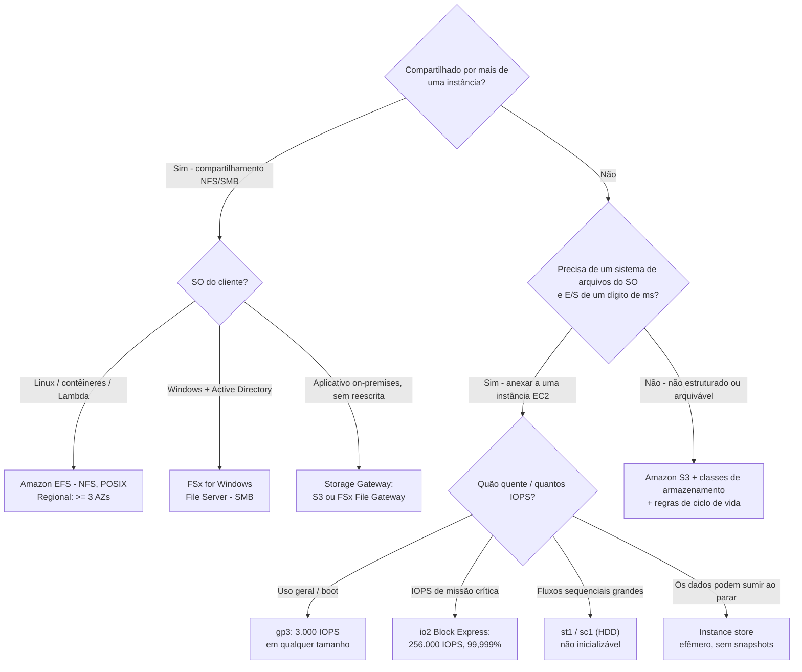

# Serviços de Computação e Armazenamento

O **Domínio 3 (Tecnologia e Serviços de Nuvem) carrega 34% da pontuação do CLF-C02**, e duas de suas tarefas fazem a maior parte do trabalho: **Tarefa 3.3 "Identificar serviços de computação da AWS"** e **Tarefa 3.6 "Identificar serviços de armazenamento da AWS"**. A tarefa 3.3 pede que você reconheça tipos de instância, contêineres, opções serverless, que *"o auto scaling proporciona elasticidade"* e os propósitos dos load balancers; a tarefa 3.6 pede que você identifique serviços de objeto, bloco e arquivo, as diferenças entre as classes de armazenamento do S3, políticas de ciclo de vida e o AWS Backup. Acrescente a metade de computação da **Tarefa 4.1 do Domínio 4** — as sete opções de compra — e esta única lição cobre material que aparece em **dois domínios**.

```text
====================================================================
 CLF-C02 LIÇÃO 09 — CARTÃO DE COMPUTAÇÃO + ARMAZENAMENTO (fatos em outubro de 2026)
====================================================================
 COMPUTAÇÃO
  EC2        servidor virtual; tipo de instância = o hardware
  NOME       [série][geração][opções].[tamanho]
             m7i.4xlarge · c6g.large · r7g.xlarge · t3.micro
  COMPRA     On-Demand (sem compromisso, mínimo de 60 s)
             Reserved  (1/3 ano, desconto, Standard até 72%)
             Savings   (1/3 ano, $/hora; Compute até 66%,
                        EC2 Instance até 72%)
             Spot      (capacidade ociosa, até 90% de desconto,
                        aviso de interrupção de 2 minutos)
             Dedicated (Host = por host, Instance = por
                        instância + $2/Região)
             Capacity Reservation (capacidade na AZ ao preço On-Demand)
  ESCALA     Auto Scaling: min / desejado / máx, multi-AZ
  LAMBDA     serverless, orientado a eventos, por requisição + GB-s
             arredondado para 1 ms; 128 MB-10.240 MB; máx 900 s
  CONTÊINER  ECS (nativo da AWS, $0) · EKS (Kubernetes gerenciado,
             $0.10/clúster/hora) · Fargate
             (serverless, mínimo de 1 min) · ECR (imagens)
  PaaS/VPS   Elastic Beanstalk ($0 de taxa de serviço)
             Lightsail (pacotes flat a partir de $3.50/mês)
--------------------------------------------------------------------
 ARMAZENAMENTO
  OBJETO     S3: bucket -> objeto -> chave; durabilidade de 11 nonos;
             objeto máx 50 TB (desde 2025-12-02)
  CLASSES    Standard · Intelligent-Tiering · Standard-IA ·
             One Zone-IA · Glacier Instant / Flexible / Deep
  BLOCO      EBS (limitado à AZ, gp3 padrão, snapshots) ·
             instance store (dados perdidos ao parar)
  ARQUIVO    EFS (NFS, POSIX, multi-AZ) · FSx (SMB/ONTAP/ZFS)
  HÍBRIDO    Storage Gateway (sistemas de arquivos em cache) ·
             Snow Family (fechou 2025-11-07, EOS 2026-12-31)
  BACKUP     AWS Backup: planos, cofres, Vault Lock = WORM
====================================================================
```

> [!NOTE]
> **Disciplina de escopo.** Todo serviço apresentado como examinável abaixo está na lista oficial de serviços no escopo do CLF-C02 ou em uma tarefa do Domínio 3/4. Dois serviços de computação — **AWS Copilot** e **AWS Wavelength** — e um serviço de armazenamento — **Amazon FSx for Lustre** — estão explicitamente **fora do escopo** e aparecem aqui apenas para que você possa eliminá-los. A **Snow Family** não aparece em *nenhuma* das listas, e **Amazon AppStream 2.0, Amazon WorkSpaces e Amazon WorkSpaces Secure Browser** pertencem à tarefa 3.8 (áreas de trabalho virtuais), não à nossa tarefa 3.3.

Nesta lição você vai:

- decifrar um **nome de instância EC2** em série, geração, silício e tamanho;
- mapear as **famílias de instância** (M/T, C, R, I/D, P/G/F) aos seus enunciados de exame;
- percorrer a **lista de verificação de inicialização**: AMI, tipo de instância, par de chaves, grupo de segurança, template de inicialização;
- escolher entre as **sete opções de compra** com percentuais de desconto com fonte;
- fazer aritmética de **Auto Scaling** com min / desejado / máx e explicar por que multi-AZ é a resposta padrão de alta disponibilidade;
- precificar uma invocação de **Lambda** em requisições e GB-segundos e saber quando o Lambda é a resposta errada;
- definir **ECS, EKS, Fargate, ECR, Batch** em uma linha e depois posicionar **Elastic Beanstalk** e **Lightsail**;
- percorrer o **lineup de classes de armazenamento do S3**, versionamento, ciclo de vida, criptografia e hospedagem estática;
- escolher um **tipo de volume EBS**, explicar snapshots e separar EBS de instance store;
- comparar **EFS vs FSx**, posicionar **Storage Gateway**, conhecer o status da **Snow Family** e usar o **AWS Backup**;
- decidir **S3 vs EBS vs EFS** em uma tabela;
- estudar **cinco estudos de caso publicados pela AWS**;
- praticar com **12 questões no estilo do exame** mais quatro verificações interativas.

**Revisão de outubro de 2026.** Além do esquema acima, esta lição agora também carrega **cinco** estudos de caso publicados pela AWS, uma caixa de **Atualizações de 2026** com fonte, **12** questões de prática, **quatro** verificações interativas e **oito** caixas *Você sabia?*.

---

## 1. Amazon EC2: o servidor virtual que você realmente escolhe

### 1.1 O que é uma instância

A AWS define o bloco de construção em uma frase: *"Uma instância EC2 é um servidor virtual na AWS Cloud."* A Amazon EC2 *"fornece capacidade de computação sob demanda e escalável"*, e a escolha mais consequencial que você faz na inicialização é esta: *"Quando você lança uma instância, o tipo de instância que você especifica determina o hardware do computador host usado para sua instância."* O tipo de instância não é, portanto, um alternador de preços — é uma **decisão de hardware** (geração de CPU, proporção de memória, disco local, GPU, rede) que então determina o preço.

| Termo | O que significa no exame |
|---|---|
| **Instância** | Um servidor virtual em execução em um computador host da AWS |
| **Tipo de instância** | A especificação de hardware: família + tamanho; decide CPU, memória, armazenamento, rede |
| **AMI** | A imagem que fornece o software necessário para *configurar e inicializar* a instância |
| **Par de chaves** | A chave pública fica com a AWS, a chave privada fica com você — usada para provar a identidade de login |
| **Grupo de segurança** | O firewall virtual anexado às interfaces de rede da instância |
| **Template de inicialização** | Uma receita salva (AMI, tipo, configurações de rede) — o que um grupo do Auto Scaling consome |

EC2 é o exemplo clássico de **IaaS** no modelo de responsabilidade compartilhada: a AWS possui o host, você possui tudo a partir do sistema operacional convidado.

### 1.2 Decifrar um nome de instância — a habilidade de EC2 mais cobrada

A AWS publica uma gramática de nomenclatura: **`[série][geração][opções].[tamanho]`**. A primeira posição é a *série* (por exemplo `c`), a segunda é a *geração* (por exemplo `7`), as letras depois dela são *opções* e tudo após o ponto é o *tamanho da instância*.

| Nome | Série | Geração | Opção | Tamanho | O que te diz |
|---|---|---|---|---|---|
| `m7i.4xlarge` | M — propósitos gerais | 7 | `i` = Intel | 4xlarge | CPU/memória equilibrados, Intel de 7ª geração |
| `c6g.large` | C — otimizada para computação | 6 | `g` = Graviton | large | Trabalho limitado por CPU em Arm |
| `r7g.xlarge` | R — otimizada para memória | 7 | `g` = Graviton | xlarge | Workloads em memória |
| `t3.micro` | T — estourável (burstable) | 3 | — | micro | Estoura acima de uma linha de base; a casa do Free Tier |

**Letras de opção:** **a** = AMD · **g** = Graviton · **i** = Intel · **d** = volumes de instance store anexados · **n** = otimizado para rede e EBS · **e** = armazenamento ou memória extras · **z** = alta frequência de CPU. Depois do ponto: `small`, `large`, `xlarge`, `2xlarge` … `4xlarge`, e `metal` significa **bare metal**. Duas regras de decifração que o exame adora: **geração mais alta = hardware mais novo**, e `m7i` ≠ `m7g` — o sufixo muda o **silício *e* o suporte do sistema operacional**, então uma opção Graviton não é um renome cosmético.

### 1.3 Famílias → workloads

| Categoria | Letras da família | O enunciado de exame que aponta para ela |
|---|---|---|
| **Propósitos gerais** | **M**, **T** | *"equilíbrio entre computação, memória e rede"* — servidores web, repositórios de código, dev/test; **T** = estourável |
| **Otimizada para computação** | **C** | Limitada por CPU: lote, transcodificação, HPC, inferência de ML |
| **Otimizada para memória** | **R**, **X**, **Z** | Banco de dados em memória, cache, análise de dados |
| **Otimizada para armazenamento** | **I**, **D**, **H** | NoSQL, data warehouse, análise de logs; discos locais, alto IOPS |
| **Computação acelerada** | **P**, **G**, **F**, **Inf**, **Trn** | Treinamento e inferência GPU/ML, renderização |
| **Computação de alto desempenho** | **Hpc** | Simulações grandes, melhor desempenho-preço em escala |
| **Alta memória** | **U**, **Z** | Bancos de dados em memória muito grandes (tamanhos `*tb` = 3–32 TiB) |

**Exemplo trabalhado E1 — a família a partir do enunciado (redação com fonte, em outubro de 2026).** Leia a exigência, escolha a letra e depois a opção: *"um cache em memória que deve manter um conjunto de trabalho residente"* → **R** (otimizada para memória) → acrescente `g` se o workload roda em Linux/Arm → `r7g.xlarge`. *"Um transcodificador de vídeo com CPU no limite"* → **C** → `c6g.large`. *"Uma máquina de desenvolvimento intermitente que deve ser barata quando ociosa"* → **T** → `t3.micro`. O exame nunca pede que você nomeie uma lista real de famílias de instância — ele pede que você leia o mapeamento **enunciado → categoria**.

### 1.4 Dimensionamento: quatro decisões antes de clicar em Launch

1. **Formato do workload** → família (equilibrado / CPU / memória / armazenamento / GPU).
2. **Tamanho dentro da família** → o número após o ponto; famílias otimizadas para memória também carregam um sufixo de tamanho em memória.
3. **AMI** — *"fornece o software necessário para configurar e inicializar uma instância da Amazon EC2"* e *"você deve especificar uma AMI quando lança uma instância"*. Uma AMI é fixada a uma **Região, sistema operacional, arquitetura, tipo de volume raiz e tipo de virtualização**, e é por isso que você não pode lançar uma AMI de Windows em um tipo de instância Graviton.
4. **Opção de compra e rede** — coberto na Seção 2, mais par de chaves e grupo de segurança abaixo.

- **📚 Você sabia?** O **Free Tier do EC2 mudou de era em 15 de julho de 2025**. Contas criadas **antes** dessa data mantiveram o crédito clássico — **750 horas por mês de `t2.micro`/`t3.micro` por 12 meses** mais 30 GB de EBS. Contas criadas **naquele dia ou depois** recebem um **Free plan baseado em créditos**: **$100 na inscrição mais até $100 extras**, por **6 meses ou até os créditos acabarem**, em tamanhos elegíveis como `t3`/`t4g.micro`, `t3`/`t4g.small`, `c7i-flex.large` e `m7i-flex.large`. Um enunciado que cita "750 horas de t2.micro" depende da era — leia a data (em outubro de 2026; verifique os valores atuais antes de usar).

### 1.5 A lista de verificação de inicialização: AMI, tipo, par de chaves, grupo de segurança

| Entrada de inicialização | O que a AWS documenta | Consequência no exame |
|---|---|---|
| **AMI** | Fornece o software para configurar e inicializar; obrigatória na inicialização | SO/arquitetura errados → não inicializa naquele tipo de instância |
| **Tipo de instância** | Determina o hardware do computador host | Família = formato do workload; tamanho = capacidade |
| **Par de chaves** | Você mantém a chave **privada**; a AWS guarda a chave pública | "Perder a chave privada" → crie um novo par, você não pode recuperar o antigo |
| **Grupo de segurança** | *"Um grupo de segurança atua como um firewall virtual para suas instâncias EC2, controlando o tráfego de entrada e saída."* | **Com estado**, **apenas regras de permitir (nunca negar)**, um grupo novo **não tem regras de entrada** e uma regra de saída que permite tudo |
| **Template de inicialização** | Receita versionada: AMI, tipo, configurações de rede | Entrada obrigatória para um **grupo do Auto Scaling** |

Dois fatos sobre security groups carregam peso desproporcional: eles são **com estado** (o tráfego de retorno é permitido automaticamente) e **não podem expressar uma negação** — se uma questão precisa de *"bloquear este IP"*, a resposta é uma **network ACL** (nível de subnet, permite *e* nega, sem estado), não um security group.

**Exemplo trabalhado E2 — da exigência às entradas de inicialização.** *"Uma camada web precisa de Linux, recursos equilibrados e deve escalar em três AZs."* Entradas: AMI = imagem Linux/x86 ou Arm fixada à Região; família = **M** (propósitos gerais) ou **T** (estourável, se o tráfego tem picos e a máquina deve ser barata quando ociosa); tamanho = o que o modelo de tráfego precisar; grupo de segurança permite entrada na porta **443 a partir do grupo de segurança do load balancer** (não `0.0.0.0/0` diretamente), permite toda saída; mais um **template de inicialização** para que um grupo do Auto Scaling possa reproduzi-lo. Nada naquela lista é opcional — um grupo do Auto Scaling sem template de inicialização não pode lançar nada.

---

## 2. As sete opções de compra do EC2

A Tarefa 4.1 do Domínio 4 as nomeia explicitamente: *"On-Demand Instances, Reserved Instances, Spot Instances, AWS Savings Plans, Dedicated Hosts, Dedicated Instances, Capacity Reservations"*, mais *"Descrever a flexibilidade de Reserved Instances"* e o comportamento de Reserved Instances em AWS Organizations. Esta tabela é a habilidade inteira.

### 2.1 A tabela de compra

| Opção | Compromisso | O que realmente é | Quando o exame a escolhe | Desconto com fonte (em outubro de 2026) |
|---|---|---|---|---|
| **On-Demand** | Nenhum | Pague por hora ou segundo, **mínimo de 60 segundos**, sem compromisso de longo prazo | Imprevisível, espiculoso, experimental, primeira implantação | — (linha de base para todos os outros %) |
| **Reserved Instances** | **1 ou 3 anos** | *"Não são instâncias físicas, mas sim um desconto de cobrança aplicado ao uso de On-Demand Instances"* para uma configuração consistente (tipo + Região) | Estado estável, configuração fixa, especialmente quando você também precisa de uma **reserva de capacidade na AZ** | Standard **até 72%**; Convertible **até 66%** (tabela do User Guide de Savings Plans — outra página da AWS mostra 54%, então sempre cite página + data) |
| **Savings Plans** | **1 ou 3 anos**, compromisso de **USD por hora** | Um desconto sobre uma *quantidade de uso em $/hora*, aplicado automaticamente ao longo do uso — sem necessidade de troca | Estado estável onde a flexibilidade importa; a AWS atualmente **recomenda Savings Plans sobre Reserved Instances** | Compute **até 66%** (qualquer família/tamanho/Região/SO/tenancy **+ Fargate + Lambda**); EC2 Instance **até 72%** (uma família, uma Região); Database **até 35%**; SageMaker AI **até 64%** |
| **Spot** | Nenhum | *"Capacidade ociosa do EC2 disponível por menos do que o preço On-Demand"* — interrompível com **aviso de 2 minutos** e **sem proteção contra terminação** | Tolerante a falhas, flexível, com checkpoints: lote, CI/CD, big data, HPC, treinamento de ML | **Até 90% de desconto** sobre On-Demand |
| **Dedicated Hosts** | On-Demand ou reserva de host | Um **host físico** inteiro; cobrança **por host**; visibilidade total de soquetes/núcleos para **traga-sua-licença** (BYOL) | Exigências de *"licença por soquete ou por núcleo"* | — (preço no nível do host) |
| **Dedicated Instances** | On-Demand ou RI | Hardware de locatário único; cobrança **por instância** **+ uma taxa de $2 por Região** | *"Hardware dedicado para conformidade"* — apenas isolamento, sem necessidade de topologia de licença | — |
| **Capacity Reservations** | Nenhum, **sem desconto** | Reserva **capacidade na AZ ao preço On-Demand**, e você **é cobrado quer use ou não** | *"Deve lançar nesta AZ específica"* (software de cluster, colocação regulamentada) sem abrir mão da flexibilidade On-Demand | — |

> ⚠️ **Reserved Instances não são servidores reservados.** A própria redação da AWS é um **desconto de cobrança**, não uma caixa em um rack. Duas consequências que o exame testa: uma **RI com escopo de AZ também reserva capacidade**, uma **RI com escopo de Região é apenas um desconto**, e **Savings Plans não reservam capacidade alguma**. Se o enunciado diz "capacidade garantida na AZ X", a resposta é uma **RI com escopo de AZ ou uma Capacity Reservation** — nunca um Savings Plan.

### 2.2 Reserved Instances vs Savings Plans vs Spot — o desempate em três vias

| Pergunta que o enunciado faz | Resposta |
|---|---|
| Comprometer a uma *configuração* ou a um *valor em dólares*? | Configuração → **RI**; $/hora → **Savings Plans** |
| Precisa trocar família/SO/tenancy depois? | **Convertible RI** (desconto menor) ou use apenas **Savings Plans** (sem troca) |
| Precisa de uma reserva de capacidade? | **RI com escopo de AZ** ou **Capacity Reservation** — **não** Savings Plans |
| O workload pode ser interrompido? | Sim → **Spot**; "não pode ser interrompido" → On-Demand, RI ou Savings Plan |
| O Spot conta para um Savings Plan? | **Não.** O uso de Spot é excluído |
| O que acontece no fim do termo? | RIs **não se renovam automaticamente** — você volta às taxas On-Demand, a menos que aja |



### 2.3 Exemplos numéricos trabalhados — a aritmética por trás dos descontos

**Exemplo trabalhado E3 — economia do Spot (taxa ilustrativa; o desconto tem fonte).** A AWS afirma que o Spot está disponível com *"desconto de até 90% em comparação com os preços On-Demand"* (em outubro de 2026). Os preços horários exatos de On-Demand do EC2 dependem da Região, do SO e do momento e **não** foram coletados para esta lição, então use uma **taxa ilustrativa rotulada de $0.10 por hora**:

```text
Taxa On-Demand ilustrativa ........ $0.10 / hora
Trabalho em lote .................. 100 horas por semana (tolerante a falhas)
Custo semanal On-Demand ........... 100 x $0.10            = $10.00
Spot com até 90% de desconto ...... 100 x $0.10 x 0.10     =  $1.00
Economia semanal máxima ...........                          $9.00  (90%)
```

Leia o teto corretamente: **"até 90%"** é um máximo, não uma cotação, e você paga por ele com **risco de interrupção** — um aviso de dois minutos, sem proteção contra terminação e **sem cobertura de Savings Plan**.

**Exemplo trabalhado E4 — economia de Savings Plan / RI (tetos com fonte, gasto ilustrativo).** Pegue uma execução estável de **$1.000 por mês** On-Demand (base ilustrativa):

```text
EC2 Instance Savings Plan - até 72% (S12, em outubro de 2026)
  $1.000 x (1 - 0.72) = tão baixo quanto $280 / mês  -> economiza até $720
Compute Savings Plan - até 66% (S12, em outubro de 2026)
  $1.000 x (1 - 0.66) = tão baixo quanto $340 / mês  -> economiza até $660
Em 1 ano: $12.000 -> tão baixo quanto $3.360 (teto do EC2 Instance SP)
```

**Exemplo trabalhado E5 — aritmética do termo.** Um termo de compromisso é muito tempo, e o exame pede que você sinta isso:

```text
1 ano  = 31.536.000 segundos  =  8.760 horas
3 anos = 94.608.000 segundos  = 26.280 horas  (24 x 7 x 365 x 3)
```

Antes de escolher um Savings Plan de 3 anos, responda uma pergunta: **esta configuração exata de workload ainda estará certa em 26.280 horas?** Se a resposta puder ser "vamos trocar de família ou de Região", Compute Savings Plans (qualquer família, qualquer Região) ou RIs Convertible são as respostas flexíveis; se puder ser "talvez nem precise disso", On-Demand é mais barato do que pagar por um compromisso não usado — porque uma **Capacity Reservation é cobrada quer usada quer não**, e um compromisso de Savings Plan simplesmente para de economizar.

- **📚 Você sabia?** O percentual que você cita importa tanto quanto a opção. A AWS publica **até 72%** (Standard RI, EC2 Instance Savings Plan), **até 66%** (Compute Savings Plan, Convertible RI), **até 35%** (Database Savings Plans), **até 64%** (SageMaker AI Savings Plans) e **até 90%** (Spot) — todos *em outubro de 2026*. Uma página separada de otimização de custos da AWS ainda mostra **"até 75%"** para Reserved Instances; esse número **não** é corroborado em nenhum outro lugar desta pesquisa, então não o memorize. Qualquer questão de desconto quer o nome da opção primeiro e um número com data depois.

---

## 3. Auto Scaling: elasticidade, min / desejado / máx, multi-AZ

A Tarefa 3.3 lista *"Reconhecer que o auto scaling proporciona elasticidade"* — então a divisão de trabalho do exame é precisa: **o Auto Scaling decide quantas instâncias existem** (elasticidade), um **load balancer decide para onde o tráfego vai**. A AWS documenta que o Elastic Load Balancing *"distribui automaticamente seu tráfego de entrada entre vários alvos … monitora a saúde de seus alvos registrados e roteia o tráfego apenas para os alvos saudáveis."*

### 3.1 Os três números

| Propriedade | Definição | Comportamento documentado |
|---|---|---|
| **Tamanho mínimo** | Piso — o grupo nunca encolhe abaixo dele | O próprio exemplo da AWS usa **min = 4** |
| **Capacidade desejada** | O número atual-alvo de instâncias | *"Um grupo do Auto Scaling tenta manter a capacidade desejada"* — o exemplo da AWS usa **desejado = 6** |
| **Tamanho máximo** | Teto — políticas de scaling não podem excedê-lo | O exemplo da AWS usa **máx = 12** |
| **Política de scaling** | Move a **capacidade desejada** dentro de [min, máx] em resposta a um sinal (tipicamente um alarme do CloudWatch) | Scale-out adiciona instâncias; scale-in remove |
| **Substituição** | Uma terminação inesperada é corrigida | O grupo lança uma substituta para manter a capacidade desejada |

A configuração documentada da AWS — **mínimo quatro, desejado seis, máximo doze** — vale a pena memorizar como um formato: min ≤ desejado ≤ máx é um invariante rígido, e qualquer opção que ponha desejado acima do máximo (ou min acima do desejado) é inválida na cara.

### 3.2 Por que multi-AZ é a resposta de alta disponibilidade

Um grupo do Auto Scaling abrange **Zonas de Disponibilidade**; quando uma AZ se degrada, o grupo lança substitutas nas AZs saudáveis e rebalanceia. Este é o padrão padrão do Domínio 3: **multi-AZ = sobreviver a uma falha de AZ**, **multi-Região = sobreviver a uma falha de Região**. A ordem do ciclo de vida também importa: uma instância vai **lançamento → health check → InService**, e a AWS observa que um grupo do Auto Scaling com um load balancer anexado **registra a instância no load balancer *antes* de marcá-la InService** — então o tráfego nunca alcança uma instância não pronta.



**Exemplo trabalhado E6 — min / desejado / máx sob pressão.** Usando o grupo documentado da AWS (**min 4, desejado 6, máx 12**) distribuído em três AZs (2 + 2 + 2):

```text
Estado estável ............ desejado = 6   (2 por AZ)
Alarme pede +4 ............ desejado seria 10 -> permitido (<= 12)
Alarme pede mais +8 ....... desejado seria 18 -> LIMITADO a 12
Falha na AZ-c tira 2 ...... desejado cai para 4 -> grupo relança
                                 em AZs saudáveis de volta a 6
```

Dois pontos de exame caem dessa aritmética: o **máximo é um teto rígido** que protege seu orçamento, e o **mínimo é um piso rígido** que protege sua disponibilidade — nenhum substitui o outro.

---

## 4. AWS Lambda: serverless e orientado a eventos

A AWS define-o secamente: *"AWS Lambda é um serviço de computação serverless. Com o Lambda, você pode executar código sem provisionar ou gerenciar servidores."* A AWS é responsável pela *"manutenção do servidor, provisionamento de capacidade, scaling e aplicação de patches"* — você fornece código mais configuração. Ele é **orientado a eventos**: *"Eventos podem acionar uma função Lambda de duas maneiras: por invocação direta (push) e por event source mappings (pull)."*

### 4.1 O que o Lambda realmente cobra

| Dimensão | Documento da AWS (em outubro de 2026) | Consequência |
|---|---|---|
| **Requisições** | **$0.20 por 1 milhão de requisições** | Ocioso custa **nada** — você só é cobrado enquanto o código roda |
| **Duração** | Cobrada em **GB-segundos**, arredondada para cima para o próximo **1 ms** | Menos memória + tempo de execução menor = menos dinheiro |
| **Free tier (Always Free)** | **1.000.000 de requisições + 400.000 GB-segundos por mês** | Não é um teste de 12 meses — se repete |
| **Memória** | **128 MB a 10.240 MB** em incrementos de 1 MB; **1.769 MB ≈ uma vCPU** | Mais memória compra mais CPU assim como mais RAM |
| **Timeout** | Padrão **3 s**, máximo **900 s (15 minutos)** | Trabalho de longa duração pertence a EC2/ECS/EKS/Beanstalk |
| **Scaling** | Até **1.000 ambientes de execução a cada 10 segundos** | Concorrência é elástica por padrão |

A orientação da AWS sobre aderência é direta: o Lambda é *"mais adequado para invocações curtas que duram um segundo ou menos."* Processos com estado, longevos ou sempre ativos são a resposta errada clássica.

**Exemplo trabalhado E7 — uma micro-fatura de Lambda (taxas com fonte, em outubro de 2026).** 2.000.000 de requisições por mês, cada uma executando **100 ms** em **1.024 MB (1 GB)**:

```text
Requisições:  2.000.000 - 1.000.000 grátis = 1.000.000 cobráveis
              1.000.000 / 1.000.000 x $0.20          = $0.20
Duração:      1 GB x 0,100 s = 0,100 GB-s por chamada
              2.000.000 x 0,100 = 200.000 GB-s
              200.000 < 400.000 cota grátis           = $0,00
Total                                                = $0.20 / mês
```

**Exemplo trabalhado E8 — o teto Always Free (com fonte).** Quanto tempo contínuo de execução os **400.000 GB-segundos** realmente compram?

```text
Em 512 MB (0,5 GB):  400.000 / 0,5 = 800.000 segundos  = ~9,3 dias/mês
Em 1.024 MB (1 GB):  400.000 / 1,0 = 400.000 segundos  = ~111 horas/mês
```

A lição que o exame quer: **ocioso custa nada, rodar custa GB-segundos.** Uma função que roda uma vez por dia por 50 ms é quase de graça; a mesma lógica que torna o Lambda barato o torna a casa errada para um processo que precisa manter estado por horas.



> [!WARNING]
> **A parede dos 15 minutos.** O timeout máximo do Lambda é **900 segundos (15 minutos)**, a memória chega no máximo a **10.240 MB**, e a AWS o posiciona para invocações de *"um segundo ou menos"*. Qualquer enunciado descrevendo uma transcodificação de vídeo noturna de 40 minutos, uma conexão de longa duração, ou um workload que precisa de disco local ou GPU está descrevendo **EC2, ECS/EKS ou Elastic Beanstalk** — não o Lambda. Por outro lado, "nenhum servidor para gerenciar" mais "roda apenas quando um evento chega" mais "paga por milissegundo" é a assinatura do Lambda.

- **📚 Você sabia?** O estudo de caso da Capital One sobre Lambda e ECS relata que **uma aplicação cortou seu custo em 90%** após migrar para o Lambda, com verificações **80% mais rápidas** usando AWS Step Functions, e descreve **mais de um terço** das aplicações da Capital One como serverless (aws.amazon.com/solutions/case-studies/capital-one-lambda-ecs-case-study, acesso em outubro de 2026; alegação do cliente, não auditado). A leitura no formato do exame é arquitetural: **orientado a eventos mais ocioso-custa-nada** é por que um workload pertence ao Lambda — e um número como 90% é o resultado daquele cliente, nunca uma garantia da AWS.

---

## 5. Contêineres: ECS, EKS, Fargate e ECR

A Tarefa 3.3 espera quatro definições de uma linha, e o exame as recombina constantemente:

| Serviço | Definição de uma linha (redação da AWS) | Assinatura no exame |
|---|---|---|
| **Amazon ECS** | *"um serviço de orquestração de contêineres totalmente gerenciado"* — nativo da AWS | *"Orquestração nativa da AWS"*, **$0 de taxa de gerenciamento** para os launch types Fargate e EC2 |
| **Amazon EKS** | *"um serviço Kubernetes totalmente gerenciado"* | *"Já rodamos Kubernetes"* — mais **$0.10 por clúster por hora** (suporte padrão, primeiros 14 meses; $0.60/h estendido) |
| **AWS Fargate** | *"um mecanismo de computação serverless para contêineres que funciona com Amazon ECS e Amazon EKS"* | *"Sem gerenciamento de nós"* — cobrado **por vCPU + por GB de memória por segundo**, **mínimo de 1 minuto** |
| **Amazon ECR** | *"um serviço de registro de imagens de contêineres gerenciado pela AWS"*, repositórios privados com **permissões baseadas em recursos usando AWS IAM** | *"Push/pull de imagens"* — ECR é **armazenamento para imagens, não orquestração** |
| **AWS Batch** | *"planeja, agenda e executa seus workloads de lote de ML, simulação e análise conteinerizados"* em instâncias **Spot ou On-Demand** | *"Lote enfileirado, não interativo, otimizado para custo"* |

Duas distinções de responsabilidade carregam a maior parte das notas. **Fargate vs launch type EC2 é sobre quem gerencia os nós**, não sobre velocidade: com Fargate não há instâncias para aplicar patches (cobrança por tarefa, mínimo de 1 minuto); com o launch type EC2 você aplica patches, escala e escolhe instâncias — e **descontos de RI/Savings Plan/Spot se aplicam** àquelas instâncias. **ECS vs EKS é sobre portabilidade vs uma taxa de clúster**: ECS é nativo da AWS sem taxa de orquestração; EKS te dá o Kubernetes padrão por uma taxa horária por clúster.

**Exemplo trabalhado E9 — aritmética de Fargate e EKS (taxas com fonte, us-east-1, em outubro de 2026).**

```text
Fargate: 5 tarefas x 1 vCPU x 2 GB, rodando 600 s/dia por 30 dias
  vCPU-segundos = 5 x 1 x 600 x 30 =  90.000
                  90.000 x $0.000011244            =  $1.01
  GB-segundos   = 5 x 2 x 600 x 30 = 180.000
                  180.000 x $0.000001235           =  $0.22
  Total do mês (só computação)                       $1.23

EKS:  1 clúster x $0.10/h x 730 h  =  ~$73 / mês de plano de controle
      MAIS o que você rodar de nós de trabalho (EC2 ou Fargate)
ECS:  $0 de taxa de gerenciamento  ->  você paga só a computação subjacente
```

Aquela comparação é a questão de contêiner favorita do exame: **EKS custa extra pelo plano de controle gerenciado; ECS não**, e nenhum dos dois inclui o custo dos seus nós.

- **📚 Você sabia?** A startup de IA de Toronto **WOMBO** contou à AWS que gerenciava **12.000 GPUs** enquanto seus aplicativos tinham **74 milhões de downloads em 10 meses em mais de 180 países**, citando: *"Nossa infraestrutura tem estado em grande parte no piloto automático. Usar a Amazon ECS economiza definitivamente muito tempo para nós."* (aws.amazon.com/ecs/customers e aws.amazon.com/fargate/customers, acesso em outubro de 2026; voz do cliente). O detalhe no formato do exame é a dupla por trás dessa citação — **ECS como o orquestrador nativo da AWS com Fargate como o mecanismo serverless** — mais o lembrete de que escala viral chega primeiro como um problema de *tráfego*, que a elasticidade (Seção 3) absorve muito antes de virar um problema de compra (Seção 2).

---

## 6. Elastic Beanstalk e Lightsail: PaaS e VPS

| Serviço | O que a AWS faz | O que você faz | Modelo de custo (em outubro de 2026) | Assinatura no exame |
|---|---|---|---|---|
| **AWS Elastic Beanstalk** | *"provisiona instâncias da Amazon EC2 ou clústeres do EKS, configura load balancing … escala seu ambiente dinamicamente"* | Envie código e defina algumas opções | **$0 de taxa de serviço** — você paga pelos recursos que ele cria (EC2, ELB, EBS) | *"Implante código, não infraestrutura"*; **não é serverless**, e **não é grátis para rodar** |
| **Amazon Lightsail** | Entrega **pacotes mensais flat**: instância, disco, transferência em um preço | Escolha um pacote; configuração mínima | Entrada **$3.50/mês** (512 MB de memória, 2 vCPUs, 20 GB SSD, 1 TB de transferência); **$5/mês** (1 GB); teste de 90 dias | *"Uas poucas dezenas de instâncias ou menos"*; preço previsível; **não** é AWS full-elastic |
| **AWS Outposts** | Infraestrutura da AWS **on premises** | Mesmas APIs da AWS | Precificado por Outpost | A resposta de computação híbrida: *"os dados devem permanecer on premises mas querem as ferramentas da AWS"* |

O arco esperado no exame é **começar simples e depois crescer**: um blog pessoal ou uma pequena ferramenta interna começa no **Lightsail** ou no **Elastic Beanstalk**; quando você precisa de Auto Scaling, rede em nível de VPC, Spot ou Savings Plans, você migra para **EC2 com um template de inicialização e um grupo do Auto Scaling**. O **AWS Batch** é a quarta opção nesta família — trabalhos conteinerizados enfileirados que a AWS escala para você em capacidade Spot ou On-Demand.

---

## 7. Amazon S3: armazenamento de objetos, classes, versionamento, ciclo de vida

A Tarefa 3.6 abre com *"Identificar os usos do armazenamento de objetos"* e *"Reconhecer as diferenças entre as classes de armazenamento do Amazon S3"*. A AWS define a anatomia: *"Um objeto é um arquivo e quaisquer metadados que descrevem o arquivo. Um bucket é um contentor de objetos."* Os objetos são endereçados por **chave** (mais um **ID de versão** opcional) dentro de um bucket cujo **nome é globalmente único** e cuja **Região é fixada na criação**. Um bucket é **privado por padrão**, com Block Public Access ligado e ACLs desligadas; o teto da bucket policy é **20 KB**. O tamanho máximo do objeto é **50 TB** (elevado de 5 TB em **2 de dezembro de 2025**); um único `PUT` é 5 GB.

Durabilidade é o número a citar: **99,999999999% (11 nonos)** em **um mínimo de três Zonas de Disponibilidade por padrão** — durabilidade e disponibilidade são coisas diferentes, e o One Zone-IA prova isso.

### 7.1 O lineup de classes de armazenamento

| Classe | Projetada para | AZs | Duração mínima de armazenamento | Objeto cobrável mínimo | Taxa de recuperação |
|---|---|---|---|---|---|
| **Standard** (padrão) | Acessada mais de uma vez por mês, acesso em milissegundos | ≥3 | — | — | nenhuma |
| **Intelligent-Tiering** | Padrões de acesso desconhecidos ou em mudança | ≥3 | — | 128 KB (abaixo disso: nunca movida automaticamente) | **nenhuma** (pequena taxa de monitoramento por objeto) |
| **Standard-IA** | ~uma vez por mês, acesso em milissegundos | ≥3 | **30 dias** | 128 KB | por GB |
| **One Zone-IA** | Dados recriáveis, ~uma vez por mês | **1** | **30 dias** | 128 KB | por GB |
| **Express One Zone** | Latência de um dígito de milissegundos, uma AZ | 1 | — | — | nenhuma |
| **Glacier Instant Retrieval** | ~uma vez por trimestre, acesso em milissegundos | ≥3 | **90 dias** | 128 KB | por GB |
| **Glacier Flexible Retrieval** | ~uma vez por ano, minutos-a-horas para restaurar | ≥3 | **90 dias** | — | por GB (**recuperações em massa são grátis**) |
| **Glacier Deep Archive** | Menos de uma vez por ano, horas para restaurar | ≥3 | **180 dias** | — | por GB |

**Intelligent-Tiering** é a única classe que move objetos para você: **30 dias** sem acesso → camada Infrequent Access, **90 dias** → Archive Instant Access (ainda em milissegundos), mais camadas Archive opt-in (**≥90 dias**) e Deep (**≥180 dias**). Ela cobra uma **taxa de monitoramento de $0.0000025 por objeto por mês** e **sem taxas de recuperação** — então é perfeita para padrões desconhecidos e errada para milhões de objetos minúsculos.

**Velocidades de recuperação do Glacier** (em outubro de 2026): Instant = **milissegundos**; Flexible = Expedited **1–5 minutos**, Standard **3–5 horas**, **Bulk 5–12 horas e grátis**; Deep Archive ≈ **12 horas / 48 horas**. Note que a AWS diz *"Não recomendamos usar o serviço Amazon Glacier"* — a resposta examinável é as **classes de armazenamento S3 Glacier**, não um serviço legado separado.

### 7.2 Versionamento, ciclo de vida e replicação

- **Versionamento** tem três estados (desabilitado, habilitado, suspenso) e *"nunca pode voltar a um estado sem versionamento"*. Excluir um objeto cria um **marcador de exclusão**; sobrescrever cria uma nova versão; **cada versão é cobrada integralmente**, e é por isso que regras de ciclo de vida precisam de uma ação `NoncurrentVersionExpiration`.
- Regras de **ciclo de vida** têm **ações de transição** (mover para outra classe) e **ações de expiração** — *"o Amazon S3 exclui objetos expirados em seu nome"*. O modelo é uma **cachoeira de sentido único**: Standard → IA / Intelligent-Tiering / One Zone-IA → qualquer classe Glacier; One Zone-IA → apenas Glacier; Instant → Flexible → Deep; **Deep Archive só pode ir em um caminho**.
- **Replicação** (CRR/SRR) exige **versionamento habilitado em ambos os buckets**, pula objetos pré-existentes a menos que você use Batch Replication, e o **S3 Replication Time Control** garante **99,99% dos novos objetos em 15 minutos (SLA)**. Exclusões são replicadas — então **replicação não é backup**.

### 7.3 Criptografia e sites estáticos

**SSE-S3 é a configuração de criptografia padrão de todos os buckets** (desde **5 de janeiro de 2023**) e não custa nada extra; **SSE-KMS** acrescenta custo e controle por chave, **SSE-C** traz sua própria chave, e **DSSE-KMS** é criptografia dupla. Para EBS você **não pode criptografar no lugar um volume ou snapshot não criptografado existente**. Para hospedagem: um site estático no S3 precisa de um **index document**, **Block Public Access desligado** e uma permissão pública de leitura `s3:GetObject` — e *"sites estáticos suportam apenas endpoints HTTP"*, então **HTTPS requer CloudFront**.

**Exemplo trabalhado E10 — um terabyte-mês entre classes (us-east-1, em outubro de 2026).** Só armazenamento, 1.000 GB, ignorando requisições:

```text
S3 Standard .................... $0.023/GB-mês  ->  $23.00
S3 Standard-IA ................. $0.0125        ->  $12.50  + recuperação
S3 One Zone-IA ................ $0.01          ->  $10.00  + recuperação
Glacier Instant Retrieval ...... $0.004        ->   $4.00  + recuperação
Glacier Flexible Retrieval ..... $0.0036       ->   $3.60  + recuperação
Glacier Deep Archive ........... $0.00099      ->   $0.99  + recuperação
Intelligent-Tiering (Frequent) . $0.023        ->  $23.00
   + monitoramento, 1.000.000 objetos x $0.0000025 ->  $2.50
```

Preços de requisição do S3 (mesma Região e data): **PUT/COPY/POST/LIST $0.005 por 1.000**, **GET $0.0004 por 1.000**, **DELETE grátis**.

- **📚 Você sabia?** A **regra dos 30 dias tem duas metades que mudaram independentemente**. As orientações de armazenamento da AWS (atualizadas em **5 de outubro de 2026**) dizem que o S3 *"não se aplica mais a um armazenamento mínimo de 30 dias para transições"* para Standard-IA e One Zone-IA — você pode transicionar no dia 0. Mas a regra de **faturamento de duração mínima de armazenamento de 30 dias *para classes IA*** ainda é publicada nas páginas de preços. Mover no dia 10 e excluir no dia 20 ainda te cobra os 30 dias inteiros (em outubro de 2026; verifique os valores atuais antes de usar).



---

## 8. Amazon EBS e instance store: armazenamento de bloco

A Tarefa 3.6 nomeia o par: *"Identificar soluções de armazenamento de bloco (por exemplo, Amazon EBS, instance store)"*. Armazenamento de bloco é **armazenamento de sistema de arquivos do SO, de baixa latência e de anexação única** — o disco que sua instância vê como `/dev/xvda`.

**Amazon EBS** é um *"volume de bloco durável"* para o EC2. Dois fatos estruturais: um volume tem **escopo de uma Zona de Disponibilidade** (ele é *"replicado automaticamente dentro de sua Zona de Disponibilidade"*) e pode ser anexado a **até 16 instâncias** apenas se forem **io1/io2 na mesma AZ** (Multi-Attach, e o aplicativo precisa fazer fencing de escritas). A durabilidade **não** é a dos 11 nonos do S3: **io2 Block Express oferece 99,999%**, outros tipos de volume **99,8% a 99,9%**.

### 8.1 Tipos de volume

| Tipo | Espécie | Linha de base | Use para | Não pode ser |
|---|---|---|---|---|
| **gp3** (padrão) | SSD | **3.000 IOPS e 125 MiB/s em qualquer tamanho de volume**; até **~20% mais barato por GB** que o gp2 | Volumes de boot, uso geral, a maioria dos bancos de dados | — |
| **gp2** | SSD | IOPS escalam com o tamanho (3 IOPS/GB, máx 16.000) | Volumes legados — migre para o gp3 | — |
| **io1 / io2** | SSD com IOPS provisionados | Até 64.000 / 256.000 IOPS; **io2 Block Express: 256.000 IOPS, durabilidade de 99,999%** | IOPS de missão crítica, bancos de dados que precisam de um teto sustentado | — |
| **st1** | HDD | Otimizado para throughput, até 500 MiB/s | Fluxos sequenciais grandes: big data, processamento de logs | **Volume de boot** |
| **sc1** | HDD | Frio, até 250 MiB/s, o mais barato por GB | Acesso infrequente e sequencial | **Volume de boot** |
| **Magnetic (standard)** | HDD legado | — | Workloads mais antigos | — |

Preços de tabela publicados: gp3 **$0.08/GB-mês**, gp2 **$0.10**, io1/io2 **$0.125** (mais cobranças de IOPS), st1 **$0.045**, sc1 **$0.015** — *publicados em outubro de 2026; a página não declara Região, então verifique os valores atuais antes de usar em sua Região.*

### 8.2 Snapshots

Um snapshot é um *"backup incremental"* armazenado no **S3 — mas invisível às ferramentas do S3**: você não pode ver snapshots como objetos do S3, listá-los em um bucket, nem pagar tarifas de requisição do S3 por eles. Eles são replicados **em toda a Região** (diferente dos volumes, que são limitados à AZ). Criticamente, *"a AWS não faz backup automático de seus volumes EBS"* — você deve usar o **Amazon Data Lifecycle Manager, o AWS Backup ou um script manual**. Preços de snapshot (em outubro de 2026): **$0.05 por GB-mês** padrão, **$0.0125 por GB-mês arquivado** (mínimo de 90 dias), restauração do arquivo **$0.03 por GB**.

### 8.3 Instance store vs EBS

| | **Volume EBS** | **Instance store** |
|---|---|---|
| O que é | Volume de bloco durável anexado em rede | Discos fisicamente anexados ao host |
| Durabilidade | Replicado na AZ; snapshots disponíveis | *"Todos os dados são perdidos quando a instância é parada"*; excluído automaticamente na terminação |
| Snapshots | Sim (incrementais, no S3) | **Não** |
| Comportamento parar/terminar | O volume raiz sobrevive à terminação apenas se `DeleteOnTermination=false` | Dados perdidos |
| Enunciado do exame | Persistente, boot, banco de dados | *"Temporário"*, *"scratch"*, *"perdido ao parar"*, I/O local mais alto |

**Exemplo trabalhado E11 — gp3 vs gp2 e arquivo de snapshot (preços publicados, verifique a Região).**

```text
gp3 vs gp2, volume de 500 GB:
  gp3:  500 x $0.08 = $40.00 / mês
  gp2:  500 x $0.10 = $50.00 / mês
  economia com o gp3                 = $10.00 / mês  (~20%)

Arquivo de snapshot, 2 TB por 6 meses:
  Padrão:  2.000 x $0.05 x 6           = $600.00
  Arquivado:  2.000 x $0.0125 x 6        = $150.00
              restaurar 2.000 x $0.03     =  $60.00
              total arquivado            = $210.00
```

- **📚 Você sabia?** **A linha de base do gp3 é independente do tamanho**: 3.000 IOPS e 125 MiB/s *"em qualquer tamanho de volume"*. No modelo mais antigo do gp2 você precisava de um volume de **3.000 GB** para conseguir 3.000 IOPS, porque os IOPS escalavam a 3 por GB — e é por isso que a AWS descreve o gp3 como *"preços até 20% menores por GB em comparação com o gp2 existente"* sendo também mais rápido fora da caixa (em outubro de 2026).

---

## 9. Arquivo, híbrido e backup: EFS, FSx, Storage Gateway, Snow Family, AWS Backup

### 9.1 EFS versus FSx — a resposta de arquivo

A Tarefa 3.6 diz *"Identificar serviços de arquivo (por exemplo, Amazon EFS, Amazon FSx)"*.

| | **Amazon EFS** | **Amazon FSx** |
|---|---|---|
| Protocolo | **NFSv4.1 / v4.0**, POSIX | Quatro mecanismos: **Windows File Server (SMB)**, **NetApp ONTAP** (NFS + SMB + iSCSI), **OpenZFS** (ZFS/Linux), **Lustre** (ML/HPC — **fora do escopo do CLF-C02**) |
| Clientes | EC2, ECS, EKS, **Lambda**, Fargate — *"Usar o Amazon EFS com o Microsoft Windows … não é suportado"* | Windows Server com Active Directory, ACLs do NTFS; ONTAP com snapshots e tiering |
| Alcance | **Regional (≥3 AZs, recomendado)** ou **One Zone (1 AZ)** | Single-AZ ou Multi-AZ por mecanismo |
| Classes / preço (us-east-1, em outubro de 2026) | Standard **$0.30/GB-mês**, One Zone **$0.16**, IA **$0.025**, One Zone IA **$0.0133**, Archive **$0.008**, throughput provisionado **$6/GB-mês** | Precificado por sistema de arquivos e por throughput |
| Enunciado do exame | *"Diretórios home POSIX compartilhados / WordPress entre AZs"* | *"Lift-and-shift de um servidor de arquivos Windows"* ou *"NetApp existente"* |

A durabilidade do EFS é de **11 nonos** com **disponibilidade de 99,99% na classe Regional em ≥3 AZs**; suas classes de ciclo de vida **Standard → IA → Archive** aplicam automaticamente após **90 dias ociosos**, com **duração mínima de armazenamento de 90 dias** para o Archive.

**Exemplo trabalhado E12 — dimensionamento de EFS (us-east-1, em outubro de 2026).**

```text
1,2 TB tudo Standard:        1.200 x $0.30             = $360.00 / mês
Metade fria (600 Standard + 600 IA):
                             600 x $0.30 + 600 x $0.025 = $195.00 / mês
```

### 9.2 Storage Gateway — a resposta híbrida, em cache

A AWS descreve-o como um serviço que *"conecta um appliance de software on-premises com armazenamento baseado em nuvem"*, e a tarefa 3.6 nomeia explicitamente *"sistemas de arquivos em cache (por exemplo, AWS Storage Gateway)"*.

| Gateway | O que emula | Enunciado do exame |
|---|---|---|
| **S3 File Gateway** | Um compartilhamento NFS/SMB localmente; *"Arquivos … se tornam objetos … com o caminho como chave"* | *"Aplicativo on-premises quer um compartilhamento NFS com base no S3"* |
| **FSx File Gateway** | SMB com base no FSx | Compartilhamentos Windows com base em nuvem |
| **Volume Gateway — cached** | Volume iSCSI com dados no **S3** e um subconjunto quente mantido localmente | **A resposta do "sistema de arquivos em cache"** |
| **Volume Gateway — stored** | Cópia primária local, snapshots assíncronos para o S3 | Imagens de VM on-prem, DR |
| **Tape Gateway** | Biblioteca de fita virtual arquivando para **S3 Glacier Flexible Retrieval ou Deep Archive** | *"Fita virtual"* / retenção de fita de datacenter |

### 9.3 Snow Family — o status importa mais que as especificações

**O AWS Snowball Edge não está mais disponível para novos clientes**, fechou para novos clientes em **7 de novembro de 2025**, e a AWS afirma: *"Em 31 de dezembro de 2026, a AWS encerrará o suporte aos dispositivos AWS Snowball em todas as Regiões comerciais da AWS."* O próprio dispositivo oferecia cerca de **210 TB** em uma unidade Storage Optimized, com trabalhos de transferência concluídos **em até 360 dias**. Criticamente, a **Snow Family não aparece nem na lista no escopo nem na lista fora do escopo** no guia atual do CLF-C02 — então ela é contexto, nunca uma resposta correta. As alternativas direcionadas da AWS para grandes transferências offline são **AWS DataSync, Data Transfer Terminal e AWS Outposts**.

### 9.4 AWS Backup — um mecanismo de políticas para tudo

A Tarefa 3.6 nomeia *"Compreender casos de uso do AWS Backup"*. É um **serviço de backup central, orientado a políticas**: **planos** selecionam recursos (tipicamente **por tag**), **cofres** (vaults) guardam as cópias (criptografadas com KMS), e o **AWS Backup Vault Lock** fornece proteção **write-once-read-many (WORM)**. Os backups são **incrementais** e podem mover **warm → cold**, rodar **entre Regiões e entre contas**, e relatar pelo **AWS Backup Audit Manager**. Ele cobre **EC2/EBS, S3, EFS, FSx, RDS, DynamoDB e volumes do Storage Gateway** — mas ele *"não governa backups que você faça … fora do AWS Backup"*, e é **aditivo**: ele duplica mecanismos nativos de snapshot, então custa dinheiro além deles.

Números de retenção (em outubro de 2026): **1 dia a 100 anos** para snapshots; **1 a 35 dias** para PITR contínuo; **mínimo de 90 dias no cold tier**; um recurso deve ficar **no warm por pelo menos 8 dias** antes de ir para o cold. Serviço companheiro: o **AWS Elastic Disaster Recovery** faz *"replicação contínua em nível de bloco"* com um **RPO de segundos** e um **RTO tipicamente de 5–20 minutos** — a resposta de piloto leve para servidores inteiros.

**Exemplo trabalhado E13 — aritmética de retenção de backup (regra com fonte).** Backups no cold tier devem ser retidos **pelo menos 90 dias após a transição para o cold**, e a retenção no warm deve ser **≥8 dias**:

```text
Exigência: retenção total de 300 dias, cold-after = 8 dias
DeleteAfterDays >= cold-after + 90  ->  >= 308 dias
```

- **📚 Você sabia?** **AWS Backup e snapshots nativos resolvem problemas diferentes.** Um snapshot é um *mecanismo* (incremental, em toda a Região, $0.05/GB-mês em outubro de 2026); o AWS Backup é *governança* — seleção baseada em tag entre contas, um cronograma de retenção único, Vault Lock para conformidade WORM e cópias entre Regiões. Uma pergunta pedindo "como aplicar **uma** política de backup em 40 contas" está pedindo **AWS Backup**, não um script que chama `CreateSnapshot` 40 vezes.

---

## 10. S3 vs EBS vs EFS — a tabela de decisão

Os três modelos de dados da Tarefa 3.6 são o caminho mais rápido para pontuar aqui: **bloco** = baixa latência, uma instância/contêiner; **arquivo** = hierárquico, compartilhado, NFS/SMB; **objeto** = endereçado por API, chave + metadados, o mais barato em escala.

| Pergunta | **Amazon S3** (objeto) | **Amazon EBS** (bloco) | **Amazon EFS / FSx** (arquivo) |
|---|---|---|---|
| Modelo de dados | Objetos: bucket → objeto → chave (+ ID de versão) | Dispositivos de bloco brutos, limitados à AZ | Arquivos hierárquicos, POSIX (EFS) ou SMB (FSx Windows) |
| Acesso | Console, CLI, SDK, REST — **sem mount** | Anexar a **uma instância** (Multi-Attach: io1/io2, 16 Nitro, mesma AZ) | **Montado por muitas instâncias ao mesmo tempo**, entre AZs |
| Uso típico | Sites, backups, data lakes, arquivos, hospedagem estática | Volumes de boot, bancos de dados, qualquer sistema de arquivos do SO | Diretórios home compartilhados, fazendas de Windows, compartilhamentos Windows |
| Durabilidade / escopo | **11 nonos**, ≥3 AZs por padrão | Replicado **dentro de uma AZ**; 99,999% (io2 Block Express) a 99,8–99,9% | EFS **11 nonos**, Regional ≥3 AZs (ou One Zone) |
| Cold tier mais barato | **Glacier Deep Archive — $0.00099/GB-mês** | Arquivo de snapshot — $0.0125/GB-mês | EFS Archive — $0.008/GB-mês |
| Ciclo de vida | **Regras** embutidas: transição + expiração | Snapshots (manuais ou DLM/AWS Backup) | EFS IA/Archive após 90 dias ociosos |
| Atalho do exame | *Arquivamento, web, estático, data lake* | *Banco de dados, boot, uma instância* | *Compartilhado, POSIX, multi-AZ, Windows* |



**Regra prática reutilizável:** *uma instância e um sistema de arquivos do SO* → **EBS**; *muitas instâncias precisam dos mesmos arquivos* → **EFS/FSx**; *qualquer coisa que você enviaria por e-mail, hospederia estaticamente ou arquivaria* → **S3**; *on-premises sem re-arquitetura* → **Storage Gateway**; *uma política única entre serviços, baseada em tag e com capacidade WORM* → **AWS Backup**.

### Atualizações de 2026 (em outubro de 2026)

> [!NOTE]
> **Cinco mudanças publicadas pela AWS de 2025–2026 que tocam os serviços desta lição.** Cada item está carimbado com data e tem fonte; preços e limites mudam, então re-verifique antes de usá-los:
> - **Corte de preço do S3 Express One Zone — efetivo em 10 de abril de 2025.** Em us-east-1, o armazenamento caiu **31%** (**$0.16 → $0.11 por GB-mês**), **requisições PUT −55%**, **requisições GET −85%**, e preços de upload multiparte / recuperação **60%** (AWS News Blog *"Up to 85% price reductions for Amazon S3 Express One Zone"* mais o post What's New correspondente, 2025-04-10). A classe em si não mudou: ainda **uma AZ** com latência de **um dígito de milissegundos** (Seção 7.1) — uma mudança de preço, não um redesenho.
> - **Instâncias EC2 com GPU NVIDIA — anunciadas em 5 de junho de 2025.** Os preços On-Demand caíram **até 45%** — P4d/P4de **−33%**, P5 **−44%**, P5en **−25%** — com as taxas reduzidas de Savings Plans efetivas a partir de 4 de junho de 2025 (AWS News Blog, 2025-06-05). Isso recai nas famílias de **computação acelerada** da Seção 1.3 (**P** e **G**).
> - **Database Savings Plans — lançados em 2 de dezembro de 2025.** Um Database Savings Plan de 1 ano, sem pagamento antecipado, compromete em **até 35%** (bancos de dados serverless até 35%, provisionados até 20%) (AWS News Blog e What's New, 2025-12-02). Ressalva de exame: o **guia atual do CLF-C02 ainda nomeia apenas "AWS Savings Plans"** — esta é uma atualização de preços dentro de uma tarefa existente, não uma nova tarefa.
> - **Compartilhamento de compromissos e ferramentas de compra.** O **compartilhamento em grupo de Savings Plans / Reserved Instances** se tornou disponibilidade geral em **19 de novembro de 2025**, e o **Target Coverage** chegou ao Savings Plans Purchase Analyzer em **9 de junho de 2026** (AWS What's New, 2025-11-19; blog AWS Cloud Financial Management, 2026-06-09). Os **nomes de ferramentas de custo examináveis não mudam**: **Cost Explorer, AWS Budgets, Pricing Calculator, Trusted Advisor, Well-Architected Tool**.
> - **As listas de escopo mudaram em torno de três serviços que esta lição ensina.** No guia atual, **a Snow Family não aparece nem na lista no escopo nem na lista fora do escopo**, o **AWS Wavelength está explicitamente fora do escopo**, e o **Amazon FSx for Lustre está fora do escopo** (listas de serviços no escopo e fora do escopo, acesso em outubro de 2026) — exatamente os três veredictos de distrator já sinalizados na nota de escopo desta lição.

---

## Casos Reais

A AWS publica como esses padrões parecem em produção. Todo valor abaixo é **alegação do cliente ou da AWS, não auditado**, citado com sua fonte para que você possa verificar — o ponto examinável é o **padrão** (qual opção de compra foi escolhida, qual camada de armazenamento foi movida, qual número), não o marketing.

### Caso A — NASA JPL: Auto Scaling com Spot, On-Demand e Capacity Reservations

| Elemento | Detalhe |
|---|---|
| **Setor / contexto** | Governo/espaço: a missão Perseverance foi *"a primeira missão planetária da NASA com comunicação crítica para a missão e transferência de dados de telemetria na nuvem"*, e os volumes de dados do laboratório continuam crescendo (NISAR) |
| **Serviços AWS nomeados** | **Amazon EC2 Auto Scaling** combinando **Spot Instances + On-Demand Instances + Capacity Reservations**; scaling tolerante a falhas para workloads de resposta a desastres |
| **Resultados principais (publicados pela AWS)** | Processa cerca de **4,4 TB de dados transmitidos diariamente**, gerando até **70 TB de produtos de dados finais**; instâncias Spot com *"desconto de até 90% em comparação com os preços On-Demand da Amazon EC2"* |
| **Lição de computação** | Um workload, **três opções de compra ao mesmo tempo**: Spot para o volume tolerante a falhas e interrompível, On-Demand para o restante flexível, Capacity Reservations para capacidade garantida na AZ |
| **Fonte** | aws.amazon.com/solutions/case-studies/nasa-jpl-spot-case-study (acesso em outubro de 2026) |

*Lição de exame:* a resposta para *"qual opção de compra"* frequentemente é **uma mistura**, não uma opção só. Os **90%** do Spot são um teto, e ele só funciona onde o trabalho é **tolerante a falhas e tem checkpoints** — que é exatamente por que o processamento estilo HPC da NASA é elegível e um banco de dados transacional com estado não é.

### Caso B — Box: otimização de custos do Well-Architected, majoritariamente no armazenamento

| Elemento | Detalhe |
|---|---|
| **Setor / contexto** | SaaS empresarial (120.000+ empresas): melhorar a eficiência do gasto sem prejudicar segurança, confiabilidade ou desempenho |
| **Serviços AWS nomeados** | **Well-Architected Framework** + revisões de Solutions Architect; **tiering do S3 e S3 Glacier**; **higiene de volumes e snapshots do EBS**; filtragem de eventos do CloudTrail; roteamento de tráfego para longe de internet gateways |
| **Resultados principais (publicados pela AWS, alegação do cliente)** | **Mais de $2,23 milhões** destrinchados: **$438.000** de transferência entre AZs + **mais de $1,1 milhão/ano** de egress de dados + **mais de $500.000/ano** de armazenamento + **$192.000/ano** de logging |
| **Lição de armazenamento** | **Classes de armazenamento e higiene de snapshots são uma alavanca de custo** — as duas linhas de armazenamento sozinhas são ~$692 mil do total |
| **Fonte** | aws.amazon.com/solutions/case-studies/box-case-study (acesso em outubro de 2026) |

*Lição de exame:* este é o **pilar de custo** do Domínio 4 expresso em serviços do Domínio 3. "Movemos objetos infrequentes para uma classe mais fria e arrumamos snapshots do EBS" é a mesma decisão das nossas tabelas das Seções 7 e 8 — e note que a alavanca **gratuita** (melhor prática de arquitetura, revisão do Well-Architected) produziu a maior parte da economia.

### O que os dois casos têm em comum

| Padrão de valor | Evidência | Princípio subjacente |
|---|---|---|
| Opções de compra são misturadas, não exclusivas | NASA JPL: Spot + On-Demand + Capacity Reservations | Combine **tolerância a interrupção** e **necessidades de capacidade** por camada de workload |
| Tiering de armazenamento é dinheiro de verdade | Box: >$500 mil/ano de armazenamento + $192 mil/ano de logging | **Regras de ciclo de vida e classes frias** são a otimização mais barata disponível |
| Gerenciado vence DIY | Auto Scaling da NASA JPL vs uma frota feita à mão | *"O auto scaling proporciona elasticidade"* é uma tarefa do guia, não um slogan |

- **📚 Você sabia?** O próprio Amazon S3 é um estudo de caso de 20 anos: a AWS o lançou em **14 de março de 2006** com cerca de **1 PB** de capacidade em cerca de **400 nós de armazenamento em 15 racks**, um tamanho máximo de objeto de **5 GB** e um preço de **15 centavos por gigabyte**; a AWS relatou em **13 de março de 2026** que o preço de hoje é *"um pouco mais de 2 centavos por gigabyte"* — cerca de uma redução de **85%** — enquanto *"o código que você escreveu para o S3 em 2006 ainda funciona hoje, inalterado"* (aws.amazon.com/blogs/aws, acesso em outubro de 2026). O tamanho máximo de objeto atual é **50 TB**, um aumento de 10× feito em **2 de dezembro de 2025**.

> [!WARNING]
> **Como ler números de estudos de caso no dia do exame:** todo percentual aqui é um número **alegado pelo cliente ou publicado pela AWS, não auditado** — nunca uma garantia, e *"até"* é um **teto**, nunca uma média. Atribua a fonte e a data de acesso ("estudo de caso da NASA JPL, acesso em outubro de 2026"), não "a AWS prova". Um caso nunca licencia uma resposta fora do escopo: pede-se para **selecionar o serviço no escopo e a opção de compra correta**, não para reproduzir o número de marketing.

Três histórias adicionais publicadas pela AWS seguem, e a cautela acima governa todos os números delas.

### Caso C — Canva: um workload, três opções de compra

| Elemento | Detalhe |
|---|---|
| **Setor / contexto** | Plataforma de design SaaS, na AWS desde o primeiro dia; precisava de escala com custo efetivo com um nível de confiabilidade diferente por plano de usuário |
| **Serviços AWS nomeados** | **Spot Instances** para projetos do free tier interrompíveis, **On-Demand + Savings Plans** para capacidade estável de usuários Pro, **Reserved Instances** mantidas como fallback, mais ferramentas de análise de custos da AWS |
| **Resultados principais (publicados pela AWS, alegação do cliente)** | Custos de computação **reduzidos em 46% em menos de 2 anos**; o estudo de caso também reafirma os números da lista da AWS — **até 72%** para Reserved Instances / Savings Plans e **até 90%** para Spot |
| **Lição de computação** | O **nível de confiabilidade do workload**, não o tamanho da empresa, escolhe o modelo de compra: interrompível → Spot, estável → desconto por compromisso, resto elástico → On-Demand |
| **Fonte** | aws.amazon.com/solutions/case-studies/canva-cost-optimization-case-study (acesso em outubro de 2026) |

*Lição de exame:* este é o desempate da Seção 2 executado como modelo operacional — e note que a Canva manteve **Reserved Instances como fallback em vez de primeira escolha**, o que espelha a orientação atual da AWS de preferir **Savings Plans sobre Reserved Instances**. Os **46%** são o resultado medido da Canva; a AWS nunca os garante.

### Caso D — Shutterfly Business Solutions: 400 TB de objetos mais um lift-and-shift de serviço de arquivo

| Elemento | Detalhe |
|---|---|
| **Setor / contexto** | E-commerce / impressão de fotos: VMware vSphere on-premises, stacks autônomos, mais de **2.000 VMs**, e uma instalação de colocation para evacuar |
| **Serviços AWS nomeados** | **VMware Cloud on AWS** como ponte, depois **Amazon ECS**, **Amazon EC2**, **Amazon FSx for NetApp ONTAP**, pipelines de CI/CD e **Amazon S3 (cerca de 400 TB)** |
| **Resultados principais (publicados pela AWS, alegação do cliente)** | Pegada de VM reduzida de **2.000 → 1.200**; cerca de **800 sistemas / 400 TB** migrados nativamente **até março de 2025 — seis meses antes do prazo**; cerca de **25%** de redução de despesa operacional; **80% dos workloads no ECS**; *"nenhum incidente de severidade alta"* |
| **Lição de armazenamento** | Uma migração que precisou de **ambos** os modelos de dados: **S3** para ~400 TB de objetos e **FSx for NetApp ONTAP** para compartilhamentos que precisavam continuar se comportando como um filer existente — a decisão das Seções 9.1 e 10 em escala de produção |
| **Fonte** | aws.amazon.com/solutions/case-studies/shutterfly-migration-case-study (acesso em outubro de 2026) |

*Lição de exame:* o FSx aparece em uma migração real exatamente como o enunciado que a Seção 9.1 ensina — *"lift-and-shift de um serviço de arquivos existente"* — enquanto o corte de **~25% de opex** vindo de right-sizing e evitação de licenças é o pilar de custo do Domínio 4 aparecendo dentro de uma migração do Domínio 3. **A ponte VMware foi um passo, não o destino**: o estado final era AWS nativa.

### Caso E — FarEye: três alavancas de computação empilhadas em uma história

| Elemento | Detalhe |
|---|---|
| **Setor / contexto** | SaaS de logística: margens finas de entrega last-mile e exigência de gasto previsível |
| **Serviços AWS nomeados** | **Compute Savings Plans**, **EC2 Spot** e **Graviton**, executados em **mais de 500 instâncias Spot e On-Demand**, ao lado de ferramentas de custo da AWS |
| **Resultados principais (publicados pela AWS, alegação do cliente)** | **$1 milhão por ano** de economia em custos de nuvem; **custos de computação da AWS reduzidos em 65%**; Graviton entregando **30% mais desempenho** |
| **Lição de computação** | As alavancas **se empilham** — um desconto por compromisso, capacidade interrompível e uma escolha de silício são três decisões *diferentes*, não três nomes para a mesma |
| **Fonte** | aws.amazon.com/solutions/case-studies/fareye-case-study (acesso em outubro de 2026) |

*Lição de exame:* **−65% é o resultado da FarEye, nunca uma garantia da AWS**, e as economias do Graviton não são de graça — o `g` em `c7g` significa imagens e código compatíveis com Arm (Seção 1.2), então "só mover tudo para o Graviton" ignora completamente a armadilha de compatibilidade.

### Onde as cinco histórias se encaixam nesta lição

| Caso | A alavanca publicada pela AWS | Ensinado em |
|---|---|---|
| **NASA JPL** | Spot + On-Demand + Capacity Reservations dentro de um grupo do Auto Scaling → *"desconto de até 90%"* | Seções 2, 3 |
| **Box** | Tiering S3 / Glacier mais higiene de snapshots do EBS → mais de **$692 mil** de um destrinchamento de **$2,23 milhões** | Seções 7, 8 |
| **Canva** | Mistura de modelos de compra por nível de confiabilidade → **−46%** de computação em menos de dois anos | Seção 2 |
| **Shutterfly** | **400 TB** no S3, **FSx for NetApp ONTAP**, **80%** no ECS → cerca de **−25%** de opex | Seções 5, 9, 10 |
| **FarEye** | Compute Savings Plans + Spot + Graviton → **−65%** de computação, **$1M/ano** | Seções 1, 2 |

*Todos os valores acima são alegações de clientes ou publicações da AWS, não auditados (acesso em outubro de 2026): atribua-os ao estudo de caso, nunca a uma garantia da AWS.*

---

## Perguntas de Prática (Practice Questions)

```question
{
  "id": "clf-09-q1",
  "type": "multiple-choice",
  "question": "Um engenheiro de dados vê o nome de instância `r7g.xlarge` e precisa confirmar o que isso implica antes de lançar. Qual declaração está correta?",
  "options": [
    "R = família otimizada para memória, 7 = geração, g = processador Graviton (Arm), xlarge = tamanho dentro da família",
    "R = instância reservada, 7 = licença de sete anos, g = GPU, xlarge = sete vezes a memória normal",
    "R = família otimizada para armazenamento, 7 = número de volumes anexados, g = propósitos gerais, xlarge = disco 4x maior",
    "R = total acumulado, 7 = sete Zonas de Disponibilidade, g = imagem apenas-glibc, xlarge = largura de banda extra de rede"
  ],
  "correct": 0,
  "explanation": "A AWS nomeia tipos de instância por [série][geração][opções].[tamanho]: a primeira posição é a série (R = otimizada para memória), a segunda é a geração (mais alta = mais nova), a letra do sufixo é a opção (g = Graviton) e tudo após o ponto é o tamanho. O Graviton muda tanto o silício quanto o suporte do sistema operacional, então m7i e m7g não são intercambiáveis."
}
```

```question
{
  "id": "clf-09-q2",
  "type": "multiple-choice",
  "question": "Um trabalho de análise em lote roda por 6 horas, tolera interrupção, faz checkpoint a cada 10 minutos e é sensível a preço. Qual opção de compra MELHOR se encaixa?",
  "options": [
    "Spot Instances - capacidade ociosa com até 90% de desconto, com aviso de interrupção de dois minutos",
    "Capacity Reservations - capacidade na AZ garantida ao preço On-Demand, cobrada quer usada quer não",
    "Dedicated Hosts - um host físico inteiro cobrado por host para workloads de licença traga-sua-licença",
    "On-Demand Instances - pague por segundo com mínimo de 60 segundos e sem risco de interrupção"
  ],
  "correct": 0,
  "explanation": "Trabalho tolerante a falhas, flexível e com checkpoints é o enunciado clássico de Spot: a AWS documenta o Spot como capacidade ociosa com até 90% de desconto, aviso de interrupção de dois minutos e sem proteção contra terminação. Capacity Reservations garantem capacidade mas não dão desconto e cobram independentemente do uso; Dedicated Hosts respondem a uma questão de licença por soquete; On-Demand funcionaria mas desperdiça a tolerância a interrupção que o workload oferece."
}
```

```question
{
  "id": "clf-09-q3",
  "type": "multiple-choice",
  "question": "Uma equipe quer o maior desconto possível em um workload fixo e inalterável de c5 em uma Região por três anos, e não precisa trocá-lo. Qual opção oferece o maior teto com fonte?",
  "options": [
    "Compute Savings Plans, até 66% de desconto, porque cobrem qualquer família de instância",
    "Spot Instances, até 90% de desconto, porque o compromisso é longo",
    "Uma Reserved Instance Standard ou um EC2 Instance Savings Plan, até 72% de desconto",
    "Dedicated Instances, porque hardware de locatário único é sempre o mais barato"
  ],
  "correct": 2,
  "explanation": "Em outubro de 2026, fontes da AWS colocam Reserved Instances Standard e EC2 Instance Savings Plans em até 72%, Compute Savings Plans e RIs Convertible em até 66%, e Spot em até 90% - mas o Spot é interrompível e não é um desconto por compromisso. Para uma configuração fixa, o teto de 72% é o número com fonte mais alto; Dedicated Instances acrescentam uma taxa de $2 por Região e são uma resposta de isolamento, não de desconto."
}
```

```question
{
  "id": "clf-09-q4",
  "type": "multiple-choice",
  "question": "Um grupo do Auto Scaling está documentado com tamanho mínimo de quatro, capacidade desejada de seis e tamanho máximo de doze. Uma política de scaling pede que a capacidade suba oito instâncias. O que acontece?",
  "options": [
    "A capacidade desejada vira catorze, porque políticas sobrepõem o máximo",
    "A capacidade desejada é limitada a doze, porque o máximo é um teto rígido",
    "O grupo termina duas instâncias para manter a razão estável",
    "A solicitação falha e o grupo é excluído porque min, desejado e máx são inconsistentes"
  ],
  "correct": 1,
  "explanation": "Um grupo do Auto Scaling tenta manter sua capacidade desejada, mas políticas de scaling apenas movem a capacidade desejada dentro dos limites min/máx - seis mais oito seria quatorze, então o grupo pára no máximo de doze. Mínimo quatro é um piso, máximo doze é um teto; ambos são respeitados, e terminações inesperadas são substituídas em vez de causar a exclusão do grupo."
}
```

```question
{
  "id": "clf-09-q5",
  "type": "multiple-choice",
  "question": "Usando os componentes de preços do Lambda verificados para esta lição (em outubro de 2026), quanto custa um mês de 2.000.000 de invocações a 100 ms e 1.024 MB?",
  "options": [
    "Cerca de $0.20 - um milhão de requisições cobráveis a $0.20 por milhão, e 200.000 GB-segundos ainda dentro da cota grátis de 400.000",
    "Cerca de $0.60 - todos os dois milhões de requisições são cobráveis a $0.20 por milhão",
    "Cerca de $2.00 - o Lambda sempre cobra o bloco listado de 1.000 GB-segundos",
    "Zero - o Lambda é serverless, então nunca é cobrado enquanto uma função está em execução"
  ],
  "correct": 0,
  "explanation": "Requisições: 2.000.000 menos as 1.000.000 Always Free deixam 1.000.000 x $0.20 por milhão = $0.20. Duração: 1 GB x 0,1 s = 0,1 GB-s por chamada, x 2.000.000 = 200.000 GB-s, o que fica abaixo da cota mensal de 400.000 GB-segundos, então a duração é grátis. O Lambda só cobra enquanto o código executa - ocioso custa nada - mas ele é absolutamente cobrado por requisição e por GB-segundo quando roda."
}
```

```question
{
  "id": "clf-09-q6",
  "type": "multiple-choice",
  "question": "Uma empresa quer orquestração de contêineres sem taxa de clúster e sem nós de trabalho para aplicar patches, usando o orquestrador nativo da AWS. Qual combinação está correta?",
  "options": [
    "Amazon EKS com o launch type EC2 - o EKS não tem taxa de clúster e você não aplica patch em nada",
    "Amazon ECS com AWS Fargate - sem taxa de orquestração, e o Fargate remove o gerenciamento de nós",
    "Amazon ECR com AWS Batch - o ECR orquestra e o Batch armazena as imagens",
    "AWS Elastic Beanstalk com Amazon Lightsail - ambos são plataformas de contêineres serverless"
  ],
  "correct": 1,
  "explanation": "O ECS é o orquestrador nativo da AWS e a AWS documenta nenhuma taxa de gerenciamento do ECS para launch types Fargate ou EC2; o Fargate é o mecanismo de computação serverless que funciona com ECS e EKS, cobrado por vCPU e por GB de memória por segundo com mínimo de um minuto. O EKS é Kubernetes gerenciado e cobra $0.10 por clúster por hora (suporte padrão), o ECR é um registro de imagens em vez de um orquestrador, e nem Beanstalk nem Lightsail são plataformas de contêineres serverless."
}
```

```question
{
  "id": "clf-09-q7",
  "type": "multiple-choice",
  "question": "Objetos de um data lake têm um padrão de acesso desconhecido e em mudança, e a equipe se recusa a pagar taxas de recuperação por gigabyte. Qual classe de armazenamento do S3 se encaixa?",
  "options": [
    "S3 Standard-IA, porque acesso infrequente é sempre mais barato",
    "S3 Glacier Deep Archive, porque é a classe mais barata no geral",
    "S3 Intelligent-Tiering, que move objetos automaticamente e não cobra taxas de recuperação",
    "S3 One Zone-IA, porque uma Zona de Disponibilidade reduz o custo sem afetar a durabilidade"
  ],
  "correct": 2,
  "explanation": "O Intelligent-Tiering é projetado para padrões desconhecidos ou em mudança: objetos vão para Infrequent Access após 30 dias e para Archive Instant após 90 dias, sem taxas de recuperação e apenas uma pequena cobrança de monitoramento por objeto. Standard-IA e One Zone-IA cobram taxas de recuperação e ambos exigem duração mínima de armazenamento de 30 dias; Deep Archive é o mais barato mas exige até horas para restaurar; e One Zone-IA mantém durabilidade de 11 nonos enquanto derruba a disponibilidade para 99,5% usando uma única AZ."
}
```

```question
{
  "id": "clf-09-q8",
  "type": "multiple-choice",
  "question": "Uma equipe de operações precisa sobrescrever-e-auditar objetos, excluir automaticamente os expirados e garantir que excluir um objeto não destrua seu histórico. Qual combinação entrega isso?",
  "options": [
    "Habilitar versionamento para o histórico, adicionar uma regra de ciclo de vida com ações de expiração e de expiração de versões não atuais, e confiar em marcadores de exclusão em vez de exclusões duras",
    "Habilitar apenas replicação, porque replicação exclui versões antigas automaticamente",
    "Desligar a criptografia, porque objetos criptografados não podem ser expirados",
    "Usar S3 One Zone-IA, que armazena uma segunda cópia em outra AZ"
  ],
  "correct": 0,
  "explanation": "O versionamento não pode ser revertido uma vez habilitado, uma exclusão só adiciona um marcador de exclusão então as versões anteriores permanecem, as ações de expiração do ciclo de vida excluem objetos expirados em seu nome e NoncurrentVersionExpiration limpa versões antigas (cada versão é cobrada integralmente). Replicação exige versionamento nas duas pontas e replica exclusões, então não é backup; o estado de criptografia é irrelevante para a expiração e objetos criptografados permanecem criptografados; One Zone-IA usa uma AZ, não duas."
}
```

```question
{
  "id": "clf-09-q9",
  "type": "multiple-choice",
  "question": "Um aplicativo Linux precisa de um volume de boot, IOPS sustentados de banco de dados e a capacidade de criar snapshot para restauração. Qual resposta de armazenamento de bloco está correta?",
  "options": [
    "Instance store, porque oferece o maior I/O local e sobrevive à parada da instância",
    "Um volume HDD otimizado para throughput st1, porque HDD é sempre a opção de boot mais barata",
    "Um volume gp3 para boot mais io2 onde for exigido um teto de IOPS provisionados, com suporte de snapshots incrementais",
    "Uma montagem de S3 Glacier Deep Archive, porque classes de arquivo podem ser anexadas ao EC2"
  ],
  "correct": 2,
  "explanation": "gp3 é o SSD padrão capaz de boot com 3.000 IOPS e 125 MiB/s em qualquer tamanho de volume; io1/io2 (io2 Block Express até 256.000 IOPS, durabilidade de 99,999%) respondem a um teto de IOPS de missão crítica. Snapshots são incrementais e a AWS NÃO faz backup automático de volumes EBS. Instance store perde todos os dados quando a instância é parada e não pode ser snapshotado, st1 e sc1 não podem ser volumes de boot, e S3 não pode ser montado como um dispositivo de bloco."
}
```

```question
{
  "id": "clf-09-q10",
  "type": "multiple-choice",
  "question": "Um compartilhamento de arquivos Windows deve ser compartilhado por muitos servidores em três AZs com permissões do Active Directory, enquanto um aplicativo NFS on-premises deve ganhar base em nuvem sem uma reescrita. Qual combinação se encaixa?",
  "options": [
    "Amazon EFS para o compartilhamento Windows e Amazon S3 para o aplicativo NFS",
    "FSx for Windows File Server para o compartilhamento, e um S3 File Gateway para o aplicativo NFS",
    "Amazon EBS Multi-Attach para o compartilhamento e Tape Gateway para o aplicativo NFS",
    "AWS Snowball Edge para o compartilhamento e Amazon EFS para o aplicativo NFS"
  ],
  "correct": 1,
  "explanation": "FSx for Windows File Server fornece SMB gerenciado com Active Directory e ACLs do NTFS - o EFS explicitamente não suporta clientes Windows. Para um aplicativo NFS on-premises que não deve ser reescrito, um S3 File Gateway mantém a interface NFS localmente enquanto os arquivos se tornam objetos do S3 com o caminho como chave. EFS é NFS/POSIX para workloads Linux, EBS Multi-Attach é limitado a io1/io2 em até 16 instâncias Nitro em uma AZ, Tape Gateway emula fita virtual, e Snowball Edge fechou para novos clientes em 7 de novembro de 2025 com suporte terminando em 31 de dezembro de 2026."
}
```

```question
{
  "id": "clf-09-q11",
  "type": "multiple-choice",
  "question": "O estudo de caso de custos publicado pela AWS sobre a Canva (acesso em outubro de 2026) relata custos de computação 46% menores em menos de dois anos depois que a empresa dividiu seus workloads entre três modelos de compra: Spot para projetos do free tier interrompíveis, On-Demand mais Savings Plans para capacidade estável de usuários Pro, e Reserved Instances como fallback. Por que essa mistura é o design correto?",
  "options": [
    "Porque cada opção responde a uma restrição diferente: o Spot compra capacidade interrompível com até 90% de desconto e aviso de dois minutos, um Savings Plan desconta um compromisso estável de $/hora, e o On-Demand mantém flexível a capacidade espiculosa não coberta",
    "Porque Savings Plans são sempre a opção mais barata, então qualquer workload não coberto por um está automaticamente pagando a mais",
    "Porque comprar um Savings Plan remove o risco de interrupção do Spot sempre que ambos são comprados para o mesmo workload",
    "Porque Reserved Instances se comprometem a um valor por hora enquanto Savings Plans se comprometem a uma configuração específica"
  ],
  "correct": 0,
  "explanation": "O teto do Spot - até 90% de desconto - só se encaixa em trabalho tolerante a falhas e com checkpoints, um Savings Plan compromete-se a uso medido em $/hora e aplica-se automaticamente sem troca, e o On-Demand permanece o resto flexível. A segunda opção é errada porque descontos por compromisso não são os mais baratos para trabalho imprevisível ou interrompível; a terceira é errada porque o uso de Spot é explicitamente excluído dos Savings Plans; a quarta inverte as definições - um Savings Plan compromete a $/hora, uma Reserved Instance compromete a uma configuração (Standard até 72%, Convertible até 66% em outubro de 2026)."
}
```

```question
{
  "id": "clf-09-q12",
  "type": "multiple-choice",
  "question": "Duas mudanças de preço de 2025 com fonte tocam esta lição: efetivas em 10 de abril de 2025, o armazenamento do Amazon S3 Express One Zone caiu 31% ($0.16 para $0.11 por GB-mês em us-east-1) com requisições GET 85% menores; em 5 de junho de 2025, os preços de instâncias Amazon EC2 com GPU NVIDIA caíram até 45%. Qual declaração sobre essas mudanças está correta?",
  "options": [
    "Ambas são mudanças apenas de preço: o S3 Express One Zone ainda é uma classe de uma AZ com latência de um dígito de milissegundos, e as instâncias GPU ainda são capacidade da família P de computação acelerada - nenhum redesenho mudou para que cada um serve",
    "O corte de preço do Express One Zone também o promoveu a uma classe de três AZs com o perfil de disponibilidade do S3 Standard",
    "O corte de preço da GPU moveu aquelas instâncias para capacidade apenas-Spot, então On-Demand não se aplica mais a elas",
    "Ambas as mudanças se tornaram efetivas em 2026, então elas são posteriores a todo fato impresso nas tabelas de classes de armazenamento e famílias de instância desta lição"
  ],
  "correct": 0,
  "explanation": "O anúncio da AWS de 10 de abril de 2025 (What's New mais o item do AWS News Blog Up to 85% price reductions for Amazon S3 Express One Zone) cortou preços de armazenamento, PUT, GET e upload/recuperação em us-east-1 e não mudou nada na classe em si: uma Zona de Disponibilidade, latência de um dígito de milissegundos. O anúncio de 5 de junho de 2025 cortou taxas On-Demand em até 45% (P4d/P4de −33%, P5 −44%, P5en −25%) sem alterar o papel das instâncias como capacidade de computação acelerada. Express One Zone nunca ganhou uma segunda AZ, as instâncias GPU continuaram compráveis On-Demand, e ambos os anúncios são de 2025 - em outubro de 2026, verifique os preços atuais antes de usar."
}
```

```matching
{
  "question": "Combine cada opção de compra de computação com o enunciado que deve fazer você escolhê-la:",
  "pairs": [
    {"left": "On-Demand Instances", "right": "Uso imprevisível ou espiculoso sem compromisso - pague por segundo com mínimo de 60 segundos"},
    {"left": "Standard Reserved Instance", "right": "Configuração fixa por 1 ou 3 anos onde você também quer uma reserva de capacidade na AZ - até 72% de desconto"},
    {"left": "Compute Savings Plans", "right": "Compromisso estável de $/hora que deve seguir você entre famílias, Regiões, sistemas operacionais, Fargate e Lambda - até 66% de desconto"},
    {"left": "Spot Instances", "right": "Trabalho em lote tolerante a falhas e interrompível - capacidade ociosa com até 90% de desconto e aviso de dois minutos"},
    {"left": "Dedicated Host", "right": "Exigência de licença traga-sua-licença por soquete ou por núcleo - cobrança por host inteiro e controle de colocação"},
    {"left": "Capacity Reservation", "right": "O workload deve lançar nesta AZ específica - preço On-Demand, cobrada quer usada quer não, sem desconto"}
  ],
  "explanation": "Leia o enunciado pela restrição: sem restrição significa On-Demand, um compromisso estável de dólar por hora significa Savings Plans, um compromisso de configuração mais capacidade significa uma RI com escopo de AZ, tolerância a interrupção significa Spot, topologia de licença significa um Dedicated Host, e uma AZ obrigatória com flexibilidade total significa uma Capacity Reservation."
}
```

```fillblank
{
  "question": "Complete as declarações de armazenamento com os termos corretos com fonte na AWS:",
  "template": "Um {{1}} do S3 é um contentor de objetos, e um objeto é um arquivo mais os metadados que o descrevem. Um volume EBS tem escopo de uma única {{2}}, enquanto um snapshot do EBS é replicado em toda a Região e é armazenado no S3 mas é {{3}} às ferramentas do S3. O Amazon EFS expõe um sistema de arquivos {{4}} compartilhado que não suporta clientes Windows, e o serviço nomeado pelo guia de exame como a resposta de sistema de arquivos {{5}} é o AWS Storage Gateway.",
  "answers": {
    "1": "bucket",
    "2": "Availability Zone",
    "3": "invisible",
    "4": "NFS",
    "5": "cached"
  },
  "distractors": ["key", "Region", "visible", "SMB", "encrypted", "block"],
  "explanation": "A AWS define um bucket como o contentor de objetos; volumes EBS têm escopo de AZ e são replicados automaticamente dentro de sua AZ; snapshots vivem no S3 mas não podem ser vistos com ferramentas do S3; EFS é NFSv4.1/v4.0 e POSIX e explicitamente não suporta clientes Windows; e a tarefa 3.6 nomeia sistemas de arquivos em cache com o AWS Storage Gateway como exemplo."
}
```

```dragdrop
{
  "question": "Ordene estas escolhas de armazenamento da pergunta mais ampla (compartilhado ou não) para a decisão de serviço mais específica:",
  "items": [
    "Os dados são compartilhados por mais de uma instância?",
    "Se compartilhado: qual SO do cliente - Linux/contêineres ou Windows com Active Directory?",
    "Se Linux ou contêineres: Amazon EFS (NFS, POSIX, Regional em pelo menos 3 AZs)",
    "Se Windows: FSx for Windows File Server (SMB, AD, ACLs do NTFS)",
    "Se uma instância única: ele precisa de um sistema de arquivos do SO com E/S de baixa latência?",
    "Se sim: escolha um tipo de volume EBS - gp3 para boot, io2 para IOPS de missão crítica, st1/sc1 para HDD sequencial"
  ],
  "correctOrder": [
    "Os dados são compartilhados por mais de uma instância?",
    "Se compartilhado: qual SO do cliente - Linux/contêineres ou Windows com Active Directory?",
    "Se Linux ou contêineres: Amazon EFS (NFS, POSIX, Regional em pelo menos 3 AZs)",
    "Se Windows: FSx for Windows File Server (SMB, AD, ACLs do NTFS)",
    "Se uma instância única: ele precisa de um sistema de arquivos do SO com E/S de baixa latência?",
    "Se sim: escolha um tipo de volume EBS - gp3 para boot, io2 para IOPS de missão crítica, st1/sc1 para HDD sequencial"
  ],
  "explanation": "A tarefa 3.6 é uma árvore de decisão, não uma lista: primeiro pergunte se algo compartilha os dados (bloco vs arquivo), depois qual protocolo os clientes falam (NFS vs SMB), e só então ajuste o caso de instância única pelo formato do workload (boot, teto de IOPS, throughput sequencial). Dados não estruturados ou arquiváveis que nenhuma instância monta pulam esta árvore inteira e vão direto para o Amazon S3."
}
```

```matching
{
  "question": "Combine cada descrição de workload com a classe de armazenamento do S3 que melhor se encaixa (regras e preços em outubro de 2026):",
  "pairs": [
    {"left": "Padrão de acesso desconhecido ou em mudança, e a equipe se recusa a pagar taxas de recuperação por gigabyte", "right": "S3 Intelligent-Tiering - tiering automático após 30 e 90 dias, pequena taxa de monitoramento por objeto, sem taxa de recuperação"},
    {"left": "Arquivo de conformidade restaurado no máximo uma vez por ano onde a camada mais barata possível vence", "right": "S3 Glacier Deep Archive - duração mínima de armazenamento de 180 dias, horas para restaurar"},
    {"left": "Dados de relatório mensais que devem voltar em milissegundos", "right": "S3 Standard-IA - duração mínima de armazenamento de 30 dias, objeto cobrável mínimo de 128 KB, taxa de recuperação por GB"},
    {"left": "Saída de análise recriável onde uma segunda cópia em outra AZ seria dinheiro desperdiçado", "right": "S3 One Zone-IA - uma AZ, disponibilidade de 99,5%, taxa de recuperação por GB"},
    {"left": "Imagens médicas lidas cerca de uma vez por trimestre mas necessárias no instante em que são abertas", "right": "S3 Glacier Instant Retrieval - duração mínima de armazenamento de 90 dias, recuperação em milissegundos"},
    {"left": "Ativos de site estático solicitados constantemente pelo público", "right": "S3 Standard - a classe padrão, pelo menos 3 AZs, sem duração mínima de armazenamento, sem taxa de recuperação"}
  ],
  "explanation": "Leia a restrição, não a etiqueta de preço: um padrão desconhecido sem taxas de recuperação significa Intelligent-Tiering; acesso em milissegundos em um ritmo trimestral significa Glacier Instant Retrieval; mensal-mas-instantâneo significa Standard-IA; uma cópia descartável significa One Zone-IA; o arquivo de longo prazo mais barato significa Deep Archive; acesso constante significa Standard. Toda classe IA e Glacier carrega uma duração mínima de armazenamento de 30, 90 ou 180 dias, e um objeto cobrável mínimo de 128 KB onde quer que se aplique - verifique os preços atuais antes de usar."
}
```

> [!IMPORTANT]
> **Veredito Comparativo — computação e armazenamento × on-premises × outras nuvens × DIY/gerenciado**
> - **Versus on-premises:** on premises você compra o servidor, espera a entrega e depois assume o planejamento de capacidade nas duas direções — hardware super-provisionado fica ocioso, e um pico significa um ciclo de aquisição. A AWS substitui isso por **instâncias lançadas em minutos**, **grupos do Auto Scaling que movem a capacidade desejada entre min e max automaticamente**, **opções de compra que transformam compromisso em descontos de até 72%**, e **armazenamento de objetos com durabilidade de 11 nonos em ≥3 AZs** sem um array de armazenamento para rack. Os **oito data centers** da Capital One e a **recuperação de desastres multi-AZ** do Bangkok Flight Services são o lado on-premises dessa troca (alegação de clientes, acesso em outubro de 2026). Você ainda possui o SO convidado, as escolhas de sistema de arquivos, as chaves de criptografia e os dados que coloca lá.
> - **Versus outras nuvens:** todo grande provedor oferece VMs, volumes de bloco, armazenamento de objetos e autoscaling, então as diferenças examináveis são o **vocabulário e as regras específicas** da AWS — a gramática de nomenclatura **`[série][geração][opções].[tamanho]`**, **sete opções de compra nomeadas** com os tetos da própria AWS (72% / 66% / 90% em outubro de 2026), **os nomes das classes de armazenamento do S3 e seus mínimos de 30/90/180 dias**, **SSE-S3 como padrão para todo bucket desde 5 de janeiro de 2023**, **EFS como apenas-NFS sem suporte a Windows**, e **AWS Backup com Vault Lock WORM**. Não assuma que nomes de classes, durações mínimas ou percentuais de desconto de outro provedor se transferem.
> - **Versus DIY / construa você mesmo:** uma frota feita à mão significa escrever sua própria lógica de scaling, seus próprios health checks e seu próprio pipeline de imagens; armazenamento de objetos feito à mão significa implementar erasure coding, versionamento, tiering de ciclo de vida e durabilidade de 11 nonos você mesmo; backups feitos à mão significam cron jobs que ninguém testa. A resposta do Well-Architected é consistentemente **gerenciado e menor sobrecarga operacional**: grupos do Auto Scaling em vez de scripts customizados, regras de ciclo de vida do S3 em vez de um daemon de tiering caseiro, AWS Backup em vez de laços de `CreateSnapshot`, Fargate em vez de um node group de Kubernetes patchado — e o **$0 de taxa de serviço** do Elastic Beanstalk é a entrada mais barata possível em "deixe a AWS rodar a plataforma", mesmo que os recursos de EC2 e de load balancer que ele cria ainda sejam cobrados de você.

> [!WARNING]
> **Armadilhas do dia do exame desta lição:**
> - **Uma Reserved Instance é um desconto de cobrança, não um servidor reservado** — RIs com escopo de AZ *e* Capacity Reservations reservam capacidade; **Savings Plans não reservam nada**;
> - **Savings Plans vs RIs** — SP = compromisso de **$/hora**, aplica automaticamente, sem troca, **sem cobertura de Spot**; RI = **configuração** comprometida; a AWS atualmente **recomenda Savings Plans sobre Reserved Instances**;
> - **Tetos de desconto em outubro de 2026**: RI Standard / EC2 Instance SP **até 72%**; Compute SP / Convertible RI **até 66%**; Spot **até 90%**; Database SP **até 35%**; SageMaker AI SP **até 64%** — e o **"até 75%"** solto em uma página da AWS é não corroborado, então nunca o cite;
> - **O Spot é interrompível** — aviso de dois minutos, **sem proteção contra terminação**, excluído dos Savings Plans, e nunca correto para um workload com estado ou não tolerante a falhas;
> - **Dedicated Host vs Dedicated Instance** — a AWS diz que não há *"diferença de desempenho, segurança ou física"*; a divisão é **cobrança por host vs por instância (+ $2/Região)** e **controle de licença/colocação** ("licença por soquete" ⇒ Host);
> - **Capacity Reservations cobram quer você use quer não** e dão **sem desconto** — "reservar capacidade barata" é uma contradição;
> - **O Auto Scaling proporciona elasticidade (quantos); um load balancer distribui e faz health check (para onde)** — e uma instância anexada a um ELB é registrada no load balancer **antes** de ser marcada InService;
> - **O teto do Lambda é 900 segundos (15 minutos)** e **10.240 MB**, posicionado para *"invocações que duram um segundo ou menos"* — trabalho de longa duração, com estado ou com GPU pertence a EC2/ECS/EKS/Beanstalk;
> - **O EKS tem taxa de clúster ($0.10/hora padrão); o ECS não** — e **ECR armazena imagens, ele não orquestra** nada;
> - **Beanstalk é PaaS, não serverless e não grátis** — $0 de taxa *de serviço*, mas você paga por todo recurso de EC2/ELB/EBS que ele provisiona; **Lightsail** é um VPS de preço flat para "umas poucas dezenas de instâncias ou menos";
> - **Security groups são com estado e apenas-permitir** com **sem regras de entrada padrão** — "bloquear este IP" precisa de uma **network ACL**;
> - **Sites estáticos no S3 são apenas HTTP** — HTTPS requer CloudFront, e hospedagem precisa de **Block Public Access desligado**;
> - **SSE-S3 tem sido o padrão para todo bucket desde 5 de janeiro de 2023** — "você deve habilitar criptografia para estar em conformidade" está desatualizado para o S3 (mas volumes EBS **não podem** ser criptografados no lugar);
> - **11 nonos é durabilidade, não disponibilidade** — One Zone-IA mantém durabilidade de 11 nonos enquanto cai para **99,5% de disponibilidade em uma AZ**;
> - **Duas regras diferentes de 30 dias para IA** — a mínima de *idade de transição* foi removida (orientações da AWS, 5 de outubro de 2026) mas a mínima de *faturamento* de 30 dias (e o mínimo de 128 KB) ainda vale;
> - **A durabilidade do EBS não é a do S3** — 99,8–99,9% no geral, **99,999% para io2 Block Express**;
> - **Instance store perde tudo ao parar**; **st1/sc1 não podem inicializar uma instância**; **snapshots são invisíveis às ferramentas do S3** e **a AWS nunca faz backup automático do EBS**;
> - **EFS é apenas NFS — sem clientes Windows** ⇒ compartilhamento Windows = **FSx for Windows File Server**; **Amazon FSx for Lustre está fora do escopo** para o CLF-C02;
> - **Storage Gateway é a resposta do "sistema de arquivos em cache"**; **Snow Family não está em nenhuma das listas do exame**, fechada para novos clientes em **7 de novembro de 2025** com suporte terminando em **31 de dezembro de 2026** — respostas da era 2026 são **DataSync, Data Transfer Terminal, Outposts**;
> - **AWS Copilot e AWS Wavelength estão fora do escopo** — eles são distratores, nunca respostas corretas;
> - **AWS Backup duplica snapshots nativos** (custo extra) e *"não governa backups que você faça fora do AWS Backup"*;
> - **Números de estudos de caso são tetos alegados por clientes, não auditados** — o *"até 90%"* da NASA JPL e os **$2,23 milhões** da Box são valores relatados, nunca garantias da AWS.

> [!SUCCESS]
> **Pontos Principais (Key Takeaways):**
> 1. **EC2** te dá servidores virtuais onde *"o tipo de instância … determina o hardware"*; decifre nomes como **`[série][geração][opções].[tamanho]`** (`m7i.4xlarge`, `c6g.large`, `t3.micro`), mapeie famílias aos enunciados (**M/T** equilibrado · **C** CPU · **R/X/Z** memória · **I/D/H** armazenamento · **P/G/F/Inf/Trn** acelerado) e complete a lista de verificação de inicialização: **AMI → tipo de instância → par de chaves → grupo de segurança → template de inicialização**;
> 2. Security groups são **com estado, apenas-permitir, sem entrada padrão** — uma regra de negação ou uma resposta no nível de subnet é uma **network ACL**;
> 3. As **sete opções de compra**: **On-Demand** (sem compromisso, mínimo de 60 s), **Reserved Instances** (1/3 ano, desconto, Standard **até 72%**, com escopo de AZ ⇒ capacidade também), **Savings Plans** (1/3 ano **$/hour**, Compute **até 66%** incl. Fargate + Lambda, EC2 Instance **até 72%**, sem reserva de capacidade, sem cobertura de Spot), **Spot** (**até 90% de desconto**, aviso de 2 min, sem proteção contra terminação), **Dedicated Host** (por host, BYOL), **Dedicated Instance** (por instância **+ $2/Região**), **Capacity Reservations** (capacidade na AZ ao preço On-Demand, cobrada independentemente);
> 4. **Auto Scaling = elasticidade**: min ≤ **desejado** ≤ máx (exemplo da AWS: 4 / 6 / 12), políticas movem a capacidade desejada dentro daqueles limites, terminações inesperadas são substituídas, instâncias vão **lançamento → health check → InService** (registradas com o load balancer primeiro), e **multi-AZ** é a resposta padrão para sobreviver a uma falha de AZ;
> 5. **Lambda** é serverless e orientado a eventos (push = invocação direta, pull = event source mapping), cobrado **$0.20 por 1 milhão de requisições + GB-segundos arredondados para 1 ms**, Always Free **1.000.000 de requisições + 400.000 GB-s/mês**, memória **128–10.240 MB** (**1.769 MB ≈ 1 vCPU**), timeout **máx 900 s** — 2M × 100 ms × 1 GB custa **≈ $0.20/mês**;
> 6. Contêineres em quatro linhas: **ECS** = orquestração nativa da AWS, **$0 de taxa de gerenciamento**; **EKS** = Kubernetes gerenciado, **$0.10/clúster/hora**; **Fargate** = nós serverless para ECS *e* EKS, cobrado por vCPU + GB-segundo com **mínimo de 1 minuto**; **ECR** = registro de imagens com IAM — mais **AWS Batch** para trabalho de lote enfileirado em Spot/On-Demand;
> 7. **Elastic Beanstalk** provisiona EC2/EKS, load balancing e scaling por **$0 de taxa de serviço** (você ainda paga pelo que ele cria); **Lightsail** vende pacotes flat a partir de **$3.50/mês** (em outubro de 2026); **Outposts** é a resposta híbrida;
> 8. **S3**: bucket → objeto → chave, **privado por padrão**, **durabilidade de 11 nonos em ≥3 AZs**, objeto máx **50 TB** (desde 2 de dezembro de 2025); classes **Standard / Intelligent-Tiering / Standard-IA / One Zone-IA / Glacier Instant / Flexible / Deep** com mínimos de **30 / 90 / 180 dias**, objeto cobrável mínimo de **128 KB** e taxas de recuperação nas classes IA; **versionamento nunca volta** e cada versão é cobrada; **ciclo de vida é uma cachoeira de sentido único** com expiração automática; **SSE-S3 padrão desde 5 de janeiro de 2023**; sites estáticos são **apenas HTTP**;
> 9. **EBS** é limitado à AZ e replicado dentro dela: **gp3 padrão (3.000 IOPS em qualquer tamanho, ~20% mais barato que o gp2)**, io1/io2 para IOPS provisionados (**io2 Block Express 256.000 IOPS, 99,999%**), **st1/sc1 não podem dar boot**; **snapshots são incrementais, em toda a Região, invisíveis às ferramentas do S3, $0.05/GB-mês**, e **a AWS nunca faz backup automático do EBS**; **instance store perde todos os dados ao parar**;
> 10. Camada de arquivo e híbrida: **EFS** = NFS/POSIX, sem Windows, Regional ≥3 AZs; **FSx** = Windows/SMB/AD, ONTAP, OpenZFS (**Lustre fora do escopo**); **Storage Gateway** = o **sistema de arquivos em cache** (mais S3 File, Volume, Tape); **Snow Family fechou em 7 de novembro de 2025, EOS 31 de dezembro de 2026**; **AWS Backup** = planos baseados em tag, Vault Lock **WORM**, retenção **1 dia–100 anos**, cold **≥90 dias**, warm **≥8 dias**, aditivo aos snapshots nativos — e a regra de uma tabela é **uma instância ⇒ EBS, muitas instâncias ⇒ EFS/FSx, não montado/arquivável ⇒ S3**, como demonstrado na mistura **Spot + On-Demand + Capacity Reservation** da NASA JPL e no destrinchamento de **$2,23 milhões** da Box (alegação de clientes, acesso em outubro de 2026).
