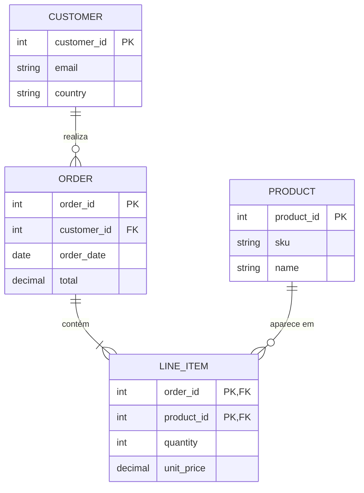
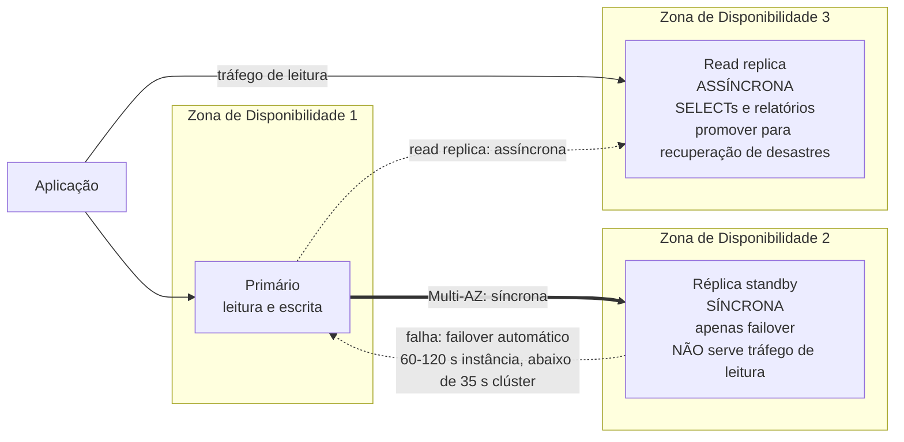
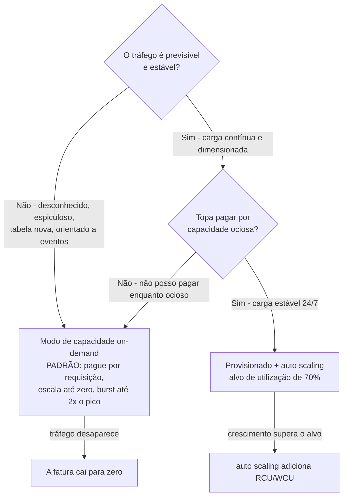
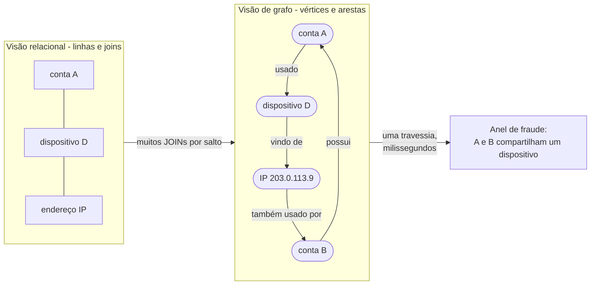
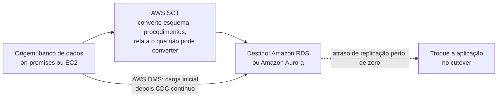
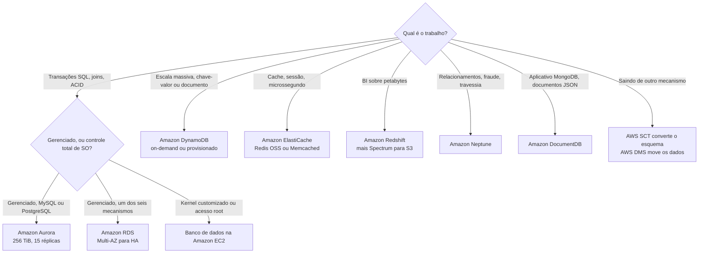

# Serviços de Bancos de Dados: Escolhendo o Armazenamento Certo

O **Domínio 3 (Tecnologia e Serviços de Nuvem) carrega 34% da pontuação do CLF-C02**, e dentro dele senta-se uma tarefa que é trabalho puro de decisão: **Tarefa 3.4 "Identificar serviços de bancos de dados da AWS"**. Suas cinco declarações de habilidade são curtas e diretas: *"Decidir quando usar bancos de dados hospedados no EC2 ou bancos de dados gerenciados pela AWS"*, identificar bancos de dados **relacionais** (Amazon RDS, Amazon Aurora), **NoSQL** (Amazon DynamoDB), **baseados em memória** (Amazon ElastiCache) e **ferramentas de migração de bancos de dados** (AWS DMS, AWS SCT). Toda questão construída sobre esta tarefa tem o mesmo esqueleto: um enunciado de workload, quatro nomes de bancos de dados e uma resposta certa. Os nomes dos serviços são fáceis; ler o enunciado é o exame.

```text
====================================================================
 CLF-C02 LIÇÃO 10 — CARTÃO DE SERVIÇOS DE BANCOS DE DADOS (fatos em outubro de 2026)
====================================================================
 ESCOPO (Tarefa 3.4)
   DENTRO    Aurora · DocumentDB · DynamoDB · ElastiCache · Neptune
             · RDS   (+ Redshift sob Análise; DMS + SCT sob
               Migração e Transferência)
   FORA      Amazon Keyspaces · Amazon MemoryDB · AWS AppConfig
--------------------------------------------------------------------
 RDS       bancos relacionais gerenciados; 6 mecanismos: IBM Db2,
           MariaDB, Microsoft SQL Server, MySQL, Oracle Database,
           PostgreSQL
           a AWS detém "backups, aplicação de patches de software,
           detecção automática de falhas e recuperação"
           armazenamento máx 64 TiB; linha de base gp3 3.000 IOPS
           / 125 MiB/s
           retenção de backup 1-35 dias (0 = backups automáticos
           desligados)
    Multi-AZ (instância) . alta disponibilidade; standby SINCRONO;
                           NÃO serve tráfego de leitura; failover
                           tipicamente 60-120 s
    Multi-AZ (clúster) ... alta disponibilidade + leituras; failover
                           tipicamente < 35 s
    Read replica .......... escala de leitura; ASSÍNCRONO (pode estar
                           desatualizado); promoção manual; SEM
                           autoscaling
  AURORA     compatível com MySQL e PostgreSQL; mesmo console do RDS
             volume único do clúster, copiado em três AZs,
             auto-expande até 256 TiB; até 15 Aurora Replicas;
             failover tipicamente < 60 s, frequentemente < 30 s
  DYNAMODB   serverless, totalmente gerenciado, NoSQL distribuído;
             um dígito de ms em qualquer escala; chave-valor +
             documento; item <= 400 KB; sem JOINs; apenas IAM;
             3 AZs / SLA de 99,99%; global tables SLA de 99,999%
    on-demand (padrão) . pague por requisição, escala até zero,
                         instantaneamente até 2x o pico anterior
    provisionado ....... paga RCU/WCU quer usados quer não;
                         alvo de auto scaling 70%
             1 RCU = 1 leitura forte/s para itens de até 4 KB
             1 WCU = 1 escrita/s para itens de até 1 KB
  ELASTICACHE  cache em memória: Valkey, Memcached, Redis OSS
               "leituras em microssegundos e escritas em
               submilissegundos"
               um cache EFÊMERO - nunca o sistema de registro
    Memcached ... modelo mais simples, multithreaded, SEM
                  replicação e SEM failover
    Redis OSS ... tipos complexos, replicação + failover automático
  REDSHIFT    data warehouse OLAP totalmente gerenciado, escala de
              petabytes, colunar; Redshift Spectrum lê o Amazon S3
              diretamente
  NEPTUNE     banco de dados de grafo gerenciado; bilhões de
              relacionamentos em latência de milissegundos; até 15
              Neptune Replicas
  DOCUMENTDB  compatível com MongoDB; até 15 réplicas; até 256 TiB
  MIGRAÇÃO    AWS SCT converte o esquema e o código
              AWS DMS move os dados (carga única ou CDC contínuo)
====================================================================
```

> [!NOTE]
> **Disciplina de escopo.** Todo serviço apresentado como examinável abaixo está na lista oficial de serviços no escopo do CLF-C02 ou em uma tarefa do Domínio 3. Três serviços de bancos de dados estão explicitamente **fora do escopo** e aparecem aqui apenas para que você possa eliminá-los: **Amazon Keyspaces (for Apache Cassandra)**, **Amazon MemoryDB for Redis OSS** e **AWS AppConfig**. Respostas corretas neste exame são sempre tiradas da lista no escopo: um favorito de página de marketing como o MemoryDB nunca pode ser a escolha certa.

Nesta lição você vai:

- classificar toda questão de banco de dados nos **cinco buckets** da Tarefa 3.4;
- separar o que o **Amazon RDS** gerencia do que **você** ainda possui;
- derrotar **a armadilha Multi-AZ versus read replica** em ambas as direções;
- comparar **RDS no EC2 versus auto-gerenciado** usando a própria tabela de responsabilidades da AWS;
- posicionar o **Amazon Aurora** por compatibilidade, auto-expansão de armazenamento e número de réplicas;
- dimensionar **capacidade do DynamoDB** em RCU e WCU e escolher o **modo de capacidade** certo;
- definir **ElastiCache Redis OSS vs Memcached** em uma linha;
- separar **OLAP de OLTP** para que o Redshift pare de ser um distrator;
- posicionar **Neptune e DocumentDB** a partir de enunciados de duas palavras;
- dividir uma migração entre **AWS SCT (esquema) e AWS DMS (dados)**;
- executar a **tabela de decisão workload → banco de dados** de ponta a ponta;
- verificar as **atualizações de 2026** que tocam bancos de dados: adições e remoções nas listas de escopo, Database Savings Plans e o Free Tier dependente da era;
- estudar **quatro estudos de caso publicados pela AWS** (Netflix, Amazon Prime Video, Zendesk e Philip Morris International);
- praticar com **14 questões no estilo do exame** mais quatro verificações interativas.

---

## 1. Tarefa 3.4: cinco buckets e uma decisão

### 1.1 As cinco declarações de habilidade, decifradas

A AWS escreve a tarefa como cinco bullets. Decifre cada um na pergunta única que ela vai te fazer:

| Declaração de habilidade da Tarefa 3.4 | A pergunta por trás dela | O formato da resposta |
|---|---|---|
| Decidir quando usar bancos de dados **hospedados no EC2** ou **gerenciados pela AWS** | *"Precisamos de acesso root ao SO e um kernel customizado"* vs *"queremos que a AWS aplique patches e faça backup"* | Controle ⇒ **EC2**; menor sobrecarga operacional ⇒ **RDS** |
| Identificar bancos de dados **relacionais** (Amazon RDS, Amazon Aurora) | Enunciados contendo SQL, joins, transações, esquemas, tabelas | **RDS** ou **Aurora** |
| Identificar bancos de dados **NoSQL** (Amazon DynamoDB) | Acesso chave-valor ou documento, escala enorme, um dígito de ms, sem joins | **DynamoDB** |
| Identificar bancos de dados **baseados em memória** (Amazon ElastiCache) | Cache, armazenamento de sessões, latência de microssegundos, leaderboard | **ElastiCache** |
| Identificar **ferramentas de migração de bancos de dados** (AWS DMS, AWS SCT) | Sair do Oracle/SQL Server, converter procedimentos, sincronização contínua | **SCT** converte, **DMS** move |

Dois buckets extras não são nomeados na tarefa mas aparecem na lista no escopo: **Redshift** (posicionado sob **Análise** no guia de exame, ensinado aqui apenas para a decisão de warehouse-vs-transação) e **Neptune / DocumentDB** (armazenamentos de grafo e de documento compatíveis com MongoDB).

### 1.2 As listas no escopo e fora do escopo

| Categoria | No escopo (respostas corretas vêm daqui) | Fora do escopo (distratores: nunca corretos) |
|---|---|---|
| Banco de dados | **Amazon Aurora, Amazon DocumentDB, Amazon DynamoDB, Amazon ElastiCache, Amazon Neptune, Amazon RDS** | **Amazon Keyspaces (for Apache Cassandra), Amazon MemoryDB for Redis OSS, AWS AppConfig** |
| Análise | **Amazon Redshift** (decisão de warehouse ensinada na Seção 6) |: |
| Migração e Transferência | **AWS Database Migration Service (AWS DMS), AWS Schema Conversion Tool (AWS SCT)** |: |

- **📚 Você sabia?** A própria orientação da AWS *"bancos de dados na AWS: como escolher"* (atualizada em **2 de junho de 2026**) anuncia **mais de 15 opções de bancos de dados**, e a página de produtos de bancos de dados diz **mais de 15 mecanismos**: enquanto o guia de exame CLF-C02 nomeia **seis** serviços de banco de dados no escopo. O exame não testa amplitude; ele testa se você consegue escolher os seis que a AWS se importa de um catálogo quatro vezes maior (em outubro de 2026; verifique os valores atuais antes de usar).

### 1.3 Exemplo trabalhado E1: classificar um enunciado em uma passagem

Leia o enunciado, sublinhe o *padrão de acesso*, e depois nomeie o bucket:

```text
"O histórico de pedidos deve suportar joins contra clientes e
 itens de linha, com escritas ACID"
   -> bucket relacional -> RDS (ou Aurora se MySQL/PostgreSQL)

"Dados de sessão indexados por token, devem retornar em menos de 1 ms"
   -> bucket baseado em memória -> ElastiCache

"Tráfego de navegação e carrinho com picos imprevisíveis,
 sem joins, payloads de item abaixo de 400 KB"
   -> bucket NoSQL -> DynamoDB (modo de capacidade on-demand)

"Três anos de histórico de vendas agregados em dashboards"
   -> warehouse -> Redshift (OLAP, não OLTP)

"Detecção de anel de fraude: seguir conta -> dispositivo -> IP -> conta"
   -> relacionamentos -> Neptune (grafo)

"Rodamos drivers MongoDB contra documentos hoje"
   -> compatível com MongoDB -> DocumentDB

"Converter 400 procedimentos PL/SQL do Oracle, depois transmitir as linhas"
   -> SCT converte o código, DMS transmite os dados
```

O **verbo** do enunciado é a questão inteira: *agregar* ⇒ Redshift, *travessia* ⇒ Neptune, *cache* ⇒ ElastiCache, *transacionar* => RDS/Aurora, *escalar imprevisivelmente* ⇒ DynamoDB.

---

## 2. Amazon RDS: o padrão relacional gerenciado

### 2.1 O que "gerenciado" realmente compra

A AWS define o Amazon Relational Database Service como um serviço gerenciado que *"gerencia backups, aplicação de patches de software, detecção automática de falhas e recuperação"*. A versão do exame disto é uma tabela de responsabilidades, e a AWS publica uma que compara bancos de dados **on-premises, hospedados no EC2 e gerenciados pelo RDS** diretamente:

| Capacidade | On-premises | Banco de dados na Amazon EC2 | Amazon RDS |
|---|---|---|---|
| Otimização da aplicação | **Cliente** | **Cliente** | **Cliente** |
| Escala | **Cliente** | **Cliente** | **AWS** |
| Alta disponibilidade | **Cliente** | **Cliente** | **AWS** |
| Backups | **Cliente** | **Cliente** | **AWS** |
| Aplicação de patches no banco de dados e no SO | **Cliente** | **Cliente** | **AWS** |
| Hardware, energia, instalações | **Cliente** | **AWS** | **AWS** |

A conclusão da própria AWS é relevante para o exame: *"Recomendamos o Amazon RDS como sua escolha padrão para a maioria das implantações de bancos de dados relacionais."* Note a única linha que nunca muda: **a otimização da aplicação (seu esquema, suas consultas, seus índices) é sua em todas as três colunas**. Responsabilidade compartilhada para bancos de dados não é "a AWS faz tudo".

### 2.2 Mecanismos, instâncias e armazenamento

| Elemento | O que a AWS documenta (em outubro de 2026) | Consequência no exame |
|---|---|---|
| **Mecanismos (6)** | IBM Db2, MariaDB, Microsoft SQL Server, MySQL, Oracle Database, PostgreSQL | *"Qualquer um destes seis nomes"* ⇒ **RDS**; Aurora é uma família de mecanismos separada (ver Seção 3) |
| **Bloco de construção** | A **instância de banco de dados**, usando classes de instância como `db.m*`, `db.r*`, `db.c*`, `db.t*` | O prefixo `db.` é a própria nomenclatura do RDS; `t` = estourável, `r` = memória |
| **Armazenamento** | Baseado no Amazon EBS, **até 64 TiB**; **linha de base gp3 de 3.000 IOPS e 125 MiB/s** | Uma exigência relacional **acima de 64 TiB** ⇒ olhe o Aurora (256 TiB) |
| **Rede** | Roda em uma **VPC**, alcançada através de **security groups** | Questões de segurança de bancos de dados terminam no security group e na VPC |
| **Modelo de acesso** | SQL, joins, transações multi-linha | *"Precisa de JOINs / SQL ad-hoc"* ⇒ RDS ou Aurora, nunca DynamoDB |



Este é o formato que o exame chama de **relacional**: chaves primárias e estrangeiras, linhas em tabelas, e respostas que vêm de **fazê-las join**. No momento em que um enunciado diz *"a aplicação não deve fazer JOIN"* ou *"desnormalizar por design"*, você saiu deste diagrama e entrou no NoSQL.

### 2.3 Multi-AZ vs Read Replicas: A armadilha

Esta é a questão mais confiável de toda a lição, e a AWS afirma a regra duas vezes no RDS User Guide: **"A opção de alta disponibilidade não é uma solução de escala para cenários somente de leitura. Você não pode usar uma réplica standby para servir tráfego de leitura. Para servir tráfego somente de leitura, use um cluster de banco de dados Multi-AZ ou uma read replica."**

| | **Multi-AZ (instância de BD)** | **Read replica** | **Multi-AZ (clúster de BD)** |
|---|---|---|---|
| **Propósito** | Alta disponibilidade / failover automático | **Escala de leitura** | Disponibilidade **e** leituras |
| **Replicação** | **Síncrona** | **Assíncrona** | Standbys síncronos |
| **Serve tráfego de leitura?** | **Não**: *"você não pode usar uma réplica standby para servir tráfego de leitura"* | **Sim**, somente leitura | **Sim** (todas as três instâncias) |
| **Failover** | Automático, tipicamente **60 to 120 segundos** | **Promoção** manual (recuperação de desastres) | Automático, tipicamente **abaixo de 35 segundos** |
| **Risco de dados desatualizados** | Nenhum (síncrona) | **Sim**: assíncrono significa que pode atrasar | Nenhum (síncrona) |
| **Custo** | A segunda instância é cobrada | Cada réplica é cobrada como uma instância de BD | Três instâncias |
| **Escala leituras automaticamente?** | n/a | **Não**: *"o RDS não suporta autoscaling de read replicas"* | Você adiciona/remove você mesmo |



Ambos os recursos podem coexistir no mesmo banco de dados de origem: uma implantação Multi-AZ para sobrevivência **e** uma read replica para relatórios. A armadilha funciona nas duas direções:

- *"Aumentar o throughput de leitura / descarregar relatórios"* ⇒ **read replica** (Multi-AZ não faz nada por leituras);
- *"Sobreviver a uma falha de Zona de Disponibilidade com failover automático"* ⇒ **Multi-AZ** (uma read replica só faz failover se você promovê-la manualmente).

> ⚠️ **Multi-AZ não é uma solução de escala.** A redação da AWS é absoluta: a opção de alta disponibilidade *"não é uma solução de escala para cenários somente de leitura"*. Dois nuances salvam pontos: um **clúster de BD Multi-AZ** (standbys legíveis) *serve* tráfego de leitura, e uma read replica é **assíncrona**, então uma réplica pode estar desatualizada, e é exatamente por isso que você nunca deve rotear escritas para ela.

### 2.4 Exemplo trabalhado E2, o pico de relatórios

*O banco de dados MySQL primário no RDS lida com 400 escritas/segundo. O relatório de fim de mês roda 600 SELECTs pesados/segundo e a CPU do primário fica em 95%. Duas opções são propostas: habilitar Multi-AZ ou criar uma read replica. Qual está correta, e por quê?*

```text
Pergunta sendo feita : "as LEITURAS estão pesadas demais"
Multi-AZ dá          : um standby SÍNCRONO que NÃO serve leituras
                       -> a CPU fica no primário; sem alívio
Read replica dá      : uma cópia ASSÍNCRONA que aceita SELECTs
                       -> o relatório sai do primário
Veredicto            : criar uma read replica, depois apontar o
                       trabalho de relatório para ela
Risco residual       : atraso assíncrono - o relatório pode estar
                       segundos atrás; a promoção (não a replicação)
                       é a história de DR
```

Inverta o enunciado: *"o banco de dados deve sobreviver a uma indisponibilidade de AZ com failover automático"* ⇒ **Multi-AZ**, porque a promoção de uma read replica é manual e sua replicação é assíncrona.

### 2.5 RDS versus um banco de dados auto-gerenciado no EC2

A Tarefa 3.4 testa explicitamente esta escolha. A pergunta decisiva nunca é "qual é mais poderoso": é **quem faz o trabalho indiferenciado**.

| Pergunta que o enunciado faz | Banco de dados na Amazon EC2 | Amazon RDS |
|---|---|---|
| Quem aplica patches no mecanismo do BD e no SO? | **Você** | **AWS** |
| Quem configura backups e detecção de falhas? | **Você** | **AWS** |
| Quem lida com escala e alta disponibilidade? | **Você** | **AWS** |
| Quem escreve o esquema, as consultas e os índices? | **Você** | **Você** (inalterado) |
| Você tem root/SO ou kernel customizado? | **Sim** | **Não** |
| Veredicto no exame | Apenas quando o enunciado exige controle de SO/root/mecanismo customizado | **Escolha padrão** para a maioria das implantações relacionais |

**Exemplo trabalhado E3: escolhendo entre RDS e EC2.** Três enunciados, três veredictos:

1. *"Uma equipe precisa de PostgreSQL com backups gerenciados pela AWS, aplicação de patches e failover Multi-AZ, e não tem exigências incomuns de SO."* ⇒ **Amazon RDS**: cada exigência está na lista gerenciada do RDS, e a AWS o recomenda como padrão.
2. *"Um workload regulamentado exige um módulo de kernel customizado e acesso root completo no host do banco de dados."* ⇒ **Banco de dados na Amazon EC2**, o RDS não expõe o sistema operacional, então a exigência força o caminho EC2, e a equipe agora possui patches, backups e HA.
3. *"O mesmo workload de PostgreSQL, mas a empresa já roda seus próprios scripts de backup e calendário de patches e se recusa a mudá-los."* ⇒ **Hospedado no EC2 é legítimo**, mas o viés do exame é declarado pela própria AWS: o RDS é o *padrão recomendado*, então um enunciado que menciona apenas conveniência de hábito geralmente está querendo o RDS.

### 2.6 Backups, patches e retenção

| Operação | Comportamento da AWS (em outubro de 2026) | O que você ainda possui |
|---|---|---|
| **Backups automáticos** | Ligados por padrão; janela de retenção selecionável de **1 a 35 dias** (0 os desliga) | Escolher a janela; testar restaurações |
| **Snapshots manuais** | Retidos até você excluí-los | Ciclo de vida do snapshot e cópias entre Regiões |
| **Aplicação de patches de software** | A AWS aplica patches no mecanismo, no SO e no host | Sua janela de manutenção; seus testes em uma cópia de staging |
| **Detecção e recuperação de falhas** | Automática | A lógica de retry da sua aplicação e os timeouts de conexão |
| **Esquema, credenciais, security groups, VPC** | Não gerenciados | **Seus**, sempre |
| **Escolha Multi-AZ / read replica** | Não automática | **Sua**: a AWS nunca liga nenhum dos dois para você |

> [!WARNING]
> **O número padrão de retenção é uma armadilha por si só.** O RDS User Guide verifica a **faixa de 1 to 35 dias** (com 0 significando backups automáticos desligados). O *"valor padrão é 7 dias"* amplamente citado vem da redação de uma **regra do AWS Config** que verifica conformidade, não do próprio RDS User Guide. No exame, cite a **faixa**; se uma questão girar em torno do padrão, trate-o como não verificado e re-verifique o console (em outubro de 2026).

**Exemplo trabalhado E4, o orçamento de failover.** A lógica de retry da aplicação deve ser dimensionada contra o failover *mais lento* documentado, não o mais rápido:

```text
Multi-AZ instância de BD .... tipicamente 60-120 segundos
Multi-AZ clúster de BD ...... tipicamente abaixo de 35 segundos
Failover do Aurora ........... tipicamente abaixo de 60 s, frequentemente abaixo de 30 s
Aurora Global Database
  promoção (DR planejada) .... em menos de 1 minuto
------------------------------------------------------------
Regra de projeto: dimensione as tentativas de conexão para o caso
                  MAIS LENTO que você realmente roda - 120 segundos -
                  ou a aplicação desiste antes de o banco de dados voltar.
```

Uma questão que elogia o *"frequentemente menos de 30 segundos"* do Aurora enquanto o timeout do seu cliente é 10 segundos está testando aritmética, não marketing.

- **📚 Você sabia?** O Free Tier do RDS é limitado no tempo e depende da idade da conta: a AWS documenta **750 horas por mês** de um `db.t3.micro` ou `db.t4g.micro` em **Single-AZ**, e aquele crédito se aplica a contas criadas **antes de 17 de julho de 2025**. Contas mais antigas mantiveram o Free Tier clássico de 12 meses; contas mais novas recebem o Free plan baseado em créditos, então um enunciado citando "750 horas de db.t3.micro" depende da era (em outubro de 2026; verifique os valores atuais antes de usar).

---

## 3. Amazon Aurora: o de alto desempenho compatível com MySQL/PostgreSQL

### 3.1 Compatibilidade e o volume de clúster compartilhado

A AWS descreve o Aurora como **compatível com MySQL e PostgreSQL**, e ele é provisionado e administrado através do **mesmo console, CLI e API do RDS**, provisionamento, patches, backup e detecção de falhas se comportam todos como o RDS. A diferença é a camada de armazenamento: o Aurora usa um **volume único de clúster cujos dados são replicados em três Zonas de Disponibilidade**, e aquele volume é **independente das instâncias de banco de dados** anexadas a ele. Adicionar um leitor portanto não copia os dados, a instância simplesmente se anexa ao volume existente.

| Propriedade do Aurora | Número da AWS (em outubro de 2026) | Por que o exame se importa |
|---|---|---|
| **Compatibilidade** | MySQL e PostgreSQL | *"Compatível com MySQL/PostgreSQL"* ⇒ Aurora; qualquer um dos **outros seis mecanismos** ⇒ RDS |
| **Armazenamento** | O volume do clúster **auto-expande** conforme os dados aumentam, até **256 TiB** (e auto-recolhe quando dados são excluídos) | Sem planejamento de capacidade; uma necessidade relacional **acima de 64 TiB** (teto do RDS) cai aqui |
| **Escala de leitura** | **Até 15 Aurora Replicas** em três AZs | *"15 leitores"* ⇒ Aurora; read replicas do RDS são um recurso diferente, gerenciado separadamente |
| **Failover** | Tipicamente **menos de 60 segundos, e frequentemente menos de 30 segundos** | Enunciados de recuperação rápida |
| **Reconstrução de réplica** | Sem réplicas disponíveis, a AWS documenta uma reconstrução *"tipicamente em menos de 10 minutos"* | Aritmética de recuperação de desastres |
| **Cobrança de I/O** | Vale a pena mudar para **Aurora I/O-Optimized** quando o **gasto com I/O é 25% ou mais** do gasto com o Aurora DB | Um limiar raro, específico e com fonte |
| **Global Database** | Uma Região primária mais Regiões secundárias, com replicação *"tipicamente com latência abaixo de um segundo"*; **switchover planejado** vs **failover** em indisponibilidade de Região | Vocabulário de DR multi-Região |

> [!WARNING]
> **Dois números do Aurora são deliberadamente não ensinados como fatos aqui**, porque as próprias páginas da AWS discordam: (1) o **multiplicador de desempenho versus MySQL/PostgreSQL padrão** é publicado como **6x** em uma página do Aurora User Guide, **cinco vezes** em outra e **3-5x** em uma terceira; (2) o **número de Regiões secundárias no Aurora Global Database** aparece como **até 10** no User Guide e **até cinco** na FAQ. Números oficiais conflitantes são não verificados por definição (seção do digest G): nunca afirme nenhum dos dois. O que *é* seguro: *"throughput materialmente maior que o MySQL/PostgreSQL padrão"*, o teto de **256 TiB**, **15 Aurora Replicas** e failover **frequentemente abaixo de 30 segundos**, cada um citado com página e data.

### 3.2 Aurora vs RDS, o desempate de duas palavras

| Fragmento do enunciado | Resposta |
|---|---|
| *"Compatível com MySQL ou PostgreSQL, até 15 leitores, armazenamento auto-expansível"* | **Aurora** |
| *"IBM Db2 / Oracle / SQL Server / MariaDB"* | **RDS** |
| *"banco de dados relacional acima de 64 TiB"* | **Aurora** (volume de clúster de 256 TiB) |
| *"qualquer um dos seis mecanismos clássicos"* | **RDS** |
| *"relacional, mas o exame diz 'serverless e compatível com MySQL/PostgreSQL'"* | **Aurora** |

**Exemplo trabalhado E5: tetos de armazenamento como decisão.** Três exigências, três serviços:

```text
"Workload relacional, 40 TiB e crescendo"      -> RDS
        (o teto de armazenamento de 64 TiB é suficiente)
"Workload relacional, 200 TiB, compatível com MySQL" -> Aurora
        (o volume do clúster auto-expande até 256 TiB)
"Workload relacional, 400 TiB"                 -> não é uma questão
        única de banco de dados: isso é um warehouse (Redshift,
        escala de petabytes) ou uma questão de data lake
```

- **📚 Você sabia?** A configuração **I/O-Optimized** do Aurora tem um ponto de equilíbrio publicado: a AWS aconsessa mudar quando seu **gasto com I/O alcança 25% ou mais** do seu gasto com instância de BD do Aurora. É um dos poucos limiares de custo de banco de dados que a AWS declara numericamente, e como todo número nesta lição, ele é *de outubro de 2026* e deve ser re-verificado antes de você confiar nele em produção.

---

## 4. Amazon DynamoDB: NoSQL serverless em um dígito de milissegundos

### 4.1 O que ele é, e o que ele se recusa a ser

A definição da AWS é a definição do exame: DynamoDB é um *"banco de dados NoSQL serverless, totalmente gerenciado e distribuído com desempenho de um dígito de milissegundos em qualquer escala"*, suportando **tanto modelos de dados chave-valor quanto de documento**. Leia a letra miúda, porque ela gera distratores:

| Propriedade | Declaração da AWS (em outubro de 2026) | Consequência |
|---|---|---|
| **Modelo de dados** | Chave-valor **e** documento | Não relacional |
| **Joins** | *"não suporta um operador JOIN"* | *"Precisa de JOINs"* ⇒ RDS/Aurora, não DynamoDB |
| **Tamanho máximo do item** | **400 KB** | Blobs grandes pertencem ao Amazon S3 com um ponteiro |
| **Autenticação** | IAM: **sem nomes de usuário e senhas** | Enunciados de segurança terminam no IAM |
| **Durabilidade / SLA** | Replicado em **três AZs**, SLA de disponibilidade de **99,99%** | Distratores single-AZ falham |
| **Global tables** | Replicação multi-Região, **multi-active**, SLA de disponibilidade de **99,999%** | *"Geo-distribuído, ativo em toda parte"* ⇒ global tables |
| **Consistência** | Leituras fortemente consistentes e transações ACID suportadas | Ele não é "apenas eventualmente consistente" |
| **Free tier** | **25 GB + 25 WCU + 25 RCU** Always Free (≈ 200 milhões de requisições/mês em escala de tutorial) | Escala de tutorial, não produção |
| **Cota padrão** | **40.000** RCU + WCU combinados | Aumente-a antes de projetar para ela |

### 4.2 Modos de capacidade, o segundo fato de banco de dados mais cobrado

| | **On-demand** (padrão) | **Provisionado** |
|---|---|---|
| **Cobrado em** | **Por requisição** (unidades de requisição de leitura / unidades de requisição de escrita) | **RCU e WCU provisionados por hora, usados ou não** |
| **Planejamento de capacidade** | Nenhum | Você escolhe os números |
| **Escala até zero?** | **Sim**, tráfego zero custa nada | **Não**, unidades ociosas ainda são cobradas |
| **Comportamento de burst** | Instantaneamente até **2× o pico anterior**; uma tabela nova começa com espaço para **4.000 escritas/s e 12.000 leituras/s** | **Auto scaling** para um alvo do CloudWatch de **70%**, ligado por padrão no console |
| **Definição de unidade** | Unidade de requisição consumida | **1 RCU** = uma leitura forte consistente/s para itens de até **4 KB** (ou duas leituras eventualmente consistentes); **1 WCU** = uma escrita/s para itens de até **1 KB** |
| **Troca de modo** | Provisionado → on-demand no máximo **4 vezes a cada 24 horas**; o inverso a qualquer momento |: |
| **Escolha no exame** | Tráfego **desconhecido, espiculoso, novo ou orientado a eventos** | Tráfego **estável, previsível, contínuo** |



### 4.3 Exemplos trabalhados: a aritmética que o exame realmente usa

**Exemplo trabalhado E6: dimensionamento provisionado (o próprio padrão trabalhado da AWS, em outubro de 2026).**

```text
LEITURAS  80 leituras fortemente consistentes/segundo, tamanho do item 3 KB
          3 KB <= 4 KB  ->  1 RCU por leitura
          80 x 1 RCU                    =  80 RCU

ESCRITAS  100 escritas/segundo, tamanho do item 512 bytes
          512 B <= 1 KB -> 1 WCU por escrita
          100 x 1 WCU                   = 100 WCU

LEITURAS  item de 5 KB, fortemente consistente
          ceil(5 / 4) = 2 RCU por leitura  -> dobra o custo de RCU
```

**Exemplo trabalhado E7: economia dos modos.** Uma tabela provisionada com **100 RCU + 50 WCU**:

```text
Provisionado: 150 unidades/hora são cobradas quer alguém
              leia ou escreva quer não -> 24 h de ociosidade ainda custam
On-demand  : tráfego zero -> cobranças zero para throughput
Ponto de equilíbrio : uso estável 24/7 favorece o provisionado;
                      bursts, noites, fins de semana e cargas
                      desconhecidas favorecem o on-demand (que é o
                      modo PADRÃO)
```

**Exemplo trabalhado E8: folga de burst.** O pico de tráfego anterior em uma tabela on-demand foi de **50.000 leituras/segundo**. A AWS documenta que o on-demand pode escalar instantaneamente até **duas vezes o pico anterior**:

```text
Folga = 2 x 50.000 = 100.000 leituras/segundo
Uma campanha que precisa de 90.000 leituras/s cabe dentro.
Uma campanha que precisa de 140.000 leituras/s NÃO cabe - a tabela
pode ser limitada (throttled), então pré-aqueça o tráfego ou solicite
um aumento de cota. Cota combinada padrão = 40.000 RCU + WCU.
```

### 4.4 Quando o escolhe DynamoDB

| Fragmento do enunciado | Resposta |
|---|---|
| *"NoSQL serverless, um dígito de milissegundos, qualquer escala"* | **DynamoDB** |
| *"Picos imprevisíveis; não posso pagar enquanto ocioso"* | **DynamoDB on-demand** (o modo padrão) |
| *"Chave-valor ou documento, sem joins, itens de 400 KB"* | **DynamoDB** |
| *"Leaderboard de jogo / carrinho de compras em escala de pico de venda"* | **DynamoDB** |
| *"Precisa de JOINs ou SQL ad-hoc sobre linhas"* | **RDS ou Aurora** |
| *"Drivers MongoDB e documentos, clústeres de instância"* | **DocumentDB** (ver Seção 7) |

Dois satélites do DynamoDB também aparecem:

- **Amazon DynamoDB Accelerator (DAX)**: um **cache em memória apenas para o DynamoDB**, compatível com API, entregando leituras *"até 10 vezes"* mais rápidas e movendo a latência *"de milissegundos para microssegundos"*. O enunciado é pontos quentes de chave repetida com muitas leituras em uma tabela DynamoDB.
- **Global tables**: multi-Região, **multi-active**, SLA de disponibilidade de **99,999%** sem tabela primária para a qual fazer failover. O enunciado é distribuição geográfica.

DAX conserta **latência**; global tables consertam **geografia**. Confundi-los é um jeito confiável de perder um ponto.

---

## 5. Amazon ElastiCache: a camada em memória

### 5.1 O que ele é

A AWS define o ElastiCache como um *"armazenamento de dados ou ambiente de cache em memória distribuído"* que funciona com os mecanismos **Valkey, Memcached e Redis OSS**, e a orientação de escolha da AWS põe um número nisso: **leituras em microssegundos e escritas em submilissegundos como um *cache efêmero***. Aquela última frase é a posição inteira do exame, o ElastiCache **acelera** um banco de dados primário; ele é **nunca o sistema de registro**.

### 5.2 Redis OSS vs Memcached: as definições de uma linha

| | **Memcached** | **Redis OSS / Valkey** |
|---|---|---|
| **Modelo** | *"O modelo mais simples possível"*: objetos de cache | Tipos de dados complexos: listas, conjuntos, **conjuntos ordenados**, hashes, bitmaps, geoespaciais |
| **Threading** | **Multithreaded** |: |
| **Replicação** | **Não** | **Sim** |
| **Failover** | **Não** | **Sim** (obrigatório em modo de clúster) |
| **Backups** | Sem backups baseados em nó | Suportado |
| **Pub/sub, criptografia** | Não | Sim |
| **Enunciados do exame** | *"Cache de objetos simples, escala horizontal out/in"* | **Sessões, leaderboards (conjuntos ordenados), filas, rate limiting, geoespacial** |

**Exemplo trabalhado E9: escolhendo o mecanismo de cache.**

```text
"Cache fragmentos de HTML renderizados; modelo mais simples
 possível; escala nós in e out"          -> Memcached

"Armazenar sessões de usuário com TTLs e construir um
 leaderboard em tempo real ordenado por pontuação" -> Redis OSS / Valkey
        (conjuntos ordenados + replicação + failover)

"Cache leituras para uma tabela DynamoDB, latência de microssegundos"
                                          -> DAX (apenas DynamoDB)

"Cache efêmero na frente do MySQL com failover automático"
                                          -> ElastiCache
        (Redis OSS / Valkey - Memcached não tem failover)
```

> ⚠️ **ElastiCache nunca é a resposta para "onde os dados são armazenados duramente?"** Ele é um *cache efêmero*. Se o enunciado precisa de um banco de dados primário durável, a resposta é RDS, Aurora, DynamoDB ou DocumentDB, e se ele pede um banco de dados **em memória** durável, a opção de página de marketing é o **Amazon MemoryDB**, que está **fora do escopo** do CLF-C02 e portanto nunca é correto.

```matching
{
  "question": "Combine cada exigência de cache ou em memória com o serviço que o exame CLF-C02 espera que você escolha:",
  "pairs": [
    {"left": "O cache de objetos mais simples possível, multithreaded, escala nós in e out, sem replicação necessária", "right": "Memcached no Amazon ElastiCache: sem replicação, sem failover, sem backups baseados em nó"},
    {"left": "Sessões com TTLs mais um leaderboard ordenado por pontuação que deve sobreviver a uma falha de nó automaticamente", "right": "Redis OSS (ou Valkey) no Amazon ElastiCache: tipos complexos, conjuntos ordenados, replicação e failover automático"},
    {"left": "Leituras em microssegundos para pontos quentes repetidos em uma tabela DynamoDB existente", "right": "Amazon DynamoDB Accelerator (DAX) - um cache em memória apenas para DynamoDB, de milissegundos para microssegundos"},
    {"left": "Um primário relacional durável que deve sobreviver a uma falha de Zona de Disponibilidade com failover automático", "right": "Amazon RDS ou Amazon Aurora com Multi-AZ: o cache é efêmero e nunca o sistema de registro"},
    {"left": "Um banco de dados em memória durável citado em uma página de marketing da AWS", "right": "Amazon MemoryDB: explicitamente fora do escopo do CLF-C02, então nunca pode ser a resposta correta"}
  ],
  "explanation": "Ordene por duas perguntas: os dados são duráveis ou efêmeros, e qual família de produtos possui o padrão de acesso? Escala horizontal simples de cache é Memcached; TTLs, conjuntos ordenados e failover automático são Redis OSS/Valkey; leituras em microssegundos sobre DynamoDB são DAX; qualquer coisa que deva ser o sistema de registro sai do ElastiCache completamente para RDS, Aurora, DynamoDB ou DocumentDB; e a resposta de marketing de em memória durável, Amazon MemoryDB, está na lista fora do escopo, então é um distrator por definição."
}
```

---

## 6. Amazon Redshift: o warehouse, não a transação

### 6.1 A armadilha OLAP vs OLTP

A AWS define o Amazon Redshift como um *"data warehouse totalmente gerenciado, em escala de petabytes"* que é *"especificamente projetado para processamento analítico online (OLAP)"*. A armadilha é que as duas metades do par são bancos de dados, ambos respondem a perguntas de SQL, e apenas um deles está certo para o seu enunciado.

| | **OLTP, RDS, Aurora, DynamoDB** | **OLAP, Amazon Redshift** |
|---|---|---|
| **Trabalho** | Rodar o negócio: capturar transações individuais | Analisar o negócio: agregar histórico |
| **Formato de armazenamento** | Linhas (OLTP) | **Colunas**: AWS: *"Aplicações OLTP tipicamente armazenam dados em linhas, o Amazon Redshift armazena dados em colunas"* |
| **Consulta típica** | Um pedido, um cliente, uma escrita | *"Receita total por região por trimestre por 3 anos"* |
| **Escala** | Gigabytes a dezenas de terabytes | **Escala de petabytes** |
| **Padrão de escrita** | Inserções e atualizações frequentes de uma linha | Cargas em massa, depois muitas leituras |
| **Orientação da AWS** | *"Se você precisa de um sistema transacional rápido … escolha … Amazon RDS ou uma oferta de banco de dados NoSQL, como DynamoDB"* | *"Ideal para processamento analítico online (OLAP)"* |
| **Posicionamento no exame** | Banco de dados (lista no escopo) | **Análise**: a categoria nunca muda a resposta |

A AWS também afirma que recursos de OLTP como **índices secundários e operações eficientes de manipulação de dados de uma única linha foram *omitidos*** do Redshift. Esse é o sinal: um banco de dados que deliberadamente removeu a manipulação de uma única linha não é onde você põe um carrinho de compras.

**Exemplo trabalhado E10: a questão de duas colunas.**

```text
"Clientes fazem pedidos enquanto compram; cada pedido deve
 commitar imediatamente, com garantias ACID"
      -> OLTP -> RDS / Aurora (ou DynamoDB para escala chave-valor)

"Dashboard de business intelligence agrega 3 anos de
 histórico de pedidos em totais regionais toda manhã"
      -> OLAP -> Amazon Redshift

"Mesma exigência de BI, mas os arquivos brutos já estão no
 Amazon S3 e ninguém quer carregá-los primeiro"
      -> Redshift Spectrum: consulte os arquivos do S3 diretamente,
         em servidores independentes do clúster
```

### 6.2 Redshift Spectrum

A AWS documenta que o **Redshift Spectrum** permite *"consultar dados diretamente de arquivos no Amazon S3"* usando **servidores independentes do seu clúster**. A consequência visível no exame: você pode consultar o **warehouse e o data lake em uma única instrução SQL** sem pagar por nós extras do clúster para manter os dados do lake.

- **📚 Você sabia?** O guia de exame arquiva o **Amazon Redshift sob Análise**, não sob Banco de dados: ainda assim a Tarefa 3.4 espera que você tome a decisão de warehouse-vs-transação. O posicionamento de categoria é um detalhe de metadados, nunca uma razão para descartar um serviço no escopo de uma resposta (em outubro de 2026).

---

## 7. Amazon Neptune e Amazon DocumentDB: os dois armazenamentos especializados

### 7.1 Neptune: a resposta de grafo

A AWS descreve o Amazon Neptune como um *"serviço de banco de dados de grafo totalmente gerenciado"* que lida com **bilhões de relacionamentos** com **latência de milissegundos**, suportando **Gremlin e openCypher** para grafos de propriedades e **SPARQL** para RDF, com **até 15 Neptune Replicas** em um volume compartilhado de três AZs e failover automático.

| Fragmento do enunciado | Resposta |
|---|---|
| *"Altamente conectado; traverse conta → dispositivo → IP → conta"* | **Neptune** |
| *"Detecção de anel de fraude, recomendações, grafos sociais ou de conhecimento, segurança de rede"* | **Neptune** |
| *"Consultas chave-valor"* | DynamoDB: respostas de grafo estão erradas aqui |
| *"Drivers de documento/MongoDB"* | DocumentDB |



Os armazenamentos de grafo respondem a uma pergunta que um esquema relacional responde *devagar*: conforme o número de saltos cresce, o número de JOINs explode, enquanto o Neptune caminha as arestas diretamente. Essa troca é toda a justificativa para o bucket de grafo.

### 7.2 DocumentDB vs DynamoDB, o desempate MongoDB

| | **Amazon DocumentDB** | **Amazon DynamoDB** |
|---|---|---|
| **Compatibilidade** | *"com compatibilidade MongoDB"*: mesmos drivers, ferramentas e código | API proprietária; acesso apenas via IAM |
| **Modelo** | Documento, **compatível com MongoDB** | Chave-valor **e** documento |
| **Provisionamento** | Clústeres de instância; armazenamento auto-expande em passos de **10 GB** até **256 TiB** | **Serverless**: sem instâncias, modos de capacidade |
| **Réplicas** | **Até 15** instâncias réplicas compartilhando uma camada de armazenamento; **seis cópias em três AZs** | Replicação em três AZs por padrão; global tables para multi-Região |
| **Enunciado do exame** | *"MongoDB", documentos tipo JSON, catálogos, perfis* | *"Serverless, um dígito de ms, escala até zero"* |

Regra prática: **a palavra MongoDB ⇒ DocumentDB**; **as palavras serverless, modo de capacidade ou um dígito de milissegundo ⇒ DynamoDB**.

---

## 8. Migração: AWS Schema Conversion Tool e AWS Database Migration Service

### 8.1 A divisão que você deve memorizar

Ambas as ferramentas ficam na categoria **Migração e Transferência** do guia de exame, e o exame nunca perguntou sobre elas sem testar a divisão de trabalho:

| | **AWS Schema Conversion Tool (SCT)** | **AWS Database Migration Service (DMS)** |
|---|---|---|
| **Trabalho** | **Converter o esquema e o código** | **Mover os dados** |
| **O que toca** | Esquema do banco de dados, procedimentos armazenados, views: *"de um mecanismo de banco de dados para outro"*, para um **esquema relacional OLTP ou um esquema de data warehouse** | Linhas: uma **carga única** ou **replicação contínua de mudanças** (CDC) |
| **Formato** | Aplicação GUI autônoma gratuita | *"Um servidor na AWS Cloud que roda software de replicação"* com endpoints de origem e destino |
| **Saída** | Artefatos convertidos **mais um relatório de avaliação** do que ele não pode converter | Um banco de dados de destino replicado com atraso que você monitora até zero |
| **Alvos típicos** |: | Amazon RDS, Aurora, Redshift, DynamoDB, Amazon S3 |
| **Palavra-chave do exame** | *"Converter / esquema / DDL / procedimentos / heterogêneo"* | *"Replicar / mudanças contínuas / cutover / transmitir os dados"* |

Uma terceira resposta é um pegador de distratores: *"rehostear servidores ou VMs inteiros"* é o **AWS Application Migration Service**, não uma ferramenta de banco de dados de modo algum.



### 8.2 Exemplo trabalhado E11: uma saída do Oracle

*Uma seguradora roda Oracle Database on-premises com 400 procedimentos PL/SQL e quer Amazon Aurora PostgreSQL, com downtime mínimo. Sequencie as ferramentas:*

```text
Passo 1  O AWS SCT converte o esquema e os procedimentos Oracle para
         PostgreSQL; seu relatório de avaliação sinaliza tudo que
         ainda precisa de reescrita humana.
Passo 2  O AWS DMS cria endpoints de origem e destino, executa a
         carga inicial e depois mantém as mudanças contínuas
         replicadas.
Passo 3  Monitore o atraso de replicação; quando ele for efetivamente
         zero, troque a aplicação para o Aurora no cutover.
Por que não a outra ferramenta sozinha:
         DMS sem SCT move linhas mas deixa SQL Oracle que o
         PostgreSQL não pode executar.
         SCT sem DMS te deixa com um destino vazio.
         Application Migration Service rehostea SERVIDORES INTEIROS -
         ele não converte um esquema Oracle para PostgreSQL.
```

---

## 9. A tabela de decisão: workload → armazenamento

### 9.1 Uma tabela para a tarefa inteira

| Padrão de acesso no enunciado | Bucket | Resposta | O sinal |
|---|---|---|---|
| SQL, joins, transações ACID, tabelas | Relacional, gerenciado | **Amazon RDS** | Qualquer um dos seis mecanismos; patches e backups gerenciados pela AWS |
| Compatível com MySQL/PostgreSQL + armazenamento auto-expansível + 15 leitores | Relacional, otimizado | **Amazon Aurora** | Volume de clúster de 256 TiB, failover frequentemente abaixo de 30 s |
| Chave-valor ou documento em qualquer escala, um dígito de ms, sem joins | NoSQL | **Amazon DynamoDB** | Serverless, modos de capacidade, itens de 400 KB |
| Cache, armazenamento de sessões, leaderboard, leituras em microssegundos | Baseado em memória | **Amazon ElastiCache** | Efêmero; Redis OSS para failover, Memcached para simplicidade |
| Agregação complexa sobre anos de histórico, petabytes | Warehouse (OLAP) | **Amazon Redshift** | Colunar; *"sistema transacional rápido"* ⇒ não Redshift |
| Relacionamentos, travessia, anéis de fraude, grafos sociais | Grafo | **Amazon Neptune** | Bilhões de relacionamentos em milissegundos |
| Drivers MongoDB, documentos JSON, catálogos | Documento, compatível | **Amazon DocumentDB** | Clústeres de instância, até 15 réplicas |
| Convertendo esquemas e procedimentos armazenados entre mecanismos | Migração | **AWS SCT** | *"Converter"* |
| Replicando linhas para um cutover com pouco downtime | Migração | **AWS DMS** | *"Mudanças contínuas"* |
| Acesso root, kernel customizado, controle de SO | Auto-gerenciado | **Banco de dados na Amazon EC2** | Você agora possui patches, backups e HA |



```matching
{
  "question": "Combine cada workload com o banco de dados que o exame CLF-C02 espera que você escolha:",
  "pairs": [
    {"left": "Dashboards de BI de fim de mês agregando 3 anos de vendas, escala de petabytes", "right": "Amazon Redshift: o data warehouse OLAP gerenciado, colunar, com Spectrum para arquivos do S3"},
    {"left": "Carrinho de compras com picos imprevisíveis de pico de venda, sem joins, deve custar nada enquanto ocioso", "right": "Amazon DynamoDB no modo de capacidade on-demand: NoSQL serverless, pague por requisição, escala até zero"},
    {"left": "Procedimentos Oracle para converter, depois linhas para transmitir para um cutover com pouco downtime", "right": "AWS SCT converte o esquema e o código, AWS DMS replica os dados"},
    {"left": "Sessões e um leaderboard em tempo real precisando de TTLs, conjuntos ordenados e failover automático", "right": "Amazon ElastiCache com o mecanismo Redis OSS ou Valkey"},
    {"left": "Detecção de anel de fraude que deve traversar conta para dispositivo para IP para conta", "right": "Amazon Neptune: o banco de dados de grafo gerenciado, bilhões de relacionamentos em latência de milissegundos"},
    {"left": "Sistema relacional de pedidos em MySQL precisando de patches, backups e failover Multi-AZ gerenciados pela AWS", "right": "Amazon RDS (ou Aurora quando o enunciado também exige armazenamento auto-expansível e 15 leitores)"}
  ],
  "explanation": "Leia o padrão de acesso, não as marcas: agregar sobre histórico significa o warehouse (Redshift), tráfego chave-valor imprevisível significa DynamoDB on-demand, converter código significa SCT enquanto mover linhas significa DMS, cache e sessão significa ElastiCache, traversar relacionamentos significa Neptune, e joins com operações gerenciadas significa RDS ou Aurora."
}
```

### 9.2 Exemplo trabalhado E12: um enunciado, duas respostas erradas cada vez

*"Uma startup de entrega de comida precisa: (a) registros de pedidos com joins com restaurantes e motoristas, (b) um feed de localização do motorista indexado por ID do motorista com picos extremos no horário do jantar, (c) um cache de sessões retornando em menos de um milissegundo, e (d) um data warehouse analítico trimestral."*

```text
(a) joins + ACID            -> Amazon RDS (ou Aurora)
    errado: DynamoDB (sem JOINs), Redshift (OLTP omitido)
(b) indexado, espiculoso, sem joins -> DynamoDB, modo ON-DEMAND
    errado: RDS (mau encaixe para o formato do pico),
            DynamoDB provisionado (você pagaria a noite inteira)
(c) cache submilissegundo   -> ElastiCache (Redis OSS)
    errado: RDS (não é em memória),
            DAX (cacheia apenas DynamoDB)
(d) agregação trimestral    -> Amazon Redshift
    errado: RDS (não é um warehouse), S3 (não é um warehouse SQL)
Quatro exigências, quatro serviços diferentes - e esse é o
formato normal de uma questão de banco de dados do Domínio 3.
```

```fillblank
{
  "question": "Complete as declarações de armadilha de banco de dados com o termo correto:",
  "template": "Um standby Multi-AZ no Amazon RDS replica {{1}} e não serve tráfego de leitura, então o recurso que descarrega relatórios é uma {{2}}, que replica {{3}} e pode portanto estar desatualizada. O modo de capacidade {{4}} do DynamoDB é o padrão e cobra por requisição, enquanto o modo {{5}} cobra por RCU e WCU quer sejam usados quer não.",
  "answers": {
    "1": "synchronously",
    "2": "read replica",
    "3": "asynchronously",
    "4": "on-demand",
    "5": "provisioned"
  },
  "distractors": ["synchronously in reverse", "Multi-AZ standby", "globally", "serverless", "burst", "reserved"],
  "explanation": "A AWS documenta a replicação do standby como síncrona e a replicação da read replica como assíncrona, e diz explicitamente que o standby não pode servir tráfego de leitura: então as leituras vão para uma read replica, que pode atrasar. On-demand é o modo padrão do DynamoDB, pague-por-requisição, que escala até zero; provisionado cobra RCU e WCU por hora independentemente do uso, com auto scaling mirando 70% de utilização."
}
```

---

## 10. Mantendo-se atualizado: o que mudou para bancos de dados

### Atualizações de 2026 (em outubro de 2026)

> [!NOTE]
> **Quatro mudanças com fonte que tocam esta lição**: cada uma verificada contra uma fonte primária da AWS (o guia de exame CLF-C02, as listas de serviços no escopo e fora do escopo, o AWS News Blog) e acessada **em outubro de 2026**. O exame testa o guia que você baixa hoje, não o PDF a partir do qual seu material de preparação foi revisado:
> - **A lista de bancos de dados no escopo foi remodelada após o lançamento.** O guia da época do lançamento *Versão 1.0* listava **128** entradas no escopo; a lista atual tem **111**, enquanto a lista explícita fora do escopo cresceu de **11** para **55**. Dentro da categoria Banco de dados, **Amazon DocumentDB** e **Amazon ElastiCache** foram *adicionados*, e **Amazon MemoryDB for Redis OSS**, **Amazon Keyspaces (for Apache Cassandra)** e **AWS AppConfig** agora estão na lista negativa, então dois dos seis serviços de banco de dados desta lição são adições pós-lançamento e três nomes familiares adjacentes a bancos de dados são eliminações que você pode fazer à vista *(listas no escopo e fora do escopo, diff calculado em 2026-10)*.
> - **Database Savings Plans foram lançados em 2 de dezembro de 2025.** A AWS anuncia economias de **até 35%** para um compromisso de **1 ano sem pagamento antecipado** em workloads de banco de dados, serverless até **35%**, provisionado até **20%**, **DynamoDB 18%** e **Amazon Keyspaces 12%** *(AWS News Blog e What's New, 2025-12-02)*, mas **o guia CLF-C02 não o nomeia**: a Tarefa 4.1 ainda ensina *AWS Savings Plans*, Reserved Instances, On-Demand e Spot, então Database Savings Plans é notícia recente, não uma resposta examinável *(descontos em outubro de 2026; verifique os valores atuais antes de usar)*.
> - **O Free Tier se tornou dependente da idade da conta em 15 de julho de 2025.** Contas criadas naquele dia ou depois recebem **6 meses** de Free Tier (ou até os créditos acabarem) mais um crédito de inscrição de **USD 100** e até **USD 100** ganhos extras, **até USD 200** no total, enquanto contas criadas antes mantêm o tier legado de **12 meses** com limite de uso *(AWS News Blog 2025-07-15 e a tabela do EC2 User Guide "before and after July 15, 2025")*. Qualquer enunciado citando um crédito de instância de *banco de dados* grátis é portanto dependente da era: leia a data da conta, não sua memória *(em outubro de 2026; verifique os valores atuais antes de usar)*.
> - **O vocabulário de preços no guia foi tornado explícito.** A lista de tecnologias agora soletra *"Reserved Instances, On-Demand Instances, Spot Instances"*, e os nomes de ferramentas examináveis permanecem **Cost Explorer, AWS Budgets, Pricing Calculator, Trusted Advisor** e o **Well-Architected Tool**: enquanto recursos genuinamente novos do console (**Cost Optimization Hub**, **RI/SP Group Sharing** GA em 2025-11-19, **Target Coverage** em 2026-06-09, **Well-Architected Agent** em preview em 2026-10-01) são reais e recentes mas **não nomeados no guia**, então são contexto, nunca uma resposta *(guia de exame mais posts What's New, acesso em 2026-10)*.

- **📚 Você sabia?** A lista no escopo atual é rotulada oficialmente como **"não exaustiva e sujeita a alteração"** e não carrega **nenhum número de versão**: o único artefato carimbado que a AWS já publicou para este exame é o guia da época do lançamento *Versão 1.0 do CLF-C02*, enquanto o PDF de hoje imprime nada além de *"Copyright © 2026"*, e a string `uiVersion=2024.10` na página de docs é a versão do **template do site** da AWS Docs, não uma revisão do guia. É exatamente por que todo número nesta lição está datado de **"em outubro de 2026"**: sem changelog para citar, a data de acesso *é* a versão (página de destino e PDF do guia de exame, acesso em 2026-10; verifique os valores atuais antes de usar).

---

## Casos Reais

A AWS publica como esses padrões parecem em produção. Todo valor abaixo é **alegação do cliente ou da AWS, não auditado**, citado com sua fonte para que você possa verificar, o ponto examinável é o **padrão** (qual armazenamento foi escolhido, qual limite ele removeu, qual número mudou), não o marketing.

### Caso A, Netflix: consolidando infraestrutura relacional no Amazon Aurora

| Elemento | Detalhe |
|---|---|
| **Setor / contexto** | Streaming de entretenimento; *"usando a AWS para entregar bilhões de horas de conteúdo mensalmente"*, e um estate relacional grande o suficiente para que a consolidação em si se tornasse o projeto |
| **Serviços AWS nomeados** | **Amazon Aurora** como o alvo relacional consolidado; Netflix *"opera ativamente em quatro Regiões da AWS"* |
| **Resultados principais (publicados pela AWS, alegação do cliente)** | *"Até 75% de desempenho melhorado e 28% de economia de custos ao migrar sua infraestrutura de banco de dados relacional para o Amazon Aurora"*; um post posterior do AWS Database Blog (**27 de novembro de 2025**) relata latência em dois serviços internos caindo de **26,72 ms para 6,51 ms** (Policy Engine) e de **67,57 ms para 41,70 ms** (Front50) |
| **Lição de banco de dados** | **Relacional gerenciado vence relacional auto-gerenciado** em ambos os eixos ao mesmo tempo, desempenho *e* custo, que é exatamente o argumento da AWS de *"recomendamos o Amazon RDS como sua escolha padrão"* estendido pelo volume de clúster do Aurora e pelo teto de 15 leitores |
| **Fonte** | aws.amazon.com/solutions/case-studies/innovators/netflix · aws.amazon.com/blogs/database (acesso em outubro de 2026) |

*Lição de exame:* **"até 75%" é um teto, não uma promessa**, e é um resultado de *cliente*. O que transfere para o dia do exame é o *formato* da decisão: uma equipe com um grande estate relacional escolheu um serviço **gerenciado compatível com MySQL/PostgreSQL** em vez de permanecer em instâncias auto-gerenciadas.

### Caso B, Amazon Prime Video: DynamoDB atrás de um pico de esportes ao vivo

| Elemento | Detalhe |
|---|---|
| **Setor / contexto** | Streaming de esportes ao vivo é perecível: *"Com eventos esportivos ao vivo, a confiabilidade e a baixa latência são absolutamente críticas porque cada segundo perdido impacta negativamente os viewers"* (chefe global de playback de vídeo digital e entrega da Amazon Video, voz do cliente) |
| **Serviços AWS nomeados** | **Amazon DynamoDB** para o plano de controle de entrega, ao lado de seis Regiões da AWS, AWS Elemental MediaTailor, Amazon CloudFront e Amazon EC2 |
| **Resultados principais (publicados pela AWS, temporada de 2017)** | Transmitiu **11 jogos da NFL** para **18,4 milhões** de fãs em **224 países e territórios**, enviando transmissões ao vivo por **seis Regiões da AWS**; **mais de 300.000 clientes** consultando por intervalo publicitário; partições do DynamoDB foram **dobradas do console** antes dos intervalos |
| **Lição de banco de dados** | Um armazenamento **NoSQL serverless** com leituras de **um dígito de milissegundos** é escolhido para um plano de controle que deve absorver uma carga de leitura **espiculosa, agendada e enorme**, o enunciado clássico do DynamoDB, e a razão de existir do scaling **estilo on-demand, com capacidade de burst** |
| **Fonte** | aws.amazon.com/solutions/case-studies/amazon-prime-video (acesso em outubro de 2026) |

*Lição de exame:* a operação vale a pena memorizar não é glamourosa: **partições foram dobradas do console antes do pico**. Capacidade para um evento conhecido foi arrangada deliberadamente, o que é exatamente a diferença entre uma mudança provisionada planejada e o burst automático da capacidade on-demand.

### O que os dois casos têm em comum

| Padrão de valor | Evidência | Princípio subjacente |
|---|---|---|
| Gerenciado vence auto-gerenciado | Netflix: até **+75%** de desempenho e **−28%** de custo no Aurora | A mudança de responsabilidade do RDS/Aurora: a AWS detém patches, backups, escala e HA |
| Armazenamento certo para o padrão de acesso | Prime Video: leituras do plano de controle no **DynamoDB**, não em um mecanismo relacional | Chave-valor, espiculoso, baixa latência ⇒ NoSQL; joins e transações ⇒ relacional |
| Capacidade é uma decisão, não uma esperança | Prime Video dobrou **partições** antes dos intervalos publicitários | Conheça seu tráfego; provisione ou faça burst **de propósito** |
| Números são tetos | "Até 75%", "18,4 milhões de fãs" | Alegado por clientes e não auditado: nunca uma garantia da AWS |

### Caso C, Zendesk: melhor desempenho-preço no mesmo mecanismo Aurora

| Elemento | Detalhe |
|---|---|
| **Setor / contexto** | Plataforma de atendimento ao cliente SaaS, all-in na AWS desde 2018, rodando um estate relacional de **mais de 1.200 clústeres Aurora globais** onde custo e desempenho precisavam melhorar juntos em vez de um de cada vez |
| **Serviços AWS nomeados** | **Amazon Aurora** atualizado para instâncias **Amazon EC2 baseadas em Graviton**, combinado com **right-sizing** da frota existente |
| **Resultados principais (publicados pela AWS, alegação do cliente, concluídos em maio de 2023)** | *"desempenho melhorado em até 30 por cento, custos reduzidos em até 42 por cento"* |
| **Lição de banco de dados** | Desempenho-preço em um banco de dados é frequentemente uma decisão de **configuração**, não de produto: o mesmo mecanismo gerenciado, em uma arquitetura de processadora diferente e uma classe de instância right-sized, moveu **ambos** os eixos: sem reescrita e sem serviço novo |
| **Fonte** | aws.amazon.com/solutions/case-studies/zendesk-graviton-case-study (acesso em outubro de 2026) |

*Lição de exame:* **até 42% é o teto do Zendesk, não uma garantia da AWS**, atribua-o como resultado de cliente com sua data de acesso. A jogada transferível é a ordenação: antes de você trocar de produto de banco de dados, esgote **classe de instância, arquitetura de processadora (Graviton) e right-sizing**, e lembre-se da ressalva permanente da AWS de que Graviton exige primeiro trabalho de **compatibilidade de código ou de imagem de contêiner**.

### Caso D, Philip Morris International: Amazon RDS como zona de aterragem para 400 aplicações

| Elemento | Detalhe |
|---|---|
| **Setor / contexto** | Manufatura regulamentada pivotando para produtos sem fumo sob obrigações de GDPR e PCI, que **vendeu seus próprios data centers primeiro** e se comprometeu com a AWS antes da migração começar (agosto de 2020) |
| **Serviços AWS nomeados** | **Amazon RDS**, um **data lake**, AWS Professional Services com IBM, e revisões do Well-Architected |
| **Resultados principais (publicados pela AWS, alegação do cliente, ao longo de 2 anos a partir de agosto de 2020)** | **400 aplicações** migradas em **2 anos** e agora *"todas na AWS"*; **+50%** de desempenho; **70%** das aplicações em pipelines automatizados, tornando mudanças **80%** mais rápidas; **até 50%** de economia em **alguns custos de RDS**; **mais de 500** certificações Cloud Practitioner |
| **Lição de banco de dados** | Um serviço relacional gerenciado é a **zona de aterragem padrão em escala de portfólio**: RDS absorve patches, backups, detecção de falhas e HA para centenas de equipes de uma vez, o que é exatamente a tabela de responsabilidades da Seção 2.1 multiplicada por um estate inteiro de aplicações |
| **Fonte** | aws.amazon.com/solutions/case-studies/philip-morris-case-study (acesso em outubro de 2026) |

*Lição de exame:* a própria página da AWS admite que o *"lift and shift"* inicial agressivo *"produziu resultados subótimos"*, as economias apareceram quando os workloads foram **replatformados para serviços gerenciados**. Esses são os 6 Rs em uma história (rehostear primeiro, replatformar depois), e a escolha do banco de dados é parte da estratégia de migração, não uma nota de rodapé. Mantenha os qualificadores: *"até 50% de economia em **alguns** custos de RDS" com escopo e alegado por cliente, nunca o repasse como um corte de preço do RDS.

### O que os Casos C e D acrescentam

| Padrão de valor | Evidência | Princípio subjacente |
|---|---|---|
| Configure antes de substituir | Zendesk: **+30%** de desempenho e **−42%** de custo no *mesmo* mecanismo Aurora | Classe de instância, Graviton e right-sizing vêm primeiro; trocar de produto de banco de dados é o último passo, não o primeiro |
| Gerenciado escala até nível de programa | PMI: **400** aplicações no **RDS**, economias de **até 50%** em alguns custos de RDS | A mudança de responsabilidade compartilhada da Seção 2.1 é o que torna uma plataforma segura para centenas de donos |
| Estratégia de migração decide o resultado do banco de dados | PMI: lift-and-shift *"produziu resultados subótimos"*, replatforming para RDS entregou os ganhos | Rehost vs replatform (os 6 Rs) é um conceito do Domínio 3 que aparece dentro de enunciados de banco de dados do Domínio 3 |
| Todo número permanece com escopo | *"até 42 por cento"*, *"até 50% … alguns custos de RDS"* | Tetos alegados por clientes com qualificadores: atribua a fonte e a data de acesso, nunca generalise |

- **📚 Você sabia?** O estate *"all in on AWS"* da Capital One nomeia **Amazon RDS** entre os **mais de 30 serviços da AWS** que ele roda, e o banco relata ter construído **80% de suas quase 2.000 aplicações** cloud-native enquanto cortava o tempo necessário para construir um ambiente de desenvolvimento **de 3 meses para minutos** (páginas de estudo de caso da Capital One em aws.amazon.com, acesso em outubro de 2026). Em tal escala o argumento de banco de dados gerenciado da Seção 2.1 para de ser conveniência: quando a AWS detém patches, backups e detecção de falhas, um ambiente de desenvolvimento novo, incluindo seu banco de dados, se torna uma tarefa de minutos em vez de um projeto de hardware e licença.

- **📚 Você sabia?** A própria página *"how to choose a database"* da AWS ilustra o estate misto com a **stack de e-commerce da AWS**: **Amazon DocumentDB** para o catálogo, **Amazon DynamoDB** para navegação e carrinho, e **Amazon Aurora** para dados relacionais de pedidos (aws.amazon.com/databases, atualizada em 2 de junho de 2026). Um varejista, três mecanismos de banco de dados, cada um escolhido pelo padrão de acesso: que é o argumento inteiro desta lição, feito pela AWS sobre sua própria vitrine.

> [!WARNING]
> **Como ler números de estudos de caso no dia do exame:** todo percentual aqui é **alegado pelo cliente ou publicado pela AWS, não auditado**: nunca uma garantia, e *"até"* é um **teto**, nunca uma média. Atribua a fonte e a data de acesso ("estudo de caso Aurora da Netflix, acesso em outubro de 2026"), não "a AWS prova". Um caso nunca licencia uma resposta fora do escopo: pede-se para **selecionar o serviço no escopo e a opção correta**, não para reproduzir o número de marketing.

---

## Perguntas de Prática (Practice Questions)

```question
{
  "id": "clf-10-q1",
  "type": "multiple-choice",
  "question": "Um primário do Amazon RDS está com 95% de CPU porque um trabalho de relatório roda SELECTs pesados toda noite. A gerência propõe habilitar Multi-AZ para consertar. Qual é a MELHOR resposta?",
  "options": [
    "Habilitar Multi-AZ: a réplica standby absorve o tráfego de leitura automaticamente",
    "Criar uma read replica e apontar o trabalho de relatório para ela, porque um standby Multi-AZ não serve tráfego de leitura",
    "Habilitar Multi-AZ e adicionar um segundo standby, porque standbys dobram a capacidade de leitura",
    "Não fazer nada: Multi-AZ também escala leituras, então a proposta já funciona"
  ],
  "correct": 1,
  "explanation": "A AWS declara diretamente: 'A opção de alta disponibilidade não é uma solução de escala para cenários somente de leitura. Você não pode usar uma réplica standby para servir tráfego de leitura. Para servir tráfego somente de leitura, use um cluster de banco de dados Multi-AZ ou uma read replica.' Um standby de instância Multi-AZ replica sincronamente e existe apenas para failover; uma read replica replica assincronamente e aceita SELECTs, que é o que o trabalho de relatório precisa."
}
```

```question
{
  "id": "clf-10-q2",
  "type": "multiple-choice",
  "question": "Qual declaração sobre uma implantação Multi-AZ do Amazon RDS (forma de instância de BD) está correta?",
  "options": [
    "O standby replica assincronamente então o primário nunca é bloqueado, e ele serve tráfego de leitura durante a operação normal",
    "O standby replica sincronamente, não pode servir tráfego de leitura, e assume automaticamente em tipicamente 60-120 segundos no failover",
    "O standby replica uma vez por dia e deve ser promovido manualmente antes de poder aceitar escritas",
    "O standby é uma cópia fria no Amazon S3 que é restaurada apenas depois que você abre um caso de suporte"
  ],
  "correct": 1,
  "explanation": "A AWS documenta a replicação de instância de BD Multi-AZ como síncrona, afirma que uma réplica standby não pode servir tráfego de leitura e fornece tempos de failover tipicamente de 60-120 segundos para a forma de instância (e tipicamente abaixo de 35 segundos para a forma de clúster de BD Multi-AZ). A replicação é contínua, não diária; a recuperação é automática, não um caso de suporte; e o standby é uma instância de banco de dados ativa, não uma cópia no S3."
}
```

```question
{
  "id": "clf-10-q3",
  "type": "multiple-choice",
  "question": "Uma empresa quer um banco de dados relacional onde a AWS detém backups, aplicação de patches de software, detecção automática de falhas e recuperação, enquanto a empresa mantém a responsabilidade pelo esquema e pelo tuning da aplicação. Qual opção combina com a própria tabela de responsabilidades da AWS?",
  "options": [
    "Rodar PostgreSQL na Amazon EC2: a AWS então detém patches e backups",
    "Amazon RDS: a AWS detém escala, alta disponibilidade, backups e patches de BD/SO, e o cliente ainda possui a otimização da aplicação",
    "Hardware on-premises: a AWS gerencia as instalações enquanto o cliente aplica patches no mecanismo",
    "Amazon S3 com uma camada SQL: a AWS aplica patches no mecanismo e o cliente não possui nada"
  ],
  "correct": 1,
  "explanation": "Na comparação publicada da AWS, a otimização da aplicação pertence ao cliente em todas as três colunas, enquanto escala, alta disponibilidade, backups e patches de BD/SO pertencem à AWS para o RDS e ao cliente para bancos de dados hospedados no EC2 e on-premises. A AWS portanto recomenda o Amazon RDS como padrão para a maioria das implantações relacionais. No EC2 você possui patches e backups; on premises você possui hardware e energia também."
}
```

```question
{
  "id": "clf-10-q4",
  "type": "multiple-choice",
  "question": "Um workload relacional precisa de um mecanismo compatível com MySQL, armazenamento que continua crescendo sem uma decisão de capacidade e até 15 endpoints somente de leitura. Qual serviço MELHOR se encaixa?",
  "options": [
    "Amazon RDS com uma implantação Multi-AZ, porque Multi-AZ fornece 15 endpoints de leitura",
    "Amazon RDS com seis read replicas e snapshots manuais, porque o armazenamento do RDS nunca enche",
    "Amazon Aurora: compatível com MySQL, um volume de clúster que auto-expande até 256 TiB e até 15 Aurora Replicas",
    "Amazon Redshift, porque é um banco de dados relacional com armazenamento ilimitado"
  ],
  "correct": 2,
  "explanation": "Aurora é compatível com MySQL e PostgreSQL, seu volume de clúster cresce automaticamente até um máximo de 256 TiB, e suporta até 15 Aurora Replicas com failover tipicamente abaixo de 60 segundos e frequentemente abaixo de 30 segundos. Multi-AZ é um recurso de alta disponibilidade, não uma fonte de 15 endpoints de leitura; o armazenamento padrão do RDS chega no máximo a 64 TiB; e Redshift é um warehouse OLAP cujos recursos de OLTP são omitidos, então não é uma resposta transacional."
}
```

```question
{
  "id": "clf-10-q5",
  "type": "multiple-choice",
  "question": "Uma aplicação nova tem um padrão de tráfego imprevisível, sem histórico de uso confiável, e a equipe se recusa a pagar por throughput enquanto o app está ocioso. Qual configuração do DynamoDB eles devem escolher?",
  "options": [
    "Capacidade provisionada com auto scaling, porque provisionado é sempre mais barato nesta escala",
    "Modo de capacidade on-demand: o padrão, cobrado por requisição, que escala até zero quando o tráfego para",
    "Capacidade provisionada com alvo de utilização de 100%, então nenhuma capacidade é desperdiçada",
    "Modo de capacidade on-demand, que cobra um preço fixo por hora quer tráfego chegue quer não"
  ],
  "correct": 1,
  "explanation": "On-demand é o modo de capacidade padrão do DynamoDB: você paga por requisição sem planejamento de capacidade, a tabela escala até zero então ocioso custa nada, e pode fazer burst instantaneamente até duas vezes o pico anterior. Capacidade provisionada cobra RCU e WCU por hora quer sejam usados quer não: o oposto da exigência declarada: e a AWS recomenda um alvo de auto scaling de 70% em vez de 100%, porque um alvo de 100% não deixa folga para bursts."
}
```

```question
{
  "id": "clf-10-q6",
  "type": "multiple-choice",
  "question": "Usando as definições de unidade documentadas (em outubro de 2026), quantas unidades de capacidade uma tabela precisa para 80 leituras fortemente consistentes por segundo de itens de 3 KB e 100 escritas por segundo de itens de 512 bytes?",
  "options": [
    "80 RCU e 100 WCU - 3 KB cabe dentro da unidade de leitura de 4 KB e 512 bytes cabe dentro da unidade de escrita de 1 KB",
    "240 RCU e 100 WCU: leituras são cobradas por kilobyte arredondado para cima",
    "80 RCU e 50 WCU: escritas são cobradas por 2 KB",
    "160 RCU e 200 WCU, leituras e escritas fortes sempre são dobradas"
  ],
  "correct": 0,
  "explanation": "Uma unidade de capacidade de leitura cobre uma leitura fortemente consistente por segundo para itens de até 4 KB (ou duas leituras eventualmente consistentes), então itens de 3 KB precisam de exatamente 1 RCU cada: 80 x 1 = 80 RCU. Uma unidade de capacidade de escrita cobre uma escrita por segundo para itens de até 1 KB, então itens de 512 bytes precisam de 1 WCU cada: 100 x 1 = 100 WCU. Um item de 5 KB precisaria de ceil(5/4) = 2 RCU por leitura, que é o erro do distrator."
}
```

```question
{
  "id": "clf-10-q7",
  "type": "multiple-choice",
  "question": "Um armazenamento de sessões deve retornar sessões de usuário em microssegundos, expirá-las com um TTL, manter um leaderboard ordenado por pontuação e sobreviver à falha de um nó de cache automaticamente. Qual mecanismo eles devem escolher?",
  "options": [
    "Memcached, porque ele é multithreaded e tem o modelo mais simples possível",
    "Redis OSS (ou Valkey) no Amazon ElastiCache, porque suporta tipos complexos mais replicação e failover automático",
    "Amazon MemoryDB, porque sessões devem ser duráveis em memória",
    "Amazon Neptune, porque leaderboards são travessias de grafo"
  ],
  "correct": 1,
  "explanation": "Conjuntos ordenados movem leaderboards, TTLs e failover automático vêm da replicação: ambos são recursos do Redis OSS/Valkey no ElastiCache. Memcached é explicitamente o modelo mais simples sem replicação e sem failover, então não pode sobreviver a falha de nó automaticamente. Amazon MemoryDB está fora do escopo do CLF-C02 e nunca pode estar certo, e Neptune é a resposta de grafo para traversar relacionamentos, não para dados de sessão ordenados por pontuação."
}
```

```question
{
  "id": "clf-10-q8",
  "type": "multiple-choice",
  "question": "Uma equipe precisa de agregação rápida sobre três anos de histórico de vendas em escala de petabytes, armazenado em colunas para consultas analíticas. Qual serviço está correto?",
  "options": [
    "Amazon Redshift: um data warehouse OLAP totalmente gerenciado, em escala de petabytes, que armazena dados em colunas",
    "Amazon RDS: porque bancos de dados OLTP são sempre mais rápidos que warehouses para agregação",
    "Amazon ElastiCache: porque toda análise pertence à memória",
    "Amazon DynamoDB: porque sua latência de um dígito de milissegundos o torna um warehouse"
  ],
  "correct": 0,
  "explanation": "A AWS define Redshift como um data warehouse totalmente gerenciado, em escala de petabytes, especificamente projetado para processamento analítico online, armazenando dados em colunas em vez de linhas, e observa que recursos de OLTP como índices secundários e manipulação eficiente de dados de uma única linha foram omitidos. Enunciados de 'sistema transacional rápido' apontam para RDS/Aurora ou DynamoDB. ElastiCache é um cache efêmero e DynamoDB é um armazenamento chave-valor/documento, não um warehouse."
}
```

```question
{
  "id": "clf-10-q9",
  "type": "multiple-choice",
  "question": "Uma empresa está saindo do Oracle Database para o Amazon Aurora PostgreSQL. Eles precisam de 400 procedimentos PL/SQL convertidos e depois linhas transmitidas com downtime mínimo. Qual combinação está correta?",
  "options": [
    "AWS DMS converte os procedimentos, e AWS SCT transmite as mudanças contínuas",
    "AWS SCT converte o esquema e o código (com relatório de avaliação), e AWS DMS executa a carga inicial e a replicação contínua de mudanças",
    "AWS Application Migration Service converte o esquema, e Amazon S3 transmite as linhas",
    "AWS Snow Family converte o código, e AWS DMS só executa cargas únicas"
  ],
  "correct": 1,
  "explanation": "AWS SCT converte o esquema e o código do banco de dados de um mecanismo para outro: para esquemas OLTP ou de data warehouse: e produz um relatório de avaliação do que não pode converter. AWS DMS é um servidor rodando software de replicação que executa migrações únicas ou replica mudanças contínuas para alvos incluindo RDS, Aurora, Redshift, DynamoDB e S3. Invertê-los é o distrator clássico, Application Migration Service rehostea servidores inteiros, e Snow Family não é uma ferramenta de conversão de banco de dados."
}
```

```question
{
  "id": "clf-10-q10",
  "type": "multiple-choice",
  "question": "Um arquiteto de soluções propõe Amazon MemoryDB for Redis OSS para uma camada de cache, citando um blog da AWS. O que você deve dizer sobre essa escolha neste exame?",
  "options": [
    "MemoryDB é a resposta correta sempre que Redis é mencionado, porque é a opção Redis mais nova",
    "Amazon MemoryDB e Amazon Keyspaces estão ambos explicitamente fora do escopo do CLF-C02, então aparecem apenas como distratores e nunca podem ser a resposta correta",
    "MemoryDB está no escopo apenas para questões de preços do Domínio 4",
    "MemoryDB substituiu o ElastiCache, então ElastiCache não é mais uma resposta válida"
  ],
  "correct": 1,
  "explanation": "A lista oficial fora do escopo do CLF-C02 nomeia Amazon Keyspaces (for Apache Cassandra), Amazon MemoryDB for Redis OSS e AWS AppConfig. Páginas de marketing listam mais de 15 opções de bancos de dados, mas respostas corretas são sempre tiradas da lista no escopo: Aurora, DocumentDB, DynamoDB, ElastiCache, Neptune, RDS (mais Redshift, DMS e SCT). ElastiCache permanece totalmente no escopo e ainda é a resposta de cache."
}
```

```question
{
  "id": "clf-10-q11",
  "type": "multiple-choice",
  "question": "A aplicação de uma equipe já usa drivers MongoDB e documentos JSON, e ela quer um banco de dados de clúster de instância gerenciado com até 15 réplicas sobre armazenamento compartilhado. Qual serviço eles devem escolher?",
  "options": [
    "Amazon DynamoDB, porque ele também armazena documentos",
    "Amazon DocumentDB (com compatibilidade MongoDB) - mesmos drivers e ferramentas, armazenamento crescendo até 256 TiB, até 15 réplicas",
    "Amazon RDS, porque todo workload de documento é realmente relacional",
    "Amazon Neptune, porque documentos formam um grafo"
  ],
  "correct": 1,
  "explanation": "DocumentDB é compatível com MongoDB: a AWS afirma que você pode usar os mesmos drivers e ferramentas que usa com MongoDB, o armazenamento auto-expande em passos de 10 GB até 256 TiB, e até 15 instâncias réplicas compartilham uma camada de armazenamento com seis cópias em três AZs. DynamoDB também é capaz de documentos mas é serverless com modos de capacidade e sem compatibilidade de driver MongoDB; Neptune é o armazenamento de grafo; RDS é a resposta relacional apenas quando o workload é SQL."
}
```

```question
{
  "id": "clf-10-q12",
  "type": "multiple-choice",
  "question": "Uma equipe de segurança precisa detectar anéis de fraude começando de uma conta, saltando para dispositivos e endereços IP, e retornando a outras contas, em bilhões de relacionamentos. Qual serviço é projetado para isso?",
  "options": [
    "Amazon Neptune: um banco de dados de grafo gerenciado que traverse bilhões de relacionamentos em latência de milissegundos",
    "Amazon Redshift: porque colunas tornam travessias rápidas",
    "Amazon ElastiCache: porque dados de grafo devem viver em memória",
    "AWS Database Migration Service: porque replica o grafo"
  ],
  "correct": 0,
  "explanation": "Neptune é o banco de dados de grafo totalmente gerenciado da AWS, documentado para bilhões de relacionamentos em latência de milissegundos com Gremlin e openCypher (grafo de propriedades) e SPARQL (RDF), até 15 Neptune Replicas e failover automático; seus usos documentados incluem detecção de fraude, recomendações e grafos sociais ou de conhecimento. Redshift é o warehouse OLAP, ElastiCache é um cache efêmero, e DMS move dados em vez de consultar relacionamentos."
}
```

```question
{
  "id": "clf-10-q13",
  "type": "multiple-choice",
  "question": "Uma equipe financeira pergunta qual desconto por compromisso se aplica aos seus workloads do Amazon RDS e Amazon DynamoDB, e cita um anúncio de dezembro de 2025 sobre Database Savings Plans oferecendo até 35% de desconto em um compromisso de 1 ano sem pagamento antecipado. Qual declaração está correta para o CLF-C02 em outubro de 2026?",
  "options": [
    "Database Savings Plans substituiu a cobrança On-Demand para todo banco de dados da AWS, então RDS e DynamoDB não são mais cobrados por hora",
    "Database Savings Plans é nomeado no guia de exame CLF-C02 como uma quarta opção de compromisso ao lado de On-Demand, Reserved Instances e Spot",
    "Database Savings Plans é real e lançado recentemente (até 35%, 1 ano, sem antecipado), mas o guia ainda nomeia apenas AWS Savings Plans: então é notícia, não uma resposta examinável",
    "Database Savings Plans aplica-se apenas ao Amazon Aurora e nunca ao DynamoDB ou a outros mecanismos de banco de dados"
  ],
  "correct": 2,
  "explanation": "A AWS anunciou Database Savings Plans em 2 de dezembro de 2025 com economias de até 35% para um compromisso de 1 ano sem pagamento antecipado (serverless até 35%, provisionado até 20%, DynamoDB 18%, Amazon Keyspaces 12%) - mas as declarações de tarefa do guia CLF-C02 ativo ainda dizem AWS Savings Plans, e nem Database Savings Plans nem o Well-Architected Agent de 2026 aparecem em lugar algum no guia. O exame testa o guia que você baixa hoje: On-Demand, Reserved Instances, Spot e Savings Plans permanecem o vocabulário de compromisso, a cobertura se aplica além do Aurora, e os percentuais são ofertas datadas para re-verificar em outubro de 2026, não garantias."
}
```

```question
{
  "id": "clf-10-q14",
  "type": "multiple-choice",
  "question": "Desde o guia Versão 1.0 da época do lançamento, a lista no escopo do CLF-C02 foi reconstruída de 128 para 111 entradas e a lista fora do escopo cresceu de 11 para 55. Qual par de declarações sobre serviços de banco de dados naquelas listas está correto em outubro de 2026?",
  "options": [
    "Amazon MemoryDB e Amazon Keyspaces foram adicionados à categoria de Banco de dados no escopo, e Amazon DocumentDB foi removido dela",
    "A categoria de Banco de dados não mudou nada: apenas as categorias de Análise e Machine Learning foram reconstruídas",
    "Amazon DocumentDB e Amazon ElastiCache foram adicionados à categoria de Banco de dados no escopo, enquanto Amazon MemoryDB e Amazon MSK foram para a lista fora do escopo",
    "AWS Database Migration Service e AWS Schema Conversion Tool foram movidos para a lista fora do escopo porque migração é um tópico do Domínio 3"
  ],
  "correct": 2,
  "explanation": "Comparando o guia da época do lançamento com as listas atuais no escopo e fora do escopo (calculado em 2026-10) mostra Amazon DocumentDB e Amazon ElastiCache como duas das nove adições, enquanto 26 nomes deixaram a lista no escopo: incluindo Amazon MemoryDB for Redis OSS e Amazon MSK: e a maioria deles agora aparece na lista explícita fora do escopo. Amazon Keyspaces e AWS AppConfig já eram eliminações para esta lição, e DMS mais AWS SCT permanecem firmemente no escopo sob Migração e Transferência, porque identificar ferramentas de migração de bancos de dados é uma das cinco declarações de habilidade da Tarefa 3.4."
}
```

```dragdrop
{
  "question": "Ordene estas decisões de banco de dados da primeira pergunta que você deve fazer até a escolha final do serviço:",
  "items": [
    "Qual é o padrão de acesso: transação, chave-valor, cache, agregação ou travessia?",
    "A resposta precisa de JOINs, transações ACID e SQL?",
    "Se sim: precisa também de patches e backups gerenciados pela AWS? Escolha Amazon RDS",
    "Se sim mas MySQL/PostgreSQL com armazenamento auto-expansível e 15 leitores: escolha Amazon Aurora",
    "Se não: é chave-valor ou documento em escala, ou um cache, ou relacionamentos?",
    "Chave-valor/documento: Amazon DynamoDB: cache: Amazon ElastiCache: relacionamentos: Amazon Neptune"
  ],
  "correctOrder": [
    "Qual é o padrão de acesso: transação, chave-valor, cache, agregação ou travessia?",
    "A resposta precisa de JOINs, transações ACID e SQL?",
    "Se sim: precisa também de patches e backups gerenciados pela AWS? Escolha Amazon RDS",
    "Se sim mas MySQL/PostgreSQL com armazenamento auto-expansível e 15 leitores: escolha Amazon Aurora",
    "Se não: é chave-valor ou documento em escala, ou um cache, ou relacionamentos?",
    "Chave-valor/documento: Amazon DynamoDB: cache: Amazon ElastiCache: relacionamentos: Amazon Neptune"
  ],
  "explanation": "A Tarefa 3.4 é uma árvore de decisão, não uma lista: leia o padrão de acesso primeiro, depois divida por se a resposta precisa de joins e transações, depois por quanto a AWS deve gerenciar e qual compatibilidade ou teto de armazenamento se aplica, e só então separe os buckets não relacionais por se os dados são indexados, cacheados ou conectados. Agregação sobre histórico pula a árvore inteira e vai para o Redshift; um enunciado MongoDB vai para o DocumentDB; um enunciado de conversão-e-cutover vai para SCT mais DMS."
}
```

> [!IMPORTANT]
> **Veredito Comparativo: bancos de dados × on-premises × outras nuvens × DIY/gerenciado**
> - **Versus on-premises:** on premises você compra o servidor, coloca-o no rack, licencia o mecanismo e depois possui patches, backups, detecção de falhas, escala e alta disponibilidade, a própria tabela da AWS põe **todos eles no cliente**. Amazon RDS move escala, HA, backups e patches de BD/SO para a AWS deixando a otimização da aplicação com você, e a saída da Capital One de **oito data centers** (alegação de cliente, acesso em outubro de 2026) é o lado on-premises dessa troca. Você ainda possui design de esquema, credenciais, security groups, colocação na VPC e a decisão entre Multi-AZ e read replicas, a AWS nunca as toma por você.
> - **Versus outras nuvens:** todo grande provedor vende serviços relacionais gerenciados, chave-valor, cache e warehouse, então as diferenças examináveis são o **vocabulário e os números próprios** da AWS: seis mecanismos nomeados do RDS, armazenamento RDS de **64 TiB** versus **256 TiB** do Aurora, **standby síncrono sem tráfego de leitura** versus **read replicas assíncronas**, failover de instância de **60 to 120 s** versus failover de clúster **abaixo de 35 s**, modos **on-demand vs provisionados** do DynamoDB com **1 RCU por 4 KB** e **1 WCU por 1 KB**, mecanismos **Valkey, Memcached e Redis OSS** do ElastiCache, e o posicionamento exato de **Redshift sob Análise**. Não assuma que tamanhos de unidade, janelas de failover ou tetos de armazenamento de outro provedor se transferem.
> - **Versus DIY / construa você mesmo:** um banco de dados no EC2 significa que você escreve os cron jobs de backup, a lógica de failover, o calendário de patches e a história de escala de leitura, e os testa todos você mesmo; um cache feito à mão significa implementar replicação e eviction por TTL; um warehouse feito à mão significa rodar armazenamento colunar e um query planner. A resposta do Well-Architected é consistentemente **gerenciado e menor sobrecarga operacional**: **RDS em vez de um PostgreSQL patchado por você no EC2**, **Aurora em vez de um volume de clúster construído à mão**, **DynamoDB on-demand em vez de um clúster chave-valor planejado em capacidade**, **ElastiCache em vez de uma instalação de memcached que você agora deve replicar**, **AWS DMS mais SCT em vez de ETL customizado**, e se um enunciado genuinamente exige um kernel customizado ou acesso root, hospedado no EC2 é a resposta honesta, com toda a propriedade que vem com ela.

> [!WARNING]
> **Armadilhas do dia do exame desta lição:**
> - **Multi-AZ ≠ escala de leitura**: AWS: a opção de HA *"não é uma solução de escala para cenários somente de leitura"*; *"aumentar o throughput de leitura"* ⇒ **read replica**, *"sobreviver a uma falha de AZ"* ⇒ **Multi-AZ**;
> - **A única nuance**: um **clúster de BD Multi-AZ** (standbys legíveis, failover **abaixo de 35 s**) *serve* leituras; o standby da **instância de BD Multi-AZ** não;
> - **Sync vs async**: a replicação do standby é **síncrona**, a replicação da read replica é **assíncrona**, então uma réplica pode estar **desatualizada** e nunca deve receber escritas;
> - **Read replicas não têm autoscaling**: a AWS afirma *"o RDS não suporta autoscaling de read replicas"*; você as adiciona e remove você mesmo;
> - **RDS vs EC2**: a AWS *recomenda RDS como padrão*; escolha EC2 apenas para controle de SO/root/mecanismo customizado, onde **você** possui patches, backups e HA;
> - **RDS tem seis mecanismos** (Db2, MariaDB, SQL Server, MySQL, Oracle, PostgreSQL) e armazenamento máx de **64 TiB**; **Aurora** é compatível com MySQL/PostgreSQL com um volume de clúster auto-expansível de **256 TiB**, **15 Aurora Replicas** e failover **frequentemente abaixo de 30 s**;
> - **Nunca cite o multiplicador do Aurora ou o número de Regiões secundárias do Global Database**: páginas da AWS publicam **6x / cinco vezes / 3-5x** e **10 vs cinco** respectivamente; números oficiais conflitantes são não verificados;
> - **Retenção de backup: cite 1 to 35 dias**, não "7 dias", o padrão de 7 dias vem da redação de uma regra do AWS Config, não do RDS User Guide;
> - **DynamoDB on-demand é o padrão** (pague por requisição, escala até zero, 2× o pico anterior); **provisionado cobra quer usado quer não** com alvo de auto scaling de **70%**; **1 RCU = 1 leitura forte/s ≤ 4 KB**, **1 WCU = 1 escrita/s ≤ 1 KB**, tamanho do item **400 KB**;
> - **DynamoDB não tem JOINs**: *"precisa de JOINs / SQL ad-hoc"* ⇒ RDS, Aurora ou Redshift, nunca DynamoDB;
> - **DAX cacheia apenas DynamoDB** (ms → µs, até 10×); **global tables** consertam geografia (multi-Região, multi-active, 99,999%);
> - **ElastiCache é um cache efêmero, nunca o sistema de registro**: Memcached: mais simples, multithreaded, **sem replicação e sem failover**; Redis OSS/Valkey: tipos complexos, **replicação + failover automático**;
> - **Redshift é OLAP e vive sob Análise**: *"sistema transacional rápido"* ⇒ RDS/Aurora ou DynamoDB; colunar e recursos de OLTP **omitidos**; **Spectrum** consulta o Amazon S3 diretamente;
> - **DocumentDB = compatível com MongoDB** (clústeres de instância, ≤ 15 réplicas, 256 TiB); **Neptune = grafo** (relacionamentos, fraude, travessia, ≤ 15 réplicas);
> - **SCT converte esquema e código; DMS move os dados** (carga única ou CDC contínuo); *"servidores/VMs inteiros"* ⇒ **AWS Application Migration Service**;
> - **Distratores fora do escopo nunca vencem**: **Amazon Keyspaces, Amazon MemoryDB e AWS AppConfig** estão na lista fora do escopo; as **mais de 15 opções de bancos de dados** da página de marketing não é a lista do exame;
> - **Números de estudos de caso são tetos alegados por clientes, não auditados**, o desempenho *"até 75%"* e a economia de *"28%"* da Netflix, e os **18,4 milhões** de fãs do Prime Video, são valores relatados, nunca garantias da AWS.

> [!SUCCESS]
> **Pontos Principais (Key Takeaways):**
> 1. Tarefa 3.4 é cinco buckets, **EC2-hospedado vs gerenciado**, **relacional (RDS, Aurora)**, **NoSQL (DynamoDB)**, **baseado em memória (ElastiCache)** e **migração (DMS, SCT)**, e respostas corretas sempre vêm da lista no escopo: **Aurora, DocumentDB, DynamoDB, ElastiCache, Neptune, RDS** mais **Redshift, DMS, SCT**; **Keyspaces, MemoryDB e AppConfig estão fora do escopo**;
> 2. **Amazon RDS** é o padrão relacional gerenciado: a AWS detém *"backups, aplicação de patches de software, detecção automática de falhas e recuperação"* mais escala e HA, enquanto **a otimização da aplicação (esquema, consultas, índices) continua sua**; seis mecanismos (**Db2, MariaDB, SQL Server, MySQL, Oracle, PostgreSQL**), armazenamento **até 64 TiB** (linha de base gp3 **3.000 IOPS / 125 MiB/s**), retenção de backup **1 to 35 dias**;
> 3. **A armadilha: Multi-AZ é para disponibilidade, read replicas são para leituras**: a replicação do standby é **síncrona** e *"não pode servir tráfego de leitura"*, a replicação da réplica é **assíncrona** (desatualizada, promover manualmente para DR), o failover é de **60 to 120 s** (instância) ou **abaixo de 35 s** (clúster), e **read replicas não têm autoscaling**;
> 4. **RDS vs banco de dados no EC2:** escolha EC2 apenas para controle de **SO/root/mecanismo customizado**, então você possui patches, backups e HA; a orientação permanente da AWS é *"recomendamos o Amazon RDS como sua escolha padrão para a maioria das implantações de bancos de dados relacionais"*;
> 5. **Amazon Aurora** é **compatível com MySQL e PostgreSQL** no console do RDS, com um **volume único de clúster replicado em três AZs** que **auto-expande até 256 TiB**, **até 15 Aurora Replicas**, failover **tipicamente abaixo de 60 s e frequentemente abaixo de 30 s**, e I/O-Optimized valendo a pena mudar em **≥25%** de gasto com I/O, mas o multiplicador de throughput e a contagem de Regiões do Global Database são **conflitantes entre páginas da AWS e não verificados**;
> 6. **DynamoDB** é *"serverless, totalmente gerenciado, NoSQL distribuído com desempenho de um dígito de milissegundos em qualquer escala"*: chave-valor + documento, **sem JOINs**, item **≤ 400 KB**, **apenas IAM**, **3 AZs / 99,99%** (global tables **99,999%**); **on-demand é o padrão** (por requisição, escala até zero, **2× o pico anterior**) versus **provisionado** (cobrado quer usado quer não, alvo de auto scaling **70%**), com **1 RCU = 1 leitura forte/s ≤ 4 KB** e **1 WCU = 1 escrita/s ≤ 1 KB**;
> 7. **ElastiCache** é um **cache efêmero** com **Valkey, Memcached e Redis OSS**: **Memcached** = mais simples, multithreaded, **sem replicação/failover**; **Redis OSS** = tipos complexos, **replicação + failover automático** para sessões, leaderboards e filas; **DAX** é apenas para DynamoDB (ms → µs);
> 8. **Redshift é OLAP**, um warehouse **gerenciado, em escala de petabytes, colunar** cujos recursos de OLTP são **omitidos**, então *"agregar três anos para um dashboard"* ⇒ Redshift e *"pedidos individuais enquanto clientes compram"* ⇒ RDS/Aurora/DynamoDB; **Spectrum** consulta o Amazon S3 em servidores independentes do clúster;
> 9. **Neptune** = grafo (**bilhões de relacionamentos**, milissegundos, ≤ 15 réplicas, Gremlin/openCypher/SPARQL) para enunciados de fraude e travessia; **DocumentDB** = **compatível com MongoDB**, clústeres de instância, **≤ 15 réplicas** sobre armazenamento compartilhado, até **256 TiB**: *"MongoDB"* ⇒ DocumentDB, *"serverless, um dígito de ms"* ⇒ DynamoDB;
> 10. **Divisão de migração:** **AWS SCT converte o esquema e o código** (GUI autônoma gratuita, relatório de avaliação) e **AWS DMS move os dados** (carga inicial + CDC contínuo para RDS/Aurora/Redshift/DynamoDB/S3): *"servidores inteiros"* ⇒ Application Migration Service;
> 11. Execute a tabela de decisão em ordem, **padrão de acesso → joins/transações? → gerenciado vs root → compatibilidade e tetos**, como demonstrado pela consolidação da Netflix de **até +75% de desempenho / −28% de custo** no Aurora e pelo plano de controle **DynamoDB** do Amazon Prime Video atrás de **18,4 milhões** de fãs em **224 países** em **seis Regiões** (alegação de clientes, acesso em outubro de 2026): leia o enunciado, nomeie o bucket e depois escolha o serviço.
