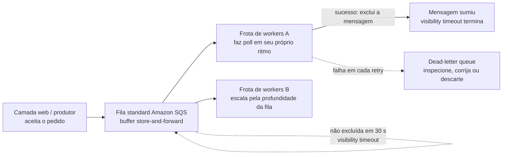
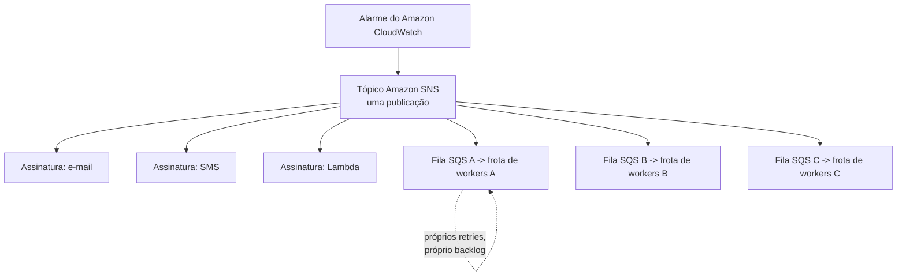
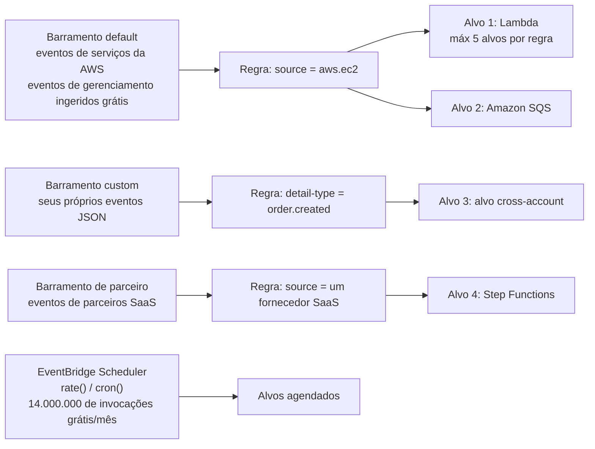
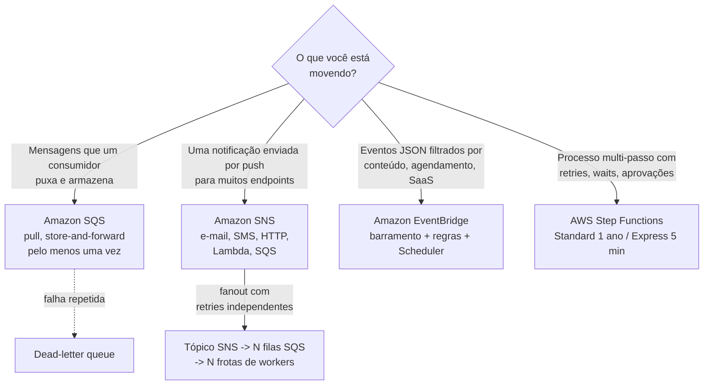
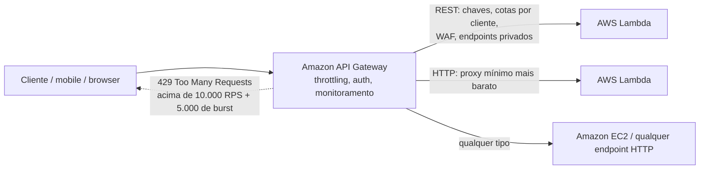
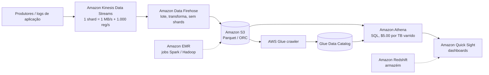
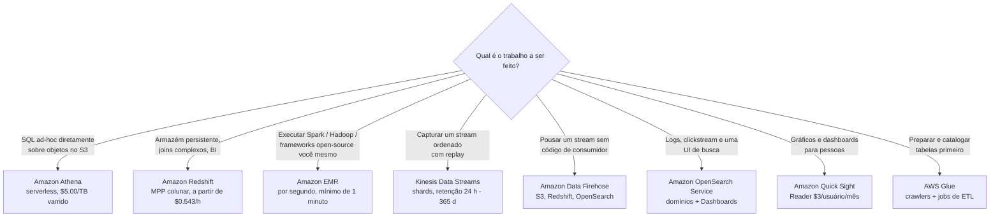

# Integração de Aplicações, Análise de Dados e Outros Serviços no Escopo

O Domínio 3 (Tecnologia e Serviços de Nuvem, **34%** da pontuação) esconde duas declarações de tarefa que carregam uma área de superfície enorme e dispersa: **Tarefa 3.7 "Identificar serviços de inteligência artificial e aprendizado de máquina (AI/ML) da AWS e serviços de análise"** — com suas declarações de habilidade nomeando *Amazon SageMaker AI, Amazon Lex, Amazon Athena, Amazon Kinesis, AWS Glue e Amazon Quick Sight* — e **Tarefa 3.8 "Identificar serviços de outras categorias de serviços da AWS no escopo"**, que lista explicitamente integração de aplicações (EventBridge, SNS, SQS), aplicações de negócios (Connect, SES), habilitação do cliente (AWS Support), ferramentas de desenvolvedor (CodeBuild, CodePipeline, X-Ray), computação de usuário final (AppStream 2.0, WorkSpaces, WorkSpaces Secure Browser), frontend (Amplify) e IoT (IoT Core). Acrescente o **Amazon API Gateway** da linha de Rede e esta única lição abrange material que o exame tira de **dois domínios**.

```text
====================================================================
 CLF-C02 LIÇÃO 11 — CARTÃO RÁPIDO DE INTEGRAÇÃO + ANÁLISE
          (fatos em outubro de 2026 — verifique os valores atuais antes de usar)
====================================================================
 INTEGRAÇÃO DE APLICAÇÕES
  SQS             fila pull, buffer store-and-forward
                  Standard : pelo menos uma vez, ordem best-effort
                  FIFO     : processamento exatamente uma vez, ordem
                             estrita
                  visibility timeout padrão 30 s (máx 12 h)
                  retenção 60 s - 14 dias, mensagem máx 1 MiB
  SNS             tópico pub/sub push -> N assinaturas
                  e-mail / SMS / HTTP+S / Lambda / SQS
                  fanout = tópico SNS -> N filas -> N workers
  EVENTBRIDGE     eventos JSON combinados por regras -> alvos
                  5 alvos por regra - 300 regras por barramento
                  barramentos padrão / custom / de parceiro
                  eventos de gerenciamento da AWS ingeridos grátis
  STEP FUNCTIONS  orquestração de workflows serverless
                  Standard : até 1 ano, $0.000025/transição
                  Express  : até 5 min, $1.00 por milhão
  --------------------------------------------------------------------
  API GATEWAY       a "porta da frente": REST / HTTP / WebSocket
                    10.000 RPS + 5.000 de burst -> HTTP 429
                    REST $3.50/M - HTTP $1.00/M (em outubro de 2026)
  --------------------------------------------------------------------
  ANÁLISE
  ATHENA          ANSI SQL serverless sobre S3, $5.00/TB varrido
  GLUE            ETL serverless + Data Catalog, $0.44/hora-DPU
  KINESIS STREAMS shards ordenados: 1 MB/s + 1.000 reg/s de escrita
  DATA FIREHOSE   sem shards: pousa dados no S3/Redshift/OpenSearch
  OPENSEARCH      domínios gerenciados: logs, busca, Dashboards
  QUICK SIGHT     dashboards de BI, Reader $3/usuário/mês
  EMR             clústeres Hadoop/Spark gerenciados, por segundo
  REDSHIFT        warehouse escala de petabytes, a partir de $0.543/h
  --------------------------------------------------------------------
  ML (uma linha cada) Rekognition imagens/vídeo - Comprehend NLP -
    Textract documentos - Transcribe fala para texto - Polly texto
    para fala - Translate - Lex chatbots - SageMaker AI construir/
    treinar - implantar - Amazon Q assistentes de IA generativa
  OUTROS NO ESCOPO   Connect central de atendimento - SES e-mail - CLI /
    CodeBuild / CodePipeline / X-Ray - IoT Core - Amplify -
    AppStream 2.0 / WorkSpaces / WorkSpaces Secure Browser -
    AWS Marketplace
====================================================================
```

> [!NOTE]
> **Disciplina de escopo.** Todo serviço apresentado como examinável abaixo está na lista oficial **no escopo** do CLF-C02 ou em uma tarefa do Domínio 3/4 (verificado contra o guia de exame, 2026-10). Quatro serviços que *parecem* perfeitamente em casa aqui estão explicitamente **fora do escopo** e aparecem apenas para que você possa eliminá-los: **Amazon AppFlow, Amazon Managed Streaming for Apache Kafka (Amazon MSK), Amazon WorkDocs** e **AWS AppFabric**. Duas coisas que esta pesquisa **não** pôde verificar e portanto nunca ensina como fato: se **Amazon Bedrock** (ausente da lista no escopo) ou outros serviços de IA generativa são examinados, e o status de **AWS CodeCommit** (nem na lista no escopo nem na fora do escopo).

Nesta lição você vai:

- ler o **Amazon SQS** como a resposta de desacoplamento e separar **standard de FIFO** as garantias de entrega;
- trabalhar a mecânica da fila: visibility timeout, long polling, retenção, dead-letter queues;
- projetar um **fanout do SNS** e dizer por que é SNS *mais* SQS, não SNS sozinho;
- rotear **arquiteturas orientadas a eventos** através de barramentos, regras, alvos e agendamentos do EventBridge;
- escolher **Step Functions Standard vs Express** e precificar um workflow em transições de estado;
- usar **API Gateway** como a porta da frente: REST vs HTTP vs WebSocket, throttling, integração com Lambda;
- precificar uma consulta do **Athena** e um trabalho do **Glue** e explicar por que partitionar compensa;
- separar **Kinesis Data Streams de Data Firehose** e depois posicionar **OpenSearch, QuickSight, EMR e Redshift**;
- definir em uma linha cada serviço no escopo restante — **suíte ML, Connect, SES, DevTools, IoT Core, EUC, Amplify, Marketplace**;
- estudar **cinco estudos de caso publicados pela AWS** (Capital One, Paytm, Amazon Prime Video, NASA JPL e NFL);
- verificar o que as **mudanças de lista de serviços de 2026** fizeram com os nomes, categorias e distratores que este exame testa;
- praticar com **12 questões no estilo do exame** mais quatro verificações interativas.

---

## 1. Amazon SQS: filas, desacoplamento, standard vs FIFO

### 1.1 O que uma fila realmente desacopla

Amazon SQS é um **buffer baseado em pull, store-and-forward** entre um produtor e um consumidor. Sem ele a camada web chama a camada de workers diretamente: a indisponibilidade do worker vira a indisponibilidade da camada web, e nenhum dos dois lados pode escalar independentemente. Com uma fila no meio, o produtor escreve uma mensagem e retorna; os workers **fazem poll** em seu próprio ritmo e com sua própria contagem. O guia de decisão da AWS descreve o SQS em uma linha que vale a pena memorizar: *"As mensagens são persistidas … entrega pelo menos uma vez."*

| Propriedade | **Standard** (padrão) | **FIFO** |
|---|---|---|
| Garantia de entrega | **Pelo menos uma vez** — *"uma mensagem pode ser entregue mais de uma vez"* | **Processamento exatamente uma vez** |
| Ordenação | Apenas ordem **best-effort** | Ordem **estrita primeiro a entrar, primeiro a sair** |
| Throughput (em outubro de 2026) | Chamadas de API quase ilimitadas por segundo | **300 mensagens/s**; **3.000/s** com batching; modo de alto throughput **até 70.000/s** |
| Tratamento de duplicatas | Nenhum — duplicatas são esperadas | Intervalo de deduplicação de **5 minutos** |
| Enunciado do exame | *"escalar consumidores independentemente", "pode chegar duas vezes, fora de ordem"* | *"exatamente uma vez, em ordem"* |

Porque filas standard deliberadamente te entregam duplicatas, a própria orientação da AWS é que *"você deve projetar suas aplicações para serem idempotentes"* — uma duplicata não pode cobrar duas vezes, enviar duas vezes ou enviar e-mail duas vezes. **Idempotência é trabalho do consumidor; a fila só promete persistência.**

### 1.2 A mecânica que aparece nos enunciados

| Mecânica | Valor documentado (em outubro de 2026) | Por que o exame se importa |
|---|---|---|
| **Visibility timeout** | Padrão **30 s**, faixa 0 s – 12 h | Uma mensagem recebida é *escondida*, não excluída; se o worker morre ou demora demais, a mensagem **reaparece** — é de onde vêm as duplicatas |
| **Long polling** | Tempo de espera **0 – 20 s** | Esperar em vez de martelar a fila corta respostas vazias e o custo de requisição |
| **Retenção** | Padrão **4 dias**; faixa **60 s – 1.209.600 s (14 dias)** | Mensagens não processadas sobrevivem a uma indisponibilidade por até 14 dias |
| **Tamanho da mensagem / delay** | **1 KiB – 1.024 KiB (1 MiB)**; delay de até **15 minutos** | Coloque payloads grandes no S3 e passe a chave |
| **Dead-letter queue** | Uma fila que guarda mensagens que falham repetidamente | Isole mensagens venenosas em vez de tentar para sempre |

Preços (em outubro de 2026, verifique antes de usar): **1 milhão de requisições por mês grátis**, depois aproximadamente **$0.40 por milhão** de requisições.

### 1.3 De ponto-a-ponto para uma fila: o que realmente muda

| Sem fila (ponto-a-ponto) | Com **Amazon SQS** no meio |
|---|---|
| O produtor deve saber o endereço do consumidor e estar no ar quando chamar | O produtor escreve em um endpoint Regional e retorna imediatamente |
| Uma indisponibilidade do consumidor é uma indisponibilidade do produtor | Consumidores falham, reiniciam e escalam sem tocar no produtor |
| Adicionar um consumidor significa redesployar ou reconfigurar o produtor | Adicione frotas de workers; consumidores competitivos compartilham a mesma fila |
| Pico de tráfego = o produtor deve se limitar | A fila absorve o pico; os workers a drenam em seu próprio ritmo |
| Lógica de retry escrita à mão por chamador | Visibility timeout, reentrega, long polling e DLQ são recursos do serviço |
| Um-para-um, fortemente acoplado no tempo | Um-para-muitos possível (fila por família de consumidor), desacoplado no tempo |



**Exemplo trabalhado E1 — escolhendo o tier FIFO.** Um stream de pagamentos deve ser processado **exatamente uma vez e em ordem a 4.000 mensagens por segundo**. O FIFO padrão limita em **300/s**, ou **3.000/s com batching** — ainda abaixo dos 4.000/s exigidos — então a resposta documentada é o **modo FIFO de alto throughput, até 70.000 mensagens por segundo com batching**. Se a ordenação não fosse exigida, filas standard teriam absorvido a taxa sem nenhum teto de throughput com o qual se preocupar.

- **📚 Você sabia?** Os números de retenção e visibilidade explicam a maioria dos enunciados de "mensagem duplicada" neste exame: uma mensagem que **não é excluída dentro do visibility timeout padrão de 30 segundos** volta a ficar visível, então duplicatas são *normais* em filas standard — e é por isso que a AWS te diz para construir consumidores **idempotentes** em vez de prometer que você nunca verá uma mensagem duas vezes (em outubro de 2026; verifique os valores atuais antes de usar).

---

## 2. Amazon SNS: publicar/assinatura e fanout

### 2.1 Push, não poll

Amazon Simple Notification Service é a contraparte de **push** do **pull** do SQS: um *publicador* envia para um *tópico*, e o tópico espalha o mensagem para cada *assinatura*. A AWS descreve-o como um *"mecanismo push, eliminando a necessidade de verificar periodicamente ou 'fazer poll'"*. As assinaturas podem ser **filas do Amazon SQS, funções do AWS Lambda, endpoints HTTP/S, e-mail, SMS e push mobile** — e é por isso que uma única publicação pode simultaneamente pager um humano e alimentar uma máquina.

| | **Amazon SQS** | **Amazon SNS** |
|---|---|---|
| Modelo | **Pull** — consumidores fazem poll de uma fila | **Push** — o tópico entrega aos assinantes |
| Formato da mensagem | Consumidores competitivos, um recebe cada mensagem | Cada assinatura recebe uma cópia |
| Garantia documentada | Pelo menos uma vez (standard) | Pelo menos uma vez para HTTP/S; **exatamente uma vez para assinantes Lambda e Amazon SQS** |
| Tratamento de falhas | Visibility timeout + dead-letter queue | Política de retry, depois uma **dead-letter queue do SQS** na assinatura |
| Escala (em outubro de 2026) | 1 M de requisições/mês grátis | **100.000** tópicos Standard por conta; até **12,5 milhões** de assinaturas por tópico |
| Unidade de cobrança | Por requisição | Cada bloco de **64 KB** de um payload conta como uma requisição |

### 2.2 O padrão fanout

A resposta canônica para *"um alerta deve alcançar muitos consumidores independentes"* é **SNS → N filas SQS → N frotas de workers**. O SNS **replica** a mensagem; cada fila então **absorve seus próprios retries, backlog e scaling**, então um consumidor lento nunca limita os outros. SNS sozinho está bom para assinantes leves (e-mail, SMS), mas o padrão que o guia treina é SNS *com* uma fila SQS por família de consumidor.



### 2.3 Tipos de assinatura em profundidade de um exame

| Assinatura | O que entrega | Enunciado típico |
|---|---|---|
| **Fila Amazon SQS** | Uma cópia para uma fila que a família de consumidor drena | *fanout com retries independentes* |
| **AWS Lambda** | Invocação assíncrona direta de uma função | *rodar código por evento, sem polling* |
| **HTTP/S** | Um POST para o seu endpoint | *nosso próprio receptor de webhook* |
| **E-mail** | Uma mensagem para uma caixa de correio | *pager um humano* |
| **SMS** | Uma mensagem de texto | *alertar um telefone de plantão* |
| **Push mobile** | Uma notificação para um dispositivo | *alcançar um usuário de app* |

**Exemplo trabalhado E2 — aritmética de fanout e cobrança do SNS.** Um alarme publica em **seis assinaturas** (e-mail, SMS, Lambda, três filas): o SNS realiza seis entregas de uma única publicação, e cada fila tenta de novo independentemente. Agora acrescente a cobrança — o SNS conta cada bloco de **64 KB** como uma requisição, então um payload de **150 KB** é cobrado como ceil(150 / 64) = **3 requisições**. Mantenha payloads pequenos, ou armazene o corpo no S3 e publique a referência.

> ⚠️ **Push e pull são os pontos mais rápidos do Domínio 3.** *"Consumidores fazem poll"* ⇒ **SQS**; *"um serviço faz push / uma publicação alcança muitos endpoints"* ⇒ **SNS**. E lembre-se: **fanout = SNS + SQS**, porque apenas uma fila dá a cada consumidor um orçamento de retry independente e um lugar para dead-letter de suas próprias falhas.

---

## 3. Amazon EventBridge: barramentos de eventos, regras e agendamentos

### 3.1 Barramentos, regras, alvos

EventBridge carrega **eventos JSON**. Um evento aterrissa em um **barramento**, uma **regra** o combina por padrão de evento (ou por agendamento), e a regra invoca até **cinco alvos**. Os três tipos de barramento são a divisão examinável:

| Barramento | O que chega lá | Enunciado do exame |
|---|---|---|
| **Default** | Eventos de serviços da AWS; **eventos de gerenciamento da AWS são ingeridos pelo barramento de eventos grátis** | *"reagir a uma mudança de estado do EC2"* |
| **Custom** | Eventos JSON que você publica você mesmo | *"nosso serviço de pedidos emite order.created"* |
| **Partner** | Eventos de parceiros SaaS (Datadog, Shopify, Stripe e outros) | *"acionar em um evento de SaaS de terceiros"* |

Limites rígidos (em outubro de 2026): **uma única regra pode enviar um evento para até cinco alvos**, e há **até 300 regras por barramento de eventos**. A cobrança conta **cada bloco de 64 KB de um payload como um evento**; eventos custom são **$1.00 por milhão**, entrega cross-account de parceiros **$0.05 por milhão**, e **AWS Pipes $0.40 por milhão**.

### 3.2 Agendamentos

Regras também podem disparar em expressões `cron` ou `rate` — mas a AWS agora rotula regras agendadas como um **recurso legado** e te guia para o **EventBridge Scheduler**, que oferece **14.000.000 de invocações grátis por mês** antes de cobrar **$1.00 por milhão**. *"Toda noite às 02:00 UTC"* é uma questão de agendamento, e a resposta atual é o EventBridge Scheduler.



### 3.3 EventBridge vs SNS vs SQS quando o enunciado diz "reagir a algo"

A AWS publica um guia de decisão em três vias, e sua redação é material de exame citável:

| Serviço | O que o guia de decisão da AWS diz | Persistência | Garantia documentada |
|---|---|---|---|
| **Amazon SQS** | *"As mensagens são persistidas"* | Sim — armazenadas até serem consumidas e excluídas | **Entrega pelo menos uma vez** |
| **Amazon SNS** | *"entregue aos assinantes em tempo real"* | Não — empurradas e sumidas | **Exatamente uma vez para assinantes Lambda e Amazon SQS**; pelo menos uma vez para HTTP/S |
| **Amazon EventBridge** | *"Eventos não persistem; processados em tempo real."* | Não — combinados e invocados imediatamente | Filtragem por conteúdo, agendamentos, SaaS e roteamento cross-account |

**Arquitetura orientada a eventos em uma frase:** produtores publicam *fatos que aconteceram*, nunca chamadas RPC; consomem assinando os fatos de que se importam. Essa inversão é por que questões do EventBridge geralmente mencionam **filtragem por conteúdo, fontes SaaS, roteamento cross-account ou agendamentos** — coisas que SQS e SNS não fazem.

- **📚 Você sabia?** A linha de item mais barata do EventBridge é grátis: **eventos de gerenciamento da AWS são ingeridos pelo barramento de eventos grátis**, e o **EventBridge Scheduler inclui 14.000.000 de invocações grátis por mês** (em outubro de 2026). A surpresa de cobrança em vez disso é a granularidade — **cada bloco de 64 KB de um payload é cobrado como um evento**, então um evento de 200 KB conta como quatro eventos (verifique os valores atuais antes de usar).

---

## 4. AWS Step Functions: orquestrando workflows de múltiplos passos

### 4.1 Standard vs Express

Step Functions é **orquestração de workflows serverless** escrita em Amazon States Language: ele sequencia chamadas de Lambda, ECS, SQS, SNS, DynamoDB e Glue e acrescenta **retries, blocos catch, estados Parallel e Map, e waits**. Ele *não* é uma fila e *não* é um notificador — ele é a coisa que sabe qual passo vem a seguir.

| | **Standard** | **Express** |
|---|---|---|
| Duração máxima | **Até um ano** | **Até cinco minutos** |
| Modelo de execução | Execução de workflow **exatamente uma vez** | Execução **pelo menos uma vez** |
| Taxa de início | 2.000 execuções/s | 100.000 execuções/s |
| Cobrança (em outubro de 2026) | **Por transição de estado** — **$0.000025** cada em US East (N. Virginia), **4.000 grátis por mês** | **$1.00 por milhão de requisições** mais duração e memória |
| Enunciado do exame | De longa duração, aprovação humana, trilha de auditoria | Processamento de eventos de alto volume, curto, tolerante a falhas |

**Exemplo trabalhado E3 — precificando o mesmo workload de duas maneiras.** Um workflow executa **1.000.005 transições de estado** em um mês. Subtraia a cota grátis: 1.000.005 − 4.000 = 996.005; multiplique pelo preço unitário: 996.005 × $0.000025 ≈ **$24.90** no workflow Standard. Se em vez disso cada execução termina em segundos e tolera execução pelo menos uma vez, as mesmas **1.000.000** de requisições Express custam **$1.00**. Mesma lógica de negócio, uma diferença de preço de **25×** — o exame quer que você note a *unidade*: **transições de estado vs requisições**.

### 4.2 Escolhendo entre os quatro serviços de integração



| Pergunta no enunciado | Resposta |
|---|---|
| Armazenar trabalho, deixar consumidores escalarem independentemente, tolerar retries | **Amazon SQS** |
| Uma publicação deve alcançar e-mail + SMS + várias filas | **Amazon SNS** (fanout) |
| Eventos filtrados por conteúdo, agendamentos cron/rate, SaaS ou cross-account | **Amazon EventBridge** |
| Um processo de negócio com passos ordenados, retries e um wait de dias | **AWS Step Functions** |

> **Amazon MQ não é a resposta neste exame.** Migração de brokers legados AMQP/MQTT não está na lista no escopo do CLF-C02, então um enunciado *"precisamos de um broker de mensagens corporativo"* ainda se resolve para um dos quatro serviços acima.

### 4.3 Exemplo trabalhado E8 — percorrendo uma aprovação de sinistro de ponta a ponta

| Passo | Serviço | Por que aquele serviço |
|---|---|---|
| 1. Validar a submissão | **AWS Lambda** | Código curto e sem estado por sinistro |
| 2. Verificar o texto por sinais de fraude | **Amazon Comprehend** | NLP pré-treinado, sem expertise de ML |
| 3. Esperar uma decisão humana (horas a dias) | **Step Functions (Standard)** | Execuções podem rodar até um ano com um token de tarefa para o aprovador |
| 4. Notificar o solicitante | **Amazon SNS** | Uma publicação alcança o e-mail e a fila interna |
| 5. Armazenar o resultado | **Amazon DynamoDB** | Persistência chave-valor gerenciada para o registro |
| 6. Tentar de novo um passo que falha três vezes | **retry/catch do Step Functions** | Embutido no Amazon States Language em vez de escrito à mão |

O ponto inteiro do exemplo: **Step Functions possui a sequência e os waits, Lambda possui os passos individuais, SNS possui a notificação**. Uma pergunta que pede *"o que espera três dias por um humano?"* está pedindo Step Functions Standard, não um delay do SQS (máximo de 15 minutos) e não uma execução Express de 5 minutos.

---

## 5. Amazon API Gateway: a porta da frente

### 5.1 Três tipos de API

A AWS posiciona o API Gateway como a *"porta da frente"* dos serviços de back-end, lidando com *"gerenciamento de tráfego … autorização e controle de acesso, throttling, monitoramento e gerenciamento de versões de API"* na frente de **Lambda, EC2 ou qualquer endpoint HTTP**.

| Tipo | Escolha quando o enunciado diz | Extras (em outubro de 2026) |
|---|---|---|
| **REST API** | Chaves de API, **throttling por cliente**, integração com AWS WAF, endpoints de API privados, cache | Recursos completos, **$3.50 por milhão** de chamadas |
| **HTTP API** | Proxy mínimo mais barato para Lambda ou um serviço HTTP, autorizadores JWT | **$1.00 por milhão** de chamadas |
| **WebSocket API** | Conexões bidirecionais persistentes — chat, feeds ao vivo, apps colaborativos | Conectar, desconectar, rotear para o back-end |

Free Tier (12 meses, em outubro de 2026): **1.000.000 de chamadas de API por mês para APIs REST** e **1.000.000 por mês para APIs HTTP**.

### 5.2 Throttling

Por padrão, o throttling é aplicado **por conta e por Região**: **10.000 requisições por segundo (RPS)** com um balde adicional de capacidade de **burst** de **5.000 requisições** (algumas contas são documentadas com 2.500 RPS / 1.250 de burst — verifique seus próprios números). Excedendo-o, os chamadores recebem **HTTP 429 Too Many Requests**. A AWS é explícita de que estes *"não são limites rígidos"* aplicados em uma *"base best-effort"*, e que as cotas dos planos de uso também são **best-effort**.

**Exemplo trabalhado E4 — REST vs HTTP no mesmo tráfego.** Um mês movimentado produz **5.000.000 de chamadas de API**; o Free Tier absorve os primeiros **1.000.000** (primeiros 12 meses), restando 4.000.000 faturáveis. Em **REST**: 4 × $3.50 = **$14.00**. Em **HTTP**: 4 × $1.00 = **$4.00**. Sem o Free Tier, os totais são **$17.50** e **$5.00**. Recurso a recurso, a resposta pode ainda ser REST — chaves de API, cotas por cliente, WAF e endpoints privados são capacidades REST — mas o enunciado de *preço* sempre se resolve do mesmo jeito.



### 5.3 O que a porta da frente realmente lida

O exame pede para *identificar* as responsabilidades, não para configurá-las. Na própria lista da AWS, o API Gateway oferece a experiência de **"porta da frente"** para serviços de back-end: **gerenciamento de tráfego, autorização e controle de acesso, throttling, monitoramento e gerenciamento de versões de API** — na frente de **Lambda, instâncias EC2 ou qualquer endpoint HTTP**.

| Responsabilidade | No escopo para você neste exame |
|---|---|
| Gerenciamento de tráfego | Saiba que **10.000 RPS + 5.000 de burst** é o padrão por conta e por Região |
| Autorização e controle de acesso | Escolha o serviço e o tipo de API — chaves de API e cotas por cliente são recursos de **REST** |
| Throttling | Requisições em excesso ⇒ **HTTP 429 Too Many Requests**; cotas de plano de uso são **best-effort** |
| Monitoramento | Listado como responsabilidade do Gateway — o exame pede para reconhecê-lo, nunca para configurá-lo |
| Gerenciamento de versões de API | Também de propriedade do Gateway; identifique-o como capacidade da porta da frente |
| Integração com Lambda | Clientes chamam o Gateway, que invoca **Lambda, EC2 ou qualquer endpoint HTTP** |

> ⚠️ **Chaves de API não são autenticação para seus usuários.** Neste exame, *"chaves de API + throttling por cliente + AWS WAF + endpoints privados"* é a assinatura de uma **REST API**; o proxy Lambda mais barato é uma **HTTP API**; e um **429** sempre significa *"você excedeu o throttling"*, nunca *"a API está quebrada"*.

---

## 6. Análise serverless no S3: Amazon Athena e AWS Glue

### 6.1 Amazon Athena — SQL sem cluster

Athena é **SQL interativo serverless sobre dados já no Amazon S3**: *"execute consultas ad-hoc usando SQL ANSI, sem a necessidade de agregar ou carregar os dados no Athena"*. Não há cluster para lançar e não há carregar-antes-de-perguntar — você aponta para o S3, define tabelas (geralmente via Glue Data Catalog) e consulta.

- **Preços (em outubro de 2026):** **$5.00 por terabyte de dados varridos**, com **mínimo de 10 MB por consulta**; **instruções DDL e consultas falhadas custam $0**.
- **Por que o design da consulta é uma decisão de custo:** a AWS documenta que compactação, particionamento e formatos colunares podem **economizar de 30% a 90% por consulta**.
- **Quando *não* usar:** para *"muitos joins entre muitas tabelas muito grandes"*, a AWS diz escolher **Amazon Redshift**.

**Exemplo trabalhado E5 — três maneiras de pagar os mesmos 3 TB.**

| Design da consulta | Dados varridos | Custo (em outubro de 2026) |
|---|---|---|
| Dados brutos sem compactação, varredura total | 3 TB | 3 × $5.00 = **$15.00** |
| GZIP em cerca de 3:1 | ~1 TB | **$5.00** |
| Colunar + particionado, consulta lê 1 de 4 colunas | ~0,25 TB | **$1.25** |
| `CREATE TABLE` (DDL) ou uma consulta que falha | — | **$0.00** |
| Uma consulta que varre apenas 3 MB | faturada no **mínimo de 10 MB** | cobrança mínima |

O padrão para memorizar: **Athena cobra por bytes lidos, então a consulta mais barata é a que lê menos** — podar colunas, filtrar por chaves de partição, compactar e converter para Parquet ou ORC.

### 6.2 AWS Glue — o catálogo e o motor ETL

AWS Glue é um **serviço de ETL e catálogo de dados serverless**. **Crawlers** varrem stores de dados e gravam definições de tabela (schema, partições, localização) no **Glue Data Catalog**, que é o que permite que **Athena, Amazon Redshift e Amazon EMR** tratem objetos S3 como tabelas. **Jobs de ETL** executam Spark ou Python para limpar, deduplicar e formatar.

- **Preços (em outubro de 2026):** **$0.44 por hora-DPU**; **1 DPU = 4 vCPU e 16 GB de memória**; jobs de ETL rodam com **mínimo de 2 DPUs** (padrão 10); crawlers têm **mínimo de 10 minutos**; **o primeiro milhão de objetos armazenados é grátis** no catálogo.

**Exemplo trabalhado E6 — precificando um job de crawl e limpeza.** Um job roda **15 minutos em 6 DPUs**: 6 × (15/60) hora × $0.44 = 6 × 0,25 × 0,44 = **$0.66**. Dobre a contagem de DPUs e o preço dobra — **DPUs são a unidade, tempo de relógio é o multiplicador**.

> **A frase de três serviços que o exame continua testando:** **Glue** *cataloga e prepara* os dados, **Athena** *responde perguntas SQL* sobre eles, **QuickSight** *desenha o dashboard*. Glue nunca responde uma consulta, Athena nunca executa uma transformação Spark agendada, e QuickSight nunca extrai texto de um documento.

- **📚 Você sabia?** O **mínimo de 10 MB por consulta** do Athena existe para que milhares de consultas minúsculas ainda produzam uma unidade faturável — e também significa que **DDL e consultas falhadas são grátis**. Uma equipe que executa um ciclo noturno de `DROP`/`CREATE` não paga nada pelo DDL e tudo pelo `SELECT` que varre a tabela, e é por isso que particionamento e poda de colunas são os controles reais de custo (página de preços do Athena, em outubro de 2026; verifique os valores atuais antes de usar).

---

## 7. Streaming, busca e BI: Kinesis, Firehose, OpenSearch, QuickSight, EMR, Redshift

### 7.1 Amazon Kinesis Data Streams vs Amazon Data Firehose

Este é o par de seleção de serviço mais confiável no domínio de análise.

| | **Amazon Kinesis Data Streams** | **Amazon Data Firehose** |
|---|---|---|
| O que é | Um **log ordenado dividido em shards** | Um **tubo de entrega gerenciado** para destinos |
| Unidade de capacidade | **Shard**: **1 MB/s e 1.000 registros/s de escrita**, **2 MB/s de leitura** | Sem shards para dimensionar ou gerenciar |
| Retenção / replay | **24 horas por padrão, até 365 dias** — replay é possível | Lotes em tempo quase real, sem janela de replay |
| Destinos | Seus próprios consumidores: Lambda, Kinesis Client Library, Firehose | **S3, Amazon Redshift, OpenSearch Service, Splunk, Snowflake** |
| Código | Você escreve o consumidor | **Sem código de consumidor**; transformação Lambda opcional; conversão Parquet/ORC |
| Nomenclatura | — | Renomeado de **Amazon Kinesis Data Firehose** para **Amazon Data Firehose** em **fevereiro de 2024** — nomes antigos ainda aparecem em material mais antigo |

**Exemplo trabalhado E7 — dimensionamento de shard.** Um clickstream emite **4.000 registros por segundo** com média de **10 KB** cada: throughput = 4.000 × 10 KB = 40.000 KB/s = **40 MB/s**. Divida pelo limite de escrita por shard: 40 ÷ 1 = **40 shards** por banda de largura, e 4.000 ÷ 1.000 = **40 shards** por taxa de registro. Ambas as restrições concordam, logo **40 shards**. Se o requisito fosse *"pousar no S3 sem código de consumidor"*, a resposta seria **Data Firehose** e a aritmética de shards desapareceria completamente.

### 7.2 OpenSearch, QuickSight, EMR, Redshift

| Serviço | Trabalho em profundidade de exame | Números-chave (em outubro de 2026) |
|---|---|---|
| **Amazon OpenSearch Service** | **Domínios** gerenciados (= clusters) para **análise de logs, monitoramento de aplicações em tempo real e análise de clickstream**, além de busca e **OpenSearch Dashboards** (o sucessor do Kibana) | Renomeado de **Elasticsearch Service** em **8 de setembro de 2021**; preços de instância variam por implantação — veja a página de preços |
| **Amazon Quick Sight** | **BI**: visualizações e dashboards sobre S3, Athena, Redshift e dados SaaS; **SPICE** é o motor em memória versus consulta direta | **Reader $3 por usuário por mês**; **10 GB de SPICE** com cada Author provisionado (extra **$0.38/GB-mês**); **uma sessão é um período de 30 minutos** |
| **Amazon EMR** | Clústeres **Hadoop / Spark / Hive / Presto** gerenciados em EC2 (ou EKS ou serverless) para processamento de big data | Faturamento **por segundo** com **mínimo de um minuto**; você paga EC2 + EBS + o acréscimo do EMR |
| **Amazon Redshift** | **Data warehouse escala de petabytes** gerenciado: SQL colunar massivamente paralelo para joins complexos e BI | **Provisionado a partir de $0.543 por hora**; **Serverless a partir de $1.50 por hora**; **Spectrum** consulta S3 a **$5 por TB** |

**O desempate em três vias:** *SQL ad-hoc no S3, sem cluster* ⇒ **Athena** · *joins complexos entre tabelas muito grandes, um armazém persistente* ⇒ **Redshift** · *executar Spark/Hadoop você mesmo, bibliotecas open-source necessárias* ⇒ **EMR**. Dashboards executivos sobre qualquer um deles ⇒ **Quick Sight**; logs e UI de busca ⇒ **OpenSearch Service**.

| Pergunta no enunciado | Athena | Redshift | EMR |
|---|---|---|---|
| O que você opera | Nada — endpoint serverless | Armazém gerenciado (ou Serverless) | Um cluster de frameworks open-source |
| Unidade de cobrança (em outubro de 2026) | **$5.00 por TB varrido** | **A partir de $0.543/h** provisionado, **$1.50/h** Serverless | EC2 + EBS + acréscimo do EMR, **por segundo, mínimo de 1 minuto** |
| Melhor para | Perguntas pontuais sobre S3 | BI persistente, muitos joins, escala de petabytes | Jobs Spark/Hive/Presto que você já roda |
| Pior para | Joins pesados repetidos em tabelas enormes | Pagar por capacidade ociosa em uma consulta minúscula | SQL ad-hoc ocasional (início do cluster + custo) |
| Dependência de catálogo | Lê o **Glue Data Catalog** | Spectrum lê S3 via catálogo | Lê Hive metastore / catálogo Glue |

**Exemplo trabalhado E9 — aritmética de assinatura do QuickSight.** Cinco analistas precisam de acesso de visualização e dois autores criam dashboards (em outubro de 2026): **5 Readers × $3 por usuário por mês = $15.00**. Cada Author provisionado inclui **10 GB de SPICE**; se os dois autores juntos precisarem de **30 GB** — 20 GB além dos 20 GB incluídos — o extra custa **20 × $0.38 = $7.60 por mês**. Note também que **uma sessão é um período de 30 minutos**, então um Reader que abre cinco dashboards dentro de uma mesma janela de meia hora ainda conta como o valor de acesso de uma sessão.



### 7.3 Amazon AppFlow — o falso-gêmeo que está fora do escopo

**Amazon AppFlow** move dados entre aplicações SaaS e stores da AWS, o que soa exatamente como o tema desta lição — e está explicitamente na lista **fora do escopo**. O mesmo vale para **Amazon MSK** (Kafka gerenciado), **AWS Clean Rooms, AWS Data Exchange** e **Amazon DataZone** em análise, além de **AWS AppFabric** e **Amazon Simple Workflow Service (SWF)** em integração de aplicações. Fora do escopo não significa inexistente: significa que **eles só podem ser um distrator, nunca a resposta correta**.

### 7.4 A árvore de decisão de análise



---

## 8. Todos os serviços no escopo restantes, um por linha

### 8.1 A suíte de aprendizado de máquina (Tarefa 3.7)

A AWS agrupa estes como **serviços de IA de propósito específico** — APIs pré-treinadas que você chama com seus dados, sem exigir expertise de ML — versus **Amazon SageMaker AI**, onde você constrói, treina e implanta seus próprios modelos.

| Serviço | Uma linha para o exame |
|---|---|
| **Amazon Rekognition** | Visão computacional: rotular, detectar e analisar **imagens e vídeo** |
| **Amazon Comprehend** | Processamento de linguagem natural: sentimento, entidades, frases-chave e **PII** em texto |
| **Amazon Textract** | Extrai **texto, manuscritos e dados de documentos digitalizados** em campos estruturados |
| **Amazon Transcribe** | **Fala para texto** — gravações de chamadas, legendas |
| **Amazon Polly** | **Texto para fala realista** |
| **Amazon Translate** | **Tradução neural de máquina** entre idiomas |
| **Amazon Lex** | Constrói interfaces conversacionais (chatbots e agentes de voz) — a tecnologia que potencializa o **Amazon Connect** |
| **Amazon SageMaker AI** | ML totalmente gerenciado: *"construir, treinar e implantar modelos de ML em um ambiente hospedado pronto para produção"* |
| **Amazon Q** | Assistentes de IA generativa (Q Business, Q Developer); a AWS os documenta como *"potencializados pelo Amazon Bedrock"* |

**Regra de estratificação:** *"sem experiência de ML, só chamar uma API pré-treinada"* ⇒ Rekognition / Comprehend / Textract / Transcribe / Translate / Polly / Lex · *"construir, treinar e implantar meu próprio modelo"* ⇒ **SageMaker AI** · *"um assistente de IA generativa para funcionários ou desenvolvedores"* ⇒ **Amazon Q**. Nunca troque o tipo de dados: **imagens ⇒ Rekognition, documentos ⇒ Textract, texto/NLP ⇒ Comprehend, áudio ⇒ Transcribe e Polly**. Distratores fora do escopo aqui: **Amazon Personalize, Amazon Fraud Detector, Amazon Lookout for Metrics** e **AWS Panorama**.

### 8.2 Aplicações de negócios, ferramentas de desenvolvedor, IoT e o resto (Tarefa 3.8)

| Categoria | Serviço no escopo | Uma linha para o exame |
|---|---|---|
| Aplicações de negócios | **Amazon Connect** | **Central de atendimento** em nuvem: voz, chat e tarefas com roteamento inteligente e acompanhamento de desempenho de agentes em tempo real; **pague apenas pelo uso**, sem taxa por assento |
| Aplicações de negócios | **Amazon SES** | **E-mail escalável de dentro de qualquer aplicação** — transacional, marketing e envio em massa, via **API ou SMTP** |
| Ferramentas de desenvolvedor | **AWS CLI** | CLI gratuita para serviços da AWS — o lado de *desenvolver e implantar* da tarefa 3.8 |
| Ferramentas de desenvolvedor | **AWS CodeBuild** | *"Compila seu código-fonte, executa testes de unidade e produz artefatos"* — faturado **por minuto de build**, **100 minutos grátis por mês** |
| Ferramentas de desenvolvedor | **AWS CodePipeline** | **Workflow de release** gerenciado: modele os passos, execute os estágios — **V1 $1.00 por pipeline por mês**, **V2 $0.002 por minuto-ação** |
| Ferramentas de desenvolvedor | **AWS X-Ray** | Rastreamento distribuído: segmentos → traces → um **grafo de serviços**; dados de trace retidos por **30 dias** |
| IoT | **AWS IoT Core** | Gateway gerenciado que conecta dispositivos via **MQTT ou HTTP** — a resposta de *gerenciar dispositivos IoT* |
| Frontend | **AWS Amplify** | Crie e implante aplicações **web e mobile de frontend** |
| Computação de usuário final | **Amazon AppStream 2.0** | Faça streaming de **aplicações** de desktop para qualquer navegador ou dispositivo **sem reescrever código** |
| Computação de usuário final | **Amazon WorkSpaces** | **Desktops virtuais persistentes** (VDI / DaaS) em nuvem, totalmente gerenciados |
| Computação de usuário final | **Amazon WorkSpaces Secure Browser** | Navegador hospedado onde *"nenhum HTML, DOM ou dados sensíveis da empresa são transmitidos à máquina local"* |
| Gestão financeira em nuvem | **AWS Marketplace** | *"Catálogo digital curado"* para encontrar, comprar, implantar e gerenciar software, dados e serviços de terceiros — por hora, mês, ano e **BYOL**, uma fatura só, Private Marketplace, direitos via License Manager |
| Habilitação do cliente | **AWS Support** | O item de habilitação do cliente da tarefa 3.8; os níveis de plano pertencem ao Domínio 4 |

**O enunciado de computação de usuário final, literalmente:** o exame pede *"os serviços que podem apresentar a saída de máquinas virtuais (VMs) nas máquinas do usuário final"* — isso é **AppStream 2.0** (aplicações), **WorkSpaces** (desktops completos) e **WorkSpaces Secure Browser** (apenas navegador).

> **Armadilhas de nomenclatura direto da lista no escopo:** o guia grafia **"Amazon Quick Sight"** (com espaço) e **"Amazon SageMaker AI"** (nunca "SageMaker" sozinho). A página de documentação do Connect da AWS também agora usa o rótulo *"Amazon Connect Customer"* para o produto de central de atendimento — associar essa redação à formulação do exame é a inferência desta pesquisa, não uma afirmação verificada do exame.

### 8.3 Tabela resumo — a superfície completa de serviços desta lição

| Categoria | Serviços no escopo cobertos aqui | Profundidade esperada |
|---|---|---|
| Integração de aplicações | Amazon SQS · Amazon SNS · Amazon EventBridge · AWS Step Functions | Escolha por padrão; saiba garantias e limites |
| Rede (API) | Amazon API Gateway | REST vs HTTP vs WebSocket, throttling |
| Análise | Amazon Athena · Amazon EMR · AWS Glue · Amazon Kinesis · Amazon OpenSearch Service · Amazon Quick Sight · Amazon Redshift | Escolha pelo trabalho a ser feito; saiba a unidade de cobrança |
| Aprendizado de máquina | Amazon Comprehend · Amazon Lex · Amazon Polly · Amazon Q · Amazon Rekognition · Amazon SageMaker AI · Amazon Textract · Amazon Transcribe · Amazon Translate | Uma linha cada: tipo de dado de entrada, tipo de dado de saída |
| Aplicações de negócios | Amazon Connect · Amazon SES | Central de atendimento vs e-mail em escala |
| Ferramentas de desenvolvedor | AWS CLI · AWS CodeBuild · AWS CodePipeline · AWS X-Ray | Compilar, liberar, rastrear |
| Frontend / IoT | AWS Amplify · AWS IoT Core | Implante frontends; gerencie dispositivos |
| Computação de usuário final | Amazon AppStream 2.0 · Amazon WorkSpaces · Amazon WorkSpaces Secure Browser | Presente saída de VM em máquinas do usuário final |
| Gestão financeira / habilitação | AWS Marketplace · AWS Support | Catálogo de terceiros; opções de suporte |
| De propriedade de outras lições | Compute, Storage, Databases, Networking and Content Delivery, Security and Identity, Management and Governance, Migration, Billing and pricing | Não reestude-os aqui |

### 8.4 Consulta rápida enunciado → serviço

| Se o enunciado diz … | A resposta é … |
|---|---|
| "Pode chegar duas vezes e fora de ordem; escalar consumidores independentemente" | **Amazon SQS (standard)** |
| "Exatamente uma vez, em ordem estrita" | **Amazon SQS (FIFO)** |
| "Um alerta para e-mail, SMS e três filas" | **Amazon SNS** |
| "Eventos de fornecedor SaaS mais um cron noturno" | **Amazon EventBridge / EventBridge Scheduler** |
| "Aprovação humana que espera três dias" | **AWS Step Functions (Standard)** |
| "Fazer throttling de uma API, chaves de API, cotas por cliente, WAF" | **Amazon API Gateway (REST)** |
| "SQL sobre S3, pagar por consulta" | **Amazon Athena** |
| "Preencher um catálogo de metadados a partir do S3" | **AWS Glue** |
| "Fazer streaming para S3 sem código de consumidor" | **Amazon Data Firehose** |
| "Stream ordenado com replay e shards" | **Amazon Kinesis Data Streams** |
| "Dashboards executivos" | **Amazon Quick Sight** |
| "Sentimento de tickets de suporte" | **Amazon Comprehend** |
| "Extrair campos de formulários digitalizados" | **Amazon Textract** |
| "Construir, treinar e implantar meu próprio modelo" | **Amazon SageMaker AI** |
| "Compilar e executar testes de unidade em CI" | **AWS CodeBuild** |
| "Presentear saída de VM em máquinas do usuário final" | **AppStream 2.0 / WorkSpaces / Secure Browser** |

**Serviços fora do escopo que parecem estar no escopo (nunca a resposta correta):** Amazon AppFlow · AWS Clean Rooms · AWS Data Exchange · Amazon DataZone · Amazon MSK · AWS AppFabric · Amazon Simple Workflow Service · Amazon WorkDocs · AWS CodeDeploy · AWS CodeArtifact · Amazon CodeGuru · AWS Application Composer · AWS CloudShell · AWS Device Farm · Amazon Personalize · Amazon Fraud Detector · Amazon Lookout for Metrics · AWS Panorama · todos os serviços AWS Elemental Media · Amazon GameLift · AWS RoboMaker · AWS IoT Greengrass · AWS IoT Device Defender.

- **📚 Você sabia?** Dois serviços desta lição foram **renomeados, não substituídos**: **Amazon Data Firehose** soltou "Kinesis Data" do nome em **fevereiro de 2024**, e **Amazon OpenSearch Service** foi renomeado de **Elasticsearch Service** em **8 de setembro de 2021**. Perguntas mais antigas, blogs e tutoriais de terceiros ainda usam ambos os nomes antigos, então um enunciado que mencione "Elasticsearch Service" ou "Kinesis Data Firehose" está testando o *mesmo* serviço no escopo (acesso em outubro de 2026).

### Atualizações de 2026 (em outubro de 2026)

> **O que mudou no próprio guia.** Cada item abaixo vem das listas atuais de serviços **no escopo** e **fora do escopo** do CLF-C02 e do guia `Version 1.0 CLF-C02` da era de lançamento, todos acessados em **2026-10**. Preços e limites ainda oscilam, então verifique novamente antes de fazer o exame.
>
> - **A lista de serviços foi reconstruída.** As entradas no escopo caíram de **128 → 111** enquanto a lista negativa explícita cresceu de **11 → 55** entradas fora do escopo — para o Domínio 3, o maior "o que mudou" é que a AWS agora escreve a maioria dos distratores que esta lição costumava te alertar de memória.
> - **Três reortografias fazem nomes antigos estarem errados:** **Amazon SageMaker → Amazon SageMaker AI**, **Amazon WorkSpaces Web → Amazon WorkSpaces Secure Browser**, e a lista no escopo imprime o serviço de BI como **"Amazon Quick Sight"** (duas palavras) enquanto o nome do produto é Amazon QuickSight — se o espaçamento do guia é intencional **não pôde** ser verificado.
> - **A linha de Machine Learning saiu de "construir" para "usar":** **Amazon Q foi adicionado**, **Amazon Kendra foi removido da lista no escopo**, e **Amazon Bedrock não aparece nem na lista no escopo nem na fora do escopo** (ambas as listas verificadas em 2026-10) — então não memorize Bedrock como no escopo, e trate se conteúdo de IA generativa é examinado como não verificado.
> - **Ferramentas de desenvolvedor encolheu de 11 entradas no escopo para 4** — **AWS CLI, AWS CodeBuild, AWS CodePipeline, AWS X-Ray** — exatamente as quatro cobertas na seção 8.2 desta lição; qualquer coisa ainda listando CodeStar, Cloud9 ou uma lista maior de Developer Tools está citando um guia superado.
> - **Nomes de integração e análise antes no escopo agora são distratores:** **Amazon MSK** e **AWS Data Exchange** mudaram da lista no escopo para a fora do escopo, **AWS CodeDeploy, AWS CodeArtifact** e **AWS IoT Greengrass** também estão fora do escopo, e **AWS AppSync** foi removido da lista no escopo; **AWS Wavelength** está explicitamente fora do escopo enquanto **AWS Local Zones** aparece em **nenhuma** das listas.
> - **Renomeação de categoria:** `Customer Engagement` → **Customer Enablement**, que agora contém apenas **AWS Support** — então AWS Activate, AWS IQ e AWS Managed Services não são mais respostas no escopo em lugar nenhum neste exame.
>
> Fontes: lista de serviços no escopo do AWS Certified Cloud Practitioner (CLF-C02), lista de serviços fora do escopo e guia de exame, acessados em 2026-10; linha de base = guia de exame `Version 1.0 CLF-C02` da era de lançamento (acesso em 2026-10).

- **📚 Você sabia?** A maior mudança de 2026 desta lição não é um preço em absoluto: a lista no escopo **encolheu de 128 para 111 entradas** enquanto a lista explícita fora do escopo **cresceu de 11 para 55**, e só a categoria Developer Tools foi de **11 → 4**. Notas construídas sobre o guia `Version 1.0` da era de lançamento estão portanto citando um documento superado, e é por isso que cada lista de "nunca a resposta correta" desta lição foi reverificada contra as listas vivas (acesso em 2026-10).

---

## Casos Reais

A AWS publica como estes padrões se parecem em produção. Cada número abaixo é **reivindicação do cliente ou da AWS e não auditado**, citado com sua fonte para que você possa conferir — o ponto examinável é o **padrão** (qual serviço de integração fez o trabalho, qual motor de análise foi escolhido, qual número se moveu), não o marketing.

### Caso A — Capital One: serverless e integração de aplicações em escala bancária

| Elemento | Detalhe |
|---|---|
| **Indústria / contexto** | Banco Fortune 100, regulado: sair de **oito data centers on-premises** e reconstruir para produtos em tempo real orientados a ML |
| **Serviços AWS citados** | Mais de 30 serviços, incluindo **Amazon Connect, Amazon SES, AWS Lambda, Amazon ECS e Fargate, AWS SAM, AWS Step Functions e AWS Glue** |
| **Resultados principais (publicados pela AWS, reivindicados pelo cliente)** | **80%** de cerca de **2.000 aplicações** construídas cloud-native; lead time do ambiente de desenvolvimento **3 meses → minutos**; tempo de teste de recuperação de desastres **−70%**; resolução de incidentes e erros de transação **−50%**; mais de um terço das aplicações serverless |
| **Detalhe de integração** | Uma aplicação cortou custo em **90% no AWS Lambda**, e verificações rodaram **80% mais rápido com AWS Step Functions** |
| **Rabo físico** | **103 toneladas de cobre e aço recicladas** dos oito data centers dos quais saiu |
| **Fonte** | aws.amazon.com/solutions/case-studies/capital-one-all-in-on-aws e …/capital-one-lambda-ecs-case-study (acesso em outubro de 2026) |

*Lição de exame:* isto é como a tarefa 3.8 aparece em produção — **Step Functions** coordenando os passos, **Lambda** executando os passos, **SES** enviando o e-mail, **Connect** atendendo as chamadas, **Glue** preparando os dados. O exame não pede para você reproduzir os números; pede para nomear o serviço que *faz cada trabalho*.

### Caso B — Paytm: economia Graviton aplicada à análise em EMR

| Elemento | Detalhe |
|---|---|
| **Indústria / contexto** | Uma plataforma de pagamentos com um grande patrimônio de Amazon EC2 e **Amazon EMR** de análise na AWS |
| **Serviços AWS citados** | **Amazon EMR** (análise), **Amazon EC2 em Graviton** — com uma atualização de banco de dados MySQL que teve de acontecer antes |
| **Resultados principais (publicados pela AWS, reivindicados pelo cliente)** | **−35%** de custo de computação, **60%** do EC2 rodando em Graviton, e **30–35%** de economia em **Amazon EMR** |
| **Lição de análise** | O EMR cobra **as instâncias em que roda**, então a *decisão de compra de computação* (preço-desempenho do Graviton) faz parte da conversa de custo de análise |
| **Fonte** | aws.amazon.com/solutions/case-studies/paytm-graviton-case-study (acesso em outubro de 2026) |

*Lição de exame:* o Amazon EMR **não tem taxa fixa independente nesta história** — ele cobra uma taxa por segundo (mínimo de um minuto) **em cima de EC2 e EBS**, então uma economia de 30–35% no EMR é alcançada mudando as instâncias embaixo, não girando uma configuração do EMR. Cuidado com a armadilha: Graviton é uma escolha de **preço-desempenho** que exige trabalho de compatibilidade (a Paytm teve que atualizar seu banco de dados primeiro), não dinheiro grátis.

### O que os dois casos compartilham

| Padrão de valor | Evidência | Princípio subjacente |
|---|---|---|
| Gerenciado supera DIY | Capital One: ambiente de dev **3 meses → minutos**; **−90%** de custo em uma app | A resposta do Well-Architected é **menor overhead operacional** |
| Serviços de integração carregam o peso | Capital One: Step Functions, Lambda, SES, Connect, Glue | Os serviços da tarefa 3.8 são encanamento de produção, não exercícios de laboratório |
| Custo de análise segue custo de computação | Paytm: **30–35%** de economia no EMR via Graviton | EMR = tempo de instância por segundo + acréscimo do EMR; dimensione o motor corretamente |
| Cada percentual é um resultado do *cliente* | "−90%", "30–35%", "−70%" | Nunca escreva "a AWS garante X%" |

### Caso C — Amazon Prime Video: integração no pico global de esportes ao vivo

| Elemento | Detalhe |
|---|---|
| **Indústria / contexto** | Transmissão de esportes ao vivo, onde a AWS cita sua própria equipe de entrega: *"Com eventos esportivos ao vivo, a confiabilidade e a baixa latência são absolutamente críticas porque cada segundo perdido impacta negativamente os espectadores"* |
| **Serviços AWS citados** | **seis Regiões AWS**, Amazon CloudFront, Amazon DynamoDB, Amazon EC2, AWS Elemental MediaTailor, failover multi-AZ e Regional |
| **Resultados principais (publicados pela AWS, reivindicados pelo cliente)** | **11 jogos da NFL** transmitidos para **18,4 milhões** de fãs em **224 países e territórios** durante a temporada regular da NFL de 2017; **mais de 300.000 clientes fazendo poll por intervalo de anúncio**; partições do DynamoDB **dobradas pelo console** nos intervalos de anúncio |
| **Lição de integração** | Centenas de milhares de clientes fazendo *poll* por intervalo de anúncio é exatamente o tráfego que a divisão push/pull deste exame existe para remover — SQS **long polling (0–20 s)** e SNS **push** são as respostas no escopo para "parar de martelar um endpoint" |
| **Ressalva de exame** | AWS Elemental / **MediaTailor** fica nos Media Services, que estão explicitamente **fora do escopo** — nomeie apenas os serviços no escopo que o enunciado pede |
| **Fonte** | aws.amazon.com/solutions/case-studies/amazon-prime-video (acesso em outubro de 2026) |

*Lição de exame:* o número a levar para a sala do exame não é 18,4 milhões — é **mais de 300.000 clientes fazendo poll por intervalo de anúncio**. Qualquer enunciado sobre *muitos clientes verificando repetidamente novo estado* é uma pergunta de push-versus-pull: **SNS empurra**, **consumidores do SQS fazem poll** (e fazem long polling de até **20 segundos** precisamente para cortar aquele tráfego), e **EventBridge combina eventos sem ninguém fazendo poll nenhum**. A segunda lição é elasticidade: as partições do DynamoDB foram **dobradas pelo console durante o jogo**, não depois de um ciclo de compras — essa é a história de agilidade do Domínio 1 contada através de um serviço de integração.

### Caso D — NASA JPL: telemetria em escala de análise

| Elemento | Detalhe |
|---|---|
| **Indústria / contexto** | O Laboratório de Propulsão a Jato da NASA (JPL) e o rover Perseverance — o Blog de Setor Público da AWS (2021-02-22) o chama de *"a primeira missão planetária da NASA, com comunicação crítica para a missão e transferência de dados de telemetria na nuvem"* |
| **Serviços AWS citados** | **Auto Scaling** de EC2 misturando **Spot, On-Demand e Capacity Reservations**; a história da NASA de 2012 na AWS também cita **SWF**, CloudFront e RDS |
| **Resultados principais (publicados pela AWS, reivindicados pelo cliente)** | **~4,4 TB de dados baixados diariamente**, gerando **até 70 TB de produtos de dados finais**; Spot com *"até 90 por cento de desconto em comparação com os preços On-Demand do Amazon EC2"*; a NASA separadamente relatou *"quase um milhão de dólares em economia a cada ano"* (AWS News Blog, 2012-06-11) |
| **Lição de análise** | Ingerir → processar → produtos de dados é a forma do pipeline ensinada aqui com **Kinesis Data Streams, Data Firehose, Glue e Athena**; o estudo de caso responde apenas à metade de *computação* da história |
| **Armadilha de escopo** | **Amazon Simple Workflow Service (SWF)** — o serviço de orquestração na história de 2012 da NASA — agora está **explicitamente fora do escopo**; neste exame a resposta de workflow é sempre **AWS Step Functions** |
| **Fonte** | aws.amazon.com/solutions/case-studies/nasa-jpl-spot-case-study; aws.amazon.com/blogs/publicsector (2021-02-22); aws.amazon.com/blogs/aws (2012-06-11) — todos acessados em outubro de 2026 |

*Lição de exame:* duas perguntas separáveis se escondem dentro desta história. **"Como você processa terabytes por dia?"** → a pilha de análise: capture o stream ordenado (**Kinesis Data Streams**), pouse-o sem código de consumidor (**Data Firehose**), catalogue e limpe (**Glue**), faça perguntas (**Athena**), armazene em warehouse (**Redshift**), faça gráficos (**Quick Sight**). **"Como você paga pela computação embaixo?"** → modelos de preço: **Spot** para lotes tolerantes a falhas e interrompíveis (documentado com até **90% de desconto** sobre On-Demand) com On-Demand e Capacity Reservations para o resto. Nunca misture as metades: Spot nunca responde um enunciado de seleção de análise, e Athena nunca responde um enunciado de modelo de preço.

### Caso E — NFL: um produto de análise voltado ao torcedor

| Elemento | Detalhe |
|---|---|
| **Indústria / contexto** | O produto digital voltado ao torcedor da NFL, construído na AWS |
| **Resultados principais (publicados pela AWS, reivindicados pelo cliente)** | **Mais de 1 milhão** de fãs; **atualizações a cada 3 minutos**; **mais de 500 milhões** de pontos de dados por temporada |
| **Lição de análise** | Uma temporada de mais de 500 M de pontos de dados atualizada a cada três minutos é uma *forma de requisito* — captura ordenada, entrega em tempo quase real, depois uma visão apresentável |
| **Fonte** | aws.amazon.com/solutions/case-studies/nfl-case-study (acesso em outubro de 2026) |

*Lição de exame:* leia a **cadência** do enunciado, nunca seu marketing. *"Ordenado, reproduzível, atualizações a cada poucos minutos"* ⇒ **Amazon Kinesis Data Streams** (shards, **retenção padrão de 24 horas até 365 dias**); *"pousar no S3 sem código de consumidor"* ⇒ **Amazon Data Firehose**; *"gráficos e dashboards para um milhão de fãs"* ⇒ **Amazon Quick Sight**; *"perguntas SQL sobre o que pousou no S3"* ⇒ **Amazon Athena**. A página do estudo de caso é a fonte apenas para os *números* — a seleção do serviço é sua, e deve vir da lista no escopo.

### O que os casos C–E acrescentam

| Padrão de valor | Evidência | Princípio subjacente |
|---|---|---|
| Push supera poll em escala | Prime Video: **mais de 300.000 clientes fazendo poll por intervalo de anúncio** | SQS **long polling (0–20 s)** e SNS **push** existem para cortar exatamente aquele tráfego |
| A forma do pipeline de análise se repete | NASA JPL: **4,4 TB/dia → até 70 TB/dia** de produtos de dados; NFL: **mais de 500 M de pontos de dados por temporada** | Capturar → pousar → catalogar → consultar → apresentar: Kinesis, Firehose, Glue, Athena, Quick Sight |
| Elasticidade é uma ação de console | Prime Video: partições do DynamoDB **dobradas** em meio ao jogo | Serviços gerenciados escalam sem um ciclo de compras (agilidade do Domínio 1) |
| Modelo de preço ≠ escolha de serviço | NASA JPL: **Spot com até 90% de desconto** sobre On-Demand | Escolha primeiro o serviço no escopo, depois a opção de compra |
| Nomes fora do escopo vivem dentro de histórias reais | AWS Elemental / MediaTailor e **SWF** aparecem nos próprios estudos de caso da AWS | Um estudo de caso nunca licencia uma resposta fora do escopo |

- **📚 Você sabia?** O próprio estudo de caso do Prime Video da AWS relata **mais de 300.000 clientes fazendo poll por intervalo de anúncio** — precisamente o comportamento que o **long polling** do SQS (esperar até **20 segundos** em vez de refazer poll imediatamente) e o modelo de **push** do SNS são documentados para remover, então a página serve também como justificativa da própria AWS para a divisão push-versus-pull deste exame (estudo de caso acessado em outubro de 2026; limites em outubro de 2026 — verifique os valores atuais antes de usar).

- **📚 Você sabia?** A página do NASA JPL cita **até 90 por cento de desconto** para Spot versus On-Demand, enquanto seu pipeline de dados roda **~4,4 TB de dados baixados por dia** — uma história, dois domínios do exame: uma resposta de modelo de preço do **Domínio 4** (Spot para lotes tolerantes a falhas) e uma resposta de seleção de análise do **Domínio 3** (Kinesis, Firehose, Glue, Athena, Redshift), e o serviço de orquestração que usou em 2012, **SWF, agora está fora do escopo** (estudo de caso e blogs acessados em outubro de 2026).

- **📚 Você sabia?** A página do Capital One contém as duas metades desta lição de uma vez: a metade de **integração** (Step Functions **80% mais rápido** nas verificações, uma aplicação **−90%** no Lambda) e a metade de **aplicações de negócios** — é um dos usuários publicados da AWS de **Amazon Connect** e **Amazon SES**. A AWS também documenta o rabo físico da migração: **103 toneladas de cobre e aço recicladas** dos oito data centers dos quais saiu (estudo de caso acessado em outubro de 2026).

> [!WARNING]
> **Como ler números de estudos de caso no dia do exame:** cada número acima é **reivindicado pelo cliente ou publicado pela AWS e não auditado** — nunca uma garantia, e *"até"* é um **teto**, nunca uma média. Atribua a fonte e a data de acesso ("estudo de caso do Capital One, acesso em outubro de 2026"), não "a AWS prova". Um caso nunca licencia uma resposta fora do escopo: pede-se para **selecionar o serviço no escopo**, não para reproduzir o número de marketing.

---

## Perguntas de Prática (Practice Questions)

```question
{
  "id": "clf-11-q1",
  "type": "multiple-choice",
  "question": "Um desenvolvedor afirma que uma fila padrão do Amazon SQS processa cada mensagem exatamente uma vez, na ordem em que foi enviada. Qual correção é precisa?",
  "options": [
    "Filas standard oferecem entrega pelo menos uma vez com ordem best-effort, enquanto filas FIFO oferecem processamento exatamente uma vez com ordem FIFO estrita",
    "Ambos os tipos de fila garantem entrega exatamente uma vez; FIFO só adiciona ordenação estrita",
    "Filas standard são exatamente uma vez e filas FIFO são pelo menos uma vez",
    "Ambos os tipos são best-effort e a ordenação é sempre responsabilidade do chamador"
  ],
  "correct": 0,
  "explanation": "A AWS documenta filas standard como entrega pelo menos uma vez, onde uma mensagem pode ser entregue mais de uma vez, com ordem best-effort, e filas FIFO como processamento exatamente uma vez com ordem estrita mais um intervalo de deduplicação de 5 minutos. Duplicatas em filas standard são esperadas, então os consumidores devem ser idempotentes."
}
```

```question
{
  "id": "clf-11-q2",
  "type": "multiple-choice",
  "question": "Um alarme deve notificar um endereço de e-mail, um número SMS e três serviços consumidores independentes que cada um tenta de novo em seu próprio cronograma. Qual design está correto?",
  "options": [
    "Escrever o alarme em uma única fila Amazon SQS e deixar todos os cinco consumidores lerem aquela fila",
    "Publicar uma vez em um tópico Amazon SNS com cinco assinaturas - e-mail, SMS e três filas SQS - para que cada assinante tente de novo independentemente",
    "Publicar no Amazon EventBridge e fazer cada destino fazer poll do barramento de eventos",
    "Usar o Amazon SES para enviar o alerta para todos os cinco destinos"
  ],
  "correct": 1,
  "explanation": "SNS é o serviço pub/sub push cujas assinaturas incluem e-mail, SMS, HTTP/S, Lambda e SQS; uma publicação faz fanout de uma cópia para cada assinatura, e uma fila SQS atrás de cada família de consumidor dá a ela um backlog e uma política de retry independentes. Uma única fila SQS força consumidores competitivos, EventBridge não entrega para e-mail ou SMS, e SES é apenas e-mail."
}
```

```question
{
  "id": "clf-11-q3",
  "type": "multiple-choice",
  "question": "Eventos de um fornecedor SaaS devem acionar uma função Lambda apenas quando um campo específico corresponder, e um job em lote deve rodar toda noite às 02:00 UTC. Qual serviço e quais limites documentados se aplicam?",
  "options": [
    "Amazon SNS, porque tópicos suportam expressões cron e até cinco assinaturas",
    "AWS Step Functions, porque um estado pode esperar até as 02:00 UTC",
    "Amazon SQS, porque o long polling pode esperar até 20 segundos por um agendamento",
    "Amazon EventBridge: uma regra pode ter até cinco alvos, há até 300 regras por barramento de eventos, e regras agendadas são tratadas pelo EventBridge Scheduler"
  ],
  "correct": 3,
  "explanation": "Eventos JSON filtrados por conteúdo, fontes SaaS de parceiros e agendamentos são trabalho do EventBridge: uma única regra pode enviar um evento para até cinco alvos, um barramento de eventos comporta até 300 regras, e a AWS guia regras agendadas para o EventBridge Scheduler com 14.000.000 de invocações grátis por mês. SNS não tem cron, Step Functions é para processos multi-passo, e o long polling do SQS é uma espera de recebimento de 20 segundos, não um agendador."
}
```

```question
{
  "id": "clf-11-q4",
  "type": "multiple-choice",
  "question": "Um workflow de sinistros valida com Lambda, espera até três dias por aprovação humana, depois notifica via SNS. Qual opção se encaixa?",
  "options": [
    "Step Functions Express - execuções rodam até cinco minutos e são faturadas a $1.00 por milhão de requisições",
    "Amazon SQS com um delay - mensagens podem ser atrasadas por até 15 minutos e depois reaparecem",
    "Step Functions Standard - execuções podem rodar até um ano, faturadas por transição de estado a $0.000025 com 4.000 grátis por mês",
    "Amazon EventBridge - toda regra pode reter um evento por três dias antes de invocar um alvo"
  ],
  "correct": 2,
  "explanation": "Uua espera medida em dias precisa do Step Functions Standard, que suporta execuções de até um ano, execução exatamente uma vez e faturamento por transição de estado ($0.000025 em US East N. Virginia, 4.000 grátis por mês, em outubro de 2026). Express tem teto de cinco minutos, um delay do SQS tem teto de 15 minutos, e regras do EventBridge entregam eventos em tempo real."
}
```

```question
{
  "id": "clf-11-q5",
  "type": "multiple-choice",
  "question": "Uma API REST em uma Região de repente recebe 12.000 requisições por segundo. O que o Amazon API Gateway faz por padrão?",
  "options": [
    "Enfileira cada requisição indefinidamente e todas têm sucesso",
    "Exclui a API uma vez que o balde de burst de 5.000 requisições é esvaziado",
    "Escala sem limite e adiciona um sobrepreço acima de 10.000 RPS",
    "Aplica throttling contra um padrão de 10.000 RPS mais um burst de 5.000 requisições por conta por Região, retornando HTTP 429 Too Many Requests para chamadas em excesso - documentado como best-effort, não como limite rígido"
  ],
  "correct": 3,
  "explanation": "O throttling padrão é por conta e por Região a 10.000 RPS com capacidade adicional de burst de 5.000 requisições; requisições além disso recebem 429 Too Many Requests, e a AWS afirma que estes não são limites rígidos e são aplicados em base best-effort. Nada é enfileirado indefinidamente, a API nunca é excluída, e não há sobrepreço automático acima do throttling."
}
```

```question
{
  "id": "clf-11-q6",
  "type": "multiple-choice",
  "question": "Analistas precisam de SQL ANSI ad-hoc diretamente sobre objetos no Amazon S3, com custo proporcional aos dados realmente lidos. Qual serviço e qual driver de custo se aplicam?",
  "options": [
    "AWS Glue a $0.44 por hora-DPU, porque SQL sobre S3 requer um cluster de ETL",
    "Amazon Athena a $5.00 por terabyte varrido, com mínimo de 10 MB por consulta",
    "Amazon EMR a uma taxa por segundo com mínimo de um minuto",
    "Amazon Quick Sight a $3 por usuário por mês para cada analista"
  ],
  "correct": 1,
  "explanation": "Athena é SQL ANSI serverless sobre S3 precificado por consulta a $5.00 por TB de dados varridos com mínimo de 10 MB, e DDL mais consultas falhadas custam $0 (em outubro de 2026). Glue cataloga e transforma em vez de responder SQL, EMR é um cluster que você opera, e Quick Sight é a camada de dashboard em cima - nenhum deles é faturado por dados varridos."
}
```

```question
{
  "id": "clf-11-q7",
  "type": "multiple-choice",
  "question": "Dados de clickstream devem pousar no Amazon S3 como Parquet sem código de consumidor e sem gerenciamento de shard. Qual serviço?",
  "options": [
    "Amazon Kinesis Data Streams com um consumidor Lambda, porque um stream é sempre necessário primeiro",
    "Amazon Data Firehose, que aglomera, opcionalmente transforma e entrega para S3, Redshift, OpenSearch, Splunk ou Snowflake sem shards",
    "Amazon OpenSearch Service, porque ingere dados de clickstream",
    "AWS Glue, porque só o Glue pode gravar Parquet"
  ],
  "correct": 1,
  "explanation": "Data Firehose é o tubo de entrega gerenciado: sem shards, sem código de consumidor, com lote e transformação Lambda opcional e conversão Parquet ou ORC para S3, Redshift, OpenSearch, Splunk e Snowflake. Kinesis Data Streams é o log ordenado e reproduzível que você lê (shards, retenção padrão de 24 horas até 365 dias); OpenSearch é um domínio de busca e análise de logs; Glue pode transformar mas não é o serviço de entrega."
}
```

```question
{
  "id": "clf-11-q8",
  "type": "multiple-choice",
  "question": "Arquivos pousaram no Amazon S3 e analistas querem consultá-los no Athena como tabelas conhecidas com partições. O que preenche esses metadados?",
  "options": [
    "Um AWS Glue crawler grava definições de tabela no Glue Data Catalog, que o Athena lê",
    "O Amazon Athena varre o S3 em um agendamento e inventa schemas sozinho",
    "O Amazon Quick Sight importa os arquivos para SPICE e os expõe como tabelas",
    "O Amazon Redshift Spectrum registra os caminhos do S3 automaticamente"
  ],
  "correct": 0,
  "explanation": "Crawlers do AWS Glue inspecionam stores de dados e gravam metadados de schema, partição e localização no Glue Data Catalog, que Athena, Redshift e EMR usam todos para tratar objetos S3 como tabelas. Athena consulta sob demanda em vez de manter um catálogo, Quick Sight visualiza resultados, e Redshift Spectrum é um recurso de consulta de armazém, não uma ferramenta de catalogação."
}
```

```question
{
  "id": "clf-11-q9",
  "type": "multiple-choice",
  "question": "Uma equipe de suporte quer o sentimento e as frases-chave de milhares de tickets de texto livre, sem experiência de ML. Qual serviço no escopo se encaixa?",
  "options": [
    "Amazon Rekognition, porque analisa conteúdo de suporte",
    "Amazon Comprehend, um serviço de processamento de linguagem natural que encontra sentimento, entidades e PII em texto",
    "Amazon Textract, porque os tickets contêm texto não estruturado",
    "Amazon SageMaker AI, porque toda tarefa de ML requer construir um modelo"
  ],
  "correct": 1,
  "explanation": "Comprehend é o serviço de NLP para sentimento, entidades, frases-chave e PII em texto - sem exigir expertise de ML. Rekognition lida com imagens e vídeo, Textract extrai texto, manuscritos e dados de documentos digitalizados, e SageMaker AI é para construir, treinar e implantar seus próprios modelos em vez de chamar uma API pré-treinada."
}
```

```question
{
  "id": "clf-11-q10",
  "type": "multiple-choice",
  "question": "Qual destes serviços está explicitamente FORA do escopo para CLF-C02 e portanto nunca pode ser a resposta correta?",
  "options": [
    "AWS CodePipeline, o workflow de release gerenciado",
    "Amazon Athena, o serviço de consulta SQL serverless",
    "Amazon SES, o serviço de e-mail escalável",
    "Amazon AppFlow, o serviço de fluxo de dados SaaS"
  ],
  "correct": 3,
  "explanation": "Amazon AppFlow fica na lista oficial fora do escopo mesmo parecendo perfeitamente no tema, então aparece apenas como distrator. CodePipeline, Athena e SES estão todos na lista no escopo - Ferramentas de desenvolvedor, Análise e Aplicações de negócios, respectivamente. Fora do escopo não significa inexistente; significa nunca correto."
}
```

```question
{
  "id": "clf-11-q11",
  "type": "multiple-choice",
  "question": "As anotações de um candidato, construídas a partir do guia Version 1.0 CLF-C02 da era de lançamento, listam onze serviços de Developer Tools no escopo e o Amazon MSK como opção de análise. Qual afirmação sobre as listas atuais de serviços (verificadas em outubro de 2026) está correta?",
  "options": [
    "Developer Tools ainda lista onze serviços e Amazon MSK permanece no escopo para análise de streaming",
    "Amazon MSK foi apagado de ambas as listas, então agora pode ser selecionado, e AWS CodeDeploy ainda está no escopo",
    "Developer Tools agora tem exatamente quatro entradas - AWS CLI, AWS CodeBuild, AWS CodePipeline e AWS X-Ray - enquanto Amazon MSK está na lista fora do escopo, então MSK nunca pode ser a resposta correta",
    "A lista no escopo cresceu de volta para 128 entradas e Amazon Bedrock foi adicionado à categoria Machine Learning"
  ],
  "correct": 2,
  "explanation": "As listas atuais foram reconstruídas: entradas no escopo caíram de 128 para 111, entradas fora do escopo cresceram de 11 para 55, e Developer Tools encolheu de 11 entradas para AWS CLI, CodeBuild, CodePipeline e X-Ray (acesso em 2026-10). Amazon MSK está explicitamente fora do escopo, então é um distrator e não uma resposta; Amazon Bedrock não aparece em nenhuma das listas, então a opção 4 está errada; AWS CodeDeploy está na lista fora do escopo, então a opção 2 está errada."
}
```

```question
{
  "id": "clf-11-q12",
  "type": "multiple-choice",
  "question": "Um clickstream emite 4.000 registros por segundo com média de 10 KB cada e deve ser capturado como um stream ordenado com replay por até 365 dias. Usando os limites de escrita por shard documentados, quantos shards são necessários?",
  "options": [
    "4 shards, porque cada shard é documentado em 10.000 registros por segundo",
    "10 shards, porque cada shard é documentado em 400 registros por segundo",
    "Ilimitados - Kinesis Data Streams é serverless e não tem limite de shard para calcular",
    "40 shards: banda de largura dá 40.000 KB/s = 40 MB/s dividido pelo limite de escrita de 1 MB/s por shard, e taxa de registro dá 4.000 / 1.000 = 40, então ambos os limites concordam"
  ],
  "correct": 3,
  "explanation": "Amazon Kinesis Data Streams documenta 1 MB/s e 1.000 registros/s de escrita por shard (com 2 MB/s de leitura): 4.000 x 10 KB = 40.000 KB/s = 40 MB/s, então 40 shards por banda de largura, e 4.000 / 1.000 = 40 shards por taxa de registro - ambas as restrições concordam em 40. Retenção de 24 horas por padrão, até 365 dias, é o que torna o replay possível. Amazon Data Firehose removeria a aritmética de shards completamente, mas não tem janela de replay, então o requisito ordenado-com-replay força Data Streams."
}
```

```matching
{
  "question": "Associe cada problema de negócio ao único serviço AWS que o exame CLF-C02 trata como a resposta:",
  "pairs": [
    {"left": "Enfileirar trabalho para que o tier web e os workers escalem independentemente, tolerando retries", "right": "Amazon SQS - fila pull baseada em store-and-forward com entrega pelo menos uma vez, visibility timeout e dead-letter queues"},
    {"left": "Uma publicação deve alcançar um endereço de e-mail, um número SMS e várias filas de uma vez", "right": "Amazon SNS - tópico push que faz fanout para assinaturas de e-mail, SMS, HTTP/S, Lambda e SQS"},
    {"left": "Filtrar eventos de fornecedores SaaS de terceiros por conteúdo e executar um job em um agendamento cron", "right": "Amazon EventBridge - barramentos de eventos, regras com até cinco alvos e EventBridge Scheduler"},
    {"left": "Um processo de aprovação multi-passo deve esperar dias entre os passos e tentar de novo com confiabilidade", "right": "AWS Step Functions - workflows Standard rodam até um ano e faturam por transição de estado"},
    {"left": "SQL ANSI ad-hoc diretamente sobre objetos no S3, pago pelos dados lidos", "right": "Amazon Athena - SQL serverless a $5.00 por terabyte varrido com mínimo de 10 MB"},
    {"left": "Transformar arquivos de log brutos do S3 em tabelas consultáveis sem executar um cluster", "right": "AWS Glue - crawlers preenchem o Data Catalog e jobs de ETL limpam e formatam os dados"}
  ],
  "explanation": "Leia o verbo no enunciado: enfileirar e pull significa SQS, push para muitos endpoints significa SNS, eventos filtrados por conteúdo e agendamentos significam EventBridge, um processo ordenado multi-passo significa Step Functions, SQL sobre S3 significa Athena, e catalogar S3 como tabelas significa Glue."
}
```

```fillblank
{
  "question": "Complete as afirmações de análise e integração com os termos corretos da AWS:",
  "template": "Amazon Athena cobra ${{1}} por terabyte de dados varridos com mínimo de {{2}} MB por consulta, e lê definições de tabela do Glue Data {{3}} da AWS. Amazon Data Firehose foi renomeado de Amazon Kinesis Data {{4}} em fevereiro de 2024, e uma mensagem Amazon SQS que não é excluída dentro do visibility timeout padrão de {{5}} segundos volta a ficar visível.",
  "answers": {
    "1": "5.00",
    "2": "10",
    "3": "Catalog",
    "4": "Firehose",
    "5": "30"
  },
  "distractors": ["3.50", "64", "Registry", "Streams", "60"],
  "explanation": "Athena é precificado a $5.00 por TB varrido com mínimo de 10 MB (DDL e consultas falhadas são grátis); crawlers do Glue gravam no Glue Data Catalog que o Athena lê; o serviço antes chamado Kinesis Data Firehose foi renomeado Amazon Data Firehose em fevereiro de 2024; e o visibility timeout do SQS tem padrão de 30 segundos, após o qual uma mensagem não excluída reaparece - que é por que os consumidores devem ser idempotentes."
}
```

```dragdrop
{
  "question": "Ordene o pipeline de análise serverless dos dados brutos ao dashboard:",
  "items": [
    "Logs de aplicação e registros de clickstream são produzidos",
    "Amazon Kinesis Data Streams os recebe em shards ordenados",
    "Amazon Data Firehose aglomera, opcionalmente transforma e grava no Amazon S3",
    "Um AWS Glue crawler cataloga os objetos S3 como tabelas",
    "Amazon Athena executa SQL ANSI sobre os dados do S3 catalogados",
    "Amazon Quick Sight constrói dashboards em cima dos resultados"
  ],
  "correctOrder": [
    "Logs de aplicação e registros de clickstream são produzidos",
    "Amazon Kinesis Data Streams os recebe em shards ordenados",
    "Amazon Data Firehose aglomera, opcionalmente transforma e grava no Amazon S3",
    "Um AWS Glue crawler cataloga os objetos S3 como tabelas",
    "Amazon Athena executa SQL ANSI sobre os dados do S3 catalogados",
    "Amazon Quick Sight constrói dashboards em cima dos resultados"
  ],
  "explanation": "Capture o stream primeiro (Kinesis Data Streams), pouse-o sem código de consumidor (Data Firehose), catalogue-o (crawler do Glue no Data Catalog), consulte-o (Athena a $5.00 por TB varrido), depois visualize-o (Quick Sight). Pular o passo de catálogo é o erro clássico: Athena só pode consultar tabelas que consegue ver, e o Glue Data Catalog é como ele as vê."
}
```

```matching
{
  "question": "Associe cada serviço ao seu status nas listas atuais de serviços CLF-C02 (listas no escopo e fora do escopo verificadas em outubro de 2026):",
  "pairs": [
    {"left": "Amazon SageMaker AI", "right": "NO ESCOPO - renomeado de Amazon SageMaker, então o sufixo \"AI\" agora faz parte do nome obrigatório"},
    {"left": "Amazon Q", "right": "NO ESCOPO - adicionado à categoria Machine Learning desde o guia Version 1.0 da era de lançamento"},
    {"left": "Amazon MSK (Apache Kafka gerenciado)", "right": "FORA DO ESCOPO - saiu da lista no escopo, então só pode ser um distrator"},
    {"left": "AWS Wavelength", "right": "FORA DO ESCOPO - listado explicitamente como fora do escopo no guia atual"},
    {"left": "AWS Local Zones", "right": "EM NENHUMA LISTA - ausente tanto da lista no escopo quanto da fora do escopo"},
    {"left": "Amazon Bedrock", "right": "EM NENHUMA LISTA - ausente de ambas as listas, então seu status de exame permanece não verificado em vez de no escopo"}
  ],
  "explanation": "As listas de serviços foram reconstruídas: entradas no escopo caíram de 128 para 111 enquanto entradas fora do escopo cresceram de 11 para 55 (acesso em 2026-10). SageMaker AI e Amazon Q estão no escopo (um renomeio e uma adição genuína), Amazon MSK e AWS Wavelength são distratores explícitos fora do escopo, e AWS Local Zones plus Amazon Bedrock aparecem em nenhuma das listas - nunca presentes como no escopo, e nunca afirme que o exame cobre IA generativa."
}
```

> [!IMPORTANT]
> **Veredito Comparativo — integração e análise × on-premises × ponto-a-ponto DIY × outras nuvens × serviços gerenciados da AWS**
> - **Versus middleware on-premises / autogerenciado:** on-premises você provisiona VMs de broker e cluster, aplica patches, faz capacity planning de filas e clusters em ambas as direções, e um pico vira um ciclo de compras. A AWS substitui isso por endpoints serverless — filas SQS, tópicos SNS, barramentos EventBridge e workflows Step Functions **sem frota de broker para aplicar patches**, retenção e visibilidade tratados para você, mais Athena e QuickSight onde um data warehouse costumava significar comprar hardware e licenças. Os **oito data centers abandonados** do Capital One e ambientes de desenvolvimento de **3 meses → minutos** são o lado on-premises desse comércio (reivindicado pelo cliente, acesso em outubro de 2026). Você ainda é dono dos seus schemas de mensagem, da sua lógica de idempotência e dos dados que coloca no S3.
> - **Versus ponto-a-ponto DIY (o serviço A chama o B hard-coded, retries customizados, um box EC2 com cron):** cada chamada direta acopla os dois sistemas no tempo e na falha — uma indisponibilidade se propaga, e adicionar um consumidor significa redeployar o produtor. Uma fila desacopla no tempo e na escala; SQS te dá visibility timeouts, dead-letter queues, semântica pelo menos uma vez e a orientação de idempotência como *mecânicas embutidas*, não como código que você escreve uma vez e nunca testa. Loops DIY de retry não têm orçamento, não têm DLQ e não têm observabilidade; a resposta gerenciada tem todas as três.
> - **Versus outras nuvens:** todo grande provedor oferece filas, pub/sub, barramentos de eventos, motores de workflow, SQL serverless e BI, então as diferenças examináveis são **o vocabulário e os números da própria AWS** — *entrega pelo menos uma vez* versus *processamento **exatamente uma vez***, **5 alvos por regra** e **300 regras por barramento**, **$0.000025 por transição de estado**, **$5.00 por TB varrido**, **10.000 RPS + 5.000 de burst**, e as ortografias do guia ("Amazon Quick Sight", "Amazon SageMaker AI"). Não transfira nomes, limites ou preços da AWS para o serviço de outro provedor, e não assuma que as garantias de outro provedor mapeiam para as da AWS.
> - **Versus construir você mesmo dentro da AWS (uma tabela DynamoDB como fila, uma cadeia de retry de Lambda aninhado, um cluster EMR rodado à mão para SQL ad-hoc):** a resposta do Well-Architected é consistentemente **gerenciada e com menor overhead operacional** — SQS em vez de um shim DynamoDB-como-fila, EventBridge Scheduler em vez de um crontab em EC2, Step Functions em vez de estado de retry feito à mão, um crawler do Glue em vez de um schema registry customizado, Athena em vez de um cluster sempre ligado para consultas ocasionais. DIY dentro da AWS está certo apenas quando uma restrição documentada de um serviço gerenciado genuinamente não se encaixa; caso contrário, você está pagando pelas operações que escolheu não delegar.

> [!WARNING]
> **Armadilhas do dia do exame para esta lição:**
> - **SQS standard = pelo menos uma vez + ordem best-effort; FIFO = processamento *exatamente uma vez* + ordem estrita** — "entrega exatamente uma vez" para uma fila standard está sempre errada, duplicatas são esperadas, e os consumidores devem ser **idempotentes**;
> - **Pull vs push:** consumidores fazem poll ⇒ **SQS**; um serviço empurra para muitos endpoints ⇒ **SNS**;
> - **Fanout = SNS + SQS**, não só SNS — cada fila absorve os retries, o backlog e o scaling de seu consumidor;
> - **SNS vs EventBridge:** endpoints e-mail/SMS/Lambda/SQS ⇒ SNS; eventos filtrados por conteúdo, agendamentos `cron`/`rate`, barramentos SaaS de parceiros, roteamento cross-account ⇒ EventBridge;
> - **Limites do EventBridge:** **5 alvos por regra**, **300 regras por barramento**, **eventos de gerenciamento da AWS ingeridos grátis**, **64 KB = 1 evento**, e regras agendadas são **legado** — a resposta atual é **EventBridge Scheduler** (14.000.000 de invocações grátis por mês);
> - **Step Functions não é fila nem notificador** — Standard cobra por **transição de estado** (até 1 ano, exatamente uma vez); Express roda ≤ **5 minutos** a **$1.00 por milhão** com execução pelo menos uma vez;
> - **API Gateway:** **10.000 RPS + 5.000 de burst** por conta por Região, **429** em excesso, cotas são **best-effort**; chaves de API / throttling por cliente / WAF / endpoints privados ⇒ **REST**; proxy Lambda mínimo mais barato ⇒ **HTTP**; bidirecional persistente ⇒ **WebSocket**;
> - **Athena cobra por TB varrido** (mínimo de 10 MB; DDL e consultas falhadas **grátis**) — particionamento, compactação e formatos colunares economizam **30–90%**; **Glue cataloga e prepara, nunca responde SQL**; **Quick Sight desenha gráficos**;
> - **Kinesis Data Streams vs Data Firehose:** shards, retenção **24 h → 365 dias** e replay vs **sem shards, sem código de consumidor** pousando em S3/Redshift/OpenSearch/Splunk/Snowflake; **Firehose foi renomeado em fevereiro de 2024**; **Amazon MSK está fora do escopo**;
> - **Athena vs Redshift vs EMR:** SQL ad-hoc serverless no S3 vs armazém gerenciado para joins complexos vs clusters open-source autogerenciados;
> - **Estratificação de ML:** API pré-treinada ⇒ Rekognition (imagens), Textract (documentos), Comprehend (texto), Transcribe (fala→texto), Polly (texto→fala), Translate, Lex; construir o seu ⇒ **SageMaker AI**; assistente de IA generativa ⇒ **Amazon Q** — e **Amazon Bedrock não está na lista no escopo**, então trate como território não verificado;
> - **Armadilhas de nomenclatura:** **"Amazon Quick Sight"** (ortografia do guia com espaço) e **"Amazon SageMaker AI"**;
> - **Aplicações de negócios:** só **Connect e SES** estão no escopo — **Amazon WorkDocs está fora**; "e-mail em escala" ⇒ SES, "central de atendimento em nuvem" ⇒ Connect; "presentear a saída de VMs em máquinas do usuário final" ⇒ **AppStream 2.0 / WorkSpaces / WorkSpaces Secure Browser**;
> - **Ferramentas de desenvolvedor:** dentro = **CLI, CodeBuild, CodePipeline, X-Ray**; fora = **CodeDeploy, CodeArtifact, CodeGuru, Device Farm, CloudShell, Application Composer** — "compilar e executar testes de unidade" ⇒ CodeBuild, "modelar o workflow de release" ⇒ CodePipeline, "rastrear entre microsserviços" ⇒ X-Ray (retenção de 30 dias);
> - **Falsos-gêmeos fora do escopo nunca são corretos:** **Amazon AppFlow**, Amazon MSK, SWF, AppFabric, Personalize, Fraud Detector, Lookout for Metrics, Panorama, todos os Media Services;
> - **Mudanças de lista de 2026 (verificadas em 2026-10):** **111** entradas no escopo vs **55** fora do escopo; Developer Tools = **CLI, CodeBuild, CodePipeline, X-Ray** apenas; **Amazon SageMaker → Amazon SageMaker AI**, **Amazon Q** adicionado, **Amazon Kendra** removido; **Amazon MSK** e **AWS Wavelength** fora, **AWS Local Zones** e **Amazon Bedrock** em nenhuma das listas — a lista que você baixa no dia do exame, não um PDF de antes de 2025, é o árbitro;
> - **Não verificado — não memorize:** se conteúdo de IA generativa é examinado (Bedrock ausente da lista), o status de **AWS CodeCommit** (em nenhuma das listas), **garantias de entrega do SNS além de HTTP/S, Lambda e SQS**, e **taxas por minuto do Amazon Connect** (só "pague por uso, sem taxa por assento" é documentado);
> - **Números de estudos de caso são tetos reivindicados pelo cliente, não auditados** — o **−90%** do Capital One e os **30–35%** da Paytm são resultados relatados, nunca garantias da AWS; a mesma regra cobre os **mais de 300.000 clientes fazendo poll** do Prime Video, os **4,4 TB/dia** do NASA JPL e os **mais de 500 M de pontos de dados** da NFL.

> [!SUCCESS]
> **Pontos Principais (Key Takeaways):**
> 1. **SQS** é o buffer baseado em pull que desacopla produtores de consumidores: **standard = pelo menos uma vez + ordem best-effort** (throughput quase ilimitado, duplicatas esperadas ⇒ consumidores idempotentes), **FIFO = processamento exatamente uma vez + ordem estrita** (300/s, 3.000/s com batching, alto throughput até 70.000/s, dedup de 5 minutos);
> 2. Mecânica de fila que vale memorizar: **visibility timeout padrão 30 s (máx 12 h)**, **long polling até 20 s**, **retenção 60 s–14 dias (padrão 4 dias)**, **mensagem máx 1 MiB**, **delay até 15 minutos**, e uma **dead-letter queue** para falhas repetidas; preços do SQS = **1 M de requisições grátis/mês, depois ≈$0.40/M** (em outubro de 2026);
> 3. **SNS é push, SQS é pull**: uma publicação faz fanout para assinaturas **SQS, Lambda, HTTP/S, e-mail, SMS e push mobile** — pelo menos uma vez para HTTP/S, **exatamente uma vez para assinantes Lambda e SQS**; escala = **100.000 tópicos/conta, 12,5 M de assinaturas/tópico**, faturado **por bloco de 64 KB**; **fanout = SNS → N filas SQS → N frotas de workers**;
> 4. **EventBridge** roteia eventos JSON através de **barramentos (default/custom/de parceiro)** e **regras** — **5 alvos por regra, 300 regras por barramento**, **eventos de gerenciamento ingeridos grátis**, **$1.00/M** para eventos custom, **64 KB = 1 evento** — e agendamentos pertencem ao **EventBridge Scheduler** (**14 M de invocações grátis/mês**);
> 5. **Step Functions Standard** roda até **1 ano**, exatamente uma vez, **$0.000025 por transição de estado** com **4.000 grátis/mês** (1.000.005 transições ⇒ **≈$24.90**); **Express** roda ≤ **5 minutos**, pelo menos uma vez, **$1.00 por milhão de requisições**;
> 6. **API Gateway** é a *porta da frente* (throttling, auth, monitoramento, versionamento) para Lambda, EC2 ou qualquer endpoint HTTP: **REST** ($3.50/M, chaves de API, cotas por cliente, WAF, endpoints privados) vs **HTTP** ($1.00/M, proxy Lambda mínimo) vs **WebSocket**; throttling padrão **10.000 RPS + 5.000 de burst** por conta por Região ⇒ **429**, best-effort;
> 7. **Athena** = SQL ANSI serverless sobre S3 a **$5.00/TB varrido** com **mínimo de 10 MB** (DDL e consultas falhadas grátis) — 3 TB bruto **$15**, GZIP 3:1 **$5**, particionado e com poda de colunas **$1.25**;
> 8. **Glue** = ETL serverless + **Data Catalog** (**$0.44/hora-DPU**, 1 DPU = 4 vCPU + 16 GB, mínimo de 2 DPUs, mínimo de 10 min no crawler) — **Glue cataloga, Athena consulta, Quick Sight visualiza**;
> 9. **Kinesis Data Streams** = **shards** ordenados (**1 MB/s + 1.000 registros/s de escrita, 2 MB/s de leitura**) com retenção **24 h → 365 dias** e replay; **Data Firehose** (renomeado **fev 2024**) = **sem shards, sem código de consumidor**, pousando em S3/Redshift/OpenSearch/Splunk/Snowflake;
> 10. BI e big data: **Quick Sight** (Reader **$3/usuário/mês**, 10 GB de SPICE por Author), **EMR** (por segundo, mínimo de 1 minuto, mais EC2 e EBS), **Redshift** (armazém, **a partir de $0.543/h** provisionado ou **$1.50/h** Serverless, Spectrum **$5/TB**), **OpenSearch Service** (domínios para logs e busca, renomeado de Elasticsearch Service em 2021);
> 11. Todo o resto em uma linha cada: **Rekognition** imagens · **Comprehend** NLP · **Textract** documentos · **Transcribe** fala→texto · **Polly** texto→fala · **Translate** · **Lex** chatbots · **SageMaker AI** construir/treinar/implantar · **Amazon Q** assistentes de IA generativa · **Connect** central de atendimento · **SES** e-mail · **CodeBuild** compilar/testar (por minuto de build) · **CodePipeline** workflow de release · **X-Ray** rastreamento (30 dias) · **IoT Core** dispositivos · **Amplify** frontend · **AppStream 2.0 / WorkSpaces / WorkSpaces Secure Browser** saída de VM · **Marketplace** catálogo de terceiros — e **AppFlow, Amazon MSK, WorkDocs, SWF, CodeDeploy e Personalize são distratores fora do escopo**, nunca respostas corretas;
> 12. **Listas de serviços de 2026 (acesso em outubro de 2026):** **111** entradas no escopo / **55** fora do escopo, **Developer Tools = CLI, CodeBuild, CodePipeline, X-Ray**, **Amazon SageMaker → Amazon SageMaker AI**, **Amazon Q** adicionado, **Amazon Kendra** removido, **MSK** e **Wavelength** fora, **Local Zones** e **Bedrock** em nenhuma das listas — baixe as listas atuais, não um PDF de antes de 2025.
