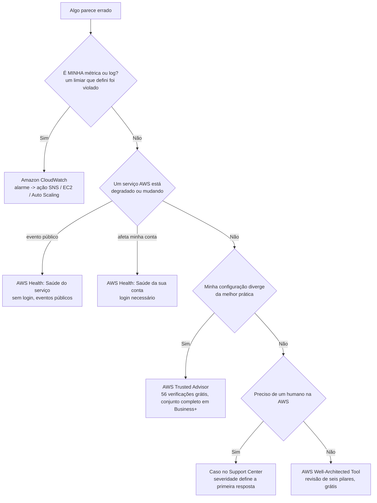
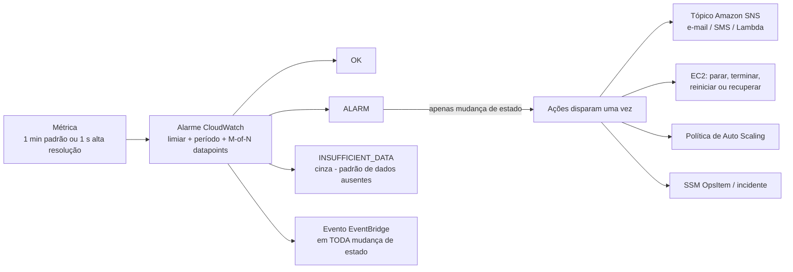
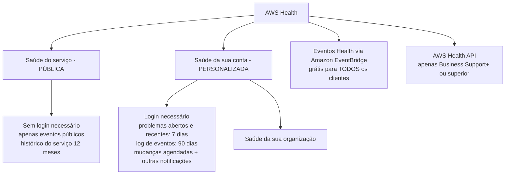
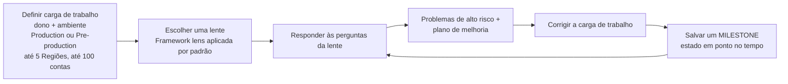

# Monitoramento, Operações, Suporte e o Well-Architected Framework

Uma carga de trabalho em nuvem que você não consegue ver é uma carga de trabalho que você não opera. Tudo nesta lição responde a uma de três perguntas: **está saudável**, **está bem construída**, e **a quem eu ligo quando não está**. Essas três perguntas mapeiam para três tarefas diferentes de exame — *monitoramento com Amazon CloudWatch* (tarefa 2.2), *AWS Support* como serviço de habilitação do cliente (tarefa 3.8), e *planos de suporte, Trusted Advisor e Health Dashboard* (tarefa 4.3) — com os **seis pilares do Well-Architected** (tarefa 1.2) fornecendo o padrão contra o qual se mede. Alunos que borrão as três perguntas perdem fáceis, porque o truque favorito do exame é colocar uma resposta de monitoramento dentro de uma pergunta de suporte e uma resposta de suporte dentro de uma pergunta de monitoramento.

```text
=====================================================================
 MAPA DO TERRENO — QUAL FERRAMENTA RESPONDE QUAL PERGUNDA
=====================================================================
  "QUEM ESTÁ DOENTE?"
    minha própria métrica cruzou MEU limiar ........ Amazon CloudWatch
    um serviço AWS está degradado / mudando ...... AWS Health - Saúde do serviço
    MINHA conta tem problemas ou mudanças abertas . AWS Health - Saúde da sua conta
    MINHA configuração diverge da melhor prática .. AWS Trusted Advisor
    preciso de um ser humano na AWS ............... caso no Support Center (por plano)

  "QUÃO BEM ESTÁ CONSTRUÍDO?"
    seis pilares, revisão gratuita, plano de melhoria . AWS Well-Architected Tool
    lacunas de melhor prática no nível da conta ....... AWS Trusted Advisor
    acesso shell sem bastions ......................... Systems Manager Session Manager
    patching sem planilha .................. Systems Manager Patch Manager

  "O QUE EU RECEBO PELO MEU DINHEIRO?"
    Basic = grátis, sem casos técnicos ............... Business Support+ -> $29/mês
    Enterprise = TAM + primeira resposta de 15 min .. Unified Operations = 5 minutos
=====================================================================
```

Nesta lição você vai:

- separar **CloudWatch vs AWS Health vs Trusted Advisor vs CloudTrail** lendo o sintoma, não a lista de serviços;
- construir **métricas, alarmes, dashboards e Logs** do CloudWatch como o exame os testa — granularidade, dimensões, estados, políticas de dados ausentes e semântica de ações;
- trabalhar a **lógica de limiar de alarme** (período × datapoints, ações apenas em mudança de estado, cinza vs vermelho);
- dividir o Health Dashboard em **saúde pública do serviço** e **saúde personalizada da conta**, e saber quais partes são grátis;
- relembrar os **one-liners** do Systems Manager (Session Manager, Patch Manager);
- posicionar a disponibilidade do **Trusted Advisor** por plano — **56 verificações grátis** versus o conjunto completo;
- ler a **tabela de planos de suporte de 2026**: tempos de resposta, canais, acesso ao Trusted Advisor, IEM e mínimos, todos com data;
- abrir um caso corretamente: **console, severidade, primeira resposta vs resolução**;
- nomear os **seis pilares do Well-Architected** exatamente e dirigir o **Well-Architected Tool** (carga de trabalho → lente → problemas de alto risco → plano de melhoria → milestone);
- aplicar **práticas de excelência operacional** em profundidade de exame através de capacidades AWS com fontes;
- estudar **quatro casos reais de clientes da AWS**, depois praticar com **12 perguntas no estilo do exame** e **quatro verificações interativas**.

| Tarefa de exame | Domínio (peso) | O que esta lição entrega |
|---|---|---|
| 1.2 Identificar princípios de design | Conceitos de Nuvem (24%) | Os seis pilar a pilar |
| 2.2 Conformidade e governança — *monitoramento com Amazon CloudWatch* | Segurança e Conformidade (30%) | §1 por completo |
| 3.8 Outras categorias no escopo — *AWS Support* | Tecnologia e Serviços de Nuvem (34%) | §5–§6 |
| 4.3 Recursos técnicos e AWS Support — planos, Trusted Advisor, Health Dashboard | Faturamento, Preços e Suporte (12%) | §2, §4, §5 |

---

## 1. Amazon CloudWatch: a saúde dos *seus* recursos

### 1.1 A definição e a armadilha em três vias

A AWS define CloudWatch como o serviço que *"monitora seus recursos AWS e as aplicações que você roda na AWS **em tempo real**"*. É uma família de quatro coisas — **métricas, alarmes, dashboards e Logs** — e o exame raramente pede a definição. Ele pede para você **não** escolher CloudWatch quando algo mais é o pretendido.

| O sintoma no enunciado | A ferramenta correta | Por quê |
|---|---|---|
| *"Um limiar que configurei foi cruzado — me avise e aja"* | **Amazon CloudWatch** | Monitoramento = estado atual de **meus** recursos |
| *"Qual chamada de API excluiu o bucket?"* | **AWS CloudTrail** | Auditoria = quem fez o quê (Lição 07) |
| *"A porta 3306 estava aberta para o mundo no mês passado?"* | **AWS Config** | Histórico de configuração (Lição 07) |
| *"Essa conta diverge da melhor prática da AWS?"* | **AWS Trusted Advisor** | Verificação de lacunas consultiva (§4) |
| *"Um serviço AWS está com uma indisponibilidade que me afeta?"* | **AWS Health Dashboard** | Eventos da própria AWS (§2) |
| *"Qual opção de suporte me dá uma resposta de 15 minutos?"* | **Planos de suporte da AWS** | Tempo de resposta comercial (§5) |



> [!NOTE]
> **A regra governante:** CloudWatch responde *"está funcionando **minha** coisa?"*; AWS Health responde *"está funcionando a **coisa da** AWS?"*; Trusted Advisor responde *"estou **seguindo** a melhor prática?"*. O Domínio 4 (planos de suporte, Trusted Advisor, Health Dashboard) é onde os alunos com mais frequência respondem **CloudWatch** — essa é a armadilha para a qual a declaração de tarefa foi escrita.

### 1.2 Métricas: fornecidas pela AWS, custom, e as duas granularidades

- **Métricas fornecidas pela AWS** (EC2 CPUUtilization, S3 BucketSizeBytes, Lambda Invocations …) são publicadas para você **sem custo adicional**; **métricas custom** vêm da sua própria aplicação via **API `PutMetricData`**.
- Métricas custom são endereçadas por três chaves: **namespace + nome da métrica + dimensões**. Uma dimensão é um par nome/valor que filtra a métrica (por exemplo `InstanceId`, `AutoScalingGroupName`) — uma métrica pode carregar **até 30 dimensões** (verifique os valores atuais antes de usar).
- **Resolução padrão = granularidade de um minuto** (o padrão da AWS); **alta resolução = um segundo**. Pague pela resolução que escolher.
- Dados de métrica são retidos por até **15 meses**, o que torna o trending de longo horizonte possível sem exportar para lugar nenhum (em outubro de 2026).

```text
PutMetricData
  namespace:  "Custom/Checkout"          <-- seu namespace, sua convenção
  metric:     "p95_latency_ms"
  dimensions: [Environment=prod, Service=checkout]
  value:      612
  storage:    padrão (1 min)  ou  alta resolução (1 s)
  retention:  até 15 meses
```

### 1.3 Alarmes: limiar entra, ação sai

Um alarme observa uma métrica (ou uma **expressão matemática** construída a partir de métricas) contra um **limiar que você define**, e faz duas coisas que mais nada no CloudWatch faz: **muda de estado** e **dispara ações**.

- **Estados:** `OK` (sem cor) · `ALARM` (vermelho) · `INSUFFICIENT_DATA` (**cinza**, não vermelho).
- **Ações disparam apenas em mudança de estado** — não uma vez por datapoint que viola. Uma métrica que permanece acima do limiar por uma hora gera **uma** notificação, não sessenta.
- **Alvos de ação:** **Amazon SNS** (e-mail/SMS/HTTP/Lambda), **ações de EC2** (parar, terminar, reiniciar, recuperar), políticas de **Auto Scaling**, **AWS Lambda**, e **SSMs OpsItems/incidentes**.
- Cada mudança de estado do alarme é *também* um evento do **Amazon EventBridge**, então sua própria ferramenta pode reagir sem polling.
- **Tipos:** alarmes de métrica, **alarmes compostos** (uma regra sobre outros alarmes — e alarmes compostos **não podem** executar ações de EC2 ou Auto Scaling), **alarmes PromQL**, **alarmes de log**.
- **Políticas de dados ausentes:** `notBreaching`, `breaching`, `ignore`, `missing` (o padrão, que cai em `INSUFFICIENT_DATA`).
- **Limites (em outubro de 2026):** você pode criar **quantos alarmes quiser** (sem cota de criação), o **histórico do alarme é mantido por 30 dias**, e a janela de avaliação é de **7 dias quando o período é ≥ 1 hora**, caso contrário **1 dia**. Sem limite, no entanto, **não** é grátis — veja o Free Tier na §1.5.



### 1.4 Exemplo E1 — lógica de limiar de alarme (a aritmética do exame)

**Cenário:** a latência do percentil 95 da API de checkout deve alarmar quando exceder **500 ms**. Você configura: métrica `p95_latency_ms`, limiar `> 500`, período **60 segundos**, **períodos de avaliação = 3**, **datapoints para alarmar = 3**, política de dados ausentes = padrão.

```text
janela de armamento  = períodos de avaliação x período = 3 x 60 s  = 3 minutos
regra de violação    = 3 minutos consecutivos acima de 500 ms -> estado OK -> ALARM
                      (M = 3 de N = 3: cada datapoint deve violar)
violação parcial     = 2 de 3 minutos acima de 500 ms -> permanece OK (sem ação)
ações                = disparam UMA vez na transição OK -> ALARM, depois nada
                      até o alarme voltar a OK e violar de novo
sem dados            = política "missing" -> INSUFFICIENT_DATA (cinza), NÃO ALARM
recuperação          = 3 minutos consecutivos abaixo de 500 ms -> ALARM -> OK (recuperação)
```

**Variantes de que o exame gosta:**

| Configuração | Efeito | Ponto de exame |
|---|---|---|
| períodos de avaliação **5**, datapoints para alarmar **3** | quaisquer 3 dos últimos 5 minutos podem violar | **M-of-N** tolera ruído |
| período **60 s** → período **300 s** | os mesmos 3 períodos agora abrangem **15 minutos** | a janela é `período × N`, não `N` |
| dados ausentes = `breaching` | ausência de dados conta como violação | bom para métricas que *"devem estar reportando"* |
| dados ausentes = `ignore` | estado inalterado em lacunas | bom para métricas espicadas e de baixo tráfego |
| alarme composto: `latency ALARM AND errors ALARM` | uma escalação em vez de duas | compostos **não podem** parar ou escalar instâncias |

> ⚠️ **Cinza não é vermelho.** `INSUFFICIENT_DATA` é um estado **incerto**, não uma falha — o distrator mais comum afirma que um alarme que para de receber dados "entra em ALARM". Não entra. Pergunte-se *por que* os dados pararam (instância terminada? agente morto? erro de digitação no namespace?) antes de tratar o estado cinza como uma indisponibilidade.

### 1.5 Dashboards e o Free Tier — Exemplo E2

Um **dashboard do CloudWatch** é uma parede de widgets (gráficos, texto, alarmes) que pode abranger Regiões e contas; **dashboards automáticos** para serviços da AWS estão incluídos, e **dashboards custom** contam contra o Free Tier.

**Exemplo E2 — contando o Free Tier antes que ele conte contra você (em outubro de 2026; verifique os valores atuais antes de usar):**

```text
Free Tier do CloudWatch                    incluído          esta equipe precisa
  dados de log (ingestão + arquivo + Insights)  5 GB            12 GB   -> estoura em 7 GB
  métricas (custom + detalhadas)                10               12      -> estoura em 2
  requisições de API                         1.000.000        800.000  -> dentro
  métricas de alarme                            10               15      -> estoura em 5
  dashboards custom                              3                2      -> dentro
  métricas por dashboard custom                 50               60      -> estoura em 10
                                              ----             ----
                                              "grátis" é uma quantidade, não um interruptor
```

Duas lições se seguem: **sem limite ≠ grátis** (você pode criar quantos alarmes quiser, mas apenas 10 métricas de alarme são grátis), e **"Free Tier" é sempre uma afirmação datada** — confira novamente a página de preços do CloudWatch da AWS antes de orçamentar.

- **📚 Você sabia?** O lado proativo do CloudWatch são as **canaries do Synthetics**: scripts configuráveis em **Node.js, Python ou Java** que rodam **em um agendamento dentro do AWS Lambda** para atingir seus endpoints e APIs e *"descobrir problemas antes que seus clientes descubram"* — uma página de login quebrada alarma **antes** do primeiro cliente reclamar. Dois falsos-gêmeos para manter retos: **CloudWatch Evidently foi descontinuado em 16 de outubro de 2025** (um distrator, nunca a resposta correta), e **Amazon Managed Grafana / Managed Prometheus não estão na lista no escopo do CLF-C02** — a resposta no escopo é sempre o **Amazon CloudWatch** simples (em outubro de 2026).

### 1.6 Logs: log group, log stream, evento

```text
log group   "aws/lambda/checkout"   <-- possui RETENÇÃO + MONITORAMENTO + CONTROLE DE ACESSO
   |
   +-- log stream "2026/10/07/[$LATEST]abc"   <-- um stream por instância/sessão
   |      |
   |      +-- eventos de log (linhas com timestamp)   <-- SEM LIMITE no número de streams
   |
   +-- metric filter   -> cria uma MÉTRICA -> pode levantar um ALARME
   +-- subscription filter -> S3 / Kinesis Data Firehose (exportação)
   +-- detecção de anomalia / consultas Logs Insights
```

- Um **log group** é a unidade de **retenção, monitoramento e controle de acesso**; streams dentro dele herdam essas configurações, e a AWS não impõe **limite** ao número de log streams.
- **CloudWatch Logs Insights** permite **buscar e analisar interativamente** dados de log com **3 linguagens de consulta**, com até **100 consultas concorrentes** por conta (em outubro de 2026).
- A cadeia que os enunciados do exame testam: **logs → metric filter → alarme → ação SNS**. É assim que uma linha de *texto* ("OutOfStockError") se torna uma notificação *acionável*.

```fillblank
{
  "question": "Complete as afirmações de vocabulário do CloudWatch com os termos corretos da AWS:",
  "template": "Amazon CloudWatch monitora seus recursos e aplicações AWS em {{1}}. Métricas custom são publicadas com a API {{2}} e são endereçadas por namespace, nome da métrica e {{3}}. Métricas de resolução padrão chegam com granularidade de um minuto enquanto alta resolução é de {{4}} segundo, e dados de métrica são retidos por até {{5}} meses. No CloudWatch Logs a unidade que possui retenção, monitoramento e controle de acesso é o {{6}}.",
  "answers": {
    "1": "real time",
    "2": "PutMetricData",
    "3": "dimensions",
    "4": "1",
    "5": "15",
    "6": "log group"
  },
  "distractors": ["PutLogEvents", "tags", "periods", "30", "60", "log stream", "alarm"],
  "explanation": "A AWS define CloudWatch como monitoramento em tempo real dos seus recursos e aplicações; métricas custom passam por PutMetricData endereçadas por namespace, nome da métrica e dimensões; resolução padrão é um minuto e alta resolução um segundo com retenção de 15 meses; e o log group - não o log stream - é o contêiner que compartilha as configurações de retenção, monitoramento e controle de acesso."
}
```

---

## 2. AWS Health Dashboard: a saúde dos *recursos da AWS*

### 2.1 Duas visões, uma palavra

O Health Dashboard é um único serviço com **duas visões completamente diferentes**, e o exame as separa pela **exigência de login**.

| | **Saúde do serviço** (pública) | **Saúde da sua conta** (personalizada) |
|---|---|---|
| Login necessário | **Não** — qualquer pessoa pode abrir | **Sim** |
| Conteúdo | **Eventos públicos**, *"não específicos de uma conta AWS"* | **Específicos da conta**: problemas abertos e recentes (**7 dias**), mudanças agendadas, outras notificações, **log de eventos (90 dias)** |
| Histórico | **Histórico do serviço: últimos 12 meses** | Log de eventos: **90 dias** |
| Também no console | — | Visão **Saúde da sua organização** |
| Enunciado típico | *"Verificar o status da AWS sem credenciais"* | *"Quais eventos de manutenção estão agendados para MINHA conta?"* |



### 2.2 O que é grátis e o que não é

- O **AWS Health Dashboard está disponível para todos os clientes AWS sem custo adicional**.
- **Todos os clientes AWS podem receber eventos AWS Health através do Amazon EventBridge sem custo adicional** — essa é a maneira mais barata de automatizar uma resposta a eventos do lado da AWS.
- A **AWS Health API** (alimentando *seus* sistemas ou uma ferramenta de terceiros) é a única parte com trava: exige **Business Support+ ou superior** (Enterprise e Unified Operations incluídos).

> [!WARNING]
> **Dashboard ≠ API.** *"Qual destes precisa de um plano de suporte pago?"* → a **Health API**. O dashboard do console e o stream de eventos do EventBridge são grátis para todos, em qualquer plano, incluindo Basic.

### 2.3 Exemplo E3 — o exercício de cinco passos "é a gente ou a AWS?"

**Cenário:** a latência p95 do checkout dispara às 02:10 UTC. Faça o exercício em ordem — cada passo tem exatamente uma ferramenta certa.

```text
passo 1  dashboard CloudWatch + estado do alarme   -> MINHA métrica está realmente violando?
passo 2  alarme verde? -> Health: Saúde do serviço -> evento AWS público? (sem login)
passo 3  Health: Saúde da sua conta                -> problema específico da conta ou mudança agendada?
passo 4  lacuna em MINHA configuração (grupo de     -> Trusted Advisor
         segurança aberto, instância ociosa, MFA ausente)
passo 5  ainda preso? -> caso no Support Center     -> severidade define o relógio da PRIMEIRA RESPOSTA
                                                            (veja a seção 5)
```

Pular direto para o passo 5 em um plano grátis é o modo de falha: **Basic Support não pode abrir casos de suporte técnico** (§5). Diagnostique primeiro; escale depois.

- **📚 Você sabia?** O **dashboard** do Health e a **API** do Health foram separados deliberadamente: a AWS afirma que o dashboard está *"disponível para todos os clientes AWS sem custo adicional"* enquanto a API é um recurso de plano. Eventos Health chegam em **dois sabores** — **eventos públicos** (qualquer pessoa, sem login) e **eventos específicos da conta** (*"sua conta ou uma conta na sua organização"*) — e é por isso que o mesmo incidente aparece na página pública **e** no seu log de eventos personalizado (em outubro de 2026).

---

## 3. AWS Systems Manager: dois one-liners

**Systems Manager** está na lista no escopo como um serviço de *Gestão e Governança*; na profundidade do CLF você precisa de exatamente duas de suas capacidades, cada uma reconhecível por uma frase.

| Capacidade | O que faz | A frase que a aciona |
|---|---|---|
| **Session Manager** | Uma forma totalmente gerenciada de conectar-se a nós EC2, edge e on-premises através de um **navegador ou da AWS CLI** | *"gerenciamento seguro de nós **sem a necessidade de abrir portas de entrada, manter hosts bastion ou gerenciar chaves SSH**"* — sessões são **controladas por IAM** e **registradas** |
| **Patch Manager** | *"Automatiza o processo de aplicar patches em nós gerenciados"* usando **baselines de patch** | *"**verificar instâncias** … ou … **verificar e instalar automaticamente** todos os patches ausentes"; políticas de patch em toda a organização rodam a partir do **Quick Setup**, resultados lidos como **conformidade** |

```text
REQUISITO                                  RESPOSTA
"acesso controlado, sem portas de entrada, Session Manager
 sem bastion, sem chaves SSH, sessões       (não é VPN, não é jump box, não é porta 22)
 registradas e controladas por IAM"
"patching mensal de SO em escala, Linux +  Patch Manager
 Windows, apenas verificação ou verificar  (não é script manual de Run Command, não é
 e instalar, relatório de conformidade"     Trusted Advisor)
```

*Cenário S1:* uma equipe deve aposentar seu único host bastion mantendo acesso auditável a 40 instâncias EC2. A resposta com fonte: **habilitar Session Manager**, excluir o bastion, revogar chaves SSH permanentes, controlar o acesso com **IAM**, e manter o **registro de sessão** ligado. Sem cirurgia em grupos de segurança, sem distribuição de chaves.

*Cenário S2:* o patching mensal deve começar como relatório e só depois como implantação automatizada. A resposta com fonte: **Patch Manager** com um **baseline de patch**, primeiro em modo de **apenas verificar** para ler a conformidade, depois **verificar-e-instalar**, depois uma **política de patch em toda a organização no Quick Setup**.

---

## 4. AWS Trusted Advisor: disponibilidade por plano

A Lição 07 possui as **seis categorias de verificação** do Trusted Advisor; esta lição possui **quem recebe o quê**, porque essa é a versão da tarefa 4.3 da pergunta.

| Plano (em outubro de 2026) | Acesso ao Trusted Advisor |
|---|---|
| **Basic** | **Verificações principais** — a AWS também afirma que você obtém **todas as verificações da categoria Service Limits** e **verificações selecionadas das categorias Security e Fault tolerance** |
| **Business Support+** | **Conjunto completo** de verificações |
| **Enterprise Support** | Conjunto completo **+ TA Priority** |
| **Unified Operations** | Conjunto completo **+ TA Priority** |
| Developer / Business / Enterprise On-Ramp (legado) | Planos legados — **descontinuados em 1 de janeiro de 2027**, então não construa uma resposta sobre eles |

**Contagens de verificações:** **todas as contas AWS obtêm 56 verificações do Trusted Advisor**; **Business Support+ e acima desbloqueiam 426 verificações adicionais, totalizando 482**. Uma página da AWS separadamente anuncia *"mais de 500 verificações"* para Business Support+ — os dois números não se reconciliam publicamente, então a formulação segura de exame é **"56 grátis em todo plano; o conjunto completo com Business Support+"** (em outubro de 2026; verifique os valores atuais antes de usar).

> [!NOTE]
> **Trusted Advisor aconselha, não impõe.** A imposição pertence a **regras do AWS Config e remediação**, **service control policies** e **guardrails do Control Tower** (Lição 07). Uma opção dizendo *"Trusted Advisor bloqueia a má configuração"* está errada em todo plano, incluindo Enterprise.

---

## 5. Planos de suporte da AWS — o elenco de 2026

### 5.1 Quem está vendendo o quê, a partir de outubro de 2026

O elenco atual da AWS é de **quatro planos**: **Basic · Business Support+ · Enterprise Support · Unified Operations**. Três planos legados estão em seus últimos meses: **Developer** e **Business** **não aceitaram novas assinaturas após 2 de dezembro de 2025** e são **descontinuados em 1 de janeiro de 2027**; **Enterprise On-Ramp** é suportado **até 31 de dezembro de 2026** e também é **descontinuado em 1 de janeiro de 2027**, com a AWS movendo esses clientes para Enterprise durante 2026. Planos legados permanecem disponíveis em **AWS GovCloud (US)**.

### 5.2 A tabela de planos de suporte

| | **Basic** | **Developer** † | **Business** † | **Business Support+** | **Enterprise** | **Unified Operations** |
|---|---|---|---|---|---|---|
| **Status (out 2026)** | Incluído com toda conta AWS | Sem novas assinaturas desde 2 dez 2025; termina 1 jan 2027 | Sem novas assinaturas desde 2 dez 2025; termina 1 jan 2027 | Atual | Atual | Atual |
| **Posicionamento** | Linha de base grátis | Suporte em horário comercial | (legado, não reverificado) | **Plano mínimo recomendado para cargas de trabalho de produção** | Cargas de trabalho **críticas para o negócio** entre organizações | Cargas de trabalho **críticas para a missão** que exigem resiliência aprimorada |
| **Casos de suporte técnico** | **✘ não pode abrir casos técnicos** | ✔ (apenas horário comercial) | ✔ (não reverificado) | ✔ **24×7** | ✔ **24×7** | ✔ **24×7** |
| **Canais** | Faturamento/conta, **aumentos de cota**, fóruns, docs, saúde do serviço — 24×7 | Web + e-mail, horário comercial | (não reverificado) | Telefone, web, chat | Telefone, web, chat | Telefone, web, chat |
| **Primeira resposta, sistema crítico para o negócio fora do ar** | n/a | — | — | **< 30 minutos** | **< 15 minutos** | **5 minutos**, de um **Incident Management Engineer** |
| **Trusted Advisor** | **Verificações principais** (56 grátis em todos os planos) | — | — | **Conjunto completo** | Conjunto completo **+ TA Priority** | Conjunto completo **+ TA Priority** |
| **AWS Health API** | ✘ (apenas dashboard) | — | — | ✔ | ✔ | ✔ |
| **Technical Account Manager** | ✘ | — | — | ✘ | ✔ **TAM** | ✔ **TAM + DSE** |
| **Suporte a eventos** | — | — | — | **AWS Countdown** como add-on | **AWS Countdown** incluído (Premium = add-on pago) | **IEM de curto prazo** + Countdown Premium |
| **AWS Security Incident Response** | ✘ | — | — | Add-on | **Incluído** | **Incluído** |
| **Mínimo mensal** | **$0** | não publicado | não publicado | **$29 / mês por conta** | **$5.000 / mês** (era $15.000) | **$50.000 / mês** |
| **Compromisso mínimo** | nenhum | — | — | **30 dias** | **30 dias** | **90 dias** |

† Plano legado. Células marcadas *não reverificado* não têm um número oficial atual nas fontes desta lição — **nunca cite um preço legado**; a AWS não publica um, e números de terceiros (Developer $29, Business $100, Enterprise On-Ramp $5.500) são não verificados.

**Todos os quatro planos atuais mantêm, grátis:** suporte de faturamento e conta, **aumentos de cota**, fóruns, documentação e saúde do serviço — **24×7**. **Business Support+** acrescenta suporte a software de terceiros e a **Support API**; **AWS re:Post** oferece *respostas priorizadas* em planos pagos.

### 5.3 A escada de primeira resposta

A AWS publica uma única escada de severidade, com a **linha superior** variando por plano. Todos os números são de **primeira resposta**, não resolução, e a AWS se compromete apenas com *"todo esforço razoable"*:

| Severidade (mais alta primeiro) | Business Support+ | Enterprise | Unified Operations |
|---|---|---|---|
| **Sistema crítico para o negócio fora do ar** (`critical`) | **< 30 min** | **< 15 min** | **5 min** |
| **Sistema de produção fora do ar** (`urgent`) | < 1 h | < 1 h | < 1 h |
| **Sistema de produção com degradação** | < 4 h | < 4 h | < 4 h |
| **Sistema com degradação** | < 12 h | < 12 h | < 12 h |
| **Orientação geral** (baixa) | < 24 h | < 24 h | < 24 h |

**Exemplo E4 — escolhendo o plano pela carga de trabalho:**

```text
startup, pré-receita, apenas perguntas de faturamento  -> Basic       $0, sem casos técnicos
ambiente de staging, ajuda em horário comercial é ok  -> (Developer legado - EOS 1 jan 2027)
carga de trabalho de produção, 24x7 + resposta <30 min -> Business Support+   a partir de $29/mês
crítico para o negócio em muitas contas, precisa de TAM-> Enterprise   a partir de $5.000/mês
crítico para a missão, resposta de engenheiro em 5 min -> Unified Operations a partir de $50.000/mês
```

**Exemplo E5 — a escada lida literalmente:**

| Enunciado | Resposta certa | Resposta armadilha e por que falha |
|---|---|---|
| *"Sistema de produção com degradação, Business Support+"* | **< 4 horas** | 1 hora é *sistema de produção **fora do ar*** — uma severidade diferente |
| *"Sistema crítico para o negócio fora do ar, Enterprise"* | **< 15 minutos** | 30 minutos é Business Support+ (e, coincidentemente, o Enterprise On-Ramp aposentando — mesmo número, plano diferente) |
| *"Sistema crítico para o negócio fora do ar, Unified Operations"* | **5 minutos de um Incident Management Engineer** | 15 minutos é Enterprise |
| *"Sistema de produção fora do ar, Basic"* | **Sem primeira resposta — Basic não pode abrir casos técnicos** | 1 hora assume um plano que pode abrir um caso de qualquer forma |

> ⚠️ **Primeira resposta ≠ resolução.** A AWS afirma que os tempos publicados são para a **primeira resposta** e *"não se aplicam a respostas subsequentes"*. Uma pergunta perguntando *"quanto tempo até a AWS consertar minha indisponibilidade"* **não tem** resposta publicada — a escada sempre mede **quão rápido alguém responde**.

### 5.4 Quanto o plano custa — aritmética trabalhada (em outubro de 2026)

Suporte em planos pagos é uma **porcentagem das suas cobranças mensais da AWS**, com um **piso mensal**:

| Plano | Escada de porcentagem | Mínimo mensal |
|---|---|---|
| Business Support+ | **9% / 7% / 5% / 3%** | **$29** por conta |
| Enterprise | **10% / 7% / 5% / 3%** | **$5.000** (reduzido de $15.000) |
| Unified Operations | **10% / 6% / 5%** (GovCloud 11% / 7% / 6%) | **$50.000** |

**Exemplo trabalhado (a) — Business Support+ em $20.000 de cobranças mensais da AWS:**

```text
primeira fatia   $10.000 x 9%  =   $900
segunda fatia    $10.000 x 7%  =   $700
                               ----------
                                      $1.600 / mês
mínimo                              $29   -> os $1.600 vencem
```

**Exemplo trabalhado (b) — Enterprise em $750.000 de cobranças mensais da AWS:**

```text
Totais do exemplo publicado pela AWS: $15.000 + $24.500 + $12.500 = $52.000 / mês
mínimo                               $5.000  -> aplica-se em todo nível de gasto,
                                               INCLUINDO $0 (ou seja, $60.000/ano ocioso)
```

**Exemplo trabalhado (c) — Unified Operations em $1.500.000 de cobranças mensais da AWS:**

```text
$100.000 + $30.000 = $130.000 / mês, contra um piso de $50.000
compromisso mínimo: 90 dias (30 dias em Business Support+ e Enterprise)
```

- **📚 Você sabia?** O mapa de planos mudou duas vezes em um ano. **Developer Support e Business Support pararam de aceitar novas assinaturas em 2 de dezembro de 2025** e são **descontinuados em 1 de janeiro de 2027**; **Enterprise On-Ramp é suportado apenas até 31 de dezembro de 2026**; enquanto isso o **mínimo mensal do Enterprise caiu de $15.000 para $5.000**. Duas consequências para o dia do exame: uma pergunta de *"resposta de 30 minutos do Enterprise On-Ramp"* aponta para um plano **aposentando** cujo número por acaso iguala os 30 minutos do Business Support+, e qualquer material de preparação citando um preço de **Developer a $29 / Business a $100** está repetindo números de terceiros **não verificados** — a AWS não publica preços legados (em outubro de 2026).

### 5.5 Extras com sabor de incidente

| Oferta | O que é | Disponibilidade (em outubro de 2026) |
|---|---|---|
| **AWS Countdown** | Suporte a eventos antes de um lançamento ou migração planejados | Add-on em **Business Support+**, incluído em **Enterprise** |
| **AWS Countdown Premium** | O nível aprimorado | Add-on pago **$10.000 por projeto por mês** (taxa promocional de 2026 $7.500/mês); **incluído com Unified Operations** |
| **IEM de curto prazo** (Infrastructure event management) | Ajuda de engenharia com tempo determinado durante um evento | Listado sob **Unified Operations** |
| **AWS Incident Detection & Response** | Serviço de detecção de resposta em 5 minutos | **$7.000 ou 2%** das cobranças mensais agregadas como **add-on do Enterprise**; **incluído** com Unified Operations |
| **AWS Security Incident Response** | Resposta específica de segurança | Não em Basic; **add-on** em Business Support+; **incluído** em Enterprise e Unified Operations |
| **AWS Unified Operations** em si | *"Combina expertise comprovada com insights baseados em IA"* com **monitoramento de segurança e desempenho 24×7** | Nível superior, piso de $50.000/mês |

---

## 6. Abrindo um caso: console, severidade, expectativas

**Onde:** o **AWS Support Center** no console é o console de casos — um lugar só para abrir, avaliar e fechar casos. **AWS Professional Services** e **solution architects** são ofertas de engajamento, não canais de caso; a **Trust and Safety team** lida com relatos de abuso; **AWS Partner-Led Support** permite que um parceiro abra casos em seu seu nome (em planos elegíveis).

**Como um caso é qualificado:** você escolhe uma **severidade** ao abrir, e a severidade — não só o plano — seleciona a linha da escada na §5.3. O detalhe mais perdido: a **severidade mais alta é "Sistema crítico para o negócio fora do ar"**, e *"Sistema de produção fora do ar"* é a linha abaixo dela (1 hora), não o topo.

```text
abrir caso (Support Center)
   -> escolher severidade: crítico para o negócio | produção fora do ar | produção degradada
                          | sistema degradado | orientação geral
   -> o RELÓGIO que importa é a PRIMEIRA RESPOSTA (plano + severidade)
   -> plano Basic = pare: sem casos técnicos; use fóruns, docs, saúde do serviço
   -> precisa de acesso de máquina à própria AWS? -> Support API (Business+ e acima)
```

**Exemplo E6 — três escalações, três respostas:**

| Situação | Movimento correto | Por que as alternativas falham |
|---|---|---|
| Conta de hobby no Free Tier, cobrança inesperada de $4 | **Caso de faturamento no Basic** (permitido) | Casos técnicos estão fechados ao Basic, mas ajuda de faturamento/conta está incluída |
| API de produção fora do ar, Business Support+ | **Caso em "Sistema de produção fora do ar"** → espere primeira resposta **< 1 h** | Abrir como "crítico para o negócio" prometeria 30 minutos aos quais você não tem direito, e abrir no Basic seria impossível |
| Alimentar eventos health da AWS no PagerDuty automaticamente | **Eventos health do EventBridge (grátis, qualquer plano)** ou a **Health API (Business+)** | Sozinho o dashboard não pode empurrar para sua ferramenta |

```matching
{
  "question": "Associe cada necessidade operacional ao plano ou serviço que realmente a satisfaz (em outubro de 2026):",
  "pairs": [
    {"left": "Conta grátis precisando de ajuda de faturamento, aumentos de cota, fóruns e saúde do serviço - nunca um caso técnico", "right": "Basic Support - incluído com toda conta AWS; casos de suporte técnico não estão disponíveis"},
    {"left": "Carga de trabalho de produção precisando de telefone, web e chat 24x7 com primeira resposta de severidade máxima abaixo de 30 minutos", "right": "Business Support+ - mínimo $29 por mês por conta; conjunto completo do Trusted Advisor; AWS Health API incluída"},
    {"left": "Patrimônio crítico para o negócio precisando de um TAM nomeado e primeira resposta abaixo de 15 minutos", "right": "Enterprise Support - mínimo $5.000 por mês; TAM incluído; TA Priority; AWS Countdown incluído"},
    {"left": "Patrimônio crítico para a missão querendo um Incident Management Engineer em primeira resposta de 5 minutos mais um DSE", "right": "Unified Operations - mínimo $50.000 por mês com compromisso de 90 dias; IEM de curto prazo incluído"},
    {"left": "Integrando eventos health da AWS na minha própria ferramenta de plantão através de uma API", "right": "Business Support+ ou acima - o dashboard e os eventos do EventBridge são grátis a todos, mas a Health API é travada por plano"},
    {"left": "Um plano apenas de horário comercial que parou de aceitar novas assinaturas em 2 de dezembro de 2025", "right": "Developer Support - descontinuado em 1 de janeiro de 2027; nunca baseie uma resposta de 2026 nele"}
  ],
  "explanation": "Leia a restrição, não a marca: sem casos técnicos significa Basic; produção mais 24x7 e resposta máxima abaixo de 30 minutos significa Business Support+; um TAM e 15 minutos significam Enterprise; um engenheiro de 5 minutos significa Unified Operations; uma integração de API é o único recurso Health travado por plano; e qualquer plano legado é um distrator depois de sua data de fim de vendas."
}
```

---

## 7. O Well-Architected Framework e o Well-Architected Tool

### 7.1 Os seis pilares — nomes exatos

O Framework oferece as *"melhores práticas da AWS para projetar e operar cargas de trabalho seguras, confiáveis, eficientes, rentáveis e sustentáveis"*, publicadas como documentação datada de **6 de novembro de 2024**. Há **seis pilares**, e o exame testa os nomes **e** as diferenças entre eles:

| # | Pilar (nome exato) | Do que se trata (redação da AWS) |
|---|---|---|
| 1 | **Operational Excellence** | Operar e **monitorar** sistemas |
| 2 | **Security** | **Proteger** sistemas |
| 3 | **Reliability** | **Recuperar-se rapidamente da falha** |
| 4 | **Performance Efficiency** | **Alocar e monitorar** recursos |
| 5 | **Cost Optimization** | **Evitar custos desnecessários** |
| 6 | **Sustainability** | **Minimizar impactos ambientais** |

> [!WARNING]
> **Pilares ≠ lenses ≠ perspectivas do CAF.** **DevOps, Machine Learning, Migration, Serverless, Data Analytics** e o resto do Lens Catalog são **lenses** — o guia de exame nunca nomeia uma lente. **Não existe "Security lens"** (Security é um *pilar*). O **AWS Cloud Adoption Framework tem seis *perspectivas*** — Business, People, Governance, Platform, Security, Operations — uma lista diferente sobre *prontidão organizacional*, não qualidade da carga de trabalho (Lição 02). E os **seis princípios gerais de design** do framework estão cobertos na Lição 01; esta lição é a metade de serviços e prática.

### 7.2 O Well-Architected Tool: revisões, problemas de alto risco, milestones

O **AWS Well-Architected Tool** é um serviço de console **disponível sem custo**, oferecendo *"um processo consistente … para revisar e medir sua arquitetura"*. Uma revisão é explicitamente *"uma **construtiva conversa** sobre decisões arquiteturais, e **não é um mecanismo de auditoria**"* — ela produz **problemas de alto risco** e um **plano de melhoria**, nunca um certificado.



**Mecânica que você deve relembrar:**

- Uma **carga de trabalho** é *"um conjunto de componentes que entregam valor de negócio"*; você registra um **dono da revisão**, um **ambiente (Production / Pre-production)**, **até 5 Regiões** e **até 100 IDs de conta** (nome de 3–100 caracteres, descrição de 3–250).
- A **Framework lens** é aplicada **por padrão**.
- **Lenses vêm em dois tipos:** lenses do **Lens Catalog** (oficiais, *"não exigem nenhuma instalação adicional"*) e **Custom lenses** (seus próprios pilares e perguntas). **Cinco lenses podem ser adicionadas de uma vez**, com **máximo de 20 lenses** por carga de trabalho.
- Um **milestone** *"registra o estado de uma carga de trabalho em um ponto particular no tempo"* — salve um **após inicialmente completar todas as perguntas**, e de novo após as melhorias entrarem, para poder mostrar a trajetória.

**Exemplo E7 — uma revisão que produz um milestone:**

```text
carga de trabalho "checkout" | dono: A. Nandi | ambiente: Production
             3 Regiões       | 12 IDs de conta   (todos dentro dos limites de 5 Regiões / 100 contas)
lente        Framework lens (padrão) + Machine Learning lens (2 das 5 permitidas de uma vez)
saída        problemas de alto risco ranqueados + plano de melhoria (grátis)
ação         corrigir os 2 principais problemas de confiabilidade
milestone    #1 salvo após o primeiro conjunto completo de respostas; #2 salvo após as correções
valor        dois pontos no tempo, mesmas perguntas -> melhoria mensurável, sem auditoria
```

```dragdrop
{
  "question": "Ordene o fluxo de revisão do Well-Architected Tool exatamente como a AWS o documenta:",
  "items": [
    "Definir a carga de trabalho - dono, Production ou Pre-production, até 5 Regiões, até 100 contas",
    "Abrir o Well-Architected Tool (grátis) - a Framework lens é aplicada por padrão",
    "Adicionar mais lenses se necessário - até 5 de uma vez, máximo 20 por carga de trabalho",
    "Responder às perguntas da lente",
    "Ler os problemas de alto risco e o plano de melhoria",
    "Corrigir a carga de trabalho",
    "Salvar um milestone - o estado da carga de trabalho em um ponto no tempo"
  ],
  "correctOrder": [
    "Definir a carga de trabalho - dono, Production ou Pre-production, até 5 Regiões, até 100 contas",
    "Abrir o Well-Architected Tool (grátis) - a Framework lens é aplicada por padrão",
    "Adicionar mais lenses se necessário - até 5 de uma vez, máximo 20 por carga de trabalho",
    "Responder às perguntas da lente",
    "Ler os problemas de alto risco e o plano de melhoria",
    "Corrigir a carga de trabalho",
    "Salvar um milestone - o estado da carga de trabalho em um ponto no tempo"
  ],
  "explanation": "A ordem do Tool é definir -> revisar (Framework lens por padrão, lenses extras por cima) -> responder -> problemas de alto risco mais plano de melhoria -> corrigir -> milestone. A orientação da própria AWS é salvar um milestone após o primeiro conjunto completo de respostas e de novo após as melhorias, porque um milestone é um registro em ponto no tempo, não uma nota de aprovado/reprovado - uma revisão é uma conversa construtiva, nunca uma auditoria."
}
```

- **📚 Você sabia?** Duas vozes da AWS descrevem para *que* serve uma revisão: **CyberAgent** diz que ajuda a *"visualizar riscos potenciais de negócio"*, enquanto **NEC** diz que o valor é *"revisar em um estágio inicial da fase de design"* — antes da arquitetura endurecer. É também por isso que o Tool é **grátis**: a AWS vende a *conversa*, não o certificado, e o único "resultado" real do Tool é uma lista ranqueada de **problemas de alto risco** que você então precisa ir e corrigir (em outubro de 2026).

---

## 8. Excelência operacional em profundidade de exame

**Operational Excellence** é o pilar sobre *operar e monitorar* sistemas — e no CLF-C02 ele é examinado como **qual capacidade da AWS executa qual trabalho operacional**, não como material de redação. Os princípios gerais de design do framework vivem na Lição 01; aqui está a lista de verificação em nível de serviço que nossas fontes sustentam.

| O trabalho operacional | A capacidade AWS | Detalhe com fonte do qual podem perguntar |
|---|---|---|
| Ver a carga de trabalho em tempo real | **Métricas + dashboards do CloudWatch** | 1 min padrão / 1 s alta resolução; retenção de 15 meses; métricas custom via `PutMetricData` |
| Agir automaticamente quando uma regra quebra | **Alarmes do CloudWatch** | Limiar + M-of-N; **ações apenas em mudança de estado**; SNS, EC2 parar/recuperar, Auto Scaling, Lambda, SSM |
| Pegar problemas antes dos clientes | **Canaries do CloudWatch Synthetics** | Scripts agendados Node.js/Python/Java rodando no **Lambda** |
| Manter um acervo de log pesquisável e retido | **CloudWatch Logs** | Log **group** possui retenção, monitoramento e controle de acesso; **Logs Insights** com 3 linguagens de consulta |
| Transformar texto em alerta | **Metric filter → alarme → SNS** | A cadeia de log para métrica para ação |
| Alcançar nós sem bastion | **SSM Session Manager** | Sem portas de entrada, sem hosts bastion, sem chaves SSH; controlado por IAM; sessões registradas |
| Manter o SO com patches | **SSM Patch Manager** | Baselines de patch; **apenas verificar** ou **verificar e instalar**; relatório de conformidade; políticas do Quick Setup |
| Verificar a mim mesmo contra a melhor prática | **Trusted Advisor** | 56 verificações grátis; conjunto completo em Business Support+; **apenas consultivo** |
| Saber se é culpa da AWS | **AWS Health Dashboard / API** | Dashboard grátis a todos; **API precisa de Business Support+** |
| Escalar com um relógio | **Support Center + plano + severidade** | Escada de primeira resposta; **Basic não pode abrir casos técnicos** |
| Melhorar a arquitetura em si | **Well-Architected Tool** | Grátis; problemas de alto risco; plano de melhoria; **milestones** |
| Provar que as operações melhoram | **Milestones + métricas de casos** | Registros em ponto no tempo que você compara em revisões sucessivas |

**Exemplo E8 — juntando a lista de verificação:** uma equipe de 12 pessoas opera uma frota de 40 nós. O modelo operacional com fonte: **Session Manager** substitui o bastion (sem portas de entrada), **Patch Manager** roda apenas-verificar por uma semana para ler a conformidade antes de mudar para verificar-e-instalar, **alarmes** do CloudWatch em CPU e latência publicam em um tópico **SNS** que pagina o plantão, **canaries** do Synthetics atingem a página de login a cada cinco minutos, as 56 verificações grátis do **Trusted Advisor** são revisadas mensalmente, uma **revisão do Well-Architected** é salva como **milestone** a cada trimestre, e um caso **Business Support+** é o caminho de escalação quando tudo isso diz *"não é a gente"*. Nada naquela lista precisa de um humano para escrever uma pilha de monitoramento do zero — o que é exatamente a preferência do Well-Architected por respostas **gerenciadas e com menor overhead operacional**.

### Atualizações de 2026 (em outubro de 2026)

> **Apenas com fontes — cada item abaixo tem data e é rastreável a uma página da AWS acessada em 2026-10.** Nada que não pôde ser verificado é afirmado como fato, e onde um título discorda do guia de exame, o **guia vence**.
>
> - **O elenco de suporte mudou em 2 de dezembro de 2025, e o texto do exame acompanhou.** O post de notícias da AWS *"New and enhanced AWS Support plans add AI capabilities to expert guidance"* apresentou **Business Support+** e **AWS Unified Operations**; **Developer, Business clássico e Enterprise On-Ramp** **não aceitaram novas assinaturas após 2 de dezembro de 2025** com assinaturas existentes rodando **até 1 de janeiro de 2027**, enquanto **Basic continua grátis**. Mínimos mensais publicados a partir de outubro de 2026: **$29**, **$5.000** e **$50.000** por conta (verifique os valores atuais antes de usar).
> - **A lista de exemplos da própria tarefa 4.3 agora lê** *"Basic Support, AWS Business Support+, AWS Enterprise Support, AWS Unified Operations"* — o guia atual nomeia **quatro** planos e os nomes legados sumiram do texto, então notas construídas sobre *"Developer Support é o plano pago de entrada"* estão citando uma lista apagada.
> - **A categoria que contém o suporte foi renomeada:** `Customer Engagement` → **Customer Enablement**, que agora contém **apenas AWS Support** — AWS Activate, AWS IQ e AWS Managed Services estão **explicitamente fora do escopo**, então nenhum deles pode ser uma resposta no escopo em lugar nenhum neste exame.
> - **Well-Architected Agent (preview) chegou em 1 de outubro de 2026**, que a AWS descreve como *"a evolução de próxima geração do AWS Trusted Advisor e do AWS Well-Architected Tool"* (notas de versão do AWS Well-Architected: agente lançado em 10-1-2026). Ele aparece **em lugar nenhum nas listas de serviços do guia de exame atual** (verificado em 2026-10) — os nomes examináveis permanecem **AWS Well-Architected Tool** e **AWS Trusted Advisor**, então nunca baseie uma resposta em um preview.
> - **As listas do Domínio 3 por trás desta lição foram reconstruídas:** entradas no escopo caíram de **128 → 111** enquanto a lista fora do escopo cresceu de **11 → 55**, com **Service Quotas** entre as entradas de Gestão e Governança adicionadas — relevante aqui porque **aumentos de cota** são um dos canais 24×7 que **todo** plano mantém grátis, incluindo Basic.
>
> Fontes: AWS News Blog (2025-12-02); guia de exame AWS Certified Cloud Practitioner Tarefa 4.3 mais as listas de serviços no escopo e fora do escopo; notas de versão do AWS Well-Architected e What's New (2026-10-01) — todos acessados em 2026-10.

```text
LINHA DO TEMPO SUPORTE + WELL-ARCHITECTED   (com fontes; em outubro de 2026)
  2025-12-02   Developer, Business clássico e Enterprise On-Ramp fecham
               para NOVAS assinaturas (AWS News Blog, 2025-12-02)
               -> Business Support+ e Unified Operations se tornam os
                  planos pagos que o guia de exame nomeia
  2026-10-01   AWS Well-Architected Agent (preview) anunciado
               -> NÃO está nas listas de serviços do guia; o WA Tool e
                  Trusted Advisor permanecem os nomes examináveis
  out 2026     exemplos atuais da Tarefa 4.3: Basic | Business Support+ |
               Enterprise | Unified Operations
  2027-01-01   planos legados descontinuados (planos legados permanecem em
               AWS GovCloud (US))
  sempre       preços e limites com selo "em outubro de 2026" - confira
               novamente as próprias páginas da AWS antes do dia do exame
```

- **📚 Você sabia?** O guia de exame atual **não imprime número de versão algum** — o PDF traz apenas *"Copyright © 2026"*, e o único artefato com selo que a AWS publicou é o guia da era de lançamento **`Version 1.0 CLF-C02`**. O `uiVersion=2024.10` visível na URL da documentação é a **versão do template do site AWS Docs**, não uma revisão do guia (verificado em 2026-10), e é por isso que afirmações como *"uma atualização do guia de março de 2026"* circulando em material de preparação de terceiros permanecem não verificadas — o hábito defensável é baixar o guia que a AWS publica **hoje** em vez de confiar em um rótulo de versão que alguém mais citou.

```matching
{
  "question": "Associe cada mudança de 2026 ao que ela significa para a sua resposta de CLF-C02 (todas as fontes acessadas em outubro de 2026):",
  "pairs": [
    {"left": "A lista de exemplos dentro da Tarefa 4.3 do guia de exame atual", "right": "Nomeia Basic Support, AWS Business Support+, AWS Enterprise Support e AWS Unified Operations - os quatro planos que esta lição ensina como atuais"},
    {"left": "Developer, Business clássico e Enterprise On-Ramp", "right": "Fecharam para novas assinaturas em 2 de dezembro de 2025 e descontinuados em 1 de janeiro de 2027 - nunca baseie uma resposta de 2026 neles"},
    {"left": "A categoria Customer Enablement na lista no escopo", "right": "Contém apenas AWS Support - AWS Activate, AWS IQ e AWS Managed Services estão fora do escopo"},
    {"left": "AWS Well-Architected Agent (preview, anunciado em 1 de outubro de 2026)", "right": "Não é nomeado no guia de exame - os nomes examináveis permanecem o AWS Well-Architected Tool e o AWS Trusted Advisor"},
    {"left": "As listas de serviços reconstruídas por trás do Domínio 3", "right": "111 entradas no escopo e 55 fora do escopo (verificado em 2026-10) - a lista que você baixa hoje é o árbitro"},
    {"left": "Mínimos mensais nos três planos pagos, em outubro de 2026", "right": "$29 (Business Support+), $5.000 (Enterprise) e $50.000 (Unified Operations) por conta por mês - verifique os valores atuais antes de usar"}
  ],
  "explanation": "Leia a fonte, não o título: a Tarefa 4.3 em si lista Basic, Business Support+, Enterprise e Unified Operations, então nomes de planos legados são distratores depois de 2 de dezembro de 2025; Customer Enablement contém apenas AWS Support; o Well-Architected Agent é um preview real mas não um nome examinável, então o Well-Architected Tool e o Trusted Advisor do guia de exame permanecem corretos; e as listas reconstruídas (111 dentro, 55 fora) mais os mínimos publicados de $29 / $5.000 / $50.000 são os únicos números a citar - todos em outubro de 2026."
}
```

---

## Casos Reais

A AWS publica como estes padrões se parecem em produção. Cada número abaixo é **reivindicação do cliente ou da AWS e não auditado**, citado com sua fonte para que você possa conferir — o ponto examinável é o **padrão** (qual capacidade foi usada, qual número se moveu), não o marketing.

### Caso A — Bangkok Flight Services: monitoramento e auditoria entregues *junto com* a migração

| Elemento | Detalhe |
|---|---|
| **Indústria / contexto** | Handling de carga aeroportuária em torno de **60 milhões de passageiros por ano**, crescendo, em hardware envelhecido **sem site de recuperação de desastres** |
| **Serviços AWS citados** | **AWS Application Migration Service (MGN)**, Amazon EC2, Amazon S3, **AWS CloudTrail**, **Amazon CloudWatch**, **recuperação de desastres multi-AZ**, Parceiro: DailiTech |
| **Resultados principais (publicados pela AWS)** | Migração concluída em **7 meses** com **sem rollback e sem interrupção**; **tempo de gestão da infraestrutura de TI reduzido em 50%**; cerca de **1 hora por ano de indisponibilidade não planejada eliminada** |
| **Lição de operações** | CloudWatch e CloudTrail foram **parte da solução**, não uma reflexão tardia — e o DR foi projetado em **múltiplas Zonas de Disponibilidade** desde o dia um |
| **Fonte** | aws.amazon.com/solutions/case-studies/bangkok-flight-services (acesso em outubro de 2026) |

*Lição de exame:* **monitoramento e auditoria acompanham toda migração.** Um enunciado dizendo *"o cliente migrou e agora pode ver a saúde dos recursos e a atividade de API"* está descrevendo **CloudWatch + CloudTrail**, e a afirmação de resiliência é **multi-AZ**, não multi-Região — a distinção exata que a Lição 03 testa.

### Caso B — Capital One: excelência operacional como disciplina de engenharia

| Elemento | Detalhe |
|---|---|
| **Indústria / contexto** | Banco Fortune 100 saindo de *testes de recuperação de desastres periódicos* para sistemas que **previnem, detectam e recuperam automaticamente** |
| **Serviços AWS citados** | **Failover Regional** automatizado, **Amazon Route 53**, **Amazon CloudWatch**, um hub central de recuperação, **AWS GameDay** mensal, engenharia de caos |
| **Resultados principais (publicados pela AWS, reivindicados pelo cliente)** | **Eventos de severidade crítica reduzidos em 80–90%**; **tempo de recuperação cortado de horas para minutos** em milhares de componentes em ordem de dependência; cadência de testes mudou de **testes trimestrais cross-Region para experimentos mensais de caos** |
| **Lição de excelência operacional** | Confiabilidade é **provada por testes repetidos e automatizados**, não declarada — e o CloudWatch fica no caminho de detecção que torna a recuperação automática |
| **Voz do cliente** | *"We believe that innovation should be at the speed of well-managed systems."* — Parvez Naqvi, VP de engenharia de resiliência e confiabilidade (citação do cliente) |
| **Fonte** | aws.amazon.com/solutions/case-studies/capital-one-improving-resilience-case-study (acesso em outubro de 2026) |

*Lição de exame:* **80–90% é um resultado do cliente, não uma garantia da AWS**, e pertence ao estudo de caso de *resiliência* (a página de migração do mesmo cliente tem um conjunto diferente de números — não os misture).

### Caso C — Box: uma revisão do Well-Architected usada como rotina operacional

| Elemento | Detalhe |
|---|---|
| **Indústria / contexto** | Box, a plataforma SaaS empresarial usada por **mais de 120.000 empresas**, buscando eficiência de gastos **sem** prejudicar segurança, confiabilidade ou desempenho |
| **Serviços AWS citados** | **Well-Architected Framework** e revisões de **Solutions Architect**, tiering de Amazon S3 / **S3 Glacier**, higiene de volumes e snapshots do EBS, **filtragem de eventos do AWS CloudTrail**, roteamento de tráfego ao redor de internet gateways |
| **Resultados principais (publicados pela AWS, reivindicados pelo cliente)** | **$2,23 milhões** desdobrados em quatro alavancas: transferência entre AZ **$438.000**, egress de internet **$1,1 milhão por ano**, tiering de armazenamento **mais de $500.000 por ano**, logging **$192.000 por ano** |
| **Lição de operações** | A revisão produziu um **backlog ranqueado**, não um certificado — o mesmo ciclo de *revisão → problemas de alto risco → plano de melhoria → milestone* que a §7 ensina, e a linha de logging prova que **volume de log é uma decisão operacional**: retenção, metric filters e subscription filters são todos configurados no **log group** (§1.6) |
| **Voz do cliente** | *"Our use of AWS best practices led to savings of over 2 million dollars, setting a new baseline…"* — Clay Alvord, director of FinOps and SRE (citação do cliente) |
| **Fonte** | aws.amazon.com/solutions/case-studies/box-case-study (acesso em outubro de 2026) |

```text
Desdobramento publicado pela Box (reivindicado pelo cliente, acesso em outubro de 2026)
  transferência de dados entre AZ ... $  438.000
  egress de internet ................. $1.100.000 / ano
  tiering de armazenamento ........... $  500.000 / ano   (a AWS imprime ">")
  logging ............................ $  192.000 / ano
                                       ------------
  total ............................. $2.230.000  =  "US$2,23 milhões desdobrados"
```

*Lição de exame:* **os quatro números pertencem à Box, não à Capital One** — misturar números de clientes é o erro clássico de estudo de caso. Dois padrões examináveis ficam embaixo do marketing: a revisão gratuita da §7 fazendo trabalho de **custo** tão bem quanto trabalho de arquitetura (Cost Optimization é um pilar de prontidão operacional, não uma reflexão tardia), e um fato operacional — **$192.000 por ano de logging** é moldado pela retenção que você escolhe em um **log group**, e é exatamente por isso que a §1.6 diz que o log group, não o stream, possui a retenção.

### Caso D — athenahealth: visibilidade central operada por uma equipe de oito

| Elemento | Detalhe |
|---|---|
| **Indústria / contexto** | Software de saúde (sensível a HIPAA) que precisava de **monitoramento de egress em um extenso acervo de VPC** enquanto os custos de inspeção subiam — operado por uma pequena equipe de engenharia |
| **Serviços AWS citados** | **AWS Network Firewall** (centralizado), **AWS Transit Gateway**, **AWS RAM** (fan-out de política para **120 contas**), regras CloudFormation como código, AWS Direct Connect; AWS Shield no roadmap |
| **Resultados principais (publicados pela AWS, reivindicados pelo cliente)** | Custos de inspeção cortados em **95%**; centenas de VPCs em **120 contas** onboardadas *"dentro de apenas alguns dias"*; o novo design de segurança foi projetado e implantado por **oito pessoas** com **sem interrupções**; logs de firewall **centralizados** em um lugar |
| **Lição de operações** | **Um sinal central supera 120 consoles locais** — automatize a implantação com policy-as-code em vez de contratar operadores, o que é a preferência de *automatize, não contrate* da excelência operacional escrita como um estudo de caso |
| **Ressalva de escopo** | **AWS Network Firewall agora está na lista fora do escopo** para CLF-C02 (verificado em 2026-10) — use a história para o **padrão**, e responda com nomes no escopo apenas (CloudWatch, CloudTrail, AWS Health, Trusted Advisor) |
| **Fonte** | aws.amazon.com/solutions/case-studies/athenahealth-case-study (acesso em outubro de 2026) |

*Lição de exame:* leia a **forma**, não a lista de produtos. *"Um lugar central para olhar, muitas contas, equipe pequena, sem interrupções"* ⇒ as respostas no escopo são **dashboards do Amazon CloudWatch** para métricas, **AWS CloudTrail** para histórico de API, **AWS Health** para eventos do lado da AWS e **AWS Trusted Advisor** para lacunas de configuração. O **−95%** é o número da athenahealth, não auditado, e *"oito pessoas"* é um lembrete de que a AWS conta **serviços gerenciados como capacidade** — nenhum enunciado do exame pergunta quantos engenheiros o cliente contratou.

### O que os dois casos (A e B) compartilham

| Padrão de valor | Evidência | Princípio subjacente |
|---|---|---|
| Observabilidade entrega junto com a carga de trabalho | Bangkok: CloudWatch + CloudTrail no escopo da migração | **Monitoramento é um entregável**, não uma fase 2 |
| Recuperação é testada, não assumida | Capital One: trimestrais → experimentos mensais de **caos**, GameDay | **Confiabilidade = recuperar-se rapidamente da falha** |
| Automação reduz o trabalho operacional | Bangkok: tempo de gestão de infraestrutura **−50%** | Excelência operacional favorece operações **automatizadas e repetíveis** |
| As ferramentas grátis fazem a primeira passada | Ambos: CloudWatch + revisão estilo WA/Trusted Advisor antes da escalação | Diagnostique primeiro, **depois** abra um caso |

- **📚 Você sabia?** Os números do Capital One vivem em **duas páginas diferentes da AWS** e descrevem **dois projetos diferentes**: o estudo de caso de resiliência relata **eventos de severidade crítica reduzidos em 80–90%** com recuperação de **horas → minutos**, enquanto o estudo de caso de migração relata a saída de **8 data centers**, ~**80% de ~2.000 aplicações** construídas na nuvem e ambientes de desenvolvimento cortados de **3 meses para minutos**. No dia do exame, cite o número **com o projeto de onde veio** — misturá-los é o erro clássico de estudo de caso (acesso em outubro de 2026).

### O que os casos C e D acrescentam

| Padrão de valor | Evidência | Princípio subjacente |
|---|---|---|
| Uma revisão é trabalho operacional, não papelada | Box: **revisões de Well-Architected + Solutions Architect** → quatro correções financiadas totalizando **$2,23 M** | O ciclo da §7 (revisão → problemas de alto risco → plano de melhoria → milestone) paga a si próprio no pilar de **Cost Optimization** também |
| Logging é projetado, não descoberto | Box: **$192 K por ano** de logging destacado como sua própria alavanca | Retenção, metric filters e subscription filters vivem no **log group** — escolha-os deliberadamente |
| Centralize o sinal, automatize a implantação | athenahealth: centenas de VPCs, **120 contas**, policy-as-code, **equipe de 8**, custo de inspeção **−95%** | Excelência operacional prefere operações **gerenciadas e automatizadas** a headcount |
| Um caso nunca licencia uma resposta fora do escopo | O **AWS Network Firewall** da athenahealth agora está **fora do escopo** | Nomeie apenas o serviço no escopo que o enunciado pede (lista verificada em 2026-10) |

- **📚 Você sabia?** As quatro linhas de economia publicadas da Box somam exatamente: **$438.000 + $1.100.000 + $500.000 + $192.000 = $2.230.000** — o título da AWS *"US$2,23 milhões"* é a **soma das quatro alavancas**, não um número separado. Dessas quatro, a linha de **logging** é a única que uma equipe de operações controla semana a semana, porque retenção, filtros e exportações do CloudWatch Logs são todos configurados no **log group** — e é por isso que um enunciado do exame sobre *"reduzir gastos de log"* é realmente um enunciado sobre política de retenção (estudo de caso acessado em outubro de 2026).

> [!WARNING]
> **Como ler números de estudos de caso no dia do exame:** cada percentual aqui é **reivindicado pelo cliente ou publicado pela AWS e não auditado** — nunca uma garantia, e *"até"* é um **teto**, nunca uma média. Atribua a fonte e a data de acesso (*"estudo de caso do Bangkok Flight Services, acesso em outubro de 2026"*), não *"a AWS prova"*. Um caso nunca licencia uma resposta fora do escopo: pede-se para **nomear o serviço no escopo** (CloudWatch, CloudTrail, Health, Trusted Advisor, WA Tool), nunca para reproduzir o número de marketing.

---

## Perguntas de Prática (Practice Questions)

```question
{
  "id": "clf-12-q1",
  "type": "multiple-choice",
  "question": "A latência do percentil 95 de um serviço de checkout cruza um limiar que sua equipe configurou na sua própria conta, e você quer uma notificação mais uma ação de recuperação automática. Qual serviço você deve usar?",
  "options": [
    "Amazon CloudWatch - um alarme na sua métrica com uma ação SNS ou EC2",
    "AWS Health Dashboard - visão Saúde do serviço",
    "AWS Trusted Advisor - categoria de otimização de custos",
    "AWS CloudTrail - histórico de eventos"
  ],
  "correct": 0,
  "explanation": "CloudWatch é a resposta de monitoramento: alarmes observam uma métrica contra um limiar definido pelo usuário e disparam ações em mudança de estado - SNS para notificação, mais EC2 parar/terminar/reiniciar/recuperar, Auto Scaling, Lambda ou um SSM OpsItem. AWS Health cobre os próprios eventos de serviço da AWS, Trusted Advisor relata lacunas de melhor prática, e CloudTrail registra quem chamou qual API."
}
```

```question
{
  "id": "clf-12-q2",
  "type": "multiple-choice",
  "question": "Um alarme do CloudWatch com período de 60 segundos e três períodos de avaliação para de receber dados. O alarme mostra INSUFFICIENT_DATA. Qual afirmação está correta?",
  "options": [
    "INSUFFICIENT_DATA é um estado vermelho significando que o próprio alarme falhou",
    "CloudWatch muda automaticamente o estado para ALARM após três períodos sem dados",
    "INSUFFICIENT_DATA é um estado cinza e incerto - ações não disparam até o alarme realmente entrar em ALARM",
    "Dados ausentes são sempre tratados como violação por padrão"
  ],
  "correct": 2,
  "explanation": "Os três estados são OK, ALARM (vermelho) e INSUFFICIENT_DATA (cinza). Cinza significa que o CloudWatch não tem datapoints suficientes - com a política padrão de dados ausentes o alarme fica em INSUFFICIENT_DATA em vez de ALARM, então nenhuma ação dispara. O comportamento de apenas-violação deve ser escolhido explicitamente com a política de dados ausentes breaching, e ações disparam apenas em mudança de estado."
}
```

```question
{
  "id": "clf-12-q3",
  "type": "multiple-choice",
  "question": "Você deve verificar se um serviço AWS tem uma indisponibilidade pública e contínua SEM fazer login no console da AWS. Qual visão satisfaz o requisito?",
  "options": [
    "Saúde da sua conta - eventos personalizados para a sua conta",
    "AWS Health Dashboard - Saúde do serviço, que mostra eventos públicos e não precisa de login",
    "AWS Trusted Advisor - categoria de tolerância a falhas",
    "Um dashboard do CloudWatch compartilhado com você por e-mail"
  ],
  "correct": 1,
  "explanation": "Saúde do serviço é a visão pública: mostra eventos públicos que não são específicos de nenhuma conta AWS, não precisa de login, e mantém um histórico de serviço de 12 meses. Saúde da sua conta precisa de login e mostra conteúdo específico da conta (problemas abertos e recentes por 7 dias, mudanças agendadas, log de eventos de 90 dias). Trusted Advisor e CloudWatch descrevem a sua própria conta, não o status de serviço da AWS."
}
```

```question
{
  "id": "clf-12-q4",
  "type": "multiple-choice",
  "question": "Uma empresa quer eventos AWS Health empurrados para o próprio sistema de plantão através de uma API. O que deve ser verdade para isso funcionar?",
  "options": [
    "Qualquer plano funciona, porque a AWS Health API é grátis para todos os clientes",
    "Business Support+ ou acima é necessário - o dashboard e os eventos do EventBridge são grátis a todos, mas a Health API é travada por plano",
    "Apenas Unified Operations pode usá-la, porque faz parte da detecção de incidentes",
    "Basic Support é suficiente, porque o Health Dashboard está incluído no Basic"
  ],
  "correct": 1,
  "explanation": "A AWS afirma que o Health Dashboard está disponível a todos os clientes sem custo adicional e que todos os clientes podem receber eventos Health através do Amazon EventBridge grátis - mas a AWS Health API exige Business Support+, Enterprise ou Unified Operations. Confundir o dashboard grátis com a API travada é a armadilha padrão nesta tarefa."
}
```

```question
{
  "id": "clf-12-q5",
  "type": "multiple-choice",
  "question": "Um cliente no plano Basic Support sofre uma indisponibilidade em produção e quer escalar para a AWS imediatamente. Qual afirmação está correta?",
  "options": [
    "Basic inclui uma primeira resposta dentro de 1 hora para sistema de produção fora do ar",
    "Basic não pode abrir casos de suporte técnico - cobre ajuda de faturamento e conta, aumentos de cota, fóruns, documentação e saúde do serviço",
    "Basic inclui o conjunto completo de verificações do Trusted Advisor, então o caso é desnecessário",
    "Basic inclui um Technical Account Manager designado"
  ],
  "correct": 1,
  "explanation": "Clientes com o plano Basic Support não podem abrir casos de suporte técnico. O que o Basic de fato inclui, 24x7, é suporte de faturamento e conta, aumentos de cota, fóruns, documentação e saúde do serviço - mais verificações principais do Trusted Advisor (todas as contas obtêm 56 verificações grátis). Escadas de tempo de resposta e TAMs só existem em planos que podem abrir casos técnicos."
}
```

```question
{
  "id": "clf-12-q6",
  "type": "multiple-choice",
  "question": "Um sistema crítico para o negócio está fora do ar. Qual par plano-e-primeira resposta está correto a partir de outubro de 2026?",
  "options": [
    "Business Support+ - primeira resposta abaixo de 15 minutos",
    "Enterprise Support - primeira resposta abaixo de 15 minutos",
    "Basic Support - primeira resposta dentro de 1 hora",
    "Enterprise On-Ramp - primeira resposta abaixo de 15 minutos"
  ],
  "correct": 1,
  "explanation": "Primeiras respostas de severidade máxima (sistema crítico para o negócio fora do ar) são: Business Support+ abaixo de 30 minutos, Enterprise abaixo de 15 minutos, e Unified Operations 5 minutos de um Incident Management Engineer. Business Support+ é 30 minutos, Basic não pode abrir casos técnicos de jeito nenhum, e Enterprise On-Ramp - cujo número de 30 minutos precede o elenco atual - é descontinuado em 1 de janeiro de 2027."
}
```

```question
{
  "id": "clf-12-q7",
  "type": "multiple-choice",
  "question": "Qual dos seguintes NÃO é um dos seis pilares do AWS Well-Architected Framework?",
  "options": [
    "Sustainability",
    "DevOps",
    "Operational Excellence",
    "Performance Efficiency"
  ],
  "correct": 1,
  "explanation": "Os seis pilares são Operational Excellence, Security, Reliability, Performance Efficiency, Cost Optimization e Sustainability. DevOps é uma LENTE do Lens Catalog - uma maneira de aplicar o framework a um tipo específico de carga de trabalho - e o guia de exame nunca nomeia lenses. Também não existe 'Security lens': Security é um pilar."
}
```

```question
{
  "id": "clf-12-q8",
  "type": "multiple-choice",
  "question": "Qual afirmação sobre uma revisão do AWS Well-Architected Tool está correta?",
  "options": [
    "Uma revisão certifica a carga de trabalho para conformidade, então deve ser tratada como uma auditoria",
    "O Tool é grátis, e um milestone registra o estado de uma carga de trabalho em um ponto particular no tempo",
    "Apenas clientes no Enterprise Support podem executar uma revisão",
    "A Framework lens deve ser substituída por uma custom lens antes da primeira revisão"
  ],
  "correct": 1,
  "explanation": "O Well-Architected Tool está disponível sem custo, uma revisão é explicitamente uma conversa construtiva e não um mecanismo de auditoria, e um milestone registra o estado da carga de trabalho em um ponto no tempo - a AWS diz para salvar um após inicialmente completar todas as perguntas e de novo após as melhorias. A Framework lens é aplicada por padrão; custom lenses são adições opcionais (5 de uma vez, máximo 20)."
}
```

```question
{
  "id": "clf-12-q9",
  "type": "multiple-choice",
  "question": "Requisito: acesso controlado a nós gerenciados sem portas de entrada, sem hosts bastion e sem chaves SSH, sessões controladas por IAM e registradas. Qual capacidade AWS o satisfaz?",
  "options": [
    "AWS Systems Manager Session Manager",
    "AWS Systems Manager Patch Manager",
    "Amazon CloudWatch Synthetics",
    "AWS Trusted Advisor"
  ],
  "correct": 0,
  "explanation": "Session Manager é descrito pela AWS como gerenciamento seguro e totalmente gerenciado de nós sem abrir portas de entrada, manter hosts bastion ou gerenciar chaves SSH - o acesso é controlado por IAM e as sessões são registradas. Patch Manager automatiza o patching (apenas verificar ou verificar-e-instalar), Synthetics roda canaries agendadas para testar endpoints, e Trusted Advisor apenas relata lacunas de melhor prática."
}
```

```question
{
  "id": "clf-12-q10",
  "type": "multiple-choice",
  "question": "Qual afirmação sobre a disponibilidade do AWS Trusted Advisor está correta a partir de outubro de 2026?",
  "options": [
    "Trusted Advisor está disponível apenas no Enterprise Support, incluindo TA Priority em todo plano",
    "Todas as contas AWS obtêm 56 verificações, Business Support+ desbloqueia o conjunto completo, e TA Priority é reservado para Enterprise e Unified Operations",
    "Clientes no plano Basic Support não obtêm nenhuma verificação do Trusted Advisor",
    "Business Support+ inclui TA Priority bem como o conjunto completo de verificações"
  ],
  "correct": 1,
  "explanation": "Todas as contas AWS obtêm 56 verificações do Trusted Advisor e Business Support+ e acima desbloqueiam 426 adicionais (482 no total na página de verificações da AWS, que em outro lugar anuncia 'mais de 500'). Basic obtém verificações principais - incluindo todas as verificações de Service Limits e verificações selecionadas de Security e Fault tolerance - então 'nenhuma verificação de jeito nenhum' é falso. TA Priority é um recurso de Enterprise e Unified Operations, não de Business Support+."
}
```

```question
{
  "id": "clf-12-q11",
  "type": "multiple-choice",
  "question": "As anotações de Domínio 4 de um candidato, construídas a partir de um guia de exame CLF-C02 mais antigo, respondem com 'Developer Support é o plano pago de entrada'. Qual afirmação sobre o texto atual do exame e o elenco de suporte (verificado em outubro de 2026) está correta?",
  "options": [
    "O guia atual ainda lista Developer Support na Tarefa 4.3, porque a lista de exemplos não mudou desde 2023",
    "A Tarefa 4.3 agora nomeia Basic Support, AWS Business Support+, AWS Enterprise Support e AWS Unified Operations; Developer, Business clássico e Enterprise On-Ramp pararam de aceitar novas assinaturas em 2 de dezembro de 2025 e são descontinuados em 1 de janeiro de 2027",
    "O elenco cresceu para cinco planos atuais - Basic, Developer, Business, Business Support+ e Enterprise - então tanto as anotações quanto o novo guia estão parcialmente certos",
    "Unified Operations é um serviço AWS em vez de um plano de suporte, então não pode aparecer em uma tarefa de opções de suporte"
  ],
  "correct": 1,
  "explanation": "A Tarefa 4.3 do guia de exame atual dá exatamente estes quatro exemplos - Basic Support, AWS Business Support+, AWS Enterprise Support e AWS Unified Operations - refletindo a reforma de suporte que a AWS anunciou em 2 de dezembro de 2025. Os planos legados não aceitam novas assinaturas depois daquela data e as existentes rodam até 1 de janeiro de 2027, então uma resposta baseada em Developer Support memoriza texto que a AWS apagou. Unified Operations é um plano de suporte com mínimo de $50.000 por mês e primeira resposta de 5 minutos de um Incident Management Engineer, não um serviço."
}
```

```question
{
  "id": "clf-12-q12",
  "type": "multiple-choice",
  "question": "Um anúncio da AWS datado de 1 de outubro de 2026 descreve o AWS Well-Architected Agent (preview) como 'a evolução de próxima geração do AWS Trusted Advisor e do AWS Well-Architected Tool'. Qual afirmação deve governar suas respostas de exame?",
  "options": [
    "Responda com o AWS Well-Architected Agent, porque todo anúncio da AWS de 2026 é examinável",
    "Trusted Advisor foi aposentado em 1 de outubro de 2026, então suas verificações devem ser atribuídas ao Well-Architected Agent",
    "As listas de serviços do guia de exame ainda nomeiam o AWS Well-Architected Tool e o AWS Trusted Advisor e não listam o Agent, então baseie suas respostas no guia, não em um preview",
    "O Well-Architected Agent substitui os seis pilares, então os nomes dos pilares não precisam mais ser memorizados"
  ],
  "correct": 2,
  "explanation": "O Agent é real e recente - as notas de versão do Well-Architected da AWS o registram em 10-1-2026 e a AWS o comercializa como a evolução de próxima geração do Trusted Advisor e do Well-Architected Tool - mas ele aparece nem na lista no escopo nem na fora do escopo do guia de exame atual (ambas verificadas em 2026-10), e o guia ainda nomeia o AWS Well-Architected Tool. O árbitro é o guia que você baixa hoje: previews e anúncios são contexto, nunca termos-chave, e Trusted Advisor permanece no escopo com suas 56 verificações grátis."
}
```

---

> [!IMPORTANT]
> **Veredito Comparativo — monitoramento, suporte e well-architected × on-premises × outras nuvens × ferramentas nativas da AWS**
> - **Versus monitoramento on-premises / DIY:** on-premises você monta e babás a pilha você mesmo — um coletor de métricas, um roteador de alertas, uma rota de plantão, um cronograma de patches e um número de telefone para um fornecedor de hardware, todos falhando silenciosamente às 02:00. A AWS substitui isso por **métricas publicadas para serviços da AWS sem cobrança**, **alarmes sem cota de criação e com remediação embutida** (parar, reiniciar, recuperar, escalar), **eventos Health grátis para toda conta inclusive via EventBridge**, **patching e acesso shell como serviços gerenciados** (Patch Manager, Session Manager) e uma **escada publicada de primeira resposta** à qual você pode prender um fornecedor. A evidência do cliente é o padrão de sempre: Bangkok Flight Services cortou **o tempo de gestão da infraestrutura de TI em 50%** e Capital One cortou **a recuperação de horas para minutos** com **eventos de severidade crítica reduzidos em 80–90%** (ambos reivindicados pelo cliente, acesso em outubro de 2026). O que **não** se move: você ainda é dono das métricas que não publica, dos alarmes que não cria, e da revisão que nunca executa.
> - **Versus outras nuvens:** todo grande provedor vende métricas, alarmes, uma página de status e níveis de suporte pago, então as diferenças examináveis são **o vocabulário e os números exatos da AWS**: os três estados do alarme (**OK / ALARM / INSUFFICIENT_DATA**) com **ações apenas em mudança de estado**; **saúde do serviço sem login vs saúde da conta com login**; **56 verificações grátis do Trusted Advisor vs o conjunto completo em Business Support+**; o conjunto de planos **Basic / Business Support+ / Enterprise / Unified Operations** com suas respostas máximas de **30 / 15 / 5 minutos**; e **seis pilares nomeados** revisados com uma ferramenta **grátis**. A URL da página de status, o nome do nível de suporte ou a contagem de pilares de outro provedor não se transferem para este exame.
> - **Versus scripts DIY e ferramentas AWS fora do escopo:** um monitor caseiro significa escrever coleta, limites, deduplicação e escalação você mesmo; um bastion caseiro significa chaves, jump boxes e portas de entrada (exatamente o que o Session Manager remove); um verificador de melhor prática caseiro é o que o **Trusted Advisor** já faz 56 vezes de graça. Dentro da AWS a disciplina é igualmente afiada: **CloudWatch é a resposta de monitoramento no escopo**, enquanto **Amazon Managed Grafana, Amazon Managed Prometheus e o descontinuado CloudWatch Evidently estão fora do escopo como serviços** — uma opção nomeando-os é um distrator, e a preferência do Well-Architected é consistentemente a escolha **gerenciada e com menor overhead operacional**.

> [!WARNING]
> **Armadilhas do dia do exame para esta lição:**
> - **CloudWatch ≠ Health ≠ Trusted Advisor ≠ CloudTrail** — *minha métrica* → CloudWatch; *serviço da* AWS → Health; *lacuna de melhor prática* → Trusted Advisor; *quem chamou o quê* → CloudTrail. Responder **CloudWatch** dentro de uma pergunta de suporte/custo da tarefa 4.3 é a armadilha;
> - **Saúde do serviço não precisa de login** (eventos públicos, histórico de serviço de 12 meses); **saúde da conta precisa de login** (problemas abertos de 7 dias, log de eventos de 90 dias);
> - **Dashboard grátis, Health API travada** — o dashboard e o stream de eventos do EventBridge são grátis a todos; a **API precisa de Business Support+**;
> - **Basic não pode abrir casos de suporte técnico** — mas *obtém* **verificações principais do Trusted Advisor** (56 grátis em todo plano) e faturamento/conta 24×7, aumentos de cota, fóruns, docs e saúde do serviço;
> - **Tempos de resposta são PRIMEIRA resposta, "todo esforço razoável", nunca resolução** — nenhum plano publica um tempo de correção;
> - **A severidade mais alta é "Sistema crítico para o negócio fora do ar"** (30 min Business+ / 15 min Enterprise / 5 min Unified Operations), **não** "Sistema de produção fora do ar" (1 hora);
> - **Mudança de nomes de plano (2026):** atuais quatro = **Basic, Business Support+, Enterprise, Unified Operations**; **Developer e Business** pararam novas assinaturas em **2 dez 2025** e terminam em **1 jan 2027**; **Enterprise On-Ramp** é suportado **apenas até 31 dez 2026** — *"On-Ramp 30 minutos"* e *"Business Support+ 30 minutos"* são o mesmo número em **planos diferentes**;
> - **Nunca cite preços de planos legados** (Developer $29, Business $100, On-Ramp $5.500 são não verificados) — a AWS publica apenas mínimos de **$0 / $29 / $5.000 / $50.000** (o piso do Enterprise caiu de $15.000);
> - **TAM é apenas Enterprise** (Unified Operations acrescenta um DSE); **IEM fica sob Unified Operations**, Enterprise recebe **AWS Countdown** com Premium como add-on pago;
> - **Contagens de verificações do Trusted Advisor:** a AWS publica **56 grátis / 482 com Business+** em uma página e *"mais de 500"* em outra — diga **"56 grátis, conjunto completo em Business Support+"**;
> - **Fatos sobre alarmes:** **sem cota de criação mas apenas 10 métricas de alarme grátis**; **ações disparam apenas em mudança de estado**; **INSUFFICIENT_DATA é cinza, não vermelho**; alarmes compostos **não podem** executar ações de EC2 ou Auto Scaling;
> - **Um log group possui retenção, monitoramento e controle de acesso** — não um log stream; a cadeia testável é **logs → metric filter → alarme**;
> - **Seis pilares, não seis lenses** — DevOps/ML/Migration/Serverless são **lenses**; **não existe Security lens**; as **seis perspectivas do CAF** são uma lista completamente diferente;
> - **Uma revisão do Well-Architected é uma conversa construtiva, não uma auditoria**, o Tool é **grátis**, a **Framework lens é o padrão**, você pode anexar **5 lenses de uma vez (20 no máximo)**, e um **milestone** é um registro em ponto no tempo;
> - **Números de estudos de caso são tetos reivindicados pelo cliente, não auditados** — os **80–90%** do Capital One e os **50%** do Bangkok são resultados relatados, nunca garantias da AWS.

> [!SUCCESS]
> **Pontos Principais (Key Takeaways):**
> 1. **Triagem por sintoma:** *meu limiar* → **Amazon CloudWatch** (tarefa 2.2); *serviço da* AWS → **AWS Health**; *lacuna de melhor prática* → **Trusted Advisor**; *quem chamou o quê* → **CloudTrail**; *um humano na AWS* → **caso no Support Center**; *está bem construído* → **Well-Architected Tool**;
> 2. **CloudWatch = métricas + alarmes + dashboards + Logs**, monitorando seus recursos *"em tempo real"*: métricas custom via **`PutMetricData`** endereçadas por **namespace + nome da métrica + dimensões** (≤30), **resolução padrão de 1 minuto / alta de 1 segundo**, retenção de **15 meses**; Free Tier a partir de outubro de 2026 = **5 GB de logs, 10 métricas, 1M de requisições de API, 10 métricas de alarme, 3 dashboards custom × 50 métricas**;
> 3. **Alarmes** têm três estados (**OK / ALARM / INSUFFICIENT_DATA-cinza**), disparam **ações apenas em mudança de estado** (SNS, EC2 parar/terminar/reiniciar/recuperar, Auto Scaling, Lambda, SSM), emitem um **evento EventBridge** toda vez, vêm em sabores métrica/composto/PromQL/log, têm **sem cota de criação mas Free Tier de 10 métricas**, mantêm **30 dias de histórico**, e avaliam sobre **7 dias (período ≥1 h) senão 1 dia** — a janela é `período × N` (3 × 60 s = **3 minutos** no Exemplo E1);
> 4. **Logs:** **log group** (retenção, monitoramento, controle de acesso; streams ilimitados) → stream → eventos, com **metric filter → alarme**, subscription filters e **Logs Insights** (3 linguagens de consulta, 100 consultas concorrentes); **canaries do Synthetics** rodam Node.js/Python/Java agendados no Lambda para pegar problemas *"antes que seus clientes descubram"*;
> 5. **AWS Health** se divide em **Saúde do serviço** (sem login, eventos públicos, histórico de 12 meses) e **Saúde da sua conta** (login, problemas abertos de 7 dias, log de eventos de 90 dias, visão de organização); o **dashboard e os eventos do EventBridge são grátis a todos**, a **Health API precisa de Business Support+**;
> 6. **One-liners do Systems Manager:** **Session Manager** = sem portas de entrada, sem bastion, sem chaves SSH, controlado por IAM, registrado; **Patch Manager** = baselines de patch com **apenas-verificar ou verificar-e-instalar**, políticas de patch do Quick Setup, relatório de conformidade;
> 7. **Trusted Advisor por plano:** **56 verificações grátis em toda conta** (Basic inclui todos os Service Limits mais verificações selecionadas de Security/Fault-tolerance), **conjunto completo (482 na página da AWS, "mais de 500" em outro lugar) em Business Support+**, **TA Priority em Enterprise e Unified Operations** — e ele **aconselha, nunca impõe**;
> 8. **Planos de suporte a partir de outubro de 2026:** atuais quatro = **Basic ($0, sem casos técnicos) · Business Support+ ($29/mês de mínimo) · Enterprise ($5.000/mês de mínimo, era $15.000) · Unified Operations ($50.000/mês de mínimo, compromisso de 90 dias)**; **Developer e Business** fecharam para novas assinaturas em **2 dez 2025**, descontinuados em **1 jan 2027**; **Enterprise On-Ramp** suportado **até 31 dez 2026**;
> 9. **Escada de primeira resposta (apenas primeira resposta, "todo esforço razoável"):** crítico para o negócio fora do ar → **<30 min / <15 min / 5 min**; produção fora do ar **1 h**; produção degradada **4 h**; sistema degradado **12 h**; orientação geral **24 h** — taxas de suporte de planos pagos correm **9/7/5/3% (Business+)**, **10/7/5/3% (Enterprise)**, **10/6/5% (Unified Operations)**, então **$20.000 em Business+ = $1.600/mês** e **$750.000 em Enterprise = $52.000/mês**;
> 10. **Well-Architected:** exatamente **seis pilares — Operational Excellence, Security, Reliability, Performance Efficiency, Cost Optimization, Sustainability**; o **Well-Architected Tool é grátis**, uma revisão é *"não um mecanismo de auditoria"*, fluxo = **definir carga de trabalho (≤5 Regiões, ≤100 contas) → perguntas da lente (Framework padrão; 5 de uma vez, 20 no máximo) → problemas de alto risco + plano de melhoria → corrigir → milestone** — e excelência operacional significa rodar esse ciclo com **alarmes do CloudWatch, canaries, Session Manager, Patch Manager, Trusted Advisor e Health**, como provado no Bangkok Flight Services (**tempo de gestão de infraestrutura −50%**) e no Capital One (**eventos de severidade crítica −80–90%**, recuperação **horas → minutos**) — reivindicado pelo cliente, acesso em outubro de 2026.
