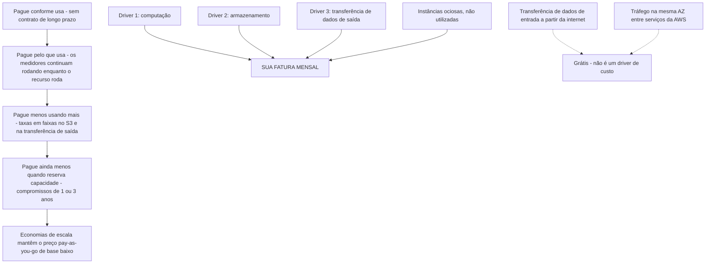
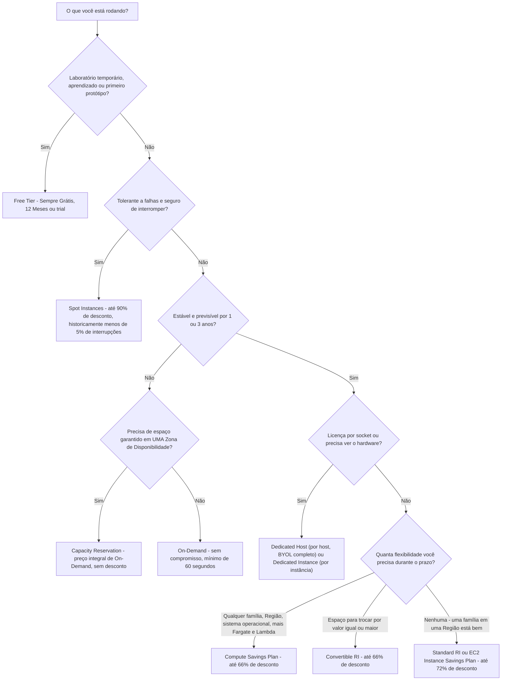
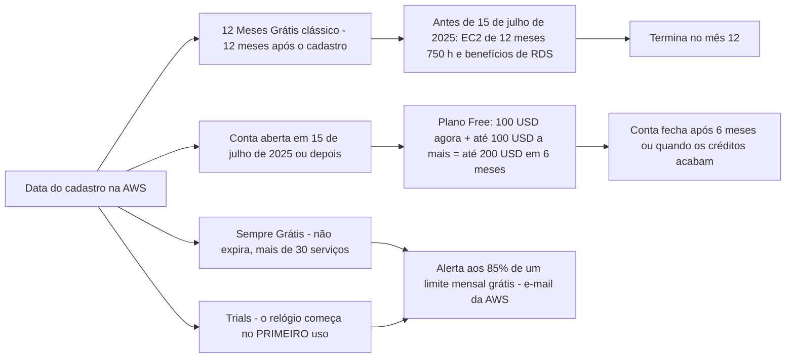
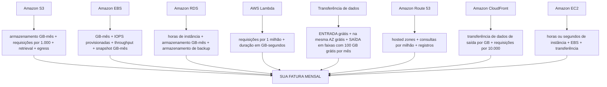
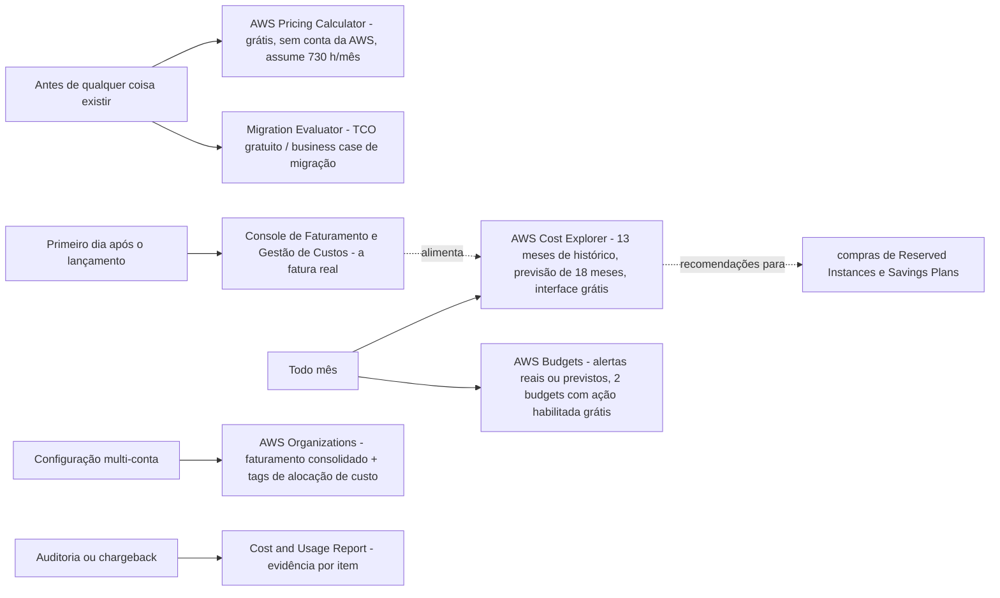
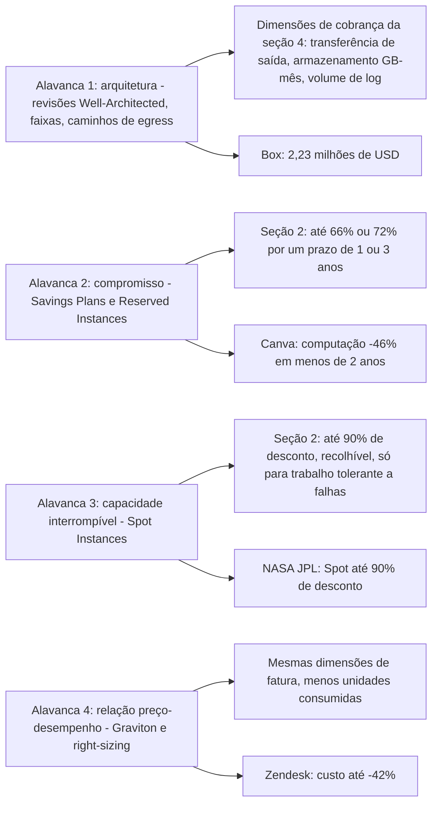

# Modelos de Preços da AWS e Ferramentas de Custo

**O Domínio 4 (Faturamento, Preços e Suporte) carrega 12% da pontuação do CLF-C02**, e duas de suas três declarações de tarefa vivem dentro desta lição: **Tarefa 4.1 "Comparar modelos de preços da AWS"** — On-Demand, Reserved Instances, Spot Instances, Savings Plans, Dedicated Hosts, Dedicated Instances, Capacity Reservations, faixas de armazenamento e transferência de dados de entrada versus de saída — e **Tarefa 4.2 "Recursos de gestão de faturamento, orçamento e custo"** — Budgets, Cost Explorer, o Pricing Calculator, faturamento consolidado do AWS Organizations, tags de alocação de custo e o Cost and Usage Report. Cerca de **seis itens pontuados** vêm do Domínio 4, e a maioria deles são questões de aritmética e julgamento, não definições. Alunos que reprovam nesta área raramente reprovam porque nunca ouviram falar de Savings Plans; reprovam porque não sabem dizer *qual* ferramenta responde *qual* pergunta, ou porque citam uma porcentagem de desconto sem saber ao que ela obriga você.

```text
=====================================================================
 AULA 13 CLF-C02 — MODELOS DE PREÇOS + FERRAMENTAS DE CUSTO (em outubro de 2026)
=====================================================================
 PRINCÍPIOS
   pague conforme usa -> pague pelo que usa -> pague menos
   conforme usa mais -> pague ainda menos quando reserva
   capacidade
   drivers ... computação . armazenamento . transferência de
   dados de SAÍDA
   entrada a partir da internet ... é gratuita
   tráfego na mesma AZ entre serviços ... é grátis
   preços são definidos por serviço E por Região
 OPÇÕES DE COMPRA DE COMPUTAÇÃO
   On-Demand ........ sem compromisso, hora/segundo, mínimo de 60 s
   RI Standard ....... 1 ou 3 anos, até 72% de desconto, escopo de
                        AZ = capacidade
   RI Convertible .... 1 ou 3 anos, até 66% de desconto, trocável
   Compute SP ........ 1 ou 3 anos, até 66% de desconto, qualquer
                        família + Fargate + Lambda
   EC2 Instance SP ... 1 ou 3 anos, até 72% de desconto, uma
                        família/Região
   Spot .............. sem compromisso, até 90% de desconto,
                        interrompível
   Dedicated ......... Host = por host + visibilidade de socket +
                        BYOL
                        Instance = por instância, hardware isolado
   Capacity Res. ..... espaço em uma AZ ao preço integral de
                        On-Demand
   Free Tier ......... Sempre Grátis / 12 Meses / Trials
 FREE TIER
   100 USD agora + até 100 USD a mais = até 200 USD em 6 meses
   Sempre Grátis ... mais de 30 serviços, não expira
   alerta por e-mail aos 85% de um limite mensal grátis
 FERRAMENTAS DE CUSTO
   antes de construir .. AWS Pricing Calculator (grátis, sem conta)
   caso de migração .... Migration Evaluator (gratuito)
   quanto gastei ....... AWS Cost Explorer (interface grátis)
   estou gastando demais . AWS Budgets (2 com ação habilitada grátis)
    a fatura em si ...... console de Faturamento e Gestão de Custos
    evidência ........... Cost and Usage Report (CUR)
   MUNDO REAL  (resultados de clientes, nunca garantias da AWS)
     Box ............... 2,23 mi USD = egress + armazenamento +
                         entre-AZ + logging (arquitetura)
     Canva ............. -46% de computação <2 anos (mix SP/RI/Spot)
     FarEye ............ -65% de computação ~1 mi USD/ano (SP+Spot)
     NASA JPL .......... Spot até 90% de desconto, tolerante a falhas
   ATUALIZAÇÕES 2026  (em outubro de 2026, com fontes)
     free tier ......... 6 meses + até 200 USD (15 de julho de 2025)
     100 GB de egress .. uma mudança de 2021, ainda vigente
     Database SP ....... até 35%, lançados em 2 de dezembro de 2025
=====================================================================
```

> [!NOTE]
> **Disciplina de escopo.** Tudo que é afirmado como fato abaixo tem fonte em páginas da AWS recuperadas em **outubro de 2026**, e todo preço, taxa e teto de desconto está datado **em outubro de 2026** — a AWS muda preços, concessões e limites de ferramentas sem anúncio, então **verifique o valor atual antes de usar**. Onde um número não pôde ser confirmado em uma fonte primária da AWS, ele foi omitido ou rotulado como algo a verificar; os tetos de desconto são sempre os máximos de **"até"** da própria AWS, nunca uma promessa do que você pagará.

Nesta lição você vai:

- enunciar os **quatro princípios gerais de preços** com as palavras da própria AWS e nomear os **três drivers de custo**;
- explicar por que **o mesmo tipo de instância custa valores diferentes em Regiões diferentes** e fazer a aritmética;
- ler a **tabela de comparação de compra de computação** — prazos de compromisso, flexibilidade, interrompibilidade e *quando o exame escolhe cada opção*;
- percorrer a **árvore de decisão de opções de compra** do laboratório grátis até a frota comprometida;
- separar **Standard versus Convertible RIs** e **Compute versus EC2 Instance Savings Plans** pelo teto de desconto *e* pela flexibilidade;
- explicar exatamente o que **Spot** custa em risco de interrupção, e o que um **Dedicated Host** compra a mais que um **Dedicated Instance**;
- nomear os **três modelos do Free Tier** com exemplos fonteados, mais a estrutura de créditos de pós-julho de 2025;
- listar as **dimensões de cobrança** de S3, EBS, RDS, Lambda, transferência de dados, Route 53 e CloudFront;
- precificar **requisições, egress e hosted zones** em exemplos numéricos resolvidos;
- escolher a **ferramenta de custo** certa: Pricing Calculator, TCO/Migration Evaluator, console de Faturamento, Cost Explorer, Budgets;
- mapear quatro **histórias reais de custo de clientes da AWS** (Box, Canva, FarEye, NASA JPL) para a alavanca que produziu cada economia, e ler a **caixa de atualizações de 2026 com fontes**;
- praticar com **12 questões em formato de exame** mais quatro verificações interativas.

| Tarefa do exame | Domínio (peso) | O que esta lição entrega |
|---|---|---|
| 4.1 Comparar modelos de preços da AWS | Faturamento, Preços e Suporte (12%) | §1 princípios, §2 tabela de compra, §3 Free Tier, §4 dimensões de cobrança |
| 4.2 Recursos de gestão de faturamento, orçamento e custo | Faturamento, Preços e Suporte (12%) | §5 as cinco ferramentas de custo, Organizations, tags, CUR |

---

## 1. Os quatro princípios gerais de preços

### 1.1 A escada de princípios

O whitepaper *How AWS Pricing Works* da AWS (publicado em **24 de fevereiro de 2023** e agora rotulado pela AWS como referência histórica) comprime o modelo inteiro em uma frase: *"Você paga conforme usa, paga pelo que usa, paga menos conforme usa mais, e paga ainda menos quando reserva capacidade."* A página de preços ao vivo acrescenta a metade contratual do acordo: **pay-as-you-go "sem exigir contratos de longo prazo"**.

| Princípio | Formulação oficial (AWS) | O que significa na sua fatura | Consequência no exame |
|---|---|---|---|
| **1. Pague conforme usa** | *"pay-as-you-go … sem exigir contratos de longo prazo"* | As cobranças acumulam enquanto o recurso roda; pare e a cobrança de execução para | Sem taxa de rescisão por deixar um serviço |
| **2. Pague pelo que usa** | *"pague pelo que usa"* | O consumo é medido por hora/segundo, GB-mês, requisição ou GB-segundo | Recursos ociosos são um custo que você escolheu pagar |
| **3. Pague menos usando mais** | *"pague menos conforme usa mais"* | Taxas **em faixas** para S3 e transferência de dados de saída; as faixas por volume derrubam o preço unitário conforme o uso sobe | Transferência de dados de **entrada** é **sempre gratuita** |
| **4. Pague ainda menos ao reservar** | *"paga ainda menos quando reserva capacidade"* | Uso comprometido (1 ou 3 anos) compra um teto de desconto | Reserved Instances e Savings Plans — §2 |

Dois conceitos de apoio completam o modelo. Primeiro, **economias de escala**: a AWS diz que os clientes *"Beneficiam-se de massivas economias de escala"*, o que é o que produz *"preços pay-as-you-go mais baixos"* — o uso agregado de todos os clientes da AWS é o motivo de o preço de tabela já ser baixo antes de qualquer compromisso. Segundo, **os três drivers de custo**: a AWS nomeia **computação, armazenamento e transferência de dados de saída** como *"três drivers fundamentais"*, observando explicitamente que **não há cobrança para transferência de dados de entrada**.



### 1.2 Pague menos usando mais: faixas e o que é grátis

"Pague menos usando mais" não é um slogan sobre descontos que você precisa negociar — é **faixa dentro do preço de tabela**. A página de preços da AWS afirma que **S3 e transferência de dados de saída são pagos em faixas**, enquanto **a transferência de dados de ENTRADA é sempre gratuita**. O exame transforma isso em duas perguntas:

1. **Qual direção é cobrada?** A de saída. A entrada a partir da internet é grátis, e o tráfego entre serviços na **mesma Zona de Disponibilidade é grátis**.
2. **A concessão é por serviço ou global?** Global — veja a caixa "Você sabia?" abaixo.

A AWS também documenta um quarto custo, mais silencioso: **ocioso**. O whitepaper de preços afirma que desligar instâncias não utilizadas pode economizar **"70 por cento ou mais"** — razão pela qual *desligue-o* é sempre uma resposta correta plausível em um enunciado de otimização de custo, e pela qual a limpeza de capacidade ociosa vem antes de qualquer decisão de compromisso.

- **📚 Você sabia?** A concessão gratuita de transferência de dados é de **100 GB de transferência de dados de saída grátis por mês, agregados entre todos os serviços da AWS e todas as Regiões** (excluindo as Regiões da China e o AWS GovCloud) — **não** são 100 GB por serviço e **não** são 100 GB por Região. O Amazon CloudFront acrescenta uma concessão separada de **1 TB de transferência de dados de saída grátis todo mês**. A AWS expandiu essa concessão a partir do valor antigo por Região, então material de estudo antigo que cita "1 GB por Região" está desatualizado (página de expansão de transferência de dados do Free Tier da AWS, em outubro de 2026).

### 1.3 O compromisso é a única alavanca que derruba o preço unitário

Faixa derruba o preço da *próxima* unidade; **compromisso derruba o preço de todas as unidades**. A página de preços da AWS agrupa isso sob **"Economize quando se comprometer"**, e os Savings Plans são documentados como um compromisso sobre **um período de um ou três anos**. Reserved Instances usam os mesmos prazos de 1 ou 3 anos com três opções de pagamento (**All Upfront, Partial Upfront, No Upfront**). Tudo no §2 é uma variação dessa única frase — razão pela qual o exame adora perguntar *"qual opção dá o desconto mais fundo com a menor flexibilidade?"*.

### 1.4 Os preços são definidos por serviço **e** por Região

O próprio guia de orientação de otimização de custos do exame (COST07-BP02) diz isso explicitamente: *"O preço dos recursos pode ser diferente em cada Região"* por causa de **terra, fibra, eletricidade e impostos**. **Local Zones são precificadas de forma diferente (mais alta) da sua Região principal.** O mesmo tipo de instância, o mesmo sistema operacional, a mesma hora pode, portanto, custar valores materialmente diferentes dependendo de onde você inicia.

**Exemplo resolvido E1 — variação regional em um tipo de instância (em outubro de 2026).**
O próprio feed de preços On-Demand da AWS para **t3.medium em Linux** (sem seleção de grupo de segurança), recuperado em **7 de outubro de 2026**:

| Região | USD por hora | vs Norte da Virgínia |
|---|---|---|
| US East (Norte da Virgínia) | **0,04160** | linha de base |
| Ásia-Pacífico (Mumbai) | **0,04480** | +7,7% |
| UE (Irlanda) | **0,04560** | +9,6% |
| Ásia-Pacífico (Sydney) | **0,05280** | +27% |
| Ásia-Pacífico (Tóquio) | **0,05440** | +31% |
| América do Sul (São Paulo) | **0,06720** | **+61%** |

A AWS cobra instâncias On-Demand por hora (ou por segundo com um **mínimo de 60 segundos**), e o Pricing Calculator padroniza um mês em **730 horas**. Então uma t3.medium rodando o mês inteiro:

$$
\text{N. Virginia} = 730 \times 0.0416 = \$30.37 \qquad
\text{São Paulo} = 730 \times 0.0672 = \$49.06
$$

Diferença: **$49,06 − $30,37 = $18,69 por mês, cerca de +61%**, para software idêntico. *Lição do exame:* **Região é uma decisão de preço**, mas apenas *depois* que os requisitos de latência, residência de dados e recursos forem satisfeitos — a AWS nunca publica um ranking de "Região mais barata", então trate custo como um desempate, não como o primeiro filtro.

> [!IMPORTANT]
> **Três regras que prendem candidatos no Domínio 4.**
> - **Grátis ≠ ilimitado:** as concessões grátis são mensais, **calculadas em todas as Regiões**, e **não acumulam** — um mês não utilizado não vira saldo.
> - **Mais barato ≠ correto:** a Região ou opção de compra mais barata só está certa quando satisfaz a tolerância da carga de trabalho a interrupção, latência e licenciamento.
> - **Desconto ≠ capacidade:** um desconto (Savings Plan, RI com escopo de Região) não reserva nada; apenas um **RI com escopo de AZ** ou uma **Capacity Reservation** reserva espaço, e a reserva é cobrada quer você use quer não.

---
## 2. Opções de compra de computação: a comparação sobre a qual o exame se apoia

A Tarefa 4.1 do Domínio 4 nomeia as opções explicitamente: **On-Demand Instances, Reserved Instances, Spot Instances, AWS Savings Plans, Dedicated Hosts, Dedicated Instances, Capacity Reservations**, mais faixas de armazenamento e transferência de dados. Abaixo está a habilidade inteira em uma tabela, com toda porcentagem datada **em outubro de 2026**.

### 2.1 A tabela-mestra de comparação

| Opção | Prazo de compromisso | Pagamento | Teto de desconto (em outubro de 2026) | O que trava / flexibilidade | Interrompível? | Quando o exame a escolhe |
|---|---|---|---|---|---|---|
| **On-Demand** | **Nenhum** — cobrado por hora ou segundo (**mínimo de 60 segundos**) | Sem antecipado | **0%** (preço de tabela de base) | Liberdade total: inicie, pare, redimensione, encerre a qualquer momento | **Não** | Cargas picadas, desconhecidas, experimentais ou de curta duração; o padrão quando nenhum padrão é conhecido |
| **Reserved Instance — Standard** | **1 ou 3 anos** | All / Partial / No Upfront | **até 72% de desconto** | Família, tamanho, sistema operacional, tenancy e Região fixos; **com escopo de região** cobre qualquer AZ e tamanho naquela Região; **com escopo de AZ também reserva capacidade** | **Não** | Capacidade de base steady-state e previsível |
| **Reserved Instance — Convertible** | **1 ou 3 anos** | All / Partial / No Upfront | **até 66% de desconto** | Pode ser **trocado por Convertible RIs de valor igual ou maior** — não é uma reconfiguração livre | **Não** | Estado estável que pode precisar mudar durante o prazo |
| **Savings Plan — Compute** | **1 ou 3 anos**, compromisso de **$ por hora** | All / Partial / No Upfront | **até 66% de desconto** | **Qualquer** família de instância, tamanho, AZ, Região, sistema operacional e tenancy — e se estende ao **AWS Fargate e AWS Lambda** | **Não** | Frotas mistas, contêineres e serverless que precisam permanecer móveis |
| **Savings Plan — EC2 Instance** | **1 ou 3 anos**, compromisso de **$ por hora** | All / Partial / No Upfront | **até 72% de desconto** | Uma **família de instância em uma Região** (tamanho, sistema operacional e tenancy continuam livres) | **Não** | Uso previsível de família única em uma Região |
| **Spot Instance** | **Nenhum** — preço repricing a cada **~5 minutos** | Sem antecipado; pague o preço Spot atual | **até 90% de desconto** | Roda *"sempre que houver capacidade disponível"*; a AWS pode recolhê-la com uma janela curta de aviso | **SIM** | Cargas tolerantes a falhas, sem estado, lote, CI, analítica de big data que toleram interrupção |
| **Dedicated Instance** | Termos On-Demand, RI ou Spot | Mesmas três famílias | **até 70%** quando comprada como Reserved Instance | Fisicamente isolada no nível do hardware do host, **sem visibilidade** nem controle sobre o posicionamento, **BYOL limitado** | **Não** | Requisito de conformidade *"sem hardware compartilhado"* |
| **Dedicated Host** | Por hora, **por host** | On-Demand ou comprometido | A AWS publica **nenhuma porcentagem de título** para hosts (verifique o valor atual) | **Servidor físico totalmente dedicado**, **visibilidade de socket/core**, afinidade de host, **BYOL completo** | **Não** | Licenciamento por socket/core (Microsoft, Oracle) e conformidade que precisa de visibilidade |
| **Capacity Reservation (ODCR)** | Nenhum — taxas On-Demand | Sem antecipado | **0%** — você paga o preço On-Demand pela capacidade de AZ reservada **usada ou não** | Reserva capacidade em **uma Zona de Disponibilidade específica** | **Não** | Capacidade de inicialização garantida em um horário conhecido, sem compromisso de 1 ano |
| **Free Tier** | — | — | **100% dentro da concessão** | Limites no §3; o uso **não acumula** | **Não** | Aprendizado, testes, primeiros protótipos |

> [!WARNING]
> **Leia a tabela como uma grade de dois eixos: desconto ↔ flexibilidade.** Todo número de "até" é um **teto**, não uma média, e quanto mais fundo o desconto mais você entrega: Spot entrega **disponibilidade**, RI/SP entregam **compromisso de prazo (1 ou 3 anos)**, as opções Dedicated entregam **compartilhamento de hardware**, e On-Demand não entrega **nada além de dinheiro**. O exame escreve distratores que misturam os eixos — *"a opção mais flexível com 72% de desconto"* não existe.

```text
=====================================================================
 TETO DE DESCONTO  x  O QUE VOCÊ ENTREGA   (em outubro de 2026)
=====================================================================
  até 90%   Spot ............. disponibilidade - capacidade recolhida
             |
  até 72%   EC2 Instance SP --+-- Standard RI (família + Região fixas)
             |                  |   Dedicated Instance como RI: até 70%
  até 66%   Compute SP -------+-- Convertible RI (trocável)
             |
      nenhum On-Demand ......... nada, mas o preço de tabela
             Capacity Reserv. .. nada, E você paga pelo espaço de AZ
                                  não utilizado
  ------------------------------------------------------------------
       FLEXIBILIDADE   baixa  <---------------------->  alta
  ==================================================================
   O desconto mais fundo e a flexibilidade máxima ficam em EXTREMOS
   OPPOSTOS do eixo - nenhuma opção é forte nos dois. Escolha sua
   posição a partir da tolerância da carga de trabalho, nunca da
   porcentagem sozinha.
=====================================================================
```

**Todo teto oficial em uma referência (todos "até", em outubro de 2026):**

| Compromisso ou opção | Teto de desconto | Observação |
|---|---|---|
| **EC2 Instance Savings Plan** / **Standard Reserved Instance** | **72%** | O par menos flexível: um Standard RI fixa família, tamanho, sistema operacional, tenancy e Região; um EC2 Instance SP compromete com uma família em uma Região |
| **Compute Savings Plan** / **Convertible Reserved Instance** | **66%** | Compromisso mais flexível; o Compute SP também cobre **Fargate e Lambda** |
| **Spot Instances** | **90%** | Não é um compromisso — capacidade ociosa interrompível |
| **Dedicated Instances** compradas como Reserved Instances | **70%** | Resposta de conformidade primeiro, desconto depois |
| **SageMaker AI Savings Plans** | **64%** | Adjacente à tarefa; raramente perguntado diretamente |
| **Database Savings Plans** | **35%** | Compromisso de banco de dados gerenciado |
| **On-Demand / On-Demand Capacity Reservation** | **nenhum** | Preço de tabela de base; a ODCR cobra a capacidade reservada usada ou não |
| **Dedicated Hosts** | **sem porcentagem publicada pela AWS** | A AWS não cita economia de título — **verifique o valor atual antes de usar** |
| **Free Tier** | **100% dentro da concessão** | §3; as concessões são mensais e não acumulam |

### 2.2 Exemplo resolvido E2 — a escada de descontos

Tome um custo de tabela On-Demand hipotético de **100 unidades por mês** para a mesma carga de trabalho estável e aplique os tetos publicados pela AWS (aritmética ilustrativa, **tetos em outubro de 2026**):

```text
On-Demand (sem compromisso)                 100   <- linha de base
  Compute Savings Plan        (-66%)    =  34   <- mesmo teto do Convertible RI
  Convertible RI (1 ou 3 anos)(-66%)    =  34
  EC2 Instance SP             (-72%)    =  28   <- mesmo teto do Standard RI
  Standard RI (1 ou 3 anos)   (-72%)    =  28
  Dedicated Instance como RI  (-70%)    =  30   <- resposta de conformidade primeiro
  Spot (sem prazo, interrompível)(-90%) =  10   <- o único degrau interrompível
```

Duas lições se apoiam nesses números. Primeiro, **Savings Plans e Reserved Instances são mapeados 1:1 por teto**: Compute SP ≈ Convertible RI em **66%**, EC2 Instance SP ≈ Standard RI em **72%** — o FAQ de Savings Plans da AWS diz exatamente isso (*"66% (assim como os Convertible RIs)"* e *"72% (assim como os Standard RIs)"*). A diferença entre os pares é, portanto, **flexibilidade, não economia**. Segundo, a fatura real cai **acima** desses valores, porque um teto é o melhor que a AWS fará por uma carga de trabalho perfeitamente casada — a economia real depende de quanto completamente o seu uso casa com o compromisso.

### 2.3 Reserved Instances: as letras miúdas que o exame reutiliza

| Pergunta | Resposta oficial (em outubro de 2026) |
|---|---|
| Quanto tempo? | **1 ano ou 3 anos** |
| Como pago? | **All Upfront, Partial Upfront, No Upfront** |
| Maior desconto? | Standard **até 72%**; Convertible **até 66%** |
| Reserva capacidade? | **Somente se o RI tiver escopo em uma Zona de Disponibilidade específica** — um RI com escopo de região é só um desconto |
| O que pode mudar? | Standard RI: essencialmente nada no meio do prazo. Convertible: **troca por Convertible RIs de valor igual ou maior** |
| O que a AWS recomenda em vez disso? | *"Recomendamos os Savings Plans"* por *"flexibilidade para mudar seu uso"* |
| Posso vender um que não preciso mais? | A revenda passa pelo **Reserved Instance Marketplace** — as regras mudam, então **verifique o valor atual antes de usar**; é uma mitigação, nunca um plano |

> ⚠️ **Uma Reserved Instance é um desconto de faturamento, não um servidor reservado.** A formulação da AWS é *"uma reserva de capacidade **quando usada em uma Zona de Disponibilidade específica**"* — o desconto e a reserva são duas coisas separadas que viajam juntas. E a família de armadilhas funciona nos dois sentidos: **um Savings Plan não reserva nada**, enquanto uma **On-Demand Capacity Reservation reserva capacidade a preço integral sem desconto algum**. Se um enunciado diz *"capacidade garantida na AZ X com desconto"*, a resposta é um **Standard RI com escopo de AZ** — nada mais na tabela faz os dois trabalhos.

### 2.4 Savings Plans: os dois tipos em uma visão

| | **Compute Savings Plan** | **EC2 Instance Savings Plan** |
|---|---|---|
| Teto de desconto (em outubro de 2026) | **até 66%** | **até 72%** |
| Compromisso | **$/hora** por **1 ou 3 anos** | **$/hora** por **1 ou 3 anos** |
| Aplica-se a | Qualquer **família, tamanho, AZ, Região, sistema operacional, tenancy** de instância, além do **AWS Fargate e AWS Lambda** | Uma **família de instância em uma Região** (tamanho, sistema operacional, tenancy flexíveis) |
| Teto de RI equivalente | Convertible RI (66%) | Standard RI (72%) |
| O exame escolhe quando… | A frota é mista, multi-Região, ou inclui contêineres/serverless | O uso é genuinamente uma família, uma Região, durante todo o prazo |

A AWS precifica um ano de Savings Plan como **365 dias** e três anos como **1.095 dias**, e oferece as mesmas escolhas de pagamento **All / Partial / No Upfront**. A própria página de tipos de Savings Plans da AWS molda a escolha como *"flexibilidade para mudar seu uso"* — comprometa-se com um **valor em dólares por hora** (Compute) ou com uma **família específica em uma Região** (EC2 Instance).

### 2.5 Spot: 90% de desconto, com uma armadilha que o exame sempre testa

Spot Instances rodam **capacidade ociosa de EC2** a *"menos do que o preço On-Demand"* e são comercializadas como *"até 90% de desconto"*. Três mecânicas importam:

1. **O preço se move.** A lista de preços Spot é **atualizada a cada 5 minutos** e reflete *"tendências de longo prazo de oferta e demanda"* — ao contrário do On-Demand, cujo preço por hora é estático.
2. **A capacidade pode ser recolhida.** A AWS roda a instância *"sempre que houver capacidade disponível"* e interrompe quando precisa da capacidade de volta. O próprio Instance Advisor da AWS relata uma **frequência média de interrupção que historicamente ficou abaixo de 5%** (visão de 30 dias, todas as Regiões e tipos de instância, em outubro de 2026) — ainda não zero, razão pela qual Spot *nunca* é a resposta para uma carga de trabalho com estado, não tolerante a falhas ou crítica a latência.
3. **Projete para a interrupção.** O par examinável é cargas de trabalho *tolerantes a falhas / sem estado / reiniciáveis*: trabalhos em lote, pipelines de CI, processamento de big data, renderização de imagens, consumidores de fila que podem reler trabalho.

- **📚 Você sabia?** A página de preços de Reserved Instances da AWS atualmente abre com *"Recomendamos os Savings Plans"* — a mesma página que vende o RI está orientando clientes flexíveis para outro lugar. No exame, enunciados do tipo "a AWS recomenda X em vez de Y" geralmente testam exatamente essa linha: **Savings Plans para flexibilidade, RIs quando você quer especificamente o construto de RI (incluindo uma reserva de capacidade com escopo de AZ)**.

### 2.6 Dedicated Host versus Dedicated Instance versus Capacity Reservation

Esses três são confundidos constantemente. Os eixos discriminadores são **o que é cobrado**, **o que você pode ver**, e **que controle de licença você obtém**:

| | **Dedicated Host** | **Dedicated Instance** | **Capacity Reservation (ODCR)** |
|---|---|---|---|
| Hardware | *"Servidor físico … totalmente dedicado ao seu uso"* | *"Fisicamente isolado no nível do hardware do host"* | Qualquer hardware em **uma AZ** |
| Cobrança | **Por host** (por hora) | **Por instância** (On-Demand / RI / Spot) | **Taxa On-Demand** para os slots reservados |
| Visibilidade | **Visibilidade de socket e core**, afinidade de host | **Sem visibilidade nem controle sobre o posicionamento da instância** | Não se aplica |
| BYOL | **BYOL completo** (ex.: licenças Microsoft, Oracle por socket) | **Suporte limitado a BYOL** | Depende das instâncias que você inicia nela |
| Desconto | A AWS publica **nenhuma % de título** — verifique o valor atual | **até 70%** quando comprada como Reserved Instance | **Nenhum** — você paga quer use quer não a capacidade |
| O exame escolhe quando… | Licenciamento por socket/core, ou conformidade que precisa de visibilidade do host | *"Sem hardware compartilhado"* é o requisito | Você precisa de **capacidade de inicialização agora**, sem prazo de 1 ano |

A AWS afirma que **não há diferença de desempenho, segurança ou física** entre Dedicated Hosts e Dedicated Instances — a divisão é **granularidade de cobrança, visibilidade e licenciamento**.

### 2.7 A árvore de decisão e o casamento com a carga de trabalho



```matching
{
  "question": "Associe cada descrição de carga de trabalho à opção de compra que o exame CLF-C02 espera:",
  "pairs": [
    {"left": "Um trabalho noturno em lote reiniciável que pode perder seu progresso sem impacto de negócio", "right": "Spot Instances - até 90% de desconto (em outubro de 2026) porque a capacidade pode ser recolhida"},
    {"left": "Uma camada de banco de dados rodando o mesmo tipo de instância 24 horas por dia pelos próximos três anos", "right": "Standard Reserved Instance ou EC2 Instance Savings Plan - até 72% de desconto (em outubro de 2026)"},
    {"left": "Um experimento de duas semanas com padrão de uso desconhecido e sem orçamento para compromisso", "right": "On-Demand - sem compromisso, cobrado por hora ou segundo com mínimo de 60 segundos"},
    {"left": "Uma implantação Oracle licenciada por socket físico que não pode compartilhar hardware", "right": "Dedicated Host - cobrança por host com visibilidade de socket e core e BYOL completo"},
    {"left": "Uma frota mista de contêineres e funções Lambda abrangendo várias Regiões", "right": "Compute Savings Plans - até 66% de desconto (em outubro de 2026), cobrindo qualquer família de instância, Fargate e Lambda"},
    {"left": "Um lançamento de produto que precisa ser capaz de inicializar capacidade em uma Zona de Disponibilidade específica no dia um", "right": "On-Demand Capacity Reservation - reserva capacidade de AZ ao preço integral de On-Demand"},
    {"left": "Um estudante iniciando uma única instância pequena para trabalhos da faculdade", "right": "Free Tier - Sempre Grátis, 12 Meses Grátis ou um trial de serviço, com uso que não acumula"}
  ],
  "explanation": "Todo enunciado nomeia um dos três eixos que o exame usa: tolerância a interrupção (Spot), previsibilidade de duração (RI versus Savings Plans versus On-Demand), e requisitos de licenciamento ou posicionamento de capacidade (Dedicated Host, Capacity Reservation). Associe o eixo primeiro e a opção vem depois - a porcentagem de desconto sozinha nunca decide."
}
```

### 2.8 Lendo o enunciado: o mapa de palavras-chave

Quase todo item de compra do Domínio 4 pode ser decidido a partir de duas ou três palavras no enunciado. Use este mapa antes de ler as opções — depois elimine qualquer coisa que viole a palavra-chave:

```text
 PALAVRA-CHAVE DO ENUNCIADO              -> PRIMEIRA OPÇÃO A CONSIDERAR
 ------------------------------------------------------------------
 "tolerante a falhas" "interrompível"    -> Spot (até 90%, menos de 5% de
 "pode ser reiniciada / sem estado"         interrupções históricas, em
                                            outubro de 2026)
 "estável" "previsível" "linha de base"  -> Standard RI ou EC2 Instance SP
                                            (até 72%)
 "pode mudar de família / SO"            -> Convertible RI ou Compute SP
                                            (até 66%)
 "frotas mistas" "contêineres"           -> Compute Savings Plan
 "compromisso de Lambda / Fargate"       -> APENAS Compute Savings Plan
 "capacidade garantida na AZ X"          -> Standard RI com escopo de AZ
                                            (desconto E reserva)
 "capacidade agora, sem prazo de 1 ano"  -> On-Demand Capacity Reservation
                                            (preço integral, sem desconto)
 "licença por socket" "ver os cores"     -> Dedicated Host
 apenas "sem hardware compartilhado"     -> Dedicated Instance
 "aprendizado / teste / protótipo"       -> Free Tier
 "padrão desconhecido" / "só esta semana" -> On-Demand
 ------------------------------------------------------------------
 FRASES-BANDEIRA VERMELHA
   "mais barato E mais flexível"         -> contradição; nenhuma opção
   "Savings Plan reserva capacidade"     -> falso; SP não reserva nada
   "Spot sempre está disponível"         -> falso; a capacidade é recolhida
   "comprometido = capacidade garantida" -> falso, a menos que RI com
                                            escopo de AZ
   "parado = $0"                         -> falso para RDS (armazenamento +
                                            backup) e para EC2 (EBS)
```

---
## 3. Free Tier: três modelos mais a reestruturação de 2025

### 3.1 Os três tipos clássicos

A documentação do Free Tier da AWS define três categorias, e o exame pede que você as distinga por **como o relógio se comporta**:

| Tipo | Regra do relógio (formulação da AWS) | Exemplos fonteados (em outubro de 2026) | Expira? |
|---|---|---|---|
| **Sempre Grátis** | *"não expiram automaticamente"* — disponíveis *"indefinidamente"* | **Mais de 30 serviços da AWS** na lista Sempre Grátis (aws.amazon.com/free, out. 2026); **Lambda: 1.000.000 de requisições + 400.000 GB-segundos por mês**; **transferência de dados de saída: 100 GB por mês** agregados entre serviços e Regiões (exceto China e GovCloud) | **Não** |
| **12 Meses Grátis** | *"12 meses seguintes à data do seu cadastro na AWS"* | Concessões clássicas como **EC2: 750 horas por mês de t2.micro / t3.micro** e **S3: 5 GB de armazenamento + 20.000 GET + 2.000 PUT** (dependente da data da conta — veja §3.2); **uso grátis de RDS** para contas ativadas **antes de 15 de julho de 2025** | **Sim** — 12 meses a partir do cadastro |
| **Trials** | *"começam a partir do momento em que o primeiro uso começa"* | Janelas promocionais curtas em serviços específicas, começando no primeiro uso, não no cadastro | **Sim** — fim da janela do trial |

Duas regras mecânicas se aplicam aos três: o uso grátis é **"calculado cada mês em todas as regiões"** e **"não acumula"**, e o uso do Free Tier **não está disponível no AWS GovCloud** — a concessão de 100 GB de transferência de dados de saída adicionalmente exclui as **Regiões da China**. Uma concessão mensal fica fora dos três clássicos: o **Amazon CloudFront lista 1 TB de transferência de dados de saída mais 10.000.000 de requisições HTTP(S) por mês**, mas a página não o rotula como Sempre Grátis nem de 12 meses — **não afirme uma duração para ele sem reverificar** (verifique o valor atual antes de usar).

### 3.2 O que mudou em 15 de julho de 2025

O modelo clássico de 12 meses ainda é o vocabulário do exame, mas a experiência atual de cadastro é baseada em créditos. Em **7 de outubro de 2026**, o aws.amazon.com/free oferece:

- **$100 em créditos imediatamente**, mais **até $100 a mais ganhos**, para **até $200 em 6 meses**;
- um **plano Free** cuja conta *"fecha sozinha 6 meses depois que você a abre"* — ou quando os créditos acabam — cobrindo *"mais de 90 serviços"*, com **apenas as ofertas Sempre Grátis ativas** em uma conta de plano Free;
- um **plano Paid** com o catálogo completo, que também é elegível para os créditos;
- categorias inalteradas: **Sempre grátis (mais de 30 serviços da AWS)**, **Trials** e ofertas por tempo limitado.

Os tipos de instância free-tier de EC2 diferem pela data da conta: contas **antes de 15 de julho de 2025** veem `t2.micro` / `t3.micro` na trilha de 12 meses; contas **naquela data ou depois** recebem `t3.micro`, `t3.small`, `t4g.micro`, `t4g.small`, `c7i-flex.large` e `m7i-flex.large` na trilha de **6 meses ou até os créditos se esgotarem**. **Verifique o valor atual antes de usar** — esta é a área que mais se move rápido no Domínio 4.



### 3.3 Exemplo resolvido E3 — o que "750 horas por mês" realmente compra

A concessão clássica de EC2 é de **750 horas por mês** de t2.micro/t3.micro (valor da era de 12 meses, em outubro de 2026). O Pricing Calculator da AWS padroniza um mês em **730 horas**, então:

$$
\frac{750 \text{ free hours}}{730 \text{ hours in a month}} = 1.03 \text{ instances running 24/7}
$$

Então 750 horas significam **exatamente uma instância rodando 24 horas por dia durante o mês, com quase nada de sobra** — duas instâncias divididas ao longo do mês estourarão a concessão, e assim também uma instância mais um resto de uma segunda Região, porque a concessão é **calculada mensalmente em todas as Regiões e não acumula**. A mesma aritmética se aplica a qualquer concessão grátis por hora: divida as horas por 730 antes de prometer "grátis" a alguém.

> [!NOTE]
> **Free Tier é uma armadilha de orçamento, não um modelo de preços.** Ele nunca aparece como resposta a uma questão de carga de trabalho de produção, não vira saldo, e a AWS notifica você **por e-mail quando você excede 85% de um limite do Free Tier** — combine isso com um **Budget de $0** (§5) e você obtém um aviso antecipado que não custa nada. Note também que o **AWS Pricing Calculator assume que você NÃO está usando o Free Tier**, então uma estimativa construída no calculator parecerá pior do que o seu primeiro mês real.

- **📚 Você sabia?** O limiar de alerta do Free Tier é de **85 por cento**, não 100%: a AWS afirma que *"notifica você por e-mail quando você excede 85 por cento do seu limite do Free Tier"*. A notificação é por serviço, o estouro de 100% é problema seu para monitorar, e uma conta de plano Free tem **apenas as ofertas Sempre Grátis ativas** — concessões por tempo limitado não existem nesse plano.

---

## 4. Pelo que você realmente é cobrado: dimensões por serviço

Saber *qual* serviço usar é metade do Domínio 4; saber **em qual unidade aquele serviço cobra** é a outra metade. Todo preço abaixo está **em outubro de 2026** e deve ser reverificado antes de você confiar nele.

### 4.1 A matriz de dimensões de cobrança

| Serviço | Dimensões de cobrança | Armadilhas principais (em outubro de 2026) |
|---|---|---|
| **Amazon S3** | **Armazenamento GB-mês** por classe de armazenamento · **Requisições por 1.000** (PUT/COPY/POST/LIST versus GET/HEAD) · **Retrievação** por GB em classes com retrieval · cobranças de ciclo de vida/ingest · **egress** | **Requisições DELETE e CANCEL são grátis**; **LIST é cobrado na taxa de PUT**; GET é muito mais barato que PUT; taxa de armazenamento **verifique o valor atual antes de usar** |
| **Amazon EBS** | **GB-mês** (cobrado em **incrementos por segundo com mínimo de 60 segundos**) · **IOPS provisionadas por mês** · **throughput por mês** · **snapshots GB-mês** | **gp3 inclui 3.000 IOPS provisionadas e 125 MB/s provisionados** na linha de base; taxa de tabela de exemplo **$0,08/GB-mês** (dependente da região, em outubro de 2026) |
| **Amazon RDS** | **Horas de instância de banco de dados** (**incrementos de 1 segundo, mínimo de 10 minutos**) · **armazenamento GB-mês** · **armazenamento de backup** | **Uma instância parada ainda cobra armazenamento e backup** — apenas as horas de instância param; retenção de backup maior = fatura maior |
| **AWS Lambda** | **Requisições** (**$0,20 por 1 milhão de requisições**, us-east-1) · **Duração em GB-segundos** (**$0,0000167 por GB-segundo**, x86) | Concessão grátis **1.000.000 de requisições + 400.000 GB-segundos por mês**; as faixas de duração mudam acima de 6 bilhões de GB-s/mês |
| **Transferência de dados** | **ENTRADA grátis** a partir da internet · **na mesma AZ grátis** · **SAÍDA em faixas por GB** com **100 GB/mês grátis globalmente** (exceto China e GovCloud) · saída entre Regiões por GB | us-east-1 primeira faixa **$0,09/GB**, descendo para **$0,085 / $0,070 / $0,050** em volumes maiores; a entrada é a direção grátis |
| **Amazon Route 53** | **Hosted zone por mês** (**$0,50** para as primeiras 25, **$0,10** depois) · **Consultas por milhão** (**$0,40** para os primeiros 1 bilhão/mês, depois **$0,20**) · **$0,0015 por registro/mês** além de 10.000 registros por zona | **Consultas em hosted zones privadas são grátis**; os primeiros 10.000 registros por zona estão incluídos |
| **Amazon CloudFront** | **Transferência de dados de saída por GB** (em faixas, por classe de preço) · **Requisições por 10.000** · recursos opcionais | Concessão mensal grátis **1 TB de transferência de saída + 10.000.000 de requisições**; primeiro 1 TB grátis e depois **$0,085** pelos próximos 9 TB (EUA, em outubro de 2026); existem planos de tarifa fixa |
| **Amazon EC2** | **Horas/segundos de instância por opção de compra** · **volumes e snapshots de EBS** · **transferência de dados** · cobranças opcionais de host/capacidade de AZ | A opção de compra escolhida no §2 decide a taxa unitária; On-Demand tem **mínimo de 60 segundos** |



### 4.2 Exemplos resolvidos E4–E6 — aritmética de requisições, egress e DNS

**E4 — a fatura de requisições do S3 (us-east-1, em outubro de 2026).** Um serviço realiza **500.000 escritas** e **20.000.000 de leituras** por mês:

| Operação | Taxa (em outubro de 2026) | Cálculo | Custo |
|---|---|---|---|
| PUT/COPY/POST/LIST | **$0,005 por 1.000** | 500.000 ÷ 1.000 × 0,005 | **$2,50** |
| GET/HEAD | **$0,0004 por 1.000** | 20.000.000 ÷ 1.000 × 0,0004 | **$8,00** |
| DELETE/CANCEL | **Grátis** | — | **$0,00** |
| **Total de requisições** | | | **$10,50/mês** |

Ponto: uma carga de trabalho pesada em leitura é barata em requisições, e uma carga pesada em **LIST** não é — LIST é cobrado na taxa de PUT. Armazenamento GB-mês e egress são adicionais.

**E5 — transferência de dados de saída com a concessão global grátis (em outubro de 2026).** Uma carga de trabalho envia **600 GB** de egress para a internet em um mês a partir de **us-east-1**:

$$
(600 - 100)_{\text{free global allowance}} \times \$0.09 = 500 \times 0.09 = \$45.00
$$

Ponto: os **100 GB são agregados entre todos os serviços da AWS e todas as Regiões** (exceto China e GovCloud) — você não recebe 100 GB novos por serviço, e a **transferência de entrada não custa nada**, então uma arquitetura chorona e pesada em download é um problema de *saída*.

**E6 — Route 53 em uma conta pequena (em outubro de 2026).** Duas hosted zones e **500.000 consultas padrão** em um mês:

$$
2 \times \$0.50 + \left(\frac{500{,}000}{1{,}000{,}000} \times \$0.40\right) = \$1.00 + \$0.20 = \$1.20 \text{/month}
$$

Ponto: **DNS é cobrado por zona e por consulta**, e **consultas em hosted zones privadas são grátis** — que é o motivo padrão de uma arquitetura de zona privada ser a resposta mais barata no exame.

### 4.3 A regra "parado não é grátis"

O fato de cobrança mais testado desta seção: **o Amazon RDS cobra por armazenamento provisionado e armazenamento de backup enquanto a instância está parada — apenas as horas de instância de banco de dados param.** EC2 é diferente: parar uma instância para a cobrança de horas de instância, mas os **volumes e snapshots de EBS anexados continuam cobrando**. Então:

| Ação | O que para de cobrar | O que continua cobrando |
|---|---|---|
| Parar uma instância **EC2** | Horas de instância | Volumes de EBS, snapshots, transferência de dados |
| Parar uma instância **RDS** | Horas de instância de banco de dados | **Armazenamento provisionado E armazenamento de backup** |
| Excluir recursos não utilizados | Tudo daquele recurso | — |

**Exemplo resolvido E7 (ilustrativo).** Uma equipe para um banco de dados toda noite esperando `$0`: se a hora de instância para mas **100 GB de armazenamento provisionado e seus backups** permanecem, a parada noturna economiza apenas a linha de computação. O enunciado do exame costuma ser *"a equipe parou o banco de dados à noite para economizar; por que a fatura não mudou?"* — a resposta é que **as cobranças de armazenamento e backup continuam**.

```fillblank
{
  "question": "Complete as afirmações sobre dimensões de cobrança com as unidades e regras corretas da AWS:",
  "template": "O Amazon S3 cobra armazenamento por {{1}}, além de requisições por 1.000 - requisições DELETE são grátis e LIST é cobrado na taxa de PUT. O Amazon EBS cobra armazenamento por GB-mês em incrementos por segundo com mínimo de {{2}} segundos. O Amazon RDS cobra horas de instância, armazenamento e {{3}} - então uma instância parada ainda não é grátis. O AWS Lambda cobra por 1 milhão de requisições e por {{4}} de duração. Para transferência de dados, o tráfego {{5}} a partir da internet é gratuito.",
  "answers": {
    "1": "GB-mês",
    "2": "60",
    "3": "armazenamento de backup",
    "4": "GB-segundo",
    "5": "entrada"
  },
  "distractors": ["GB-hora", "30", "apenas armazenamento de snapshot", "milissegundo", "saída", "requisição"],
  "explanation": "O armazenamento do S3 é por GB-mês (documentação de outubro de 2026); o EBS é medido por segundo com mínimo de 60 segundos; o RDS continua cobrando armazenamento provisionado e armazenamento de backup enquanto parado; o Lambda é precificado por requisições mais GB-segundos ($0,20 por 1 milhão de requisições e $0,0000167 por GB-segundo, us-east-1, em outubro de 2026); e a transferência de dados de entrada a partir da internet é grátis - a saída é a direção cobrada."
}
```

- **📚 Você sabia?** Dos três drivers de custo que a AWS nomeia (computação, armazenamento, transferência de dados de saída), apenas **um depende da direção**: a transferência de dados de **entrada** é grátis a partir da internet, o tráfego **na mesma AZ** entre serviços da AWS é grátis, e tudo de interessante é cobrado no lado da **saída** — agregado como "AWS Data Transfer Out" com uma **concessão grátis de 100 GB/mês em todos os serviços e Regiões** (exceto China e GovCloud), em outubro de 2026. Essa única frase responde mais itens de transferência de dados do Domínio 4 do que qualquer tabela.

### 4.4 Transferência de dados: cada direção, precificada

A Tarefa 4.1 nomeia explicitamente os *"custos de transferência de dados de entrada e saída (entre Regiões, intra-Região)"*. A própria orientação de preços da AWS trata a entrada como grátis e a saída como a direção medida:

| Direção | Cobrança (em outubro de 2026) | Formulação da fonte |
|---|---|---|
| **Internet → AWS (entrada)** | **Grátis** | *"a transferência de dados de ENTRADA é sempre gratuita"*; *"não há cobrança para transferência de dados de entrada"* |
| **Entre serviços na mesma Zona de Disponibilidade** | **Grátis** | Tráfego na mesma AZ não é cobrado |
| **AWS → internet (saída)** | **Em faixas por GB**, com **100 GB grátis por mês** agregados entre todos os serviços e Regiões (exceto China e GovCloud) | Faixas us-east-1: **$0,090 / $0,085 / $0,070 / $0,050 por GB** conforme o volume mensal sobe |
| **Região → Região (saída entre Regiões)** | **Por GB**, tirados da mesma concessão global de transferência de saída de **100 GB/mês** | Mesmo feed, **7 de outubro de 2026**: **$0,010/GB** (Ohio), **$0,020/GB** (Irlanda, Tóquio, Sydney, São Paulo) — **verifique o seu par exato de Regiões** |
| **AWS → internet através do CloudFront** | Cobrado como transferência de dados de saída do CloudFront, com **1 TB + 10.000.000 de requisições grátis por mês** | Página pay-as-you-go do CloudFront (em outubro de 2026) |
| **AWS → Local Zone** | **Preço diferente (mais alto) da Região principal** | Página de preços das Local Zones |

**Exemplo resolvido E8 — um mês de transferência mista (taxas us-east-1, em outubro de 2026).**

| Tráfego | Taxa aplicada | Cálculo | Custo |
|---|---|---|---|
| 500 GB baixados **para** a AWS a partir da internet | **Grátis** | — | **$0,00** |
| 400 GB servidos **de** saída para a internet | primeiros 100 GB grátis globalmente, depois **$0,09/GB** | (400 − 100) × 0,09 | **$27,00** |
| 250 GB replicados **para outra Região** | **$0,020/GB** (taxa do feed, 7 de outubro de 2026) | 250 × 0,020 | **$5,00** |
| 1 TB servidos **através do CloudFront** | dentro da **concessão mensal grátis de 1 TB** | — | **$0,00** |
| Tráfego **dentro de uma Zona de Disponibilidade** | **Grátis** | — | **$0,00** |
| **Total** | | | **$32,00** |

Ponto: a fatura inteira veio de **uma direção** (saída) e **um salto** (entre Regiões). As arquiteturas mais baratas neste exame movem dados **para dentro de graça, mantêm-nos dentro de uma Zona de Disponibilidade sempre que possível, e empurram-nos para a internet pelo CloudFront** em vez de direto de uma origem.

### 4.5 Faixas de armazenamento: onde o driver de custo "armazenamento" realmente mora

A Tarefa 4.1 pareia opções de compra com *"opções e faixas de armazenamento"*. A lógica de preços de cada faixa de armazenamento é o mesmo trade-off — **quanto menor a taxa mensal em GB-mês, mais frios os dados precisam ser e mais você paga para lê-los de volta**:

```text
 ESCADA DE CALOR  (todas as classes cobram armazenamento em GB-mês;
                   taxas: verifique o valor atual)
 ------------------------------------------------------------------
   quente / acesso frequente ... maior $/GB-mês, sem taxa de
                                 retrieval, para dados lidos
                                 constantemente
   acesso infrequent .......... menor $/GB-mês, cobrança de
                                 retrieval por GB + duração mínima
                                 de armazenamento (verifique por
                                 classe antes de confiar)
   archive (instantâneo) ...... muito menor $/GB-mês, cobrança de
                                 retrieval
   archive (flexível/profundo) menor $/GB-mês, minutos-a-horas para
                                 restaurar, maior duração mínima
 ------------------------------------------------------------------
   MOVE DADOS FRIOS COM: regras de ciclo de vida do Amazon S3,
   escolha de tipo de volume do EBS, faixas de snapshot do EBS
   PAGUE POR MOVER COM: cobranças de transição/ingest + egress na
   leitura
=====================================================================
```

| Dimensão de cobrança de armazenamento | Unidade | Observações (em outubro de 2026) |
|---|---|---|
| **Armazenamento de objetos do S3** | **GB-mês, por classe de armazenamento** | Classe mais fria = taxa menor, custo de retrieval maior e durações mínimas — **verifique a taxa atual antes de usar** |
| **Requisições do S3** | **por 1.000** | PUT/COPY/POST/LIST **$0,005**, GET/HEAD **$0,0004**, DELETE/CANCEL **grátis** |
| **Retrieval/ingest do S3** | **por GB** | Retrieval em classes mais frias; aplicam-se cobranças de ciclo de vida e de ingest por PUT |
| **Armazenamento de volume do EBS** | **GB-mês** | Exemplo **$0,08/GB-mês** (dependente da região); medido **por segundo, mínimo de 60 segundos**; **gp3 inclui 3.000 IOPS e 125 MB/s** |
| **Desempenho provisionado do EBS** | **IOPS e MB/s por mês** | Cobrado apenas onde o tipo de volume cobra por desempenho provisionado |
| **Snapshots do EBS** | **GB-mês** | Backups incrementais continuam cobrando até serem excluídos — snapshots nunca são grátis |
| **Armazenamento + backup do RDS** | **GB-mês** | Cobrado **mesmo enquanto a instância está parada** |

*Lição do exame:* "nós arquivamos os dados" só é uma economia se o **padrão de retrieval** casar com a frieza da faixa — uma classe fria que é lida diariamente cobra mais do que a classe quente que substituiu, e qualquer dado que sai da AWS para a internet é cobrado como **transferência de dados de saída**.

---
## 5. Ferramentas de custo: cinco perguntas, cinco respostas

A Tarefa 4.2 nomeia o kit de ferramentas: **AWS Budgets, AWS Cost Explorer, o AWS Pricing Calculator, AWS Organizations (faturamento consolidado), tags de alocação de custo** e o **Cost and Usage Report**. O exame não testa profundidade de recursos — testa **qual ferramenta responde qual pergunta**, mais um punhado de limiares grátis/pagos.

### 5.1 A escada de ferramentas

| Pergunta que você tem | Ferramenta | O que ela entrega | Custo e limites (em outubro de 2026) |
|---|---|---|---|
| *"Quanto isso vai custar **antes** de eu construir?"* | **AWS Pricing Calculator** | Uma estimativa modelada de uma arquitetura futura | Ferramenta web **grátis**; **não exige conta da AWS**; assume **730 horas em um mês**; **não assume Free Tier**; no console: **5 estimativas grátis por mês, depois $2 cada** |
| *"Meu parque on-premises é mais barato que a AWS?"* | **Migration Evaluator** (antigo TSO Logic) | Um business case de migração orientado a dados / comparação de custo total de propriedade | **Um serviço gratuito**; as URLs do TCO Calculator standalone não resolveram quando checadas em **7 de outubro de 2026** — **verifique o valor atual antes de usar** |
| *"O que eu realmente gastei?"* | **AWS Cost Explorer** | Tendências, filtros (Serviço, Conta vinculada, AZ, Tipo de compra), **13 meses de histórico**, uma **previsão de 18 meses**, e recomendações de compra de RI | **Interface grátis**; apenas a **API** custa **$0,01 por requisição paginada**; os dados de uso chegam em cerca de 24 horas |
| *"Estou prestes a estourar o orçamento?"* | **AWS Budgets** | Alertas sobre custo **real ou previsto**, uso e utilização/cobertura; ações opcionais | Monitoramento **grátis**; **os primeiros dois budgets com ação habilitada são grátis**, depois **$0,10 por dia cada**; até **20.000 budgets**, **5 alertas por budget**, **10 assinantes de e-mail e/ou SNS** por alerta; atualizado até **3× por dia** |
| *"Onde está a fatura oficial e os itens?"* | Console de **Faturamento e Gestão de Custos** + **Cost and Usage Report (CUR)** | A fatura da conta, pagamentos e créditos; uso por item granular e evidência de custo | Acesso ao console incluído com a conta; o CUR é a camada de evidência para chargeback |
| *"Como eu lido com 50 contas?"* | **AWS Organizations** | **Faturamento consolidado** mais **tags de alocação de custo** para dividir custo por time/produto | Incluído com Organizations; alocação por tag é uma habilidade da Tarefa 4.2 |



### 5.2 Exemplo resolvido E9 — escolhendo a ferramenta antes de fazer a matemática

| Redação do enunciado | Ferramenta correta | Por quê |
|---|---|---|
| *"Estime o custo mensal de uma arquitetura **proposta** que ainda não existe"* | **AWS Pricing Calculator** | É explicitamente uma ferramenta de **planejamento pré-compra**: *"Modele suas soluções antes de construí-las"*, grátis, sem conta da AWS |
| *"Analise **tendências de gasto** do último ano e **faça previsão** para o próximo trimestre"* | **Cost Explorer** | Construído para histórico (**13 meses**) e previsão (**18 meses**), com filtros até o tipo de compra |
| *"Envie-me um **e-mail quando** o gasto previsto **exceder** 5.000 USD neste mês"* | **AWS Budgets** | Budgets alertam sobre valores **reais ou previstos**; os primeiros dois budgets com ação habilitada são grátis |
| *"Construa um **business case comparando nossos data centers** com a AWS"* | **Migration Evaluator** | A AWS o documenta como um serviço **gratuito** de custo total de propriedade / avaliação de migração |
| *"Divida a fatura deste mês entre o time de pagamentos e o time de fraudes"* | **Tags de alocação de custo** (+ Organizations) | Tags são o mecanismo de alocação nomeado na Tarefa 4.2 |

**Aritmética de Budgets vale a pena memorizar (em outubro de 2026):** o monitoramento é grátis; **os primeiros dois budgets com ação habilitada não custam nada**; o terceiro custa **$0,10 por dia**, então um mês de 30 dias naquele budget custa **$3,00**, e cinco budgets assim custam **$15,00/mês**. Budgets **sem ações são grátis**, que é o motivo de a resposta correta do exame para *"configure um alerta de gasto grátis"* ser um **budget de custo de $0** — não um plano pago.

```dragdrop
{
  "question": "Ordene estas etapas de gestão de custo da mais antiga (nada existe ainda) até a mais recente (evidência de auditoria):",
  "items": [
    "Estime a arquitetura futura com o AWS Pricing Calculator - grátis, sem conta da AWS, assume 730 horas por mês",
    "Compare com o parque atual usando o Migration Evaluator - um business case estilo TCO gratuito",
    "Leia a primeira fatura real no console de Faturamento e Gestão de Custos",
    "Acompanhe tendências e previsões no AWS Cost Explorer - interface grátis, 13 meses de histórico, previsão de 18 meses",
    "Defina guardrails com o AWS Budgets - alertas sobre gasto real ou previsto, primeiros dois budgets com ação habilitada grátis",
    "Aloque o custo com faturamento consolidado do Organizations e tags de alocação de custo",
    "Exporte os itens como evidência no Cost and Usage Report"
  ],
  "correctOrder": [
    "Estime a arquitetura futura com o AWS Pricing Calculator - grátis, sem conta da AWS, assume 730 horas por mês",
    "Compare com o parque atual usando o Migration Evaluator - um business case estilo TCO gratuito",
    "Leia a primeira fatura real no console de Faturamento e Gestão de Custos",
    "Acompanhe tendências e previsões no AWS Cost Explorer - interface grátis, 13 meses de histórico, previsão de 18 meses",
    "Defina guardrails com o AWS Budgets - alertas sobre gasto real ou previsto, primeiros dois budgets com ação habilitada grátis",
    "Aloque o custo com faturamento consolidado do Organizations e tags de alocação de custo",
    "Exporte os itens como evidência no Cost and Usage Report"
  ],
  "explanation": "A escada roda estimar -> comparar -> observar -> alertar -> alocar -> evidenciar. O Pricing Calculator é a única ferramenta que funciona ANTES de um recurso existir (e ele assume que você não está usando o Free Tier); o Cost Explorer responde o que ACONTECEU e o que provavelmente VAI acontecer; o Budgets responde se eu ESTOU prestes a estourar; Organizations e tags de alocação de custo distribuem o número; o CUR prova isso."
}
```

### 5.3 Por dentro do Cost Explorer e dos Budgets: as mecânicas que o exame cita

O **Cost Explorer** é uma camada de análise, não um sistema de faturamento — a AWS afirma que você pode olhar **13 meses de histórico**, prever os **próximos 18 meses**, e receber *"recomendações de quais Reserved Instances comprar"* (valores do guia do usuário, em outubro de 2026; páginas de marketing citam janelas diferentes, então **verifique o valor atual antes de usar**). Vários detalhes mecânicos aparecem como distratores:

| Mecânica | Formulação/comportamento da AWS (em outubro de 2026) | Armadilha que ela desarma |
|---|---|---|
| **Dimensões de filtro** | Filtre por **Serviço, Conta vinculada, Zona de Disponibilidade, Tipo de compra** e mais | "Você só pode filtrar por serviço" |
| **Lógica de filtro** | **OU** *dentro* de um único filtro, **E** *entre* filtros diferentes | "Adicionar dois valores a um filtro = ambos precisam casar" |
| **Granularidade** | Granularidade **horária** por cerca dos **últimos 14 dias**; mensal depois | "Dados horários estão sempre disponíveis" |
| **Atualidade dos dados** | Dados de uso aparecem em cerca de **24 horas** | "O gasto aparece em tempo real" |
| **Disponibilidade** | A visão do console é **grátis**; apenas chamadas de **API** custam dinheiro (**$0,01 por requisição paginada)** | "Cost Explorer é um add-on pago" |

O **AWS Budgets** é o guardrail voltado para o futuro, e vem em três tipos de budget — **custo, uso e utilização/cobertura** — com um vocabulário de alertas fixo:

| Conceito de budget/alerta | O que a AWS documenta (em outubro de 2026) |
|---|---|
| **Budgets de custo** | Acompanham o gasto contra um limiar em dólares |
| **Budgets de uso** | Acompanham o consumo de um serviço (GB, horas, requisições) |
| **Budgets de utilização e cobertura** | Acompanham quanto de um compromisso (RI/SP) é realmente usado |
| **Base do alerta** | Alertas disparam em valores **REAIS OU PREVISTOS** — alertas de previsão são o aviso antecipado |
| **Taxa de atualização** | Budgets são atualizados **até três vezes por dia** |
| **Qualidade da previsão** | A AWS diz que previsões precisam de **cerca de 5 semanas de dados de uso** para serem confiáveis |
| **Volume** | Até **20.000 budgets**; **5 alertas por budget**; **10 endereços de e-mail** (mais opcionalmente **um tópico Amazon SNS**) por alerta |
| **Preço** | O monitoramento é **grátis**; **os primeiros dois budgets com ação habilitada são grátis**, os seguintes **$0,10 por dia cada**; **budgets sem ações são grátis** |

**Organizations e tags completam o quadro (Tarefa 4.2):** o **AWS Organizations** dá **faturamento consolidado** entre contas membro, e as **tags de alocação de custo** permitem dividir uma fatura única por time, produto ou ambiente. O **Cost and Usage Report (CUR)** é a evidência por item atrás dos dois. Um pareamento prático vale a pena memorizar: um **budget de custo de $0** guarda o Free Tier enquanto o próprio **e-mail de 85% do Free Tier** da AWS dá o aviso no nível do serviço — dois sistemas de aviso antecipado grátis pelo preço de nenhum.

```text
 QUAL FERRAMENTA, EM UMA LINHA (em outubro de 2026)
   "quanto VAI custar?"      -> AWS Pricing Calculator  (estimativa, sem conta)
   "quanto COSTOU?"          -> AWS Cost Explorer       (interface grátis, 13 meses de histórico)
   "estou PRESTES a estourar?" -> AWS Budgets           (2 com ação habilitada grátis)
   "como DIVIDIMOS isso?"    -> Organizations + tags de alocação de custo
   "prove os ITENS"          -> Cost and Usage Report
   "on-premises é mais barato?" -> Migration Evaluator (gratuito)
```

> [!WARNING]
> **Armadilhas de ferramentas que aparecem a cada ciclo de exame.**
> - **"O Pricing Calculator mostra minha fatura real do primeiro mês."** É uma **estimativa**: ele **exclui o Free Tier**, exclui impostos e assume **730 horas por mês**.
> - **"Cost Explorer é um recurso pago."** A **interface do console é grátis**; apenas o uso de **API** é cobrado (**$0,01 por requisição paginada**, em outubro de 2026).
> - **"Budgets custam dinheiro."** Monitoramento e notificação são **grátis**; apenas budgets **com ação habilitada** além dos **primeiros dois** custam **$0,10/dia** cada.
> - **"O TCO Calculator é a ferramenta."** As URLs do TCO Calculator standalone não resolveram quando checadas em **7 de outubro de 2026** — a orientação de ferramentas de preços da AWS aponta para o **Pricing Calculator** e o gratuito **Migration Evaluator**. **Verifique o valor atual antes de usar.**
> - **Os números de previsão/histórico diferem entre páginas da AWS** — o guia do usuário documenta **13 meses de histórico e uma previsão de 18 meses**, páginas de marketing mostram outros números; **verifique o valor atual antes de usar** em vez de citar um número único como permanente.

- **📚 Você sabia?** O pressuposto de **730 horas por mês** do Pricing Calculator (720 horas em um mês de 30 dias + 10) está embutido em suas linhas de custo mensal — razão pela qual uma estimativa do calculator e uma fatura real discordam em meses de 31 dias, em fevereiro, e em qualquer mês em que um recurso rodou apenas parte do tempo. Multiplique por 1 qualquer figura "$/hora × 730" que você vir em material de estudo antes de confiar nela em uma previsão real.

### Atualizações de 2026 (em outubro de 2026)

> [!IMPORTANT]
> **Seis mudanças com fonte por trás dos números desta lição.** Cada item é tirado de uma página primária da AWS recuperada em **outubro de 2026**; preços, concessões e limites de ferramentas derivam sem anúncio, então **verifique o valor atual antes de usar** — e nunca apresente um número antigo como um atual.
> - **O Free Tier foi reestruturado em 15 de julho de 2025.** Contas criadas **naquela data ou depois** recebem um plano Free que dura **6 meses ou até os créditos se esgotarem, o que vier primeiro**, com **USD 100 no cadastro mais até USD 100 ganhos = até USD 200**, e uma lista de EC2 elegível de `t3.micro`, `t3.small`, `t4g.micro`, `t4g.small`, `c7i-flex.large`, `m7i-flex.large` — **`t2.micro` não está mais na lista** *(AWS News Blog, 15 de julho de 2025; tabela "before and after July 15, 2025" do EC2 User Guide; em outubro de 2026)*.
> - **A concessão grátis de 100 GB de transferência de saída é uma mudança de 2021, não de 2025.** A expansão de transferência de dados do Free Tier da AWS (100 GB/mês a partir das Regiões mais 1 TB/mês através do CloudFront) entrou em vigor em **1º de dezembro de 2021** e ainda está vigente *(post de expansão de transferência de dados do Free Tier da AWS; FAQ de transferência de dados do EC2; em outubro de 2026)* — material de estudo que a chama de "nova para 2025" está errado; o mecanismo genuinamente novo é o próximo item.
> - **Mover dados para fora da AWS tem sua própria regra de egress.** Clientes que saem precisam de **aprovação primeiro** e depois têm **90 dias** para completar a mudança, enquanto contas com **menos de 100 GB** já podem sair de graça sob a existente concessão mensal de 100 GB *(FAQ do EC2, "Data transfer fees when moving all data off AWS"; em outubro de 2026)* — mesmas palavras, dois mecanismos diferentes.
> - **Database Savings Plans foi lançado em 2 de dezembro de 2025** — uma terceira família de compromisso pagando **até 35%** por um compromisso **de 1 ano, sem antecipado** (serverless até 35%, provisionado até 20%) *(AWS News Blog, 2 de dezembro de 2025; em outubro de 2026)*. O guia de exame CLF-C02 ainda nomeia apenas **"AWS Savings Plans"**, então trate Database SPs como notícia, não como vocabulário de exame.
> - **Savings Plans têm uma regra de devolução documentada.** Compromissos **abaixo de $100/hora** podem ser devolvidos **no mesmo mês calendário**, com até **10 devoluções por ano**; compromissos de **$100/hora ou mais não podem ser devolvidos** *(blog AWS Cloud Financial Management, 24 de junho de 2026; em outubro de 2026)*.
> - **As ferramentas de custo se moveram enquanto a lista examinável não se moveu.** O **RI/SP Group Sharing** entrou em disponibilidade geral em **19 de novembro de 2025**, o **Target Coverage no Savings Plans Purchase Analyzer** chegou em **9 de junho de 2026**, o **Well-Architected Agent** entrou em preview em **1º de outubro de 2026**, e o **Cost Optimization Hub** data de **26 de novembro de 2023** — ainda assim a Tarefa 4.2 testa **Cost Explorer, Budgets, Pricing Calculator, tags de alocação de custo e o Cost and Usage Report** *(AWS What's New e blogs da AWS; guia de exame; em outubro de 2026)*.

---
## Casos Reais

O Domínio 4 é pontuado em **julgamento**, e as próprias histórias de clientes da AWS são onde esse julgamento se formou. Todo número abaixo está **como a AWS o publicou em páginas de estudo de caso acessadas em outubro de 2026**, e toda porcentagem é um **resultado de cliente, nunca uma garantia da AWS**. O exame raramente pergunta o nome da empresa — ele pergunta **qual alavanca produziu a economia**: arquitetura, compromisso, capacidade interrompível, ou relação preço-desempenho. Quatro alavancas cobrem toda história de custo que a AWS publica.



### Box — US$ 2,23 milhões vindos das dimensões de cobrança, não de compromissos

O estudo de caso da AWS, com manchete *"…Unpacks over $2.23 Million in Savings"*, acompanha a **Box** — uma plataforma SaaS corporativa usada por mais de 120.000 organizações — através de uma série de revisões do **AWS Well-Architected Framework** com arquitetos de soluções da AWS. Note de onde o dinheiro realmente veio: **não** de um compromisso de 1 ou 3 anos, mas das dimensões de cobrança do §4:

| Linha de economia publicada pela AWS | Valor | Seção da lição por trás |
|---|---|---|
| **Egress** de internet | **mais de $1,1 milhão por ano** | §4.4 — transferência de dados de saída, o terceiro driver de custo |
| **Faixas de armazenamento** (classes S3 / Glacier) | **mais de $500.000 por ano** | §4.5 — a escada de calor do armazenamento |
| Tráfego **entre Zonas de Disponibilidade** | **$438.000** | §4.4 — tráfego na mesma AZ é grátis, entre AZs não é |
| **Volume de logging** (filtragem de eventos do CloudTrail) | **$192.000 por ano** | cobranças de log por evento também são uma dimensão |
| **Total** | **$2,23 milhões** | |

As mecânicas foram arquitetônicas: faixas de ciclo de vida do S3 e Glacier, higiene de volumes e snapshots do EBS, **filtragem de eventos** do CloudTrail (pague pelos eventos que você mantém), e roteamento de tráfego **ao redor de internet gateways** para que bytes nunca se tornassem egress. O diretor de FinOps e SRE da Box, falando pelo cliente: *"Nosso uso de melhores práticas da AWS levou a economias de mais de 2 milhões de dólares, definindo uma nova linha de base…"*

*Lição do exame:* a maior linha única nesta história é **transferência de dados de saída** — o terceiro driver de custo do §4.1 — e a correção não custou **nem prazo de compromisso nem risco de interrupção**. Quando um enunciado diz *"reduzir o gasto **sem** mudar a opção de compra"*, alcance primeiro as dimensões de cobrança do §4; arquitetura vem antes de compromisso em toda sequência de otimização de custo que a AWS ensina.

### Canva — a mistura de modelos de compra

A **Canva**, uma plataforma de design SaaS que roda na AWS desde o primeiro dia, precisava de escala econômica com diferentes níveis de confiabilidade por plano de usuário. O estudo de caso de otimização de custo da AWS relata que a Canva **reduziu custos de computação em 46 por cento em menos de 2 anos** misturando deliberadamente opções de compra em vez de escolher uma só:

| Fatia da carga de trabalho | Opção de compra usada | A qual linha do §2 ela pertence |
|---|---|---|
| Projetos free-tier / interrompíveis | **Spot Instances** | até **90% de desconto**, capacidade recolhível |
| Capacidade estável de usuários Pro | **On-Demand + Savings Plans** | compromisso de 1 ou 3 anos a **$/hora** |
| Compromissos que podem mudar | **Reserved Instances como fallback** | escada Standard / Convertible |
| Visibilidade sobre o resultado | **Ferramentas de custo da AWS** | §5 — Cost Explorer e Budgets |

A própria página da AWS cita os tetos nos quais a Canva se apoiou: RIs com *"um desconto de até 72 por cento em comparação ao On-Demand"*, Savings Plans com *"até 72 por cento … em troca de um compromisso de gasto horário de 1 ou 3 anos"*, e Spot com *"desconto de até 90 por cento"* (todos **em outubro de 2026**).

*Lição do exame:* parques de produção raramente compram uma única opção. **"Comparar modelos de preços da AWS" (Tarefa 4.1) significa aplicar a árvore de decisão do §2 por carga de trabalho** — o piso da capacidade estável em um compromisso, o overflow elástico no Spot — e os 46 por cento da Canva foi o que essa mistura produziu *para a Canva*, não um teto que a AWS promete a alguém.

### FarEye — três alavancas puxadas de uma vez

A **FarEye**, uma plataforma SaaS de logística lutando com margens finas de última milha, precisava de gasto previsível. O estudo de caso da AWS credita **três alavancas empilhadas juntas** em **mais de 500 instâncias Spot e On-Demand**:

- **Compute Savings Plans** — o piso comprometido (§2.4, teto de até 66%);
- **EC2 Spot** — o overflow interrompível (§2.5, teto de até 90%);
- **Graviton** — relação preço-desempenho, a quarta alavanca (mesmas dimensões de fatura, menos unidades consumidas).

A AWS publicou o desfecho como **custos de computação reduzidos em 65 por cento**, **cerca de $1 milhão por ano** em economia de custos em nuvem, e **+30% de desempenho** no Graviton (estudo de caso acessado em out. 2026).

*Lição do exame:* compromisso e Spot **não são rivais** — eles são empilhados: linha de base estável no Savings Plan, trabalho elástico e reiniciável no Spot. O que eles nunca fazem é reservar capacidade; apenas um RI com escopo de AZ ou uma Capacity Reservation faz isso (§2.3).

### NASA JPL — Spot onde a interrupção é sobrevivível

Para a missão **Perseverance**, o Laboratório de Propulsão a Jato da NASA se tornou o exemplo mais claro do exame de uma estratégia de compra mista: EC2 Auto Scaling combinando **Spot + On-Demand + Capacity Reservations**, processando **cerca de 4,4 TB de dados baixados por dia** em **até 70 TB de produtos de dados finais**. A AWS cita a linha do Spot literalmente: *"até um desconto de 90 por cento em comparação aos preços Amazon EC2 On-Demand"* (estudo de caso acessado em out. 2026).

*Lição do exame:* as três opções aparecem juntas **por um motivo** — **Spot** carrega o processamento reiniciável com até 90% de desconto, **On-Demand** cobre o caminho crítico que não pode ser interrompido, e a **Capacity Reservation** garante espaço de inicialização **ao preço integral de On-Demand**. O desconto nunca vem da reserva, e a reserva nunca é grátis.

### Mais resultados publicados pela AWS — resultados de clientes, não promessas

| Cliente | Alavanca puxada | Resultado publicado pela AWS |
|---|---|---|
| **Zendesk** | Graviton + right-sizing em mais de 1.200 clusters Aurora | **até +30% de desempenho, até −42% de custo** |
| **Netflix** | Consolidação de bancos de dados relacionais no Amazon Aurora | **até +75% de desempenho, −28% de custo** (AWS Database Blog, 27 de novembro de 2025) |
| **Shutterfly** | Right-sizing + evitação de licença, 2.000 → 1.200 VMs | **cerca de 25% de redução de opex**, migração concluída em **março de 2025** |
| **Paytm** | Adoção de Graviton | **−35% de computação**, 60% do EC2 em Graviton |
| **SmartNews** | Spot para a carga de trabalho principal | **−50%** naquela carga de trabalho |
| **Coinbase** | Migração e modernização | **−62% de custo** desde 2022 |
| **Capital One** | AWS Lambda para uma aplicação | **−90% de custo naquela aplicação** |
| **NASA** | Adoção precoce de nuvem | *"quase um milhão de dólares em economia de custos por ano"* (**11 de junho de 2012** — sempre carimbe a data) |

```matching
{
  "question": "Associe cada história de cliente da AWS à alavanca de custo que o exame CLF-C02 espera que você reconheça:",
  "pairs": [
    {"left": "Box: 2,23 milhões de USD em economias, dos quais só o egress vale mais de 1,1 milhão por ano", "right": "Arquitetura e higiene de dimensões de cobrança - faixas de armazenamento, filtragem de eventos do CloudTrail e roteamento ao redor de internet gateways, sem nenhuma compra de compromisso"},
    {"left": "Canva: custos de computação -46 por cento em menos de dois anos em cargas de trabalho mistas", "right": "Mistura de modelos de compra - Spot para projetos interrompíveis, On-Demand mais Savings Plans para capacidade estável, Reserved Instances como fallback"},
    {"left": "FarEye: custos de computação -65 por cento, cerca de 1 milhão de USD por ano", "right": "Compromisso empilhado mais capacidade ociosa - Compute Savings Plans para o piso estável, EC2 Spot para o overflow elástico, Graviton para relação preço-desempenho"},
    {"left": "NASA JPL: 4,4 TB de dados baixados por dia transformados em até 70 TB de produtos de dados", "right": "Spot com até 90 por cento de desconto dentro de Auto Scaling, pareado com On-Demand para o caminho crítico e Capacity Reservations para espaço de inicialização garantido"},
    {"left": "Zendesk: até 30 por cento mais rápido e até 42 por cento mais barato no Aurora", "right": "Relação preço-desempenho - processadores Graviton mais right-sizing, relatado como resultado de cliente, não como garantia da AWS"},
    {"left": "Shutterfly: 2.000 VMs cortadas para 1.200 antes da virada em março de 2025", "right": "Right-sizing e evitação de licença - cerca de 25 por cento de redução de despesa operacional"}
  ],
  "explanation": "Quatro alavancas cobrem toda história de custo que a AWS publica: arquitetura (Box), preços por compromisso (Canva, FarEye), capacidade interrompível (NASA JPL) e relação preço-desempenho (Zendesk). Associe o enunciado à alavanca primeiro - o nome da empresa e a porcentagem são decoração. Todo número foi publicado em uma página de estudo de caso da AWS acessada em outubro de 2026 e descreve o parque daquele cliente, nunca uma garantia que a AWS faz ao seu."
}
```

> ⚠️ **Resultados de clientes não são garantias da AWS.** O erro de redação mais comum do Domínio 4 é transformar *"a Zendesk reduziu custos em até 42 por cento"* em *"a AWS garante 42 por cento de economia"*. A AWS publica **resultados alcançados por clientes nomeados em seus próprios parques** — nunca uma taxa prometida. Segundo erro: **números perdem suas datas em material de estudo**. O *"quase um milhão de dólares"* da NASA é de **11 de junho de 2012**, o corte da Shutterfly aconteceu em **março de 2025**, o −28% do Netflix/Aurora é de um blog de **27 de novembro de 2025**, e toda porcentagem aqui está **em outubro de 2026** — restate-as com a data, diga *"o cliente alcançou"*, e **verifique o valor atual antes de usar**.

- **📚 Você sabia?** O Amazon S3 foi lançado em **14 de março de 2006** a **$0,15 por GB por mês**, respaldado por cerca de **1 PB em cerca de 400 nós de armazenamento em 15 racks** e **15 Gbps** de banda total, com **tamanho máximo de objeto de 5 GB**. A própria retrospectiva de vinte anos da AWS (AWS News Blog, **13 de março de 2026**) diz que o S3 agora cobra *"um pouco mais de 2 centavos por gigabyte"* — cerca de **uma redução de preço de 85% desde o lançamento** — e que o S3 Intelligent-Tiering já economizou aos clientes **mais de $6 bilhões**. É o que as *economias de escala* da AWS (§1.1) produzem em vinte anos de um serviço — o próprio preço pay-as-you-go cai enquanto o medidor continua rodando: preços em outubro de 2026, **verifique o valor atual antes de usar**.

- **📚 Você sabia?** Os $2,23 milhões da Box vieram de revisões do **AWS Well-Architected Framework** — orientação de melhores práticas **gratuita** — que é um bicho bem diferente do **Trusted Advisor** (que verifica *a configuração da sua conta* contra as recomendações da AWS) e de um **plano de suporte da AWS** (ajuda humana paga). Os três são constantemente confundidos: **Well-Architected revisa o design, Trusted Advisor verifica a conta, Suporte fala com a AWS** — e nenhum deles é uma opção de compra (em outubro de 2026).

---
## Perguntas de Prática (Practice Questions)

```question
{
  "id": "clf-13-q1",
  "type": "multiple-choice",
  "question": "Qual afirmação captura MELHOR os princípios gerais de preços da AWS na sequência da própria AWS?",
  "options": [
    "Pague um contrato anual fixo, depois negocie rebates de volume anualmente",
    "Pague conforme usa, pague pelo que usa, pague menos conforme usa mais, e pague ainda menos quando reserva capacidade",
    "Pague antecipadamente por toda a capacidade, depois receba créditos por horas não utilizadas",
    "Pague por assento de usuário, com descontos aplicados apenas por acordo empresarial"
  ],
  "correct": 1,
  "explanation": "O whitepaper How AWS Pricing Works da AWS (publicado em 24 de fevereiro de 2023) afirma exatamente essa sequência, e a página de preços ao vivo acrescenta que o pay-as-you-go funciona 'sem exigir contratos de longo prazo'. Os três drivers de custo são computação, armazenamento e transferência de dados de saída, com transferência de entrada gratuita."
}
```

```question
{
  "id": "clf-13-q2",
  "type": "multiple-choice",
  "question": "Um trabalho de processamento em lote é totalmente reiniciável, sem estado, e tolera perder seu trabalho no meio da execução. Qual opção de compra o exame espera, e por quê?",
  "options": [
    "On-Demand Capacity Reservation, porque garante capacidade com desconto",
    "Uma Reserved Instance Standard, porque dá o desconto mais fundo para uma família",
    "Spot Instances, porque a capacidade ociosa pode ser recolhida - a AWS documenta até 90% de desconto e uma frequência de interrupção que historicamente ficou abaixo de 5%",
    "Um Dedicated Host, porque cargas de trabalho tolerantes a falhas nunca devem compartilhar hardware"
  ],
  "correct": 2,
  "explanation": "Spot é a única opção interrompível e é posicionada para cargas de trabalho tolerantes a falhas com até 90% de desconto (em outubro de 2026). Uma Capacity Reservation cobra o preço integral de On-Demand sem desconto, um Standard RI compromete por 1 ou 3 anos sem precisar disso, e Dedicated Hosts endereçam licenciamento e conformidade, não tolerância a interrupção."
}
```

```question
{
  "id": "clf-13-q3",
  "type": "multiple-choice",
  "question": "Qual pareamento de opção de compromisso e teto de desconto (em outubro de 2026) está correto?",
  "options": [
    "Compute Savings Plans - até 72% de desconto; EC2 Instance Savings Plans - até 66% de desconto",
    "Standard Reserved Instances - até 72% de desconto; Convertible Reserved Instances - até 66% de desconto",
    "Convertible Reserved Instances - até 72% de desconto; Spot Instances - até 66% de desconto",
    "Dedicated Hosts - até 90% de desconto; On-Demand Capacity Reservations - até 72% de desconto"
  ],
  "correct": 1,
  "explanation": "A AWS mapeia os tetos 1:1: Standard RI e EC2 Instance Savings Plans ambos chegam a até 72%, enquanto Convertible RI e Compute Savings Plans ambos chegam a até 66% - o FAQ de Savings Plans da AWS diz '66% (assim como os Convertible RIs)' e '72% (assim como os Standard RIs)'. Spot chega a até 90%, Capacity Reservations não dão desconto algum, e a AWS não publica porcentagem de economia de título para Dedicated Hosts."
}
```

```question
{
  "id": "clf-13-q4",
  "type": "multiple-choice",
  "question": "Uma equipe para seu banco de dados Amazon RDS toda noite para economizar dinheiro, mas a fatura mal se move. Qual afirmação explica as cobranças restantes?",
  "options": [
    "Instâncias RDS paradas são cobradas por armazenamento provisionado e armazenamento de backup - apenas as horas de instância de banco de dados param",
    "RDS cobra um mínimo de 10 minutos para cada operação de parada e início realizada",
    "RDS converte a instância para preços Spot enquanto parada, o que não é mais barato",
    "O armazenamento de backup é grátis pelos primeiros 12 meses independentemente da idade da conta"
  ],
  "correct": 0,
  "explanation": "A AWS afirma que enquanto uma instância de banco de dados está parada você é cobrado por armazenamento provisionado e armazenamento de backup, mas não pelas horas de instância de banco de dados. A cobrança de instância roda em incrementos de 1 segundo com mínimo de 10 minutos enquanto em execução, mas esse mínimo não é o que gera a cobrança da instância parada - e retenção de backup maior simplesmente a aumenta."
}
```

```question
{
  "id": "clf-13-q5",
  "type": "multiple-choice",
  "question": "Como a concessão grátis de transferência de dados de saída é aplicada, em outubro de 2026?",
  "options": [
    "100 GB por Região por serviço, reiniciando no início de cada trimestre fiscal",
    "100 GB por mês agregados entre todos os serviços da AWS e todas as Regiões, exceto as Regiões da China e o AWS GovCloud",
    "1 GB por Região por mês, com a concessão não utilizada virando saldo por 12 meses",
    "100 GB por mês, mas apenas para tráfego que permanece dentro de uma única Zona de Disponibilidade"
  ],
  "correct": 1,
  "explanation": "A AWS documenta 100 GB de transferência de dados de saída grátis por mês agregados entre todos os serviços da AWS e Regiões, excluindo China e GovCloud. A transferência de dados de ENTRADA a partir da internet é sempre gratuita, o tráfego na mesma AZ entre serviços da AWS é grátis, e o uso grátis não acumula nem vira saldo."
}
```

```question
{
  "id": "clf-13-q6",
  "type": "multiple-choice",
  "question": "Um engenheiro quer estimar o custo mensal de uma arquitetura de três camadas proposta que ainda não foi construída. Qual ferramenta ele deve usar?",
  "options": [
    "AWS Cost Explorer, porque ele faz previsão dos próximos 18 meses de gasto",
    "AWS Budgets, porque um budget de custo de $0 pode acompanhar o gasto projetado",
    "AWS Pricing Calculator, uma ferramenta de planejamento gratuita baseada na web que modela uma solução antes de construí-la e não exige uma conta da AWS",
    "O console de Faturamento e Gestão de Custos, porque ele mostra faturas projetadas"
  ],
  "correct": 2,
  "explanation": "O Pricing Calculator é explicitamente para modelar soluções antes de construí-las, é grátis, e não precisa de conta da AWS - assumindo 730 horas por mês e NÃO assumindo uso do Free Tier. O Cost Explorer analisa gasto que já aconteceu (mais previsões), o Budgets alerta sobre gasto real ou previsto, e o console de Faturamento mostra a fatura em si."
}
```

```question
{
  "id": "clf-13-q7",
  "type": "multiple-choice",
  "question": "Usando o feed de preços On-Demand da AWS para t3.medium em Linux (em outubro de 2026), quanto custa uma instância rodando o mês completo em cada Região, assumindo 730 horas? US East (Norte da Virgínia) = $0,0416/hora; América do Sul (São Paulo) = $0,0672/hora.",
  "options": [
    "Cerca de $30,37 no Norte da Virgínia e cerca de $49,06 em São Paulo - cerca de $18,69 de diferença mensal",
    "Cerca de $12,48 no Norte da Virgínia e cerca de $12,48 em São Paulo, porque os preços da AWS são globais",
    "Cerca de $49,06 no Norte da Virgínia e cerca de $30,37 em São Paulo, porque as Regiões invertem o ranking",
    "Cerca de $41,60 no Norte da Virgínia e cerca de $67,20 em São Paulo, porque o preço é por 10 horas"
  ],
  "correct": 0,
  "explanation": "730 x 0,0416 = $30,37 e 730 x 0,0672 = $49,06, uma diferença de $18,69 (cerca de +61%). A AWS define preços por serviço e por Região - terra, fibra, eletricidade e impostos diferem - então o mesmo tipo de instância pode custar materialmente mais em uma Região. Local Zones também são precificadas acima da sua Região principal."
}
```

```question
{
  "id": "clf-13-q8",
  "type": "multiple-choice",
  "question": "Qual combinação entrega TANTO um desconto quanto uma reserva de capacidade garantida em uma Zona de Disponibilidade específica?",
  "options": [
    "Um Compute Savings Plan mais uma instância On-Demand",
    "Uma On-Demand Capacity Reservation comprada com desconto",
    "Uma Reserved Instance Standard com escopo em uma Zona de Disponibilidade específica",
    "Uma frota de Spot Instances distribuída por três Zonas de Disponibilidade"
  ],
  "correct": 2,
  "explanation": "Apenas um Standard Reserved Instance com escopo de AZ entrega os dois: o desconto (até 72% em outubro de 2026) e a reserva de capacidade. Savings Plans não reservam nada; uma On-Demand Capacity Reservation reserva capacidade de AZ mas cobra o preço integral de On-Demand sem desconto; a capacidade Spot pode ser recolhida a qualquer momento."
}
```

```question
{
  "id": "clf-13-q9",
  "type": "multiple-choice",
  "question": "Qual afirmação sobre as ferramentas de custo está correta em outubro de 2026?",
  "options": [
    "A API do AWS Cost Explorer custa $0,01 por requisição paginada enquanto a interface do console é grátis, e seu guia do usuário documenta 13 meses de histórico e uma previsão de 18 meses",
    "O AWS Budgets cobra $0,10 por dia para cada budget, incluindo budgets sem ações",
    "O AWS Pricing Calculator exige uma conta da AWS e sempre inclui as concessões do Free Tier em sua estimativa",
    "Migration Evaluator é um add-on pago que substitui o AWS Cost Explorer"
  ],
  "correct": 0,
  "explanation": "Apenas o uso de API no Cost Explorer é cobrado ($0,01 por requisição paginada); a interface do console é grátis, com 13 meses de histórico e uma previsão de 18 meses no guia do usuário (páginas de marketing mostram números diferentes - verifique o valor atual). Budgets sem ação são grátis e apenas budgets com ação habilitada além dos primeiros dois custam $0,10/dia. O Pricing Calculator não precisa de conta e exclui o Free Tier. Migration Evaluator é gratuito."
}
```

```question
{
  "id": "clf-13-q10",
  "type": "multiple-choice",
  "question": "Qual par de custos é GRATUITO segundo a documentação de preços da AWS (em outubro de 2026)?",
  "options": [
    "Transferência de dados de ENTRADA a partir da internet, e consultas em hosted zones privadas do Route 53",
    "Transferência de dados de SAÍDA para a internet, e consultas do Route 53 em hosted zones públicas",
    "Requisições DELETE do S3 e requisições LIST do S3",
    "Armazenamento do RDS enquanto uma instância está parada, e snapshots do EBS"
  ],
  "correct": 0,
  "explanation": "A transferência de dados de ENTRADA a partir da internet é sempre gratuita, e o Route 53 não cobra por consultas em hosted zones privadas. A transferência de saída é a direção cobrada (em faixas, com concessão grátis mensal de 100 GB agregados entre serviços e Regiões exceto China e GovCloud); o LIST do S3 é cobrado na taxa de PUT; e uma instância RDS parada ainda cobra armazenamento e backup."
}
```

```question
{
  "id": "clf-13-q11",
  "type": "multiple-choice",
  "question": "O estudo de caso da Box na AWS relata $2,23 milhões em economias: mais de $1,1 milhão por ano de egress, mais de $500.000 por ano de armazenamento, $438.000 de tráfego entre Zonas de Disponibilidade, e $192.000 por ano de logging. Qual leitura dessa história combina com o que o exame CLF-C02 espera?",
  "options": [
    "As economias da Box vieram de opções de compra - ela se comprometeu com Reserved Instances e Savings Plans para toda carga de trabalho em seu parque",
    "As economias da Box vieram de arquitetura e higiene de dimensões de cobrança - faixas de armazenamento, volume de log e caminhos de transferência de dados - alcançadas sem nenhuma compra de compromisso",
    "As economias da Box vieram de migrar para a Região da AWS mais barata, porque a seleção de Região é sempre a maior alavanca de preço única",
    "As economias da Box vieram de concessões do Free Tier aplicadas ao seu armazenamento e transferência de dados de produção"
  ],
  "correct": 1,
  "explanation": "A AWS atribui os $2,23 milhões a revisões do Well-Architected Framework, faixas S3/Glacier, higiene de volumes e snapshots do EBS, filtragem de eventos do CloudTrail e roteamento de tráfego ao redor de internet gateways - as dimensões de cobrança da seção 4, com a transferência de dados de saída como a maior linha única - em vez da escada de compromisso da seção 2. Free Tier nunca responde uma questão de carga de trabalho de produção, seleção de Região é um desempate e não um primeiro filtro, e o número é um resultado de cliente em outubro de 2026, nunca uma garantia da AWS."
}
```

```question
{
  "id": "clf-13-q12",
  "type": "multiple-choice",
  "question": "Qual conjunto de afirmações sobre mudanças recentes de preços, egress e free tier da AWS está correto em outubro de 2026?",
  "options": [
    "A concessão mensal grátis de 100 GB de transferência de saída começou com uma mudança em vigor em 1º de dezembro de 2021; contas criadas em 15 de julho de 2025 ou depois recebem um plano Free de 6 meses no valor de até USD 200 em créditos com t2.micro não mais na lista de instâncias elegíveis; e Database Savings Plans foi lançado em 2 de dezembro de 2025 com até 35% para um compromisso de 1 ano sem antecipado",
    "A concessão de 100 GB das Regiões e a concessão de 1 TB do CloudFront foram ambas introduzidas em 2025; toda conta recebe 12 meses de t2.micro; e Database Savings Plans são nomeados no guia de exame CLF-C02 como vocabulário central",
    "Contas novas recebem 12 meses de Free Tier mais USD 200 em créditos; transferência de dados de SAÍDA para a internet é grátis abaixo de 1 TB por mês; e compromissos de Savings Plans nunca podem ser devolvidos",
    "Database Savings Plans dão até 72% de desconto; a reestruturação do Free Tier entrou em vigor em 1º de janeiro de 2026; e a concessão grátis de 100 GB de egress aplica-se apenas em us-east-1"
  ],
  "correct": 0,
  "explanation": "A expansão de transferência de dados do Free Tier da AWS (100 GB/mês a partir das Regiões mais 1 TB/mês através do CloudFront) entrou em vigor em 1º de dezembro de 2021 e ainda está vigente em outubro de 2026. A reestruturação de 15 de julho de 2025 dá a contas mais novas um plano Free de 6 meses ou até os créditos acabarem - USD 100 no cadastro mais até USD 100 ganhos - com tipos elegíveis t3.micro, t3.small, t4g.micro, t4g.small, c7i-flex.large e m7i-flex.large, não t2.micro. Database Savings Plans foi lançado em 2 de dezembro de 2025 com até 35% (1 ano, sem antecipado), mas o guia de exame ainda lista apenas 'AWS Savings Plans'. E compromissos abaixo de $100/hora PODEM ser devolvidos no mesmo mês calendário, até 10 por ano, então 'nunca devolvidos' é falso."
}
```

> [!IMPORTANT]
> **Veredito Comparativo — modelos de preços × capex on-premises × outras nuvens × opções de compromisso da AWS**
> - **Versus capex on-premises:** em premises a unidade de compra é um **servidor físico comprado uma vez e depreciado**, então a fatura é uma função de degrau — você supercompra para sobreviver ao próximo pico, e capacidade que você não usou é dinheiro já gasto. A AWS converte essa despesa de capital em uma **despesa operacional variável e medida** onde os mesmos três drivers (computação, armazenamento, transferência de dados de saída) acumulam apenas enquanto em uso, onde **desligar instâncias não utilizadas pode economizar "70 por cento ou mais"**, e onde o *downside* é novo: um **medidor desassistido também roda na direção errada**. A comparação on-premises do exame sempre termina do mesmo jeito — capex compra hardware que você precisa prever; preços em nuvem compram capacidade que você precisa *observar*.
> - **Versus outras nuvens:** todo hyperscaler oferece pay-as-you-go, armazenamento em faixas, compromissos reservados e capacidade spot, então as diferenças examináveis são o **vocabulário e os números específicos da AWS**: sete opções de compra nomeadas, os tetos **72% / 66% / 90%**, **Compute SP versus EC2 Instance SP**, **Dedicated Host versus Dedicated Instance versus Capacity Reservation**, a **concessão global de 100 GB de transferência de saída**, a convenção de **730 horas** do calculator, e os limiares grátis/pagos de **Cost Explorer (interface grátis)** e **Budgets (primeiros dois com ação habilitada grátis)** — todos em outubro de 2026. O "VM reservado" de outro provedor não é um RI, e suas porcentagens de desconto não se transferem.
> - **Versus as próprias opções de compromisso da AWS:** esta é a escada que você precisa ser capaz de subir sob pressão do exame — **On-Demand (0%, máxima flexibilidade)** → **Compute SP / Convertible RI (até 66%)** → **EC2 Instance SP / Standard RI (até 72%, o menos flexível)**, com **Spot (até 90%) de lado como um trade de flexibilidade-por-preço, não um degrau mais fundo**, e **Dedicated Host / Dedicated Instance / Capacity Reservation como respostas de conformidade-e-capacidade que nunca são sobre o desconto**. A própria AWS agora recomenda **Savings Plans em vez de Reserved Instances** para flexibilidade, que é o desempate sempre que os dois servem.
> - **Versus gestão de custo DIY:** planilhas e scripts caseiros dão números de ontem sem previsão; a resposta gerenciada pela AWS é sempre a de menor sobrecarga operacional — **Pricing Calculator antes da construção, Cost Explorer depois da construção, Budgets como guardrail, Organizations e tags de alocação de custo para alocação, e o CUR como evidência** — tudo existindo para que *"nós mesmos vamos acompanhar"* nunca seja a melhor opção disponível neste exame.

> [!WARNING]
> **Armadilhas do dia do exame desta lição:**
> - **Spot é barato porque pode ser tirado** — até 90% de desconto (em outubro de 2026), repricing a cada **~5 minutos**, historicamente **menos de 5%** de interrupção média, nunca correto para cargas de trabalho com estado ou não interrompíveis;
> - **Tetos de desconto são tetos** — 72% (Standard RI, EC2 Instance SP), 66% (Convertible RI, Compute SP), 90% (Spot), 70% (Dedicated Instances compradas como RIs), 35% (Database SP), 64% (SageMaker AI SP) — todos **em outubro de 2026**, todos **"até"**; um *AWS Pricing Overview* arquivado (30 de outubro de 2020) diz **"até 75 por cento"**, que **não** é o teto atual — use 72% / 66%;
> - **RI é um desconto, não um servidor** — apenas um **RI com escopo de AZ** reserva capacidade; **Savings Plans não reservam nada**; uma **On-Demand Capacity Reservation reserva a preço integral sem desconto**;
> - **Convertible não é reconfiguração livre** — o remédio documentado é uma **troca por Convertible RIs de valor igual ou maior**; e **vender um RI no Reserved Instance Marketplace é uma mitigação, não uma resposta de flexibilidade** — as regras do marketplace mudam, então **verifique o valor atual antes de usar**;
> - **Dedicated Instance ≠ Dedicated Host** — cobrança por instância versus **cobrança por host**, **sem visibilidade** versus **visibilidade de socket/core**, **BYOL limitado** versus **BYOL completo**; a AWS afirma não haver diferença de desempenho, segurança ou física;
> - **Free Tier tem três relógios** — Sempre Grátis (sem expiração), 12 Meses Grátis (a partir do cadastro), Trials (a partir do primeiro uso) — e desde **15 de julho de 2025** contas novas seguem o **plano Free baseado em créditos de 6 meses** ($100 agora + até $100 a mais = até $200); **o uso grátis não acumula**, **o GovCloud fica de fora do Free Tier**, e as **Regiões da China ficam de fora da concessão de 100 GB de transferência de dados**;
> - **Grátis ≠ grátis para sempre** — as **100 GB + 10M de requisições do CloudFront** são uma concessão mensal cuja duração a AWS não rotula na página, então nunca afirme "sempre grátis" para ela sem reverificar;
> - **RDS parado ainda cobra armazenamento e backup**; **EC2 parado ainda cobra EBS** — "nós paramos à noite" nunca zer uma fatura;
> - **A concessão grátis de 100 GB de transferência de saída é global**, agregada entre serviços e Regiões exceto China e GovCloud — **não** por serviço e **não** por Região;
> - **Transferência de dados de ENTRADA é grátis; a de SAÍDA é o driver** — e o tráfego na mesma AZ entre serviços da AWS é grátis, então "cobranças entre AZs" são um distrator que você deve verificar em vez de citar (nenhuma taxa entre AZs por GB com fonte na AWS foi confirmada para esta lição);
> - **O Pricing Calculator exclui o Free Tier, assume 730 horas/mês e é uma estimativa** — ele nunca prevê sua fatura exata do primeiro mês;
> - **O console do Cost Explorer é grátis** (apenas a API custa $0,01 por requisição paginada); **o monitoramento dos Budgets é grátis** e apenas **budgets com ação habilitada além dos dois primeiros** custam **$0,10/dia**;
> - **O TCO Calculator standalone não resolveu quando checado em 7 de outubro de 2026** — o par atual é **Pricing Calculator + Migration Evaluator (gratuito)**; e os números de histórico/previsão do Cost Explorer diferem entre páginas da AWS, então **verifique o valor atual antes de usar**;
> - **Região muda o preço** — mesma instância, mesma hora, dinheiro diferente (t3.medium: $0,0416/h no Norte da Virgínia contra $0,0672/h em São Paulo, em outubro de 2026), e **Local Zones custam mais que sua Região principal**.

> [!SUCCESS]
> **Pontos Principais (Key Takeaways):**
> 1. A escada de princípios da AWS é **pague conforme usa → pague pelo que usa → pague menos conforme usa mais → pague ainda menos quando reserva capacidade**, movida por exatamente três coisas — **computação, armazenamento e transferência de dados de saída** — com **transferência de entrada grátis**, **tráfego na mesma AZ grátis**, e preços definidos **por serviço e por Região** (Local Zones precificadas acima da sua Região principal, em outubro de 2026);
> 2. **Faixa por volume derruba a próxima unidade; compromisso derruba todas as unidades** — taxas em faixas aplicam-se ao S3 e à transferência de dados de saída, enquanto **compromissos de 1 ou 3 anos** (All / Partial / No Upfront) compram os tetos de desconto;
> 3. A escada de compra em outubro de 2026: **On-Demand (0%, mínimo de 60 segundos)** → **Compute Savings Plan / Convertible RI (até 66%)** → **EC2 Instance Savings Plan / Standard RI (até 72%)**, com **Spot até 90% e interrompível (<5% de média histórica)**, **Dedicated Instances até 70% como RIs**, **Dedicated Hosts por host com BYOL completo e sem % publicada**, e **Capacity Reservations a preço integral de On-Demand**;
> 4. **Savings Plans e RIs são mapeados 1:1 por teto e separados por flexibilidade** — Compute SP ≈ Convertible RI (66%), EC2 Instance SP ≈ Standard RI (72%); a própria página da AWS diz *"Recomendamos os Savings Plans"*, os Compute SPs também cobrem **Fargate e Lambda**, e um ano de SP é **365 dias** (1.095 para três);
> 5. **Apenas um Standard RI com escopo de AZ dá tanto um desconto quanto uma reserva de capacidade** — Savings Plans não reservam nada, ODCRs custam preço integral usado ou não, e Convertible RIs só mudam por **troca por valor igual ou maior**;
> 6. **Free Tier tem três relógios** — Sempre Grátis (ex.: **Lambda 1M de requisições + 400.000 GB-s/mês**, **100 GB de transferência de saída/mês**), 12 Meses Grátis (ex.: **750 h/mês de t2.micro/t3.micro**, **S3 5 GB + 20.000 GET + 2.000 PUT**), Trials (a partir do primeiro uso) — mais o plano de créditos de pós-**15 de julho de 2025** (**$100 agora + até $100 a mais = até $200 em 6 meses**), um **alerta por e-mail de 85%**, sem saldo, sem Free Tier no **GovCloud**, e a concessão de 100 GB de transferência de dados também exclui as **Regiões da China**;
> 7. **Unidades de cobrança decidem a fatura**: S3 = **GB-mês + requisições por 1.000 (DELETE grátis, LIST na taxa de PUT)**; EBS = **GB-mês medido por segundo com mínimo de 60 segundos, mais IOPS provisionadas, throughput e snapshot GB-mês (gp3 inclui 3.000 IOPS e 125 MB/s)**; RDS = **horas de instância (incrementos de 1 segundo, mínimo de 10 minutos) + armazenamento + backup, mesmo quando parado**; Lambda = **$0,20 por 1M de requisições + $0,0000167 por GB-segundo**; Route 53 = **$0,50/zona para as primeiras 25 + $0,40 por milhão de consultas, consultas em zona privadas grátis**; CloudFront = **por GB de saída + por 10.000 requisições, com 1 TB + 10M de requisições grátis mensais**;
> 8. **Aritmética resolvida que você deve ser capaz de reproduzir**: S3 **500.000 escritas + 20.000.000 de leituras = $10,50/mês**; **600 GB de egress = (600 − 100) × $0,09 = $45,00**; **2 zonas + 500k consultas = $1,20**; **730 h × $0,0416 = $30,37 contra 730 h × $0,0672 = $49,06**; **750 horas grátis ÷ 730 = 1,03 instâncias rodando 24/7**; **terceiro budget com ação habilitada = $0,10/dia = $3,00 por mês de 30 dias**;
> 9. **Cinco ferramentas, cinco perguntas** — *quanto vai custar?* **Pricing Calculator** (grátis, sem conta, 730 h/mês, exclui o Free Tier) · *quanto custa meu parque on-premises versus a AWS?* **Migration Evaluator** (gratuito, antigo TSO Logic) · *quanto gastei, o que vem?* **Cost Explorer** (interface grátis, 13 meses de histórico, previsão de 18 meses segundo o guia do usuário) · *estou prestes a estourar?* **Budgets** (monitoramento grátis, primeiros dois com ação habilitada grátis, depois $0,10/dia) · *onde está a prova por item?* **console de Faturamento e Gestão de Custos + o Cost and Usage Report**, com **faturamento consolidado do AWS Organizations** e **tags de alocação de custo** para alocação — e **verifique o valor atual antes de usar** em cada taxa;
> 10. **Estudos de caso são a camada de história, nunca a garantia** — resultados de clientes publicados pela AWS (**Box US$ 2,23 mi** em egress, armazenamento, entre-AZ e logging; **Canva −46% de computação** com uma mistura de Spot + Savings Plans + RI; **FarEye −65% ≈ $1 mi/ano**; **NASA JPL Spot até 90% de desconto**) são resultados naqueles parques **em outubro de 2026**; as quatro alavancas são **arquitetura, compromisso, capacidade interrompível, relação preço-desempenho**, e a **caixa de atualizações de 2026** registra as mudanças com fonte — **Free Tier reestruturado em 15 de julho de 2025** (**6 meses ou créditos esgotados**, até **USD 200**, `t2.micro` removido), a concessão de **100 GB** de egress datando de **1º de dezembro de 2021**, **Database Savings Plans** de **2 de dezembro de 2025** com **até 35%**, e a **regra de devolução** dos Savings Plans (abaixo de **$100/hora**, mesmo mês calendário, **≤10 por ano**).
