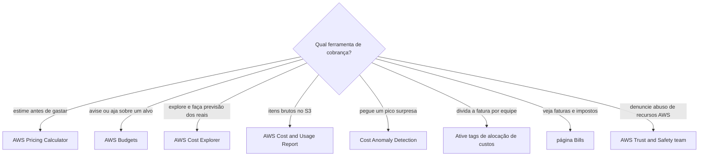
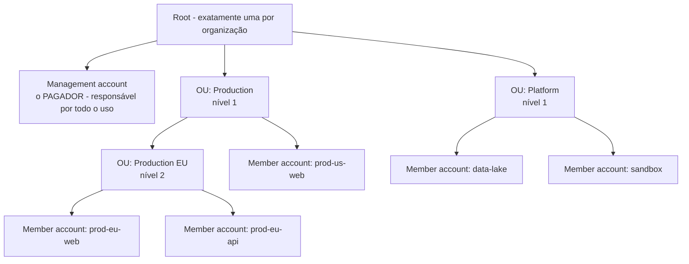
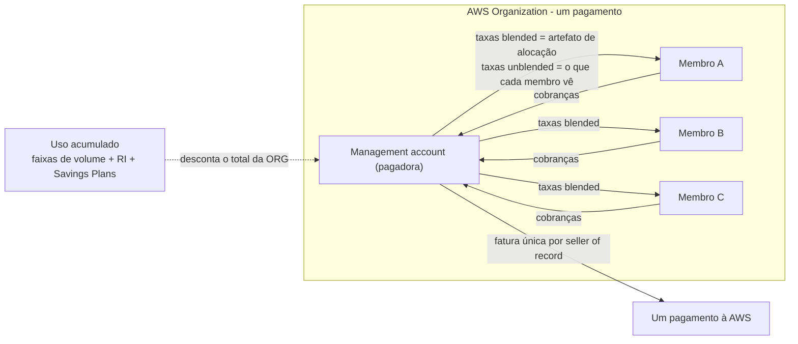
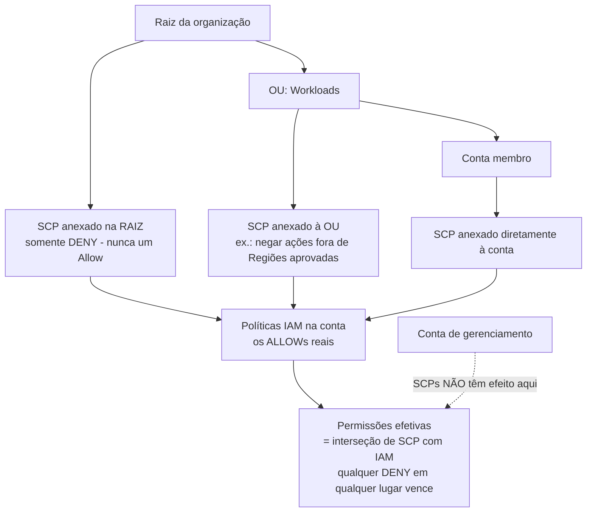
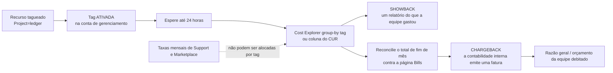

# Cobrança, AWS Organizations e Governança de Custos

Dinheiro é onde os exames de nuvem ficam pessoais. O Domínio 4 (**Billing, Pricing, and Support**, **12%** do conteúdo pontuado) carrega cerca de seis questões pontuadas, e o Task Statement **4.2: "Understand resources for billing, budget, and cost management"**: é dono da maioria das questões desta lição: suporte e informações de cobrança, **AWS Organizations**, **tags de alocação de custos** e o *"appropriate uses and capabilities of AWS Budgets and AWS Cost Explorer"* mais o *"consolidated billing and allocation of costs"*. O padrão de falha é sempre o mesmo: candidatos conhecem os serviços, mas não sabem **qual página responde a qual pergunta**, e caem nas duas armadilhas que a AWS reusa infinitamente: *"an SCP grants access"* e *"the bill follows the OU tree"*. Nenhuma das duas é verdadeira.

```text
=====================================================================
 MAPA DO DINHEIRO — QUAL FERRAMENTA RESPONDE A QUAL PERGUNTA
=====================================================================
  "MOSTRE-ME A FATURA"
    Fatura PDF, impostos, emitida vs pendente ............ página Bills
    cobranças de TODAS as contas (somente gerenciamento) ..... aba Charges by account
    quanto gastamos por serviço / Região .......... Home do painel de cobrança
    itens brutos entregues no meu próprio bucket S3 ... Cost and Usage Report

  "POR QUE MUDOU / O QUE VEM DEPOIS?"
    explore e agrupe reais + previsão de 12 meses  AWS Cost Explorer
    avise-me aos 80% de 50.000 USD e depois AJA ....... AWS Budgets + action
    pegue um pico noturno que eu não planejei ......... Cost Anomaly Detection
    estime um sistema que ainda não construí .......... AWS Pricing Calculator

  "QUEM PAGA?"
    um pagamento, descontos acumulados .................. cobrança consolidada
    divida o gasto por equipe, projeto, ambiente ....... tags de alocação de custos ativadas
    mostre o número sem emitir fatura ............... showback
    emita uma fatura interna ....................... chargeback

  "O QUE PODE NÃO SER COMPRADO?"
    teto apenas-negar sobre uma OU .................... Service Policy de Controle (SCP)
    catálogo curado de produtos Marketplace aprovados ... Private Marketplace (todos os recursos)
=====================================================================
```

Nesta lição você vai:

- abrir o **console de Billing and Cost Management** e nomear a página exata para cada pergunta comum sobre dinheiro;
- construir **AWS Organizations**: uma raiz, até **cinco níveis de OUs**, conta de gerenciamento como pagadora, contas membro como usuárias;
- explicar a **cobrança consolidada**: uma fatura por seller of record, **sem taxa extra**, descontos por volume acumulados, descontos **RI/SP** compartilhados;
- calcular um exemplo de **desconto por volume consolidado** e um exemplo de **taxa blended por compartilhamento de RI** do zero;
- separar custos **blended de unblended** e dizer exatamente quem vê qual;
- separar **SCPs de IAM**: apenas-negar, interseção, imunidade da conta de gerenciamento;
- ativar **tags de alocação de custos** (geradas pela AWS × definidas pelo usuário) e rodar um fluxo **showback → chargeback**;
- escolher entre **Budgets, Cost Explorer, CUR, Pricing Calculator e detecção de anomalias**: incluindo o que cada um custa;
- ler relatórios de **reserva, utilização e cobertura de RI/SP** e diagnosticar supercompra × subcompra;
- navegar no **AWS Marketplace**: cobrança consolidada de compras de terceiros, ofertas privadas e Private Marketplace;
- lidar com **faturas, moedas e o básico de pagamento**, e saber que **o suporte de cobrança é gratuito para todos**;
- praticar com **12 questões no estilo do exame** mais quatro verificações interativas.

---

## 1. O console de Billing and Cost Management: um console, muitas páginas

### 1.1 A página Bills: a visão da fatura

A página **Bills** é a resposta canônica de "onde está a minha fatura?". Seu conteúdo é fixo e examinável:

| Elemento da página Bills | O que mostra | Nota do exame |
|---|---|---|
| Resumo da fatura | estado **Emitida (Issued)** vs **Pendente (Pending)** da fatura atual | Pendente ≠ erro de não pagamento; significa que o período ainda não fechou |
| Informações de pagamento | valor devido e status do pagamento | Combine com **Payment preferences** para método e moeda |
| **Cobranças por serviço (Charges by service)** | gasto dividido por serviço, com drill-down **até a Região** | *"Why did EC2 jump in eu-west-1?"* → esta aba |
| **Cobranças por conta (Charges by account)** | totais para cada conta membro | **Somente a conta de gerenciamento**: contas membro não recebem esta aba |
| Faturas | faturas **PDF** para download | Perguntas de moeda da fatura vivem aqui e em Payment preferences |
| Savings | descontos aplicados | Reforça que descontos acumulados reduzem o total da organização |
| Impostos | linhas de imposto | Perguntas de imposto → página Bills, não Cost Explorer |

A AWS declara diretamente: *"se você usar o recurso de cobrança consolidada no AWS Organizations, a página **Bills** lista os totais de todas as contas na aba **Charges by account**."* (em outubro de 2026)

### 1.2 O Home do painel de cobrança: a visão exploratória

O painel **Home** é baseado no Cost Explorer e é onde o fatiamento acontece. Seus widgets agrupam o gasto por **Service · AWS Region · Member account (somente a conta de gerenciamento) · Cost allocation tag · Cost category**. Três comportamentos importam no dia do exame:

- apenas **visitar a página ativa automaticamente o Cost Explorer** (não há forma via API de ativá-lo depois);
- o resumo de custos **exclui créditos e reembolsos**: um número no Home pode legitimamente diferir da fatura;
- os dados atualizam **pelo menos a cada 24 horas**.

| Outras páginas no console | Trabalho que elas fazem |
|---|---|
| **Cost Explorer** | *"Why did cost move?"*: agrupe, filtre, faça previsão dos reais |
| **AWS Budgets** | alertas de limite e, opcionalmente, **budget actions** |
| **Cost and Usage Report** | itens brutos entregues **no seu próprio bucket S3** |
| **Payment preferences** | método de pagamento, moeda, **pay now** |
| **Billing preferences** | faturas por e-mail, compartilhamento de créditos, **alternadores de RI/SP sharing** |

- **📚 Você sabia?** Ajuda de cobrança não é extra pago: o Knowledge Center da AWS declara *"All AWS account owners have access to account and billing support **free of charge**"*: todo plano, incluindo o Basic. É por isso que *"você precisa atualizar seu plano de suporte para fazer uma pergunta de cobrança"* é uma resposta errada confiável (em outubro de 2026).



```matching
{
  "question": "Associe cada pergunta de cobrança à página do console ou ferramenta que responde:",
  "pairs": [
    {"left": "Baixar a fatura PDF e ver as linhas de imposto", "right": "página Bills: resumo da fatura, faturas, impostos, cobranças por serviço e por conta"},
    {"left": "Agrupar o gasto do mês passado por Região e por tag de alocação de custos", "right": "Home do painel de cobrança ou Cost Explorer: widgets de Service, Region, member account, tag, cost category"},
    {"left": "Avise-me antes de eu atingir 50.000 USD este mês e pare novos provisionamentos se eu fizer isso", "right": "AWS Budgets com notificação de limite mais uma budget action como uma política IAM que nega provisionamento"},
    {"left": "Estime uma aplicação de três camadas que ainda não construí", "right": "AWS Pricing Calculator: estime antes de gastar, ele não lê seu uso real"},
    {"left": "Entregue itens brutos por hora no meu próprio bucket S3 para o Athena", "right": "AWS Cost and Usage Report - CSV ou Parquet, pelo menos uma vez por dia"},
    {"left": "Descubra quem está revendendo nossa AMI roubada", "right": "AWS Trust and Safety team: denúncia de abuso, separada do AWS Support"}
  ],
  "explanation": "O exame foca no verbo do enunciado: estime = Pricing Calculator, avise/aja = Budgets, explore/faça previsão = Cost Explorer, exporte = Cost and Usage Report, pico surpresa = Cost Anomaly Detection, fatura/imposto = página Bills, abuso = Trust and Safety."
}
```

> [!NOTE]
> **O console é o syllabus.** A tarefa 4.2 pede *"billing support and information"* e *"pricing information for AWS services"*; isso mapeia para páginas reais, não para teoria. Quando uma pergunta descreve um **sintoma**, visualize a página que você abriria: fatura → **Bills**; movimento → **Cost Explorer**; limite → **Budgets**; exportação bruta → **CUR**; estimativa prévia → **Pricing Calculator**; moeda ou cartão → **Payment preferences**.

---

## 2. AWS Organizations: raízes, OUs e quem é o pagador

### 2.1 A estrutura

Uma organização é uma árvore, e a árvore tem regras rígidas:

- **uma raiz (root)** por organização;
- **unidades organizacionais (OUs)** aninhadas até **cinco níveis de profundidade** (verifique antes de usar);
- **contas** anexadas à raiz ou a uma OU: as contas são as folhas onde os recursos realmente rodam;
- a **conta de gerenciamento (management account)** é o **pagador**, e a AWS diz que ela é responsável por *"todo o uso, dados e recursos usados pelas contas da organização"*;
- **AWS Organizations é oferecido sem custo adicional**, e a cobrança consolidada não agrega **nenhuma taxa extra** (em outubro de 2026).



### 2.2 Conta de gerenciamento × conta membro

| Capacidade | Conta de gerenciamento | Conta membro |
|---|---|---|
| Paga a AWS | **Sim: pagamento único para a organização** | Não; gera cobranças que o pagador liquida |
| Aba **Charges by account** na página Bills | **Sim** | Não |
| Widgets do painel de cobrança por conta membro | **Sim** | Não |
| Ativa **tags de alocação de custos** | **Sim** (também contas standalone) | **Não** |
| Afetada por **SCPs** | **Não**: SCPs não têm efeito sobre usuários e papéis da conta de gerenciamento | **Sim** |
| Pode sair da organização | n/a (ela é a organização) | Sim, com ação do pagador |
| Assinatura de suporte | Independente | Independente: *"Each account subscribes independently"* |

### 2.3 Dois conjuntos de recursos e o que uma organização só-de-cobrança não pode fazer

O Organizations vem em dois conjuntos de recursos, e a diferença é ouro de exame:

| Conjunto de recursos | O que você ganha | O que você **não** ganha |
|---|---|---|
| **Somente cobrança consolidada** | Uma fatura, descontos acumulados, compartilhamento de RI/SP | **Sem SCPs, sem tag policies, sem integrações de serviços** (incluindo Private Marketplace) |
| **Todos os recursos (all features)** | Tudo acima **mais SCPs**, tag policies, integrações |: |

Em uma organização só-de-cobrança, as membros permanecem *"otherwise independent"*: cada uma pode **se inscrever em serviços e usar o Premium Support de forma independente**. É por isso que uma pergunta descrevendo *"members sign up freely, no guardrails, but one combined bill"* está descrevendo o conjunto de recursos **somente-cobrança-consolidada**.

- **📚 Você sabia?** A AWS avisa que *"**Sua fatura não refletirá a estrutura que você definiu em sua organização**"*: a árvore de OUs é um dispositivo de governança, não uma dimensão de cobrança. Se uma pergunta pedir para faturar a OU `data` separadamente, a resposta é **tags de alocação de custos ativadas** (ou cost categories), nunca *"create another OU"* (em outubro de 2026).

---

## 3. Cobrança consolidada: um pagamento, uso acumulado, descontos compartilhados

### 3.1 Os quatro benefícios documentados

| Benefício | O que a AWS diz que ele lhe dá |
|---|---|
| **Uma fatura** | Uma fatura por **seller of record**, o uso do AWS Marketplace cai na mesma fatura |
| **Rastreamento fácil** | A conta de gerenciamento pode ver **charges by account** |
| **Uso combinado** | *"shares the **volume pricing discounts, Reserved Instance discounts, and Savings Plans**"* entre contas |
| **Sem taxa extra** | A cobrança consolidada não custa nada para adicionar |

### 3.2 Limites de faixa (tier) são acumulados, não por conta

A frase mais testável deste tópico: *"**AWS treats all accounts in an organization as a single account. Member accounts don't reach tier thresholds individually.**"* A agregação é **por serviço**, cada mês **começa em zero**, e a capacidade remanescente de uma conta (horas de RI, progresso de faixa) pode ser usada por outra.

**Exemplo Resolvido E1: a ilustração de faixa de 95 TB publicada pela AWS** *(a tabela de faixas é o preço S3 Standard publicado pela AWS: $0,10/GB nos primeiros 1.000 GB, $0,08/GB nos próximos 49.000 GB, $0,06/GB a partir daí; em outubro de 2026, verifique antes de usar)*

Três contas membro armazenam cerca de **31.667 GB** cada no mesmo mês (3 × 31.667 ≈ 95.000 GB = 95 TB; a divisão uniforme mostrada é ilustrativa: a AWS publica os dois totais, $6.720 acumulado contra $7.660 separado):

| Faturado separado (sem organização) | Acumulado pela cobrança consolidada |
|---|---|
| Cada conta: $0,10 × 1.000 = **$100,00** mais $0,08 × 30.666,67 = **$2.453,33** → **$2.553,33** | Primeiros 1.000 GB × $0,10 = **$100,00** |
| Três contas: 3 × $2.553,33 = **$7.660,00** | Próximos 49.000 GB × $0,08 = **$3.920,00** |
| | Restantes 45.000 GB × $0,06 = **$2.700,00** |
| | **Total acumulado = $6.720,00** |
| **Diferença: $940,00 economizados (12,3%)** | |

Nenhuma conta atingiu 1.000 GB sozinha, mas a organização cruzou três faixas: exatamente o que *"member accounts don't reach tier thresholds individually"* significa.

**Exemplo Resolvido E2: duas contas e a taxa blended gravada de volta** *(faixas como acima; aritmética trabalhada aqui)*

A Conta A armazena **900 GB**, a Conta B armazena **600 GB**:

- **Standalone:** A = 900 × $0,10 = **$90,00**; B = 600 × $0,10 = **$60,00** → **$150,00**
- **Acumulado:** 1.500 GB → primeiros 1.000 × $0,10 = $100,00, restantes 500 × $0,08 = $40,00 → **$140,00**
- **Economia:** **$10,00 (6,67%)**
- **Taxa de alocação blended:** $140,00 ÷ 1.500 GB = **$0,0933333/GB**
- fatia alocada de A: 900 × 0,0933333 = **$84,00** (economiza $6,00) · a de B: 600 × 0,0933333 = **$56,00** (economiza $4,00) · verificação: 84 + 56 = **$140,00** ✓

### 3.3 Blended × unblended: a armadilha que nunca morre

- **Taxas blended (blended rates)** fazem a média das taxas de Reserved Instance e On-Demand entre contas membro; **as taxas blended de EC2 são calculadas por hora**. A ordem de alocação é **horas de RI → horas de free tier → horas de On-Demand**.
- **Unblended** é o que cada conta membro vê: a AWS declara *"**AWS shows each member account their charges as unblended costs.**"*
- No **Cost and Usage Report**, `lineItem/BlendedRate` é calculado na **conta de gerenciamento** para que a organização possa alocar custo de volta para baixo.



> [!WARNING]
> **Uma conta membro pode mostrar cobranças cheias de On-Demand enquanto o total da organização cai.** Como as membros veem custos **unblended**, uma equipe cuja carga foi descontada por uma Reserved Instance de *outra* conta ainda pode ver a linha sem desconto: a economia aparece na fatura **no nível da organização** e nas colunas **blended** do CUR. O exame adora isso: *"A fatura da Conta B não mudou, portanto o RI sharing não fez nada"* é **falso**.

### 3.4 Suporte nunca é acumulado

A cobrança consolidada **não** mescla suporte: *"AWS calculates **Support fees independently for each member account** … **Each account subscribes independently.**"* Clientes Enterprise podem optar por **aggregated monthly billing** das taxas de suporte, isso é agregação de cobrança, **não** de benefícios acumulados. Os planos Developer, Business e Enterprise cada um tem um **mínimo mensal** (em outubro de 2026; os nomes dos planos estão em fluxo, veja a Seção 9.3).

---
## 4. Reserved Instances e Savings Plans entre contas

### 4.1 As regras de compartilhamento

| Instrumento | Redação da AWS | Ordem de alocação |
|---|---|---|
| **Reserved Instances** | O recurso de cobrança consolidada *"treats all the accounts in the organization as one account"*, então *"all accounts … can receive the hourly cost benefit of Reserved Instances that are purchased by any other account"* | Começa pela **conta compradora**, depois **tipos de uso idênticos na mesma Availability Zone**; RIs **regionais** aplicam-se à menor instância da família |
| **Savings Plans** | Aplicados primeiro à conta **proprietária**, depois compartilhados; a AWS aplica taxas de SP a uso não coberto **começando pelo maior desconto** | Proprietária primeiro, depois as demais contas na organização |

Dois limites para decorar: **o compartilhamento pode ser desligado** em Billing preferences (os alternadores de **RI/SP sharing**), e **nenhum instrumento cruza o limite de uma organização**: uma RI comprada na Organização 1 nunca desconta a Organização 2.

**Exemplo Resolvido E3: uma RI comprada por uma equipe economiza para outra** *(o exemplo de taxa blended publicado pela AWS, reduzido a duas contas; em outubro de 2026)*

Um mês de 30 dias = **720 horas**; `t2.small` em uma AZ; taxa On-Demand **$0,023/h**. A organização possui **2 RIs Full Upfront** (capacidade de 1.440 h) e **1 RI Partial Upfront** (720 h).

| Item | Valor |
|---|---|
| Consumo de horas reservadas da Conta 1 | **2.160 h** |
| Uso On-Demand da Conta 2 | **720 h** |
| Total da organização | 2.160 + 720 = **2.880 h** |
| Cobrança On-Demand para o uso não coberto da organização | 720 × $0,023 = **$16,56** |
| **Taxa blended** | $16,56 ÷ 2.880 = **$0,00575/h** (o número publicado pela AWS) |
| Alocação blended da Conta 1 | 2.160 × 0,00575 = **$12,42** |
| Alocação blended da Conta 2 | 720 × 0,00575 = **$4,14** (verificação: 12,42 + 4,14 = **$16,56** ✓) |

A Conta 2 não comprou **nada**, mas sua fatia blended é **$4,14** em vez de $16,56: ela pegou carona nas reservas da Conta 1 porque a organização é tratada como uma conta. Sua linha **unblended** ainda lê **$16,56**.

- **📚 Você sabia?** O compartilhamento de RI e Savings Plans é uma **preferência, não uma inevitabilidade**: a página **Billing preferences** traz os alternadores de RI/SP sharing, então *"sharing cannot be disabled"* é em si uma resposta errada. O hábito do exame a construir: sempre que uma resposta disser *"never"*, *"always"* ou *"cannot be disabled"*, procure o alternador que a AWS documenta (em outubro de 2026).

---

## 5. SCPs × IAM: o teto apenas-negar

### 5.1 O que um SCP é, e o que não é

Um **Service Control Policy (SCP)** é uma salvaguarda do Organizations anexada na **raiz ou em uma OU**, e aplica-se a toda conta membro abaixo dela. A definição da AWS tem uma frase de comprimento, e metade do exame depende dela: *"**SCPs do not grant permissions**"*, e eles fornecem *"central control over the **maximum available permissions**"*: um teto, nunca um piso. Duas notas de rodapé que valem decorar: SCPs **sim** vinculam o **root user** de uma conta membro, e **não têm efeito sobre papéis vinculados ao serviço (service-linked roles)**.

| Propriedade | Service Control Policy (SCP) | Política IAM |
|---|---|---|
| Direção | **Teto apenas-negar (deny-only)**: só pode remover, nunca adicionar | **Concede** (allow) e pode negar dentro de seu escopo |
| Mecanismo | Permissões efetivas = **interseção** de SCPs com políticas de identidade/recurso | Allow/deny direto para principais |
| Precedência | **Qualquer Deny em qualquer lugar vence**: um deny explícito em um SCP, IAM ou política de recurso sobrepõe qualquer allow | Mesma regra deny-wins dentro do IAM |
| Escopo | OUs e contas inteiras (governança organizacional) | Usuários, papéis, grupos, recursos em uma conta |
| Conta de gerenciamento | **Sem efeito** sobre usuários e papéis da conta de gerenciamento | Aplica-se plenamente |
| Conjunto de recursos necessário | **Todos os recursos (all features)** no AWS Organizations | Sempre disponível |



**Exemplo Resolvido E4: os dois enunciados clássicos de SCP** *(lógica de regra, não preços)*

1. *"Stop member accounts from launching instances outside approved Regions, without touching anything else they may do."* → anexe um **SCP apenas-negar** na OU. Você removeu uma permissão; você não concedeu nada, e só funciona se a organização estiver no conjunto **all features**.
2. *"Dê à equipe de dados permissão para ler o bucket compartilhado."* → uma **política IAM** (ou uma política de recurso). Um SCP não pode fazer isso, porque um SCP que diz `Allow` em `s3:GetObject` não muda nada: a interseção ainda precisa de um `Allow` de IAM embaixo.

```fillblank
{
  "question": "Complete as afirmações de governança com os termos AWS corretos:",
  "template": "Um SCP é uma política {{1}}: ele só pode remover permissões, nunca concedê-las, então a AWS diz que SCPs não {{2}} permissões. As permissões efetivas são a {{3}} dos SCPs e de suas políticas IAM, e um {{4}} explícito em qualquer lugar vence. SCPs não têm efeito sobre a conta {{5}}, e eles exigem o conjunto de recursos {{6}} do Organizations.",
  "answers": {
    "1": "deny-only",
    "2": "grant",
    "3": "intersection",
    "4": "deny",
    "5": "management",
    "6": "all features"
  },
  "distractors": ["allow-only", "grant", "union", "allow", "member", "consolidated billing"],
  "explanation": "A própria redação da AWS: 'SCPs do not grant permissions'; as permissões efetivas são a interseção com políticas de identidade e recurso; qualquer Deny vence; SCPs não afetam a conta de gerenciamento; SCPs precisam do conjunto all features (organizações só-de-cobrança-consolidada não podem usá-los)."
}
```

> [!WARNING]
> **A armadilha clássica, dita de forma direta: um SCP nunca concede acesso.** Se o resultado correto precisa que alguém *faça* algo, a resposta é uma **política IAM** (ou política de recurso, ou permissions boundary). Se o resultado correto precisa que uma conta membro seja *impedida* de fazer algo de forma geral, a resposta é um **SCP apenas-negar**, e se uma pergunta oferecer *"attach an SCP to allow…"*, essa opção é autocontraditória e errada. Segunda metade da armadilha: **SCPs não se aplicam à conta de gerenciamento**, então *"govern the payer with an SCP"* também é errada.

---

## 6. Tags e tags de alocação de custos: showback e chargeback

### 6.1 Dois tipos de tag, uma regra de ativação para cada

Uma **tag** é uma chave (com um valor opcional) anexada a um recurso; cada chave é única por recurso. Para cobrança, a AWS divide tags em exatamente dois tipos:

| Tipo | Definida/aplicada por | Prefixo no tooling AWS | Em um relatório de alocação de custos |
|---|---|---|---|
| **Gerada pela AWS (AWS-generated)** | AWS, ou um **ISV do AWS Marketplace** | `aws:` | Aparece sob sua chave AWS |
| **Definida pelo usuário (user-defined)** | Você | qualquer chave que escolher | Aparece como **`user:` + chave** |

Três regras decidem se sua tag algum dia chega a um relatório:

1. **Você deve ativar ambos os tipos separadamente**: *"You must activate both types of tags separately before they can appear in Cost Explorer or on a cost allocation report."*
2. **A ativação vive na conta de gerenciamento (ou em uma conta standalone)**: contas membro não podem ativar tags de alocação de custos.
3. **Permita até 24 horas** para tags ativadas começarem a fluir (verifique antes de usar).

**Exemplo Resolvido E5: "etiquetamos tudo e o relatório está vazio"** *(sequência de diagnóstico)*

| Sintoma | Causa | Correção |
|---|---|---|
| 400 instâncias com tag `Project=ledger`, relatório mostra nada | Tag **aplicada mas nunca ativada** | Conta de gerenciamento → ative `user:Project` |
| Ativada ontem, ainda nada hoje | Atraso de propagação de **até 24 horas** | Espere e verifique novamente |
| Algumas linhas mostram `Project = (not allocated)` | Recursos criados **antes da tague**, ou **sem tag**, ou um **serviço sem tague** | Preencha tags retroativamente; espere uma linha sem tag por design |
| Taxas mensais de Support ou Marketplace ausentes | **Não podem ser alocadas de forma alguma** | Aloque-as por outra regra ou aceite a linha sem tag |

### 6.2 O que o relatório de alocação de custos pode e não pode dividir

O relatório é um CSV agrupado por tags ativas, incluindo linhas explícitas **tagged e untagged**, e seus **totais de fim de mês reconciliam com a página Bills**. Ele não pode alocar:

- recursos criados **a meio do mês antes que a tague começasse**;
- recursos **sem tag** e **serviços sem tague**;
- *"**Subscription-based charges, such as AWS Support and AWS Marketplace monthly fees, can't be allocated**"*.

**Cost categories**, mapeamentos baseados em regras que você define, ficam **ao lado** das tags como dimensão no Cost Explorer, Budgets e página Bills, o que é a saída de emergência quando um tipo de cobrança não pode ser tagueado.

### 6.3 Showback × chargeback

| | **Showback** | **Chargeback** |
|---|---|---|
| Redação da AWS/tagging-whitepaper | *"presentation, calculation, and reporting of charges incurred by a specific entity"* | *"an actual charging of incurred costs … via an organization's internal accounting processes"* |
| Alguém paga? | **Não**, somente relatório | **Sim**, uma fatura interna |
| Diferença em uma linha | *"whether or not someone is expected to make a payment"* | |
| Risco de percepção | Informativo | A AWS observa que chargeback *"can be perceived as a tax"* |



**Exemplo Resolvido E6, uma divisão de duas equipes** *(valores ilustrativos, o fluxo tem fonte, os valores são inventados para prática)*

| Equipe | Tag | Fatia por group-by no Cost Explorer | Ação |
|---|---|---|---|
| Plataforma Ledger | `Project=ledger` | **$39.000 (65%)** | Relatório de showback para o líder da equipe |
| Plataforma interna | `Project=platform` | **$21.000 (35%)** | Relatório de showback para o líder da equipe |
| **Total da organização** | | **$60.000** | Deve igualar o total de fim de mês da página Bills |
| Compartilhado: taxas mensais de Support + Marketplace | (sem tag) | mostrado na linha **untagged** | Divida por uma regra acordada, ou use uma **cost category** |

Showback para aqui (sem pagamento). Chargeback continua: a finanças debita cada equipe $39.000 / $21.000 pela contabilidade interna: a diferença entre os dois é *se alguém é esperado para pagar*.

```dragdrop
{
  "question": "Ordene as etapas que transformam tags de recursos em uma fatura de chargeback:",
  "items": [
    "Tague todo recurso faturável com uma chave consistente como Project",
    "Ative a tag definida pelo usuário como tag de alocação de custos na conta de gerenciamento",
    "Espere até 24 horas para a tag fluir para os dados de custo",
    "Agrupe pela tag no Cost Explorer ou inspecione o Cost and Usage Report",
    "Reconcilie o total de fim de mês contra a página Bills",
    "Emita o relatório de showback e então deixe a contabilidade interna emitir a fatura de chargeback"
  ],
  "correctOrder": [
    "Tague todo recurso faturável com uma chave consistente como Project",
    "Ative a tag definida pelo usuário como tag de alocação de custos na conta de gerenciamento",
    "Espere até 24 horas para a tag fluir para os dados de custo",
    "Agrupe pela tag no Cost Explorer ou inspecione o Cost and Usage Report",
    "Reconcilie o total de fim de mês contra a página Bills",
    "Emita o relatório de showback e então deixe a contabilidade interna emitir a fatura de chargeback"
  ],
  "explanation": "Taguear sozinho nunca produz dados de custo: a ativação na conta de gerenciamento é uma etapa separada, leva até 24 horas, o relatório deve bater com a página Bills, e só a última etapa, a contabilidade interna, faz dela chargeback em vez de showback."
}
```

- **📚 Você sabia?** **Tags geradas pela AWS podem ser criadas por um terceiro**: a documentação de alocação de custos da AWS conta tags *"defined and applied by AWS **or an AWS Marketplace ISV**"* como geradas pela AWS. Então a tag de um fornecedor do Marketplace pode aparecer nos seus dados de custo antes que você escreva uma única linha de política de tague: ainda assim você precisa **ativá-la separadamente** da sua própria (em outubro de 2026).

---
## 7. Gestão de custos: Budgets, Cost Explorer, relatórios de RI/SP e o CUR

### 7.1 AWS Budgets: alerte primeiro, aja depois

AWS Budgets monitora um **alvo** e o notifica. Os fatos documentados:

| Fato | Valor (em outubro de 2026; verifique antes de usar) |
|---|---|
| Tipos de orçamento | **Cost · Usage · RI utilization · RI coverage · SP utilization · SP coverage** (seis) |
| Direção da notificação | *"exceed, or are forecasted to exceed"* para custo/uso; *"fall below"* para orçamentos RI/SP |
| Canais de entrega | **Amazon SNS, e-mail, ou ambos** |
| Atualização | **Até 3× por dia, tipicamente com 8 to 12 horas de intervalo** |
| Visualizações rastreadas | Variantes blended, unblended, amortized, net; pode **excluir** reembolsos, taxas de suporte, impostos |
| Limites por orçamento | **≤5 notificações**, cada uma com **≤1 tópico SNS + ≤10 endereços de e-mail** |
| Limite de orçamento RI/SP | `BudgetLimit` **tem padrão 100, e 100 é o único valor válido** (utilização/cobertura são percentuais) |
| Em uma organização | Um orçamento mirando uma conta membro mostra **somente se essa conta receber acesso**; AWS: *"we don't support cross-account usage"* |
| Preço | Monitoramento e notificações **gratuitos**; os **primeiros 2 orçamentos com action por mês são gratuitos**, depois **$0,10/dia cada**; um **Budget Report entregue = $0,01 por relatório** |

**Budget actions** são o que separam um alerta de um controle: elas rodam *"programmatically or with your approval"* e podem aplicar **políticas IAM, SCPs ou recursos da AWS**, integrando-se com **AWS Chatbot** (Slack/Chime) e **Service Catalog**. O próprio exemplo de setup da AWS é o que decorar: notificar aos **80 por cento** do valor orçado e aplicar uma ação: por exemplo uma política IAM personalizada que **nega provisionamento de recursos adicionais**.

**Exemplo Resolvido E7: aritmética de orçamento com uma ação** *(o padrão de 80% documentado pela AWS; valores ilustrativos)*

| Evento | Aritmética | Resultado |
|---|---|---|
| Orçamento = **$50.000/mês** | Alerta A aos **80% reais** = 0,80 × 50.000 | **$40.000** |
| Alerta B | **previsão** de exceder 100% | dispara na previsão, não no real |
| Gasto no dia 12 **$21.000** | 21.000 < 40.000 | silencioso |
| Gasto no dia 20 **$41.500** | 41.500 > 40.000 | **Alerta A dispara**, ação opcional aplica |
| Orçamentos com action #1 e #2 | gratuitos | **$0,00** |
| Orçamento com action #3 por 30 dias | 30 × $0,10 | **$3,00** |
| 4 Budgets Reports semanais | 4 × $0,01 | **$0,04** |
| **Total do mês para o acima** | 3,00 + 0,04 | **≈ $3,04** |

> [!NOTE]
> **Uma notificação não é um teto.** Alertas de Budget não param o gasto: a entrega também atrasa em relação à cobrança, porque os dados do Budgets só atualizam algumas vezes por dia. Parar o gasto requer uma **budget action** (política IAM, SCP ou recurso). Essa distinção: *alertar vs impor*: é um par correto/incorreto favorito.

### 7.2 Cost Explorer: explore, agrupe, filtre, faça previsão

| Comportamento | Redação/número da AWS (em outubro de 2026) |
|---|---|
| Moeda dos dados | *"All costs reflect your usage up to the previous day."* |
| Ativação | **Somente console**: *"Você não pode habilitar o Cost Explorer usando a API"* |
| Histórico ao ativar | **Mês atual + últimos 12 meses** |
| Previsão | **Próximos 12 meses** |
| Atualização / desativação | Atualização **≥24 h**; uma vez ativado, **não pode ser desativado** |
| Dimensões de filtro/group-by | `SERVICE`, `LINKED_ACCOUNT`, `REGION`, `AZ`, `TAG`, `COST_CATEGORY`, `CHARGE_TYPE` |
| Relatórios padrão | **Cost & usage** mais **relatórios de Reserved Instance**; vem com **Amazon Q** |
| Preço da API | **$0,01 por requisição** (cada página paginada conta); visualizações de cobrança personalizadas **$0,01 por origem** |
| Granularidade por hora | lookback de 14 dias a **$0,00000033 por registro de uso por dia** ≈ **$0,01 por 1.000 registros por mês** |

**Exemplo Resolvido E8, o que o Cost Explorer "gratuito" realmente custa** *(tabela de preços oficial; aritmética aqui)*

- Um script chama a API do Cost Explorer **5.000 vezes** em um mês: 5.000 × $0,01 = **$50,00**.
- Uma equipe liga **granularidade por hora** para **10.000 registros de uso** por um dia: 10.000 × $0,00000033 = **$0,0033**; em 30 dias ≈ **$0,10**: é por isso que a abreviação da documentação é *"about $0.01 per 1,000 records per month"*.
- Cliques no console na visualização padrão (diária): **$0**: monitorar seu painel não é uma chamada de API.

### 7.3 Reserva, utilização e cobertura: três perguntas diferentes

| Relatório | Pergunta que responde | Sinal se estiver ruim |
|---|---|---|
| **Reservation (inventário)** | O que eu tenho, quanto economiza vs On-Demand, o que expira este mês? | Compromissos expirando sem uso |
| **Utilization** | Do compromisso que eu **comprei**, quanto eu **usei**? | **Supercompra (over-buying)** |
| **Coverage** | Das horas que eu **rodei**, quantas foram **cobertas**? | **Subcompra (under-buying)** |

**Exemplo Resolvido E9: utilização 98% × cobertura 90%** *(os exemplos de Savings Plans publicados pela AWS; em outubro de 2026)*

- **Utilização:** um compromisso de **$10/hora** com uso faturado em taxas de Savings Plans totalizando **$9,80** → $9,80 ÷ $10,00 = **98% utilized**. Dois por cento do que você pagou ficou sem uso: você está perto de **supercomprar**.
- **Cobertura:** **9 de 10** instâncias idênticas custando **$1,00/hora** rodam em taxas de Savings Plans → cobertos $9,00 de $10,00 = **90% covered**: uma instância-hora ainda é faturada em On-Demand, então você está **subcomprando**.
- Os relatórios usam **unidades normalizadas** para que diferentes tamanhos de instância sejam comparados de forma justa.

### 7.4 O Cost and Usage Report (CUR)

O CUR é a exportação bruta: itens brutos entregues **no seu próprio bucket S3 pelo menos uma vez por dia**, com granularidade **por hora, dia ou mês**, em **CSV ou Parquet**. Ele carrega `lineItem/UnblendedRate` e `lineItem/BlendedRate`, o último calculado na **conta de gerenciamento**, é por isso que o CUR é a ferramenta para alocação de nível chargeback, enquanto o Cost Explorer é a ferramenta para exploração.

### 7.5 Itens de consciência (não estão na lista oficial de serviços em escopo)

Dois recursos reais do console **não** são nomeados na lista em escopo do CLF-C02: trate-os como consciência bônus e **nunca como a resposta-chave** quando Budgets ou Cost Explorer também se aplicam:

| Ferramenta | O que faz | Limites que valem conhecer (em outubro de 2026) |
|---|---|---|
| **Cost Anomaly Detection** | Machine learning para *"detect and alert on anomalous spend patterns"*; fluxo = **cost monitor → alert subscription → notification** | **1 AWS Service monitor + até 500 custom**; **≤10 e-mails ou 1 tópico SNS**; precisa de **≥10 dias** de histórico; alertas dentro de **24 h**; monitores de conta vinculada/tag/cost category são **somente conta de gerenciamento** |
| **Cost Optimization Hub** | Consolida recomendações de rightsizing, recursos ociosos, Savings Plans e RI: *"over **18 types**"* | Atualização **diária**; deve ser **enabled**; dados servidos de **us-east-1** |

E a armadilha reversa: **AWS Billing Conductor está explicitamente fora do escopo** deste exame, assim como Amazon DevPay e AWS Application Cost Profiler: uma opção nomeando Billing Conductor é uma distração.

- **📚 Você sabia?** O Cost Explorer é deliberadamente difícil de se livrar: a AWS deixa você ativá-lo **somente pelo console** (*"Você não pode habilitar o Cost Explorer usando a API"*), lhe dá **12 meses de histórico mais uma previsão de 12 meses no momento em que você o ativa**, e então **você não pode desativá-lo**. A AWS cobra por acesso *programático* (**$0,01 por requisição de API**) e granularidade *por hora* (cerca de **$0,01 por 1.000 registros por mês**): ler o painel continua gratuito, automatizá-lo é medido (em outubro de 2026).

---

## 8. AWS Marketplace: compre de terceiros, pague à AWS

### 8.1 O que é e como fatura

A AWS define o Marketplace como *"a **curated digital catalog** that customers can use to **find, buy, deploy, and manage third-party software, data, and services**"*: os tipos de produto disponíveis incluem SaaS, AMIs, containers, modelos do CloudFormation, ofertas SageMaker e produtos de dados.

| Aspecto | Comportamento (em outubro de 2026) |
|---|---|
| Quem lhe cobra | **AWS**: *"At the beginning of the month, you receive a bill from Amazon Web Services (AWS) for your AWS Marketplace charges."* A AWS cobra **em nome do vendedor** |
| Onde cai | Na sua fatura AWS normal: uso na **fatura consolidada** (tipicamente dia 2/3 do mês) |
| Moeda | Majoritariamente **USD**, a menos que faturamento em moeda local seja ativado; moedas de fatura de oferta privada: **USD EUR GBP AUD JPY INR** |
| Oferta privada | Preço negociado + EULA para contas nomeadas (**até 25**), aceita na **conta de gerenciamento ou em uma conta membro**; *"There is no difference in the software product"* |
| Compartilhamento de assinatura anual | Comprada por uma conta, **compartilhada em toda a família de contas vinculadas** |
| **Private Marketplace** | *"curated catalogs of approved products"*; **integra-se com o AWS Organizations**; experiências com escopo na **organização inteira, OUs ou contas**; usuários ainda podem **request** outros produtos; requer o conjunto de recursos **all features** |
| Ângulo 4.3 do exame | **Gestão de custos** (itens do CUR/Cost Explorer + orçamentos) · **governança** (Private Marketplace + requisições de procurement) · **entitlement** (assinatura ligada à sua conta AWS) |

> [!IMPORTANT]
> **Oferta privada ≠ Private Marketplace.** Uma **oferta privada** é um *negócio negociado* para até 25 contas nomeadas. Um **Private Marketplace** é um *catálogo curado* governado por organização, OU ou conta, e ele precisa do Organizations no conjunto **all features**: a mesma família de pré-requisitos de **SCPs** e **tag policies**. Se uma pergunta oferecer *"enable Private Marketplace with consolidated billing only"*, está errada.

- **📚 Você sabia?** O Marketplace usa sua fatura existente, mas suas **taxas mensais não podem ser alocadas por tag**, então um modelo de chargeback precisa lidar com assinaturas do Marketplace por uma regra acordada ou uma **cost category**, não por tags (em outubro de 2026).

---

## 9. Faturas, moedas, o básico de pagamento, e a quem perguntar

### 9.1 O que está verificado sobre moedas e faturas

| Fato (em outubro de 2026; verifique antes de usar) | Status da fonte |
|---|---|
| **Moeda padrão da fatura = USD** | Verificado |
| A AWS publica uma lista de **moedas de pagamento** (~30 códigos, ex.: EUR, GBP, JPY, BRL, CAD, AUD, INR, CNY…) | Artigo oficial re:Post da AWS *"updated a year ago"* no acesso: trate a **lista exata como verifique-antes-de-usar** |
| Moedas **somente-cartão**: **NOK CLP COP EGP NGN UAH UYU**; **AED é somente-fatura** | Mesmo artigo: mesma ressalva |
| A emissão de faturas para contas faturadas usa **electronic funds transfer em termos padrão net-30**, e você *"contact AWS Support from the root user account"* para receber faturas | Verificado |
| **AWS invoice configuration**: máximo de **500 invoice units por conta pagadora** | Verificado |

> [!WARNING]
> **O que NÃO pôde ser verificado, não decore:** os **critérios de elegibilidade de pay-by-invoice** da AWS (gasto, idade da conta, checagens de crédito) **não têm fonte** na nossa pesquisa. Se uma opção no estilo do exame citar um limiar em dólares ou uma regra de "6 meses de histórico" para se tornar elegível a fatura, trate-a como **não verificada**, as únicas declarações com fonte são os termos net-30 EFT e o contato com o Support a partir do root user. Da mesma forma, a lista exata de moedas muda com seller-of-record e localização; cite *"default USD, other currencies vary"* em vez de recitar códigos.

### 9.2 Onde você muda as coisas

| Você quer… | Página |
|---|---|
| Mudar cartão, método bancário, ou pagar agora | **Payment preferences** (método, moeda, pay now) |
| Receber faturas por e-mail, compartilhar créditos, alternar RI/SP sharing | **Billing preferences** |
| Ler a fatura em si, impostos, emitida/pendente | **Bills** |

### 9.3 Referências cruzadas de planos de suporte (da lição de suporte)

Quatro fatos da tarefa 4.3 do Domínio 4 que pertencem a uma resposta de cobrança:

1. **Suporte de cobrança/conta é gratuito em todos os planos**: *"All AWS account owners have access to account and billing support free of charge."*
2. **Basic Support não pode abrir casos técnicos**, mas *pode* abrir casos de **conta e cobrança** e casos de **aumento de limite de serviço** (24×7).
3. **Suporte é por conta, não por organização**: *"Each account subscribes independently"*; Enterprise pode optar por **aggregated monthly billing** somente das taxas de suporte.
4. **Onde perguntar o quê:** *como eu tagueio 400 instâncias?* → **AWS re:Post** (comunidade gerida pela AWS + Knowledge Center, *"over 4,000"* artigos e vídeos oficiais): **não** para perguntas sensíveis ao tempo ou específicas de conta; *a fatura não bate com minha estimativa* → caso de conta-e-cobrança no **Support Center**; *alguém está revendendo nossa imagem roubada* → **AWS Trust and Safety team**.

Linha de planos atual em outubro de 2026 (verifique os nomes antes do dia do exame): **Basic · Business Support+ · Enterprise · Unified Operations**. **Developer** e **Business** pararam novas assinaturas em **2 de dezembro de 2025** e são descontinuados em **1 de janeiro de 2027**, assim como **Enterprise On-Ramp**: que é suportado apenas **até 31 de dezembro de 2026**. Os nomes dos planos são o fato mais volátil do Domínio 4, então confira novamente a lição de suporte antes do dia do exame.

---

## 10. Decisão de um minuto

```text
SINTOMA                                          -> RESPOSTA
------------------------------------------------ ------------------------------------------
"mostre-me a fatura PDF e as linhas de imposto"      -> página Bills
"por que o EC2 pulou em eu-west-1"                  -> Cost Explorer (ou Bills: charges by service)
"gasto por conta membro este mês"             -> Bills: Charges by account (SOMENTE gerenciamento)
"gasto pela tag Project"                           -> ative a tag -> Cost Explorer / CUR
"avise-me aos 80% de 50.000 e pare o provisionamento" -> AWS Budgets + budget ACTION
"estime antes de construir"                        -> AWS Pricing Calculator
"itens brutos por hora no meu próprio bucket S3"      -> Cost and Usage Report
"pegue um pico noturno inexplicável"           -> Cost Anomaly Detection (item de consciência)
"pare OUs comprando fora de Regiões aprovadas"       -> SCP apenas-negar (all features)
"deixe a equipe de dados ler o bucket"              -> política IAM (SCPs nunca concedem)
"uma fatura para 40 contas, descontos acumulados"     -> Organizations + cobrança consolidada
"fature a OU data separadamente"                    -> tags de alocação de custos / cost categories
"usamos o que compramos?"                     -> relatório de UTILIZATION de RI/SP
"estamos cobrindo o que rodamos?"                   -> relatório de COVERAGE de RI/SP
"compre software de terceiros avaliado via AWS"        -> AWS Marketplace (+ Private Marketplace)
```

---
## Casos Reais

As Seções 1 to 10 ensinam as ferramentas; estas cinco histórias publicadas pela AWS mostram as ferramentas contra faturas reais. **Todo número abaixo é um resultado de *cliente* que a própria AWS publicou** (páginas oficiais de case study acessadas em **2026-10**): nenhum deles é uma garantia da AWS, e nenhum deles é um número de exame memorizável. O que transfere para o dia do exame é a **alavanca**: qual tipo de cobrança, qual modelo de precificação, qual mecanismo de governança realmente moveu a agulha.

| Caso | Gancho do Domínio | O que a AWS publicou (acesso em out 2026) | Seção da lição que prova |
|---|---|---|---|
| **Box**: SaaS corporativo | D4 governança de custos | **$2,23 M** total: inter-AZ **$438 K** + egress **$1,1 M/ano** + armazenamento **>$500 K/ano** + logging **$192 K/ano** | Seção 6 tags · Seção 7 ferramentas de custo |
| **Canva**: plataforma de design SaaS | D4 modelos de precificação | custos de computação **−46% em menos de 2 anos** | Seção 4 RI/SP/Spot |
| **FarEye**: logística SaaS | D4 modelos de precificação | computação **−65%**, **$1 M/ano**, Graviton **+30%** de performance | Seção 4 + Seção 7.1 orçamentos |
| **athenahealth**: software de saúde | D2/D4 governança multi-conta | custos de inspeção **−95%**; centenas de VPCs em **120 contas** em dias; equipe de **8** | Seção 2 Organizations · Seção 5 SCPs |
| **Shutterfly / SBS**: impressão e-commerce | D4 right-sizing e licenças | corte de opex de **~25%**; VMs **2.000 → 1.200** | Seção 7.3 utilização/cobertura |

### Caso 1, Box: $2,23 M de arquitetura, não de um código de desconto

*Desafio:* cortar gasto sem enfraquecer segurança, confiabilidade ou performance. *Serviços:* Well-Architected Framework com revisões de Solutions Architect, tiering de armazenamento S3/S3 Glacier, higiene de volumes e snapshots do EBS, filtragem de eventos do CloudTrail e roteamento de tráfego em volta de internet gateways.

*O que a AWS publicou:* **$2,23 milhão** desmembrado em quatro **tipos de cobrança**:

| Alavanca que a AWS lista | Valor publicado |
|---|---|
| Internet egress (transferência de dados para fora) | **mais de $1,1 milhão por ano** |
| Tiering de armazenamento (S3 / S3 Glacier) | **mais de $500.000 por ano** |
| Transferência de dados inter-AZ | **$438.000** |
| Volume de log (filtragem de eventos do CloudTrail) | **$192.000 por ano** |
| **Total** | **mais de $2,23 milhões** |

Voz do cliente: Clay Alvord, diretor de FinOps e SRE: *"Our use of AWS best practices led to savings of over 2 million dollars, setting a new baseline…"*

**Link com o exame:** nem um dólar veio de um código de desconto ou do Organizations. Três das quatro alavancas são **arquitetura e higiene**, é por isso que a AWS enquadra a otimização de custos como o **pilar de custo** do Well-Architected; a quarta (armazenamento) é uma decisão de **tiering/compra**. Esta lição conecta nas duas pontas: tags de alocação de custos ativadas e Cost Explorer/CUR (Seções 6 to 7) são o que *mostra* que a transferência inter-AZ e o volume de log estão explodindo, mas somente um redesign *remove* a cobrança.

```plot
{
  "type": "bar",
  "title": "Box: economias publicadas pela AWS por tipo de cobrança (USD)",
  "data": [
    {"chargeType": "Internet egress", "usd": 1100000},
    {"chargeType": "Storage tiering", "usd": 500000},
    {"chargeType": "Inter-AZ transfer", "usd": 438000},
    {"chargeType": "Log volume", "usd": 192000}
  ],
  "xKey": "chargeType",
  "yKey": "usd",
  "xLabel": "Tipo de cobrança",
  "yLabel": "USD economizado"
}
```

*Valores exatamente como a AWS os publica: egress ("more than $1.1 million per year") e armazenamento ("more than $500,000") são pisos; inter-AZ $438.000 e logging $192.000 são exatos: em outubro de 2026.*

### Caso 2, Canva: a escada de modelos de precificação como negócio

*Desafio:* escala eficiente em custo com níveis de confiabilidade por plano de usuário. *Serviços:* **Spot** para projetos de free tier, **On-Demand + Savings Plans** para usuários Pro pagantes, **Reserved Instances** como fallback, mais ferramentas de custo da AWS.

*O que a AWS publicou:* **custos de computação reduzidos em 46 por cento em menos de 2 anos**, e o case study cita as próprias afirmações de lista da AWS ao lado: RIs *"a discount of up to 72 percent compared to On-Demand"*, Savings Plans *"up to 72 percent … in exchange for a 1- or 3-year hourly spend commitment"*, Spot *"up to 90 percent discount"* (em outubro de 2026; verifique antes de usar).

**Link com o exame:** isto é a Seção 4 transformada em plano: **baseline estável → Savings Plans** (compromisso flexível de $/hora), **carga estável fixada em família/AZ → Reserved Instances**, **capacidade sobra interrompível → Spot**. Dois hábitos para manter: descontos por compromisso são sempre percentuais *"up to"*, nunca garantidos, e a camada mais barata de uma aplicação é exatamente o que o Spot serve.

### Caso 3, FarEye: três alavancas em uma fatura

*Desafio:* margens finas de logística de última milha e a necessidade de gasto previsível. *Serviços:* **Compute Savings Plans**, **EC2 Spot** e **Graviton** em mais de 500 instâncias Spot/On-Demand.

*O que a AWS publicou:* custos de computação AWS **reduzidos em 65 por cento**, **$1 milhão por ano** em economia de custos de nuvem e **+30 por cento** de performance com Graviton.

**Link com o exame:** gasto previsível é a história da Seção 7.1: uma empresa que precisa prever ao dólar roda **limites e budget actions**, não surpresas de fim de mês; e a escada de desconto que ela subiu (Savings Plans → Spot → preço-performance do Graviton) é a mesma escada que a Canva subiu no Caso 2.

### Caso 4, athenahealth: governança em 120 contas

*Desafio:* monitorar egress em um vasto conjunto de VPCs enquanto os custos de inspeção subiam, com uma equipe pequena. *Serviços:* **AWS Network Firewall** centralizado, Transit Gateway, **AWS RAM** para propagação de políticas, regras-as-code no CloudFormation, Direct Connect.

*O que a AWS publicou:* custos de inspeção **reduzidos em 95 por cento**; centenas de VPCs em **120 contas** adicionadas *"within just a few days"*; **oito pessoas** projetaram e implantaram o novo desenho de segurança sem disrupções.

**Link com o exame:** 120 contas só é operável por causa do **AWS Organizations** (Seção 2: uma raiz, OUs cinco níveis de profundidade, a conta de gerenciamento como pagadora) mais mecanismos de compartilhamento como o **AWS RAM**; o **teto apenas-negar de SCP** da Seção 5 é o que mantém as contas membro dentro das salvaguardas enquanto um firewall central faz a inspeção. A lição de custo espelha a Seção 6: **centralize uma vez, aloque muitas**: uma camada de inspeção faturada uma vez vence 120 cópias, e o dinheiro aparece primeiro na visão **Charges by account** da conta de gerenciamento.

### Caso 5, Shutterfly: right-sizing e evitação de licenças

*Desafio:* VMware on-premises, pilhas standalone, mais de 2.000 VMs e uma saída de colocation. *Serviços:* VMware Cloud on AWS como ponte (agosto de 2022), depois migração nativa concluída em **março de 2025, seis meses antes do prazo**, cerca de 800 sistemas e 400 TB, aproximadamente 80% das cargas em ECS.

*O que a AWS publicou:* pegada de VM **2.000 → 1.200** e um **corte de opex de aproximadamente 25%** de evitação de licenças mais right-sizing.

**Link com o exame:** *right-sizing* é a alavanca grátis: é o que as recomendações do Cost Explorer, o Cost Optimization Hub (Seção 7.5) e uma revisão de custo do Well-Architected existem para encontrar, e utilização-vs-cobertura (Seção 7.3) é como você prova que parou de supercomprar; *evitação de licenças* é o argumento clássico de TCO on-premises → nuvem (Domínio 1) desaguando em uma fatura do Domínio 4.

> [!WARNING]
> **Resultado de cliente ≠ garantia da AWS, o caminho mais rápido de perder uma questão do Domínio 4.** *Zendesk* reduziu custos em até **42%**, *Canva* em **46%**, *FarEye* em **65%**: esses são **os resultados publicados pelos próprios clientes**, e a AWS nunca os promete a você. Os números de desconto que genuinamente pertencem à AWS são os de **lista**, *"up to 72 percent"* para Reserved Instances e Savings Plans, *"up to 90 percent"* para Spot (em outubro de 2026; verifique antes de usar). Qualquer opção lendo *"AWS guarantees X% savings"* está errada à primeira vista.

- **📚 Você sabia?** O artigo da Box assinado pela AWS é assinado pela **cliente**: diretora de FinOps e SRE: não pela AWS: e nosso digesto de pesquisa de 2026-10 encontrou o mesmo padrão em toda a biblioteca de case studies (cerca de **95% dos pull-quotes são de funcionários do cliente**, não de executivos da AWS). Leia toda economia como *"the customer achieved"*, nunca como *"AWS guarantees"*. Duas das histórias aqui também são histórias **multi-conta** por design: as **120 contas** da athenahealth e o estate SBS separado da Shutterfly dependem de estrutura estilo Organizations antes que qualquer ferramenta de custo consiga agregar alguma coisa.

---

### Atualizações de 2026 (em outubro de 2026)

Fatos de dinheiro se movem mais rápido que o guia do exame. Tudo abaixo vem da nossa rodada de pesquisa de outubro de 2026: **somente o que a AWS publicou é afirmado**; nada não verificável é asseverado.

> [!NOTE]
> **Mudanças com fonte desde 2025: console de cobrança, Organizations e compromissos:**
> - **O console mudou, o syllabus não.** A AWS colocou em GA o **group sharing de Savings Plans / Reserved Instances** (AWS What's New, 2025-11-19) e o **Target Coverage no Savings Plans Purchase Analyzer** (AWS Cloud Financial Management blog, 2026-06-09), depois do **Cost Optimization Hub** (2023-11-26) e ao lado do preview do **Well-Architected Agent** (2026-10-01): ainda assim os nomes examináveis do guia permanecem **AWS Budgets, AWS Cost Explorer, AWS Pricing Calculator**, então as Seções 7 to 8 desta lição continuam respondendo ao exame.
> - **Database Savings Plans lançados em 2025-12-02**: até **35%** para um compromisso de 1 ano sem upfront (serverless até 35%, provisioned até 20%, DynamoDB 18%, Amazon Keyspaces 12%). Real e recente, mas **não nomeado no guia do CLF-C02**, então nunca a resposta-chave onde **AWS Savings Plans** se aplica.
> - **Savings Plans agora têm uma regra publicada de devolução:** compromissos precificados **abaixo de 100 USD/hora** podem ser devolvidos no **mesmo mês calendário**, **≤10 devoluções por ano**; compromissos de **100 USD/hora ou mais não podem ser devolvidos** (AWS Cloud Financial Management blog, 2026-06-24; em outubro de 2026, verifique antes de usar).
> - **A Tarefa 4.2 removeu AWS Billing Conductor**, o guia vigente lê *"Understanding the appropriate uses and capabilities of AWS Budgets and AWS Cost Explorer"*, e o Billing Conductor agora está na lista oficial **out-of-scope** (55 entradas), que é exatamente como a Seção 7.5 o trata: um distrator, nunca a resposta.
> - **Os nomes de suporte da Tarefa 4.3 mudaram no próprio texto do exame:** *Basic Support, AWS Business Support+, AWS Enterprise Support, AWS Unified Operations*; Developer, Business clássico e Enterprise On-Ramp **não aceitam novas assinaturas após 2025-12-02** e as existentes correm **até 2027-01-01**: consistente com a Seção 9.3, e um lembrete de que os nomes dos planos são o fato mais volátil do Domínio 4.
> - **A lista em escopo agora soletra a exportação como "AWS Cost and Usage Reports"** (plural): um rename do CUR da Seção 7.4, não um novo serviço; a mesma lista confirma a cópia do exame de **AWS Cost and Usage Report(s)** ao lado de Budgets e Cost Explorer.
>
> **Marketplace:** nossas fontes de 2026-10 **não continham nenhuma mudança verificável de cobrança do AWS Marketplace**, então trate cada fato da Seção 8 acima como inalterado em outubro de 2026, e nunca invente uma "atualização" de Marketplace de memória.

- **📚 Você sabia?** O **Free Tier em si mudou em 2025-07-15**: contas criadas naquela data ou depois recebem **6 meses** (ou até os créditos acabarem) mais um **crédito de assinatura de USD 100 e até USD 100 ganháveis = até USD 200**, enquanto contas mais antigas mantêm o tier legado de **12 meses** baseado em `t2.micro`, e `t2.micro`/`t3.micro` deram lugar a `t3.micro`, `t3.small`, `t4g.micro`, `t4g.small`, `c7i-flex.large`, `m7i-flex.large`. Ambos os comportamentos são comportamento AWS correto; a armadilha é assumir uma regra universal (em outubro de 2026; verifique antes de usar).

---
## Perguntas de Prática (Practice Questions)

```question
{
  "id": "clf-14-q1",
  "type": "multiple-choice",
  "question": "Você precisa da fatura em PDF, das linhas de imposto e do status emitido vs pendente da fatura da AWS deste mês. Qual página você abre?",
  "options": [
    "A página Home do painel de cobrança",
    "A página Bills",
    "O relatório padrão do AWS Cost Explorer",
    "Payment preferences"
  ],
  "correct": 1,
  "explanation": "A página Bills guarda o resumo da fatura (Issued vs Pending), as informações de pagamento, as cobranças por serviço (com drill-down até a Região), as cobranças por conta (somente a conta de gerenciamento), faturas PDF para download, savings e impostos. Home é a visão exploratória de widgets, Cost Explorer responde 'por que o custo mudou', e Payment preferences é onde você muda método ou moeda."
}
```

```question
{
  "id": "clf-14-q2",
  "type": "multiple-choice",
  "question": "Uma empresa quer impedir que contas membro lancem recursos fora de duas Regiões aprovadas, sem conceder nenhuma permissão nova. A organização usa o conjunto all-features. O que você deve fazer?",
  "options": [
    "Anexar um SCP apenas-negar na OU relevante ou na raiz",
    "Anexar um SCP que permite somente as duas Regiões aprovadas, porque SCPs concedem permissões",
    "Anexar uma política IAM a cada usuário em cada conta membro",
    "Mover as contas para uma nova OU, porque a própria membership na OU bloqueia lançamentos em Região"
  ],
  "correct": 0,
  "explanation": "SCPs são um teto apenas-negar: a AWS diz 'SCPs do not grant permissions', as permissões efetivas são a interseção com o IAM, e qualquer Deny em qualquer lugar vence. Um SCP dizendo 'allow' não muda nada por si só. A estrutura de OUs sozinha nunca restringe nada, e políticas IAM por usuário não dão governança organizacional. Note também que SCPs não têm efeito sobre a conta de gerenciamento."
}
```

```question
{
  "id": "clf-14-q3",
  "type": "multiple-choice",
  "question": "Três contas membro armazenam cerca de 31.667 GB cada em um mês; nenhuma atinge uma faixa de 1.000 GB sozinha. Usando os tiers S3 Standard publicados pela AWS ($0,10/GB nos primeiros 1.000 GB, $0,08/GB nos próximos 49.000 GB, $0,06/GB a partir daí, em outubro de 2026), o que a cobrança consolidada muda?",
  "options": [
    "Nada: contas membro sempre atingem os limites de faixa individualmente",
    "A organização acumulada paga cerca de $6.720 em vez de cerca de $7.660 faturados separadamente, uma economia de cerca de $940",
    "Cada conta é reprecificada a $0,06/GB porque a organização é grande",
    "As faixas se aplicam somente à conta de gerenciamento, e contas membro são cobradas em taxas On-Demand de armazenamento"
  ],
  "correct": 1,
  "explanation": "A AWS afirma que trata todas as contas de uma organização como uma conta única e que contas membro não atingem limites de faixa individualmente. Separadamente: 3 × (1.000 × $0,10 + 30.666,67 × $0,08) = 3 × $2.553,33 = $7.660. Acumulado: $100 + $3.920 + $2.700 = $6.720. Economia = $940 (cerca de 12,3%). As taxas não são re-baseadas por conta, somente o uso agregado percorre as faixas."
}
```

```question
{
  "id": "clf-14-q4",
  "type": "multiple-choice",
  "question": "A carga da Conta B foi descontada por uma Reserved Instance comprada pela Conta A na mesma organização. Qual afirmação está correta?",
  "options": [
    "A fatura da Conta B mostrará o valor descontado, porque a cobrança consolidada reescreve as cobranças de cada membro como custos blended",
    "A Conta B é mostrada com cobranças unblended, então sua linha pode ler o preço cheio de On-Demand enquanto o total da organização é menor",
    "Descontos de RI nunca cruzam fronteiras de conta dentro de uma organização",
    "O desconto aparece somente se as duas contas estiverem em Regiões diferentes"
  ],
  "correct": 1,
  "explanation": "A AWS mostra a cada conta membro suas cobranças como custos unblended; taxas blended são um artefato de alocação calculado na conta de gerenciamento (lineItem/BlendedRate no CUR). Descontos de RI de fato cruzam fronteiras de conta dentro da organização: contas são tratadas como uma conta, a alocação começa pela conta compradora, depois tipos de uso idênticos na mesma AZ: e RIs regionais aplicam-se à menor instância da família."
}
```

```question
{
  "id": "clf-14-q5",
  "type": "multiple-choice",
  "question": "Toda instância EC2 está tagueada Project=ledger, mas o relatório de alocação de custos não mostra nenhuma coluna Project. Qual é a causa mais provável?",
  "options": [
    "Tags só aparecem depois de ativadas como cost allocation tags: separadamente para as geradas pela AWS e as definidas pelo usuário: o que só pode ser feito na conta de gerenciamento ou em uma conta standalone, e pode levar até 24 horas",
    "Cost allocation tags só funcionam com o Cost and Usage Report, nunca com o Cost Explorer",
    "Contas membro precisam taguear recursos antes que a conta de gerenciamento possa vê-los",
    "Tags estão automaticamente ativas mas só rastreiam computação, nunca armazenamento"
  ],
  "correct": 0,
  "explanation": "Aplicar uma tag e ativá-la são dois passos diferentes: 'You must activate both types of tags separately before they can appear in Cost Explorer or on a cost allocation report', a ativação só está disponível em contas de gerenciamento ou standalone, e a ativação pode levar até 24 horas para mostrar dados. Linhas tagueadas e sem tag aparecem ambas no relatório, e os totais de fim de mês reconciliam com a página Bills."
}
```

```question
{
  "id": "clf-14-q6",
  "type": "multiple-choice",
  "question": "Requisito: notificar o canal de finanças aos 80% de um orçamento mensal de 50.000 USD E impedir automaticamente a criação de recursos adicionais se o orçamento for estourado. Qual combinação satisfaz isso?",
  "options": [
    "AWS Cost Explorer com um alerta de previsão e um tópico SNS",
    "AWS Budgets com notificação de limite mais uma budget action que aplica uma política IAM negando provisionamento",
    "Um SCP sozinho, porque SCPs limitam gastos",
    "O Cost and Usage Report entregue diariamente no S3"
  ],
  "correct": 1,
  "explanation": "O padrão documentado da AWS é notificar a 80 por cento do valor orçado e aplicar uma ação: por exemplo uma política IAM personalizada que nega provisionamento de recursos adicionais. Budget actions podem rodar programaticamente ou com aprovação e podem aplicar políticas IAM, SCPs ou recursos da AWS, integrando-se com o AWS Chatbot. Cost Explorer explora e faz previsão mas nunca impõe; um SCP pode negar ações de provisionamento, mas não pode observar um alvo de gasto nem notificar ninguém; o CUR é só uma exportação."
}
```

```question
{
  "id": "clf-14-q7",
  "type": "multiple-choice",
  "question": "Você mantém um compromisso Savings Plans de 10 USD/hora; o uso faturado em taxas de Savings Plans totalizou 9,80 USD. Separadamente, 9 de 10 instâncias idênticas de 1,00 USD/hora rodaram em taxas de Savings Plans. O que essas duas leituras indicam?",
  "options": [
    "Utilização 98% (risco leve de supercompra) e cobertura 90% (uma instância ainda em On-Demand)",
    "Cobertura 98% e utilização 90% - ambas indicam subcompra",
    "Utilização 98% e cobertura 90% - ambas indicam subcompra",
    "O relatório de reservation mostra os dois números; utilização e cobertura são a mesma métrica"
  ],
  "correct": 0,
  "explanation": "Utilização responde 'do compromisso que comprei, quanto usei?' - 9,80/10,00 = 98%, então 2% do que você pagou ficou ocioso (sinal de supercompra). Cobertura responde 'das horas que rodei, quantas foram cobertas?' - 9/10 = 90%, então 10% ainda roda em taxas On-Demand (sinal de subcompra). São tipos de Budgets separados e relatórios do Cost Explorer separados, e os relatórios usam unidades normalizadas para que tamanhos de instância sejam comparados de forma justa."
}
```

```question
{
  "id": "clf-14-q8",
  "type": "multiple-choice",
  "question": "Qual afirmação sobre o AWS Support dentro de uma organização com cobrança consolidada está correta?",
  "options": [
    "Taxas de suporte são acumuladas em toda a organização, então cada membro herda o plano da conta de gerenciamento",
    "Taxas de suporte são calculadas independentemente para cada conta membro e cada conta assina independentemente",
    "Somente a conta de gerenciamento pode contatar a AWS de forma alguma; contas membro não têm acesso a suporte",
    "Suporte de cobrança e conta requer um plano pago em cada conta"
  ],
  "correct": 1,
  "explanation": "A AWS calcula taxas de suporte independentemente para cada conta membro e cada conta assina independentemente; clientes Enterprise podem optar por aggregated monthly billing, que agrega somente a cobrança, não os benefícios. Suporte de cobrança e conta é gratuito para todos os donos de conta AWS, e clientes com o plano Basic Support ainda podem abrir casos de conta e cobrança e casos de aumento de limite de serviço: eles só não podem abrir casos técnicos."
}
```

```question
{
  "id": "clf-14-q9",
  "type": "multiple-choice",
  "question": "Qual par de afirmações do AWS Marketplace está correto em outubro de 2026?",
  "options": [
    "A AWS cobra o vendedor diretamente e cobranças do Marketplace nunca aparecem na sua fatura AWS",
    "A AWS lhe cobra no início do mês na sua fatura AWS normal, e o Private Marketplace: um catálogo curado de produtos aprovados com escopo na organização, OUs ou contas: requer Organizations com todos os recursos",
    "Uma private offer e um Private Marketplace são o mesmo recurso",
    "Taxas mensais do Marketplace podem ser alocadas com uma tag de alocação de custos"
  ],
  "correct": 1,
  "explanation": "A AWS rechebe o pagamento do Marketplace em nome do vendedor e lhe cobra no início do mês, com o uso caindo na fatura consolidada. O Private Marketplace integra-se com o AWS Organizations, cura produtos aprovados e precisa do conjunto all features: a mesma família de pré-requisitos de SCPs e tag policies. Uma private offer é um preço negociado e EULA para até 25 contas nomeadas, e cobranças baseadas em assinatura como taxas mensais de Support e Marketplace não podem ser alocadas por tag."
}
```

```question
{
  "id": "clf-14-q10",
  "type": "multiple-choice",
  "question": "O VP quer que cada OU da organização receba sua própria seção da fatura AWS automaticamente. Qual resposta está correta?",
  "options": [
    "Crie uma OU por VP e a AWS gerará faturas por OU: a fatura segue a árvore de OUs",
    "A fatura não refletirá a estrutura de OUs: use cost allocation tags ativadas (ou cost categories) para categorizar o gasto, porque somente a conta de gerenciamento vê cobranças por conta",
    "Ative o modo somente-cobrança-consolidada, porque o modo all features esconde a estrutura de OUs da fatura",
    "Ative o RI sharing para que os relatórios de Reserved Instance criem faturas no nível da OU"
  ],
  "correct": 1,
  "explanation": "A AWS declara diretamente: 'Sua fatura não refletirá a estrutura que você definiu em sua organização.' A alocação é feita com tags de alocação de custos ativadas (ou cost categories baseadas em regras), e a aba Charges by account existe somente na conta de gerenciamento. O conjunto de recursos controla salvaguardas (SCPs, tag policies), não o layout da fatura, e o RI sharing só espalha descontos: ele nunca cria faturas."
}
```

```question
{
  "id": "clf-14-q11",
  "type": "multiple-choice",
  "question": "Durante uma revisão de custos um engenheiro escreve: 'A AWS diz que economizaremos $2,23 milhões, então devemos orçar para isso.' A referência é o case study da Box da AWS. Qual par de afirmações está correto?",
  "options": [
    "A AWS publicou os $2,23 M como um resultado de cliente desmembrado em alavancas de internet egress, tiering de armazenamento, transferência inter-AZ e volume de log: um resultado de cliente, nunca uma garantia da AWS",
    "A AWS garante $2,23 milhões de economia para qualquer cliente que complete um Well-Architected Review",
    "Os $2,23 M vieram de descontos por volume de cobrança consolidada acumulados nas 120 contas da organização",
    "Os $2,23 M são um crédito do AWS Marketplace aplicado automaticamente a contas Enterprise Support"
  ],
  "correct": 0,
  "explanation": "O case study da Box da AWS reporta mais de $2,23 milhões em economia como quatro alavancas de cliente: mais de $1,1 M/ano de internet egress, mais de $500 K/ano de tiering de armazenamento, $438.000 de transferência inter-AZ e $192.000/ano de volume de log: alcançados via revisões Well-Architected, tiering S3/S3 Glacier, higiene de snapshots do EBS e filtragem de eventos do CloudTrail. Percentuais e totais de case study são resultados de cliente que a AWS publica, nunca garantias (o número de 42% pertence à Zendesk, 46% à Canva). Descontos de cobrança consolidada acumulada são reais mas não foram o que produziu este número; o número de 120 contas pertence à athenahealth; créditos de Marketplace não financiam economias."
}
```

```question
{
  "id": "clf-14-q12",
  "type": "multiple-choice",
  "question": "Uma equipe se arrepende de um compromisso Savings Plans que comprou este mês. Em outubro de 2026, qual afirmação sobre devoluções está correta (AWS Cloud Financial Management blog, 2026-06-24)?",
  "options": [
    "Compromissos precificados abaixo de 100 USD/hora podem ser devolvidos dentro do mesmo mês calendário, até 10 devoluções por ano; compromissos de 100 USD/hora ou mais não podem ser devolvidos",
    "Qualquer compromisso Savings Plans pode ser devolvido a qualquer momento com reembolso integral, independentemente do preço",
    "Compromissos abaixo de 100 USD/hora podem ser devolvidos um número ilimitado de vezes, enquanto compromissos de 100 USD/hora ou mais podem ser devolvidos até 10 vezes por ano",
    "Compromissos só podem ser devolvidos depois de rodarem por 30 dias, e somente por um caso de Enterprise Support"
  ],
  "correct": 0,
  "explanation": "A regra publicada da AWS é precisa: compromissos precificados abaixo de 100 USD/hora são devolvíveis no mesmo mês calendário e têm teto de 10 devoluções por ano, enquanto compromissos de 100 USD/hora ou mais não podem ser devolvidos de forma alguma. Preço, mês calendário e o teto anual são as três variáveis que o exame pode rotacionar: não os níveis de Support, não um período de espera de 30 dias. Em outubro de 2026; verifique antes de usar."
}
```

---
> [!IMPORTANT]
> **Veredito Comparativo: cobrança, AWS Organizations e governança de custos × on-premises × outras nuvens × governança do AWS Organizations**
> - **× faturamento on-premises em silos:** no on-premises, cada centro de custo roda sua própria procurement, seu próprio servidor de licenças e sua própria planilha, então a consolidação é um projeto trimestral de finanças com números velhos; a AWS lhe dá **cobrança consolidada sem taxa extra**, **uma fatura por seller of record**, **faixas de volume e descontos RI/SP acumulados calculados mensais do primeiro dia**, e **histórico do Cost Explorer por 12 meses mais uma previsão de 12 meses no momento em que é ativado**. O que *não* muda: um modelo de chargeback on-premises e um da AWS falham ambos sem tague disciplinado, e a AWS ainda fatura **por conta, não por OU**: você deve construir a camada de alocação você mesmo (tags ativadas ou cost categories), e **taxas mensais de Support e Marketplace não podem ser alocadas por tag** de forma alguma.
> - **× outras nuvens:** todo hiperescalonador oferece uma conta pagadora com descontos acumulados, mas o exame foca no **vocabulário e nos números exatos da AWS**: **cinco níveis de OU**, **SCPs que nunca concedem e nunca tocam a conta de gerenciamento**, **unblended mostrado às membros enquanto blended existe só como artefato de alocação**, **seis tipos de Budgets com o padrão de 80% + action**, **utilização (supercompra) × cobertura (subcompra)**, **ativação do Cost Explorer somente no console e $0,01/requisição na API**, e **Private Marketplace exigindo o conjunto all features**. Abas de console, linguagem de política ou nomes de alerta de outro provedor não se transferem para este exame.
> - **× scripts caseiros e tooling AWS fora de escopo:** um divisor de fatura artesanal significa raspar faturas, reconciliar impostos e rederivar a matemática de faixas todo mês; a AWS já entrega o **CUR (horário/diário/mensal, CSV ou Parquet, pelo menos uma vez por dia)** e **budget actions que podem impor, não apenas notificar**. Dentro da AWS a disciplina é igualmente afiada: **AWS Budgets e AWS Cost Explorer são as respostas em escopo**, enquanto **AWS Billing Conductor, Amazon DevPay e AWS Application Cost Profiler estão fora de escopo**, e **Cost Anomaly Detection / Cost Optimization Hub são somente-consciência**: nunca a resposta-chave quando Budgets ou Cost Explorer também se aplicam.

> [!WARNING]
> **Armadilhas do dia do exame para esta lição:**
> - **"SCPs grant access" está sempre errado**: apenas-negar, **interseção** com o IAM, **qualquer Deny vence**, **sem efeito sobre a conta de gerenciamento**, requer o conjunto **all features**; conceder = **política IAM**;
> - **A fatura NÃO segue a árvore de OUs**: AWS: *"Sua fatura não refletirá a estrutura que você definiu em sua organização"* → use **tags de alocação de custos ativadas** (ou cost categories);
> - **Tag aplicada ≠ dados de custo**: ambos os tipos de tag devem ser **ativados separadamente**, a ativação é **somente conta de gerenciamento/standalone**, e os dados podem levar **até 24 horas**;
> - **Membros veem UNBLENDED; blended é um artefato de alocação**: a linha de uma membro pode mostrar On-Demand cheio enquanto o total da organização cai;
> - **Cobrança consolidada é grátis, Organizations é grátis, suporte de cobrança é grátis**: as partes pagas são **API do Cost Explorer ($0,01/requisição)**, **orçamentos com action além de dois ($0,10/dia)**, **Budgets Reports ($0,01/relatório)**, **granularidade horária do CE** e armazenamento/consultas do CUR;
> - **Suporte nunca é acumulado**: *"Each account subscribes independently"*; Enterprise pode agregar **somente a cobrança** das taxas de suporte;
> - **Alertas de orçamento não param o gasto**: a imposição precisa de uma **budget action** (política IAM / SCP / recursos), e o refresh atrasa em relação à cobrança (até 3×/dia, 8 to 12 h de intervalo);
> - **Utilização ≠ cobertura**: utilização = usar o que você **comprou** (supercompra); cobertura = cobrir o que você **roda** (subcompra);
> - **O RI sharing começa com a conta compradora** (mesma AZ, tipos de uso idênticos; RIs regionais → menor instância da família); **Savings Plans** vão proprietário-primeiro, maior desconto primeiro; **nenhum dos dois cruza o limite de uma organização**, e o compartilhamento pode ser **desligado**;
> - **Private offer ≠ Private Marketplace**: um negócio para até **25 contas nomeadas** × um catálogo curado que precisa de **all features**;
> - **Taxas mensais de Marketplace e AWS Support não podem ser alocadas por tag**: espere uma linha **untagged** por design;
> - **Seleção de ferramenta:** estime → **Pricing Calculator**; avise/aja → **Budgets**; explore/faça previsão → **Cost Explorer**; exporte → **CUR**; pico → **Cost Anomaly Detection** (consciência); **AWS Billing Conductor está fora de escopo**;
> - **Cost Explorer**: ative somente no console, **não pode ser desativado**, 12 meses para trás + 12 meses para frente, refresh ≥24 h, custos refletem uso **até o dia anterior**;
> - **Moeda:** moeda padrão da fatura **USD**; limiares de elegibilidade de pay-by-invoice são **não verificados**: nunca cite um limiar em dólares de memória.

> [!SUCCESS]
> > **Pontos Principais (Key Takeaways):**
> > 1. **Mapeamento página-por-sintoma:** fatura/imposto/emitido-vs-pendente → **Bills**; movimento por serviço/Região/tag/conta → **Home do painel de cobrança ou Cost Explorer**; limite → **AWS Budgets**; exportação bruta → **Cost and Usage Report**; estimativa prévia → **AWS Pricing Calculator**; pico → **Cost Anomaly Detection**; método/moeda/pague-agora → **Payment preferences**; abuso → **AWS Trust and Safety**;
> > 2. **Estrutura do Organizations:** exatamente **uma raiz**, OUs aninhadas até **cinco níveis**, contas como folhas; a **conta de gerenciamento é a pagadora** responsável por *"todo o uso, dados e recursos"*; **Organizations e cobrança consolidada não custam nada**; conjuntos de recursos são **somente-cobrança-consolidada** (sem SCPs, sem tag policies, sem integrações) × **all features**;
> > 3. **Cobrança consolidada = uma fatura por seller of record + uso combinado:** descontos por volume, descontos de RI e Savings Plans são acumulados, e *"AWS treats all accounts in an organization as a single account. Member accounts don't reach tier thresholds individually"*: resolvido: três contas com ~31.667 GB pagam **$7.660 separados vs $6.720 acumulados ($940 economizados)**, e 900 GB + 600 GB pagam **$150 → $140** a uma taxa blended de **$0,0933333/GB**;
> > 4. **Blended × unblended:** membros são mostradas **unblended**; **blended** (EC2 calculado por hora; ordem RI → free tier → On-Demand) é a alocação da conta de gerenciamento gravada em `lineItem/BlendedRate`: exemplo de RI resolvido: **2.880 h**, On-Demand **$16,56**, blended **$0,00575/h**, divisão **$12,42 / $4,14**;
> > 5. **Compartilhamento RI/SP:** todas as contas podem receber o benefício horário de RI de outra conta, a alocação **começa pela conta compradora** depois uso idêntico na mesma AZ (RIs regionais → menor instância da família); Savings Plans vão **proprietário primeiro, maior desconto primeiro**; os toggles de compartilhamento vivem em **Billing preferences**; nada cruza o limite de uma organização; **taxas de suporte nunca são acumuladas**;
> > 6. **SCP × IAM:** *"SCPs do not grant permissions"*: permissões efetivas são a **interseção**, **qualquer Deny vence**, **sem efeito sobre a conta de gerenciamento**, **all features** exigido; parar uma membro → **SCP apenas-negar**, conceder a uma equipe → **política IAM**;
> > 7. **Tags de alocação de custos:** dois tipos: **geradas pela AWS** (AWS ou um **ISV do AWS Marketplace**, prefixo `aws:`) e **definidas pelo usuário** (reportadas como `user:` + chave); ambas precisam de **ativação separada**, **somente conta de gerenciamento/standalone**, **até 24 h**; o relatório inclui linhas **untagged** e **reconcilia com a página Bills**; **taxas mensais de Support e Marketplace não podem ser alocadas**;
> > 8. **Showback × chargeback:** showback = *presentation, calculation and reporting* (ninguém paga); chargeback = *an actual charging via internal accounting* (alguém paga), e chargeback *"can be perceived as a tax"*;
> > 9. **Budgets:** seis tipos (Cost, Usage, RI/SP utilization, RI/SP coverage), notificações via **SNS/e-mail/ambos**, *"exceed or forecast to exceed"* × *"fall below"*, refresh **até 3×/dia (8 to 12 h)**, **≤5 notificações** (≤1 SNS + ≤10 e-mails cada), limite de orçamento RI/SP **somente 100**; actions aplicam **políticas IAM, SCPs ou recursos** (Chatbot, Service Catalog); monitoramento/notificações gratuitos, **primeiros dois orçamentos com action gratuitos por mês depois $0,10/dia**, relatórios **$0,01 cada**: resolvido: **orçamento de $50.000, 80% = alerta de $40.000, terceiro orçamento com action = $3,00 + 4 relatórios = $0,04 ≈ $3,04/mês**;
> > 10. **Cost Explorer:** custos refletem uso **até o dia anterior**, **ative somente no console, não pode ser desativado**, **12 meses de histórico + previsão de 12 meses**, refresh **≥24 h**, dimensões incluem `SERVICE`, `LINKED_ACCOUNT`, `REGION`, `AZ`, `TAG`, `COST_CATEGORY`, `CHARGE_TYPE`; **API $0,01/requisição**, granularidade horária ≈ **$0,01 por 1.000 registros/mês**; **utilização 98%** ($9,80 de um compromisso de $10/hora) = sinal de supercompra, **cobertura 90%** (9 de 10 instâncias) = sinal de subcompra; **CUR** cai no seu bucket S3 **pelo menos uma vez por dia** como **CSV ou Parquet**;
> > 11. **Marketplace:** um *"curated digital catalog"* pelo qual você **find, buy, deploy and manage**; a AWS lhe cobra **no início do mês** na mesma fatura, cobrando **em nome do vendedor**; **private offer** = negócio negociado para **até 25 contas**; **Private Marketplace** = catálogo aprovado e curado com escopo **organização/OU/conta** e **requer all features**; suas **taxas mensais não podem ser alocadas por tag**;
> > 12. **Básico de dinheiro:** moeda padrão da fatura **USD** (moedas de pagamento variam por seller of record, verifique antes de usar); contas faturadas usam **EFT em termos padrão net-30** com faturas solicitadas **pelo root user via AWS Support**; **suporte de cobrança/conta é gratuito para todos**, **Basic não pode abrir casos técnicos**, o suporte assina **por conta**, e dúvidas em geral pertencem ao **AWS re:Post** (Knowledge Center: **artigos oficiais 4.000+**), todos os números **em outubro de 2026**.
