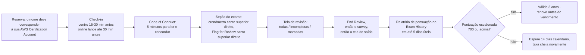
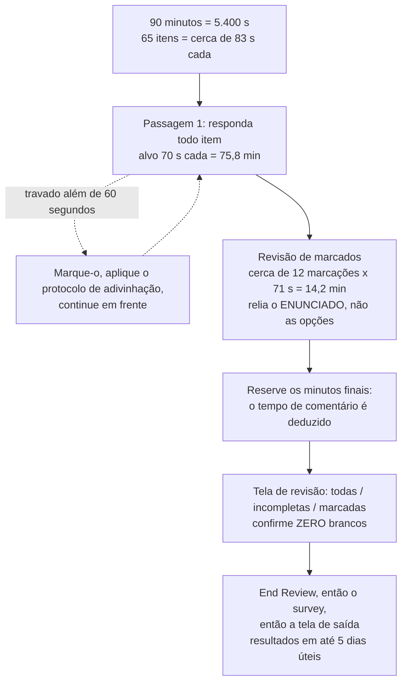
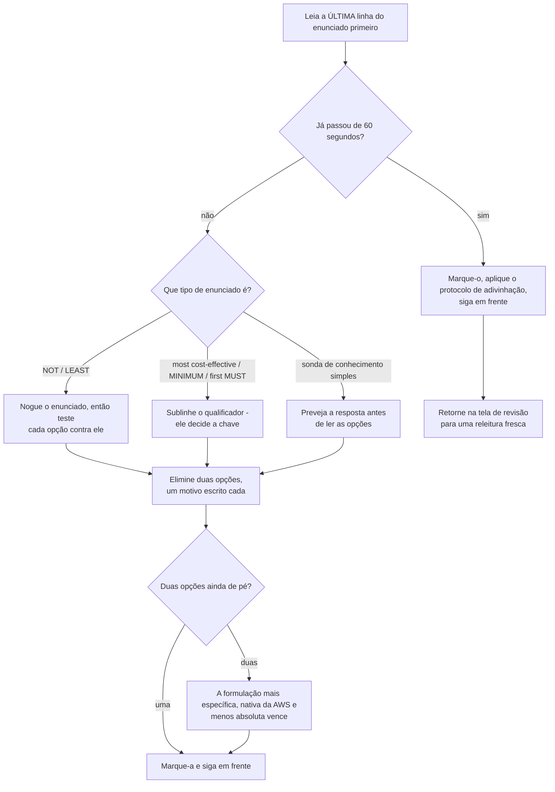
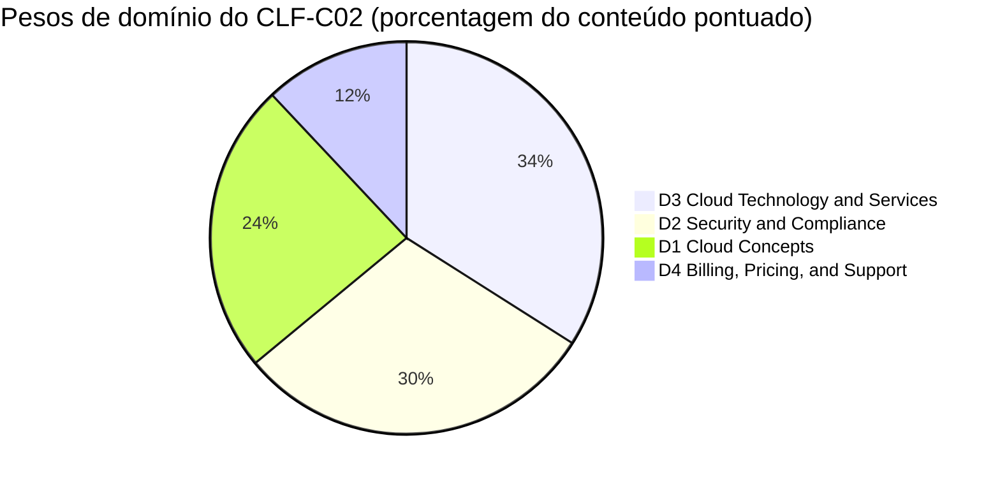
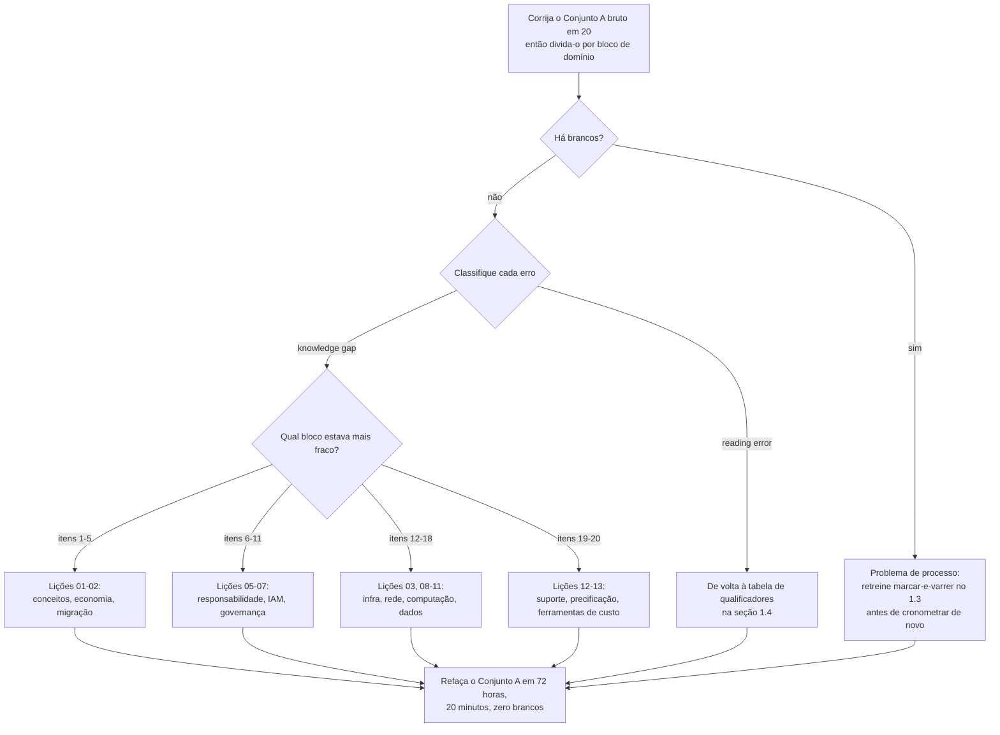

# Simulado de Exame A: Conjunto de Prática Completo + Estratégia

Catorze lições lhe deram o conteúdo. Esta lhe dá o **contêiner**: como um item CLF-C02 é realmente construído, como o relógio de 90 minutos se comporta, como a AWS escreve um distrator, e então o **Conjunto A**: vinte itens no estilo do exame que você faz sob tempo e corrige honestamente. Tudo antes desta lição era conhecimento de domínio; tudo aqui é *técnica de prova*, e em uma escala compensatória de 100 to 1.000 com 700 para passar, a técnica de prova vale tanto quanto mais uma hora de revisão.

```text
====================================================================
 CLF-C02 EXAM AT A GLANCE                (all figures as of Oct 2026)
====================================================================
 FORMAT ....... 65 questions = 50 scored + 15 unscored (not identified)
 TYPES ........ multiple choice (1 right + 3 distractors)
                multiple response (2+ right of 5+ options)
 TIME ......... 90 minutes = 5,400 s  ->  ~83 s per item (arithmetic)
 SCALE ........ 100 - 1,000, pass at 700, COMPENSATORY, no section cut
 GUESSING ..... no penalty for a wrong guess; BLANK = wrong
 WEIGHTS ...... D1 Cloud Concepts 24% | D2 Security 30%
                D3 Cloud Technology 34% | D4 Billing 12%
 COST ......... 100 USD per attempt (tax may apply)
 VALIDITY ..... 3 years; after a FAIL wait 14 calendar days,
                unlimited attempts, full fee every time
 DELIVERY ..... Pearson VUE test centre or online proctored
 RESULTS ...... posted to your AWS Certification Account
                within 5 business days (official ceiling)
--------------------------------------------------------------------
 SET A (this lesson) ...... 20 items in weight order: 5 / 6 / 7 / 2
====================================================================
```

> [!NOTE]
> **Como usar esta lição.** Leia as seções 1.1 a 1.7 uma vez, essa é a metade da estratégia. Então faça o **Conjunto A (seção 2) com um cronômetro de 20 minutos, sem notas, sem busca e sem espiar os desmembramentos**. Corrija a si mesmo com a seção 3, converta a pontuação bruta com a rubrica ali, e deixe a tabela de roteamento enviá-lo de volta à lição de que você realmente precisa. Qualquer coisa que esta lição não pôde verificar contra uma página AWS de primeira parte está listada na seção 1.7, trate essas como *não assevere*, não como fatos a decorar.

Ao final desta lição você será capaz de:

- restate cada número de logística publicado (65 / 50 / 15, 90 minutos, 700/1.000, 100 USD, 3 anos, 14 dias) sem notas;
- rode a aritmética de ritmo de 83 segundos e defenda um plano de duas passagens que nunca deixa um item em branco;
- aplique a técnica de marcar-e-varrer em menos de um minuto por item;
- leia um enunciado superlativo, *most cost-effective*, *least operationally intensive*, *MINIMUM*, *first MUST*, e saiba qual opção o qualificador está comprando;
- decodifique as sete famílias de distrator que a AWS reusa em todos os quatro domínios;
- faça o Conjunto A, o corrija **por domínio em vez de por total** e roteie cada erro para a lição certa;
- defenda o **veredito comparativo** sobre estudo individual × bootcamp × treinamento AWS.

---

## 1. Estratégia: as quatro técnicas que decidem o Conjunto A

### 1.1 A logística que você não deve rederivar no dia do exame

Cada número abaixo é publicado pela AWS e foi obtido em outubro de 2026. Você pode esquecer triviais de serviços; você não pode rederivá-los sob um relógio correndo.

| Fato | O valor publicado | Por que isso muda sua estratégia |
|---|---|---|
| **Questões apresentadas** | **65** | Você precisa *ver* todas as 65: cobertura vence profundidade |
| **Pontuadas / não pontuadas** | **50 pontuadas + 15 não pontuadas**, e as 15 **não são identificadas** | Trate cada item como pontuado |
| **Tipos de questão** | **Escolha múltipla** (1 correta + 3 distratores) e **resposta múltipla** (2+ corretas de 5+ opções) | Dois procedimentos de eliminação diferentes, um relógio |
| **Tempo** | **90 minutos** | 5.400 s ÷ 65 ≈ **83 s por item** |
| **Escala** | **100 to 1.000**, pontuação mínima de aprovação **700** | 700 é um corte *escalonado*, não 70% |
| **Modelo de pontuação** | **Compensatório**: sem marca de aprovação por domínio | Um domínio fraco ainda o derruba |
| **Adivinhação** | **Sem penalidade**; questões sem resposta são pontuadas como incorretas | Um branco é o único zero garantido |
| **Custo** | **100 USD** por tentativa (em outubro de 2026; impostos podem se aplicar) | Cada refação é 100 USD novos |
| **Validade** | **3 anos** | Anote o vencimento no dia em que passar |
| **Após uma reprovação** | Espere **14 dias calendário**, sem limite de tentativas, taxa cheia cada uma | Orçamente a tentativa dois *antes* da tentativa um |
| **Após uma aprovação** | O mesmo exame não pode ser refeito por **2 anos** | Você não pode "atualizar" uma aprovação antes |
| **Entrega** | Centro de testes **Pearson VUE** ou online com proctor | Mesmo exame, mesmo preço, ambas as rotas |
| **Resultados** | Dentro de **5 dias úteis** na sua Conta de Certificação AWS | Planeje uma semana tranquila, não um refresh horário |
| **Acomodação** | Acomodação ESL adiciona **+30 minutos** | Solicite com boa antecedência |

- **📚 Você sabia?** Os **15 itens não pontuados parecem exatamente com os 50 pontuados**: a AWS afirma que eles "are not identified on the exam". A resposta racional é simetria: um item de pré-teste mal respondido não lhe custa nada, um item pontuado pulado custa as notas completas, então o incentivo nunca aponta uma única vez para "deixe em branco e volte depois". Marque, adivinhe, siga em frente.

**A interface que lhe será dada.** Conhecer os controles *antes* do dia da prova são notas grátis, porque o exame não lhe dá nenhum tour de orientação:

| Contorle | Onde fica | O que faz |
|---|---|---|
| **Cronômetro** | Canto superior direito | Conta regressivamente para toda a seção do exame; um aviso aparece quando **restam 5 minutos** |
| **Flag for Review** | Canto superior direito | Marca um item para que apareça na tela de revisão: custa um clique |
| **Comment** | Canto superior esquerdo | Nota em texto livre; **o tempo de comentário é subtraído do seu tempo de exame**, então comente depois que terminar |
| **Code of Conduct** | Antes da seção do exame | **5 minutos** para ler e concordar: estourar o tempo encerra o exame sem reembolso |
| **Tela de revisão** | No final | Mostra questões **todas, incompletas ou marcadas**; você escolhe o filtro e então `End Review` |
| **Survey + saída** | Depois de `End Review` | Um survey curto e então a tela de saída (que "provides information on exam results") |



### 1.2 O plano de ritmo: 65 itens, 90 minutos

A AWS publica **nenhum orçamento por questão**: os únicos inputs oficiais de ritmo são a duração de 90 minutos, o **aviso de 5 minutos** na tela e um blog da AWS de 2021 sugerindo que você marque em vez de permanecer. Todo o resto abaixo é aritmética sobre números publicados, rotulada como tal.

**Exemplo resolvido 1, o teto.**

$$
\frac{90 \times 60}{65} = \frac{5{,}400}{65} \approx 83.1\ \text{s por item} \quad (\text{cerca de }1\text{ min }23\text{ s})
$$

**Exemplo resolvido 2, a divisão de duas passagens.** Rode a passagem um a **70 s por item**: $65 \times 70 = 4.550$ s $= 75,8$ minutos. Isso deixa $90 - 75,8 = 14,2$ minutos, que são 850 segundos, e $850 \div 71 \approx 12$ itens marcados relidos a 71 segundos cada. Doze marcações é o orçamento. Não vinte.

**Exemplo resolvido 3, o que a supermarcação custa.** Vinte marcações a 71 s cada é $20 \times 71 = 1.420$ s $= 23,7$ minutos, além de 75,8 minutos da primeira passagem, **99,5 minutos no total**, cerca de **9,5 minutos além do limite de 90 minutos**. Marcar não é grátis: uma marcação é uma segunda tentativa agendada, e a agenda tem um número fixo de espaços.

| Fase | Relógio | Minutos | A regra que você não pode quebrar |
|---|---|---|---|
| **Passagem 1**: todas as 65 | 0:00 → 1:16 | 75,8 | **~70 s por item**; responda *todo* item |
| **Revisão de marcados** | 1:16 → 1:30 | 14,2 | Relia o **enunciado**, não as opções |
| **Buffer de parada** | dentro dos últimos 5 min |: | O tempo de comentário é **deduzido** do seu tempo de exame |
| **Varredura sem-branco** | na tela de revisão |: | Confirme **zero brancos**, então `End Review` |



**Exemplo resolvido 4, o próprio relógio do Conjunto A.** O Conjunto A tem 20 itens, então as mesmas duas regras escalam para baixo: uma primeira passagem a 60 s por item é $20 \times 60 = 1.200$ s $= \mathbf{20}$ **minutos**, e o teto de 83 segundos lhe daria $20 \times 83 = 1.660$ s $= 27,7$ minutos. Faça o Conjunto A em **20 minutos exatos**, isso treina o ritmo que você usará para as 65, não apenas as vinte à sua frente.

**Exemplo resolvido 5: a ilusão de só-pontuadas.** Contra itens pontuados apenas, o orçamento parece $5.400 \div 50 = 108$ s. Você não consegue dizer quais 50 são pontuadas, então **83 s é o número com o qual você planeja** e 108 s é uma armadilha contra a qual você nunca deve orçar.

**Os dois formatos custam minutos diferentes.** O CLF-C02 publica exatamente dois tipos de questão: não há item de ordenação, correspondência ou estudo de caso neste exame, então não orçe para eles. Tudo abaixo da linha de *estrutura* é a aritmética de planejamento desta lição, **não** um número da AWS:

| Tipo | Estrutura | Como falha | Orçamento de planejamento |
|---|---|---|---|
| **Escolha múltipla** | 1 resposta correta + 3 distratores | Engenharia de distrator: o quase-erro vence a resposta óbvia | ~50 to 60 s na passagem 1 |
| **Resposta múltipla** | 2 ou mais corretas de 5 ou mais opções | Perder uma opção correta; assumir que existe crédito parcial | ~75 to 90 s na passagem 1 |
| **Qualquer tipo** | Quatro a seis opções tiradas da **mesma família de serviços** | Ler opções antes que o qualificador do enunciado esteja sublinhado | nunca: leia a última linha primeiro |

- **📚 Você sabia?** Como itens de resposta múltipla levam cerca de metade mais tempo de novo, são os itens com maior probabilidade de empurrá-lo além do limiar de marcação de 60 segundos, e são os itens que os candidatos *menos* querem marcar, porque reler cinco ou seis opções parece produtivo. Marque-os assim mesmo. Um item de resposta múltipla marcado ao qual você volta com uma releitura fresca do enunciado vence um não marcado que você continua minerando no lugar.

### 1.3 Marcar-e-varrer: a técnica, item por item

O próprio walkthrough de preparação de exame da AWS ensina uma sequência de cinco passos, e o quinto é o que os candidatos pulam. Treinado até ser automático, parece assim:

| Passo | A dica publicada da AWS | O que você realmente faz |
|---|---|---|
| 1 | "Read and understand the question before looking at the answer options" | Leia a **última linha** primeiro, então o corpo do enunciado: opções o ancoram |
| 2 | "Identify the **key phrases and qualifiers**" | Sublinhe `MINIMUM`, `most cost-effective`, `first MUST`, `NOT`, `Select TWO` |
| 3 | "Eliminate some of the answer options based on what you know" | Elimine duas opções com **um motivo escrito cada** |
| 4 | "Compare and contrast the remaining options" | Teste os sobreviventes contra a *dor do enunciado*, não contra bondade geral |
| 5 | "If you are spending too much time, pick your best guess and **flag** the question" | Além de ~60 s: adivinhe, marque, siga: nunca releia uma resposta confiante |



O **varrer** é a outra metade do nome. Na tela de revisão você não está rerespondendo; está verificando três coisas e nada mais:

1. **Brancos.** Zero. Um item sem resposta é pontuado como incorreto e não há penalidade para uma adivinhação errada, então branco é estritamente dominado por qualquer adivinhação de qualquer tipo.
2. **A questão pedida.** Relia o enunciado e confirme que você respondeu *a ela*: a perda clássica é responder à questão adjacente, mais familiar.
3. **Ordem das operações.** Mude uma opção somente se você puder enunciar o motivo em uma cláusula. "Pareceu errado" não é uma cláusula.

O blog de análise de questões da AWS de 2021 comprime o mesmo hábito em três questões que você faz a **cada** opção, nesta ordem, e a ordem importa, porque uma opção pode ser verdadeira e ainda assim irrelevante:

1. **Que requisito a questão coloca em vigor?**: nomeie em uma cláusula a restrição que o enunciado impõe.
2. **Qual é a condição?**: a situação, a forma da carga de trabalho, o risco que deve ser removido.
3. **Qual é a melhor solução segundo a melhor prática AWS?**: somente agora compare as opções sobreviventes.

```dragdrop
{
  "question": "Ordene os seis movimentos da rotina de marcar-e-varrer para um único item travado:",
  "items": [
    "Na tela de revisão, releia APENAS o enunciado: nunca as opções primeiro",
    "Confirme que você respondeu à questão que realmente foi pedida",
    "Clique em Flag for Review e então siga imediatamente",
    "Escolha sua melhor adivinhação para que nenhum branco permaneça",
    "60 segundos atingidos: pare de reler as opções",
    "Execute a varredura final sem-branco antes do End Review"
  ],
  "correctOrder": [
    "60 segundos atingidos: pare de reler as opções",
    "Escolha sua melhor adivinhação para que nenhum branco permaneça",
    "Clique em Flag for Review e então siga imediatamente",
    "Na tela de revisão, releia APENAS o enunciado: nunca as opções primeiro",
    "Confirme que você respondeu à questão que realmente foi pedida",
    "Execute a varredura final sem-branco antes do End Review"
  ],
  "explanation": "A ordem é fixada pelo risco: o relógio é a restrição vinculante, então o limite de tempo dispara primeiro e força uma adivinhação antes da marcação, o que garante nenhum branco. A marcação só compra uma segunda leitura, e essa leitura deve começar pelo enunciado porque a perda clássica é responder à questão adjacente. A varredura sem-branco vem por último porque é a verificação final de que nada ficou sem resposta. Nota: o CLF-C02 publica apenas dois tipos de questão: escolha múltipla e resposta múltipla; então esta sequência é um drill de estudo, não um formato de exame que lhe será pedido executar."
}
```

### 1.4 Lendo o enunciado: superlativos, negações e palavras de ordenação

A maioria das derrotas no CLF-C02 são derrotas de leitura. O **qualificador** do enunciado, não o nome do serviço, decide a chave, então o primeiro movimento é sempre o mesmo: encontre o qualificador, anote o que ele exige, *então* leia as opções.

| O enunciado diz… | Está realmente perguntando | Seu primeiro movimento | Onde é testado no Conjunto A |
|---|---|---|---|
| **"most cost-effective"** | Menor custo **total** para *esta* carga de trabalho, não o menor preço de etiqueta | Nomeie a forma da carga de trabalho (estável, com picos, única) antes de comparar opções | Q12 (Spot), Q13 (classe de armazenamento), Q20 (ferramentas de custo) e o exemplo resolvido 6 abaixo |
| **"least operationally intensive"** | Menos trabalho manual, sob medida, dia a dia | Prefira a resposta gerenciada; desconfie de qualquer coisa que implique um pipeline feito à mão | Q7 (RDS × EC2 patching), Q14 (read replica × resizing) |
| **"MINIMUM"** | A opção *mais baixa* que satisfaz a restrição | Nunca responda a mais: a camada que "definitivamente tem o recurso" geralmente é uma camada alta demais | Q19 (planos de suporte) |
| **"first MUST" / "NEXT"** | O passo pré-requisito ou de remoção de risco | Ordene as opções por dependência, então pegue a mais anterior que o risco do enunciado exige | Q5 (right-sizing antes de comprometer), Q16 (RPO/RTO) |
| **"NOT" / "LEAST"** | A única opção que *viola* a restrição | Relia a última linha duas vezes; o distrator geralmente é a opção que é simplesmente verdadeira | Não usado no Conjunto A: segure o reflexo para o exame real |
| **"(Select TWO/THREE)"** | Cada resposta correta é necessária | Leia *todas* as opções antes de se comprometer; a regra publicada da AWS é que você deve selecionar todas as respostas corretas para receber crédito | Q2, Q9, Q17, Q18, Q20 |

**Exemplo resolvido 6: lendo um superlativo de ponta a ponta.** Pegue um enunciado que nunca aparece no Conjunto A: *"A production workload runs 24/7 for three years, cannot be interrupted, and will stay in one instance family in one Region. Which option gives the largest discount ceiling?"*

1. **Sublinhe os qualificadores antes de olhar qualquer opção:** 24/7 · três anos · *cannot be interrupted* · uma família de instância · uma Região.
2. **Deixe o qualificador mais duro eliminar.** "Cannot be interrupted" mata as Spot Instances na hora: mesmo que Spot carregue o maior número de manchete, **up to 90 % off** (em outubro de 2026), porque a capacidade Spot pode ser reclamada com cerca de dois minutos de aviso.
3. **Combine o horizonte.** Três anos de execução convidam um compromisso de três anos: **3-year EC2 Instance Savings Plans / Standard Reserved Instances, up to 72 %** (em outubro de 2026).
4. **Pegue o maior teto que sobreviveu ao passo 2.** Um Compute Savings Plan de 1 ano chega a **up to 66 %** (em outubro de 2026) e compromete por um ano enquanto a carga de trabalho roda três; On-Demand é a linha de base sem desconto.
5. **Diga a armadilha em voz alta:** duas armadilhas dispararam ao mesmo tempo, o maior percentual foi desqualificado por uma *restrição*, e a opção com percentual mais barato era mais *flexível* em vez de mais adequada. Verifique cada teto na página de preços atual antes de confiar nele.

```fillblank
{
  "question": "Complete os quatro reflexos de leitura de enunciado da seção 1.4:",
  "template": "1) Leia a última linha primeiro e sublinhe o {{1}} - ele decide a chave. 2) 'Most cost-effective' significa o menor {{2}} total para a carga de trabalho descrita, não o menor preço de etiqueta. 3) 'MUST be configured first' pede o passo de {{3}} ou de remoção de risco. 4) Qualquer coisa que você não consiga resolver em cerca de um minuto recebe {{4}} e uma adivinhação: nunca um branco.",
  "answers": {
    "1": "qualifier",
    "2": "cost",
    "3": "prerequisite",
    "4": "flagged"
  },
  "distractors": ["service name", "sticker price", "optional step", "skipped", "domain weight", "bonus point", "rewritten"],
  "explanation": "Quatro reflexos, uma linha cada: o qualificador (MINIMUM, most, first, NOT) é o que o próprio walkthrough da AWS lhe diz para identificar antes de comparar opções; 'most cost-effective' é o custo total para a forma da carga de trabalho que o enunciado descreve; 'first MUST' é uma questão de dependência ou remoção de risco, então a resposta é o pré-requisito; e além de cerca de um minuto o movimento correto é marcar, adivinhar, seguir: porque questões sem resposta são pontuadas como incorretas e não há penalidade para uma adivinhação errada."
}
```

- **📚 Você sabia?** A dica de preparação de exame número cinco da AWS é literalmente *"escolha sua melhor adivinhação e marque a questão para revisão posterior"*: a marcação é uma técnica **oficial**, não um hack. A interface do exame lhe dá um controle `Flag for Review` e uma tela de revisão que pode mostrar questões **todas, incompletas ou marcadas**, então uma marcação lhe custa um clique e compra uma segunda leitura agendada.

### 1.5 As sete famílias de distrator

A AWS afirma que distratores são "generally plausible responses that match the content area". Eles não são aleatórios; as mesmas sete formas se repetem, e cada uma pune uma confusão específica. Eles são rotulados **T1, T7** aqui para nunca serem confundidos com os rótulos de domínio **D1, D4**.

| # | Família de distrator | Como o isca | Seu contragolpe |
|---|---|---|---|
| **T1** | **Serviço irmão** | DynamoDB oferecido para uma necessidade *relacional*, ElastiCache para um sistema de registro | Mapeie o **substantivo** do enunciado ao modelo de dados primeiro |
| **T2** | **Erro de camada** | EBS para uma necessidade de banco de dados, Multi-AZ para uma necessidade de escala de leitura | Família certa, *camada* errada: bloco × arquivo × objeto, HA × escala de leitura |
| **T3** | **Escopo / nomenclatura** | Um serviço fora do escopo que soa mais avançado que a chave real | A resposta está sempre na lista **em escopo** |
| **T4** | **Super-promessa** | Suporte de nível Enterprise oferecido para uma questão de *MINIMUM* | Responda ao superlativo, não ao tópico |
| **T5** | **Inversão de responsabilidade** | "É o firewall da AWS, então a AWS o configura" | Pergunte: é **da** nuvem ou **na** nuvem? |
| **T6** | **Isca numérica** | Um percentual, teto ou data errados anexados a uma afirmação verdadeira | Anote a unidade e o número antes de comparar |
| **T7** | **Verdade-irrelevante** | Um fato correto que responde a uma questão vizinha | Teste cada opção contra a *dor do enunciado* |

```matching
{
  "question": "Associe cada gatilho de enunciado do exame ao serviço ou controle que realmente o responde: os sete pares de armadilha com maior probabilidade de lhe custar pontos no Conjunto A:",
  "pairs": [
    {"left": "Bloquear um intervalo CIDR conhecido como ruim no nível da SUBNET com uma regra DENY explícita", "right": "Regra de network ACL"},
    {"left": "Estimar o custo mensal de uma aplicação proposta ANTES de existir qualquer recurso", "right": "AWS Pricing Calculator"},
    {"left": "Provar QUAL principal IAM apagou uma tabela DynamoDB na terça passada", "right": "AWS CloudTrail"},
    {"left": "Servir o tráfego de leitura de uma equipe de relatórios sem tocar no escritor ou em seu failover", "right": "Um read replica do banco de dados primário"},
    {"left": "Entregar a um auditor os relatórios SOC 2 e PCI da própria AWS sob demanda", "right": "AWS Artifact"},
    {"left": "Anexar um conjunto de regras de camada 7 que bloqueia SQL injection e XSS a um Application Load Balancer", "right": "AWS WAF"},
    {"left": "Obter o plano de suporte MINIMUM que inclui suporte técnico por telefone", "right": "Business Support+ (nomenclatura de 2026)"}
  ],
  "explanation": "Cada par é decidido por um qualificador: DENY mais subnet seleciona a NACL (security groups são allow-only e no nível da instância); antes de existir qualquer recurso seleciona o Pricing Calculator (Cost Explorer precisa de uso real, Budgets precisa de um alvo); QUAL principal seleciona o CloudTrail (Config registra estado, não atores); tráfego de leitura seleciona o read replica (um standby Multi-AZ não serve leituras); os relatórios da própria AWS vivem no Artifact (Config registra SEUS recursos); SQLi e XSS são camada 7, então WAF (Shield é DDoS); e MINIMUM impede que você responda a mais com Enterprise. As famílias de armadilha T2, T4, T5, T6 e T7 aparecem todas neste único drill."
}
```

### 1.6 Pesos de domínio e o blueprint do Conjunto A

Apenas as **porcentagens de domínio** são publicadas. As contagens de itens são aritmética sobre 50 itens pontuados: um auxílio de planejamento, nunca um número da AWS.

| Domínio | Peso publicado | Itens pontuados no exame real (derivado: 50 × w) | Itens do Conjunto A aqui | Cuerda de prioridade |
|---|---|---|---|---|
| **D1** Cloud Concepts | **24 %** | ≈ 12 | **5** (Q1: Q5) | Benefícios, pilares, os 6 Rs, economia |
| **D2** Security and Compliance | **30 %** | ≈ 15 | **6** (Q6: Q11) | Responsabilidade compartilhada, IAM, controles |
| **D3** Cloud Technology and Services | **34 %** | ≈ 17 | **7** (Q12: Q18) | Computação, armazenamento, bancos de dados, rede, DR |
| **D4** Billing, Pricing, and Support | **12 %** | ≈ 6 | **2** (Q19: Q20) | Ferramentas de custo, níveis de suporte, qualificadores |
| **Total** | **100 %** | **≈ 50** | **20** | A coluna "Itens pontuados" é aritmética, não AWS |

**Exemplo resolvido 7, pesos a itens.** $50 \times 0{,}24 = 12$, $50 \times 0{,}30 = 15$, $50 \times 0{,}34 = 17$, $50 \times 0{,}12 = 6$; $12 + 15 + 17 + 6 = 50$. Os domínios 2 e 3 juntos são **64 %** do conteúdo pontuado, é por isso que o Conjunto A lhes dá 13 de seus 20 itens.



- **📚 Você sabia?** **700 não é 70 %.** A escala vai de 100 a 1.000, então a faixa utilizável é de 900 pontos e a marca de aprovação fica em $\frac{700 - 100}{1{,}000 - 100} = \frac{600}{900} \approx \mathbf{66{,}7\,\%}$ do caminho a partir do piso. A AWS não publica quantas respostas corretas igualam 700, formulários de exame são equated, então qualquer afirmação de "35 de 50 = aprovação" que você encontre online é sem fonte. Planeje **≥ 80 % em prática mista com zero brancos** e deixe a pontuação escalonada cuidar de si mesma.

> [!IMPORTANT]
> **Veredito Comparativo: prontidão do exame: estudo individual × bootcamp × treinamento AWS**
> - **Estudo individual (gratuito, caminho oficial).** Suficiente para este exame Foundational, e a AWS diz isso diretamente: *"a AWS não exige que você faça treinamento fornecido pela AWS para se preparar."* O caminho gratuito completo é o exam guide → o gratuito **Official Practice Question Set** (20 questões, feedback detalhado e recursos recomendados) → **AWS Cloud Practitioner Essentials** → whitepapers e FAQs de produtos → o gratuito **AWS Exam Demo** para a interface. O ritmo da própria AWS para Foundational é **2 to 3 semanas**, em blocos de 30 to 60 minutos, com **pelo menos um exame de prática completo cronometrado** primeiro. O modo de falha conhecido é o estudo individual de conteúdo apenas que nunca treina o relógio: que é exatamente a lacuna que as seções 1.1 to 1.4 e o Conjunto A existem para fechar.
> - **Bootcamp / instrutor (pago).** O material próprio de preparação de exame em sala da AWS vende *técnica de prova*, não novo conteúdo examinável: "how to approach different question types, and how to identify common misconceptions that appear on the test" mais "guided practice with exam-style questions and scenario-based discussions". Compre-o se você já reprovou uma vez, ou se não consegue autoimpôr uma sessão cronometrada. Ele adiciona **nenhum** conhecimento de domínio que o guia já não liste.
> - **Treinamento AWS / Skill Builder.** A camada gratuita cobre o conjunto de questões de prática e o Cloud Practitioner Essentials; a **assinatura Individual paga começa em $29 USD por mês** (em outubro de 2026) e desbloqueia o **Official Practice Exam**, descrito pela AWS como oferecendo o *"mesmo estilo de questão, profundidade e rigor"* do exame de certificação, mais labs, SimuLearn e flashcards. Assine pelo mês em que pretende terminar, não por um ano.
> - **Regra geral.** Orçamente **2 to 3 semanas**, uma rodada completa cronometrada e **100 USD por tentativa** (em outubro de 2026). O caminho mais barato para a aprovação é material oficial gratuito mais disciplina de relógio; o mais caro é refazer sem nunca ter feito uma rodada cronometrada: 14 dias de espera e outros 100 USD cada vez. **Nunca** use "questões reais" compartilhadas: a AWS afirma que compartilhar ou acessá-las viola o AWS Certification Program Agreement.

### 1.7 O que esta lição deliberadamente não assevera

Estes pontos são sinalizados em vez de ensinados, porque um digest marcado *(G)* nunca é um fato:

1. **Crédito parcial em resposta múltipla.** O guia do CLF-C02 diz "duas ou mais respostas corretas de cinco ou mais opções de resposta" mas nunca escreve "select all correct responses" ou "partial credit". A frase publicada de tudo-ou-nada da AWS, *"You must select all the correct responses to receive credit for the question"*, vem do guia de AI Practitioner da AWS e de um blog da AWS de 2024. Ensine a si mesmo **tudo-ou-nada, zero crédito parcial**; não afirme que o CLF-C02 publica isso.
2. **Quantos itens de resposta múltipla** o exame real traz, e se cada enunciado afirma a contagem: não publicado.
3. **Ritmo por questão.** 83 segundos é aritmética sobre 90 minutos ÷ 65; a AWS não publica orientação de ritmo, e o teto de leitura de 45 to 60 segundos em um blog da AWS de 2021 é a prática de um único autor.
4. **Taxas de aprovação.** A AWS não publica nenhuma. Qualquer número de "taxa de aprovação de primeira vez" é estimativa da comunidade.
5. **Papel rasgo.** As regras obtidas listam canetas, papel e telefones como proibidos para proctoring online mas não decidem a prática em centro de testes. Nunca afirme que é fornecido: ou proibido.
6. **Aprovação/reprovação na tela.** O texto oficial é apenas que a tela de saída "provides information on exam results", enquanto os resultados levam até cinco dias úteis.
7. **Conversão de bruto-para-escalonado, e pesos por objetivo.** Apenas porcentagens de domínio existem; objetivos não carregam peso publicado.
8. **Renderização do plano de suporte.** O walkthrough de 2023 da AWS ligou a resposta de suporte por telefone a "Business"; o guia de exame atual lista **Basic, AWS Business Support+, AWS Enterprise Support, AWS Unified Operations**. Ensine os nomes de 2026, carimbados por data (veja a Q19).

---

## Exercícios com estudos de caso do mundo real

A AWS nunca imprime o nome de um cliente em um item CLF-C02, mas as *formas* de seus estudos de caso publicados vazam para enunciados constantemente: uma frase de um estudo de caso se torna a condição do enunciado, e as quatro opções se tornam as quatro maneiras como candidatos a leem errado. Os dois drills abaixo convertem estudos de caso reais da AWS em análises de cenário curtas para rodar **antes** do Conjunto A: cada um termina com *qual domínio isso testa* e *o que o exame perguntaria*.

Duas regras governam tudo nesta seção:

1. **Um resultado de cliente nunca é uma garantia da AWS.** "Zendesk reduced costs by up to 42 %" é o resultado relatado da Zendesk em uma página da AWS; a AWS não se compromete com nenhum percentual. Qualquer opção redigida "AWS guarantees…" está errada à primeira vista.
2. **O domínio é escolhido pelo qualificador, não pela história.** A mesma narrativa da Capital One semeia um enunciado do Domínio 1 (agilidade), um do Domínio 3 (serviços) ou um do Domínio 4 (custo) dependendo de qual cláusula o exame sublinha: exatamente o reflexo da seção 1.4.

### Exercício de estudo de caso 1, Capital One "all in on AWS": um teste de história de agilidade testa qual domínio?

**A história como a AWS a publica** (páginas de case study de clientes da AWS, acesso em out 2026):

| Elemento | O que a AWS publicou |
|---|---|
| **Desafio** | Oito data centers on-premises mais um ciclo de refresh de hardware, e a necessidade de escalar para machine learning e personalização em tempo real |
| **Serviços nomeados** | 30+ incluindo Amazon EC2, Amazon S3, Amazon RDS, AWS Lambda, Amazon ECS com AWS Fargate, AWS Step Functions |
| **Resultado da migração** | Saiu de **8** data centers (o último em 2020); construiu **80 %** de cerca de **2.000** aplicações na nuvem do zero; reciclou **103 toneladas** de cobre e aço |
| **Resultado de velocidade** | Tempo médio para construir um ambiente de desenvolvimento: **3 meses → minutos** |
| **Resultado de resiliência** (uma página *separada* da AWS) | Eventos de severidade crítica **−80 % a −90 %**; tempo de recuperação **horas → minutos**; tempo de teste de DR **−70 %** |

**Qual domínio isso testa?** Primariamente **D1 Cloud Concepts (24 %)**: valor de negócio, agilidade, os 6 Rs, economia. Ganchos secundários: **D3 Cloud Technology and Services (34 %)** se o enunciado nomear os serviços, **D4 Billing, Pricing and Support (12 %)** se nomear a alavanca de custo (pesos em outubro de 2026).

**O que o exame perguntaria?** Três formas de enunciado, todas construídas a partir da tabela acima:

1. *"…reduced the average time needed to build a development environment from 3 months to only minutes." Which AWS Cloud benefit does this illustrate?* → **Increase speed and agility**. O qualificador é *provisioning lead time*. As opções perdedoras são todas benefícios genuínos da AWS: *economies of scale* (preço unitário), *go global in minutes* (Regiões e latência), *trade fixed expense for variable expense* (forma da cobrança). Essa é a família de armadilha **T7, verdade-irrelevante**: uma opção pode ser verdadeira e ainda responder a uma questão diferente.
2. *"A empresa construiu 80 % de suas aplicações do zero." Which of the 6 Rs?* → **Refactor / re-architect**, decidido pela cláusula *"from the ground up"*. Troque essa cláusula e a chave muda: *"copied the virtual-machine images across unchanged"* → **Rehost**; *"moved the database to a managed service, code untouched"* → **Replatform**. Uma história, três chaves, todas selecionadas pelo qualificador que você sublinhou primeiro.
3. *"Qual afirmação sobre as economias relatadas está correta?"* → eles são **resultados de cliente** publicados em uma página da AWS, nunca compromissos da AWS. Uma opção redigida *"AWS guarantees…"* ou *"AWS delivers up to X % savings to every customer"* falha antes mesmo que você verifique o número.

**A armadilha para dizer em voz alta:** a Capital One está em **duas páginas diferentes da AWS com dois conjuntos de números diferentes**: a página de migração carrega *"3 months → minutes"* e tempo de teste de DR de **−70 %**, enquanto a página de resiliência carrega eventos de severidade crítica de **−80 % a −90 %** e recuperação *horas → minutos*. Um enunciado que cita o número de uma página dentro da história da outra página é um distrator por construção.

- **📚 Você sabia?** O Amazon S3 foi lançado em **14 de março de 2006** a **15 centavos por gigabyte** em cerca de **1 petabyte** espalhado por cerca de 400 nós de armazenamento, e o próprio retrospectivo de 20 anos da AWS (AWS News Blog, postado em **2026-03-13**) coloca o preço atual em *"slightly over 2 cents per gigabyte"*, cerca de uma redução de **85 %**, enquanto observa que código escrito para S3 em 2006 ainda funciona sem mudanças. Carimbe por data ambos os pontos: são números publicados pela AWS em outubro de 2026, e a precificação atual deve ser verificada antes de confiar nela.

### Exercício de estudo de caso 2, Box: lendo uma economia de $2,23 M como quatro alavancas de exame

**A história como a AWS a publica** (estudo de caso de cliente da AWS, acesso em out 2026): a Box, provedora SaaS corporativa, aplicou o **AWS Well-Architected Framework** e revisões de Solutions Architect para cortar gasto sem degradar segurança, confiabilidade ou performance, e publicou **$2,23 milhão** em economias divididas em quatro alavancas. Nas palavras do próprio cliente: *"Our use of AWS best practices led to savings of over 2 million dollars"*, o diretor de FinOps e SRE da Box, voz do cliente em vez de uma afirmação da AWS.

**Exemplo resolvido 10: a cascata soma.**

$$438{,}000 + 1{,}100{,}000 + 500{,}000 + 192{,}000 = 2{,}230{,}000$$

**$438 K inter-AZ + $1,1 M egress + >$500 K armazenamento + $192 K logging = $2,23 M**, e cada barra é um conceito de cobrança examinável:

| Alavanca da Box | Como publicado | O conceito examinável atrás dela |
|---|---|---|
| **Transferência de dados inter-AZ** | **$438.000** | Tráfego *entre Availability Zones dentro de uma Região* é faturado; a correção arquitetural é manter o tráfego de cada camada dentro de uma única AZ |
| **Internet egress** | **$1,1 M por ano** | Transferência de dados **para fora** para a internet; a cota grátis é **100 GB por mês** de Regiões (uma mudança de 2021, ainda atual em outubro de 2026) mais 1 TB por mês via Amazon CloudFront |
| **Armazenamento** | **>$500 K por ano** | Classes de armazenamento S3 e tiering, o mesmo raciocínio da Q13 do Conjunto A (Glacier Instant Retrieval para leituras trimestrais em milissegundos) |
| **Logging** | **$192.000** | Volume e retenção de logs: uma decisão de filtragem de eventos do CloudTrail, não um novo controle de segurança |

**Qual domínio isso testa?** **D4 Billing, Pricing and Support (12 %)** primeiro, cobranças de transferência de dados, economia de armazenamento, as quatro ferramentas de custo, com ganchos de **D3 (34 %)** (classes de armazenamento) e **D1 (24 %)** (custo total de propriedade, o pilar de custo do Well-Architected).

**O que o exame perguntaria?** Três formas de enunciado:

1. *"A company's bill is dominated by traffic flowing between Availability Zones. Which change MOST reduces it?"* → corrija a **arquitetura**: mantenha os componentes de uma camada dentro de uma única Availability Zone. Os distratores cada um responde a uma questão vizinha: Reserved Instances mudam a taxa de *computação*, MFA é um controle de segurança, e "move to a cheaper Region" deixa o padrão cross-AZ intacto.
2. *"Which AWS service could estimate this architecture's monthly cost before any resources exist?"* → **AWS Pricing Calculator**: gratuito e utilizável sem conta AWS. Cost Explorer precisa de uso real, AWS Budgets observa um alvo, e o Cost and Usage Report exporta faturas já incorridas (o desmembramento da Q20 do Conjunto A).
3. *"Which AWS framework produced these recommendations?"* → o **AWS Well-Architected Framework / Well-Architected Review**: orientação gratuita de melhores práticas. Ele *não* é o Trusted Advisor (que verifica a configuração da sua conta), *não* é um plano de suporte da AWS, e *não* é uma certificação.

**A armadilha para dizer em voz alta:** a alavanca **gratuita** nesta história é *arquitetura*, uma revisão Well-Architected não custa nada, enquanto cada dólar e percentual na página é resultado da **Box**. Uma opção que promete o mesmo $2,23 M, chama a revisão de "certification", ou a arquiva sob Trusted Advisor está errada só na formulação.

```matching
{
  "question": "Associe cada afirmação de estudo de caso à correção que o exame realmente recompensa: seis pares de armadilha tirados das próprias histórias de clientes da AWS:",
  "pairs": [
    {"left": "\"AWS guarantees a 42% cost reduction when you move to Graviton\"", "right": "Resultado de cliente: a Zendesk o relatou; a AWS não garante nenhum percentual"},
    {"left": "\"Capital One's resilience page proves a 70% DR improvement\"", "right": "Duas páginas, dois conjuntos de números: -70% de tempo de teste de DR está na página de MIGRAÇÃO"},
    {"left": "\"A multi-AZ deployment protects the whole Region\"", "right": "Multi-AZ isola uma falha de AZ; multi-Region isola uma falha de Região"},
    {"left": "\"Savings Plans and Spot Instances are the same kind of discount\"", "right": "SP = compromisso de 1-3 anos em USD/hora; Spot = capacidade sobra interrompível, até 90% de desconto"},
    {"left": "\"FedRAMP is an AWS product the customer buys\"", "right": "FedRAMP é uma autorização governamental: a AWS fornece GovCloud e controles herdados, o cliente recebe o ATO"},
    {"left": "\"The Well-Architected Review is a certification\"", "right": "Revisão gratuita de melhores práticas: nem uma certificação nem Trusted Advisor"}
  ],
  "explanation": "Cada par gira em torno de um qualificador, exatamente como na seção 1.4: 'guarantees' converte um resultado de cliente em uma promessa da AWS (nunca verdadeiro); as páginas da Capital One não devem ser mescladas (página de migração × página de resiliência); AZ-versus-Região é o substantivo de escopo; compromisso-versus-interrompível é a condição; FedRAMP é uma autorização, não um produto; e uma revisão é orientação, não uma credencial. Todos os percentuais e dólares são resultados de cliente publicados pela AWS, em outubro de 2026: nunca compromissos."
}
```

### Atualizações de 2026 (em outubro de 2026)

Seis mudanças de 2025-2026 decidem se suas notas estão certas ou erradas no dia do exame. Cada item tem fonte em uma página AWS de primeira parte obtida em outubro de 2026; onde uma afirmação não pôde ser verificada ela é rotulada como tal e nunca deve ser memorizada como fato.

> [!NOTE]
> **O que se moveu entre 2025 e outubro de 2026:**
> - **Os nomes dos planos de suporte mudaram dentro do próprio texto do exame.** O exemplo da Tarefa 4.3 do Domínio 4 do guia atual agora lê *"Basic Support, AWS Business Support+, AWS Enterprise Support, AWS Unified Operations"*; o guia da época do lançamento *Version 1.0* lia "AWS Developer Support, AWS Business Support, AWS Enterprise On-Ramp Support, AWS Enterprise Support". O anúncio da AWS de **2025-12-02** fechou Developer, Business clássico e Enterprise On-Ramp para assinaturas **novas** depois dessa data (assinaturas existentes correm até **2027-01-01**), e Basic continua gratuito. Aprenda os nomes de 2026: são os que a Q19 do Conjunto A usa.
> - **Os pesos de domínio não se moveram:** 24 % / 30 % / 34 % / 12 %, inalterados desde o CLF-C02 entrar no ar em **2023-09-19**. Material ainda citando o 26 / 25 / 33 / 16 do CLF-C01 está citando um apêndice que a AWS **apagou** do guia atual.
> - **As listas de escopo foram reconstruídas.** Contra o guia da época do lançamento *Version 1.0*, as entradas em escopo foram de **128 → 111** e a lista explícita fora do escopo foi de **11 → 55** (diff calculado em 2026-10). AWS Wavelength, Amazon MSK, AWS Network Firewall e AWS Billing Conductor agora estão explicitamente fora do escopo, e AWS Local Zones aparece em **nenhuma** das listas. A lista se descreve como "non-exhaustive and subject to change": responda questões de escopo a partir do guia que você baixar naquela semana.
> - **A logística de entrega está inalterada**, 90 minutos, 65 questões, 100 USD, centro de testes Pearson VUE ou online com proctor, 12 idiomas, mas **italiano e alemão são aposentados depois de 2026-12-31**. Se qualquer um for seu idioma de exame, reserve antes desse prazo.
> - **O Free Tier mudou de forma para novas contas.** Contas criadas **em ou depois de 2025-07-15** mantêm o Free Tier por **6 meses** ou até os créditos se esgotarem, o que ocorrer primeiro, com um **crédito de assinatura de USD 100 mais até USD 100 ganháveis** (até USD 200) e tipos elegíveis incluindo `t3.micro`, `t3.small`, `t4g.micro`, `t4g.small`, `c7i-flex.large` e `m7i-flex.large`. Contas anteriores mantêm o tier legado de **12 meses** que incluía `t2.micro`. "12 months of t2.micro" é portanto apenas metade da resposta: a data da conta no enunciado é a outra metade (em outubro de 2026; verifique antes de usar).
> - **O guia não carrega número de versão.** O PDF atual imprime apenas "Copyright © 2026"; o único artefato carimbado é o *"Version 1.0 CLF-C02"* da época do lançamento, e o `uiVersion=2024.10` na página de docs é o **template do site** dos AWS Docs, não uma revisão do guia. Afirmações de refresh numerado (por exemplo "v1.3, March 2026") **não puderam ser verificadas** e não devem ser repetidas como fato: baixe o guia novamente antes de fazer o exame.

- **📚 Você sabia?** A AWS anunciou o **AWS Well-Architected Agent** (preview, **2026-10-01**) e o descreve como *"the next-gen evolution of AWS Trusted Advisor and the AWS Well-Architected Tool"*, enquanto **Database Savings Plans** chegaram em **2025-12-02**: ainda assim **nenhum dos dois nomes aparece no guia do exame**, que ainda lista AWS Well-Architected Tool e AWS Savings Plans. A meta-habilidade para 2026: um serviço pode ser real, recente e ainda assim *não examinável*. A lista em escopo do guia é o único árbitro.

---

## 2. Perguntas de Prática (Practice Questions), Conjunto A: 20 itens na ordem de peso publicada

O Conjunto A espelha o formato **dominante** do exame real, uma resposta correta, três distratores, enquanto também treina cinco itens de **resposta múltipla**. Os itens correm na ordem de peso de domínio: **D1 cinco, D2 seis, D3 sete, D4 dois**.

### 2.0 Como fazer o Conjunto A

| Configuração | A regra | Por que importa |
|---|---|---|
| **Cronômetro** | **20 minutos exatos** (60 s por item, o orçamento da primeira passagem) | Treina o ritmo que você usará para 65 itens |
| **Materiais** | Sem notas, sem busca, sem desmembramento visível | Pontuação com livro aberto mede suas notas, não você |
| **Ritmo** | Responda todo item; marque qualquer coisa acima de 60 segundos e continue | Um branco é um zero garantido: a regra nunca muda com o tamanho do conjunto |
| **Resposta múltipla** | Leia **todas** as opções; neste conjunto as afirmações corretas são pré-combinadas em uma opção então cada item mantém uma única chave | Treina o pensamento tudo-ou-nada sem quebrar o formato de chave única |
| **Segunda passagem** | Somente depois que o cronômetro parar, revise itens marcados | Simula a janela de revisão de marcados |
| **Correção** | Por **bloco de domínio** primeiro, total depois (seção 3) | Pontuação compensatória pune a queda, não a média |
| **Refazer** | 72 horas depois, de memória | Lacunas mais curtas medem reconhecimento, não retenção |

**Checagem pré-voo: rode isto nos 60 segundos antes de iniciar o cronômetro:**

1. Cronômetro definido em **20 minutos**, notificações desligadas, telefone em outro cômodo.
2. Uma folha em branco para as palavras qualificadoras (`MINIMUM`, `most`, `first`, `NOT`, `Select TWO`): anotar o qualificador é a técnica inteira.
3. Folha de respostas ou contagem pronta, para que a correção leve 30 segundos depois.
4. Acordo consigo mesmo: **nenhum branco**, e nenhuma mudança de opção sem um motivo de uma cláusula.
5. Acordo consigo mesmo: aos **60 segundos** o item recebe marcação e uma adivinhação, seja lá o que seus instintos disserem.
6. Desmembramentos escondidos. Se você consegue vê-los, está medindo sua compreensão de leitura, não seu recall.

### 2.1 Domínio 1: Cloud Concepts (24 %) · itens 1 to 5

```question
{
  "id": "clf-15-q1",
  "type": "multiple-choice",
  "question": "Uma startup recusa comprar servidores dimensionados para um pico que ocorre duas semanas por ano; ela lança e termina computação conforme a demanda muda. Qual benefício da AWS Cloud isso ilustra?",
  "options": [
    "Beneficiar-se de massivas economias de escala",
    "Trocar despesa fixa por despesa variável",
    "Ir global em minutos",
    "Aumentar velocidade e agilidade"
  ],
  "correct": 1,
  "explanation": "Pagar apenas pelos recursos consumidos converte gasto de capital em gasto variável, o que é exatamente a reclamação de dimensionamento de pico no enunciado."
}
```

**Desmembramento, Q1 · fixo → variável.** **Por que está certo:** gasto variável e medido significa que você nunca compra capacidade para um pico de duas semanas, essa é a troca de fixo-para-variável. **Por que os distratores perdem:** **A** é o argumento de *agregação* (centenas de milhares de clientes reduzem o preço unitário), não um argumento de dimensionamento de pico; **C** é Regiões, latência e residência de dados; **D** é tempo de lançamento no mercado. **Armadilha:** "economies of scale" é a frase com maior som de econômico na lista de opções, mas a palavra-chave do enunciado é *pico de duas semanas por ano*. **Fonte:** semente do banco de questões Q01 · digest cloud-concepts §B (as seis vantagens da computação em nuvem da AWS).

```question
{
  "id": "clf-15-q2",
  "type": "multiple-choice",
  "question": "(Select TWO.) Quais DUAS estão entre as seis vantagens da computação em nuvem que a AWS publica? No formato de chave única deste conjunto, as duas vantagens são pré-combinadas dentro de uma opção: escolha a opção em que AMBOS os itens são vantagens publicadas.",
  "options": [
    "Trocar despesa fixa por despesa variável; parar de adivinhar capacidade",
    "Eliminar o modelo de responsabilidade compartilhada; garantir 100% de disponibilidade para todas as aplicações",
    "Rodar toda carga de trabalho em uma única Região para reduzir custo; manter todos os dados do cliente on-premises",
    "Trocar despesa fixa por despesa variável; eliminar o modelo de responsabilidade compartilhada"
  ],
  "correct": 0,
  "explanation": "As seis publicadas incluem trocar fixo por variável e parar de adivinhar capacidade: nova capacidade fica disponível com apenas alguns minutos de aviso."
}
```

**Desmembramento, Q2 · duas das seis vantagens.** **Por que está certo:** ambas as metades estão na lista publicada: fixo → variável, e parar de adivinhar capacidade. **Por que os distratores perdem:** **B** oferece duas afirmações que são falsas, o modelo de responsabilidade compartilhada sempre se aplica, e a AWS fornece primitivas resilientes enquanto *disponibilidade é uma responsabilidade compartilhada*, então não existe garantia em branco; **C** é o oposto de "go global in minutes" mais uma dobra estranha de soberania de dados; **D** contrabanda a metade falsa "eliminar responsabilidade compartilhada" em um par de outra forma válido. **Armadilha:** candidatos recompensam *prudência* (Região única, manter dados por perto) em vez de verificar a lista publicada. **Forma no exame real:** você marcaria duas caixas de seleção separadas; a regra publicada da AWS para este tipo é tudo-ou-nada. **Fonte:** semente Q05 · digest cloud-concepts §B · digest shared-responsibility §B.

```question
{
  "id": "clf-15-q3",
  "type": "multiple-choice",
  "question": "Uma equipe implanta uma aplicação em duas Availability Zones para que ela continue operando se uma AZ falhar. Qual pilar do AWS Well-Architected Framework isso aborda?",
  "options": [
    "Otimização de custo",
    "Eficiência de performance",
    "Segurança",
    "Confiabilidade"
  ],
  "correct": 3,
  "explanation": "Confiabilidade é a capacidade de uma carga de trabalho de executar sua função pretendida corretamente e de forma consistente quando esperado; remover pontos únicos de falha com uma segunda AZ é o movimento clássico de confiabilidade."
}
```

**Desmembramento: Q3 · qual pilar.** **Por que está certo:** multi-AZ remove pontos únicos de falha, o que é precisamente a definição de confiabilidade. **Por que os distratores perdem:** **A** é sobre o menor preço para o valor de negócio: uma segunda AZ *custa mais*, então esta opção move no sentido oposto à mudança; **B** é sobre usar recursos de forma eficiente conforme a demanda ou a tecnologia mudam; **D** protege dados e sistemas: necessário em todo lugar, mas não é o que uma segunda AZ especificamente compra. **Armadilha:** "multiple Zones" tenta *performance* (mais capacidade) e *custo* (parece desperdício). Decorre os seis pilares: excelência operacional, segurança, confiabilidade, eficiência de performance, otimização de custo, sustentabilidade. **Fonte:** semente Q02 · digest monitoring/support F.9 · AWS Well-Architected Framework.

```question
{
  "id": "clf-15-q4",
  "type": "multiple-choice",
  "question": "Uma empresa copia suas imagens de máquina virtual existentes para o Amazon EC2 sem mudanças, sem edições de aplicação, para sair de seu data center o mais rápido possível. Qual estratégia de migração é essa?",
  "options": [
    "Replatform",
    "Refactor or re-architect",
    "Rehost",
    "Repurchase"
  ],
  "correct": 2,
  "explanation": "Rehost é lift and shift: mover a carga de trabalho verbatim. É a estratégia mais rápida e a escolhida quando não há tempo para mudança de código."
}
```

**Desmembramento: Q4 · qual dos 6 Rs.** **Por que está certo:** "no application edits" *é* a definição de rehost. **Por why os distratores perdem:** **A** é "lift, tinker, shift": uma pequena otimização como mover um banco de dados para um serviço gerenciado, o que o enunciado descarta; **B** significa reescrever cloud-native, o oposto de "unchanged"; **D** significa trocar por um produto SaaS. **Armadilha:** "no edits" também tente **Retain** (mantê-lo on-premises), mas as imagens *são movidas*, então Retain está errado; e se o enunciado algum dia disser "moved to a managed database", a chave vira Replatform. **Fonte:** semente Q04 · digest cloud-economics/migration §B.4 e F.1 (os 6 Rs: Retire, Retain, Rehost, Relocate, Repurchase, Replatform, Refactor).

```question
{
  "id": "clf-15-q5",
  "type": "multiple-choice",
  "question": "O Cost Explorer mostra várias instâncias Amazon EC2 rodando com menos de 10% de CPU no mês passado. Qual ação a equipe de custo deve tomar PRIMEIRO?",
  "options": [
    "Fazer rightsize das instâncias",
    "Comprar Reserved Instances de 3 anos",
    "Convertê-las em Spot Instances",
    "Movê-las para uma Região mais barata"
  ],
  "correct": 0,
  "explanation": "Right-sizing combina o tamanho da instância à utilização MEDIDA enquanto ainda atende à performance, e deve vir antes de qualquer compromisso: comprometer-se a um formato superdimensionado tranca o desperdício."
}
```

**Desmembramento: Q5 · PRIMEIRO.** **Por que está certo:** *FIRST* pede o passo pré-requisito, e subutilização medida só é corrigida por redimensionamento antes de qualquer outra coisa. **Por que os distratores perdem:** **B** compromete dólares ao formato errado por três anos; **C** muda o perfil de interrupção sem corrigir o tamanho; **D** muda a taxa por hora, não o desperdício, e pode quebrar requisitos de latência ou residência de dados. **Armadilha:** "maior desconto" puxa você para Reserved ou Spot, mas a regra de economia do exame é *right-size primeiro, depois escolha um modelo de desconto*. **Fonte:** semente Q07 · digest cloud-economics/migration F.8 · digest pricing §C (tetos de compromisso, em outubro de 2026).

### 2.2 Domínio 2: Security and Compliance (30 %) · itens 6 to 11

```question
{
  "id": "clf-15-q6",
  "type": "multiple-choice",
  "question": "Sob o modelo de responsabilidade compartilhada da AWS, qual tarefa pertence ao CLIENTE?",
  "options": [
    "Aplicar patch no hypervisor",
    "Controlar o acesso físico ao data center",
    "Configurar o security group fornecido pela AWS",
    "Substituir discos com falha"
  ],
  "correct": 2,
  "explanation": "A configuração do firewall fornecido pela AWS chamado security group é explicitamente uma responsabilidade do cliente, mesmo que a AWS construa e opere o serviço."
}
```

**Desmembramento, Q6 · de quem é o trabalho?** **Por que está certo:** o serviço é da AWS; as *regras que você escreve* são suas, segurança da nuvem versus segurança na nuvem. **Por que os distratores perdem:** **A** e **D** ficam na camada de hardware e host que a AWS possui; **B** é impossível para clientes, data centers não abrem para visitantes. **Armadilha:** "it's AWS's firewall, so AWS configura" é a família de armadilha **T5, inversão de responsabilidade**, a resposta errada mais confiável neste domínio. **Fonte:** semente Q11 · digest shared-responsibility F.2 · modelo de responsabilidade compartilhada da AWS.

```question
{
  "id": "clf-15-q7",
  "type": "multiple-choice",
  "question": "Qual afirmação sobre o modelo de responsabilidade compartilhada da AWS é CORRETA?",
  "options": [
    "A AWS aplica patch no guest OS de toda instância Amazon EC2",
    "No Amazon EC2 o cliente aplica patch no guest OS; no Amazon RDS a AWS aplica patch no OS e no engine do banco de dados",
    "No AWS Lambda o cliente deve aplicar patch no sistema operacional host",
    "Usar um serviço gerenciado transfere a responsabilidade dos dados do cliente para a AWS"
  ],
  "correct": 1,
  "explanation": "A linha muda com o serviço: IaaS mantém o patch do guest OS com o cliente, serviços gerenciados de banco de dados assumem o patch de OS e engine, e os dados do cliente são sempre do cliente."
}
```

**Desmembramento, Q7 · onde a linha muda.** **Por que está certo:** isso é exatamente a habilidade de "responsabilidades mudam dependendo do serviço" na tarefa 2.1, EC2, RDS e Lambda são os três exemplos nomeados. **Por que os distratores perdem:** **A** é falso, a AWS aplica patch apenas no hypervisor para o EC2; **C** é falso, Lambda não tem sistema operacional gerenciado pelo cliente; **D** é falso em todo serviço: criptografia, classificação e acesso a dados nunca transferem. **Armadilha:** candidatos corrigem em excesso para "managed = AWS faz tudo", que é a imagem espelhada do erro da Q6. **Fonte:** semente Q12 · digest shared-responsibility F.2 · digest exam-guide §B.2 tarefa 2.1 (verbatim: EC2, RDS, Lambda).

```question
{
  "id": "clf-15-q8",
  "type": "multiple-choice",
  "question": "Um engenheiro de segurança deve impedir que um intervalo CIDR conhecido como ruim alcance uma SUBNET INTEIRA, e a regra deve ser capaz de NEGAR tráfego explicitamente. Qual controle deve ser usado?",
  "options": [
    "Uma regra de network ACL",
    "Uma regra de inbound de security group",
    "Uma política IAM",
    "Uma política de bucket S3"
  ],
  "correct": 0,
  "explanation": "Network ACLs operam no nível da subnet e são o único controle de rede aqui que suporta regras de allow E deny; security groups são allow-only."
}
```

**Desmembramento, Q8 · DENY + subnet.** **Por que está certo:** dois qualificadores fazem todo o trabalho, *subnet* (NACLs são no nível da subnet, security groups no nível da instância) e *DENY* (NACLs suportam deny, security groups não). **Por que os distratores perdem:** **B** é a resposta reflexo de firewall mas não pode expressar deny de forma alguma e é escopada a uma elastic network interface; **C** governa ações de API, não fluxo de pacotes; **D** governa acesso a bucket, não tráfego de subnet. **Armadilha:** a opção que "soa como o firewall" está errada aqui, os qualificadores, não o substantivo, decidem a chave. **Fonte:** semente Q13 · digest security/IAM F.4, F.6 · digest networking F.3, F.5.

```question
{
  "id": "clf-15-q9",
  "type": "multiple-choice",
  "question": "(Select TWO.) Uma empresa roda tudo no AWS Lambda. Quais DUAS permanecem como responsabilidade do CLIENTE? No formato de chave única deste conjunto, as duas responsabilidades são pré-combinadas dentro de uma opção: escolha a opção em que AMBOS os itens são do cliente.",
  "options": [
    "Segurança do código da função; segurança física da Região AWS",
    "Patch no sistema operacional host; substituição de hardware com falha",
    "Permissões concedidas ao execution role do Lambda; substituição de hardware com falha",
    "Segurança do código da função; permissões concedidas ao execution role do Lambda"
  ],
  "correct": 3,
  "explanation": "A AWS roda o sistema operacional e a plataforma de aplicação para o Lambda; o cliente possui a segurança do código e as permissões IAM entregues ao execution role."
}
```

**Desmembramento, Q9 · serverless ainda tem deveres do cliente.** **Por que está certo:** ambas as metades permanecem suas, seu código, e a política IAM que você anexa ao papel que o Lambda assume. **Por que os distratores perdem:** **A** é um par 50/50 (seu código, Região da AWS) então falha no teste de "ambos"; **B** é 100 % da AWS, Lambda não tem host com patch do cliente e substituição de hardware é da AWS; **C** também é 50/50 (permissões do seu papel, hardware da AWS). **Armadilha:** "Lambda = sem deveres do cliente" é a concepção errada de serverless mais comum, infraestrutura *gerenciada* nunca move deveres de IAM ou dados. **Forma no exame real:** duas caixas de seleção, tudo-ou-nada. **Fonte:** semente Q15 · digest deployment/operations §B.5 · digest shared-responsibility F.2.

```question
{
  "id": "clf-15-q10",
  "type": "multiple-choice",
  "question": "Qual prática é recomendada para o usuário ROOT da conta AWS?",
  "options": [
    "Criar um par de access key para que o root use o CLI diariamente",
    "Habilitar MFA e não criar access keys do root",
    "Compartilhar a senha do root com a equipe de finanças para cobrança",
    "Usar o usuário root para mudar regras de security group rotineiramente"
  ],
  "correct": 1,
  "explanation": "O usuário root tem permissões irrestritas, então a AWS recomenda MFA mais nenhuma access key do root, com o trabalho do dia a dia feito por identidades IAM em vez disso."
}
```

**Desmembramento, Q10 · proteja o root.** **Por que está certo:** MFA mais zero access keys do root é a linha de base publicada de proteção do root, porque o root pode executar *toda* tarefa na conta. **Por que os distratores perdem:** **A** contradiz diretamente a regra de não-access-keys-do-root; **C** espalha a credencial mais poderosa para uma segunda equipe; **D** usa o root para trabalho que um usuário ou papel IAM pode fazer. **Armadilha:** "automation needs a root key", automação usa um papel IAM ou usuário IAM, nunca root. **Fonte:** semente Q16 · digest security/IAM §B (proteção do root: MFA, nenhuma access key do root).

- **📚 Você sabia?** Em outubro de 2026, a AWS **aposentou a autenticação de múltiplos fatores baseada em SMS** e direciona a proteção de root e IAM para passkeys, chaves de segurança FIDO e dispositivos TOTP por hardware ou virtual. Material de estudo mais antigo e testes de prática mais antigos ainda recomendam "SMS MFA": carimbe por data toda resposta de MFA com o ano em que você faz o exame.

```question
{
  "id": "clf-15-q11",
  "type": "multiple-choice",
  "question": "Um Application Load Balancer à frente de uma aplicação web pública deve bloquear requisições de SQL-injection e cross-site-scripting. Qual serviço deve ser anexado a ele?",
  "options": [
    "AWS Shield",
    "Amazon GuardDuty",
    "AWS WAF",
    "AWS Firewall Manager"
  ],
  "correct": 2,
  "explanation": "AWS WAF é o firewall de aplicações web de camada 7: suas regras inspecionam requisições HTTP(S), podem retornar HTTP 403, e devem ser explicitamente anexadas a um recurso suportado como um Application Load Balancer."
}
```

**Desmembramento: Q11 · SQLi e XSS.** **Por que está certo:** ataques de injeção contra requisições web são problemas de camada 7, e WAF é o controle de camada 7 que você anexa. **Por que os distratores perdem:** **A** é proteção DDoS nas camadas 3/4, e Shield Standard é automático e gratuito, então não há nada para "anexar"; **B** *detecta* ameaças a partir de logs e nunca filtra requisições; **D** *administra* políticas de WAF, Shield e security group em uma Organization: não faz o filtro ele mesmo. **Armadilha:** "the firewall" puxa você para Shield; o verbo do enunciado (*block SQL-injection*) é o que importa. **Fonte:** semente Q20 · digest security/IAM §B.5 · digest exam-guide §B.2 tarefa 2.4 (WAF, Firewall Manager, Shield, GuardDuty nomeados verbatim).

### 2.3 Domínio 3: Cloud Technology and Services (34 %) · itens 12 to 18

```question
{
  "id": "clf-15-q12",
  "type": "multiple-choice",
  "question": "Um trabalho em lote noturno tolerante a falhas pode ser pausado e reiniciado a qualquer momento, e o custo importa mais do que a continuidade. Qual opção de compra do Amazon EC2 se encaixa MELHOR?",
  "options": [
    "Spot Instances",
    "On-Demand Instances",
    "Reserved Instances",
    "Dedicated Instances"
  ],
  "correct": 0,
  "explanation": "Spot compra capacidade sobra com até 90% de desconto (em outubro de 2026), a AWS a direciona a cargas de trabalho tolerantes a falhas e flexíveis, e as interrupções vêm com cerca de dois minutos de aviso."
}
```

**Desmembramento: Q12 · mais cost-effective para *esta* forma.** **Por que está certo:** o enunciado fornece os dois qualificadores exigidos: *pode ser pausado e reiniciado* (interruções aceitáveis) e *o custo importa mais do que a continuidade*: que é o perfil textual de Spot. **Por que os distratores perdem:** **B** nunca interrompe mas é preço cheio, o oposto da prioridade do enunciado; **C** nunca interrompe mas tranca um compromisso de 1 ou 3 anos para um trabalho que roda apenas noturno; **D** existe para licenciamento e isolamento de compliance, não para desconto. **Armadilha:** "up to 90 % off" parece atraente para *qualquer* carga de trabalho, mas o maior percentual é desqualificado no momento em que a carga não pode ser interrompida. **Fonte:** semente Q24 · digest compute/storage F.4 · digest pricing C1, C2 (Spot até 90 %, ~2 min de aviso, em outubro de 2026: verifique antes de usar).

```question
{
  "id": "clf-15-q13",
  "type": "multiple-choice",
  "question": "Um arquivo de fotos é lido cerca de uma vez por trimestre e cada leitura deve retornar em milissegundos. Qual classe de armazenamento do Amazon S3 é o encaixe MAIS cost-effective?",
  "options": [
    "S3 Standard-IA",
    "S3 Glacier Flexible Retrieval",
    "S3 Glacier Deep Archive",
    "S3 Glacier Instant Retrieval"
  ],
  "correct": 3,
  "explanation": "S3 Glacier Instant Retrieval é feito para dados de arquivo acessados cerca de uma vez por trimestre com recuperação em milissegundos, a um preço de armazenamento mais baixo que o S3 Standard-IA."
}
```

**Desmembramento: Q13 · o qualificador é a velocidade de recuperação.** **Por que está certo:** duas restrições decidem: *cerca de uma vez por trimestre* (arquivo) e *milissegundos* (sem etapa de restauração), que é o ponto de design exato do Glacier Instant Retrieval. **Por que os distratores perdem:** **A** armazena a um preço mais alto sem benefício de latência nesta taxa de acesso; **B** e **C** exigem uma restauração que leva minutos a horas antes de qualquer leitura, quebrando o requisito de milissegundos. **Armadilha:** as três opções "Glacier" soam como arquivos, o discriminador é *Instant*. Note as durações mínimas (Standard-IA 30 dias; Glacier Instant e Flexible 90 dias; Deep Archive 180 dias: verifique antes de usar). **Fonte:** semente Q25 · digest compute/storage §B.5: B.7, C6.

```question
{
  "id": "clf-15-q14",
  "type": "multiple-choice",
  "question": "Uma equipe de relatórios quer executar consultas pesadas de leitura em um banco de dados Amazon RDS de produção sem desacelerar o escritor, e o comportamento de failover do escritor não deve mudar. Qual recurso deve ser adicionado?",
  "options": [
    "Uma instância standby Multi-AZ",
    "Uma classe de instância Multi-AZ maior",
    "Um read replica",
    "Um volume de instance store"
  ],
  "correct": 2,
  "explanation": "Read replicas servem tráfego somente de leitura de forma assíncrona, o que é exatamente o caso de uso de desvio de relatórios, enquanto Multi-AZ fica intacto para o failover automático."
}
```

**Desmembramento, Q14 · escala de leitura, não disponibilidade.** **Por que está certo:** o enunciado pede *escala-out de leitura*; réplicas a entregam de forma assíncrona e deixam o failover em paz. **Por que os distratores perdem:** **A**, um standby Multi-AZ **não pode servir tráfego de leitura** e é faturado como uma segunda instância puramente para alta disponibilidade; **B** é um redimensionamento vertical, que adiciona capacidade mas não concorrência de leitura, e perturba a própria instância da qual o escritor depende; **D** é efêmera e local a uma AZ, então não pode ser a camada de relatórios. **Armadilha:** "Multi-AZ" é a resposta de HA que os candidatos melhor conhecem; ambos os recursos podem coexistir, mas apenas um resolve *este* problema. **Fonte:** semente Q29 · digest database-services §B.4 (HA Multi-AZ síncrona × read replicas assíncronas).

```question
{
  "id": "clf-15-q15",
  "type": "multiple-choice",
  "question": "Uma empresa precisa de um caminho de rede consistente, privado e determinístico entre seu data center e a AWS para replicação contínua de banco de dados, e não quer tráfego cruzando a internet pública. Qual serviço?",
  "options": [
    "AWS Direct Connect",
    "AWS Site-to-Site VPN",
    "AWS Client VPN",
    "Amazon Connect"
  ],
  "correct": 0,
  "explanation": "AWS Direct Connect liga sua rede interna a uma localização de Direct Connect sobre um link dedicado, consistente e privado porque sua empresa é o único usuário dele."
}
```

**Desmembramento: Q15 · consistente e privado.** **Por que está certo:** *consistente* e *privado* são os qualificadores; um link dedicado entrega ambos de forma determinística. **Por que os distratores perdem:** **B** é criptografado mas roda sobre a internet pública compartilhada, então não pode prometer consistência; **C** conecta notebooks e clientes individuais, não um data center inteiro; **D** é um contact center de nuvem: um distrator puro de serviço irmão. **Armadilha:** VPN é a palavra reflexo para "conexão privada": *criptografado não é privado*. Site-to-Site VPN sempre criptografa; Direct Connect é privado por padrão. **Fonte:** semente Q31 · digest deployment/operations §B.9 · walkthrough de preparação de exame AWS re:Invent 3.1.

```question
{
  "id": "clf-15-q16",
  "type": "multiple-choice",
  "question": "Um banco de dados falha às 12:00. O último backup completou às 09:00 e o serviço é restaurado às 14:00. Quais são o RPO e o RTO?",
  "options": [
    "RPO = 2 horas, RTO = 3 horas",
    "RPO = 3 horas, RTO = 2 horas",
    "RPO = 5 horas, RTO = 0",
    "RPO = 3 horas, RTO = 5 horas"
  ],
  "correct": 1,
  "explanation": "RPO mede PERDA DE DADOS aceitável: o intervalo entre a falha e a última cópia boa (12:00 - 09:00 = 3 horas). RTO mede TEMPO DE INATIVIDADE aceitável: da falha ao serviço restaurado (14:00 - 12:00 = 2 horas)."
}
```

**Desmembramento, Q16 · a aritmética e as letras.** **Por que está certo:** $12{:}00 - 09{:}00 = 3$ h de dados em risco (RPO), e $14{:}00 - 12{:}00 = 2$ h de interrupção (RTO). **Por que os distratores perdem:** **A** calcula ambos os intervalos corretamente e então troca as duas definições; **C** soma os intervalos, o que não é nenhuma das métricas; **D** mede a interrupção a partir do backup em vez da falha. **Armadilha:** você calculará ambos os números corretamente e ainda assim perderá o item, decore **RPO = dados, RTO = tempo** e a aritmética se segue. **Fonte:** semente Q32 · exemplo resolvido digest global-infrastructure §H.5 e faixas de recuperação REL13-BP02.

```question
{
  "id": "clf-15-q17",
  "type": "multiple-choice",
  "question": "(Select TWO.) Um negócio requer uma estratégia de recuperação de desastres que possa servir tráfego IMEDIATAMENTE, ainda que em capacidade reduzida, após um evento Regional. Quais DUAS estratégias se qualificam? No formato de chave única deste conjunto, as duas estratégias são pré-combinadas dentro de uma opção: escolha a opção em que AMBAS se qualificam.",
  "options": [
    "Backup and restore; pilot light",
    "Pilot light; copiar snapshots de EBS para outra Região",
    "Backup and restore; warm standby",
    "Warm standby; multi-Region multi-site active-active"
  ],
  "correct": 3,
  "explanation": "Um warm standby executa uma cópia reduzida mas funcional que pode lidar com tráfego em capacidade reduzida imediatamente, e active-active serve em capacidade total com tempo de recuperação quase zero."
}
```

**Desmembramento, Q17 · "immediately" é a questão inteira.** **Por que está certo:** ambas as estratégias em **D** mantêm uma cópia *em execução*, uma em capacidade reduzida, outra em total. **Por que os distratores perdem:** **A** falha em ambas as metades: backup and restore precisa de uma reconstrução, e um pilot light "cannot process requests without additional action taken first"; **B** falha pelo mesmo motivo mais uma etapa de cópia de snapshot; **C** é o quase-erro, warm standby se qualifica mas backup and restore não, então o par falha no teste de "ambos". **Armadilha:** pilot light é a resposta errada mais selecionada porque mantém dados replicados, *replicação não é capacidade de servir*. Custo e complexidade sobem backup → pilot light → warm standby → active-active conforme RTO e RPO melhoram. **Fonte:** semente Q35 · digest global-infrastructure §B e REL13-BP02 (faixas de recuperação verbatim).

```question
{
  "id": "clf-15-q18",
  "type": "multiple-choice",
  "question": "(Select THREE.) Quais TRÊS serviços são usados para desacoplar, notificar ou orquestrar cargas de trabalho? No formato de chave única deste conjunto, os três serviços são pré-combinados dentro de uma opção: escolha a opção em que OS TRÊS se qualificam.",
  "options": [
    "Amazon SQS; Amazon SNS; AWS Step Functions",
    "Amazon SQS; Amazon Route 53; AWS Direct Connect",
    "Amazon SNS; AWS Shield; Amazon Athena",
    "AWS Step Functions; Amazon Route 53; Amazon Quick Sight"
  ],
  "correct": 0,
  "explanation": "Amazon SQS é a fila e o buffer baseados em pull, Amazon SNS é o fan-out de publish/subscribe baseado em push, e AWS Step Functions é o orquestrador de workflows serverless."
}
```

**Desmembramento: Q18 · pull, push, orquestrar.** **Por que está certo:** os três movem trabalho de aplicação: SQS buffera e desacopla, SNS faz fan-out de notificações, Step Functions sequencia processos multi-etapa. **Por que os distratores perdem:** **B** contém um serviço correto e dois que não movem mensagens (Route 53 é DNS, Direct Connect é um link de rede); **C** mistura um notificador correto com um serviço DDoS e um serviço de consulta interativa; **D** pareia o orquestrador com DNS e BI. **Armadilha:** toda opção falhando é *parcialmente* certa: essa é a família de armadilha **T7, verdade-irrelevante**: um nome correto único em uma tríplice não torna a tríplice correta. Também mantenha SQS e SNS separados: **SQS puxa** (um consumidor por mensagem), **SNS empurra** (fan-out para muitos assinantes), e a combinação clássica é SNS → muitas filas SQS. **Fonte:** semente Q34 · digest integration/analytics/serverless §B.2 tabela de decisão.

### 2.4 Domínio 4: Billing, Pricing, and Support (12 %) · itens 19 to 20

```question
{
  "id": "clf-15-q19",
  "type": "multiple-choice",
  "question": "Qual é o plano de suporte AWS MÍNIMO que fornece suporte técnico por meio de chamadas telefônicas?",
  "options": [
    "Basic Support",
    "AWS Unified Operations",
    "Business Support+",
    "Basic Support with a paid add-on"
  ],
  "correct": 2,
  "explanation": "Business Support+ é o nível mais baixo na linha atual que inclui suporte técnico por telefone e chat; níveis mais altos também o fornecem mas não são o mínimo."
}
```

**Desmembramento, Q19 · o MINIMUM.** **Por que está certo:** na linha de 2026 (Basic · Business Support+ · Enterprise · Unified Operations, em outubro de 2026), Business Support+ é o plano mais *baixo* com suporte técnico por telefone. **Por que os distratores perdem:** **A** cobre questões de conta, cobrança e quota mas **não pode abrir casos de suporte técnico**; **B** é o nível do topo com um mínimo de $50.000 por mês, capacidade correta, superlativo errado; **D** não existe como produto. **Armadilha:** dois erros ao mesmo tempo, responder *Enterprise* porque "definitivamente tem suporte por telefone" (respondendo a mais no MINIMUM, família **T4**), e responder *Developer*, que parou de aceitar novas assinaturas em 2 de dezembro de 2025. **Carimbo por data:** o próprio walkthrough de 2023 da AWS ligou isto a "Business"; se o exame real renderiza "Business Support" ou "Business Support+" é não confirmado, então ensine o nome de 2026 e confira a página de suporte novamente antes de fazer o exame. **Fonte:** semente Q38 · walkthrough AWS re:Invent TNC108 4.3 · digest monitoring/support §A, C3, C6.

```question
{
  "id": "clf-15-q20",
  "type": "multiple-choice",
  "question": "(Select TWO.) Quais DUAS afirmações sobre as ferramentas de gestão de custo da AWS são CORRETAS? No formato de chave única deste conjunto, as duas afirmações são pré-combinadas dentro de uma opção: escolha a opção em que AMBAS as afirmações estão corretas.",
  "options": [
    "O console AWS Cost Explorer cobra $0.01 por visualização de página; os alertas do AWS Budgets param automaticamente todo gasto AWS adicional",
    "O AWS Pricing Calculator estima o custo antes de existir qualquer recurso e não precisa de conta AWS; o monitoramento e as notificações do AWS Budgets são gratuitos",
    "O AWS Pricing Calculator requer uma assinatura AWS paga; o AWS Cost Explorer mantém cinco anos de histórico por padrão",
    "Os alertas do AWS Budgets limitam automaticamente o gasto; o AWS Cost and Usage Report prevê o gasto do próximo mês"
  ],
  "correct": 1,
  "explanation": "O Pricing Calculator é gratuito e funciona sem conta AWS, e o AWS Budgets não cobra nada por monitoramento e notificação: ambas as afirmações estão corretas."
}
```

**Desmembramento, Q20 · quatro ferramentas, quatro trabalhos.** **Por que está certo:** o calculador estima *antes* que qualquer coisa exista e não precisa de conta; monitoramento e notificações do Budgets são gratuitos (em outubro de 2026, os primeiros dois budgets habilitados para action são gratuitos, depois cerca de $0,10 por dia cada). **Por que os distratores perdem:** **A** está errada duas vezes, a **UI do console do Cost Explorer é gratuita** (apenas chamadas de API são cobradas, a $0,01 por requisição paginada), e um *alerta* do Budgets é uma notificação, não um limite: parar o gasto exige uma budget action explícita; **C** está errada duas vezes, o calculador é gratuito, e o histórico padrão do Cost Explorer é 13 meses, não cinco anos; **D** repete o erro de notificação-igual-limite, e o Cost and Usage Report é uma exportação bruta de itens de linha de faturas já incorridas, não uma previsão. **Armadilha:** a divisão de quatro vias é o domínio inteiro em uma linha, **Calculator = estime antes de construir · Cost Explorer = explore e preveja reais · Budgets = avise e aja sobre um alvo · Cost and Usage Report = exportação bruta de itens de linha**. **Fonte:** semente Q39 · digest pricing C12 · digest billing/organizations F.8, F.9 (todos os números em outubro de 2026).

- **📚 Você sabia?** O **Official Practice Question Set** que a AWS oferece para o CLF-C02 contém exatamente **20 questões**, a mesma contagem que o Conjunto A aqui, é gratuito, pode ser refeto e reembaralha os mesmos itens em cada tentativa. É a primeira coisa que o plano de preparação de quatro passos da própria AWS lhe pede para fazer, e seu feedback por opção cita recursos recomendados. Se o Conjunto A pareceu longo, isso é informação útil sobre seu ritmo; se pareceu curto, faça o oficial de 20 a seguir.

### 2.5 Itens de estudo de caso e atualizações de 2026 · 21 to 22 (fora do cronômetro de 20 minutos)

Estes dois itens ficam **fora** dos vinte cronometrados do Conjunto A: eles testam os exercícios de estudo de caso e as atualizações de 2026 que você acabou de ler, então cronometre-os separadamente a cerca de 90 segundos cada ou incorpore-os à sua refação de 72 horas. Sua pontuação do Conjunto A continua fora de 20.

```question
{
  "id": "clf-15-q21",
  "type": "multiple-choice",
  "question": "O estudo de caso Capital One da AWS afirma que o banco reduziu o tempo médio necessário para construir um ambiente de desenvolvimento de 3 meses para apenas minutos após se mudar para a AWS. Qual benefício da AWS Cloud esse resultado MELHOR ilustra?",
  "options": [
    "Beneficiar-se de massivas economias de escala",
    "Aumentar velocidade e agilidade",
    "Trocar despesa fixa por despesa variável",
    "Ir global em minutos"
  ],
  "correct": 1,
  "explanation": "Minutos em vez de meses é o tempo de provisionamento: o benefício de velocidade e agilidade. Economies of scale é preço unitário, fixed-to-variable é a forma da cobrança, e go global é Regiões e latência; os três são benefícios genuínos da AWS que respondem a uma questão diferente."
}
```

**Desmembramento, Q21 · três meses a minutos.** **Por que está certo:** o qualificador é *tempo de provisionamento*, um ambiente de desenvolvimento funcional aparecendo em minutos em vez de meses é o benefício de agilidade e tempo de lançamento no mercado. **Por que os distratores perdem:** **A** é o argumento de agregação que reduz o preço unitário e nunca menciona tempo de construção; **C** é a troca da cobrança (fixo → variável) e o enunciado não diz nada sobre como a infraestrutura é paga; **D** é Regiões, latência e residência de dados, "minutes" aqui é um tempo de construção, não uma geografia de implantação. **Armadilha:** toda opção é um benefício genuíno da AWS, então esta é a família **T7, verdade-irrelevante**, teste cada opção contra a *dor do enunciado*, nunca contra bondade geral. **Fonte:** estudo de caso de cliente Capital One (AWS, acesso em out 2026) · digest cloud-concepts §B (seis vantagens da computação em nuvem) · digest case-studies C2. Resultado de cliente, não uma garantia da AWS.

```question
{
  "id": "clf-15-q22",
  "type": "multiple-choice",
  "question": "Um candidato criou uma conta AWS em 1 de agosto de 2025. Qual afirmação sobre o AWS Free Tier está CORRETA em outubro de 2026?",
  "options": [
    "O Free Tier dura 12 meses a partir do dia em que a conta foi criada e inclui Amazon EC2 t2.micro",
    "O Free Tier dura 6 meses ou até os créditos de assinatura se esgotarem, o que ocorrer primeiro, e os tipos elegíveis incluem t3.micro e t4g.small, com até USD 200 em créditos disponíveis",
    "Toda instância na família t3 é gratuita por enquanto a conta existir",
    "Ativar o Free Tier requer pelo menos o plano Business Support+"
  ],
  "correct": 1,
  "explanation": "A data no enunciado é o qualificador: contas criadas em ou depois de 2025-07-15 recebem o Free Tier de 6 meses baseado em crédito (USD 100 de assinatura mais até USD 100 ganháveis, em outubro de 2026), enquanto contas criadas antes dessa data mantêm o tier legado de 12 meses que incluía t2.micro. Nenhuma família de instância é sempre gratuita, e nenhum plano de suporte é exigido: Basic Support é gratuito."
}
```

**Desmembramento, Q22 · dois Free Tiers, uma data de enunciado.** **Por que está certo:** a data da conta, **1 de agosto de 2025**, é o qualificador, e cai em ou depois da mudança de **2025-07-15**, então a nova forma **de 6 meses baseada em crédito** se aplica com a nova lista de instâncias elegíveis (`t3.micro`, `t3.small`, `t4g.micro`, `t4g.small`, `c7i-flex.large`, `m7i-flex.large`). **Por que os distratores perdem:** **A** é a regra legada para contas criadas *antes* de 2025-07-15, comportamento AWS correto, enunciado errado; **C** confunde o Free Tier com serviços sempre gratuitos, já que nenhuma família de instância é gratuita ilimitada; **D** não tem base em lugar algum, Free Tier não requer plano de suporte algum. **Armadilha:** candidatos decoram uma frase ("Free Tier = 12 months of t2.micro") e nunca leem a data no enunciado; ambas as regras são comportamento AWS correto e a data decide entre elas, o mesmo reflexo de qualificador das Q1, Q20. **Carimbo por data:** em outubro de 2026; verifique antes de usar. **Fonte:** AWS News Blog 2025-07-15 · tabela "before and after July 15, 2025" do EC2 User Guide · digest aws-updates-2026 C14, C16.

---

## 3. Corrigindo o Conjunto A e roteando suas próximas 72 horas

### 3.1 A rubrica

| Camada | O que a AWS publica | O que você deve planejar |
|---|---|---|
| **Escala** | 100 to 1.000, **aprovação = 700** | Alvo **≥ 80 %** em prática mista para deixar uma margem de dificuldade de formulário |
| **Bruto → escalonado** | **Não publicado** (formulários são equated) | Nunca raciocine "X de 50 corretas = aprovação" |
| **Estrutura** | 50 pontuadas + 15 ocultas, não marcadas | Trate **todo** item como pontuado |
| **Regra de domínio** | **Compensatório**: sem aprovação por seção | Nunca sacrifique um domínio; um D4 fraco ainda o derruba |
| **Adivinhação** | **Sem penalidade**; branco = errado | Adivinhe **100 %** do tempo: elimine a duas, então escolha |
| **Feedback** | O relatório de pontuação dá um breakdown por domínio; a AWS avisa para "tenha cautela ao interpretar o feedback por seção" | Corrija o domínio mais **fraco** primeiro |

**Exemplo resolvido 8, 700 de novo, em termos brutos.** $700 - 100 = 600$ pontos utilizáveis acima do piso, de uma faixa de $1.000 - 100 = 900$, então o corte é $600 \div 900 \approx \mathbf{66{,}7\,\%}$ da faixa, **não** 70 % das questões, e a AWS nunca publica a contagem de itens atrás dele.

### 3.2 Lendo sua pontuação do Conjunto A

| Resultado do Conjunto A | Sinal bruto | O que prediz | O que fazer a seguir |
|---|---|---|---|
| **18 to 20 / 20** | Faixa de prontidão para o exame | Margem confortável em cada domínio | Refaça em 72 h em **17 minutos** para bancar a velocidade |
| **15 to 17 / 20** | Perto | Um bloco fraco está escondido no total | Corrija **por domínio**, repare o mais fraco, refaça em 72 h |
| **12 to 14 / 20** | Lacuna de conteúdo | Recall está incompleto sob pressão de tempo | Retorne às lições mapeadas abaixo antes de cronometrar de novo |
| **≤ 11 / 20** | Lacuna de fundação | Responsabilidade compartilhada, regras de qualificador ou modelos de dados ainda não são automáticos | Reinicie nas lições 01, 05 e 09: ainda não refaça |
| **Qualquer resultado com brancos** | Falha de processo automática | No exame real um branco é um zero garantido | Corrija o *processo* primeiro: marcar, adivinhar, seguir |

**Corrija por bloco de domínio, não por total.** Um 17/20 que esconde três erros no bloco do Domínio 4 com peso de 12 % é mais perigoso que um 15/20 espalhado igualmente, porque pontuação compensatória pune a **queda**, não a média. Então classifique cada erro como **lacuna de conhecimento** (você não sabia) ou **erro de leitura** (você sabia e escolheu o distrator). Lacunas de conhecimento vão para a tabela de roteamento; erros de leitura voltam para a seção 1.4.

**Exemplo resolvido 9: a queda, não a média.** Dois candidatos fazem o Conjunto A:

| Candidato | Bruto | D1 (itens 1 to 5) | D2 (itens 6 to 11) | D3 (itens 12 to 18) | D4 (itens 19 to 20) |
|---|---|---|---|---|---|
| **A** | **17 / 20** | 5 / 5 = 100 % | 6 / 6 = 100 % | 6 / 7 ≈ 86 % | **0 / 2 = 0 %** |
| **B** | **15 / 20** | 4 / 5 = 80 % | 4 / 6 ≈ 67 % | 5 / 7 ≈ 71 % | 2 / 2 = 100 % |

O candidato A tem o melhor total e o pior perfil: um bloco de domínio inteiro em zero. A pontuação é **compensatória**, então A não reprova automaticamente, não há marca de aprovação por domínio, mas o relatório de pontuação de A mostrará um zero duro em Billing, Pricing and Support, que são 12 % do exame real (≈ 6 itens pontuados pela aritmética da seção 1.6). Esse é precisamente o perfil que a AWS tem em mente quando avisa os candidatos para "tenha cautela ao interpretar o feedback por seção". Corrija a queda primeiro, mesmo quando o total parece confortável.

**Seis sintomas, e o que cada um realmente é:**

| O que seu roteiro do Conjunto A mostra | O que realmente é | A correção |
|---|---|---|
| Itens deixados sem ler quando os 20 minutos expiram | Ritmo, não conhecimento | Refaça a 60 s por item; limite as marcações a 12 (seção 1.2) |
| Várias respostas corretas mudadas para erradas na varredura | Troca-de-opção sem motivo | A regra da uma-cláusula: mude somente com um motivo enunciado |
| Erros repetidos em itens estilo Q6/Q7 | A **inversão de responsabilidade** (T5) | Lições 05 e 06: pergunte "of the cloud" ou "in the cloud" toda vez |
| Você nomeia a família de serviços certa mas escolhe a irmã | O substantivo/qualificador do enunciado nunca foi anotado | Mapeie substantivo → modelo de dados, então sublinhe o qualificador (seção 1.4) |
| Números desaparecem sob tempo (tetos, durações, camadas) | Isca numérica (T6) | Anote a unidade e o número ao lado de cada opção antes de comparar |
| Itens de resposta múltipla perdem uma opção correta toda vez | Opções não totalmente lidas | Marque cada opção *definitely yes / definitely no / maybe*, resolva os maybes, então envie |

### 3.3 A tabela de roteamento: erro → lição

| Bloco do Conjunto A | Itens | Erros aqui significam… | Reabra |
|---|---|---|---|
| **D1 Cloud Concepts** | 1 to 5 | Benefícios, pilares, os 6 Rs ou a ordem de economia estão instáveis | **01** (guia do exame e conceitos de nuvem), **02** (economia, migração, Well-Architected) |
| **D2 Security** | 6 to 11 | A linha de responsabilidade, regras do root user ou o vocabulário de controles | **05** (responsabilidade compartilhada), **06** (IAM, security groups/NACL, WAF), **07** (CloudTrail, Config, Artifact) |
| **D3 Technology** | 12 to 18 | Classes de armazenamento, escolhas de banco de dados, links híbridos ou matemática de recuperação | **03** (infra global e DR), **08** (rede e híbrido), **09** (computação e armazenamento), **10** (bancos de dados), **11** (integração e serverless) |
| **D4 Billing** | 19 to 20 | Trabalhos das ferramentas de custo, níveis de suporte, ou a própria leitura do superlativo | **12** (planos de suporte e Well-Architected), **13** (modelos de precificação e ferramentas de custo), mais a seção 1.4 desta lição |



### 3.4 As últimas 48 horas

| Quando | Faça | Não faça |
|---|---|---|
| **T-48 h** | Refaça o Conjunto A com cronômetro de 20 minutos; corrija por bloco | Comece um novo tópico: nada aprendido em 48 h sobrevive ao estresse |
| **T-24 h** | Relia as seções 1.2 to 1.4: o relógio, a marcação, os qualificadores | Relia nada que você nunca viu; parecerá familiar e estará errado |
| **T-12 h** | Escreva os quatro pesos, as seis vantagens, os seis pilares e a linha de responsabilidade de memória | Decore qualquer coisa listada na seção 1.7: não é seu para asseverar |
| **Manhã do exame** | Compre, chegue 15 to 30 min antes ou lance até 30 min antes, documento de identidade pronto, mesa limpa | Novos flashcards, pânico de fórum, ou um "rápido" exame de prática completo |
| **Minuto 0** | Leia a última linha do primeiro enunciado; inicie o ritmo de 70 segundos imediatamente | Gaste cinco minutos admirando a interface |

O objetivo das últimas 48 horas não é novo conhecimento: é **prática de recuperação sobre o que você já tem**, para que as quatro regras de decisão (qualificador primeiro, eliminar duas, desempate mais-específico-e-menos-absoluto, marcar aos 60 segundos) disparem automaticamente no item 1.

### 3.5 O que o Conjunto A não pode lhe dizer

Uma simulação honesta só é útil se você sabe o que ela **não** mede. Seis limites, afirmados para que você nunca superleia uma pontuação de prática:

1. **Sua pontuação escalonada.** O Conjunto A reporta uma contagem bruta de 20. O exame real mapeia desempenho bruto em 100 to 1.000 através de standard setting e equating entre formulários, e esse mapeamento **não é publicado**. Nunca converta "17/20" em "esse é um 850".
2. **Resistência.** Vinte itens em 20 minutos treina precisão e ritmo; **não** treina 65 itens em 90 minutos. Apenas uma sessão completa cronometrada testa o orçamento de marcação, a fadiga no último terço, e se sua disciplina de 70 segundos sobrevive a uma hora.
3. **A composição do formulário real.** Quantos itens de resposta múltipla o exame real traz, e se cada enunciado afirma sua contagem, é não publicado. A divisão de 5-em-20 do Conjunto A é uma escolha didática, não um número da AWS.
4. **Calibração de dificuldade.** A AWS não publica dificuldade de item, e as etiquetas fácil/médio/difícil usadas em qualquer lugar deste curso são derivadas da contagem de passos, não de estatísticas da AWS. Um item difícil aqui pode ser não pontuado no exame real, e um fácil pode ser pontuado.
5. **Predição de aprovação.** Nenhuma porcentagem de prática prediz uma aprovação, porque o corte é escalonado e os 15 itens não pontuados estão ocultos. Use as faixas da seção 3.2 como *sinais de estudo*, nunca como previsões.
6. **Cobertura do blueprint inteiro.** O Conjunto A amostra 20 do conteúdo das 19 task statements do guia; uma pontuação perfeita significa que você lidou com estes 20 itens, não que cada objetivo das oito task statements do Domínio 3 está seguro.

A leitura correta de uma pontuação do Conjunto A é portanto estreita e comportamental: **eu terminei a tempo, deixei zero brancos, apliquei a regra do qualificador, e perdi itens para um padrão que consigo nomear?** Se sim, a pontuação está fazendo seu trabalho: está lhe dizendo onde gastar a próxima sessão, não se você passará.

> [!WARNING]
> ⚠️ **Armadilhas do dia do exame para esta lição: os erros que custam pontos neste material exato:**
> - **Deixar um item em branco.** Questões sem resposta são pontuadas como incorretas e **não há penalidade para adivinhar**: um branco é o único zero garantido no exame.
> - **Tratar os 15 itens não pontuados como grátis.** Eles **não são identificados**; você não pode pulá-los, então cada item recebe sua atenção total.
> - **Computar uma aprovação.** A conversão bruto-para-escalonado **não é publicada**; 700/1.000 é um corte escalonado ≈ 66,7 % da faixa, não 70 % das questões. Planeje ≥ 80 % na prática.
> - **Sacrificar um domínio.** A pontuação é **compensatória**: um Domínio 3 forte nunca resgata um Domínio 4 fraco. Corrija a queda, não a média.
> - **Responder a mais em um superlativo.** `MINIMUM`, `least`, `first MUST` e `NOT` cada um compra exatamente uma opção; a camada ou serviço que "definitivamente tem o recurso" geralmente é um nível alto demais.
> - **Ler errado resposta múltipla.** A regra publicada da AWS é que você deve selecionar **todas** as respostas corretas para receber crédito, mas essa frase vem do guia de AI Practitioner da AWS e de um blog de 2024, **não** do guia do CLF-C02. Pratique tudo-ou-nada; não a cite como texto do CLF-C02.
> - **Super-marcar.** Doze marcações cabem na janela de revisão de 14,2 minutos; vinte precisam de 23,7 minutos e estouram o relógio em cerca de 9,5 minutos.
> - **Adicionar comentários durante o exame.** O tempo de comentário é **deduzido** do seu tempo de exame: marque, e guarde qualquer comentário para depois que terminar.
> - **Acreditar em um fato velho.** Carimbe por data a orientação de MFA (SMS aposentado em outubro de 2026), os nomes dos planos de suporte (linha de 2026), tetos de desconto e todo preço (em outubro de 2026; verifique antes de usar).
> - **Usar "questões reais" compartilhadas.** A AWS afirma que compartilhar ou acessar questões ou respostas do exame viola o AWS Certification Program Agreement: brain dumps podem invalidar ou revogar uma certificação.
> - **Asseverar o não verificado.** Se uma afirmação está na lista da seção 1.7, não a afirme como material de recall no dia do exame.

> [!SUCCESS]
> > **Pontos Principais (Key Takeaways):**
> > 1. **O contêiner:** 65 questões (50 pontuadas + 15 não identificadas), 90 minutos ≈ **83 s por item**, escala **100 to 1.000 com 700 para aprovar**, pontuação **compensatória**, **sem penalidade para adivinhar**, **100 USD** por tentativa, válida **3 anos**, **14 dias calendário** após uma reprovação, resultados em **5 dias úteis** (tudo em outubro de 2026).
> > 2. **O plano de relógio:** passagem 1 a ~70 s × 65 = **75,8 min**, revisão de marcados = **14,2 min ≈ 12 marcações a 71 s cada**, reserve os minutos finais porque o tempo de comentário é deduzido, e varra por **zero brancos** na tela de revisão.
> > 3. **Marcar-e-varrer:** leia a **última linha primeiro**, identifique o qualificador, elimine duas com um motivo cada, desempate com *mais específico, nativo da AWS, menos absoluto*, e além de ~60 segundos, **marque, adivinhe, siga**.
> > 4. **O qualificador é a chave:** *most cost-effective* = menor custo total para a carga declarada; *least operationally intensive* = mais gerenciado; *MINIMUM* = nunca responda a mais; *first MUST* = pré-requisito ou remoção de risco; *NOT/LEAST* = encontre a opção que viola a restrição.
> > 5. **Distratores são engenheirados, não aleatórios:** serviço irmão, erro de camada, nomenclatura fora do escopo, super-promessa, inversão de responsabilidade, isca numérica, verdade-irrelevante: teste cada opção contra a *dor do enunciado*, não contra bondade geral.
> > 6. **Pesos decidem seu tempo:** D1 24 % · D2 30 % · D3 34 % · D4 12 % (≈ 12/15/17/6 de 50 pontuadas: aritmética, não AWS), então os Domínios 2 e 3 são **64 %** do exame e os 20 itens do Conjunto A se dividem 5 / 6 / 7 / 2.
> > 7. **Referência do Conjunto A:** **15/20 ou melhor com zero brancos**, corrigido **por bloco de domínio** primeiro; lacunas de conhecimento vão para a tabela de roteamento, erros de leitura voltam para a seção 1.4; refaça **72 horas** depois com cronômetro de 20 minutos.
> > 8. **Evidência vence asseveração, e o não verificado permanece não afirmado:** formulação de crédito parcial, ritmo por item, taxas de aprovação, regras de papel rasgo e conversão bruto-para-escalonado estão todos na lista da seção 1.7: ensine o processo, nunca o folclore.
