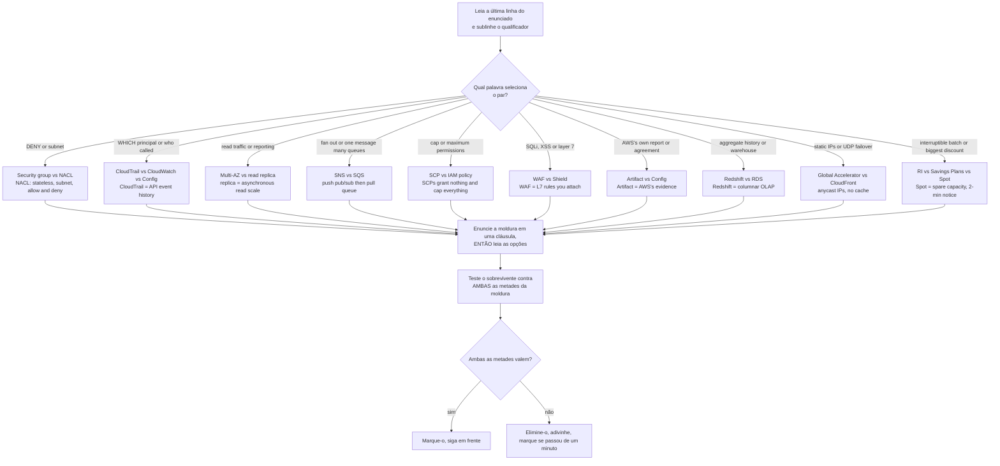
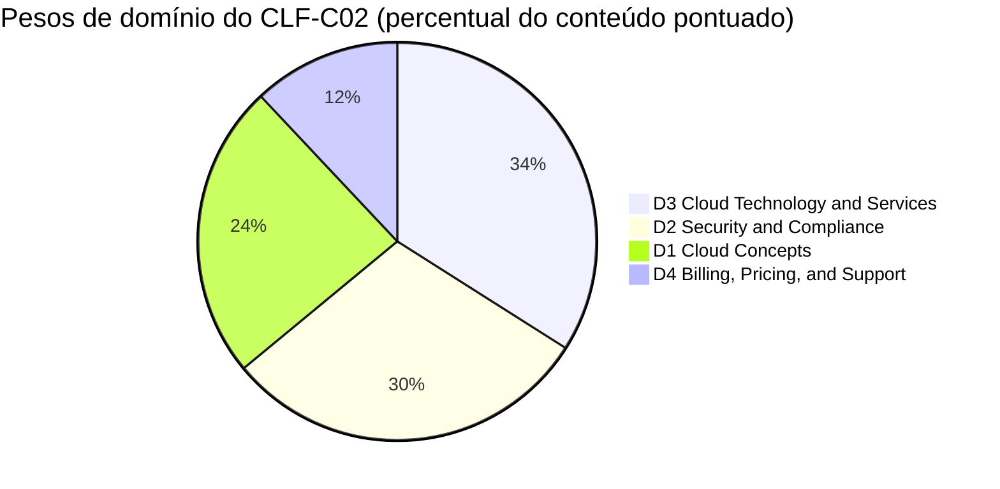
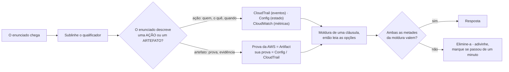
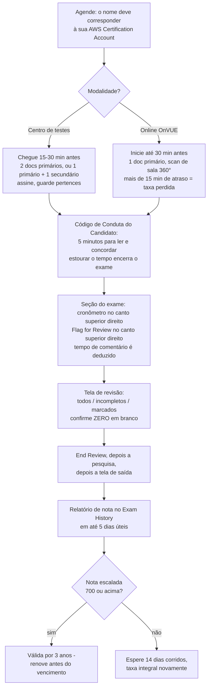
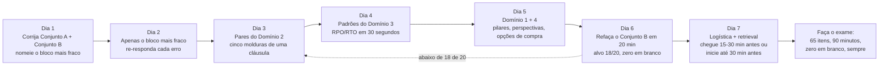

# Simulado de Exame B: Segundo Conjunto de Prática, Drills de Armadilha e o Dia do Exame

Quinze lições lhe deram o conteúdo e o Conjunto A lhe deu uma primeira simulação. Este é o **segundo exame-simulado**, e um segundo exame-simulado mede algo diferente: não se você conhece o material, mas se você consegue manter dois serviços vizinhos separados *enquanto o relógio corre*. Quase ninguém reprova no CLF-C02 porque nunca ouviu falar do AWS Config; reprovam porque o enunciado pediu a evidência da **AWS** e eles forneceram a **deles**, ou porque o enunciado disse *read traffic* e a opção disse *Multi-AZ*. Em uma escala compensatória de 100–1.000 com 700 para passar, a discriminação é o que separa uma aprovação confortável de um quase-erro.

```text
===================================================================
 CLF-C02 / SET B AT A GLANCE             (all figures as of Oct 2026)
===================================================================
 FORMAT ....... 65 questions = 50 scored + 15 unscored (not identified)
 TYPES ........ multiple choice (1 right + 3 distractors)
                multiple response (2+ right of 5+ options)
 TIME ......... 90 minutes = 5,400 s  ->  ~83 s per item (arithmetic)
 SCALE ........ 100 - 1,000, pass at 700, COMPENSATORY, no section cut
 GUESSING ..... no penalty for a wrong guess; BLANK = wrong
 WEIGHTS ...... D1 Cloud Concepts 24% | D2 Security 30%
                D3 Cloud Technology 34% | D4 Billing 12%
 COST ......... 100 USD per attempt (tax may apply)
 VALIDITY ..... 3 years; after a FAIL wait 14 calendar days,
                unlimited attempts, full fee every time
 RESULTS ...... posted to your AWS Certification Account within
                5 business days (official ceiling)
--------------------------------------------------------------------
 SET B (this lesson) ...... 20 items in weight order: 5 / 6 / 7 / 2
 SET B adds ............... the ten trap pairs, the exam-day
                            checklist and a final 7-day study plan
===================================================================
```

> [!NOTE]
> **Como usar esta lição.** Leia as seções 1 e 2 uma vez — essa é a metade da estratégia, e ela é construída inteiramente em torno de *pares*. Então faça o **Conjunto B (seção 3) com um cronômetro de 20 minutos, sem notas, sem busca e sem espiar os desmembramentos**. Corrija-se com a seção 6, faça os dez pares na seção 4, percorra a lista de logística do dia do exame na seção 5, e deixe o plano de 7 dias da seção 7 decidir o que acontece entre agora e sua agendamento. Qualquer coisa que esta lição não pôde verificar contra uma página AWS de primeira parte está listada na seção 6.4 — trate essas como *não assevere*, não como fatos a decorar.

Ao final desta lição você será capaz de:

- enuncie a moldura correta de uma linha para cada um dos dez pares de armadilha com maior probabilidade de lhe custar pontos;
- identifique uma **opção meia-verdade** — o distrator que troca exatamente um atributo de um par — e a elimine em uma cláusula;
- lide com enunciados de **resposta múltipla** com um procedimento tudo-ou-nada que nunca assume crédito parcial;
- rode a aritmética que o exame realmente pede: **RPO/RTO**, **tetos de desconto** e seleção **banco-de-dados-por-padrão**;
- recite a logística oficial do dia do exame — documentos, chegada, check-in, pausas, tempo de comentário, timing dos resultados;
- corrija o Conjunto B **por bloco de domínio** contra limiares explícitos de pronto × não pronto, e defenda o **veredito comparativo** sobre reservar agora versus mais sete dias;
- rode um plano de estudo de **7 dias** orientado por peso que revisa por queda de domínio em vez de por ordem de capítulo.

---

## 1. Estratégia: pares de armadilha e como o exame os arma

### 1.1 O que é um par, e o que um distrator realmente parece

A AWS descreve seus próprios distratores como *"generally plausible responses that match the content area"*. A consequência prática é que a maioria das opções que você enfrenta é tirada da **mesma decisão da chave** — o que significa que a maioria das derrotas neste exame não são falhas de conhecimento, são **falhas de par**: você conhecia um membro do par mas não conseguiu enunciar a linha entre eles sob pressão de tempo.

Um par se torna um item através de exatamente três movimentos:

1. **Troque um atributo por opção** — stateful/stateless, allow/deny, push/pull, synchronous/asynchronous, grant/cap.
2. **Troque o pedido** — o enunciado quer *escala de leitura*, a opção oferece *disponibilidade*; o enunciado quer *evidência sobre a AWS*, a opção oferece *evidência sobre você*.
3. **Troque o dono** — o trabalho da AWS versus o seu trabalho, sob o modelo de responsabilidade compartilhada.

Exemplo resolvido 1 — uma opção meia-verdade, dissecada antes de ler o enunciado. Pegue o par security group / network ACL e construa as quatro opções da forma como o exame faz:

| Opção | O que a opção acerta | Onde quebra | Veredicto |
|---|---|---|---|
| **A** | First-match, lowest-rule-number-first *é* uma regra real de avaliação — mas pertence às **NACLs** | A opção entrega o comportamento de NACL às security groups e então chama NACLs de stateful | ambas as propriedades revertidas |
| **B** | Security groups **são** stateful e o tráfego de resposta é auto-permitido; NACLs **são** stateless e precisam de uma regra explícita de retorno | — | ambas as metades corretas |
| **C** | Ambas *são* controles de rede | Security groups avaliam **todas** suas regras e não podem expressar deny, então nenhuma afirmação na opção sobrevive | duas afirmações, ambas falsas |
| **D** | Security groups *são* allow-only; NACLs *são* no nível da subnet | Cruza-as: security groups são **no nível da instância**, e NACLs **suportam** deny | as duas metades trocadas entre membros |

Apenas **B** sobrevive, e sobrevive porque você avaliou *ambas as metades* em vez de reconhecer uma palavra familiar. As opções A, C e D cada uma contém uma frase que você leu na documentação — esse é o design. **Um distrator não precisa ser falso; ele precisa ser falso no lugar que o enunciado está perguntando.**



### 1.2 As três questões para qualquer item de par

Candidatos lentos leem opções; candidatos rápidos interrogam o *par* primeiro. Faça estas três, nesta ordem, antes de olhar para uma única opção:

1. **O que cada membro do par realmente faz?** Uma cláusula cada, de memória. Se você não consegue dizer o que um read replica faz em uma cláusula, as opções responderão por você — mal.
2. **Qual qualificador do enunciado seleciona entre eles?** `DENY`, `subnet`, `read traffic`, `fan out`, `maximum permissions`, `layer 7`, `AWS's own`, `interruptible`. O substantivo no enunciado geralmente é o isca; o qualificador é a chave.
3. **A opção sobrevivente satisfaz *ambas* as metades?** Para um enunciado `(Select TWO)` isso é literal — ambas as afirmações devem estar corretas, e a regra publicada da AWS em outro lugar de seu material de certificação é que você deve selecionar todas as respostas corretas para receber crédito.

```fillblank
{
  "question": "Complete os quatro reflexos de drill de par da seção 1.2:",
  "template": "1) Enuncie o que cada membro do par faz em uma {{1}} ANTES de ler as opções. 2) Encontre o {{2}} do enunciado que seleciona entre eles - DENY, subnet, read traffic, fan out. 3) Teste a opção sobrevivente contra AMBAS as metades da {{3}}. 4) Além de cerca de um minuto, {{4}} e adivinhe - nunca deixe um branco.",
  "answers": {
    "1": "clause",
    "2": "qualifier",
    "3": "framing",
    "4": "flag"
  },
  "distractors": ["sentence", "service name", "option list", "skip", "rewrite", "guess twice", "domain weight"],
  "explanation": "Os quatro reflexos são o sistema defensivo inteiro, uma linha cada: a moldura de uma cláusula impede que as opções l ensinem a distinção errada, o qualificador é a palavra que realmente decide a chave, o teste de ambas-as-metades é o que elimina uma opção meia-verdade (e é literal para enunciados Select TWO), e além de cerca de um minuto o movimento correto é marcar, adivinhar, seguir - porque questões sem resposta são pontuadas como incorretas e não há penalidade para uma adivinhação errada."
}
```

- **📚 Você sabia?** O próprio **Official Practice Question Set** da AWS para o CLF-C02 contém exatamente **20 questões** — a mesma contagem que o Conjunto A e o Conjunto B aqui — é **gratuito**, pode ser refeto, reembaralha os mesmos itens em cada tentativa, e oferece *detailed feedback for answer choices including recommended resources*. É o primeiro passo do plano de preparação de quatro passos da AWS, e é a régua oficial mais próxima para o ritmo que você está treinando nesta lição (em outubro de 2026).

## 2. Estratégia: as três formas de item que decidem o Conjunto B

O CLF-C02 publica exatamente **dois** tipos de questão — escolha múltipla (uma resposta correta mais três distratores) e resposta múltipla (duas ou mais respostas corretas de cinco ou mais opções). Não há ordenação, matching nem item de estudo de caso neste exame, então não orce para eles. O que o Conjunto B adiciona ao Conjunto A é prática nas três *formas* que custam mais marcas: **resposta múltipla**, **cálculo** e **seleção por padrão**.

### 2.1 Resposta múltipla sem crédito parcial

| Regra | O que é publicado | O que significa à mesa |
|---|---|---|
| **Estrutura** | 2+ respostas corretas de **5+** opções | Leia *cada* opção antes de se comprometer com qualquer coisa |
| **Crédito** | A frase tudo-ou-nada da AWS — *"Você deve selecionar todas as respostas corretas para receber crédito"* — aparece no guia do AI Practitioner da AWS e em um post de blog da AWS de 2024, **não** no guia CLF-C02 | Pratique **tudo-ou-nada, zero crédito parcial**; não a cite como texto CLF-C02 (seção 6.4) |
| **Contagem** | Quantos itens de resposta múltipla o exame real carrega, e se todo enunciado declara sua contagem, é **não publicado** | Espere que o enunciado lhe diga a contagem; se disser, sublinhe-a |
| **Formato do Conjunto B** | Cada enunciado de RM aqui pré-combina suas declarações corretas dentro de uma opção | Treina o pensamento tudo-ou-nada mantendo o esquema JSON de chave única |

O procedimento que sobrevive ao contato com cinco ou seis opções:

1. Marque cada opção **definitivamente sim / definitivamente não / talvez** — em uma única passada, sem escolher.
2. Resolva cada *talvez* relendo o **qualificador**, não a opção.
3. Submeta apenas quando nenhum *talvez* restar. Duas respostas óbvias mais uma quinta correta esquecida é o zero clássico.

### 2.2 As formas de cálculo e de seleção

Três famílias aparecem repetidamente, e cada uma tem um procedimento mecânico:

**Exemplo resolvido 2 — aritmética RPO/RTO.** Um banco de dados falha às **14:00**. O último backup bem-sucedido concluiu às **08:00**, e o serviço é restaurado às **16:30**.

$$
\text{RPO} = 14{:}00 - 08{:}00 = 6\ \text{h de dados em risco} \qquad \text{RTO} = 16{:}30 - 14{:}00 = 2{,}5\ \text{h de indisponibilidade}
$$

**RPO = dado, RTO = tempo.** Compute ambos os intervalos primeiro, então atribua as letras — candidatos que as atribuem primeiro perdem o item enquanto fazem a aritmética corretamente (veja o item 17 do Conjunto B).

**Exemplo resolvido 3 — tetos de desconto, em outubro de 2026 (verifique o atual antes de usar).** Para uma carga de trabalho ininterrupta rodando 24/7 por três anos em uma família de instância: Spot é **up to 90 %** mas interrompível (aviso de dois minutos), um Compute Savings Plan de 1 ano é **up to 66 %** e compromete por um ano, um EC2 Instance Savings Plan de 3 anos é **up to 72 %** e corresponde ao horizonte, e On-Demand é a linha de base sem desconto. O maior teto *sobrevivente* é **72 %** — o maior número de manchete foi desqualificado por uma restrição, não por aritmética (veja o item 19).

**Exemplo resolvido 4 — seleção banco-de-dados-por-padrão.** Traduza os substantivos do enunciado para um modelo de dados *antes* de ler nomes de serviços:

| O enunciado diz | O modelo | O serviço que seleciona |
|---|---|---|
| *relacional*, compatível com MySQL/PostgreSQL, backups gerenciados | OLTP relacional | Amazon Aurora ou Amazon RDS |
| leituras em *microssegundos*, conjuntos ordenados, rankings | Cache em memória | Amazon ElastiCache |
| *agregar três anos* de vendas para um dashboard | Armazém OLAP colunar | Amazon Redshift |
| *chave-valor*, milissegundos de um dígito, itens de 400 KB | NoSQL chave-valor | Amazon DynamoDB |
| *montável*, POSIX, várias Availability Zones | Arquivo compartilhado | Amazon EFS |

Duas dessas linhas se tornam os itens 15 e 16 do Conjunto B. O padrão nunca muda: **substantivo → modelo de dados → serviço**, e só então as opções.

### 2.3 O blueprint do Conjunto B, seu relógio e seus pesos

Apenas percentuais de **domínio** são publicados; as contagens de itens abaixo são aritmética sobre 50 itens pontuados — um auxílio de planejamento, nunca um número da AWS.

| Domínio | Peso publicado | Itens pontuados no exame real (derivado: 50 × w) | Itens do Conjunto B aqui | O que este bloco realmente testa |
|---|---|---|---|---|
| **D1** Cloud Concepts | **24 %** | ≈ 12 | **5** (Q1–Q5) | Pilares vs perspectivas, elasticidade, os 6 Rs, tópicos de economia |
| **D2** Security and Compliance | **30 %** | ≈ 15 | **6** (Q6–Q11) | Molduras de par: SG/NACL, Trail/Config, SCP/IAM, WAF/Shield, Artifact |
| **D3** Cloud Technology and Services | **34 %** | ≈ 17 | **7** (Q12–Q18) | Armazenamento, banco-de-dados-por-padrão, compute, load balancing, aritmética de recuperação |
| **D4** Billing, Pricing, and Support | **12 %** | ≈ 6 | **2** (Q19–Q20) | Escolha de opção de compra e a estimativa pré-build |
| **Total** | **100 %** | **≈ 50** | **20** | A coluna "itens pontuados" é aritmética, não uma afirmação da AWS |

**Exemplo resolvido 5 — pesos para itens, duas vezes.** No exame real: $50 \times 0.24 = 12$, $50 \times 0.30 = 15$, $50 \times 0.34 = 17$, $50 \times 0.12 = 6$, e $12 + 15 + 17 + 6 = 50$. No Conjunto B: as mesmas proporções arredondam para **5 / 6 / 7 / 2**, e $5 + 6 + 7 + 2 = 20$. Os domínios 2 e 3 juntos são **64 %** do conteúdo pontuado — é por isso que eles seguram 13 destes 20 itens.

**Exemplo resolvido 6 — o próprio relógio do Conjunto B.** Vinte itens no orçamento de primeira passada de 60 s cada é $20 \times 60 = 1{,}200\ \text{s} = \mathbf{20}$ **minutos**. O teto completo de 83 segundos daria $20 \times 83 = 1{,}660\ \text{s} = 27{,}7$ minutos — confortável, mas treina um ritmo que você não conseguirá manter para 65 itens. Faça o Conjunto B em **20 minutos cheios**; se terminar com tempo sobrando, gaste-o em itens marcados, não em reler os confiantes.



- **📚 Você sabia?** O ritmo publicado da própria AWS para uma certificação **Foundational** é de **2–3 semanas** de preparação em blocos de **30–60 minutos**, com *pelo menos um exame de prática cronometrado de tamanho completo* antes do proctorado. O plano de 7 dias da seção 7 é, portanto, um plano **comprimido**: assume que as lições 01–15 e o Conjunto A já estão atrás de você, e gasta a semana em discriminação e logística em vez de conteúdo novo.

---

## Exercícios com estudos de caso do mundo real

Duas histórias de clientes publicadas pela AWS, convertidas nos únicos dois movimentos que este exame jamais faz com uma história: **mapeie-a para um domínio**, então **preveja o enunciado**. Todo percentual abaixo é um *resultado de cliente* que a AWS escolheu publicar — nunca uma promessa da AWS e nunca um número sem sua data (páginas de estudo de caso não trazem data de publicação, então o único carimbo disponível é a data de acesso; todos os números abaixo acessados em **outubro de 2026**).

### Exercício de caso 1 — Capital One: oito data centers para zero

**O cenário.** Um banco regulado (Fortune 100) opera oito data centers locais sob um ciclo de refresh de hardware enquanto tenta escalar trabalho de machine learning e personalização em tempo real. O relato publicado pela AWS: a Capital One **saiu de todos os oito data centers** migrando para a AWS (o último em 2020), construiu cerca de **80 % de suas ~2.000 aplicações** na nuvem do zero, reciclou **103 toneladas** de cobre e aço, reduziu o tempo médio para construir um ambiente de desenvolvimento de **três meses para minutos**, reduziu o tempo de teste de recuperação de desastres em **70 %**, e reduziu resolução de incidentes e erros de transação em **50 %**.

**Qual domínio?** **D1 Cloud Concepts (24 %)** — a história é um argumento sobre agilidade, opex versus capex e as estratégias de migração, não sobre um serviço. Os ganchos que alcançam **D3** (serverless, serviços de migração) e a página separada de resiliência da AWS para o mesmo cliente (**eventos de severidade crítica reduzidos em 80–90 %**, recuperação **de horas para minutos**) são *secundários*: esses números vêm de um estudo de caso diferente, então nunca misture as duas páginas em uma resposta.

**O que o exame perguntaria?** As quatro formas de enunciado que esta história normalmente se torna:

| Forma do enunciado | O qualificador que decide | Para onde a chave aponta |
|---|---|---|
| "…ambientes que levavam meses agora levam minutos" | *tempo de ciclo*, não *preço* | **Agilidade** |
| "…reconstruiu suas aplicações para a nuvem em vez de movê-las como estavam" | *reconstruiu* versus *lift and shift* | a extremidade de refactor dos **6 Rs** |
| "A AWS constrói a infraestrutura; o cliente ainda aplica patches dentro de suas cargas" | *quem é dono de quê* | o **modelo de responsabilidade compartilhada** |
| "O cliente alcançou uma redução de 70 % — o que esse número significa?" | *resultado do cliente* versus *garantia* | um **resultado publicado, não um SLA da AWS** |

**Armadilha para pré-carregar:** "a AWS garante 90 % de economia" está errada duas vezes — converte o resultado de uma cliente em uma promessa, e a AWS nunca publica tal garantia. Reescreva todo percentual de estudo de caso como *"a AWS relata que \<cliente\> alcançou …"*.

### Exercício de caso 2 — Box: US$ 2,23 milhões encontrados em quatro itens de linha

**O cenário.** Uma empresa SaaS corporativa quer cortar gastos **sem** enfraquecer segurança, confiabilidade ou desempenho. Aplica o Well-Architected Framework e revisões de especialistas, então ataca quatro faturas específicas: tiering de armazenamento S3 e Glacier, higiene de volumes e snapshots do EBS, filtragem de eventos do CloudTrail, e tráfego roteado ao redor dos gateways da internet. A AWS relata **US$ 2,23 milhões** em economias, decompostas como:

| Item de linha | O que é no exame |
|---|---|
| **US$ 438.000** transferência de dados entre AZs | o custo de designs multi-AZ faladores |
| **US$ 1,1 milhão / ano** egress de internet | a maior linha única — uma decisão de arquitetura |
| **> US$ 500.000 / ano** armazenamento | **classes** de armazenamento e tiering de lifecycle |
| **US$ 192.000 / ano** logging | volume de logs e filtragem |
| **= US$ 2,23 milhões** total | 438.000 + 1.100.000 + 500.000 + 192.000 |

**Qual domínio?** **D4 Billing, Pricing and Support (12 %)**, com um gancho de D3 em classes de armazenamento. O ponto da história é o *ranking*: a maior economia não foi uma negociação de desconto, foi **arquitetura**.

**O que o exame perguntaria?**

- *"Qual alavanca produziu a maior economia única?"* → **transferência de dados para fora** (egress), não um desconto por compromisso.
- *"Qual recurso gratuito oferece orientação de custo de melhores práticas antes de qualquer código ser escrito?"* → a **revisão do Well-Architected Framework** — orientação gratuita, distinta do **Trusted Advisor** (verifica sua conta) e de um **plano de suporte pago** (abre casos).
- *"Onde um cliente veria cobranças entre AZs se acumulando?"* → **Cost Explorer** / visões de alocação de custo — nunca o **Pricing Calculator**, que estima gastos que ainda não existem (a divisão em quatro do Q20 se aplica sem mudanças).

**Armadilha para pré-carregar:** revisão do Well-Architected ≠ Trusted Advisor ≠ plano de suporte — três questões diferentes vestindo uma palavra. E US$ 2,23 milhões é o resultado *da Box*; o exame adora uma opção que o reafirma como uma garantia da AWS.

- **📚 Você sabia?** O total de manchete da Box é uma aritmética que você pode conferir em uma linha: **438.000 + 1.100.000 + 500.000 + 192.000 = 2.230.000**. Números de estudo de caso neste exame são quase sempre decomponíveis — quando os componentes de uma opção não somam seu próprio total, ela está errada mesmo que cada número individual pareça familiar.

### Atualizações de 2026 (em outubro de 2026)

> [!NOTE]
> **O que mudou entre o guia que os candidatos revisavam e o guia que a AWS publica hoje.** Cada item abaixo vem do diff do guia de outubro de 2026 e dos anúncios da AWS por trás dele (digest de pesquisa 18; todas as fontes acessadas em outubro de 2026).
> - **O escopo mudou, os pesos não.** Os pesos de domínio permanecem **24 / 30 / 34 / 12**; a *lista de serviços* é o que mudou — entradas no escopo **128 → 111**, fora do escopo **11 → 55** desde o PDF de lançamento `Version 1.0 CLF-C02`. **AWS Network Firewall, Amazon MSK, AWS Billing Conductor** e **AWS Wavelength** agora estão na lista fora do escopo: legais como distratores, nunca a chave. Material de preparo ainda citando os pesos do CLF-C01 **26 / 25 / 33 / 16** está citando um apêndice que a AWS excluiu.
> - **Os nomes de planos de suporte mudaram dentro do texto do exame.** A tarefa 4.3 agora lê *"Basic Support, AWS Business Support+, AWS Enterprise Support, AWS Unified Operations"*. Developer, Business clássico e Enterprise On-Ramp **não aceitaram novas assinaturas após 2025-12-02** (existentes rodam até 2027-01-01) — uma opção oferecendo "Developer Support" como plano pago de entrada está desatualizada.
> - **Free Tier depende da data da conta.** Contas criadas **em ou após 2025-07-15** recebem **6 meses** (ou até acabarem os créditos) mais **USD 100 de cadastro e até USD 100 acumuláveis**; o tier de **12 meses `t2.micro`** pertence apenas a contas criadas antes, e `t2.micro` não está na nova lista de elegíveis. A data da conta no enunciado é o qualificador.
> - **Duas regras diferentes de "egress gratuito".** **100 GB por mês** de transferência gratuita de dados para fora das Regiões é uma mudança de **2021**; o movimento mais novo de crédito para sair da AWS é por aprovação e tem **90 dias** para ser concluído. Mesmas palavras, dois mecanismos (em outubro de 2026).
> - **Notícia não é syllabus.** O **Well-Architected Agent** (preview, 2026-10-01) e os **Database Savings Plans** (2025-12-02) são reais mas não aparecem em nenhum lugar do guia de exame — as ferramentas de custo examináveis permanecem Cost Explorer, Budgets, Pricing Calculator, os Cost and Usage Reports, Trusted Advisor e a **Tool** do Well-Architected. E as sessões em **italiano e alemão** se aposentam após **2026-12-31** (12 idiomas em outubro de 2026).

```dragdrop
{
  "question": "Ordene estas mudanças da AWS de 2025-2026 do mais antiga para a mais recente, então confira as datas na explicação:",
  "items": [
    "Região da AWS European Sovereign Cloud eusc-de-east-1 anunciada como geralmente disponível",
    "Transferência gratuita de dados para a internet atinge 100 GB por mês a partir das Regiões da AWS",
    "Reforma do suporte: Business Support+ é lançado e os nomes legados de planos fecham para novas assinaturas",
    "AWS Well-Architected Agent entra em preview - real, mas não nomeado no guia de exame",
    "Reestruturação do Free Tier: 6 meses mais até USD 200 em créditos para contas recém-criadas"
  ],
  "correctOrder": [
    "Transferência gratuita de dados para a internet atinge 100 GB por mês a partir das Regiões da AWS",
    "Reestruturação do Free Tier: 6 meses mais até USD 200 em créditos para contas recém-criadas",
    "Reforma do suporte: Business Support+ é lançado e os nomes legados de planos fecham para novas assinaturas",
    "Região da AWS European Sovereign Cloud eusc-de-east-1 anunciada como geralmente disponível",
    "AWS Well-Architected Agent entra em preview - real, mas não nomeado no guia de exame"
  ],
  "explanation": "A sequência verificada é 2021-12-01 (100 GB por mês de transferência gratuita de dados para fora - a regra mais antiga e a mais mal datada), depois 2025-07-15 (reestruturação do Free Tier), depois 2025-12-02 (reforma do suporte que introduz o Business Support+ e fecha Developer, Business clássico e Enterprise On-Ramp para novas assinaturas), depois 2026-01-14 (região da AWS European Sovereign Cloud anunciada GA), depois 2026-10-01 (preview do Well-Architected Agent). O uso desta linha do tempo no dia do exame é disciplina de data: o exame testa o guia que você baixa hoje, não o que você revisava, então todo fato de escopo, preço e nome de plano recebe o carimbo 'em outubro de 2026' e qualquer coisa mais velha é checada contra o guia atual antes de você asseverá-la."
}
```

- **📚 Você sabia?** O PDF atual do guia de exame imprime **nenhum número de versão** — apenas `Copyright © 2026`. O único artefato com data é o PDF de lançamento `Version 1.0 CLF-C02`, e o `uiVersion=2024.10` que você pode notar na URL da documentação é a **versão do template do site AWS Docs**, não uma data de revisão do guia (verificado em outubro de 2026). Sempre que um site de preparo alegar "guia v1.3, março de 2026", trate a alegação como não verificada até vê-la na própria página da AWS.

---

---

## 3. Perguntas de Prática (Practice Questions) — Conjunto B: 20 itens na ordem de peso publicada

O Conjunto B espelha o formato **dominante** do exame real — uma resposta correta, três distratores — enquanto treina quatro enunciados no **estilo de resposta múltipla**. Os itens correm na ordem de peso de domínio: **D1 cinco, D2 seis, D3 sete, D4 dois**, que é a divisão publicada 24 / 30 / 34 / 12 arredondada sobre vinte itens.

### 3.0 Como fazer o Conjunto B

| Ajuste | A regra | Por que importa |
|---|---|---|
| **Cronômetro** | **20 minutos cheios** (60 s por item — o orçamento de primeira passada) | Treina o ritmo que você usará para 65 itens |
| **Materiais** | Sem notas, sem busca, desmembramentos invisíveis | Pontuação com livro aberto mede suas notas, não você |
| **Ritmo** | Responda cada item; marque qualquer coisa acima de 60 segundos e siga em frente | Um em branco é um zero garantido — a regra nunca muda com o tamanho do conjunto |
| **Regra do par** | Antes de ler as opções, escreva a moldura do par em uma cláusula | Este é o ponto inteiro do Conjunto B |
| **Resposta múltipla** | Leia **todas** as opções; as declarações corretas são pré-combinadas em uma opção para que cada item mantenha uma chave única | Treina o pensamento tudo-ou-nada sem quebrar o esquema |
| **Correção** | Por **bloco de domínio** primeiro, total segundo (seção 6) | A pontuação compensatória pune a queda, não a média |
| **Refazer** | 72 horas depois, de memória | Lacunas mais curtas medem reconhecimento, não retenção |

### 3.1 Domain 1 — Cloud Concepts (24 %) · itens 1–5

```question
{
  "id": "clf-16-q1",
  "type": "multiple-choice",
  "question": "Qual perspectiva do AWS Cloud Adoption Framework cobre governança de TI, gestão de serviços de TI e risco?",
  "options": [
    "Business",
    "Governance",
    "Platform",
    "Operations"
  ],
  "correct": 1,
  "explanation": "O AWS Cloud Adoption Framework tem seis perspectivas - Business, People, Governance, Platform, Security e Operations - e Governance é a que possui política, risco e estruturas de conformidade."
}
```

**Teardown — Q1 · qual perspectiva do CAF.** **Por que está certo:** Governance é a perspectiva que possui governança de TI, gestão de serviços de TI, política e risco. **Por que as armadilhas perdem:** **A** é o caso financeiro e de valor (benefícios, receita, risco de negócio reduzido); **C** é o alicerce de implementação — migração e infraestrutura; **D** é operações e entrega de serviços. **Armadilha:** as seis **perspectivas** do CAF são rotineiramente confundidas com os seis **pilares** do Well-Architected — *Governance* existe apenas no CAF, *Sustainability* apenas no Well-Architected (veja Q3). Nunca troque os dois vocabulários. **Fonte:** seed Q03 · digest cloud-economics/migration F.3 (lista de perspectivas do CAF da AWS).

```question
{
  "id": "clf-16-q2",
  "type": "multiple-choice",
  "question": "Uma aplicação adiciona capacidade automaticamente durante um pico de tráfego e a libera quando a demanda cai. Qual conceito está sendo demonstrado?",
  "options": [
    "Scalability",
    "Elasticity",
    "High availability",
    "Economies of scale"
  ],
  "correct": 1,
  "explanation": "Elasticity significa crescer E encolher sob demanda; scaling out é apenas metade disso, e o enunciado descreve as duas direções."
}
```

**Teardown — Q2 · o comportamento de duas mãos.** **Por que está certo:** o enunciado contém dois verbos — *adiciona* e *libera* — e apenas elasticidade cobre a metade da liberação. **Por que as armadilhas perdem:** **A** é a capacidade de lidar com crescimento, sem requisito de encolher; **C** é sobreviver a uma falha de componente em várias Availability Zones, que o enunciado nunca menciona; **D** é o argumento de agregação — centenas de milhares de clientes reduzindo o preço unitário — um efeito de precificação, não um comportamento de escala. **Armadilha:** "escalar para fora" puxa os candidatos para *scalability*; o discriminador é o comportamento de **duas mãos**, não a presença de escala. **Fonte:** seed Q06 · digest cloud-concepts F.5 (elasticity ≠ scalability ≠ high availability).

```question
{
  "id": "clf-16-q3",
  "type": "multiple-choice",
  "question": "Qual das seguintes é um dos seis pilares do AWS Well-Architected Framework?",
  "options": [
    "Compliance",
    "Scalability",
    "Sustainability",
    "Agility"
  ],
  "correct": 2,
  "explanation": "Os seis pilares são operational excellence, security, reliability, performance efficiency, cost optimization e sustainability."
}
```

**Teardown — Q3 · pilar, não tópico.** **Por que está certo:** Sustainability é um dos seis pilares publicados. **Por que as armadilhas perdem:** **A** é um título do Domínio 2 — conformidade fica sob governança, não sob os pilares do framework; **B** e **D** são benefícios reais da nuvem do Domínio 1, que é exatamente por que soam como pilares. **Armadilha:** as quatro opções são *afirmações verdadeiras sobre a AWS*; apenas uma é um **pilar**. Memorize os seis como um conjunto: operational excellence, security, reliability, performance efficiency, cost optimization, sustainability. **Fonte:** seed Q08 · digest monitoring/support F.9 · digest exam-guide §B.2 tarefa 1.2 (lista de pilares verbatim).

```question
{
  "id": "clf-16-q4",
  "type": "multiple-choice",
  "question": "(Select THREE.) Quais TRÊS são aspectos de economia de nuvem nomeados na declaração de tarefa 1.4 do CLF-C02? No formato de chave única deste conjunto, os três aspectos estão pré-combinados dentro de uma opção - escolha a opção em que OS TRÊS são nomeados na declaração de tarefa 1.4.",
  "options": [
    "Rightsizing; comparação de Bring Your Own License (BYOL) com licenças incluídas; benefícios da automação",
    "Rightsizing; recuperação de desastres active-active entre Regiões; configuração de network access control lists",
    "Bring Your Own License (BYOL) comparado com licenças incluídas; rightsizing; disponibilidade garantida de 100% para todas as aplicações",
    "Benefícios da automação; economias de escala; eliminação do modelo de responsabilidade compartilhada"
  ],
  "correct": 0,
  "explanation": "A declaração de tarefa 1.4 lista custos fixos vs variáveis, custos on-premises, estratégias de licenciamento (BYOL comparado com licenças incluídas), rightsizing, benefícios da automação e economias de escala - todos os três itens da opção-chave estão nessa lista."
}
```

**Teardown — Q4 · três de seis, todos de uma tarefa.** **Por que está certo:** rightsizing, licenciamento BYOL-versus-incluído e benefícios da automação são todos nomeados na tarefa 1.4 — benefícios da automação é explicitamente um benefício *econômico* lá, não um técnico. **Por que as armadilhas perdem:** **B** mistura um item verdadeiro com uma escolha de projeto de confiabilidade (recuperação de desastres, território da tarefa 3.2) e um controle de segurança de rede (tarefa 3.5) — ambos fora da lista; **C** pares dois itens verdadeiros com uma afirmação absoluta que a AWS nunca publica — disponibilidade é uma responsabilidade compartilhada, então nenhuma garantia existe; **D** é a mais das quatro: dois de seus três itens *estão* na lista, mas "eliminar o modelo de responsabilidade compartilhada" é falso, então a tripla falha. **Armadilha:** uma tripla de 2-de-3 é o distrator de RM padrão — você deve validar **cada** membro, não os dois primeiros que reconhece. **Forma no exame real:** três caixas de seleção, tudo-ou-nada. **Fonte:** seed Q09 · digest exam-guide §B.2 tarefa 1.4 (títulos de conhecimento e habilidades verbatim).

```question
{
  "id": "clf-16-q5",
  "type": "multiple-choice",
  "question": "Uma empresa mantém seu estado VMware on-premises e o estende para a AWS com uma experiência de operação consistente em ambos. Qual modelo de implantação de nuvem é este?",
  "options": [
    "Public cloud",
    "Private cloud",
    "Hybrid cloud",
    "Multi-cloud"
  ],
  "correct": 2,
  "explanation": "Hybrid integra a infraestrutura on-premises ou privada de uma empresa com a nuvem pública para que a experiência seja consistente da nuvem ao on-premises e à edge."
}
```

**Teardown — Q5 · estende, não substitui.** **Por que está certo:** o enunciado tem duas metades — *ainda roda VMware on-premises* **e** *estende para a AWS com experiência consistente* — e hybrid é o único modelo que mantém ambas. **Por que as armadilhas perdem:** **A** é infraestrutura hospedada na AWS alcançada pela internet pública, o que ignora a metade on-premises; **B** é infraestrutura de organização única (a AWS ilustra com Amazon VPC) e ignora a metade *estende para a AWS*; **D** requer dois ou mais **provedores públicos**, e seu próprio data center não é um provedor. **Armadilha:** "ainda roda on-premises" tenta *private cloud*; *estende* é o verbo operante. **Fonte:** seed Q10 · digest deployment/operations §B.2 (modelos de implantação na redação da AWS).

### 3.2 Domain 2 — Security and Compliance (30 %) · itens 6–11

```question
{
  "id": "clf-16-q6",
  "type": "multiple-choice",
  "question": "Qual par de declarações sobre security groups e network ACLs está CORRETO?",
  "options": [
    "Security groups são stateless e usam avaliação de menor número de regra primeiro; NACLs são stateful",
    "Security groups são stateful e o tráfego de retorno é permitido automaticamente; NACLs são stateless e precisam de uma regra explícita para o tráfego de retorno",
    "Ambos são avaliados por first match e ambos suportam regras deny",
    "Ambos operam no nível da subnet e ambos são apenas-allow"
  ],
  "correct": 1,
  "explanation": "Security groups são stateful, apenas-allow e no nível da instância, e todas as suas regras são avaliadas; NACLs são stateless, allow E deny, no nível da subnet, e first match decide."
}
```

**Teardown — Q6 · memorize o par, não as palavras.** **Por que está certo:** stateful-mais-resposta-automática para security groups e stateless-mais-regra-de-retorno-explícita para NACLs são as duas propriedades que nunca se trocam. **Por que as armadilhas perdem:** **A** reverte *ambas* as propriedades — NACLs são as stateless, de first match; **C** enxerta deny de NACL na avaliação de SG, porque security groups não podem expressar deny de modo algum; **D** reverte o escopo (security groups se anexam a uma elastic network interface, NACLs a uma subnet) e ignora deny de NACL. **Armadilha:** tudo em A, C e D é *meia-verdade* — o exame troca **um atributo por opção**, então segure o par como um bloco de quatro linhas: SG = stateful, apenas-allow, ENI, todas as regras avaliadas · NACL = stateless, allow+deny, subnet, first match para. **Fonte:** seed Q14 · digest security/IAM F.4–F.7 · digest networking F.3, F.5.

```question
{
  "id": "clf-16-q7",
  "type": "multiple-choice",
  "question": "Qual declaração sobre autenticação de múltiplos fatores (MFA) para a AWS está VERDADEIRA em outubro de 2026?",
  "options": [
    "MFA baseado em SMS foi descontinuado; passkeys/chaves FIDO e dispositivos TOTP de hardware ou virtual são suportados",
    "MFA por SMS é o método que a AWS mais recomenda para o usuário root",
    "MFA aplica-se apenas a usuários IAM e nunca ao usuário root",
    "MFA é opcional porque políticas IAM já impõem menor privilégio"
  ],
  "correct": 0,
  "explanation": "A AWS aposentou o MFA baseado em SMS e direciona a proteção de root e IAM para opções resistentes a phishing - passkeys, chaves de segurança FIDO - e dispositivos TOTP de hardware ou virtual."
}
```

**Teardown — Q7 · date-stamp toda resposta de MFA.** **Por que está certo:** MFA por SMS está aposentado em outubro de 2026, e o conjunto suportado é passkeys/FIDO mais dispositivos TOTP. **Por que as armadilhas perdem:** **B** repete o método aposentado e é a resposta de fato desatualizado mais comum em material de estudo escrito antes da aposentadoria; **C** está ao contrário — proteger o usuário root com MFA é a *primeira* recomendação; **D** confunde *quem pode agir* (políticas IAM) com *quem está agindo* (prova de identidade) — menor privilégio não prova identidade. **Armadilha:** notas mais velhas e testes de prática mais antigos ainda dizem "SMS MFA". Date-stamp toda resposta de MFA ao ano em que você faz o exame, e releia a documentação de identidade atual se um fato cheirar a velho. **Fonte:** seed Q17 · digest security/IAM F.19 e §B (registro de MFA de root).

- **📚 Você sabia?** **A acomodação ESL adiciona +30 minutos** ao exame CLF-C02 e é solicitada **uma vez** pela política de before-testing (em outubro de 2026). Se você tem direito a ela, solicite bem antes do seu horário — acomodações não são concedidas à mesa, e a mesma página de política diz que os preços são válidos para uma tentativa de exame.

```question
{
  "id": "clf-16-q8",
  "type": "multiple-choice",
  "question": "Uma equipe de segurança deve provar QUAL principal IAM excluiu uma tabela DynamoDB na terça-feira passada. Qual serviço fornece esse registro?",
  "options": [
    "Amazon CloudWatch",
    "AWS CloudTrail",
    "AWS Config",
    "AWS Trusted Advisor"
  ],
  "correct": 1,
  "explanation": "AWS CloudTrail registra quem executou qual ação de API, quando e de onde - console, CLI, SDK e chamadas de API aparecem todos como eventos."
}
```

**Teardown — Q8 · o qualificador é WHICH principal.** **Por que está certo:** *which principal* é uma questão de ator, e um audit trail de eventos de API é exatamente o que o CloudTrail armazena. **Por que as armadilhas perdem:** **A** responde "está saudável / CPU está alta" — métricas, alarmes e dashboards, não atores; **C** registra o *estado* de configuração dos recursos ao longo do tempo, o que lhe diz como a tabela parecia, não quem a excluiu; **D** aconselha sobre lacunas de melhores práticas e não pode produzir histórico de API de modo algum. **Armadilha:** a palavra *monitoring* aparece em muitos enunciados e puxa candidatos para o CloudWatch; pergunte se o enunciado quer **quem agiu** (Trail), **qual era o estado** (Config) ou **está estourando um limiar** (CloudWatch). **Fonte:** seed Q18 · digest governance/compliance F.1, F.3.

```question
{
  "id": "clf-16-q9",
  "type": "multiple-choice",
  "question": "(Select TWO.) Quais DUAS declarações sobre AWS CloudTrail e AWS Config estão CORRETAS? No formato de chave única deste conjunto, as duas declarações estão pré-combinadas dentro de uma opção - escolha a opção em que AMBAS as declarações estão corretas.",
  "options": [
    "CloudTrail registra eventos de API como quem chamou uma ação e quando; Config pode alertar sobre eventos de login de console do usuário root sem CloudTrail",
    "Config registra o estado de configuração dos recursos ao longo do tempo e pode avaliar regras contra ele; Config substitui Amazon GuardDuty para detecção de ameaças",
    "CloudTrail registra eventos de API como quem chamou uma ação e quando; Config registra o estado de configuração dos recursos ao longo do tempo e pode avaliar regras contra ele",
    "CloudTrail mantém todos os data events por 90 dias de graça em toda conta; CloudTrail registra eventos de API como quem chamou uma ação e quando"
  ],
  "correct": 2,
  "explanation": "CloudTrail é o histórico de eventos (quem e quando) e Config é o histórico de estado (como parecia, e está em conformidade); a AWS recomenda habilitar ambos em vez de escolher entre eles."
}
```

**Teardown — Q9 · duas armadilhas em um item.** **Por que está certo:** ambas as declarações são o trabalho publicado de cada serviço — eventos para o CloudTrail, estado de configuração e avaliação de regras para o Config. **Por que as armadilhas perdem:** **A** está meia-certoa então afirma que o Config pode fazer o trabalho do CloudTrail — o walkthrough oficial pareia CloudWatch *com* CloudTrail precisamente porque alertas de login precisam do fluxo de eventos; **B** está meia-certoa então entrega ao Config o trabalho do GuardDuty (detecção de ameaças) — e a redação *substitui* é a pista; **D** contrabandeia o mito "90 dias de graça cobre tudo" — o Event history gratuito cobre eventos de **gerenciamento**, e retenção mais longa ou cobertura de todas as contas precisa de um trail, enquanto sua segunda declaração é verdadeira. **Armadilha:** uma opção com uma declaração verdadeira e uma falsa está **errada**, não "maiormente certa" — e os dois mitos que este item ataca (*Config pode fazer o trabalho do CloudTrail*, *90 dias de graça cobre tudo*) são ambos extremamente comuns. **Forma no exame real:** duas caixas de seleção, tudo-ou-nada. **Fonte:** seed Q19 · digest governance/compliance F.3–F.4 · AWS re:Invent exam-prep walkthrough 2.2.

```question
{
  "id": "clf-16-q10",
  "type": "multiple-choice",
  "question": "(Select THREE.) Quais TRÊS serviços são explicitamente nomeados na declaração de tarefa 2.4 do CLF-C02 como recursos ou serviços de segurança? No formato de chave única deste conjunto, os três serviços estão pré-combinados dentro de uma opção - escolha a opção em que OS TRÊS são nomeados na declaração de tarefa 2.4.",
  "options": [
    "AWS WAF; AWS Firewall Manager; AWS Shield",
    "AWS WAF; AWS Network Firewall; AWS Shield",
    "AWS Firewall Manager; Amazon Cloud Directory; Amazon Inspector",
    "AWS Shield; AWS CloudFormation; AWS Batch"
  ],
  "correct": 0,
  "explanation": "A declaração de tarefa 2.4 lista, verbatim, AWS WAF, AWS Firewall Manager, AWS Shield e Amazon GuardDuty entre seus exemplos de recursos e serviços de segurança."
}
```

**Teardown — Q10 · a resposta está sempre na lista no escopo.** **Por que está certo:** os três serviços nomeados aparecem verbatim na tarefa 2.4, e os três estão na lista atual no escopo. **Por que as armadilhas perdem:** **B** substitui AWS Network Firewall, que está na lista oficial **fora do escopo** — legal de ler como opção, nunca a chave; **C** substitui Amazon Cloud Directory, também fora do escopo, e troca Shield por Inspector (um serviço real no escopo, mas não um que a tarefa 2.4 nomeia); **D** pares um nome correto com CloudFormation e Batch, que pertencem a categorias inteiramente diferentes. **Armadilha:** serviços fora do escopo são escolhidos como distratores precisamente porque soam **mais avançados** que a chave real. As respostas corretas neste exame são sempre serviços no escopo — confirme contra a lista no escopo atual em vez de sua intuição sobre o que "soa sério". **Fonte:** seed Q21 · digest exam-guide §B.2 tarefa 2.4 + §E.1 / §E.2 (listas no escopo e fora do escopo).

```question
{
  "id": "clf-16-q11",
  "type": "multiple-choice",
  "question": "Um auditor pede à empresa os próprios relatórios SOC 2 e PCI da Amazon Web Services. Qual recurso de autoatendimento a equipe de conformidade deve usar?",
  "options": [
    "AWS Artifact",
    "AWS Config",
    "AWS Control Tower",
    "Amazon Inspector"
  ],
  "correct": 0,
  "explanation": "AWS Artifact é o portal gratuito de autoatendimento para os próprios relatórios e acordos de conformidade da Amazon Web Services, incluindo os documentos SOC, ISO e PCI e o BAA."
}
```

**Teardown — Q11 · de quem é a evidência?** **Por que está certo:** o enunciado diz relatórios *da própria Amazon Web Services* — essa frase é o item inteiro — e Artifact é o repositório sob demanda das atestações da AWS. **Por que as armadilhas perdem:** **B** registra **sua** configuração de recursos ao longo do tempo, que é a resposta espelhada; **C** constrói uma landing zone com guardrails; **D** varre suas cargas para vulnerabilidades conhecidas. **Armadilha:** "evidência de conformidade" é uma questão de dois lados — **Artifact guarda a evidência da AWS, Config guarda a sua**. Se o enunciado alguma vez disser "reúna *nossa* evidência de auditoria", a chave vira Config, CloudTrail ou Security Hub. **Fonte:** seed Q22 · digest governance/compliance §B + F.6.

### 3.3 Domain 3 — Cloud Technology and Services (34 %) · itens 12–18

```question
{
  "id": "clf-16-q12",
  "type": "multiple-choice",
  "question": "Qual serviço executa código em resposta a eventos sem provisionar nem gerenciar servidores?",
  "options": [
    "Amazon EC2",
    "AWS Lambda",
    "Amazon Lightsail",
    "AWS Elastic Beanstalk"
  ],
  "correct": 1,
  "explanation": "AWS Lambda é compute serverless: nenhuma instância para lançar, escala automática, e cobrança por requisição e por duração."
}
```

**Teardown — Q12 · a frase e seus imitadores.** **Por que está certo:** *sem provisionar nem gerenciar servidores* é a definição do Lambda — você envia código, o serviço roda sob demanda. **Por que as armadilhas perdem:** **A** é infraestrutura como serviço: você ainda escolhe, lança e aplica patches no sistema operacional; **C** é um produto empacotado de virtual-private-server com um pacote fixo; **D** é plataforma como serviço que *soa* serverless — você só envia código — mas provisiona e gerencia recursos EC2 ou de contêiner dentro da **sua** conta. **Armadilha:** o marketing do Elastic Beanstalk é a imitação mais próxima de serverless neste exame; o discriminador é quem gerencia as instâncias subjacentes. **Fonte:** seed Q23 · digest compute §B (Lambda: serverless, cobrança por requisição e duração) · digest deployment/operations §B.10 (Beanstalk = PaaS).

```question
{
  "id": "clf-16-q13",
  "type": "multiple-choice",
  "question": "Um data lake guarda objetos cujo padrão de acesso é desconhecido e espera-se que mude, e o dono se recusa a pagar taxas de recuperação quando os objetos se movem entre camadas. Qual opção se ajusta MELHOR?",
  "options": [
    "S3 Intelligent-Tiering",
    "S3 Standard com uma regra de lifecycle para Standard-IA",
    "S3 One Zone-IA",
    "S3 Glacier Flexible Retrieval"
  ],
  "correct": 0,
  "explanation": "S3 Intelligent-Tiering move objetos automaticamente conforme os padrões de acesso mudam e não cobra taxas de recuperação - você paga apenas a pequena cobrança de monitoramento por objeto."
}
```

**Teardown — Q13 · padrão desconhecido mais zero taxas de recuperação.** **Por que está certo:** dois qualificadores decidem — *desconhecido e em mudança* (logo movimento automático) e *recusa em pagar taxas de recuperação* (logo uma classe sem cobrança de recuperação nas movimentações de camada). Intelligent-Tiering é a única opção que satisfaz ambos. **Por que as armadilhas perdem:** **B** é o impostor: uma regra de lifecycle *parece* automática, mas é uma regra **você** escreve contra um padrão que você adivinhou, e o acesso a partir de Standard-IA carrega taxas de recuperação; **C** coloca objetos em uma única Availability Zone, o que é custo versus durabilidade, não um padrão desconhecido; **D** adiciona uma etapa de restauração medida em minutos a horas por cima do mesmo problema de adivinhação. **Armadilha:** "tiering automático" tenta a resposta da regra de lifecycle; **Intelligent-Tiering é uma classe de armazenamento, não uma regra de lifecycle**, e sua diferença documentada neste enunciado é a ausência de taxas de recuperação. Note as durações mínimas nas classes IA e Glacier (30 / 90 / 180 dias — verifique o atual antes de usar). **Fonte:** seed Q26 · digest compute/storage §B.6, C5 e F.3.

```question
{
  "id": "clf-16-q14",
  "type": "multiple-choice",
  "question": "Uma carga de trabalho precisa de um sistema de arquivos compartilhado com semântica POSIX, montável a partir de instâncias em várias Availability Zones. Qual serviço?",
  "options": [
    "Amazon EBS",
    "Amazon EFS",
    "Amazon S3",
    "Instance store"
  ],
  "correct": 1,
  "explanation": "Amazon EFS é um sistema de arquivos de rede gerenciado que pode ser montado concorrentemente por instâncias em múltiplas Availability Zones com semântica POSIX."
}
```

**Teardown — Q14 · compartilhado, POSIX, várias AZs.** **Por que está certo:** os três qualificadores — *compartilhado*, *POSIX*, *várias Availability Zones* — apontam para a resposta de serviços de arquivo, e EFS é o serviço NFS gerenciado no escopo. **Por que as armadilhas perdem:** **A** é armazenamento em blocos anexável a uma instância em uma Availability Zone (multi-attach existe mas deve ser configurado deliberadamente, e não é um sistema de arquivos compartilhado); **C** armazena *arquivos*, que isca — mas é armazenamento de objetos alcançado por HTTP, não um sistema de arquivos montável; **D** é efêmero e local a uma instância em uma AZ, então desaparece quando a instância para. **Armadilha:** "ele armazena meus arquivos" é a isca mais confiável neste domínio; o qualificador *sistema de arquivos montável* é o que importa, e ele mapeia para bloco (EBS) / arquivo (EFS) / objeto (S3) antes de mapear para qualquer nome de serviço. **Fonte:** seed Q27 · digest compute/storage §E (seção de bloco, arquivo e objeto da tarefa 3.6).

```question
{
  "id": "clf-16-q15",
  "type": "multiple-choice",
  "question": "O banco de dados de pedidos de um site deve ser relacional e compatível com MySQL ou PostgreSQL, e a AWS deve gerenciar backups, patching e detecção de falhas. Qual serviço?",
  "options": [
    "Amazon DynamoDB",
    "Amazon Aurora",
    "Amazon Elastic Block Store",
    "AWS Global Accelerator"
  ],
  "correct": 1,
  "explanation": "Amazon Aurora é um banco de dados relacional compatível com MySQL e PostgreSQL construído para a nuvem e operado através das ferramentas RDS para provisionamento, patching, backups e detecção de falhas."
}
```

**Teardown — Q15 · a palavra *relational* proíbe o carro-chefe.** **Por que está certo:** o sintagma nominal do enunciado é *banco de dados relacional, compatível com MySQL ou PostgreSQL, gerenciado*, que é o ponto de design exato do Aurora. **Por que as armadilhas perdem:** **A** é o banco de dados carro-chefe da AWS — rápido, gerenciado e escalável, tudo verdade — mas é NoSQL chave-valor/documento, e nenhuma quantidade de casamento de adjetivos sobrepõe *relational*; **C** é armazenamento em blocos, não um banco de dados de modo algum; **D** é um serviço de otimização de tráfego de rede, um erro de categoria puro. **Armadilha:** DynamoDB é o nome de banco de dados mais *reconhecível* na lista de opções, então "registra novos pedidos de clientes" puxa candidatos para ele. **Regra banco-de-dados-por-padrão:** traduza substantivos para um modelo de dados primeiro (exemplo resolvido 4) — *relational* → Aurora ou RDS, *key-value* → DynamoDB. **Fonte:** seed Q28 · digest database-services §B.6 · AWS re:Invent exam-prep walkthrough 3.4 (mesma família de distratores: Global Accelerator / DynamoDB / EBS).

```question
{
  "id": "clf-16-q16",
  "type": "multiple-choice",
  "question": "Uma aplicação precisa de um session store com leituras de microssegundos para chaves repetidas, ordenação estrita para rankings e failover automático. Qual serviço se ajusta MELHOR?",
  "options": [
    "Amazon ElastiCache (Redis OSS/Valkey engine)",
    "Amazon S3",
    "Amazon DynamoDB on-demand only",
    "AWS Step Functions"
  ],
  "correct": 0,
  "explanation": "Amazon ElastiCache é o armazenamento em memória gerenciado que oferece leituras de microssegundos, tipos de dados complexos como conjuntos ordenados, replicação e failover automático - sessions e rankings são seus enunciados clássicos."
}
```

**Teardown — Q16 · microssegundos mais conjuntos ordenados.** **Por que está certo:** *leituras de microssegundos* e *ordenação estrita para rankings* são os dois discriminadores — um motor em memória com tipos de dados de conjuntos ordenados e replicação com failover automático. **Por que as armadilhas perdem:** **B** é armazenamento de objetos com latências de requisição longe de microssegundos e sem primitivas de ordenação; **C** é um armazenamento chave-valor genuíno e uma resposta plausível de "session", mas seu título é milissegundos de um dígito e não tem tipos de dados de ranking; **D** orquestra workflows e não armazena nenhum dado de aplicação. **Armadilha:** *session store* tenta o DynamoDB — os dois serviços brigam exatamente por este enunciado — então ancore em **microssegundos** e **conjunto ordenado**. E lembre que ElastiCache é um cache efêmero, nunca seu system of record. **Fonte:** seed Q30 · digest database-services §B.10 (Valkey / Redis OSS versus Memcached; leituras de microssegundos).

```question
{
  "id": "clf-16-q17",
  "type": "multiple-choice",
  "question": "Um banco de dados falha às 14:00. O último backup bem-sucedido concluiu às 08:00, e o serviço é restaurado às 16:30. Quais são o RPO e o RTO?",
  "options": [
    "RPO = 6 horas, RTO = 2,5 horas",
    "RPO = 2,5 horas, RTO = 6 horas",
    "RPO = 8,5 horas, RTO = 0",
    "RPO = 6 horas, RTO = 8,5 horas"
  ],
  "correct": 0,
  "explanation": "RPO mede PERDA DE DADOS aceitável - o intervalo entre a falha e a última boa cópia (14:00 - 08:00 = 6 horas). RTO mede INDISPONIBILIDADE aceitável - da falha ao serviço restaurado (16:30 - 14:00 = 2,5 horas)."
}
```

**Teardown — Q17 · compute ambos, então atribua as letras.** **Por que está certo:** $14{:}00 - 08{:}00 = 6$ horas de dados em risco (RPO) e $16{:}30 - 14{:}00 = 2{,}5$ horas de indisponibilidade (RTO) — veja o exemplo resolvido 2. **Por que as armadilhas perdem:** **B** faz a aritmética corretamente e então **troca as definições**; **C** soma os dois intervalos ($8{,}5$ h), que não é nenhuma das métricas, e afirma zero indisponibilidade que nenhuma restauração implica; **D** mede a indisponibilidade a partir do *backup* em vez da falha, o que conta em dobro a janela pré-falha. **Armadilha:** você computará ambos os números corretamente e ainda assim perderá este item se atribuir as letras primeiro. Memorize **RPO = dado, RTO = tempo**, compute, então rotule. A mesma aritmética sustenta a escada de recuperação: backup/restore (RPO em horas, RTO até 24 h) → pilot light (minutos / dezenas de minutos) → warm standby (segundos / minutos) → active-active (quase zero / potencialmente zero). **Fonte:** seed Q32 · digest global-infrastructure §H.5 exemplo resolvido + REL13-BP02 faixas de recuperação.

```question
{
  "id": "clf-16-q18",
  "type": "multiple-choice",
  "question": "(Select TWO.) Quais DUAS declarações sobre Elastic Load Balancing estão CORRETAS? No formato de chave única deste conjunto, as duas declarações estão pré-combinadas dentro de uma opção - escolha a opção em que AMBAS as declarações estão corretas.",
  "options": [
    "Um Application Load Balancer pode rotear por host e caminho na camada 7; um Application Load Balancer precisa de targets em apenas uma Availability Zone",
    "Um Application Load Balancer pode rotear por host e caminho na camada 7; um Application Load Balancer pode ser associado ao AWS WAF",
    "Um Network Load Balancer suporta web ACLs do AWS WAF; um Network Load Balancer termina requisições da camada 7",
    "Um Application Load Balancer pode ser associado ao AWS WAF; um Network Load Balancer termina requisições da camada 7"
  ],
  "correct": 1,
  "explanation": "O Application Load Balancer é o balanceador da camada 7 com roteamento por host e caminho e integração com AWS WAF, e exige targets saudáveis em pelo menos duas Availability Zones."
}
```

**Teardown — Q18 · o mínimo de AZ é a restrição enterrada.** **Por que está certo:** ambas as metades são comportamento publicado do Application Load Balancer — roteamento host/caminho na camada 7 e associação com WAF. **Por que as armadilhas perdem:** **A** pares uma declaração verdadeira com uma falsidade numérica: um Application Load Balancer exige targets em **pelo menos duas** Availability Zones, então "apenas uma" mata o par; **C** está errada duas vezes — web ACLs do AWS WAF se anexam a recursos da camada 7 como Application Load Balancer, CloudFront e API Gateway, não a um Network Load Balancer, e um NLB opera na camada 4; **D** pares uma declaração WAF verdadeira com a afirmação da camada 7 no balanceador errado. **Armadilha:** você provavelmente sabe "ALB = camada 7" — o item é construído para que você *pare de ler depois da primeira metade*. Em um enunciado de RM, **toda** declaração é uma questão separada, e uma cláusula falsa zera a opção. **Fonte:** seed Q33 · digest networking F.10 (separação Application Load Balancer / Network Load Balancer, ≥ 2 AZs).
### 3.4 Domain 4 — Billing, Pricing, and Support (12 %) · itens 19–20

```question
{
  "id": "clf-16-q19",
  "type": "multiple-choice",
  "question": "Uma carga de trabalho Amazon EC2 de produção roda 24/7 por três anos, não pode ser interrompida e permanecerá em uma família de instância em uma Região. Qual opção oferece o maior teto de desconto?",
  "options": [
    "Spot Instances (up to 90% off)",
    "1-year Compute Savings Plans (up to 66% off)",
    "3-year EC2 Instance Savings Plans (up to 72% off)",
    "On-Demand Instances"
  ],
  "correct": 2,
  "explanation": "Para uma configuração estável e ininterrupta o teto é a taxa de 72% do EC2 Instance Savings Plan sobre um compromisso de três anos que corresponde ao horizonte da carga de trabalho (tetos em outubro de 2026 - verifique o atual antes de usar)."
}
```

**Teardown — Q19 · o número maior perde.** **Por que está certo:** três restrições se empilham — *não pode ser interrompida*, *três anos*, *uma família de instância em uma Região* — e o maior teto que sobrevive às três é o EC2 Instance Savings Plan de 3 anos em **up to 72 %** (em outubro de 2026; verifique o atual antes de usar). **Por que as armadilhas perdem:** **A** tem o maior percentual de manchete mas a capacidade Spot pode ser reclamada com cerca de **dois minutos de aviso**, o que a restrição *não pode ser interrompida* proíbe imediatamente; **B** compromete por um ano enquanto a carga de trabalho roda três, e seu teto é menor porque Compute Savings Plans compram flexibilidade entre família de instância, Região e SO; **D** é a linha de base sem desconto que você só aceita quando nada mais se encaixa. **Armadilha:** duas armadilhas disparam ao mesmo tempo — o maior percentual é desqualificado por uma **restrição**, e o produto mais flexível carrega o teto **menor**. Leia os qualificadores *antes* dos percentuais (exemplo resolvido 3). **Fonte:** seed Q36 · digest pricing C1, F.1–F.4 · digest compute/storage C3–C5 (72 % / 66 % / 90 %, em outubro de 2026).

```question
{
  "id": "clf-16-q20",
  "type": "multiple-choice",
  "question": "Um arquiteto deve estimar o custo mensal de uma aplicação em três camadas proposta ANTES que quaisquer recursos sejam criados, e nenhuma conta AWS é necessária. Qual ferramenta deve ser usada?",
  "options": [
    "AWS Cost Explorer",
    "AWS Budgets",
    "AWS Pricing Calculator",
    "AWS Cost and Usage Report"
  ],
  "correct": 2,
  "explanation": "O AWS Pricing Calculator estima custos antes de você lançar, não precisa de conta AWS, e trabalha a partir de uma premissa de 730 horas por mês (em outubro de 2026)."
}
```

**Teardown — Q20 · *antes que quaisquer recursos existam* é o item inteiro.** **Por que está certo:** só o calculador estima gastos que ainda não aconteceram, e só ele funciona sem conta AWS — o enunciado declara ambas as restrições. **Por que as armadilhas perdem:** **A** analisa gastos **reais** históricos e previstos dentro de uma conta, então não tem nada a analisar no dia zero; **B** alerta você quando o gasto real ou previsto cruza um alvo que você define — um alvo que exige que o gasto exista; **D** é a exportação bruta linha a linha de faturas já incorridas. **Armadilha:** as quatro são palavras de custo, então candidatos escolhem a que usam com mais frequência. A divisão em quatro é o domínio inteiro em uma linha: **Calculator = estimar antes de construir · Cost Explorer = explorar e prever reais · Budgets = alertar e agir sobre um alvo · Cost and Usage Report = exportação bruta linha a linha.** **Fonte:** seed Q37 · digest pricing C12 · digest billing/organizations F.9.

### 3.5 Itens bônus 21–22 — enunciados de estudo de caso e de atualização de 2026 (fora da contagem 5 / 6 / 7 / 2)

O blueprint do Conjunto B é 20 itens na ordem de peso; estes dois itens de extensão são construídos a partir da seção **Exercícios com estudos de caso do mundo real** e da caixa **Atualizações de 2026 (em outubro de 2026)**. Corrija-os **separadamente** — eles nunca contam para o benchmark de 18/20 da seção 6.

```question
{
  "id": "clf-16-q21",
  "type": "multiple-choice",
  "question": "Um banco regulado relata que construir um ambiente de desenvolvimento caiu de três meses para minutos depois que saiu de seus próprios data centers e reconstruiu a maior parte de suas aplicações na AWS. Qual benefício de nuvem isso MELHOR ilustra?",
  "options": [
    "Agility - a capacidade de provisionar recursos em minutos e iterar rapidamente",
    "Economies of scale - custo unitário menor da AWS agregando uso entre seus clientes",
    "High availability - sobreviver a falha de um componente em várias Availability Zones",
    "Elasticity - adicionar E liberar capacidade automaticamente conforme a demanda muda"
  ],
  "correct": 0,
  "explanation": "O discriminador é o tempo de ciclo: três meses para minutos mede quão rápido infraestrutura e ambientes podem ser provisionados e iterados, o que é agility. Os outros três são benefícios genuínos do Domínio 1, mas nenhum deles aparece no enunciado - não há preço, falha nem curva de demanda nele."
}
```

**Teardown — Q21 · o substantivo da história, não a fama da história.** **Por que está certo:** o único mensurável do enunciado é *tempo de ciclo* (três meses → minutos), e agility é o benefício que compra tempo de ciclo. **Por que as armadilhas perdem:** **B** é o argumento de agregação — centenas de milhares de clientes reduzindo o preço unitário — um efeito de precificação, e o enunciado nunca menciona preço; **C** precisa que uma falha de componente e Availability Zones apareçam, nenhum dos dois presente; **D** precisa de uma resposta de demanda de duas mãos (um pico *e* uma liberação), e uma história de tempo de construção não é uma história de escala. **Armadilha:** as quatro opções são afirmações verdadeiras sobre a nuvem, o que é exatamente o ponto da seção 1.2 — o *qualificador* do enunciado seleciona, familiaridade não. Uma segunda armadilha se esconde no número: os 70 %, 80–90 % e 50 % ligados a este cliente são *resultados de cliente publicados*, nunca garantias da AWS (exercício de caso 1). **Forma no exame real:** um enunciado de benefício do domínio 1 vestindo a história de um cliente real. **Fonte:** exercício de caso 1 · digest 17 §D.1 caso 1 e §F.1 (resultado de cliente ≠ garantia).

```question
{
  "id": "clf-16-q22",
  "type": "multiple-choice",
  "question": "Um candidato revisando material pré-2026 lembra da lista de planos de suporte do Domínio 4 como 'AWS Developer Support, AWS Business Support, AWS Enterprise On-Ramp Support, AWS Enterprise Support'. Qual opção corresponde à tarefa 4.3 do guia de exame CLF-C02 ATUAL em outubro de 2026?",
  "options": [
    "Basic Support; AWS Business Support+; AWS Enterprise Support; AWS Unified Operations",
    "AWS Developer Support; AWS Business Support; AWS Enterprise On-Ramp Support; AWS Enterprise Support",
    "Basic Support; AWS Business Support; AWS Enterprise On-Ramp Support; AWS Enterprise Support",
    "AWS Free Tier; AWS Business Support+; AWS Enterprise On-Ramp Support; AWS Unified Operations"
  ],
  "correct": 0,
  "explanation": "A tarefa 4.3 do guia atual nomeia, verbatim, 'customer service and communities, Basic Support, AWS Business Support+, AWS Enterprise Support, AWS Unified Operations' - o guia foi atualizado após a reforma de suporte de 2025-12-02."
}
```

**Teardown — Q22 · o exame testa o guia que você baixa hoje.** **Por que está certo:** a opção A reproduz a própria lista de exemplos do guia atual (acessada em outubro de 2026), e os quatro nomes são nomes de planos atuais. **Por que as armadilhas perdem:** **B** é a redação de *lançamento* `Version 1.0` quase verbatim — Developer, Business clássico e Enterprise On-Ramp pararam de aceitar **novas** assinaturas após 2025-12-02 (existentes rodam até 2027-01-01), então é a resposta de fato desatualizado mais provável; **C** mantém apenas um nome aposentado mas ainda erra Business Support+ e Unified Operations; **D** mistura dois nomes corretos com um aposentado e com **AWS Free Tier**, que não é um plano de suporte de modo algum. **Armadilha:** quanto mais velhas suas notas, mais certas essas opções parecem — este é um item de *data*, não de conhecimento. Quando um enunciado de plano de suporte cheirar a recall de um PDF antigo, rederive-o do texto do Domínio 4 do guia de exame atual (em outubro de 2026). **Fonte:** digest 18 §A (citação da tarefa 4.3 S2), §B.6 e §C.23 · anúncio de planos de suporte 2025-12-02.

- **📚 Você sabia?** Cada conta AWS recebe **56 verificações do AWS Trusted Advisor de graça**, e Business Support+ e acima desbloqueiam **426 mais, para 482 no total** (a página de planos também diz "mais de 500" — em outubro de 2026). Isso importa para o drill de armadilha da seção 4: o Trusted Advisor responde *"minha configuração desvia das melhores práticas?"*, que é uma terceira questão — distinta do Config (*"qual era o estado"*) e do CloudTrail (*"quem agiu"*).

---

## 4. Drill de armadilha — os dez pares, enquadrados corretamente

Dez pares causam a maior parte do estrago neste exame. A regra para esta tabela é estrita: **a coluna de moldura deve ser dizível em uma cláusula**, porque é a única coisa que sobrevive ao contato com um orçamento de 60 segundos. Leia a linha, cubra a coluna de moldura, diga em voz alta, então confira.

| # | Par | A moldura correta (uma cláusula) | O movimento da armadilha | A palavra do enunciado que decide |
|---|---|---|---|---|
| 1 | **Security group vs NACL** | SG = stateful, apenas-allow, instância/ENI, todas as regras avaliadas, respostas auto-permitidas; NACL = stateless, allow **e** deny, subnet, first-match para | Trocar um atributo por opção para que toda escolha seja meia-verdade | `DENY`, `subnet` |
| 2 | **CloudTrail vs CloudWatch** | CloudTrail **audita chamadas de API** (*quem excluiu o bucket, quando, de qual IP*); CloudWatch **monitora em tempo real** (métricas → alarmes → dashboards) | Responder CloudWatch porque o enunciado diz *monitoramento* | `WHICH principal`, `who called` |
| 3 | **RI / Savings Plans vs Spot** | RI e Savings Plans são **descontos por compromisso** (1 ou 3 anos; Savings Plans precificados por hora e **sem** reserva de capacidade); Spot é **capacidade ociosa, até 90 % de desconto, aviso de interrupção de dois minutos** (em outubro de 2026) | Escolher o maior percentual sem checar a restrição de interrupção | `cannot be interrupted`, `flexible` |
| 4 | **Multi-AZ vs read replica** | Multi-AZ é um **standby síncrono para failover** e *"você não pode usar uma réplica standby para servir tráfego de leitura"*; read replica é uma **cópia assíncrona para escala de leitura** | Alcançar Multi-AZ porque é a resposta de HA que você melhor conhece | `read traffic`, `reporting` |
| 5 | **SNS vs SQS** | SNS é pub/sub de fan-out por **push**; SQS é uma fila de **pull** que persiste mensagens e absorve retentativas — fan-out é *SNS → muitas filas SQS* | Tratá-los como alternativas em vez de duas metades de um padrão | `fan out`, `many subscribers` |
| 6 | **SCP vs IAM policy** | *"SCPs não concedem permissões"* — eles **limitam as permissões máximas disponíveis** por interseção, qualquer Deny vence, e **não afetam usuários ou roles na conta de gerenciamento** | Acreditar que um SCP pode *conceder* acesso, ou que ele se aplica à conta de gerenciamento | `cap`, `maximum permissions`, `organization` |
| 7 | **WAF vs Shield** | WAF é **camada 7** (SQLi, XSS, regras baseadas em taxa), deve ser **anexado**, e retorna HTTP 403; Shield é proteção **DDoS** nas camadas 3/4, e Shield Standard é **automático e gratuito** | Tratar Shield como "o firewall" ao qual você precisa se inscrever | `SQLi`, `XSS`, `layer 7`, `DDoS` |
| 8 | **Config vs Artifact** | Config = estado de configuração dos **seus** recursos ao longo do tempo e avaliação de regras; Artifact = documentos de segurança e conformidade **da própria AWS**, sob demanda | Entregar ao auditor o lado errado do modelo de responsabilidade compartilhada | `AWS's own`, `our resources` |
| 9 | **Redshift vs RDS** | Redshift é um **armazém de dados OLAP colunar, na escala de petabytes** para agregar histórico; RDS/Aurora são **OLTP relacionais** transacionais | Assumir que "banco de dados gerenciado e rápido" serve para ambos — a *forma da consulta* decide | `aggregate history`, `dashboard`, `transactions` |
| 10 | **CloudFront vs Global Accelerator** | CloudFront **cacha** conteúdo HTTP(S) em edge locations; Global Accelerator dá **IPs anycast estáticos e roteamento do backbone da AWS sem cache**, para tráfego não-HTTP (UDP) e failover determinístico | Dizer "tornar globalmente mais rápido" sem uma checagem de cacheabilidade | `cacheable`, `static IPs`, `UDP`, `failover` |



```matching
{
  "question": "Corresponda cada gatilho de enunciado do exame ao serviço ou controle que responde a ele - os dez pares de armadilha da tabela acima:",
  "pairs": [
    {"left": "Bloquear um intervalo CIDR conhecido como ruim no nível da SUBNET com uma regra explícita de DENY", "right": "Network ACL - stateless, nível da subnet, allow e deny"},
    {"left": "Provar QUAL principal IAM chamou uma API na terça-feira passada", "right": "AWS CloudTrail - histórico de eventos de API: quem, quando, de onde"},
    {"left": "Trabalho em lote interrompível que quer o maior desconto, com aviso de dois minutos aceito", "right": "Spot Instances - capacidade ociosa, até 90% de desconto, em outubro de 2026"},
    {"left": "Descarregar as leituras de uma equipe de relatórios sem mudar o comportamento de failover do escritor", "right": "Uma read replica - read scale-out assíncrono"},
    {"left": "Espalhar um evento para muitas filas de consumidor independentes", "right": "Fan-out push do Amazon SNS para muitas filas de pull do Amazon SQS"},
    {"left": "Limitar as permissões máximas disponíveis para cada conta membra de uma organização", "right": "Uma service control policy - SCPs não concedem nada e ignoram a conta de gerenciamento"},
    {"left": "Retornar HTTP 403 contra SQL injection e XSS em um Application Load Balancer", "right": "AWS WAF - regras de camada 7, explicitamente anexadas ao recurso"},
    {"left": "Entregar ao auditor os próprios relatórios SOC 2 e PCI da Amazon Web Services", "right": "AWS Artifact - documentos de conformidade da própria AWS, sob demanda"},
    {"left": "Agregar três anos de histórico de vendas em uma única consulta de dashboard", "right": "Amazon Redshift - armazém de dados OLAP colunar"},
    {"left": "IPs anycast estáticos e failover UDP para um jogo, com nada cacheável", "right": "AWS Global Accelerator - IPs estáticos e backbone da AWS, sem cache"}
  ],
  "explanation": "Cada par é decidido por um qualificador: DENY mais subnet seleciona a NACL (security groups são apenas-allow e no nível da instância); WHICH principal seleciona o CloudTrail (Config registra estado, não atores); uma restrição de interrupção desqualifica o Spot, por mais profundo que seja o desconto; read traffic seleciona a read replica (um standby Multi-AZ não serve leituras); fan-out é push e depois pull; um cap é um SCP, que não concede nada; SQLi e XSS são camada 7, logo WAF (Shield é DDoS e Standard não precisa de inscrição); os relatórios da própria AWS vivem no Artifact (Config registra OS SEUS recursos); histórico agregado é OLAP, logo Redshift; e não-HTTP com IPs estáticos é Global Accelerator, que nunca cacha."
}
```

---

## 5. DIA DO EXAME — a checklist oficial de logística

Cada linha abaixo vem das páginas de política de certificação da AWS ou do guia de exame, recuperadas em outubro de 2026. Nada aqui é folclore, e nada que a AWS não publica é asseverado — veja a seção 6.4 para a lista desses itens.

### 5.1 Antes do dia

| Checagem | A regra oficial | Por que custa marcas se você pular |
|---|---|---|
| **Nome** | Deve ser **idêntico** ao da sua AWS Certification Account; mudanças exigem até **48 horas (2 dias úteis)** de antecedência | Nome divergente é uma falha de check-in, não um ajuste de papelada |
| **Escolha de aplicação** | **Centro de testes Pearson VUE** ou **proctorado online (OnVUE)** | Mesmo exame, mesmos 100 USD (em outubro de 2026), regras diferentes |
| **Reagendar / cancelar** | Reagende até **24 horas** antes, no máximo **2 mudanças**; cancele com ≥ 24 h de antecedência para reembolso | Uma terceira mudança significa cancelar e reagendar — decida antes do dia final |
| **Acomodação** | Acomodação ESL adiciona **+30 minutos**, solicitada uma vez com antecedência | Solicite bem antes da sua data, nunca na semana do exame |
| **Tecnologia / sala (online)** | Teste de sistema no dia anterior; **6 Mbps download / 2 Mbps upload**; **Windows 10 ou macOS 14+**; um monitor; **sem VPN**; mesa *"completamente vazia"* além do computador e de uma bebida sem etiqueta; você deve permanecer **sozinho** | Requisitos não atendidos significam *você não pode fazer o teste, e sua taxa será perdida* |
| **Material de rascunho** | As regras online listam notas, papel e canetas entre os itens proibidos; as regras de centro de testes remetem ao Pearson VUE Candidate Rules Agreement | **Nunca assuma que é fornecido — ou proibido** (seção 6.4) |

### 5.2 Check-in

| Modo | A regra oficial |
|---|---|
| **Centro de testes** | **Chegue 15–30 minutos** antes do seu horário; truque **dois documentos de identidade primários**, ou **um primário mais um secundário**; assine o acordo; guarde pertences; você é escoltado a uma estação de trabalho |
| **Online** | Você pode **iniciar até 30 minutos** antes do seu horário; **mais de 15 minutos de atraso resulta em perda da taxa**; traga **um documento de identidade primário** (original, não expirado, emitido por governo, com foto **e** assinatura); self check-in, depois um proctor, com uma foto sua e do documento e um **scan de 360° da sala** |
| **Ambos** | Seu nome deve corresponder ao da sua AWS Certification Account |

### 5.3 Durante o exame

| Controle | Onde / quando | A regra |
|---|---|---|
| **Código de Conduta do Candidato** | Antes da seção do exame | **5 minutos** para ler e concordar — estourar o tempo **encerra o exame sem reembolso** |
| **Cronômetro** | Canto superior direito | Conta regressivamente a seção do exame; um aviso aparece quando **restam 5 minutos** |
| **Flag for Review** | Canto superior direito | Um clique; o item reaparece na tela de revisão |
| **Comentário** | Canto superior esquerdo | **O tempo de comentário é subtraído do seu tempo de exame** — marque durante o exame, comente depois |
| **Pausas** | — | **Sem pausas programadas.** Em um centro de testes uma pausa não programada é permitida mas *"o tempo do exame não será interrompido"* e você não pode sair do prédio; online você não pode sair do campo de visão da câmera por nenhum motivo, incluindo uma ida ao banheiro |
| **Em branco** | Tela de revisão | Questões sem resposta são pontuadas como incorretas e **não há penalidade por adivinhar** — confirme **zero em branco** |
| **Tela de revisão** | Ao final | Filtre por **todos, incompletos ou marcados**, depois `End Review`, depois uma breve pesquisa, depois a tela de saída (que *"fornece informações sobre os resultados do exame"*) |



### 5.4 Depois do exame

| Evento | A regra oficial |
|---|---|
| **Resultados** | Publicados na sua AWS Certification Account **em até 5 dias úteis** (teto oficial); recupere em **Exam History → Score Report** |
| **Relatório de nota** | Aprovação/reprovação mais um detalhamento por domínio; a AWS alerta para *"ter cautela ao interpretar o feedback de nível de seção"* |
| **Reprovação** | Espere **14 dias corridos**, **sem limite de tentativas**, **taxa integral sempre** |
| **Aprovação** | O mesmo exame não pode ser refito por **2 anos**; a certificação é válida por **3 anos** |
| **Recurso** | Dentro de **14 dias corridos** do exame ou de uma sanção |

```fillblank
{
  "question": "Complete os números do dia do exame que você não deve rederivar com o relógio correndo:",
  "template": "1) Centro de testes: chegue {{1}} minutos antes e traga dois docs primários, ou um primário mais um secundário. 2) Online: inicie até {{2}} minutos antes, e mais de {{3}} minutos de atraso resulta em perda da taxa. 3) Você tem {{4}} minutos para ler e concordar com o Código de Conduta do Candidato. 4) Os resultados são publicados em até {{5}} dias úteis, e uma REPROVAÇÃO inicia uma espera de {{6}} dias corridos.",
  "answers": {
    "1": "15-30",
    "2": "30",
    "3": "15",
    "4": "5",
    "5": "5",
    "6": "14"
  },
  "distractors": ["10", "60", "20", "3", "10", "7", "30", "48", "24", "90"],
  "explanation": "Seis números, cada um publicado em uma página de política da AWS e recuperado em outubro de 2026: chegue 15-30 minutos antes a um centro de testes; o início online abre 30 minutos antes do horário e 15 minutos de atraso resulta em perda da taxa; o Código de Conduta recebe 5 minutos e estourar o tempo encerra o exame sem reembolso; os resultados chegam em até 5 dias úteis; e uma reprovação inicia uma espera de 14 dias corridos com a taxa integral devida a cada tentativa."
}
```

- **📚 Você sabia?** A interface do exame oferece uma **tela de revisão que pode filtrar todas as questões, as incompletas ou as marcadas** — então um flag é uma mecânica oficial e documentada, não uma pegadinha. Combinado com o fato de que *"questões sem resposta serão marcadas como incorretas"* enquanto *"não há penalidades para respostas incorretas"*, o único final racional é uma varredura que encontra **zero em branco** e muda uma resposta apenas quando você consegue enunciar o motivo em uma cláusula.

---

## 6. Corrigindo o Conjunto B, e o veredito de pronto × não pronto

### 6.1 A rubrica

| Camada | O que a AWS publica | O que você deve planejar |
|---|---|---|
| **Escala** | 100–1.000, **aprovação em 700** | Mirar **≥ 80 %** em prática misturada para deixar uma margem de dificuldade de formulário |
| **Bruta → escalada** | **Não publicada** (formulários são equilibrados) | Nunca raciocinar "X de 50 corretas = passou" |
| **Estrutura** | 50 pontuadas + 15 ocultas, não identificadas | Trate **todo** item como pontuado |
| **Regra de domínio** | **Compensatória** — sem aprovação por seção | Nunca sacrifique um domínio; um Domínio 4 fraco ainda te afunda |
| **Adivinhação** | **Sem penalidade**; em branco = errado | Adivinhe **100 %** das vezes: elimine até duas, então escolha |
| **Feedback** | O relatório de nota dá um detalhamento por domínio, com o alerta da AWS sobre interpretação de nível de seção | Corrija o domínio **mais fraco** primeiro |

**Exemplo resolvido 7 — transformando uma pontuação bruta do Conjunto B em um sinal.** $\frac{17}{20} = 0.85 = \mathbf{85\,\%}$, $\frac{14}{20} = \mathbf{70\,\%}$, $\frac{11}{20} = \mathbf{55\,\%}$. Esses três números são **sinais de estudo, nunca previsões** — o corte real é escalado, os 15 itens não pontuados são ocultos, e nenhuma conversão publicada existe. Para o que os percentuais *servem* é para comparação contra você mesmo: Conjunto B versus Conjunto A, e esta semana versus a última.

### 6.2 Lendo sua pontuação do Conjunto B

| Resultado do Conjunto B | Sinal bruto | O que prediz | O que fazer em seguida |
|---|---|---|---|
| **18–20 / 20** | Faixa de pronto para o exame | Margem confortável em todos os domínios | Refaça em 72 h a **11 minutos** para bankar a velocidade, então agende |
| **15–17 / 20** | Perto | Um bloco macio está escondido no total | Corrija **por domínio**, repare o mais fraco, refaça em 72 h |
| **12–14 / 20** | Lacuna de conteúdo | Recall incompleto sob pressão de tempo | Volte às lições mapeadas antes de retimar |
| **≤ 11 / 20** | Lacuna de fundação | As molduras de par ou as regras de qualificador ainda não são automáticas | Reinicie nas lições 01, 05 e 09 — não refaça ainda |
| **Qualquer resultado com em branco** | Falha de processo automática | No exame real um em branco é um zero garantido | Corrija o *processo* primeiro: marque, adivinhe, siga |

**Corrija por bloco de domínio, não por total.** Um 17/20 que coloca três de seus erros no bloco de 7 itens do Domínio 3 — isso é $4/7 \approx 57\,\%$ no domínio mais pesado do exame — é pior que um 15/20 distribuído uniformemente, porque a pontuação compensatória pune a *queda*, não a média. Então classifique cada erro como **lacuna de conhecimento** (você não sabia) ou **erro de leitura** (você sabia e escolheu o distrator): lacunas de conhecimento voltam à lição, erros de leitura voltam à seção 1.2.

**As três comparações que realmente decidem sua data:**

| Compare | Pronto parece com | Não pronto parece com |
|---|---|---|
| **Conjunto B vs Conjunto A** | Conjunto B ≥ Conjunto A − 1, com zero em branco em ambos | Conjunto B mais de 2 pontos abaixo do Conjunto A — geralmente ritmo, às vezes pânico |
| **Blocos de domínio** | Nenhum bloco abaixo de 70 %, e nenhum bloco em zero | Um bloco em ou abaixo de 50 % — aquele bloco é 12–34 % do exame real |
| **Recall de par** | Todas as dez molduras dizíveis em uma cláusula, sem consulta | Três ou mais molduras ainda precisam das opções para serem disparadas |

> [!IMPORTANT]
> **Veredito Comparativo — pronto × não pronto: os limiares que decidem se você agenda esta semana**
> - **PRONTO — agende o horário.** Conjunto B **18–20 de 20 com zero em branco**, Conjunto A **15 ou melhor**, **nenhum bloco de domínio abaixo de 70 %**, todas as **dez molduras de par** dizíveis em uma cláusula de memória, e os números de logística da seção 5 escritos corretamente na noite anterior. Nesse ponto, estudar mais tem um retorno esperado *menor* que o próprio exame: o custo de agendar é **100 USD por tentativa** (em outubro de 2026) e o custo de esperar é uma semana que você não recupera se um horário fechar.
> - **QUASE — agende em 7 dias, não hoje.** Conjunto B **15–17 de 20**, ou um bloco de domínio na faixa de 50–70 %, ou uma pontuação do Conjunto B mais de um ponto abaixo do Conjunto A. A lacuna é *um* domínio, não o syllabus: passe os dias 1–4 apenas naquele bloco, refaça o Conjunto B no dia 6, e agende no dia 7 condicional a **≥ 18/20 com zero em branco**. Este é o caminho mais barato — um atraso de sete dias não custa nada, enquanto uma tentativa reprovada custa **100 USD mais uma espera de 14 dias corridos** antes de você poder tentar de novo.
> - **NÃO PRONTO — não agende ainda.** Conjunto B **≤ 14 de 20**, **qualquer em branco**, ou **dois ou mais blocos de domínio abaixo de 70 %**, ou as dez molduras ainda não memorizadas. Agendar agora compra um dado que você já tem. Compare as alternativas com honestidade: **estudo autodidata no caminho oficial gratuito** (guia de exame, Official Practice Question Set gratuito, Cloud Practitioner Essentials, whitepapers e FAQs, o AWS Exam Demo) versus **uma assinatura paga do Skill Builder** (a partir de $29 USD/mês em outubro de 2026) por um mês do Official Practice Exam — nenhum dos dois substitui as duas únicas coisas que só você pode fazer: fazer um conjunto cronometrado e corrigi-lo por domínio.
> - **A regra que sobrepõe as três:** um **em branco** é sempre não-pronto. Nenhum limiar acima é alcançável enquanto qualquer item ficar sem resposta, porque questões sem resposta são pontuadas como incorretas e não há penalidade por uma adivinhação errada.

### 6.3 A tabela de roteamento: erro → lição

| Bloco do Conjunto B | Itens | Erros aqui significam… | Reabra |
|---|---|---|---|
| **D1 Cloud Concepts** | 1–5 | Pilares vs perspectivas, elasticidade, os 6 Rs ou os tópicos de economia da 1.4 estão instáveis | **01** (guia de exame e conceitos de nuvem), **02** (economia, migração, Well-Architected) |
| **D2 Security** | 6–11 | Molduras de par: SG/NACL, Trail/Config, SCP/IAM, WAF/Shield, Artifact | **05** (responsabilidade compartilhada), **06** (IAM e controles), **07** (CloudTrail, Config, Artifact, SCPs) |
| **D3 Technology** | 12–18 | Classes de armazenamento, banco-de-dados-por-padrão, load balancing ou aritmética de recuperação | **03** (infra global e DR), **08** (networking), **09** (compute e storage), **10** (bancos de dados), **11** (integração e serverless) |
| **D4 Billing** | 19–20 | Restrições de opção de compra ou a estimativa pré-build | **12** (suporte e Well-Architected), **13** (modelos de preço e ferramentas de custo), **14** (faturamento e organizações) |

### 6.4 O que esta lição deliberadamente não assevera

Um digest marcado *(G)* nunca é um fato. Esses pontos são sinalizados, não ensinados:

1. **Crédito parcial em resposta múltipla.** O guia CLF-C02 diz *"duas ou mais respostas corretas de cinco ou mais opções de resposta"*, mas nunca escreve "selecione todas as respostas corretas" nem "crédito parcial". A frase tudo-ou-nada da AWS vem do guia do **AI Practitioner** e de um post de blog da AWS de 2024. Pratique tudo-ou-nada; não a cite como texto CLF-C02.
2. **Quantos itens de resposta múltipla** o exame real carrega, e se todo enunciado declara a contagem — não publicado. A divisão 4-de-20 do Conjunto B é uma escolha didática, não um número da AWS.
3. **Taxas de aprovação.** A AWS não publica nenhuma. Qualquer taxa de aprovação de primeira vez que você leia online é uma estimativa da comunidade.
4. **Papel de rascunho em um centro de testes.** As regras online recuperadas listam notas e papel como proibidos; as regras de centro de testes remetem ao Pearson VUE Candidate Rules Agreement, que não foi recuperado aqui. Nunca afirme que é fornecido — ou proibido.
5. **Aprovação/reprovação na tela.** O texto oficial é apenas que a tela de saída *"fornece informações sobre os resultados do exame"*, enquanto os resultados levam até cinco dias úteis.
6. **Conversão bruta → escalada, e pesos por objetivo.** Apenas percentuais de domínio existem; objetivos não têm peso publicado; formulários de exame são equilibrados.
7. **Ritmo por questão.** 83 segundos é aritmética (5.400 ÷ 65). A AWS não publica orientação de ritmo; o teto de leitura de 45–60 segundos em um post de blog da AWS de 2021 é a prática de um único autor.
8. **Renderização de plano de suporte.** O guia de exame HTML renderiza um nome de plano como `AWS Business Support\+` — um artefato da página-fonte cujo significado é não confirmado. Ensine os nomes atuais, com data-stamp, e rechecue a página de suporte antes de fazer o exame.
9. **Se o CLF-C02 adota outros tipos de questão** (ordenação, matching, estudo de caso). O guia atual lista apenas escolha múltipla e resposta múltipla.

---

## 7. O plano de estudo final de 7 dias

Este plano é **orientado por peso e orientado por queda**: ele não relê o syllabus em ordem, ele gasta a semana nos blocos que lhe custaram marcas e na logística que você não pode se dar o luxo de rederivar. O ritmo publicado da própria AWS para uma certificação Foundational é de **2–3 semanas** em blocos de **30–60 minutos** — assuma que esse trabalho está feito, e trate estes sete dias como prática de discriminação.

| Dia | Foco (ponderado pela queda, não pelo capítulo) | Sessão | Entregável — o checkpoint que você deve passar |
|---|---|---|---|
| **Dia 1** | Diagnosticar: corrija o Conjunto A **e** o Conjunto B por bloco de domínio; nomeie o bloco mais fraco | 45 min | Uma frase: *"meu bloco mais fraco é D__, porque __ dos meus erros estão lá"* |
| **Dia 2** | Bloco mais fraco — reabra apenas as lições que a tabela de roteamento da seção 6.3 nomeia | 60 min | Cada erro daquele bloco re-respondido de memória, sem opções visíveis |
| **Dia 3** | Pares do Domínio 2: SG/NACL, Trail/Config, SCP/IAM, WAF/Shield, Artifact | 45 min | As cinco molduras faladas em uma cláusula cada, sem consulta |
| **Dia 4** | Padrões do Domínio 3: classe de armazenamento, banco-de-dados-por-padrão, load balancer, RPO/RTO | 45 min | Cinco enunciados resolvidos por *substantivo → modelo de dados → serviço*; aritmética RPO/RTO em menos de 30 s |
| **Dia 5** | Domínio 1 + Domínio 4: pilares vs perspectivas, os tópicos de economia da 1.4, restrições de opção de compra, ferramentas de custo | 30 min | Seis pilares e seis perspectivas CAF listados sem misturar os dois vocabulários |
| **Dia 6** | Refaça o **Conjunto B**, 20 minutos, sem notas; corrija por bloco; rode o drill de matching da seção 4 | 40 min | **≥ 18/20, zero em branco**, e os dez pares de armadilha correspondidos corretamente |
| **Dia 7** | Manhã do exame: apenas logística e retrieval — nenhum material novo | 20 min | Pesagens, regras de documento, janela de chegada, protocolo de flag escritos de memória |



**Exemplo resolvido 8 — as horas.** Seis dias de estudo a 45 / 60 / 45 / 45 / 30 / 40 minutos é $45 + 60 + 45 + 45 + 30 + 40 = 265$ minutos ≈ **4,4 horas** de trabalho focado, mais 20 minutos na manhã do exame. Isso é deliberadamente pequeno: as horas gastas *depois* que o conteúdo foi aprendido valem mais quando são gastas em **discriminação** (os dez pares), **aritmética** (RPO/RTO, tetos) e **repetição** (o relógio e a checklist) — não em mais uma passada por um vídeo.

```dragdrop
{
  "question": "Ordene os movimentos da semana final do mais distante até a manhã do exame:",
  "items": [
    "Manhã do exame: nenhum material novo - chegue 15-30 minutos antes, ou inicie até 30 minutos antes, com o documento pronto",
    "Dois dias antes: refaça o Conjunto B sob um cronômetro de 20 minutos, depois corrija por bloco de domínio",
    "Sete dias antes: corrija o Conjunto A e o Conjunto B por bloco de domínio e nomeie o único bloco mais fraco",
    "Três dias antes: treine os pares do Domínio 2 até que as cinco molduras sejam uma cláusula cada",
    "Um dia antes: escreva os quatro pesos de domínio, as dez molduras de par e os números de logística de memória"
  ],
  "correctOrder": [
    "Sete dias antes: corrija o Conjunto A e o Conjunto B por bloco de domínio e nomeie o único bloco mais fraco",
    "Três dias antes: treine os pares do Domínio 2 até que as cinco molduras sejam uma cláusula cada",
    "Dois dias antes: refaça o Conjunto B sob um cronômetro de 20 minutos, depois corrija por bloco de domínio",
    "Um dia antes: escreva os quatro pesos de domínio, as dez molduras de par e os números de logística de memória",
    "Manhã do exame: nenhum material novo - chegue 15-30 minutos antes, ou inicie até 30 minutos antes, com o documento pronto"
  ],
  "explanation": "A ordem é fixada pelo que cada movimento ainda pode mudar: o diagnóstico vem primeiro porque decide onde os dias 2-5 vão; o treino de pares vem em seguida porque molduras precisam de repetição espaçada para sobreviver ao estresse; a reexecução cronometrada vem tarde para que a pontuação meça o estado final e não um estado em progresso; a noite anterior é apenas retrieval, porque nada novo sobrevive a uma noite; e a manhã do exame é só logística - material novo naquele ponto apenas adiciona ruído a um processo que você já ensaiou."
}
```

- **📚 Você sabia?** A AWS afirma que *"você precisa obter uma pontuação de aprovação, não uma pontuação perfeita"*. Em um conjunto de 20 itens essa permissão importa: **18 de 20 é 90 %**, e é um sinal *melhor* que um nervoso 20/20 alcançado gastando quatro minutos em um único item e comendo sua janela de revisão. O exame recompensa cobertura de todos os 65 itens e zero em branco — profundidade em um único item que você já tinha vale nada.

> [!WARNING]
> ⚠️ **Armadilhas do dia do exame para esta lição — os erros que custam marcas exatamente neste material:**
> - **Deixar um item em branco.** Questões sem resposta são pontuadas como incorretas e **não há penalidade por adivinhar** — um em branco é o único zero garantido no exame.
> - **Responder o par que você sabe em vez do par pedido.** Escreva a moldura **antes** das opções; `read traffic` não é `availability`, e `AWS's own` não é `our resources`.
> - **Aceitar uma opção meia-verdade.** Um único atributo trocado (stateful, allow-only, subnet, push, grant) é suficiente para tornar uma opção errada — teste **ambas as metades**.
> - **Parar após a primeira cláusula de uma opção de resposta múltipla.** Ambas as afirmações devem estar corretas; não há crédito parcial para coletar.
> - **Levar o maior percentual.** Até 90 % (Spot, em outubro de 2026) é desqualificado no momento em que o enunciado diz que a carga de trabalho *não pode ser interrompida*.
> - **Atribuir RPO e RTO antes de computar.** Compute ambos os intervalos, então rotule: **RPO = dado, RTO = tempo**.
> - **Sacrificar um domínio.** A pontuação é **compensatória** — um Domínio 3 forte nunca resgata um Domínio 4 fraco. Corrija a queda, não a média.
> - **Sobre-responder um superlativo.** `MINIMUM`, `least`, `first` e `NOT` cada um compra exatamente uma opção; o nível que "definitivamente tem o recurso" está um nível alto demais.
> - **Comentar durante o exame.** O tempo de comentário é **deduzido** do seu tempo de exame — marque durante o exame, comente depois.
> - **Chegar atrasado.** Online, **mais de 15 minutos de atraso resulta em perda da taxa**; em um centro de testes, chegue **15–30 minutos** antes com o número correto de documentos.
> - **Acreditar em um fato desatualizado.** Date-stamp a orientação de MFA (SMS aposentado em outubro de 2026), nomes de planos de suporte, tetos de desconto e todo preço (em outubro de 2026; verifique o atual antes de usar).
> - **Usar "questões reais" compartilhadas.** A AWS afirma que compartilhar ou acessar questões ou respostas de exame viola o AWS Certification Program Agreement — brain dumps podem invalidar ou revogar uma certificação.
> - **Asseverar o não verificado.** Se uma afirmação está na lista da seção 6.4, não a declare como material de recall no dia do exame.

> [!SUCCESS]
> **Pontos Principais (Key Takeaways):**
> 1. **O contêiner:** 65 questões (50 pontuadas + 15 não identificadas), 90 minutos ≈ **83 s por item**, escalonamento **100–1.000 com 700 para aprovar**, pontuação **compensatória**, **sem penalidade por adivinhação**, **100 USD** por tentativa, válida **3 anos**, **14 dias corridos** após uma reprovação, resultados em **5 dias úteis** (todos em outubro de 2026).
> 2. **O método de par:** enuncie o que cada membro faz em uma cláusula, encontre o qualificador do enunciado, então teste a opção contra **ambas as metades** — os dez pares (SG/NACL, Trail/CloudWatch, RI/SP/Spot, Multi-AZ/replica, SNS/SQS, SCP/IAM, WAF/Shield, Config/Artifact, Redshift/RDS, CloudFront/Global Accelerator) são 80 % do trabalho de discriminação do exame.
> 3. **Resposta múltipla é tudo-ou-nada:** leia cada opção, marque sim/não/talvez, resolva os talvez contra o qualificador, e nunca assuma crédito parcial — o guia do CLF-C02 não publica essa frase (seção 6.4).
> 4. **A aritmética que você deve dominar:** **RPO = dado, RTO = tempo** (compute, então rotule); tetos de desconto **72 % / 66 % / 90 %** com a restrição de interrupção decidindo (em outubro de 2026); banco-de-dados-por-padrão como *substantivo → modelo de dados → serviço*.
> 5. **Os pesos decidem suas horas:** D1 24 % · D2 30 % · D3 34 % · D4 12 % (≈ 12/15/17/6 de 50 pontuadas — aritmética, não da AWS), então os Domínios 2 e 3 são **64 %** do exame e os 20 itens do Conjunto B se dividem **5 / 6 / 7 / 2**.
> 6. **Benchmark do Conjunto B:** **18–20 de 20 com zero em branco**, corrigido **por bloco de domínio**, com nenhum bloco abaixo de 70 % — abaixo disso, sete dias a mais de reparo orientado pela queda vence agendar hoje, porque uma tentativa reprovada custa **100 USD mais uma espera de 14 dias**.
> 7. **O dia do exame é logística, não improvisação:** chegue **15–30 min** antes ou inicie até **30 min** antes, **1 doc primário online / 2 primários ou 1+1 em um centro**, **5 minutos** para o Código de Conduta, tempo de comentário **deduzido**, **zero em branco** na tela de revisão, resultados em **5 dias úteis**.
> 8. **Os últimos 7 dias são retrieval, não descoberta:** diagnosticar → reparar a queda → treinar os pares → refazer sob tempo → escrever os números → dormir → logística. Se uma afirmação está na lista da seção 6.4, não é sua para asseverar.
