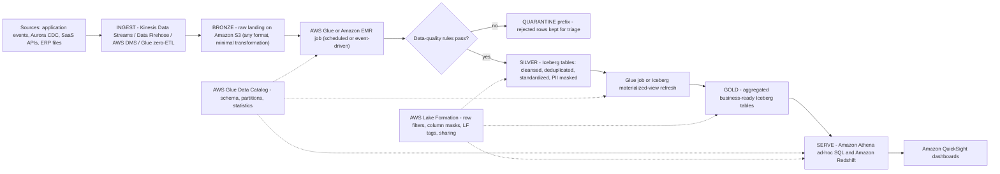
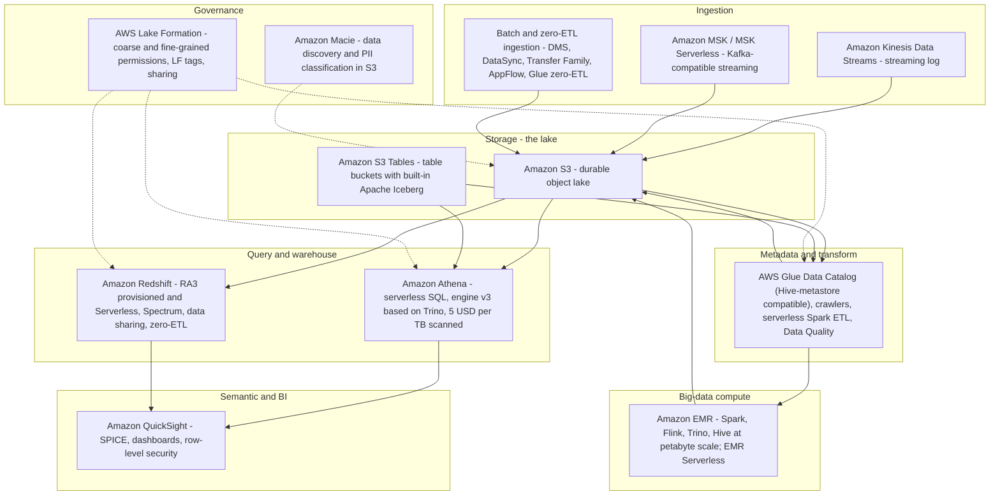
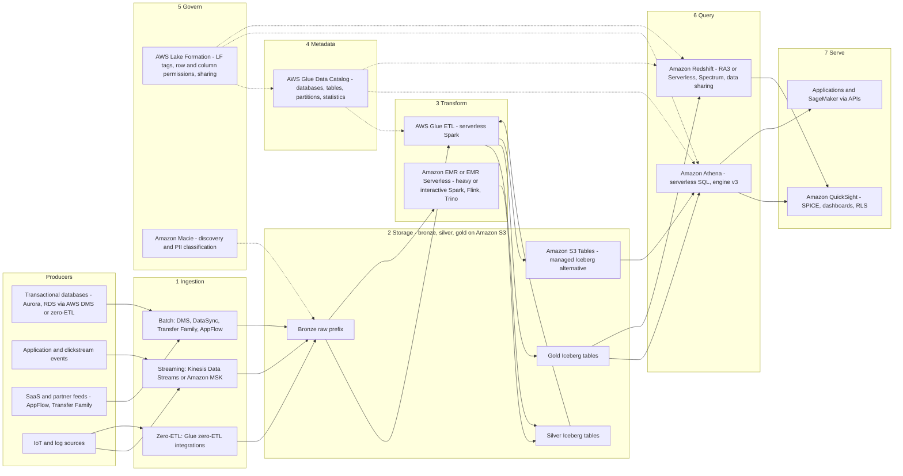
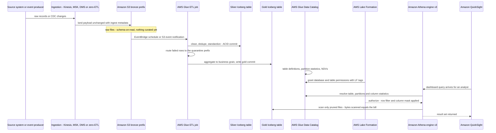
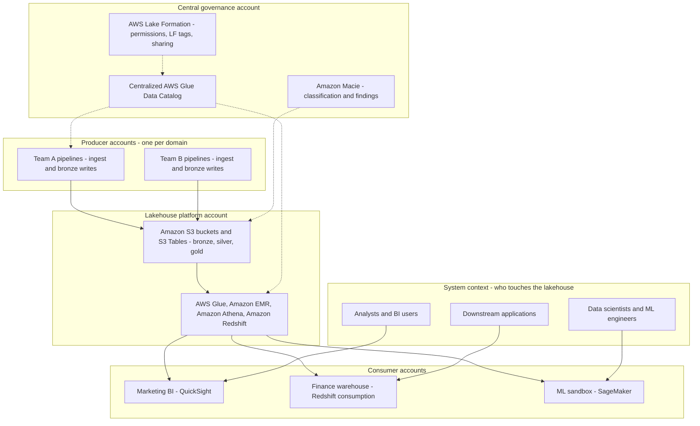

# Lakehouse Architecture Fundamentals: Lakes, Warehouses, and the Medallion Pattern

AWS defines the term this way: "A data lakehouse is a unified data architecture that combines data warehouses and data lakes, providing analytics capabilities such as structuring, governance, and reporting. The data lakehouse can store raw data in a range of formats from thousands to hundreds of thousands of sources in a central location" (AWS *What is a Data Lakehouse?*, accessed 2026-10-11). The same page adds the sentence that governs every design decision in this course: "A data lakehouse's compute is separate from storage. With separate storage and compute, you can scale these functions independently to maximize cost savings."

That is a definition, not yet an architecture. Between the sentence and a running platform sit three questions this lesson answers: **which store you are actually building** (lake, warehouse, or lakehouse), **how data is layered inside it** (the medallion pattern), and **how it is processed** (batch, Lambda, or Kappa): plus the map of AWS services that implements each position. Everything from lesson 02 to lesson 17 is an implementation detail of the skeleton you build here.

Most teams meet these three words in the wrong order: they pick services first, then discover they have neither a single source of truth nor a cheap archive. We will do it the other way round: pattern first, services second.

**In this lesson you will:**

- separate a data lake, a data warehouse and a lakehouse using AWS's published definitions, then apply a **decision table** to concrete requirements;
- read the six AWS-published differences (schema timing, data quality, users, analytics fit, price/performance, cost posture) that decide the store before any service is named;
- understand why **Parquet on Amazon S3 is still not a lakehouse**, and which capabilities an open table format adds;
- assign responsibilities to the **bronze, silver and gold** medallion layers and map each one onto real AWS primitives (buckets, prefixes, Glue databases, Iceberg tables);
- choose between **batch-only, Lambda and Kappa** processing patterns, including the one naming trap AWS's own whitepaper warns about;
- place ten core analytics services, **S3, Glue, Athena, Redshift, QuickSight, Kinesis, MSK, EMR, Lake Formation, Macie**, on a single layer map;
- walk the **end-to-end reference architecture** twice: as a flowchart and as a sequence diagram, plus the multi-account container view;
- work **seven priced worked examples** with real list prices (as of Oct 2026), including a **10 TB/day pipeline sizing sketch**;
- study three AWS customer cases, **FINRA, Easygo and BMW Group**, and read their numbers the way a practitioner should;
- check the **October 2026 update box** (S3 Tables, S3 Vectors, Glue 6.0, Quick Suite) and the **course roadmap** for the sixteen lessons that follow.

---

## 1. Lake, warehouse, lakehouse: the three definitions AWS actually publishes

Three terms, three different promises. The fastest way to misuse them is to treat them as sizes ("we are too big for a warehouse") rather than as **contracts about schema, curation and access**.

### 1.1 The data warehouse

AWS's compare page: "A data warehouse stores data in a structured format. It is a central repository of preprocessed data for analytics and business intelligence." The data-lake concepts page adds the mechanism: "A data warehouse is a database optimized to analyze relational data coming from transactional systems and line of business applications. The data structure, and schema are defined in advance… Data is cleaned, enriched, and transformed so it can act as the 'single source of truth' that users can trust."

The warehouse's defining move is **schema on write**: the shape and the quality bar are settled *before* the data lands, which is why the same page can assign it "Batch reporting, BI, and visualizations" and "Highly curated data that serves as the central version of the truth" (AWS compare page, accessed 2026-10-11). On AWS the managed expression of this pattern is **Amazon Redshift** (RA3 provisioned and Serverless, with Spectrum for lake tables).

### 1.2 The data lake

AWS: "A data lake is a centralized repository that allows you to store all your structured and unstructured data at any scale" (AWS *What is a Data Lake?*, page footer "Updated 2025", accessed 2026-10-11). The compare page supplies the counterpart to schema-on-write: schema is "Written at the time of analysis (schema-on-read)", data quality is "Any data that may or may not be curated", and the analytics list is "Machine learning, exploratory analytics, data discovery, streaming, operational analytics, big data, and profiling".

Loading discipline follows from that: "Organizations typically use Extract, Load, Transform (ELT) tools. They load the data in the lake first and transform it only when required." The cost argument is explicit: "data lakes offer a comparatively lower cost for more volume, especially for large numbers of images and videos." The failure mode is equally explicit, and you will meet it in every post-mortem: **"an unmanaged data lake can lead to data swamps. Data swamps are a state of disorganized data that makes it harder to extract meaningful insights"** (AWS *What is a Data Lakehouse?*, accessed 2026-10-11).

### 1.3 The lakehouse

The lakehouse is the *combination*, and AWS is careful to call it an architecture rather than a product. The legacy AWS whitepaper phrases it as a pattern: "Lake house: A lake house is an architectural pattern that combines the best elements of data warehouses and data lakes. Lake houses enable you to query data across your data warehouse, data lake, and operational databases… With a lake house architecture, you can store data in open file formats in your data lake and query it in place while joining with data warehouse data" (AWS *Data Warehousing on AWS*, page banner: "This whitepaper is for historical reference only", accessed 2026-10-11).

AWS also publishes the **logical layers** of the pattern, which become the spine of this whole course:

| Layer (AWS ordering) | What it does (AWS wording, accessed 2026-10-11) | Where it lives in this course |
|---|---|---|
| Ingestion layer | Brings batch, streaming and zero-ETL data in from sources | Lessons 05, 06 |
| Storage layer | Object storage; "some data transformations are performed after storage… transform and store the data in Parquet format" | Lessons 02, 03 |
| Metadata layer (a.k.a. staging) | "provides schema support to govern, organize, and optimize data… ACID transactions, file indexing, data versioning, and caching" | Lessons 04, 07, 12 |
| API layer | Programmatic access to the data and its catalog | Lessons 11, 12 |
| Semantic layer (topmost) | "also known as the data consumption layer": BI tools, reports | Lessons 09, 10, 17 |

> [!NOTE]
> **Why the layers matter more than the labels.** A lakehouse is not defined by which vendor's logo is on the cluster. It is defined by the combination of (a) cheap open storage, (b) a transactional metadata layer over that storage, (c) a catalog that governs it, and (d) independent compute that can all read the same copy. Drop any one of the four and you have a different architecture with a different set of failure modes.

### 1.4 The decision table

This is the table to keep open during every design review. Every row comes from the AWS compare page's warehouse-versus-lake comparison plus the lakehouse definition page (all accessed 2026-10-11).

| Decision axis | Data warehouse (Redshift) | Data lake (S3, raw) | Lakehouse (S3 + open table format + catalog) |
|---|---|---|---|
| Schema timing | Schema **on write**, "defined in advance" | Schema **on read**, "written at the time of analysis" | Schema on read, with **enforced evolution** and ACID commits on top |
| Data types | Structured, relational | "structured and unstructured data at any scale" | Raw any-format in bronze; structured open formats (Parquet/ORC/Avro) in silver/gold |
| Data quality | "Highly curated… central version of the truth" | "Any data that may or may not be curated" | Curated **by layer**: bronze raw, silver validated, gold aggregated |
| Primary users | BI analysts, reporting consumers | ML/exploratory, data discovery, profiling | Both: analysts on gold, data scientists on silver/bronze |
| Analytics fit | "Batch reporting, BI, and visualizations" | "ML, exploratory analytics, data discovery, streaming, operational analytics, big data" | All of the above on **one copy of data**, queryable in place |
| Price / performance | Performance-tuned, price follows nodes/RPUs | "Comparatively lower cost for more volume" | Storage and compute scale independently: AWS: "scale these functions independently to maximize cost savings" |
| Classic failure mode | Rigid, expensive for petabyte archives, slow to onboard new shapes | **Data swamp**; "requires further technical expertise" | Table sprawl and unmanaged file maintenance if compaction and retention are ignored |
| Typical AWS services | Amazon Redshift (RA3, Serverless, data sharing) | Amazon S3 + AWS Glue catalog + Athena (ad hoc) | S3 / S3 Tables + Glue + Lake Formation + Athena **and** Redshift + QuickSight |
| Choose it when… | "Structured relational data, tight SLAs for BI, curated single source of truth" | Large cheap archives, ML/exploratory workloads, mixed unstructured data | You need warehouse-grade structure **and** lake-scale open storage, with multiple engines on one copy |

**How to use the table.** Start at the bottom row and read upward. If the requirement sentence contains *single source of truth* and *tight BI SLAs*, you are in column 1. If it contains *images, videos, model training, unknown schema next year*, you are in column 2. If it contains *both, and I refuse to copy the data twice*, you are in column 3, and the SageMaker Lakehouse FAQ states the economic reason plainly: "you don't have to migrate your data… access and query your data in-place" (accessed 2026-10-11).

Note that AWS does not present this as an either/or contest: "Most large organizations use a combination of data lakes, warehouses, and marts in their storage infrastructure" (AWS compare page, accessed 2026-10-11). The lakehouse is the architecture that lets those pieces share one governed copy rather than three.

```matching
{
  "question": "Match each architecture to the AWS-published sentence that defines it (all quoted, accessed Oct 2026):",
  "pairs": [
    {"left": "Data warehouse", "right": "A central repository of preprocessed data; schema is defined in advance and data becomes the 'single source of truth' users can trust"},
    {"left": "Data lake", "right": "A centralized repository for structured and unstructured data at any scale, loaded first and transformed only when required (schema-on-read)"},
    {"left": "Data lakehouse", "right": "A unified data architecture combining data warehouses and data lakes, with compute separated from storage so each scales independently"},
    {"left": "Data mart", "right": "A narrower subset of warehouse data for a single team or subject area: the third column AWS groups with lakes and warehouses"},
    {"left": "Data swamp", "right": "The state of an unmanaged data lake: disorganized data that makes it harder to extract meaningful insights"}
  ],
  "explanation": "Each phrase is a direct AWS quote, so the mapping is fixed rather than a matter of taste. The warehouse sentence carries 'preprocessed' and 'in advance' (schema on write); the lake sentence carries 'any scale' and 'load first, transform when required'; the lakehouse sentence carries 'unified' plus 'separate storage and compute'. Data mart is the narrow one, and the data swamp is what happens when a lake gets no curation and no governance: the failure the silver and gold layers plus Lake Formation permissions exist to prevent."
}
```

- **📚 Did you know?** AWS's compare page treats lake, warehouse and mart as *complementary inventory*, not rivals: "Most large organizations use a combination of data lakes, warehouses, and marts in their storage infrastructure" (accessed 2026-10-11). The trap runs both ways: any design doc claiming you must pick exactly one of the three is arguing with AWS's own page.

---

## 2. Why Parquet on Amazon S3 is still not a lakehouse

This is the single most expensive confusion in the field, so it earns its own section. A bucket full of well-partitioned, well-compressed Parquet files is a **data lake**. It becomes a lakehouse only when a transactional metadata layer sits on top of it.

AWS Prescriptive Guidance is unusually blunt about what plain lakes lack. Traditional/Hive-format object lakes "don't provide support for atomicity, consistency, isolation, and durability (ACID) processing semantics", and they cannot natively:

- "Performing efficient record-level updates and deletions as data changes in your business";
- "Managing query performance as tables grow to millions of files and hundreds of thousands of partitions";
- "Ensuring data consistency across multiple concurrent writers and readers";
- "Preventing data corruption when write operations fail partway through the operation";
- "Evolving table schemas over time without (partially) rewriting datasets".

(Using Apache Iceberg on AWS, *Modern data lakes*, accessed 2026-10-11.) The same source notes these gaps are "particularly prevalent" for change-data-capture, privacy/deletion and streaming ingestion, three workloads this course covers in lessons 05, 06 and 13.

The open table format answers with a feature list AWS publishes verbatim: "Delete, update, and merge" · "Fast scan planning and advanced filtering" · "Full schema evolution" · "Partition evolution" · "Hidden partitioning" · "Version rollback" · "Time travel" · "Serializable isolation" · "Concurrent writers" · "Open file formats" (Parquet, Avro, ORC).

> [!WARNING]
> ⚠️ **The "we already have Parquet" trap.** If your lake cannot safely answer *who wrote this file, is this commit visible to other readers, can I roll back to yesterday, can I delete one customer without rewriting partitions*, then you have a file lake with a good compression ratio: not a lakehouse. Before you sign off an architecture, walk the five AWS bullets above and point at the component that provides each one. "We would write custom code for that" is the answer that turns into a multi-year platform project; the table format is the answer that turns into lesson 04.

Two supporting facts you will reuse all course: AWS lists Apache Iceberg as "supported by AWS services such as Amazon EMR, Amazon Athena, Amazon Redshift, AWS Glue, and Amazon SageMaker", and "Athena… uses the AWS Glue Data Catalog for the Iceberg metastore" (Prescriptive Guidance, accessed 2026-10-11). The catalog and the table format are different components that must be designed together: a distinction lesson 07 makes operational.

```fillblank
{
  "question": "Complete the sentence that separates a data lake from a lakehouse on AWS:",
  "template": "{{1}} is the unified architecture that combines warehouse structure with lake-scale open storage; on AWS it is assembled from open file formats such as Parquet plus an open table format like {{2}}, a Hive-metastore-compatible catalog in {{3}}, and coarse or fine-grained permissions granted by {{4}}.",
  "answers": {
    "1": "Data lakehouse",
    "2": "Apache Iceberg",
    "3": "AWS Glue Data Catalog",
    "4": "AWS Lake Formation"
  },
  "distractors": ["Data mart", "Amazon Redshift Spectrum", "Amazon Athena", "Amazon Macie"],
  "explanation": "AWS defines the data lakehouse as the unified architecture combining warehouses and lakes with separate storage and compute; Iceberg is the open table format AWS documents across EMR, Athena, Redshift, Glue and SageMaker; the Glue Data Catalog is the Hive-metastore-compatible metadata store that Athena uses as the Iceberg metastore; and Lake Formation is the service that 'provides coarse and fine-grained access control permissions'. The top distractor, Amazon Macie, is a data-discovery and PII-classification service; it tells you what is in the lake, it does not grant or deny query access."
}
```

---

## 3. The medallion pattern: bronze, silver, gold

Once the store decision is made, the next question is *what shape does data take as it moves from raw to trusted?* The AWS answer is the **medallion architecture**, defined in AWS's own Builder Center workshop as "a data design pattern that promotes data quality, consistency, and governance through a layered approach" (accessed 2026-10-11).

### 3.1 The three layers and their responsibilities

| Layer | AWS's responsibility wording | What may change here | Typical quality gate | Typical AWS implementation |
|---|---|---|---|---|
| **Bronze** (raw) | "Ingests raw data from various sources with minimal transformation" | Nothing except landing: preserve payload, source timestamps, ingest metadata | Schema discovered, not enforced; row count reconciles to source | S3 prefix or bucket per source; raw JSON/CSV/Avro; Firehose/Kinesis/DMS delivery; Glue crawler registration |
| **Silver** (cleansed) | "Applies data quality rules, deduplication, and standardization" | Types, nullability, dedupe keys, conformed dimensions, PII masking | Explicit DQ rules pass; failures routed to a quarantine path | Iceberg tables on S3 or S3 Tables; Glue/EMR Spark job; Glue Data Quality (DQDL) rules; Lake Formation column masks |
| **Gold** (business-ready) | "Creates aggregated, business-ready datasets optimized for analytics" | Aggregation grain, measures, slowly-changing dimensions, semantic names | Row-per-business-entity contract; freshness SLA | Iceberg tables or materialized views; one table per subject area; Athena/Redshift read; QuickSight dashboards |

Three properties of this table are worth memorising. **First**, the layers are *progressive*: each hop raises the guarantee and narrows the audience. **Second**, the layer is a **logical** boundary, not an AWS product: bronze/silver/gold map to S3 prefixes or buckets, Glue Data Catalog databases and Iceberg tables; AWS presents the pattern in a workshop and a blog, not as a managed service. **Third**, the quarantine path is part of silver, not an afterthought: a record that fails a rule must land somewhere observable rather than silently disappearing.

### 3.2 Medallion on AWS, end to end



### 3.3 What each layer is *not*

- **Bronze is not a dump-and-forget zone.** It still needs retention rules, encryption and a catalog entry; Well-Architected Data Analytics Lens best practice **BP 3.7** is "Implement data retention policies for each class of data in the analytics workload", and **BP 3.5** is "Record data classifications into the Data Catalog so that analytics workloads can understand" (AWS Well-Architected Data Analytics Lens, publication date 2023-12-22, announced as a lens on 26 March 2024; accessed 2026-10-11).
- **Silver is not optional** if you want a lakehouse rather than a swamp: it is where "an unmanaged data lake can lead to data swamps" gets prevented, one validated table at a time. Lens **BP 1.1** is "Validate the data quality of source systems before transferring data for analytics", and **BP 1.2** is "Monitor operational metrics of data processing jobs and the availability of source data".
- **Gold is not "the reporting extract".** It is still an open table that Athena, Redshift, SageMaker and third-party engines can query in place; that is what stops it from becoming a proprietary silo two years later.

AWS's prescriptive starting point for a nightly batch hop, if you want numbers instead of opinions: "File size: 128 MB, because Apache Spark tasks process data in 128 MB chunks"; "Write type: copy-on-write"; "Partition variables: year/month/day"; "Sort order: timestamp"; "Data catalog: AWS Glue Data Catalog" (AWS Prescriptive Guidance, reference architectures for Apache Iceberg on AWS, accessed 2026-10-11).

**Worked example E1: how many files does one bronze day actually create? (as of Oct 2026)**

A source delivers **10 TB per day** into bronze, and you follow the Prescriptive Guidance target file size of **128 MB** so that Spark tasks map one-to-one onto files.

- 1 TB = 1,024 GB = 1,048,576 MB, so 10 TB = **10,485,760 MB**
- 10,485,760 MB ÷ 128 MB = **81,920 files per day**
- With year/month/day partitioning (the AWS recommendation), a single partition day therefore receives about **82,000 objects**; which is exactly why "tables grow to millions of files" appears in AWS's list of plain-lake problems, and why compaction (lesson 04) and partition planning (lesson 03) are not optional extras
- One month of bronze at this rate: 81,920 × 30 = **2,457,600 files**. Manage that number with Iceberg metadata, not with `ls` on a bucket

**Takeaway:** medallion layers are cheap to describe and expensive to skip. The bronze→silver hop is where data quality lives, the silver→gold hop is where business meaning lives, and the catalog plus Lake Formation band is what makes both readable by the right people.

- **📚 Did you know?** AWS publishes a three-statement version of this pattern: with Apache Iceberg materialized views in Amazon SageMaker, "you can build a Bronze, Silver, and Gold medallion architecture as three SQL statements", and when you configure scheduled refresh, "the AWS Glue Data Catalog uses managed Spark compute to incrementally update the materialized view" (AWS Big Data Blog, accessed 2026-10-11). The pattern is portable: the *mechanism* (who runs the refresh, on what compute) is what you are actually choosing in lessons 08 and 11.


---

## 4. Batch, Lambda, or Kappa: choosing the processing pattern

The medallion layers tell you *what shape* data takes. The processing pattern tells you *how many pipelines* you must build, test and operate. There are three documented answers, and AWS publishes all three.

### 4.1 Batch-only

Land files or streams to S3, process on a schedule (Glue or EMR), serve with Athena or Redshift. The Lambda whitepaper's "batch layer" produces "batch views" that are "stored in a persistent storage layer". Simple, cheapest to run, and latency equals your schedule: a nightly job means dashboards are at best one night stale, and every late-arriving file silently becomes next week's incident.

### 4.2 Lambda architecture (the pattern)

The AWS whitepaper defines it as "a data-processing design pattern to handle massive quantities of data and integrate batch and real-time processing within a single framework." Two paths run in parallel:

- a **batch layer** computing authoritative *batch views*: exact, complete, recomputed over the full history;
- a **speed layer** producing *incremental views*, "Kinesis Data Firehose, As data is ingested in real-time, customers can use Kinesis Data Firehose to easily batch and compress the data to generate incremental views";
- a **serving layer** where "the merged query is aimed at joining and analyzing the data from both the batch view from the batch layer and the incremental stream view from the speed layer."

The operational cost of this correctness is that you now own two codepaths that must agree, plus a merge step that must reconcile late and out-of-order data.

### 4.3 Kappa architecture

One pipeline, one codebase, reprocessing by replay. AWS's Builder Center walkthrough (18 May 2026, accessed 2026-10-11): "It's Kappa: one unified streaming pipeline that handles everything. On AWS, that means Kinesis Data Streams, Spark Structured Streaming on EMR…": with a table format on S3 as the durable layer and a "Replay window of 24 hours: Kinesis retains events" as presented in that article.

Kappa trades the batch layer's exactness for operational simplicity: correctness comes from being able to replay the same code over the same log, which is only possible inside the stream's retention window: everything older must come from the lake (see §8.2).

```mermaid
flowchart TB
    subgraph BATCH["Batch-only: one scheduled path"]
        B1["Sources"] --> B2["S3 raw / bronze"]
        B2 --> B3["Glue or EMR job on a schedule"]
        B3 --> B4["Silver and gold tables"]
        B4 --> B5["Athena / Redshift / QuickSight - freshness equals the schedule"]
    end
    subgraph LAMBDA["Lambda pattern: two parallel paths"]
        L1["Sources"] --> L2["Batch path: S3 then Glue/Spark then batch views"]
        L1 --> L3["Speed path: Kinesis / Firehose then streaming job then incremental views"]
        L2 --> L4["Serving layer merges batch and incremental views"]
        L3 --> L4
        L4 --> L5["Athena / Redshift / QuickSight - lowest latency for recent events"]
    end
    subgraph KAPPA["Kappa pattern: one streaming path plus replay"]
        K1["Sources"] --> K2["Kinesis Data Streams - replay window as presented: 24 hours"]
        K2 --> K3["Spark Structured Streaming on EMR or Glue Real-Time Mode"]
        K3 --> K4["Table format on S3 - the durable copy"]
        K4 --> K5["Reprocess by replaying the stream, or by re-reading the lake"]
        K4 --> K6["Athena / Redshift / QuickSight - one codebase to maintain"]
    end
```



### 4.4 The choice, in one table

| Pattern | Latency | Pipelines to maintain | Reprocessing story | Cost posture (as of Oct 2026 anchors) | Choose when |
|---|---|---|---|---|---|
| **Batch-only** | Equals schedule cadence (minutes to 24 h) | One | Re-run the job over the files on S3 | Cheapest: Glue at **$0.44 per DPU-hour** (1 DPU = 4 vCPU + 16 GB, per-second billing, 1-minute minimum); Athena at **$5.00 per TB scanned** | "Latency-tolerant, cost-minimal": daily or hourly reporting, back-office loads |
| **Lambda** | Seconds for recent events, plus authoritative batch | Two (batch + speed) | Batch path is exact; speed path replays within stream retention | Two codepaths, two test suites; AWS's own Redshift Lambda blog notes both paradigms "operate in silos, which results in data redundancy and operational overhead to maintain them" | Need mathematically complete historical recomputes **plus** low-latency views, and can operate two pipelines |
| **Kappa** | Seconds to sub-second | One | Replay the stream inside retention; beyond it, re-read the lake | One codebase; long-history replay is slower than a batch job over columnar files | "Real-time-first, single codebase, acceptable replay cost" |

> [!IMPORTANT]
> **⚠️ Lambda architecture ≠ AWS Lambda.** The whitepaper says it itself: "Lambda architecture is distinct from and should not be confused with the AWS Lambda compute service." The *pattern's* three layers are batch, speed and serving. AWS Lambda (the function service) can implement pieces of any of them, but naming a function service does not make your design a Lambda architecture, and a design review that confuses the two will argue about the wrong thing for an hour.

**Worked example E2: one requirement, three architectures, priced (as of Oct 2026)**

Requirement: e-commerce clickstream + orders + nightly ERP dumps; leadership wants dashboards **within 15 minutes** of data landing, plus a data-science sandbox. Two hundred dashboard readers.

- **Shared serving cost:** 200 readers × **$3 per user/month** = **$600.00 per month** (QuickSight Reader, pricing page accessed 2026-10-11).
- **Shared batch transform cost:** one nightly bronze→silver job at 10 DPU × 20 minutes = 3.333 DPU-hours × **$0.44** = **$1.47 per night**, i.e. **$44.00 per month**.
- **Shared query cost:** if the BI layer scans **1 TB per day** in aggregate, that is 30 TB/month × **$5.00 per TB** = **$150.00 per month** on Athena.
- **(a) Batch-only:** those three lines only, about **$794.00 per month** of directly attributable serverless spend, but dashboard freshness equals job cadence, so a 15-minute SLA would force 96 runs per day instead of one, multiplying the Glue line by ~96 and *still* failing to model live events.
- **(b) Lambda:** the same batch path plus a Kinesis → streaming-job speed path writing incremental views into the same gold tables. Freshness drops to seconds for recent events; you now own two codepaths plus the merge. The streaming path adds Kinesis Data Streams and streaming-compute charges: budget those separately, because this lesson only anchors prices AWS publishes on the Glue, Athena and QuickSight pages.
- **(c) Kappa:** one Kinesis → Spark Structured Streaming path into the table format on S3, with backfills replayed from the stream inside the presented **24-hour** replay window and from the lake beyond it.

**Verdict for this scenario:** the 15-minute SLA eliminates batch-only at any reasonable run count, and a team of five cannot comfortably own two production codepaths, so Kappa, with the lake (not the stream) as the system of record for history. That is a *judgement supported by the table in §4.4*, not a universal rule: if a regulatory requirement demands exact batch recomputation of every historical view, Lambda remains the correct pattern.

- **📚 Did you know?** The Lambda whitepaper closes on a fact that explains why this whole course can be serverless: "Amazon Glue, Amazon S3, Amazon Athena and Amazon Kinesis are serverless services." You can run the batch, speed and serving layers of any of the three patterns without provisioning a cluster; which is why the cost lines in E2 are quoted per-hour and per-TB rather than per-instance (AWS Lambda Architecture whitepaper, accessed 2026-10-11).

---

## 5. The AWS analytics service landscape: where each service sits

AWS's own strategy guide summarises the map in one sentence: "you can perform real-time streaming with Kinesis or Amazon MSK, data processing with Amazon EMR or AWS Glue, search with Amazon OpenSearch, ad-hoc queries with Athena, and data warehousing with Amazon Redshift" (AWS Prescriptive Guidance, *AWS modern data architecture*, accessed 2026-10-11). Governance sits across the whole sentence: "AWS Lake Formation helps govern data and share it across the company. In addition, you can create a unique data catalog on AWS Glue and a business glossary by using Amazon DataZone… to enable your employees to find the data they need."



### 5.1 The cast, one line each

| Service | Layer it occupies | One-line role (AWS wording where quoted) | Price anchor to know (as of Oct 2026) |
|---|---|---|---|
| **Amazon S3** | Storage | "S3 is the best place to build data lakes": durable, scalable object storage holding bronze/silver/gold | S3 Standard **$0.023 per GB-month** (first 50 TB tier); **$0.022** (51 to 100 TB); **$0.021** (500 TB+) |
| **Amazon S3 Tables** | Storage (managed tables) | Table buckets: "the first cloud object store with built-in Apache Iceberg support", with policy-driven compaction, snapshot management and unreferenced-file removal | **$0.0265 per GB-month** Standard (first 50 TB); PUT **$0.005/1,000**, GET **$0.0004/1,000** |
| **AWS Glue** | Metadata + transform | Data Catalog (Hive-metastore compatible), crawlers, serverless Spark ETL, Data Quality (DQDL), Iceberg table optimization and statistics | **$0.44 per DPU-hour**; 1 DPU = **4 vCPU + 16 GB**; per-second billing, 1-minute minimum |
| **Amazon Athena** | Query (serverless SQL) | Interactive SQL over S3 and Iceberg; engine v3 functions "are based on Trino"; workgroups separate users and cap spend | **$5.00 per TB scanned**, "rounded up to the nearest megabyte, with a 10 megabyte minimum per query" |
| **Amazon Redshift** | Warehouse + lake bridge | RA3/RG with Redshift Managed Storage, Serverless, Spectrum external tables over Iceberg, data sharing, zero-ETL | Provisioned "starts at **$0.543 per hour**"; Serverless "begins at **$1.50 per hour**", example rate **$0.375 per RPU-hour**; Managed Storage **$0.024 per GB-month** |
| **Amazon QuickSight** | Semantic / BI | SPICE in-memory extracts, dashboards, row-level security, capacity-based reader access | Author **$24 per user/month**; Reader **$3 per user/month**; Reader Capacity "From **$250** For 500 sessions/month" |
| **Amazon Kinesis Data Streams** | Streaming ingestion | Durable event log feeding bronze; the speed path of Lambda and the single path of Kappa | Default retention presented as a **24-hour** replay window in AWS's Kappa walkthrough (2026-05-18) |
| **Amazon MSK / MSK Serverless** | Streaming ingestion | "Apache Kafka-compatible streaming for customers wanting Kafka semantics", named alongside Kinesis in the modern-data-architecture guide | Priced per broker-hour plus storage: confirm on the MSK pricing page before quoting in a business case |
| **Amazon EMR** | Big-data compute | "petabyte-scale data processing, interactive analytics, and machine learning by using open source frameworks such as Apache Spark, Flink, Trino, and Hive" on EC2, EKS, Outposts or EMR Serverless | Instance-hours (EC2) or per-second serverless usage: budget per job, not per month |
| **AWS Lake Formation** | Governance | "provides coarse and fine-grained access control permissions to access data, including Iceberg tables consumed by Athena or Amazon Redshift" | No data-processing charge; the cost is design discipline, not dollars |
| **Amazon Macie** | Governance / discovery | Data discovery and PII classification in the modern-data-architecture security stack alongside KMS, IAM, Secrets Manager and Audit Manager | Per-bucket discovery plus per-object sensitive-data findings |

### 5.2 Placement rules that outlive the table

1. **S3 is the floor.** Every pattern in lesson 01 lands data on S3 or S3 Tables first; nothing above the storage layer is allowed to become the system of record.
2. **Glue is the spine, not just a job runner.** It owns the catalog (metadata layer) *and* the serverless transform (bronze→silver→gold). Lesson 07 is entirely this service.
3. **Athena and Redshift are alternatives over the same copy, not rivals.** Both query S3/Iceberg; Redshift adds managed concurrency, materialized views, data sharing and a warehouse experience at node/RPU cost, while Athena is serverless and pay-per-TB-scanned: ideal for ad-hoc and federated use (worked example E6).
4. **Lake Formation is a band, not a box.** It wraps the catalog and the tables, and its grants apply across engines rather than to one tool.
5. **Macie classifies; Lake Formation authorizes; Glue catalogs.** Three services, three jobs. Confusing the first two is a security-review failure, not a naming quibble.
6. **EMR is the power tool.** Petabyte-scale Spark, Flink, Trino and Hive when serverless Glue is not enough, and EMR Serverless when you want that power without a cluster fleet.

- **📚 Did you know?** Amazon Macie never appears alone in AWS's modern-data-architecture security list; it is named with "AWS Key Management Service (AWS KMS), AWS Identity and Access Management (IAM), AWS Secrets Manager, AWS Audit Manager, and Amazon Macie" (AWS Prescriptive Guidance, accessed 2026-10-11). Encryption, identity, secret storage, audit evidence and data discovery are five different jobs; lesson 14 assigns each one.

**Worked example E3: the Athena bill is a layout decision, not a query decision (as of Oct 2026)**

AWS publishes this exact ladder on its Athena pricing page (accessed 2026-10-11). Table: **3 TB** of uncompressed text on S3, **four equal columns**, query reads **one column**.

| Layout | Bytes scanned for one column | Cost per query (at $5.00 per TB) |
|---|---|---|
| Raw text, no partitions | 3 TB | **$15.00** |
| GZIP compressed 3:1 | 1 TB | **$5.00** |
| GZIP + Parquet (columnar, 1 of 4 columns) | 0.25 TB | **$1.25** |

AWS's own page states the arithmetic: "Price for 3 TB scanned is 3 * $5/TB = $15", ending at "$1.25" for the optimised path: a **12× difference for the same answer**. Scale it: 20 such queries per day × 30 days = 600 queries.

- Naive: 600 × 3 TB = 1,800 TB × $5.00 = **$9,000.00 per month**
- Optimised: 600 × 0.25 TB = 150 TB × $5.00 = **$750.00 per month**
- **Monthly difference: $8,250.00**: bought entirely by format and column pruning, before a single cluster is resized

**Worked example E4: pricing a bronze-to-silver Glue job (as of Oct 2026)**

The Glue pricing page (accessed 2026-10-11): "The price of 1 DPU-hour is $0.44"; "A single DPU provides 4 vCPU and 16 GB of memory"; billing is "in increments of 1 second, rounded up to the nearest second, with a 1-minute minimum duration per run."

- Small job, 6 DPU × 15 minutes: 6 × 0.25 h = 1.5 DPU-hours × $0.44 = **$0.66 per run**; 30 nightly runs = **$19.80 per month**
- Heavier hop, 10 DPU × 20 minutes: 3.333 DPU-hours × $0.44 = **$1.47 per run**; × 30 = **$44.00 per month**
- Interactive Session default is **5 DPU** (minimum 2 DPU); a Glue Studio data-preview session is **2 DPUs for up to 30 minutes**, auto-stopping: exploration is billed by the session, not the month
- Table-optimization work (compaction, statistics, materialized-view auto-refresh, crawlers) is listed at **$0.44 per DPU-hour** as well, so maintenance is a metered line item, not free overhead
- Version matters: AWS announced on 21 August 2026 that "AWS Glue 6.0 is now generally available, delivering a 30% price reduction and introducing full support for Apache Iceberg v3". Budget with the published **$0.44** meter as the conservative anchor and re-read the pricing page for your Region and Glue version before committing a forecast

**Worked example E5: what the serving layer costs in seats (as of Oct 2026)**

QuickSight pricing page (accessed 2026-10-11): Author **$24 per user/month**, Reader **$3 per user/month**, Reader Capacity "From $250 For 500 sessions/month", plus "A $250/month per account infrastructure fee applies if your account has any of the following: At least one Pro user; Q&A enabled via topics; Dashboard Q&A enabled."

- 10 authors + 200 readers: (10 × $24) + (200 × $3) = $240.00 + $600.00 = **$840.00 per month**, with **no** $250 infrastructure fee (no Pro user, no Q&A topics)
- Add one Pro user and the **$250 per month** account fee applies: **$1,090.00 per month** for the same 210 people: a 30% jump for a single role change, which is why role design is a cost control in lesson 17
- Capacity alternative for occasional readers: from **$250 for 500 sessions/month**, which beats 84 casual readers at $3 each (84 × $3 = $252.00) and loses beyond that: the seat model wins once readers are daily users

```plot
{
  "type": "bar",
  "title": "Monthly USD for a 10 TB/day lakehouse, component by component (as of Oct 2026)",
  "data": [
    {"Component": "S3 storage: 300 TB raw text", "USD per month": 7065.6},
    {"Component": "S3 storage: 100 TB after 3:1 Parquet", "USD per month": 2355.2},
    {"Component": "Athena: 30 TB scanned", "USD per month": 150.0},
    {"Component": "QuickSight: 200 readers", "USD per month": 600.0},
    {"Component": "Glue: 30 nightly ETL runs", "USD per month": 44.0},
    {"Component": "Redshift Serverless: 128 RPU-hours", "USD per month": 48.0}
  ],
  "xKey": "Component",
  "yKey": "USD per month",
  "xLabel": "Lakehouse component (all figures derived from AWS list prices)",
  "yLabel": "USD per month"
}
```

Read the chart in order: **storage dominates raw ingestion** (the tallest bar), so compression and lifecycle policy are the first cost levers (lessons 02 and 16); query and BI costs are an order of magnitude smaller and are controlled by layout (E3) and seat model (E5); compute for scheduled transformation is the smallest line of all (E4); which is why "we will save money by writing fewer Glue jobs" is almost never the right optimisation.

---

## 6. End-to-end reference architecture

### 6.1 The flow: source to dashboard

This is the spine every later lesson plugs into. Read it left to right, then note the two dotted control planes, catalog and governance, which touch *every* stage rather than one.



The numbered subgraphs are the AWS layer order from §1.3 with the medallion zones from §3 drawn inside the storage layer: one picture, both vocabularies.

### 6.2 The same architecture as a conversation

Flowcharts hide *ordering* and *triggers*. This sequence diagram shows what actually happens for one day of data, and where the bill is incurred.



Three details the flowchart cannot show. **(1)** The ACID commit boundary sits at each medallion hop, so readers never see half-written data. **(2)** Lake Formation's decision happens *before* bytes are scanned, which is why governance is cheap to enforce early and expensive to bolt on later. **(3)** The Athena billing event is the scan, not the query count: the quantity you control is bytes read, which is why lessons 03, 04 and 09 all restate E3's ladder.

### 6.3 The container view: producers, central catalog, consumers

AWS Prescriptive Guidance's growth-and-scale reference architecture splits accounts deliberately: "A data producer layer in different AWS accounts"; "A data consumer layer in different AWS accounts"; "A centralized catalog in an AWS account"; and "The centralized catalog is the interface used by data producers and data consumers to share and consume data": with the stated intent to "standardize data sharing and consumption, and independently scale data producers and consumers without growing your management overhead."



The dotted lines are the point: **metadata and permissions travel through the central catalog account, while data and compute stay where they are economical.** This is the decoupling discipline that FINRA's case makes concrete in §10.

**Worked example E6: Athena or Redshift Serverless for the same dashboard? (as of Oct 2026)**

A dashboard reads **50 GB** of Parquet per day. Prices from the Athena and Redshift pricing pages (accessed 2026-10-11):

- **Athena:** 50 GB × 30 = 1,500 GB = **1.5 TB per month** scanned × **$5.00 per TB** = **$7.50 per month**, plus zero idle cost, because there is no cluster
- **Redshift Serverless:** 64 RPU for ~2 hours per day = 128 RPU-hours × **$0.375 per RPU-hour** = **$48.00 per month**, plus Redshift Managed Storage at **$0.024 per GB-month**: the pricing page's own worked example reads "40 TB x 1,024 GB per TB x $0.024"
- **Ratio:** about **6.4×** more expensive for the Redshift path on this workload: *before* accounting for what the extra money buys: concurrency scaling (the pricing page notes "up to one hour of free Concurrency Scaling credits per day" per cluster), materialized views, data sharing, and no per-query scan anxiety
- **Rule of thumb:** sparse, ad-hoc, federated or bursty access → **Athena**; dense, concurrent, always-on BI with predictable concurrency → **Redshift Serverless**. Both read the same S3/Iceberg copy; you are choosing a *serving engine*, not a second data store


---

## 7. Why open table formats are non-negotiable

An **open table format** adds a transactional metadata layer over open file formats (Parquet, ORC, Avro) so the lake behaves like a database while staying vendor-neutral. AWS states the practical consequence, "Iceberg supports standard SQL commands for data warehousing for use with data lake tables", and the business consequence as a genuine either/or: a "fully integrated but proprietary platform" versus "a vendor-neutral but resource-intensive, self-built data lake" (AWS Prescriptive Guidance, accessed 2026-10-11).

What the format buys you, from AWS's published Iceberg feature list: **delete, update and merge**; **fast scan planning and advanced filtering**; **full schema evolution**; **partition evolution**; **hidden partitioning**; **version rollback**; **time travel**; **serializable isolation**; **concurrent writers**; and **open file formats**.

Why "open" is the operative word: the S3 Tables team records the interoperability consequence: table-management APIs "compatible with the Apache Iceberg REST Catalog standard, enabling you to use any Iceberg-compatible query engine (e.g., Spark, Trino, PyIceberg, or DuckDB) to access tabular data directly from S3 Tables" (AWS Storage Blog, 2025-05-27). Engine choice becomes a deployment decision instead of a migration project.

### 7.1 Three positions on AWS today

| Option | What you own | What AWS owns | When it fits |
|---|---|---|---|
| **Self-managed Iceberg on S3** | Compaction, snapshot retention, orphan-file cleanup, catalog registration | Storage durability, Glue Data Catalog, query engines | Full control, an existing Spark platform, cost-sensitive at extreme scale |
| **Amazon S3 Tables (table buckets)** | Table design, queries, permissions | Policy-driven table maintenance, compaction, snapshot management, unreferenced file removal, plus Iceberg REST Catalog APIs | The managed form when you do not want to run maintenance yourself (see the 2026 updates box: compaction cost down up to 90%) |
| **Amazon SageMaker Lakehouse** | Nothing extra | A unification layer: "unifies all your data across Amazon S3 data lakes and Amazon Redshift data warehouses, helping you build powerful analytics and AI/ML applications on a single copy of data", queryable "from SageMaker Unified Studio and engines such as Amazon EMR, AWS Glue, Amazon Redshift or Apache Spark" | You want one governed copy spanning lake and warehouse with Lake Formation and the Glue catalog underneath |

**The managed-Iceberg numbers AWS publishes:** S3 Tables are "specifically optimized for analytics workloads, resulting in up to 3x faster query throughput and up to 10x higher transactions per second compared to self-managed tables" (AWS What's New, 2024-12-03). Quotas as reported five months after launch: "supporting the creation of up to 10,000 tables within each table bucket… up to 100,000 tables across 10 table buckets within a single AWS Region and AWS account" (AWS Storage Blog, 2025-05-27).

> [!IMPORTANT]
> **Format choice is a decade decision; engine choice is an annual decision.** Because the table format is open and the catalog is Hive-metastore-compatible (or Iceberg-REST-compatible), you can add Athena, Redshift, EMR, SageMaker or a third-party engine later without rewriting data. Reverse the order, pick a proprietary engine first, then try to export, and you inherit exactly the "fully integrated but proprietary platform" AWS warns about. Lesson 04 goes deep on Iceberg mechanics; this lesson only fixes the principle: **files are the payload, the table format is the contract, the catalog is the directory.**

- **📚 Did you know?** S3 Tables' Iceberg REST Catalog support makes the "which engine?" question testable: if a tool speaks the Iceberg REST Catalog, it can read your tables directly. AWS's own example list is "Spark, Trino, PyIceberg, or DuckDB" (AWS Storage Blog, 2025-05-27): a laptop running DuckDB included. That is what "open" buys you that a warehouse export never will.

---

## 8. Worked mini-scenarios: sizing the thing you just designed

### 8.1 The 10 TB/day pipeline sizing sketch

**Worked example E7: 10 TB/day, storage, query and transform (as of Oct 2026)**

Anchor: BMW Group "uses AWS to process 10 TB of data daily from 1.2 million vehicles" (AWS case study, accessed 2026-10-11). We will size *storage, query and transform* for the same daily rate, using list prices read on 2026-10-11. Retention assumption: **30 days** of hot data.

**Step 1: raw storage.**

- 10 TB/day × 30 days = **300 TB per month** = 307,200 GB (1,024 GB per TB)
- At S3 Standard's first-50-TB tier of **$0.023 per GB-month**: 307,200 × $0.023 = **$7,065.60 per month**
- AWS's published volume tiers (51 to 100 TB at **$0.022**, 500 TB+ at **$0.021**) and any lifecycle policy reduce this: treat $7,065.60 as the **conservative ceiling**, not the invoice

**Step 2: the same data after Parquet at 3:1 (the ratio from AWS's own Athena example).**

- 300 TB ÷ 3 = **100 TB** = 102,400 GB × $0.023 = **$2,355.20 per month**
- **Saving: $4,710.40 per month (−66.7%)**: from format alone, before a single query is optimised

**Step 3: query.**

- If analysts and dashboards scan **1 TB per day** in aggregate: 30 TB × **$5.00 per TB** = **$150.00 per month** on Athena
- If they instead scan the whole 300 TB (full-table, unpartitioned): 300 × $5.00 = **$1,500.00 per month**: ten times more, for the same answers, purely because partition pruning and columnar layout were skipped

**Step 4: transform.**

- One nightly bronze→silver job at 10 DPU × 20 minutes (from E4): **$1.47 per run** → **$44.00 per month**
- A silver→gold hop of the same size doubles it to **$88.00 per month**

**Step 5: the sketch.**

| Line | Raw text layout | Parquet + partitioned layout |
|---|---|---|
| S3 storage (30 days) | $7,065.60 | $2,355.20 |
| Athena (1 TB/day scanned) | $150.00 | $150.00 |
| Glue ETL (two hops, 60 runs) | $88.00 | $88.00 |
| **Total per month** | **$7,303.60** | **$2,593.20** |

**Conclusion:** at 10 TB/day the *format decision* (row 1) moves roughly **$4,710 per month**, while the *compute decision* (row 3) moves about **$88**. Order your optimisation backlog accordingly; this is AWS's own argument in miniature: fix the data layout before touching infrastructure size. And notice what the sketch does **not** include: governance, monitoring, and the people who run the platform. Those are real costs, which is why lesson 16 returns to this table with lifecycle and rightsizing levers.

### 8.2 The Kappa replay check

**Scenario 8.2: six months of history, 24 hours of replay (as of Oct 2026)**

A fraud team adopts the stack from AWS's Builder Center Kappa walkthrough: Kinesis Data Streams → Spark Structured Streaming on EMR → table format on S3. The article presents a **24-hour replay window** for the stream (2026-05-18).

- A compliance request arrives for **six months** of reprocessing. 24 hours ÷ 180 days ≈ **0.6%** of the required window is available from the stream.
- The correct move is to re-read the **lake**: the durable copy on S3 behind the table format, where retention is governed by your own lifecycle rules (lessons 02 and 16), not by stream retention.
- **Design rule that falls out:** streams are transport, lakes are record. Never let the stream be your only copy of anything you might need to reprocess, and never size a stream for archival storage, because you would pay streaming prices for archive duty.
- Cross-check with the medallion: a six-month reprocess re-runs the silver and gold hops over bronze, which is exactly why bronze is retained raw and untransformed, and why E1's 2.4 million monthly bronze files are a feature (recoverability) rather than only a cost.

### 8.3 What the scenarios share

Both mini-scenarios make the same move: **take a published AWS number, apply one assumption stated in the open, and let the arithmetic decide the backlog.** Storage ratio first, then query layout, then compute size, then seats. If you invert that order, sizing clusters before looking at file format and partitioning, you will optimise the cheapest line item on the E7 table while the storage bill, which is 95% of the sketch before optimisation, keeps running.

---

## 9. Course roadmap: where this lesson sits

Lessons 02 to 17 are the same architecture, layer by layer. Nothing in later lessons contradicts the skeleton above; they fill in the boxes.

| # | Lesson | Layer it owns (from §1.3 / §6.1) | What you will be able to do afterwards |
|---|---|---|---|
| 01 | Lakehouse architecture fundamentals | The whole skeleton | Choose store, pattern and layer responsibilities (this lesson) |
| 02 | S3 storage classes foundation | Storage | Pick storage classes and lifecycle policies for bronze, silver and gold |
| 03 | Data formats and compression | Storage | Choose formats and compression that shrink the Athena bill (E3) |
| 04 | Open table formats | Metadata | Implement Iceberg transactions, time travel and partition evolution |
| 05 | Batch ingestion | Ingestion | Land files, CDC and zero-ETL into bronze reliably |
| 06 | Streaming ingestion | Ingestion | Kinesis, MSK and Flink paths, and their replay semantics (§8.2) |
| 07 | Glue Data Catalog | Metadata | Crawlers, databases, statistics: the metastore spine |
| 08 | Transformation at scale | Transform | Glue and EMR jobs; bronze→silver→gold hops |
| 09 | Athena query layer | Query | Workgroups, partition projection, engine v3, cost control |
| 10 | Redshift lake bridge | Query / warehouse | Spectrum, external tables, data sharing, zero-ETL |
| 11 | Orchestration, event-driven | API / control | EventBridge, Step Functions, scheduled and event triggers |
| 12 | Lake Formation governance | Governance | LF tags, row and column permissions, cross-account sharing |
| 13 | PII, Macie and privacy | Governance | Discovery, classification, masking, deletion workflows |
| 14 | Security: KMS, IAM, network | Governance | Encryption, identity, private connectivity, audit |
| 15 | Quality, observability, lineage | Metadata / ops | DQDL rules, metrics, lineage (Lens BP 1.2) |
| 16 | Cost optimisation and lifecycle | Storage / ops | Tiering, compression, rightsizing: the cost backlog from E7 |
| 17 | QuickSight BI layer | Semantic | SPICE, dashboards, RLS, the reader/author model from E5 |

Three habits to carry forward: **quote a source and a date for every number** (this lesson used only AWS pages read 2026-10-11); **name the layer before you name the service**; and **read customer metrics as claims against their own baseline**, never as guarantees.

### 2026 Updates (as of October 2026)

> [!NOTE]
> **What moved in the architecture layer since your last design review.** Each line is checked against a primary AWS source; dates are the publication dates of those sources.
> - **Managed Iceberg got cheaper to operate: S3 Tables compaction costs down up to 90%** ("S3 Tables… automatically managed compaction… reduces compaction costs by up to 90%", AWS Storage Blog, 2025-07-01), and **table replication** for Iceberg tables across AWS Regions was announced on **2 December 2025** (AWS What's New). Practical effect for §7: the "you own the maintenance" column of the self-managed-versus-S3-Tables table keeps shrinking, and cross-Region recovery for managed tables becomes a configuration rather than a replication project.
> - **The vector tier arrived: Amazon S3 Vectors is generally available**: "2 billion vectors per index… query in under 100ms… −90% cost vs self-managed" (AWS re:Invent 2025 top-announcements post, 2025-12-01). Treat it as the lakehouse's extension toward AI and RAG workloads: the same storage, catalog and governance story, one more data type. Lesson 04 adds the mechanics.
> - **AWS Glue 6.0 is generally available with a 30% price reduction and full Apache Iceberg v3**: "a 30% price reduction and introducing full support for Apache Iceberg v3, newer versions of Apache Hudi and Delta Lake", with runtime "Apache Spark 4.1, Python 3.13, and Scala 2.13" (AWS What's New, 2026-08-21). The transform layer of the lakehouse is now cheaper *and* v3-capable (VARIANT with automatic shredding, deletion vectors, geometry and geography types); re-check the Glue pricing page for your Region and version before locking a forecast.
> - **The BI layer was rebranded: Amazon QuickSight is evolving into Amazon Quick Suite**: "Amazon QuickSight is evolving into Amazon Quick Suite"; "'Quick Sight' is the BI feature inside Quick"; "APIs/ARNs still say quicksight" (AWS News Blog, 2025-10-09). Pricing that matters for §5 and E5: **Reader $3** and **Author $24** unchanged, **Author Pro cut from $50 to $40**, **Reader Pro $20**, and the **$250 per month per-account infrastructure fee** applies with any Pro user or Q&A topics (AWS BI Blog, 2025-10-09). Existing dashboards, datasets and analyses are unchanged; no migration is required.

---

## Real-World Case Studies

AWS publishes what this architecture looks like under load. Every figure below is **customer-reported within an AWS-owned page**: unaudited, dated, and never a guarantee for your workload. The transferable part is the *pattern*: which layer did the work, which services held it, which number moved. All sources were accessed 2026-10-11 unless a publication date is given.

### Case A, FINRA: decoupling storage, compute and catalog (home lesson 01)

- **Context.** The US securities regulator "processes approximately 6 terabytes of data and 37 billion records on an average day… On busy days, the stock markets can generate 75 billion+ records" (AWS Public Sector Blog, published 2017-10-03).
- **Problem.** Its on-premises capacity could not flex with market spikes; the legacy HDFS design "required over 2 PB of storage on the cluster with 60 hs1.8xlarge instances" (AWS Big Data Blog, published 2016-11-21).
- **Architecture.** An S3 data lake holding raw, curated and archive zones; Amazon EMR for Hive, Spark and HBase compute; and FINRA's own open-source catalog: "Enter herd, our open source data catalog and orchestration tool… capture audit and data lineage information for our highly regulated environment" (2017-10-03).
- **Outcomes, as AWS reported them in 2016 to 2017.** "We extended the data lake pattern with EMR, Hbase, and Amazon S3 to allow interactive random access queries across trillions of records spanning 600+ terabytes of data" (2017-10-03); "cost savings of over 60%, drastically reduced the time for recovery or upgrades"; a new HBase cluster was "able to launch… and be ready to accept queries in less than 30 minutes because the data (HFiles) stays on S3. This would have taken almost two days on our old cluster", with "most queries returning in less than 3 seconds" (2016-11-21).
- **Takeaway for lesson 01.** This is §6.3 with the boxes renamed: storage, compute and catalog were split, so any engine could read the same S3 truth and clusters became disposable. **A lakehouse is a decoupling discipline, not a product you can purchase.** FINRA's phrase about lowering "the cost of curiosity" is the business case for keeping bronze cheap and open.

### Case B, Easygo: a modern lakehouse with a streaming-first pattern (home lessons 09 and 01)

- **Context.** A gaming company running near-real-time analytics across global operations (AWS case study, accessed 2026-10-11).
- **Architecture.** "The company implemented a streaming-first pattern using Amazon Kinesis to capture and process events in real time, Amazon Simple Storage Service (Amazon S3) as the central data lake, and Amazon Athena for faster querying on partitioned datasets. Easygo also incorporated Amazon Redshift Serverless", plus "Amazon Aurora zero-ETL Integration with Amazon Redshift" so data "moves from Aurora PostgreSQL into Amazon Redshift automatically" (AWS case study, accessed 2026-10-11).
- **Outcomes (customer-reported).** "Query execution times improved by 95 percent, with workloads that previously required up to 1 hour now completed in about 10 minutes"; "reduced data incidents by 80 percent"; **9** hours of maintenance saved weekly: previously "at least 3 engineers from different departments to spend roughly 3 hours each week addressing pipeline interruptions"; fraud-threshold freshness improved from 15 to 30 minutes late to near real-time.
- **Quote.** "Changing our architecture to a more modern lakehouse on AWS helped us improve performance and set up a foundation we can reuse as we grow into other markets" (Carine Oliveira, Engineering Manager).
- **Takeaway for lesson 01.** Easygo is §4's Kappa-leaning column plus §5's service map in production: streaming ingestion → S3 lake → serverless query → warehouse for the relational side, with zero-ETL removing a copy. Note what moved: *freshness* (1 hour → about 10 minutes) and *operational load* (−80% ingestion incidents, −9 engineer-hours per week): both are layer-and-pattern outcomes, not hardware outcomes.

### Case C, BMW Group: layering at 10 TB per day (home lesson 07, reused here)

- **Context.** "BMW Group uses AWS to process 10 TB of data daily from 1.2 million vehicles" (AWS case study, accessed 2026-10-11): the same daily rate we sized in E7.
- **Architecture.** "The individual data layers are stored in Amazon S3 buckets, and their schemas are registered in the AWS Glue Data Catalog." Providers ingest and transform "with AWS services such as Amazon Kinesis Data Firehose, AWS Lambda, AWS Glue, and Amazon EMR"; consumers then use "services such as Amazon Athena, Amazon SageMaker, AWS Glue, and Amazon EMR".
- **The catalog as a product surface.** A Data Portal offers a "'popularity index' based on data usage patterns for more than 500 users across the organization": §6.3's centralized catalog interface, made visible to users rather than buried in an infrastructure account.
- **Takeaway for lesson 01.** Two points to bank: **(1)** a real lakehouse at this rate keeps *layers in S3 with schemas in Glue*: exactly the §3 mapping of medallion to AWS primitives; **(2)** the catalog is the sharing interface, which is why lesson 07 earns a whole lesson rather than a paragraph.

**Same pattern, different industry** (reuse this frame whenever you need to argue the architecture to a non-engineer):

| Industry | Case | Lakehouse principle it demonstrates |
|---|---|---|
| Regulatory surveillance | FINRA (Case A) | Decouple storage, compute and catalog; keep bronze open and cheap |
| Gaming, near real time | Easygo (Case B) | Streaming-first ingestion plus serverless query plus zero-ETL; freshness as the KPI |
| Automotive telemetry | BMW Group (Case C) | Layered S3 zones plus a centralized catalog as the sharing interface |


---

## Practice Questions

Twelve scenario items. Each has exactly four options with one correct answer, and the explanation names the most tempting wrong option so you learn *why* it is wrong, not merely which letter to pick.

```question
{
  "id": "lh-01-q1",
  "type": "multiple-choice",
  "question": "An analytics team has three months of clickstream events as well-partitioned Parquet in an Amazon S3 bucket. Two AWS Glue jobs now write to the same table concurrently, a failed write has left half-written files that Amazon Athena reads as corrupt rows, and the business has just asked to delete a single customer's history on request without rewriting whole partitions. Which missing capability best defines the difference between this bucket and a lakehouse?",
  "options": [
    "A transactional table-format metadata layer (for example Apache Iceberg) providing ACID commits, safe concurrent writers and efficient row-level deletes",
    "A larger Amazon EMR cluster, because query failures at this scale are always a compute-capacity problem",
    "An AWS Glue crawler on a schedule so that new Parquet files are registered in the catalog automatically",
    "Moving the same files into an Amazon Redshift cluster so that a warehouse owns the writes"
  ],
  "correct": 0,
  "explanation": "AWS Prescriptive Guidance lists exactly these gaps for plain object-storage lakes: no ACID semantics, no native record-level updates or deletions, no consistency across concurrent writers, and corruption when writes fail partway through. The top distractor: a larger Amazon EMR cluster: is the reflex answer, but adding compute cannot make a non-transactional write path atomic; EMR is the transform and query engine, not the commit protocol. A Glue crawler (third option) only registers metadata, and Redshift (fourth) would abandon the open, single-copy premise of the lakehouse."
}
```

```question
{
  "id": "lh-01-q2",
  "type": "multiple-choice",
  "question": "A bank needs dashboards that are certified as the single source of truth for regulatory reporting, on structured relational data with a schema agreed in advance, and sub-second interaction for 40 analysts. The data arrives already validated from core banking systems. Which store does AWS's own comparison logic point to?",
  "options": [
    "A data lake on Amazon S3, because schema-on-read makes every future dashboard query flexible",
    "A data warehouse on Amazon Redshift: schema defined in advance, highly curated, optimised for fast SQL and BI",
    "A data lakehouse, because every requirement in this course is best served by the newest pattern",
    "A data mart built from CSV extracts on an Amazon EC2 instance"
  ],
  "correct": 1,
  "explanation": "AWS defines the warehouse as a central repository of preprocessed data whose data structure and schema are defined in advance so it can act as the single source of truth, with analytics fit listed as batch reporting, BI and visualizations. The top distractor: a data lake on Amazon S3 because schema-on-read is flexible: inverts the requirement: flexibility is what you want when the schema is NOT yet known, and it trades away the curated guarantee this bank is being audited on. The lakehouse option is wrong for a different reason: it is not automatically the best answer when only warehouse-grade guarantees are asked for."
}
```

```question
{
  "id": "lh-01-q3",
  "type": "multiple-choice",
  "question": "During a medallion design review, a new engineer asks what belongs in the bronze layer, using the wording of AWS's own medallion workshop. Which responsibility is correct?",
  "options": [
    "Deduplicated, standardized records that have passed data-quality rules",
    "Aggregated, business-ready datasets optimised for downstream dashboards",
    "Raw data ingested from source systems with minimal transformation",
    "Rows that failed validation, quarantined until an analyst approves them"
  ],
  "correct": 2,
  "explanation": "AWS's workshop defines the Bronze Layer (Raw Data) as the layer that ingests raw data from various sources with minimal transformation. The top distractor: deduplicated, standardized records that have passed data-quality rules: is the silver layer's job, which applies data quality rules, deduplication and standardization. The second option describes gold, and quarantine is a routing branch of silver rather than the definition of any medallion layer."
}
```

```question
{
  "id": "lh-01-q4",
  "type": "multiple-choice",
  "question": "A fraud team wants every rule change to be replayable against the same event history, and the team explicitly wants one pipeline codebase rather than a batch path plus a speed path. Which pattern matches the requirement, and which AWS stack does AWS's Builder Center walkthrough use to implement it?",
  "options": [
    "Lambda architecture: a batch layer on Amazon S3 plus a speed layer on Kinesis, merged in a serving layer",
    "Kappa architecture: one streaming pipeline: Kinesis Data Streams, Spark Structured Streaming on Amazon EMR, and a table format on Amazon S3",
    "Batch-only: AWS Glue crawlers at 15-minute intervals over the S3 bronze prefix",
    "Lambda architecture implemented with AWS Lambda functions replacing the batch layer"
  ],
  "correct": 1,
  "explanation": "The requirement one codebase, replay by re-reading history is the definition of Kappa, and AWS's Builder Center article (2026-05-18) says it is Kappa: one unified streaming pipeline that handles everything, and on AWS that means Kinesis Data Streams, Spark Structured Streaming on EMR. The top distractor: the Lambda architecture option: is the classic near-miss: Lambda gives low latency but requires BOTH a batch and a speed path with a merge at the serving layer, which is exactly the two-codebase cost the team said it wanted to avoid. The batch-only option cannot meet the latency intent, and the fourth option confuses the pattern with the AWS Lambda compute service."
}
```

```question
{
  "id": "lh-01-q5",
  "type": "multiple-choice",
  "question": "A team runs 600 ad-hoc queries per month against a 3 TB uncompressed text dataset on Amazon S3, reading one of four equally sized columns each time. Using AWS's own published Athena pricing example (as of Oct 2026), what is the monthly bill before optimisation, and what does it become if the data is GZIP-compressed 3:1 and stored as columnar Parquet?",
  "options": [
    "$9,000.00 per month falling to $750.00 per month",
    "$9,000.00 per month falling to $150.00 per month",
    "$450.00 per month falling to $37.50 per month",
    "$15.00 per month regardless of layout, because Athena bills per query"
  ],
  "correct": 0,
  "explanation": "AWS's Athena pricing page states the naive cost as 3 TB times 5 USD per TB equals 15 USD, and ends at 1.25 USD for compressed Parquet reading one column of four, which scans 0.25 TB. Scaled: 600 times 3 TB times 5 USD equals $9,000.00; 600 times 0.25 TB times 5 USD equals $750.00. The top distractor - $9,000 falling to $150: is an arithmetic trap: $150 corresponds to scanning only 30 TB per month, not the 150 TB implied by 600 times 0.25 TB. The fourth option is wrong because Athena is billed per terabyte scanned, not per query, and the third option understates the naive path by a factor of 20."
}
```

```question
{
  "id": "lh-01-q6",
  "type": "multiple-choice",
  "question": "Forty teams query the same Apache Iceberg tables from both Amazon Athena and Amazon Redshift. A new requirement says analysts must see every column except account_number, and only rows for their own region. Which service carries this permission, and what does the AWS Glue Data Catalog itself provide?",
  "options": [
    "Amazon Macie classifies the PII, and the Glue Data Catalog enforces the row filter at query time",
    "AWS Lake Formation provides coarse and fine-grained permissions, including Iceberg tables consumed by Athena or Redshift; the Glue Data Catalog stores schema and table metadata",
    "AWS IAM resource policies on the S3 bucket enforce both the column mask and the row filter",
    "Amazon Athena workgroups implement row-level security automatically for every registered table"
  ],
  "correct": 1,
  "explanation": "AWS states that Lake Formation provides coarse and fine-grained access control permissions to access data, including Iceberg tables consumed by Athena or Amazon Redshift, while the Glue Data Catalog is the Hive-metastore-compatible metadata store Athena uses as the Iceberg metastore. The top distractor: Amazon Macie: is the security-team reflex: Macie does data discovery and PII classification in S3, so it tells you WHICH fields are sensitive but never grants or denies query access. IAM S3 policies operate at object level and cannot express these columns, these rows, per principal, and Athena workgroups separate workloads and cap spend rather than enforcing row-level security."
}
```

```question
{
  "id": "lh-01-q7",
  "type": "multiple-choice",
  "question": "A nightly bronze-to-silver job runs at 6 DPU for 15 minutes. On the AWS Glue price list (as of Oct 2026: $0.44 per DPU-hour, 1 DPU = 4 vCPU + 16 GB, per-second billing with a 1-minute minimum), what does one run cost, and what does 30 runs cost?",
  "options": [
    "$0.66 per run and $19.80 for 30 runs",
    "$2.64 per run and $79.20 for 30 runs",
    "$0.11 per run and $3.30 for 30 runs",
    "$0.44 per run and $13.20 for 30 runs"
  ],
  "correct": 0,
  "explanation": "15 minutes is 0.25 hour, so 6 DPU times 0.25 h equals 1.5 DPU-hours, and 1.5 times $0.44 equals $0.66 per run; 30 runs equal $19.80. The top distractor - $2.64 per run: is what you get by multiplying 6 DPU by $0.44 and forgetting the duration entirely, which overstates the bill fourfold and is the single most common Glue estimate error. $0.44 per run wrongly treats one run as exactly one DPU-hour regardless of DPU count, and $0.11 is the result of dividing instead of multiplying by the quarter-hour."
}
```

```question
{
  "id": "lh-01-q8",
  "type": "multiple-choice",
  "question": "Marketing wants one row per campaign per day with revenue, spend and ROAS, refreshed nightly and consumed directly by Amazon QuickSight dashboards. In the medallion pattern, which layer owns that dataset?",
  "options": [
    "Bronze, because marketing data must be retained exactly as the source delivered it",
    "Silver, because deduplicated and standardized rows are what dashboards consume",
    "Gold, because it is an aggregated, business-ready dataset optimized for analytics",
    "A fourth platinum layer that AWS prescribes for BI workloads"
  ],
  "correct": 2,
  "explanation": "AWS's medallion definition assigns gold the job of creating aggregated, business-ready datasets optimized for analytics: one row per campaign per day with computed measures is precisely that. The top distractor: silver, because deduplicated rows are what dashboards consume: is a near-miss: silver holds cleansed, conformed, validated records at fine grain, which is the INPUT to the gold aggregation, not the dashboards' contract. Bronze would give marketing raw payload with no measures at all, and AWS publishes no platinum layer: three progressive layers is the published pattern."
}
```

```question
{
  "id": "lh-01-q9",
  "type": "multiple-choice",
  "question": "An architect writes in a design document: We will use Lambda architecture for the batch-plus-streaming merge. Which correction is required by the AWS whitepaper on this pattern?",
  "options": [
    "No correction is needed: AWS Lambda and Lambda architecture are the same service and the same pattern",
    "The whitepaper explicitly warns that Lambda architecture is distinct from and should not be confused with the AWS Lambda compute service; the pattern's layers are batch, speed and serving",
    "Lambda architecture only applies outside AWS; on AWS the equivalent pattern is called Kappa",
    "Lambda architecture requires AWS Lambda functions as its speed layer, so the document is already correct"
  ],
  "correct": 1,
  "explanation": "The AWS whitepaper states verbatim that Lambda architecture is distinct from and should not be confused with the AWS Lambda compute service, and its three layers are the batch layer producing batch views, the speed layer producing incremental views, and the serving layer that merges them. The top distractor: the pattern requires AWS Lambda as its speed layer: is the confusion the whitepaper pre-empts: the speed layer is a ROLE that on AWS is typically filled by Kinesis Data Streams or Data Firehose plus a streaming job, not by the function service. The third option is wrong because AWS publishes the pattern for its own cloud, and the first option is the very error the warning exists to prevent."
}
```

```question
{
  "id": "lh-01-q10",
  "type": "multiple-choice",
  "question": "Your team wants Apache Iceberg tables without running compaction, snapshot management or orphan-file removal itself. Which statement about the managed option is correct as of Oct 2026?",
  "options": [
    "Amazon S3 Tables introduce table buckets: the first cloud object store with built-in Apache Iceberg support: with policy-driven table maintenance, and AWS states up to 3x faster query throughput and up to 10x higher transactions per second versus self-managed tables",
    "Amazon S3 Tables is a new Redshift-compatible warehouse engine that replaces the AWS Glue Data Catalog entirely",
    "Amazon S3 Tables stores only vector embeddings for RAG workloads and cannot hold relational analytics tables",
    "Amazon S3 Tables requires AWS Glue 4.0 crawlers and cannot be queried by Amazon Athena"
  ],
  "correct": 0,
  "explanation": "AWS announced S3 Tables on 2024-12-03 as the first cloud object store with built-in Apache Iceberg support, with table buckets and policy-driven table maintenance covering compaction, snapshot management and unreferenced file removal, plus the published 3x throughput and 10x TPS claims. The top distractor: the vector-only option: is the trap created by the 2026 updates box: vector storage on S3 is a SEPARATE service, Amazon S3 Vectors, while S3 Tables hold ordinary tabular Iceberg data that Athena, EMR, Redshift and Spark all read. The warehouse-engine option confuses a storage layer with a query layer, and the Glue 4.0 requirement is stale: S3 Tables ship their own Iceberg REST Catalog."
}
```

```question
{
  "id": "lh-01-q11",
  "type": "multiple-choice",
  "question": "FINRA's AWS data lake: as AWS reported in 2016 and 2017: holds 600+ TB with trillions of records and serves interactive random-access queries across it, with reported cost savings of over 60%. Which reading of the case is defensible?",
  "options": [
    "Any lakehouse built on Amazon S3 will deliver sub-3-second queries and 60% cost savings, because AWS published the numbers on an official page",
    "The value came from decoupling storage, compute and catalog: data stayed on S3 while EMR and HBase clusters were rebuilt in under 30 minutes and any engine could read the same S3 truth: a pattern, not a product purchase",
    "FINRA replaced its data lake with a fully managed proprietary warehouse and retired Amazon EMR",
    "The approximately 6 TB per day figure is an AWS service quota rather than a customer workload"
  ],
  "correct": 1,
  "explanation": "The case's own architecture lines: a data lake pattern with EMR, HBase and S3, plus FINRA's open-source herd catalog: show storage, compute and catalog separated, and the operational evidence is that a cluster became ready to accept queries in less than 30 minutes because data stayed on S3. The top distractor: generalising sub-3-second queries and 60% savings to any S3 lakehouse: converts an unaudited customer claim against its own 2016 baseline into a guarantee, which is the standard misuse of case studies. The third option contradicts the published architecture, since EMR was central rather than retired, and the fourth confuses a customer's ingest volume with an AWS quota."
}
```

```question
{
  "id": "lh-01-q12",
  "type": "multiple-choice",
  "question": "You adopt the Kappa stack from AWS's Builder Center walkthrough: Kinesis Data Streams, then Spark Structured Streaming on Amazon EMR, then a table format on Amazon S3. The article presents a 24-hour replay window for the stream. A backfill request arrives for six months of history. What is the correct move?",
  "options": [
    "Replay all six months from the stream, because Kinesis retains events long enough for any backfill",
    "Reprocess from the lake: the durable copy on Amazon S3 behind the table format: because the stream's presented replay window is 24 hours, so long-history reprocessing must come from landed data",
    "Reject the request, because once events pass the replay window they are unrecoverable anywhere",
    "Delete the existing tables and restart the pipeline, because replay always requires a fresh load"
  ],
  "correct": 1,
  "explanation": "The AWS Builder Center Kappa article (2026-05-18) presents a replay window of 24 hours for Kinesis events, which covers roughly 0.6% of a six-month backfill; the design rule is that streams are transport and the lake is the record, so replay beyond stream retention reads bronze on S3 behind the table format. The top distractor: replay all six months from the stream: assumes stream retention scales with archival need, which is exactly the trap the article flags. The third option is wrong because the data still exists in the lake, and the fourth destroys the time-travel and audit value the table format exists to provide."
}
```

> [!WARNING]
> ⚠️ **Pattern traps for this lesson: walk this list before you design anything:**
> - **Parquet on S3 is not a lakehouse**: without ACID, safe concurrent writers, time travel and efficient deletes you have a file lake; the five AWS bullets in §2 are your sign-off checklist.
> - **Lambda architecture is not AWS Lambda**: the whitepaper says so explicitly; the pattern's layers are batch, speed and serving.
> - **Medallion is a pattern, not a product**: bronze, silver and gold are prefixes, Glue databases and Iceberg tables; nobody sells you a medallion service.
> - **Streams are not archives**: the Kappa walkthrough's presented replay window is 24 hours; land everything durable on S3 (§8.2).
> - **Athena bills bytes scanned, not queries**: $15.00 versus $1.25 for the same answer (as of Oct 2026); partitioning, columnar format and column pruning are the cost controls.
> - **Glue version changes the meter**: the published rate is $0.44 per DPU-hour, and Glue 6.0 announced a 30% price reduction on 2026-08-21, so verify version and Region before forecasting.
> - **Macie classifies, Lake Formation authorises, Glue catalogs**: three services, three jobs; mixing them up is a security-review failure.
> - **Redshift versus Athena is not good versus bad**: both read the same S3/Iceberg copy; choose the serving engine from access pattern and concurrency (E6), not from habit.
> - **Case-study numbers are customer claims**: FINRA's 6 TB/day, 600+ TB and >60% savings (reported 2016 to 2017) and Easygo's 95% / 80% / 9 hours (accessed Oct 2026) are their outcomes against their baselines, never guarantees.
> - **S3 Tables is not S3 Vectors**: managed Iceberg tables versus a vector index for AI and RAG; q10's distractor exists because the two names travelled together in the 2025 to 2026 announcements.

> [!IMPORTANT]
> **Comparative Verdict: build on S3 + Glue versus warehouse-only versus a third-party lakehouse**
> - **Versus warehouse-only (Redshift as the sole store):** a warehouse alone gives you the curated single source of truth, tight BI SLAs and managed concurrency, but it prices every archive at warehouse economics and quietly re-introduces the copy problem the lakehouse exists to kill. Choose warehouse-only when the requirement sentence mentions only structured relational BI and nothing else (§1.4, column 1). The hybrid that AWS actually documents, warehouse for the curated core, lakehouse for everything else, one catalog, is what lessons 09 and 10 build.
> - **Versus a third-party lakehouse platform:** an integrated proprietary stack trades assembly effort for lock-in, and AWS names the trade-off explicitly: "fully integrated but proprietary platform" versus "vendor-neutral but resource-intensive, self-built data lake". S3 + Glue + Iceberg + Lake Formation sits between them: open formats and an open catalog, with managed options (S3 Tables, EMR Serverless, Glue Real-Time Mode) removing most of the self-build tax. If your team is fewer than five data engineers, the managed column of §7.1 is not a luxury; it is the difference between a platform and a second product.
> - **Versus building on S3 + Glue (the course default):** this is AWS's own reference shape, S3 as "the best place to build data lakes", Glue for catalog and serverless Spark, Lake Formation for uniform permissions, Athena or Redshift serving one copy, metered at $5.00 per TB scanned, $0.44 per DPU-hour and $3/$24 per seat (as of Oct 2026). Small, variable and reversible. The honest cost is assembly: compaction, retention, quality rules and permission design are yours unless you adopt S3 Tables for managed Iceberg. Choose this when you want multiple engines on one copy, ML and BI on the same governance, and an exit path from any single engine.
> - **The one-sentence verdict:** if the phrase *single copy of data* appears in the requirement, build the lakehouse on S3 + Glue with an open table format; if the phrase *certified BI with tight SLAs and nothing else* appears, a warehouse-only design is not a lesser architecture; it is a different contract, and pretending otherwise is how lakehouse projects die in month nine.

> [!SUCCESS]
> **Key Takeaways:**
> 1. A **data lakehouse** is, in AWS's words, "a unified data architecture that combines data warehouses and data lakes", whose "compute is separate from storage" so each scales independently (accessed 2026-10-11): an architecture, never a product name.
> 2. The three-way difference is a **contract, not a size**: warehouse = schema on write, highly curated, BI fit; lake = schema on read, any scale, "any data that may or may not be curated"; lakehouse = both, on one copy, governed by layer.
> 3. The **decision table** (§1.4) is the review artefact: schema timing, data types, quality posture, users, analytics fit, price/performance, failure mode, services, and the "choose it when…" sentence.
> 4. **Parquet on S3 is not a lakehouse.** The five missing capabilities AWS names, ACID, record-level update/delete, performance at millions of files, concurrent-writer consistency, corruption-safe writes, schema evolution without rewrite, are exactly what an open table format adds.
> 5. **Medallion layers own different guarantees:** bronze = raw, minimal transformation; silver = quality rules, deduplication, standardization (plus quarantine); gold = aggregated, business-ready datasets. The layer is logical; it maps to S3 prefixes, Glue databases and Iceberg tables.
> 6. **Batch, Lambda and Kappa** are processing patterns with different pipeline counts: one path, two paths plus a merge, or one streaming path with replay. Lambda architecture "is distinct from and should not be confused with the AWS Lambda compute service" (AWS whitepaper).
> 7. **Streams are transport; the lake is the record.** AWS's Kappa walkthrough presents a 24-hour replay window, so anything older must reprocess from S3/Iceberg (§8.2).
> 8. **Ten services, five layers:** S3 (+ S3 Tables) store; Glue catalogs and transforms; Athena and Redshift query and warehouse; QuickSight serves the semantic layer; Kinesis, MSK and EMR feed and compute; Lake Formation and Macie govern and classify.
> 9. **The Athena bill is a layout decision:** 3 TB naive = $15.00 per query, compressed Parquet reading one of four columns = $1.25: 12× (as of Oct 2026); at 600 queries per month that is $9,000.00 versus $750.00.
> 10. **Glue and QuickSight are metered small:** a 6 DPU × 15-minute job is $0.66 at $0.44 per DPU-hour, and 200 readers plus 10 authors is $840.00 per month at $3 and $24 per user: the platform's fixed cost is storage and discipline, not compute.
> 11. **The 10 TB/day sketch (E7) sets your backlog order:** 300 TB raw is ~$7,065.60 per month versus ~$2,355.20 after 3:1 Parquet, while a nightly ETL hop is only $44.00: optimise format and lifecycle first, cluster size last.
> 12. **Reference architecture in one line:** producers → Kinesis/MSK/DMS/zero-ETL → bronze on S3 → Glue/EMR hops → Iceberg silver and gold → Glue Data Catalog + Lake Formation across every stage → Athena/Redshift → QuickSight, optionally split across producer, governance and consumer accounts.
> 13. **Open formats are the exit door you will be glad you kept:** the Iceberg REST Catalog means "any Iceberg-compatible query engine (e.g., Spark, Trino, PyIceberg, or DuckDB)" can read the same tables, and managed Iceberg (S3 Tables) adds policy-driven maintenance with AWS's published "up to 3x" throughput and "up to 10x" TPS claims.
> 14. **Read cases as patterns with dates:** FINRA decoupled storage, compute and catalog to query 600+ TB interactively with reported cost savings over 60% (AWS blogs, 2016 to 2017); Easygo gained 95% faster queries, 80% fewer ingestion incidents and 9 engineer-hours per week back (accessed Oct 2026); BMW processes 10 TB per day from 1.2 million vehicles with layers in S3 and schemas in Glue (accessed Oct 2026).
> 15. **October 2026 state of the stack:** S3 Tables compaction costs down up to 90% (2025-07-01) with table replication announced (2025-12-02); S3 Vectors generally available for AI/RAG (2025-12-01); Glue 6.0 with a 30% price reduction and full Iceberg v3 (2026-08-21); QuickSight evolving into Amazon Quick Suite with Reader $3 and Author $24 unchanged (2025-10-09), and the architecture in this lesson absorbs all four without a redesign.
