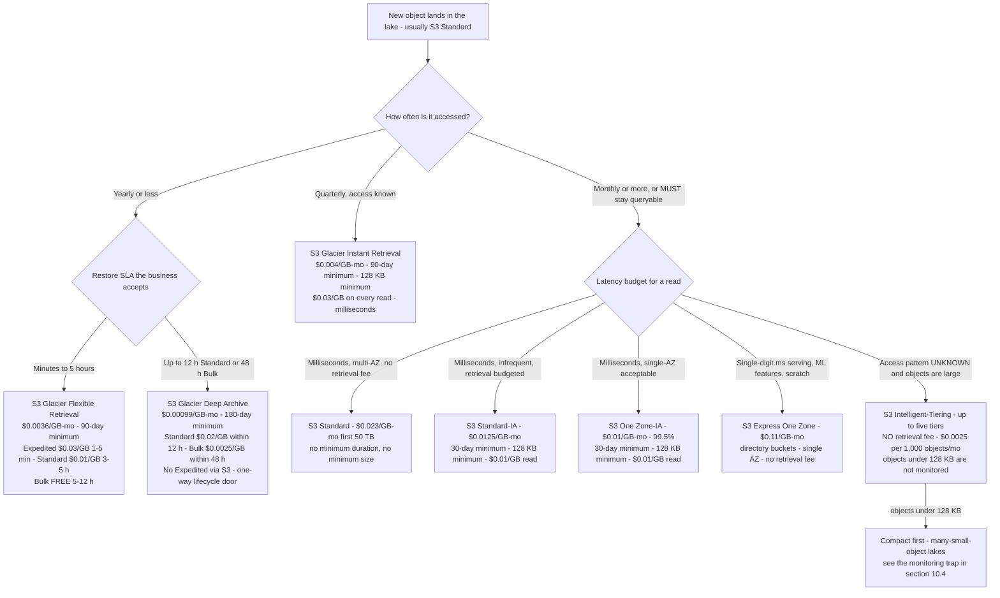
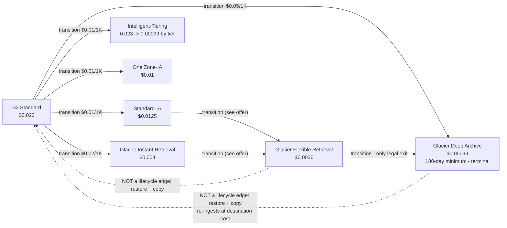
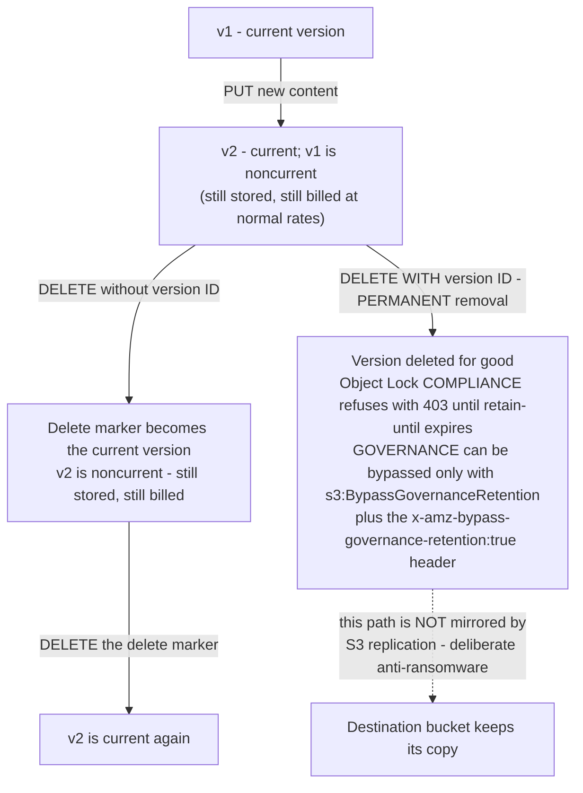
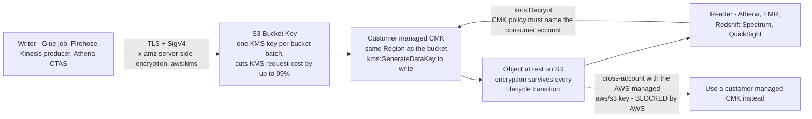

# S3 as the Data Lake Foundation: Storage Classes, Glacier, and Durability

Every lakehouse in this course is built on one assumption: **Amazon S3 is the substrate**. Glue crawls it, Athena scans it, Redshift Spectrum mounts it, Lake Formation grants on it, Macie inspects it, QuickSight reads it. Nothing downstream can rescue a lake whose storage layer was designed by accident — and in S3, "by accident" has a specific price. The wrong storage class bills you a retrieval fee on every byte an engine reads; the wrong prefix layout throttles ingest at 3,500 writes per second; the wrong object size adds 40 KB of archive metadata per file; the wrong retention design turns a lifecycle rule into a one-way door with a 180-day minimum bill.

The good news is that S3's cost model is *knowable*. Every rate in this lesson comes from the AWS Price List offer for Amazon S3 in `us-east-1` (publication date **2026-09-28**, effective **2026-09-01**, accessed **October 2026**) plus the AWS S3 user guide, pricing page and FAQ (accessed October 2026). Do the arithmetic yourself; it is the only way to design a lake that is still affordable in year seven.

```text
 =============================================================
  S3 STORAGE-CLASS LADDER - us-east-1 list, as of Oct 2026
 -------------------------------------------------------------
  Class                     $/GB-mo    Min duration  Retrieval
  S3 Express One Zone        0.11      none          none
                             directory buckets only, single AZ
  S3 Standard                0.023     none          none
                             next 450 TB 0.022, then 0.021
  S3 Standard-IA             0.0125    30 days       $0.01/GB
  S3 One Zone-IA             0.01      30 days       $0.01/GB
  S3 Intelligent-Tiering     0.023 -> 0.00099 across five tiers
                             + $0.0025 per 1,000 objects/mo
                             no retrieval fee, no min duration
  S3 Glacier Instant Ret.    0.004     90 days       $0.03/GB
  S3 Glacier Flexible Ret.   0.0036    90 days       $0-$0.03/GB
  S3 Glacier Deep Archive    0.00099   180 days      $0.0025-$0.02/GB
  Reduced Redundancy         deprecated - "We recommend not
                             using this storage class" (S3 docs)
 -------------------------------------------------------------
  Every class: 99.999999999% designed durability. What differs
  is availability, AZ footprint, latency, minimum duration,
  minimum billable object size, and retrieval fees.
 =============================================================
```

In this lesson you will:

- read the **full storage-class table** — all eight classes plus every Glacier tier, with retrieval time, retrieval fee and minimum storage duration;
- walk the **storage-class decision tree** and the **one-way lifecycle waterfall** as mermaid diagrams, then order the waterfall yourself in an interactive drag-and-drop;
- model **versioning, replication, Object Lock (WORM) and legal holds**, including exactly which mutations replication does *not* mirror;
- choose between **SSE-S3, SSE-KMS, DSSE-KMS and SSE-C**, and use an **S3 Bucket Key** to cut KMS request cost "by up to 99 percent";
- design **buckets, prefixes and Hive-style partition keys** against the **≥3,500 write / ≥5,500 read requests per second per prefix** model;
- apply **Block Public Access** (four settings) and the eight **bucket-policy patterns** a private lake needs;
- build the governance plumbing — **S3 Inventory** and **S3 Batch Operations** — that lifecycle rules and live replication cannot do alone;
- hand-compute **five cost models with real numbers**: the 1 TiB class ladder, a 50 TiB Deep Archive restore, a hot-prefix throughput design, a 7-year lifecycle-to-Deep-Archive TCO, an Intelligent-Tiering break-even, and the 40 KB archive-metadata trap;
- study **two named AWS customer cases** (Nasdaq and Siemens), read the **2026 update box**, and practise with **12 exam-style questions** plus four interactive checks.

---

## 1. The eight storage classes: one durability, eight economics

### 1.1 The comparison table (as of Oct 2026)

Amazon S3 offers eight current storage classes plus one deprecated class. AWS documents them side by side in the S3 user guide's storage-class comparison (accessed Oct 2026). All of them share **99.999999999% designed durability** — eleven nines — so durability is never the discriminator. Availability design, AZ footprint, minimum storage duration, minimum billable object size and retrieval fees are.

| Storage class | $/GB-mo (us-east-1, list 2026-09-28) | Design | AZs | Min storage duration | Min billable size | Retrieval fee |
|---|---|---|---|---|---|---|
| **S3 Standard** | 0.023 first 50 TB · 0.022 next 450 TB · 0.021 over 500 TB | 99.99% | ≥3 | none | none | none |
| **S3 Standard-Infrequent Access** | 0.0125 | 99.9% | ≥3 | **30 days** | **128 KB** | **$0.01/GB** |
| **S3 Intelligent-Tiering** | FA 0.023→0.021 · IA 0.0125 · Archive Instant 0.004 · Archive 0.0036 · Deep Archive 0.00099 | 99.9% | ≥3 | none | none | **none** (monitoring fee instead) |
| **S3 One Zone-Infrequent Access** | 0.01 | 99.5% | **1** | **30 days** | **128 KB** | **$0.01/GB** |
| **S3 Express One Zone** | 0.11 | 99.95% (99.9% SLA) | **1** | none | none | none (data transfer $0.0032 up / $0.0006 down per GB) |
| **S3 Glacier Instant Retrieval** | 0.004 | 99.9% | ≥3 | **90 days** | **128 KB** | **$0.03/GB** |
| **S3 Glacier Flexible Retrieval** | 0.0036 | 99.99% *after you restore objects* | ≥3 | **90 days** | none (+40 KB metadata) | **tiered: $0–$0.03/GB** |
| **S3 Glacier Deep Archive** | 0.00099 | 99.99% *after you restore objects* | ≥3 | **180 days** | none (+40 KB metadata) | **tiered: $0.0025–$0.02/GB** |
| Reduced Redundancy | 0.0240→0.0220 | deprecated | — | — | — | — |

Three details in that table do more damage than any others:

1. **S3 Express One Zone is a directory-bucket class.** It lives in a different bucket type (`--bucket-prefix` directory buckets), is single-AZ, and is priced at **$0.11/GB-month** — about **4.8× S3 Standard storage** — in exchange for consistent single-digit-millisecond latency. It is a *serving/scratch* tier, never the lake of record.
2. **Intelligent-Tiering has no retrieval fee at all.** It replaces that fee with a **per-object monitoring charge**: $0.0025 per 1,000 objects per month (AWS Price List offer, 2026-09-28). Objects smaller than 128 KB are not monitored and pay no fee — which is both a trap and a hint (section 10).
3. **The three Glacier classes are not "slower S3".** Two of them (Flexible Retrieval, Deep Archive) cannot be read with `GetObject` at all until you run an asynchronous **restore**. That single fact drives every archive design in this course.

### 1.2 Worked example E1 — the 1 TiB monthly ladder

**As of Oct 2026 (us-east-1 list).** How much does it cost to simply *hold* 1 TiB = **1,024 GB** for one month in each class?

```text
Worked example E1 - 1 TiB (1,024 GB) monthly storage cost, us-east-1, as of Oct 2026
S3 Standard ............ 1,024 GB x $0.023   = $23.552 / month
S3 Standard-IA ......... 1,024 GB x $0.0125  = $12.800 / month  (+ $0.01/GB per read)
S3 One Zone-IA ......... 1,024 GB x $0.01    = $10.240 / month  (+ $0.01/GB per read)
Glacier Instant Ret. ... 1,024 GB x $0.004   =  $4.096 / month  (+ $0.03/GB per read)
Glacier Flexible Ret. .. 1,024 GB x $0.0036  =  $3.686 / month  (restore required)
Glacier Deep Archive ... 1,024 GB x $0.00099 =  $1.014 / month  (restore required)
S3 Express One Zone .... 1,024 GB x $0.11    = $112.640 / month (+ per-request + data)
Intelligent-Tiering .... 1,024 GB x $0.023   = $23.552 / month if everything stays in
                        Frequent Access, PLUS $0.0025 per 1,000 objects/mo
```

Two readings of that ladder matter. First, **Deep Archive is 23× cheaper than Standard to hold** ($1.014 vs $23.552) — which is exactly why the archive tier is a *retention* decision, not a performance one. Second, **Express One Zone is 4.8× more expensive than Standard to hold** — which is why it hosts gold serving tables and ML feature stores, never bronze.

The **S3 FAQ** puts it plainly: "From just $0.00099 per GB-month … S3 Glacier Deep Archive offers the lowest cost storage in the cloud" (accessed Oct 2026). One caveat worth carrying: the `us-east-1` Price List offer of 2026-09-28 contains the Deep Archive *staging* and Intelligent-Tiering Deep Archive Access SKUs but **no standalone Deep Archive storage SKU**, so treat $0.00099 as AWS-published rather than price-list-confirmed, and re-check before you commit a seven-figure archive to it.

- **📚 Did you know?** Reduced Redundancy (`RRS`) still appears in the S3 price list at $0.0240→$0.0220/GB-month, but the S3 user guide says only: "We recommend not using this storage class" (accessed Oct 2026). It is *more* expensive than S3 Standard with *less* redundancy. Any exam-style option, vendor deck or legacy runbook that still routes data to RRS is wrong as of Oct 2026.

---

## 2. The Glacier family: every tier, every fee, every clock

"Glacier" is three storage classes and five restore tiers, and the difference between them is the difference between a query that returns in milliseconds and a ticket that closes tomorrow.

### 2.1 The archive table

| Class | Min storage duration | Billing | Retrieval path | Tier | Retrieval fee $/GB | Typical retrieval time | Restore request fee |
|---|---|---|---|---|---|---|---|
| **Glacier Instant Retrieval** | 90 days | quarterly | direct `GetObject` | — | **$0.03 flat** (every read) | **milliseconds** | n/a |
| **Glacier Flexible Retrieval** | 90 days | semi-annually | `RestoreObject` required | **Expedited** | $0.03 | **1–5 minutes** | $0.01 / 1,000 |
| | | | | **Standard** | $0.01 | **3–5 hours** | $0.05 / 1,000 |
| | | | | **Bulk** | **$0 (free)** | **5–12 hours** | $0.00 / 1,000 |
| **Glacier Deep Archive** | **180 days** | annually | `RestoreObject` required | **Standard** | $0.02 | **within 12 hours** | $0.05 / 1,000 |
| | | | | **Bulk** | **$0.0025** | **within 48 hours** | $0.00 / 1,000 |
| | | | | **Expedited** | **not offered via S3** | — | — |

Sources: S3 Glacier storage-classes comparison and tier bullets (user guide, accessed Oct 2026); retrieval and restore-request prices from the 2026-09-28 `us-east-1` offer; "S3 Glacier Flexible Retrieval Bulk data retrievals and requests are free of charge" and "DELETE and CANCEL requests are free" (S3 pricing page, accessed Oct 2026).

Read the table vertically and three rules fall out:

- **Glacier Instant Retrieval is the only archive class a query engine can read directly** — milliseconds, but every byte read costs **$0.03/GB**, seven-and-a-half times its own storage rate.
- **Glacier Flexible Retrieval's Bulk tier is free but slow**: $0.00/GB, typically 5–12 hours. The FAQ phrases it as "Bulk retrievals typically complete within 5—12 hours, and are free of charge."
- **Deep Archive has no Expedited tier through S3.** The fastest published path is Standard at $0.02/GB "within 12 hours"; Bulk at $0.0025/GB takes "within 48 hours". The comparison table elsewhere in the same guide quotes the range as "9 to 48 hours" — plan against the tier bullets, not the best case.

### 2.2 A restore is not a GET

This is the single most misunderstood mechanic in the entire S3 pricing model, so it gets its own diagram.

```mermaid
sequenceDiagram
    participant C as Client / Athena-adjacent job
    participant A as Archived object (GLACIER or DEEP_ARCHIVE)
    participant T as Temporary copy in S3 Standard
    C->>A: RestoreObject (tier: Expedited / Standard / Bulk)
    Note over A: You pay the tier's retrieval $/GB<br/>plus the restore-request fee per 1,000
    A-->>C: 202 Accepted - restore is asynchronous
    Note over A,T: Wait: 1-5 min (Expedited) / 3-5 h / 5-12 h<br/>/ 12 h (GDA Standard) / 48 h (GDA Bulk)
    A->>T: S3 creates a temporary copy, billed at S3 Standard rates
    C->>T: GetObject on the restored copy (an ordinary GET)
    Note over T: Temp copy bills at ~$0.023/GB-mo for the ENTIRE<br/>duration you chose, whether or not you read it
    T-->>C: Object bytes
    Note over T: Temp copy expires; the archived original stays<br/>GLACIER / DEEP_ARCHIVE forever - HeadObject never changes class
```

AWS's own pricing page states the consequence: "When you restore an archive, you are paying for both the archive… and a copy… restored temporarily (charged at the S3 Standard storage rate for a duration of time you choose)" (accessed Oct 2026). So the full restore bill has **four components**: archive storage (still accruing) + the tier's per-GB retrieval fee + the per-1,000 restore-request fee + **Standard storage on the temporary copy for the whole chosen duration**. The archived original never changes class — `HeadObject` keeps reporting `GLACIER` or `DEEP_ARCHIVE` after a successful restore.

### 2.3 Worked example E2 — restoring 50 TiB from Deep Archive

A media house must regurgitate a **50 TiB (51,200 GB)** broadcast library inside a five-day window. Hold the restored copy for **5 days**.

```text
Worked example E2 - restore economics from Glacier Deep Archive, us-east-1, as of Oct 2026
Volume ............... 50 TiB = 51,200 GB
Hold window .......... 5 days (temp copy billed at S3 Standard for the full window)

Option A - Standard tier ($0.02/GB, typically within 12 hours)
  Retrieval .......... 51,200 GB x $0.02      = $1,024.00
  Temp Standard copy . 51,200 GB x $0.023 x 5/30 =   $196.27
  TOTAL ..............                            $1,220.27

Option B - Bulk tier ($0.0025/GB, typically within 48 hours)
  Retrieval .......... 51,200 GB x $0.0025    =   $128.00
  Temp Standard copy . (same)                 =   $196.27
  TOTAL ..............                            $  324.27

Delta ................ $1,220.27 - $324.27 = $896.00 saved for ~36 extra hours of waiting
Restore request fee .. $0.05 per 1,000 Standard restores (negligible at this object count)
```

**Verdict:** **Bulk for planned recoveries; Standard only when the business clock is shorter than 48 hours.** The $896 delta is pure retrieval fee — the temporary-copy charge is identical either way, which is why the temp copy, not the retrieval fee, dominates any *long* hold. Need the data in under 15 minutes? Deep Archive cannot help you: there is no Expedited tier via S3, so a same-hour SLA means the data should never have left Standard, Standard-IA or Glacier Instant Retrieval.

> [!WARNING]
> ⚠️ **Never model an archive as "cheap storage you can get back instantly."** Deep Archive's minimum storage duration is **180 days**: if you transition an object in and delete or re-classify it before day 180, you are billed for the full 180 days. AWS is explicit — "If you create a Lifecycle expiration rule that causes objects that have been in S3 Glacier Deep Archive storage for less than 180 days to expire, you are charged for 180 days" (S3 lifecycle docs, accessed Oct 2026). And the exit is a one-way door: **you cannot lifecycle-transition out of Deep Archive.** The only way out is restore + copy to a new object at the destination class's cost, which restarts that class's minimum-duration clock.

```matching
{
  "question": "Match each storage class or restore tier to its published retrieval behaviour and fee (us-east-1 list, as of Oct 2026):",
  "pairs": [
    {"left": "S3 Standard or S3 Intelligent-Tiering (Frequent / Infrequent / Archive Instant tiers)", "right": "No retrieval fee at all - Intelligent-Tiering charges $0.0025 per 1,000 objects per month of monitoring instead"},
    {"left": "S3 Standard-Infrequent Access or One Zone-Infrequent Access", "right": "Milliseconds, but a flat $0.01 per GB on every byte read"},
    {"left": "S3 Glacier Instant Retrieval", "right": "Milliseconds direct GetObject, with a flat $0.03 per GB retrieval fee"},
    {"left": "Glacier Flexible Retrieval - Expedited", "right": "$0.03 per GB, typically restores the object in 1-5 minutes, $0.01 per 1,000 restore requests"},
    {"left": "Glacier Flexible Retrieval - Standard", "right": "$0.01 per GB, typically restores the object in 3-5 hours, $0.05 per 1,000 restore requests"},
    {"left": "Glacier Flexible Retrieval - Bulk", "right": "Free of charge ($0.00 per GB and $0.00 per 1,000 requests), typically 5-12 hours"},
    {"left": "Glacier Deep Archive - Standard", "right": "$0.02 per GB, typically within 12 hours, $0.05 per 1,000 restore requests - and no Expedited tier exists via S3"},
    {"left": "Glacier Deep Archive - Bulk", "right": "$0.0025 per GB, typically within 48 hours, $0.00 per 1,000 restore requests"}
  ],
  "explanation": "Three compounding mechanisms: flat per-GB read fees (Standard-IA, One Zone-IA, Glacier Instant Retrieval); tiered restore fees plus a temporary S3 Standard copy (Glacier Flexible Retrieval, Glacier Deep Archive); and no retrieval fee at all in Standard, Express One Zone and Intelligent-Tiering - the last of which substitutes a per-object monitoring fee. Rule of thumb from the S3 pricing page: anything a query engine might scan belongs in Standard, Intelligent-Tiering or Glacier Instant Retrieval. Deep Archive's Bulk tier is the cheapest bytes in the cloud to keep and the cheapest bytes to move out, at the cost of a 48-hour wait."
}
```

- **📚 Did you know?** The standalone **Amazon Glacier vault** service — a separate product with its own vault APIs and ARNs — "is no longer accepting new customers as of December 15, 2025" (S3 Glacier pricing page, accessed Oct 2026). AWS now recommends: "We recommend using the S3 Glacier storage classes within the Amazon S3 service for all of your long-term data." In 2026, "Glacier" in a design conversation means three storage classes on a normal S3 bucket, not a vault.

---

## 3. Choosing a class: the decision tree and the waterfall

### 3.1 The storage-class decision tree

Access **frequency**, required **latency** and whether the object is **recreatable** decide the class — in that order. The leaf labels carry the price and the clock you are signing up for.



Two branches deserve the commentary:

- **"Unknown access" does not automatically mean Intelligent-Tiering.** It means Intelligent-Tiering *once objects are large enough to be monitored* (≥128 KB) and few enough that the monitoring fee is not the whole bill. For a known-quarterly archive, Glacier Instant Retrieval is usually cheaper — section 10.3 does the break-even.
- **One Zone-IA is a durability trade, not just a discount.** 99.5% availability in a single AZ means a genuine question of whether the data can be recreated. Lakes use it for *reproducible* derived data, never for the only copy of raw source data.

### 3.2 The lifecycle waterfall is one-way

Amazon S3 "supports a waterfall model for transitioning between storage classes" (S3 lifecycle user guide, accessed Oct 2026). Objects flow down; they do not flow back up. The back-arrows in the diagram below are **not** lifecycle edges — they are restore-and-copy operations you run by hand or through S3 Batch Operations, and each one restarts the destination class's minimum-duration clock and re-bills at the destination rate.



Rules the S3 lifecycle docs put in writing (accessed Oct 2026):

- "You can't create a single Lifecycle rule that transitions objects from one storage class to another before the minimum storage duration period has passed."
- "The transition of objects to the S3 Glacier Deep Archive storage class can go only one way."
- "An object is eligible for only one S3 Lifecycle action per day. When multiple rules match, Amazon S3 applies the least costly action."
- Precedence: permanent deletion > transition > creation of delete markers. When both a Glacier Flexible Retrieval and a Standard-IA transition are eligible, "Amazon S3 chooses the S3 Glacier Flexible Retrieval transition."
- A configuration can hold **up to 1,000 rules** — "This limit is not adjustable."
- Since **September 2024**, "Objects smaller than 128 KB will not transition by default to any storage class."

```dragdrop
{
  "question": "Order the storage-class waterfall from the class an object lands in, to the terminal archive class - cheapest-and-slowest last:",
  "items": [
    "S3 Standard - $0.023/GB-month, no minimum duration, no retrieval fee - the hot zone every object lands in and the only class query engines scan freely",
    "S3 Standard-IA - $0.0125/GB-month, 30-day minimum duration, 128 KB minimum billable size, $0.01/GB flat retrieval fee",
    "S3 Glacier Instant Retrieval - $0.004/GB-month, 90-day minimum, 128 KB minimum size, $0.03/GB flat retrieval, still milliseconds",
    "S3 Glacier Flexible Retrieval - $0.0036/GB-month, 90-day minimum, async restore required, Bulk retrievals free but 5-12 hours",
    "S3 Glacier Deep Archive - $0.00099/GB-month, 180-day minimum, async restore required, up to 12 hours Standard / 48 hours Bulk, terminal"
  ],
  "correctOrder": [
    "S3 Standard - $0.023/GB-month, no minimum duration, no retrieval fee - the hot zone every object lands in and the only class query engines scan freely",
    "S3 Standard-IA - $0.0125/GB-month, 30-day minimum duration, 128 KB minimum billable size, $0.01/GB flat retrieval fee",
    "S3 Glacier Instant Retrieval - $0.004/GB-month, 90-day minimum, 128 KB minimum size, $0.03/GB flat retrieval, still milliseconds",
    "S3 Glacier Flexible Retrieval - $0.0036/GB-month, 90-day minimum, async restore required, Bulk retrievals free but 5-12 hours",
    "S3 Glacier Deep Archive - $0.00099/GB-month, 180-day minimum, async restore required, up to 12 hours Standard / 48 hours Bulk, terminal"
  ],
  "explanation": "This is the published waterfall, read left to right by falling price and rising friction: Standard (no minimums, no retrieval fee) -> Standard-IA or One Zone-IA or Intelligent-Tiering or Glacier Instant Retrieval -> Glacier Flexible Retrieval -> Glacier Deep Archive. Each hop costs a transition request ($0.01 to IA/One Zone-IA/Intelligent-Tiering, $0.02 to Glacier Instant Retrieval, $0.05 per 1,000 to Deep Archive, us-east-1 list as of Oct 2026), starts the destination class's minimum-duration clock the day the rule is satisfied, and cannot be undone by another rule. Only Intelligent-Tiering bills after the physical move completes; for every other class, billing flips the moment the rule fires."
}
```

---

## 4. Durability, versioning and replication

### 4.1 Versioning: three states, full-object billing

S3 Versioning is bucket-level and all-or-nothing, with exactly three states: **unversioned** (the default), **enabled** and **suspended**. The AWS user guide is blunt about the billing: "Each version of an object is the entire object; it is not just a diff… if you have three versions of an object stored, you are charged for three objects" (accessed Oct 2026).

| Mechanism | Behaviour |
|---|---|
| `PUT` (any) | Creates a new current version; the previous version becomes noncurrent and **is still billed** |
| `DELETE` without a version ID | Inserts a **delete marker**; returns `200 OK`; prior versions remain retrievable by version ID |
| `DELETE` with a version ID | **Permanently** removes that version — this is the only true delete |
| `NoncurrentVersionExpiration` | Deletes noncurrent versions after N days, optionally capped by `MaxNoncurrentVersions` (**1–100**) |
| Enabled → unversioned | **Impossible.** "After you version-enable a bucket, it can never return to an unversioned state. But you can *suspend* versioning on that bucket." |

Versioning is a prerequisite for two things you will need later: **S3 Object Lock** (which works only in versioned buckets) and **S3 replication** (which requires versioning on both source and destination).



### 4.2 Replication: CRR, SRR, and the archived-class wall

Cross-Region Replication (CRR) and Same-Region Replication (SRR) are the same mechanism with different destinations. Versioning must be enabled on both sides. What replicates by default (S3 replication docs, accessed Oct 2026):

- **Replicated:** new objects created *after* the configuration, object metadata, tags, annotations, ACL updates, **Object Lock retention**, and objects encrypted with SSE-S3 / SSE-KMS / DSSE-KMS / SSE-C.
- **Not replicated by default:** objects that are themselves replicas (no chaining), **delete markers** when the configuration uses a `Filter` element, **permanent version deletes**, bucket-level subresource changes, and lifecycle-created delete markers.
- **Not replicable at all until restored:** objects in **Glacier Flexible Retrieval, Glacier Deep Archive, Intelligent-Tiering Archive Access and Intelligent-Tiering Deep Archive Access**. AWS's exact words: "You cannot replicate these objects until you restore them and copy them to a different storage class."

Three operational consequences for a lake:

1. **CRR is not a live backup of every mutation.** With the current configuration version (a `Filter`), delete markers are not replicated unless you explicitly enable delete marker replication, and version-ID deletes are never mirrored — deliberately, so a compromised principal cannot erase the DR copy by deleting versions in the source.
2. **Retroactive backfill needs S3 Batch Replication.** Live replication only covers objects created after the configuration; everything older is a Batch Operations job.
3. **Monitoring costs $0.015 per 1 million objects per month** in the source bucket (2026-09-28 offer). There is **no separate "$0.02 per GB replicated" SKU** in that offer — you pay destination-bucket storage and ordinary inter-region data transfer on top of the monitoring fee. Do not teach the per-GB figure without re-checking the Replication pricing tab.

- **📚 Did you know?** S3 replication carries **Object Lock retention information to the replicas**: "it applies those same retention controls to your destination buckets" (S3 replication docs, accessed Oct 2026). That is what makes CRR into a second *compliance* copy rather than merely a second copy — the retain-until date survives the Region hop.

---

## 5. Object Lock: WORM for regulated lake zones

S3 Object Lock "uses a *write-once-read-many* (WORM) model" and "works only in buckets that have S3 Versioning enabled" (S3 user guide, accessed Oct 2026). It protects an object **version**, not a key — and that distinction is where most designs fail.

| Protection | Behaviour |
|---|---|
| **Retention period** | A fixed retain-until date, or (since 2026-09-08) **variable retention** whose retain-until is recomputed as "now + duration" while an **event-based hold** is applied |
| **Legal hold** | No expiry date; needs `s3:PutObjectLegalHold` to remove; independent of retention |
| **COMPLIANCE mode** | "A protected object version can't be overwritten or deleted by any user, including the root user in your AWS account… The only way to delete an object under the compliance mode before its retention date expires is to delete the associated AWS account." |
| **GOVERNANCE mode** | Ordinary principals are blocked; a principal with `s3:BypassGovernanceRetention` **and** the explicit `x-amz-bypass-governance-retention:true` request header can override |
| **What lock does NOT stop** | New versions of the same key (a `PUT` still succeeds), and simple `DELETE`s (which return `200 OK` and add a delete marker) |

AWS has had Object Lock "assessed by Cohasset Associates for use in environments that are subject to SEC 17a-4, CFTC, and FINRA regulations" (accessed Oct 2026) — which is exactly why the regulated-data stories in this course (FINRA-style surveillance archives, Nasdaq's compliance tier) reach for it.

> [!IMPORTANT]
> 🔒 **Object Lock locks versions, not keys — so lake immutability needs three pieces, not one.** Retention and legal holds "don't prevent new versions of the object from being created, or delete markers to be added on top of the object." True immutability for a bronze zone is: (1) Object Lock (COMPLIANCE for the audited zone, GOVERNANCE elsewhere); (2) a bucket policy **denying `s3:DeleteObjectVersion`** to everyone outside the retention role; and (3) a bucket policy **denying `s3:BypassGovernanceRetention` and `s3:PutObjectLegalHold`** to all non-admin principals. Without (2), a `PUT` quietly creates an unlocked new version sitting above your locked one.

- **📚 Did you know?** A single rule limit most people miss: an S3 Lifecycle configuration "can have up to 1,000 rules" and each rule's filter may use "an object key name prefix, one or more object tags, object size, or any combination of these" (S3 API docs, accessed Oct 2026) — and **you cannot use a bucket policy to prevent deletions or transitions by a lifecycle rule**. Object Lock stops *principals*; lifecycle expiry is a *service* action, so audit-zone designs pair Object Lock with lifecycle rules that deliberately stop short of the retention boundary.

---

## 6. Encryption: SSE-S3, SSE-KMS, DSSE-KMS, SSE-C and Bucket Keys

Since **5 January 2023**, "all new object uploads to Amazon S3 are automatically encrypted at no additional cost and with no impact on performance" — that default is **SSE-S3** (S3 user guide, accessed Oct 2026). Everything else is an upgrade with a price and a constraint.

| Scheme | Who holds the key | Extra cost | Hard constraints |
|---|---|---|---|
| **SSE-S3** (default) | AWS, per object | None | Cannot be shared cross-account as a *key* — the objects are still readable by anyone with IAM access to the bucket |
| **SSE-KMS** | AWS KMS, either the AWS-managed key `aws/s3` or a **customer managed CMK** | KMS request charges per `GenerateDataKey` / `Decrypt` | CMK **must be in the same Region as the bucket**; **symmetric keys only**; write needs `kms:GenerateDataKey`, read needs `kms:Decrypt`; **the `aws/s3` key cannot be shared cross-account** |
| **DSSE-KMS (dual-layer)** | Two independent KMS keys | **$0.003/GB encrypted + $0.003/GB decrypted** (2026-09-28 offer) | For workloads that need two independent layers of key authority |
| **SSE-C** | **You**, supplied on every TLS request | None from AWS | AWS stores nothing; every `GET`/`PUT`/`COPY` must carry the key over TLS or it fails |

Three upgrades a lake typically needs:

1. **An S3 Bucket Key.** "Using a bucket-level key for SSE-KMS can reduce your AWS KMS request cost by up to 99 percent" (S3 user guide, accessed Oct 2026). At lake write volumes — hundreds of thousands of `PutObject` calls per day — the KMS request bill is the difference between SSE-KMS being affordable and being a line item.
2. **A customer managed CMK for anything cross-account.** "Objects encrypted using SSE-KMS with AWS managed keys can't be shared cross-account. If you need to share SSE-KMS data cross-account, you must use a customer managed key." Grant `kms:Decrypt` to the consumer account and enable the Bucket Key.
3. **Encryption survives class transitions** — but note the billing footnote: "Objects in S3 Glacier Flexible Retrieval and S3 Glacier Deep Archive are billed at S3 Standard storage class rates when you upload them using multipart uploads." Always land in Standard (or complete the multipart upload promptly) and let lifecycle do the transition.



Two request-shape traps worth memorising: SSE-KMS requests must arrive over **TLS with SigV4**, and you must **not** send encryption headers on `GET`/`HEAD` — S3 answers **HTTP 400**.

---

## 7. Buckets, prefixes and partition keys: the performance model

### 7.1 S3 scales per prefix, not per bucket

The S3 performance documentation states the model exactly: "your application can achieve at least **3,500 PUT/COPY/POST/DELETE or 5,500 GET/HEAD requests per second per partitioned Amazon S3 prefix**. There are no limits to the number of prefixes in a bucket… if you create 10 prefixes… you could scale your read performance to 55,000 read requests per second" (accessed Oct 2026). Scaling is gradual, and clients see **`503 Slow Down`** errors while it ramps.

```text
Worked example E3 - hot-prefix throughput design, as of Oct 2026
Ingest demand ......... 1,500 objects/second at 64 KB each = 96 MB/s

Single prefix  raw/events/2026-10-11/events.json.gz
  Write ceiling ....... 3,500 writes/s  -> only 2.3x headroom (3,500 / 1,500)
  Byte ceiling ........ 3,500 x 64 KB = 224 MB/s per prefix
  Failure mode ........ sustained 503 Slow Down once the emitter scales up

16 hashed prefixes  raw/events/dt=2026-10-11/hour=07/shard-{000..015}.json.gz
  Write ceiling ....... 16 x 3,500 = 56,000 writes/s -> ~37x headroom
  Byte ceiling ........ 16 x 224 MB/s = 3.5 GB/s

Read side - a full-day scan touching 24 hour-partitions (24 prefixes)
  Read ceiling ........ 24 x 5,500 = 132,000 GET/s
```

The composite incident AWS's Well-Architected lab material describes matches this shape: a streaming ingest job wrote **800 small objects/second** into `s3://lake-prod/raw/events/2026-10-11/events.json.gz` — one prefix — throughput collapsed at ~3,500 writes/s with sustained `503 Slow Down`, and re-sharding the producer key to 16 `shard-{000..015}` prefixes restored headroom to ~56,000 writes/s **with no other change**. Partition *spread* is a performance control independent of partition *semantics*.

### 7.2 Partition keys are the physical layout

For Hive-style tables, **the key layout *is* the physical partition layout**: `s3://lake/events/dt=2026-10-11/hour=07/part-…parquet`. Design rules that hold across Glue, Athena, EMR and Redshift Spectrum:

| Rule | Why |
|---|---|
| Low-cardinality, high-filtration columns first: `dt=` → `region=` → `source=` | Partition pruning filters on the leading keys; a leading `user_id` prunes nothing and explodes the catalog |
| **Never** partition by a high-cardinality key (`user_id`, `request_id`, `order_id`) | Millions of partitions = Glue metadata bloat, LIST fan-out, Athena planning cost |
| Consistent naming (`dt=`, never a mix of `dt=` and `date=`) | Glue crawlers and Athena partition projection must agree with the physical layout |
| Target **128 MB–1 GB** Parquet objects | Below ~128 MB, columnar footer/dictionary overhead and per-GET cost dominate; this is also the 128 KB lifecycle floor's big brother |
| Design keys so each **zone** (bronze / silver / gold / archive) is addressable by `Prefix`, `Tag` or `ObjectSizeGreaterThan` | Lifecycle, Object Lock and bucket-policy statements are all prefix/tag/size scoped |
| Iceberg hidden partitioning decouples the *logical* transform from the key | But the file's S3 prefix still determines which per-prefix request budget you consume |

- **📚 Did you know?** `LIST` requests are not free and are not priced like `GET`: "LIST requests for any storage class are charged at the same rate as S3 Standard PUT, COPY, and POST requests" — **$0.005 per 1,000** (S3 pricing page and 2026-09-28 offer). `DELETE` and `CANCEL` requests, by contrast, are free. That is a second, quieter argument for moderate prefix fan-out: more prefixes mean more LIST/GET fan-out on full-bucket scans and more Glue partition metadata, so shard to your real time partitions rather than synthetically to the limit.

```fillblank
{
  "question": "Complete the S3 performance and design statements with the published numbers (all as of October 2026):",
  "template": "Per partitioned prefix, Amazon S3 sustains at least {{1}} PUT/COPY/POST/DELETE requests per second and {{2}} GET/HEAD requests per second, and there is no limit on the number of prefixes - ten read prefixes therefore scale to {{3}} GET/HEAD requests per second. While that scaling ramps, clients see {{4}} errors. Default lifecycle transitions skip objects smaller than {{5}} KB, archived objects carry {{6}} KB of additional metadata per object, and an S3 Lifecycle configuration may contain at most {{7}} rules.",
  "answers": {
    "1": "3500",
    "2": "5500",
    "3": "55000",
    "4": "503 Slow Down",
    "5": "128",
    "6": "40",
    "7": "1000"
  },
  "distractors": ["1000", "2000", "11000", "429 Throttling", "64", "32", "100", "10000", "5000"],
  "explanation": "3,500 write and 5,500 read requests per second per partitioned prefix, unlimited prefixes, 10 prefixes = 55,000 GET/HEAD per second (S3 performance docs, accessed Oct 2026). Scaling is gradual and surfaces as 503 Slow Down - not 429. The lifecycle minimum transition size is 128 KB (in effect since September 2024), archived objects add 40 KB of metadata (32 KB at the archive class rate plus 8 KB at S3 Standard rates), and 1,000 lifecycle rules is a hard, non-adjustable limit. The distractors are the shard-scale numbers from other AWS services and the individual halves of the 40 KB overhead."
}
```

---

## 8. Locking the lake down: Block Public Access and bucket policies

### 8.1 Block Public Access is the kill switch

"By default, new buckets, access points, and objects don't allow public access." On top of that default, **S3 Block Public Access provides four settings** — `BlockPublicAcls`, `IgnorePublicAcls`, `BlockPublicPolicy` and `RestrictPublicBuckets` — and "if the block public access settings… differ, then Amazon S3 applies the most restrictive combination" (S3 user guide, accessed Oct 2026).

| Level | Behaviour |
|---|---|
| Access point | Per-endpoint override |
| Bucket | Per-bucket; "we recommend that you also turn on all four settings for each bucket to comply with AWS Security Hub Foundational Security Best Practices control S3.8" |
| Account | "When you apply block public access settings to an account, the settings apply to all AWS Regions globally" |
| Organization | "At the organization level, all four settings are applied together as a unified policy" — and org settings override account settings |

AWS's recommendation for a lake account is unambiguous: "we recommend that you turn on all four settings… for your account." Remember the layering trap: **disabling BPA on one bucket does nothing if the account or organization still blocks**, and S3 always enforces the most restrictive combination. "Public" means an ACL or policy granting to `AllUsers`/`AuthenticatedUsers`, or a bucket policy with a wildcard principal not constrained by a fixed `aws:PrincipalArn`, `aws:PrincipalOrgID`, `aws:SourceAccount`, `aws:SourceArn`, `aws:SourceVpc`, `aws:SourceVpce`, `aws:SourceIp` or `s3:DataAccessPointArn`.

### 8.2 Eight bucket-policy patterns for a private lake

Block Public Access stops the bucket going public; the policy below stops everything else a data lake actually needs to refuse. A `Deny` statement with `"Principal": "*"` *restricts* access rather than granting it, so it composes cleanly with all four BPA settings left on.

```json
{
  "Version": "2012-10-17",
  "Statement": [
    {
      "Sid": "DenyNonTLS",
      "Effect": "Deny",
      "Principal": "*",
      "Action": "s3:*",
      "Resource": [
        "arn:aws:s3:::lakehouse-prod",
        "arn:aws:s3:::lakehouse-prod/*"
      ],
      "Condition": { "Bool": { "aws:SecureTransport": "false" } }
    },
    {
      "Sid": "DenyPutObjectUnlessSSEKMS",
      "Effect": "Deny",
      "Principal": "*",
      "Action": "s3:PutObject",
      "Resource": "arn:aws:s3:::lakehouse-prod/*",
      "Condition": {
        "StringNotEquals": { "s3:x-amz-server-side-encryption": "aws:kms" }
      }
    },
    {
      "Sid": "DenyPutObjectWithWrongKey",
      "Effect": "Deny",
      "Principal": "*",
      "Action": "s3:PutObject",
      "Resource": "arn:aws:s3:::lakehouse-prod/*",
      "Condition": {
        "StringNotEquals": {
          "s3:x-amz-server-side-encryption-aws-kms-key-id":
            "arn:aws:kms:us-east-1:111122223333:key/0000aaaa-1111-bbbb-2222-cccc3333dddd"
        }
      }
    },
    {
      "Sid": "DenyVersionDeletesOutsideRetentionRole",
      "Effect": "Deny",
      "Principal": "*",
      "Action": "s3:DeleteObjectVersion",
      "Resource": "arn:aws:s3:::lakehouse-prod/*",
      "NotPrincipal": {
        "AWS": "arn:aws:iam::111122223333:role/lake-retention-admin"
      }
    }
  ]
}
```

Notes on the JSON, because each statement encodes a rule that is easy to get subtly wrong:

- **One condition per statement for the SSE-KMS checks.** A single statement with two `StringNotEquals` keys only applies when *both* conditions match, which would let a request through with the right encryption header but the wrong key. Two statements = two independent denials.
- **Statement 2 alone is incomplete** without statement 3: pinning the algorithm does not pin the key, and an unpinned key is an unpinned blast radius.
- The full pattern list for a lake (S3 bucket-policy and condition-key docs, accessed Oct 2026): (1) deny non-TLS; (2) deny `PutObject` unless SSE-KMS; (3) pin the CMK ARN; (4) deny `DeleteObjectVersion` outside the retention role; (5) prefix-scoped grants such as `arn:aws:s3:::lakehouse-prod/raw/*` for engineering roles; (6) Region pinning with `aws:RequestedRegion`; (7) organization pinning with `aws:PrincipalOrgID`; (8) service-principal source restrictions (`aws:SourceArn` + `aws:SourceAccount`) for Lake Formation, Glue, Athena and Macie — plus retention caps via `s3:object-lock-remaining-retention-days`.

> [!WARNING]
> ⚠️ **A bucket policy cannot stop an S3 Lifecycle rule.** AWS states it directly: "You can't use a bucket policy to prevent deletions or transitions by an S3 Lifecycle rule." A `Deny s3:DeleteObject` to everyone protects against *principals*, not against service-side expiry. Conversely, objects whose replication status is `Pending` or `Failed` are not acted on until replication succeeds — so a lifecycle rule will not silently expire a half-replicated object, and a DR design that assumes immediate expiry must account for the lag.

---

## 9. The governance plumbing: S3 Inventory and S3 Batch Operations

Lifecycle rules and live replication cover *forward* motion. Two services cover everything else, and both are cheap enough that skipping them is a false economy.

### 9.1 S3 Inventory — the scheduled metadata snapshot

S3 Inventory produces "comma-separated values (CSV), Apache optimized row columnar (ORC) or Apache Parquet output files that list your objects and their corresponding metadata on a daily or weekly basis" (S3 user guide, accessed Oct 2026). The properties that matter for a lake:

| Property | Value |
|---|---|
| Formats | CSV+GZIP, ORC+ZLIB, Parquet+Snappy |
| Cadence | Daily, or weekly ("a report is generated every Sunday (UTC time zone)") |
| First report | "It might take up to 48 hours for Amazon S3 to deliver the first inventory report." |
| Request impact | "S3 Inventory does not use the `List` API operations to audit your objects and does not affect the request rate of your bucket." |
| Destination | "Must be in the same AWS Region as the source bucket" |
| Fields | Storage class, encryption status, Intelligent-Tiering access tier + reference date, replication status, Object Lock retain-until-date / mode / legal hold, version ID, IsLatest, delete marker, lifecycle expiration date |
| Querying | "with standard SQL queries by using Amazon Athena, Amazon Redshift Spectrum" |
| Price | **$0.0025 per 1 million objects listed** (2026-09-28 offer) |

That field list is an audit pipeline: who is locked, until when, in which tier, replicated or not — queryable in Athena, without a single `ListObjectsV2` call against the live bucket.

### 9.2 S3 Batch Operations — retroactive governance

S3 Batch Operations is manifest-driven: build the manifest from an S3 Inventory report, choose an operation, pay per job and per object. Us-east-1 list, as of Oct 2026: **$0.25 per job** and **$1.00 per million objects processed** (2026-09-28 offer).

The operations lifecycle rules and live replication *cannot* do:

- **Retro-apply Object Lock retention** or legal holds to millions of pre-existing objects;
- **Restore millions of Glacier objects** (the only sane way to run a bulk recovery like E2 at scale);
- **Batch Replication** to backfill objects that pre-date the replication configuration;
- **Bulk-apply SSE-KMS** after a key policy change;
- Copy, tag, ACL updates, or invoke a Lambda function per object.

```text
Worked example E4 - Batch Operations cost to lock down a zone, us-east-1, as of Oct 2026
Scope ................. 12,000,000 existing bronze objects need Object Lock retention
Manifest .............. one S3 Inventory report (already ~$0.03 for 12M objects listed)
Job fee ............... $0.25 per job                     = $  0.25
Object processing ..... 12,000,000 / 1,000,000 x $1.00    = $ 12.00
TOTAL .................                                  = $ 12.25 one-time
Compare ............... a single engineer scripting this with the SDK for a week
                        costs far more than the entire Batch Operations bill
```

The pattern to internalise: **Inventory is the read side (what do we have, in which state), Batch Operations is the write side (change all of it, once), and lifecycle is the standing order (keep doing this as objects age).** S3 Select, by the way, is not part of this toolkit for new designs — AWS closed it to new customers on 25 July 2024 and documents Athena as the recommended approach for data-lake querying (AWS Storage Blog, 2024-07-25).

---

## 10. Lifecycle cost math: Deep Archive TCO and the Intelligent-Tiering trap

### 10.1 Worked example E5 — the headline: 7-year TCO with a lifecycle waterfall

A compliance lake holds **100 TiB (102,400 GB)** of Parquet averaging **256 MB** per object (≈**409,600 objects**), written once, queried for 90 days, then archived for 7 years. All prices us-east-1 list, as of Oct 2026.

```text
Worked example E5 - 100 TiB compliance lake, 7-year TCO, us-east-1 list, as of Oct 2026
Volume ......... 100 TiB = 102,400 GB; 256 MB objects -> 409,600 objects

PATH A - stay in S3 Standard the whole time (87 months)
  Tier 1 (first 50 TB) ...... 51,200 GB x $0.023 = $1,177.60 / month
  Tier 2 (next 50 TB) ....... 51,200 GB x $0.022 = $1,126.40 / month
  Monthly total ............. $2,304.00
  87 months ................. 87 x $2,304.00 = $200,448.00

PATH B - lifecycle waterfall: 90 days Standard, then Glacier Deep Archive
  Phase 1 - 90 days (3 months) in Standard ... 3 x $2,304.00 = $6,912.00
  Transition to Deep Archive on day 90:
    409,600 objects / 1,000 x $0.05 ........... $    20.48 one-time
  Phase 2 - 84 months in Deep Archive:
    Storage .... 102,400 GB x $0.00099 ........ $   101.376 / month
    Metadata ... 409,600 x 8 KB  = 3.125 GB x $0.023  = $0.072 / month
                 409,600 x 32 KB = 12.500 GB x $0.00099 = $0.012 / month
    Monthly total ............. ~ $101.46
    84 months ................. 84 x $101.46 = $8,522.64
  PATH B TOTAL ....... $6,912.00 + $20.48 + $8,522.64 = $15,455.12

SAVINGS ......... $200,448.00 - $15,455.12 = $184,992.88 (~92%)
```

```plot
{
  "type": "bar",
  "title": "7-year TCO for a 100 TiB compliance lake (worked example E5, us-east-1 list, as of Oct 2026)",
  "xLabel": "Design",
  "yLabel": "Total cost over 87 months (USD)",
  "xKey": "design",
  "data": [
    {"design": "S3 Standard for all 87 months", "total_usd": 200448},
    {"design": "90 days Standard, then Glacier Deep Archive", "total_usd": 15455}
  ]
}
```

The ~$185,000 saving is real, and it is conditional on exactly three things: the data genuinely stays **≥180 days** in Deep Archive (otherwise the minimum duration bills you anyway), a **12-hour / 48-hour restore SLA is acceptable**, and the objects are **large enough** that the 40 KB metadata overhead stays a rounding error (it is: ~$0.08/month on 409,600 objects). Miss any one of the three and the model breaks — which is why section 10.4 exists.

### 10.2 Worked example E6 — Intelligent-Tiering break-even

Same question every lake asks: **10 TiB (10,240 GB), access unknown, 200 million objects.** Should this be Intelligent-Tiering, or an explicit class?

```text
Worked example E6 - Intelligent-Tiering vs explicit classes, us-east-1 list, as of Oct 2026
Option 1 - Intelligent-Tiering, everything stays in Frequent Access
  Storage .... 10,240 GB x $0.023 .......................... $235.52 / month
  Monitoring . 200,000 (thousand-objects) x $0.0025 ......... $500.00 / month
  TOTAL .................................................... $735.52 / month
  -> the MONITORING fee is 68% of the bill before a single byte moves tiers

Option 2 - compact to 20,000 objects of ~512 MB, then Intelligent-Tiering
  Storage .... 10,240 GB x $0.023 .......................... $235.52 / month
  Monitoring . 20 x $0.0025 ................................ $   0.05 / month
  TOTAL .................................................... $235.57 / month
  -> compact FIRST, then let Intelligent-Tiering work

Option 3 - if access is genuinely quarterly, pick a class explicitly
  Glacier Instant Retrieval ... 10,240 GB x $0.004 = $ 40.96 / month + $0.03/GB read
  S3 Standard-IA .............. 10,240 GB x $0.0125 = $128.00 / month + $0.01/GB read
  Break-even read volume ...... ($128.00 - $40.96) / ($0.03 - $0.01)
                              = $87.04 / $0.02 = 4,352 GB read per month
  -> read LESS than 4,352 GB/month: Glacier Instant Retrieval wins
  -> read MORE than 4,352 GB/month: Standard-IA wins
```

### 10.3 Worked example E7 — the 40 KB archive-metadata trap

Every object moved into Glacier Flexible Retrieval or Glacier Deep Archive carries **40 KB of additional metadata**: "32 KB… charged at the default rate for that storage class" plus "an additional 8 KB… charged at the S3 Standard rate" (S3 archival-storage docs, accessed Oct 2026). On 256 MB Parquet files that is invisible. On a lake of tiny JSON files it *is* the bill.

```text
Worked example E7 - archiving 1,000,000 objects of 5 KB each to Deep Archive
Data ................. 1,000,000 x 5 KB  = ~4.7 GB of actual bytes
Metadata overhead .... 1,000,000 x 40 KB = ~38 GB of billable overhead
                       32 KB @ Deep Archive rate: 32 GB x $0.00099 = $0.032 / month
                        8 KB @ S3 Standard rate:  8 GB x $0.023   = $0.184 / month
                       overhead total ............................. ~$0.216 / month
Data cost ............ 4.7 GB x $0.00099 ........................... ~$0.005 / month
Result ............... the OVERHEAD costs ~43x the DATA it describes,
                       because 8 KB of it bills at the S3 Standard rate

Scaled-up version of the same trap (a real composite incident):
  4.2 billion JSON files averaging 41 KB, lifecycle'd toward Deep Archive
  Overhead ........... 4.2 B x 40 KB ~= 156 TiB of billable metadata alone
  Transition requests . 4,200,000 (thousands) x $0.05 = $210,000 ONE-TIME
  And since Sept 2024, every object under 128 KB is EXCLUDED from the
  transition by default - so most of that corpus would never have moved
Fix .................. compact to ~256 MB Parquet objects BEFORE archiving
```

### 10.4 The Intelligent-Tiering monitoring-fee trap

> [!WARNING]
> ⚠️ **Intelligent-Tiering is not free optimisation — it is a per-object subscription.** The price is **$0.0025 per 1,000 objects per month, forever**, including for objects that sit in Frequent Access and never move. At **100 million objects** that is **$250/month**; at **5 billion objects** it is **$12,500/month of pure monitoring** (2026-09-28 offer). Two failure modes, both observed in real lakes: (a) objects **under 128 KB are never monitored and pay no fee** — so a many-small-object lake moves *nothing* to cheaper tiers and saves *nothing* while still paying Standard rates; (b) objects that *are* monitored pay the fee even when the automation correctly concludes "leave it in Frequent Access". Intelligent-Tiering has **no retrieval fee**, which makes it genuinely cheaper than Glacier Instant Retrieval for genuinely unknown access — but only after the objects are large and few enough that $0.0025 per 1,000 is noise. **Fix object size first, then tier.**

A second, quieter trap from the same family: **multipart uploads into Glacier classes are billed at S3 Standard storage rates** until every part completes and S3 applies the real class. Land in Standard (or finish the upload promptly) and let lifecycle transition the completed object.

### 2026 Updates (as of October 2026)

> [!NOTE]
> **What changed in S3 that this lesson depends on:**
> - **2026-07-16 — the 30-day minimum transition age for Standard-IA and One Zone-IA is gone.** "You can now transition objects to S3 Standard-IA and S3 One Zone-IA storage classes immediately after creation" (AWS What's New, 2026-07-16). Logs that are hot for hours can now go straight to IA on day one — but the **30-day minimum storage duration** still applies, so an object deleted on day 10 is still billed for 30 days.
> - **2026-09-08 — S3 Object Lock gains variable retention and event-based holds.** "Variable retention… change retention periods per object" and "event-based holds… place and release holds in response to events" (AWS What's New, 2026-09-08). Dynamic WORM policies are now expressible without a new bucket.
> - **2025-04-10 — S3 Express One Zone price cuts.** Storage −31%, PUT requests −55%, GET requests −85% (AWS What's New, 2025-04-10; us-east-1 storage went $0.16 → $0.11/GB-month). Express One Zone is now a plausible gold-serving tier, not a cost curiosity.
> - **2025-12-15 — the standalone Amazon Glacier vault service stopped accepting new customers.** "Amazon S3 Glacier standalone vault service is no longer accepting new customers as of December 15, 2025" (S3 Glacier pricing page, accessed 2026-10-11). New designs use the S3 Glacier storage classes on ordinary buckets.
> - **2025-11-07 — S3 Object Lambda is in maintenance.** No new customers from that date (AWS Service Availability Updates, 2025-10-01). Older tutorials that used Object Lambda for on-the-fly lake transforms should use Glue or Athena CTAS instead.
> - **2025-01-27 — Amazon S3 Metadata is GA**, letting you "query object metadata using Amazon Athena" through managed S3 Metadata tables (AWS News Blog, 2025-01-27) — a complement to S3 Inventory for operational queries.

---

## Real-World Case Studies

### Case A — Nasdaq: query-in-place, with a compliance off-ramp

**Nasdaq (exchange operator, financial services).** As AWS's case study describes it (page year 2020, accessed Oct 2026), Nasdaq moved to Amazon Redshift in 2014, grew a cluster to **70 nodes by 2018**, and was ingesting **30–55 billion records — more than 4 TB — every night** from thousands of sources. Load-versus-query contention on the warehouse was the constraint. The fix was the pattern this course calls a lakehouse: an **Amazon S3 data lake of 15 TB queryable in place** via Redshift Spectrum, which Nasdaq itself calls a "lake house architecture". AWS reports **Redshift queries "32 percent faster"** and **90% data-load completion 5 hours sooner**, and a January 2019 AWS Data Lab (four days) supported the jump "from 30 billion records to 70 billion records a day."

The reason Nasdaq appears in *this* lesson is the off-ramp, not the speedup: AWS positions the S3 lake with **Glacier and Object Lock** as the compliance/archive tier beside the queryable hot data. That is the storage-class decision tree made real — recent windows stay in S3 Standard for Spectrum and Redshift to scan, and the multi-year regulatory tail is an Object Locked, lifecycle-managed archive. The lesson angle: **archive is a retention decision with a restore SLA attached**, exactly as in worked example E5.

*Customer-reported outcomes from an undated AWS page; not an AWS commitment. Date-stamp them: as AWS reported in 2020.*

### Case B — Siemens: 5–7 TB a day, and S3 server access logs as the audit trail

**Siemens (industrial manufacturing and technology; Cloud Security Operations).** Per AWS's case study (undated page, accessed Oct 2026), Siemens governs **800+ AWS accounts** and onboards **5–7 TB/day of security data** into Amazon Security Lake, forwarding only **600 GB** onward to Splunk — a **90% volume reduction** — for a reported **$1.3 million annual savings**. New-log onboarding fell from "several weeks" to **1–2 days**, and root-cause identification time dropped **75%**. One investigation identified the impacted S3 data in **10 minutes versus several days**.

The lesson-relevant detail is in the onboarded source list: **VPC Flow Logs, S3 server access logs, and AWS WAF logs**. S3 server access logging is the lake's own black box — every request recorded, in the lake, at Standard rates — and it is the S3-native complement to CloudTrail S3 data events. Note the name trap AWS itself warns about: Amazon Security Lake is a security-log aggregation service on S3; it is **not** AWS Lake Formation, which governs permissions (lesson 12).

---

## Practice Questions

```question
{
  "id": "lh-02-q1",
  "type": "multiple-choice",
  "question": "A compliance archive holds exactly 100 TiB (102,400 GB) in S3 Glacier Deep Archive. Using us-east-1 list prices as of October 2026, what is the monthly storage charge?",
  "options": [
    "$101.38 per month (102,400 GB x $0.00099)",
    "$1,013.76 per month (102,400 GB x $0.0099)",
    "$2,304.00 per month (S3 Standard tier-1 plus tier-2 rates)",
    "$23.55 per month (the 1 TiB Standard rate, applied per TiB by mistake)"
  ],
  "correct": 0,
  "explanation": "Deep Archive is $0.00099 per GB-month (AWS S3 FAQ, accessed Oct 2026), so 102,400 x 0.00099 = $101.376, which rounds to $101.38. Option B is off by 10x, option C is the S3 Standard bill for the same volume (the counterfactual in worked example E5), and option D is 1 TiB of Standard ($23.552) rather than 100 TiB of Deep Archive. Add ~$0.08/month if the objects also carry the 40 KB archive-metadata overhead at this object count."
}
```

```question
{
  "id": "lh-02-q2",
  "type": "multiple-choice",
  "question": "You hold 10 TiB (10,240 GB) that could live in S3 Standard-IA ($0.0125/GB-mo + $0.01/GB read) or S3 Glacier Instant Retrieval ($0.004/GB-mo + $0.03/GB read). As of October 2026, at what monthly read volume do the two options cost the same?",
  "options": [
    "4,352 GB read per month",
    "435 GB read per month",
    "8,704 GB read per month",
    "43,520 GB read per month"
  ],
  "correct": 0,
  "explanation": "Storage delta: (10,240 x $0.0125) - (10,240 x $0.004) = $128.00 - $40.96 = $87.04 per month. Read-fee delta: $0.03 - $0.01 = $0.02 per GB. Break-even = $87.04 / $0.02 = 4,352 GB read per month. Below that, Glacier Instant Retrieval is cheaper; above it, Standard-IA is. This is worked example E6, and it is why 'archive everything quarterly' is not a rule - it is an arithmetic problem."
}
```

```question
{
  "id": "lh-02-q3",
  "type": "multiple-choice",
  "question": "A job must read 2 TiB out of S3 Glacier Deep Archive within 6 hours, holding the restored copy for 4 days. Which statement is correct (us-east-1 list, as of October 2026)?",
  "options": [
    "Deep Archive Bulk at $0.0025/GB satisfies the SLA, because Bulk completes within 12 hours",
    "Deep Archive has no Expedited tier via S3; Standard at $0.02/GB typically restores within 12 hours, so a 6-hour SLA cannot be met from Deep Archive at any price",
    "Deep Archive Standard restores within 12 hours, so choosing Expedited at $0.03/GB shortens it to 1-5 minutes",
    "After RestoreObject, HeadObject reports S3 Standard, and the archived original is deleted"
  ],
  "correct": 1,
  "explanation": "Deep Archive offers only two tiers through S3: Standard ($0.02/GB, typically within 12 hours) and Bulk ($0.0025/GB, typically within 48 hours). There is no Expedited tier for Deep Archive via S3 - Expedited belongs to Glacier Flexible Retrieval (1-5 minutes, $0.03/GB). Bulk is slower than Standard, not faster, and a restore never changes the archived original's storage class: HeadObject continues to report GLACIER or DEEP_ARCHIVE forever, and you pay S3 Standard rates on the temporary copy for the whole duration you request."
}
```

```question
{
  "id": "lh-02-q4",
  "type": "multiple-choice",
  "question": "Which set of minimum storage durations is correct as of October 2026?",
  "options": [
    "S3 Standard-IA 30 days, Glacier Instant Retrieval 90 days, Glacier Flexible Retrieval 90 days, Glacier Deep Archive 180 days",
    "S3 Standard-IA 30 days, Glacier Instant Retrieval 30 days, Glacier Flexible Retrieval 90 days, Glacier Deep Archive 90 days",
    "All Glacier classes 180 days, all IA classes 30 days",
    "No minimums remain - as of July 2026 the 30-day minimums were removed for every storage class"
  ],
  "correct": 0,
  "explanation": "Standard-IA and One Zone-IA: 30 days. Glacier Instant Retrieval and Glacier Flexible Retrieval: 90 days. Glacier Deep Archive: 180 days (S3 storage-class docs, accessed Oct 2026). The July 2026 change removed the 30-day MINIMUM AGE before you may transition into Standard-IA or One Zone-IA - the minimum STORAGE DURATION, which is what gets billed on an early delete or a re-transition, is unchanged."
}
```

```question
{
  "id": "lh-02-q5",
  "type": "multiple-choice",
  "question": "A streaming producer writes 1,500 small objects per second into s3://lake/raw/events/events.json.gz (one prefix) and sees 503 Slow Down errors. Re-sharding the key to 16 prefixes is the fix because of which published limit?",
  "options": [
    "Each prefix sustains at least 3,500 write requests per second, and there is no limit on the number of prefixes - 16 prefixes give ~56,000 writes/s of headroom",
    "Buckets are limited to 3,500 writes per second in total, so 16 buckets are required",
    "Each prefix sustains 5,500 writes per second, and S3 supports a maximum of 16 prefixes",
    "503 Slow Down means the account is out of S3 request quota and must be raised by support"
  ],
  "correct": 0,
  "explanation": "The S3 performance model is per partitioned prefix: at least 3,500 PUT/COPY/POST/DELETE and 5,500 GET/HEAD requests per second, with no limit on prefix count (accessed Oct 2026). One prefix gives only 2.3x headroom over 1,500 writes/s and surfaces 503 Slow Down as scaling ramps; 16 prefixes lift the ceiling to 56,000 writes/s. The limits are not per bucket, the read and write numbers are different (5,500 is reads), and 503 Slow Down is the documented throttling signal - not an account quota you open a ticket for."
}
```

```question
{
  "id": "lh-02-q6",
  "type": "multiple-choice",
  "question": "A lake holds 5 billion objects in S3 Intelligent-Tiering and none have moved out of Frequent Access. What is the monthly monitoring charge, us-east-1 list, as of October 2026?",
  "options": [
    "$12,500 per month (5,000,000 thousand-objects x $0.0025)",
    "$500 per month - the fee applies only to objects that actually change tier",
    "$250 per month, because objects under 128 KB are excluded and most logs are small",
    "$0 - Intelligent-Tiering has no retrieval fee, so it has no fee at all"
  ],
  "correct": 0,
  "explanation": "Intelligent-Tiering charges $0.0025 per 1,000 objects per month of monitoring and automation, permanently, whether or not an object ever moves (2026-09-28 offer). 5 billion / 1,000 = 5,000,000 x $0.0025 = $12,500 per month of pure monitoring. It is true that objects under 128 KB are not monitored and pay no fee - but those objects also never leave the Frequent Access rate, so the 'saving' is illusory. 'No retrieval fee' is correct and is exactly why the monitoring fee exists."
}
```

```question
{
  "id": "lh-02-q7",
  "type": "multiple-choice",
  "question": "An S3 Object Lock COMPLIANCE retention of 7 years is set on an object version. Which action succeeds?",
  "options": [
    "A principal with s3:BypassGovernanceRetention sends DELETE with the x-amz-bypass-governance-retention:true header",
    "The AWS account root user overwrites the object version before the retention date expires",
    "The account owner deletes the entire AWS account - the only documented way to remove a COMPLIANCE-protected version early",
    "A lifecycle rule configured to expire the object after 90 days, because lifecycle ignores Object Lock"
  ],
  "correct": 2,
  "explanation": "In COMPLIANCE mode 'a protected object version can't be overwritten or deleted by any user, including the root user in your AWS account… The only way to delete an object under the compliance mode before its retention date expires is to delete the associated AWS account' (S3 user guide, accessed Oct 2026). The bypass header and s3:BypassGovernanceRetention apply to GOVERNANCE mode only. Lifecycle expiration does not fire on Object-Locked objects - they are not expired while locked."
}
```

```question
{
  "id": "lh-02-q8",
  "type": "multiple-choice",
  "question": "A second AWS account must read a lake bucket whose objects use SSE-KMS. Which design is correct as of October 2026?",
  "options": [
    "Keep the AWS-managed aws/s3 key and add an IAM policy in the consumer account - AWS-managed keys are automatically shareable",
    "Use a customer managed CMK in the same Region as the bucket, grant kms:Decrypt to the consumer account, and enable an S3 Bucket Key to cut KMS request cost by up to 99 percent",
    "Switch the bucket to SSE-C so the consumer supplies the key on each request and no KMS involvement is needed",
    "Copy the objects to the consumer's account with CopyObject - SSE-KMS objects always replicate cross-account"
  ],
  "correct": 1,
  "explanation": "'Objects encrypted using SSE-KMS with AWS managed keys can't be shared cross-account. If you need to share SSE-KMS data cross-account, you must use a customer managed key' (S3 user guide, accessed Oct 2026). The CMK must be in the same Region as the bucket, symmetric only, with kms:Decrypt granted to the consumer; an S3 Bucket Key reduces KMS request cost 'by up to 99 percent'. SSE-C would force every reader to possess and transmit the key on every TLS request - a non-starter for an engine fleet. Encryption is not a replication mechanism."
}
```

```question
{
  "id": "lh-02-q9",
  "type": "multiple-choice",
  "question": "A lifecycle rule transitions a 100 GB object from S3 Standard to Glacier Deep Archive 10 days after upload. What does the rule actually cost, as of October 2026?",
  "options": [
    "Deep Archive storage plus $0.05 per 1,000 transition requests - the 180-day minimum only applies to deletions",
    "Deep Archive storage plus the transition request, and the 180-day minimum storage duration starts billing immediately - deleting or re-transitioning it inside 180 days still bills the full 180 days",
    "Nothing until day 180, because S3 waits for the minimum duration to elapse before charging the destination class",
    "S3 Standard rates for the full 180 days, then Deep Archive rates - billing only flips when the physical move completes"
  ],
  "correct": 1,
  "explanation": "You are charged the destination class rate 'starting from the date the lifecycle rule is satisfied, even if the physical transition has not yet occurred' - only Intelligent-Tiering bills after the physical move. The minimum storage duration is enforced on the way out: an object that expires from Deep Archive before 180 days is charged for 180 days (S3 lifecycle docs, accessed Oct 2026). Deep Archive transitions cannot be scheduled inside the minimum because a single rule cannot transition before the source minimum elapses - and there is no legal transition out of Deep Archive at all."
}
```

```question
{
  "id": "lh-02-q10",
  "type": "multiple-choice",
  "question": "Versioning is enabled on a lake bucket. A user with s3:DeleteObject but no version ID calls DELETE on an object with three stored versions. What happens, and what is billed?",
  "options": [
    "All three versions are permanently deleted and billing stops immediately",
    "A delete marker is inserted; the prior version becomes noncurrent but is still stored and still billed as a full object",
    "Only the oldest version is deleted; the delete marker replaces it",
    "The delete fails with 403 because versioning is enabled"
  ],
  "correct": 1,
  "explanation": "A DELETE without a version ID inserts a delete marker and returns 200 OK; the object's prior version becomes noncurrent. 'Each version of an object is the entire object; it is not just a diff… if you have three versions of an object stored, you are charged for three objects' (S3 user guide, accessed Oct 2026). Only a DELETE that names a version ID removes a version permanently - and in an Object-Locked bucket that call is refused with 403 while retention runs. Noncurrent versions are cleaned up by NoncurrentVersionExpiration, optionally capped by MaxNoncurrentVersions (1-100)."
}
```

```question
{
  "id": "lh-02-q11",
  "type": "multiple-choice",
  "question": "A cross-Region replication rule is configured on a versioned bucket. Which object is NOT replicated to the destination?",
  "options": [
    "A new SSE-KMS encrypted object created after the replication configuration, including its tags and Object Lock retention",
    "An object stored in S3 Glacier Deep Archive",
    "An ACL update on an existing replicated object",
    "A new object whose replication status is set to Pending on creation"
  ],
  "correct": 1,
  "explanation": "AWS lists the non-replicable classes explicitly: objects in 'S3 Glacier Flexible Retrieval, S3 Glacier Deep Archive, S3 Intelligent-Tiering Archive Access, or S3 Intelligent-Tiering Deep Archive Access' cannot be replicated 'until you restore them and copy them to a different storage class' (S3 replication docs, accessed Oct 2026). New encrypted objects, metadata, tags, ACL updates and Object Lock retention do replicate. Retroactive coverage for objects that pre-date the rule is a separate S3 Batch Replication job, and permanent version deletes are never mirrored - deliberately."
}
```

```question
{
  "id": "lh-02-q12",
  "type": "multiple-choice",
  "question": "An AWS Organization turns on all four S3 Block Public Access settings, and a bucket owner then disables Block Public Access on one lake bucket. What is the resulting posture?",
  "options": [
    "That bucket is fully public - bucket settings always override organization settings",
    "The bucket remains blocked, because organization-level settings apply all four controls as a unified policy and S3 always enforces the most restrictive combination of the settings that apply",
    "Only BlockPublicPolicy is re-enabled on the bucket; the other three remain off",
    "Block Public Access cannot be configured at the organization level - only at the account and bucket levels"
  ],
  "correct": 1,
  "explanation": "Block Public Access exists at access-point, bucket, account and organization level; 'if the block public access settings… differ, then Amazon S3 applies the most restrictive combination', account settings apply globally across Regions, and 'at the organization level, all four settings are applied together as a unified policy' (S3 user guide, accessed Oct 2026). Disabling BPA on one bucket therefore changes nothing while the organization (or the account) still blocks. AWS recommends all four settings at the account level and again per bucket (Security Hub FSBP control S3.8)."
}
```

> [!WARNING]
> ⚠️ **Exam-day and design-day traps for this lesson:**
> - **Restore is not GET** — you pay archive storage + the tier's retrieval $/GB + the restore-request fee + **S3 Standard storage on the temporary copy for the whole duration you chose**; the archived original never changes class.
> - **Deep Archive is a one-way door** — no lifecycle exit, no Expedited tier via S3, **180-day minimum duration billed even on early expiry**.
> - **Minimum durations are billed on transition-out too** — moving 100 TiB into Glacier Instant Retrieval on day 10 and out on day 30 bills the full 90 days; one rule also cannot schedule a transition before the source minimum elapses.
> - **Four separate small-object traps** — IA and GIR bill a 128 KB floor; since September 2024 objects under 128 KB do not transition by default; Glacier classes add 40 KB/object of metadata; Intelligent-Tiering does not monitor objects under 128 KB. One fix: compact before you archive.
> - **Intelligent-Tiering charges $0.0025 per 1,000 objects/month forever** — including for objects that never leave Frequent Access. No retrieval fee, yes monitoring fee.
> - **Multipart uploads into Glacier classes bill at S3 Standard rates** until the upload completes.
> - **Object Lock protects versions, not keys** — a PUT creates a new unlocked version and a simple DELETE inserts a delete marker; you also need a deny on `s3:DeleteObjectVersion` and on `s3:BypassGovernanceRetention`.
> - **CRR is not a full backup** — delete markers (with a `Filter`) and permanent version deletes are not replicated, and archived classes cannot be replicated until restored.
> - **Per-prefix, not per-bucket** — 3,500 write / 5,500 read requests per second per prefix, unlimited prefixes, `503 Slow Down` while scaling.
> - **A bucket policy cannot stop a lifecycle rule** — and lifecycle billing flips when the rule is *satisfied*, not when the move finishes (Intelligent-Tiering excepted).
> - **SSE-KMS cross-account requires a customer managed key** — the `aws/s3` AWS-managed key cannot be shared; the CMK must be in the bucket's Region and symmetric.
> - **S3 Select is closed to new customers** (25 July 2024) — Athena is the documented recommendation for lake querying.

> [!IMPORTANT]
> **Comparative Verdict — S3 lake vs EFS/FSx vs HDFS vs third-party object stores**
> - **Versus EFS / FSx (file systems):** these give you POSIX/NFS semantics and single-directory latency, which is exactly what a lift-and-shift HPC or home-directory workload needs — and exactly what a lake does not. In this course's architecture they appear at the *edges*: AWS DataSync copies between NFS/SMB/HDFS and S3, EFS or FSx (and its Enhanced mode supports FSx for Lustre locations); AWS Transfer Family fronts SFTP/FTPS/FTP/AS2 onto S3 or EFS; Storage Gateway File Gateway writes NFS/SMB traffic through into S3. The lake of record stays on S3 because that is what Glue, Athena, Redshift Spectrum, Lake Formation, Macie and QuickSight are built to read — file-system semantics buy you nothing downstream and cost you the storage-class ladder, lifecycle automation and per-prefix performance model.
> - **Versus HDFS (self-managed clusters):** the numbers are dated but directional — as AWS reported in 2016–2017, FINRA's legacy HDFS footprint was "over 2 PB of storage on the cluster with 60 hs1.8xlarge instances" for 700 TB compressed (3× replication), replaced by 100 m3.2xlarge nodes with the data on S3, with an EMR/HBase cluster "ready to accept queries in less than 30 minutes" versus "almost two days" to reload HDFS, "most queries returning in less than 3 seconds", and "cost savings of over 60%". HDFS ties durability to cluster uptime and forces a copy to rebalance; S3's 99.999999999% designed durability and lifecycle tiers make storage an independent, elastic line item. Treat those FINRA figures as a 2016–2017 milestone, not today's pricing.
> - **Versus third-party / other-cloud object stores:** the *concept* is the same everywhere — a hot tier, an infrequent tier and an archive tier with restore latency — which is why the decision tree in section 3.1 transfers almost unchanged. What does not transfer is the integration: this course's catalog (Glue), governance (Lake Formation), engines (Athena, EMR, Redshift Spectrum) and BI (QuickSight) are all built against S3 APIs, S3 condition keys (`s3:x-amz-server-side-encryption`, `s3:object-lock-remaining-retention-days`), S3 Inventory and S3 Batch Operations. AWS DataSync does support "other clouds" as sources and destinations, so hybrid is operationally possible; but this course's digest set contains **no verified cross-provider price table**, so do not memorise one — re-check both providers' live pricing before any migration business case.
> - **Versus S3 Express One Zone and S3 Tables (same service, adjacent):** Express One Zone ($0.11/GB-mo, directory buckets, single-digit-ms) is the *serving* tier for gold tables and feature stores — it is not a lake. S3 Tables (managed Iceberg, $0.0265/GB-month for the first 50 TB in the 2026-09-28 offer, with automatic compaction) is the managed table layer that sits *on* S3 storage economics; lessons 04 and 16 cover when to take that trade.

> [!SUCCESS]
> **Key Takeaways:**
> 1. **Eight classes, one durability (99.999999999%).** As of Oct 2026 (us-east-1 list): Standard **$0.023/GB-mo** (0.022 next 450 TB, 0.021 after), Standard-IA **$0.0125**, One Zone-IA **$0.01**, Intelligent-Tiering **0.023→0.00099 across five tiers + $0.0025 per 1,000 objects/mo**, Express One Zone **$0.11** (directory buckets), Glacier Instant Retrieval **$0.004**, Glacier Flexible Retrieval **$0.0036**, Glacier Deep Archive **$0.00099** (AWS-published; not price-list-confirmed). Reduced Redundancy is deprecated — "We recommend not using this storage class."
> 2. **Minimums:** Standard-IA/One Zone-IA **30 days + 128 KB**; Glacier Instant Retrieval **90 days + 128 KB**; Glacier Flexible Retrieval **90 days**; Deep Archive **180 days**; Standard/Intelligent-Tiering/Express One Zone **none**. Deletion, overwrite *or transition* before the minimum bills the full minimum, and the July 2026 change removed only the 30-day *minimum age*, not the duration.
> 3. **Retrieval economics:** flat per-GB read fees (Standard-IA **$0.01**, One Zone-IA **$0.01**, Glacier IR **$0.03**); no retrieval fee in Standard, Express One Zone and Intelligent-Tiering. Glacier Flexible Retrieval — Expedited **$0.03/GB, 1–5 min**; Standard **$0.01/GB, 3–5 h**; Bulk **free, 5–12 h**. Deep Archive — Standard **$0.02/GB, within 12 h**; Bulk **$0.0025/GB, within 48 h**; **no Expedited via S3**. Restore-request fees: $0.01/$0.05/$0.00 per 1,000 (Expedited/Standard/Bulk).
> 4. **A restore is not a GET:** you pay the retrieval fee, the restore-request fee and **S3 Standard storage on the temporary copy for the whole requested duration**; the archived object keeps reporting `GLACIER`/`DEEP_ARCHIVE` forever. 50 TiB held 5 days: **≈$1,220.27 Standard vs ≈$324.27 Bulk** — a **$896** delta for ~36 extra hours.
> 5. **Lifecycle is a one-way waterfall** with a **1,000-rule** hard cap, one action per object per day, least-costly-action precedence, a **128 KB default transition floor** since September 2024, and billing that flips **when the rule is satisfied** (Intelligent-Tiering excepted). Deep Archive has no lifecycle exit.
> 6. **Headline TCO (E5):** 100 TiB / 409,600 objects for 7 years — **$200,448** flat in Standard vs **$15,455** with a 90-day Standard window and a Deep Archive tail (transition $20.48 one-time; archive ≈$101.46/mo including ~$0.08 of 40 KB metadata) — a **~$185,000 (~92%) saving**, conditional on ≥180-day retention and an acceptable 12 h/48 h restore SLA.
> 7. **Intelligent-Tiering is a subscription:** $0.0025 per 1,000 objects/month forever (**$250/mo at 100M objects, $12,500/mo at 5B**), objects under 128 KB unmonitored, no retrieval fee. E6 break-even: at 10 TiB, Glacier IR vs Standard-IA crosses at **4,352 GB read/month**.
> 8. **The 40 KB archive metadata overhead** (32 KB at the archive rate + 8 KB at Standard) turns 1M × 5 KB objects into ~38 GB of billable overhead costing ~43× the data itself; 4.2B tiny files would add ~156 TiB of overhead and **$210,000** of transition requests. Compact to 128 MB–1 GB Parquet first.
> 9. **Versioning:** three states (enabled can never return to unversioned); every version is a full, separately billed object; DELETE without a version ID inserts a delete marker; `MaxNoncurrentVersions` is 1–100. Versioning is the prerequisite for Object Lock and replication.
> 10. **Replication:** versioning required both sides; retention, tags, metadata and SSE-* objects replicate; delete markers (with a `Filter`), permanent version deletes and **Glacier Flexible Retrieval / Deep Archive / IT Archive Access / IT Deep Archive Access objects do not**; backfill is S3 Batch Replication; monitoring is **$0.015 per 1M source objects/month**.
> 11. **Object Lock** is WORM on a *version*, COMPLIANCE (immutable even for root; only account deletion unlocks) or GOVERNANCE (bypassable with `s3:BypassGovernanceRetention` + the explicit header); retention and legal holds do not stop new versions or delete markers; assessed by Cohasset for SEC 17a-4, CFTC and FINRA.
> 12. **Encryption:** SSE-S3 default since **2023-01-05** at no cost; SSE-KMS needs a same-Region symmetric CMK, `kms:GenerateDataKey` to write and `kms:Decrypt` to read, and a **customer managed key for cross-account**; an **S3 Bucket Key** cuts KMS request cost **by up to 99%**; DSSE-KMS is **$0.003/GB encrypted + $0.003/GB decrypted**; SSE-C carries the key on every TLS request.
> 13. **Performance and layout:** ≥**3,500 write / ≥5,500 read requests per second per partitioned prefix**, unlimited prefixes (`503 Slow Down` while scaling); partition low-cardinality, high-filtration columns first (`dt=` → `region=` → `source=`), never `user_id`; LIST bills at the Standard PUT rate ($0.005/1K) while DELETE and CANCEL are free.
> 14. **Lockdown and governance plumbing:** all four **Block Public Access** settings, most restrictive combination wins, account settings global, org settings override; deny non-TLS, deny unencrypted or wrong-key `PutObject`, deny `DeleteObjectVersion` outside the retention role; **S3 Inventory** ($0.0025/1M objects, daily or weekly, first report up to 48 h, Athena-queryable, no List API impact) feeds **S3 Batch Operations** ($0.25/job + $1.00/M objects) for retroactive retention, restores, Batch Replication and bulk re-encryption.
