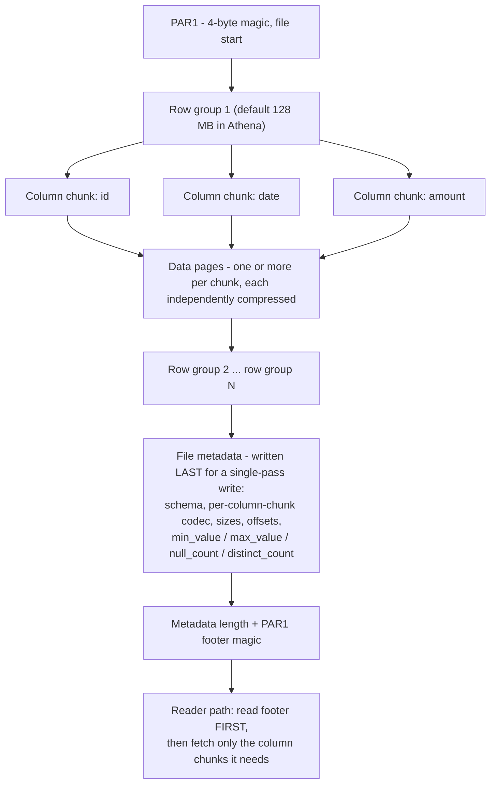
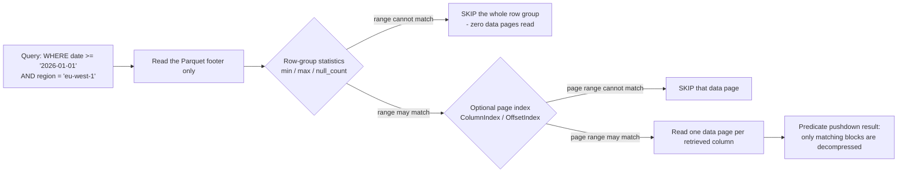
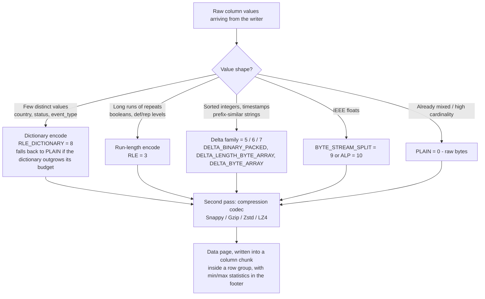
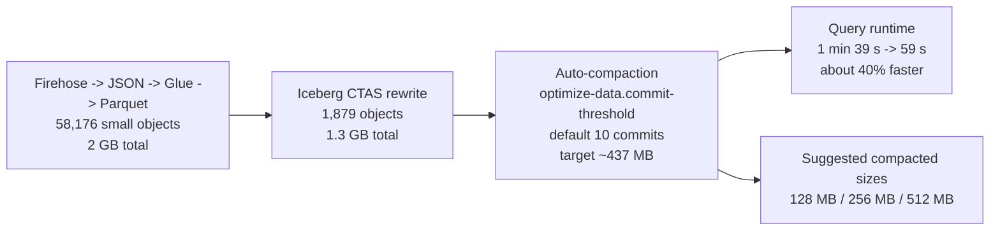
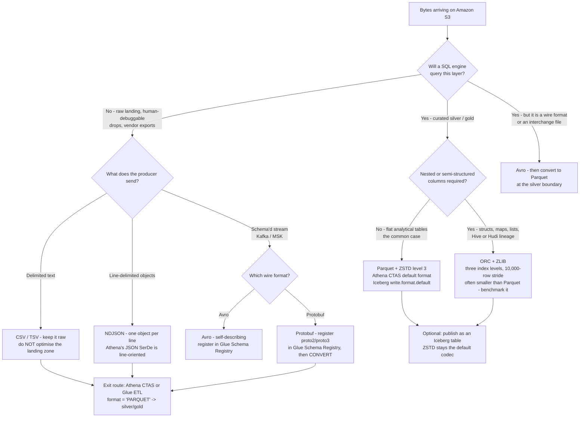

# Data Formats and Compression: CSV, JSON, Avro, Parquet, and ORC

Amazon Athena prices one thing: "Querying compressed data is faster and also cheaper because you pay for the number of bytes scanned before decompression" (Amazon Athena User Guide, *Compression formats*, accessed 2026-10-11). Everything else in a lakehouse design, partitions, workgroups, cluster sizes, lifecycle rules, is downstream of a decision you make in the first week and then live with for years: **which file format, which compression codec, and how big each object should be.**

AWS publishes the same decision as a three-step cost story on its own pricing page: one 3 TB, four-column table, one single-column query, billed at **$5.00 per TB scanned** as of Oct 2026. Uncompressed text = **$15.00**. Gzip the text 3:1 = **$5.00**. Gzip *and* convert to Parquet, so only one of four columns is read = **$1.25**. Same query, same answer, same data: a 12× spread created entirely by format and compression choices.

That is why this lesson comes before table formats, before ETL, before the query layer. Get the bytes wrong and no amount of engine tuning buys the money back.

**In this lesson you will:**

- read **row versus columnar anatomy** properly, row groups, column chunks, data pages, footers, `min`/`max` statistics, the optional page index, and see exactly where **predicate pushdown** happens;
- use the **format matrix** for CSV, JSON, Avro, Parquet, ORC and Protobuf: orientation, in-file schema, splittability, nested types, and which AWS engine will actually read them;
- apply the **schema-evolution matrix** per format, including why Parquet reads by *name* while ORC reads by *index* and what that costs you;
- explain **encodings**, dictionary + RLE, run-length encoding, the delta family, `BYTE_STREAM_SPLIT`, and why they run *before* compression;
- choose between **Snappy, Gzip, Zstd and LZ4** with dated, third-party benchmark numbers in hand rather than folklore;
- size files into the **128 MB: 1 GB** band and diagnose (then fix) the **small-files problem**;
- walk a **when-to-use-which decision flow** from raw landing zone to gold;
- work **seven worked examples with real numbers as of Oct 2026**: the Athena arithmetic, codec ratios, the micro-batch file-count disaster, a 420 GB CSV → Parquet CTAS, the JSON expansion factor, the Iceberg + ZSTD recommendation, and a hot-table codec decision;
- study **named AWS customer cases**, Vanguard's "data swamp" of Parquet files and Nasdaq's columnar lake, plus Woot.com and ZS;
- read the **October 2026 update box** (Glue 6.0 Iceberg v3, S3 Metadata, S3 Tables compaction), and answer **twelve exam-style questions** with four interactive checks.

---

## 1. Row versus columnar: the anatomy that sets your bill

### 1.1 A row format stores records, whole and repeated

CSV, TSV, NDJSON, Avro and Protobuf are **row formats**: a record's fields are kept together. The advantage is exactly what a producer needs: write the whole record, read the whole record, append the next record. The disadvantage appears the moment a query touches one field out of forty.

`SELECT amount FROM events WHERE date >= '2026-01-01'` against row-oriented text has to walk every byte of every row and skip the thirty-nine fields it does not want. There is no way to jump to column `amount`, because column `amount` does not exist as a contiguous region anywhere in the file.

JSON adds a second, quieter cost: **keys repeat for every single record**. The digest's format matrix puts it plainly: JSON has "no in-file schema (keys repeat per record)". Avro solves that half of the problem by embedding a JSON schema in the file (and keeping the writer's schema alongside the data for schema resolution), but it remains row-oriented.

### 1.2 A columnar format stores fields, whole and repeated

Parquet and ORC are **columnar**: a column's values are kept together, so a 2-of-40-column query reads roughly 2/40 of the data plus metadata. That is not a marketing ratio; it is the mechanism Athena bills for. Its own columnar-storage page says predicate pushdown "enables Athena queries to fetch only the blocks it needs … it uses statistics from data block predicates, such as max/min values, to determine whether to read or skip the block" (accessed 2026-10-11).

### 1.3 …and both are actually hybrids (PAX)

The honest description is neither "row" nor "columnar" but **PAX**: a hybrid that partitions rows horizontally first, then stores the columns of each partition separately. As the 2023 academic survey puts it: "both Parquet and ORC employ the PAX format. The DBMS first partitions a table horizontally into row groups. It then stores tuples column-by-column within each row group" (arXiv 2304.05028, 2023-11-07: third-party academic source).

Two consequences follow, and both are examinable:

1. **"Row vs columnar" is a spectrum, not a switch.** Reconstructing a full row still touches one locality unit (one row group, one stripe): just a much smaller one than an entire text file.
2. **Unit size is a tuning knob, not a constant.** Athena documents the defaults: "The default size for row groups is 128 MB, and for stripes, 64 MB … Decreasing the row group or stripe size … is not recommended" (accessed 2026-10-11).

### 1.4 Parquet file anatomy, end to end

Parquet's own format documentation describes a file that begins and ends with a 4-byte magic number `PAR1`, holds one or more row groups, and writes **file metadata last** so the writer makes a single pass. The reader's contract is the mirror image: "Readers are expected to first read the file metadata to find all the column chunks they are interested in" (parquet.apache.org/docs/file-format/, accessed 2026-10-11).



The parquet-format README adds two facts worth memorising: "A file consists of one or more row groups. A row group contains exactly one column chunk per column. Column chunks contain one or more pages", and nested data uses "the Dremel encoding with definition and repetition levels".

Sizing guidance differs by workload, and both numbers are official:

| Source | Recommended row-group / block size | Audience |
|---|---|---|
| Athena performance-tuning docs (accessed 2026-10-11) | **128 MB** default; decreasing "not recommended" | interactive SQL on S3 |
| Athena S3-throttling docs (accessed 2026-10-11) | Parquet block **128 MB**, ORC stripe **64 MB** | parallel scans |
| parquet-format README (accessed 2026-10-11) | **512 MB: 1 GB** | bulk reads on HDFS-style layouts |
| Iceberg configuration (accessed 2026-10-11) | row group **128 MB**, page **1 MB**, page row limit **20,000**, dictionary **2 MB** | table-format writes |
| Course band for this course | **128 MB: 1 GB per data file** | lakehouse on S3 |

### 1.5 Statistics, the page index, and predicate pushdown

The footer carries `Statistics {min_value, max_value, null_count, distinct_count}` per column chunk (`parquet.thrift`, accessed 2026-10-11). A query predicate is evaluated against those ranges *before any data page is read*:



Parquet's page-index documentation describes the payoff precisely: "a page index is optional metadata for a ColumnChunk, containing statistics for DataPages that can be used to skip those pages", and "A single-row lookup in a row group … will only read one data page per retrieved column" (accessed 2026-10-11).

ORC's equivalent is *not* optional and is finer-grained by default. ORC provides "three level of indexes within each file: file level … stripe level … row level: statistics … for each set of 10,000 rows within a stripe" (orc.apache.org/docs/indexes.html, accessed 2026-10-11), and "As of Hive 1.2, the indexes can include bloom filters". The 10,000-row stride is Hive's `orc.row.index.stride=10,000`. ORC also sizes its compression blocks at **256 KiB** (`orc.compress.size=262,144`) so an unneeded block is never decompressed at all.

> [!NOTE]
> **Predicate pushdown is a statistics feature, not a compression feature.** Compression decides how many bytes a scan costs; statistics decide whether the scan happens. A table with perfect ZSTD compression and no min/max statistics will still read every row group. Athena's own wording is "read or **skip** the block": skipping is the win.

- **📚 Did you know?** Glue crawlers discover a file's schema by reading different *parts* of different formats: Avro "Reads the schema at the beginning of the file", Parquet "Reads the schema at the end of the file", ORC "Reads the file metadata", and JSON reads the beginning (AWS Glue classifiers, accessed 2026-10-11). That is why a truncated Parquet object with a missing footer is undecipherable to a crawler, while a truncated Avro object is not.

### 1.6 Worked example E1: the $15 → $5 → $1.25 arithmetic (as of Oct 2026)

AWS's own published example (`aws.amazon.com/athena/pricing/`, accessed 2026-10-11): a 3 TB table with four columns, one query that reads a single column, Athena on-demand at **$5.00 per TB scanned**.

| Design | Bytes scanned | Cost per query |
|---|---|---|
| Uncompressed text, no column pruning | 3.00 TB | 3.00 × $5.00 = **$15.00** |
| Same table, Gzip at 3:1 | 1.00 TB | 1.00 × $5.00 = **$5.00** |
| Gzip + Parquet, query touches 1 of 4 columns | 0.25 TB | 0.25 × $5.00 = **$1.25** |

Scale it: at **600 queries per month** that is **$9,000.00** versus **$3,000.00** versus **$750.00**: a **$8,250.00 monthly delta** between the worst and the best design on identical data. Compression bought the first 3×; columnar layout plus predicate pushdown bought the next 4×.

Note the ordering. Compression helps in proportion to bytes scanned; column pruning multiplies it. You cannot get the $1.25 with gzip'd CSV alone, and you cannot get it from Parquet alone if every query selects all four columns.

---

## 2. The format matrix: CSV, JSON, Avro, Parquet, ORC and Protobuf

### 2.1 The core matrix

Six formats, four axes. Everything in the table is drawn from the AWS and Apache documentation cited in the digest (all accessed 2026-10-11).

| Format | Orientation | Schema in-file | Splittable when compressed | Nested types | Athena read | Athena write | Primary AWS role |
|---|---|---|---|---|---|---|---|
| **CSV / TSV** | row | no (optional header row) | **no**: one gzip stream = one split | no | yes (LazySimple / OpenCSV) | CTAS `TEXTFILE` | raw landing, vendor drops |
| **JSON / NDJSON** | row | no (keys repeat per record) | gzip no; uncompressed byte-ranges yes | yes | yes (Hive JSON, OpenX) | CTAS `JSON` | raw landing, API dumps |
| **Avro** | row | **yes**: JSON schema embedded | block-wise, not text-byte-splittable | yes | yes (Avro SerDe) | CTAS `AVRO` | streaming / Kafka interchange, Iceberg manifests |
| **Parquet** | hybrid columnar (row groups) | **yes**, footer | **yes**, pages / row groups | yes (Dremel def/rep levels) | yes | yes (**CTAS default**) | curated silver and gold analytics |
| **ORC** | hybrid columnar (stripes) | **yes**, footer + postscript | **yes**, stripes | yes (struct / map / union) | yes | yes | Hive lineage, Iceberg and Hudi data files |
| **Protobuf** | row (wire) | no: `.proto` is external | **no** | yes | **not in the SerDe list**; Kafka-connector input only | no | streaming wire format → must convert |

Three rows deserve commentary.

**Protobuf is not a queryable lakehouse format on Athena.** Athena's supported-SerDe table lists Ion, Avro, Parquet, CSV, JSON, ORC, TSV and log formats, Protobuf is absent. What Protobuf *does* have is two legitimate AWS positions: as a **Glue Schema Registry** input ("Protocol Buffers (Protobuf) versions proto2 and proto3 without support for `extensions` or `groups`", accessed 2026-10-11), and as an **Athena MSK connector** input alongside JSON, CSV and AVRO. Land it, convert it, query it, in that order.

**Firehose converts JSON and nothing else.** "Amazon Data Firehose can convert the format of your input data from JSON to Apache Parquet or Apache ORC before storing the data in Amazon S3 … If you want to convert an input format other than JSON, such as comma-separated values (CSV) … use AWS Lambda to transform it to JSON first" (Firehose docs, accessed 2026-10-11). With conversion enabled, Amazon S3 is the only destination, S3-side compression is disabled, and "Snappy compression happens automatically" using Hadoop-compatible framing.

**NDJSON is the only Athena-friendly JSON shape.** Athena's JSON SerDe is line-oriented, so one JSON object per line (JSON Lines) works and pretty-printed or array-wrapped JSON does not. Land NDJSON, not pretty JSON.

### 2.2 Splittability: the property people get backwards

The single most common misconception in this lesson: *"Parquet is compressed, so it is not splittable."* Wrong. AWS's own Top-10 Athena tuning blog (2017-03-24) states: "Parquet and ORC files are always splittable because these formats compress sections of the files separately, and have metadata that contains the locations within the files."

What is **not** splittable is compressed *text*:

- "most compressed text files are not splittable": a 2 GB `gzip.csv` is **one split** and therefore **one worker**;
- **bzip2 and LZO** are the exceptions that are splittable among text codecs, but "not recommended if you want performance and compatibility";
- the same blog's sizing rule: "aim for splits that are around 128 MB".

Athena reinforces the parallelism ceiling for compressed data: the **number of files** is the worker-count ceiling. One huge file means one worker regardless of cluster size.

| Layout | Splits into parallel work? | Why |
|---|---|---|
| Parquet + Snappy / Zstd / Gzip / LZ4 | **Yes, always** | pages and row groups compress independently; footer records offsets |
| ORC + Zlib / Snappy / Zstd / LZ4 | **Yes, always** | stripes compress independently; stripe footer records offsets |
| `gzip.csv` (one object) | **No** | a single deflate stream cannot be entered mid-stream |
| `bzip2.csv` / `lzo.csv` | Yes, but discouraged | splittable blocks, weak tooling and compatibility |
| Uncompressed `.csv` | Yes (byte ranges) | at the cost of paying full bytes scanned on every query |

> [!IMPORTANT]
> ⚠️ **Do not shrink row groups or stripes to "make queries skip more".** Athena's performance-tuning guidance is explicit: "Decreasing the row group or stripe size … is not recommended", and the reason is arithmetic, smaller units mean more footers, more statistics, more dictionary setups and more per-file overhead, which *raises* scan cost rather than lowering it. A third-party 10 M-row benchmark found row groups of 128k rows produced **87.41 MiB** against **68.61 MiB** for 1 M-row groups on the same data (aicodeinvest.com, 2026-07-19, third-party). Shrinking is a fix for one pathological predicate, not a default.

### 2.3 Schema evolution: the matrix nobody teaches until it breaks

Athena publishes a per-format matrix of what survives which schema change (`handling-schema-updates-chapter.md`, accessed 2026-10-11). The mechanical reason behind the table is one line: **"By default, Parquet will access columns by name and ORC by index (ordinal value)"**.

| Change | CSV / TSV | JSON | Avro | Parquet (read-by-name, Athena default) | ORC (read-by-index, Athena default) |
|---|---|---|---|---|---|
| Rename a column | ✔ | ✘ | ✘ | ✘ | ✔ |
| Add a column at the **end** | ✔ | ✔ | ✔ | ✔ | ✘ (needs `orc.column.index.access=false`) |
| Add a column at the **start / middle** | ✘ | ✔ | ✔ | ✔ | ✘ |
| Remove a column | ✘ | ✔ | ✔ | ✔ | ✘ |
| Reorder columns | ✘ | ✔ | ✔ | ✔ | ✘ |
| Change a column's type | ✔ (partitioned tables) | ✔ (partitioned tables) | ✔ with promotion | ✔ (partitioned tables) | ✔ (partitioned tables) |

Reading the table as a designer rather than memorising it:

- **Parquet read-by-name** buys you add / remove / reorder and costs you rename. Flip `parquet.column.index.access=true` and you get rename at the price of add/remove/reorder. That is a *schema-design decision*, not a performance setting.
- **ORC is the mirror image**: rename works, structural change does not, until you flip `orc.column.index.access=false`.
- **Avro** goes furthest because its spec defines formal **Schema Resolution**: writer's schema plus reader's schema, promotions such as "int … long, float, double", "string is promotable to bytes", and defaults for fields the writer lacks: with the rule that "files or systems that store Avro data should always include the writer's schema."
- **Iceberg largely escapes this table**, because it stores field IDs and its own schema metadata (lesson 04). Raw files on S3 still obey every row of the matrix above.

### 2.4 Interactive: match the format to its traits

```matching
{
  "question": "Match each data format to the trait that actually governs how it behaves on AWS (all as of Oct 2026):",
  "pairs": [
    {"left": "CSV / TSV", "right": "Row-oriented, no in-file schema, and a gzip'd CSV is a single un-splittable split: one worker for the whole file"},
    {"left": "NDJSON (JSON Lines)", "right": "Row-oriented with keys repeated per record; Athena's JSON SerDe is line-oriented, so one object per line works and pretty-printed JSON does not"},
    {"left": "Avro", "right": "Row-oriented but self-describing: the JSON schema is embedded in the file, and schema resolution supports type promotion with defaults"},
    {"left": "Parquet", "right": "Hybrid PAX in row groups with a footer written last; Athena's CTAS default, and always splittable regardless of codec"},
    {"left": "ORC", "right": "Hybrid PAX in ~64 MB stripes with three index levels including a 10,000-row stride, read by column ordinal by default in Athena"},
    {"left": "Protobuf", "right": "A wire format with an external.proto definition: absent from Athena's SerDe list, so it must be converted before it can be queried"}
  ],
  "explanation": "Orientation splits CSV/JSON/Avro/Protobuf (record-by-record) from Parquet/ORC (column chunks inside row groups or stripes). The AWS-specific traps are: gzip'd text is never splittable, Athena's JSON reader needs NDJSON, Avro is the only row format that carries its own schema, Parquet's CTAS default status, ORC's 10,000-row index stride and ordinal column access, and Protobuf's absence from the SerDe table: it exists only as a Kafka-connector and Schema Registry input that must land and then convert."
}
```

- **📚 Did you know?** Athena will silently misread some compressed files because it keys on the file extension: "uppercase file extensions such as `.GZ` … are not recognized by Athena" (accessed 2026-10-11). A CLI script that writes `part-00000.csv.GZ` instead of `.gz` produces a table that lists files but scans nothing. Keep every extension lowercase.

---

## 3. Encodings: what happens before compression

Compression is the *second* pass. The first pass is **encoding**: converting typed values into a byte representation that exploits the shape of the column. Both Parquet and ORC apply this layer, and it is where most of the size win actually comes from.

### 3.1 Dictionary encoding + RLE: the low-cardinality workhorse

For a column with few distinct values (country codes, status flags, event names), the writer builds a dictionary of unique values and replaces each occurrence with a small integer ID. Those IDs are then run-length-encoded. The Parquet encoding registry calls the combination `RLE_DICTIONARY` (enum value **8**).

The fallback rule matters more than the happy path: **"If the dictionary grows too big … the encoding will fall back to the plain encoding"** (parquet.apache.org, modified 2026-02-24). High-cardinality columns, user IDs, UUIDs, timestamps at microsecond precision, blow past the dictionary budget and silently drop to `PLAIN`, which is then compressed by the codec alone.

A measured example of that cliff: disabling dictionary encoding on a *single* column of a 10 M-row Parquet file added **18.79 MiB** (aicodeinvest.com, 2026-07-19: third-party benchmark). Iceberg's default dictionary budget is `write.parquet.dict-size-bytes = 2097152` (2 MB).

### 3.2 Run-length encoding and bit packing

**RLE** pays off only when values actually repeat: booleans, sorted status columns, and the definition/repetition levels that Dremel uses for nested data. **Bit packing** stores small integers in the minimum number of bits, and is SIMD-friendly.

The 2023 academic survey draws the practical line: Parquet switches to RLE only at run length ≥ 8, while ORC ships four separate integer encodings. In their tests that helped Parquet scan faster while ORC's finer zone maps helped selective point lookups (arXiv 2304.05028, 2023-11-07: third-party).

### 3.3 The delta family and float encodings

- **`DELTA_BINARY_PACKED`** (enum 5): deltas between sorted integers, very effective on sorted timestamps and sequence numbers.
- **`DELTA_LENGTH_BYTE_ARRAY`** (enum 6) and **`DELTA_BYTE_ARRAY`** (enum 7): for strings with similar prefixes and lengths.
- **`BYTE_STREAM_SPLIT`** (enum 9) and **`ALP`** (enum 10): for floating-point columns.

ORC's equivalent kit, from its own specification: "type specific readers and writers that provide light weight compression techniques such as dictionary encoding, bit packing, delta encoding, and run length encoding … Additionally, ORC can apply generic compression using zlib, or Snappy on top of the lightweight compression."

The full Parquet encoding registry as of Oct 2026: `PLAIN=0`, `PLAIN_DICTIONARY=2` (deprecated), `RLE=3`, `BIT_PACKED=4`, `DELTA_BINARY_PACKED=5`, `DELTA_LENGTH_BYTE_ARRAY=6`, `DELTA_BYTE_ARRAY=7`, `RLE_DICTIONARY=8`, `BYTE_STREAM_SPLIT=9`, `ALP=10`.



> [!WARNING]
> ⚠️ **Encoding is where the ratio comes from; the codec is a polish pass.** The third-party two-dataset benchmark measured plain-Parquet (no codec) at **564 MB** and **760 MB** against source CSVs of **1,761 MB** and **2,983 MB**, encoding alone took the data to roughly **32%** and **25.5%** of CSV. Adding a codec brought that to **8 to 18%** depending on codec and dataset (jeronimo.dev, 2025-01-16, third-party). If a columnar file is *not* much smaller than CSV, the bug is usually a pathological column (high-cardinality ID, unbounded nested list), not the missing codec.

---

## 4. Compression codecs: Snappy, Gzip, Zstd, LZ4

### 4.1 The trade, in one axis

Parquet's own compression page frames it as a spectrum: "The Parquet format supports several compression codecs covering different areas in the compression ratio / processing cost spectrum": SNAPPY, GZIP, LZO, BROTLI, LZ4 (deprecated Hadoop framing), ZSTD, LZ4_RAW (accessed 2026-10-11).

| Codec | Compress speed | Decompress speed | Ratio | Where AWS uses it |
|---|---|---|---|---|
| **Snappy** | very fast | very fast (">3.5 GB/s" third-party) | weakest of the four | Firehose's automatic choice with format conversion; Spark/PyArrow typical default; selectable for CTAS Parquet and ORC |
| **LZ4 / LZ4_RAW** | very fast | very fast (">3.5 GB/s" third-party) | weakest, similar to Snappy | selectable for CTAS ORC; **Athena will not write Parquet with LZ4** (reads supported) |
| **Gzip** | **slowest writer** | moderate, good ratio | strong | **Athena CTAS default for Parquet** on Hive-style tables; **ORC's Hive default is ZLIB** |
| **Zstd** | fast, tunable levels **1 to 22** | ~1 GB/s third-party, flat across levels | **best balance** | **Athena's default for Iceberg tables, level 3**; AWS Prescriptive Guidance's recommendation for Iceberg |
| LZO | fast | fast | weak: moderate | splittable with index support, but weak tooling; Athena will not write Parquet with it |
| Brotli | slow |, | very strong | **not an AWS write path**, do not design on it |

### 4.2 What AWS recommends, in AWS's own words

- **Zstd for Iceberg.** "We recommend using the ZSTD compression codec because it strikes a balance between GZIP and Snappy … Snappy might provide the best overall read and write performance but has a lower compression ratio than GZIP and ZSTD" (AWS Prescriptive Guidance, *Apache Iceberg on AWS: general best practices*, accessed 2026-10-11).
- **Zstd levels.** "levels from 1 to 22 … Athena uses ZSTD compression level 3 by default … We recommend using the default level of 3 or a level in the range from 6 to 9 … Use levels greater than 19 with caution." The `compression_level` property is supported **only in Athena engine version 3** (accessed 2026-10-11).
- **Gzip is broad and reliable.** "GZIP … is the default write compression format for files in the Parquet and text file storage formats" for Hive tables engine v2/v3, and "provides good compression ratios and has wide range support" (accessed 2026-10-11).
- **Zstd is the newer balanced one.** "a newer compression format with a good balance between performance and compression ratio" (accessed 2026-10-11).

### 4.3 Dated third-party benchmarks (labelled as such)

None of the numbers below are AWS-published; all are dated and reproducible in principle.

**10 M-row Parquet codec benchmark** (aicodeinvest.com, **2026-07-19**):

| Codec | File size (MiB) | Write time (s) | % of uncompressed size |
|---|---|---|---|
| none | 125.06 | 0.714 | 100.0% |
| **snappy** | 102.17 | 0.876 | 81.7% |
| **lz4** | 102.65 | 0.858 | 82.1% |
| **gzip** | 74.90 | **44.363** | 59.9% |
| **zstd level 3** | **68.61** | 0.942 | **54.9%** |
| zstd level 9 | 68.52 | 2.384 | 54.8% |

Two readings from that table: **gzip was ~47× slower to write than zstd level 3 (44.363 ÷ 0.942) yet produced a *larger* file**, and **zstd level 9 bought 0.09 MiB for 2.5× the write time of level 3**. Level choice is not free; that is exactly why Athena recommends 3 or 6 to 9 and cautions above 19.

**Two public datasets, Parquet with and without codecs** (jeronimo.dev, **2025-01-16**, third-party): source CSVs of **1,761 MB** and **2,983 MB** became: uncompressed Parquet **564 / 760 MB**; snappy **220 / 542**; gzip **146 / 448**; zstd **148 / 430**; lz4_raw **209 / 547**; lzo **215 / 518**. Write seconds on the same two datasets: none **25.0 / 57.9**; snappy **25.2 / 56.4**; **gzip 39.3 / 91.1** (roughly +50%); zstd **27.3 / 64.1**; lz4_raw **24.9 / 56.5**; lzo **26.0 / 56.1**. Decompression overhead measured **10 to 20%**.

**Codec micro-benchmark** (mamonas.dev, **2025-08-18**, third-party): Snappy and LZ4 decompress at ">3.5 GB/s"; Zstd holds roughly **1 GB/s** across levels; gzip is slowest; Zstd at level 19 writes extremely slowly.

**Uber's production migration** (Uber engineering blog, **2022-01-24**, third-party): moving its top-10 tables "From GZIP to ZSTD … ~7% drops in storage size, while from SNAPPY to ZSTD, we see ~39% reduction", and "~~79% size reduction" against uncompressed. Compute fell too: **870,472 → 639,184 → 213,914 vCoreSeconds** across Snappy → Gzip → Zstd in one measured quarter: a **75.4%** reduction from Snappy to Zstd.

```plot
{
  "type": "bar",
  "title": "Parquet file size by codec, 10 M rows (third-party benchmark, aicodeinvest.com, 2026-07-19)",
  "xLabel": "Codec",
  "yLabel": "File size (MiB)",
  "xKey": "codec",
  "data": [
    {"codec": "uncompressed", "mib": 125.06},
    {"codec": "LZ4", "mib": 102.65},
    {"codec": "Snappy", "mib": 102.17},
    {"codec": "Gzip", "mib": 74.90},
    {"codec": "Zstd level 3", "mib": 68.61},
    {"codec": "Zstd level 9", "mib": 68.52}
  ]
}
```

```plot
{
  "type": "bar",
  "title": "Write time for the same 10 M rows: note Gzip (third-party, aicodeinvest.com, 2026-07-19)",
  "xLabel": "Codec",
  "yLabel": "Write time (seconds)",
  "xKey": "codec",
  "data": [
    {"codec": "uncompressed", "seconds": 0.714},
    {"codec": "LZ4", "seconds": 0.858},
    {"codec": "Snappy", "seconds": 0.876},
    {"codec": "Zstd level 3", "seconds": 0.942},
    {"codec": "Zstd level 9", "seconds": 2.384},
    {"codec": "Gzip", "seconds": 44.363}
  ]
}
```

### 4.4 Interactive: the codec defaults, fill them in

```fillblank
{
  "question": "Complete the AWS codec-default statements with the published values (all as of October 2026):",
  "template": "Athena CTAS writing Parquet for a Hive-style table defaults to {{1}} compression, because the CTAS default format is {{2}} and its default Parquet codec is {{1}}. Athena writing an Iceberg table defaults to {{3}} at compression level {{4}}, and AWS Prescriptive Guidance recommends {{3}} for Iceberg as the balance between GZIP and Snappy. For ORC, the CTAS default codec is {{5}}, and the Hive table property behind it is orc.compress={{6}}. Athena will not WRITE Parquet compressed with LZ4 or LZO: reads are supported: and uppercase extensions such as {{7}} are not recognized at all.",
  "answers": {
    "1": "GZIP",
    "2": "PARQUET",
    "3": "ZSTD",
    "4": "3",
    "5": "ZLIB",
    "6": "ZLIB",
    "7": ".GZ"
  },
  "distractors": ["SNAPPY", "ORC", "AVRO", "LZ4", "BROTLI", "1", "9", "22", ".gz.GZ", ".GZIP", "ZLIB", "level 6"],
  "explanation": "CTAS defaults (Athena ctas-considerations docs, accessed Oct 2026): format PARQUET; for Parquet you may use GZIP or SNAPPY and 'the default is GZIP'; for ORC you may use LZ4, SNAPPY, ZLIB or ZSTD and 'the default is ZLIB'. Athena's Iceberg tables default to ZSTD level 3, which is also the AWS Prescriptive Guidance recommendation for Iceberg. Note the trap in the question: ZLIB and ZSTD are different codecs: ZLIB is Gzip's algorithm, and it is ORC's default, not Iceberg's. 'The Parquet default is Snappy' is a distractor drawn from Spark/PyArrow conventions; always state engine plus table type when you say 'default'."
}
```

- **📚 Did you know?** "Snappy" appears twice in this lesson with two different jobs: it is a **codec** you choose for Parquet or ORC, and it is what **Firehose applies automatically** whenever record-format conversion is enabled ("However, Snappy compression happens automatically … The framing format for Snappy … is compatible with Hadoop"). That is why Firehose's docs tell you to set `CompressionFormat` to `UNCOMPRESSED` when conversion is on: otherwise you compress twice and pay for both.

### 4.5 Worked example E2: codec arithmetic on a 10 GB hourly staging table (as of Oct 2026)

A pipeline stages **10 GB per hour** and the write path is CPU-bound. Using the third-party 10 M-row benchmark above (aicodeinvest.com, 2026-07-19) as a scaling proxy:

| Codec | Bytes stored per 10 GB staged (ratio applied) | Relative write cost |
|---|---|---|
| Snappy | 10 GB × 0.817 = **8.17 GB** | baseline (0.876 s) |
| Zstd level 3 | 10 GB × 0.549 = **5.49 GB** | **+7.5%** over Snappy (0.942 s) |
| Gzip | 10 GB × 0.599 = **5.99 GB** | **~51× slower** than Zstd-3 (44.363 s) |

Reading of the numbers: **Zstd level 3 beats Gzip on *both* axes in this run**: smaller file *and* fifty times faster to write. There is no scenario in this table where Gzip wins; it is beaten on ratio by Zstd and beaten on speed by everything. Snappy is 2.7 GB/hour larger than Zstd-3 (≈ **65 GB/day**, ≈ **23.7 TB/year** across 365 days of continuous staging) for a write-path saving nobody can measure.

The defensible rules:

- **write-bound staging → Snappy** (or LZ4), because Firehose and Spark already default there and the ratio loss is the price of throughput;
- **storage- or scan-bound curated tables → Zstd level 3**, which is Athena's Iceberg default and AWS's Prescriptive Guidance recommendation;
- **never choose Gzip for a Parquet write on write-speed grounds**: Gzip exists in the wild because it is Athena's *CTAS* default, not because it is the best codec.

---

## 5. File sizing and the small-files problem

### 5.1 The band

| Constraint | Number | Source (accessed 2026-10-11) |
|---|---|---|
| Athena default Parquet block / row group | **128 MB** | Athena performance-tuning + S3-throttling docs |
| Athena default ORC stripe | **64 MB** | Athena docs; Hive `orc.stripe.size=67,108,864` |
| parquet-format recommendation for bulk reads | **512 MB: 1 GB** | parquet-format README |
| Iceberg row group / page / dict | **128 MB / 1 MB / 2 MB** | Iceberg configuration (1.10.2) |
| Iceberg ORC stripe / block | **64 MB / 256 MB** | Iceberg configuration (1.10.2) |
| Redshift load peak | **1 GB source blocks** | AWS Big Data Blog, 2020-01-02 |
| Suggested compaction targets | **128 / 256 / 512 MB** | AWS Big Data Blog, 2023-10-03 |
| **Course band for data files on S3** | **128 MB: 1 GB** | synthesis of the above |

Below roughly **128 MB** per file, per-object overhead dominates: S3 `GET`/`LIST` cost, listing time, footer and dictionary setup, Glue partition metadata, and, the one Athena states directly, **"For small files, the overhead of the columnar format outweighs the benefits."** Above roughly **1 GB** you start losing split parallelism and raising retry cost on a failed task.

### 5.2 Worked example E3: the micro-batch file-count disaster (as of Oct 2026)

A team writes **1 TB per day** with **5-second micro-batches**, believing micro-batches give freshness.

- Files per day: 86,400 s ÷ 5 s = **17,280 files/day**
- Bytes per file: 1,000 GB ÷ 17,280 ≈ **58 MB**: already below the band
- Over a month: **≈ 518,400 objects**, each with its own footer, its own S3 `GET`, its own listing entry

Now coalesce to the course band:

- At **1 GB** per file: 1,000 GB ÷ 1 GB = **1,000 files/day** (a 17× reduction)
- At **128 MB** per file: 1,000 ÷ 0.128 = **7,813 files/day** (a 2.2× reduction)

The symptom you will actually see is not "slow" but **planning time becoming a meaningful share of total query runtime**: Athena enumerating hundreds of thousands of objects, building a plan, then scanning a tiny amount of data. The fix is compaction (lesson 04) or write sizing (lesson 08), never a return to CSV.

### 5.3 The small-files funnel, measured

AWS's own EMR Iceberg case (AWS Big Data Blog, **2023-10-03**) is the cleanest number set in this course:



Every step of that funnel is a **file-format-and-size** fix, not a compute fix: no cluster was resized, no query was rewritten, no partition was added. The objects simply became the right format at the right size.

- **📚 Did you know?** Columnar formats make small files *worse*, not better. Athena's performance-tuning page states it outright: "For small files, the overhead of the columnar format outweighs the benefits." A 40 KB Parquet file still carries a `PAR1` magic pair, a footer with a full schema, statistics and dictionary state: overhead that can exceed the data itself. Plain 40 KB text at least has no footer to write.

---

## 6. When to use which: the decision flow

### 6.1 The flow



### 6.2 The layer-by-layer rule

| Lakehouse layer | Format | Why, with the source |
|---|---|---|
| **Raw landing (bronze)** | Whatever the producer sends: CSV, NDJSON, Avro, Protobuf | Don't optimise the landing zone; optimise **exit** from it. Firehose converts JSON → Parquet/ORC at delivery; CSV must pass Lambda → JSON first. |
| **Curated (silver / gold)** | **Parquet + ZSTD (level 3)** | Athena CTAS default format is Parquet (default codec GZIP); Iceberg's `write.format.default=parquet` with `write.parquet.compression-codec=zstd`; Prescriptive Guidance recommends ZSTD. |
| **Hive / Hudi / complex types** | **ORC + ZLIB** | Athena: "ORC files are often smaller than Parquet files, and ORC indexes can make querying faster. In addition, ORC supports complex types such as structs, maps, and lists." |
| **Streaming interchange** | Avro or Protobuf → convert | Glue Schema Registry supports Avro v1.11.4, JSON, Protobuf proto2/proto3 with **8** compatibility modes (NONE, DISABLED, BACKWARD, BACKWARD_ALL, FORWARD, FORWARD_ALL, FULL, FULL_ALL). |
| **Archival** | Parquet + ZSTD, lifecycle to Glacier tiers | Identical objects, no decompression-before-query tax. Gzip'd *text* archives must be fully decompressed before any query. |

### 6.3 Worked example E4: CSV → Parquet with Athena CTAS (as of Oct 2026)

**Input:** 420 GB of newline-delimited CSV at `s3://lake/raw/ghcn/`, **60 columns**.

**Stage 0: DDL the raw table and take a baseline.**

```sql
CREATE EXTERNAL TABLE raw_ghcn (
  id        string,
  date      string,
  element   string,
  datavalue bigint
  -- ... 56 further columns ...
)
ROW FORMAT DELIMITED
FIELDS TERMINATED BY ','
STORED AS TEXTFILE
LOCATION 's3://lake/raw/ghcn/';

SELECT count(*) FROM raw_ghcn WHERE date >= '2015';
-- record Data Scanned: text cannot prune columns
```

**Stage 1: CTAS.** This is the official AWS pattern (Athena *CTAS INSERT INTO ETL*, plus the AWS Big Data Blog walkthrough of 2019-11-27):

```sql
CREATE TABLE ghcn_parquet
WITH (
  format             = 'PARQUET',          -- CTAS default, stated explicitly
  parquet_compression = 'ZSTD',             -- CTAS default would be GZIP; SNAPPY for hot writes
  partitioned_by      = ARRAY['year_col'],
  external_location   = 's3://lake/silver/ghcn/'
)
AS SELECT
  id, date, element, datavalue,
  substr(date, 1, 4) AS year_col
FROM raw_ghcn
WHERE cast(substr(date, 1, 4) AS bigint) BETWEEN 2015 AND 2025;
```

One statement sets format, codec, partitioning and location, **and auto-registers the table in the Glue Data Catalog**. (CTAS accepted formats: `PARQUET`, `ORC`, `AVRO`, `JSON`, `TEXTFILE`: Parquet if you omit `format`.)

**Stage 2: incremental.** `INSERT INTO ghcn_parquet SELECT … WHERE year_col = '2026';`

**Stage 3, the arithmetic.** Applying the third-party two-dataset result (Parquet + codec ≈ **9 to 15%** of CSV; jeronimo.dev, 2025-01-16, third-party, not an AWS guarantee):

- 420 GB × 0.09 → 420 GB × 0.15 = **≈ 38 GB: 63 GB** on S3
- one-column query reads 63 GB ÷ 60 columns ≈ **1.05 GB**
- cost: 1.05 GB at $5.00/TB ≈ **$0.005** versus 420 GB at $5.00/TB ≈ **$2.10**: a **≈400× reduction per query**

**Stage 4, verify.** Check *Data Scanned* in the Athena console, `aws s3 ls --summarize` on the silver prefix, and confirm objects land in the **128 MB, 1 GB** band rather than in kilobytes.

**Stage 5: guardrails.** Workgroup data-usage limit, partition projection on `year_col`, and a Glue crawler schema-change policy of `MergeNewColumns`.

The published AWS CTAS walkthrough reached "Size of dataset after parquet with snappy compression: **1.2 GB**", and its own note is the lesson: "the file sizes are pretty small. Merging them into larger files … would lead to faster query execution."

### 6.4 Worked example E5: the JSON expansion factor (as of Oct 2026)

Take one six-field sensor record and compare representations. This is **worked arithmetic on an illustrative record**, not a published benchmark: the fact it demonstrates (JSON repeats keys per record) is from the format matrix in §2.1.

**CSV (52 bytes):**

```text
2026-10-11T04:15:00Z,device-7734,eu-west-1,21.5,ok,4
```

**NDJSON (107 bytes):**

```text
{"ts":"2026-10-11T04:15:00Z","device":"device-7734","region":"eu-west-1","temp":21.5,"status":"ok","seq":4}
```

- Expansion: 107 ÷ 52 = **2.06×**: the same information, **106% larger**
- Of the 107 bytes, **45 bytes (42%)** are repeated field-name tokens (`"ts":`, `"device":`, `"region":`, `"temp":`, `"status":`, `"seq":`) plus braces: structure that never changes between records
- At **1,000,000 records/day**: CSV ≈ **52 MB/day** (≈ 19.0 GB/year), JSON ≈ **107 MB/day** (≈ 39.1 GB/year): **≈ 20.1 GB/year of pure repetition**, before any compression
- And the compression codecs treat both as opaque text: Gzip and Zstd compress the repetition *somewhat*, but only a columnar format removes it structurally by storing each field once per row group

The design consequence: JSON's repetition is not a storage problem you solve with a better codec, it is a **representation** problem you solve with a conversion at the silver boundary: exactly what Firehose's record-format conversion or a CTAS does.

### 6.5 Worked example E6: the Iceberg + ZSTD recommendation (as of Oct 2026)

AWS Prescriptive Guidance, *Apache Iceberg on AWS: general best practices* (accessed 2026-10-11), states the recommendation: "we recommend using the ZSTD compression codec because it strikes a balance between GZIP and Snappy … Snappy might provide the best overall read and write performance but has a lower compression ratio than GZIP and ZSTD." Athena's own gloss on the same pair: Zstd is "a newer compression format with a good balance between performance and compression ratio" (accessed 2026-10-11).

Iceberg's own configuration confirms it as the shipped default (`iceberg.apache.org/docs/1.10.2/configuration/`, accessed 2026-10-11):

```text
write.format.default              = parquet
write.parquet.compression-codec    = zstd
write.parquet.row-group-size-bytes = 134217728   (128 MB)
write.parquet.page-size-bytes      = 1048576     (1 MB)
write.parquet.page-row-limit       = 20000
write.parquet.dict-size-bytes      = 2097152     (2 MB)
write.avro.compression-codec       = gzip
write.orc.stripe-size-bytes        = 67108864    (64 MB)
write.orc.block-size-bytes         = 268435456   (256 MB)
write.orc.compression-codec        = zlib
```

And Athena already writes it: "ZSTD is the default compression for Iceberg tables … level 3 by default."

**The arithmetic.** Take a 10 TB Iceberg table and compare codecs using Uber's production measurements (Uber engineering blog, **2022-01-24**: third-party):

| Move | Storage delta on 10 TB | Direction |
|---|---|---|
| Gzip → Zstd | −7% ⇒ **9.30 TB** | smaller |
| Snappy → Zstd | −39% ⇒ **6.10 TB** | much smaller |
| Uncompressed → Zstd | −79% ⇒ **2.10 TB** | dramatically smaller |

At the **$5.00/TB-scanned** Athena rate, the codec win is a *scan* win, because Athena bills the bytes it reads off S3, "you pay for the number of bytes scanned before decompression" (accessed 2026-10-11). So the same 10 TB table scanned monthly costs about **$50.00** uncompressed, about **$46.50** if it had been Gzip (−7% to Zstd implies Zstd is 7% under Gzip), about **$30.50** if it had been Snappy (−39%), and about **$10.50** if it had been uncompressed and was written as Zstd (−79%). Those are third-party storage ratios applied to an AWS list rate, label them that way, and keep the two effects separate: **the codec shrinks the bytes you scan; column layout plus predicate pushdown shrinks the number of columns and row groups you scan at all.** E1's $1.25 figure came from both; this table only shows the first.

**The level discipline:** level **3** default, **6 to 9** if you have measured the trade, **>19 with caution**, and `compression_level` only on **Athena engine version 3**. Uber itself used level 19 for cold backfills and low levels on streaming paths: reads are constant across levels, writes are not (third-party, 2022-01-24).

> [!NOTE]
> **Parquet on Snappy or Parquet on Zstd is not a "which is correct" question; it is a "which constraint binds" question.** Snappy: Firehose's automatic choice, Spark/PyArrow's usual default, the right answer when write throughput and CPU dominate. Zstd level 3: Athena's Iceberg default and AWS Prescriptive Guidance's pick, the right answer when storage and scan cost dominate. Both are defensible; only one matches your bottleneck.

### 6.6 Worked example E7: choosing a codec for a hot staging table (as of Oct 2026)

A team must choose one codec for a staging table that is written continuously and read by dashboards every five minutes. Decision inputs from the digest's numbers:

| Input | Value | Source (dated) |
|---|---|---|
| Write time, 10 M rows: Snappy / Zstd-3 / Gzip | 0.876 s / 0.942 s / **44.363 s** | aicodeinvest.com, 2026-07-19 (third-party) |
| Size, 10 M rows: Snappy / Zstd-3 / Gzip | 102.17 / **68.61** / 74.90 MiB | same |
| Decompress throughput, Snappy/LZ4 vs Zstd | ">3.5 GB/s" vs ≈ **1 GB/s** | mamonas.dev, 2025-08-18 (third-party) |
| Athena Iceberg default | **Zstd level 3** | Athena docs, accessed 2026-10-11 |
| Prescriptive Guidance recommendation | **Zstd** | AWS Prescriptive Guidance, accessed 2026-10-11 |

**Verdict:** Zstd level 3. It is 33% smaller than Snappy for a 7.5% write-time penalty, and Gzip is eliminated on both axes. If the table were a high-volume write-only ingest buffer with no analytical reads, Snappy would be the correct answer instead: the decompression-throughput figure is the only argument in Snappy's favour, and it binds only when reads dominate CPU.

---

### 2026 Updates (as of October 2026)

> [!NOTE]
> **What changed around file formats that this lesson depends on:**
> - **2026-08-21: AWS Glue 6.0 is GA with Iceberg v3.** "AWS Glue 6.0 is now generally available, delivering a 30% price reduction and introducing full support for Apache Iceberg v3": including "VARIANT data type with automatic shredding", "deletion vectors for high-performance row-level updates", "geometry and geography data types", UNKNOWN and DEFAULT column values; runtime moves to Spark 4.1.1 / Python 3.13 with Iceberg 1.11.0, Hudi 1.1.1 and Delta 4.2.0 (AWS News Blog, 2026-08-21; Glue release notes, accessed 2026-10-11). Format relevance: VARIANT is a semi-structured type that must still be physically shredded into Parquet columns: the encoding layer in §3 is what makes that worthwhile.
> - **2025-07-01: S3 Tables automatic compaction costs cut by up to 90%.** "S3 Tables… automatically managed compaction… reduces compaction costs by up to 90%" while they "maintain optimal file sizes and layout without manual intervention" (AWS Storage Blog, 2025-07-01). This is the managed answer to §5's small-files problem: the 128 MB: 1 GB band is maintained for you rather than by a scheduled Glue job.
> - **2025-01-27, Amazon S3 Metadata is GA.** "S3 Metadata makes it easy to query and filter S3 object metadata using SQL… you can query object metadata using Amazon Athena" (AWS News Blog, 2025-01-27), useful precisely for auditing format and size distributions across a bucket without a full S3 Inventory cycle.
> - **2025-03-14, Firehose to S3 Tables is GA.** The destination "converts incoming records to Iceberg-compatible Parquet and writes to managed S3 Tables" and "supports schema evolution on a subset of types" (AWS Big Data Blog, 2025-03-14), the streaming landing path in §6 now bypasses the CTAS step entirely.
> - **2026-07-30, MSK streaming tables for Apache Iceberg on Amazon S3 Tables.** "up to 10 GB/s ingest" and "reduce ingest costs by up to 60%" with MSK Express brokers (AWS News Blog, 2026-07-30), streaming landing now writes Iceberg-compatible Parquet directly, which raises the stakes on getting the codec and row-group sizing right at write time.

---

## Real-World Case Studies

### Case A, Vanguard: a "data swamp" of Parquet files is still a data swamp

**Vanguard (investment management; Financial Advisor Services "FAS 360").** In the AWS Big Data Blog dated **2026-03-18**, Vanguard describes the starting point of its modernization in one phrase: "migrating from a fragmented **'data swamp' of Parquet files on Amazon Simple Storage Service (Amazon S3)** to a structured, unified system." Two years after the work, AWS reports **20 TB in Amazon Redshift and another 150 TB in the S3 data lake**, **600+ AWS Glue ETL jobs (a 30× increase)**, **300+ tables**, **250+ Redshift materialized views**, **500+ Tableau dashboards**, and **500,000+ user queries per month**. Vanguard is now "curating data products on the data lake using Apache Iceberg format and leveraging AWS Glue for metrics computation and data lake integration."

The lesson angle for *this* lesson is uncomfortable and important: **the files were already Parquet**. Format alone did not save them. Parquet without sizing discipline, without a table format providing ACID and snapshots, and without ownership turns a lake into a swamp just as effectively as raw CSV would: the format matrix in §2 is a *necessary* input, not a sufficient one. Vanguard's fix was to add the missing layer (Iceberg data products, owned by domains), not to change the file format.

*Customer-reported figures from an AWS blog published 2026-03-18; not an AWS commitment.*

### Case B, Nasdaq: columnar lake files under an exchange's load

**Nasdaq (exchange operator, financial services).** Per AWS's case study (page year 2020, accessed Oct 2026), Nasdaq built "the foundation of a new data lake on Amazon Simple Storage Service (Amazon S3)" in 2018 and adopted Redshift Spectrum to "query data both in the data warehouse and in the Amazon S3 data lake": what AWS calls "a lake house architecture". The nightly ingest profile was **"30 billion to 55 billion records and surpassing 4 terabytes"** from thousands of sources; the lake held **15 terabytes of data on Amazon S3** queryable in place; outcomes reported were Redshift queries **"32 percent faster"** and reaching the 90% data-load mark **5 hours sooner**. Robert Hunt, VP Software Engineering, is quoted: "Amazon S3 gave us a solution that enables zero contention between data loading and querying processes."

Why it belongs here: 4 TB per night, queried the next morning, is precisely the workload the format matrix exists to serve. Column layout plus predicate pushdown is what lets an exchange scan a night of records for a surveillance question without reading every column of every record, and Nasdaq's own "zero contention" quote is the storage/compute separation lesson from lesson 01 showing up at the byte level.

*Customer-reported figures from an undated AWS case-study page (year tag 2020, accessed Oct 2026); not an AWS commitment.*

### Case C, Woot.com: why CSV broke and Parquet did not

**Woot.com (retail).** In the AWS Big Data Blog dated **2019-01-22**, the team reports that exporting text columns to CSV "conflicted with the commas present in the text data. We opted to use AWS Glue to export data from RDS to S3 in Parquet format": Parquet is "unaffected by commas because it encodes columns directly." Two lessons in one line: CSV's delimiter fragility is a *correctness* risk, not just a performance one, and AWS Glue ETL writing `format="parquet"` is the second of the two sanctioned conversion routes alongside Athena CTAS.

*AWS blog, 2019-01-22; dated, treat as historical evidence of the pattern rather than current pricing or performance.*

---

## Practice Questions

```question
{
  "id": "lh-03-q1",
  "type": "multiple-choice",
  "question": "A 3 TB, four-column table is queried for a single column. Using Amazon Athena's published worked example as of October 2026, what is the cost progression from uncompressed text, to Gzip, to Gzip + Parquet?",
  "options": [
    "$15.00 -> $5.00 -> $1.25",
    "$15.00 -> $7.50 -> $3.75",
    "$5.00 -> $2.50 -> $1.25",
    "$15.00 -> $5.00 -> $5.00 because compression alone removes all column-scan cost"
  ],
  "correct": 0,
  "explanation": "Athena's pricing page publishes exactly this ladder at $5.00 per TB scanned: 3 TB uncompressed = $15.00; Gzip at 3:1 = 1 TB = $5.00; Gzip plus Parquet reading 1 of 4 columns = 0.25 TB = $1.25. Compression bought the first 3x; columnar layout plus predicate pushdown bought the next 4x. Option D is the classic error: compression scales bytes, column pruning scales columns, and you need both."
}
```

```question
{
  "id": "lh-03-q2",
  "type": "multiple-choice",
  "question": "A data engineer states: 'Parquet files are compressed with Zstd, so they cannot be split across workers.' Which response is correct as of October 2026?",
  "options": [
    "Correct: any compression removes splittability, which is why Athena recommends uncompressed Parquet for parallel scans",
    "Incorrect - Parquet and ORC are always splittable because sections are compressed separately and metadata records their locations; what is not splittable is gzip-compressed text",
    "Partially correct: Parquet is splittable only with Brotli, and ORC only with Zlib",
    "Correct for Parquet, but ORC stripes are independently readable regardless of codec"
  ],
  "correct": 1,
  "explanation": "AWS's Athena tuning blog states Parquet and ORC 'are always splittable because these formats compress sections of the files separately, and have metadata that contains the locations within the files'. A single gzip'd CSV is one deflate stream and therefore one split and one worker. Bzip2 and LZO are splittable among text codecs but are explicitly 'not recommended if you want performance and compatibility'."
}
```

```question
{
  "id": "lh-03-q3",
  "type": "multiple-choice",
  "question": "A Glue job renames column `datavalue` to `value` in an existing Parquet table read by Athena with default settings, then adds a new column at the end of the schema. Which statement is correct as of October 2026?",
  "options": [
    "Both work: Parquet supports all schema changes regardless of settings",
    "The add works, the rename does not: Parquet reads columns by name by default, and rename requires flipping parquet.column.index.access=true, which then costs add/remove/reorder support",
    "The rename works, the add does not: Parquet reads columns by index by default",
    "Neither works unless the table is converted to Iceberg first"
  ],
  "correct": 1,
  "explanation": "Athena's handling-schema-updates matrix states that by default 'Parquet will access columns by name and ORC by index (ordinal value)'. Read-by-name gives add-anywhere, remove and reorder but not rename; read-by-index (parquet.column.index.access=true) flips that trade. ORC is the exact mirror image with orc.column.index.access. Type changes work only for partitioned tables. Iceberg escapes much of this by storing field IDs: but only if you adopt it (lesson 04)."
}
```

```question
{
  "id": "lh-03-q4",
  "type": "multiple-choice",
  "question": "Which set of format defaults for Amazon Athena CTAS is correct as of October 2026?",
  "options": [
    "Default format PARQUET; default Parquet codec SNAPPY; default ORC codec LZ4",
    "Default format PARQUET; default Parquet codec GZIP; default ORC codec ZLIB",
    "Default format ORC; default Parquet codec ZSTD; default ORC codec SNAPPY",
    "Default format PARQUET; default Parquet codec ZSTD; default ORC codec ZLIB"
  ],
  "correct": 1,
  "explanation": "Athena's CTAS documentation: results are stored in Parquet by default; for Parquet you can use GZIP or SNAPPY and 'the default is GZIP'; for ORC you can use LZ4, SNAPPY, ZLIB or ZSTD and 'the default is ZLIB'. ZSTD is the default for ICEBERG tables (level 3), not for CTAS Parquet; mixing those two 'defaults' is option D, the most tempting distractor."
}
```

```question
{
  "id": "lh-03-q5",
  "type": "multiple-choice",
  "question": "A streaming producer sends Protocol Buffers messages via Amazon MSK. Which path lands them as queryable data in Amazon Athena?",
  "options": [
    "Land the Protobuf directly in S3 and register it with a Glue crawler: Athena reads Protobuf natively",
    "Register proto2/proto3 in Glue Schema Registry, land via Firehose record-format conversion into Parquet, then query",
    "Land the Protobuf on S3, then point the Athena MSK connector at the S3 prefix: Protobuf is a supported Athena SerDe",
    "Land Protobuf on S3, convert with Glue to Parquet (or Avro) at the silver boundary, then query: Protobuf is not in Athena's supported SerDe list"
  ],
  "correct": 3,
  "explanation": "Athena's supported-SerDe table lists Ion, Avro, Parquet, CSV, JSON, ORC, TSV and log formats: Protobuf is absent. It appears as a Glue Schema Registry format (proto2/proto3, no extensions or groups) and as an Athena MSK CONNECTOR input, which means it is an ingest format, not a query format. Firehose record-format conversion accepts JSON only as input (CSV must go Lambda -> JSON first), which eliminates option B."
}
```

```question
{
  "id": "lh-03-q6",
  "type": "multiple-choice",
  "question": "In a third-party 10 M-row Parquet benchmark (aicodeinvest.com, 2026-07-19), Gzip wrote in 44.363 s at 74.90 MiB while Zstd level 3 wrote in 0.942 s at 68.61 MiB. What is the defensible conclusion?",
  "options": [
    "Gzip is the better choice because its ratio is close and it is more widely supported",
    "Gzip is roughly 47x slower to write than Zstd level 3 while producing a larger file, so Gzip has no case on write paths where Zstd is available",
    "Zstd level 9 should be preferred, since higher levels are free",
    "The benchmark proves Gzip is unusable for reading as well"
  ],
  "correct": 1,
  "explanation": "44.363 / 0.942 = 47.1, and 74.90 MiB > 68.61 MiB - Gzip loses on both axes in this run. Zstd level 9 bought 0.09 MiB over level 3 for 2.5x the write time, which is why Athena recommends level 3 or 6-9 and cautions above 19. Nothing here speaks to read performance, so option D is unsupported. This is third-party evidence, not an AWS guarantee; label it as such."
}
```

```question
{
  "id": "lh-03-q7",
  "type": "multiple-choice",
  "question": "A pipeline writes 1 TB per day in 5-second micro-batches. How many objects does it create per day, and what is the recommended course band for data files on S3 as of October 2026?",
  "options": [
    "17,280 objects/day; target 128 MB - 1 GB per file",
    "17,280 objects/day; target under 10 MB per file for maximum parallelism",
    "8,640 objects/day; target 128 MB - 1 GB per file",
    "17,280 objects/day; target 512 KB so each micro-batch is its own object"
  ],
  "correct": 0,
  "explanation": "86,400 seconds / 5 = 17,280 files per day at about 58 MB each: already below the band. The course band is 128 MB - 1 GB, synthesised from Athena's 128 MB Parquet block and 64 MB ORC stripe, parquet-format's 512 MB - 1 GB guidance, Redshift's 1 GB load peak and the compaction targets of 128/256/512 MB. Athena warns that for small files 'the overhead of the columnar format outweighs the benefits'."
}
```

```question
{
  "id": "lh-03-q8",
  "type": "multiple-choice",
  "question": "Which statement about encodings versus compression in Parquet is correct as of October 2026?",
  "options": [
    "Compression runs first and encodings are applied only when compression fails",
    "Encodings (dictionary, RLE, delta) run before compression, and dictionary encoding silently falls back to PLAIN when the dictionary grows too big: a high-cardinality ID column is therefore a compression cliff",
    "Dictionary encoding is mandatory for every column and never falls back",
    "RLE is applied only to string columns"
  ],
  "correct": 1,
  "explanation": "Parquet's encoding documentation: 'If the dictionary grows too big ... the encoding will fall back to the plain encoding.' Encoding is the first pass over typed values; the codec is the second pass over those bytes. That is why disabling dictionary encoding on one column cost +18.79 MiB in a third-party 10 M-row run (2026-07-19), and why high-cardinality IDs are the classic compression cliff. RLE also carries definition/repetition levels for nested data, not strings alone."
}
```

```question
{
  "id": "lh-03-q9",
  "type": "multiple-choice",
  "question": "AWS Prescriptive Guidance recommends ZSTD for Iceberg because it 'strikes a balance between GZIP and Snappy'. What does Athena actually do by default for Iceberg tables, and what level discipline applies?",
  "options": [
    "Gzip at level 9, because Iceberg tables always use the CTAS default codec",
    "ZSTD at level 3; levels run 1-22, levels 6-9 are recommended if measured, above 19 needs caution, and compression_level requires Athena engine version 3",
    "Snappy at level 1, because Iceberg prioritises write throughput above all else",
    "ZSTD at level 19, because the highest usable level always minimises total cost"
  ],
  "correct": 1,
  "explanation": "Athena documents 'ZSTD is the default compression for Iceberg tables... level 3 by default', with levels 1-22, a recommendation for level 3 or 6-9, caution above 19, and compression_level supported only in engine version 3. Uber's migration (2022-01-24, third-party) used level 19 only for cold backfills and low levels on streaming paths: reads are constant across levels, writes are not."
}
```

```question
{
  "id": "lh-03-q10",
  "type": "multiple-choice",
  "question": "A team is choosing a data file format for a Hive-lineage table that contains structs, maps and lists, and they want the finest built-in skip statistics. Which choice fits, and what is the honest caveat?",
  "options": [
    "Parquet, because Parquet supports nested types and ORC does not",
    "ORC: three index levels including a 10,000-row stride plus optional bloom filters: with the caveat that Athena says ORC files are only OFTEN smaller than Parquet, and a 2023 academic survey found 'no clear winner' between them, so benchmark your own data",
    "CSV, because delimited text has the lowest storage cost of any format",
    "Avro, because its embedded schema gives the best predicate pushdown of any row format"
  ],
  "correct": 1,
  "explanation": "ORC provides file, stripe and row-group indexes with statistics for every 10,000 rows, optional bloom filters since Hive 1.2, and native struct/map/union support: Athena's columnar-storage page says ORC files are 'often smaller than Parquet files, and ORC indexes can make querying faster'. The caveat is the word 'often': the 2023 survey (arXiv 2304.05028) found 'no clear winner between Parquet and ORC in terms of file sizes'. CSV has no nested types and no stats; Avro is row-oriented and cannot do column-block skipping."
}
```

```question
{
  "id": "lh-03-q11",
  "type": "multiple-choice",
  "question": "Amazon Data Firehose record-format conversion is enabled with Amazon S3 as the destination. Which combination of behaviours is correct as of October 2026?",
  "options": [
    "Input may be JSON, CSV or Avro; S3 compression stays enabled; no codec is applied automatically",
    "Input must be JSON (CSV needs a Lambda pre-transform to JSON); Amazon S3 is the only destination; S3-side compression is disabled and Snappy is applied automatically with Hadoop-compatible framing",
    "Input may be any format; conversion writes ORC only; Gzip is applied automatically",
    "Input must be JSON; conversion writes to S3 or Redshift; LZ4 is applied automatically"
  ],
  "correct": 1,
  "explanation": "Firehose documents that it converts 'from JSON to Apache Parquet or Apache ORC', that other inputs such as CSV need AWS Lambda to transform to JSON first, that 'Amazon S3 is the only destination', that 'Amazon S3 compression gets disabled', and that 'Snappy compression happens automatically' with Hadoop-compatible framing. That is why you set CompressionFormat to UNCOMPRESSED when conversion is on; otherwise you compress twice."
}
```

```question
{
  "id": "lh-03-q12",
  "type": "multiple-choice",
  "question": "Which row of the AWS-published schema-evolution matrix is correct as of October 2026?",
  "options": [
    "JSON supports rename but not reorder: keys are positional in line-delimited JSON",
    "CSV supports add-at-start, remove and reorder but not rename",
    "Parquet read-by-name supports add anywhere, remove and reorder but not rename; Avro additionally supports type promotion and defaults through schema resolution",
    "ORC read-by-index supports add, remove and reorder by default but not rename"
  ],
  "correct": 2,
  "explanation": "The matrix: JSON supports add anywhere, remove, reorder and type change but NOT rename (option A inverts this). CSV supports rename, add-at-end and type change but NOT add-at-start/middle, remove or reorder (option B is wrong). ORC read-by-index supports rename by default, not add/remove/reorder (option D is wrong). Parquet read-by-name plus Avro's formal writer/reader schema resolution: promotions like int..long and string..bytes, and defaults for fields the writer lacks: is the accurate row."
}
```

> [!WARNING]
> ⚠️ **Format and compression traps for this lesson: walk this list before you design anything:**
> - **"The Parquet default is Snappy" is incomplete.** Athena CTAS Parquet defaults to **GZIP**; Athena Iceberg defaults to **ZSTD level 3**; Spark/PyArrow usually use Snappy. Always name engine + table type when you say "default".
> - **Compressed Parquet is still splittable; gzip'd CSV is not.** One 2 GB `gzip.csv` = one split = one worker, and file count is the worker ceiling for compressed data.
> - **Never shrink row groups or stripes below the default to "skip more"**: Athena says decreasing is not recommended, and the third-party 128k-row experiment produced a *larger* file (87.41 MiB vs 68.61 MiB).
> - **Athena will not write LZ4 or LZO Parquet** (reads only), and **uppercase `.GZ` extensions are not recognized**: keep extensions lowercase.
> - **Protobuf is an ingest format, not a query format**: absent from the SerDe list; convert before you query.
> - **Dictionary encoding is not a silver bullet**; it falls back to PLAIN on high cardinality; disabling it on one column cost **+18.79 MiB** (third-party, 2026-07-19).
> - **Zstd level 19+ is for cold backfills**: level 9 saved **0.09 MiB** over level 3 while write time went **0.942 s → 2.384 s**; Athena cautions above 19 and gates `compression_level` on engine version 3.
> - **Columnar does not save you from small files**: "For small files, the overhead of the columnar format outweighs the benefits"; fix with compaction or write sizing, never by returning to CSV.
> - **"ORC is always smaller than Parquet" is not a fact**: Athena says *often*, and the 2023 survey found *no clear winner*. Benchmark your own data.
> - **Firehose conversion + `CompressionFormat=GZIP` double-compresses**: with conversion on, set `UNCOMPRESSED` and let Snappy happen inside.

> [!IMPORTANT]
> **Comparative Verdict: Parquet vs ORC vs Delta-native vs Iceberg-ORC on AWS**
> - **Versus ORC:** ORC's advantages are structural: three index levels with a 10,000-row stride, optional bloom filters, native struct/map/union types, and Athena's own observation that "ORC files are often smaller than Parquet files, and ORC indexes can make querying faster." Parquet's advantages are ecosystem breadth: it is Athena's CTAS default, Iceberg's `write.format.default`, Spark's usual default, and the format that "works across Java/PyIceberg/Rust/Go/C++" while ORC in Iceberg is **Java-only**. The 2023 academic survey's finding: "no clear winner between Parquet and ORC in terms of file sizes": is the correct default position: **Parquet unless you have a measured reason for ORC** (Hive lineage, complex types, or selective point lookups where zone maps win).
> - **Versus Delta-native:** Delta Lake's data files are **Parquet only** (AWS Big Data Blog, 2023-06-09) plus a transaction log that supplies ACID, snapshots and schema enforcement. That means every Delta table inherits Parquet's encoding, codec and row-group behaviour from §3, §5, there is no separate Delta codec story to learn. Choose Delta-native when your engine estate is Spark/Databricks-centric and MERGE-heavy; on AWS with Athena and Redshift in the loop, the practical difference from Parquet-on-S3 is the transaction log layer, not the bytes.
> - **Versus Iceberg-ORC:** Iceberg v1 explicitly allows "immutable file formats: Parquet, Avro, and ORC", and Iceberg's per-format properties expose ORC stripe (64 MB) and block (256 MB) sizing plus a zlib codec. The caveat is the support matrix: **ORC data files are Java-only** in Iceberg, so they are safe on EMR, Glue Spark and Java readers, and unsafe if PyIceberg, Rust, Go or C++ readers must read the table. Iceberg **Parquet** is the portable combination, and it is what Iceberg ships by default.
> - **The one-sentence verdict:** default to **Parquet + ZSTD level 3** for curated layers and **whatever the producer sends** for raw landing; choose **ORC + ZLIB** only for Hive/Hudi lineage or complex types with a benchmark in hand; treat **Delta** as Parquet plus a transaction log and **Iceberg-ORC** as a Java-only optimisation, and remember that Vanguard's 150 TB lake was *already Parquet* before curation, ownership and an open table format were added (§Case A).

> [!SUCCESS]
> **Key Takeaways:**
> 1. **The bill is a format decision.** Athena charges **$5.00 per TB scanned** (as of Oct 2026), and its own example moves **$15.00 → $5.00 → $1.25** for the same single-column query: compression buys 3×, columnar layout plus predicate pushdown buys the next 4×.
> 2. **Parquet and ORC are PAX hybrids**, not pure columnar: horizontal row groups (default **128 MB** in Athena) or stripes (default **64 MB**) holding column chunks, with the footer written last so readers fetch only what they need.
> 3. **Predicate pushdown is statistics.** `min_value / max_value / null_count / distinct_count` in the Parquet footer, the optional page index, and ORC's file/stripe/row-group indexes with a **10,000-row stride** decide whether a block is read or skipped: a feature of layout, not of compression.
> 4. **Splittability:** Parquet and ORC are **always** splittable regardless of codec; **gzip'd text is not**: one file, one split, one worker, and file count is your parallelism ceiling.
> 5. **Schema evolution is per-format and mechanical:** Parquet reads by **name** (add/remove/reorder ✔, rename ✘), ORC reads by **index** (rename ✔, add/remove/reorder ✘), CSV cannot add-in-middle or remove, JSON cannot rename, Avro adds formal writer/reader schema resolution with type promotion and defaults.
> 6. **Encodings run before compression**, dictionary + RLE (`RLE_DICTIONARY=8`) for low cardinality, RLE and bit-packing for runs and nested levels, the delta family (5/6/7) for sorted data, `BYTE_STREAM_SPLIT`/`ALP` for floats, and dictionary **falls back to PLAIN**, which is why high-cardinality IDs are a compression cliff (**+18.79 MiB** from one column, third-party 2026-07-19).
> 7. **Codec verdict:** Snappy/LZ4 are fastest with the weakest ratio; Gzip is the slowest writer (**44.363 s** vs Zstd-3's **0.942 s** for 10 M rows, third-party 2026-07-19, and *larger* at 74.90 vs 68.61 MiB); **Zstd level 3** is Athena's Iceberg default and AWS Prescriptive Guidance's recommendation, with levels **1 to 22**, recommended **3** or **6 to 9**, caution **>19**, engine v3 only.
> 8. **Size files into 128 MB, 1 GB.** Below that, per-object overhead and footer/dictionary setup dominate, Athena: "For small files, the overhead of the columnar format outweighs the benefits." A 1 TB/day pipeline on 5-second batches creates **17,280 objects/day**; coalescing to 1 GB gives **1,000/day**.
> 9. **The small-files fix is measured:** 58,176 objects / 2 GB → 1,879 objects / 1.3 GB via Iceberg CTAS → ~437 MB via auto-compaction, cutting a query from **1 min 39 s to 59 s (about 40% faster)** (AWS Big Data Blog, 2023-10-03).
> 10. **Two sanctioned conversion routes:** Athena CTAS (format, codec, partitioning, location and auto-registration in one statement; then `INSERT INTO` for increments) and AWS Glue ETL (`format="parquet"`): with Firehose converting **JSON → Parquet/ORC inline**, Snappy applied automatically, S3-only destination.
> 11. **Protobuf is not queryable on Athena**; it exists as a Glue Schema Registry format (Avro v1.11.4, JSON, proto2/proto3, **8** compatibility modes) and an MSK-connector input; land → convert → query.
> 12. **JSON's cost is structural, not compressible:** on an illustrative six-field record, NDJSON is **2.06×** CSV with **42%** of its bytes spent repeating field names: ~**20.1 GB/year** of pure repetition at 1 M records/day before compression.
> 13. **Iceberg ships Parquet + Zstd** (`write.format.default=parquet`, `write.parquet.compression-codec=zstd`, row group 128 MB, page 1 MB, dict 2 MB); Iceberg **ORC data files are Java-only**, while Parquet works across Java/PyIceberg/Rust/Go/C++.
> 14. **Format is necessary, not sufficient:** Vanguard's AWS-reported **"data swamp" of Parquet files on S3** became a governed 150 TB lake only after curation, ownership and Iceberg data products were added (AWS Big Data Blog, 2026-03-18), and Nasdaq's exchange-scale lake shows the payoff when columnar layout meets an overnight **30 to 55 billion record** ingest.
> 15. **October 2026 state:** Glue 6.0 GA with Iceberg v3 (VARIANT with automatic shredding, deletion vectors, geometry) and a 30% price reduction (2026-08-21); S3 Tables compaction costs down up to 90% (2025-07-01); S3 Metadata queryable in Athena (2025-01-27); Firehose → S3 Tables GA writing Iceberg-compatible Parquet (2025-03-14): the format decision now happens at the streaming edge, so decide it early.
