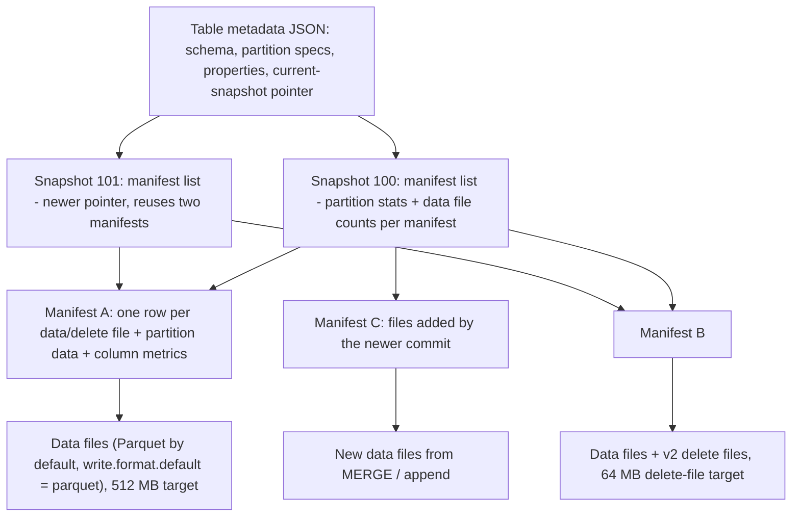
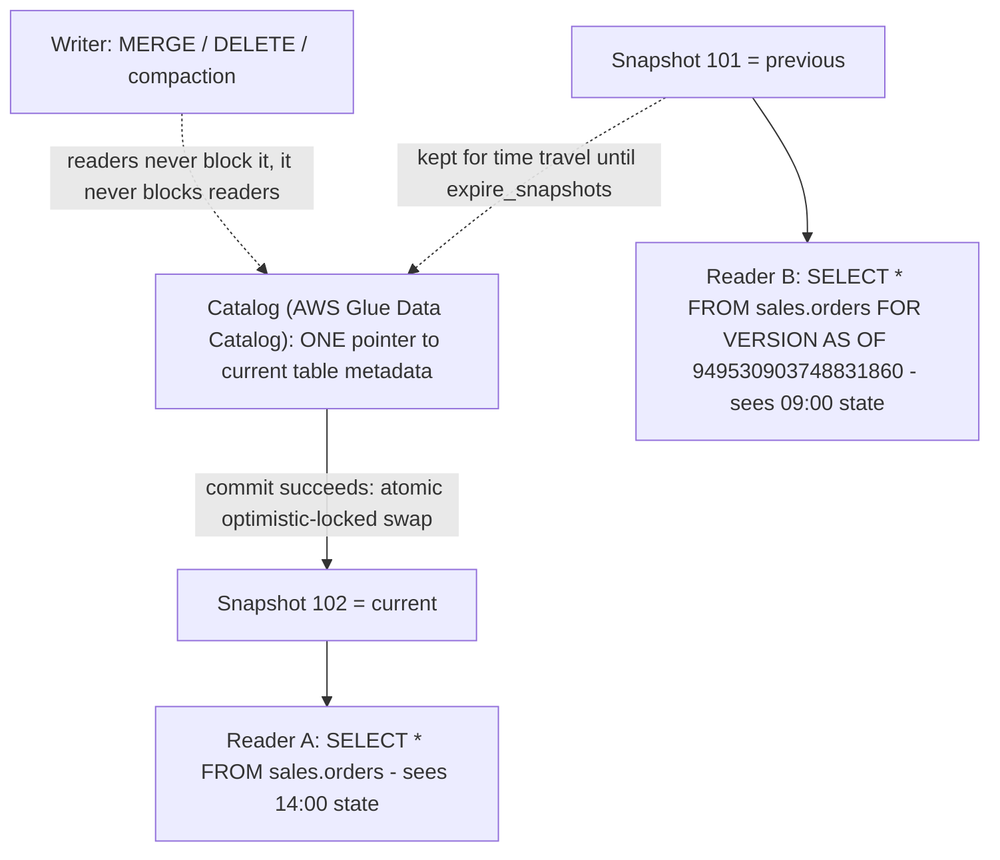
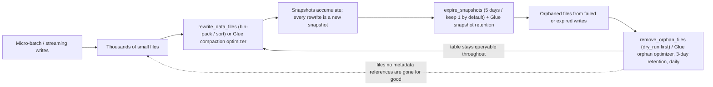
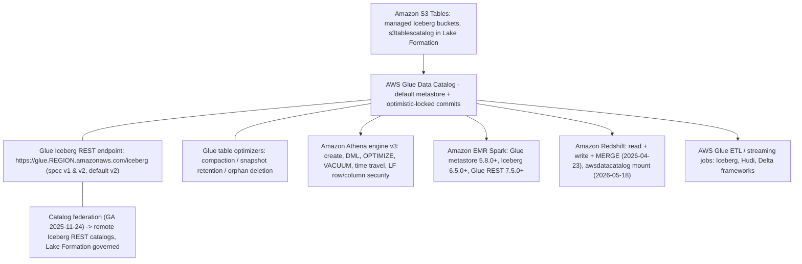
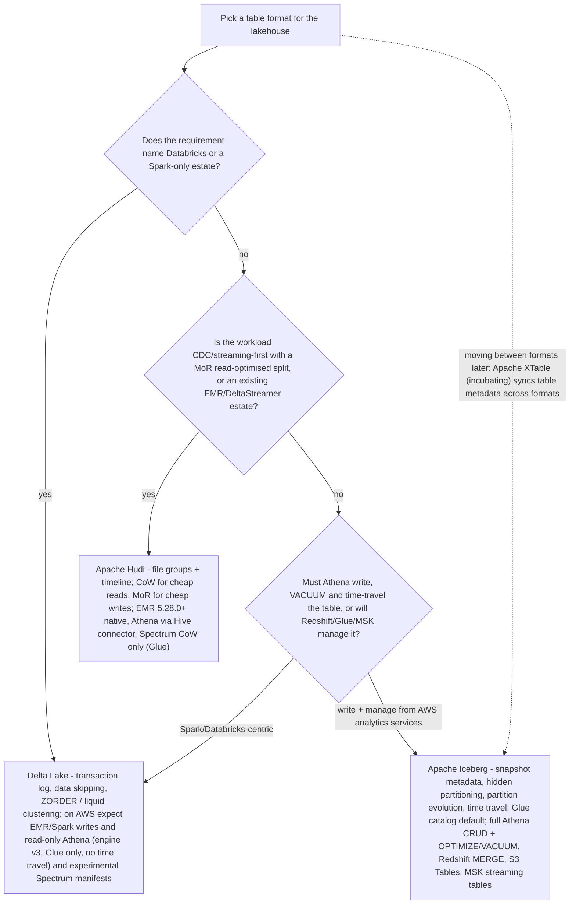

# Open Table Formats: Iceberg, Hudi, and Delta on the Lakehouse

Lesson 3 put the bytes on Amazon S3 in Parquet. Bytes on S3 are a *file lake*: readable, cheap, durable, and non-transactional. This lesson installs the layer that makes those files a **table**: the open table format (OTF). Every later lesson in this course assumes it exists. Glue crawls it (lesson 07), Athena queries it (lesson 09), Redshift bridges to it (lesson 10), Lake Formation grants on it (lesson 12), and nobody pays for a 30-million-file table twice (lesson 16).

```text
=================================================================
 THE OPEN TABLE FORMAT DECISION SURFACE (as of Oct 2026)
=================================================================
 What is missing on raw S3 ..
   no ACID, no safe concurrent writers, no snapshot reads,
   no cheap row-level delete, no schema enforcement
 Iceberg ................... metadata tree: table JSON ->
                             manifest list -> manifests ->
                             data files; snapshot isolation,
                             hidden partitioning, partition
                             evolution, sort orders, time travel
 Hudi ...................... file groups + instant timeline;
                             Copy-on-Write (rewrite Parquet) vs
                             Merge-on-Read (append Avro logs),
                             read-optimized vs snapshot queries
 Delta ..................... ordered _delta_log/*.json commits;
                             min/max data skipping, Z-Ordering,
                             liquid clustering (Hilbert curve)
 Default on AWS ............ ICEBERG - Athena's full transactional
                             story, Glue optimizers, Glue Iceberg
                             REST, S3 Tables, MSK streaming tables
 Catalog on AWS ............ AWS Glue Data Catalog (default);
                             Glue Iceberg REST endpoint; Nessie,
                             JDBC, DynamoDB, Hive, Hadoop, REST
 Do not confuse ............ snapshots with backups; Athena
                             "supports Delta" with "writes Delta"
=================================================================
```

In this lesson you will:

- explain why **ACID on object storage** needs a metadata layer at all, and what an open table format adds over "Parquet plus a crawler";
- read the **Iceberg metadata tree**, table metadata JSON, manifest lists, manifests, data/delete files, and know what each level stores;
- apply **snapshot isolation, hidden partitioning, partition evolution and sort orders** to real table DDL;
- use **time travel** in Spark and Athena syntax and price the **snapshot retention** that keeps it alive;
- write and defend a full **MERGE / UPSERT / DELETE** worked example, including the dedupe step that stops the duplicate-source-row error;
- run the three maintenance verbs, **`rewrite_data_files`, `remove_orphan_files`, `expire_snapshots`**, and map each one onto its **Glue table optimizer** and its Athena equivalent;
- pick a **catalog**, and justify **AWS Glue Data Catalog as the AWS default** plus the Glue Iceberg REST endpoint and catalog federation;
- separate **Hudi Copy-on-Write from Merge-on-Read** using the timeline of instants, and size the write-amplification difference;
- state **Delta Lake**'s features and its exact support level in Athena, EMR and Redshift;
- use the **AWS integration matrix** and the **when-Iceberg-vs-Hudi-vs-Delta** verdict instead of arguing from habit;
- study **two AWS customer cases** (Vanguard and Zeta Global) and a **sourced October 2026 update box**;
- practise with **12 exam-style questions** plus four interactive checks.

---

## 1. Why object storage cannot do ACID

### 1.1 S3 is strongly consistent and still not transactional

Amazon S3 gives strong read-after-write consistency for new `PUT`s. That is not the problem. The problem is that a *table commit* is a **multi-object** operation: a writer adds new Parquet files, removes old ones, and must make readers see either the old state or the new state: never a half-applied mixture. S3 has no atomic operation that swaps a directory listing, and it has no lock. A "commit" implemented as `list the prefix and believe it` is exactly the failure mode AWS Prescriptive Guidance lists for plain object-storage lakes: no ACID semantics, no record-level update or delete, no consistency across concurrent writers, and corruption when a write fails partway through.

All three open table formats solve the same problem the same way: **append-only metadata commits, with one atomic pointer swap at the end**.

| Format | What a commit physically is | What makes it atomic |
|---|---|---|
| **Iceberg** | New table-metadata JSON pointing at a new manifest list | The **catalog** swaps the pointer (Glue uses optimistic locking) |
| **Delta Lake** | New JSON file in `_delta_log/` | Commit in the log; readers resolve to one consistent snapshot |
| **Hudi** | New instant on the **timeline** (COMMIT / DELTA_COMMIT) | "Hudi guarantees that the state transitions are atomic and timeline consistent based on the instant time" |

The consequence for this course: **the catalog is part of the transaction protocol**, not a directory listing service. That is why Section 6 treats the catalog as a first-class design decision and why Athena only accepts Iceberg tables created against the AWS Glue catalog.

### 1.2 What an OTF actually adds

An open table format stores a **metadata layer** over your files. For Iceberg the chain is: **table metadata JSON** (schema, partition specs, current snapshot pointer, properties) → **manifest list** (one per snapshot, holding partition stats per manifest) → **manifests** (one row per data or delete file, with partition data and column metrics) → **data files and delete files** (Parquet by default, plus ORC and Avro). The guarantees that fall out of that structure, in the Iceberg project's own words: *"Serializable isolation: Reads will be isolated from concurrent writes and always use a committed snapshot of a table's data. Writes will support removing and adding files in a single operation and are never partially visible. Readers will not acquire locks."*

> [!IMPORTANT]
> **An OTF is a contract, not a compression scheme.** Parquet, ORC and Avro are *file formats*, they say nothing about who is allowed to write, what a reader is allowed to see, or how a bad row gets removed. Iceberg, Hudi and Delta are *table formats*, they own commits, snapshots, schema evolution and deletion, and they delegate the bytes to a file format. Lesson 03 chose the bytes; this lesson chooses the contract.

- **📚 Did you know?** The Iceberg spec versions **1, 2 and 3 are all "complete and adopted by the community"** (Iceberg spec page, accessed 2026-10). Spec **v3** is what AWS Glue 6.0 adopted in August 2026, but adoption of a spec version and *availability of the engines that read it* are different clocks, and Section 11 shows why they matter on AWS.

---

## 2. Iceberg deep dive: the metadata tree

### 2.1 Manifest lists, manifests, and why reads are cheap

Iceberg's spec is explicit about the two metadata levels. *"Data files in snapshots are tracked by one or more manifest files that contain a row for each data file in the table, the file's partition data, and its metrics. The data in a snapshot is the union of all files in its manifests."* And one level up: *"The manifests that make up a snapshot are stored in a manifest list file. Each manifest list stores metadata about manifests, including partition stats and data file counts."*

Two design decisions follow, and both are interview-grade:

1. **The manifest list carries partition stats so whole manifests can be skipped during planning**; you prune metadata before you touch a data file.
2. **Manifests are reused across snapshots.** The spec says manifests are *"reused across snapshots to avoid rewriting metadata that is slow-changing."* A table that is rewritten a thousand times does not carry a thousand copies of its slow-changing metadata.



**Read order matters**, and it is the opposite of Hive muscle memory: you start at the *pointer* and work down, pruning at every level, and you only open the Parquet files whose metrics survived.

```dragdrop
{
  "question": "Order the steps an Iceberg-aware engine takes to answer a SELECT, from the catalog call to the bytes:",
  "items": [
    "Table metadata JSON: read the schema, the partition spec and the pointer to the current snapshot",
    "Manifest list for that snapshot: use per-manifest partition stats and data file counts to skip manifests entirely",
    "Manifest files: read one row per data/delete file, with partition data and column metrics, and prune again",
    "Data files (Parquet/ORC/Avro) plus any v2 delete files, read with merge-on-read where deletes apply"
  ],
  "correctOrder": [
    "Table metadata JSON: read the schema, the partition spec and the pointer to the current snapshot",
    "Manifest list for that snapshot: use per-manifest partition stats and data file counts to skip manifests entirely",
    "Manifest files: read one row per data/delete file, with partition data and column metrics, and prune again",
    "Data files (Parquet/ORC/Avro) plus any v2 delete files, read with merge-on-read where deletes apply"
  ],
  "explanation": "The pruning happens in metadata, twice, before a single Parquet byte is opened: the manifest list lets an engine skip whole manifests using partition stats, and the manifest rows carry min/max metrics per file so files are skipped too. That is why Iceberg can answer 'which files matter?' without listing S3, and why the Athena metadata tables ($manifests, $files, $partitions) are the debugging surface for a query that read too much. Starting at the data (a directory listing) is the Hive habit this format exists to break."
}
```

### 2.2 Snapshot isolation: every commit is a new, immutable point in time

Every write, append, MERGE, DELETE, UPDATE, compaction, produces a **new snapshot** and keeps the old one alive. Reads resolve to exactly one committed snapshot, so two analysts at 09:00 and 14:00 see two different, individually consistent tables. That is what makes a nightly MERGE and an ad-hoc report safe to run at the same time, and it is the mechanism underneath time travel (Section 3).



### 2.3 Hidden partitioning

In Hive you declared partitions as columns, maintained them by hand, and every query had to repeat the partition predicate. Iceberg inverts this. The project's own wording: *"Other table formats like Hive support partitioning, but Iceberg supports hidden partitioning"* and *"Iceberg avoids reading unnecessary partitions automatically. Consumers don't need to know how the table is partitioned and add extra filters to their queries."*

You declare **transforms over source columns**, `days(event_ts)`, `month(ts)`, `bucket(N, id)`, `truncate(L, col)`, `years/months/days/hours`, identity, and the writer computes partition values. The analyst filters on the *source* column (`WHERE event_ts >= TIMESTAMP '2026-10-01 00:00:00'`) and the engine prunes. There is no partition column to select and no partition column to keep in sync.

- **📚 Did you know?** The hidden-partition trap runs in both directions. Athena's `OPTIMIZE... WHERE` clause *"Only partition columns are allowed in the WHERE clause"* (Athena docs, accessed 2026-10), so the maintenance path *does* speak partition-ish, even though the query path deliberately does not. When you compact an Iceberg table in Athena you filter on the partition field the table declares, not on any arbitrary business column.

### 2.4 Partition evolution: change the layout without rewriting data

Because queries plan on **data values** rather than on partition values, the partition spec itself can evolve. The Iceberg docs: *"Iceberg table partitioning can be updated in an existing table because queries do not reference partition values"* and *"Iceberg partition layouts can evolve as needed."* Existing files keep their old spec ID; new files are written with the new spec; the engine reconciles the two at read time.

Schema evolution rides the same metadata-only rail. Supported operations are **Add, Drop, Rename, Update (type widen) and Reorder**, and the docs are blunt about the cost: *"Iceberg schema updates are metadata changes, so no data files need to be rewritten"*: Iceberg tracks each column with a **unique ID**, so a renamed column is still the same column.

| Evolution | Hive-style cost | Iceberg cost |
|---|---|---|
| Add a column | Rewrite or leave nulls untracked | Metadata change only |
| Rename a column | Breaks every downstream reference | Metadata change (stable ID) |
| Widen `int` → `long` | Rewrite | Metadata change |
| **Add `bucket(16, customer_id)` partitioning** | Rewrite the table | **Metadata change; old files keep the old spec** |
| **Switch `days(ts)` → `months(ts)`** | Rewrite the table | **Metadata change; no data rewritten** |

### 2.5 Sort orders

Iceberg tables can carry a **table-level sort order** that engines honour when they rewrite files. The docs' example: *"To set the write order for a table, use `WRITE ORDERED BY`: `ALTER TABLE prod.db.sample WRITE ORDERED BY category, id`"*, and *"MERGE INTO in Spark will use the table ordering."* This is the clustering story on Iceberg: combined with `rewrite_data_files` you can bin-pack (default), or sort, or apply `zorder(...)` / `hilbert(...)` strategies to place related rows in the same file groups: the same job Delta does with `ZORDER BY` and liquid clustering (Section 8), just under a different verb.

- **📚 Did you know?** Defaults worth memorising because they show up in both compaction math and cost reviews (Iceberg configuration docs, accessed 2026-10): `write.format.default` = **parquet**; `write.target-file-size-bytes` = **536,870,912 bytes = 512 MB**; `write.delete.target-file-size-bytes` = **67,108,864 = 64 MB**; Parquet row-group size and `read.split.target-size` = **134,217,728 = 128 MB**; `read.split.planning-lookback` = **10**. Athena writes Iceberg tables with **ZSTD level 3** as the default compression, so the "what does an Athena Iceberg write cost to store" question already assumes compression.

---

## 3. Time travel and snapshot retention

### 3.1 Reading a table as it was

Because snapshots are immutable and retained, "read as of" is a normal query. Spark 3.3 and later supports it in SQL: *"Spark 3.3 and later supports time travel in SQL queries using `TIMESTAMP AS OF` or `VERSION AS OF` clauses. The `VERSION AS OF` clause can contain a long snapshot ID or a string branch or tag name."* Athena's spelling differs (engine v3): use `FOR TIMESTAMP AS OF` after the table name, or `FOR VERSION AS OF` where the version *"is the bigint snapshot ID"*: the docs' own example is `SELECT * FROM iceberg_table FOR VERSION AS OF 949530903748831860`.

```sql
-- Spark / EMR: two syntaxes, one snapshot
SELECT count(*) FROM sales.orders AS OF TIMESTAMP '2026-10-01 09:00:00';
SELECT count(*) FROM sales.orders VERSION AS OF 6918471130372145521;

-- Athena engine v3: FOR ... AS OF, bigint snapshot id
SELECT * FROM sales.orders FOR TIMESTAMP AS OF TIMESTAMP '2026-10-01 09:00:00';
SELECT * FROM sales.orders FOR VERSION AS OF 949530903748831860;

-- Athena metadata tables: the audit surface
SELECT committed_at, snapshot_id, operation FROM sales.orders$snapshots;
SELECT * FROM sales.orders$history;
SELECT file_path, file_size_in_bytes FROM sales.orders$files LIMIT 20;
SELECT * FROM sales.orders$manifests;
```

Athena's metadata tables for Iceberg are `$files`, `$manifests`, `$history`, `$partitions`, `$snapshots` and `$refs`; which means "who wrote this file, when, and which snapshot references it" is a SQL question, not an S3 console question.

### 3.2 Retention is a paid decision, not a free feature

Every commit *"produces a new snapshot while keeping the old data and metadata around for snapshot isolation and time travel"* (Iceberg Spark procedures docs). Old snapshots are therefore **stored bytes**, and expiring them is the destructive reverse operation. The defaults:

| Knob | Default | Source (accessed 2026-10) |
|---|---|---|
| `expire_snapshots` `older_than` | **5 days ago** | iceberg.apache.org Spark procedures |
| `expire_snapshots` `retain_last` | **1** ancestor snapshot regardless of age | same |
| Branches / tags | Never expired; *"The main branch never expires"* | same |
| Athena `vacuum_max_snapshot_age_seconds` | **432000 seconds = 5 days** | Athena Iceberg DDL docs |
| Glue snapshot-retention optimizer | **5 days**, keep **1** snapshot | Glue auto table optimizers docs |
| Glue orphan-file retention | **3 days** (minimum 1 day), runs about **once per day** | Glue orphan deletion docs |
| Snapshot retention for brand-new Glue tables | **Disabled by default** | Glue docs |

**Worked example E1: what a time-travel window costs (us-east-1, as of Oct 2026)**

A **1 TB (1,024 GB)** Iceberg table on general-purpose S3 whose jobs rewrite **20% of its bytes per day** (MERGE plus compaction) accumulates new versions of the old files:

```text
Daily new (old) versions .... 1,024 GB x 20%              = 204.8 GB/day
Retain 7 days .............. 204.8 x 7                    ~ 1,434 GB extra
  storage cost ............. 1,434 GB x $0.023/GB         ~ $33 / month
Retain 30 days ............. 204.8 x 30                   ~ 6,144 GB extra
  storage cost ............. 6,144 GB x $0.023/GB         ~ $140 / month
Expire at 5 days (default) . 204.8 x 5                    ~ 1,024 GB extra
  storage cost ............. 1,024 GB x $0.023/GB         ~ $23 / month
```

Same table, three retention policies, an **$117/month** spread between a 30-day window and the default 5-day window: using the S3 Standard first-50-TB rate of **$0.023 per GB-month** (AWS S3 pricing, accessed 2026-10). Teach the *method*: extra storage ≈ (bytes rewritten per day × retention days) × rate. A "we need 90 days of audit history" requirement is a storage line item, not a checkbox.

> [!WARNING]
> ⚠️ **A snapshot is not a backup, and expiring one is irreversible.** Once `expire_snapshots` (or Athena `VACUUM`, or the Glue snapshot-retention optimizer) runs past your retention window, that point in time is gone: the files it uniquely referenced are deleted. Time travel answers *"what did the table look like at 09:00?"*, not *"the bucket was deleted"*, and it does not replace S3 versioning, cross-Region replication or a restore drill. Also never count S3 versioning and Iceberg snapshots as two independent safety nets until you have priced both; E1 is the second net's bill.

**Worked example E2: expire, then prove nothing live was lost**

```sql
-- 1. dry-run the orphan sweep FIRST: files no metadata references
CALL prod.system.remove_orphan_files(
  table => 'sales.orders',
  dry_run => true,
  older_than => TIMESTAMP '2026-10-01 00:00:00');

-- 2. expire snapshots: keep a 7-day window, never drop the newest 7
CALL prod.system.expire_snapshots(
  table => 'sales.orders',
  older_than => TIMESTAMP '2026-10-04 00:00:00',
  retain_last => 7);

-- 3. verify the current snapshot still plans and reads
SELECT count(*) FROM sales.orders;
SELECT committed_at, operation FROM sales.orders$history ORDER BY committed_at DESC;
```

Order matters: **dry-run orphans, then expire, then verify.** Expiring snapshots first can orphan files that the expiry itself deleted references to, which turns a clean sweep into a noisy one.

---

## 4. Row-level DML: MERGE, UPSERT and DELETE

### 4.1 Three physical strategies, one SQL surface

Iceberg's row-level operations resolve to different physical work, and knowing which one ran is what tells you whether you just paid for I/O:

| SQL | When the filter matches… | What Iceberg does |
|---|---|---|
| `DELETE` | Whole partitions or whole files | **Metadata-only delete**: files drop out of the snapshot, no bytes rewritten |
| `DELETE` | Individual rows | **Rewrites only the affected data files** (plus v2 delete files read merge-on-read) |
| `UPDATE` / `MERGE` | Rows inside files | **Copy-on-write rewrite** of the touched files, committed as an overwrite commit |
| `INSERT` |: | New data files + a new manifest + a new snapshot |

The spec's summary of `DELETE`: *"If the delete filter matches entire partitions of the table, Iceberg will perform a metadata-only delete. If the filter matches individual rows of a table, then Iceberg will rewrite only the affected data files."* And on `MERGE INTO`: *"Iceberg supports MERGE INTO by rewriting data files that contain rows that need to be updated in an overwrite commit"*, with the explicit recommendation that *"`MERGE INTO` is recommended instead of `INSERT OVERWRITE` because Iceberg can replace only the affected data files."* Athena states its own read side of the same mechanism: queries *"perform merge-on-read of both position and equality deletes."*

**Worked example E3: a CDC upsert that survives review (Spark on EMR, Glue catalog)**

Scenario: `sales.orders` Iceberg table partitioned `days(order_ts)`. A nightly CDC batch lands **50,000 change rows** in S3 as Parquet: **20,000 updates, 25,000 inserts, 5,000 deletes**.

```sql
-- Step 1: dedupe the CDC stream. Iceberg throws if ONE source record
-- can update MULTIPLE target rows, so kill duplicates before the join.
WITH ranked AS (
  SELECT c.*,
         ROW_NUMBER() OVER (
           PARTITION BY c.order_id
           ORDER BY c.change_time DESC) AS rn
  FROM   lakehaus.bronze_order_changes c
),
dedup AS (SELECT * FROM ranked WHERE rn = 1)

-- Step 2: one MERGE with three WHEN MATCHED branches + the insert
MERGE INTO sales.orders t
USING dedup s
ON  t.order_id = s.order_id
WHEN MATCHED AND s.op = 'd' THEN DELETE
WHEN MATCHED AND s.op = 'u' THEN UPDATE SET
       status = s.status, amount = s.amount, updated_at = s.change_time
WHEN NOT MATCHED AND s.op <> 'd' THEN INSERT
       (order_id, status, amount, order_ts, updated_at)
VALUES (s.order_id, s.status, s.amount, s.order_ts, s.change_time);

-- Step 3: verify against the snapshot history, not just the count
SELECT count(*) FROM sales.orders;
SELECT committed_at, operation, summary
FROM   sales.orders$snapshots
ORDER  BY committed_at DESC LIMIT 5;

-- Step 4: prove isolation - yesterday's reader still sees yesterday
SELECT count(*) FROM sales.orders VERSION AS OF 6918471130372145521;
```

Why step 1 is not optional, in the docs' own words: *"Only one record in the source data can update any given row of the target table, or else an error will be thrown."* A CDC file with two rows for one `order_id` (a re-delivered batch, a late update, an out-of-order partition) is enough to fail the job at 02:00. Spark 3.5 also added `WHEN NOT MATCHED BY SOURCE ... THEN ...`, so rows in the target with no source counterpart can now be deleted in the same statement.

```fillblank
{
  "question": "Complete the Iceberg MERGE skeleton exactly as Spark/EMR and Redshift both spell it:",
  "template": "{{1}} INTO sales.orders t {{2}} dedup s ON t.order_id = s.order_id WHEN {{3}} AND s.op = 'd' THEN DELETE WHEN MATCHED THEN UPDATE SET status = s.status WHEN NOT {{4}} THEN INSERT (order_id, status) VALUES (s.order_id, s.status);",
  "answers": {
    "1": "MERGE",
    "2": "USING",
    "3": "MATCHED",
    "4": "MATCHED"
  },
  "distractors": ["JOIN", "INSERT", "UNMATCHED", "EXISTS", "UPSERT", "REPLACE"],
  "explanation": "The four load-bearing keywords are MERGE INTO ... USING ... ON ... WHEN [NOT] MATCHED. The distractors are the mistakes people actually make: JOIN is not a row-level write, INSERT alone cannot update, UNMATCHED is English but not SQL syntax here, and UPSERT is the concept (Redshift's announcement calls MERGE the UPSERT form) rather than a statement keyword. Two rules travel with this skeleton: exactly one source record may match one target row, and the source must be deduped (ROW_NUMBER) before the MERGE ever runs."
}
```

- **📚 Did you know?** Redshift caught up to this exact statement on **23 April 2026**: *"Amazon Redshift now supports row-level UPDATE, DELETE, and MERGE operations on Apache Iceberg tables"*, including *"both partitioned and unpartitioned Iceberg tables, including S3 Tables"*, with supported partition transforms *"identity, bucket, truncate, year, month, day, and hour"*, and AWS states that *"Tables modified by Redshift are compatible with other Iceberg-compatible engines, including Amazon EMR and Amazon Athena."* One table, three writers (Redshift MERGE, Glue streaming append, Athena analyst DELETE), arbitrated by Glue optimistic locking.

> [!WARNING]
> ⚠️ **Two boundaries that catch teams in production:**
> - **Lake Formation can govern *reads* but not these operations.** Athena's docs are explicit: *"you cannot use Lake Formation to manage permissions for operations like VACUUM, MERGE, UPDATE or OPTIMIZE with these table formats."* Row/column security on SELECT is Lake Formation's; the *maintenance and row-level write* surface is IAM plus the engine's own authorisation. Design that control separately (lesson 12).
> - **This lesson's verified MERGE surfaces are Spark (Iceberg docs) and Redshift (AWS announcement, 2026-04-23).** Athena's Iceberg DML pages document INSERT/UPDATE/DELETE and OPTIMIZE/VACUUM: check the current Athena SQL reference before you schedule an Athena `MERGE`, because this lesson's sources did not verify that statement. Never ship a pipeline on an unverified SQL feature.

---

## 5. Maintenance: compaction, orphan files, snapshot expiry

Small files are the tax of micro-batch and streaming writes, and Iceberg gives you three verbs for the three different problems. Conflating them is how tables quietly die.

| Problem | Verb (Spark procedure) | Athena equivalent | AWS managed equivalent |
|---|---|---|---|
| Many tiny files, poor scan economics | `rewrite_data_files` (bin-pack default; `strategy => 'sort'`, `zorder(c1,c2)`, `hilbert(c1,c2)`) | `OPTIMIZE t REWRITE DATA USING BIN_PACK [WHERE …]` | Glue **compaction** optimizer |
| Too many manifests slowing planning | `rewrite_manifests` |, |, |
| History and dead files piling up | `expire_snapshots` + `remove_orphan_files` | `VACUUM t` (both jobs at once) | Glue **snapshot retention** + **orphan file deletion** optimizers |

Details worth knowing per verb:

- **`rewrite_data_files`** bin-packs by default, accepts a `where` partition filter and options such as `min-input-files` and `remove-dangling-deletes`; `strategy => 'sort'` takes `sort_order => 'zorder(c1,c2)'` or `'hilbert(c1,c2)'`.
- **`remove_orphan_files`** deletes *"files which are not referenced in any metadata files of an Iceberg table"* and supports `dry_run => true`: always run the dry run first.
- **`expire_snapshots`** removes old snapshots and the files only they reference (defaults in Section 3.2); snapshots referenced by branches or tags are protected.
- **Athena `OPTIMIZE`** is *"transactional and is supported only for Apache Iceberg tables"*, only accepts **partition-column** predicates in `WHERE`, and *"The compaction action is charged by the amount of data scanned during the rewrite process."*
- **Athena `VACUUM`** *"performs snapshot expiration and orphan file removal"*, governed by `vacuum_max_snapshot_age_seconds` (default **432000 s = 5 days**; docs examples set it to **259200 s = 3 days**).

**Worked example E4: small-file math and the Glue trigger (as of Oct 2026)**

```text
Streaming job writes ........ 1,000 files/day x 8 MB     = 8 GB/day
After 30 days ............... 30,000 files                ~ 240 GB
Target file size ............ write.target-file-size-bytes = 512 MB
Theoretical compact files ... 240 GB / 0.5 GB             = 469 files
Glue compaction trigger ..... > 100 files per table/partition
                              AND each file < 75% of 512 MB = 384 MB
Trigger check ............... 30,000 > 100 YES; 8 MB < 384 MB YES -> fires
```

Glue's own conditions: *"In the Data Catalog, the compaction process starts when a table or any of its partitions have more than 100 files. Each file must be smaller than 75% of the target file size. The target file size is defined by the `write.target-file-size-bytes` table property, which defaults to 512 MB"*, and *"Data Catalog performs compaction without interfering with concurrent queries and supports compaction only for Parquet format tables."* The ~64× file-count reduction (30,000 → 469) is what turns per-query planning overhead and file-open overhead into a rounding error; the rewrite itself is billed work, so weigh bytes scanned (Athena) or DPU-seconds (Glue) against the query saving.



**Worked example E5: managed or self-managed: price the S3 Tables premium (as of Oct 2026)**

If you do not want to run Section 5's loop yourself, S3 Tables does it: *"Amazon S3 Tables automatically handles ongoing table maintenance, including compaction, snapshot expiration, and unreferenced file cleanup."*

```text
Table size .................. 5 TB = 5,120 GB
S3 Standard ................. 5,120 x $0.023   = $117.76 / month
S3 Tables - Standard ........ 5,120 x $0.0265  = $135.68 / month
Premium for managed upkeep ..                      $17.92 / month
S3 Tables GET requests ...... $0.0004 per 1,000 requests
```

A **$17.92/month** premium (about 15%) buys you the entire maintenance loop, compaction, snapshot expiration, unreferenced-file cleanup, plus Iceberg statistics on by default for Athena. Whether that is cheap depends entirely on how many engineer-hours Section 5 costs you; the point is that the trade is a line item you can quote, not a mystery.

- **📚 Did you know?** Athena's Iceberg optimisation surface has a second, quieter lever: *"Parquet column indexing … makes it possible for Athena to perform more precise data pruning … leveraging page-level min/max statistics"*, and *"Iceberg statistics are turned on by default when you use S3 Tables."* So the same 512 MB target file is cheaper to *skip* on S3 Tables than on an unmanaged table whose statistics nobody collected: maintenance is a query-cost control, not just a file-count control.

---

## 6. Catalogs: the pointer service, and why Glue is the default

### 6.1 What a catalog does

The catalog is the **mutable** half of the design: it maps `db.table` → the table's current metadata location and performs (or delegates) the **atomic commit** that makes a write visible. Iceberg documents implementations for the **REST Catalog Protocol, AWS Glue, AWS DynamoDB, HadoopCatalog, HiveCatalog, JDBC and Nessie**. Notable non-AWS one: **Nessie** is a *"Transactional Catalog for Data Lakes with Git-like semantics"* that *"works with Apache Iceberg tables"* and runs *"as a Docker image or on Kubernetes"*, with version-store backends including RocksDB, Cassandra, BigTable, **DynamoDB** and MongoDB; i.e. git-like branches and tags without leaving AWS primitives.

### 6.2 AWS Glue Data Catalog is the default on AWS

Three facts make Glue the default rather than a preference:

1. **Athena only accepts Iceberg tables registered with Glue.** *"Tables with AWS Glue catalog only: Only Iceberg tables created against the AWS Glue catalog … are supported from Athena"*, and *"Athena supports Amazon Glue optimistic locking only. Using Athena to modify an Iceberg table with any other lock implementation will cause potential data loss and break transactions."*
2. **Glue owns the managed maintenance loop** (Section 5), the **Iceberg REST endpoint**, and **catalog federation**.
3. **Every other AWS engine plugs into it:** EMR Spark uses Glue as its Hive metastore (release **5.8.0+**), as its Iceberg catalog (**6.5.0+**) and as its **Iceberg REST catalog** (**7.5.0+**); Redshift requires Iceberg tables to be *"registered with AWS Glue Data Catalog"* for writes.

The **Glue Iceberg REST endpoint** (`https://glue.<region>.amazonaws.com/iceberg`) *"supports API operations specified in the Apache Iceberg REST specification"* and *"supports both Apache Iceberg table specifications: v1 and v2, defaulting to v2."* REST is also the seam for **catalog federation** (GA **24 November 2025**): *"It synchronizes metadata real-time across AWS Glue Data Catalog and remote catalogs when data teams query remote tables"*, usable from *"Amazon Redshift, Amazon EMR, Amazon Athena, AWS Glue, third-party engines like Apache Spark, and Amazon SageMaker"*, with *"AWS Lake Formation for access controls."*



**Worked example E6: catalog wiring checklist: one Iceberg table, three engines**

```text
1. CREATE (Athena, engine v3) - Glue registered, partition transform hidden
   CREATE TABLE sales.orders (
     order_id bigint, status string, amount decimal(12,2), order_ts timestamp
   )
   TBLPROPERTIES (
     'table_type' = 'ICEBERG',
     'partitioning' = '[days(order_ts)]',   -- hidden partition field
     'optimize_rewrite_data_file_threshold' = '100'
   )
   -- NOTE: 'EXTERNAL' is rejected: "External keyword not supported for
   -- table type ICEBERG"

2. WRITE (EMR Spark) - point the session at the same Glue catalog
   spark.sql.catalog.spark_catalog = org.apache.iceberg.aws.glue.GlueCatalog
   spark.sql.catalog.spark_catalog.io-impl = org.apache.iceberg.aws.s3.S3FileIO
   spark.sql.extensions = org.apache.iceberg.spark.extensions.IcebergSparkSessionExtensions

3. UPSERT (Redshift) - external schema over Glue, then row-level DML
   CREATE EXTERNAL SCHEMA lakehouse
     FROM GLUE DATABASE 'sales'
     IAM_ROLE 'arn:aws:iam::111122223333:role/redshift-lake';
   MERGE INTO lakehouse.orders t USING staging.orders_delta s
     ON t.order_id = s.order_id ...

4. GOVERN - Lake Formation grants on SELECT (reads), IAM on VACUUM/MERGE/OPTIMIZE
```

Everything in that checklist is the *same table on S3*: four engines, one metadata pointer, no copies. Note the Athena-for-Spark defaults AWS publishes are the same three properties, `GlueCatalog`, `S3FileIO`, `IcebergSparkSessionExtensions`, which is why a notebook and a SQL console can write to one table without a sync job.

---

## 7. Apache Hudi: file groups, timeline, CoW vs MoR

### 7.1 The timeline

Hudi organises a table as **file groups** under a partitioned base path and records every state change as an **instant** on a **timeline**. Documented actions: **COMMIT, DELTA_COMMIT, REPLACE_COMMIT, CLEANS, COMPACTION, LOGCOMPACTION, CLUSTERING, INDEXING, ROLLBACK, SAVEPOINT**, with the guarantee that *"Hudi guarantees that the state transitions are atomic and timeline consistent based on the instant time."* The timeline supports two orderings, **commit time ordering** and **event time ordering**, which is how a stream's late arrivals reconcile against what has already been written.

### 7.2 Copy-on-Write vs Merge-on-Read

| | **Copy-on-Write (CoW)** | **Merge-on-Read (MoR)** |
|---|---|---|
| Physical layout | *"exclusively columnar file formats (e.g parquet)"* | *"columnar (e.g parquet) + row based (e.g avro)"* |
| On UPDATE | *"version & rewrite the files by performing a synchronous merge during write"* | append to Avro log files; merge later |
| Write cost | Higher write amplification, higher write latencies | *"no synchronous merge happening during write, resulting in a lower write amplification and better write latencies"* |
| Read cost | Fast: plain columnar scan | Snapshot query merges base + log on the fly; read-optimized query reads base files only |
| Query types | Snapshot + incremental | Snapshot + incremental + **read-optimized** |
| Freshness | Exact at commit | Snapshot queries expose *"near-real time data (few mins)"* |
| Compaction | *"not applicable to Copy-on-Write tables"* | Required: merges log blocks into new base files |

Compaction in Hudi is therefore a **MoR-only** table service: *"Compaction is a table service employed by Hudi specifically in Merge-on-Read (MOR) tables to merge updates from row-based log files to the corresponding columnar-based base file periodically"*, run in two steps, **Compaction Scheduling** then **Compaction Execution**, with the default strategy `LogFileSizeBasedCompactionStrategy` (*"picks the log file with most accumulated unmerged data"*) and *"By default, compaction is run asynchronously."*

**Worked example E7: CoW vs MoR write amplification (illustrative first-principles, not an AWS benchmark)**

Same 10 GB Parquet partition, **100 updates/day touching 1% of rows**:

```text
Workload ................... 10 GB partition, 100 updates/day on 1% of rows
CoW: rewrite containing Parquet base files ~ 100 MB/day of Parquet rewritten
     ~ 10x the bytes MoR writes for the same changes (change rides inside
     whole rewritten files, not as a delta)
MoR: append Avro logs       < 10 MB/day appended
     merge deferred to asynchronous compaction
Reads: CoW snapshot = plain Parquet scan
       MoR snapshot = base + log merge (a few minutes fresh)
       MoR read-optimized = base files only, stale until compaction
```

The lesson is the shape of the trade, not the exact megabytes: **CoW buys cheap reads with write amplification; MoR buys cheap writes with read-time merge work and a compaction job you must schedule.**

```plot
{
  "type": "bar",
  "title": "Daily bytes written for the same 100 MB of changes: Hudi CoW vs MoR (illustrative, Section 7.2)",
  "xLabel": "Table type",
  "yLabel": "Bytes written per day (MB)",
  "xKey": "table_type",
  "data": [
    {"table_type": "Copy-on-Write (rewrite Parquet base files)", "bytes_written_mb": 100},
    {"table_type": "Merge-on-Read (append Avro logs)", "bytes_written_mb": 10}
  ]
}
```

- **📚 Did you know?** Hudi's AWS installation story is older than Iceberg's: *"In Amazon EMR release versions 5.28.0 and later, EMR installs Hudi components by default when Spark, Hive, Presto, or Flink are installed"*, and the shipped versions track EMR lines: emr-7.13.0 → **Hudi 1.0.2-amzn-2**, emr-6.15.0 → **0.14.0-amzn-0**, emr-5.36.2 → **0.10.1-amzn-1**. AWS Glue 6.0 (2026-08-21) runs **Hudi 1.1.1** alongside Iceberg 1.11.0 and Delta 4.2.0, three table formats on one Spark runtime.

### 7.3 Hudi on AWS: where it is actually supported

Athena reads Hudi through the Hive connector: *"supports snapshot queries on COPY_ON_WRITE tables, and snapshot and read optimized queries on MERGE_ON_READ Hudi tables."* Redshift Spectrum reads Hudi too, but with two hard limits: *"Copy on Write Tables in Apache Hudi versions 0.5.2 to 0.11.x can be queried via Amazon Redshift Spectrum external tables"*, and *"Hudi tables are supported only when AWS Glue Data Catalog is used. It's not supported when you use an Apache Hive metastore as the external catalog."* EMR 6.1.0+ additionally integrates Hudi with Trino (PrestoSQL).

---

## 8. Delta Lake: transaction log, stats, Z-Ordering, liquid clustering

Delta keeps an **ordered transaction log** (`_delta_log/*.json`); readers resolve one consistent snapshot from it. Two performance features matter for this course:

- **Data skipping**: *"Data skipping information is collected automatically when you write data into a Delta Lake table"* (per-column min/max).
- **Z-Ordering**: *"Z-Ordering is a technique to colocate related information in the same set of files … available in Delta Lake 2.0.0 and above"*, syntax `OPTIMIZE events ZORDER BY (eventType)`, recommended *"if you expect a column to be commonly used in query predicates and if that column has high cardinality."*
- **Liquid clustering** supersedes ZORDER in newer releases: *"OPTIMIZE ZORDER BY always reclusters (that is, rewrites) all data in the table resulting in high write amplification"*, while *"liquid clustering … uses Hilbert Curve, a continuous fractal space-filling curve as a multi-dimensional clustering technique, which significantly improves data skipping over ZORDER."*

Iceberg reaches the same destination by a different door (`rewrite_data_files` with `sort`/`zorder`/`hilbert`, table `WRITE ORDERED BY`) and Glue's compaction optimizer *"supports sort and Z-order strategies"*. **Same goal, three different SQL/API homes: do not mix syntaxes across formats.**

### 8.1 Delta support levels on AWS (as of Oct 2026)

| Engine | Delta support | Exact wording / limit |
|---|---|---|
| **Amazon Athena** (engine v3) | **Read-only** | *"You can use Amazon Athena to read Delta Lake tables stored in Amazon S3 directly without having to generate manifest files or run the MSCK REPAIR statement"*, but *"Tables with AWS Glue catalog only"*, *"V3 engine only"*, **"No time travel support"**, *"Read only, Write DML statements like UPDATE, INSERT, or DELETE are not supported"* |
| **Amazon EMR Spark** | **Read/write** | *"With Amazon EMR releases 6.9.0 and higher, you can use Apache Spark 3.x on Amazon EMR clusters with Delta Lake tables"*; recent 7.x releases ship `delta`, `hudi`, `iceberg` together |
| **Amazon Redshift Spectrum** | **Experimental read** | *"This is an experimental integration. Use with caution."*: a Delta table is read via a manifest (`GENERATE symlink_format_manifest` + `SymlinkTextInputFormat`) |
| **AWS Glue ETL** | Framework support | Glue 6.0 (2026-08-21) runs **Delta 4.2.0** with Iceberg 1.11.0 and Hudi 1.1.1 |

The design consequence: **"Athena supports Delta" means Athena can read it.** Do not design a "Delta upserts from Athena" pattern; on AWS, write Delta from EMR/Spark or move to Iceberg and get the full Athena story from Section 5.

---

## 9. AWS integration matrix (as of October 2026)

| Service | Iceberg | Hudi | Delta |
|---|---|---|---|
| **Amazon Athena** | Full: create, DML, hidden partitioning, time travel, `OPTIMIZE`, `VACUUM`, LF row/column security (Glue catalog, engine v3) | Read via Hive connector: CoW snapshot; MoR snapshot + read-optimized | **Read-only**, engine v3, Glue only, **no time travel** |
| **Amazon EMR Spark** | Glue catalog 6.5.0+; Glue Iceberg REST 7.5.0+ | Installed by default 5.28.0+ (emr-7.13.0 → 1.0.2-amzn-2) | 6.9.0+ with Spark 3.x |
| **Amazon Redshift** | Read + write + UPDATE/DELETE/MERGE (2026-04-23); ALTER TABLE via `awsdatacatalog` (2026-05-18); MVs | Spectrum read of **CoW only**, Glue catalog only (0.5.2 to 0.11.x) | Spectrum read via **experimental** symlink manifests |
| **AWS Glue** | Data Catalog (default), Iceberg REST endpoint, table optimizers, federation, Schema Registry | ETL framework | ETL framework (Delta 4.2.0 on Glue 6.0) |
| **Amazon MSK** | Managed **streaming tables** → Iceberg on S3 Tables: **10 GBps**, **$10.00/TB delivered**, **5 to 15 min** freshness, inline compaction, DLQ required, Express brokers only, new tables only |, |, (Firehose CDC-to-Iceberg deprecated 2025-09-15) |
| **Amazon S3 Tables** | Managed Iceberg buckets: automatic compaction, snapshot expiration, unreferenced-file cleanup; **$0.0265/GB-month** first 50 TB, GET **$0.0004/1,000** |, |, |
| **AWS Lake Formation** | Read permissions incl. row/column security; **cannot** gate `VACUUM`/`MERGE`/`UPDATE`/`OPTIMIZE`; governs catalog federation | Read permissions | Read permissions |
| **Amazon OpenSearch** | **Not a managed integration**: OpenSearch Ingestion lists no Iceberg source or sink; the OSS Data Prepper Iceberg CDC source is experimental and **CoW-only** |: |: |

```matching
{
  "question": "Match each format or service to the capability it actually owns on AWS (as of Oct 2026):",
  "pairs": [
    {"left": "Apache Iceberg", "right": "Snapshot metadata tree with manifest lists; hidden partitioning and partition evolution; time travel with VERSION AS OF / FOR VERSION AS OF"},
    {"left": "Apache Hudi", "right": "File groups plus an instant timeline; Copy-on-Write rewrites Parquet, Merge-on-Read appends Avro logs with a read-optimized view"},
    {"left": "Delta Lake", "right": "Ordered _delta_log JSON commits; automatic min/max data skipping, Z-Ordering (2.0+) and liquid clustering with Hilbert curves"},
    {"left": "Amazon Athena reading Delta", "right": "Read-only on engine v3 with the Glue catalog: no time travel, no UPDATE/INSERT/DELETE"},
    {"left": "AWS Glue Data Catalog", "right": "The default pointer service: optimistic-locked commits plus compaction, snapshot-retention and orphan-file optimizers"},
    {"left": "Amazon S3 Tables", "right": "Managed Iceberg table buckets that run compaction, snapshot expiration and unreferenced-file cleanup for you"}
  ],
  "explanation": "Each entry is a capability boundary, not a vibe: Iceberg owns snapshots and hidden partitions, Hudi owns the timeline and the CoW/MoR split, Delta owns the ordered transaction log and clustering, Athena-on-Delta is a reader (engine v3, Glue only, no time travel), Glue is the commit point plus the managed maintenance loop, and S3 Tables is that maintenance loop as a product. Getting any pair backwards produces a design that cannot run: Athena Delta DML, Lake Formation gating VACUUM, or an OpenSearch Ingestion Iceberg sink all fail against these boundaries."
}
```

---

## 10. When to pick Iceberg, Hudi or Delta on AWS

AWS's managed surfaces are **Iceberg-first**. Athena's entire transactional story (`OPTIMIZE`, `VACUUM`, time travel, Lake Formation row/column security), Glue's optimizers, the Glue Iceberg REST endpoint, catalog federation, S3 Tables, MSK streaming tables and Redshift's row-level DML are all Iceberg-only or Iceberg-first. That is the default gravity; the other two formats earn selection by constraint.



| Choose… | When… | Accept the cost of… |
|---|---|---|
| **Iceberg (default)** | Multiple engines on one copy; Athena/Redshift/Glue/MSK in the pipeline; you want managed optimizers or S3 Tables | Glue optimistic locking as the commit arbiter; version lag between community releases and what Athena documents |
| **Hudi** | CDC/streaming-first ingestion, a CoW-vs-MoR read trade-off, or an existing Hudi estate on EMR/DeltaStreamer | Spectrum reads **CoW only, Glue only**; Athena reads via the Hive connector |
| **Delta Lake** | Spark/Databricks-centric workloads, or required interop with Databricks | On AWS analytics engines: **read-only Athena** (no time travel, no DML) and manifest-based Spectrum |

- **📚 Did you know?** The escape hatch between formats is a project, not a rewrite: **Apache XTable (incubating)** *"syncs table metadata across formats"* (xtable.apache.org, accessed 2026-10), so a format migration is a metadata conversion rather than a Parquet conversion. The mirror-image fact is about *catalogs*, not formats: Iceberg's data and metadata files are open on S3 and the catalog only holds the pointer: Athena requires Glue, but EMR Spark can use Glue REST, Hive, Hadoop or Nessie catalogs. Migration cost is catalog metadata, not file conversion.

### 2026 Updates (as of October 2026)

> [!NOTE]
> **What changed in the table-format layer that this lesson depends on:**
> - **2026-08-21, AWS Glue 6.0: 30% price reduction and full Iceberg v3 support.** *"AWS Glue 6.0 is now generally available, delivering a 30% price reduction and introducing full support for Apache Iceberg v3, newer versions of Apache Hudi and Delta Lake"* on Spark 4.1 / Python 3.13 (AWS News Blog, 2026-08-21); the Glue release notes list **Apache Iceberg 1.11.0, Hudi 1.1.1, Delta 4.2.0** (accessed 2026-10-11). Iceberg v3 brings VARIANT with automatic shredding, **deletion vectors**, geometry/geography types and DEFAULT column values, choose Glue 6.0 when you need v3.
> - **2026-04-23: Redshift row-level DML on Iceberg.** UPDATE, DELETE and MERGE (UPSERT) on partitioned and unpartitioned Iceberg tables, **including S3 Tables**, with partition transforms identity/bucket/truncate/year/month/day/hour; AWS states results are *"compatible with other Iceberg-compatible engines, including Amazon EMR and Amazon Athena."*
> - **2026-05-18: Redshift ALTER TABLE on Iceberg.** ADD/DROP/ALTER columns, RENAME COLUMN, SET TABLE PROPERTIES and ADD/DROP/REPLACE PARTITION FIELD, writing via the **`awsdatacatalog`** mount.
> - **2026-07-30: MSK streaming tables for Apache Iceberg on S3 Tables.** Express brokers deliver Kafka topics to managed Iceberg tables: *"up to 10 GB/s ingest"*, claimed ingest-cost reduction *"by up to 60%"*, inline compaction (AWS News Blog, 2026-07-30). This is the current AWS-recommended streaming-to-Iceberg path.
> - **2025-11-17, Redshift Iceberg writes GA**, and **2025-11-24, Glue catalog federation for remote Iceberg catalogs GA**, so AWS engines can query tables that live in remote REST catalogs under Lake Formation.
> - **2025-12-02, S3 Tables table replication** (cross-Region Iceberg replication), plus **2025-07-01 compaction cost −90%**; and **Governed Tables are gone**, writes/transactions ended 2024-12-31 with `GetTableObjects`/`ListTransactions` removed 2025-02-17, so the migration target is standard Iceberg (S3 Tables or self-managed) + Lake Formation permissions.

---

## Real-World Case Studies

### Case A, Vanguard: from a "data swamp" of Parquet to Iceberg data products

**Vanguard (asset management, financial services).** AWS's case study describes Vanguard's first wave of modernization establishing *"FAS 360 as a centralized enterprise data warehouse, migrating from a fragmented 'data swamp' of Parquet files on Amazon Simple Storage Service(Amazon S3) to a structured, unified system."* Two years later the published scale list reads: **20 TB in Amazon Redshift and another 150 TB in the S3 data lake**, **600+ AWS Glue ETL jobs (a 30x increase)**, **300+ tables (3x growth)**, **250+ Redshift materialized views**, **500+ Tableau dashboards (25x expansion)** and **500,000+ user queries/month**.

The line that makes this lesson's case is Vanguard's own: *"Vanguard is curating data products on the data lake using Apache Iceberg format and leveraging AWS Glue for metrics computation and data lake integration."* Architecture-wise it is a multi-warehouse shape, a RA3 producer with Redshift Serverless consumers using *"zero-copy sharing"*, with **Iceberg tables as the curated gold layer on the lake**.

Lesson angle: Vanguard's 150 TB of Parquet became *products* only when the Parquet became **Iceberg with Glue behind it**: the format plus the catalog is what makes 600 Glue jobs and half a million queries a month tractable rather than a file-listing exercise. The medallion layers in lesson 01 only pay off when someone owns them as a table with a contract.

*Customer-reported figures from an AWS case-study page (undated, accessed 2026-10-11); not an AWS commitment.*

### Case B, Zeta Global: 10,000+ Iceberg tables and the 512 MB rule made real

**Zeta Global (marketing technology).** Per the AWS Storage Blog (published **2025-09-22**), Zeta Global is *"managing over 10,000 Iceberg tables, ingesting hundreds of gigabytes of data daily, and processing 2 TB per day"* on Amazon S3 Tables, whose automation *"merges smaller data objects into larger 512 MB files."*

That 512 MB is not a coincidence with this lesson: it is the same **`write.target-file-size-bytes` = 536,870,912** default from Section 2.5 and the same **Glue compaction** threshold arithmetic from worked example E4: except Zeta does not run the loop at all, because S3 Tables performs compaction, snapshot expiration and unreferenced-file cleanup as part of the service (Section 5, E5).

Lesson angle: at **10,000 tables**, manual maintenance is arithmetically impossible: one `rewrite_data_files` schedule per table would be a full-time job. The format decision and the *managed-vs-self-managed* decision are the same decision at that scale.

*Customer-reported figures from an AWS blog (2025-09-22); not an AWS commitment.*

---

## Practice Questions

```question
{
  "id": "lh-04-q1",
  "type": "multiple-choice",
  "question": "A team lands well-partitioned Parquet on Amazon S3, registers it with a Glue crawler, and reports that two Glue jobs writing concurrently produced a listing where Athena reads a half-applied state, and that removing one customer's rows required rewriting whole prefixes. Which missing capability best defines the gap?",
  "options": [
    "A transactional table-format metadata layer providing ACID commits, snapshot reads and file-level (not prefix-level) deletion",
    "A larger Athena workgroup, because non-transactional failures are a concurrency-capacity problem",
    "S3 Transfer Acceleration, because the files arrive too slowly to be committed atomically",
    "AWS Glue crawler scheduling every minute, so the catalog notices new files sooner"
  ],
  "correct": 0,
  "explanation": "Amazon S3 gives strong read-after-write consistency for new PUTs but has no atomic multi-object swap and no lock, so 'list the prefix and believe it' is not a commit. Open table formats fix this with append-only metadata commits and one atomic pointer swap at the end: Iceberg via the catalog, Delta via _delta_log, Hudi via timeline instants. More compute (option B), faster transfer (option C) and a faster crawler (option D) all leave the commit protocol exactly as broken as it was."
}
```

```question
{
  "id": "lh-04-q2",
  "type": "multiple-choice",
  "question": "According to the Iceberg specification, what does a manifest LIST store, and why does that level exist?",
  "options": [
    "One row per data file with partition data and column metrics, so queries can read files directly from it",
    "Metadata about each manifest, including partition stats and data file counts, so planning can skip whole manifests before opening them",
    "The full contents of every Parquet row group, cached for merge-on-read",
    "Table properties such as the sort order and the current snapshot pointer"
  ],
  "correct": 1,
  "explanation": "The spec states that 'the manifests that make up a snapshot are stored in a manifest list file' and that 'each manifest list stores metadata about manifests, including partition stats and data file counts': so the list exists to prune manifests using partition stats. Option A describes the MANIFEST level (one row per data/delete file, with partition data and metrics); option C belongs to data files; option D belongs to the table metadata JSON, which is one level above the manifest list. The read order (table metadata -> manifest list -> manifests -> data files) is the first interactive exercise in Section 2.1."
}
```

```question
{
  "id": "lh-04-q3",
  "type": "multiple-choice",
  "question": "An analyst migrating from Hive writes WHERE event_date = DATE '2026-10-01' against an Iceberg table partitioned days(event_ts), and the query fails because event_date is not a column. What is the correct response?",
  "options": [
    "Materialise event_date as a physical column and backfill it for every row, then keep both columns in sync forever",
    "Switch the table back to Hive-style visible partitions so query predicates match partition names",
    "Filter the source column (for example WHERE event_ts >= TIMESTAMP '2026-10-01 00:00:00') and let Iceberg prune hidden partitions automatically",
    "Add event_date to the SELECT list so the engine can derive it at scan time"
  ],
  "correct": 2,
  "explanation": "Iceberg supports hidden partitioning: the docs say 'Iceberg avoids reading unnecessary partitions automatically' and 'consumers don't need to know how the table is partitioned and add extra filters to their queries.' The partition values are computed by the writer from transforms over real columns, so you filter the source column and pruning happens anyway. Backfilling a derived column (A) recreates the Hive maintenance burden, reverting the layout (B) gives up partition evolution, and selecting a column (D) does not prune anything."
}
```

```question
{
  "id": "lh-04-q4",
  "type": "multiple-choice",
  "question": "A platform team wants to change sales.orders from days(order_ts) to months(order_ts) and add a bucket(16, customer_id) field, without rewriting existing data. Which statement is correct?",
  "options": [
    "Iceberg supports this as metadata changes: queries plan on data values rather than partition values, so existing files keep their old spec ID and new files use the new spec",
    "The table must be recreated, because partition specs are immutable once a snapshot is committed",
    "Only a full INSERT OVERWRITE will apply the new spec to old files before queries can run",
    "Partition evolution is supported only when the new transform has fewer fields than the old one"
  ],
  "correct": 0,
  "explanation": "The Iceberg docs state that 'Iceberg table partitioning can be updated in an existing table because queries do not reference partition values' and that 'partition layouts can evolve as needed': plus schema operations (Add, Drop, Rename, type widen, Reorder) are 'metadata changes, so no data files need to be rewritten'. Options B, C and D describe Hive/INSERT OVERWRITE behaviour, which is exactly the cost Iceberg removes. The same metadata-only rail is why sort orders can be set later with WRITE ORDERED BY."
}
```

```question
{
  "id": "lh-04-q5",
  "type": "multiple-choice",
  "question": "A nightly CDC MERGE into sales.orders fails with an error because one order_id appears twice in the source batch. What does the Iceberg documentation say is the rule, and what is the fix?",
  "options": [
    "Iceberg silently applies the last matching source row, so no fix is needed",
    "Only one source record may update any given target row or an error is thrown: dedupe the source (for example ROW_NUMBER() PARTITION BY order_id ORDER BY change_time DESC) before MERGE",
    "Iceberg requires the target table to be unpartitioned for MERGE, so drop the partitioning first",
    "The fix is to replace MERGE with INSERT OVERWRITE for the whole table, which Iceberg recommends over MERGE"
  ],
  "correct": 1,
  "explanation": "The Spark writes docs are explicit: 'Only one record in the source data can update any given row of the target table, or else an error will be thrown.' Dedupe first (worked example E3, step 1). Option D inverts the docs: Iceberg recommends MERGE INTO instead of INSERT OVERWRITE 'because Iceberg can replace only the affected data files'. Silent last-write-wins (A) and dropping partitioning (C) contradict both the specification and the partition-evolution story in Section 2.4."
}
```

```question
{
  "id": "lh-04-q6",
  "type": "multiple-choice",
  "question": "An Iceberg Parquet table on AWS Glue has 10,000 files of 8 MB each in one partition. When does the Glue compaction optimizer start, and what is the target file size it works toward?",
  "options": [
    "Immediately, because Glue compacts every Iceberg table continuously; target 128 MB (the read split target)",
    "When the table or partition exceeds 100 files and each file is under 75% of the target: here 8 MB < 384 MB: compacting toward the default 512 MB target (write.target-file-size-bytes)",
    "Only when the table crosses 1 TB, because compaction is byte-triggered; target 64 MB (the delete-file target)",
    "Never automatically: Glue only compacts when an Athena OPTIMIZE statement is scheduled by Lake Formation"
  ],
  "correct": 1,
  "explanation": "AWS documents the trigger as: 'the compaction process starts when a table or any of its partitions have more than 100 files. Each file must be smaller than 75% of the target file size', where the target 'defaults to 512 MB': so 75% of 512 MB is 384 MB, and both conditions hold at 10,000 x 8 MB. Compaction is Parquet-only and runs 'without interfering with concurrent queries'. The 128 MB and 64 MB figures are the read-split and delete-file targets (worked example E4), and Lake Formation cannot gate OPTIMIZE at all (Section 4 warning)."
}
```

```question
{
  "id": "lh-04-q7",
  "type": "multiple-choice",
  "question": "In Amazon Athena, what does VACUUM do on an Iceberg table, and what controls its snapshot window?",
  "options": [
    "It rewrites data files into 512 MB bin-packs; the window is set by optimize_rewrite_data_file_threshold",
    "It performs snapshot expiration and orphan file removal; the snapshot window is vacuum_max_snapshot_age_seconds, default 432000 seconds (5 days)",
    "It only deletes files older than 3 days; the window is fixed at orphanFileRetentionPeriodInDays and cannot be changed",
    "It grants and revokes Lake Formation permissions on historical snapshots"
  ],
  "correct": 1,
  "explanation": "Athena documents that 'VACUUM performs snapshot expiration and orphan file removal. These actions reduce metadata size and remove files not in the current table state that are also older than the retention period specified for the table', with vacuum_max_snapshot_age_seconds defaulting to 432000 seconds (5 days) and examples setting it to 259200 (3 days). Compaction is OPTIMIZE, not VACUUM (option A); orphan retention is a separate 3-day default and is configurable (option C); Lake Formation cannot manage these operations at all (option D)."
}
```

```question
{
  "id": "lh-04-q8",
  "type": "multiple-choice",
  "question": "A designer proposes 'Athena will handle our Delta Lake upserts and 30-day time travel.' Based on Athena's documented Delta support, what is wrong with that design?",
  "options": [
    "Athena cannot read Delta at all; every Delta table must first be converted to Iceberg",
    "Athena's Delta support is read-only on engine v3 with the Glue catalog and has no time travel, so upserts and FOR TIMESTAMP AS OF are unavailable for Delta",
    "Athena supports Delta writes but only on engine v2, so the engine version must be downgraded",
    "Athena supports Delta time travel but requires manifest files to be regenerated by MSCK REPAIR first"
  ],
  "correct": 1,
  "explanation": "The Athena docs list Delta limitations plainly: 'Tables with AWS Glue catalog only', 'V3 engine only', 'No time travel support', and 'Read only: Write DML statements like UPDATE, INSERT, or DELETE are not supported' (CREATE EXTERNAL TABLE, SHOW and DESCRIBE are the limited DDL). Reading does work directly from S3 'without having to generate manifest files or run the MSCK REPAIR statement', which is what option D gets backwards. Option A overstates the limit; option C inverts the engine requirement."
}
```

```question
{
  "id": "lh-04-q9",
  "type": "multiple-choice",
  "question": "A streaming pipeline updates a Hudi table continuously and must minimise write latency and write amplification, accepting slower snapshot reads and a deferred merge. Which configuration is correct?",
  "options": [
    "Copy-on-Write, because CoW performs a synchronous merge during write and therefore has the lowest write latency",
    "Merge-on-Read, because updates append to row-based log files with 'no synchronous merge happening during write', giving lower write amplification: and MoR compaction then merges logs into base files asynchronously",
    "Copy-on-Read, because Athena only supports the Copy-on-Read table type",
    "Either type, because Hudi compaction runs identically for both and is mandatory for Copy-on-Write"
  ],
  "correct": 1,
  "explanation": "Hudi's concepts page distinguishes them precisely: CoW 'stores data using exclusively columnar file formats' and updates 'simply version & rewrite the files by performing a synchronous merge during write', while MoR combines columnar base files with row-based log files and delivers 'lower write amplification and better write latencies'. Compaction exists only for MoR - 'not applicable to Copy-on-Write (COW) tables': so option D is wrong, 'Copy-on-Read' (C) does not exist, and option A swaps the latency properties."
}
```

```question
{
  "id": "lh-04-q10",
  "type": "multiple-choice",
  "question": "An architect proposes routing an Amazon OpenSearch Service ingestion pipeline directly into an Iceberg table on S3 Tables. What is the correct assessment as of October 2026?",
  "options": [
    "Supported: OpenSearch Ingestion includes an Iceberg sink plugin alongside its S3 sink",
    "Supported only for Merge-on-Read Iceberg tables, which deliver the near-real-time freshness search needs",
    "Not a managed AWS integration: the OpenSearch Ingestion plugin list contains no Iceberg source or sink, and the open-source Data Prepper Iceberg source is experimental and Copy-on-Write only",
    "Supported after enabling Lake Formation cross-account sharing on the S3 table bucket"
  ],
  "correct": 2,
  "explanation": "OpenSearch Ingestion's documented sources are DocumentDB, DynamoDB, HTTP, Kafka, Kinesis, OpenSearch, OTel logs, OTel metrics and S3, with sinks 'OpenSearch' and 'S3' - zero Iceberg plugins. The open-source Data Prepper Iceberg source does exist but is experimental ('experimental.enabled_plugins.source: - iceberg') and states 'Copy-on-Write (Cow) tables only. Merge-on-Read (MoR) tables are not supported.' Lake Formation (D) governs reads on existing tables; it cannot create an integration that the service does not ship."
}
```

```question
{
  "id": "lh-04-q11",
  "type": "multiple-choice",
  "question": "Which set of default retention numbers is correct as of October 2026?",
  "options": [
    "expire_snapshots older_than 5 days ago with retain_last 1; Athena vacuum_max_snapshot_age_seconds 432000 (5 days); Glue snapshot retention 5 days / keep 1 and orphan retention 3 days running about daily",
    "expire_snapshots older_than 30 days with retain_last 10; Athena vacuum window 86400 seconds; Glue snapshot retention 30 days and orphan retention 7 days",
    "expire_snapshots older_than 24 hours with retain_last 0; Athena vacuum window 43200 seconds; Glue retention disabled for all tables",
    "All three engines share one configurable 'table history' setting stored in the S3 lifecycle policy"
  ],
  "correct": 0,
  "explanation": "Iceberg's procedures default to older_than '5 days ago' and retain_last 1 (branches/tags protected; the main branch never expires); Athena's vacuum_max_snapshot_age_seconds default is 432000 seconds = 5 days; Glue's optimizers default to 5 days / 1 snapshot for retention and 3 days for orphan files running about once per day: though snapshot retention is disabled by default for brand-new tables. Option D confuses snapshot retention with S3 lifecycle, which manages object storage classes, not table history."
}
```

```question
{
  "id": "lh-04-q12",
  "type": "multiple-choice",
  "question": "A team is building on AWS and wants the format with the deepest managed surface: full Athena transactional SQL, Glue optimizers and Iceberg REST endpoint, S3 Tables, MSK streaming tables and Redshift row-level DML. Which verdict is correct?",
  "options": [
    "Delta Lake, because its transaction log is the only format with ACID semantics",
    "Hudi, because Merge-on-Read is strictly superior to snapshot isolation for every workload",
    "Iceberg - AWS's managed surfaces are Iceberg-first; choose Hudi for a CDC/MoR or existing EMR Hudi estate, and Delta for Spark/Databricks-centric workloads where on-AWS Athena access is read-only",
    "All three are equivalent on AWS; the choice only affects file extensions"
  ],
  "correct": 2,
  "explanation": "Every capability named is documented as Iceberg-only or Iceberg-first: Athena's OPTIMIZE/VACUUM/time travel and LF row-column security on Iceberg (engine v3, Glue catalog), Glue table optimizers and the Iceberg REST endpoint, S3 Tables (managed Iceberg only), MSK streaming tables to S3 Tables, and Redshift's 2026-04-23 MERGE. Hudi's distinct value is the timeline plus CoW/MoR split on EMR; Delta's on-AWS posture is EMR/Spark writes with read-only Athena and experimental Spectrum manifests. Option A is false (all three offer ACID), option B confuses write latency with read freshness, and option D ignores the integration matrix in Section 9."
}
```

> [!WARNING]
> ⚠️ **Pattern traps for this lesson: walk this list before you design anything:**
> - **Parquet on S3 is not a table.** No ACID, no snapshot reads, no cheap row-level delete until a table format and a catalog with atomic commits are in the loop (Section 1).
> - **Hive partition habits break Iceberg queries.** Filter source columns, not hidden partition fields, and remember Athena `OPTIMIZE... WHERE` accepts **partition columns only**.
> - **Snapshots are not backups.** Expiry is destructive: `expire_snapshots` / `VACUUM` / Glue retention all delete history, and E1 prices the window at ~$23 vs ~$140 per month for the same 1 TB table.
> - **Deletes do not free storage by themselves.** Bytes return only after **compaction (rewrite) AND snapshot expiry**; failed writes need the third mechanism, `remove_orphan_files` / the Glue orphan optimizer: dry-run first.
> - **Athena "supports Iceberg" ≠ "supports every Iceberg feature":** Glue catalog only, Glue optimistic locking only, **v2 tables only**, engine v3, Parquet/ORC/Avro, and the docs page accessed for this lesson listed **Iceberg 1.4.2**, which AWS updates in place. Re-check it.
> - **MERGE has two gotchas:** one source record may update only one target row (dedupe first), and Lake Formation **cannot** gate `MERGE`/`UPDATE`/`VACUUM`/`OPTIMIZE`: authorise those with IAM and the engine.
> - **Glue compaction is Parquet-only**, fires above 100 files each under 384 MB, and orphan deletion scans the **whole table location**: two tables sharing a prefix can delete each other's files.
> - **Athena Delta is a reader, not a write path** (read-only, no time travel, engine v3, Glue only), and Spectrum Delta is an **experimental** manifest integration; Spectrum Hudi is **CoW, Glue-only, 0.5.2 to 0.11.x**.
> - **MSK streaming tables are not universal:** Express brokers, JSON + Glue Schema Registry, same account/region, mandatory DLQ, **new table per channel, no backfill**; they do not MERGE into existing tables.
> - **OpenSearch Ingestion has no Iceberg sink.** Anyone proposing "OSI → Iceberg" is wrong as of Oct 2026; the Data Prepper Iceberg source is experimental and CoW-only.

> [!IMPORTANT]
> **Comparative Verdict: Iceberg vs Hudi vs Delta on the AWS lakehouse**
> - **Versus Hudi:** Hudi's file-group model and instant timeline buy a genuine CoW/MoR trade-off: cheap writes with deferred merge and a read-optimized view, or cheap reads with synchronous rewrites, and its EMR integration is old and deep (installed by default since release 5.28.0; emr-7.13.0 ships Hudi 1.0.2-amzn-2; Glue 6.0 runs 1.1.1). On the *serving* side the AWS surface is thinner: Athena reads Hudi through the Hive connector (CoW snapshot; MoR snapshot + read-optimized) and Spectrum reads **CoW only, Glue only**. Choose Hudi when the requirement sentence contains CDC streaming, a MoR read trade-off, or an existing Hudi/DeltaStreamer estate: not by default.
> - **Versus Delta Lake:** Delta's ordered `_delta_log`, automatic min/max data skipping, Z-Ordering (2.0+) and liquid clustering (Hilbert curve, replacing ZORDER's "high write amplification") are strong in a Spark/Databricks-centric world, and Glue 6.0 runs Delta 4.2.0. On AWS analytics engines, though, the posture is asymmetric: Athena **reads** Delta natively (engine v3, Glue only) but is **read-only with no time travel**, and Spectrum reads it only through an **experimental** symlink-manifest integration. Choose Delta when the estate is Spark/Databricks-centric or must interop with Databricks; on AWS-first estates you would be choosing a deliberately narrower serving surface.
> - **Versus the AWS default (Iceberg, this course's choice):** Iceberg is where AWS concentrates managed capability: Athena's full transactional story (`OPTIMIZE`, `VACUUM`, time travel, LF row/column security), Glue's three optimizers and Iceberg REST endpoint, catalog federation (GA 2025-11-24), S3 Tables (auto compaction, snapshot expiry, orphan cleanup, **$0.0265/GB-month**), MSK streaming tables (**10 GBps**, **$10.00/TB**, 5 to 15 min freshness) and Redshift MERGE (2026-04-23). The price of that gravity is honest: version lag between the community and what Athena documents, Glue optimistic locking as the commit arbiter, and maintenance you must schedule unless you take S3 Tables (E5).
> - **The one-sentence verdict:** on AWS in October 2026, **default to Iceberg**, pick **Hudi only for a CDC/MoR or existing-Hudi constraint**, pick **Delta only for Spark/Databricks gravity**, and if the requirement says "one table, several engines, managed maintenance, exit path preserved", that sentence *is* Iceberg plus the Glue catalog (or S3 Tables), with Apache XTable available as the metadata-level migration hatch if the constraint ever changes.

> [!SUCCESS]
> **Key Takeaways:**
> 1. **Object storage needs a metadata layer to be a table.** S3 is strongly consistent for new `PUT`s but has no atomic multi-object swap; all three formats solve it with append-only metadata commits plus **one atomic pointer swap in the catalog**; which is why the catalog is part of your transaction protocol.
> 2. **Iceberg reads top-down and prunes twice:** table metadata JSON → **manifest list** (partition stats and data file counts per manifest) → **manifests** (one row per data/delete file with partition data and metrics) → **Parquet/ORC/Avro data files** (512 MB target, 64 MB delete files, 128 MB row groups/splits). Manifests are **reused across snapshots**.
> 3. **Snapshot isolation is the base guarantee:** every commit creates an immutable snapshot; readers never lock, writers never block readers; time travel is `TIMESTAMP/VERSION AS OF` in Spark and `FOR TIMESTAMP/VERSION AS OF` (bigint snapshot id) in Athena, with `$snapshots`, `$history`, `$files`, `$manifests`, `$partitions`, `$refs` as the audit surface.
> 4. **Hidden partitioning and evolution are metadata-only:** filter source columns, never hidden partition fields; partition specs, schema changes (Add/Drop/Rename/widen/Reorder) and `WRITE ORDERED BY` sort orders all change without rewriting data files.
> 5. **Retention is a bill, not a checkbox:** defaults are `expire_snapshots` **5 days / retain_last 1**, Athena `vacuum_max_snapshot_age_seconds` **432000 s**, Glue retention **5 days / 1 snapshot** (off for new tables) and orphan **3 days, daily**. E1: a 1 TB table rewriting 20%/day costs **~$23/month** at 5 days versus **~$140/month** at 30 days ($0.023/GB).
> 6. **MERGE is the upsert, and dedupe is mandatory:** `MERGE INTO … USING … ON … WHEN MATCHED [AND …] THEN DELETE/UPDATE … WHEN NOT MATCHED THEN INSERT`; *"Only one record in the source data can update any given row of the target table, or else an error will be thrown."* Redshift gained UPDATE/DELETE/MERGE on Iceberg **2026-04-23** and ALTER TABLE via `awsdatacatalog` **2026-05-18**.
> 7. **Three maintenance verbs, three problems:** `rewrite_data_files` (bin-pack/sort/zorder/hilbert) = small files; `expire_snapshots` = history; `remove_orphan_files` (dry-run first) = unreferenced files. Athena maps to `OPTIMIZE … REWRITE DATA USING BIN_PACK` (partition predicates only, billed on bytes scanned) and `VACUUM` (both expiry jobs).
> 8. **Glue manages the loop for you:** compaction fires above **100 files** each under **75% of 512 MB = 384 MB**, **Parquet-only**, no interference with concurrent queries; retention **5 days/1 snapshot**; orphan **3 days**, ~daily, minimum 1 day, and it must never share a table prefix.
> 9. **Glue Data Catalog is the AWS default** (Athena: Glue-only, Glue optimistic locking only), with the **Iceberg REST endpoint** `https://glue.<region>.amazonaws.com/iceberg` (v1 & v2, default v2), **catalog federation** (GA 2025-11-24, Lake Formation governed), and EMR gates at **5.8.0 / 6.5.0 / 7.5.0**.
> 10. **Hudi = file groups + timeline.** CoW rewrites Parquet synchronously (fast reads, write amplification); MoR appends Avro logs (fast writes, merge-on-read, read-optimized view); compaction is **MoR-only**, async, default `LogFileSizeBasedCompactionStrategy`. E7: 100 MB of daily changes costs ~100 MB written on CoW versus <10 MB on MoR (illustrative).
> 11. **Delta on AWS is asymmetric:** `_delta_log` + data skipping + Z-Ordering/liquid clustering on EMR (**6.9.0+**) and Glue (**4.2.0** on Glue 6.0); **Athena reads only** (engine v3, Glue only, no time travel, no DML) and Spectrum reads are **experimental** symlink manifests.
> 12. **The verdict: AWS gravity = Iceberg.** Full Athena transactional SQL, Glue optimizers + REST, S3 Tables, MSK streaming tables (**10 GBps**, **$10.00/TB**, 5 to 15 min), Redshift MERGE: choose Hudi for CDC/MoR or an existing Hudi estate, Delta for Spark/Databricks gravity, and remember **OpenSearch Ingestion is not an Iceberg integration**.
> 13. **October 2026 state of the layer:** Glue 6.0 GA (2026-08-21) with **30% price reduction** and **Iceberg v3** (VARIANT, deletion vectors, geometry) running Iceberg **1.11.0** / Hudi **1.1.1** / Delta **4.2.0**; Redshift Iceberg writes GA (2025-11-17) plus row-level DML (2026-04-23); MSK streaming tables to S3 Tables (2026-07-30); S3 Tables replication (2025-12-02); Governed Tables retired (2024-12-31) in favour of standard Iceberg + Lake Formation.
> 14. **Read cases as patterns with dates:** Vanguard turned a "data swamp" of Parquet into **Iceberg data products on Glue** at 150 TB lake / 20 TB Redshift with 600+ Glue jobs and 500k queries/month (AWS case study, undated, accessed 2026-10-11); Zeta Global runs **10,000+ Iceberg tables / 2 TB per day** on S3 Tables with automatic merges to **512 MB** files (AWS blog, 2025-09-22): customer-reported numbers, never AWS commitments.
