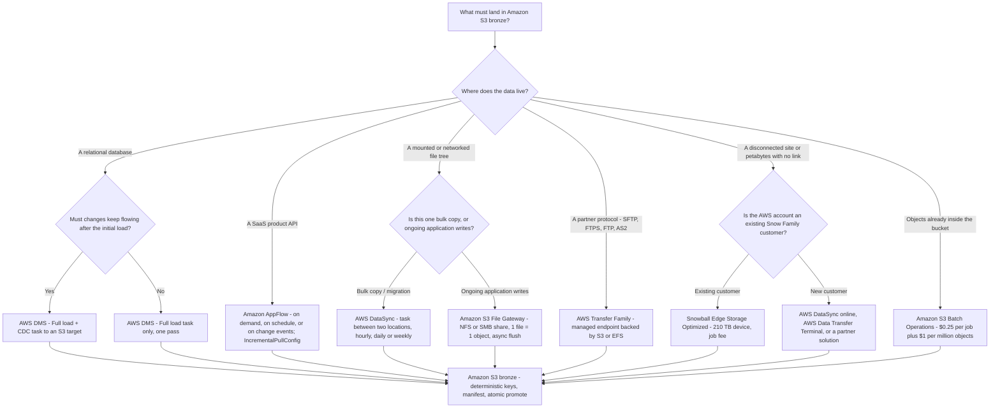
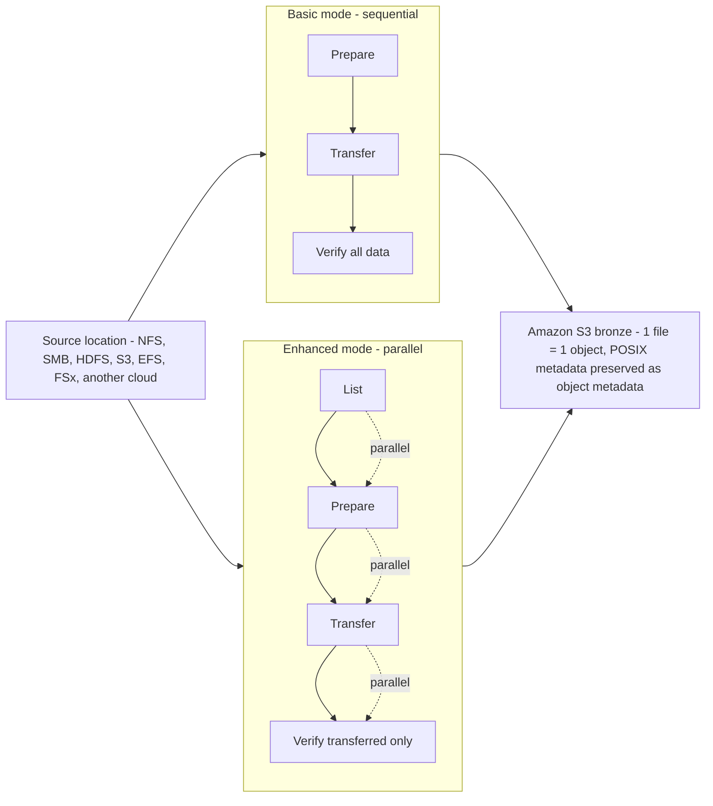
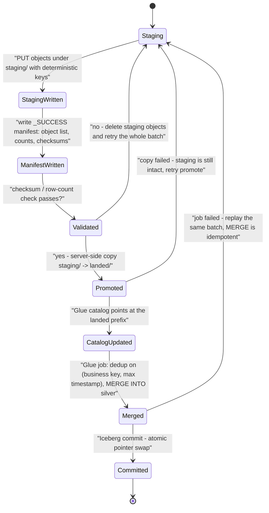
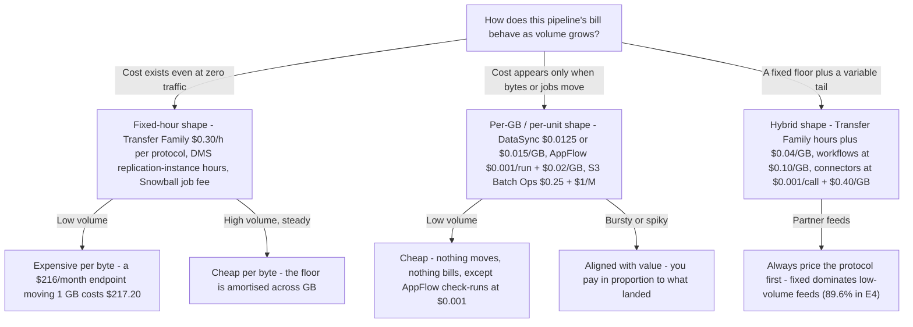
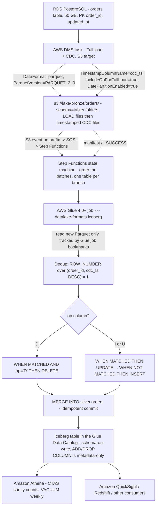

# Batch Ingestion Patterns: DMS, AppFlow, DataSync, and Transfer Family

Lesson 04 put a transactional table format on top of Amazon S3. This lesson is everything that happens *before* that — the byte-moving layer. A lakehouse with a perfect Iceberg silver layer and a badly chosen ingress service is a lakehouse with a two-week batch window, a duplicated bronze folder and a partner contract you cannot renegotiate.

The uncomfortable truth about batch ingestion is that the choice is almost never about throughput. Every service in this lesson can move the data. The choice is about **who controls the source** (you, a vendor API, a partner's SFTP client, a mounted share), **whether changes must keep flowing**, and **how the bill is shaped** — fixed hours versus gigabytes.

```text
=====================================================================
 BATCH INGESTION TOOLBOX — lesson 05 scope (as of Oct 2026)
---------------------------------------------------------------------
 Databases (RDBMS) ......... AWS DMS — full load, full load + CDC,
                             CDC only -> Amazon S3 (CSV default,
                             parquet via DataFormat=parquet)
 SaaS APIs ................ Amazon AppFlow — on demand / schedule /
                             event, IncrementalPullConfig, 15 GB per
                             Salesforce run, $0.001/run + $0.02/GB
 File systems (NFS/SMB/
 HDFS, other clouds) ....... AWS DataSync — agent or agentless,
                             Basic or Enhanced, hourly/daily/weekly,
                             TransferMode=CHANGED, checksum verify
 Hybrid ongoing writes ..... S3 File Gateway — NFS v3/v4.1, SMB
                             v2/v3, 1 file = 1 object, async flush
 Partner file feeds ........ AWS Transfer Family — SFTP/FTPS/FTP/
                             AS2 -> S3 or EFS, $0.30/h per protocol
 Offline bulk .............. Snowball Edge = LEGACY (existing
                             customers only since 2025-11-07;
                             commercial EOS 2026-12-31) -> DataSync,
                             Data Transfer Terminal, partners
 In-bucket reorg ........... Amazon S3 Batch Operations — $0.25/job
                             + $1 per million objects
---------------------------------------------------------------------
 Non-negotiable ............ S3 has no primary keys, no updates, no
                             referential integrity — every landing
                             must be IDEMPOTENT or you will double
                             rows on the first retry.
=====================================================================
```

In this lesson you will:

- run the **service-selection matrix** — source type to service — and defend each row against the two runners-up;
- configure **AWS DMS full load + CDC into Amazon S3**: `DataFormat=parquet`, `CdcMaxBatchInterval`/`CdcMinFileSize`, `IncludeOpForFullLoad`, `TimestampColumnName`, `TargetTablePrepMode`, parallel load modes and `GlueCatalogGeneration`;
- name the **S3-target limitations** that decide whether your bronze layer is a clean landing or a duplicate generator;
- build **AppFlow incremental pulls** — schedules, events, filters, offsets and the 15 GB Salesforce ceiling;
- place **DataSync agents**, choose **Basic vs Enhanced**, schedule `TransferMode=CHANGED` runs and read the verification story;
- stand up **Transfer Family** endpoints, workflows and connectors, and price them per protocol-hour;
- use **S3 File Gateway** for hybrid NFS/SMB writes and know its durability gap;
- state the **Snowball Edge** wind-down dates correctly (Snowcone 2024, new customers 2025-11-07, EOS 2026-12-31);
- apply the four **idempotent landing patterns** — deterministic keys, manifests, atomic promote, MERGE-from-staging;
- compare **fixed-hour versus per-GB cost shapes** before you commit to an architecture;
- walk a **worked DMS → bronze → Glue → Iceberg-silver** flow end to end;
- study **two named AWS customer cases** (FINRA, Transport for NSW) and a **sourced October 2026 update box**;
- practise with **13 exam-style questions** plus three interactive checks.

---

## 1. Service selection: source type to service

### 1.1 The matrix

This is the whole lesson in one table. Every row is a *constraint*, not a preference — read the left column first.

| Source type | Service | Shape of the move | Why this one |
|---|---|---|---|
| Relational database (Aurora, RDS, on-prem Oracle / SQL Server / MySQL / PostgreSQL) | **AWS DMS** | Full load, full load + CDC, or CDC only → S3 | Log-based capture plus a documented S3 target with Parquet, batching, partitioning and optional Glue catalog generation |
| SaaS API (Salesforce, Slack, ServiceNow, SAP `SAPOData`, Zendesk, Marketo, …) | **Amazon AppFlow** | On demand, on schedule, or on a source change event → S3 / Redshift | Managed connector profiles, field maps, filters and `IncrementalPullConfig` instead of hand-written pagination |
| On-premises NFS / SMB / HDFS tree, or another cloud, that you must **copy** in bulk | **AWS DataSync** | Task between two *locations*, scheduled, `TransferMode=CHANGED` | Parallel pipeline, always-on checksum integrity, 1 file ↔ 1 object with POSIX metadata preserved |
| On-premises application that must **keep writing** to a share that lands in S3 | **Amazon S3 File Gateway** | Continuous NFS/SMB read-write with local cache, async flush to S3 | Files map 1:1 to objects (path = key), so existing applications do not change |
| Partner or vendor that will only speak **SFTP / FTPS / FTP / AS2** | **AWS Transfer Family** | Managed protocol endpoint backed by S3 or EFS, up to 3 AZs | The protocol survives; the storage becomes a lake. Optional post-upload workflows (PGP decrypt at $0.10/GB) |
| Petabyte-scale **offline** or a site with no usable link | ~~Snowball Edge~~ → **DataSync** / **AWS Data Transfer Terminal** / partner | Ship-it or ship-to-facility | Snow Family is closed to new customers (2025-11-07) and reaches end of support 2026-12-31 |
| Re-tag / re-encrypt / re-locate / re-store objects **already in the bucket** | **Amazon S3 Batch Operations** | One job over a manifest of up to 4 billion objects | Purpose-built for in-bucket reorgs — not for row-level merges |

### 1.2 The decision flow



Two rules the flow encodes, both of which are examinable:

1. **Copy versus serve.** DataSync copies *from* a location *to* a location and finishes. File Gateway serves a live share whose writes happen to land in S3. They solve different halves of "the data is on NFS".
2. **Protocol versus API.** Transfer Family preserves a *protocol* the partner controls; AppFlow preserves a *vendor's API* with its rate limits and pagination. Neither substitutes for the other — AppFlow has no SFTP connector, and Transfer Family cannot page through Salesforce.

```matching
{
  "question": "Match each ingestion requirement to the single AWS service that satisfies it (as of Oct 2026):",
  "pairs": [
    {"left": "A SQL Server database must be copied to S3 and then kept in sync with its transaction log", "right": "AWS DMS - a Full load + CDC task with DataFormat=parquet and an S3 target endpoint"},
    {"left": "Salesforce account records must land in a bucket every hour and also on change events", "right": "Amazon AppFlow - scheduled plus event-triggered flows with IncrementalPullConfig and in-flow filters"},
    {"left": "A 40 TB on-premises NFS tree must be migrated once, then kept synchronized hourly", "right": "AWS DataSync - an agent on the file server, a task with TransferMode=CHANGED on a schedule"},
    {"left": "A legacy application must keep writing to /data/share while objects appear in S3", "right": "Amazon S3 File Gateway - NFS v3/v4.1 or SMB share, one file maps to one object with the path as the key"},
    {"left": "Thirty trading partners will only ever upload over SFTP, and that cannot change", "right": "AWS Transfer Family - a managed SFTP endpoint backed by S3, billed per enabled protocol-hour"},
    {"left": "Twelve million objects landed with the wrong tags after a bad job", "right": "Amazon S3 Batch Operations - one manifest-driven job at $0.25 plus $1 per million objects"}
  ],
  "explanation": "Each stem names a constraint: transaction-log sync -> DMS; vendor API with events -> AppFlow; one-off-then-delta file copy -> DataSync; a live share the application already mounts -> File Gateway; a partner-controlled protocol -> Transfer Family; a reorg of objects that already exist -> S3 Batch Operations. The two classic confusions are DataSync vs File Gateway (copy task vs live share) and Transfer Family vs AppFlow (protocol vs SaaS API) - neither pair is interchangeable."
}
```

- **📚 Did you know?** DMS names its S3 output mechanically: full-load files carry an **incremental hexadecimal counter** (`LOAD00001.csv`, `LOAD00002.csv`, …) while CDC files are named with **timestamps** (`20141029-1134010000.csv`), and *every non-empty source table gets its own folder* under the target path (AWS DMS S3 target docs, accessed 2026-10). That naming scheme is why an idempotent landing can be reasoned about at all — you can tell a load file from a change file from the key alone.

---

## 2. AWS DMS: full load + CDC into Amazon S3

### 2.1 The three task types, restated for the lakehouse

| Task type | What moves | Lakehouse use |
|---|---|---|
| **Full load** | Existing rows only, one pass | Seed bronze from a snapshot, or re-seed after a bad landing |
| **Full load + CDC** | Existing rows **and** changes captured while the load runs | The default: seed bronze, then keep feeding it |
| **CDC only** | Transaction-log changes from a chosen start point | Catch-up after a load, or a long-lived change feed |

For a lakehouse the target is not another database — it is a **prefix on S3**, which is where this differs from every migration tutorial you have read.

### 2.2 S3 target settings that actually matter

AWS documents the S3 target settings you will use in production. Grouped by purpose (AWS DMS S3 target docs and `S3Settings` API reference, accessed 2026-10):

| Purpose | Setting | Value you will set |
|---|---|---|
| Format | `DataFormat` | `csv` (default) or `parquet` — Parquet S3 target files supported from **DMS 3.4.7** |
| Location | `BucketName`, `BucketFolder` | The bronze prefix; layout becomes `s3://bucket/[folder]/schema/table/` |
| CDC file sizing | `CdcMaxBatchInterval` (seconds), `CdcMinFileSize` (KB) | AWS's own data-lake walkthrough: `3600` + `64000` to target **≥ 64 MB** files for Athena |
| Ordering | `TimestampColumnName` | Adds a source-commit timestamp column (e.g. `last_update_time`) for downstream dedup and sequencing |
| | `PreserveTransactions` + `CdcPath` | CSV pipelines only; preserves transaction order under `CdcPath` (**3.4.2+**) |
| Operation column | `IncludeOpForFullLoad` | Marks full-load rows with `I` so full-load and CDC files share a shape (**3.1.4+**, Parquet **3.4.7+**) |
| | `CdcInsertsOnly` / `CdcInsertsAndUpdates` | Narrow the op column; **mutually exclusive** — both true is invalid |
| Partitioning | `DatePartitionEnabled`, `DatePartitionSequence`, `DatePartitionDelimiter`, `DatePartitionTimezone` | Date-partitioned bronze so Athena/Glue can prune |
| Compression | `CompressionType`, `ParquetVersion`, `RowGroupLength`, `MaxFileSize` | Parquet sizing knobs |
| Encryption | `EncryptionMode`, `ServerSideEncryptionKmsKeyId` | SSE-KMS on the landing |
| Catalog | `GlueCatalogGeneration` | DMS creates Glue Data Catalog tables for the objects it identifies during migration |
| Auth to S3 | `ServiceAccessRoleArn` | IAM role assumed by DMS to write to the bucket |
| Load shape | `TargetTablePrepMode`, `MaxFullLoadSubTasks`, parallel-load modes | See §2.4 |

```fillblank
{
  "question": "Complete the S3 endpoint configuration that AWS's own data-lake walkthrough prescribes (values as of Oct 2026):",
  "template": "{{1}}=parquet makes DMS write Parquet instead of CSV; {{2}}=3600 and {{3}}=64000 target files of at least 64 MB for Athena; {{4}}=true stamps every full-load row with the operation letter I so full-load and CDC files share a shape.",
  "answers": {
    "1": "DataFormat",
    "2": "CdcMaxBatchInterval",
    "3": "CdcMinFileSize",
    "4": "IncludeOpForFullLoad"
  },
  "distractors": ["BatchApply", "PreserveTransactions", "TargetTablePrepMode", "MaxFileSize", "CdcPath", "GlueCatalogGeneration", "RowGroupLength", "EncryptionMode"],
  "explanation": "The four load-bearing settings are DataFormat=parquet (Parquet S3 target files supported from 3.4.7), CdcMaxBatchInterval in SECONDS, CdcMinFileSize in KILOBYTES (64000 KB = 64 MB), and IncludeOpForFullLoad (3.1.4+, Parquet 3.4.7+). The distractors are the near-misses: BatchApply is unsupported on S3 endpoints and can lose data, PreserveTransactions is the CSV ordering lever and conflicts with date partitioning, TargetTablePrepMode controls duplicate full-load files rather than file shape, MaxFileSize and RowGroupLength size Parquet rather than setting the Athena floor, and GlueCatalogGeneration writes catalog entries instead of data."
}
```

### 2.3 The full-load + CDC timeline on S3

```text
Phase 1  CAPTURE ....... CDC starts first; changes are cached on the
                        replication instance (memory, then disk spill)
Phase 2  FULL LOAD ..... existing rows written as LOAD<hex> files,
                        tables loading in parallel
Phase 3  APPLY ......... each table's cached changes are applied as
                        soon as that table finishes loading
Phase 4  STEADY STATE .. timestamp-named CDC files keep arriving;
                        watch CDCLatencySource / CDCLatencyTarget
```

Two things about S3 change the picture versus a database target:

- **S3 has no primary keys, no updates and no referential integrity** (AWS re:Post knowledge center, 2026-02-09). CDC files are therefore *event files*, not table states. Deduplication and ordering are your job downstream, which is exactly what `TimestampColumnName` and the `op` column are for.
- **Transaction order is not preserved by default.** The docs state that "by default for CDC, AWS DMS stores the row changes for each database table without regard to transaction order." For CSV you may set `PreserveTransactions=true` with `CdcPath`; for Parquet you add `TimestampColumnName` and reconstruct order in the Glue job.

### 2.4 Parallel full load and target-table prep

| Lever | What AWS documents |
|---|---|
| Tables in parallel | `MaxFullLoadSubTasks` — AWS's Oracle-to-S3 walkthrough uses **49**; parallel-load modes are `ranges`, `partitions-optimized` and `partitions-auto`, and "with the ranges option, full load finishes faster" for a partitioned table |
| `TargetTablePrepMode` | **`DO_NOTHING`**, **`TRUNCATE`** (console name *Truncate*), **`DROP`** — the walkthrough chooses `DO_NOTHING` "because we want to control the retention of files from previous runs" |
| LOB handling | **Full LOB mode is not supported** on S3 targets — pick a `LOB Max Size` instead |
| Schema changes during full load | **Not supported.** DDL mid-load must wait for steady state |
| Replication instance classes | T3, C5, C6i, R5, R6i (the docs table also lists R7i sizing up to `dms.r7i.48xlarge`, 192 vCPU / 1,536 GiB) |
| Serverless option | DMS Serverless is AWS's recommendation "for heterogeneous migrations or continuous data replications with data fluctuations" (1 DCU = 2 GB RAM) |
| Validation | S3 target validation needs **DMS 3.5.0+** with `DataFormat=parquet`, runs **once a day at 00:00 UTC** via Athena CTAS, caps Athena bucketed tables at **100,000 buckets**, and **fails on Lake Formation-managed buckets** |

> [!WARNING]
> ⚠️ **Six S3-target limitations that decide whether bronze is trustworthy** (AWS DMS S3 target docs, accessed 2026-10):
> - **Do not enable versioning on the DMS target bucket** — endpoint test connections can fail on an S3 `list-object` timeout.
> - **`BatchApply` is not supported for an S3 endpoint** and "might result in loss of data" — leave it off.
> - **`TargetTablePrepMode=DO_NOTHING` can write duplicates** if the task stops and resumes abruptly during full load. AWS's guidance: prefer `TRUNCATE_BEFORE_LOAD`, and before restarting, **manually delete the previously created full-load files**.
> - **Two tasks replicating the same source table into the same target bucket write to the same file.** One source table, one task, one prefix.
> - **Schema changes during CDC are only half-recorded:** truncate/drop/create/rename table, add/drop/rename column and change column type are captured as DDL, but *"no ALTER statement is recorded in the target S3 bucket, and AWS DMS does not alter previously created records to match the new structure."* New files simply use the new shape.
> - **Validation is not a row count.** Daily at midnight UTC only, Parquet only, and it breaks on Lake Formation-managed buckets.

That fifth bullet is the single most important sentence in this lesson: **bronze is a schema-on-read surface.** Old files keep old shapes forever. Only an Iceberg silver layer plus a Glue catalog entry restores schema-on-write semantics (lesson 04) — which is precisely the flow in §11.

### 2.5 Worked example E1 — Athena-friendly CDC sizing (as of Oct 2026)

AWS's own SQL Server-to-data-lake step-by-step tells you the two settings and the reason:

> "Because we plan to use Amazon Athena to query data from our Amazon S3 bucket, we need to make sure that our target file size is at least 64 MB. Specify the following endpoint settings: `CdcMaxBatchInterval=3600` and `CdcMinFileSize=64000`." (AWS DMS SBS, accessed 2026-10)

```text
Worked example E1 - sizing a 50 GB full load and one hour of CDC
----------------------------------------------------------------
Source .................. RDS PostgreSQL, table orders, 50 GB,
                         PK order_id, updated_at
Endpoint ................ DataFormat=parquet, ParquetVersion=
                         PARQUET_2_0, IncludeOpForFullLoad=true,
                         TimestampColumnName=cdc_ts,
                         DatePartitionEnabled=true (day),
                         CdcMaxBatchInterval=3600, CdcMinFileSize=
                         64000  (= 64,000 KB target)
Athena floor ............ >= 64 MB per file (AWS SBS guidance)

Full load files ......... 50 GB = 51,200 MB
                          51,200 / 64 = 800 files
CDC window .............. 3,600 s x 100 rows/s = 360,000 events
                          -> about 1 Parquet file per hour, because
                          AWS notes Parquet files land SMALLER than
                          CdcMinFileSize (compression ratio varies),
                          while CSV files equal CdcMinFileSize
Parallelism ............. MaxFullLoadSubTasks (tables in parallel)
                          x ranges / partitions-optimized /
                          partitions-auto for a partitioned table
Gotcha .................. a stalled full load + DO_NOTHING restart
                          re-writes LOAD* files -> duplicates
```

The examinable chain: **Athena wants ≥ 64 MB files → `CdcMinFileSize=64000` KB and `CdcMaxBatchInterval=3600` s → Parquet lands smaller than the target because of compression → so a naive "one file per hour" assumption is wrong for Parquet and right for CSV.**

---

## 3. Amazon AppFlow: SaaS to S3 with incremental pulls

### 3.1 Connectors, triggers, and the incremental contract

AppFlow's source `ConnectorType` values include `Salesforce`, `Slack`, `Servicenow`, `SAPOData` (SAP), `Zendesk`, `Marketo`, `Googleanalytics`, `Datadog`, `S3`, `Redshift`, `Snowflake`, `CustomConnector` and `EventBridge`, among others; destinations for Salesforce flows include **Amazon S3**, Amazon Redshift, Amazon EventBridge, Snowflake and Zendesk (CloudFormation `SourceFlowConfig` docs and the Salesforce connector guide, accessed 2026-10).

| Lever | Behaviour (as of Oct 2026) |
|---|---|
| Trigger | **On demand**, **on a schedule**, or **on a source change event** ("an event-triggered flow runs when Amazon AppFlow detects a change to the target data in the CRM storage service") |
| Incremental pull | `IncrementalPullConfig` — transfers "only the records that have been added or changed since the last successful flow run" |
| First scheduled run | "The first schedule-triggered flow will pull **30 days** of past records at the time of the first flow run" |
| Offset | Guards source-side timestamping lag: records new or changed between `T0 − t` and `T1 − t` are imported at `T1` |
| Pruning / gating | In-flow **Filters** ("specify what data the flow transfers") and validations run *before* landing |
| Salesforce ceiling | **15 GB per flow run** ≈ **7.5 million records** at 2 KB average (records can be up to 4 KB) — split larger pulls with filters |
| Profile quota | Soft quota of **100 connector profiles per AWS account** |
| Prerequisite | Salesforce needs a Connected App; ServiceNow needs "no pre-requisite configuration for either AWS or ServiceNow" |

### 3.2 Worked example E2 — what a scheduled Salesforce pull costs (as of Oct 2026)

AWS's pricing page publishes the arithmetic rather than a rate table. From the us-east-1 and Frankfurt examples (accessed 2026-10): **$0.001 per successful flow run**, **$0.02 per GB processed**, and — critically — *"Flow runs to check for new data will count towards your flow run costs, even if no new data is available."*

```text
Worked example E2 - hourly Salesforce -> S3 incremental flow
------------------------------------------------------------
Cadence ............. every hour, 24 x 30 = 720 runs / month
                      + 1 event-triggered run per business day
                      = 22 more runs -> 742 runs
Flow-run cost ....... 742 x $0.001 = $0.742  ->  $0.74
Volume .............. 600 GB changed / month
Data cost ........... 600 / 1 x $0.02 = $12.00
Monthly total ....... $0.74 + $12.00 = $12.74
Published anchors ... "1000 x $0.001 = $1 a day" (AWS example)
                      Frankfurt: "10 GB / (1 GB) x $0.02 = $0.20"
Empty runs .......... 742 checks bill even if 0 rows changed
Salesforce cap ...... 600 GB / 15 GB = 40 runs minimum if the
                      pull were one big sweep; filters keep each
                      run comfortably under 15 GB / 7.5M records
```

Two design consequences fall out of the pricing page, not out of the feature list:

1. **A poll cadence is a line item.** Checking every five minutes costs 8,640 runs/month in a 30-day month, whether or not anything changed. Set the schedule from the freshness the *consumer* needs.
2. **The 30-day first pull is a deduplication event.** Your bronze layer receives a month of history on run one and deltas thereafter, so the landing must be idempotent (§9) or day-one bronze will double-write anything that also arrived through another path.

> [!IMPORTANT]
> ⚠️ **Do not claim Parquet landing from AppFlow without re-checking the S3 output format docs.** The official pages retrieved for this lesson show `fileType: CSV` and describe CSV/JSON output; Parquet output was **not confirmed** in the retrieved material. Treat AppFlow as a CSV/JSON lander unless you have verified otherwise for your Region and connector, and do the format conversion in the Glue step instead.

- **📚 Did you know?** AppFlow bills the *check*, not just the *change*: AWS's own pricing page states that runs "to check for new data will count towards your flow run costs, even if no new data is available." For SAP flows AWS shows a concurrency multiplier instead — "you apply 9 concurrent processes … (1+9) x $0.001 (flow cost)" — so parallelism multiplies run charges rather than saving them (AWS AppFlow pricing, accessed 2026-10).

---

## 4. AWS DataSync: agents, task modes, schedules, verification

### 4.1 Agent or agentless?

A DataSync **task** copies between two **locations**. Whether you need an agent is decided by where those locations live (AWS DataSync docs, accessed 2026-10):

| Location pair | Agent needed? |
|---|---|
| NFS / SMB / HDFS on-premises ↔ S3, EFS, FSx | **Yes** — a VM agent (ESXi, KVM, Nutanix AHV, Hyper-V) or an AMI on EC2 |
| Amazon S3 ↔ Amazon S3 in the **same AWS account** | **No** |
| Amazon S3 ↔ a different AWS storage service **across accounts** | **No** |
| Amazon S3 ↔ a different cloud | **No** for Enhanced mode |

Rules that bite in production:

- A location can hold **up to four Basic-mode agents and up to four Enhanced-mode agents**, and *"All the agents associated with a location must be online before you can start your transfer task. If one of the agents is offline, you can't run your task."* Multi-agent gives speed, not failover.
- Enhanced-mode agents and Basic-mode agents are **not interchangeable** for the same location.
- NFS defaults to **version 4.1** (also 4.0 and 3.x) over **TCP 2049** (plus **111** for v3); destination exports need `no_root_squash`, and DataSync **does not copy NFSv4 ACLs**.

### 4.2 Basic versus Enhanced task modes

| | **Basic** | **Enhanced** |
|---|---|---|
| Pipeline | **Sequential** prepare → transfer → verify | **Parallel** list, prepare, transfer and verify |
| Verification | Verifies **all data by default** | Verifies **only transferred data** |
| Object-count quota | **50 million** items/task (on-prem ↔ AWS), **25 million** (AWS ↔ AWS) | **Virtually unlimited** |
| Memory guidance | Allocate **64 GB RAM** to the agent above 20 million files/objects/directories | — |
| Pricing shape | **$0.0125/GB** copied (pricing-page example) | **$0.015/GB** + **$0.55 per task execution** (pricing-page example) |
| Integrity | Checks **always** run during transfer (checksum + metadata compare) | Same |

Task options worth memorising: `TransferMode=CHANGED`, `VerifyMode=ONLY_FILES_TRANSFERRED`, `ObjectTags=PRESERVE`, `LogLevel=TRANSFER`, plus filters/manifests and optional **deletion mirroring** (delete in the destination what no longer exists in the source). Scheduling is **hourly, daily or weekly** directly in the console.



### 4.3 Worked example E3 — 20 TB from NFS to S3, Basic vs Enhanced (as of Oct 2026)

Using the rates printed in AWS's own worked examples on the DataSync pricing page (accessed 2026-10):

```text
Worked example E3 - 20 TB NFS -> S3, one-off then daily deltas
----------------------------------------------------------------
Basic mode
  20 TB x 1024 GB = 20,480 GB
  transfer ...... 20,480 x $0.0125 = $256.00
  execution fee . none
  quota check ... 20,480 GB of many small files could exceed the
                  50 million item/task ceiling -> shard the tree
                  into <50M-item tasks (64 GB agent RAM above 20M)
  Subtotal ...... $256.00 + S3 PUT/GET requests

Enhanced mode
  transfer ...... 20,480 x $0.015 = $307.20
  executions .... 30 daily runs x $0.55 = $16.50
  Subtotal ...... $323.70 + S3 PUT/GET requests

Delta ........... Enhanced costs $67.70 more per month here, and
                  buys: parallel pipeline, virtually unlimited
                  object counts, per-execution metrics, and
                  verify-only-transferred instead of verify-all
AWS anchor ...... "(50 TB * 1024 GB copied using DataSync *
                  $0.015/GB) ... (1 task execution * $0.55) =
                  ... $797.58" (Enhanced)
                  "(50 TB copied into S3 * 1024 GB * $0.0125/GB)
                  = $656.38" (Basic)
```

**Read the trap before you copy anything.** AWS's Storage Blog warns that objects seeded into a bucket by *other tools* lack DataSync metadata, so DataSync performs `HEAD` + `GET` + an in-place copy — and objects in archive storage classes cannot be `GET` at all, forcing a full re-transmission over the wire (plus a new version if versioning is on). The blog's advice: *"use DataSync to perform the initial transfer to S3 whenever possible"* and consider suspending S3 versioning on the bucket. Do the **first** sync with DataSync into an empty bucket.

- **📚 Did you know?** DataSync's "changed since last run" detection depends on **DataSync's own metadata**. AWS's blog states that DataSync "automatically copies each file as a single S3 object in a 1:1 relationship, and preserves POSIX metadata on the source file as Amazon S3 object metadata" — and that objects uploaded by other tools trigger the HEAD+GET+COPY path (AWS Storage Blog, 2021-08-24). A hybrid pipeline where a partner's SFTP feed and DataSync both write one prefix will therefore pay for re-copies forever.

---

## 5. AWS Transfer Family: partner protocols into the lake

### 5.1 What it is

Transfer Family is a **fully managed endpoint** speaking SFTP (v3), FTPS, FTP, AS2 or a browser, backed by **Amazon S3** or **Amazon EFS**, *"supports up to 3 Availability Zones and is backed by an auto scaling, redundant fleet."*

| Design point | Options and limits (as of Oct 2026) |
|---|---|
| Endpoint type | **Public** (SFTP only), **VPC – Internet** (SFTP, FTPS, AS2), **VPC – Internal** (SFTP, FTP, FTPS, AS2) |
| Authentication | Service-managed users, **AWS Managed Microsoft AD**, or **API Gateway + Lambda** — password authentication needs AD or the custom wiring |
| Post-upload **workflows** | PGP decrypt / validate / notify — **$0.10/GB processed** |
| **SFTP connectors** | Pull from or push to remote SFTP servers: **$0.001 per connector call** + **$0.40/GB**; 100/account, 150 GiB/file, 1,000 queued ops, 50 MBps/account, 5 parallel sessions, 100 paths/s |
| Sessions / idle | **10** concurrent multiplexed SFTP sessions per connection; **1,800 s** (30 min) idle timeout |
| File size | **5 TB** (the S3 object ceiling) |
| S3 semantics leak | Rename "Supported for files only. Renaming that would overwrite an existing file is not supported"; **SETSTAT unsupported** with S3 |

> [!WARNING]
> ⚠️ **Transfer Family bills per enabled protocol-hour, even when idle.** AWS's worked example: SFTP at **$0.30/hour** → `$0.30 × 24 × 30 = $216` per month, plus `$0.04 × GB` for data moved. Enabling SFTP **and** FTPS on the same endpoint doubles the fixed charge. Two client-side traps travel with it: multi-connection single uploads against S3 can "fail in unpredictable ways" and leave **orphaned multipart uploads that incur Amazon S3 charges**; and because the protocol maps onto S3, a rename that would overwrite is rejected.

### 5.2 Worked example E4 — the partner feed bill (as of Oct 2026)

```text
Worked example E4 - 30 partners on one SFTP endpoint (us-east-1)
----------------------------------------------------------------
Endpoint ............. SFTP only, always on
  $0.30/h x 24 x 30 = $216.00
Data .................. 400 GB uploads + 100 GB downloads
  500 GB x $0.04  = $ 20.00
Workflow .............. 50 GB PGP-decrypted at $0.10/GB
  50 x $0.10      = $  5.00
Monthly total ......... $241.00
Shape ................. fixed $216 = 89.6% of the bill; at this
                        volume the protocol-hour, not the data,
                        dominates
Published anchor ...... dual-protocol 1,000-user example:
                        "$216 + $180 + $216 + $360 = $972"
                        (two protocols, two endpoint flavours)
Lesson ................ enabling a second protocol "to be safe"
                        costs $180/month before a byte moves
```

---

## 6. Amazon S3 File Gateway: hybrid NFS writes that land in S3

An S3 File Gateway appliance (VM, hardware or EC2) exports **NFS v3/v4.1** or **SMB v2/v3** shares; *"Files written to a file share become objects in Amazon S3, with the path as the key. There is a one-to-one mapping between files and objects."*

| Property | Detail (as of Oct 2026) |
|---|---|
| Encryption | **SSE-S3** by default; SSE-KMS and DSSE-KMS optional — "make sure that your file share uses the same encryption type as the Amazon S3 bucket" |
| Integrity | File Gateway populates the **`Content-MD5`** header; all transfer over HTTPS |
| Write path | Application writes are stored in the **cache synchronously**, then uploaded to S3 **asynchronously** |
| Bucket mapping | **One file share → one bucket**; multiple shares may share a bucket only with "a unique, non-overlapping S3 bucket prefix" |
| Metadata capacity | Default gateway capacity **Small** = metadata for up to **5 million files**; **8** S3 upload threads by default |
| Price | **$0.01/GB written to AWS**, first **100 GB/month free** per gateway, capped at **$125 per gateway per month**; **reads are free** (S3 requests/storage still apply) |
| Scope | "S3 File Gateway is not designed to act as a full enterprise NAS replacement. S3 File Gateway emulates a file system, but it is not a file system." |

The durability gap is the operational point: writes are durable only **after** the cache flushes, so AWS instructs you to *"make sure that the `CachePercentDirty` CloudWatch metric is `0`"* before stopping the host that runs the gateway. And with versioning on, a single file write creates **two** object versions — one for the data, one for the metadata update.

**When to pick File Gateway over DataSync:** if an application must *keep writing* through a POSIX path, it is File Gateway. If you need to *copy* a tree on a schedule, it is DataSync. Using DataSync to fake a writable share, or File Gateway to fake a migration, both produce the wrong failure mode.

---

## 7. Offline bulk: the Snowball Edge pattern (and its 2026 status)

Teach the *pattern* — a shipped disk that lands verified bytes in S3 — but teach the **product status** correctly, because most content on the open web is now stale.

| Milestone | Date | Consequence |
|---|---|---|
| **Snowcone discontinued** | 2024-11-12 | Existing-customer support ended 2025-11-12 |
| **Snowball Edge closed to new customers** | 2025-11-07 | AWS directs new bulk-offline needs to **AWS DataSync**, **AWS Data Transfer Terminal**, AWS Partner solutions |
| **No Snow Family devices for new customers to order** | current | "AWS will no longer offer any AWS Snow Family devices for new customers to order" |
| **Commercial-Region end of support** | **2026-12-31** | Applies to Storage Optimized **and** Compute Optimized devices |

Device and price anchors for anyone maintaining an existing deployment (AWS Snowball pricing, us-east-1, accessed 2026-10): **Storage Optimized 210 TB** usable; **On-Demand Job Fee up to 100 TB (includes 15 days) $1,800**; **101 TB–210 TB $3,200**; **$250 per day** beyond 15 days; **$9,885 per month**; **1-year commitment upfront $97,268**; S3-compatible on-device storage **$0.01 per GB-month** or **$0.12 per GB-year**. Compute Optimized reaches **104 vCPUs, 416 GB memory and 28 TB of dedicated NVMe SSD**.

- **📚 Did you know?** The offline *pattern* outlives the product. With Snowcone gone and Snowball Edge restricted, AWS's own migration note points at DataSync for online transfers, **Data Transfer Terminal** for secure physical uploads, and partners — the architecture question ("how do 500 TB reach S3?") still has the same three answers, only the order of preference changed (AWS Snow device updates, 2024-11-12; Snowball Edge availability change docs, accessed 2026-10).

---

## 8. Amazon S3 Batch Operations: reorganising what already landed

S3 Batch Operations is the repair tool for a landing that went wrong, and the migration tool for a prefix layout you are changing. One job runs one operation over a **manifest**:

- copy objects, update server-side encryption, set object tags or ACLs, initiate restores from S3 Glacier Flexible Retrieval, invoke an **AWS Lambda** function, Object Lock and Batch Replication;
- default manifest size **4 billion objects**, rising to **20 billion** for Copy, Object Tagging, Object Lock, Lambda invoke and Batch Replication;
- manifest format `S3BatchOperations_CSV_20180820`, commonly generated from **S3 Inventory**;
- price: **$0.25 per job** + **$1.00 per million objects processed** (AWS S3 pricing, accessed 2026-10).

### 8.1 Worked example E5 — repairing a mis-tagged landing (as of Oct 2026)

```text
Worked example E5 - 12,000,000 objects tagged after a bad job
----------------------------------------------------------------
Job fee ................. 1 x $0.25      = $  0.25
Per-object .............. 12,000,000 / 1,000,000 x $1.00
                        = 12 x $1.00    = $ 12.00
Subtotal ................                = $ 12.25
                     (+ S3 PUT tagging requests for the objects)
Published anchor ........ AWS's own 1,000,000-object example
                          totals "$1.25"
Contrast ................ a per-object SDK loop is the same
                          12M PUTs but with your own retries,
                          throttling and no completion report
Scope ................... object-level ONLY - tags, keys,
                          encryption, ACLs, restore, Lambda.
                          Row-level merges belong to Iceberg
                          (lesson 04), not to Batch Operations
```

---

## 9. Idempotent landing: the four patterns

Everything so far produces *files*. S3 will happily accept the same file twice, and AWS's own guidance is blunt: **"Amazon S3 doesn't support primary keys, updates, or referential integrity."** So the landing layer — the part between the mover and the table format — needs a retry-safe contract.

| # | Pattern | Mechanism | Failure it defeats |
|---|---|---|---|
| 1 | **Deterministic keys** | Encode source, table, partition date and a content/batch hash in the key so a retry **overwrites** instead of appending | Duplicate objects from a retried upload |
| 2 | **Manifest files** | Write a `_SUCCESS`/manifest listing objects, row counts and checksums; consumers read a batch **only when its manifest is complete** | Downstream jobs reading a half-written batch (the Step Functions + SQS + manifest pattern) |
| 3 | **Atomic promote** | Write to `staging/…`, then server-side copy (`CopyObject`) to `landed/…` | Readers seeing partial files; note Transfer Family's rename is **non-overwriting**, so promotion is a copy, not a move |
| 4 | **MERGE from staging** | Land raw files immutably, then `MERGE INTO silver USING staging` on business key + timestamp dedup | A replayed CDC file changing silver twice — the commit stays idempotent |



### 9.1 Ordering the steps

```dragdrop
{
  "question": "Order the idempotent landing sequence from raw write to a committed silver row:",
  "items": [
    "Write raw files to a staging prefix using deterministic keys - source, table, partition date and a content or batch hash inside the key",
    "Write a manifest or _SUCCESS object listing the batch's objects, row counts and checksums",
    "Validate the batch - checksums and counts match the manifest, or the batch is discarded and retried",
    "Promote atomically - server-side copy from staging/ to landed/ so readers never observe a partial batch",
    "Update the Glue Data Catalog entry for the landed prefix",
    "Run the Glue job: dedupe on the business key with max(timestamp), then MERGE INTO the Iceberg silver table"
  ],
  "correctOrder": [
    "Write raw files to a staging prefix using deterministic keys - source, table, partition date and a content or batch hash inside the key",
    "Write a manifest or _SUCCESS object listing the batch's objects, row counts and checksums",
    "Validate the batch - checksums and counts match the manifest, or the batch is discarded and retried",
    "Promote atomically - server-side copy from staging/ to landed/ so readers never observe a partial batch",
    "Update the Glue Data Catalog entry for the landed prefix",
    "Run the Glue job: dedupe on the business key with max(timestamp), then MERGE INTO the Iceberg silver table"
  ],
  "explanation": "The order is write -> attest -> verify -> promote -> catalog -> merge. Two properties make it idempotent: deterministic keys mean a retry overwrites rather than appends, and the manifest is the gate that stops downstream reading a half-written batch. Promotion is a server-side COPY rather than a rename because S3 has no atomic rename and Transfer Family's rename refuses to overwrite. The final MERGE is what makes a replayed CDC file safe - dedupe first (exactly one source record may match one target row), then MERGE, so a second run of the same batch leaves silver unchanged."
}
```

### 9.2 The MERGE that makes replay safe

From AWS's own CDC-into-Iceberg recipes (Big Data Blog, 2022-06-15 updated May 2023; 2023-02-14): DMS supplies the `op` attribute for incremental CDC data but **not** for the initial load unless you set **`IncludeOpForFullLoad=true`**; the Glue job deduplicates on the `last_update_time` column that `TimestampColumnName` added, then runs

```sql
MERGE INTO silver.orders s
USING staged_orders d
   ON s.order_id = d.order_id
WHEN MATCHED AND d.op = 'D' THEN DELETE
WHEN MATCHED THEN UPDATE SET s.status = d.status, s.updated_at = d.updated_at
WHEN NOT MATCHED THEN INSERT (order_id, status, updated_at)
VALUES (d.order_id, d.status, d.updated_at);
```

### 9.3 Worked example E6 — what a replay costs you (as of Oct 2026)

```text
Worked example E6 - the same CDC batch delivered twice
----------------------------------------------------------------
Batch ............. CDC file with 5,000 events for 800 distinct
                    order_ids, cdc_ts stamped by TimestampColumnName
Run 1 - naive INSERT INTO
                    silver rows +5,000 -> total 5,000 for these keys
Run 2 - replay of the SAME file
                    silver rows +5,000 -> total 10,000  (doubled)
                    Athena count(*) is now wrong for every
                    downstream dashboard, silently
Run 1 - dedupe then MERGE
                    ROW_NUMBER() OVER (PARTITION BY order_id
                    ORDER BY cdc_ts DESC) = 1  -> 800 rows
                    MERGE: 320 'D' deletes, 480 I/U upserts
                    silver rows for these keys = 800 net
Run 2 - replay of the SAME file
                    dedupe again -> same 800 rows
                    MERGE matches identically -> net change 0
                    Result: idempotent commit, row count unchanged
Rule .............. "Only one record in the source data can
                    update any given row of the target table, or
                    else an error will be thrown" - dedupe first,
                    every time, before MERGE ever runs
```

- **📚 Did you know?** A DMS task restart can manufacture duplicates on its own. AWS's guidance for `TargetTablePrepMode=DO_NOTHING` is that a task stopping during full load "writes the full load files again when it restarts" — so you must either switch to `TRUNCATE_BEFORE_LOAD` or manually delete the earlier `LOAD*` files before restarting (AWS re:Post, 2026-02-09). Idempotency is not only about your Glue job; it is about the mover's restart behaviour too.

---

## 10. Cost shape: fixed-hour versus per-GB

Before you commit to an architecture, work out which of these three shapes the bill takes. They behave completely differently as volume grows.

```text
=====================================================================
 COST SHAPES (published rates, us-east-1 examples, as of Oct 2026)
---------------------------------------------------------------------
 FIXED-HOUR / FIXED-CAPACITY
   Transfer Family .... $0.30 per enabled protocol-hour
                        -> $216/month per protocol, idle or not
   AWS DMS ............. replication-instance hours (or DCUs for
                        Serverless; 1 DCU = 2 GB RAM) + storage
                        (100 GB GP2 on C4/R4/R5, 50 GB on T2/T3)
                        + Multi-AZ recommended for ongoing work
   Snowball Edge ....... $1,800 (<=100 TB, 15 days) / $3,200
                        (101-210 TB) / $250 per extra day
                        / $9,885 per month
 PER-GB / PER-UNIT
   DataSync ............ Basic $0.0125/GB; Enhanced $0.015/GB
                        + $0.55 per task execution
   AppFlow ............. $0.001 per successful run + $0.02/GB
   S3 Batch Operations . $0.25 per job + $1.00 per million objects
   File Gateway ........ $0.01/GB written, first 100 GB free,
                        $125/gateway/month cap, reads free
 HYBRID (fixed floor + variable)
   Transfer Family data  $0.30/h/protocol + $0.04/GB moved
   Transfer workflows ... $0.10/GB processed (e.g. PGP decrypt)
   SFTP connectors ...... $0.001/call + $0.40/GB
=====================================================================
```



The worked example in §5.2 is the proof: a 500 GB partner feed on Transfer Family costs **$241**, of which **$216 (89.6%)** is protocol-hour. The same 500 GB through DataSync at the Basic rate would be 500 × $0.0125 = **$6.25**. Transfer Family is still the correct answer — because the *partner* is the constraint — but you should know you are buying protocol compatibility, not bandwidth.

> [!IMPORTANT]
> ⚠️ **Do not quote a DMS instance $/hour from memory.** AWS renders the DMS on-demand instance table dynamically, and the figures captured for this lesson could not be verified from the pricing page (they appear only in third-party blogs). The verified structure is: instance **classes** (T3, C5, C6i, R5, R6i, R7i), included storage (**100 GB GP2** on C4/R4/R5 classes, **50 GB** on T2/T3), **$0.075 per vCPU-hour** for T3 CPU credits in unlimited mode, **1 DCU = 2 GB RAM** for DMS Serverless, "all data transfer into AWS DMS is free", and same-AZ DMS↔RDS traffic free. Pull the live rate from `aws.amazon.com/dms/pricing/` before you model a bill.

---

## 11. Worked end-to-end: DMS → bronze → Glue → Iceberg silver

### 11.1 The flow



### 11.2 The outline, step by step (as of Oct 2026)

```text
Worked example E7 - RDS orders (50 GB) into an Iceberg silver table
--------------------------------------------------------------------
Step 1  DMS ENDPOINT (S3 target)
        DataFormat=parquet ......... Parquet from DMS 3.4.7
        ParquetVersion=PARQUET_2_0
        IncludeOpForFullLoad=true .. full-load rows carry 'I',
                                      so full-load and CDC share a
                                      shape (3.1.4+, parquet 3.4.7+)
        TimestampColumnName=cdc_ts . source commit timestamp for
                                      dedup + ordering
        DatePartitionEnabled=true .. day partitions for pruning
        CdcMaxBatchInterval=3600 ... one hour of change per file
        CdcMinFileSize=64000 ....... >= 64 MB target for Athena
        ServiceAccessRoleArn ....... IAM role to write the bucket
        GlueCatalogGeneration ...... optional Glue tables created
                                      as DMS migrates
Step 2  TASK
        Type: Full load, ongoing replication
        TargetTablePrepMode: DO_NOTHING (control retention) - and
          therefore NEVER restart mid-full-load without cleaning
          the prior LOAD* files
        MaxFullLoadSubTasks / ranges / partitions-auto for the
          partitioned full load; LOB Max Size (no Full LOB mode)
Step 3  ORCHESTRATION
        S3 event -> SQS -> Step Functions; SQS holds batch order,
        Step Functions fans out per table, Glue job bookmarks
        track which CDC files are new
Step 4  GLUE JOB (silver)
        read bronze Parquet -> dedup on (order_id, max cdc_ts)
        -> split op: D vs I/U -> MERGE INTO silver.orders
        -> schema evolution via Iceberg ADD/DROP COLUMN
Step 5  VERIFY
        Athena CTAS sanity counts; DMS S3 validation if you want
        it (3.5.0+, parquet, daily 00:00 UTC, not on LF buckets);
        VACUUM weekly to expire snapshots
Numbers . 50 GB / 64 MB = ~800 full-load files
        3,600 s x 100 rows/s = 360,000 CDC events/hour
        Parquet compresses below CdcMinFileSize -> fewer,
        smaller files than the CSV equivalent
```

Every ingredient in that block is drawn from AWS's published patterns: Step Functions + SQS ordering with Glue jobs creating the silver layer (Big Data Blog, 2024-10-30), a Glue job bookmark driving incremental `MERGE` with `last_update_time` dedup (2023-02-14), and two DMS tasks splitting full-load and date-partitioned CDC folders for an Athena-native `MERGE` (2023-04-27).

### 2026 Updates (as of October 2026)

> [!NOTE]
> **What changed around batch ingestion that this lesson depends on** — each line sourced and dated:
> - **2025-05-14 — Firehose gained a Glue multi-catalog hierarchy.** The Firehose document history records "Glue multi-catalog hierarchy" support, so a delivery can target a non-default catalog such as **S3 Tables** rather than only the account's default Glue catalog (Amazon Data Firehose User Guide, document history, accessed 2026-10-11). Relevance: the *destination* side of ingestion now has a managed Iceberg option alongside DMS → bronze → Glue.
> - **2025-01-27 — Amazon S3 Metadata is GA.** "S3 Metadata makes it easy to query and filter S3 object metadata using SQL… you can query object metadata using Amazon Athena" — object metadata lands in S3 Metadata tables that appear in the Glue Data Catalog / Athena (AWS News Blog, 2025-01-27). Relevance: auditing *what* a landing actually produced (sizes, keys, counts) without a full S3 Inventory cycle.
> - **2026-08-21 — AWS Glue 6.0 is GA with a 30% price reduction.** "AWS Glue 6.0 is now generally available, delivering a 30% price reduction and introducing full support for Apache Iceberg v3" with Spark 4.1, Python 3.13 and **Spark Declarative Pipelines** for built-in orchestration (AWS News Blog, 2026-08-21). Relevance: the MERGE stage of §11 gets cheaper and can carry its own orchestration.
> - **2025-11-07 — Snowball Edge closed to new customers.** "AWS Snowball Edge devices will only be available to existing customers. New customers should explore AWS DataSync for online transfers, AWS Data Transfer Terminal for secure physical transfers, or AWS Partner solutions" (AWS Snow device updates, 2024-11-12 notice; Snowball Edge availability docs, accessed 2026-10).
> - **2026-12-31 — Snowball device end of support in commercial Regions.** "On December 31, 2026, AWS will discontinue support for AWS Snowball devices in all AWS commercial Regions. This includes both the AWS Snowball Edge Storage Optimized and Compute Optimized devices" (aws.amazon.com/snowball, accessed 2026-10). Any runbook that still says "order a Snowball" needs rewriting this quarter.

---

## Real-World Case Studies

AWS publishes what these patterns look like in production. Every figure below is **customer- or AWS-claimed and unaudited**, with the source named so you can check it — the examinable point is the **pattern**, not the marketing.

### Case A — FINRA: validating and cataloguing files at regulator scale

| Element | Detail |
|---|---|
| Customer | **FINRA** — the US financial-market regulator, running market surveillance at national scale |
| Challenge | Fixed-capacity on-premises analytics could not keep pace with market data while meeting regulatory audit and lineage duties |
| Ingestion shape | Market data arrives from exchanges as **files over SFTP/HTTPS**, validated (AWS lists **AWS Lambda for file validation** among the services) and then catalogued before analytics reads it — with **Amazon S3** as the landing and archive layer |
| Services | **Amazon S3** data lake + archive, **AWS Lambda** file validation, **Amazon EMR** (Hive, Presto, Apache HBase on S3), EC2 Spot, Redshift marts, KMS, and FINRA's own open-source **herd** catalog as the single source of truth |
| Outcomes (as AWS reported in 2016–2017) | ~**6 TB** and **37 billion records** on an average day, **75 billion+ records** on busy days; **600+ TB** with "trillions of records" queryable interactively; **over 60%** cost savings moving HBase onto S3; cluster ready in **under 30 minutes** versus "almost two days"; most queries **under 3 seconds** |
| Lesson here | Ingest, validate, catalog, then process — and where possible *"process directly against data on Amazon S3"* instead of copying it into an engine-local store first |
| Source | AWS Public Sector Blog, 2017-10-03; AWS Big Data Blog, 2016-11-21 (accessed 2026-10) |

> "We extended the data lake pattern with EMR, Hbase, and Amazon S3 to allow interactive random access queries across trillions of records spanning 600+ terabytes of data." — AWS Public Sector Blog, 2017-10-03

Read FINRA as a **batch-ingestion** case, not just an architecture case: files land, get validated before anything reads them (that is your manifest/verify step), get catalogued (your Glue entry), and only then are queried. The **validation-before-read** discipline is the same regardless of whether the mover is Transfer Family, DataSync or DMS.

*Date honesty: these are 2016–2017 figures for a platform that has since changed — treat them as historical milestones, never as FINRA's current state.*

### Case B — Transport for NSW: 400+ ingestion workflows off licensed ETL

| Element | Detail |
|---|---|
| Customer | **Transport for NSW** — Australian transport agency, 25,000+ employees, 2M+ passengers/day |
| Challenge | **More than 400** legacy ETL ingestion workflows on a third-party licensed platform, with multi-month lead times to add new feeds and key-person dependency on legacy expertise |
| Services | **AWS Glue** (serverless data integration, Python), **AWS Step Functions** (orchestration and monitoring), **Amazon S3** (data lake foundation), RDS for backward compatibility |
| Outcomes (customer-reported) | Annual data-integration costs cut by **~80%**; new ingestion jobs build-and-deploy in **"Less than 3 weeks"** (down from several months); **30+** team members trained; expertise distributed beyond legacy specialists |
| Lesson here | The batch-ingestion bill is rarely just the mover's bill — licensing, lead time and key-person risk are part of the cost shape (§10) |
| Source | AWS case study, undated, accessed 2026-10-11 |

| Case | Pattern it demonstrates | Section |
|---|---|---|
| FINRA | Files in → validate → catalog → query on S3; process against the lake instead of copying into an engine | §1, §9 |
| Transport for NSW | Replacing licensed ETL workflows with serverless ingestion + orchestration; cost shape beyond $/GB | §10 |

- **📚 Did you know?** Transport for NSW's "30+ team members trained" is the operational half of the cost argument: AWS notes the team "was also able to distribute expertise across several existing team members" once the platform was Python-based Glue rather than a specialist tool (AWS case study, accessed 2026-10-11). The 80% cost cut is the headline; the removal of the key-person dependency is usually the reason such migrations stick.

---

## Practice Questions

```question
{
  "id": "lh-05-q1",
  "type": "multiple-choice",
  "question": "A DMS task lands CDC into Amazon S3 and Athena queries keep scanning tiny files. AWS's own data-lake walkthrough prescribes two S3Settings to fix this. Which pair is correct (as of October 2026)?",
  "options": [
    "CdcMaxBatchInterval=60 and CdcMinFileSize=1000, because Athena prefers many small objects",
    "CdcMaxBatchInterval=3600 and CdcMinFileSize=64000, targeting at least 64 MB files",
    "MaxFileSize=64 and RowGroupLength=100, because Parquet row groups are the file-size control",
    "BatchApply=true and PreserveTransactions=true, because batching produces larger files"
  ],
  "correct": 1,
  "explanation": "AWS's step-by-step states plainly: 'Because we plan to use Amazon Athena to query data from our Amazon S3 bucket, we need to make sure that our target file size is at least 64 MB' and prescribes CdcMaxBatchInterval=3600 (seconds) with CdcMinFileSize=64000 (kilobytes). AWS also notes Parquet files land smaller than that target because compression varies, while CSV files equal it. BatchApply is unsupported on S3 endpoints and can lose data, so option D is disqualified outright."
}
```

```question
{
  "id": "lh-05-q2",
  "type": "multiple-choice",
  "question": "A source database gains a new column while a DMS full-load task is still running, and later ALTERs happen during CDC. What lands in the S3 bronze prefix?",
  "options": [
    "Nothing - DMS aborts the task when the source schema changes during full load",
    "The column is added to every previously written object, because S3 targets are rewritten to match",
    "No ALTER statement is recorded in the target S3 bucket and previously created records are not altered; new files simply use the new structure, and schema changes during full load are unsupported",
    "DMS writes a separate _ALTER.json object per DDL statement that Athena applies automatically"
  ],
  "correct": 2,
  "explanation": "AWS documents both halves: 'Changes to the source table structure during full load are not supported', and for CDC DDL, 'no ALTER statement is recorded in the target S3 bucket, and AWS DMS does not alter previously created records to match the new structure.' Supported DDL is truncated to truncate/drop/create/rename table, add/drop/rename column and change column type - and even then old files keep old shapes. The consequence is that bronze is schema-on-read; only an Iceberg silver layer plus a Glue catalog entry restores schema-on-write semantics."
}
```

```question
{
  "id": "lh-05-q3",
  "type": "multiple-choice",
  "question": "A DMS full-load task using TargetTablePrepMode=DO_NOTHING stops halfway through a 50 GB load and is restarted. What should the operator do first (as of October 2026)?",
  "options": [
    "Nothing - DO_NOTHING means DMS detects and skips the already-written LOAD files automatically",
    "Delete the previously created full-load files before restarting, or switch the task to TRUNCATE_BEFORE_LOAD - a restart rewrites the full-load files and produces duplicates",
    "Enable BatchApply on the S3 endpoint so the second pass reconciles rows",
    "Turn on bucket versioning so the duplicate objects become the previous version"
  ],
  "correct": 1,
  "explanation": "AWS states that if you set TargetTablePrepMode to DO_NOTHING and the task stops during full load, 'the task writes the full load files again when it restarts', and advises setting TRUNCATE_BEFORE_LOAD - and that before restarting you must manually delete the previously created full-load files. BatchApply is explicitly unsupported for S3 endpoints and 'might result in loss of data'. Versioning is the opposite of AWS's advice: the S3 target docs warn against enabling versioning because list-object timeouts can break endpoint test connections."
}
```

```question
{
  "id": "lh-05-q4",
  "type": "multiple-choice",
  "question": "A team schedules an AppFlow flow from Salesforce to Amazon S3. Which statement about incremental pulls and cost is correct (as of October 2026)?",
  "options": [
    "The first scheduled run pulls only the rows changed in the last hour, and empty check-runs are free",
    "The first schedule-triggered flow pulls 30 days of past records, and flow runs that check for new data bill $0.001 each even when nothing changed",
    "Incremental pulls require a custom connector, and billing is per GB only at $0.02/GB",
    "Event-triggered flows cannot be combined with scheduled flows on the same source objects"
  ],
  "correct": 1,
  "explanation": "AWS documents that 'The first schedule-triggered flow will pull 30 days of past records at the time of the first flow run' - a one-off history load your landing must absorb idempotently - and the pricing page states 'Flow runs to check for new data will count towards your flow run costs, even if no new data is available' at $0.001 per successful run plus $0.02/GB. IncrementalPullConfig is standard on supported connectors, and event-triggered flows are a documented trigger type alongside schedules."
}
```

```question
{
  "id": "lh-05-q5",
  "type": "multiple-choice",
  "question": "A 40 TB on-premises NFS tree must be copied to S3 once and then synchronized hourly, with only changed files transferred. Which configuration is correct (as of October 2026)?",
  "options": [
    "AWS Transfer Family with an SFTP endpoint, because SFTP preserves the POSIX tree",
    "Amazon S3 File Gateway with a scheduled cache flush, because the application already uses NFS",
    "AWS DataSync with an agent on the file server, a schedule and TransferMode=CHANGED, sized so each task stays under the Basic-mode item quota",
    "AWS DMS with S3 as the source and NFS as the target, using a full-load task"
  ],
  "correct": 2,
  "explanation": "The requirement is a copy task with change detection: DataSync's task options include scheduling plus 'Transferring only the data that's changed since the previous task execution' (TransferMode=CHANGED), and an agent is required for NFS. The sizing clause matters: Basic mode is capped at 50 million items per task (25 million AWS-to-AWS) and AWS advises at least 64 GB of agent RAM above 20 million items - so a 40 TB tree of small files may need sharding into several tasks, or Enhanced mode for virtually unlimited object counts. Transfer Family is for partners who must keep speaking a protocol, File Gateway is for ongoing application writes rather than a migration, and DMS does not use NFS as a target."
}
```

```question
{
  "id": "lh-05-q6",
  "type": "multiple-choice",
  "question": "One DataSync location is served by four agents, and one of them goes offline. What happens when you start the task?",
  "options": [
    "The task runs on the remaining three agents, because multiple agents provide automatic failover",
    "The task cannot start - all agents associated with a location must be online before the task can run",
    "DataSync falls back to agentless mode automatically",
    "Only Enhanced-mode locations require all agents online; Basic mode tolerates one offline agent"
  ],
  "correct": 1,
  "explanation": "AWS documents that a location can have up to four Basic and up to four Enhanced agents, but 'All the agents associated with a location must be online before you can start your transfer task. If one of the agents is offline, you can't run your task.' That is the trap: multiple agents buy throughput, not high availability. Agentless operation is a separate property of certain location pairs (S3 to S3 in the same account, S3 to another AWS storage service across accounts, S3 to another cloud in Enhanced mode) - it is not a fallback for an offline agent."
}
```

```question
{
  "id": "lh-05-q7",
  "type": "multiple-choice",
  "question": "Thirty partners upload 400 GB and download 100 GB each month over a single SFTP Transfer Family endpoint, and 50 GB is PGP-decrypted by a workflow. What is the monthly total in us-east-1 (as of October 2026)?",
  "options": [
    "$21.20 - $0.30/hour is prorated to the hours partners are actually connected",
    "$241.00 - $216 endpoint hours plus $20 data plus $5 workflow processing",
    "$236.00 - workflow processing is included in the endpoint hour",
    "$500.00 - $0.04/GB applies to uploads only, at a flat 500 GB minimum"
  ],
  "correct": 1,
  "explanation": "AWS's own pricing example: SFTP at $0.30/hour gives $0.30 x 24 x 30 = $216 for the month regardless of traffic; data is $0.04/GB uploaded and downloaded, so 500 GB = $20; workflow steps such as PGP Decrypt are $0.10/GB processed, so 50 GB = $5. Total $241. The endpoint hour is never prorated to usage, workflow processing is a separate charge, and the data charge covers both directions rather than uploads alone."
}
```

```question
{
  "id": "lh-05-q8",
  "type": "multiple-choice",
  "question": "A NEW AWS customer in October 2026 needs to move 80 TB from a site with a usable network link but limited bandwidth. Which approach is correct?",
  "options": [
    "Order a Snowball Edge Storage Optimized device at the $1,800 job fee - Snow Family remains the default for bulk transfers",
    "Use AWS DataSync for the online transfer, or AWS Data Transfer Terminal / a partner for a physical upload - Snowball Edge has been available to existing customers only since 2025-11-07 and commercial-Region support ends 2026-12-31",
    "Use Amazon AppFlow in 15 GB increments, because 80 TB requires roughly 5,334 flow runs",
    "Use AWS DMS with S3 as both source and target, running a full-load task in reverse"
  ],
  "correct": 1,
  "explanation": "AWS states that as of 2025-11-07 Snowball Edge devices are available only to existing customers, that AWS 'will no longer offer any AWS Snow Family devices for new customers to order', and that support for Snowball devices in all commercial Regions ends 2026-12-31. New customers are pointed at DataSync (online), Data Transfer Terminal (physical) or partners. AppFlow is a SaaS API tool capped at 15 GB per Salesforce run - not a bulk mover - and DMS does not use S3 as a source in a reverse-copy sense for this purpose."
}
```

```question
{
  "id": "lh-05-q9",
  "type": "multiple-choice",
  "question": "Twelve million objects were tagged incorrectly by a previous job. What is the cost of a single S3 Batch Operations job that fixes the tags (as of October 2026)?",
  "options": [
    "$0.25, because the per-million charge applies only to jobs over 20 billion objects",
    "$12.25 - $0.25 per job plus 12 x $1.00 per million objects processed",
    "$12.00 - the $0.25 job fee is waived for tagging operations",
    "$12,000,000 - Batch Operations charges $1 per object"
  ],
  "correct": 1,
  "explanation": "AWS prices S3 Batch Operations at $0.25 per job plus $1.00 per million objects processed; AWS's own published example totals $1.25 for 1,000,000 objects. So 12,000,000 objects gives 12 x $1.00 = $12.00 plus the $0.25 job fee = $12.25, before the ordinary S3 tagging PUT requests. The job-size ceilings (4 billion by default, 20 billion for copy/tagging/Object Lock/Lambda/Batch Replication) are capacity limits, not price breakpoints - and Batch Operations is object-level, so row-level corrections still belong to an Iceberg MERGE."
}
```

```question
{
  "id": "lh-05-q10",
  "type": "multiple-choice",
  "question": "An application writes through an S3 File Gateway NFS share. An operator wants to stop the gateway host for maintenance. What must be true first?",
  "options": [
    "The bucket must have versioning disabled, because versioning conflicts with the gateway cache",
    "The CachePercentDirty CloudWatch metric must be 0 - writes are stored synchronously in the cache and only then uploaded asynchronously to S3",
    "All file shares mapped to the bucket must be deleted, because one bucket supports only one share",
    "The gateway must be switched to Enhanced mode so verification runs before shutdown"
  ],
  "correct": 1,
  "explanation": "AWS requires that before you stop the instance hosting the gateway, 'make sure that the CachePercentDirty CloudWatch metric is 0' - application writes are durable in the local cache first and uploaded to S3 asynchronously, so a non-zero cache means data has not reached durable storage. Option C is wrong: each file share maps to one bucket, but multiple shares can use the same bucket provided they use unique, non-overlapping prefixes. There is no Enhanced mode on File Gateway - that is a DataSync concept - and versioning is not required to be disabled (though it does double object versions, since a file write creates one version for data and another for metadata)."
}
```

```question
{
  "id": "lh-05-q11",
  "type": "multiple-choice",
  "question": "A CDC file is delivered twice to bronze and the Glue job runs twice. Which design makes the silver table correct after both runs?",
  "options": [
    "INSERT INTO silver for every bronze file, relying on S3 versioning to roll back the second write",
    "Deduplicate on the business key with max(TimestampColumnName), then MERGE INTO silver - one source record may update at most one target row, so a replay is a no-op",
    "Delete the silver partition before each run, so the second run rebuilds it from scratch",
    "Set PreserveTransactions=true on the S3 endpoint, which makes duplicate CDC files impossible"
  ],
  "correct": 1,
  "explanation": "S3 has no primary keys, updates or referential integrity, so correctness must come from the write pattern: dedupe on (business key, max timestamp) then MERGE, which is idempotent because a second execution matches the same rows and produces the same net state. AWS's CDC-into-Iceberg recipes add IncludeOpForFullLoad=true so full-load rows carry 'I' and the MERGE can branch on op. S3 versioning does not roll back application writes; dropping the partition discards unrelated rows and is not idempotent under partial failure; and PreserveTransactions preserves transaction ORDER in CSV CDC output - it does not deduplicate anything."
}
```

```question
{
  "id": "lh-05-q12",
  "type": "multiple-choice",
  "question": "A team wants DMS to create Glue Data Catalog tables for the objects it identifies while replicating to S3, and wants to validate the replicated data. Which combination is correct (as of October 2026)?",
  "options": [
    "GlueCatalogGeneration on the S3 endpoint, plus data validation - which requires DMS 3.5.0 or later, DataFormat=parquet, runs once a day at 00:00 UTC, and fails on Lake Formation-managed buckets",
    "GlueCatalogGeneration works only with CSV targets, and validation runs continuously against row counts",
    "A Glue crawler must be pointed at the prefix; DMS cannot create catalog entries, and validation is available in all DMS versions",
    "GlueCatalogGeneration also applies schema changes retroactively to previously written objects"
  ],
  "correct": 0,
  "explanation": "The S3Settings property list includes GlueCatalogGeneration, and AWS announced the ability to create a Glue Data Catalog of objects identified by DMS during migration or replication. Validation on S3 targets needs DMS 3.5.0+, DataFormat=parquet, uses Athena CTAS, runs 'during change data capture (CDC) only once a day, at midnight (00:00) UTC', caps Athena bucketed tables at 100,000 buckets, and fails when the S3 target is managed by AWS Lake Formation. Option D repeats the myth this lesson disproves: DMS never rewrites previously created records after a DDL change."
}
```

```question
{
  "id": "lh-05-q13",
  "type": "multiple-choice",
  "question": "A low-volume partner feed moves 1 GB per month. Which cost-shape statement is correct (as of October 2026)?",
  "options": [
    "Transfer Family and DataSync cost the same, because both bill per GB moved",
    "Transfer Family is a fixed-hour shape - $0.30/hour gives $216/month plus $0.04/GB, so about $216.04 of the bill is the protocol-hour, not the data",
    "S3 Batch Operations is the cheapest option at $0.25 per job regardless of volume",
    "File Gateway is the cheapest because reads from AWS are free"
  ],
  "correct": 1,
  "explanation": "Transfer Family is billed for the protocols enabled on your endpoint plus data moved - AWS's own example computes $0.30 x 24 x 30 = $216 and $0.04 x 1 GB x 30 = $1.20 for 1 GB/day. At 1 GB per month the data leg is $0.04, so the fixed hour dominates: roughly $216.04. DataSync by contrast is per-GB ($0.0125 Basic / $0.015 Enhanced), so the same 1 GB costs cents. S3 Batch Operations fixes objects already in a bucket - it is not an ingress path. File Gateway's reads are free but writes cost $0.01/GB with a $125/gateway/month cap, and it is a live share, not a partner feed."
}
```

> [!WARNING]
> ⚠️ **Pattern traps for this lesson — walk this list before you design anything:**
> - **S3 has no primary keys, updates or referential integrity.** CDC files are event files. Dedup and ordering are *your* job — `TimestampColumnName` plus MERGE, never `INSERT INTO`.
> - **`DO_NOTHING` + a restart = duplicates.** Clean up prior `LOAD*` files or use `TRUNCATE_BEFORE_LOAD` before restarting a full load.
> - **`BatchApply` on an S3 target can lose data.** Leave it off. Do not enable versioning on a DMS target bucket either (list-object timeouts break endpoint tests).
> - **`CdcInsertsOnly` and `CdcInsertsAndUpdates` are mutually exclusive**, and forgetting `IncludeOpForFullLoad` breaks any MERGE that branches on `op`.
> - **`PreserveTransactions` (CSV) ≠ `TimestampColumnName` (Parquet).** They solve different halves of ordering and conflict with `DatePartitionEnabled`/`AddColumnName`.
> - **Bronze is schema-on-read.** DMS will not rewrite old files after a DDL; only an Iceberg silver + Glue catalog gives you schema-on-write.
> - **DMS S3 validation is not a row count** — daily at 00:00 UTC, Parquet only, Athena bucket cap 100,000, and it fails on Lake Formation-managed buckets.
> - **DataSync's "changed" detection depends on DataSync's own metadata** — foreign-seeded objects get HEAD+GET+COPY, archive-tier objects get re-uploaded; do the *first* sync with DataSync into an empty bucket.
> - **Basic-mode quotas bite silently** (50M / 25M items per task) and **all agents on a location must be online** to start a task.
> - **Transfer Family bills protocol-hours while idle**; enable only the protocols partners actually use, and stop clients from multi-connection uploads (orphaned multipart uploads).
> - **Snowball advice from older content is stale** — Snowcone discontinued 2024-11-12, Snowball Edge closed to new customers 2025-11-07, commercial EOS 2026-12-31.
> - **AppFlow's first scheduled run pulls 30 days**, and empty check-runs still bill $0.001 each.
> - **File Gateway's async flush is a durability gap** — never stop a host with `CachePercentDirty > 0`.
> - **Case-study numbers are unaudited customer claims** — FINRA's 6 TB / 37 billion records are AWS's 2017 report, not a current guarantee.

> [!IMPORTANT]
> **Comparative Verdict — DMS vs native/zero-ETL CDC vs custom Lambda loaders vs third-party tools**
> - **Versus native or zero-ETL CDC:** AWS's managed, no-pipeline path is real but its target is a *warehouse*, not bronze — Easygo moved Aurora PostgreSQL into Amazon Redshift automatically with **Aurora zero-ETL Integration for Redshift** and reported data-ingestion-related incidents down **80%** (AWS case study, accessed 2026-10-11). Choose that when the consumer *is* Redshift. Choose DMS when you need an **S3 bronze** first, because that is where the documented path lives: a Full load + CDC task with `DataFormat=parquet`, `TimestampColumnName`, `CdcPath`/date partitioning and optional `GlueCatalogGeneration`. Native CDC wins on operational simplicity; DMS wins on landing-shape control and replayability.
> - **Versus a custom Lambda loader:** a Lambda that polls a table and PUTs to S3 must hand-roll pagination, checkpointing, throttling and retries — and then re-implement merge semantics anyway, because "Amazon S3 doesn't support primary keys, updates, or referential integrity" (AWS re:Post, 2026-02-09). DMS gives you log-based capture, `I`/`U`/`D` operation columns, `IncludeOpForFullLoad` parity, CDC batching (`CdcMaxBatchInterval` / `CdcMinFileSize`), date partitioning and Athena-based validation out of the box. **Verdict:** a Lambda loader is defensible for one small, low-change table pulled on a schedule; for anything with CDC it is a reimplementation of DMS with worse restart behaviour. Reserve Lambda for the glue *around* landing — event fan-out, manifest checks, Step Functions steps — not for the capture itself.
> - **Versus third-party ETL/replication tools:** Transport for NSW ran **400+** ingestion workflows on a licensed third-party ETL platform and cut annual data-integration costs by **~80%** while taking new jobs from "several months" to **"Less than 3 weeks"** after moving to Glue + Step Functions (AWS case study, accessed 2026-10-11). That is the shape of the third-party argument in reverse: you buy breadth of connectors and a transformation UI, and you pay in licence cost, key-person dependency and lead time. **Verdict:** keep a third-party tool where it is genuinely differentiated — an engine DMS does not support, or a transformation layer your team would otherwise rebuild — and move everything else onto DMS + Glue so the bill returns to usage-shaped.
> - **The one-sentence verdict:** on this AWS lakehouse in October 2026, **DMS is the default for database → bronze** (full load + CDC, Parquet, deterministic keys, manifest, atomic promote), **native/zero-ETL wins when the destination is a warehouse**, **Lambda loaders are for the orchestration around landing rather than the capture**, and **third-party ETL stays only where it is irreplaceable** — with every path converging on the same idempotent landing contract and the same Iceberg MERGE into silver.

> [!SUCCESS]
> **Key Takeaways:**
> 1. **Selection is a constraint, not a preference:** databases → **AWS DMS**; SaaS APIs → **Amazon AppFlow**; file trees to copy → **AWS DataSync**; live hybrid shares → **S3 File Gateway**; partner protocols → **AWS Transfer Family**; offline bulk → DataSync / Data Transfer Terminal / partner (**Snowball Edge is existing-customers-only since 2025-11-07, EOS 2026-12-31**); in-bucket reorgs → **S3 Batch Operations** ($0.25/job + $1/million objects).
> 2. **DMS → S3 basics:** CSV by default, **`DataFormat=parquet` from DMS 3.4.7**; full-load files named `LOAD<hex>`, CDC files named by timestamp, one folder per source table; CDC batching for Athena via **`CdcMaxBatchInterval=3600` + `CdcMinFileSize=64000`** (≥ 64 MB target); **`IncludeOpForFullLoad`** gives full-load rows an `I`; **`TimestampColumnName`** supplies the dedup/sequencing key.
> 3. **DMS S3-target hard limits:** no Full LOB mode, no schema change during full load, no `BatchApply`, no bucket versioning, one task per source table → bucket path, ALTERs recorded but never applied to prior records — and **`DO_NOTHING` + restart duplicates full-load files**. S3 validation needs **3.5.0+**, Parquet, runs **daily at 00:00 UTC**, and fails on Lake Formation-managed buckets.
> 4. **AppFlow:** triggers are **on demand / schedule / event**; the **first scheduled run pulls 30 days**; `IncrementalPullConfig` + offset handles source timestamp lag; **15 GB ≈ 7.5M records** per Salesforce run; soft quota **100 profiles/account**; **$0.001 per run (empty checks bill) + $0.02/GB**.
> 5. **DataSync:** agent required for **NFS/SMB/HDFS**, agentless for same-account AWS storage pairs and S3 ↔ other cloud in Enhanced; **Basic** = sequential, verifies all, **50M/25M item** quotas, **$0.0125/GB**; **Enhanced** = parallel, verifies transferred only, virtually unlimited objects, **$0.015/GB + $0.55/execution**; all agents on a location must be online; integrity checks always run; **1 file ↔ 1 object with POSIX metadata**.
> 6. **Transfer Family:** SFTP/FTPS/FTP/AS2/browser into **S3 or EFS** across up to **3 AZs**; endpoints Public / VPC-Internet / VPC-Internal; password auth needs AD or API Gateway + Lambda; **$0.30/h per protocol + $0.04/GB**, workflows **$0.10/GB**, connectors **$0.001/call + $0.40/GB**; **10** multiplexed SFTP sessions/connection, **1,800 s** idle timeout, rename cannot overwrite, SETSTAT unsupported.
> 7. **File Gateway:** NFS v3/v4.1, SMB v2/v3; path = key, 1:1 file↔object; SSE-S3 default with MD5 verification; **one share → one bucket** (unique prefixes if shared); **$0.01/GB written**, first 100 GB free, **$125/gateway/month** cap, reads free; **`CachePercentDirty` must be 0** before stopping the host; versioning doubles object versions.
> 8. **Idempotent landing = deterministic keys → manifest → validate → atomic promote (server-side copy, not rename) → catalog → dedupe + MERGE.** A replayed CDC batch must leave silver unchanged: dedupe on (business key, max `cdc_ts`) first, then `MERGE INTO … WHEN MATCHED AND op='D' THEN DELETE … WHEN NOT MATCHED THEN INSERT`.
> 9. **Cost shapes decide the bill before volume does:** fixed-hour (Transfer Family **$216/month/protocol**, DMS instance hours/DCUs, Snowball job fees **$1,800 / $3,200**) versus per-GB (DataSync, AppFlow, Batch Operations, File Gateway) versus hybrid — at 1 GB/month a Transfer Family endpoint costs about **$216.04**, which is why §10's first question is always "does this bill at zero traffic?".
> 10. **The end-to-end shape:** DMS full load + CDC → bronze Parquet (deterministic keys + manifest) → S3 event → SQS → Step Functions → Glue job with bookmarks → dedup → **MERGE into Iceberg silver** → Athena CTAS counts + weekly `VACUUM` → BI. Bronze is schema-on-read; silver is schema-on-write.
> 11. **Case patterns:** FINRA lands exchange files over SFTP/HTTPS, **validates before anything reads them**, catalogs, and processes against S3 directly (6 TB / 37 billion records a day, 600+ TB lake — AWS, 2017); Transport for NSW cut data-integration costs **~80%** and new-ingestion lead time from months to **under 3 weeks** by replacing 400+ licensed ETL workflows with Glue + Step Functions (AWS, accessed 2026-10-11).
> 12. **October 2026 state:** Firehose **Glue multi-catalog hierarchy** (2025-05-14) can target S3 Tables; **Amazon S3 Metadata** GA (2025-01-27) makes landing metadata SQL-queryable in Athena; **Glue 6.0** GA (2026-08-21) with a **30% price cut**, Spark 4.1 and Declarative Pipelines; **Snowball Edge** closed to new customers (2025-11-07) with commercial EOS **2026-12-31**.
