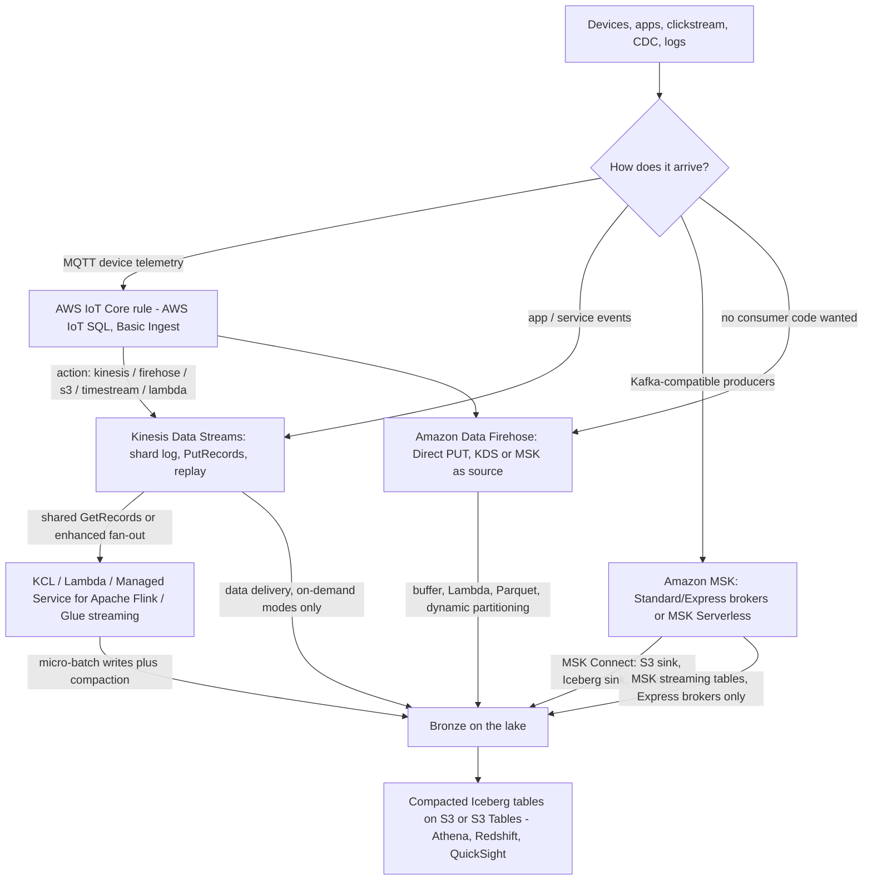
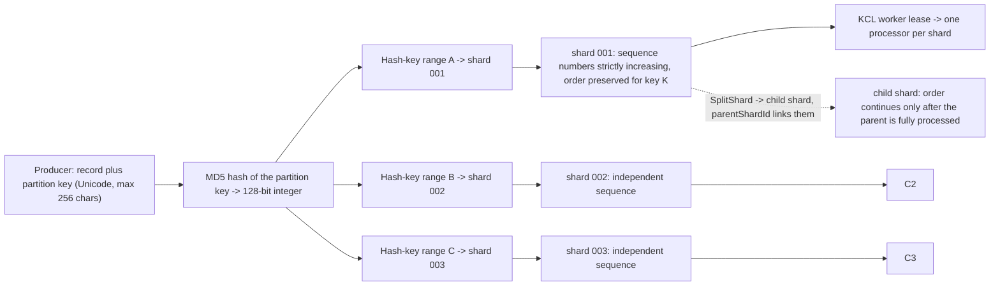
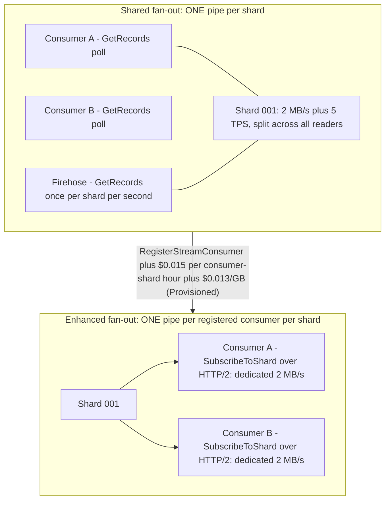
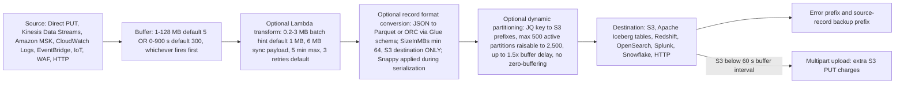
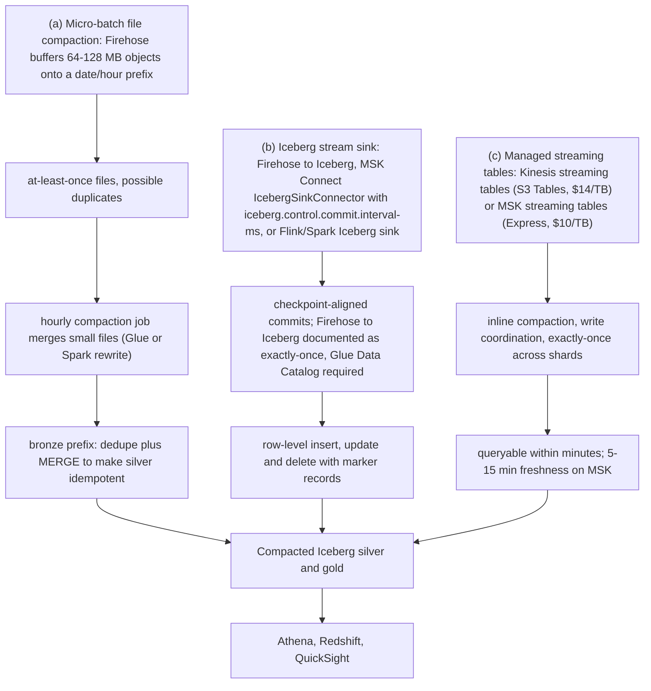
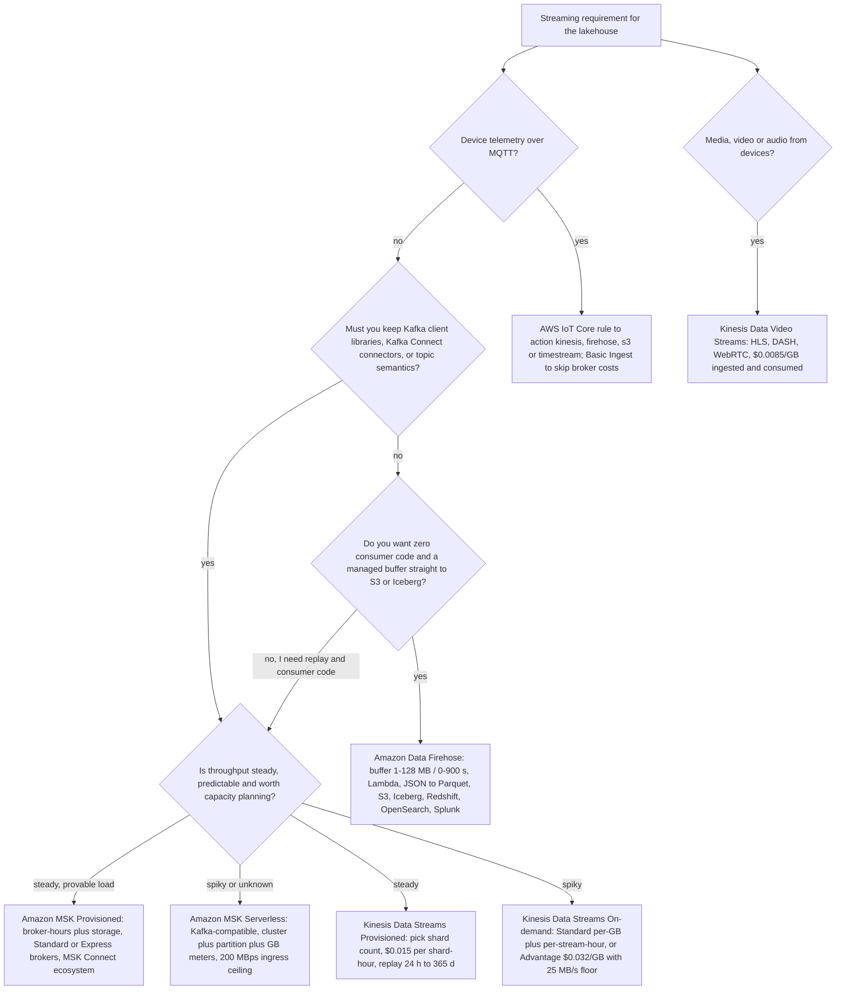

# Streaming Ingestion: Kinesis, Amazon MSK, and Landing Streams in the Lake

Lessons 02 through 05 put files, formats and tables on Amazon S3. Everything so far has been *moved* in batches. This lesson is about the other half of ingestion: **events that arrive continuously and must land in the lake without losing their order, duplicating silently, or quietly costing more than the analytics team earns back.** By the end you will be able to size a Kinesis stream from a records-per-second number, explain exactly where ordering stops, decide when a hot key is a partition-key problem rather than a capacity problem, configure a Firehose buffer that triggers on the right condition, and defend a bronze landing that is idempotent even though the pipeline is at-least-once.

```text
===================================================================
 STREAMING INGESTION INTO THE LAKEHOUSE — the decision surface
                                     (as of October 2026)
===================================================================
 Kinesis Data Streams ....... serverless event log, shard-based
   shard contract ........... 1 MB/s write + 1,000 rec/s IN
                              2 MB/s read + 5 read TPS OUT
   capacity modes ........... Provisioned | On-demand Standard
                              | On-demand Advantage (25 MB/s floor)
   ordering ................ per partition key, within a shard
   fan-out .................. shared GetRecords 2 MB/s OR
                              enhanced fan-out 2 MB/s DEDICATED
 Amazon Data Firehose ....... delivery service, NOT a processor
   buffers .................. 1-128 MB / 0-900 s (S3 default 5/300)
   optional ................ Lambda transform -> JSON to Parquet
                              -> dynamic partitioning -> destination
   semantics ................ at-least-once to S3; exactly-once
                              only to the Iceberg destination
 Amazon MSK ................. managed Apache Kafka
   provisioned .............. Standard + Express brokers ($/broker-hr)
   MSK Serverless ........... $/cluster-hr + $/partition-hr + GB
   MSK Connect .............. Kafka Connect 2.7.1 / 3.7.x
   sinks .................... S3 sink, Iceberg sink, Firehose,
                              MSK streaming tables (Express only)
 AWS IoT Core ............... MQTT -> AWS IoT SQL rule -> action
                              (kinesis, firehose, s3, timestream...)
 Landing .................... micro-batch files + compaction
                              | Iceberg stream sink + commit interval
                              | managed streaming tables (inline)
 Semantics ledger ........... at-least-once + idempotent MERGE
                              vs documented exactly-once claims
===================================================================
```

In this lesson you will:

- state the **shard contract**, 1 MB/s write and 1,000 records/s in, 2 MB/s read and 5 read transactions/s out, per shard, in *both* capacity modes, and know what did **not** change when records grew to 10 MiB;
- choose between **Provisioned, On-demand Standard and On-demand Advantage**, including the 25 MB/s account-level floor that makes Advantage the wrong answer at low volume;
- trace a **partition key through MD5 to a hash-key range to a shard**, and explain why ordering is a per-key promise rather than a stream-wide one;
- detect and fix a **hot key** when on-demand auto-scaling cannot help you;
- size **shared fan-out versus enhanced fan-out** and price the difference;
- work with the **KPL** (collection, aggregation, rate limiting) and the **KCL** (leases, checkpoints, `parentShardId`), and know the KCL 1.x end-of-support date;
- configure **Amazon Data Firehose** end to end: buffer size and interval, Lambda transformation batches, JSON to Parquet conversion against a Glue schema, dynamic partitioning limits and error prefixes;
- land streaming data with the three **bronze land patterns** and attach the right delivery-semantics label to each arrow;
- run the **at-least-once to idempotent MERGE** pattern that makes plain-file bronze safe to promote;
- route **device telemetry** through AWS IoT Core rules, and know what Kinesis Data Video Streams is for;
- compare **Amazon MSK provisioned, MSK Serverless, MSK Connect and MSK streaming tables**, with the broker-versus-serverless break-even arithmetic;
- study **two AWS customer cases** (Cisco Webex on MSK, VMware Carbon Black on Kinesis) and a **sourced October 2026 update box**;
- practise with **12 exam-style questions** plus four interactive checks.

---

## 1. The service map: five paths from event to lake

Every streaming design on AWS is a composition of the same five pieces. Confusing them is the single most common architecture error in this space, because two of them *look* like pipes and only one of them is a log you can replay.

| Piece | What it is | What it is not |
|---|---|---|
| **Amazon Kinesis Data Streams** | Serverless, shard-based **event log** with replay, per-partition-key ordering and consumer fan-out | Not a transform engine; it has no windows and no SQL |
| **Amazon Data Firehose** | Managed **delivery pipeline**: buffer, optional Lambda, optional format conversion, destination | Not a log; you cannot replay a Firehose stream, and it does not do windowing |
| **Amazon MSK** | **Managed Apache Kafka**: provisioned Standard/Express brokers or MSK Serverless, plus Kafka Connect via MSK Connect | Not serverless in the "no capacity thinking" sense; you still reason about partitions, brokers and storage |
| **AWS IoT Core** | **MQTT device ingress** with AWS IoT SQL rules that fan messages out to other services | Not a storage layer; the rule action assumes an IAM role and bills the *target* service |
| **Amazon Managed Service for Apache Flink** | **Stateful processing** with event-time windows, checkpoints and exactly-once *processing* semantics | Not an ingestion service; it reads streams and writes sinks |



- **📚 Did you know?** The Firehose name in front of you is cosmetic but load-bearing for older material: AWS renamed **Amazon Kinesis Data Firehose** to **Amazon Data Firehose** on **9 February 2024**, and states that there are *"no other changes, including service endpoints, APIs, the AWS Command Line Interface (AWS CLI), the AWS Identity and Access Management (IAM) access policies, and Amazon CloudWatch metrics"* (AWS What's New, 2024-02-09; Firehose document history, accessed 2026-10). So IAM actions are still `firehose:*`, and an old blog saying "Kinesis Data Firehose" is describing exactly the same service you are configuring today.

```matching
{
  "question": "Match each streaming component to the role it actually plays in a lakehouse ingestion design (as of Oct 2026):",
  "pairs": [
    {"left": "Amazon Kinesis Data Streams", "right": "Serverless shard-based event log with replay; 1 MB/s write + 1,000 records/s and 2 MB/s read per shard; ordering per partition key"},
    {"left": "Amazon Data Firehose", "right": "Managed delivery pipeline: buffer by size or interval, optional Lambda transform, optional JSON to Parquet conversion, then S3 / Iceberg / Redshift / OpenSearch / Splunk"},
    {"left": "Amazon MSK", "right": "Managed Apache Kafka: provisioned Standard and Express brokers or MSK Serverless, with Kafka Connect deployed through MSK Connect"},
    {"left": "AWS IoT Core", "right": "MQTT device ingress with AWS IoT SQL rules whose actions (kinesis, firehose, s3, timestream, lambda, sqs...) each assume an IAM role"},
    {"left": "Amazon Managed Service for Apache Flink", "right": "Stateful stream processing with event-time windows and checkpoints; the replacement for the discontinued Kinesis Data Analytics for SQL"},
    {"left": "Amazon Kinesis Data Video Streams", "right": "Media and time-serialized binary ingest from connected devices, with HLS/DASH playback and WebRTC"}
  ],
  "explanation": "Each entry is a capability boundary: Kinesis Data Streams is the replayable log, Firehose is a delivery pipeline that batches and (optionally) transforms, MSK is managed Kafka with the Kafka Connect ecosystem, IoT Core is MQTT ingress plus rule fan-out, Managed Service for Apache Flink is where windows live, and Kinesis Video Streams carries media rather than records. The classic mistakes are treating Firehose as a log you can replay, expecting Firehose to do tumbling windows (it does not: that is Flink), or writing custom consumer code when Firehose alone would have delivered the data."
}
```

---

## 2. Kinesis Data Streams: the shard contract

### 2.1 One number governs everything

A **shard** is *"a uniquely identified sequence of data records in a stream"* and *"a base throughput unit of a Kinesis data stream."* The contract, identical in provisioned and on-demand capacity modes, is:

```text
PER SHARD (both capacity modes, as of Oct 2026)
  WRITE ...... 1 MB/s  AND  1,000 records/s   (whichever binds first)
  READ ....... 2 MB/s  AND  5 read transactions/s (2,000 records/s)
  GetRecords . up to 10 MB and 10,000 records per call; excess -> 5 s throttle
  RECORD ..... up to 10 MiB (since 2025-10-28); PutRecords <= 500 records
               and <= 10 MiB per request, partition keys included
  RETENTION .. default 24 h; minimum 24 h; maximum 8,760 h (365 days)
```

Two things are true at once and students routinely collapse them into one: **bytes and record-count are independent caps.** A stream of 400-byte records hits the 1,000 records/s wall at only 0.38 MB/s, so records-per-second binds long before bytes do. Conversely, 2 KB records at 1,000/s use only 2 MB/s of the *read* budget but exactly the full *write* record rate.

The 2025 record-size change is the trap in this section. On **28 October 2025** AWS raised the maximum record size *"up to 10MiB, a tenfold increase from the previous limit"* and doubled the `PutRecords` request ceiling to 10 MiB, while stating plainly that *"Individual shard throughput limits of 1MiB/s for writes and 2MiB/s for reads remain unchanged"*, large records *"temporarily burst up to 10MiB/s, eventually averaging out to 1MiB per second."* AWS recommends keeping large records at *"1-2% of your total record count for optimal performance."* The concepts page still carries the older *"data blob can be up to 1 MB"* sentence (accessed 2026-10); the limits page and the October 2025 announcement are the current facts.

- **📚 Did you know?** `PutRecords` is deliberately **not atomic**: the AWS Big Data Blog records that *"PutRecords always returns a 200 result, even if some records within the batch have failed"* and that *"A single record failure does not stop the processing of subsequent records."* So a 200 OK from `PutRecords` means *the request was accepted*, not *your batch landed*, you must inspect `FailedRecordCount` and per-record `ErrorCode` values. On a single host, a raw `PutRecord` loop measured about 5,500 RPS with batched `PutRecords` versus roughly **76,000 RPS** through the KPL, *"about 800 times greater"* (AWS Big Data Blog, 2015-08-07).

### 2.2 Capacity modes: three shapes, one contract

| Mode | What you choose | Billing shape | Ceiling (as of Oct 2026) |
|---|---|---|---|
| **Provisioned** | Shard count; `UpdateShardCount` / split / merge | $0.015 per shard-hour (**$0.36/day/shard**) + $0.014 per 1M PUT payload units | Account shard quota: **20,000** in `us-east-1`, `us-west-2`, `eu-west-1`; 1,000 or 6,000 elsewhere |
| **On-demand Standard** | Nothing; it adapts | Per-stream hourly charge (AWS's own example implies **$0.040/stream-hour** in US-East) + **$0.08/GB in**, **$0.040/GB out** | New stream starts at **4 MB/s write, 8 MB/s read**; scales to **10 GB/s write, 20 GB/s read** in `us-east-1` / `us-west-2` / `eu-west-1`, **200/400 MB/s** in other Regions |
| **On-demand Advantage** | An account-level commitment | **$0.032/GB in**, **$0.016/GB out**, no per-stream hourly charge, **no enhanced-fan-out surcharge** | Minimum **25 MB/s ingest and 25 MB/s retrieval** account-wide; warm throughput up to **10 GiB/s** |

Practical rules that fall out of that table:

- **You can switch modes twice per 24 hours per stream**: a guardrail, not a free toggle. Design the switch as an event, not a loop.
- **On-demand is not "no limits."** A new on-demand stream starts at 4/8 MB/s, non-flagship Regions top out at 200/400 MB/s, and, the important one, on-demand *"automatically adapts to handle uneven data distribution patterns **unless a single partition key exceeds a shard's 1 MB/s throughput and 1000 records per second limits**."*
- **Advantage is cheaper per GB but has a floor.** The announcement is explicit: the account *"commits to streaming with at least 25 MiB/s of data ingest and 25 MiB/s of data retrieval usage"*, in exchange for data ingested priced **60% lower**, retrieval **60% lower**, enhanced fan-out retrieval **68% lower** and extended retention **77% lower** (AWS Big Data Blog, 2025-11-03). A 0.5 MB/s development stream will pay for 25 MB/s it does not use.

### 2.3 Retention: from replay window to long-term archive

Default retention is **24 hours**, and it is the *minimum*; `IncreaseStreamRetentionPeriod` accepts up to **8,760 hours (365 days)**. Three cost tiers sit behind that knob:

| Retention window | What it costs (Provisioned, US-East) |
|---|---|
| 24 h (default) | Included in the shard hour |
| 24 h to 7 days (extended) | **+$0.020 per shard-hour** |
| 7 to 365 days (long-term) | **$0.023/GB-month** storage + **$0.021/GB** retrieved via the default `GetRecords` consumer |

Replay is the reason retention exists: Kinesis *"provides ordering of records, as well as the ability to read and/or replay records in the same order to multiple Amazon Kinesis Applications."* A 24-hour window means a consumer bug discovered at 09:00 can be repaired and reprocessed from 09:00 the previous day, and nothing more. If your bronze-on-S3 landing is the durable copy (lesson 05), the stream's retention is a *reprocessing* budget, not your backup strategy.

---

## 3. Partition keys, ordering, and hot shards

### 3.1 The path a record actually takes

The producer supplies a **partition key**: *"Partition keys are Unicode strings, with a maximum length limit of 256 characters for each key."* AWS then uses *"an MD5 hash function … to map partition keys to 128-bit integer values and to map associated data records to shards using the hash key ranges of the shards."* All records sharing a key land in the same shard, which is why *"the Kinesis Client Library (KCL) delivers all records for a given partition key to the same record processor."*



Ordering, stated precisely, has exactly three scopes and no more:

1. **Within a shard**: *"records that Kinesis Data Streams receives through a `GetRecords` call are strictly ordered by sequence number."*
2. **Within a partition key**: the key always maps to one shard, so key-local order survives.
3. **Same client, same key, opt-in**: `SequenceNumberForOrdering` *"Guarantees strictly increasing sequence numbers, for puts from the same client and to the same partition key … If this parameter is not set, records are coarsely ordered based on arrival time."*

There is **no stream-wide order**, and `PutRecords` does not even order inside its own batch. If your downstream `MERGE` assumes a global sequence, you have designed a guarantee the service does not provide.

### 3.2 Worked example E1, records/s binds first: sizing and cost

**Scenario (as of Oct 2026):** 2,500 records/s at 400 bytes average, steady 24x7, US East (N. Virginia).

```text
E1  SHARD COUNT + MONTHLY COST (31 days = 744 hours)
--------------------------------------------------------------------
Step 1 - bytes/s ....... 2,500 x 400 B = 1,000,000 B/s
                         = 1,000,000 / 1,048,576 = 0.954 MB/s
                         0.954 MB/s < 1 MB/s  -> 1 shard would do
Step 2 - records/s ..... 2,500 / 1,000 = 2.5  -> round UP to 3 shards
                         BINDING CONSTRAINT = records per second
Step 3 - Provisioned ... 3 x $0.015 x 744 = $33.48 shard-hours
         PUT units ...... 400 B -> 1 payload unit per record
                          2,500 x 86,400 x 31 = 6,696,000,000 units
                          / 1,000,000 x $0.014 = $93.74
         TOTAL .......... $33.48 + $93.74 = $127.22 / month
Step 4 - On-demand Standard (same workload)
         400 B rounds UP to 1 KB -> 2,500 KB/s ingested
         2,500 x 86,400 x 30 / 1,048,576 = 6,180 GB / month
         data in ....... 6,180 x $0.080 = $494.40
         data out ...... 6,180 x $0.040 = $247.20
         stream hours .. 744 x $0.040   =  $29.76
         TOTAL .......... $771.36 / month
--------------------------------------------------------------------
Verdict: provisioned is ~6x cheaper ($127 vs $771) for a flat
profile; on-demand buys you away from shard math for spiky or
unknown traffic. Pick with the variance, not the average.
```

Note the two rounding rules that make streaming bills surprising: Kinesis data-in rounds **each record up to the nearest 1 KB** (*"if your data records are 4.5 KB each, Kinesis Data Streams will count each record as 5 KB"*), while the provisioned PUT meter bills in **25 KB payload units**. A pipeline of 900-byte records is billed as 1 KB per record on on-demand and as one unit per record on provisioned, and it is records/s that sizes your shards either way.

```plot
{
  "type": "bar",
  "title": "E1: same flat workload, two capacity modes (US-East, 31 days, as of Oct 2026)",
  "xLabel": "Capacity mode",
  "yLabel": "Monthly cost (USD)",
  "xKey": "mode",
  "data": [
    {"mode": "Provisioned: 3 shards + PUT units", "usd_per_month": 127.22},
    {"mode": "On-demand Standard: 6,180 GB in/out", "usd_per_month": 771.36}
  ]
}
```

### 3.3 Worked example E2: the hot key that auto-scaling cannot fix

**Scenario:** one `tenant_id = acme` key sends 1,500 records/s of 80 bytes.

```text
E2  HOT KEY DETECTION
--------------------------------------------------------------------
Bytes ......... 1,500 x 80 B = 120,000 B/s = 0.114 MB/s
                0.114 MB/s << 1 MB/s           -> bytes are fine
Records ....... 1,500 rec/s > 1,000 rec/s      -> LIMIT EXCEEDED
Result ........ WriteProvisionedThroughputExceeded on THAT shard
                while sibling shards sit idle. This is true even
                in on-demand mode: auto-scaling adds shards, but
                one key still hashes to exactly one shard.
Fix options ....
  (a) change the key scheme: acme:<event_id> or acme:<uuid>
      -> spreads across shards; you give up per-tenant ordering
  (b) keep ordering, SplitShard, accept the cost
  (c) aggregate in the producer (KPL) - see E4
```

AWS's own remedies: *"use the split-shard operation … If locality or order based on the current partition key is not required, change the partition key scheme to increase its distribution. If the producer application is exceeding the throughput limit of a shard due to a single partition key (hot key issue), change the partition key scheme."* Advanced producers can bypass the MD5 mapping with `ExplicitHashKey` to place a key deliberately: useful for draining a hot shard, dangerous if you use it to paper over a key design that should change.

```fillblank
{
  "question": "Complete the shard-sizing arithmetic for 2,500 records/s at 400 bytes each (worked example E1, as of Oct 2026):",
  "template": "Bytes per second = {{1}} x 400 B = 1,000,000 B/s = 0.954 MB/s, under the 1 MB/s write cap. Records per second: {{1}} / 1,000 = 2.5, so the stream needs {{2}} shards. Provisioned cost for 31 days = {{2}} x $0.015 x 744 = {{3}}.",
  "answers": {
    "1": "2,500",
    "2": "3",
    "3": "$33.48"
  },
  "distractors": ["1", "2", "4", "10", "$44.64", "$11.16", "2.5", "1,000"],
  "explanation": "The two constraints are evaluated independently and you always take the larger shard count: 0.954 MB/s would fit one shard on bytes, but 2,500 records/s divided by the 1,000 records/s cap is 2.5, which rounds up to 3 shards. 3 x $0.015 x 744 = $33.48 for shard hours on a 31-day month; the $93.74 of PUT payload units in E1 is a separate meter. $44.64 is the enhanced-fan-out cost for 4 shards x 1 consumer in E3, $11.16 is one shard for 744 hours, and 2.5 is the unrounded answer that would under-provision the stream."
}
```

- **📚 Did you know?** A useful production heuristic comes from Chime Financial's fraud platform: AWS's write-up of their streaming stack notes *"we land on a 1:1 mapping between Kinesis Shard and vCPU core"* while ingesting *"more than 1 million events per second"* with end-to-end latency *"less than 15 seconds"* (AWS Big Data Blog, 2023-09-19). Treat it as one team's worker-sizing rule of thumb for a KCL fleet, not as a service quota: worker count must still be at least shard count for parallelism, and every lease lives in DynamoDB.

---

## 4. Fan-out: shared reads versus enhanced fan-out

A stream is only useful if several consumers can read it. Kinesis gives you two mechanisms with genuinely different economics.

| | **Shared fan-out** (`GetRecords`) | **Enhanced fan-out** (`SubscribeToShard`) |
|---|---|---|
| Throughput | **2 MB/s and 5 TPS per shard, shared** by every consumer | **2 MB/s per shard, dedicated** to each registered consumer |
| Model | Pull over HTTP; you poll | Push over HTTP/2; the service delivers |
| Registration | None | `RegisterStreamConsumer`, then `SubscribeToShard` |
| Session | Your loop | Connection lives **up to 5 minutes**, then re-subscribe; **1 call/s per consumer per shard** |
| Cost (Provisioned) | Included | **$0.015 per consumer-shard hour** + **$0.013/GB** retrieved |
| Consumer limit | Unbounded | **50** registered consumers (On-demand Advantage), **20** otherwise |
| KCL | `GetRecords` path | KCL **2.0+ enables it automatically** |

The FAQ sentence that matters: *"The shared fan-out consumers all share a shard's 2 MB/second of read throughput and five transactions per second limits … An enhanced fan-out consumer gets its own 2 MB/second allotment of read throughput."* Add a second polling consumer and each one's effective read rate halves: the classic production symptom where "adding a consumer made everything slower."

### 4.1 Worked example E3: fan-out sizing and the EFO bill

**Scenario:** a 4-shard stream with three readers: (a) a Lambda poller using the shared path, (b) a Flink application needing low latency, (c) Firehose reading Kinesis Data Streams.

```text
E3  FAN-OUT (4 shards, 3 consumers, Provisioned, 744 h)
--------------------------------------------------------------------
Shared pool ....... 4 shards x 2 MB/s = 8 MB/s TOTAL, shared
                    4 shards x 5 TPS  = 20 read TPS TOTAL
Firehose .......... polls GetRecords once per shard per second,
                    so it is a permanent tenant of the shared pool
Flink app ......... must register for enhanced fan-out or it
                    competes with Firehose for the same 8 MB/s
EFO cost .......... 4 shards x 1 consumer x $0.015 x 744 h
                    = $44.64 / month
                  + $0.013 per GB actually retrieved
On-demand Advantage -> same EFO has NO consumer-shard surcharge
```

Firehose's own FAQ behaviour is what forces the decision: *"Firehose calls Kinesis Data Streams GetRecords() once every second for each Kinesis shard."* If Firehose is your sink, assume the shared pool is spoken for.



---

## 5. Producers and consumers: KPL, KCL, and the lease table

### 5.1 KPL: collection, aggregation, rate limiting

The **Kinesis Producer Library** runs as *"a separate process, and communicates with your parent user process using IPC"*, and does four jobs: automatic retries, **collection** (batching many records into `PutRecords` requests), **aggregation** (packing many user records into *one* Kinesis record), and per-shard rate limiting with a token bucket *"by default … set 50 percent higher than the actual shard limit."* It also publishes CloudWatch metrics on your behalf and adds latency up to `RecordMaxBufferedTime`.

**Worked example E4: aggregation defeats the records/s cap.**

```text
E4  KPL AGGREGATION vs RAW PutRecords (1 shard)
--------------------------------------------------------------------
Input ........... 1,000 user records/s, 512 B each = 512 KB/s
Raw path ........ 1,000 Kinesis records/s -> exactly at the
                  1,000 records/s shard cap (no headroom)
                  bytes used: 512 KB/s of a 1 MB/s budget
Aggregated ...... pack 1,000 x 512 B into 10 x 50 KB records
                  Kinesis records/s: 1,000 -> 10  (100x headroom)
                  bytes unchanged: 512 KB/s
Both paths ....... byte limits identical; only the RECORD counter
                  moves. That is why small records are the case
                  KPL aggregation exists for.
```

AWS's own example matches: *"With KPL aggregation, you can pack 1,000 records into only 10 Kinesis Data Streams records, reducing the RPS to 10 (at 50 KB each)"*, and *"The Kinesis Data Streams records per second limit binds customers with records smaller than 1 KB."*

Portability is the tax. Per AWS's usage matrix, a producer in any language other than Java **cannot use the KPL**, and a Java KPL producer feeding a non-Java consumer **must disable aggregation**: otherwise the consumer has to de-aggregate records it never expected. Raw `PutRecords` is portable; you own batching, partial-failure handling, retries and backoff.

### 5.2 KCL: leases, checkpoints, and `parentShardId`

The **Kinesis Client Library** is compiled into your consumer and gives you:

- **Leases**: *"Each shard is bound to only one worker by a lease at any given time"*, tracked in a DynamoDB **lease table**. KCL 3.x creates three tables by default (lease, worker metrics, coordinator state); **from KCL 3.5 the single-table format consolidates all metadata into the lease table**.
- **Checkpointing**: *"the process of persistently storing the position of the last successfully processed record in a shard"*, stored in that lease table. Restart from the checkpoint, not from "now".
- **`parentShardId`**: *"Used to ensure that the parent shard is fully processed before processing starts on the child shards. This ensures that records are processed in the same order they were put into the stream."* This is the only mechanism that keeps ordering across a reshard event.

Two dates matter here. **KCL 1.x reached end-of-support on 30 January 2026**, and AWS's guidance is to *"migrate your KCL applications using version 1.x to the latest KCL version"*: as of this lesson that date has passed, so any 1.x consumer is running on borrowed time. And KCL is not free infrastructure: DynamoDB tables (on-demand capacity recommended) and CloudWatch metrics ride along, and worker count ≥ shard count is a parallelism requirement, not a tuning preference.

> [!WARNING]
> ⚠️ **Four streaming statements that are false as written:**
> - **"On-demand mode fixes hot keys."** It does not. A single partition key still cannot exceed **1 MB/s or 1,000 records/s**; that is the definition of a hot key, and it holds in every capacity mode.
> - **"Ordering is stream-wide."** Ordering holds **per partition key, within one shard**. `PutRecords` does not order its own batch, and `SequenceNumberForOrdering` only orders same-key writes from the same client.
> - **"The second consumer halves our reads, so buy more shards."** With shared `GetRecords` the fix is **enhanced fan-out** (or one consumer), not shards, and Firehose is already polling the shared pool once per shard per second.
> - **"Firehose does tumbling windows."** No Firehose documentation page describes windowing of any kind; tumbling, sliding and event-time windows are a **Managed Service for Apache Flink** feature. The old home of `TUMBLE()`, Kinesis Data Analytics for SQL, stopped taking new applications on **15 October 2025** and was deleted starting **27 January 2026**.

---

## 6. Amazon Data Firehose: a delivery service, not a processor

### 6.1 The pipeline, stage by stage

Firehose is *"a fully managed service for delivering real-time streaming data to destinations such as Amazon Simple Storage Service (Amazon S3), Amazon Redshift, Amazon OpenSearch Service, Amazon OpenSearch Serverless, Splunk, Apache Iceberg Tables, and any custom HTTP endpoint."* Its stages, in order:

1. **Source**: Direct PUT, Kinesis Data Streams, Amazon MSK, CloudWatch Logs, EventBridge, IoT, WAF, Network Firewall, HTTP.
2. **Buffer**: *"Amazon Data Firehose buffers incoming streaming data to a certain size or for a certain period of time before delivering it to destinations"*; whichever condition is met first fires the delivery.
3. **Lambda transformation (optional)**: per-batch invoke, payload capped at **6 MB** synchronous, invocation up to **5 minutes**, default **3 retries** (configurable 0 to 300).
4. **Record format conversion (optional)**: JSON to **Parquet or ORC** using a schema in the **AWS Glue Data Catalog** (deserializer, schema, serializer).
5. **Dynamic partitioning (optional)**: JQ-based keying into S3 prefixes, up to **500 active partitions** (raisable to 2,500).
6. **Destination**, S3, Iceberg tables, Redshift (via S3 + `COPY`), OpenSearch, Splunk, Snowflake, HTTP, plus error and backup prefixes.



### 6.2 Worked example E5; which buffer condition fires first

**Buffering hints for an S3 destination: size 1 to 128 MB (default 5), interval 0 to 900 s (default 300).**

```text
E5  BUFFER SIZING (as of Oct 2026)
--------------------------------------------------------------------
Case A - sustained 6 MB/s ingest, buffer size = 64 MB
  time to fill ...... 64 MB / 6 MB/s = 10.7 s
  vs interval ....... 10.7 s << 300 s  -> SIZE triggers first
  objects/minute .... 60 / 10.7 = 5.6
  objects/hour ...... ~336      objects/day ~ 8,064 x 64 MB
  daily volume ...... ~512 GB -> 8,064 objects is a healthy,
                                 compactable landing (lesson 04)
Case B - sustained 0.1 MB/s ingest, buffer size = 5 MB (default)
  time to fill ...... 5 / 0.1 = 50 s
  vs interval ....... 50 s << 300 s  -> still size, but objects
                                 are ~5 MB: small-file territory
  time to 300 s ..... 0.1 x 300 = 30 MB objects if you raise
                      the size hint above 30 MB
Rule of thumb (AWS API docs) ...
  "setting this parameter to a value greater than the amount
   of data you typically ingest into the Firehose stream in
   10 seconds. For example, if you typically ingest data at
   1 MiB/sec, the value should be 10 MiB or higher."
  -> 6 MB/s x 10 s = 60 MB, so 64 MB is the right pick.
```

Three modifiers change the arithmetic:

- **Record format conversion raises the floor.** With conversion enabled you *"can't set `SizeInMBs` to a value less than 64"*, and *"The value becomes 128 when you enable it."*
- **Dynamic partitioning costs latency.** *"Firehose uses multi-stage buffering internally. Therefore, end-to-end delay of a batch of records might be 1.5 times of the configured buffering hint time"*, and zero buffering is unavailable with the feature.
- **Sub-60-second buffering changes the S3 bill.** *"Firehose uses multi-part upload for S3 destination when you configure a buffer time interval less than 60 seconds … you will see some increase in S3 `PUT` API costs."*

> [!IMPORTANT]
> ⚠️ **Format conversion is a narrow feature with four hard walls.** Input must be **JSON** (pre-convert CSV with Lambda); the destination must be **Amazon S3**: *"If you enable record format conversion, you can't set your Amazon Data Firehose destination to be Amazon OpenSearch Service, Amazon Redshift, or Splunk. With format conversion enabled, Amazon S3 is the only destination"*; the schema must already exist in the **Glue Data Catalog**; and `CompressionFormat` must be set to **`UNCOMPRESSED`** because *"Snappy compression happens automatically as part of the conversion process."* The practical row limit is **32 MB**, and conversion is billed at **$0.018 per GB converted**. Anything claiming "Firehose converts CSV to Parquet directly" is describing a feature that does not exist.

- **📚 Did you know?** Firehose's quotas page quietly contains the scaling argument for Kinesis-as-source: Direct PUT into Firehose is capped (in `us-east-1`/`us-west-2`/`eu-west-1`) at *"500,000 records/second, 2,000 requests/second, and 5 MiB/second"*, but *"When Kinesis Data Streams is configured as the data source, this quota doesn't apply, and Amazon Data Firehose scales up and down with no limit."* And because Firehose reads *"once every second for each Kinesis shard"*, the two services share your shard sizing: more shards means more parallel Firehose reads, not just more write capacity.

---

## 7. Landing in the lake with Firehose

### 7.1 What Firehose actually promises

The delivery semantics differ per destination, and this is the most misquoted area in the whole lesson:

| Path | Documented semantics |
|---|---|
| Firehose to S3 / Redshift / OpenSearch / Splunk | **At-least-once.** *"Amazon Data Firehose uses at least once semantics for data delivery. In rare circumstances such as request timeout upon delivery attempt, delivery retry by Firehose could introduce duplicates if the previous request eventually goes through."* |
| Firehose to **Apache Iceberg tables** | **Exactly-once.** *"Firehose guarantees exactly-once delivery to Iceberg tables"* and *"automatically apply insert, update, and delete operations"*, requiring the AWS Glue Data Catalog (AWS Prescriptive Guidance, accessed 2026-10) |
| Kinesis streaming tables to S3 Tables | *"write coordination and exactly once delivery semantics across all shards in your stream"* (AWS Big Data Blog, 2026-08-31) |
| Managed Service for Apache Flink | Exactly-once **processing** semantics with checkpoints |

The design consequence: **anything that lands as plain files in a bronze prefix is at-least-once.** Duplicates are not a bug you can configure away; they are the contract. You make the *table* correct downstream (Section 9.3), not the delivery perfect.

### 7.2 Worked example E6: a Firehose invoice for a JSON to Parquet lake landing

**Scenario:** 100 records/s x 3 KB, JSON converted to Parquet, delivered to S3, US East (N. Virginia), 30 days.

```text
E6  MONTHLY FIREHOSE INVOICE (as of Oct 2026)
--------------------------------------------------------------------
Billed record size ... 3 KB rounds UP to 5 KB
Volume ............... (100 rec/s x 5 KB) / 1,048,576
                       x 86,400 s x 30 d = 1,235.96 GB
1. Ingestion ......... 1,235.96 x $0.029   =  $35.84
                       (Direct PUT / Kinesis Data Streams source,
                        first 500 TB tier)
2. Format conversion .. 1,235.96 x $0.018   =  $22.25
                       (JSON to Parquet, per GB converted)
3. Dynamic partitioning (feature usage in AWS's example shape)
   GB processed ......   741.58 x $0.020   =  $14.83
   S3 objects ........ 11,866 / 1,000 x $0.005 = $0.06
                       (plus $0.07 per JQ processing hour if used)
--------------------------------------------------------------------
TOTAL ................ = $72.98 / month
```

The teaching point is the shape of the bill, not the cents: **ingestion is the smallest lever when you switch features on.** Conversion and dynamic partitioning together more than double the base $35.84, and each of them is a *feature you chose* in exchange for queryable Parquet on partitioned prefixes instead of a pile of JSON. Note also the source-dependent rates: a **Kinesis Data Streams source** bills **$0.029/GB**, an **Amazon MSK source** bills **$0.055/GB** with no 5 KB rounding, vended logs **$0.13/GB**, an **Iceberg destination** (Kinesis source) **$0.045/GB**, and VPC delivery **$0.01/GB plus $0.01 per AZ-hour**.

### 7.3 Kinesis data delivery and streaming tables (no Firehose required)

As of October 2026 a Kinesis stream can land in the lake **without** Firehose at all. Data delivery supports *"two destination types: streaming tables on Apache Iceberg, and general purpose Amazon S3 buckets"*, with *"Built-in intelligent inline compaction [that] eliminates small file proliferation."* Requirements and prices:

| Destination | Requirement | Price (as of Oct 2026) |
|---|---|---|
| General-purpose **S3** | On-demand capacity mode only | **$0.011/GB** (On-demand Advantage), **$0.0275/GB** (Standard) |
| **Streaming tables** (Iceberg on S3 Tables) | On-demand capacity mode only | **$0.014/GB** (Advantage), **$0.035/GB** (Standard); the AWS blog states **$14/TB** to S3 Tables and **$11/TB** to S3 |

AWS's stated outcomes for streaming tables: *"reduce data delivery costs to S3 Tables by up to 50% compared to self-managed alternatives and reduce downstream query costs by up to 30% through intelligent inline compaction"*, with data *"queryable within minutes of being published to your stream."* Provisioned mode does not support data delivery or streaming tables at all: a fact that removes provisioned mode from consideration for this pattern.

---

## 8. AWS IoT Core rules and Kinesis Data Video Streams

### 8.1 MQTT, rule, action, lake

AWS IoT Core is the ingress for device telemetry. A **rule** evaluates an MQTT message with **AWS IoT SQL** and invokes one or more **actions**. The documented action list includes `kinesis` (Kinesis Data Streams), `firehose`, `s3`, `timestream`, `lambda`, `sqs`, `sns`, `dynamodb`, `kafka` (Apache Kafka), `stepFunctions`, `openSearch`, `republish`, `cloudWatch`, `location`, `influxDB` and `iotSiteWise`.

The Kinesis action takes three parameters you must get right: the `stream`, the `partitionKey`, *"usually composed of an expression (for example, `${topic()}` or `${timestamp()}`)"*, and the `roleArn`, *"An IAM role that AWS IoT can assume to perform the `kinesis:PutRecord` operation."* Choosing `${topic()}` means all messages on one MQTT topic hash to one shard: elegant for ordering, a hot-key generator at volume. Choosing a device- or event-level key spreads load and drops topic ordering.

One cost control is worth memorising: *"You can also use the Basic Ingest feature to securely send device data to the AWS services listed previously, without incurring messaging costs. The Basic Ingest feature optimizes data flow by removing the publish/subscribe message broker from the ingestion path."* If the data never needs MQTT fan-out, do not pay for the broker hop.

### 8.2 Kinesis Data Video Streams: the media lane, briefly

**Amazon Kinesis Video Streams** carries *"media from connected devices to AWS for storage, analytics, machine learning (ML), playback, and other processing"*, with managed **HLS** and **DASH** playback, **WebRTC** for ultra-low-latency two-way streaming, and integrations with Rekognition Video and SageMaker. It is the correct answer for cameras, audio and time-serialized binary: not for JSON event records.

US East pricing (as of Oct 2026): **$0.0085/GB ingested**, **$0.0085/GB consumed** (HLS consumption **$0.0119/GB**), storage **$0.023/GB-month** on the hot tier; WebRTC adds **$0.03 per month** per active signaling channel, **$2.25 per million** signaling messages and **$0.12 per thousand** TURN streaming minutes. A **warm storage tier** (feature dated **26 November 2025**) offers ingest at **$0.0100 per 1,000 persisted fragments** and storage at **$0.0125/GB-month** with a **30-day minimum retention**: the video equivalent of Kinesis stream retention tuning.

- **📚 Did you know?** The cheapest IoT rule is often the one you delete. Rules with wildcards can match most messages, and each action assumes an IAM role and bills the *target* service, so a single broad rule fanning to Kinesis *and* Firehose *and* S3 is three bills for one message. Design the rule's SQL as narrowly as you would a database index, and reach for Basic Ingest when the broker adds nothing.

---

## 9. Amazon MSK: managed Kafka, and getting from a stream to a table

### 9.1 Provisioned versus Serverless

| | **MSK Provisioned** | **MSK Serverless** |
|---|---|---|
| Capacity unit | Brokers (`kafka.m7g.large` recommended for production; M7g uses Graviton) | Cluster + partitions, auto-scaled |
| Billing | Broker-hours + GB-month storage: **paid even when idle** | Cluster-hour + partition-hour + GB in/out + GB-month storage |
| Published example (31 days) | 2,232 broker-hours x $0.204 = **$455.33** + 1,516.13 GB-months x $0.10 = **$151.61** = **$606.94** | 744 h x $0.75 = $558 + 74,400 partition-hours x $0.0015 = $111.60 + 3,100 GB x $0.10 = $310 + 6,200 GB x $0.05 = $310 + $10 storage = **$1,299.60** |
| Quotas | Standard and **Express** broker types | **200 MBps ingress / 400 MBps egress** per cluster; **5/10 MBps per partition**; **8 MiB** max message; **2,400** leader partitions (120 compacted); **500** consumer groups; **10** clusters per account; **5** client VPCs per cluster |
| Streaming tables | **Express brokers only**: *"Standard brokers and Amazon MSK Serverless are not supported"* | Not supported |

AWS's own broker-size guidance: *"M7g brokers use AWS Graviton processors … M7g brokers offer improved price performance relative to comparable M5 instances"* and *"M7g and M5 brokers are recommended for production workloads."* The break-even logic is the exercise: **provisioned has a fixed floor** (three brokers' worth of hours, plus storage you pay for whether traffic arrives or not), while **serverless meters partitions and bytes**, so a steady high-volume stream can cost more on Serverless than on provisioned brokers, and the 200 MBps ingress ceiling is a hard stop, not a warning.

**Worked example E8: the break-even shape (AWS's published examples, as of Oct 2026).**

```text
E8  MSK PROVISIONED vs SERVERLESS (published example shapes)
--------------------------------------------------------------------
Provisioned ........... $455.33 broker-hours + $151.61 storage
                        = $606.94 / month
Serverless ............ $558.00 cluster-hours
                      + $111.60 partition-hours (74,400 x $0.0015)
                      + $310.00 data in   (3,100 GB x $0.10)
                      + $310.00 data out  (6,200 GB x $0.05)
                      +  $10.00 storage
                        = $1,299.60 / month
Crossover logic ....... fixed broker floor vs partition/byte meters
                        + Express brokers (separate per-GB ingest
                          meter) + MSK Connect capacity you deploy
Reading ............... $606.94 is 3 brokers x 744 h you pay even
                        at zero traffic; $1,299.60 is a meter that
                        follows load but cannot exceed 200 MBps in.
```

### 9.2 MSK Connect and stream-to-lake sinks

**MSK Connect** *"makes it easy for developers to stream data to and from their Apache Kafka clusters … uses Kafka Connect versions 2.7.1 or 3.7.x"*, can *"deploy connectors developed by 3rd parties like Debezium … or deploy an existing connector with no code changes"*, and *"Connectors automatically scale to adjust for changes in load and you pay only for the resources that you use"*, with automatic task restarts and PrivateLink for private connectivity.

The sink paths that matter for this course:

- **S3 sink** (Confluent connector on MSK Connect): `"connector.class": "io.confluent.connect.s3.S3SinkConnector"`, with `"flush.size": "1"` controlling object size and provisioned capacity expressed as `mcuCount` / `workerCount`.
- **Iceberg sink**: the AWS-published real-time CDC lake recipe is *MSK Connect + Iceberg Kafka Connect* (AWS Big Data Blog, 2026-02-03), where the connector's `iceberg.control.commit.interval-ms` sets how often stream offsets become table snapshots.
- **Firehose with MSK as source**: console path: *"For Source, choose Amazon MSK. For Destination, choose Apache Iceberg Tables."* Note the price: MSK-source ingestion is **$0.055/GB** versus **$0.029/GB** for a Kinesis source.
- **MSK streaming tables**, Kafka topics materialized as Iceberg on S3 Tables: *"Amazon MSK Express brokers write your records as Apache Parquet data files and commit them to the table"*, scaling to *"10 GBps of delivery throughput"* at **$10.00 per TB delivered**, freshness configured **between 5 and 15 minutes**, with a **required dead-letter queue bucket** and the explicit caveat that *"A Channel does not backfill previously produced data, only data produced after enablement is delivered."*

For lab work, the awslabs **MSK Data Generator** is a Kafka Connect *source* connector (`genkp.<topic>.with` for the partition key, `genv.<field>.with` for values) deployable on MSK Connect or in an ECS container: the streaming equivalent of a seed script.

### 9.3 Worked example E7: at-least-once bronze to idempotent silver

**Scenario:** Firehose delivered a 10-minute window of JSON-to-Parquet files to `s3://lake/bronze/events/dt=2026-10-11/hr=09/`, and a retry duplicated 1,412 of them. Promote to a silver Iceberg table.

```text
E7  IDEMPOTENT PROMOTION (Spark SQL against Iceberg)
--------------------------------------------------------------------
Step 1 - count the damage
  SELECT count(*) FROM bronze;               -- 1,412,180 rows
  SELECT count(DISTINCT event_id) FROM bronze; -- 1,410,768
  -> 1,412 duplicate rows, exactly as at-least-once predicts

Step 2 - dedupe within the batch (natural key + latest event time)
  CREATE OR REPLACE TEMP VIEW staged AS
  SELECT * FROM (
    SELECT *, ROW_NUMBER() OVER (
      PARTITION BY event_id ORDER BY event_ts DESC, ingest_ts DESC
    ) AS rn FROM bronze
  ) WHERE rn = 1;

Step 3 - merge, keyed on the natural key, gated on event time
  MERGE INTO silver.events t
  USING staged s ON t.event_id = s.event_id
  WHEN MATCHED AND s.event_ts > t.event_ts THEN UPDATE SET *
  WHEN NOT MATCHED THEN INSERT *;

Step 4 - prove idempotency by running steps 2-3 AGAIN
  SELECT count(*) FROM silver;  -- unchanged: 1,410,768
  (A plain INSERT INTO would have doubled rows to 2,823,948.)
```

Rules that travel with this pattern: **Iceberg `MERGE` accepts only one source record per target row**: dedupe first, always; and the gate `s.event_ts > t.event_ts` makes a replayed older event a no-op instead of a downgrade. The alternative is to skip plain files entirely and use an exactly-once destination (Firehose to Iceberg, or streaming tables), where write coordination handles the duplicates for you.



**The semantics ledger, stated once and never blurred:**

- **Plain files in bronze = at-least-once.** Plan dedupe (deterministic event id plus commit window) or `MERGE` on a surrogate id with a monotonically increasing source timestamp.
- **Documented exactly-once exists, but scoped:** Firehose's **Iceberg destination** (*"Firehose guarantees exactly-once delivery to Iceberg tables"*), **Kinesis streaming tables** (*"exactly once delivery semantics across all shards"*), and **Flink's exactly-once processing**.
- **"Exactly-once" in a vendor slide is not the same claim as "exactly-once in the documentation."** Ask which destination, which catalog, and what happens on a delivery timeout.

```dragdrop
{
  "question": "Order the stages of a streaming path that lands events as queryable, compacted, idempotent data in the lake (as designed in this lesson):",
  "items": [
    "Produce: PutRecords / KPL to a Kinesis shard, or publish to an MSK topic with a partition key",
    "Optional in-flight work: Firehose Lambda transform, or Managed Service for Apache Flink windowed aggregation",
    "Batch: Firehose buffer size or interval hint fires, or a consumer micro-batch accumulates",
    "Land to bronze: S3 prefix of Parquet objects, or an Iceberg stream sink writing on a commit interval",
    "Compact: hourly small-file merge, Firehose format conversion at 64-128 MB, or managed inline compaction",
    "Make idempotent: dedupe on event_id, or Iceberg MERGE gated on natural key plus event time",
    "Serve: registered in the Glue Data Catalog for Athena, Redshift and QuickSight"
  ],
  "correctOrder": [
    "Produce: PutRecords / KPL to a Kinesis shard, or publish to an MSK topic with a partition key",
    "Optional in-flight work: Firehose Lambda transform, or Managed Service for Apache Flink windowed aggregation",
    "Batch: Firehose buffer size or interval hint fires, or a consumer micro-batch accumulates",
    "Land to bronze: S3 prefix of Parquet objects, or an Iceberg stream sink writing on a commit interval",
    "Compact: hourly small-file merge, Firehose format conversion at 64-128 MB, or managed inline compaction",
    "Make idempotent: dedupe on event_id, or Iceberg MERGE gated on natural key plus event time",
    "Serve: registered in the Glue Data Catalog for Athena, Redshift and QuickSight"
  ],
  "explanation": "The order is produce, then optional transform, then batch, then land, then compact, then make idempotent, then serve. Two placements trip people up: transformation happens BEFORE the buffer fires (a Firehose Lambda sees the batch the buffer handed it), and compaction comes after landing but BEFORE promotion to silver, because small files are a query-cost problem you fix in bronze, while duplicates are a correctness problem you fix with dedupe or MERGE. Skipping the idempotency step is what turns an at-least-once delivery into silently wrong dashboards: the ledger in Section 9.3 exists precisely because bronze files cannot promise exactly-once."
}
```

---

## 10. Choosing: the decision matrix



| Choose… | When… | Accept the cost of… |
|---|---|---|
| **Kinesis Data Streams (Provisioned)** | Flat, provable throughput; you want replay and cheap shard hours | Shard math, split/merge ops, and capacity-mode switches capped at 2 per 24 h |
| **Kinesis Data Streams (On-demand)** | Spiky or unknown traffic; you value not doing shard math | Per-GB pricing ($0.08/GB Standard) or Advantage's **25 MB/s account floor** |
| **Amazon Data Firehose** | You want delivery without consumer code, optional transform and Parquet | No replay, no windows, **at-least-once to S3**, and buffering latency (up to ~1.5x the hint with dynamic partitioning) |
| **Amazon MSK** | Kafka clients, Kafka Connect, Debezium, existing topic-based contracts | Broker/partition capacity thinking, storage you pay for when idle, and a 200 MBps Serverless ingress ceiling |
| **Third-party or self-managed Kafka** | You already run it and have the staff: the very thing Cisco and Airties left | Patching, over-provisioned one-size-fits-all instances, outages, and the migration bill (5 months at Cisco) |
| **AWS IoT Core plus Kinesis** | Device telemetry over MQTT needing rule-based fan-out | Per-action IAM roles and per-service billing on every rule action |

---

### 2026 Updates (as of October 2026)

> [!NOTE]
> **What changed in the streaming layer between 2025 and October 2026: each line sourced and dated:**
> - **27 January 2026: Kinesis Data Analytics for SQL is gone.** No bug fixes after **2025-09-01**, no new applications after **2025-10-15**, and *"Applications will be deleted starting January 27, 2026"*; migration targets are **Amazon Managed Service for Apache Flink** and Flink Studio (AWS Kinesis Analytics User Guide discontinuation notice, accessed 2026-10-11). Any tutorial that creates a KDA SQL application now fails.
> - **30 July 2026: MSK streaming tables for Apache Iceberg on S3 Tables.** Express brokers materialize Kafka topics as managed Iceberg: *"up to 10 GB/s ingest"*, ingest cost reduced *"by up to 60%"*, inline compaction, **$10.00/TB delivered**, 5 to 15 minute freshness, mandatory DLQ, **no backfill** (AWS News Blog, 2026-07-30; MSK Developer Guide, accessed 2026-10). Standard brokers and MSK Serverless are not supported.
> - **August 2026, Kinesis data delivery to S3 and S3 Tables.** Streaming tables and general-purpose S3 delivery are **on-demand modes only**, with *"intelligent inline compaction"* and pricing stated as **$14/TB** to S3 Tables and **$11/TB** to S3 (AWS Big Data Blog, 2026-08-31), Firehose is no longer the only stream-to-lake path.
> - **15 September 2025, Firehose CDC-to-Iceberg deprecated** (support ended), and **24 September 2025, database-as-source (public preview) removed**; the Firehose to S3 Tables destination went GA on **14 March 2025** and Glue multi-catalog support (write to non-default catalogs such as S3 Tables) on **14 May 2025** (Firehose document history, accessed 2026-10-11).
> - **28 October 2025: records up to 10 MiB.** *"a tenfold increase from the previous limit"* plus a 10 MiB `PutRecords` ceiling, while *"shard throughput limits of 1MiB/s for writes and 2MiB/s for reads remain unchanged"* (AWS Big Data Blog, 2025-10-28).
> - **3 November 2025: On-demand Advantage.** **$0.032/GB in, $0.016/GB out**, no per-stream hourly charge, no enhanced-fan-out retrieval surcharge, warm throughput to **10 GiB/s**, against an account commitment of **25 MB/s ingest plus 25 MB/s retrieval** (AWS Big Data Blog, 2025-11-03). Cheaper per GB, wrong at low volume.
> - **26 November 2025: Kinesis Video Streams warm tier**: **$0.0100 per 1,000 persisted fragments** ingested, **$0.0125/GB-month** storage, **30-day minimum** retention (AWS IoT Blog, 2026-01-04).

---

## Real-World Case Studies

### Case A, Cisco Webex: 12 MSK clusters and the on-call you get back

**Cisco (Webex observability platform).** AWS's case study describes a self-managed Kafka estate for the observability/ELK stack whose operational burden fell on a team over-provisioning *"one-size-fits-all instances"* while outages hit thousands of internal users. The migration itself was scoped honestly: *"The observability team spent 5 months engineering the migration from self-managed Kafka to Amazon MSK and then implemented the new stack in 6 weeks."*

The published steady state is the number that makes this lesson's MSK section concrete: *"The entire system is composed of 12 Amazon MSK clusters with a total of 66 brokers. The system seamlessly handles a daily throughput of 147 TB of data and more than 100 billion messages."* Downstream effects: *"More than 4,000 Webex developers, managers, and team members … have benefited"*, and *"reduced the data transport time from the backend to the user, so retrieval times are under 10 seconds."* AWS's summary of the outcome: *"Cisco has reduced its operational overhead to virtually zero with cost savings and decreased service outages."* Robert Labrie, manager for observability at Webex: *"We run a globally federated observability stack at scale, and it just works."*

Lesson angle: **managed Kafka converts a staffing problem into a capacity problem.** The protocol, the clients and the Connect ecosystem stayed; what disappeared was broker babysitting, and the 5-month migration line is the honest price of that trade. 66 brokers across 12 clusters is also the scale at which Section 9.1's broker-hour arithmetic stops being a spreadsheet curiosity.

*Customer-reported figures from an AWS case-study page (undated, accessed 2026-10-11); not an AWS commitment.*

### Case B, VMware Carbon Black: 1 PB per day and shard elasticity as the cost lever

**VMware Carbon Black (endpoint security).** From AWS's Kinesis Data Streams customer page: *"VMware Carbon Black analyzes over a trillion events every day … Now they process 1 PB streaming data per day with reduced operating and infrastructure costs."* The architecture is ingesting from *"millions of distributed edge devices"* into **Amazon Kinesis Data Streams**, with real-time analytics in milliseconds.

The quote that explains *why* Kinesis rather than a broker fleet is Stoyan Dimkov, Staff Engineer and Software Architect: *"When individual customers' data increases or decreases, we can use the elasticity of Amazon Kinesis Data Streams to scale compute up or down to process data reliably while effectively managing our cost."*

Lesson angle: at 1 PB/day the interesting number is not the shard count; it is that **elasticity per customer workload is the cost model**. Sizing that stream is E1's arithmetic at scale (1 PB/day is roughly 11.6 MB/s average before replicas, which on-demand absorbs without a shard spreadsheet), and the per-customer volume swings are exactly what makes provisioned shard planning painful.

*Customer-reported figures from an AWS product customer page (undated, accessed 2026-10-11); not an AWS commitment.*

### Case C, TrueCar: schedule removal, not engine tuning

**TrueCar (auto marketplace).** On the same AWS Kinesis customer page: *"By adopting a streaming-data strategy with Amazon Kinesis Data Streams, TrueCar has improved the speed to insight of clickstream analytics by 48 times, automated its extract, transform, load (ETL) process, and improved observability into its metrics."* **48x** is a latency story, not a throughput story: the batch ETL schedule was the bottleneck, and the stream removed it.

*Customer-reported figures from an AWS product customer page (undated, accessed 2026-10-11); not an AWS commitment.*

---

## Practice Questions

```question
{
  "id": "lh-06-q1",
  "type": "multiple-choice",
  "question": "As of October 2026, what is the per-shard throughput contract in Amazon Kinesis Data Streams, and does it differ between capacity modes?",
  "options": [
    "1 MB/s write and 1,000 records/s in, 2 MB/s read and 5 read transactions/s out, in both provisioned and on-demand modes",
    "10 MB/s write and 2,000 records/s in, 20 MB/s read in on-demand; 1 MB/s and 1,000 records/s in provisioned",
    "1 MB/s write in provisioned and 4 MB/s write in on-demand, because on-demand starts at 4 MB/s per shard",
    "2 MB/s write and 2 MB/s read per shard, with record count unlimited because records are now 10 MiB"
  ],
  "correct": 0,
  "explanation": "AWS documents the same shard contract in both modes: 'Each shard can support up to 1 MB/sec or 1,000 records/sec write throughput or up to 2 MB/sec or 2,000 records/sec read throughput', and a shard supports '1 MB/s and 1000 records per second for writes and 2 MB/s for reads in both on-demand and provisioned capacity modes'. The 4/8 MB/s figure is the STARTING capacity of a new ON-DEMAND STREAM, not a per-shard limit, and the 10 MiB change of 2025-10-28 raised the record and PutRecords request size while explicitly leaving the per-shard 1 MB/s and 1,000 records/s limits unchanged."
}
```

```question
{
  "id": "lh-06-q2",
  "type": "multiple-choice",
  "question": "A team with a steady 0.8 MB/s ingest profile wants to move its Kinesis stream to On-demand Advantage because the per-GB rates look cheaper. What does the October 2026 documentation say?",
  "options": [
    "Advantage is always cheaper than provisioned, because there is no per-stream hourly charge and no minimum usage",
    "Advantage requires an account-level commitment of at least 25 MB/s data ingest and 25 MB/s data retrieved, so a 0.8 MB/s stream would pay for capacity it does not use",
    "Advantage only works in eu-west-1 and raises the per-shard limit to 10 MB/s write",
    "Advantage removes the 1,000 records/s per-shard limit, so hot keys are solved automatically"
  ],
  "correct": 1,
  "explanation": "The On-demand Advantage announcement states the account 'commits to streaming with at least 25 MiB/s of data ingest and 25 MiB/s of data retrieval usage' in exchange for 60% lower ingest and retrieval rates, 68% lower enhanced-fan-out retrieval and 77% lower extended retention, with no fixed stream-hour charge. At 0.8 MB/s that floor is roughly 31x the actual usage. Option D is false in every mode: a single partition key still cannot exceed 1 MB/s or 1,000 records/s, which is precisely why E2's hot key survives on-demand auto-scaling."
}
```

```question
{
  "id": "lh-06-q3",
  "type": "multiple-choice",
  "question": "A producer sends 1,500 records/s of 80 bytes under a single partition key and receives WriteProvisionedThroughputExceeded on one shard while other shards are idle. Which statement is correct?",
  "options": [
    "Increase the shard count or switch to on-demand capacity mode; the additional shards will absorb the hot key",
    "The bytes are within limits (0.114 MB/s) but 1,500 records/s exceeds the 1,000 records/s single-key limit; fix the key scheme (for example tenant:event_id) or SplitShard",
    "Reduce the record size below 64 bytes so the record fits the aggregation window",
    "Set SequenceNumberForOrdering so Kinesis routes the key across shards in arrival order"
  ],
  "correct": 1,
  "explanation": "AWS's sizing page is explicit that on-demand 'automatically adapts to handle uneven data distribution patterns unless a single partition key exceeds a shard's 1 MB/s throughput and 1000 records per second limits'. Here bytes are 1,500 x 80 B = 0.114 MB/s (fine) but records/s binds first. Remedies from the write-throughput post: change the partition key scheme to increase distribution, accepting the loss of per-key ordering, or use split-shard. Adding shards does not move an existing key off its shard; a smaller record still counts as one record; SequenceNumberForOrdering only orders same-key puts from the same client."
}
```

```question
{
  "id": "lh-06-q4",
  "type": "multiple-choice",
  "question": "Two Lambda pollers and a Firehose delivery stream all read the same 4-shard Kinesis stream, and consumer latency degraded after the second poller was added. What is the correct fix and its cost shape (Provisioned mode, as of Oct 2026)?",
  "options": [
    "Register the consumers for enhanced fan-out so each gets a dedicated 2 MB/s per shard via SubscribeToShard; 4 shards x 1 consumer x $0.015 x 744 h = $44.64/month plus $0.013/GB retrieved",
    "Double the shard count, because shared reads are limited to 1 MB/s per shard",
    "Switch the stream to On-demand Advantage, which triples the shared read allowance automatically",
    "Enable long-term retention, which adds a dedicated read pipe per consumer"
  ],
  "correct": 0,
  "explanation": "Shared GetRecords consumers 'all share a shard's 2 MB/second of read throughput and five transactions per second limits', so a second poller halves each one's effective rate. Enhanced fan-out gives each registered consumer 'its own 2 MB/second allotment of read throughput' over HTTP/2 using SubscribeToShard, with re-subscription after the 5-minute connection and 1 call/s per consumer per shard. The provisioned cost is $0.015 per consumer-shard hour plus $0.013/GB: 4 x 0.015 x 744 = $44.64. Firehose is a permanent shared-pool tenant because it calls GetRecords once per shard per second. Shard count does not change the per-shard 2 MB/s shared pipe, and retention is unrelated to read fan-out."
}
```

```question
{
  "id": "lh-06-q5",
  "type": "multiple-choice",
  "question": "A Firehose stream ingests a sustained 6 MB/s with buffer size set to 64 MB and buffer interval 300 seconds. Which condition fires, and what is the resulting landing pattern?",
  "options": [
    "The 300-second interval fires, producing one 1,800 MB object every five minutes",
    "The 64 MB size condition fires after about 10.7 seconds, producing roughly 5.6 objects per minute (about 512 GB/day) that a compaction job must merge",
    "Neither fires, because with dynamic partitioning enabled Firehose buffers indefinitely",
    "Zero-buffering is applied automatically because 6 MB/s exceeds the Lambda batch cap"
  ],
  "correct": 1,
  "explanation": "64 MB / 6 MB/s = 10.7 s, far below the 300 s interval, so size triggers first: consistent with AWS's own rule of thumb that the size hint should exceed 'the amount of data you typically ingest into the Firehose stream in 10 seconds' (6 MB/s x 10 s = 60 MB, so 64 MB is correct). 60/10.7 = 5.6 objects per minute, about 8,064/day at 64 MB each. Option A inverts which condition fires; option C confuses dynamic partitioning, which multiplies the delay by up to 1.5x and forbids zero-buffering, with unlimited buffering; option D invents an automatic zero-buffer setting that does not exist."
}
```

```question
{
  "id": "lh-06-q6",
  "type": "multiple-choice",
  "question": "A team enables JSON to Apache Parquet conversion on a Firehose stream targeting Amazon Redshift. Which set of documented constraints is correct?",
  "options": [
    "Input must be JSON, S3 is the only allowed destination with format conversion enabled, buffer SizeInMBs cannot be below 64, the schema must exist in the AWS Glue Data Catalog, and CompressionFormat must be UNCOMPRESSED because Snappy is applied during conversion",
    "Any input format including CSV is converted directly, and Redshift can be the direct destination of format conversion",
    "Buffer size may stay at 5 MB, and GZIP must be set explicitly for the Parquet files",
    "Format conversion works only with dynamic partitioning and requires a zero-second buffer interval"
  ],
  "correct": 0,
  "explanation": "The Firehose docs state all five walls: conversion is from JSON (pre-convert CSV with Lambda); 'With format conversion enabled, Amazon S3 is the only destination'; 'you can't set SizeInMBs to a value less than 64' (the default becomes 128); the schema is created 'in the AWS Glue Data Catalog'; and 'You must set CompressionFormat to UNCOMPRESSED' because 'Snappy compression happens automatically as part of the conversion process'. The practical row limit is 32 MB and conversion bills $0.018/GB. Options B, C and D each contradict one of those documented rules."
}
```

```question
{
  "id": "lh-06-q7",
  "type": "multiple-choice",
  "question": "A pipeline lands JSON as Parquet objects in a bronze S3 prefix via Firehose. An architect claims the landing is exactly-once and downstream MERGE logic can be skipped. What is the correct assessment?",
  "options": [
    "Correct: Firehose buffers to Parquet, and Parquet objects are written atomically, so duplicates are impossible",
    "Correct for any destination: Firehose documents exactly-once delivery for all destinations since 2024",
    "Incorrect: Firehose uses at-least-once semantics to S3 and can duplicate after a timeout plus successful retry; exactly-once is documented only for the Iceberg destination (and for streaming tables), so bronze needs dedupe or an idempotent MERGE",
    "Incorrect, but the fix is to enable dynamic partitioning, which restores exactly-once delivery to S3"
  ],
  "correct": 2,
  "explanation": "The Firehose FAQ states it 'uses at least once semantics for data delivery' and that 'delivery retry by Firehose could introduce duplicates if the previous request eventually goes through'. The exactly-once claims are scoped: AWS Prescriptive Guidance says 'Firehose guarantees exactly-once delivery to Iceberg tables' (Glue Data Catalog required), and Kinesis streaming tables advertise 'exactly once delivery semantics across all shards'. Dynamic partitioning changes prefix layout and adds up to 1.5x delay: it does not change delivery semantics. Worked example E7 is the required mitigation for plain-file bronze."
}
```

```question
{
  "id": "lh-06-q8",
  "type": "multiple-choice",
  "question": "A team wants Kafka topic semantics, Debezium CDC, and a stream-to-Iceberg landing. Which configuration is valid as of October 2026?",
  "options": [
    "MSK Serverless with MSK Connect and the built-in streaming tables feature, because streaming tables support every broker type",
    "MSK Provisioned with Express brokers plus MSK Connect (Kafka Connect 2.7.1 or 3.7.x, e.g. Debezium or an Iceberg sink), or MSK streaming tables (Express only, $10.00/TB, 5-15 min freshness, mandatory DLQ, no backfill)",
    "MSK Serverless with the Iceberg streaming table channel enabled by default, backfilling existing topic history on enablement",
    "MSK Provisioned Standard brokers with streaming tables, because Express brokers cannot write Parquet"
  ],
  "correct": 1,
  "explanation": "MSK Connect documents Kafka Connect 2.7.1/3.7.x with third-party connectors such as Debezium and no code changes. Streaming tables require an 'Amazon MSK Provisioned cluster with Express brokers. Standard brokers and Amazon MSK Serverless are not supported', write Parquet, cost $10.00/TB with 5-15 minute freshness and a required dead-letter queue, and explicitly 'does not backfill previously produced data: only data produced after enablement is delivered'. That rules out A, C and D. Note also the Firehose source price difference if you route MSK through Firehose: $0.055/GB for an MSK source versus $0.029/GB for a Kinesis source."
}
```

```question
{
  "id": "lh-06-q9",
  "type": "multiple-choice",
  "question": "A Java producer using the KPL sends 1,000 user records per second of 512 bytes each to one shard, and a Python consumer begins failing to parse records. What is the most likely cause and the documented remedy?",
  "options": [
    "The producer exceeded 1 MB/s; the remedy is to add shards until bytes fit",
    "KPL aggregation packed the user records into fewer Kinesis records, and the non-Java consumer must have aggregation disabled (or the producer must use raw PutRecords); without aggregation the raw path would have been at the 1,000 records/s shard cap anyway",
    "The KPL rate limiter throttled at 50% of the shard limit; raise RecordMaxBufferedTime to 10 seconds",
    "PutRecords is atomic, so the partial batch was rejected; enable retries with backoff on the consumer"
  ],
  "correct": 1,
  "explanation": "AWS's KPL integration matrix states that with a Java KPL producer plus a non-Java consumer you 'Must disable aggregation', and a non-Java producer cannot use the KPL at all because it runs as a separate process over IPC. Aggregation is exactly the feature that would pack 1,000 x 512 B records into about 10 x 50 KB Kinesis records, which a Python consumer that expects one user record per Kinesis record cannot parse. Bytes are only 512 KB/s of the 1 MB/s budget. The rate limiter's default is a token bucket 'set 50 percent higher than the actual shard limit', not 50% of it. PutRecords is explicitly NOT atomic: it 'always returns a 200 result, even if some records within the batch have failed'."
}
```

```question
{
  "id": "lh-06-q10",
  "type": "multiple-choice",
  "question": "Which set of KCL facts is correct as of October 2026?",
  "options": [
    "Each shard can be leased by several workers at once; checkpoints are stored in Amazon S3; KCL 1.x is fully supported through 2027",
    "Each shard is bound to only one worker by a lease at any given time, checkpoints persist the last successfully processed record in the DynamoDB lease table, parentShardId gates child-shard processing on the parent being fully processed, and KCL 1.x reached end-of-support on 30 January 2026",
    "KCL 3.x always creates exactly three DynamoDB tables and never consolidates them; leases are stored in Kinesis itself",
    "parentShardId is only used for billing shard splits and has no effect on record ordering"
  ],
  "correct": 1,
  "explanation": "The KCL concepts page says 'Each shard is bound to only one worker by a lease at any given time' and defines checkpointing as persisting 'the position of the last successfully processed record in a shard' in the DynamoDB lease table. parentShardId is documented as ensuring 'that the parent shard is fully processed before processing starts on the child shards... so records are processed in the same order they were put into the stream'. KCL 1.x end-of-support was 30 January 2026, which has passed. KCL 3.x creates three tables by default BUT 'Starting with KCL 3.5, you can use the single table format': so option C's 'never' is wrong, and option A's exclusive-lease claim contradicts the lease model."
}
```

```question
{
  "id": "lh-06-q11",
  "type": "multiple-choice",
  "question": "Device telemetry arrives on MQTT topic sensors/plant7/temperature. The rule must spread write load across Kinesis shards and avoid paying MQTT broker fees when no pub/sub fan-out is needed. Which design is documented?",
  "options": [
    "Use an AWS IoT rule with a kinesis action whose partitionKey is an expression such as the MQTT topic or a device/event-level key, assuming an IAM role that allows kinesis:PutRecord; use Basic Ingest when the broker adds nothing, because it 'removes the publish/subscribe message broker from the ingestion path'",
    "Use an AWS IoT rule with partitionKey set to the literal string 'shard' so all records land on one shard for ordering, and always route through the broker for durability",
    "Attach the Kinesis action directly to the MQTT topic without an IAM role, because IoT Core uses service-linked access",
    "Use Basic Ingest together with a wildcard rule that fans every message to kinesis, firehose and s3 simultaneously to minimise cost"
  ],
  "correct": 0,
  "explanation": "The Kinesis rule action documents three parameters: stream, partitionKey ('usually composed of an expression (for example, the MQTT topic or a timestamp)') and roleArn - 'An IAM role that AWS IoT can assume to perform the kinesis:PutRecord operation'. Basic Ingest is documented to send device data to AWS services 'without incurring messaging costs' by 'removing the publish/subscribe message broker from the ingestion path': which only helps if the data never needs MQTT pub/sub. A literal single partition key is a hot key by construction (E2), an action without a role fails at invocation, and a wildcard fan-out multiplies cost because each action assumes an IAM role and bills the target service."
}
```

```question
{
  "id": "lh-06-q12",
  "type": "multiple-choice",
  "question": "Which comparative verdict is correct for streaming ingestion into an AWS lakehouse as of October 2026?",
  "options": [
    "Firehose is the default answer for every stream, because it provides replay, windowing and exactly-once delivery to all destinations",
    "Amazon MSK Serverless is always cheaper than provisioned brokers because there are no broker-hours",
    "Kinesis Data Streams is the serverless replayable log for app and event streams (provisioned for flat load, on-demand for spiky load); Firehose is a delivery pipeline with no replay and at-least-once S3 semantics; Amazon MSK is the Kafka-compatible choice when clients, connectors and topic contracts matter; self-managed or third-party Kafka remains only where the staff and the protocol requirement outweigh Cisco's 5-month migration",
    "Kinesis Data Streams and Amazon MSK are interchangeable, differing only in price"
  ],
  "correct": 2,
  "explanation": "The verdict follows the capability boundaries in Sections 1, 6, 9 and 10: Kinesis gives replay (24 h to 365 d), per-key ordering and consumer fan-out but no windows; Firehose buffers and optionally transforms but cannot be replayed, does not window, and is at-least-once to S3 with exactly-once only to the Iceberg destination; MSK brings Kafka clients, Kafka Connect/Debezium and topic semantics at the cost of broker or partition capacity planning; self-managed Kafka is what Cisco replaced (12 clusters, 66 brokers, 147 TB/day, 5 months of migration). Option A grants Firehose properties it explicitly does not have, and option D ignores replay, ordering scope, the Connect ecosystem and the delivery-semantics ledger."
}
```

> [!WARNING]
> ⚠️ **Pattern traps for this lesson: walk this list before you design anything:**
> - **On-demand does not fix hot keys.** One partition key still cannot exceed **1 MB/s or 1,000 records/s** in any capacity mode; the fix is the key scheme or `SplitShard`.
> - **Ordering is per partition key, per shard.** Never design a global sequence assumption, and remember `PutRecords` does not order its own batch.
> - **Shared reads are one pipe per shard.** A second polling consumer halves the rate; the fix is **enhanced fan-out** ($0.015/consumer-shard hour + $0.013/GB on Provisioned, no surcharge on Advantage), not more shards, and Firehose is already polling once per shard per second.
> - **Firehose is not a log and not a window engine.** No replay, no tumbling/sliding windows (that is Managed Service for Apache Flink), buffering up to ~5 minutes by default and up to **1.5x the hint** with dynamic partitioning.
> - **At-least-once to S3 is the contract.** Exactly-once is documented only for the **Iceberg destination** (Glue Data Catalog required) and for **streaming tables**; bronze needs dedupe or an idempotent `MERGE` (E7).
> - **Format conversion walls:** JSON in, **S3 only**, `SizeInMBs` ≥ **64**, Glue schema present, `CompressionFormat` = **UNCOMPRESSED** (Snappy is applied during serialization), 32 MB practical row limit, **$0.018/GB**.
> - **10 MiB records did not change the shard contract.** Records and `PutRecords` requests went to 10 MiB on 2025-10-28; **1 MB/s write and 1,000 records/s per shard are unchanged**, and AWS recommends keeping large records at 1 to 2% of record count.
> - **MSK streaming tables are Express-only, new-data-only, DLQ-required**: Standard brokers and MSK Serverless are not supported, and a Channel does not backfill.
> - **Retention is a bill:** extended retention **+$0.020/shard-hour**, long-term **$0.023/GB-month + $0.021/GB retrieved**; Kinesis data delivery and streaming tables require **on-demand** capacity modes.

> [!IMPORTANT]
> **Comparative Verdict: Kinesis vs MSK vs Firehose vs self-managed/third-party Kafka**
> - **Versus Amazon MSK:** Kinesis is the serverless, replayable, shard-based log with per-key ordering, enhanced fan-out and now **native data delivery** to S3 ($11/TB) and Iceberg streaming tables on S3 Tables ($14/TB): no consumer code, no brokers, no Kafka protocol. MSK is what you choose when **Kafka clients, Kafka Connect/Debezium connectors, or topic-based contracts** are non-negotiable; you pay with broker/partition capacity thinking, storage you fund when idle, and MSK Serverless's **200 MBps ingress** ceiling. Cisco's 12 clusters / 66 brokers / 147 TB per day is the shape of the MSK bet: protocol preserved, on-call deleted.
> - **Versus Amazon Data Firehose:** Firehose is **not a competitor to the logs; it is a consumer of them.** It has no replay, no windows and **at-least-once** semantics to S3; what it buys is zero consumer code, an optional Lambda transform, **JSON to Parquet** against a Glue schema, dynamic partitioning, and documented **exactly-once to Iceberg tables**. Choose it when the requirement is "land it correctly and cheaply," not "process it in flight." Its MSK-source rate (**$0.055/GB** vs **$0.029/GB** for Kinesis) is a real design input.
> - **Versus Managed Service for Apache Flink:** windowed aggregation, joins and exactly-once *processing* live here, not in Firehose. The discontinued Kinesis Data Analytics for SQL (deleted from **2026-01-27**) is the wrong answer in any stem naming it.
> - **Versus self-managed / third-party Kafka on your own instances:** still legal, still sometimes required by policy, but read Cisco's 5-month migration first, and note that Airties moved tens of millions of IoT access points from Kafka on EC2 to Kinesis Data Streams and reported a **33% reduction in total monthly infrastructure costs** (AWS Big Data Blog, 2025-05-29). The Kafka *ecosystem* survives the move: MSK Connect runs Debezium and the Confluent S3 sink unchanged.
> - **The one-sentence verdict:** in October 2026, **default to Kinesis Data Streams for app/event logs and Firehose (or native data delivery) for the lake landing; choose Amazon MSK when Kafka semantics and Connectors are the requirement; reach for Managed Service for Apache Flink the moment windows or stateful joins appear; and keep self-managed Kafka only where a stated constraint outweighs both the ops bill and the migration cost.**

> [!SUCCESS]
> **Key Takeaways:**
> 1. **The shard contract is the whole capacity model:** **1 MB/s write + 1,000 records/s in, 2 MB/s read + 5 read TPS out**, per shard, in *both* provisioned and on-demand modes. The 2025 change to **10 MiB records / 10 MiB `PutRecords` requests** did not touch it.
> 2. **Three capacity modes, three bills:** Provisioned (**$0.015/shard-hour** + PUT payload units), On-demand Standard (**$0.08/GB in, $0.040/GB out**, per-stream-hour in the example), On-demand Advantage (**$0.032/GB in, $0.016/GB out**, no stream-hour, **25 MB/s + 25 MB/s account floor**). E1: the same flat 2,500 rec/s workload costs **$127.22** provisioned versus **$771.36** on-demand Standard.
> 3. **Ordering has three scopes only:** within a shard (sequence numbers), within a partition key (MD5 to hash-key range to one shard), and opt-in same-client ordering via `SequenceNumberForOrdering`. There is no stream-wide order.
> 4. **A hot key is a key-design bug, not a capacity bug.** E2: 1,500 rec/s of 80 B is 0.114 MB/s (fine) but breaches 1,000 rec/s on one shard: in *every* mode. Fix with `tenant:event_id`, `SplitShard`, or KPL aggregation.
> 5. **Fan-out economics:** shared `GetRecords` = **one 2 MB/s + 5 TPS pipe per shard for everyone**; enhanced fan-out = **dedicated 2 MB/s per registered consumer per shard** via `SubscribeToShard` (5-minute connections, 1 call/s), priced at **$0.015/consumer-shard hour + $0.013/GB** on Provisioned and **free of that surcharge on Advantage**. E3: 4 shards = **$44.64/month**. Firehose polls the shared pool once per shard per second.
> 6. **KPL/KCL asymmetry:** KPL (Java-only producer, IPC sidecar) gives collection, aggregation (1,000 x 512 B → 10 x 50 KB records) and token-bucket rate limiting at 150% of the shard limit; KCL gives leases (one worker per shard), DynamoDB checkpoints and `parentShardId` ordering across resharding, and **KCL 1.x has been end-of-support since 30 January 2026**.
> 7. **Firehose is a delivery service:** buffer **1 to 128 MB (default 5) / 0 to 900 s (default 300)**, whichever fires first; optional Lambda (**0.2 to 3 MB batches, 6 MB payload, 5 min, 3 retries**); optional **JSON→Parquet/ORC** (S3 only, ≥64 MB, Glue schema, `UNCOMPRESSED`, $0.018/GB); optional dynamic partitioning (**≤500 active partitions**, 1.5x delay, no zero-buffering). E5: at 6 MB/s a **64 MB** buffer fills in **10.7 s**.
> 8. **The semantics ledger:** S3/Redshift/OpenSearch/Splunk = **at-least-once** (duplicates after timeout + retry); **Iceberg destination = exactly-once** (Glue Data Catalog required); **Kinesis streaming tables = exactly-once across shards**; Flink = exactly-once *processing*. E7's dedupe + time-gated `MERGE` is the plain-file answer.
> 9. **Landing patterns:** micro-batch files plus compaction; Iceberg stream sink with a commit interval (Firehose→Iceberg, MSK Connect Iceberg sink); managed streaming tables with inline compaction (**Kinesis $14/TB to S3 Tables, MSK $10/TB via Express brokers, 5 to 15 min freshness, DLQ required, no backfill**).
> 10. **MSK is managed Kafka, not magic:** provisioned = broker-hours + storage you pay when idle ($606.94 in AWS's 3-broker example); Serverless = cluster-hour + partition-hour + GB ($1,299.60 in the published Ohio example) with a **200 MBps ingress** ceiling. MSK Connect (Kafka Connect 2.7.1/3.7.x) brings Debezium and the Confluent S3 sink without code changes.
> 11. **Device and media lanes:** IoT Core rules route MQTT to `kinesis`/`firehose`/`s3`/`timestream`/... with an IAM role per action, substitution-template partition keys, and **Basic Ingest** to skip broker fees; Kinesis Video Streams handles media at **$0.0085/GB** ingested and consumed (warm tier since 2025-11-26).
> 12. **October 2026 state of the layer:** KDA for SQL deleted (**2026-01-27**) → Managed Service for Apache Flink; MSK streaming tables GA (**2026-07-30**, 10 GB/s, −60% ingest cost); Kinesis native data delivery and streaming tables (on-demand only); Firehose CDC-to-Iceberg deprecated (**2025-09-15**); On-demand Advantage live (**2025-11-03**); 10 MiB records live (**2025-10-28**).
> 13. **Read cases as patterns with dates:** Cisco Webex runs **12 MSK clusters / 66 brokers / 147 TB + 100B messages per day** for **4,000+** users after a **5-month** migration and 6-week implementation, with retrieval under **10 seconds** (AWS case study, undated, accessed 2026-10-11); VMware Carbon Black streams **1 PB/day** from millions of edge devices into Kinesis and credits its elasticity for managing cost (AWS customer page, undated, accessed 2026-10-11); TrueCar reports **48x** faster speed to insight on clickstream. Customer-reported numbers, never AWS commitments.
