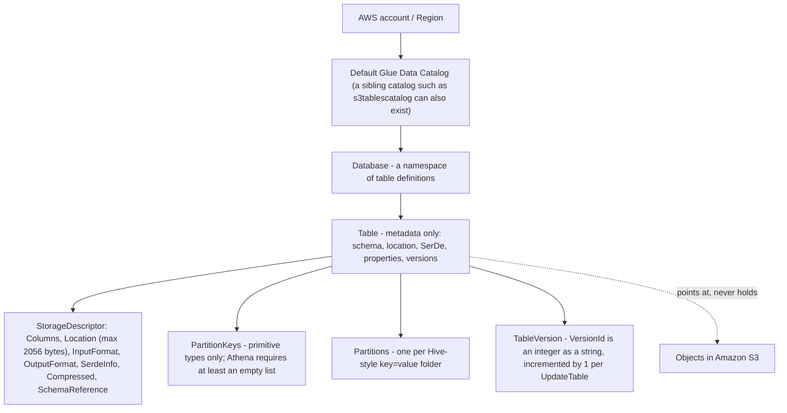
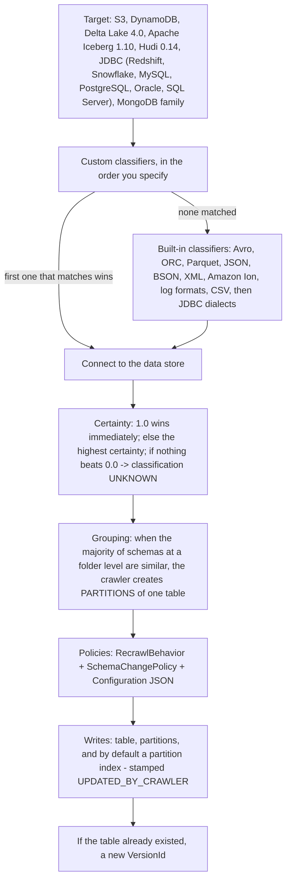
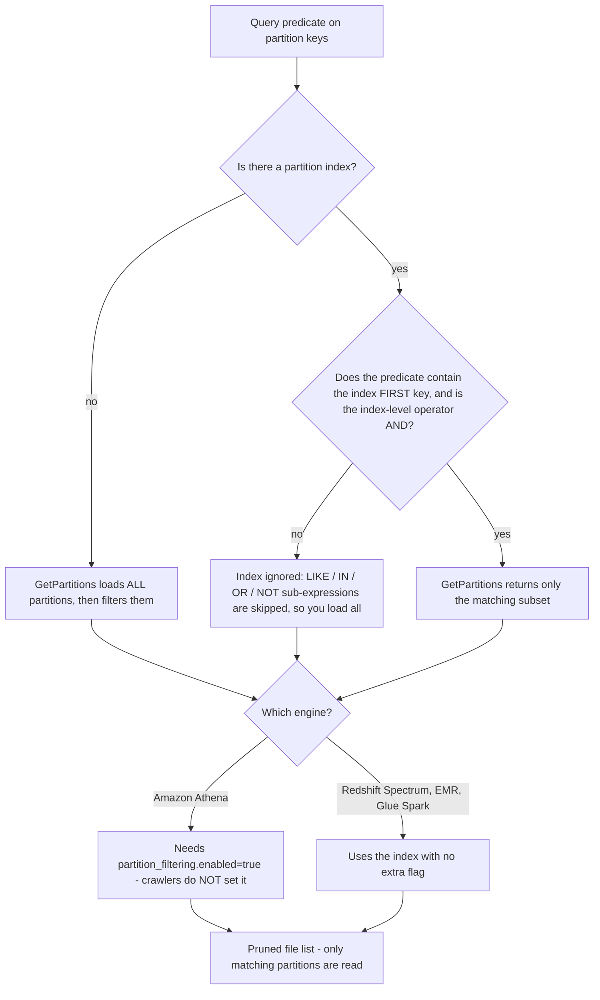
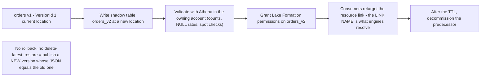
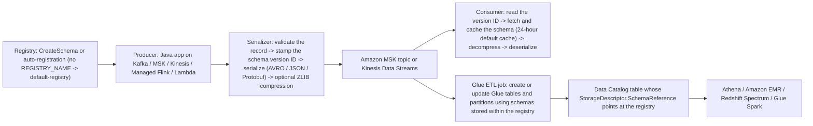
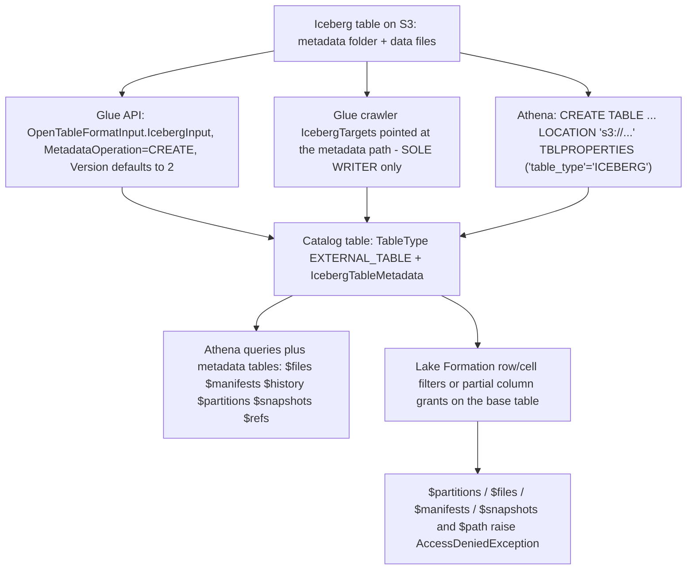
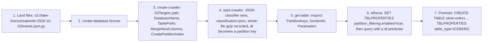
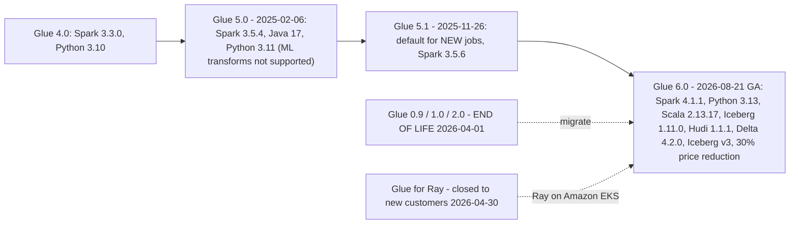

# Glue Data Catalog: Crawlers, Partitions, and Schema Management

Lessons 02 through 06 put bytes on Amazon S3: storage classes, formats, table formats, batch and streaming ingestion. None of that is queryable by a SQL user until something else exists: a **description** of where the files are, what they contain, how to deserialize them, and which of them are worth reading. That description is the **AWS Glue Data Catalog**, and this lesson is about owning it: what a catalog object actually is, how a crawler writes one, how partitions and partition indexes keep `GetPartitions` from loading the world, how table versions let a schema change be audited and rolled *forward*, how the Schema Registry extends the same discipline to streams, and where Lake Formation takes the permissions away from you and gives them to a grant table.

```text
====================================================================
 GLUE DATA CATALOG - the metadata decision surface (as of Oct 2026)
====================================================================
 Model ........ account/Region -> catalog -> database -> table
                -> partitions   METADATA ONLY, holds no bytes
   table ....... StorageDescriptor (Columns, Location, InputFormat,
                 OutputFormat, SerdeInfo, Compressed, SchemaReference)
                 + PartitionKeys (primitive types only)
                 + Parameters (classification, compressionType)
                 + TableType EXTERNAL_TABLE | GOVERNED
                 + VersionId (integer as string, +1 per update)
 Discover ...... crawler: custom classifiers IN YOUR ORDER -> first
                 match wins -> built-ins -> infer -> write
   certainty ... 1.0 wins outright | else highest | else UNKNOWN
   recrawl ..... CRAWL_EVERYTHING | CRAWL_NEW_FOLDERS_ONLY
                 (incremental) | CRAWL_EVENT_MODE (S3 -> SQS)
   change ...... UpdateBehavior LOG | UPDATE_IN_DATABASE
                 DeleteBehavior LOG | DELETE_FROM_DATABASE |
                 DEPRECATE_IN_DATABASE ; MergeNewColumns in JSON
   price ....... $0.44 per DPU-hour, per second, 10-minute floor
                 1 DPU = 4 vCPU + 16 GB; crawlers are OPTIONAL
 Speed ......... partition index: sub-list of partition keys,
                 max 3/table, AND-only, first key must appear in
                 the predicate; Athena also needs
                 partition_filtering.enabled = true
 Version ....... GetTableVersions (MaxResults 1-100); NO rollback,
                 no delete-latest -> blue/green = new version or
                 shadow table + resource-link swap
 Stream ........ Glue Schema Registry: free, KMS-encrypted,
                 8 compatibility modes, AVRO/JSON/PROTOBUF,
                 validation only from the SECOND version
 Govern ........ Lake Formation owns GRANTS; Glue owns OBJECTS;
                 resource link = DESCRIBE + DROP only
 Iceberg ....... table_type=ICEBERG, Glue = the metastore,
                 $files $snapshots $history ... in Athena
====================================================================
```

In this lesson you will:

- read the **Data Catalog object model**, catalog, database, table, partitions, `StorageDescriptor`, `SerDeInfo`, `SchemaReference`, `Parameters`, `TableType`, and the byte limits that shape it;
- run a crawler in your head: **custom classifiers in the order you specify, first success wins, certainty scoring**, folder grouping heuristics, and the three policy knobs (`RecrawlPolicy`, `SchemaChangePolicy`, `Configuration`);
- price a crawler correctly, **$0.44 per DPU-hour, per second, with a 10-minute floor**, and know that the API is a free alternative;
- separate **incremental crawls** from **S3-event crawls**, including what each one is blind to;
- defend an **exclusive-ownership design pattern** for crawlers without pretending AWS ships an "exclusive crawler" toggle;
- use **partition indexes** the way the engine actually uses them: first-key rule, `AND` only, max three per table, and the Athena opt-in flag;
- operate **table versions**: what `UpdateTable` archives, why there is no rollback, and how a **blue/green metadata deployment** is assembled from a shadow table plus a resource-link swap;
- govern streaming schema with the **Glue Schema Registry**: hierarchy, quotas, the eight compatibility modes, and the producer/consumer SerDe path;
- hand off to **Lake Formation** cleanly: who owns objects, who owns grants, and what a resource link does and does not give you;
- wire **Glue as the Iceberg catalog** and read Athena's Iceberg metadata tables: including where Lake Formation blocks them;
- execute a **crawl → register → Athena** flow end to end, then classify a schema change as **safe or breaking**;
- study the **BMW Group** case and a **sourced October 2026 update box**;
- practise with **12 exam-style questions** plus three interactive checks.

---

## 1. The Data Catalog object model

### 1.1 The tree, and the one sentence everything hangs on

AWS describes the Data Catalog as a service that *"automatically captures and manages the schema of your data sources, including schema inference, evolution, and versioning"*, and lists its consumers as Amazon Athena (*"Store and query table metadata in the Data Catalog for the Amazon S3 data using SQL"*), Amazon Lake Formation (*"Centrally define and manage fine-grained data access policies"*) and Amazon EMR (*"Access data sources defined in the Data Catalog for big data processing"*) (AWS Glue Data Catalog docs, accessed 2026-10). One metadata layer, several engines; that is the entire architectural bet.

The load-bearing property is this: **a catalog table is not data.** It is a record of *how to find and interpret* data that lives somewhere else, almost always an S3 prefix. Deleting the table does not delete the objects; two databases can point at the same prefix; and a table whose `Location` is wrong still "exists" and still returns zero rows.



### 1.2 The table object field by field

| Field | What it decides | Documented constraint (accessed 2026-10) |
|---|---|---|
| `Name` | The identifier engines resolve | *"For Hive compatibility, this must be entirely lowercase"* |
| `DatabaseName` | Which namespace owns it | Required on every table |
| `StorageDescriptor` | **The physical contract**: columns, location, file format, SerDe | `Location` ≤ **2056 bytes**; `AdditionalLocations` carries Delta table paths |
| `PartitionKeys` | The Hive-style key order, separate from data columns | *"Only primitive types are supported as partition keys"*; for Athena with no keys you must still pass an **empty list** |
| `Parameters` | Free-form table properties | *"Each value is a UTF-8 string, not more than **512000** bytes long"* |
| `TableType` | Who considers itself the owner | `EXTERNAL_TABLE` for Glue-created tables; `GOVERNED`: *"Used by AWS Lake Formation. The AWS Glue Data Catalog understands `GOVERNED`"* |
| `IsRegisteredWithLakeFormation` | Whether LF permissions apply | Boolean flag set on registration |
| `VersionId` | Which revision this row is | Integer-as-string, incremented by 1 |
| `IcebergTableMetadata` | Latest Iceberg state | format version, schemas, partition specifications, sort orders |

Inside the `StorageDescriptor` the pieces you will actually touch are few:

- **`Columns`**: the inline column list. It can legally be *empty*, because…
- **`SchemaReference`**: *"An object that references a schema stored in the AWS Glue Schema Registry. When creating a table, you can pass an empty list of columns for the schema, and instead use a schema reference."* This is the hinge between the batch catalog and the streaming registry (Section 5).
- **`Location`**: the S3 URI (or JDBC/DynamoDB handle) the table reads.
- **`InputFormat` / `OutputFormat`**: Hive class names such as `TextInputFormat` / `IgnoreKeyTextOutputFormat`. The catalog is Hive-shaped on purpose: lowercase names, Hive I/O classes, Hive SerDe names.
- **`SerdeInfo`**: `Name`, `Parameters`, and `SerializationLibrary`, for example `org.apache.hadoop.hive.serde2.columnar.ColumnarSerDe`, or `LazySimpleSerDe` (the built-in CSV classifier's default) and `OpenCSVSerde` (the one you switch to when CSV fields are quoted).
- **`Compressed`, `BucketColumns`, `SortColumns`, `SkewedInfo`, `StoredAsSubDirectories`**: Hive physical hints the engine may or may not exploit.

- **📚 Did you know?** Table `Parameters` is where a crawler's findings land, and AWS tells you exactly which of them are meant for you: *"We expect users to consume the `classification` and `compressionType` properties. Other properties, including table size estimates, are used for internal calculations, and we do not guarantee their accuracy."* So `recordCount`, `sizeKey`, `objectCount` and `averageRecordSize` are hints for the crawler's own arithmetic, never inputs to a capacity plan. The two you should build on are `classification` (how to parse the files) and `compressionType` (whether an *entire file* was compressed, Parquet's internal compression deliberately does not populate it) (AWS Glue crawler table-properties docs, accessed 2026-10).

```text
E0  READING A TABLE OBJECT (what matters, what is decoration)
--------------------------------------------------------------------
aws glue get-table --database-name bronze --name sales_events

  Name ...................... sales_events        (lowercase, Hive rule)
  TableType ................ EXTERNAL_TABLE       (crawler-created)
  PartitionKeys ............ [{dt: string}]       (primitive only)
  StorageDescriptor
    Location ............... s3://lake-bronze/sales/
    InputFormat ............ org.apache.hadoop.mapred.TextInputFormat
    SerdeInfo
      SerializationLibrary . org.apache.hive.hcatalog.data.JsonSerDe
  Parameters
    classification ......... json      <- how Athena parses it
    compressionType ........ gzip      <- whole-file compression
    UPDATED_BY_CRAWLER ..... nightly_sales_crawler
    recordCount ............ 41_882_110   <- HINT, not a contract
--------------------------------------------------------------------
Reading order: TableType -> PartitionKeys -> Location -> SerdeInfo
               -> Parameters.classification. Everything else you
               can ignore until a query behaves strangely.
```

---

## 2. Crawlers: classification, classifiers, and the run order

### 2.1 The five steps AWS documents

AWS is blunt about the crawler's status: *"You can use an AWS Glue crawler to populate the AWS Glue Data Catalog with databases and tables. This is the primary method used by most AWS Glue users."* The documented workflow is fixed: custom classifiers run **"in the order that you specify"**; then built-ins; then the crawler connects to the store, infers the schema, and writes a table carrying the winning classifier's `classification` label. The rule that governs everything else: *"The first custom classifier to successfully recognize the structure of your data is used to create a schema."* Classifiers below the winner are skipped (AWS Glue crawler docs, accessed 2026-10).



### 2.2 Classifiers, certainty, and the CSV trap

A classifier *"reads the data in a data store. If it recognizes the format of the data, it generates a schema. The classifier also returns a certainty number."* The scoring is deterministic and worth memorising:

| Certainty | Outcome |
|---|---|
| `1.0` from any classifier | AWS uses that output immediately |
| No `1.0`, but some value > `0.0` | The **highest** certainty wins |
| Nothing above `0.0` | The crawler writes the default classification string **`UNKNOWN`** |

Built-in classifiers are tried in a documented order that runs through Avro, ORC, Parquet, JSON, BSON, XML, Amazon Ion, log formats, CSV, Redshift, MySQL, PostgreSQL, Oracle, SQL Server and DynamoDB. Compressed formats that can still be classified are **ZIP (single-file archives only), BZIP, GZIP, LZ4 and Snappy**.

CSV has three documented gates that catch people out: the schema must have **at least two columns and two rows**; header heuristics must parse (all-header columns read as STRING, under 150 characters except the last, regex-valid names, and the header must differ from the data rows) or the columns degrade to `col1`, `col2`, …; and the built-in CSV classifier emits **`LazySimpleSerDe`**, which mangles quoted strings: *"if the CSV data contains quoted strings, edit the table definition and change the SerDe library to `OpenCSVSerde`."*

And the trap with a long shelf life: *"If you change a classifier definition, any data that was previously crawled using the classifier is not reclassified."* Editing the rule does not rewrite history; you must point a crawler at the old data again.

```matching
{
  "question": "Match each crawler concept to what it actually does (AWS Glue, as of Oct 2026):",
  "pairs": [
    {"left": "Ordered custom classifiers", "right": "Run before the built-ins, in the order you specify; the first custom classifier to successfully recognize the structure of the data creates the schema and everything below it is skipped"},
    {"left": "Certainty score", "right": "A classifier's confidence: 1.0 is taken immediately, otherwise the highest certainty wins, and if nothing exceeds 0.0 the table is written with classification UNKNOWN"},
    {"left": "RecrawlBehavior = CRAWL_NEW_FOLDERS_ONLY", "right": "Incremental crawl: a full crawl first, then only NEW partitions are added; it does not detect modifications or deletions of existing partitions, and it locks the S3 targets from editing"},
    {"left": "RecrawlBehavior = CRAWL_EVENT_MODE", "right": "S3-event crawl: consume S3 notifications from an SQS queue and list only the triggering subfolder, capped at 100,000 messages per crawl, with no cost when the queue is empty"},
    {"left": "SchemaChangePolicy UpdateBehavior = LOG", "right": "Log schema differences and leave the existing table definition alone; new tables and new partitions are still created, so LOG alone is not a full freeze"},
    {"left": "Partition index", "right": "A stored sub-list of the table's partition keys so GetPartitions fetches a subset instead of everything: maximum 3 per table, AND-only, and the index's first key must appear in the predicate"}
  ],
  "explanation": "Each entry is a distinct knob with a distinct blast radius: classifiers decide the schema, certainty decides which classifier wins, RecrawlPolicy decides WHAT gets re-listed (new folders vs event-driven subfolders vs everything), SchemaChangePolicy decides WHAT happens to metadata it already found, and the partition index decides how cheaply GetPartitions can answer. The two classic confusions are treating UpdateBehavior=LOG as a freeze (new tables and partitions still appear) and expecting an index to help a query whose predicate omits the index's first key."
}
```

### 2.3 Naming, grouping, and the empty-result trap

Crawler-generated names follow hard rules: *"Only alphanumeric characters and underscore (`_`) are allowed. Any custom prefix cannot be longer than 64 characters. The maximum length of the name cannot be longer than 128 characters… If duplicate table names are encountered, the crawler adds a hash string suffix."*

Grouping is a majority vote, not a rule: *"When the majority of schemas at a folder level are similar, the crawler creates partitions of a table instead of separate tables. To influence the crawler to create separate tables, add each table's root folder as a separate data store."* Get that wrong and you inherit AWS's explicit warning: *"If objects have different schemas, Athena does not recognize different objects within the same prefix as separate tables… This might lead to queries in Athena that return zero results."*

- **📚 Did you know?** The crawler is the default path, not the only one. The pricing page says so in as many words: *"Use of Amazon Glue crawlers is optional, and you can populate the Amazon Glue Data Catalog directly through the API."* That matters for cost and for control: `CreateTable` writes exactly the schema you intend, with no classifier lottery, no folder majority vote, and no 10-minute billing floor. Teams that curate a handful of high-value tables should hand-write them and reserve crawlers for the long tail (AWS Glue pricing page and China-partition mirror, accessed 2026-10-11).

### 2.4 Recrawl policies: incremental versus S3-event

These are two different optimizations and they fail in two different directions.

| | Incremental (`CRAWL_NEW_FOLDERS_ONLY`) | S3-event (`CRAWL_EVENT_MODE`) |
|---|---|---|
| First run | Always a full crawl | Always a full listing |
| Subsequent runs | Add **new partitions only** | List **only the subfolder that triggered the event** |
| Blind to | Modifications **and** deletions of existing partitions | Anything that produced no event; deleted partitions are recreated unless *"All object removal events"* are configured |
| Forces | `UpdateBehavior=LOG`, `DeleteBehavior=LOG`; *"you can't change the Amazon S3 target data stores when editing the crawler"* | *"Only a single target is supported by the crawler"*; Data Catalog targets must all be in the same bucket |
| Ceiling |: | **100,000 messages per crawl**; `s3://%` wildcard unsupported; SQS on a private VPC unsupported |
| Cost shape | One scheduled run at a time | *"There will be no cost if there are no events in the queue"* |

The CLI shape for the incremental mode is `--recrawl-policy RecrawlBehavior=CRAWL_NEW_FOLDERS_ONLY --schema-change-policy UpdateBehavior=LOG,DeleteBehavior=LOG`.

### 2.5 Schema-change policy: three behaviours, one JSON document

By default *"crawlers updates the schema in the Data Catalog to match the data source being crawled"*; which means a retype in one new file can silently rewrite your table and mint a new version. The API knobs are `SchemaChangePolicy.UpdateBehavior ∈ {LOG, UPDATE_IN_DATABASE}` and `DeleteBehavior ∈ {LOG, DELETE_FROM_DATABASE, DEPRECATE_IN_DATABASE}`. The console's *"Add new columns only"* and *"Ignore the change and don't update the table in the Data Catalog"* are UI faces of the same fields, expressed in the `Configuration` document:

```json
{
  "Version": 1.0,
  "CrawlerOutput": {
    "Tables": { "AddOrUpdateBehavior": "MergeNewColumns" },
    "Partitions": { "AddOrUpdateBehavior": "InheritFromTable" }
  },
  "Grouping": { "TableGroupingPolicy": "CombineCompatibleSchemas" },
  "CreatePartitionIndex": true
}
```

`MergeNewColumns` is the additive, safe behaviour; `LOG` is the freeze-and-let-humans-decide behaviour; the default `UPDATE_IN_DATABASE` is the one that can retype columns behind your back.

> [!WARNING]
> ⚠️ **Three crawler traps that show up in production, not in tutorials:**
> - **`UpdateBehavior=LOG` does not stop new tables or new partitions.** It stops *updates to existing tables*. Add `"Partitions": {"AddOrUpdateBehavior": "InheritFromTable"}` to the `Configuration` document if you also want partition metadata frozen.
> - **Editing a classifier never reclassifies history.** Previously crawled data keeps its old classification; you need a new crawler pointed at the old prefix.
> - **Two crawlers writing one table is legal and racy.** Nothing in the API prevents it. The only *documented* single-writer constraint is the Iceberg rule in Section 7.2; which is exactly why the ownership pattern in the next subsection is a design choice you must enforce yourself.

### 2.6 "Exclusive" crawlers: a design pattern, not an AWS feature

An important honesty note: **AWS does not ship a crawler option called "exclusive" or "non-exclusive."** If you see that framing, it is a team convention, not a console checkbox. What AWS *does* document are three hard, single-writer/single-target constraints:

1. **Iceberg:** *"Use an Iceberg crawler only when it is the sole writer to a Data Catalog table. Do not use it alongside concurrent writers such as table optimizers, Apache Spark, or other engines that commit directly to the same table… If another writer modifies the Data Catalog table while the crawler is running, the crawler fails to update the table."*
2. **S3-event crawlers:** *"Only a single target is supported by the crawler, whether for Amazon S3 or Data Catalog targets."*
3. **Lake Formation-credential crawlers:** *"Currently, only a single catalog target with a single catalog table is allowed when using a Data Catalog table as a crawler's target."*

Everything broader, "one crawler owns one table", "one table has exactly one writer", "the bronze prefix is crawled only by `nightly_sales_crawler`", is the **exclusive-ownership pattern**: a convention where you give each table a single crawler, a single `TablePrefix`, and a single `Configuration`, so version churn and classification races cannot occur. Adopt it deliberately; do not cite it as an AWS feature.

### 2.7 Worked example E1: what a crawler actually costs

```text
E1  CRAWLER COST WITH THE 10-MINUTE FLOOR  (us-east-1, as of Oct 2026)
--------------------------------------------------------------------
Rate: $0.44 per DPU-hour, billed per second, rounded up,
      with a 10-MINIMUM duration for each crawl.
      1 DPU = 4 vCPU + 16 GB memory.

(a) One crawl, 2 DPUs, actual runtime 95 seconds
    billable = max(95 s, 600 s) = 600 s = 0.1667 h
    2 DPU x 0.1667 h x $0.44            = $0.147 per crawl
    (the 405 seconds you did not use are still billed)

(b) AWS's own published example: 2 DPUs x 0.5 h x $0.44 = $0.44

(c) Same crawler on an hourly cron, 30 days
    24 x $0.147 = $3.52 per day
    30 x $3.52  = $105.61 per month  ~= $106/month
    ... for a prefix that may never have changed.

(d) Cost-modeling whitepaper shape: 10 minutes x 1 DPU
    1 x (10/60) x $0.44 = $0.073 per crawl

(e) Event-driven alternative: the crawler lists only the
    subfolder that fired, and on a day with an empty SQS queue
    "There will be no cost if there are no events in the queue".
--------------------------------------------------------------------
Verdict: the 10-minute floor, not the DPU rate, is what makes an
hourly crawl of a quiet prefix waste money. Kill the schedule,
switch to CRAWL_EVENT_MODE, or drop to CreateTable DDL.
```

```plot
{
  "type": "bar",
  "title": "E1: one 2-DPU crawler at $0.44/DPU-hour with a 10-minute floor (us-east-1, as of Oct 2026)",
  "xLabel": "Scheduling choice",
  "yLabel": "30-day cost (USD)",
  "xKey": "schedule",
  "data": [
    {"schedule": "Hourly cron (24 runs/day, all billed at the floor)", "usd_per_month": 105.61},
    {"schedule": "Crawl only when S3 events arrive (empty queue = $0)", "usd_per_month": 4.41}
  ]
}
```

The second bar assumes 30 event-triggered crawls a month, one per day of actual change, at the same $0.147 floor. Read it as a shape, not a forecast: **you are paying for schedules, not for discovery.**

---

## 3. Partitioning, partition indexes, and the projection lane

### 3.1 How partitions get into the catalog

Hive-style `key=value/` folder segments are discovered by the crawler when schemas at a level are similar; the folder becomes a partition row keyed by those values, and the keys become the table's `PartitionKeys` (primitive types only). The catalog's stated job includes exactly this: it *"is designed to compute statistics and register partitions to help make queries against your data efficient and effective. It is also designed to maintain a schema version history so you can understand how your data has changed over time."*

Crawlers also build the performance layer for you: *"A crawler creates partition indexes for Amazon S3 and Delta Lake targets by default"*, disable-able with `--configuration '{"Version": 1.0, "CreatePartitionIndex": false}'`.

### 3.2 What a partition index does, and when it does nothing

Without an index, *"AWS Glue loads all the partitions of the table, and then filters the loaded partitions using the query expression."* With one, the catalog fetches a subset. The rules are narrow and they are all testable:

| Rule | Value |
|---|---|
| What it is | *"A partition index is sub list of partition keys defined in the table"* |
| Maximum per table | **3** |
| Supported key types | Date (`YYYY-MM-DD`, range `0000-01-01`: `9999-12-31`), String/Char/Varchar, Numeric (int, bigint, long, tinyint, smallint) |
| Logical operators | *"The indexing solution currently only supports the `AND` logical operator. Sub-expressions with the operators `LIKE`, `IN`, `OR`, and `NOT` are ignored."* |
| First-key rule | *"The first key of the index should be passed in the expression for the indexes to be used in filtering."* |
| Cost | *"For a table with 'n' partitions, 1 partition index will result in 'n' partition index items. 'm' partition index on same table will result into 'm*n' partition index items. Each partition index item will be charged…"* |
| Engines that use it | Redshift Spectrum, Amazon EMR, AWS Glue ETL Spark DataFrames: *"…[Athena] and AWS Glue ETL Dynamic frames require you to follow extra steps"* |
| Athena extra step | `ALTER TABLE … SET TBLPROPERTIES ('partition_filtering.enabled' = 'true')` |
| Encrypted partitions | *"Creating partition indexes for encrypted partitions is not supported."* |
| Failure memory | Failure codes `ENCRYPTED_PARTITION_ERROR`, `INVALID_PARTITION_TYPE_DATA_ERROR`, `MISSING_PARTITION_VALUE_ERROR`, `UNSUPPORTED_PARTITION_CHARACTER_ERROR`, `INTERNAL_ERROR`; *"Each table stores the last 10 failed indexes."* |

And a lock-in warning: crawler-created tables *"do not have the variable `partition_filtering.enabled` by default"*, so a crawler can build the index and Athena will still ignore it until you flip the property.



- **📚 Did you know?** Partition indexes are *billable metadata objects*, and they multiply. A table with 50,000 partitions and 3 indexes consumes 50,000 partitions **plus 150,000 index items**: plus the table, its versions, its database. The Data Catalog's free tier counts *"a table, table version, partition, partition indexes, statistics, database, or catalog"* as separate objects, so index design is a cost decision as much as a performance one (AWS Glue pricing and partition-index docs, accessed 2026-10).

### 3.3 Partition projection: the lane that bypasses the catalog

There is a third way to get partition values into a query, and it is deliberately out of scope here: **Amazon Athena partition projection**, which computes partition values and locations at query time instead of reading registered metadata. AWS Glue's own feature list pairs it with partition filtering under the Athena heading and points at the Athena documentation for it. This lesson owns the *catalog* side: registered partitions and the indexes over them; the projection configuration itself belongs to the query-layer lesson (see Lesson 09). For now, hold one distinction: an index makes `GetPartitions` cheaper, projection makes `GetPartitions` unnecessary.

### 3.4 Worked example E2: the metadata-object bill

```text
E2  WHAT "FREE TIER" ACTUALLY COUNTS  (as of Oct 2026)
--------------------------------------------------------------------
Pricing: first 1,000,000 metadata objects stored are free, then
         $1.00 per 100,000 objects over a million, per month.
         First 1,000,000 accesses are free.
         A metadata object = table | table version | partition |
         partition indexes | statistics | database | catalog.

One table "orders", daily grain, 365 partitions, 3 partition indexes:
    365 partitions
  + 3 indexes x 365 partitions = 1,460 index items
  + 1 table
  + 6 table versions
  = 1,832 objects

40 such tables across the estate        = 73,280 objects
Other domains (databases, stats, etc.)  = 926,720 objects
                                        ------------
Total                                   = 1,000,000 objects  -> $0

Flip the scenario: 2,400,000 objects
  over the free tier = 1,400,000
  1,400,000 / 100,000 = 14 blocks x $1.00  = $14.00 / month
--------------------------------------------------------------------
Lesson: dropping one index on one 365-partition table removes 365
billable objects. Dropping the index entirely removes 1,095.
```

---

## 4. Table versioning and blue/green schema deployment

### 4.1 Versioning is automatic and forward-only

Every `UpdateTable` archives the previous row and increments `VersionId`: *"A `VersionId` is a string representation of an integer. Each version is incremented by 1."* Retrieval is `GetTableVersion` / `GetTableVersions` (*"Retrieves a list of strings that identify available versions of a specified table"*, `MaxResults` **1 to 100**), each entry being a full `Table` plus its `VersionId`. The service is documented to *"maintain a schema version history so you can understand how your data has changed over time."*

### 4.2 There is no rollback: only publish-forward

This is the fact teams discover in an incident. An AWS-answered re:Post thread (2023-11-22, reviewed by AWS) states: *"It is not possible to 'rollback' to a previous version per se and also you cannot delete the latest version of the table (neither on the console nor via API/CLI) so the only option is to publish a new schema version that is identical to the one you want to restore back to."* The documented route is console-side: navigate to the version you want, **Edit Schema as JSON**, then **Save as new table version**.

So "rollback" is a misnomer. Metadata deployment is **append-only in practice**: you can read every historical version, diff two of them, and publish a new one, but you cannot remove the head.

### 4.3 Two blue/green patterns, both assembled from documented parts

| Pattern | Mechanism | When |
|---|---|---|
| **Shadow table + link swap** | Write `orders_v2` at a new location, validate it, grant consumers on it, then retarget the **resource link** engines resolve; decommission the predecessor after a TTL | Breaking changes, and any Lake-Foundation-governed estate where the link name is the stable interface |
| **Publish version N+1** | Validate first, then call `UpdateTable` once; use `GetTableVersions` diffs to detect regressions | Additive changes under `MergeNewColumns`, where the logical name must not move |

For *data* blue/green there is a cheaper primitive than either: Iceberg snapshots let the catalog entry keep its shape while the data rolls forward and back (Lesson 04).



### 4.4 Worked example E3: a metadata blue/green cutover with a resource link

```text
E3  CROSS-ACCOUNT BLUE/GREEN ON A GOVERNED TABLE
--------------------------------------------------------------------
Setup: Account A owns shared.orders (Lake Formation, TableType
       GOVERNED) and shares it to Account B through AWS RAM.
       B created resource link "orders" -> shared.orders.

Step 1  A: CREATE shared.orders_v2 at s3://lake-gold/orders-v2/
           (Glue API, or Athena CREATE TABLE ... TBLPROPERTIES)
Step 2  A: validate in Athena - SELECT count(*), NULL-rate checks
Step 3  A: grant B SELECT on the TARGET shared.orders_v2
           (granting on the link alone grants nothing on the target)
Step 4  B: repoint (or recreate) its local link named "orders"
           to shared.orders_v2 - no consumer SQL changes, because
           the link name is what the engines resolve
Step 5  observe for the TTL window; compare GetTableVersions diffs
Step 6  A: decommission the predecessor once traffic is clear

Rules that make this work:
  * resource-link permissions are DESCRIBE and DROP only
  * deleting a link NEVER deletes the linked resource
  * creating a link does not check that the target exists
  * cross-account sharing runs through AWS RAM: same-organization
    shares land immediately, other organizations must accept
--------------------------------------------------------------------
```

---

## 5. Glue Schema Registry: compatibility for streams and batches

### 5.1 The object hierarchy and what it costs

The registry is the streaming counterpart to the catalog: *"The AWS Glue Schema registry allows you to centrally discover, control, and evolve data stream schemas"*, with integrations to **Apache Kafka, Amazon MSK, Amazon Kinesis Data Streams, Amazon Managed Service for Apache Flink, and AWS Lambda**. The hierarchy is `Registry → Schema → SchemaVersion → SchemaVersionMetadata`, where a `Schema` carries a `DataFormat`, a `Compatibility` mode and a `SchemaCheckpoint`.

| Item | Value (accessed 2026-10) |
|---|---|
| Formats | **AVRO (v1.11.4)**; **JSON** with JSON Schema Draft-04/06/07 (Everit validation); **Protocol Buffers** proto2 and proto3, *"without support for `extensions` or `groups`"* |
| Compatibility modes | **8**: `NONE`, `DISABLED`, `BACKWARD`, `BACKWARD_ALL`, `FORWARD`, `FORWARD_ALL`, `FULL`, `FULL_ALL` |
| Registries per Region | **100** (hard) |
| Schema versions per Region | **10,000** (hard) |
| Schema payload | **170 KB** (hard); API `SchemaDefinition` ≤ **170,000 bytes** |
| Version metadata | **10** key-value pairs per schema version (soft) |
| Checkpoint | Defaults to the first version; editing the schema definition or compatibility mode in the console moves the checkpoint to the latest version |
| Price | *"Usage of the AWS Glue Schema Registry is offered at no additional charge"* / *"serverless and free to use"* |
| Encryption | *"Schemas stored in the Schema Registry are always encrypted at rest using a service-managed AWS Key Management Service (AWS KMS) key"*; TLS in transit; identity-based IAM policies only |

Compatibility is enforced at registration: for every mode except `DISABLED`, *"validation of compatibility settings will be applied only from the second version onwards when the `RegisterSchemaVersion` API is used"*, and `DISABLED` *"restricts any additional schema versions from being added after the first schema version."*

```fillblank
{
  "question": "Complete the Schema Registry compatibility contract using AWS's own mode names (as of Oct 2026):",
  "template": "The eight compatibility modes are {{1}}, {{2}}, {{3}}, {{4}}, {{5}}, {{6}}, {{7}} and {{8}}. Compatibility validation is applied only from the {{9}} schema version onwards, a mode of {{10}} blocks every version after the first, and re-submitting an identical schema definition returns the EXISTING schema ID instead of creating a duplicate.",
  "answers": {
    "1": "NONE",
    "2": "DISABLED",
    "3": "BACKWARD",
    "4": "BACKWARD_ALL",
    "5": "FORWARD",
    "6": "FORWARD_ALL",
    "7": "FULL",
    "8": "FULL_ALL",
    "9": "second",
    "10": "DISABLED"
  },
  "distractors": ["STRICT", "BACKWARD_COMPATIBLE", "FORWARD_ALL", "FULL_TRANSITIVE", "LATEST", "FIRST", "SCHEMA_REGISTRY", "AVRO", "JSON", "PROTOBUF", "default-registry", "SCHEMA_CHECKPOINT"],
  "explanation": "AWS documents exactly eight modes: NONE, DISABLED, BACKWARD, BACKWARD_ALL, FORWARD, FORWARD_ALL, FULL, FULL_ALL. BACKWARD means new readers handle current + previous data, FORWARD means current readers handle current + next data, FULL is both, and the _ALL variants compare against all prior versions rather than the checkpoint only. Validation starts at the SECOND version because there is nothing to be compatible with at v1; DISABLED is a freeze, which is useful as an intention and fatal as a mistake. NONE performs no check at all: fine for a dev registry, never for a shared one."
}
```

### 5.2 The SerDe path, producer to consumer



Two properties of that diagram are easy to miss. First, the registry is **not streaming-only**: *"you can create or update AWS Glue tables and partitions using schemas stored within the registry"*, and a catalog table may delegate its column list entirely to a `SchemaReference`. Second, cross-account access has a hard shape: *"the AWS Glue Schema Registry doesn't support resource-based policies"*, so a cross-account registry is reached by assuming an identity-based role into the owning account, not by a resource policy.

### 5.3 Worked example E4: a compatibility drill on one Avro schema

```text
E4  REGISTRY COMPATIBILITY DRILL  (mode applied at RegisterSchemaVersion)
--------------------------------------------------------------------
v1 Avro record:
  first  (string, REQUIRED)
  last   (string, REQUIRED)
  email  (string, REQUIRED)
  phone  (string, OPTIONAL)

Under BACKWARD (new readers must read current + previous data):
  + drop required "email"        -> REGISTERS
      (new readers ignore a field old messages simply lack)
  + add required "zip"           -> FAILS
      (new readers demand a field old messages never carried)
  + add optional "zip"           -> REGISTERS

Under FORWARD (current readers must read current + next data):
  + add required "phone"         -> REGISTERS
  + delete required "first"      -> FAILS
      (current readers still ask for a field new messages dropped)

Practical notes:
  * Registering the SAME definition again returns the existing
    schema ID - no duplicate version is created.
  * GetSchemaVersionsDiff returns a JsonPatch SYNTAX_DIFF
    (response capped at 340,000 bytes).
  * CheckSchemaVersionValidity checks syntax with NO side effects
    and performs NO compatibility check - do not confuse the two.
--------------------------------------------------------------------
```

- **📚 Did you know?** The registry's free tier is not a promotion, it is the architecture: the Schema Registry is *"serverless and free to use"*, while the Data Catalog next to it charges for objects and the crawler that fills it charges by the DPU-second. So the cheapest schema governance on AWS is the streaming one: a team can register thousands of Avro versions under `BACKWARD_ALL` for nothing and still spend six figures on crawlers scanning the same conceptual data into partitions (AWS Glue Schema Registry and pricing docs, accessed 2026-10).

---

## 6. Lake Formation handoff: who owns what

### 6.1 One catalog, two owners

The single sentence that resolves most confusion: *"AWS Lake Formation metadata tables contain information about data in the data lake, including schema information, partition information, and data location. These tables are stored in the AWS Glue Data Catalog."* Lake Formation does not have a second copy of your metadata; it has a **permission layer over the same objects**.

| Concern | Owner | Evidence on the object |
|---|---|---|
| Metadata objects: databases, tables, partitions, versions | **AWS Glue** | `VersionId`, `UPDATED_BY_CRAWLER`, crawler-set `Parameters` |
| Grants: who may SELECT/DESCRIBE/ALTER, at database/table/column/row/cell granularity | **AWS Lake Formation** | `TableType=GOVERNED`, `IsRegisteredWithLakeFormation=true` |
| Principal identity: who is `analyst-role` in the first place | **IAM** | Role policies, not catalog fields |
| The bytes themselves | **Amazon S3** | `StorageDescriptor.Location` |

LF tables can be born five ways: *"Run a crawler in AWS Glue"*, *"Create and run a workflow"*, manual creation via the Lake Formation console, Glue API or CLI, *"Create a table using Amazon Athena"*, or *"Create a resource link to a table in an external account."* And ownership starts at creation: *"When a principal creates a table in the Data Catalog, all Lake Formation permissions on the table are granted to the principal, with the ability to grant these permissions to others."* Price is a non-factor: *"There are no separate charges when creating Lake Formation permissions or using Lake Formation permissions with integrated AWS services."*

### 6.2 Resource links: the two-hop rule

A resource link is *"a Data Catalog object that is a link to a local or shared database or table… you can use the resource link name wherever you would use the database or table name."* Four rules decide whether your share works:

1. Link permissions are **DESCRIBE and DROP only**.
2. *"Granting permissions on a resource link doesn't grant permissions on the target (linked) database or table. You must grant permissions on the target separately."*
3. Creating one needs Lake Formation `CREATE_TABLE`/`CREATE_DATABASE` **plus** IAM `glue:CreateTable`/`glue:CreateDatabase`.
4. *"When you create a resource link, no check is performed to see if the target shared resource exists… If you delete a resource link, the linked shared resource is not dropped."*

Cross-account flow runs through **AWS RAM**: *"If your account is in the same AWS organization as the granting account, the shared resource is available to you immediately. However, if your account is not in the same organization, AWS RAM sends an invitation."* And a small API asymmetry worth knowing: DESCRIBE is implicitly granted with any other permission, but *"You can't grant DESCRIBE to a user who has partial select on a table."*

### 6.3 Crawling as an LF principal

A crawler can run *with* Lake Formation permissions rather than raw S3 IAM. The documented setup is: register the S3 location in Lake Formation; grant **Data location** permission to the crawler role; grant the role `Create` on the output database; add `lakeformation:GetDataAccess` to the role; then enable *"Use Lake Formation credentials for crawling Amazon S3 data source"* (`LakeFormationConfiguration.UseLakeFormationCredentials=true`). Remember the constraint from Section 2.6: only a single catalog target with a single catalog table is allowed in this mode.

> [!IMPORTANT]
> **The handoff in one line:** Glue owns the **object** and its **versions**; Lake Formation owns the **grants** on that object; IAM owns the **principal**; S3 owns the **bytes**. A permission problem is almost never fixed in the Glue console: check `IsRegisteredWithLakeFormation` first, then the grant, then the role.

---

## 7. Iceberg catalog wiring

### 7.1 Glue is the Iceberg metastore

There are two documented ways to get an Iceberg table into the catalog:

- **Glue API**: `OpenTableFormatInput.IcebergInput` with `MetadataOperation=CREATE` (`Version` defaults to 2). The `Table` object then carries `IcebergTableMetadata`: format version, schemas, partition specifications, sort orders.
- **Amazon Athena**: *"Athena creates Iceberg v2 tables"*, and the tell is the property: set `'table_type' = 'ICEBERG'` in `TBLPROPERTIES`. Attempting the external-table route fails: *"Running CREATE EXTERNAL TABLE results in the error message External keyword not supported for table type ICEBERG."*
- **Glue crawler**, point an `IcebergTargets` crawler at *"an Amazon S3 path that contains the metadata for your Iceberg tables"*; it *"registers it in the Data Catalog"* and *"supports schema merging across snapshots and updates the latest metadata file location in the Amazon Glue Data Catalog."* Support is Apache Iceberg **1.10**, both v2 and v3 tables including `VARIANT`, `UNKNOWN`, `Geography` and `Geometry`, subject to the **sole-writer rule** from Section 2.6.

### 7.2 Athena metadata tables, and where Lake Formation cuts them off

Athena exposes Iceberg internals as pseudo-tables appended to the real name: **`$files`, `$manifests`, `$history`, `$partitions`, `$snapshots`, `$refs`**: `SELECT * FROM "dbname"."tablename$files"`. Engine version 3 supports Parquet, ORC and Avro for Iceberg.

The catch is a governance boundary: *"Lake Formation does not evaluate the Iceberg metadata tables. Hence, the Iceberg metadata tables are restricted if there are any Lake Formation row or cell filters present on the base table or if you do not have permissions to view all columns in the base table. For such cases, when you query the $partitions, $files, $manifests, and $snapshots Iceberg metadata tables, it fails and you get an AccessDeniedException error. Additionally, the metadata column $path has the same Lake Formation restrictions."*



### 7.3 Worked example E5: promoting bronze to an Iceberg silver

```text
E5  PROMOTION, CATALOG-SIDE  (Amazon Athena, as of Oct 2026)
--------------------------------------------------------------------
Before: bronze.sales_events - external table, JSON + gzip,
        partitioned by dt, read-only, schema owned by the crawler.

(1) CREATE TABLE silver.orders (
      order_id string, customer_id string, amount decimal(12,2),
      status string
    )
    PARTITIONED BY (dt string)
    LOCATION 's3://lake-silver/orders/'
    TBLPROPERTIES ('table_type'='ICEBERG');
    -- NOT CREATE EXTERNAL TABLE: that is rejected for ICEBERG

(2) INSERT INTO silver.orders SELECT ... FROM bronze.sales_events;

(3) Later, evolve the silver without touching a single data file:
    ALTER TABLE silver.orders ADD COLUMNS (trace_id string);
    ALTER TABLE silver.orders DROP COLUMN status;
    ALTER TABLE silver.orders CHANGE COLUMN amount amount decimal(14,2);

(4) Audit what happened:
    SELECT * FROM "silver"."orders$snapshots";
    SELECT * FROM "silver"."orders$history";

Why the silver and not the bronze? On a Hive-style external table,
ALTER TABLE and the files disagree (Section 9). On Iceberg the
change is metadata-only, which is the whole reason silver tables
are where schema evolution belongs.
--------------------------------------------------------------------
```

---

## 8. Worked example E6: crawl → register → Athena, end to end



```text
E6  SEVEN COMMANDS FROM EMPTY DATABASE TO A PRUNED QUERY
--------------------------------------------------------------------
Data:  s3://lake-bronze/sales/dt=2026-10-10/events.json.gz

1) aws glue create-database --database-input '{"Name":"bronze"}'

2) aws glue create-crawler \
     --name nightly_sales_crawler \
     --role arn:aws:iam::111122223333:role/GlueCrawlerRole \
     --database-name bronze \
     --table-prefix sales_ \
     --targets 'S3Targets=[{Path=s3://lake-bronze/sales/}]' \
     --configuration '{"Version":1.0,
        "CrawlerOutput":{"Tables":{"AddOrUpdateBehavior":"MergeNewColumns"},
                         "Partitions":{"AddOrUpdateBehavior":"InheritFromTable"}},
        "Grouping":{"TableGroupingPolicy":"CombineCompatibleSchemas"},
        "CreatePartitionIndex":true}'

3) aws glue start-crawler --name nightly_sales_crawler
   -> custom classifiers run in order; no custom match here, so the
      built-in JSON classifier wins -> classification = json
   -> whole-file gzip populates compressionType
   -> dt= folder becomes a partition key + a partition index on dt
   -> table name is sales_events (prefix sales_ + inferred name)

4) aws glue get-table --database-name bronze --name sales_events
   -> confirm PartitionKeys, SerdeInfo.SerializationLibrary,
      Parameters.classification, and UPDATED_BY_CRAWLER

5) Athena (same account, same Region as the catalog):
   ALTER TABLE bronze.sales_events
     SET TBLPROPERTIES ('partition_filtering.enabled'='true');

6) Athena:
   SELECT dt, count(*) FROM bronze.sales_events
    WHERE dt = '2026-10-10' GROUP BY dt;
   -> prunes to one partition ONLY because of step 5

7) Promote:
   CREATE TABLE silver.orders (...)
   LOCATION 's3://lake-silver/orders/'
   TBLPROPERTIES ('table_type'='ICEBERG');

Cost of step 3 as of Oct 2026: $0.44/DPU-hour, per second, with a
10-minute minimum - see E1 before you put this on a cron.
--------------------------------------------------------------------
```

---

## 9. Worked example E7: schema evolution, safe versus breaking

### 9.1 The audit table

Start from a Hive-style external table `events(id string, ts string, payload string)` partitioned by `dt`, catalogued by a crawler.

| Proposed change | Class | Why |
|---|---|---|
| `ALTER TABLE events ADD COLUMNS (trace_id string)` | **Safe** | *"Adds columns after existing columns but before partition columns."* Old files read `NULL` for the new column; new partitions carry values |
| New partition `dt=2026-10-11` | **Safe** | Additive; no existing metadata changes |
| `int` → `bigint` widening | **Safe** | Relaxing a type keeps every existing value readable |
| `ALTER TABLE events CHANGE COLUMN ts ts timestamp` | **Breaking** | Old files' strings are no longer parseable as the new type |
| `ALTER TABLE events DROP COLUMN payload` | **Breaking** | Breaks every `SELECT *` and every projection that names it |
| Rename or reorder a partition key **after** a partition index exists | **Breaking** | The index becomes invalid; indexed values failing type checks are rejected |
| Change the table `Location` | **Breaking** | Every engine now reads a different set of files under the same name |
| Add a `date`-typed column in Athena | **Does not work** | *"ALTER TABLE ADD COLUMNS does not work for columns with the `date` datatype. To workaround this issue, use the `timestamp` datatype instead."* |

### 9.2 The crawler-policy overlay

The same three-way split exists on the crawler side, and it decides whether a change arrives as a PR or as a surprise:

| Policy | Effect | Use when |
|---|---|---|
| `MergeNewColumns` | Additive-only updates | Bronze/silver where the source may gain columns at any time |
| `LOG` | Nothing existing is updated; humans decide | Curated tables where a retype must be reviewed |
| `UPDATE_IN_DATABASE` (default) | Full update, new version minted | You trust the source schema completely |

For Iceberg silvers, `ALTER TABLE ADD/DROP/CHANGE COLUMN` is metadata-only and rewrites nothing; which is why evolution belongs there rather than on a crawler-owned bronze.

```dragdrop
{
  "question": "Order the steps of a SAFE schema evolution on a Hive-style external table catalogued by a Glue crawler (as designed in this lesson):",
  "items": [
    "Classify the change: additive (safe) or breaking: never start by running the crawler",
    "Set or confirm the crawler's schema-change behaviour: MergeNewColumns for additive, LOG when a human must review",
    "Apply ALTER TABLE ... ADD COLUMNS so the new column lands after existing columns and before partition columns",
    "Write new data under a NEW partition so old files keep reading NULL for the new column",
    "Validate in Athena: count the rows, then check the NULL rate of the new column against expectations",
    "Diff the resulting versions with GetTableVersions to confirm only the intended columns changed"
  ],
  "correctOrder": [
    "Classify the change: additive (safe) or breaking: never start by running the crawler",
    "Set or confirm the crawler's schema-change behaviour: MergeNewColumns for additive, LOG when a human must review",
    "Apply ALTER TABLE ... ADD COLUMNS so the new column lands after existing columns and before partition columns",
    "Write new data under a NEW partition so old files keep reading NULL for the new column",
    "Validate in Athena: count the rows, then check the NULL rate of the new column against expectations",
    "Diff the resulting versions with GetTableVersions to confirm only the intended columns changed"
  ],
  "explanation": "Classification comes first because it decides whether a crawler may touch the table at all; the crawler policy comes second because it decides what happens on the NEXT crawl, not this one; ALTER TABLE third because it changes the catalog; new partition fourth because on a Hive-style table the old files are immutable and the new column must be introduced by new data; validation fifth; version diff last, because every one of those steps minted a VersionId and the diff is your audit trail. Skipping step 1 is how a breaking rename gets absorbed by a default UPDATE_IN_DATABASE crawl, and skipping step 4 is how a NULL-rate check fails on rows written before the change."
}
```

- **📚 Did you know?** The safe/breaking distinction is not cosmetic for cost: on a Hive-style external table a "safe" `ADD COLUMNS` costs nothing because no data file is rewritten, while on formats without schema-in-the-metadata the same change may force a rewrite. Iceberg sits at the cheap end, `ALTER TABLE` there is a metadata operation, which is why the recommended shape is *evolve on the silver, freeze the bronze* (AWS Athena `ALTER TABLE` and Iceberg schema-evolution docs, accessed 2026-10).

---

## 10. Glue version state: the platform under the catalog

The catalog itself is version-agnostic, but every crawler, job and SerDe library you attach to it runs on a Glue version, and as of October 2026 the ladder has a hard bottom rung.



### Worked example E8: the upgrade path a catalog team actually runs

```text
E8  GLUE 4.0 -> 6.0, CATALOG-RELEVANT CHECKLIST  (as of Oct 2026)
--------------------------------------------------------------------
1) AWS Glue upgrade analysis
   Analyses Glue 2.0-and-later jobs and recommends migration to the
   latest version; run it from the console or the CLI before you
   touch a single definition. (Docs: "AWS Glue upgrade analysis")

2) Pick the target
   5.1 = current default for NEW jobs (2025-11-26)
   6.0 = GA 2026-08-21, Spark 4.1.1 / Python 3.13 / Scala 2.13.17,
         Iceberg 1.11.0, Hudi 1.1.1, Delta 4.2.0, "30% price
         reduction", EMRFS removed, available in all AWS Commercial,
         AWS GovCloud (US) and AWS China Regions

3) Use the Spark Upgrade Agent for existing jobs, or select
   Glue 6.0 from the version dropdown for new ones.

4) Verify the Iceberg v3 surface you are cataloguing:
   VARIANT with automatic shredding, deletion vectors,
   geometry and geography types, UNKNOWN, DEFAULT column values.

5) Sweep the dead rungs
   0.9 / 1.0 / 2.0 hit end of life on 2026-04-01 - "AWS Glue will
   stop existing job runs and interactive sessions on EOL versions.
   EOL versions will be removed from AWS Glue SDKs and APIs."
   Python shell 3.6 reached end of support 2026-03-31 (existing
   jobs keep running, no new ones).
   Glue for Ray closed to new customers 2026-04-30.

6) Re-run the crawler for any Iceberg table whose v3 types you now
   need reflected in the catalog - remember the sole-writer rule.
--------------------------------------------------------------------
```

---

### 2026 Updates (as of October 2026)

> [!NOTE]
> **What moved under the Glue Data Catalog between 2025 and October 2026: each line sourced and dated:**
> - **21 August 2026: AWS Glue 6.0 is GA with a 30% price reduction and Iceberg v3.** *"AWS Glue 6.0 is now generally available, delivering a 30% price reduction and introducing full support for Apache Iceberg v3, newer versions of Apache Hudi and Delta Lake… AWS Glue 6.0 also upgrades runtime to Apache Spark 4.1, Python 3.13, and Scala 2.13."* Release notes pin **Spark 4.1.1 / Python 3.13 / Scala 2.13.17**, **Iceberg 1.11.0 / Hudi 1.1.1 / Delta 4.2.0**, and **EMRFS is removed**; *"Available in all AWS Commercial, AWS GovCloud (US), and AWS China regions."* (AWS News Blog, 2026-08-21; Glue release notes, accessed 2026-10-11.)
> - **26 November 2025: Glue 5.1 became the default version for new jobs** (Spark 3.5.6, Python 3.11), so a new crawler or job you create today is not on 4.0 unless you ask for it (Glue release notes / document history, accessed 2026-10-11).
> - **1 April 2026: Glue 0.9, 1.0 and 2.0 reached end of life**, with end of support dated 1 June 2022 for 0.9/1.0: *"AWS Glue will stop existing job runs and interactive sessions on EOL versions. EOL versions will be removed from AWS Glue SDKs and APIs."* **Python shell 3.6** reached end of support **31 March 2026**, and **Glue for Ray closed to new customers on 30 April 2026** (Glue version support policy and Ray availability pages, accessed 2026-10-11).
> - **2026: the upgrade analysis tool is the documented migration entry point**: *"AWS Glue upgrade analysis"* analyses Glue ≥ 2.0 jobs and recommends migration to the latest version, via console or CLI, alongside the Spark Upgrade Agent (Glue User Guide, accessed 2026-10-11).
> - **13 March 2025 onward, the S3 Tables catalog is a second catalog, not the default one.** S3 Tables live in **`s3tablescatalog`**, register in Lake Formation for fine-grained permissions, and require the **`glue:GetCatalog`** IAM permission on that catalog ARN, Firehose gained *"Glue multi-catalog hierarchy"* support on **14 May 2025** so it can write to non-default catalogs (AWS Big Data Blog, 2025-03-13; Firehose document history, accessed 2026-10-11).
> - **Pricing as of 2026-10-11:** crawlers, Spark ETL and Python shell at **$0.44 per DPU-hour**; Data Catalog requests listed at **$1.00 per 100,000 Catalog requests** with the first 1,000,000 metadata objects free; **Glue Data Quality at $0.22 per DPU-hour**; Schema Registry and Lake Formation permissions remain free (AWS Glue pricing page, accessed 2026-10-11).

---

## Real-World Case Studies

### Case A, BMW Group: the catalog is the product, not the byproduct

**BMW Group (connected vehicles).** AWS's case study opens with the scale: *"BMW Group uses AWS to process 10 TB of data daily from 1.2 million vehicles."* The prior art was a 2015 attempt, *"in 2015 the BMW Group created a centralized, on-premises data lake that collects and combines anonymized data from sensors in vehicles, operational systems, and data warehouses"*, which could not carry multi-tenant demand.

The line that makes this a Lesson 07 case rather than an architecture case: *"The individual data layers are stored in Amazon S3 buckets, and their schemas are registered in the AWS Glue Data Catalog."* Providers and consumers are separated on purpose: *"Data providers ingest and transform data with AWS services such as Amazon Kinesis Data Firehose, AWS Lambda, AWS Glue, and Amazon EMR. Data consumers can then use services such as Amazon Athena, Amazon SageMaker, AWS Glue, and Amazon EMR."* Note what is shared between the two sides: **the catalog**, not the accounts.

And the adoption layer on top of it: a Data Portal *"offering a 'popularity index' based on data usage patterns for more than 500 users across the organization."* Popularity is computed from *usage of the catalogued data*, which is the detail that turns a table list into a product.

Lesson angle: **one Glue-cataloged S3 lake plus a human-readable portal is what actually democratizes a lake.** Providers register schemas once; consumers in separate accounts discover them through the same metadata layer; the portal's popularity index answers the question a catalog alone cannot; *which of these 300 tables is anyone using?* BMW's 10 TB/day from 1.2 million vehicles is the volume; the 500-user portal is the adoption mechanism. Rebuild that shape with E6 (crawl and register) and E3 (share without copying).

*Customer-reported figures from an AWS case-study page (undated, accessed 2026-10-11); not an AWS commitment.*

---

### Case B, Vanguard FAS 360: from data swamp to catalogued data products

**Vanguard (Financial Advisor Services, "FAS 360").** AWS's Big Data Blog (2026-03-18) opens on the before-state: *"Vanguard's first wave of modernization established FAS 360 as a centralized enterprise data warehouse, migrating from a fragmented 'data swamp' of Parquet files on Amazon Simple Storage Service(Amazon S3) to a structured, unified system."* The catalog is what made the after-state survivable. Two years later the published numbers are: *"20 TB in data volume in Amazon Redshift and another 150 TB in S3 data lake · 600+ AWS Glue ETL jobs (a 30x increase)… · 300+ tables (3x growth)… · 250+ Amazon Redshift materialized views optimizing query performance… 500,000+ user queries/months"*, and the curation layer on top: *"Vanguard is curating data products on the data lake using Apache Iceberg format and leveraging AWS Glue for metrics computation and data lake integration."*

Lesson angle: **a 30× jump in ETL jobs and a 3× jump in tables is only safe when every job reads through the catalog, never through ad-hoc paths.** BMW shows the catalog as the adoption surface for 500 humans; Vanguard shows the catalog as the contract for 600 automated jobs. Same Glue Data Catalog, two different reasons it exists: discovery for people, *stability for pipelines*. The Iceberg-curated data products are the endpoint of that contract: schema evolution becomes metadata-only (Section 9), and Glue computes the metrics that the Redshift multi-warehouse layer then serves.

*AWS-reported figures from the AWS Big Data Blog, published 2026-03-18 (accessed 2026-10-11); customer-reported, not an AWS commitment.*

---

## Practice Questions

```question
{
  "id": "lh-07-q1",
  "type": "multiple-choice",
  "question": "Which statement about the AWS Glue Data Catalog object model is correct as of October 2026?",
  "options": [
    "A catalog table stores the rows it describes, so deleting the table removes the underlying S3 objects",
    "A table is metadata only: it carries a StorageDescriptor (Location, InputFormat/OutputFormat, SerdeInfo), PartitionKeys of primitive types only, Parameters, TableType and a VersionId, and it points at data that lives elsewhere",
    "PartitionKeys may be of any type as long as they are declared before the data columns",
    "Table names may use any characters because Hive compatibility only applies to database names"
  ],
  "correct": 1,
  "explanation": "AWS documents that the Data Catalog captures and manages schema, inference, evolution and versioning, while the table row itself points at data through StorageDescriptor.Location/InputFormat/OutputFormat/SerdeInfo. PartitionKeys are restricted to primitive types ('Only primitive types are supported as partition keys'), and for Athena a table with no keys must still be given an empty list. Table names must be entirely lowercase 'For Hive compatibility'. Nothing in the catalog holds data, which is why dropping a table never drops S3 objects."
}
```

```question
{
  "id": "lh-07-q2",
  "type": "multiple-choice",
  "question": "A crawler has two custom classifiers configured: a semicolon-delimited CSV classifier listed FIRST (certainty 0.9) and a JSON classifier listed SECOND (certainty 1.0). Which outcome does AWS document?",
  "options": [
    "The JSON classifier wins, because 1.0 certainty overrides list order",
    "The CSV classifier wins, because custom classifiers run in the order you specify and the first successful classifier creates the schema",
    "Both run and Glue merges the two schemas into one table",
    "Neither runs; only built-in classifiers are consulted when custom classifiers exist"
  ],
  "correct": 1,
  "explanation": "AWS states that the crawler runs custom classifiers 'in the order that you specify' and that 'The first custom classifier to successfully recognize the structure of the data is used to create a schema. Custom classifiers lower in the list are skipped.' Certainty scoring (1.0 wins outright, else highest, else UNKNOWN) governs classifier selection WITHIN the built-in fallback and among classifiers that actually match: it does not override your explicit ordering of custom classifiers. Built-in classifiers are only tried when no custom classifier matched."
}
```

```question
{
  "id": "lh-07-q3",
  "type": "multiple-choice",
  "question": "A team enables an incremental crawl (CRAWL_NEW_FOLDERS_ONLY) over an S3 prefix. Which limitation must they accept?",
  "options": [
    "The crawler will only run once; all subsequent crawls must be triggered manually",
    "Incremental crawls don't detect modifications or deletions of existing partitions, they force LOG for update and delete behaviour, and the S3 target data stores cannot be edited while the mode is on",
    "Incremental crawls refuse to create partition indexes and must be paired with an S3-event queue",
    "Incremental crawls bill at double the DPU rate because they run continuously"
  ],
  "correct": 1,
  "explanation": "AWS documents that the first run is a full crawl and 'Subsequent crawls after the initial full crawl will be incremental, where the crawler identifies and adds only the new partitions', that 'Incremental crawls don't detect modifications or deletions of existing partitions. This configuration is best suited for data sources with a stable schema', and that when the option is on 'you can't change the Amazon S3 target data stores when editing the crawler' and 'It will not update deleted objects in the Data Catalog'. The CLI shape is --recrawl-policy RecrawlBehavior=CRAWL_NEW_FOLDERS_ONLY with UpdateBehavior=LOG and DeleteBehavior=LOG. Pricing is unchanged at $0.44/DPU-hour with a 10-minute floor."
}
```

```question
{
  "id": "lh-07-q4",
  "type": "multiple-choice",
  "question": "An S3-event-driven crawl (CRAWL_EVENT_MODE) is configured. Which set of documented constraints is correct?",
  "options": [
    "It can target multiple S3 locations plus a Data Catalog table, uses an SQS queue, and has no message limit per crawl",
    "It supports the s3://% wildcard for account-wide crawling, and charges only for the messages consumed",
    "It lists only the subfolder that triggered the event, consumes SQS messages capped at 100,000 per crawl, supports only a single target, and costs nothing when the queue is empty; deleted partitions are recreated unless all object removal events are configured",
    "It replaces the classifier stage entirely, so schemas are inferred from the event payload rather than the objects"
  ],
  "correct": 2,
  "explanation": "AWS states the crawler lists 'all the files from the subfolder which triggered the event instead of listing the full Amazon S3 or Data Catalog target', that 'The maximum number of messages to consume is 100,000 messages per crawl', that 'Only a single target is supported by the crawler', that 'There will be no cost if there are no events in the queue', and that 'The everything path wildcard is not supported: s3://%' - with deleted partitions recreated unless all object removal events are configured. Classification still happens on the objects themselves; the event only decides what gets listed."
}
```

```question
{
  "id": "lh-07-q5",
  "type": "multiple-choice",
  "question": "As of October 2026, what is the cost shape of a single AWS Glue crawler run?",
  "options": [
    "$0.44 per DPU-hour, billed per second with a 10-minute minimum per crawl, where 1 DPU = 4 vCPU and 16 GB of memory",
    "$0.44 per crawl flat, regardless of runtime or DPU count",
    "$0.22 per DPU-hour, billed per minute with a 1-minute minimum",
    "Free, because only ETL jobs are metered; crawlers are included in the Data Catalog fee"
  ],
  "correct": 0,
  "explanation": "The pricing page states you 'pay an hourly rate, billed by the second, for crawlers (discovering data) and extract, transform, load (ETL) jobs', that 'A single Data Processing Unit (DPU) provides 4 vCPU and 16 GB of memory', and that you are 'billed in increments of 1 second, rounded up to the nearest second, with a 10-minute minimum duration for each crawl'. AWS's own example is 2 DPUs x 0.5 hour x $0.44 = $0.44. $0.22/DPU-hour is the Glue Data Quality rate, not the crawler rate. Crawlers are metered separately from the Data Catalog's metadata-object storage."
}
```

```question
{
  "id": "lh-07-q6",
  "type": "multiple-choice",
  "question": "A table has partition keys (region, dt) and a partition index on (region, dt). Which queries will the index actually serve?",
  "options": [
    "Any query with a WHERE clause that touches dt in any form, because index order does not matter",
    "Only queries whose predicate contains region: the index's FIRST key: and only where the index-level operator is AND; LIKE, IN, OR and NOT sub-expressions are ignored, and a maximum of 3 indexes exist per table",
    "Every query, once partition_filtering.enabled is set on the table",
    "Only queries that use BETWEEN, because indexes support range operators exclusively"
  ],
  "correct": 1,
  "explanation": "AWS's rule is that 'The first key of the index should be passed in the expression for the indexes to be used in filtering', that 'The indexing solution currently only supports the AND logical operator' with 'Sub-expressions with the operators LIKE, IN, OR, and NOT are ignored', and that a maximum of 3 partition indexes may exist per table. Without an index Glue 'loads all the partitions of the table, and then filters the loaded partitions'. Athena additionally needs ALTER TABLE ... SET TBLPROPERTIES ('partition_filtering.enabled'='true'), but that flag does not rescue an index whose first key is missing from the predicate."
}
```

```question
{
  "id": "lh-07-q7",
  "type": "multiple-choice",
  "question": "A crawler with UpdateBehavior=UPDATE_IN_DATABASE (the default) retype a column from int to string in one new file. What happens, and what would have prevented it?",
  "options": [
    "Nothing changes; crawlers never modify an existing table definition",
    "The table is updated in place with no new version, so the change is invisible",
    "The table definition is updated and a new VersionId is minted; setting UpdateBehavior=LOG (optionally with CrawlerOutput.Partitions.AddOrUpdateBehavior=InheritFromTable) or using AddOrUpdateBehavior=MergeNewColumns would have prevented or limited the change",
    "The crawler deletes the table and recreates it from scratch, losing all partitions"
  ],
  "correct": 2,
  "explanation": "AWS documents that 'By default, crawlers updates the schema in the Data Catalog to match the data source being crawled', with UpdateBehavior in {LOG, UPDATE_IN_DATABASE} and DeleteBehavior in {LOG, DELETE_FROM_DATABASE, DEPRECATE_IN_DATABASE}. Every UpdateTable archives the prior row and increments VersionId ('a string representation of an integer... incremented by 1'), so the change is visible: through GetTableVersions. The console's 'Add new columns only' and 'Ignore the change and don't update the table' map to the Configuration JSON's CrawlerOutput.Tables.AddOrUpdateBehavior = MergeNewColumns or to UpdateBehavior=LOG."
}
```

```question
{
  "id": "lh-07-q8",
  "type": "multiple-choice",
  "question": "A schema version needs to be restored after a bad table edit. What does AWS document as of October 2026?",
  "options": [
    "Call DeleteTableVersion on the latest version, then re-create the previous one from the console",
    "Rollback is not possible and the latest version cannot be deleted via console, API or CLI; publish a NEW version identical to the target one: for example Edit Schema as JSON on the old version, then Save as new table version",
    "Versions auto-expire after 24 hours, so waiting restores the prior schema",
    "Restore is only possible by deleting and recreating the database, which cascades to all tables"
  ],
  "correct": 1,
  "explanation": "An AWS-answered and AWS-reviewed re:Post thread (2023-11-22) states: 'It is not possible to rollback to a previous version per se and also you cannot delete the latest version of the table (neither on the console nor via API/CLI) so the only option is to publish a new schema version that is identical to the one you want to restore back to', with the console route being Edit Schema as JSON then Save as new table version. This is why metadata blue/green (E3) is built forward: a shadow table plus a resource-link swap: rather than by reverting."
}
```

```question
{
  "id": "lh-07-q9",
  "type": "multiple-choice",
  "question": "Under the Glue Schema Registry's BACKWARD compatibility mode, which pair of changes registers correctly?",
  "options": [
    "Adding a required field registers; dropping a required field also registers",
    "Dropping a required field registers (new readers ignore what old messages lack), while adding a required field fails (new readers would demand a field old messages never carried); adding an OPTIONAL field registers",
    "Both adding and dropping required fields fail, because BACKWARD forbids any field-level change",
    "Neither registers; only NONE and DISABLED permit changes after version 1"
  ],
  "correct": 1,
  "explanation": "BACKWARD means new readers must handle both current and previous data. Dropping a required field is safe for them (they simply do not look for it in old messages), so it registers; adding a required field is unsafe (old messages have no such field), so RegisterSchemaVersion returns an error; adding an optional field registers because readers tolerate its absence. AWS documents eight modes: NONE, DISABLED, BACKWARD, BACKWARD_ALL, FORWARD, FORWARD_ALL, FULL, FULL_ALL: and notes that validation 'will be applied only from the second version onwards', with DISABLED blocking every version after the first."
}
```

```question
{
  "id": "lh-07-q10",
  "type": "multiple-choice",
  "question": "Account B needs to query a Lake Formation table shared from Account A. Which sequence is correct?",
  "options": [
    "Account A grants SELECT on its resource link in Account B, and the target permissions are inherited automatically",
    "Account A shares the table through AWS RAM and grants permissions on the TARGET table; Account B creates a local resource link to it and grants DESCRIBE on that link: link permissions (DESCRIBE and DROP only) and target permissions are separate, and deleting the link never deletes the target",
    "Account B creates a resource link first; Lake Formation then auto-creates the target table in Account B's catalog",
    "Account A can share the table with an S3 bucket policy alone; no Lake Formation grant is needed once RAM has delivered the share"
  ],
  "correct": 1,
  "explanation": "AWS documents that 'A resource link is a Data Catalog object that is a link to a local or shared database or table', that 'resource link permissions are only DESCRIBE and DROP', that 'Granting permissions on a resource link doesn't grant permissions on the target... You must grant permissions on the target separately', and that 'If you delete a resource link, the linked shared resource is not dropped' (nor is existence checked at creation). Cross-account delivery runs through AWS RAM: same-organization shares are immediate, otherwise an invitation must be accepted. The creator of an LF-managed table automatically holds all LF permissions on it and can sub-grant."
}
```

```question
{
  "id": "lh-07-q11",
  "type": "multiple-choice",
  "question": "A team wants to evolve an Iceberg table's schema from Amazon Athena. Which statement is correct?",
  "options": [
    "CREATE EXTERNAL TABLE is the required statement for any Iceberg table, and ALTER TABLE rewrites all data files",
    "Athena creates Iceberg v2 tables and requires TBLPROPERTIES ('table_type'='ICEBERG') - CREATE EXTERNAL TABLE is rejected for that type: while ALTER TABLE ADD/DROP/CHANGE COLUMN is metadata-only; note that ADD COLUMNS does not work for date columns, so use timestamp",
    "Athena only supports Iceberg v3 tables, and every schema change forces a full table rewrite",
    "Iceberg tables are not registered in the Glue Data Catalog at all; they live only in S3"
  ],
  "correct": 1,
  "explanation": "AWS states 'Athena creates Iceberg v2 tables' and that 'Running CREATE EXTERNAL TABLE results in the error message External keyword not supported for table type ICEBERG', with the fix being table_type='ICEBERG' in TBLPROPERTIES. Schema evolution in Athena is ALTER TABLE ADD COLUMNS / DROP COLUMN / CHANGE COLUMN, and 'ALTER TABLE ADD COLUMNS does not work for columns with the date datatype. To workaround this issue, use the timestamp datatype instead.' Iceberg tables ARE catalogued in Glue: the Table object carries IcebergTableMetadata, and a crawler can register an Iceberg table's metadata path (sole writer only)."
}
```

```question
{
  "id": "lh-07-q12",
  "type": "multiple-choice",
  "question": "Which comparative verdict is correct for the metadata layer of an AWS lakehouse as of October 2026?",
  "options": [
    "Athena-native tables are a separate metastore from the Glue Data Catalog, so they should be chosen instead of Glue for governance",
    "A self-managed Hive metastore is always cheaper than Glue because no DPU hours are billed",
    "The Glue Data Catalog is the default, Hive-shaped, multi-engine metastore (Athena, EMR, Lake Formation, Redshift Spectrum, Glue jobs) with crawlers at $0.44/DPU-hour and a 10-minute floor; tables created through Athena are still Glue objects; a self-managed Hive metastore trades the bill for operations you now own; and alternate catalogs such as S3 Tables' s3tablescatalog are chosen when the table format is managed rather than the metastore",
    "Glue Data Catalog, Athena-native tables and a Hive metastore are three different stores that must each be populated separately"
  ],
  "correct": 2,
  "explanation": "AWS lists Athena, Lake Formation and EMR as Data Catalog consumers, and Lake Formation's own docs say its metadata tables 'are stored in the AWS Glue Data Catalog': so Athena is a creation/query PATH into Glue, not a competing store (one of the five documented ways to create an LF table is 'Create a table using Amazon Athena'). Glue is Hive-shaped by design: lowercase table names, Hive InputFormat/OutputFormat and SerDe class names, EXTERNAL_TABLE types. Crawlers are optional ('you can populate the Amazon Glue Data Catalog directly through the API') and metered at $0.44/DPU-hour with a 10-minute minimum. A self-managed Hive metastore removes that meter and adds the service you operate, back up and patch. S3 Tables sits in the separate s3tablescatalog, which needs glue:GetCatalog and Lake Formation registration."
}
```

> [!WARNING]
> ⚠️ **Pattern traps for this lesson: walk this list before you touch a catalog:**
> - **The crawler is not the only writer.** Crawlers are optional; `CreateTable` is free of the classifier lottery *and* of the 10-minute billing floor.
> - **`UpdateBehavior=LOG` is not a freeze.** New tables and new partitions still appear; pair it with `CrawlerOutput.Partitions.AddOrUpdateBehavior=InheritFromTable`.
> - **Editing a classifier never reclassifies history.** Point a new crawler at the old prefix instead.
> - **Incremental crawls are blind to edits and deletes.** A one-off schema change requires a temporary full crawl.
> - **S3-event crawls delete only what you tell them about.** Without *"All object removal events"*, the next crawl recreates the partition; only one target is allowed.
> - **`partition_filtering.enabled` is your job, not the crawler's.** Crawlers build the index; Athena ignores it until you set the table property.
> - **Index shape is query-shaped.** Max 3 per table, first key must appear in the predicate, `AND` only, and once an index exists you cannot rename or retype its keys.
> - **Every index item is billable.** `m` indexes × `n` partitions = `m × n` charged objects after the first million.
> - **No rollback, ever.** You cannot delete the latest table version; restoration means publishing a new version.
> - **Resource links are not permissions.** DESCRIBE/DROP on the link, plus a separate grant on the target.
> - **Iceberg crawlers must be the sole writer**, and Lake Formation row/cell filters make `$partitions`, `$files`, `$manifests`, `$snapshots` and `$path` throw `AccessDeniedException`.
> - **`CREATE EXTERNAL TABLE` fails on Iceberg**, and `ALTER TABLE ADD COLUMNS` fails on `date`.

> [!IMPORTANT]
> **Comparative Verdict: Glue Data Catalog vs Athena-native tables vs a self-managed Hive metastore vs a third-party/alternate catalog**
> - **Versus Athena-native tables:** this is a *creation path*, not a rival metastore. One of the five documented ways to create a Lake Formation table is *"Create a table using Amazon Athena"*, and Athena-created Iceberg tables land in Glue with `table_type='ICEBERG'`. What you gain is no crawler bill and no classifier lottery; you write exactly the schema you mean. What you do not gain is independence: the object, its `VersionId` history, its partitions and its LF grants are still Glue's. Choose this for curated tables you can describe in DDL; keep crawlers for the long tail. **E6 step 7** is the pattern.
> - **Versus a self-managed Hive metastore:** you remove the DPU meter and inherit the service, a metastore process, its backing store, backups, upgrades, and the IAM plumbing every engine needs to reach it. Glue is deliberately Hive-shaped (lowercase table names, Hive `InputFormat`/`OutputFormat`, Hive SerDe class names, `EXTERNAL_TABLE`), so the schema portable is real; the operations are not. AWS's own case material shows the trade at scale: FINRA ran *"herd, our open source data catalog and orchestration tool"* as its single source of truth alongside S3 and EMR, a defensible choice for a highly regulated estate that must own its metadata tooling, and precisely the workload Glue now absorbs. Choose self-managed only when owning the metastore is itself a requirement.
> - **Versus third-party and alternate catalogs:** an **open-source catalog you operate** (a Hive metastore deployment or a third-party catalog product) buys portability across clouds and engines at the price of Section 6's governance work, Lake Formation, resource links and RAM sharing simply do not exist there. An **alternate AWS catalog** is the opposite move: Amazon S3 Tables live in **`s3tablescatalog`**, not the default Glue catalog, register in Lake Formation for fine-grained permissions, and need the **`glue:GetCatalog`** IAM permission on that catalog ARN, you are buying *managed* table-format operations (compaction, snapshot handling) rather than a different metadata model. A **business glossary/governance catalog** (Amazon DataZone, now the governance backbone of SageMaker Unified Studio) is a layer *above* any of these, not a replacement for one.
> - **The one-sentence verdict:** in October 2026, **default to the Glue Data Catalog with Lake Formation on top; it is the only one of the four that is simultaneously the Athena/EMR/Spectrum/Lake Formation metastore; create curated tables through Athena or the API and crawl only the long tail; reach for `s3tablescatalog` when you want Iceberg operations managed for you; and self-managed Hive only when owning the metastore is a stated requirement that outweighs the operations bill.**

> [!SUCCESS]
> **Key Takeaways:**
> 1. **A catalog table is metadata, never data.** The object model is `account/Region → catalog → database → table → partitions`, where the table carries a `StorageDescriptor` (Location ≤ 2056 bytes, Hive `InputFormat`/`OutputFormat`, `SerdeInfo.SerializationLibrary`, optional `SchemaReference`), primitive-only `PartitionKeys` (Athena still wants an empty list if you have none), free-form `Parameters` (≤ 512,000 bytes per value), `TableType` (`EXTERNAL_TABLE` or `GOVERNED`) and a `VersionId`.
> 2. **Crawlers run custom classifiers first, in your order: first success wins.** Certainty decides the rest: `1.0` wins outright, else the highest value, else `classification=UNKNOWN`. Folder grouping is a majority vote, and *"If objects have different schemas, Athena… might lead to queries in Athena that return zero results."* Editing a classifier never reclassifies history.
> 3. **Crawler pricing is a floor problem, not a rate problem:** **$0.44/DPU-hour, per second, 10-minute minimum per crawl**, 1 DPU = 4 vCPU/16 GB. E1: 2 DPUs × 95 s still bills 600 s = **$0.147**; an hourly cron of the same crawler = **$3.52/day ≈ $106/month**. Crawlers are optional: the API is free of both the floor and the classifier lottery.
> 4. **Two recrawl modes, two blind spots.** `CRAWL_NEW_FOLDERS_ONLY` adds only new partitions and never sees edits or deletes (and locks your S3 targets); `CRAWL_EVENT_MODE` lists only the triggered subfolder from SQS, caps at **100,000 messages/crawl**, allows one target, and *"There will be no cost if there are no events in the queue."*
> 5. **"Exclusive crawler" is a design pattern, not an AWS option.** The only documented single-writer rules are the Iceberg **sole-writer** requirement, the S3-event crawler's single target, and the Lake Formation-credential crawler's single catalog table.
> 6. **Partition indexes are narrow by design:** max **3 per table**, a sub-list of partition keys, `AND` only (`LIKE`/`IN`/`OR`/`NOT` ignored), the index's **first key must be in the predicate**, `m × n` billable index items, and Athena needs `'partition_filtering.enabled'='true'`, which crawlers do **not** set. Indexes make `GetPartitions` cheaper; projection (Lesson 09) makes it unnecessary.
> 7. **Metadata is append-only.** Every `UpdateTable` mints `VersionId + 1`; there is no rollback and no delete-latest. Blue/green therefore means either a **shadow table plus a resource-link swap** (link permissions are DESCRIBE/DROP, separate from the target grant) or **publish version N+1** after validation, diffed with `GetTableVersions` (`MaxResults` 1 to 100).
> 8. **The Schema Registry is free and streaming-shaped, but not streaming-only:** 8 compatibility modes (`NONE`, `DISABLED`, `BACKWARD`, `BACKWARD_ALL`, `FORWARD`, `FORWARD_ALL`, `FULL`, `FULL_ALL`), AVRO 1.11.4 / JSON Draft-04-06-07 / Protobuf proto2: proto3, **100 registries and 10,000 schema versions per Region, 170 KB payload**, KMS-encrypted at rest, validation only from the **second** version, no resource policies (cross-account = role assumption). E4: under BACKWARD, dropping required registers, adding required fails.
> 9. **Lake Formation owns grants, Glue owns objects, IAM owns principals, S3 owns bytes.** LF metadata tables *"are stored in the AWS Glue Data Catalog"*; the table creator gets all LF permissions; cross-account goes through AWS RAM; a resource link is a name, not a permission.
> 10. **Iceberg wiring:** Athena creates **v2** tables via `TBLPROPERTIES ('table_type'='ICEBERG')`, `CREATE EXTERNAL TABLE` is rejected, crawlers register an Iceberg metadata path **only as sole writer**, and Athena exposes `$files`, `$manifests`, `$history`, `$partitions`, `$snapshots`, `$refs`; Lake Formation row/cell filters or partial column grants make `$partitions`/`$files`/`$manifests`/`$snapshots` and `$path` throw `AccessDeniedException`.
> 11. **Safe versus breaking:** additive `ALTER TABLE … ADD COLUMNS` (lands before partition columns), new partitions and type widening are safe; retypes, drops, partition-key renames after an index exists, and `Location` changes are breaking, and `date` cannot be added at all in Athena (use `timestamp`). Crawler-side: `MergeNewColumns` = additive, `LOG` = review, default `UPDATE_IN_DATABASE` = can retype behind you.
> 12. **October 2026 state of the platform:** Glue 6.0 GA **2026-08-21** (Spark 4.1.1, Python 3.13, Iceberg 1.11.0, Iceberg v3, 30% price reduction, EMRFS removed); **5.1** is the default for new jobs since **2025-11-26**; **0.9/1.0/2.0 reached end of life 2026-04-01**; Python shell 3.6 EOS **2026-03-31**; Glue for Ray closed to new customers **2026-04-30**; `s3tablescatalog` is a separate catalog needing `glue:GetCatalog`; and BMW Group registers the schemas behind **10 TB/day from 1.2 million vehicles** in this catalog while a Data Portal shows a popularity index to **500+ users**: the catalog is the product.
