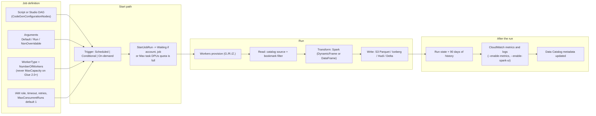
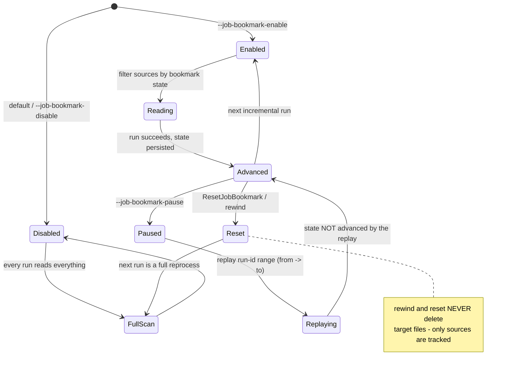
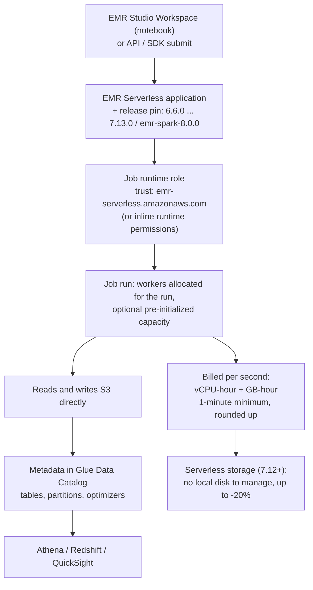
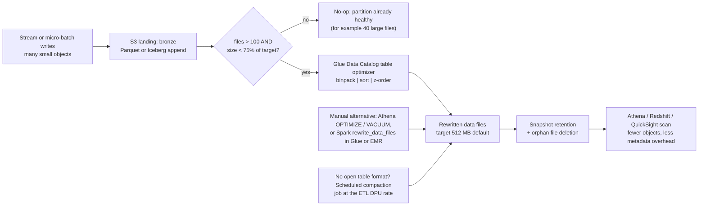
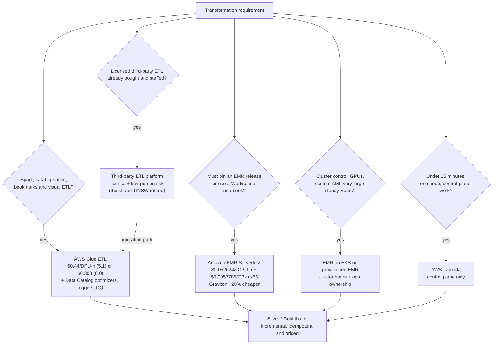

# Transformation at Scale: AWS Glue, EMR Serverless, and Lambda

Lessons 01 through 07 gave you a lake: S3 layout, file formats, open table formats, batch and streaming ingestion, and a catalog. None of that is yet *curated*. This lesson is about the layer that does the curating — **the engines that read raw and bronze, clean it, deduplicate it, and write silver and gold** — and about the three things that decide whether that layer is cheap, correct, or both: **which engine you run, how much capacity you hold while it runs, and whether the second run produces duplicates.**

```text
====================================================================
 THE TRANSFORMATION DECISION SURFACE - AWS LAKEHOUSE (as of Oct 2026)
====================================================================
 Glue ETL (Spark) ...... serverless Spark; Data Catalog attached;
                         DynamicFrame or DataFrame; job bookmarks;
                         workers G./R./Z.; billed in DPU-hours
 Glue for Ray .......... pandas / Ray Datasets on Graviton Z.2X
                         (M-DPU); closed to new customers 30 Apr 2026
 Python shell .......... one EC2 process, no Spark, 0.0625 or 1 DPU
 Glue Studio ........... visual ETL canvas + notebooks + script
                         editor over the same engines (one DAG)
 EMR Serverless ........ full EMR release train (6.6.0 to 7.13.0 and
                         emr-spark-8.0.0); vCPU + GB per second;
                         Workspaces; pre-initialized capacity
 EMR on EKS ............ EMR containers on your EKS clusters,
                         billed with a per-vCPU/GB uplift
 EMR provisioned ....... whole-cluster control, whole-cluster ops
 Lambda ................ 15 min / 10 GB control-plane scalpel -
                         not an ETL engine
-----------------------------------------------------------------------------
 Unit of account ...... Glue: 1 DPU = 4 vCPU + 16 GB
                        M-DPU (R and Ray workers) = 4 vCPU + 32 GB
                        EMR Serverless: vCPU-seconds + GB-seconds
 Idempotency ledger ... bookmarks (source side) | dynamic partition
                        overwrite | Iceberg MERGE + snapshots |
                        staging prefix + atomic promote | watermarks
====================================================================
```

In this lesson you will:

- model the **Glue ETL job** — anatomy, argument precedence, the 260 KB ceiling, triggers, concurrency quotas and the 2024 job-queuing behaviour;
- separate **DynamicFrame from DataFrame** and drive `resolveChoice` with the right action before any write;
- operate **job bookmarks** — Enable / Disable / Pause, what S3 and JDBC sources actually key on, why rewind never deletes your outputs, and how that differs from Iceberg `MERGE`;
- size **workers**: G.1X through G.16X, memory-optimized R workers, Ray's Z.2X, streaming G.025X, `--executor-cores` ceilings and auto scaling;
- author with **Glue Studio** visual ETL, notebooks and the script editor, and read the **Glue version matrix as of October 2026** — what each row costs and what it breaks;
- run **EMR Serverless** — applications, Workspaces, release pinning, metering — and know exactly when it beats Glue, plus **Lambda** for the control plane and never for the data plane;
- apply **Spark lakehouse patterns**: dynamic partition overwrite, AQE, skew, shuffle partitions and small-file compaction;
- write a **worked PySpark Glue job** from catalog read to Iceberg silver, and price every drill on the October 2026 rate card;
- study **two AWS customer cases** (Transport for NSW, Vanguard) plus a **sourced 2026 update box**;
- practise with **11 exam-style questions** and five interactive checks.

---
## 1. The engine ladder: five paths from raw to silver

AWS positions a small number of transformation paths for lakehouse batch work, and they are not interchangeable. The ladder runs from *most integrated, least flexible* to *most flexible, most operational*:

| Engine | What it is | Meter | Sweet spot |
| --- | --- | --- | --- |
| **Glue ETL (`glueetl`)** | Serverless Spark with Data Catalog, DynamicFrame and job-bookmark integration | DPU-hour | Default lakehouse batch: catalog reads, partitioned writes, incremental runs |
| **Glue streaming (`gluestreaming`)** | Same engine, Structured Streaming sinks | DPU-hour | Micro-batch landings into bronze and silver |
| **Python shell (`pythonshell`)** | Native Python on a single EC2 instance, no Spark | 0.0625 or 1 DPU | File moves, API pulls, tiny jobs that fit one node |
| **Glue for Ray (`glueray`)** | pandas / Ray Datasets on Graviton Z.2X | M-DPU-hour | pandas-shaped logic at scale; closed to new customers since 30 Apr 2026 |
| **Glue Studio** | Authoring and operations plane (visual, notebook, script) over the engines above | same as the engine | Teams that want a DAG, previews, schedules and version control without owning Spark |
| **Amazon EMR Serverless** | Full EMR release train, no clusters; Workspaces for notebooks | vCPU-hour + GB-hour | When you need an EMR runtime version, or EMR-shaped workloads without cluster ops |
| **Amazon EMR (EKS / provisioned)** | EMR containers on your EKS cluster, or whole clusters | EC2 / EKS hours (+ uplift on EKS) | Sticky clusters, custom AMIs, very large steady-state Spark |
| **AWS Lambda** | Event-driven functions | GB-second + requests | Orchestration, file validation, partition registration — **not** table rewrites |

Two properties of this ladder matter more than any feature list. First, **only Glue ETL has job bookmarks wired into the job model** — incremental processing is a first-class argument, not code you write. Second, **Glue and EMR Serverless meter differently**: DPU-hours versus vCPU-hours plus GB-hours, so a headline "per DPU" and "per vCPU" number can never be compared without normalizing memory (Section 13 does the arithmetic).

> [!NOTE]
> Everything in this lesson is stamped **as of October 2026**. Glue 1.0, 2.0 and 0.9 reached **end of life on April 1, 2026** — any tutorial that pins them now fails at job start, and the Glue version support policy is explicit that *"AWS Glue will stop existing job runs and interactive sessions on EOL versions."*

---
## 2. The Glue ETL job model: anatomy, arguments, triggers, queuing

### 2.1 What a job actually is

A Glue job is a definition plus runs. The definition is: script (or visual DAG), worker type and worker count, IAM role, optional connections and security settings, default arguments, timeout, retries, `MaxConcurrentRuns`, and the triggers that start it. A run is a bounded execution with a state and a retained history.



`MaxConcurrentRuns` defaults to **1**, and job run history is retained for **90 days** — two numbers worth memorizing, because a run that sits in `WAITING` is telling you about quota or trigger position, not about your code.

### 2.2 Arguments: three layers, one hard ceiling

Arguments are how a generic script becomes a specific pipeline. Three layers apply, in this precedence:

1. **`NonOverridableArguments`** (highest — you cannot beat these at run time)
2. **run `Arguments`** supplied at `StartJobRun`
3. **`DefaultArguments`** on the job

and the whole argument payload has a **maximum size of 260 KB**. That ceiling is the reason you never inline a megabyte of SQL or a base64 blob into arguments — put the SQL in an S3 object and reference it with `--extra-py-files`, `--extra-jars`, or `--additional-python-modules`.

The arguments that show up in almost every lakehouse job:

| Argument | Effect |
| --- | --- |
| `--job-bookmark-option` | `job-bookmark-enable` / `--job-bookmark-disable` / `job-bookmark-pause` (plus `--job-bookmark-from` / `--job-bookmark-to`) |
| `--datalake-formats` | `hudi,delta,iceberg` (Glue 3.0+) — the table formats in play |
| `--enable-auto-scaling` | `true` turns on auto scaling **and per-worker billing** between min and max workers |
| `--executor-cores` | Spark tasks that can run in parallel; **should not exceed 2x the number of vCPUs on the worker type** |
| `--enable-metrics`, `--enable-spark-ui`, `--enable-continuous-cloudwatch-log` | Observability |
| `--extra-py-files`, `--extra-jars`, `--additional-python-modules` | Dependencies |
| `--python-virtual-env` | Customer-managed Python virtual environment (Glue 5.0+, storage-prefix argument on 6.0+) |
| `--TempDir`, `--conf` | Scratch space and raw Spark configuration (Section 10 lives here) |

- **📚 Did you know?** `--executor-cores` has a documented ceiling: it *"should not exceed 2x the number of vCPUs on the worker type."* On a G.1X (4 vCPUs) that means at most 8; on a G.2X, 16. Oversubscribing past that does not add parallelism — it thrashes memory and disk, which then *looks* like a skew problem but is not (AWS Glue job arguments reference, accessed Oct 2026).

### 2.3 Triggers: scheduled, conditional, on-demand

Glue triggers come in three flavours — **Scheduled** (a schedule), **Conditional** (on the *status of a previous job or crawler*) and **On-demand** — with lifecycle states `CREATED`, `ACTIVATED`, `DEACTIVATED`. Two hard rules bite in practice:

- you can attach a **maximum of 2 crawlers to a single trigger**;
- a conditional chain only works if the chain itself is **trigger-started** from a scheduled or on-demand root — a manually launched job will not fire downstream conditional triggers.

### 2.4 Queuing instead of failure at the concurrency ceiling

Before September 2024, hitting *Max concurrent job runs per account*, *per-job concurrency* or *Max task DPUs per account* failed the `StartJobRun` call outright, and teams built Step Functions retry loops to absorb it. AWS Glue job queuing (general availability, AWS Big Data Blog, 3 Sep 2024) changed the shape: *"when the job runs are in Waiting state, the AWS Glue job queuing feature staggers jobs automatically whenever possible."* The failure mode becomes a queue position, and capacity frees as other runs finish.

```dragdrop
{
  "question": "Order the lifecycle of a Glue ETL run, from authoring to observable output (as designed in this lesson):",
  "items": [
    "Author: define the job - script or Studio DAG, WorkerType + NumberOfWorkers, IAM role, default arguments (bookmark option, datalake formats)",
    "Start: a Scheduled, Conditional or On-demand trigger fires, or StartJobRun is called; if an account, job or Max task DPUs per account quota is full, the run enters Waiting and is staggered",
    "Provision: workers are allocated for the run (G., R. or Z. type), auto scaling between min and max when --enable-auto-scaling=true",
    "Read: sources resolve from the Data Catalog; bookmarks filter S3 objects by last-modified time, or JDBC rows by sequential key, using transformation_ctx",
    "Transform: Spark runs the logic - settle choice types with resolveChoice first when the source carries them, then map, then convert",
    "Write: the sink lands Parquet, Iceberg, Hudi or Delta on S3 with partitioning chosen to avoid a small-file problem",
    "Commit and observe: run state is persisted, history is kept for 90 days, metrics and logs go to CloudWatch, Data Catalog metadata is updated"
  ],
  "correctOrder": [
    "Author: define the job - script or Studio DAG, WorkerType + NumberOfWorkers, IAM role, default arguments (bookmark option, datalake formats)",
    "Start: a Scheduled, Conditional or On-demand trigger fires, or StartJobRun is called; if an account, job or Max task DPUs per account quota is full, the run enters Waiting and is staggered",
    "Provision: workers are allocated for the run (G., R. or Z. type), auto scaling between min and max when --enable-auto-scaling=true",
    "Read: sources resolve from the Data Catalog; bookmarks filter S3 objects by last-modified time, or JDBC rows by sequential key, using transformation_ctx",
    "Transform: Spark runs the logic - settle choice types with resolveChoice first when the source carries them, then map, then convert",
    "Write: the sink lands Parquet, Iceberg, Hudi or Delta on S3 with partitioning chosen to avoid a small-file problem",
    "Commit and observe: run state is persisted, history is kept for 90 days, metrics and logs go to CloudWatch, Data Catalog metadata is updated"
  ],
  "explanation": "The order is author, start, provision, read, transform, write, commit. Two placements trip people up: queuing happens at START, not after provisioning - Waiting runs are staggered before workers exist; and bookmark filtering happens at READ, which is why changing a source without changing its transformation_ctx silently skips files. Commit comes last, which is why a failed run leaves bookmark state untouched while its already-written target files remain - the reason Section 11 pairs bookmarks with a write-side idempotent strategy."
}
```

---
## 3. DynamicFrame versus DataFrame, and `resolveChoice`

### 3.1 The two representations

A Spark **DataFrame** needs a schema before data can be loaded — that is its contract. A Glue **DynamicFrame** deliberately breaks that contract, because real ingestion lands inconsistent data:

> *"each record is self-describing, so no schema is required initially. Instead, AWS Glue computes a schema on-the-fly when required, and explicitly encodes schema inconsistencies using a choice (or union) type."*

That choice type is powerful and dangerous. It is powerful because a crawler-sampled JSON where `price` is a number in some rows and a string in others loads without failing. It is dangerous because the choice survives into your write path and silently degrades columns to a general type.

DynamicFrame gives you a toolbox of transforms — `apply_mapping`, `drop_fields`, `filter`, `join`, `map`, `mergeDynamicFrame`, `relationalize`, `rename_field`, `resolveChoice`, `select_fields`, `spigot`, `split_fields`, `split_rows`, `unbox`, `union`, `unnest`, `unnest_ddb_json`, `write` — of which `relationalize` is the one people forget: it *"Converts a DynamicFrame into a form that fits within a relational database"* by unnesting nested columns and pivoting array columns into a list of frames.

### 3.2 `resolveChoice`: settle the schema before you map

`resolveChoice` takes `(field_path, action)` specifications. The actions are:

| Action | Meaning | Use when |
| --- | --- | --- |
| `cast:{{type}}` | Cast; uncastable values become `null` | One type dominates and you can accept nulls for the rest |
| `project:{{type}}` | Project to a type; **values of the other type are dropped** | You want only the well-formed subset |
| `make_cols` | Promote a choice into sibling columns | Column-per-variant layouts |
| `make_struct` | Wrap the choice into a struct | A nested representation is preferred |
| `match_catalog` (choice mode) | Resolve against a Data Catalog table's schema | The catalog is the source of truth — the lakehouse default |

You can also convert with `toDF(options)`, where `options` is a list of `ResolveOption` objects — same idea, DataFrame-bound.

### 3.3 Worked example E1 — a mixed-type `price` column

```text
Input (DynamicFrame from_catalog, 4,000,000 rows, Glue 5.1)
  price: choice<int, string>     97.3% int, 2.7% string ("1,249.50", "N/A")
  currency: string               100% string, 3 values
  event_id: string               no ambiguity
Path A - DynamicFrame (legacy, Glue 4.0-shaped code)
  resolveChoice(specs=[("price", "cast:double")])
  apply_mapping(...)                      # rename / cast / nest / drop
  toDF() -> write
  Result: 97.3% populated, 2.7% null; the cast never throws.
Path B - Spark DataFrame (Glue 5.1 / 6.0 default direction)
  F.col("price").cast("double")           # try_cast where available
  .dropna / .filter / quarantine nulls to an error table
  Result: same rows, but you own the null policy explicitly.
Path C - project instead of cast
  resolveChoice(specs=[("price", "project:double")])
  Result: the 2.7% string rows are DROPPED, not nulled.
          Only choose this when the string rows are known-bad.
Decision rule: cast when missing is acceptable, project when the other
type is garbage, match_catalog when the catalog defines the truth.
```

> [!IMPORTANT]
> ⚠️ **Order is not negotiable: `resolveChoice` → `apply_mapping` → `toDF()` → write.** Converting to a DataFrame while a genuine choice type is still open forces the column into a general type (usually `string`) and quietly defeats the cast you were about to perform. The difference is a clean `double` and a table of padded strings — and the second one fails downstream arithmetic, not your job.

### 3.4 The Glue 5.0+ wrinkle you must plan for

The release notes state it plainly: *"Glue Dynamic Frame / GlueContext-based table-level access control with AWS Lake Formation permissions supported in Glue 4.0 or before is not supported in Glue 5.0."* A script that leans on DynamicFrame **and** GlueContext table-level Lake Formation enforcement is therefore a Glue ≤4.0 artifact. On 5.1 and 6.0 the direction of travel is Spark-native fine-grained access control (FGAC): plain DataFrames plus Lake Formation row filters and column masks. Migrating a 3.0-era `resolveChoice` + `apply_mapping` script without adopting FGAC means you keep the code and lose the enforcement.

---
## 4. Job bookmarks: incremental runs without re-reading everything

### 4.1 What a bookmark is

> *"AWS Glue tracks data that has already been processed during a previous run of an ETL job by persisting state information from the job run."*

State is persisted per job and keyed by `transformation_ctx` — the label you attach to each source and sink in the script. Keep the source and its `transformation_ctx` stable; change a path without changing the key and the state no longer matches what you think it matches.

The three modes you set with `--job-bookmark-option`:

| Mode | Behaviour | Use for |
| --- | --- | --- |
| `job-bookmark-enable` | Tracks **and advances** state on each successful run | Steady-state incremental batch |
| `job-bookmark-disable` | **The default.** No state: every run is a full scan | Small tables, full recompute, first debug run |
| `job-bookmark-pause` | Processes a `--job-bookmark-from` / `--job-bookmark-to` run range, but **the state is not updated** | Backfill a window without breaking forward progress |



### 4.2 What each source type keys on

- **Amazon S3:** *"AWS Glue job bookmarks check the last modified time of the objects to verify which objects need to be reprocessed."* Supported formats are version-dependent: v0.9 supports JSON, CSV, Avro and XML; **v1.0 and later add Parquet and ORC**.
- **JDBC:** *"AWS Glue by default uses the primary key as the bookmark key, provided that it is sequentially increasing or decreasing (with no gaps)."* Surrogate, non-sequential keys need an explicit bookmark key.

### 4.3 The failure list — read this before you ship

- **Disable is the default.** Forgetting `--job-bookmark-option=job-bookmark-enable` silently full-reprocesses every run, and your bill says nothing about it.
- **Do not change the data source property with the bookmark enabled.** AWS lists this as a best practice for exactly the reason above: stale state plus a new path skips or double-reads files.
- **Rewind and reset do not clean targets.** *"When you rewind or reset a bookmark, AWS Glue does not clean the target files… Only source files are tracked with job bookmarks."* Idempotency on the write side is **your** job (Section 11).
- **Pause is for backfill, not for steady state.** It replays a run-ID window and does not advance — perfect for re-running 102 and 103, wrong as a daily mode.
- **Large listings can exhaust the driver.** Use the **AWS Glue Amazon S3 file lister** for large datasets rather than letting the driver enumerate millions of keys.

### 4.4 Worked example E2 — the backfill drill

```text
Nightly incremental job, bookmarks ENABLED, transformation_ctx = "datasource_events"
  run 100 ....... success  (state advances to the end of run 100)
  run 101 ....... success
  run 102 ....... SUCCESS but wrote a poisoned partition
  run 103 ....... success
  run 104 ....... success
  run 105 ....... success  (current state points past 105)
Objective: rebuild only runs 102-103, without corrupting forward state.
Step 1  --job-bookmark-option=job-bookmark-pause
        --job-bookmark-from=101  --job-bookmark-to=103
        -> the run replays the 102-103 window; bookmark state is NOT advanced.
Step 2  The replay writes to a SEPARATE output prefix (s3://.../silver_replay/)
        Why: bookmarks never delete target files, so writing over the original
        prefix in place would leave a mixture of old and new objects.
Step 3  Validate the replayed partitions, then promote (copy + atomic rename,
        or Iceberg MERGE into the silver table keyed on event_id).
Step 4  Resume normal operation with
        --job-bookmark-option=job-bookmark-enable: the next scheduled run
        continues from the un-corrupted forward state.
Cost of the drill (4 x G.1X workers x 30 min, Glue 5.1 @ $0.44/DPU-h):
        4 x 0.5 h = 2 DPU-h x $0.44 = $0.88   ($0.616 on Glue 6.0 @ $0.308)
```

- **📚 Did you know?** Bookmark state is not limited to JSON and CSV: from Glue 1.0 onward, S3 bookmarks also persist state for **Parquet and ORC** inputs, so the parquetized bronze you built in Lesson 05 is bookmark-friendly — the 0.9-era "JSON/CSV only" folklore is out of date (AWS Glue developer guide, monitor continuations, accessed Oct 2026).

```fillblank
{
  "question": "Complete the job-bookmark semantics using the AWS developer guide's own vocabulary (as of Oct 2026):",
  "template": "For Amazon S3 input sources, AWS Glue job bookmarks check the {{1}} of the objects to decide what needs reprocessing. With --job-bookmark-option={{2}}, state is tracked and advances after each successful run. With {{3}}, a run-id range set by --job-bookmark-from and --job-bookmark-to is replayed while the state is NOT updated. Resetting or rewinding a bookmark {{4}} the files already written to the target.",
  "answers": {
    "1": "last modified time",
    "2": "job-bookmark-enable",
    "3": "job-bookmark-pause",
    "4": "does not delete"
  },
  "distractors": ["row count", "partition values", "object checksum", "job-bookmark-disable", "rewrites", "job-bookmark-from", "file size", "clears"],
  "explanation": "The S3 bookmark check is explicitly the last-modified time of the objects. job-bookmark-enable is the tracking-and-advancing mode; job-bookmark-pause is the backfill mode, which replays the from/to run window without advancing state; and rewind or reset never cleans the target - AWS states that only source files are tracked with job bookmarks, so write-side idempotency (partition overwrite, Iceberg MERGE, or a staging prefix) must be handled by the job itself."
}
```

---
## 5. Workers, DPUs and M-DPUs: where the bill and the OOM come from

### 5.1 The unit

> *"A DPU is a relative measure of processing power that consists of 4 vCPUs of compute capacity and 16 GB of memory."*

And the memory-optimized variant: *"Memory-Optimized DPUs (M-DPUs): R type workers use M-DPUs, which provide double the memory allocation for a given size compared to standard DPUs"* — **32 GB per 4 vCPU**. Everything downstream (price, OOM triage, the Glue-versus-EMR comparison) flows from those two sentences.

### 5.2 Worker catalogue (as of Oct 2026)

| Worker | DPU | vCPU / memory | Disk (free) | Notes |
| --- | --- | --- | --- | --- |
| **G.1X** | 1 | 4 vCPU / 16 GB | 94 GB (~44 GB free) | Default-shaped general worker |
| **G.2X** | 2 | 8 vCPU / 32 GB | 138 GB (~78 GB free) | Two executors' worth of headroom |
| **G.4X** | 4 | 16 vCPU / 64 GB | 256 GB (~230 GB free) | Large drivers and wide plans |
| **G.8X** | 8 | 32 vCPU / 128 GB | 512 GB (~485 GB free) | Same reason, twice |
| **G.12X** | 12 | 48 vCPU / 192 GB | 768 GB (~741 GB free) | **Glue 4.0+ Spark ETL only** |
| **G.16X** | 16 | 64 vCPU / 256 GB | 1024 GB (~996 GB free) | **Glue 4.0+ Spark ETL only** |
| **R.1X – R.8X** | 1–8 M-DPU | 4 vCPU / **32 GB** per M-DPU | — | Memory-optimized: same CPU, double RAM |
| **G.025X** | 0.25 | 2 vCPU / 4 GB | 84 GB | **Streaming** (Glue 3.0+), 0.25 DPU |
| **Z.2X** | 2 M-DPU | 8 vCPU / 64 GB | 128 GB | **Ray only**; up to 8 Ray workers from the autoscaler |

> [!WARNING]
> ⚠️ **There is no Snowball worker type in the current enum.** The worker-types page and the Jobs API list **Standard, G.1X…G.16X, R.1X…R.8X, G.025X and Z.2X** and nothing else — validate any worker type against that enum before designing capacity on it, because older material about exotic or Edge/Snowball shapes does not match the API as of Oct 2026. Larger workers also have gates: **G.12X and G.16X are available only for AWS Glue version 4.0 or later Spark ETL jobs**, and they are not present in every Region.

> [!IMPORTANT]
> ⚠️ **G workers do not buy memory per CPU.** Every G worker keeps the **4 vCPU : 16 GB** ratio; only R (and the Ray Z worker) double it. Moving from G.1X to G.4X does **not** fix an out-of-memory broadcast join — it gives you the same ratio four times faster and four times wider. OOM → **R.**; shuffle volume or skew → **more workers**; a genuinely slow single-threaded stage → a **bigger worker**; an enormous query plan → **G.4X or G.8X**, because *"Larger worker types not only benefit the Spark executors, but also in cases where the Spark driver needs larger capacity—for instance, because the job query plan is quite large."*

### 5.3 Capacity: `MaxCapacity` is legacy, workers are current

- `AllocatedCapacity` is **deprecated** — *"Use MaxCapacity instead."*
- For Glue 2.0+ jobs: *"you cannot specify a Maximum capacity. Instead, you should specify a Worker type and the Number of workers. Do not set MaxCapacity if using WorkerType and NumberOfWorkers."*
- Where `MaxCapacity` still applies: **pythonshell** 0.0625 or 1 DPU; legacy **glueetl/gluestreaming** range 2–100 DPUs, default **10**, with no fractional DPU allocation.
- **Auto scaling**: `--enable-auto-scaling=true` turns on auto scaling *and per-worker billing*, with `NumberOfWorkers` acting as the maximum.

```matching
{
  "question": "Match each Glue worker shape to the workload it is actually for (as of Oct 2026):",
  "pairs": [
    {"left": "G.1X (1 DPU, 4 vCPU, 16 GB, 94 GB disk)", "right": "Economical parallel fan-out: many small partitions where the 4 vCPU : 16 GB ratio is not the constraint"},
    {"left": "G.4X and G.8X (4 and 8 DPU)", "right": "Plan-heavy jobs - wide multi-joins and heavily partitioned logical plans where the Spark DRIVER needs capacity, not just executors"},
    {"left": "R.1X to R.8X (M-DPU, 4 vCPU : 32 GB)", "right": "Memory-bound stages: large broadcast joins and caches that OOM on the 16 GB-per-DPU G ratio"},
    {"left": "Z.2X (2 M-DPU, 8 vCPU, 64 GB, 128 GB disk)", "right": "Glue for Ray only - pandas and Ray Datasets logic, up to 8 Ray workers from the autoscaler, existing customers only"},
    {"left": "G.025X (0.25 DPU, 2 vCPU, 4 GB, 84 GB disk)", "right": "Streaming jobs on Glue 3.0+ that need a tiny per-worker footprint instead of a full DPU"},
    {"left": "pythonshell at 0.0625 DPU", "right": "Single-instance Python with no Spark at all: file moves, API calls, control-plane glue code"}
  ],
  "explanation": "Each row avoids a specific failure mode: G.1X is the economical default; G.4X and G.8X exist for driver-side plan size rather than executor RAM; R workers are the OOM answer because they double memory per vCPU; Z.2X is the only Ray worker; G.025X is streaming-only; pythonshell is the no-Spark lane. The classic error is buying a G.4X to fix an OOM - the G ratio never changes, so the structural fix for memory pressure is an R worker or fewer columns in the shuffle."
}
```

### 5.4 Worked example E3 — sizing and pricing a 400 GB batch

```text
Input: 400 GB Parquet, target ~8-way task parallelism -> 10 x G.1X = 10 DPU
Runtime: 1 hour (auto scaling off for the drill)
  Glue 5.1 / 4.0 / 3.0   10 DPU-h x $0.44  = $4.40 per run
  Glue 6.0               10 DPU-h x $0.308 = $3.08 per run   (-30%)
  Glue 5.1 + Flex        10 DPU-h x $0.29  = $2.90 per run
  Glue 6.0 + Flex        10 DPU-h x $0.203 = $2.03 per run
Nightly for a 30-day month:
  5.1 standard   $4.40 x 30 = $132.00
  6.0 standard   $3.08 x 30 =  $92.40
  5.1 Flex       $2.90 x 30 =  $87.00
  6.0 Flex       $2.03 x 30 =  $60.90
Flex is discounted because the run is INTERRUPTIBLE - acceptable for
backfills and non-SLA recomputes, never for an interactive session or a
latency-bound pipeline.
```

### 5.5 Worked example E4 — the same job when memory, not speed, is the constraint

```text
Symptom: a broadcast join OOMs at 10 x G.1X (10 DPU, 160 GB total, 16 GB/worker)
Wrong fix: 10 x G.4X -> 40 DPU, still 16 GB per 4 vCPU: same ratio, more money.
Right fix: memory-optimized workers at a comparable CPU class.
  4 x R.4X = 16 M-DPU  ->  16 M-DPU-h x $0.52  = $8.32 / h  (Glue 5.1)
                           16 M-DPU-h x $0.364 = $5.82 / h  (Glue 6.0)
Alternative: rewrite the stage as pandas on Glue for Ray (existing customers)
  Z.2X = 2 M-DPU per worker-hour x $0.44 = $0.88 / h, 64 GB per worker,
  autoscaled up to 8 Ray workers.
Read the three numbers together: $8.32 buys 16 M-DPU of Spark; $0.88 buys
2 M-DPU of Ray. The same dollars buy 18x more nominal capacity on Ray -
which is exactly why the answer depends on whether the logic is Spark-shaped
or pandas-shaped, not on which headline price looks smaller.
```

```plot
{
  "type": "bar",
  "title": "October 2026 Glue worker rates: one hour at full allocation (us-east-1)",
  "xLabel": "Worker and version combination",
  "yLabel": "USD per hour",
  "xKey": "combo",
  "data": [
    {"combo": "10 x G.1X on Glue 5.1 (10 DPU)", "usd_per_hour": 4.40},
    {"combo": "10 x G.1X on Glue 6.0 (10 DPU)", "usd_per_hour": 3.08},
    {"combo": "10 x G.1X Flex on Glue 5.1", "usd_per_hour": 2.90},
    {"combo": "4 x R.4X on Glue 5.1 (16 M-DPU)", "usd_per_hour": 8.32},
    {"combo": "4 x R.4X on Glue 6.0 (16 M-DPU)", "usd_per_hour": 5.82},
    {"combo": "Ray Z.2X on Glue for Ray (2 M-DPU)", "usd_per_hour": 0.88}
  ]
}
```

- **📚 Did you know?** Disk is the quiet constraint: **G.1X exposes 94 GB of disk but only about 44 GB of it is free** — shuffle spills and large local intermediate data land there. If the Spark UI shows heavy spill on a G.1X, you are disk-bound rather than CPU-bound, and a G.4X (256 GB, about 230 GB free) or cloud shuffle storage is the fix (AWS Glue worker types, accessed Oct 2026).

---
## 6. Glue Studio: visual ETL, notebooks and the script editor over the same engine

Glue Studio is not a different service — it is the authoring and operations plane. AWS offers three ways in: **Visual ETL** (a visual interface focused on data flow), **an interactive code notebook** (Jupyter-based), and **a script editor** where you pick the engine — Python shell, Ray, Spark (Python) or Spark (Scala). The visual pitch is exact: *"you can visually compose data transformation workflows and seamlessly run them on AWS Glue's Apache Spark-based serverless ETL engine… using a drag-and-drop interface without having to learn Spark or write code."*

What makes it more than a diagram tool:

- The visual graph compiles through **`CodeGenConfigurationNodes`** — *"The representation of a directed acyclic graph on which both the AWS Glue Studio visual component and AWS Glue Studio code generation is based."* The canvas and the generated script are two views of one DAG.
- Two code flavours exist: *"the original, or Classic version, and a newer, streamlined version."* Read both before assuming the generated script is unreadable.
- The editor ships **Script, Job details, Runs, Data quality, Schedules and Version Control** tabs, plus node-level schema and sample data on the diagram.
- **Data preview runs on interactive sessions** — real DPU consumption, not a free hover preview.
- **Job Notebooks** give serverless notebook surfaces backed by AWS Glue Interactive Sessions, savable and schedulable as jobs; sample jobs include *"Visual ETL job to join multiple sources"*, *"Spark notebook using Pandas"* and *"Spark notebook using SQL"*.

> [!NOTE]
> Ray is the odd lane: Studio's visual canvas does **not** support Ray jobs — *"Visual jobs in AWS Glue Studio are not yet supported"* for Ray, so that path is script editor or interactive sessions only. Choose the authoring experience before promising a business stakeholder a point-and-click canvas on a Ray workload.

---
## 7. The Glue version matrix (Oct 2026) and Glue for Ray

### 7.1 The matrix

| Glue version | Spark | Python | Scala / Java | Open table formats | Status as of Oct 2026 |
| --- | --- | --- | --- | --- | --- |
| **6.0** | **4.1.1** | **3.13** | 2.13.17 / 17 | Hudi 1.1.1, **Iceberg 1.11.0**, Delta 4.2.0, **Iceberg v3** | GA 21 Aug 2026; new: Spark Declarative Pipelines, Spark Connect for Interactive Sessions, Arrow-native Python UDFs and UDTFs, customer-managed `--python-virtual-env`; **EMRFS removed (S3A is the sole S3 connector), AWS SDK for Java v1 removed** |
| **5.1** | 3.5.6 | 3.11 | 2.12.18 / 17 | Hudi 1.0.2, Iceberg 1.10.0, Delta 3.3.2 | **Default for jobs created without specifying a Glue version**; Spark-native fine-grained access control (FGAC) |
| **5.0** | 3.5.4 | 3.11 | — / 17 | — | Previous stable; **no GlueContext table-level Lake Formation control** (that path is ≤4.0); release row notes ML transforms unsupported |
| **4.0 (Spark)** | 3.3.0 | 3.10 | — / 8 | First native Hudi, Delta Lake and Iceberg support, plus the S3-based Cloud Shuffle Storage Plugin | Still running, legacy for new work; DynamicFrame plus GlueContext LF table-level control lives here |
| **4.0 (Ray)** | Ray 2.4.0 | 3.9 | — | — | VPC not currently available; US East (N. Virginia), US East (Ohio), US West (Oregon), Asia Pacific (Tokyo), Europe (Ireland) |
| **3.0** | 3.1.1 | 3.7 | — / 8 | `--datalake-formats` introduced | Old but alive |
| **2.0 / 1.0 / 0.9** | — | — | — | — | **End of life 1 April 2026 — existing job runs and interactive sessions are stopped** |

Two tools sit under that table: an **upgrade analysis tool** that inspects Glue ≥2.0 jobs and recommends a migration target, and a **Spark Upgrade Agent** for moving existing jobs to 6.0.

### 7.2 Glue for Ray — brief, and what changed

Ray jobs use *"the same AWS Glue jobs and interactive sessions that you use with AWS Glue for Spark"*, run on Graviton-based workers measured in **M-DPUs (4 vCPU and 32 GB each)**, and today have exactly one worker type: **Z.2X** (2 M-DPU, 8 vCPU, 64 GB memory, 128 GB disk, up to 8 Ray workers from the autoscaler). The pitch is pandas without a rewrite — *"run your pandas workflows against big data at enterprise scale—with only a few lines of code"* — plus auto scaling built into the Glue job model and Graviton price performance.

The October 2026 reality check: **AWS Glue for Ray is no longer open to new customers** (closed 30 April 2026); existing customers keep running jobs, no new features are planned beyond security and availability, and AWS documents a migration path to **Ray on Amazon Elastic Kubernetes Service** with an argument-mapping table (`--min-workers` → `workerGroupSpecs.minReplicas`, `--pip-install` → Ray runtime-env `pip`) and a `ray job submit` example. Two consequences for design: do not propose Ray to a team that is not already a customer, and do not build a new lakehouse critical path on a lane in maintenance mode.

---
## 8. EMR Serverless: the EMR release train without the cluster

### 8.1 Shape and setup

EMR Serverless is an **application + runtime role + job submission** model. You create an application, grant a job runtime role trusted by `emr-serverless.amazonaws.com`, point at S3, and optionally create an **EMR Studio Workspace** for interactive notebooks — *"you need to specify an S3 bucket and the minimum service role for EMR Serverless to create a Workspace."* Workspaces ship with a useful pre-installed set for Python and PySpark: **ggplot, matplotlib, numpy, pandas, plotly, bokeh, scikit-learn, scipy**.

**Release selection is flexible and per-application.** *"With Amazon EMR 6.6.0 and higher, deploy EMR Serverless"*; the current list runs from **EMR Serverless 7.13.0 down to 6.6.0**, plus the **AWS runtime for Apache Spark (`emr-spark-8.0.0`)** and its preview variant. That pinning freedom is the single biggest architectural difference from Glue: you choose the EMR runtime rather than the Spark version Glue happens to expose.

**Capacity is elastic per run, not per cluster.** You do not size a cluster; the application allocates workers for the run and you are billed by the second for what it uses, with **pre-initialized capacity** available when spin-up latency matters. Two 2025 additions shrink both cost and IAM sprawl: **serverless storage** (2 Dec 2025, release 7.12 and higher) — *"No need to configure local disk or manage instances"*, with cost reduced *"by up to 20%"* — and **inline runtime permissions** (22 Jul 2025), which *"grant temporary permissions to jobs at runtime without creating separate IAM roles per job."*



### 8.2 EMR on EKS and provisioned EMR — one paragraph each

**EMR on EKS** runs EMR containers on Kubernetes clusters you already operate. Pricing is the EMR uplift on top of your Kubernetes and EC2 spend: **$0.01012 per vCPU-hour plus $0.00111125 per GB-hour** (on-demand, us-east-1 context), and *"EMR on EKS cluster costs $0.10 per hour."* Choose it when you have an EKS estate, need workload isolation per team namespace, or must mix EMR Spark with other containerized services.

**Provisioned EMR** is whole clusters: you pick instance types and counts, you own the scaling behaviour, and you pay for capacity whether it is busy or idle. It remains the defensible answer for GPUs, custom AMIs, sticky clusters and very large steady-state Spark. Treat any per-hour cluster markup arithmetic as something you re-verify against the live EC2 price list for your Region before printing it — the rates verified for this lesson are Glue DPU and M-DPU, EMR Serverless vCPU and GB, and the EMR on EKS uplift above.

### 8.3 When EMR Serverless beats Glue (and when it does not)

| Requirement | Glue ETL | EMR Serverless |
| --- | --- | --- |
| Data Catalog, crawlers, bookmarks, Studio visual ETL in one product | **Yes — native** | Reads the catalog, but no bookmark or visual lane |
| Pin a specific EMR release or runtime (6.6 → 7.13, `emr-spark-8.0.0`) | No — Glue version matrix only | **Yes** |
| Notebook Workspace with pandas and scikit-learn pre-installed | Interactive sessions on a DPU meter | **Yes — Workspaces** |
| Metering granularity | DPU-hour / M-DPU-hour | **vCPU-hour + GB-hour, per second** |
| Iceberg table optimizers in the product | **Yes — Data Catalog optimizers** | Manual Spark `rewrite_data_files` |
| Migrating an existing EMR notebook fleet | Rewrite to Glue arguments | **Lift the job, keep the runtime** |
| Tightest integration with job bookmarks and Glue Studio | **Yes** | No |

### 8.4 Worked example E5 — the same 8 vCPU / 32 GB job on two meters

```text
Job: 8 vCPU, 32 GB of memory, runs 1 hour (us-east-1, as of Oct 2026)
EMR Serverless, x86:
  8  x $0.052624 / vCPU-h = $0.420992
  32 x $0.0057785 / GB-h  = $0.184912
  total                    = $0.605904  ~= $0.61 / h
EMR Serverless, Graviton (ARM):
  8  x $0.042094 / vCPU-h = $0.336752
  32 x $0.004628  / GB-h  = $0.148096
  total                    = $0.484848  ~= $0.48 / h   (~20% below x86)
Glue equivalent capacity, normalized by vCPU first:
  8 vCPU on the G ratio = 2 DPU -> 2 x G.2X, or 2 x G.4X = 8 DPU of headroom
  8 DPU x $0.44  = $3.52 / h  (Glue 5.1)
  8 DPU x $0.308 = $2.464 / h (Glue 6.0)
Per-vCPU-second cross-check (derived arithmetic, not an AWS line item):
  x86      $0.052624 / 3600 ~= $1.4618e-5 per vCPU-second
  Graviton $0.042094 / 3600 ~= $1.1693e-5 per vCPU-second
Lesson: never compare a DPU headline to a vCPU headline. Normalize to
vCPU AND memory, then add startup time, Data Catalog charges and any
pre-initialized capacity you keep warm.
```

- **📚 Did you know?** EMR Serverless advertises both a storage free tier — *"The free tier is 20 GB of standard storage per month for 12 months from your initial use"* — and *"Per-second billing (rounded up, with a minimum of 1 minute)."* That 1-minute floor is why a six-second Spark invocation still costs a minute of vCPU and memory (AWS EMR pricing, accessed Oct 2026).

---
## 9. Lambda for light transforms: the control-plane scalpel

Lambda belongs in this lesson because it keeps showing up in lakehouse architectures — validating files on arrival, registering partitions, fanning out per-tenant work, promoting a staging prefix. It is *not* here as an ETL engine, because the quotas say it cannot be one:

| Limit | Value (AWS Lambda limits, accessed Oct 2026) |
| --- | --- |
| Timeout | **1 to 900 seconds (15 minutes)** |
| Memory allocation | **128 MB to 10,240 MB**; **1,769 MB ≈ 1 vCPU** |
| Temporary storage (`/tmp`) | **512 MB to 10,240 MB** |
| Deployment package | **250 MB unzipped** zip; **10 GB** container image |
| Account concurrency | **1,000** concurrent executions by default |
| Environment churn | **~1,000 new execution environments created every 10 seconds** |

**Use Lambda for:** event fan-out (S3 → EventBridge → Step Functions → Glue), file validation on landing, partition registration into the catalog, tiny S3-to-S3 fixes on a narrow key range, staged-promotion swaps, and the orchestration glue between jobs.

**Do NOT use Lambda for:** full table rewrites, joins that need a shuffle beyond `/tmp`, anything that approaches 15 minutes of steady compute, packages that will not fit 250 MB unzipped, or a fan-out that will exceed account concurrency and throttle. Each of those is a Glue or EMR Serverless job with a partition plan, not a function.

### 9.1 Worked example E6 — the concurrency ceiling arrives before the timeout

```text
Scenario: 1,500 object-created events land in one burst; each Lambda
invocation processes one object and takes 4 seconds.
Default account concurrency = 1,000.
  1,500 concurrent events -> 1,000 run, 500 are throttled immediately.
  With a DLQ and retries the 500 are absorbed, but the burst latency
  doubles for them. Environment creation (~1,000 new environments per
  10 seconds) is not the binding constraint at this size; concurrency is.
Worst-case time check against the 15-minute wall:
  If one invocation must rewrite 40 GB through a 10,240 MB /tmp ceiling,
  that is 4 full passes plus network round trips - exactly the shape that
  blows past 900 seconds.
Verdict: 1,500 tiny file-validators = Lambda (with a DLQ for the 500).
         40 GB table rewrite = Glue ETL (10 x G.1X, $4.40/h on 5.1)
         or EMR Serverless (about $0.61/h x86 for 8 vCPU / 32 GB).
```

> [!WARNING]
> ⚠️ **Lambda is not an ETL engine.** The 15-minute timeout, 10 GB image / 250 MB zip package and 10 GB `/tmp` ceiling make it structurally wrong for lakehouse-scale rewrites — use it for orchestration and micro-fixes. A "Lambda ETL" design that works in the demo dies on the first month-end partition sweep.

---
## 10. Spark lakehouse patterns: partitions, AQE, skew, shuffle, small files

### 10.1 Dynamic partition overwrite

When a job rewrites a *set* of partitions rather than appending, you want the old objects in those partitions gone and everything else untouched. Spark expresses that as `spark.sql.sources.partitionOverwriteMode=dynamic`, set in Glue through `--conf`. Used with care it is a clean idempotency tool: run the job twice and the output is the same, because the partitions you wrote were replaced rather than duplicated.

Two caveats worth stating: partition overwrite is *partition-scoped*, so it does nothing for row-level updates (that is Iceberg `MERGE` territory), and the rename-algorithm option AWS documents for duplicate nested partition paths (`--enable-rename-algorithm-v2`) is documented as available **only on AWS Glue version 1.0** — do not assume it applies to a modern Glue 4.x or 5.x job.

### 10.2 AQE, skew and shuffle partitions — the three `--conf` dials

All three live in `--conf`, and all three change the shape of the plan at runtime rather than your code:

- **AQE (adaptive query execution)** — lets Spark re-plan once shuffle boundaries are known: coalescing over-parallel shuffle partitions, converting sort-merge joins to broadcast joins when statistics allow, and repairing skewed joins.
- **Shuffle partitions** — the degree of post-shuffle parallelism. Too few on a big shuffle means stragglers and spill; too many on a small job means thousands of tiny tasks whose scheduling overhead dominates the work.
- **Skew handling** — one hot key makes a single task do all the work while 200 idle. The fix ladder: change or salt the key, enable adaptive skew handling, or repartition away from the offending column. Adding workers does not help single-key skew — the same single task still owns the key.

### 10.3 Small files: the compaction lifecycle

> *"Having thousands of small Amazon S3 objects in a data lake table increases metadata overhead and affects read performance."*

The Glue Data Catalog ships **managed compaction for Iceberg tables**, which *"performs compaction without interfering with concurrent queries and supports compaction only for Parquet format tables."* It fires on a rule, not on a schedule:

- **more than 100 files** in a table or partition, **and**
- files **smaller than 75% of the target file size**, where the target comes from `write.target-file-size-bytes` (**default 512 MB**, so the trigger threshold is 384 MB).

Strategies: **binpack** (the Iceberg default — *"Combines small files into larger files, typically targeting sizes over 100MB"*), **sort**, and **z-order** for multi-dimensional pruning. Two sibling optimizers handle housekeeping: **snapshot retention** and **orphan file deletion**, with `deleteFileThreshold` defaulting to **100** deletes in a data file before compaction considers it.



Two facts surprise people: **compaction is disabled by default for new tables**, and it **bills at the Glue ETL DPU rate** ($0.44 per DPU-hour — compaction is its own line on the price list, not a free catalog feature).

### 10.4 Worked example E7 — does the optimizer fire, and what does it cost?

```text
Table: events, partition p=2026-10-11
  120 files x 50 MB each, target = write.target-file-size-bytes (default)
Threshold math:
  75% x 512 MB = 384 MB
  50 MB < 384 MB   -> size condition TRUE
  120 > 100        -> count condition TRUE
  -> optimizer FIRES; binpack rewrites ~6.0 GB into ~12 x 512 MB files
  Run: 4 x G.1X for 30 minutes = 4 x 0.5 = 2 DPU-h
       2 x $0.44  = $0.88 per compaction run (Glue ETL rate)
       2 x $0.308 = $0.616 on Glue 6.0
Counter-example: partition p=2026-10-10 has 40 files of 480 MB each
  480 MB >= 384 MB  -> size condition FALSE
  -> no rewrite, $0.00. Compaction is threshold-driven, not a cron.
Strategy choice:
  binpack -> just bigger files (cheapest; fixes the file COUNT)
  sort    -> ordered layout for pruning on a sort key
  z-order -> multi-dimensional pruning (costs the most, redoes layout)
```

- **📚 Did you know?** Compaction is a *product*, not a script you maintain: the Data Catalog offers three table optimizers — **Compaction, Snapshot retention and Orphan file deletion** — configurable at catalog level through the Lake Formation console or the `UpdateCatalog` API, with CLI setup via `aws glue create-table-optimizer --type compaction`. Athena adds manual `OPTIMIZE` and `VACUUM` on the same tables (AWS Glue table optimizers, accessed Oct 2026).

---
## 11. Idempotency: bookmarks versus MERGE versus watermarks

Correctness at scale is the same question every time: *if this run happens twice, is the table still right?* The answer is never "bookmarks will handle it."

| Mechanism | What it guarantees | What it does **not** do |
| --- | --- | --- |
| **Job bookmarks** (Enable) | Skips already-processed **sources** — S3 last-modified, JDBC sequential key — so input is not re-read | Does not touch targets; rewind and reset **never delete output files** |
| **Bookmark Pause** | Replays a run-ID window without advancing state (backfill) | Does not clean up what the replay writes |
| **Dynamic partition overwrite** | Replaces exactly the partitions written in this run | Does not touch rows inside untouched partitions; no row-level update |
| **Iceberg MERGE + snapshot isolation** | Row-level upsert on a natural key; concurrent readers see a consistent snapshot | Requires you to define the key, the condition and the source dedup |
| **Staging prefix + atomic promote** | Consumers see old or new, never a partial write | Requires a promotion step you must also make idempotent |
| **Watermarks (streaming)** | Bounds late data so stateful operators can discard state | Is a streaming concept; there is no bookmark equivalent for a stream |

The checklist that falls out of the facts in this lesson:

1. Give every source and sink a **stable `transformation_ctx`** — it is the state key.
2. **Enable** bookmarks explicitly; disable is the default.
3. Never change a source property while a bookmark is live.
4. Pair bookmarks with a **write-side idempotent strategy** — dynamic partition overwrite, Iceberg `MERGE`, or a staging prefix — because only sources are tracked.
5. For Iceberg, prefer **MERGE over blind appends**; snapshot isolation gives readers that never see half-written state.
6. For streaming sinks, remember the maintenance window: *"AWS Glue will restart the job within 3 hours of the specified maintenance window"* — design sinks for **at-least-once plus an idempotent commit**.

> [!WARNING]
> ⚠️ **The most expensive sentence in lakehouse engineering is "we rewind and re-run, so we are safe."** Rewinding re-reads inputs; it does not remove outputs. Without partition overwrite, `MERGE`, or a staging promote, a rewind leaves you a table full of duplicates that no query layer will warn you about.

---
## 12. Worked PySpark Glue job outline: catalog read to Iceberg silver

Everything so far, in one job. This is the shape of a Glue 5.1 or 6.0 silver build: catalog source with bookmarks on, an explicit schema-settle step where the source carries Glue choice types, dedup on a natural key, an error quarantine, and an Iceberg write that is safe to repeat.

```python
# AWS Glue ETL (Spark) - silver build
# Job arguments (defaults on the job, overridable per run):
#   --job-bookmark-option      = job-bookmark-enable
#   --datalake-formats         = iceberg
#   --enable-auto-scaling      = true          (NumberOfWorkers = max)
#   --enable-metrics           = true
#   --enable-continuous-cloudwatch-log = true
#   --conf spark.sql.sources.partitionOverwriteMode=dynamic
#   --conf spark.sql.adaptive.enabled=true
# Workers: 10 x G.1X (10 DPU) -> Glue 5.1 $0.44/DPU-h | Glue 6.0 $0.308/DPU-h

import sys
from awsglue.context import GlueContext
from awsglue.job import Job
from awsglue.utils import getResolvedOptions
from pyspark.context import SparkContext
from pyspark.sql import functions as F

args = getResolvedOptions(sys.argv, [
    "JOB_NAME", "source_db", "source_table", "silver_table", "run_date"
])

sc = SparkContext()
glue_ctx = GlueContext(sc)
spark = glue_ctx.spark_session
job = Job(glue_ctx)
job.init(args["JOB_NAME"], args)          # run state begins here

# --- 1. READ: catalog table, bookmark-filtered by transformation_ctx -------
# transformation_ctx is the bookmark state key: rename it only when you
# intend to invalidate the incremental state for this source.
frame = glue_ctx.create_dynamic_frame.from_catalog(
    database=args["source_db"],
    table_name=args["source_table"],
    transformation_ctx="datasource_events",
)
df = frame.toDF()

# --- 2. SETTLE SCHEMA: only when the source carries Glue choice types ------
# order matters: resolve choice -> map -> DataFrame semantics (Section 3)
# frame = frame.resolveChoice(specs=[("price", "cast:double")])

# --- 3. CLEAN + DEDUP: dropDuplicates is what makes a replay safe ----------
clean = (
    df.dropDuplicates(["event_id"])                      # idempotent on replay
      .withColumn("event_time", F.col("event_time").cast("timestamp"))
      .withColumn("price", F.try_cast("price", "double"))   # bad strings -> NULL
      .filter(F.col("event_time") >= F.to_timestamp(F.lit(args["run_date"])))
      .filter(F.col("event_id").isNotNull())
      .withColumn("silver_partition", F.lit(args["run_date"])))

# --- 4. WRITE: Iceberg silver plus an error quarantine, safe to repeat ------
# Append + MERGE (Iceberg) for row-level idempotency, or dynamic partition
# overwrite for whole-partition replacement (Section 10).
for name, part in ((args["silver_table"], clean.filter(F.col("price").isNotNull())),
                   (args["silver_table"] + "_errors", clean.filter(F.col("price").isNull()))):
    (part.repartition("silver_partition").write.format("iceberg")
         .mode("append").saveAsTable(name))

# --- 5. COMMIT: run state, including bookmark state, is persisted ----------
job.commit()
```

### 12.1 What to set alongside the code

```text
Job arguments .... --job-bookmark-option=job-bookmark-enable, --datalake-formats=iceberg,
                   --enable-auto-scaling=true (NumberOfWorkers = max), --enable-metrics,
                   --enable-spark-ui, --enable-continuous-cloudwatch-log
Workers ........... 10 x G.1X (10 DPU) for a ~400 GB input; move to R workers only
                   when a stage OOMs on memory, not on speed
Concurrency ....... MaxConcurrentRuns = 1 (bookmarks are not concurrency-safe)
Timeout ........... explicit; the blank default is 480 min on Glue 5.0+ (2,880 min <= 4.0)
Dependencies ...... --extra-py-files or --python-virtual-env, never 260 KB of inline code
```

### 12.2 Worked example E8 — pricing this job

```text
Run: 10 x G.1X = 10 DPU for 30 minutes, nightly, 30 days
  DPU-hours per run ..... 10 x 0.5 = 5 DPU-h
  Glue 5.1 .............. 5 x $0.44  = $2.20 / run  -> $66.00 / month
  Glue 6.0 .............. 5 x $0.308 = $1.54 / run  -> $46.20 / month
  Glue 5.1 + Flex ....... 5 x $0.29  = $1.45 / run  -> $43.50 / month
  Compaction (separate)  4 x G.1X x 30 min = 2 DPU-h = $0.88 / run
  Month total (5.1, standard + compaction) = $66.00 + $26.40 = $92.40
  Month total (6.0, standard + compaction) = $46.20 + $18.48 = $64.68
  Auto scaling note: with --enable-auto-scaling=true you bill per worker
  between min and max, so a job idling at 4 workers between 02:00 and
  02:40 does not pay for 10 the whole time.
```

---
## 13. Cost math: DPU-hours, vCPU-seconds and the Flex discount

### 13.1 The October 2026 rate card

All Glue rates below come from the AWS Price List offer CSV for AWS Glue (publication 2026-10-06, effective 2026-10-01, us-east-1); EMR rates come from the EMR pricing page and the EMR Serverless pricing map (accessed 2026-10).

| Meter | Unit | Price (USD) |
| --- | --- | --- |
| Glue ETL job (Glue 2.0–5.1, Standard/G workers) | DPU-hour | **$0.44** |
| Glue ETL job (Glue 6.0+) | DPU-hour | **$0.308** |
| Glue ETL job Flex (Glue 2.0–5.1) | DPU-hour | **$0.29** |
| Glue ETL job Flex (Glue 6.0+) | DPU-hour | **$0.203** |
| Memory-optimized R workers (Glue 2.0–5.1) | M-DPU-hour | **$0.52** |
| Memory-optimized R workers (Glue 6.0+) | M-DPU-hour | **$0.364** |
| Glue for Ray job (Z.2X) | M-DPU-hour | **$0.44** |
| Glue interactive session (Spark or Ray) | DPU / M-DPU-hour | **$0.44** |
| Glue crawler | DPU-hour | **$0.44** |
| **Iceberg compaction (Data Catalog optimizer)** | DPU-hour | **$0.44** |
| Data Catalog storage | per 100k objects/month, first 1M free | **$1.00** ($0.00001/object) |
| Data Catalog requests | per 1M, first 1M free | **$1.00** |
| EMR Serverless x86 | vCPU-hour / GB-hour | **$0.052624 / $0.0057785** |
| EMR Serverless Graviton (ARM) | vCPU-hour / GB-hour | **$0.042094 / $0.004628** |
| EMR Serverless storage (beyond the free tier) | GB-hour | **$0.000111** |
| EMR on EKS uplift | vCPU-hour / GB-hour | **$0.01012 / $0.00111125** (plus EKS cluster **$0.10/h**) |

### 13.2 Worked example E9 — three meters, one job

```text
Question: what does 15 minutes of compute actually cost?
A) Glue 5.1, 8 DPU (2 x G.4X)
   8 DPU x 0.25 h x $0.44 = $0.88
B) Glue 6.0, the same 8 DPU
   8 x 0.25 x $0.308      = $0.616
C) EMR Serverless x86, 8 vCPU / 32 GB for 900 s
   (per-second billing, rounded up, 1-minute minimum applies)
   vCPU   8 x $0.052624 x 0.25 h = $0.105248
   memory 32 x $0.0057785 x 0.25 h = $0.046228
   total                           = $0.151476 ~= $0.15
D) Glue pythonshell, 0.0625 DPU, 15 minutes
   0.0625 x 0.25 x $0.44 = $0.006875   (if it fits one node and no Spark)
E) Lambda: not comparable on this axis at all - different meter, a hard
   15-minute wall and a 10 GB /tmp ceiling (Section 9).
Winner on price is D, on capability is A or B, on runtime pinning is C.
Choose by requirement, not by the smallest number.
```

### 13.3 Catalog storage is a bill too

Data Catalog storage is **$1.00 per 100,000 objects per month, first 1,000,000 objects free** ($0.00001 each), plus $1.00 per million requests (first million free): a lake with **5,000,000** table and partition objects costs `(5,000,000 − 1,000,000) × $0.00001 = $40.00 per month`. A high-cardinality partition column that explodes object counts is therefore a *storage and catalog* decision as much as a query-performance one (Lesson 07).

---
## 14. The decision matrix



### 2026 Updates (as of October 2026)

> [!NOTE]
> **What changed in the transformation layer between 2025 and October 2026 — each line sourced and dated:**
> - **21 August 2026 — AWS Glue 6.0 is GA with a 30% price reduction and Iceberg v3.** Spark **4.1.1**, Python **3.13**, Scala **2.13.17**; open table formats Hudi **1.1.1**, Iceberg **1.11.0**, Delta **4.2.0**; Iceberg v3 brings *"VARIANT data type with automatic shredding"*, *"deletion vectors for high-performance row-level updates"* and geometry/geography types; plus Spark Declarative Pipelines, Real-Time Mode streaming, Arrow-native Python UDFs and UDTFs, and the Spark Upgrade Agent for migrating existing jobs. Available in all AWS Commercial, AWS GovCloud (US) and AWS China Regions (AWS News Blog, 2026-08-21; Glue release notes, accessed 2026-10-11).
> - **21 August 2026 — the EMRFS era ends on Glue 6.0.** *"EMRFS is removed"* and S3A is the sole S3 connector; AWS SDK for Java v1 is gone in favour of v2 only. Any job carrying `fs.s3.consistent.*` settings or v1 SDK imports breaks on 6.0 (Glue release notes, accessed 2026-10-11).
> - **26 November 2025 — Glue 5.1 is the default version for new jobs** (Spark 3.5.6, Python 3.11); **1 April 2026 — Glue 0.9, 1.0 and 2.0 reached end of life**, with existing runs stopped; **31 March 2026 — Python shell 3.6 support ended** (existing jobs keep running, no new ones) (Glue version support policy and document history, accessed 2026-10-11).
> - **30 April 2026 — AWS Glue for Ray closed to new customers.** Existing customers run as normal, but *"we do not plan to introduce new features to AWS Glue for Ray, except for security and availability enhancements"*, and the documented migration path is Ray on Amazon EKS (Glue User Guide, accessed 2026-10-11).
> - **2 December 2025 — EMR Serverless serverless storage.** *"No need to configure local disk or manage instances"*, with costs reduced *"by up to 20%"*, available for release **7.12 and later**; **22 July 2025 — inline runtime permissions** let you *"grant temporary permissions to jobs at runtime without creating separate IAM roles per job"* (AWS What's New, 2025-12-02 and 2025-07-22).
> - **Late 2025 — EMR Spark 4.0.1 preview** joins the EMR Serverless release list alongside the **AWS runtime for Apache Spark (`emr-spark-8.0.0`)** and EMR Serverless 7.13.0, widening the runtime-pinning choice against Glue's fixed version matrix (AWS analytics announcements roundup, 2026-01-07; EMR Serverless release versions, accessed 2026-10-11).

---
## Real-World Case Studies

### Case A — Transport for NSW: ~80% off data integration, and a lead time measured in weeks

**Transport for NSW (NSW government transport agency, 2M+ passengers per day, 25,000+ employees).** AWS's case study describes a legacy estate in which *"CMAI used a third-party Extract, Transform, and Load (ETL) platform… to manage more than 400 ingestion workflows"* — a licensed platform that *"Over time, this approach introduced two critical risks—cost in ongoing licensing and operating constraints."* The team migrated those ETL workloads to **AWS Glue**, with **AWS Step Functions** for orchestration and monitoring, **Amazon S3** as the data-lake foundation, and **Amazon RDS** retained for backward compatibility during convergence.

The reported outcomes, from the benefits strip of the case study: *"reduction in data integration costs 80%"*, and *"to build and deploy new ingestion jobs, down from several months Less than 3 weeks"*, with *"More team members able to manage data workflows on cloud native tools, removing dependency on legacy platform expertise."* The mechanism is named directly: *"Because AWS Glue supports Python… the team was also able to distribute expertise across several existing team members"*, and AWS specialists trained *"over 30 team members."*

Lesson angle: **serverless ETL is an organizational fix as much as a technical one.** The ~80% saving is the headline, but the two structural wins are the ones that outlive the invoice — a lead time of *less than 3 weeks* replacing multi-month queue time, and pipeline ownership spreading beyond a single platform-skilled group. In this lesson's terms, TfNSW traded a license meter for DPU-hours (Section 13), a bespoke scheduler for triggers and Step Functions (Section 2), and a key-person dependency for Python skills.

*Customer-reported figures from an AWS case-study page (undated, accessed 2026-10-11); not an AWS commitment. Keep the reported rounding: ~80 percent, "Less than 3 weeks".*

```plot
{
  "type": "bar",
  "title": "Transport for NSW: reported data-integration cost index (legacy ETL = 100)",
  "xLabel": "Estate",
  "yLabel": "Cost index (legacy = 100)",
  "xKey": "estate",
  "data": [
    {"estate": "Legacy third-party ETL (400+ workflows)", "index": 100},
    {"estate": "AWS Glue after migration", "index": 20}
  ]
}
```

### Case B — Vanguard: 600+ Glue ETL jobs as the operating scale

**Vanguard (asset management).** In the AWS Big Data Blog of 18 March 2026, Vanguard's two-year modernization from a *"fragmented 'data swamp' of Parquet files on Amazon Simple Storage Service"* to a structured system published its operating numbers: *"20 TB in data volume in Amazon Redshift and another 150 TB in S3 data lake"*, *"600+ AWS Glue ETL jobs (a 30x increase)"*, *"300+ tables (3x growth)"*, *"250+ Amazon Redshift materialized views"* and *"500,000+ user queries/months."* The lakehouse layer is explicit: *"Vanguard is curating data products on the data lake using Apache Iceberg format and leveraging AWS Glue for metrics computation and data lake integration."*

Lesson angle: **600+ Glue jobs is what "transformation at scale" actually looks like in production** — at that count the concerns of Sections 2, 4 and 11 stop being theory: job queuing replaces fail-fast retries at the concurrency ceiling, stable `transformation_ctx` values matter because nobody can hand-audit 600 state keys, `MERGE` and managed compaction are load-bearing, and a move from $0.44 to $0.308 per DPU-hour is a line item you feel. *Customer-reported figures from an AWS Big Data Blog (published 2026-03-18; accessed 2026-10-11); not an AWS commitment.*


## Practice Questions

```question
{
  "id": "lh-08-q1",
  "type": "multiple-choice",
  "question": "A team lands raw JSON to S3 nightly and needs a Spark job that reads a Glue Data Catalog table incrementally, writes an Iceberg silver table, and is scheduled from the same console as its crawlers. Which engine is the best fit as of October 2026?",
  "options": [
    "Amazon EMR provisioned, because a cluster gives the most control over Spark",
    "AWS Lambda, because the job finishes in under 15 minutes and Lambda is always the cheapest option",
    "AWS Glue ETL (glueetl), because it couples the Data Catalog, job bookmarks, triggers and Studio scheduling in one job model",
    "Glue for Ray, because pandas code is always faster than Spark for JSON"
  ],
  "correct": 2,
  "explanation": "Glue ETL is the only engine in the ladder with job bookmarks wired into the job model alongside the Data Catalog, triggers and Glue Studio. EMR provisioned would work but buys cluster operations nobody asked for; Lambda has a 15-minute wall, a 10 GB image and a 10 GB /tmp ceiling and is not an ETL engine; Glue for Ray is closed to new customers since 30 April 2026 and has no visual Studio lane."
}
```

```question
{
  "id": "lh-08-q2",
  "type": "multiple-choice",
  "question": "A Glue 5.1 job is submitted through the CLI with both MaxCapacity: 10 and WorkerType: G.2X / NumberOfWorkers: 5. What does the Jobs API say?",
  "options": [
    "Both are accepted: MaxCapacity is a legacy alias and is silently rounded to the worker allocation",
    "AllocatedCapacity is the field to use instead, since MaxCapacity is deprecated for all job types",
    "For Glue 2.0 or later you must not set MaxCapacity when using WorkerType and NumberOfWorkers; specify the worker type and count only, because a job type cannot have a fractional DPU allocation anyway",
    "MaxCapacity overrides the worker settings, so the job runs at 10 DPU regardless"
  ],
  "correct": 2,
  "explanation": "The Job API states: 'For AWS Glue version 2.0 or later jobs, you cannot specify a Maximum capacity. Instead, you should specify a Worker type and the Number of workers. Do not set MaxCapacity if using WorkerType and NumberOfWorkers.' AllocatedCapacity is deprecated in favour of MaxCapacity, not the other way round, and MaxCapacity still applies only to legacy shapes (pythonshell 0.0625 or 1 DPU; glueetl 2-100 DPU, default 10, no fractional allocation)."
}
```

```question
{
  "id": "lh-08-q3",
  "type": "multiple-choice",
  "question": "A DynamicFrame column 'price' holds integers in 97.3% of rows and strings in the rest. You must keep every row, emit a NULL for unparseable values, and then apply apply_mapping. What is the correct call?",
  "options": [
    "resolveChoice(specs=[(\"price\", \"project:double\")]) - project keeps all rows",
    "toDF() first so Spark infers the type, then apply_mapping, then resolveChoice",
    "resolveChoice(specs=[(\"price\", \"cast:double\")]) before apply_mapping and before toDF(); cast turns uncastable values into null",
    "apply_mapping first with a double target, because apply_mapping resolves choice types on its own"
  ],
  "correct": 2,
  "explanation": "cast:{{type}} coerces and nulls what it cannot cast, which matches 'keep every row'; project:{{type}} DROPS values of the other type, so it fails the requirement. The documented order is resolveChoice, then apply_mapping, then toDF() - converting to a DataFrame while a choice type is still open forces the column into a general type (usually string) and defeats the cast. apply_mapping assumes a settled per-column type; it does not resolve choices."
}
```

```question
{
  "id": "lh-08-q4",
  "type": "multiple-choice",
  "question": "A Glue job OOMs on a large broadcast join at 10 x G.1X workers. Which response matches the worker documentation?",
  "options": [
    "Move to G.4X workers: more DPU always increases memory per vCPU",
    "Move to R-family memory-optimized workers, because R type workers use M-DPUs with double the memory allocation for a given size (4 vCPU : 32 GB instead of 4 vCPU : 16 GB)",
    "Move to G.16X, which halves the CPU-to-memory ratio",
    "Enable --executor-cores well above 2x the worker vCPUs to give each executor more memory"
  ],
  "correct": 1,
  "explanation": "G workers keep the 4 vCPU : 16 GB ratio at every size, so G.1X to G.4X is more of the same ratio, not more memory per core; only R (and Z) workers use M-DPUs at 32 GB per 4 vCPU. Oversubscribing --executor-cores past the documented ceiling of 2x the worker's vCPUs thrashes memory and disk rather than adding capacity. The cost consequence is E4: 4 x R.4X = 16 M-DPU at $0.52/M-DPU-h = $8.32/h on Glue 5.1."
}
```

```question
{
  "id": "lh-08-q5",
  "type": "multiple-choice",
  "question": "A 400 GB batch job runs hourly for a month on 10 x G.1X (10 DPU, 1 hour each run). At the October 2026 us-east-1 rates, what is the monthly cost on Glue 5.1 versus Glue 6.0, and what does Flex change?",
  "options": [
    "Glue 5.1 = $4.40 per run; Glue 6.0 = $3.08 per run; Flex on 5.1 = $2.90 per run - but Flex is interruptible, so it is only for non-SLA work",
    "Glue 5.1 = $3.08 per run; Glue 6.0 = $4.40 per run, because 6.0 adds features at the same rate",
    "Glue 5.1 = $4.40 per run; Glue 6.0 = $4.40 per run, since the 30% cut only applies to crawlers",
    "Flex = $0.44 per run on every version, because Flex is a separate service"
  ],
  "correct": 0,
  "explanation": "10 DPU x 1 h: 10 x $0.44 = $4.40 on Glue 5.1, 10 x $0.308 = $3.08 on Glue 6.0 (offer CSV, effective 2026-10-01), and Flex on 2.0-5.1 is $0.29/DPU-h = $2.90 (6.0 Flex $0.203 = $2.03). Across 30 runs that is $132.00, $92.40 and $87.00 respectively. The catch is semantic, not arithmetic: Flex capacity is interruptible, so it is for backfills and non-SLA recomputes - never interactive sessions or latency-bound pipelines."
}
```

```question
{
  "id": "lh-08-q6",
  "type": "multiple-choice",
  "question": "You must price one hour of 8 vCPU / 32 GB Spark on both EMR Serverless and Glue. Which comparison is correct (us-east-1, as of Oct 2026)?",
  "options": [
    "EMR Serverless x86 is about $0.61/h (8 x $0.052624 + 32 x $0.0057785), Graviton about $0.48/h, while 8 DPU on Glue costs $3.52/h on 5.1 and $2.464/h on 6.0 - normalize vCPU and memory before comparing",
    "EMR Serverless bills in DPU-hours, so the two bills are directly comparable",
    "Glue is always cheaper, because DPU-hours include memory for free",
    "EMR Serverless has a one-hour minimum, so a 15-minute job bills a full hour"
  ],
  "correct": 0,
  "explanation": "EMR Serverless meters vCPU-hours and GB-hours separately: 8 x $0.052624 = $0.420992 plus 32 x $0.0057785 = $0.184912, totalling $0.605904 on x86; Graviton is $0.336752 + $0.148096 = $0.484848. Glue's comparable 8 DPU is 8 x $0.44 = $3.52 (5.1) or 8 x $0.308 = $2.464 (6.0). Serverless bills per second with a 1-minute minimum, not an hour, and Glue bills DPU-hours where 1 DPU = 4 vCPU + 16 GB - so headline rates can never be compared without normalizing CPU and memory."
}
```

```question
{
  "id": "lh-08-q7",
  "type": "multiple-choice",
  "question": "An Iceberg partition has 120 files of 50 MB each and target write.target-file-size-bytes is at its 512 MB default. What does managed compaction do, and what does it cost?",
  "options": [
    "It rewrites: 50 MB is below 75% of 512 MB (384 MB) and the count exceeds 100, so binpack runs - about 2 DPU-h on 4 x G.1X for 30 minutes = $0.88 at the ETL DPU rate",
    "It does nothing, because compaction only runs on a schedule you configure",
    "It rewrites only if you also set a sort key, because binpack cannot reduce file counts",
    "It is free, because table optimizers are a Data Catalog feature with no compute meter"
  ],
  "correct": 0,
  "explanation": "Compaction starts when a table or partition has more than 100 files AND each file is smaller than 75% of the target file size; 75% x 512 MB = 384 MB, so 50 MB files at a count of 120 satisfy both conditions. Binpack is the default Iceberg strategy. It is not a schedule - a partition with 40 files of 480 MB is a no-op - and it is not free: compaction bills at the Glue ETL DPU rate of $0.44/DPU-h (4 x G.1X x 0.5 h = 2 DPU-h = $0.88). Compaction is also disabled by default for new tables."
}
```

```question
{
  "id": "lh-08-q8",
  "type": "multiple-choice",
  "question": "A proposal moves the nightly silver build into AWS Lambda because 'functions are serverless and cheap'. Which objection is supported by the documented limits?",
  "options": [
    "Lambda cannot read from Amazon S3 or write to it, so no lake pipeline can use it at all",
    "Lambda has no timeout, so cost is unpredictable rather than bounded",
    "The build needs more than 15 minutes and more than 10 GB of scratch space: Lambda caps at 900 seconds, 10,240 MB of memory (1,769 MB is about 1 vCPU), 10,240 MB of /tmp, 250 MB unzipped zips or 10 GB images, and 1,000 concurrent executions by default - a table rewrite is a Glue or EMR Serverless job",
    "Lambda prices are higher than Glue for every workload, so it is never economic"
  ],
  "correct": 2,
  "explanation": "The limits page caps timeout at 1 to 900 seconds, memory at 128-10,240 MB (about 1 vCPU at 1,769 MB), /tmp at 512 MB to 10,240 MB, packages at 250 MB unzipped or a 10 GB image, and default account concurrency at 1,000 with about 1,000 new environments per 10 seconds. Those bounds make Lambda the right control-plane scalpel - file validation, partition registration, fan-out - and structurally wrong for lakehouse-scale rewrites. Lambda is not blocked from S3; it is blocked by duration, package size and shuffle."
}
```

```question
{
  "id": "lh-08-q9",
  "type": "multiple-choice",
  "question": "A nightly job with bookmarks enabled must re-run last Tuesday's partition after a logic bug. What is the correct, idempotent design?",
  "options": [
    "Set job-bookmark-option to job-bookmark-pause with a from/to run range so forward state does not advance, write the replay to a separate prefix or MERGE it into the table, then return to job-bookmark-enable - because rewind never deletes target files",
    "Call ResetJobBookmark and re-run with bookmarks still writing to the same prefix, because reset removes the old output",
    "Leave bookmarks enabled and simply re-upload the source objects; the bookmark will reprocess them automatically",
    "Switch to job-bookmark-disable permanently, which makes every run idempotent by definition"
  ],
  "correct": 0,
  "explanation": "Pause replays the chosen run window without updating state, which preserves forward progress while you rebuild the bad partition. Because only source files are tracked and rewind 'does not clean the target files', writing straight over the original prefix leaves a mixed state - so the replay goes to a staging prefix (or is MERGEd) and is then promoted. Re-uploading sources changes last-modified times and disturbs bookmark state without giving you write-side idempotency, and Disable buys full reprocessing, not correctness."
}
```

```question
{
  "id": "lh-08-q10",
  "type": "multiple-choice",
  "question": "A Glue 4.0 job fails at startup on Glue 6.0 with NoClassDefFoundError for a com.amazonaws.services.s3 class, and its fs.s3.consistent.* settings are ignored. What is the correct reading of the 6.0 release notes?",
  "options": [
    "Glue 6.0 removed EMRFS, leaving S3A as the sole S3 connector, and removed AWS SDK for Java v1 in favour of v2 only - so the code must migrate or the job must stay on a 5.x version such as the 5.1 default",
    "Glue 6.0 keeps EMRFS behind a compatibility flag that is off by default",
    "The fix is to add the old jars through --additional-python-modules, which restores removed filesystems",
    "Glue 6.0 only changed Python; Scala and Java libraries are untouched"
  ],
  "correct": 0,
  "explanation": "The release notes for 6.0 (GA 2026-08-21) state 'EMRFS is removed' with S3A as the sole S3 connector, and 'AWS SDK for Java v2 only (v1 removed)'; the runtime also moved to Spark 4.1.1, Python 3.13 and Scala 2.13.17. So fs.s3.consistent.* settings are stale and v1 SDK imports cannot resolve. --additional-python-modules cannot restore a removed class (and 5.0+ points at --python-virtual-env instead), and there is no legacy flag. The two honest options are migrating the code or pinning GlueVersion to 5.1, the default for new jobs."
}
```

```question
{
  "id": "lh-08-q11",
  "type": "multiple-choice",
  "question": "Which comparative verdict for lakehouse transformation at scale is correct as of October 2026?",
  "options": [
    "Glue is always cheaper than EMR Serverless because DPU-hours are a single meter",
    "Lambda should carry the batch layer, with Glue reserved for interactive sessions only",
    "Glue ETL is the default for catalog-native incremental Spark with bookmarks and Studio; EMR Serverless when you must pin an EMR release or want Workspaces; EMR on EKS or provisioned for cluster control and GPUs; Lambda for sub-15-minute control-plane work; and a licensed third-party ETL platform only when its existing skills and contracts outweigh the license and key-person risk TfNSW retired",
    "Third-party ETL platforms are always the safest choice, because AWS services change too often"
  ],
  "correct": 2,
  "explanation": "The verdict follows the capability boundaries in Sections 1, 8, 9 and 14: Glue owns the Data Catalog, job bookmarks, triggers, visual ETL and the Iceberg table optimizers; EMR Serverless owns runtime pinning (6.6.0 to 7.13.0 plus emr-spark-8.0.0) and Workspaces on a per-second vCPU/GB meter; EMR on EKS and provisioned clusters buy control at the price of operations; Lambda is bounded by 900 seconds and 10 GB; and the third-party lane is exactly what Transport for NSW replaced - 400+ workflows moved to Glue with an ~80% reported cost reduction and lead times cut from months to under three weeks. Option A compares incompatible meters, and option B inverts both engines' roles."
}
```

> [!WARNING]
> ⚠️ **Pattern traps for this lesson — walk this list before you design anything:**
> - **`MaxCapacity` and `WorkerType`+`NumberOfWorkers` never travel together** on Glue 2.0+; `AllocatedCapacity` is deprecated, and CLI users still trip this while the console hides the field.
> - **G workers keep 4 vCPU : 16 GB.** OOM → **R.** (M-DPU, 32 GB per 4 vCPU); shuffle or skew → more workers; fat query plan → G.4X/G.8X for the **driver**; G.12X/G.16X need Glue 4.0+ and are not in every Region.
> - **Bookmarks never delete outputs.** Disable is the default; Pause is backfill-only; a changed source with a stable `transformation_ctx` skips files; rewind leaves duplicates unless you pair it with partition overwrite, Iceberg `MERGE` or a staging promote.
> - **`resolveChoice` → `apply_mapping` → `toDF()`.** `cast` nulls what it cannot convert, `project` drops it; and GlueContext table-level Lake Formation control is a Glue ≤4.0 path that 5.0+ does not support.
> - **Argument payload caps at 260 KB** and the precedence is NonOverridable > run > default; `--executor-cores` must stay ≤ 2x the worker's vCPUs; `MaxConcurrentRuns` defaults to 1 and bookmarks are not concurrency-safe.
> - **Compaction is threshold-driven, Parquet-only, off by default and metered at $0.44/DPU-h** — it fires above 100 files *and* below 75% of a 512 MB target, never on a schedule you assumed.
> - **Flex is interruptible** ($0.29 / $0.203 DPU-h): backfills only. **Ray is closed to new customers** (30 Apr 2026) with no visual Studio lane. **Glue 0.9/1.0/2.0 are EOL** (1 Apr 2026) and **Glue 6.0 has no EMRFS and no SDK v1**.
> - **Lambda's ceiling is structural**: 900 s, 10,240 MB, 10 GB `/tmp`, 250 MB unzipped, 1,000 default concurrency — an ETL engine it is not.

> [!IMPORTANT]
> **Comparative Verdict — Glue vs EMR Serverless vs EMR provisioned vs Lambda vs third-party**
> - **Versus Amazon EMR Serverless:** both run Spark, but the meters and the promises differ. Glue gives you the Data Catalog, **job bookmarks**, triggers, Glue Studio visual ETL and the **Iceberg table optimizers** at **$0.44/DPU-h (≤5.1)** or **$0.308/DPU-h (6.0)**; EMR Serverless gives you **release pinning** (6.6.0 → 7.13.0, `emr-spark-8.0.0`), **Workspaces** with pandas and scikit-learn pre-installed, and per-second **vCPU + GB** billing — about **$0.61/h x86 or $0.48/h Graviton** for 8 vCPU / 32 GB. Choose Glue for catalog-native incremental pipelines; choose EMR Serverless when the EMR runtime or the notebook fleet is the requirement (and always normalize vCPU *and* memory before comparing).
> - **Versus EMR on EKS and provisioned EMR:** you are buying control — custom AMIs, GPUs, namespace isolation, sticky clusters — and paying with cluster hours, capacity you fund when idle, and operations. EMR on EKS adds a documented uplift of **$0.01012/vCPU-hour + $0.00111125/GB-hour** plus **$0.10/h** for the EKS cluster. Reach for these when a stated constraint (GPU, AMI, protocol, scale) outweighs serverless simplicity, not by habit.
> - **Versus AWS Lambda:** Lambda wins the control plane — file validation, partition registration, fan-out, staging swaps — and loses the data plane by construction: **900 seconds**, **10,240 MB**, **10 GB `/tmp`**, **250 MB unzipped / 10 GB image**, **1,000** default concurrent executions. A month-end partition sweep is a Glue or EMR Serverless job with a partition plan.
> - **Versus a licensed third-party ETL platform:** legal, sometimes contractually required, and priced as a license plus a key-person dependency. Transport for NSW moved **400+ ingestion workflows** to Glue + Step Functions + S3 and reported an **~80% reduction** in annual data-integration costs with new jobs built in **less than 3 weeks** (AWS case study, undated, accessed 2026-10-11). The migration also spread Python skills across **30+ trained team members** — the organizational half of the saving.
> - **The one-sentence verdict:** in October 2026, **default to AWS Glue ETL for catalog-native, incremental, governed batch Spark; switch to EMR Serverless when you must pin an EMR release or run Workspaces; keep EMR on EKS or provisioned clusters for control that serverless cannot offer; use Lambda strictly for the control plane; and keep or adopt a third-party ETL platform only where an existing contract or skill set outweighs both the license and the ownership model TfNSW retired.**

> [!SUCCESS]
> **Key Takeaways:**
> 1. **The ladder has four rungs and one scalpel:** Glue ETL (serverless Spark + Data Catalog + bookmarks), Glue streaming, Python shell (0.0625/1 DPU), Glue for Ray (Z.2X, **closed to new customers 30 Apr 2026**), then **EMR Serverless** for runtime pinning, **EMR on EKS/provisioned** for control, and **Lambda** for the control plane only.
> 2. **Job anatomy:** script or Studio DAG → arguments (precedence **NonOverridable > run > default**, max **260 KB**) → `WorkerType` + `NumberOfWorkers` (**never `MaxCapacity`** on Glue 2.0+) → triggers (**Scheduled / Conditional / On-demand**, max **2 crawlers** each) → runs with **`MaxConcurrentRuns` = 1** by default and **90 days** of history; since **Sep 2024**, quota exhaustion lands in **Waiting** and starts as capacity frees.
> 3. **DynamicFrame vs DataFrame:** DynamicFrames defer schema and encode conflicts as **choice types**; settle them with **`resolveChoice` → `apply_mapping` → `toDF()`**, using **`cast`** (nulls), **`project`** (drops), `make_cols`, `make_struct` or **`match_catalog`**. GlueContext table-level Lake Formation control is a **≤4.0** path; 5.1/6.0 push Spark-native FGAC.
> 4. **Bookmarks:** **Enable** advances, **Disable is the default**, **Pause** replays a `from`/`to` run window **without advancing**; S3 keys on **last-modified time** (Parquet/ORC from v1.0+), JDBC on a **sequential primary key**; and **rewind/reset never deletes target files** — idempotency is the writer's job.
> 5. **Workers:** **1 DPU = 4 vCPU + 16 GB**; **M-DPU = 4 vCPU + 32 GB** (R and Z). G.1X 94 GB disk (~44 free) → G.16X 1024 GB (~996 free); **G.12X/G.16X need Glue 4.0+**; **G.025X** is streaming-only; **Z.2X** is Ray-only; `--executor-cores` ≤ **2× the worker's vCPUs**; OOM → **R**, plan-heavy jobs → **G.4X/G.8X**.
> 6. **Rates (us-east-1, as of Oct 2026):** Glue ETL **$0.44/DPU-h (2.0–5.1)** vs **$0.308 (6.0+)**; Flex **$0.29 / $0.203**; R workers **$0.52 / $0.364 per M-DPU-h**; Ray **$0.44/M-DPU-h**; crawler, compaction and interactive sessions **$0.44**; EMR Serverless **$0.052624/vCPU-h + $0.0057785/GB-h** x86, **$0.042094 + $0.004628** Graviton, per second with a **1-minute minimum**; EMR on EKS uplift **$0.01012/vCPU-h + $0.00111125/GB-h** + **$0.10/h** cluster.
> 7. **Worked math to keep:** 10 × G.1X × 1 h = **$4.40 (5.1) / $3.08 (6.0) / $2.90 Flex** · 4 × R.4X = 16 M-DPU = **$8.32/h** · Ray Z.2X = **$0.88/h** · 8 vCPU / 32 GB × 1 h = **$0.61 x86 / $0.48 Graviton vs $3.52 Glue 5.1** · 10 DPU × 30 min = **$2.20/run, $66.00/month** · compaction 4 × G.1X × 30 min = **$0.88** · 5M catalog objects = **$40/month** after the free 1M.
> 8. **Spark patterns:** dynamic partition overwrite (`spark.sql.sources.partitionOverwriteMode=dynamic`) for partition-scoped rewrites; **AQE**, **shuffle partitions** and **skew handling** via `--conf` (salt or change the key — more workers never fix single-key skew); small files fixed by **managed Iceberg compaction** (>100 files **and** <75% of a **512 MB** target, Parquet-only, **off by default**, binpack/sort/z-order) or Athena `OPTIMIZE`/`VACUUM`.
> 9. **Idempotency ledger:** bookmarks cover **sources only**; **dynamic partition overwrite** replaces whole partitions; **Iceberg MERGE + snapshot isolation** handles rows; **staging prefix + atomic promote** protects consumers; **watermarks** belong to streaming. Never claim a target-side guarantee from a source-side feature.
> 10. **Glue 6.0 (GA 21 Aug 2026):** Spark **4.1.1**, Python **3.13**, Scala **2.13.17**, Iceberg **1.11.0** / Hudi **1.1.1** / Delta **4.2.0**, **Iceberg v3**, a **30% price cut**, **EMRFS removed (S3A only)** and **no AWS SDK for Java v1**; **5.1 is the default** for new jobs; **0.9/1.0/2.0 are EOL** (1 Apr 2026).
> 11. **Case anchors:** **Transport for NSW** moved **400+** third-party ETL workflows to **Glue + Step Functions + S3** with RDS for compatibility, reporting an **~80%** cut in annual data-integration costs, new jobs in **less than 3 weeks** (from several months) and **30+** people trained; **Vanguard** runs **600+ Glue ETL jobs** over a **150 TB** S3 lake plus **20 TB** in Redshift, curating **Iceberg** data products with Glue (AWS case study, undated, and AWS Big Data Blog, 2026-03-18; accessed 2026-10-11 — customer-reported figures).
