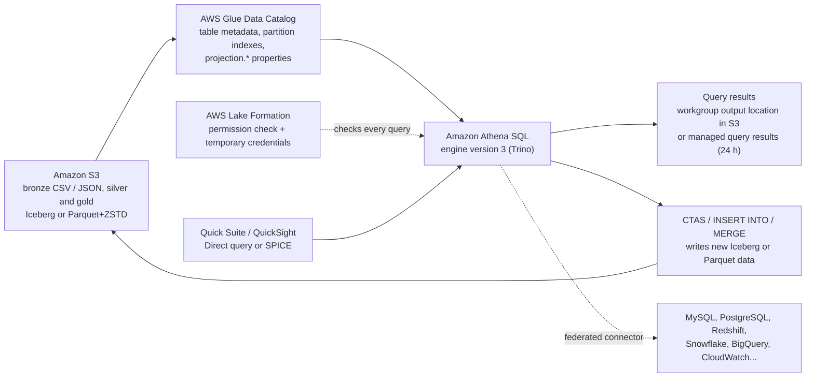
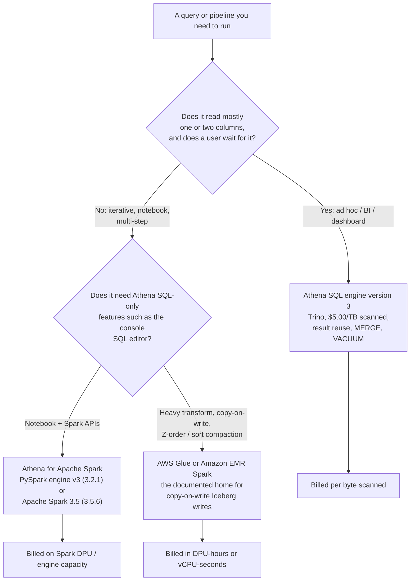
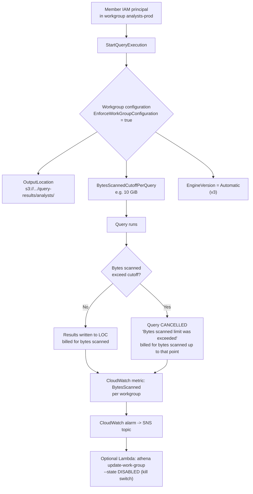
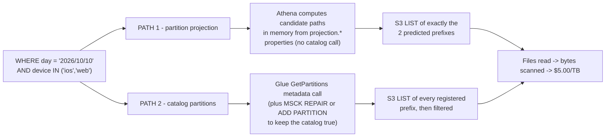
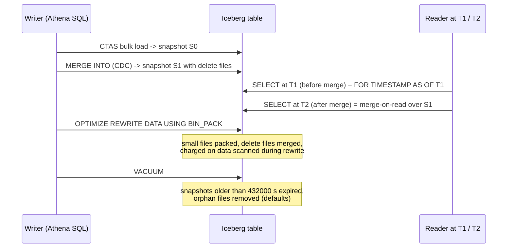
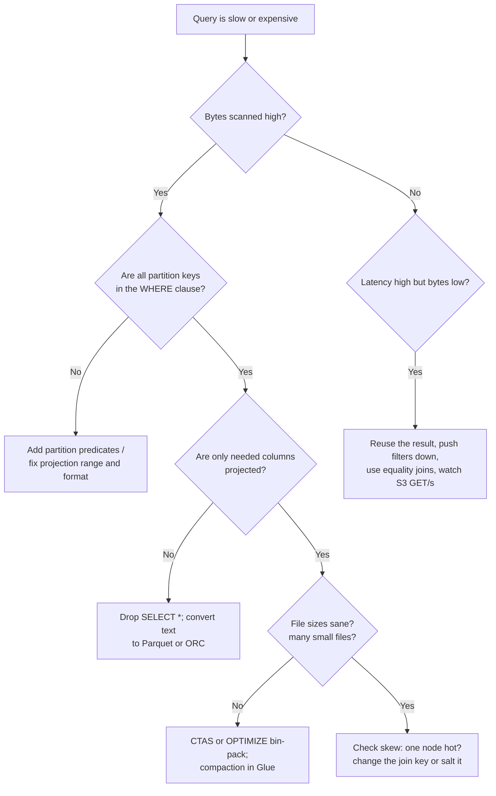
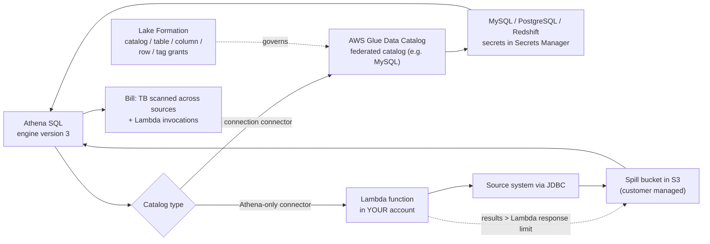

# Athena as the Lakehouse Query Engine: Cost, Performance, and Iceberg SQL

Lessons 01 through 08 gave you storage, formats, tables, pipelines and a catalog. None of that answers the question a business user actually asks: *can I query this, how fast, and what will it cost?* **Amazon Athena is the answer AWS puts in front of SQL users**: serverless, no cluster to size, no license to buy, and a bill that is a direct function of how much data your query reads. That last property is the whole lesson: **in a per-scan pricing model, tuning is billing, and billing is tuning.**

```text
====================================================================
 THE ATHENA DECISION SURFACE - AWS LAKEHOUSE (as of Oct 2026)
====================================================================
 Engine ........... Athena SQL engine version 3 (Trino, current)
                    Athena SQL engine version 2 (Presto, deprecated)
                    Athena for Apache Spark: PySpark engine v3
                    (Spark 3.2.1) or Apache Spark 3.5 (3.5.6 / EMR 7.12)
 Meter ............ $5.00 per TB scanned, 10 MB minimum per query
                    DDL and failed queries: no charge
                    canceled queries: billed up to cancellation
                    Capacity Reservations: $0.30 per DPU-hour
 Control plane .... workgroup = engine version + result location +
                    BytesScannedCutoffPerQuery + CloudWatch metrics +
                    result reuse / managed results
 Tables ........... Glue Data Catalog Hive tables and Apache Iceberg
                    (S3 Tables via the s3tablescatalog federation)
 Partitioning ...... MSCK REPAIR / ADD PARTITION  vs  partition
                    projection (enum, integer, date, injected)
 Writes ........... CTAS, INSERT INTO, UNLOAD, MERGE INTO, UPDATE,
                    DELETE (Iceberg, merge-on-read, engine v3 only)
 Maintenance ....... OPTIMIZE ... REWRITE DATA, VACUUM
 Governance ........ Lake Formation permission checks on every query
 Federation ........ Glue-connection connectors (no customer Lambda
                    for certain ones since 2026-04-21) + Athena-only
                    connectors that run on your Lambda
-----------------------------------------------------------------------------
 Not this .......... copy-on-write Iceberg updates (use Glue/EMR Spark)
                    multi-statement transactions (not Athena's model)
                    S3 Select (closed to new customers 2024-07-25)
====================================================================
```

In this lesson you will:

- separate the **three engine lanes**, Athena SQL engine version 3, deprecated engine version 2, and the two **Athena for Apache Spark** release versions, and know which feature lives on which lane;
- price queries on **$5.00 per TB scanned**, reproduce AWS's own **$15 → $5 → $1.25** compression story, and compute a **monthly analyst workload** on a 1 TB table;
- build **workgroups** that cut off runaway scans, pin the **result output location**, and isolate teams from each other's query history;
- choose between **Hive-style partitioning** and **partition projection**, then write a copy-ready projected `CREATE EXTERNAL TABLE` with `storage.location.template`;
- convert raw files with **CTAS**, and settle what **RTAS** does and does not mean in Athena SQL;
- write **Iceberg SQL**: time travel across the `FOR SYSTEM_TIME AS OF` → `FOR TIMESTAMP AS OF` clause change, the `$snapshots` metadata table, transactional **`MERGE INTO`**, `OPTIMIZE` and `VACUUM`;
- tune with the documented levers, **file sizing, partition and column pruning, pushdown, join order, skew**, and reproduce a **~60× before/after scan reduction** on a synthetic table;
- use **query result reuse** and **managed query results** without believing they are a general cache;
- connect **federated sources** through JDBC and other connectors, and enforce **Lake Formation** permissions down to columns and rows;
- study **two AWS customer cases** (Easygo, Integral Ad Science) plus a **sourced 2026 update box**;
- practise with **11 exam-style questions** and three interactive checks.

---

## 1. The three engine lanes: SQL v3, SQL v2 and Athena for Apache Spark

### 1.1 What Athena actually is in the stack

Athena is AWS's serverless interactive SQL service over data in Amazon S3 and over federated sources. In lakehouse terms it is the **query layer**: it reads tables registered in the **AWS Glue Data Catalog**, Hive-style external tables and **Apache Iceberg** tables, and it does not require you to provision or tune a cluster. DDL statements write metadata into the Glue Data Catalog; DML/DQL statements read (and, for Iceberg, write) data files in S3.

That split matters for cost: **DDL is free and reads are metered**, so the design of your table (format, columns, partitions) decides the size of every future invoice.



### 1.2 Engine version 3 is current; version 2 is deprecated

**Athena engine version 3** is the current SQL engine, and it is **Trino-based**: the Athena FAQ states *"Athena for SQL uses Trino with full standard SQL support"* and *"we aim to stay within 60-90 days of open-source Trino launches"* (Athena FAQ, accessed 2026-10-11). The engine-version-3 reference page adds that AWS introduced *"a continuous integration approach to open source software management that improves concurrency with the Trino and Presto projects"*.

AWS published a benchmark against its predecessor: on **TPC-DS at 3 TB scale**, engine version 3 showed **~20% query performance improvement** over the latest engine version 2 release (AWS Big Data Blog, 2022-10-13).

Features that exist **only** on engine version 3 (this list is examinable):

| Feature | Lane |
|---|---|
| Query result reuse | engine v3 only |
| `MERGE INTO` | engine v3, Iceberg tables only |
| `VACUUM` / `OPTIMIZE ... REWRITE DATA` | engine v3, Iceberg only |
| ZSTD `compression_level` | engine v3 only |
| Expanded Lake Formation fine-grained access with Iceberg | engine v3 required |
| `FOR TIMESTAMP AS OF` / `FOR VERSION AS OF` time travel | engine v3 syntax |

**Engine version 2** is Presto-based and **deprecated**. AWS documents that workgroups are set to **Automatic** (AWS upgrades them) or **Manual** engine version, and that *"Athena upgrades your workgroups when a version is no longer offered"* (Athena User Guide, engine versioning, accessed 2026-10-11). An AWS-staff answer on AWS re:Post (2024-02-23) states that version 2 is deprecated and that a workgroup can no longer be downgraded to it. There is **no published end-of-support date** for v2, and **there is no engine version 4**, version 3 is the latest as of October 2026.

- **📚 Did you know?** The client drivers are versioned separately from the engine: **JDBC 3.8.0 was released 2026-06-03** and **ODBC 2.3.0.0 on 2026-08-21**, while deprecated Athena data-catalog APIs (`athena:RunQuery` and friends) plus JDBC below 3.x and ODBC below 2.x stopped working on **2025-10-31**. A connection error that appears "Athena-side" is often a driver-side retirement (Athena User Guide release notes, accessed 2026-10-11).

### 1.3 Athena for Apache Spark: two release versions, one immovable choice

Spark workloads run in a **separate workgroup type**. A Spark workgroup cannot use the Athena SQL query editor, and a SQL workgroup cannot use the Spark notebook editor; the analytics-engine type of a workgroup is **immutable after creation** (Athena User Guide: Spark considerations and limitations, accessed 2026-10-11).

| Release version | Runtime | Where you drive it from | Notes |
|---|---|---|---|
| **PySpark engine version 3** | Apache Spark **3.2.1** | In-console Athena notebooks + notebook APIs | Cannot be upgraded in place to Spark 3.5 |
| **Apache Spark version 3.5** | Apache Spark **3.5.6** on **Amazon EMR 7.12** | SageMaker Unified Studio notebooks, Spark Connect clients | No in-console Athena notebooks, no Calculation APIs |

The 2025-11-21 What's New announcement states that Athena for Apache Spark *"now runs on Spark 3.5.6"*, is *"optimized for open table formats including Apache Iceberg and Delta Lake"*, supports **Spark Connect**, and *"now enforces table-level access controls defined in AWS Lake Formation"*. The serverless Spark engine runs on **Firecracker micro-VMs** and *"launches and scales in seconds"* (AWS Big Data Blog, 2026-07-02).

Two traps: you **cannot upgrade a workgroup from PySpark engine version 3 to Apache Spark version 3.5** (create a new workgroup instead), and **cross-engine view queries are not supported**: a view created by Athena SQL is not queryable by Athena for Spark.



```matching
{
  "question": "Match each engine lane to the workload it is the documented answer for (as of Oct 2026):",
  "pairs": [
    {"left": "Athena SQL engine version 3 (Trino)", "right": "Interactive SQL over S3 and Iceberg: dashboards, ad hoc analysis, time travel, MERGE INTO, VACUUM, result reuse: billed at $5.00 per TB scanned"},
    {"left": "Athena SQL engine version 2 (Presto)", "right": "Deprecated lane: no result reuse, no MERGE INTO, no VACUUM, old FOR SYSTEM_TIME AS OF time-travel clause, upgraded automatically by AWS when a version is no longer offered"},
    {"left": "Athena for Apache Spark - PySpark engine version 3", "right": "In-console Athena notebooks and notebook APIs on Apache Spark 3.2.1; cannot be upgraded in place to Spark 3.5"},
    {"left": "Athena for Apache Spark - Apache Spark version 3.5", "right": "Spark 3.5.6 on Amazon EMR 7.12 driven from SageMaker Unified Studio or Spark Connect clients; no in-console Athena notebooks"},
    {"left": "AWS Glue or Amazon EMR Spark", "right": "The documented route for copy-on-write Iceberg updates, sorts and Z-order compaction that Athena SQL (merge-on-read only) will not perform"}
  ],
  "explanation": "The lanes are not interchangeable features with different prices; they are different capabilities. Athena SQL v3 owns the interactive, per-TB-scanned workload and every row-level maintenance statement. Athena SQL v2 is a compatibility lane that AWS retires. The two Spark release versions differ in notebook support and cannot be converted into one another inside a workgroup. Copy-on-write Iceberg maintenance has to leave Athena: AWS Prescriptive Guidance points at other engines such as Apache Spark on Amazon EMR or AWS Glue for that job."
}
```

---

## 2. Pricing: $5.00 per TB scanned, and why format is a cost control

### 2.1 The meter

| Rule | Value (US East list price, accessed 2026-10-11) |
|---|---|
| Per-query data-scan charge | **$5.00 per TB** scanned |
| Rounding | up to the nearest megabyte, **10 MB minimum per query** |
| DDL (`CREATE`/`ALTER`/`DROP`, partition management) | **no charge** |
| Failed queries | **no charge** |
| Canceled queries | **billed for bytes scanned up to cancellation** |
| Federated queries | per TB scanned **aggregated across data sources**, plus AWS Lambda invocation charges |
| Capacity Reservations | **$0.30 per DPU-hour**; queries on the reserved workgroup are **not** billed per TB scanned |

AWS's FAQ claims that compression, partitioning and columnar conversion cut per-query cost by **30% to 90%**. That claim is not marketing abstraction: the pricing page walks through the arithmetic itself.

### 2.2 Worked example E1: AWS's own three-step compression story

The pricing page's canonical example is a table with **4 equally sized columns**, stored as **uncompressed text**, totalling **3 TB** on S3, where the query reads **one column**:

```sql
-- Read one column of four from a 3 TB uncompressed text table
SELECT customer_id, SUM(amount)
FROM   lakehouse.raw.transactions_raw   -- 3 TB, 4 equal columns, plain text
GROUP  BY customer_id;
```

| Step | What changed | Bytes scanned | Cost |
|---|---|---|---|
| 1 | Uncompressed text, whole file read | 3 TB | **$15.00** (3 × $5) |
| 2 | 3× compression (GZIP-class) | ~1 TB | **$5.00** |
| 3 | Parquet: 3× compression **and** 4× fewer columns read | 0.25 TB | **$1.25** |

AWS states the *"3x savings from compression and 4x savings for reading only one column"*, giving *"$1.25"*. Read that as a design rule: **the first lever (compression) and the second lever (columnar pruning) multiply, they do not add.** A modern lakehouse variant, ZSTD at the Iceberg default, which Athena writes at **level 3**, compresses better still, but AWS publishes no official ratio for it, so treat any "10× with Zstd" figure as illustrative and yours to measure.

### 2.3 Worked example E2: 1 TB table, a month of analyst queries

**Scenario (all figures as of Oct 2026):** one fact table, **1 TB uncompressed**, **10 equal-width columns**, **365 daily partitions**. The dashboard query reads **one column** and filters to **one day**. The team runs **30 queries per day × 22 workdays = 660 queries per month**.

```sql
-- The dashboard query: 1 column, 1 day, 10 MB floor never binds
SELECT region, COUNT(*) AS orders
FROM   lakehouse.gold.orders
WHERE  order_date = DATE '2026-10-10'
  AND  region = 'EU';
```

| # | Table shape | Bytes scanned per query | Cost per query | 660 queries / month |
|---|---|---|---|---|
| A | Plain text, `SELECT *`, no partition filter | 1 TB | $5.000000 | **$3,300.00** |
| B | Text + GZIP 3:1, still `SELECT *` | 0.333 TB | $1.666667 | **$1,100.00** |
| C | Parquet + Snappy 3:1, **1 of 10 columns** | 0.0333 TB | $0.166667 | **$110.00** |
| D | + **daily partition pruning** (1 of 365 days) | 91.3 MB | $0.000435 | **$0.29** |
| E | D + **query result reuse** (one computation per hour) | 91.3 MB × 176 hours | $0.000435 | **$0.08** |

Row C is `0.333 TB ÷ 10 columns = 0.0333 TB` scanned; row D divides that by 365 again because only one partition is opened: `0.0333 ÷ 365 = 91.3 MB`, which is `0.0000871 TB × $5 = $0.000435` per query, and `660 × $0.000435 ≈ $0.29`. Row E assumes the same query string repeats inside a 60-minute reuse window across 8 hours × 22 days = 176 distinct computations.

**The anti-pattern to price too:** the same Parquet table queried with `SELECT *` reads all ten columns, so row C's saving disappears: `0.333 TB → $1.67 per query → $1,100 per month`, purely from a projection list.

```plot
{
  "type": "bar",
  "title": "660 dashboard queries per month on one 1 TB table (us-east-1, as of Oct 2026)",
  "xLabel": "Table shape and query shape",
  "yLabel": "USD per month",
  "xKey": "scenario",
  "data": [
    {"scenario": "A: text, SELECT *, no partition filter", "usd_per_month": 3300.00},
    {"scenario": "B: text + GZIP 3:1, SELECT *", "usd_per_month": 1100.00},
    {"scenario": "C: Parquet + Snappy, 1 column", "usd_per_month": 110.00},
    {"scenario": "D: C + daily partition pruning", "usd_per_month": 0.29},
    {"scenario": "E: D + query result reuse", "usd_per_month": 0.08},
    {"scenario": "Anti-pattern: Parquet SELECT *", "usd_per_month": 1100.00}
  ]
}
```

The bar chart is the argument for treating **format, projection list and partition predicate as billing decisions**: the difference between row A and row D is a factor of about **11,000**, and not one byte of it came from a faster engine.

- **📚 Did you know?** The **10 MB minimum** floors a single query at `10 MB x $5 / 1,048,576 MB` = **$0.0000477**. That is why row D is never zero, and why a dashboard that fires 500 tiny queries a day still registers a bill, but it is also why DDL being free is worth real money: you can rebuild a table's format and partitions all afternoon for nothing and pay for it only on the first SELECT.

### 2.4 The other two meters

**Capacity Reservations** are the predictable-spend alternative: reserve **DPUs** and the attached workgroup stops incurring per-TB charges. One DPU is **4 vCPU and 16 GB of memory**; the minimum reservation is **4 DPUs** (increments of 4), with up to **100 reservations and 1,000 DPUs per account and Region**. The pricing page's own worked example:

```text
Peak half hour .... 160 DPU x $0.30 per DPU-hour x 0.25 hours = $12.00
Off-peak .........  16 DPU x $0.30 per DPU-hour x 0.75 hours =  $3.60
                                                per hour ..... $15.60
```

Since **2026-02-01** reservations are purchasable at **1-minute granularity with a 4-DPU minimum**, which AWS says delivers *"cost savings up to 95% for short-duration query workloads"*, and *"you pay only for capacity that you reserve and there are no data scanned charges"* (AWS What's New, 2026-02-01).

**Federated queries** bill per TB scanned *"aggregated across data sources, rounded up to the nearest megabyte with a 10 megabyte minimum per query, unless Provisioned Capacity is used"*, and they *"invoke AWS Lambda functions in your account, and you are charged for Lambda use at standard rates"* (Athena pricing, accessed 2026-10-11). Federation therefore has **two meters, not one**.

---

## 3. Workgroups: the operational control plane

A workgroup is the unit of isolation and enforcement for Athena. It scopes **query history, saved queries and result location**, and it carries the settings that decide which engine version runs, how results are encrypted, and **how much data a query is allowed to read before it dies**.

| Workgroup setting (Athena API) | What it does |
|---|---|
| `ResultConfiguration.OutputLocation` | S3 prefix for query results: required from client or workgroup, otherwise Athena errors *"no output location is provided"* |
| `EnforceWorkGroupConfiguration` | Workgroup settings override client-side settings (this is how admins win) |
| `BytesScannedCutoffPerQuery` | Per-query data usage limit; valid range minimum **10,000,000 bytes** (10 MB) |
| `PublishCloudWatchMetricsEnabled` | Emits workgroup metrics you can alarm on |
| `EngineVersion` | Automatic (AWS upgrades) or Manual |
| `ExecutionRole` / `EngineConfiguration` | Spark workgroups: IAM role and DPU sizing |
| `ManagedQueryResultsConfiguration` | Athena-owned result storage instead of your bucket |
| `CustomerContentEncryptionConfiguration` / `RequesterPaysEnabled` | Encryption of results; requester-pays bucket handling |



### 3.1 Worked example E3: fencing analysts with a per-query cutoff

The console field is **Data scanned limit**, valid from **10 MB to 7 EB**. The API field is `BytesScannedCutoffPerQuery`. An analyst runs a full-table scan of a **50 GB** table with a **10 GiB** cutoff:

```bash
aws athena create-work-group \
  --name analysts-prod \
  --configuration '{
    "ResultConfiguration":{"OutputLocation":"s3://lakehouse-demo/query-results/analysts/"},
    "EnforceWorkGroupConfiguration":true,
    "PublishCloudWatchMetricsEnabled":true,
    "BytesScannedCutoffPerQuery":10737418240
  }' \
  --description "Ad hoc analyst workgroup, 10 GiB per-query scan ceiling"
```

| Outcome | Bytes billed | Cost at $5.00/TB |
|---|---|---|
| Without the cutoff (50 GB table read) | 50 GB = 0.0488 TB | **≈ $0.24** |
| With the 10 GiB cutoff (canceled at the ceiling) | 10 GiB = 0.00977 TB | **≈ $0.05** |

AWS's own workgroup write-up pairs this with a **per-workgroup** CloudWatch alarm and a Lambda function that **disables the workgroup** when an aggregate threshold is breached (AWS Big Data Blog, 2019-07-18): the two controls are complementary: the **per-query** cutoff stops one bad statement, the **per-workgroup** alarm stops a runaway batch.

### 3.2 Output location, and isolating admins from analysts

`OutputLocation` is where result sets, manifest files and execution metadata land, and it is the object of the security question in Section 10: **query results cannot be registered with Lake Formation**, so the bucket prefix is governed by S3/IAM alone. Pair the location with workgroup membership so each population's SQL text and result sets are visible only to itself; this is exactly the pattern Integral Ad Science published: *"By defining an Athena workgroup per business unit, IAS also takes advantage of assigning per-department billing tags and query limits to help with cost management"* (AWS Big Data Blog, 2021-09-23).

> [!WARNING]
> ⚠️ **A scan cutoff limits a bill; it does not make the query free.** When `BytesScannedCutoffPerQuery` trips, the query is **canceled and billed for every byte it read up to that point**: an 11 GB partial scan still costs money, and a workgroup of 50 analysts each tripping a 10 GiB ceiling daily is `50 × 10 GiB × $5/TB ≈ $2.44/day` of *cancelled* work. Second trap: **the results prefix and the query history are outside Lake Formation's reach**, so an analyst who can list the workgroup can read SQL and result files for data they may not be granted on the source table. Align workgroup membership with your Lake Formation grants instead of trusting the results bucket to do it.

---

## 4. Partitioning versus partition projection

### 4.1 The classic path: key=value folders and a registration job

Hive-style partitioning stores `order_date=2026-10-10/` segments under the table location, and the catalog does not know they exist until you run `MSCK REPAIR TABLE` or `ALTER TABLE ADD PARTITION`. The mechanism works, and it brings two operational costs: **a registration step in every ingestion pipeline**, and a **partition count ceiling**: Glue supports tables with up to **10 million partitions**, but **Athena can scan at most 1 million partitions in a single query**, and every extra partition key multiplies the number of files your writes produce.

### 4.2 The projection path: compute the paths, do not list them

Partition projection puts the partition logic in **table properties** instead of in the catalog. The Athena documentation is explicit: *"During query execution, Athena uses this information to project the partition values instead of retrieving them from the AWS Glue Data Catalog or external Hive metastore… removes the need to manually create partitions."* There is no repair job, no catalog sync, and no partition-registration step in the pipeline, and *"queries for values that are beyond the range bounds defined for partition projection do not return an error… returns zero rows"*.

There are **four** projection types (Athena User Guide: supported types for partition projection, accessed 2026-10-11):

| Type | Property that defines it | Range / behaviour |
|---|---|---|
| `enum` | `projection.{col}.values` | Comma-separated literal list, e.g. `ios,android,web` |
| `integer` | `projection.{col}.range` (+ optional `.interval`, `.digits`) | Anywhere in a Java signed long, −2^63 to 2^63−1 |
| `date` | `projection.{col}.range` + `.format` (+ `.interval`, `.interval.unit`) | Java DateTimeFormatter pattern; range may use `NOW`, `NOW+1MONTH` |
| `injected` | `projection.{col}.type = injected` | String only; values come from the query's `WHERE` clause at run time |

### 4.3 Worked example E4: a copy-ready projected table

```sql
CREATE EXTERNAL TABLE web_events (
  event_time timestamp,
  url        string,
  user_id    string
)
PARTITIONED BY (
  `day`    string,
  device   string
)
LOCATION 's3://lakehouse-demo/events/'
TBLPROPERTIES (
  'projection.enabled'            = 'true',
  'projection.day.type'           = 'date',
  'projection.day.format'         = 'yyyy/MM/dd',
  'projection.day.range'          = '2024/01/01,NOW',
  'projection.day.interval'       = '1',
  'projection.day.interval.unit'  = 'DAYS',
  'projection.device.type'        = 'enum',
  'projection.device.values'      = 'ios,android,web,other',
  'storage.location.template'     = 's3://lakehouse-demo/events/${day}/${device}/'
);
```

```sql
-- Correct: both keys bounded, predicate format matches yyyy/MM/dd exactly
SELECT count(*)
FROM   web_events
WHERE  `day`   = '2026/10/10'
  AND  device IN ('ios','web');
```

Five teaching points fall out of that statement:

1. **No `MSCK REPAIR TABLE` is ever needed**: new days appear simply by being written to S3.
2. **The predicate must match the configured format.** With `.format = 'yyyy/MM/dd'`, the value `2026/10/10` works; `DATE '2026-10-10'` and `2026-10-10` do not.
3. **`storage.location.template` must contain one placeholder per partition column and end with `/`**: otherwise Athena composes paths you did not write.
4. **Out-of-range values return zero rows, silently.** A "the data is missing" ticket is very often a `.range` that stops at `NOW-1MONTH`.
5. **Always bound every projected key.** Omitting `device` makes Athena LIST every device prefix for that day against the shared S3 budget of **5,500 GET requests per second per partitioned prefix**.



```fillblank
{
  "question": "Complete the partition-projection contract using Athena's own type names and property keys (as of Oct 2026):",
  "template": "A table can use any combination of four projection types: {{1}}, {{2}}, {{3}} and {{4}}. Projection is switched on with {{5}} = 'true', a custom S3 layout is declared with {{6}}, an enum column is defined by projection.<column>.{{7}}, a date column must carry both a range and a {{8}} written as a Java DateTimeFormatter pattern, and an injected column takes its values from the query's WHERE clause as static {{9}} conditions: anything else raises CONSTRAINT_VIOLATION. Queries outside the projected range return {{10}} rows instead of an error.",
  "answers": {
    "1": "enum",
    "2": "integer",
    "3": "date",
    "4": "injected",
    "5": "projection.enabled",
    "6": "storage.location.template",
    "7": "values",
    "8": "format",
    "9": "equality",
    "10": "zero"
  },
  "distractors": ["string", "range", "bucket", "hashed", "computed", "dynamic", "partition.enabled", "projection.values", "location.template", "mask", "pattern", "literal", "NULL", "one", "-1", "an error"],
  "explanation": "The four supported types are enum, integer, date and injected, and they can be combined freely in one table. projection.enabled switches the mechanism on; storage.location.template overrides path composition and must hold one placeholder per partition column. Enum uses projection.<col>.values; date needs range plus format (Java DateTimeFormatter); injected is string-only and is supplied at query time as static equality conditions: a range, LIKE or missing predicate on an injected column is a CONSTRAINT_VIOLATION. Out-of-range predicates are not errors: Athena returns zero rows, which is why a too-narrow range looks like missing data."
}
```

- **📚 Did you know?** Projection does not remove the scan ceiling; it removes the **catalog** cost. Athena still reads at most **1 million partitions per query**, and Glue partition indexes exist for tables with tens of thousands of partitions and beyond. Projection is the answer to *"my partition metadata is huge"*; indexes and pruning are the answer to *"my partitions are many but registered"*.

---

## 5. CTAS: turning raw files into a table you can afford to query

### 5.1 `CREATE TABLE AS SELECT` and its property traps

CTAS materializes a query result into a new table, which makes it the cheapest possible ETL job: no cluster, no separate step, and **CTAS itself is DDL-shaped work that still counts as DML for service quotas**. The documented properties:

| Property | Hive table | Iceberg table |
|---|---|---|
| `format` | ORC, PARQUET, AVRO, JSON, ION, TEXTFILE: **must be lowercase** | ORC, PARQUET, AVRO |
| Default format | **PARQUET** if omitted | **PARQUET** if omitted |
| Partitioning | `partitioned_by = ARRAY['col', ...]` | `partitioning = ARRAY['month(dt)', ...]` (transforms) |
| Table type / location | `external_location` | `table_type = 'ICEBERG'`, `is_external = false`, `location = ...` **required** |
| Write compression | Parquet **GZIP** default (GZIP or SNAPPY); ORC **ZLIB** default (LZ4, SNAPPY, ZLIB, ZSTD) | **ZSTD** default at **level 3**; levels 1 to 22 via `compression_level` (engine v3 only) |
| Bucketing | `bucketed_by`, `bucket_count` (max 100 bucket × partition combinations) | n/a: use partition transforms |

Two hard limits to memorize: **100 partitions per CTAS statement** (and per `INSERT INTO`), which fails as `HIVE_TOO_MANY_OPEN_PARTITIONS`, and the DML service-quota accounting mentioned above.

### 5.2 Worked example E5: raw CSV to Iceberg silver, in one statement

```sql
CREATE TABLE lakehouse.silver.orders
WITH (
  table_type                    = 'ICEBERG',
  is_external                   = false,
  format                        = 'PARQUET',
  location                      = 's3://lakehouse-demo/silver/orders/',
  partitioning                  = ARRAY['month(order_date)'],
  vacuum_min_snapshots_to_keep  = 10,
  vacuum_max_snapshot_age_seconds = 604800
)
AS SELECT
  order_id,
  customer_id,
  status,
  total_amount,
  CAST(order_ts AS timestamp) AS order_ts,
  CAST(order_ts AS date)      AS order_date
FROM lakehouse.bronze.orders_raw
WHERE order_id IS NOT NULL;
```

Note what is **not** in that statement: `format` is lowercase (uppercase `FORMAT` fails the query), `partitioning` uses an Iceberg **transform** rather than `partitioned_by`, and `location` is supplied because Iceberg CTAS does not accept `external_location`.

> [!IMPORTANT]
> **CTAS is a write with three bills attached.** (1) It counts as **DML against service quotas**, so a loop of CTAS statements can hit a quota long before it hits a cost ceiling. (2) It is capped at **100 partitions per statement**. (3) On Lake Formation-registered data, CTAS requires **IAM `s3:` write permission to the target location in addition to** your Lake Formation read grants: a user with perfect SELECT rights and no write IAM policy gets a permission error at the moment of success, not at parse time.

### 5.3 The RTAS question

`REPLACE TABLE AS SELECT` is documented in the **Iceberg project's Spark documentation**, and you will find it in Spark-based material. It does **not** appear in the Athena SQL user guide's `CREATE TABLE AS SELECT` / CTAS pages as of 2026-10-11, so in Athena SQL the replacement patterns are: **CTAS into a new table then swap**, **`INSERT OVERWRITE` for Hive tables**, or **Spark** (Glue, EMR, or Athena for Apache Spark) when you truly need an in-place replace. Do not assume RTAS exists in Athena SQL because it exists in Iceberg docs; that assumption fails at parse time in front of a user.

---

## 6. Iceberg SQL: time travel, snapshots, MERGE and maintenance

### 6.1 Reading a table as of a moment

Athena *"can perform read, time travel, write, and DDL queries on Apache Iceberg tables"*, and exposes metadata tables **`$files`, `$manifests`, `$history`, `$partitions`, `$snapshots`, `$refs`**. The clause you use depends on the engine version, and this is the single most common migration bug in the lesson:

| Engine version 2 (deprecated) | Engine version 3 (current) | Meaning |
|---|---|---|
| `FOR SYSTEM_TIME AS OF <ts>` | **`FOR TIMESTAMP AS OF <ts>`** | Read the snapshot current at a wall-clock time |
| `FOR SYSTEM_VERSION AS OF <id>` | **`FOR VERSION AS OF <id>`** | Read a specific snapshot ID |

Timestamps written without a time zone are interpreted as **UTC**. The Athena documentation states the replacement directly: *"The `FOR SYSTEM_TIME AS OF` and `FOR SYSTEM_VERSION AS OF` clauses in Athena engine version 2 have been replaced by the `FOR TIMESTAMP AS OF` and `FOR VERSION AS OF` clauses in Athena engine version 3."*

```sql
-- Engine version 3 time travel
SELECT * FROM lakehouse.silver.orders
FOR TIMESTAMP AS OF current_timestamp - INTERVAL '1' HOUR;

-- Snapshot inventory, straight from the metadata table
SELECT snapshot_id, committed_at, operation, summary
FROM   "lakehouse"."orders$snapshots"
ORDER  BY committed_at DESC;

-- Diff two snapshots by joining them
SELECT t.order_id, t.status AS now, p.status AS then_
FROM        lakehouse.silver.orders t
JOIN        lakehouse.silver.orders p
        ON  t.order_id = p.order_id
WHERE t.status <> p.status
  AND t.order_id IN (
        SELECT order_id FROM lakehouse.silver.orders
        FOR TIMESTAMP AS OF current_timestamp - INTERVAL '1' DAY)
```

### 6.2 `MERGE INTO`: the transactional upsert, merge-on-read only

`MERGE INTO` *"is transactional and is supported only for Apache Iceberg tables in Athena engine version 3"*. You may use an arbitrary number of `WHEN` clauses; the **first matching clause per source row executes**, and Athena raises a user error if **one target row matches multiple source rows**.

```sql
MERGE INTO lakehouse.silver.orders AS t
USING lakehouse.bronze.orders_cdc AS s
   ON t.order_id = s.order_id
WHEN MATCHED AND s.op = 'U' THEN
  UPDATE SET status = s.status, total_amount = s.total_amount
WHEN MATCHED AND s.op = 'D' THEN
  DELETE
WHEN NOT MATCHED THEN
  INSERT *;
```

The boundary to memorise: *"Athena SQL does not currently support the copy-on-write approach. The UPDATE, MERGE INTO, and DELETE FROM operations always use the merge-on-read approach with positional deletes, regardless of specified table properties"*; those table properties are ignored, and copy-on-write work belongs to **Apache Spark on Amazon EMR or AWS Glue** (Athena user guide; AWS Prescriptive Guidance, both accessed 2026-10-11).



### 6.3 Maintenance: `OPTIMIZE` and `VACUUM`

```sql
-- Bin-pack the recent partitions; only partition columns may appear in WHERE
OPTIMIZE lakehouse.silver.orders
REWRITE DATA USING BIN_PACK
WHERE order_date >= DATE '2026-09-01';

-- Expire old snapshots and remove orphan files (defaults shown)
VACUUM lakehouse.silver.orders
vacuum_max_snapshot_age_seconds = 432000,
vacuum_min_snapshots_to_keep     = 1,
vacuum_max_metadata_files_to_keep = 100;
```

`OPTIMIZE` is *"supported only for Apache Iceberg tables"* and *"only partition columns are allowed in the WHERE clause"*; it is **charged by the data scanned during the rewrite**, so an already-compact table costs approximately nothing. `VACUUM` performs **snapshot expiration and orphan file removal**; the S3 API charges for those requests still apply. If you would rather not schedule either, **Glue table optimizers** can run compaction, snapshot retention and orphan-file cleanup automatically.

- **📚 Did you know?** A pinned view is the cheapest way to expose "the state five minutes ago" without users writing time-travel SQL: AWS's own upsert blog pins a view with `FOR TIMESTAMP AS OF current_timestamp + interval '-5' minute`, so downstream consumers always read a stable previous state while `MERGE INTO` keeps writing new snapshots underneath them (AWS Big Data Blog, 2023-04-27).

> [!WARNING]
> ⚠️ **Two Iceberg statements fail in ways that look like data problems.** First, running `FOR SYSTEM_TIME AS OF` on engine version 3 is a **syntax error**, not a silent fallback, and a naive timestamp is read as **UTC**, so a local-time string shifts your snapshot by hours. Second, `MERGE INTO`, `OPTIMIZE` and `VACUUM` are **engine-v3, Iceberg-only**: point them at a Hive table or at engine version 2 and the statement fails at validation. Finally, merge-on-read means every `UPDATE`/`DELETE`/`MERGE` leaves **delete files behind**, if you never `OPTIMIZE`, read cost and latency grow monotonically.

---

## 7. Performance tuning: the nine levers

### 7.1 File sizing and layout

| Lever | Documented number |
|---|---|
| Parquet block size | **128 MB** default |
| ORC stripe size | **64 MB** default; stripes smaller than **8 MB** are read whole |
| Small files | Every extra file adds S3 LIST/GET work against **5,500 GET requests/second per partitioned prefix** |
| Compression | Iceberg on engine v3 defaults to **Parquet + ZSTD (level 3)**; Athena cannot *write* Parquet with LZ4 or LZO (reads are supported) |
| Complex types | Parquet with arrays/maps/structs can defeat column pruning (documented known issue): the documented workaround is **ORC** |
| Bucketing | Distribute by high-cardinality filter keys so a lookup reads one bucket; **max 100 bucket × partition combinations** |

### 7.2 Pruning, pushdown, joins and skew

1. **Partition pruning** only happens if the query filters **every** partition key; projection makes it free but does not make it automatic.
2. **Column pruning** is the difference between row C and row A in E2: project the columns you need and never `SELECT *` in production SQL.
3. **Predicate pushdown** into Parquet row groups / ORC stripes uses min/max statistics; which is why sorted or clustered writes prune better than random ones.
4. **Join order**: put the **larger table on the LEFT (probe) side** of a distributed hash join, and prefer **equality joins** over `LIKE` or inequality predicates.
5. **Skew**: *"If many rows have the same values for the columns used in the join condition, one node can end up having to process a large part of the join itself, while other nodes are idle."* More workers never fix single-key skew: change or salt the key, or narrow the window's `PARTITION BY`.
6. **Query shape**: `LIMIT` with `ORDER BY`, `UNION ALL` over `UNION`, numbers over strings, `regexp_like` over an unanchored `LIKE`, `approx_distinct` over `COUNT(DISTINCT)`, and `UNLOAD` for large result exports instead of a single CSV result write.
7. **S3 Select is not on this list**: AWS closed it to new customers on **2024-07-25**, announced no new capabilities, and names **Athena as the recommended approach** for querying data in S3 (AWS Storage Blog, 2024-07-25). Older tuning articles that recommend it are stale.



### 7.3 Worked example E6: reproducing a ~60× before/after with pruning

This is the synthetic drill that makes the Easygo case study below concrete. A **400 GB** Parquet table with **60 daily partitions** (~6.67 GB per day) and **10 columns**, queried for **one day**:

```sql
-- BEFORE: no partition predicate at all
SELECT * FROM lakehouse.gold.clickstream;                 -- scans 400 GB

-- AFTER (stage 1): partition predicate only, same column list
SELECT * FROM lakehouse.gold.clickstream
WHERE  event_date = DATE '2026-10-10';                    -- scans 6.67 GB

-- AFTER (stage 2): partition predicate + a real column list
SELECT session_id, event_type
FROM   lakehouse.gold.clickstream
WHERE  event_date = DATE '2026-10-10';                    -- scans ~0.67 GB
```

```text
BEFORE ......... 400 GB scanned
                 400/1024 x $5.00 = $1.9531 per query

AFTER stage 1 .. 400 GB / 60 partitions = 6.67 GB
                 6.67/1024 x $5.00 = $0.0326 per query
                 ratio 400 / 6.67 = 60x fewer bytes  <- the lab target

AFTER stage 2 .. 6.67 GB / 10 columns x 2 read = 1.33 GB
                 (2 of 10 columns projected)
                 1.33/1024 x $5.00 = $0.0065 per query
                 cumulative ratio 400 / 1.33 = 300x
```

Stage 1 alone, **the same query with a partition predicate added**, is the **60×** drill: identical engine, identical format, identical column list, sixty times fewer bytes. Stage 2 is the second, independent lever from Section 2.2, and it multiplies rather than adds.

Treat **~60×** as the lab target you can reproduce on synthetic data, and keep the customer's own published number separate: Easygo reports **95% faster query performance**, not a 60× speedup (the Easygo case study below). Never restate one as the other.

---

## 8. Result caching: reuse, managed results, and what is not cached

### 8.1 Query result reuse

Reuse is *"a previous execution of the query within the same workgroup… if Athena finds a match, it bypasses execution and returns the query result from the previous, matching execution."* Its rules (engine version 3 only):

| Property | Value |
|---|---|
| Availability | **Athena engine version 3 only** |
| Match key | identical query string + same workgroup + matching result config + access checks |
| Default max age | **60 minutes** (`MaxAgeInMinutes`, range **0 to 10,080** = 7 days) |
| On a hit | **zero bytes scanned** |
| API | `StartQueryExecution --result-reuse-configuration ResultReuseByAgeConfiguration={Enabled=...,MaxAgeInMinutes=...}` |
| **Never** applies with | Lake Formation row/column filters, **federated queries**, UDFs, external Hive metastores, non-deterministic functions (`RAND()`, `CURRENT_TIME`), or managed query results |

**Managed query results** are the separate feature that removes your bucket entirely: *"Query results are available for 24 hours. Query results are stored at no cost to you during this period"*, retrieved through workgroup-scoped `GetQueryResults` / `GetQueryResultsStream`. Managed results **do not support** result reuse; you pick one or the other.

### 8.2 Worked example E7: what reuse is worth

A dashboard issues **40 identical queries per hour** against a table refreshed nightly; each run scans **0.2 GB**.

```text
Without reuse ... 40 x 0.2 GB = 8 GB/hour
                  8/1024 x $5.00 = $0.039/hour
                  x 24 h x 30 d  = $28.13/month   (~$29)

With reuse ...... 1 computation/hour (60-minute window)
                  0.2 GB x 720 h = 144 GB
                  144/1024 x $5.00 = $0.70/month   (~$0.72)

QuickSight SPICE  ingest is billed when the dataset is created and on
                  each refresh; subsequent dashboard reads are free
```

The BI-layer pairing is the point: **SPICE bills the refresh, reuse bills the identical re-run, and a direct query bills every view render.** AWS says it plainly for Quick Suite / QuickSight: *"If you use a data source that charges per query, you're charged for querying the data when you first create the dataset and later when you refresh the dataset."*

- **📚 Did you know?** Reuse is **workgroup-scoped by design**. Two teams issuing byte-identical SQL in different workgroups will not see each other's cached results; which is a governance feature, not a bug: it prevents one team's reused result from satisfying another team's different Lake Formation permissions.

---

## 9. Federated queries: JDBC and friends, through Lambda

Athena federated queries push filters and projections into the source system, so a join against a live OLTP database does not pull the whole table first. There are **two connector families** (Athena User Guide: run federated queries, accessed 2026-10-11):

| Family | Runtime | Lake Formation | Since 2026-04-21 |
|---|---|---|---|
| **AWS Glue Data Catalog federated connectors** | Uses a **Glue connection**; credentials via Secrets Manager | Supported at catalog, database, table, column, row and tag levels | *"certain newly created connectors are automatically registered as Glue Data Catalogs and do not use a Lambda function in your AWS account"* |
| **Athena data catalog federated connectors** | Specific to Athena; **require a Lambda function in your account** | Cannot be registered as federated Glue catalogs | Unchanged |

Practical details:

- The generic **`AthenaJdbcConnector` (2022.4.1) is deprecated**: use the database-specific connectors for **MySQL, PostgreSQL, Redshift, Oracle, SQL Server**, plus DynamoDB, DocumentDB, OpenSearch, Timestream, BigQuery, Snowflake, CloudWatch and TPC-DS in the connector matrix.
- **Multiplexer handlers** route by catalog name, so one Lambda can serve several catalogs; credentials come from **AWS Secrets Manager**.
- Results larger than Lambda's response limit **spill to a customer S3 bucket** (spill-bucket parameters), and cross-account federation needs a **resource-based Lambda policy + spill-bucket access + AssumeRole**.
- **Passthrough queries** (table functions) push the whole statement to the source for supported connectors.
- **Billing:** per TB scanned across sources **plus** Lambda invocation charges: model both before promising a federation saving.



---

## 10. Lake Formation: what is enforced, and what is not

For data registered with Lake Formation, *"Each time an Athena principal… runs a query on data registered using Lake Formation, Lake Formation verifies that the principal has the appropriate Lake Formation permissions… Lake Formation vends temporary credentials to Athena, and the query runs."* Fine-grained access, **column, row/cell data filters, LF-Tags**, for Iceberg, Hudi, Delta and Hive **requires Athena engine version 3**.

The boundaries are the examinable part:

| Governed by Lake Formation | **Not** governed by Lake Formation |
|---|---|
| Reads of registered S3 data + Data Catalog metadata | **Writes** (CTAS needs IAM S3 write permission) |
| Column, row and cell-level filters; LF-Tags | Data **not registered** in Lake Formation |
| Federated Glue-connection connectors | **Query results buckets**: cannot be registered |
| | **Query history**: workgroup-scoped, so scope workgroups to grants |
| | **CTAS/`INSERT` target prefixes** without IAM `s3:` rights |

Also remember `lakeformation:GetDataAccess` is required on the principal path, and **CSE-KMS S3 resources registered with Lake Formation cannot be queried in Athena**.

---

### 2026 Updates (as of October 2026)

> [!NOTE]
> **What changed in Athena between 2025 and October 2026**: every line dated, because each one changes what you build:
> - **Engine version 3 is still the current engine and there is no version 4.** Tutorials that say "Athena engine v3" are current; anything claiming v4 does not exist as a product. Workgroups on **Automatic** are upgraded by AWS when a version is no longer offered (Athena engine-versioning docs, accessed 2026-10-11).
> - **Managed query results (Jun 2025)** let you *"run SQL queries without providing an Amazon S3 bucket for query result storage"*, with results retained **free for 24 hours** and then auto-deleted, and they are **incompatible with result reuse** (Athena user guide, accessed 2026-10-11).
> - **CTAS into Amazon S3 Tables (Aug 2025)** and, more broadly, *"CREATE TABLE AS SELECT (CTAS) queries for S3 Tables"* now appear in the Athena release notes; S3 Tables are reached through the `s3tablescatalog/{{bucket}}` federated Glue catalog and need explicit `glue:GetCatalog` (Athena release notes; AWS analytics updates, accessed 2026-10-11).
> - **Materialized views (Nov 2025)** joined the Athena feature set, alongside **Athena for Apache Spark notebooks** and **serverless notebooks with Athena for Apache Spark** announced at re:Invent 2025 (AWS analytics announcements roundup, 2026-01-07; re:Invent 2025 top announcements, 2025-12-01).
> - **1-minute Capacity Reservations with a 4-DPU minimum (2026-02-01)** replace the older 1-hour / higher-minimum purchase shape, for *"cost savings up to 95% for short-duration query workloads"* and *"no data scanned charges"* on the reserved workgroup (AWS What's New, 2026-02-01).
> - **Athena for Apache Spark now runs Spark 3.5.6 (2025-11-21)** with Spark Connect, SageMaker Unified Studio notebooks and **Lake Formation table-level enforcement**; **IAM authentication for S3 Tables (Mar 2026)** and **managed connectors (Apr 2026)** round out the governance and federation changes (AWS What's New, 2025-11-21; AWS analytics updates, accessed 2026-10-11).

- **📚 Did you know?** The **re:Invent 2025** announcement of a **serverless notebook with Athena for Apache Spark** closes a long-standing gap: Spark notebooks without a cluster and without a separate notebook service, which is why "use a notebook" stopped being an argument against Athena.

---

## Real-World Case Studies

AWS publishes what these mechanisms look like in production. Every figure below is **customer-reported and unaudited**, with the source named so you can check it: the examinable point is the **pattern**, not the marketing.

### Case A, Easygo: a streaming-first lakehouse where Athena does the querying

| Element | Detail |
|---|---|
| Customer | **Easygo**, digital entertainment platform (Stake, Kick.com; Melbourne) |
| Challenge | 24/7 fraud-detection and BI workloads slowed under **concurrent peak querying**; legacy ETL from Aurora PostgreSQL caused ingestion incidents and **stale fraud thresholds** (15 to 30 minutes late); expansion into regulated markets demanded consistent, region-specific architecture |
| Services | **Amazon Kinesis** (streaming-first ingestion), **Amazon S3** (central data lake), **Amazon Athena** (partitioned queries), **Amazon Redshift Serverless**, **Aurora zero-ETL Integration with Redshift**, AWS KMS, private VPCs |
| Outcomes | *"increased query performance by 95 percent"*; *"reduced data incidents by 80 percent"*; **9 engineering-hours per week** saved (3 engineers × ~3 hours); query workloads *"previously required up to 1 hour now completed in about 10 minutes"* |
| Lesson mapping | **Section 7** (partition pruning) + **Section 3** (workgroup isolation of peak concurrency) |
| Source | AWS case study `easygo-aws-case-study` (undated; accessed 2026-10-11) |

> "Changing our architecture to a more modern lakehouse on AWS helped us improve performance and set up a foundation we can reuse as we grow into other markets.": Carine Oliveira, Engineering Manager, Easygo (AWS case study, accessed 2026-10-11)

The architecture line AWS publishes is the lesson's own spine: *"a streaming-first pattern using Amazon Kinesis to capture and process events in real time, Amazon Simple Storage Service(Amazon S3) as the central data lake, and Amazon Athena for faster querying on partitioned datasets."* **Partitioned datasets + Athena** is Sections 4 and 7 in one sentence.

**Read the numbers correctly.** The published metric is **95% faster**; which for the quoted 1-hour workload means **~10 minutes**, a factor of about **6**, not 60. The **~60×** figure in Section 7.3 is a **synthetic lab target** (a 400 GB table scanned whole versus one day and two columns) that you can reproduce yourself to feel what pruning does. Restating Easygo's 95% as "60× faster" or "two orders of magnitude" misquotes a customer metric.

```plot
{
  "type": "bar",
  "title": "Easygo: reported query runtime before and after (AWS case study, accessed Oct 2026)",
  "xLabel": "Workload",
  "yLabel": "Minutes",
  "xKey": "phase",
  "data": [
    {"phase": "Before: legacy ETL + unpartitioned querying", "minutes": 60},
    {"phase": "After: streaming-first lakehouse with Athena", "minutes": 10}
  ]
}
```

### Case B, Integral Ad Science: one workgroup per business unit

| Element | Detail |
|---|---|
| Customer | **Integral Ad Science (IAS)**, ad-tech measurement |
| Challenge | Self-service analytics for multiple business units on a 2020 **S3 / Glue / EMR / Athena** lake while enforcing GDPR/CCPA-style controls; per-table permission rules already numbered **the hundreds** |
| Services | **AWS Lake Formation** (grants, column-level control, tag-based access control), **Amazon Athena** (per-BU workgroups), Glue Data Catalog, EMR, Okta SSO |
| Outcomes | *"With Lake Formation tag-based access controls, IAS reduced hundreds of permission rules down to precisely two rules"*; *"By defining an Athena workgroup per business unit, IAS also takes advantage of assigning per-department billing tags and query limits to help with cost management"* |
| Lesson mapping | **Section 3** (workgroups as the cost fence) + **Section 10** (LF grants) |
| Source | AWS Big Data Blog, 2021-09-23 (accessed 2026-10-11) |

The lesson angle: **workgroups are the billing unit and Lake Formation is the data unit, and they must be aligned.** IAS used tags for *who may see what* and workgroups for *who may scan how much*: two controls, two different questions, neither a substitute for the other.

| Case | Athena pattern it demonstrates | Section |
|---|---|---|
| Easygo | Partitioned datasets queried by Athena inside a streaming-first lakehouse | 4, 7, 12 |
| Integral Ad Science | Per-BU workgroups with billing tags and query limits | 3, 10 |

- **📚 Did you know?** Both cases are **dated snapshots**: IAS's blog is from **2021** and Easygo's case study is **undated**, so treat their numbers as the state of that migration, not a current specification: the same discipline lesson 07 applies to crawlers and lesson 08 applies to DPU rates.

---

## Practice Questions

```question
{
  "id": "lh-09-q1",
  "type": "multiple-choice",
  "question": "A team needs query result reuse, MERGE INTO on Iceberg, VACUUM, and Lake Formation row-level data filters in Athena. What does the documentation require?",
  "options": [
    "Athena engine version 2, because Presto compatibility is retained for these features",
    "Athena engine version 3, because result reuse, MERGE INTO, VACUUM, ZSTD compression_level and expanded Lake Formation fine-grained access all require engine version 3",
    "Athena for Apache Spark, because every Iceberg statement is Spark-only in Athena",
    "Any engine version, since these are catalog features rather than engine features"
  ],
  "correct": 1,
  "explanation": "Engine version 3 is the Trino-based current engine and is documented as required for result reuse, MERGE INTO (Iceberg only), VACUUM/OPTIMIZE, ZSTD compression_level and expanded Lake Formation fine-grained access. Engine version 2 is deprecated and lacks them; Athena for Apache Spark is a separate workgroup lane that cannot run the Athena SQL editor at all."
}
```

```question
{
  "id": "lh-09-q2",
  "type": "multiple-choice",
  "question": "A 3 TB uncompressed text table with 4 equal columns is queried for one column. Using only AWS's published pricing example, what is the cost progression after 3x compression and then after converting to Parquet?",
  "options": [
    "$15.00 -> $5.00 -> $1.25",
    "$15.00 -> $10.00 -> $7.50",
    "$5.00 -> $1.67 -> $0.42",
    "$15.00 -> $15.00 -> $5.00, because compression does not change bytes billed"
  ],
  "correct": 0,
  "explanation": "The Athena pricing page states 3 TB scanned = 3 x $5/TB = $15; with a 3x compression saving the query costs $5; and with 'a 3x savings from compression and 4x savings for reading only one column' on Parquet the query costs $1.25. The two levers multiply (1/3 x 1/4 = 1/12 of 3 TB = 0.25 TB), they do not add."
}
```

```question
{
  "id": "lh-09-q3",
  "type": "multiple-choice",
  "question": "An analyst's query hits the workgroup's BytesScannedCutoffPerQuery after reading 10 GiB of a 50 GB table. What is billed, and what does the control actually guarantee?",
  "options": [
    "Nothing is billed, because a cancelled query is always free",
    "The full 50 GB is billed, because the query plan covered the whole table",
    "10 GiB is billed at $5.00/TB (about $0.05 instead of about $0.24); the cutoff limits the bill for that statement but does not eliminate it, and per-workgroup CloudWatch alarms plus an optional Lambda kill switch are the aggregate control",
    "10 GiB is billed plus a cancellation fee equal to 50% of the full scan"
  ],
  "correct": 2,
  "explanation": "Athena documents that exceeding the per-query data scanned limit cancels the query, and that cancelled queries are billed for bytes scanned up to cancellation. 10 GiB = 0.00977 TB x $5 = about $0.05; the uncancelled 50 GB would be about $0.24. The AWS workgroup blog pairs the per-query cutoff with a per-workgroup CloudWatch alarm that can invoke Lambda to disable the workgroup: a cutoff bounds one statement, an alarm bounds the fleet."
}
```

```question
{
  "id": "lh-09-q4",
  "type": "multiple-choice",
  "question": "A telemetry table is written daily to s3://lake/events/2026/10/10/ and the team is tired of running MSCK REPAIR TABLE after every load. Which design removes the repair job entirely?",
  "options": [
    "Partition projection: set projection.enabled=true with a date projection and a storage.location.template, because Athena projects partition values at query time instead of reading them from the Glue Data Catalog",
    "A Glue crawler on a daily schedule, because crawlers are the only way to register partitions",
    "ALTER TABLE ADD PARTITION in the same transaction as the write, because projection cannot handle dates",
    "Removing the partition column entirely, since projection requires unpartitioned tables"
  ],
  "correct": 0,
  "explanation": "Partition projection stores the partition logic (type, range, format, interval) plus an optional path template in table properties, so Athena computes partition locations in memory at query time: no catalog lookups and no partition-registration step. The crawler path still needs a schedule and the ADD PARTITION path still needs a statement; projection also works for enum, integer and injected columns, not just dates, and out-of-range values return zero rows rather than an error."
}
```

```question
{
  "id": "lh-09-q5",
  "type": "multiple-choice",
  "question": "A table uses projection.customer_id.type = 'injected' with a storage.location.template containing ${customer_id}. A query filters customer_id BETWEEN '100' AND '999'. What happens?",
  "options": [
    "Athena rewrites the range into a set of S3 prefixes and scans them",
    "Athena raises CONSTRAINT_VIOLATION, because the injected column's WHERE clause must contain only static equality conditions and at least one such condition must be present",
    "Athena silently returns zero rows, which is the documented behaviour for all projection errors",
    "Athena falls back to listing the whole table location"
  ],
  "correct": 1,
  "explanation": "Injected projections take their values from the query at run time, and the documentation requires static equality conditions on that column: a range, LIKE or missing predicate produces CONSTRAINT_VIOLATION. The zero-rows behaviour applies to values outside the projected RANGE of enum/integer/date projections, not to a malformed predicate on an injected column, and there is no silent full-table fallback."
}
```

```question
{
  "id": "lh-09-q6",
  "type": "multiple-choice",
  "question": "You run CTAS to create an Iceberg table partitioned by month with ZSTD-compressed Parquet. Which statement is correct?",
  "options": [
    "Use FORMAT = 'PARQUET' with partitioned_by = ARRAY['month(dt)'] - the parameters are case-insensitive and Hive-style for all table types",
    "Use format = 'PARQUET' (lowercase parameter name, uppercase value) with partitioning = ARRAY['month(dt)'], table_type = 'ICEBERG', is_external = false and location: and remember CTAS is capped at 100 partitions per statement and counts as DML for service quotas",
    "Iceberg CTAS ignores partitioning and always uses external_location",
    "CTAS is free of quotas because it is a DDL statement"
  ],
  "correct": 1,
  "explanation": "The parameter name must be lowercase - 'format': or the query fails; values are uppercase. Iceberg CTAS needs table_type='ICEBERG', is_external=false and a location, and uses partitioning = ARRAY[transform] instead of partitioned_by. CTAS is treated as DML for service quota purposes and allows a maximum of 100 partitions per statement (HIVE_TOO_MANY_OPEN_PARTITIONS). Iceberg defaults to Parquet with ZSTD at level 3."
}
```

```question
{
  "id": "lh-09-q7",
  "type": "multiple-choice",
  "question": "A view written for Athena engine version 2 uses FOR SYSTEM_TIME AS OF '2026-10-10 00:00:00'. After the workgroup moved to engine version 3, what is the correct migration?",
  "options": [
    "Keep the clause; FOR SYSTEM_TIME AS OF is still accepted on engine version 3 for compatibility",
    "Replace it with FOR TIMESTAMP AS OF (and FOR VERSION AS OF for snapshot IDs); timestamps without a time zone are interpreted as UTC, so include an explicit zone or store UTC",
    "Replace it with FOR SNAPSHOT AS OF, which is the engine version 3 spelling",
    "Remove time travel entirely, because engine version 3 dropped the feature"
  ],
  "correct": 1,
  "explanation": "The Athena documentation states that FOR SYSTEM_TIME AS OF and FOR SYSTEM_VERSION AS OF in engine version 2 have been replaced by FOR TIMESTAMP AS OF and FOR VERSION AS OF in engine version 3: a syntax error, not a warning, when the old clause is reused. Naive timestamps are read as UTC, so a local-time string silently moves the snapshot. Time travel itself is a core Iceberg feature in Athena, alongside the $snapshots, $history and $files metadata tables."
}
```

```question
{
  "id": "lh-09-q8",
  "type": "multiple-choice",
  "question": "An engineer sets write.update.mode and related table properties on an Iceberg table, expecting Athena's UPDATE and MERGE INTO to rewrite data files (copy-on-write). What does Athena actually do?",
  "options": [
    "It honours the table properties when the table is in the Glue Data Catalog",
    "It ignores them: Athena SQL always uses merge-on-read with positional deletes for UPDATE, MERGE INTO and DELETE FROM, so copy-on-write requires another engine such as Apache Spark on Amazon EMR or AWS Glue",
    "It performs copy-on-write only on S3 Tables",
    "It fails unless the table is created by CTAS"
  ],
  "correct": 1,
  "explanation": "Athena documents that it does not support the copy-on-write approach for these statements: UPDATE, MERGE INTO and DELETE FROM always use merge-on-read with positional deletes, regardless of the table properties specified: those properties are ignored. Copy-on-write compaction of the rewritten data therefore belongs to Spark on EMR or AWS Glue. The corollary is that merge-on-read leaves delete files behind, so OPTIMIZE REWRITE DATA (engine v3, Iceberg only) is part of the write path, not an optional tidy-up."
}
```

```question
{
  "id": "lh-09-q9",
  "type": "multiple-choice",
  "question": "A join query scans few bytes but takes minutes, and monitoring shows one worker at 100% while the others idle. Which remedy matches AWS's tuning guidance?",
  "options": [
    "Add more workers, because skew is a capacity problem and scales with cluster size",
    "Enable speculative execution in Athena, which restarts stragglers on other nodes",
    "Change or salt the join key so rows distribute evenly, narrow the window function's PARTITION BY, put the larger table on the probe (left) side, and prefer equality joins: skew is a key-distribution problem, not a node-count problem",
    "Switch the table to compressed text so more rows fit per node"
  ],
  "correct": 2,
  "explanation": "AWS's tuning guidance describes skew precisely: when many rows share the same join key value one node processes a large part of the join while other nodes idle. The fix is key choice and query redesign (equality joins, larger table on the left/probe side, narrower PARTITION BY or rewritten aggregations) - not more workers, which only spread an already-unbalanced load. Athena has no documented speculative-execution knob, and compressed text would read more columns, not fewer."
}
```

```question
{
  "id": "lh-09-q10",
  "type": "multiple-choice",
  "question": "A dashboard issues identical SQL every few minutes and the team enables query result reuse with MaxAgeInMinutes = 60. Which situation will NOT be served from a previous result?",
  "options": [
    "The same query string issued by the same workgroup an hour later with no matching row in the cache",
    "The same query string issued 10 minutes later in a different workgroup",
    "The same query string issued 10 minutes later in the same workgroup while a Lake Formation row-level data filter applies",
    "The same query string issued 10 minutes later in the same workgroup with the same result configuration"
  ],
  "correct": 2,
  "explanation": "Reuse matches on identical query string plus the same workgroup plus matching result configuration plus access checks, with a default and configurable max age (default 60 minutes, range 0-10,080 minutes). It explicitly does not apply when Lake Formation row/column filters are in effect, nor with federated queries, UDFs, external Hive metastores, non-deterministic functions, or managed query results: so option C is answered by a fresh execution. Option A is simply a miss; a different workgroup (B) never shares a cached result by design."
}
```

```question
{
  "id": "lh-09-q11",
  "type": "multiple-choice",
  "question": "Which comparative verdict for the AWS lakehouse query layer is correct as of October 2026?",
  "options": [
    "Athena is always the cheapest option, because $5.00 per TB scanned is lower than any warehouse meter",
    "Athena replaces the warehouse entirely, so Redshift, EMR and third-party engines should be retired",
    "Athena (engine v3) is the serverless, per-TB-scanned SQL layer for ad hoc and BI queries over S3 and Iceberg, including MERGE, time travel and federation; Redshift is the provisioned or Serverless warehouse with its own compute meter and materialized views; Amazon EMR is where you run Spark (and open-source engines you operate) for copy-on-write and heavy transforms; and a Snowflake deployment on AWS is a separately metered warehouse that Athena can also query in place through a federated connector rather than copy",
    "Snowflake-on-AWS cannot be part of an AWS lakehouse because Athena cannot reach it"
  ],
  "correct": 2,
  "explanation": "Each engine answers a different question: Athena trades cluster control for zero operations and a pure per-scan meter (with a Capacity Reservation escape hatch at $0.30/DPU-hour); Redshift buys predictable warehouse performance with RPU/node metering and Iceberg reads and writes; EMR buys engine choice and release pinning at the cost of operations, and is the documented home for copy-on-write Iceberg work Athena refuses to do; Snowflake on AWS is a managed warehouse with its own metering that also appears in Athena's connector matrix, so federation (query in place) and migration (copy) are both available. Option A confuses a meter with a total cost: an unpruned SELECT * on 1 TB costs $5.00 per query: and option D contradicts the connector matrix."
}
```

> [!WARNING]
> ⚠️ **Pattern traps for this lesson: walk this list before you design anything:**
> - **`FOR SYSTEM_TIME AS OF` is engine v2 syntax.** On engine version 3 use `FOR TIMESTAMP AS OF` / `FOR VERSION AS OF`; naive timestamps are **UTC**.
> - **`format` in CTAS must be lowercase**; the value is uppercase. Iceberg CTAS uses `partitioning = ARRAY['month(col)']`, `location` and `is_external = false`: never `partitioned_by` / `external_location`.
> - **Athena never does copy-on-write.** `UPDATE`/`MERGE`/`DELETE` are merge-on-read regardless of table properties; `MERGE INTO`, `OPTIMIZE` and `VACUUM` are **engine v3, Iceberg only**.
> - **CTAS ≠ free**: DML service quotas, **100 partitions per statement**, and **IAM S3 write** required on Lake Formation-registered data.
> - **A scan cutoff still bills**, bytes read up to cancellation, and **results buckets and query history are outside Lake Formation**, so align workgroups with grants.
> - **Out-of-range projection queries return zero rows silently**; injected columns need **static equality** predicates or you get `CONSTRAINT_VIOLATION`.
> - **Result reuse is not a general cache**: same workgroup, identical string, engine v3, and off under LF row/column filters, federation, UDFs, external metastores, non-deterministic functions and managed results.
> - **S3 Select is not a tuning option**: closed to new customers **2024-07-25**; Athena is AWS's recommended approach for querying data in S3.
> - **There is no Athena engine version 4**, and engine version 2 cannot be downgraded back to.

> [!IMPORTANT]
> **Comparative Verdict: Athena vs Redshift vs EMR (Trino/Spark) vs Snowflake on AWS**
> - **Versus Amazon Redshift:** Redshift is a **warehouse**: provisioned RA3 nodes or Serverless RPUs, always-on or reserved compute, materialized views, data sharing, and since 2025-11-17 the ability to **write** Iceberg tables as well as read them. Athena is a **per-scan** meter with no idle cost and no capacity to right-size. Choose Redshift when a stable, high-concurrency workload runs constantly and predictable latency matters more than zero operations; choose Athena when query volume is bursty, the data already lives in S3, and you want the bill to track usage exactly. Both meter S3-resident reads at the same **$5.00/TB scanned** (Spectrum), so the choice is architectural, not a price comparison.
> - **Versus Amazon EMR (Spark, or Trino you operate yourself):** EMR buys **engine choice, release pinning and copy-on-write**: AWS explicitly points copy-on-write Iceberg updates at *"other engines such as Apache Spark on Amazon EMR or AWS Glue"* (AWS Prescriptive Guidance, accessed 2026-10-11). You pay with clusters or Workspaces, patching and operations. Trino itself is the open-source project Athena engine v3 tracks within **60 to 90 days** (Athena FAQ); running Trino yourself means owning that cadence in exchange for removing Athena's per-scan meter and feature gates.
> - **Versus Snowflake on AWS:** a managed warehouse that holds **its own copy** of whatever you load, on its own metering, and simultaneously a **federated data source** in Athena's connector matrix, so you can query it in place without copying. **AWS publishes no Snowflake list price**, so compare **meters and data-movement costs**, never headline rates: per-TB-scanned on data that stays in S3 versus provisioned warehouse capacity on data that has been copied in. Default to Athena when the lake is the system of record; default to a warehouse when a team needs warehouse semantics (transactions, concurrency ceilings, governed BI) over a curated subset.
> - **The one-sentence verdict:** in October 2026, **use Athena engine v3 as the default serverless SQL layer over your S3/Iceberg lake, fenced by workgroups, governed by Lake Formation, and costed per byte scanned; reach for Redshift for sustained warehouse workloads and Iceberg writing, for EMR (Spark/Trino) when you need copy-on-write or engine control, and for Snowflake on AWS when its warehouse semantics or existing contracts outweigh the copy-and-meter trade, with federation letting you query Snowflake in place instead of duplicating it.**

> [!SUCCESS]
> **Key Takeaways:**
> 1. **Three lanes, not one:** Athena SQL **engine version 3** (Trino, current, result reuse, `MERGE INTO`, `VACUUM`, ZSTD `compression_level`, expanded Lake Formation access); Athena SQL **engine version 2** (Presto, deprecated, `FOR SYSTEM_TIME AS OF` syntax); **Athena for Apache Spark** as **PySpark engine v3 (Spark 3.2.1, console notebooks)** or **Apache Spark 3.5 (3.5.6 on EMR 7.12, Spark Connect/SageMaker)**, no in-place upgrade between the Spark versions, no cross-engine views, and **there is no engine version 4**.
> 2. **The meter:** **$5.00 per TB scanned**, rounded to the nearest MB with a **10 MB minimum** (floor of **$0.0000477** per query); **DDL and failed queries free**; **cancelled queries billed to cancellation**; federation adds **Lambda** charges; **Capacity Reservations** bill **$0.30/DPU-hour** with **1 DPU = 4 vCPU + 16 GB**, a **4-DPU minimum** since **2026-02-01**, and **no data-scanned charges** on the reserved workgroup.
> 3. **Compression story (AWS's own):** 3 TB text, 4 columns, 1 column read → **$15 → $5 (3× compression) → $1.25 (Parquet: 3× compression × 4× column pruning)**; levers multiply. On a 1 TB / 10-column / 365-partition table, **660 queries a month** cost **$3,300 → $110 → $0.29** as you move from `SELECT *` on text to columnar plus partition pruning, and **~$0.08** with result reuse.
> 4. **Workgroups are the control plane:** `OutputLocation`, `EnforceWorkGroupConfiguration`, `EngineVersion`, `PublishCloudWatchMetricsEnabled` and **`BytesScannedCutoffPerQuery`** (API minimum **10,000,000 bytes**; console **10 MB, 7 EB**), a 10 GiB cutoff turns a 50 GB runaway into **≈$0.05 instead of ≈$0.24**, and per-workgroup CloudWatch alarms + Lambda disable are the fleet-level kill switch.
> 5. **Partitioning vs projection:** Hive partitioning needs `MSCK REPAIR`/`ADD PARTITION` and faces the **1 million partitions per query** cap; projection (`projection.enabled=true`, types **enum / integer / date / injected**, `storage.location.template`) computes paths in memory, needs no repair job, returns **zero rows out of range**, and demands **static equality** predicates on injected columns.
> 6. **CTAS:** `format` **lowercase**, default **PARQUET** (Iceberg default compression **ZSTD level 3**), Iceberg needs `table_type`/`is_external`/`location`/**`partitioning = ARRAY[transform]`**, **100 partitions per statement**, **DML service quotas**, **IAM S3 write** on LF-registered data, and **RTAS is not an Athena SQL feature** as of 2026-10-11 (use CTAS + swap, `INSERT OVERWRITE`, or Spark).
> 7. **Iceberg SQL:** time travel `FOR TIMESTAMP AS OF` / `FOR VERSION AS OF` (v3) replacing `FOR SYSTEM_TIME AS OF` / `FOR SYSTEM_VERSION AS OF` (v2), metadata tables **`$snapshots` `$history` `$files` `$manifests` `$partitions` `$refs`**, transactional **`MERGE INTO`** (Iceberg, engine v3, first matching `WHEN`), **merge-on-read only**, plus **`OPTIMIZE ... REWRITE DATA USING BIN_PACK`** (charged on data scanned) and **`VACUUM`** (defaults **432000 s / 1 snapshot / 100 metadata files**).
> 8. **Tuning levers:** **128 MB** Parquet blocks, **64 MB** ORC stripes (**<8 MB read whole**), compact small files against **5,500 GET/s per prefix**, prune with predicates on **all** partition keys, project only needed columns (or use **ORC** where Parquet complex types defeat pruning), put the **larger table on the probe side**, fix **skew at the key**, use `LIMIT`+`ORDER BY`, `UNION ALL`, `regexp_like`, `approx_distinct`, `UNLOAD`, and forget **S3 Select** (closed to new customers **2024-07-25**).
> 9. **Caching:** result reuse is **engine v3, same workgroup, identical query string**, default **60 min** (max **10,080**), **zero bytes scanned** on a hit, and unavailable under **LF row/column filters, federation, UDFs, external metastores, non-deterministic functions and managed results**; **managed query results** are free for **24 hours** but cannot be reused. Reuse turned a **~$29/month** dashboard into **~$0.72/month**.
> 10. **Federation and governance:** Glue-connection connectors (Lake Formation at catalog/database/table/column/row/tag; **since 2026-04-21 certain new ones run without a customer Lambda**) versus Athena-only connectors (**always Lambda**, **spill bucket** past Lambda's response limit); **`AthenaJdbcConnector` is deprecated** for per-database connectors. Lake Formation **vends temporary credentials on every query** but does **not** govern writes, unregistered data, **results buckets** or **query history**: CTAS additionally needs **IAM S3 write**.
> 11. **Case anchors:** **Easygo** reports **95% faster query performance** (an hour-long workload down to **~10 minutes**), **80% fewer data-ingestion incidents** and **9 engineering-hours/week** saved on a streaming-first lakehouse of **Kinesis → S3 → Athena on partitioned datasets** plus Redshift Serverless and Aurora zero-ETL (AWS case study, undated, accessed 2026-10-11: customer-reported; the **~60×** figure in this lesson is a synthetic pruning drill, not Easygo's number). **Integral Ad Science** cut **hundreds of permission rules to two** with LF-Tags and ran **one Athena workgroup per business unit** with **billing tags and query limits** (AWS Big Data Blog, 2021-09-23).
