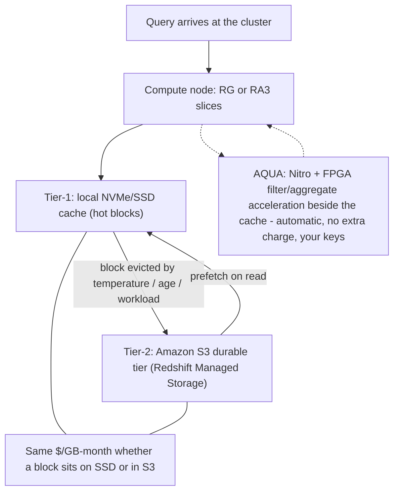
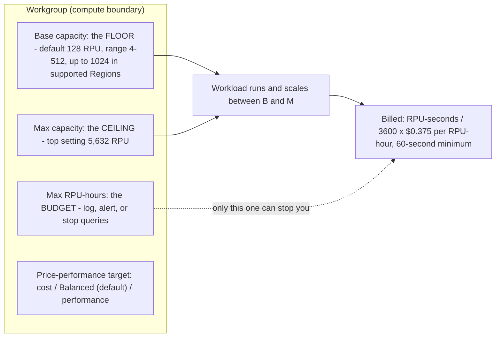
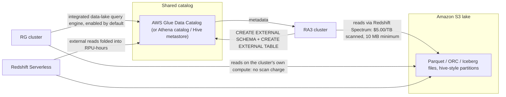
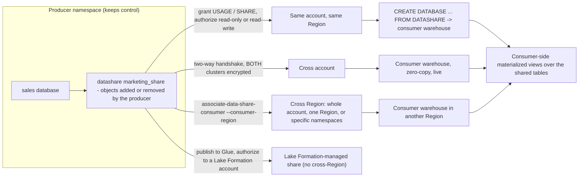
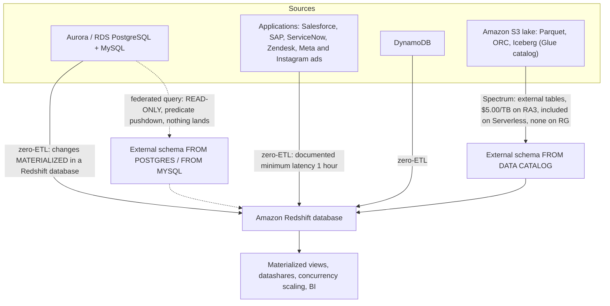

# Redshift in the Lakehouse: Spectrum, Serverless, Data Sharing, and Federation

Lesson 09 put a query engine on top of the lake. This lesson puts a **warehouse** next to it — and then shows how that warehouse stops being a walled garden. Amazon Redshift is the *governed, stateful* half of the AWS lakehouse: it owns a warehouse (Redshift Managed Storage), and it reaches outward in three documented directions — **Spectrum / the integrated data-lake engine** (S3 open formats), **data shares** (other Redshift warehouses), and **federated external schemas** (Aurora/RDS). Everything you built in Lessons 01–09 — S3 layout, Parquet and Iceberg, Glue crawlers, Lake Formation grants — plugs into the same Glue/Lake Formation catalog that Redshift already consumes.

The teaching rule for this lesson is short: **Redshift is where repeated, governed, concurrent SQL lands.** It is not "Athena, but bigger."

```text
====================================================================
 THE REDSHIFT LAKEHOUSE SURFACE - AWS DATA LAKEHOUSE (as of Oct 2026)
====================================================================
 Warehouse ...... RA3 or RG provisioned (from $0.543/hour on-demand)
                  Redshift Serverless (4 RPU minimum, $0.375/RPU-hour)
 Storage ........ Redshift Managed Storage, $0.024 per GB-month
                  SSD cache + S3 durable tier, billed SEPARATELY
 Lake read ...... Spectrum external tables on RA3: $5.00/TB scanned
                  integrated data-lake query engine on RG: no scan fee
                  on Serverless: folded into RPU-hours, not metered
 Pull in ........ federated query: Aurora/RDS PostgreSQL + MySQL,
                  read-only, predicate pushdown, nothing lands
                  zero-ETL: Aurora/RDS/DynamoDB/apps -> Redshift DB
 Share out ...... datashares: same account, cross account,
                  cross Region; producer keeps control
 Cache .......... materialized views (+ auto refresh) and
                  concurrency scaling (free daily credit bank)
 Open tables .... Iceberg READ via external schema (Glue-registered)
                  Iceberg WRITE via CREATE TABLE ... USING ICEBERG,
                  INSERT / DELETE / UPDATE / MERGE (GA 2025-11-17)
 Export ......... UNLOAD (...) TO 's3://.../gold/' FORMAT AS PARQUET
 Not this ....... one-off ad hoc scans over raw S3 = Amazon Athena
====================================================================
```

In this lesson you will:

- explain the **RA3 compute/storage split** and price **Redshift Managed Storage** independently of node hours, then say what **AQUA** is now that its enable/disable switch is gone;
- read the **RG** announcement correctly: a Graviton node family with an **integrated data-lake query engine**, GA **2026-05-12**, that removes the Spectrum scan charge;
- size **Redshift Serverless** in **RPUs** and separate its **three ceilings** — base capacity, Max capacity, and the Max RPU-hours budget;
- state the **1:1 namespace-to-workgroup rule** and say which object owns storage identity and which owns compute;
- write **Spectrum external-table DDL** end to end — external schema, external table, partition registration — and price it at **$5.00 per TB scanned**;
- explain why **partition projection is an Athena feature**, and what that costs you in Redshift;
- walk a **datashare permission chain** across producer and consumer, same account, cross account and cross Region;
- separate **federated query** (live, read-only) from **zero-ETL** (materialized, at least 1 hour stale for application sources) from **Spectrum** (scans files);
- use **materialized views**, **auto refresh** and **concurrency scaling** as the concurrency answer, including the **27 February 2026** auto-refresh change;
- read **and write Apache Iceberg** from Redshift, and recognise that **`WRITE UNLOAD TO` is not a Redshift clause**;
- land a **gold Parquet layer** with `UNLOAD ... PARTITION BY` and register it in the catalog;
- work the **Athena $5/TB versus Serverless RPU** break-even yourself, with October 2026 rates;
- study **Vanguard, Nasdaq, Easygo and GE Aerospace**, a sourced **2026 update box**, and **fourteen exam-style questions** with three interactive checks.

---

## 1. RA3 and Redshift Managed Storage: the compute/storage split

### 1.1 Two meters, one warehouse

AWS's management guide states the design in one sentence: *"RG and RA3 nodes with managed storage enable you to optimize your data warehouse by scaling and paying for compute and managed storage independently."* That is the whole idea — you size a cluster by how much data you **process** per day, not by how much you **store**.

Managed storage is a two-tier store: *"large, high-performance SSDs in each RG and RA3 node for fast local storage and Amazon S3 for longer-term durable storage"*, with automatic offload when data grows beyond the local SSDs. The line that matters for your bill: *"You pay the same low rate for Redshift managed storage regardless of whether the data sits in high-performance SSDs or Amazon S3."* The rate is **$0.024 per GB-month** (us-east-1, AWS Redshift pricing, as of Oct 2026), and there are no node-to-storage transfer charges inside the mechanism.

| Node family | Storage model | Lake queries go through | Status in this course |
|---|---|---|---|
| **RA3** | Managed storage (SSD cache + S3), scales independently of nodes | **Redshift Spectrum** (per-TB scan charge) | Still widely deployed; the reference architecture for Spectrum |
| **RG** (Graviton) | Managed storage, scales independently of nodes | **Integrated data-lake query engine** on the cluster's own compute | Recommended provisioned family since GA **2026-05-12** |
| **DC2** | Local disk only — add nodes to add storage | Spectrum | Recommended only "for datasets under 1 TB (compressed)" |

RA3 shapes and per-node managed-storage ceilings (AWS management guide, accessed 2026-10-11): `ra3.large` 2 vCPU / 16 GiB / 2 slices / 8 TB, `ra3.xlplus` 4 / 32 / 2 / 32 TB, `ra3.4xlarge` 12 / 96 / 4 / 128 TB, `ra3.16xlarge` 48 / 384 / 16 / 128 TB. RG shapes: `rg.large` 2 / 16 / 2 / 8 TB, `rg.xlarge` 4 / 32 / 2 / 32 TB, `rg.4xlarge` 16 / 128 / 8 / 128 TB, `rg.12xlarge` 48 / 384 / 16 / 128 TB.



**Worked example E1 — the AWS-published RA3 month (rates as of Oct 2026, us-east-1)**

```text
Compute         4 x ra3.4xlarge x $3.26/hour x 730 hours   = $9,519.20
Managed storage 40 TB = 40 x 1,024 GB = 40,960 GB
                40,960 GB-month x $0.024/GB-month           =   $983.04
Spectrum        20 TB scanned x $5.00/TB                    =   $100.00
                                                             ----------
Month total (sum of AWS's three published lines, derived)  = $10,602.24
```

AWS publishes the same arithmetic for storage alone: *"managed storage will be charged at $0.024/GB-Month … 51,250 GB-month x $0.024 per GB-month = $1,230"*. The examinable point is structural: **the $983.04 line does not disappear when you pause the cluster**, and it has nothing to do with how busy the nodes are. Any answer that quotes one blended "per TB per hour" warehouse price has collapsed two independent meters.

### 1.2 AQUA: acceleration you no longer configure

**AQUA (Advanced Query Accelerator)** pushes reduction and aggregation work closer to the data. The launch post (AWS News Blog, **2021-04-14**) claims it *"reduces network traffic, offloads work from the CPUs in the RA3 nodes, and allows AQUA to improve the performance of those queries by up to 10x, at no extra cost and without any code changes"*, built on *"the AWS Nitro System and custom FPGA-based acceleration"*, with the volume sent to compute *"generally far smaller (often just 5% of the original)"* and *"All data cached by AQUA is encrypted using your keys."*

What changed: the switch is gone. The `AquaConfiguration` API reference says *"The operation that uses this structure is retired. Amazon Redshift automatically determines whether to use AQUA"*, and the re:Post answer (2023-11-15) adds that *"The option to turn AQUA on an individual cluster basis is no longer available for users."*

> [!IMPORTANT]
> Treat **AQUA as an internal performance technique you benefit from, not a setting you configure.** Any material telling you to "enable AQUA in the console" is stale, and the "up to 10x" figure must always be quoted with its **2021-04-14** date — no 2025–2026 AWS page restates it. AWS does not publish a current AQUA-enabled node list, so never assert one.

### 1.3 RG: the family that removes the Spectrum toll

On **2026-05-12** AWS announced general availability of **RG instances with an integrated data lake query engine**: *"RG instances deliver better performance, running data warehouse workloads up to 2.2x as fast as RA3 instances at 30% lower price per vCPU … performance up to 2.4x as fast as RA3 for Apache Iceberg and up to 1.5x as fast as RA3 for Apache Parquet."* The companion post (2026-05-19) is blunter about the mechanism: with RA3, lake queries were offloaded to Spectrum, which *"introduced network overhead, added latency, and imposed a $5/TB scanning charge on every query"* — while RG instances *"eliminate Amazon Redshift Spectrum's per-TB scanning charges"*, and *"The integrated data lake query engine is enabled by default."*

`rg.large` and `rg.12xlarge` followed on **2026-07-01**, available *"on the current track (P202) only"*, with On-Demand and 1-/3-year Reserved Instance options.

- **📚 Did you know?** The engine brings a statistics trick worth remembering: **JIT ANALYZE** *"automatically collects and uses statistics for data lake tables during query execution"*, which removes the manual `ANALYZE`-before-you-query ritual that external tables otherwise demand (AWS Big Data Blog, 2026-05-19). And the getting-started guide notes the integrated engine *"also supports querying data in Amazon S3 buckets located in a different AWS Region"* — cross-Region lake reads work, with data-transfer charges attached.

---

## 2. Redshift Serverless: RPUs, namespaces and workgroups

### 2.1 One RPU is 16 GB of memory

Serverless has no cluster to size. You set capacity in **RPUs**, and AWS defines *"One RPU provides 16 GB of memory."* Billing is *"for the workloads you run in RPU-hours on a per-second basis, with a 60-second minimum charge"* — and there is *"no charge for data warehouse start up time."*

| Serverless parameter | Value (AWS docs, accessed 2026-10-11) |
|---|---|
| Unit | **1 RPU = 16 GB memory** |
| Rate (us-east-1) | **$0.375 per RPU-hour** |
| Entry price | **from $1.50 per hour** (4 RPU x $0.375) |
| Base capacity | default **128**; **4–512** generally, **up to 1024** in supported Regions |
| Steps | 4 to 8 in steps of 4; 8 to 512 in steps of 8; 512 to 1024 in steps of 32 |
| Max capacity ceiling | top setting **5,632 RPUs** per workgroup |
| Billing grain | per second, **60-second minimum** per transaction |
| Included in the RPU rate | **Redshift Spectrum** and **concurrency scaling** |
| Storage coupling | 4 base RPU supports up to 32 TB; 8–16 RPU up to 128 TB; above 128 TB needs 32 or more RPU |

The 4-RPU floor arrived in stages and is now broad: the What's New of **2026-05-01** extended the **4 RPU minimum** to 7 more Regions, describing a starting point of **4 RPUs** at *"$1.50 per hour"* with *"up to 32 TB of Redshift managed storage, … a maximum of 100 columns per table and 64 GB of memory."*

### 2.2 Three ceilings, and only one of them protects your wallet

This is the single most confused part of Serverless, so separate the three knobs explicitly:

| Knob | What it bounds | Where it applies | Wallet protection? |
|---|---|---|---|
| **Base capacity** | The floor / starting point (default **128** RPUs) | Per workgroup | No — it sets the floor, not the bill |
| **Max capacity (MaxRPU)** | *"the highest count of RPUs that Amazon Redshift Serverless uses for scaling purposes"* | Per workgroup, top setting **5,632** | No — it caps performance |
| **Max RPU hours usage limit** | A budget that *"writes a log entry, alerts, or stops queries"* | Per workgroup | **Yes** — the only guardrail |

There is also a **price-performance target** slider — *"Optimizes for cost / Balanced / Optimizes for performance"*, *"enabled by default for all new Serverless workgroups and is set to Balanced."* Usage is auditable in `sys_serverless_usage`, which returns `charged_seconds`.



### 2.3 Namespace versus workgroup — and the 1:1 rule

AWS is precise here: *"To isolate workloads and manage different resources … you can create namespaces and workgroups and manage storage and compute resources separately."* A **workgroup** is *"a collection of compute resources … RPUs, VPC subnet groups, and security groups … access and usage limits."* A **namespace** owns the storage-side identity: databases, snapshots, authentication and the KMS key — *"By default, Amazon Redshift Serverless creates namespaces with a default AWS Key Management Service key, but you can specify another key to encrypt your data."*

> [!WARNING]
> ⚠️ **"Each namespace can have only one workgroup associated with it. Conversely, each workgroup can be associated with only one namespace."** Teams routinely expect one namespace to fan out into several isolated workgroups. It cannot. Isolation across dev/test/prod therefore means **multiple namespaces** — each with its own KMS key, databases and snapshots — not multiple workgroups under one namespace.

**Worked example E2 — 4-RPU economics and the 60-second floor (rates as of Oct 2026, us-east-1; arithmetic derived from AWS's published rate)**

```text
Entry price check:  4 RPU x $0.375 per RPU-hour      = $1.50 / hour  (matches AWS)

One 10-minute query per day, 4 RPU:
  (600 s / 3600 s) x 4 RPU x $0.375                 = $0.25 / day
  $0.25 x 30 days                                    = $7.50 / month

The 60-second trap - 100 one-second dashboard queries/day, same 4 RPU:
  100 x 60 s (the minimum charge) x 4 RPU            = 24,000 RPU-seconds
  24,000 / 3600                                      = 6.67 RPU-hours
  6.67 x $0.375                                      = $2.50 / day
  $2.50 x 22 working days                            = $55.00 / month
  ...for one second of actual work per query.
```

AWS's own guidance on the second block: *"For very short queries (such as subsecond), this can inflate costs. To mitigate this, batch queries where possible to maximize resource utilization within the 60-second window"* (AWS Big Data Blog, 2025-08-22). Serverless does not mean free-when-idle; it means **no idle at all between queries, and a one-minute bill for every one of them**.

- **📚 Did you know?** Serverless reservations are a payer-level commitment: *"managed at the AWS payer account level, and reservations can be shared between multiple AWS accounts"*, worth *"up to 24% on all Redshift Serverless workloads"* on the 1-year option, and up to **45% for a 3-year term** on the pricing page — while *"free credits are not applied to reservations."* Reserved capacity is metered hourly and billed per second, with on-demand rates applying above the reserved RPU level.

---

## 3. Redshift Spectrum: external tables over the S3 lake

### 3.1 The catalog contract

Spectrum is how an **RA3** cluster reads files that stay in S3. The overview page names the three possible catalogs: *"The external data catalog can be AWS Glue, the data catalog that comes with Amazon Athena, or your own Apache Hive metastore … Changes to the external data catalog are immediately available to any of your Amazon Redshift clusters."* Because the catalog is shared, **the Glue tables your crawler built in Lesson 07 are already visible to Redshift** — you only need the external schema that points at them.

Supported file formats (Spectrum data-files matrix, accessed 2026-10-11) include **Parquet** (columnar, parallel reads, split by row group), **ORC** (stripe), **RCFile**, **TextFile**, **SequenceFile**, **RegexSerDe**, **OpenCSV**, **AVRO**, **Ion** and **JSON**. AWS's recommendation is explicit: *"We recommend using a columnar storage file format, such as Apache Parquet."* Spectrum scans *"the files in the specified folder and any subfolders"* but *"ignores hidden files and files that begin with a period, underscore, or hash mark ( . , _, or # ) or end with a tilde (~)"* — a rule that will silently hide an export whose prefix starts with `_`.

### 3.2 Worked example E3 — external-table DDL, end to end

```sql
-- Step 1: register a Glue database as an external schema on the cluster
CREATE EXTERNAL SCHEMA spectrum
FROM DATA CATALOG
DATABASE 'lakehouse_gold'
IAM_ROLE 'arn:aws:iam::123456789012:role/RedshiftSpectrumRole';

-- Step 2: define the external table over the Parquet gold prefix
CREATE EXTERNAL TABLE spectrum.orders (
    order_id     BIGINT,
    customer_id  BIGINT,
    order_total  DECIMAL(12,2),
    order_date   DATE
)
PARTITIONED BY (order_month DATE)
STORED AS PARQUET
LOCATION 's3://lakehouse-demo/gold/orders/';

-- Step 3: partitions must be registered explicitly - Spectrum only scans
--         folders that were added
ALTER TABLE spectrum.orders
ADD PARTITION (order_month = DATE '2026-09-01')
LOCATION 's3://lakehouse-demo/gold/orders/order_month=2026-09-01/';

-- Step 4: prune with the partition key; only that month's Parquet is scanned
SELECT order_date, SUM(order_total) AS revenue
FROM   spectrum.orders
WHERE  order_month = DATE '2026-09-01'
GROUP  BY order_date
ORDER  BY order_date;

-- Step 5: audit what is actually registered before you trust a zero-row result
-- Query SVV_EXTERNAL_PARTITIONS to find the partitions that exist
SELECT *
FROM   svv_external_partitions
WHERE  table_name = 'orders';
```

Two details do the damage in production: **partition registration is explicit** — *"Redshift Spectrum only scans files in an Amazon S3 location that has been explicitly added using `ALTER TABLE … ADD PARTITION`"* — and the pseudocolumns are billable, because *"Selecting `$size`, `$path`, or `$spectrum_oid` incurs charges because Redshift Spectrum scans the data files on Amazon S3 to determine the size of the result set."*

### 3.3 Worked example E4 — the Spectrum bill (AWS's own three-row example, as of Oct 2026)

One table, **100 columns**, query reads **one** column:

| Layout of the same data | Bytes scanned | Spectrum cost at $5.00/TB |
|---|---|---|
| Uncompressed text | 4 TB | 4 x $5.00 = **$20.00** |
| Same data, GZIP at 4:1 | 1 TB | 1 x $5.00 = **$5.00** |
| Same data, GZIP + Parquet, 1 column read | 10 GB | 0.01 x $5.00 = **$0.05** |

Three levers, three mechanisms: **compression** shrinks every byte, **columnar format** lets the engine skip columns it does not need, and **partition pruning** skips whole files. On a 100-column table those levers span three orders of magnitude — **$20.00 down to $0.05** for the identical question.

The meter itself: *"charged for the number of bytes scanned by Redshift Spectrum, rounded up to the next megabyte, with a 10 MB minimum per query"*, and *"There are no charges for Data Definition Language (DDL) statements … and failed queries."* Up to 9.9 MB scanned still bills the 10 MB minimum.

### 3.4 Where the $5/TB does and does not apply

| Path | Scan charge? | Source (as of Oct 2026) |
|---|---|---|
| Spectrum on provisioned **RA3 / DC2** | **Yes — $5.00/TB scanned** | Redshift pricing page |
| External queries on **Redshift Serverless** | **No** — *"included in … RPU-hr amounts"* | Redshift pricing page |
| Lake queries on **RG** instances | **No** — *"Redshift Spectrum is not required for Redshift RG instances"* | Redshift pricing page; Big Data Blog 2026-05-19 |

> [!WARNING]
> ⚠️ **Never quote "$5/TB for Redshift" as a universal rule.** The correct sentence is *"per-TB scanning charges apply to Spectrum reads from provisioned RA3/DC2 clusters."* Serverless folds external scans into RPU-hours, and RG has no Spectrum layer at all. A question that offers "$5/TB on Redshift Serverless" as a trap is testing exactly this.



### 3.5 Partition projection is Athena-only — say so in Redshift terms

AWS's own wording is unambiguous: *"Partition projection is usable only when the table is queried through Amazon Athena. If the same table is read through another service such as Amazon Redshift Spectrum … the standard partition metadata is used."* So the projection trick that makes Athena free of `ADD PARTITION` does **not** transfer. In Redshift you compensate with one of three mechanisms: explicit `ALTER TABLE … ADD PARTITION`, **`CREATE EXTERNAL TABLE AS`** (which *"partitions new files according to those partition keys and registers new partitions into the external catalog automatically"*), or a **Glue crawler**.

- **📚 Did you know?** AWS also says *"Materialized views on Spectrum tables can greatly improve cost and performance."* An MV over an external table is the documented way to stop paying the same scan twice — you pay once at refresh, then read the result. Section 7 takes that apart, including which refreshes stay incremental.

---

## 4. Data sharing: producer and consumer, without copies

### 4.1 What a datashare actually is

*"With Amazon Redshift data sharing, you can securely share access to live data across Amazon Redshift clusters, workgroups, AWS accounts, and AWS Regions without manually moving or copying the data. Since the data is live, all users can see the most up-to-date and consistent information."* Shareable levels: *"databases, schemas, tables, views (including regular, late-binding, and materialized views), and SQL user-defined functions (UDFs)"*, with permissions such as `SELECT`, `INSERT`, `UPDATE` on tables and `USAGE`, `CREATE` on schemas.

"Live" and "zero-copy" are the two words to memorise: **nothing is duplicated**, the consumer reads the producer's storage, and the producer can revoke at any time — *"When permissions are revoked, consumer clusters immediately lose access to the shared objects and stop seeing them in the list of INBOUND datashares in SVV_DATASHARES."*

### 4.2 Same account, cross account, cross Region

| Scope | Handshake | Extra condition |
|---|---|---|
| Same account, same Region | Producer grants, consumer associates | None beyond grants |
| **Cross account** | Two-way: *"producer authorizes, consumer associates (or declines)"* | *"For cross-account data sharing, both the producer and consumer cluster must be encrypted."* |
| **Cross Region** | `associate-data-share-consumer` with `--consumer-region` | Three scoping choices: *"an entire AWS account spanning all its AWS Regions"*, *"a specific AWS Region in an AWS account"*, or *"specific namespaces within an AWS Region"* |
| Published to Glue | Authorization goes to Lake Formation | *"you can only grant authorization of the datashare to a Lake Formation account"* |

The authorization choice itself is binary and explicit: *"Read-only on [cluster name or workgroup name]"* versus *"Read and write on [cluster name or workgroup name]"*, surfaced on the CLI as `authorize-data-share … [--allow-writes | --no-allow-writes]`. Writes are a producer-granted privilege: allowing them only *permits* what the producer actually granted.

### 4.3 Producer control, granular grants, and Lake Formation-managed shares

The producer never loses the wheel: *"As a producer administrator, you retain control for the datasets you are sharing. You can add new objects to or remove them from the datashare."*

There is **no product called "Redshift managed access"** — do not write that phrase as a feature name. What exists, and what the docs describe, is a set of mechanisms that together give you managed, fine-grained access:

- **Producer-retained control** — add, remove and revoke objects at any time.
- **`WITH PERMISSIONS` granular sharing** — *"If you create a database `WITH PERMISSIONS`, you can grant granular permissions on datashare objects to different users and roles. Without this, all users and roles granted USAGE permission on the datashare database are granted all permissions on all objects."*
- **AWS Lake Formation-managed datashares** — *"Amazon Redshift currently supports data sharing via Lake Formation when sharing within the same account or across accounts. Cross-Region sharing is currently not supported."*
- **Redshift federated permissions** with IAM Identity Center — introduced because *"Traditional Amazon Redshift data sharing doesn't support RLS or DDM policies on shared tables"* (AWS Big Data Blog, 2026-01-05).

> [!IMPORTANT]
> **`WITH PERMISSIONS` flips the default, in both directions.** Without it, `USAGE` on the shared database grants **everything** inside it (over-sharing). With it, `USAGE` grants **nothing** until you add object-level `GRANT`s — which is the number-one cause of *"my consumer connected fine and sees no tables."* Both failure modes are answered by one decision, made at `CREATE DATABASE` time.

**Worked example E5 — the datashare permission chain (producer SQL then consumer SQL)**

```sql
-- ================= PRODUCER =================
-- 1. Create the datashare from one source database
CREATE DATASHARE marketing_share OF DATABASE sales;

-- 2. Add exactly what should leave the warehouse
ALTER DATASHARE marketing_share ADD SCHEMA public.public_stats;

-- 3. Grant to the consumer account (SHARE lets them add consumers)
GRANT USAGE ON DATASHARE marketing_share
  TO ACCOUNT '222222222222';

-- 4. Authorize - deliberately WITHOUT --allow-writes (read-only share)
--    aws redshift authorize-data-share --consumer-account 222222222222
--    aws redshift associate-data-share-consumer --consumer-account 222222222222

-- ================= CONSUMER =================
-- 5. Mount the share. WITH PERMISSIONS = fine-grained from here on.
CREATE DATABASE mkt_db WITH PERMISSIONS
  FROM DATASHARE marketing_share OF ACCOUNT '111111111111';

-- 6. USAGE alone now grants NOTHING - add the object grants
GRANT USAGE ON DATABASE mkt_db TO ROLE bi_user;
GRANT SELECT ON mkt_db.public.public_stats TO ROLE bi_user;

-- 7. Verify what the consumer can actually see: inbound datashares
--    are listed in SVV_DATASHARES, and they disappear the moment
--    the producer revokes the grant
SELECT *
FROM   svv_datashares;
```

Two documented constraints to keep in your head: *"You can't create a datashare on top of database objects created from an existing datashare"* (copy into a local table first, then share that), and metadata visibility on the consumer is limited to what the datashare exposes — `SVV_ALL_*`, `SVV_REDSHIFT_*` and `SVV_REDSHIFT_DATABASES` do not become a directory of the producer.



- **📚 Did you know?** Data sharing is not only for tables. Consumers may include **AWS Data Exchange**, and a consumer namespace added to a share needs no separate authorization step: *"If you are adding a namespace as a data consumer, you don't have to perform authorization."* And on the question everyone asks — sharing has no separate line item on the bill, which is why the honest phrasing is "no copy, no second storage bill", never "free".

---

## 5. Federated queries: read the operational database in place

### 5.1 The pushdown path

*"Federated queries can work with external databases in Amazon RDS for PostgreSQL, Amazon Aurora PostgreSQL-Compatible Edition, Amazon RDS for MySQL, and Amazon Aurora MySQL-Compatible Edition."* The execution path is documented in three steps: the leader node fetches remote metadata, compute nodes issue predicate-pushed subqueries, and rows are redistributed — *"To reduce data movement over the network and improve performance, Amazon Redshift distributes part of the computation for federated queries directly into the remote operational databases."* Every run is logged in `SVL_FEDERATED_QUERY`.

**Worked example E6 — one statement that joins the operational database to the warehouse and the lake**

```sql
-- External schema over a PostgreSQL-family source (read-only)
CREATE EXTERNAL SCHEMA app_db
FROM POSTGRES
DATABASE 'orders_prod'
IAM_ROLE 'arn:aws:iam::123456789012:role/RedshiftFederationRole'
-- Source credentials live in AWS Secrets Manager and are referenced
-- through the IAM role above

-- Live operational rows + warehouse rows + Spectrum rows, one statement
SELECT c.customer_id,
       c.region,
       COUNT(DISTINCT f.order_id) AS open_orders,   -- federated: app_db
       SUM(w.order_total)         AS book_revenue,  -- warehouse table
       SUM(l.refund_total)        AS refunds        -- Spectrum: s3://gold/
FROM   app_db.customers            c
LEFT   JOIN warehouse.fact_orders  w ON w.customer_id = c.customer_id
LEFT   JOIN spectrum.refunds       l ON l.customer_id = c.customer_id
WHERE  c.signup_date >= DATE '2026-01-01'
GROUP  BY c.customer_id, c.region;
```

### 5.2 The limits are the lesson

| Constraint | Value (AWS docs, accessed 2026-10-11) |
|---|---|
| Direction | *"Federated queries support read access to external data sources. You can't write or create database objects in the external data source."* |
| Reverse direction | *"Federated queries don't enable access to Amazon Redshift from RDS or Aurora DB cluster."* |
| Versions | Aurora/RDS PostgreSQL **9.6 or later**; Aurora/RDS MySQL **5.6 or later** |
| Ports | PostgreSQL **5432**, MySQL **3306** |
| MySQL isolation | *"transaction isolation at the READ COMMITTED level"* |
| Cross-Region | *"typically incur network latency and billing charges"* |
| Cost centre | Often the **source** — Aurora charges are usage/IOPS based, so pushdown quality is a cost control |

The headline use is *"joining live operational rows to warehouse and S3 rows in one statement"*, not replicating them. Federation does not make a source table partitionable or columnar — it only pushes predicates.

---

## 6. Zero-ETL integrations: what lands in Redshift

**Zero-ETL is replication, not query.** Changes stream into a Redshift database automatically, so materialized views, data sharing and Redshift RBAC all apply to the result.

The supported-source list captured from the Redshift documentation on **2026-10-11** (AWS adds sources frequently and Region availability varies, so date-stamp it whenever you quote it):

| Category | Sources |
|---|---|
| Aurora / RDS databases | **Amazon Aurora MySQL**, **Amazon Aurora PostgreSQL**, **Amazon RDS for MySQL**, **Amazon RDS for PostgreSQL**, **Amazon RDS for Oracle** |
| Other AWS data | **Amazon DynamoDB**, **Oracle Database@AWS** |
| Applications | **Salesforce**, **Salesforce Marketing Cloud Account Engagement**, **SAP**, **ServiceNow**, **Instagram ads**, **Meta ads**, **Zendesk** |
| Self-managed | **MySQL**, **PostgreSQL**, **SQL Server**, **Oracle** |

Version and scale notes: Aurora MySQL **3.05.2 or later** and Aurora PostgreSQL **16.4 / 17.4 or later** for Redshift targets; *"up to five integrations from the same Aurora cluster"* (AWS What's New, 2025-03-12); Aurora PostgreSQL zero-ETL *"supports a maximum of 100 databases"*; and *"AWS does not charge an additional fee for Aurora zero-ETL integration with Amazon Redshift"* — you pay for the Aurora and Redshift resources already in use.

The latency line is the one that changes architectures: *"The minimum latency for a zero-ETL integration with applications is 1 hour. You can increase it further by setting a non-zero REFRESH_INTERVAL."* Aurora/RDS database integrations are near real time; **application** integrations are not.

> [!IMPORTANT]
> **Zero-ETL is not federated query, and neither is Spectrum.** They answer three different questions:
> - **Zero-ETL** — *what lands in Redshift?* A copy of the changes, so RBAC, MVs and shares apply, with application sources **at least 1 hour** stale.
> - **Federated query** — *can I read the source without copying?* Live, **read-only**, PostgreSQL/MySQL families only, billed against your Redshift compute *and* the source's IOPS.
> - **Spectrum** — *can I read files in S3?* Per-TB scan charges on RA3/DC2, folded into RPU-hours on Serverless, absent on RG.
>
> Architecture diagrams that blur these three produce the wrong answer every time.



---

## 7. Materialized views, auto refresh and concurrency scaling

### 7.1 The MV surface

Redshift MVs can sit on **local tables**, **datashare tables**, **Spectrum/external tables** and **federated tables** — *"You can also base materialized views on external tables created using Spectrum or federated query."* Refresh is chosen for you: incremental when possible, otherwise *"If an incremental refresh isn't possible, then Amazon Redshift performs a full refresh."* Incremental refresh is supported on shared objects too: *"Incremental refresh is also supported for a materialized view that's based on a datashare table or materialized view."*

```sql
-- MV over the Spectrum table from E3: pay the scan once, not per dashboard
CREATE MATERIALIZED VIEW spectrum.orders_monthly
AUTO REFRESH YES
AS
SELECT order_month,
       COUNT(*)         AS orders,
       SUM(order_total) AS revenue
FROM   spectrum.orders
GROUP  BY order_month;
```

`AUTO REFRESH` defaults to **NO**, and it is refused outright when *"the materialized view definition includes mutable functions or external schemas"* or when you define *"a materialized view on another materialized view."* Status lives in `SVL_MV_REFRESH_STATUS`.

Refresh quality on external data is specific: incremental refresh is supported on *"Standard data lake tables after S3 DELETE or PUT overwrite"* when the view does not aggregate, and on *"Apache Iceberg tables after INSERT, DELETE, UPDATE, or table compaction."*

### 7.2 The 27 February 2026 auto-refresh change

AWS's current wording: *"Starting February 27, 2026, Auto REFRESH queries for Amazon Redshift materialized views are executed as user queries rather than background autonomic processes … only enabled for Amazon Redshift Provisioned clusters on the CURRENT Track of patch release P198 and newer. It is currently disabled on Serverless."* Auto refresh also stays workload-throttled: *"Amazon Redshift prioritizes your workloads over autorefresh and might stop autorefresh to preserve the performance of user workload."*

> [!WARNING]
> ⚠️ **Auto refresh is not a scheduler.** It is throttled under load, unavailable when the definition includes mutable functions or external schemas, **disabled on Serverless**, and — since **2026-02-27** — it competes for user-query priority on provisioned CURRENT-track clusters. When a freshness SLA exists, use a scheduled `REFRESH MATERIALIZED VIEW` or the console scheduler and read `SVL_MV_REFRESH_STATUS`; do not hand an SLA to autorefresh.

**Worked example E7 — MV and concurrency sizing at Vanguard scale (customer figures, AWS Big Data Blog 2026-03-18)**

```text
Given (published):  250+ materialized views, 500+ dashboards,
                    500,000+ user queries per month

(a) Daily query volume  500,000 / 22 working days  ~ 22,727 queries / day
(b) MV policy           AUTO REFRESH YES where no hard SLA;
                        scheduled REFRESH where one exists
(c) Serverless sizing   base capacity = the sustained floor;
                        Max capacity  = the spike ceiling;
                        Max RPU-hours = the budget guardrail
(d) Provisioned burst   1 credited hour per 24 h, bankable to 30 h,
                        1-minute minimum per activation -> a 40-minute
                        Monday spike on one active cluster is covered
                        by the credit bank at $0 extra
```

### 7.3 Concurrency scaling: the burst lane

*"You're charged for concurrency-scaling clusters only for the time they're actively running queries."* Credits accrue as *"one hour of Concurrency Scaling cluster credits every 24 hours while your main cluster is running"*, with *"a one-minute minimum charge each time a Concurrency Scaling cluster is activated"*, and *"You can accumulate up to 30 hours of free Concurrency Scaling credits for each active cluster. Credits do not expire as long as your cluster is not terminated."* The feature page claims those credits are *"sufficient for the concurrency needs of 97% of Redshift customers."*

**Worked example E8 — what a burst actually costs (as of Oct 2026)**

```text
Reference cluster (AWS pricing page): 10 x rg.4xlarge in US-West-1
                                       = $33.66 per hour
Per-second rate           $33.66 / 3600 = $0.00935 per second

Free bank:  1 hour per 24 h per ACTIVE cluster, capped at 30 hours.
            A brand-new cluster has ZERO banked hours; a PAUSED
            cluster stops accruing.

Beyond credit (derived arithmetic: 2 transient clusters x 300 s):
            $0.00935 x 300 x 2 = $5.61  (the published incident figure)
Hour total: $33.66 + $5.61     = $39.27
```

The parameter to know is `max_concurrency_scaling_clusters`, whose default limit is **10** (AWS News Blog, 2019-03-27), and the counter-intuitive rule that credit accrual *"applies to both read and write operations."* On **Serverless** you never see this line at all — *"You do not need to pay for concurrency scaling and Redshift Spectrum separately because they are both included with Amazon Redshift Serverless."*

- **📚 Did you know?** Concurrency scaling and materialized views do not compose everywhere: *"On Apache Iceberg tables, concurrency scaling is not supported for materialized view creation and refresh."* If your MV sits on Iceberg, the burst lane is unavailable for that MV's create and refresh path — plan capacity instead of credits.

---

## 8. Iceberg with Redshift: read it, write it, and the UNLOAD myth

### 8.1 Reading

Iceberg tables are read through an external schema over the **AWS Glue Data Catalog** — *"Iceberg tables must be registered with AWS Glue Data Catalog"* — using either explicit or auto-mounted notation:

```sql
-- Explicit external schema over a Glue-registered Iceberg table
CREATE EXTERNAL SCHEMA iceberg_lake
FROM DATA CATALOG
DATABASE 'lakehouse_curated'
IAM_ROLE 'arn:aws:iam::123456789012:role/RedshiftSpectrumRole';

-- Two-part access to an Iceberg table
SELECT event_ts, user_id, event_type
FROM   iceberg_lake.clickstream
WHERE  event_ts >= TIMESTAMP '2026-10-01 00:00:00';
```

Which engine does the scan depends on the node family, and AWS says so directly: *"RG instance types and Redshift Serverless use their own compute to process data lake queries, while RA3 instance types use Redshift Spectrum."* The getting-started list of readable formats is *"Iceberg, Parquet, ORC, RCFile, TextFile, SequenceFile, RegexSerDe, OpenCSV, and AVRO."*

### 8.2 Writing

Iceberg writes went GA on **2025-11-17**. Supported statements: `CREATE TABLE … USING ICEBERG`, `CREATE TABLE … USING ICEBERG AS SELECT`, `INSERT INTO`, `DELETE`, `UPDATE`, `MERGE`, `ALTER`, `DROP TABLE` — on *"both Amazon Redshift provisioned clusters and Amazon Redshift Serverless instances."*

```sql
-- Create an open-format gold table in the lake
CREATE TABLE iceberg_lake.customer_360 USING ICEBERG
AS
SELECT customer_id,
       MIN(order_date)   AS first_order,
       SUM(order_total)  AS lifetime_value
FROM   warehouse.orders
GROUP  BY customer_id;

-- Idempotent upsert into a table someone else may also write
MERGE INTO iceberg_lake.customer_360 t
USING   staging.customer_360_stg s
ON      t.customer_id = s.customer_id
WHEN MATCHED THEN UPDATE SET lifetime_value = s.lifetime_value
WHEN NOT MATCHED THEN INSERT (customer_id, lifetime_value)
                   VALUES (s.customer_id, s.lifetime_value);
```

To write into a table **Redshift did not create**, four conditions must hold: *"The table must be an Iceberg v2 table; The table must be using Parquet as the default data format; The table must not have metadata compression set to True; The table must not enable Write-Audit-Publish (WAP)."* Also: *"Federated identity is not supported when writing to Apache Iceberg tables."*

> [!WARNING]
> ⚠️ **There is no `WRITE UNLOAD TO` clause in Redshift.** No such syntax appears in the `UNLOAD` reference or the Iceberg-writes SQL reference, so never write it and never mark it correct. The two supported write paths are:
> - **Iceberg DML in the warehouse** — `CREATE TABLE … USING ICEBERG [AS SELECT]`, `INSERT`, `DELETE`, `UPDATE`, `MERGE`.
> - **Open-format export to an S3 prefix** — `UNLOAD ('…') TO 's3://…' FORMAT AS PARQUET PARTITION BY (…)`, which is the gold-export pattern in Section 9.
>
> Use them as two steps in a pipeline, never as one invented statement.

### 8.3 Iceberg materialized views and catalog registration

Iceberg MVs are the open-format variant: *"Iceberg materialized views are stored as standard Iceberg tables and are accessible to any analytics engine that supports the Iceberg format, including Apache Spark, Amazon Athena, and Trino."* Concurrent refresh uses *"optimistic concurrency control (OCC) through the AWS Glue Data Catalog's conditional update mechanism."* Availability is narrower than you would guess: supported *"only on Redshift Serverless and provisioned … RA3 and DC2 instance … are not supported"* — so **RG or Serverless**, not RA3.

You can also register an entire provisioned cluster or serverless namespace with the Glue Data Catalog so other engines read it through the **Iceberg REST API**, with *"AWS Lake Formation manages the permissions"* and three-part notation `database@namespace-catalog.schema.table`. Objects that are **not** registered: external schemas, external tables, UDFs, procedures, *"Tables with row-level security or dynamic data masking policies attached"*, and uppercase or mixed-case objects.

---

## 9. COPY and UNLOAD: landing the gold layer

### 9.1 COPY in

`COPY` ingests from S3 in Parquet, ORC, CSV, JSON or Avro using an IAM role. It is the volume path, and it is the counterpart to everything in this lesson: what comes in with `COPY`, gets curated in the warehouse, and goes back out with `UNLOAD`.

### 9.2 UNLOAD out — the gold-export pattern

`UNLOAD` writes *"the result of a query to one or more text, JSON, or Apache Parquet files on Amazon S3"*, with SSE-S3 or SSE-KMS encryption. Parquet is the documented default for a gold layer: *"Parquet format is up to 2x faster to unload and consumes up to 6x less storage in Amazon S3, compared with text formats"* — and AWS names the downstream explicitly: *"You can then analyze your data with Redshift Spectrum and other AWS services such as Amazon Athena, Amazon EMR, and Amazon SageMaker AI."*

**Worked example E9 — UNLOAD to gold, then make it queryable (the step everyone forgets)**

```sql
-- 1) Export gold to S3 as Hive-partitioned Parquet, SSE-KMS
UNLOAD ('SELECT order_id, customer_id, order_total, order_date
         FROM gold.orders
         WHERE order_date >= ''2026-01-01''')
TO 's3://lakehouse-demo/gold/orders/'
IAM_ROLE 'arn:aws:iam::123456789012:role/RedshiftS3Unload'
FORMAT AS PARQUET
PARTITION BY (order_date)
ENCRYPTED KMS_KEY_ID 'arn:aws:kms:us-east-1:123456789012:key/1234abcd-12ab-34cd-56ef-1234567890ab'
MANIFEST VERBOSE
ALLOWOVERWRITE;

-- 2) Registration is NOT automatic: UNLOAD "doesn't make any calls to
--    an external catalog", so register it yourself
CREATE EXTERNAL TABLE spectrum.orders_gold (
    order_id    BIGINT,
    customer_id BIGINT,
    order_total DECIMAL(12,2)
)
PARTITIONED BY (order_date DATE)
STORED AS PARQUET
LOCATION 's3://lakehouse-demo/gold/orders/';

-- 3) Then add the partitions (or run a Glue crawler)
ALTER TABLE spectrum.orders_gold
ADD PARTITION (order_date = DATE '2026-09-01')
LOCATION 's3://lakehouse-demo/gold/orders/order_date=2026-09-01/';
```

| UNLOAD option | Range or rule (as of Oct 2026) |
|---|---|
| `FORMAT AS` | `CSV`, `PARQUET` or `JSON` |
| `PARTITION BY (…) [INCLUDE]` | Hive-convention folders, written automatically |
| `MANIFEST [VERBOSE]` | List of the files written |
| `ENCRYPTED [AUTO]` with `KMS_KEY_ID` | SSE-KMS alongside SSE-S3 |
| `MAXFILESIZE` | 5 MB to **6.2 GB** (default 6.2 GB) |
| `ROWGROUPSIZE` | 32–128 MB (default 32 MB); needs `ra3.4xlarge`, `ra3.16xlarge`, `rg.4xlarge`, `rg.12xlarge` or `dc2.8xlarge` |
| `ALLOWOVERWRITE`, `CLEANPATH`, `PARALLEL`, `REGION`, `EXTENSION` | Path hygiene and parallelism control |

The **asymmetric alternative** is `CREATE EXTERNAL TABLE AS` (CETAS), which *"only supports two file formats, TEXTFILE and PARQUET"* — but which *"partitions new files according to those partition keys and registers new partitions into the external catalog automatically."* Choose CETAS when you want the registration step to disappear; choose `UNLOAD` when you are exporting an existing query result.

> [!IMPORTANT]
> **Two UNLOAD traps with dates attached.** First, *"The UNLOAD command doesn't make any calls to an external catalog"* — a gold export with `PARTITION BY` is invisible to Athena and Spectrum until you run `ALTER TABLE … ADD PARTITION`, create the external table, or run a Glue crawler. Second, client-side encryption for COPY and UNLOAD closed to new customers on **2025-04-30**, and after **2026-04-30** *"you won't be able to use client-side encryption for COPY and UNLOAD"* — teach SSE-S3 and SSE-KMS only. And remember that prefix names beginning with `_` or `.` are treated as hidden by Spectrum.

---

## 10. Worked cost sketch: Athena $5/TB versus Redshift Serverless RPU

All rates below are published; **the arithmetic is ours** and is labelled derived. Rates: Athena on-demand **$5.00 per TB scanned**; Redshift Serverless **$0.375 per RPU-hour**; Redshift Managed Storage **$0.024 per GB-month**; Spectrum **$5.00 per TB scanned** on RA3/DC2 (all us-east-1, as of Oct 2026).

**Worked example E10 — the break-even constant (derived from published rates)**

```text
A 64-RPU Serverless workgroup running one hour:
    64 RPU x $0.375 per RPU-hour          = $24.00
Athena at $5.00/TB matches that by scanning:
    $24.00 / $5.00 per TB                 = 4.8 TB in the same hour

    BELOW about 4.8 TB per hour of scanned data -> Athena's meter is cheaper
    ABOVE about 4.8 TB per hour                  -> keeping Redshift warm is cheaper
```

**Worked example E11 — two scenarios (derived from published rates, as of Oct 2026)**

```text
SCENARIO A - ad hoc, lightly loaded (Athena's home turf)
  30 queries/day, each pruned to 100 GB of Parquet = 3 TB/day
  Athena:         3 TB x $5.00                     = $15.00 / day
                  $15.00 x 22 working days         = $330.00 / month
  Serverless at 8 RPU with the 60-second floor:
                  30 x 60 s x 8 RPU = 14,400 RPU-s = 4 RPU-hours
                  4 x $0.375                       =   $1.50 / day
                  $1.50 x 22                       =  $33.00 / month
  plus managed storage if the same 5 TB is warehoused:
                  5 x 1,024 x $0.024              = $122.40 / month
                  Serverless total                ~ $155.40 / month

SCENARIO B - steady BI at scale (Redshift's home turf)
  64-RPU workgroup active 8 h/day x 22 days:
                  64 x 8 x 22 = 11,264 RPU-hours x $0.375 = $4,224.00
  plus 10 TB managed storage: 10 x 1,024 x $0.024          =   $245.76
                  Redshift total                           ~ $4,469.76 / month
  Equivalent Athena bill = $4,469.76 / $5.00 = 894 TB scanned per month
                           = about 40.6 TB per day
```

Read Scenario A honestly: Serverless is cheaper *only if* you are going to run the workgroup anyway. Athena's real win in that scenario is **zero warm capacity and zero storage-side commitment** — a one-off analysis does not need a warehouse at all. Read Scenario B as the crossover: if dashboards scan more than roughly **40 TB per day** *and* need MV-cached results plus high concurrency, Redshift is both cheaper and structurally correct.

```mermaid
flowchart TD
    Q["What does the workload look like?"] --> Q1{"One-off, ad hoc, over files already in S3?"}
    Q1 -->|Yes| A["Amazon Athena - $5.00/TB scanned, 10 MB minimum, no warm capacity"]
    Q1 -->|No| Q2{"Repeated, concurrent BI over curated tables?"}
    Q2 -->|Yes| Q3{"Sustained lake scanning above about 4.8 TB per hour, or MV-cached marts?"}
    Q3 -->|Yes| R["Redshift: RG with no scan fee, or Serverless with MVs plus concurrency scaling"]
    Q3 -->|No, but data must STAY in S3| S["Spectrum external tables on RA3 - $5.00/TB scanned"]
    Q2 -->|No| Q4{"Live operational rows needed in the join?"}
    Q4 -->|Read-only, live| F["Federated query - Aurora or RDS PostgreSQL or MySQL"]
    Q4 -->|Materialized, app sources at least 1 hour stale| Z["Zero-ETL integration"]
    R --> Q5{"Cold history plus hot current?"}
    Q5 -->|Yes| B["UNLOAD Parquet to s3://.../gold/ and register the partitions"]
    Q5 -->|No| B2["Keep it in Redshift Managed Storage at $0.024/GB-month"]
```



> [!IMPORTANT]
> **Do not invent an official crossover number.** AWS publishes the *meters* — per-scan for Athena and Spectrum, RPU-hours or node-hours plus managed storage for Redshift — and the break-even above is **our arithmetic from those published rates, as of Oct 2026**, not an AWS-published threshold. State it as a derived constant, show the inputs, and never present it as an AWS figure.

---

## 11. Consolidating the decision: three interactive checks

### 11.1 Matching — capability to engine

```matching
{
  "question": "Match each lakehouse capability to the Redshift mechanism that actually delivers it (as of Oct 2026):",
  "pairs": [
    {"left": "Query Parquet files that must stay in S3, from an RA3 cluster", "right": "Redshift Spectrum external tables - $5.00 per TB scanned, rounded to the next MB, 10 MB minimum per query, DDL and failed queries free"},
    {"left": "Query the same S3 files from an RG cluster with no scan charge", "right": "The integrated data-lake query engine - enabled by default on RG, so Spectrum is not required and its per-TB charge never appears"},
    {"left": "Give a second warehouse in another account live access to a table with no copy", "right": "A datashare - producer authorizes, consumer associates, both clusters encrypted, then CREATE DATABASE ... FROM DATASHARE"},
    {"left": "Join live Aurora PostgreSQL rows to warehouse and S3 rows in one statement", "right": "A federated query - external schema FROM POSTGRES, read-only, predicates pushed into the source, logged in SVL_FEDERATED_QUERY"},
    {"left": "Land Salesforce, SAP, ServiceNow or DynamoDB changes inside a Redshift database", "right": "A zero-ETL integration - the data is materialized in Redshift, and application sources have a documented minimum latency of 1 hour"},
    {"left": "Absorb a Monday-morning dashboard spike without queueing", "right": "Concurrency scaling - up to 1 free hour per 24 hours per active cluster, bankable to 30 hours, 1-minute minimum per activation"}
  ],
  "explanation": "Six capabilities, six different meters. Spectrum and the RG engine are the two lake-read paths and differ only in who pays the scan charge; datashares are the warehouse-to-warehouse path and never touch S3; federated query is live but read-only and limited to the PostgreSQL and MySQL families; zero-ETL lands a copy so MVs, RBAC and shares apply, but application sources are at least 1 hour stale; concurrency scaling is a burst lane with a free credit bank, not a storage or sharing feature. The classic exam error is choosing federation when the requirement says the data must be materialized, or zero-ETL when the requirement says read the source in place."
}
```

### 11.2 Drag and drop — when to choose Redshift

```dragdrop
{
  "question": "Order the lakehouse decision from cheapest and simplest to most committed, so each step only fires when the previous one fails:",
  "items": [
    "Is it one-off ad hoc SQL over raw S3 files with no warehouse wanted? -> Amazon Athena at $5.00/TB scanned",
    "Is it repeated, concurrent BI over curated tables? -> Redshift provisioned (RG or RA3) or Redshift Serverless in RPU-hours",
    "Must the data stay in S3 but still be joined from the warehouse? -> Spectrum external tables on RA3, or the integrated engine on RG",
    "Do several teams need the same governed tables without copies? -> A datashare with producer-retained control and WITH PERMISSIONS",
    "Must live Aurora or RDS rows appear in the join? -> Federated query for read-only, zero-ETL for a materialized copy",
    "Is there a repeated aggregation or a documented freshness SLA? -> A materialized view with AUTO REFRESH YES or a scheduled REFRESH, plus concurrency scaling for the spike"
  ],
  "correctOrder": [
    "Is it one-off ad hoc SQL over raw S3 files with no warehouse wanted? -> Amazon Athena at $5.00/TB scanned",
    "Is it repeated, concurrent BI over curated tables? -> Redshift provisioned (RG or RA3) or Redshift Serverless in RPU-hours",
    "Must the data stay in S3 but still be joined from the warehouse? -> Spectrum external tables on RA3, or the integrated engine on RG",
    "Do several teams need the same governed tables without copies? -> A datashare with producer-retained control and WITH PERMISSIONS",
    "Must live Aurora or RDS rows appear in the join? -> Federated query for read-only, zero-ETL for a materialized copy",
    "Is there a repeated aggregation or a documented freshness SLA? -> A materialized view with AUTO REFRESH YES or a scheduled REFRESH, plus concurrency scaling for the spike"
  ],
  "explanation": "The order is commitment order. Athena first because it needs no warehouse and bills only what it scans; Redshift second because repeated concurrent BI is the warehouse's reason to exist; Spectrum third because it keeps data in S3 while joining it; datashares fourth because they multiply warehouses without multiplying storage; federation or zero-ETL fifth because they reach outside the lake entirely, and the choice between them is live-read versus materialized-copy; and MVs plus concurrency scaling last because they are optimizations you add once the workload shape is already correct. Jumping straight to Redshift for a one-off query is how teams buy 128 base RPUs they never needed."
}
```

### 11.3 Fill in the blanks — the Serverless contract

```fillblank
{
  "question": "Complete the Redshift Serverless contract from AWS's own numbers (as of Oct 2026):",
  "template": "Redshift Serverless meters work in RPU-hours: {{1}} RPU equals {{2}} GB of memory, and the us-east-1 rate is ${{3}} per RPU-hour, billed per second with a {{4}}-second minimum charge per transaction. The default base capacity is {{5}} RPUs, a workgroup's Max capacity ceiling tops out at {{6}} RPUs, and external S3 scans cost nothing extra because Redshift Spectrum is {{7}} in the RPU rate rather than metered separately.",
  "answers": {
    "1": "1",
    "2": "16",
    "3": "0.375",
    "4": "60",
    "5": "128",
    "6": "5632",
    "7": "included"
  },
  "distractors": ["2", "8", "32", "64", "0.543", "1.50", "5.00", "30", "512", "1024", "1280", "separately metered", "billed at $5.00/TB", "excluded", "waived"],
  "explanation": "AWS defines one RPU as 16 GB of memory, publishes $0.375 per RPU-hour in us-east-1 (the $1.50 figure is the 4-RPU entry price per HOUR, not the RPU rate), and bills per second with a 60-second minimum. Base capacity defaults to 128 RPUs and is adjustable 4 to 512 generally, up to 1024 in supported Regions; the Max capacity scaling ceiling tops out at 5,632 RPUs per workgroup. Spectrum is explicitly included: 'You do not need to pay for concurrency scaling and Redshift Spectrum separately because they are both included with Amazon Redshift Serverless.' The traps are quoting $1.50 as the RPU rate, quoting $5.00/TB against Serverless, and confusing base capacity with Max capacity."
}
```

---

### 2026 Updates (as of October 2026)

> [!NOTE]
> **What changed in the Redshift lakehouse story between late 2025 and October 2026** — every line checked against a primary AWS source, and each one matters because it changes current behaviour:
> - **Redshift writes Apache Iceberg, GA since 2025-11-17** — *"Redshift can write to Iceberg tables… GA"*, supporting `INSERT`/`UPDATE`/`DELETE`/`MERGE` against Iceberg tables managed in **AWS Glue** or **Amazon S3 Tables** (AWS News Blog / AWS What's New, 2025-11-17; re:Invent 2025 analytics roundup, 2026-01-07). Read-then-write on one open table is now a Redshift-native loop, not a pipeline.
> - **Redshift Serverless dropped to a 4-RPU minimum** (AWS What's New, 2025-06-30, extended to 7 more Regions on **2026-05-01**): entry as low as **$1.50 per hour**, **32 TB** of managed storage supported at that size, **64 GB** of memory, **100 columns** per table maximum.
> - **JIT ANALYZE** (2025-07-15 / 2025-11-18) compiles queries on demand for better first-run performance and automatically collects statistics for data lake tables during execution — paired with the **RG** family, GA **2026-05-12** with `rg.xlarge` and `rg.4xlarge`, then `rg.large` and `rg.12xlarge` on **2026-07-01** (current track P202 only).
> - **Materialized-view auto refresh changed behaviour on 2026-02-27**: auto-refresh queries now run **as user queries** rather than background autonomic processes, only on provisioned clusters on the CURRENT track at patch **P198** and newer, and *"It is currently disabled on Serverless."*
> - **Python UDFs are finished**: *"Amazon Redshift will no longer support the use of Python UDFs after June 30, 2026"*, with enforcement in phases — redesign anything that leans on them, including masking policies and materialized-view definitions.
> - **Commitment paths widened**: Serverless reservations are payer-scoped and worth up to **24%** (1-year) or **45%** (3-year) off on-demand, while Redshift ML stays free to create and predict locally, with training cell-metered at **$20 per million** (first 10M), **$15** (next 90M) and **$7** above 100M, with `MAX_CELLS` defaulting to **1,000,000**.

- **📚 Did you know?** Two stale-fact traps sit in this box. First, some AWS whitepaper pages still label AQUA as *"(preview)"* — ignore that label and prefer the current management guide. Second, any claim that Redshift can only **read** Iceberg has been wrong since **2025-11-17**. On this topic an old AWS post is not a source; the current documentation page is.

---

## Real-World Case Studies

AWS publishes what these abstractions look like in production. Every figure below is **customer- or AWS-claimed and unaudited**, with the source named so you can check it — the examinable point is the **pattern**, not the marketing.

### Case A — Vanguard: a 150 TB lake and a 20 TB warehouse, joined by data shares

| Element | Detail |
|---|---|
| Customer | **Vanguard**, Financial Advisor Services (FAS 360) |
| Challenge | A fragmented "data swamp" of Parquet files on S3 that had to become a governed enterprise warehouse without duplicating data across domains |
| Services | **Amazon Redshift** (RA3 provisioned **producer** plus **Redshift Serverless consumers** with zero-copy data sharing), **AWS Glue ETL**, **Apache Iceberg** curated via Glue, **Redshift materialized views**, Tableau |
| Outcomes (two years later) | **20 TB in Redshift plus 150 TB in the S3 data lake**; **600+ Glue ETL jobs (a 30x increase)**; **300+ tables (3x growth)**; **250+ Redshift materialized views**; **500+ Tableau dashboards (25x expansion)**; **500,000+ user queries per month** |
| Source | AWS Big Data Blog, "How Vanguard transformed analytics with Amazon Redshift multi-warehouse architecture", **2026-03-18** |

> "multi-warehouse architecture that leverages the advanced data sharing capabilities of Amazon Redshift for workload isolation and independent scaling" — AWS Big Data Blog, 2026-03-18

The examinable pattern: **the ratio is the architecture.** 150 TB of lake against 20 TB of warehouse means the warehouse holds what is queried repeatedly and governed tightly, while the lake holds everything else — and the two are bridged by Spectrum and integrated reads on one side and zero-copy datashares on the other. Note also where the MVs live: **250+ materialized views** is the concurrency answer from Section 7 operating at production scale, which is how half a million queries a month get served.

### Case B — Nasdaq: query-in-place removes the overnight cliff

| Element | Detail |
|---|---|
| Customer | **Nasdaq**, stock exchange |
| Challenge | By 2018 a **70-node** Redshift cluster ingested *"financial market data from thousands of sources nightly, ranging from 30 billion to 55 billion records and surpassing 4 terabytes"*, with load and query contending for the same resources |
| Services | **Amazon S3** data lake foundation, **Amazon Redshift** compute, **Redshift Spectrum** for lake queries, **S3 Glacier** archive, **S3 Object Lock**, AWS IAM |
| Outcomes | A **15 TB** S3 lake queried in place; *"zero contention between data loading and querying processes"*; **Redshift queries 32 percent faster**; the **90 percent mark for data load completion 5 hours sooner**; support for the jump *"from 30 billion records to 70 billion records a day"* |
| Source | AWS case study material, page year 2020 (digest 18, source S5; accessed 2026-10-11) |

> "Nasdaq began using Amazon Redshift Spectrum, a feature that powers a lake house architecture to query data both in the data warehouse and in the Amazon S3 data lake." — AWS case study material (accessed 2026-10-11)

The examinable pattern is the one this lesson opened with: **Spectrum turns the lake into something the warehouse can join instead of something it must absorb.** Nasdaq itself calls the setup a *"lake house architecture"*. "Load everything into the warehouse first" is not the AWS answer at exchange scale — the answer is query-in-place plus a warehouse sized for the queries.

### Case C — Easygo: zero-ETL from Aurora into Redshift Serverless

| Element | Detail |
|---|---|
| Customer | **Easygo**, entertainment platform operating in regulated markets |
| Challenge | Concurrent peak fraud-detection and BI workloads, plus legacy ETL from Aurora PostgreSQL that caused ingestion incidents and stale fraud thresholds |
| Services | **Amazon Kinesis** (streaming-first), **Amazon S3** central lake, **Amazon Athena**, **Amazon Redshift Serverless**, **Amazon Aurora zero-ETL integration with Redshift**, AWS KMS, private VPCs |
| Outcomes | Query performance improved **95 percent** (workloads previously up to **1 hour** now about **10 minutes**); **80 percent fewer** data-incident reports; **9 hours per week** of maintenance saved |
| Source | AWS case study material (digest 18, source S7; accessed 2026-10-11) |

This is Section 6 in production: **streaming-first into S3, partitioned Athena for ad hoc reads, Redshift Serverless for the governed layer, and Aurora zero-ETL feeding it** — four mechanisms, no hand-built replication pipeline.

### Case D — GE Aerospace: warehouse density behind a compliance boundary

| Element | Detail |
|---|---|
| Customer | **GE Aerospace**, supply-chain division |
| Challenge | An operational data store originally on Amazon Aurora that *"initially expected its database to require 1–2 TB, but it eventually scaled to almost 6 TB"*, plus a CMMC compliance requirement |
| Services | **Amazon Redshift** on **AWS GovCloud (US)**; proof of concept Nov–Dec 2022, then a **9-month migration January–September 2023**; **150+** reports migrated, some exceeding **10,000 lines of code** |
| Outcomes | **Almost 70 percent** query performance improvement (queries of 90 minutes now **7 minutes**); estimated **over $500,000** in yearly cost savings |
| Source | AWS case study, undated (digest 18, source S13; accessed 2026-10-11) |

The examinable pattern is that **architecture inputs include the compliance boundary**: GovCloud (US) is where the workload lives because the supplier requirement demanded it, and warehouse density — not headcount — produced the saving. Never generalise this to "Redshift is CMMC compliant"; the claim is about the Region.

```plot
{
  "type": "bar",
  "title": "Redshift lakehouse footprints as published by AWS customers (accessed Oct 2026)",
  "data": [
    {"Case and metric": "Vanguard - S3 lake (TB)", "Value": 150},
    {"Case and metric": "Vanguard - Redshift (TB)", "Value": 20},
    {"Case and metric": "Nasdaq - S3 lake queried in place (TB)", "Value": 15},
    {"Case and metric": "GE Aerospace - Aurora ODS before migration (TB)", "Value": 6}
  ],
  "xKey": "Case and metric",
  "yKey": "Value",
  "xLabel": "Case and metric",
  "yLabel": "Terabytes"
}
```

Hover any bar to read the claim: Vanguard publishes **150 TB lake against 20 TB warehouse**, Nasdaq publishes **15 TB** queryable in place, GE Aerospace publishes an Aurora store that grew to **almost 6 TB** before moving. Different units on purpose — the point is the *shape* of each footprint, not a ranking.

| Case | Redshift pattern it demonstrates | Section |
|---|---|---|
| Vanguard | Multi-warehouse **zero-copy data sharing** plus MVs at 500,000 queries/month | 4, 7 |
| Nasdaq | **Spectrum** query-in-place on a 15 TB lake; load and query decoupled | 3 |
| Easygo | **Zero-ETL** from Aurora into **Redshift Serverless**, streaming-first | 2, 6 |
| GE Aerospace | Warehouse density and compliance boundary as architecture inputs | 1 |

- **📚 Did you know?** Every percentage in this section is **one customer's measurement on one workload**, not a specification: Vanguard's **250+ MVs** and **600+ Glue jobs** are counts on their estate, Easygo's **95 percent** and GE Aerospace's **almost 70 percent** are self-reported outcomes of specific migrations, and none of them transfer to your cluster by default (AWS-published case material, accessed 2026-10-11).

---

## Practice Questions

```question
{
  "id": "lh-10-q1",
  "type": "multiple-choice",
  "question": "Which statement about RA3 and Redshift Managed Storage is correct as of October 2026?",
  "options": [
    "Compute and storage are metered independently: local SSDs are a cache, Amazon S3 is the durable tier, and the rate is the same $0.024 per GB-month whether a block sits on SSD or in S3",
    "Managed storage is bundled into the node-hour price, so a 40 TB warehouse costs the same as a 1 TB one",
    "Data is stored only on local node disks, so removing a node always risks data loss",
    "Managed storage is billed only while the cluster is running queries"
  ],
  "correct": 0,
  "explanation": "AWS states that RG and RA3 nodes with managed storage let you 'scale and pay for compute and managed storage independently', that the SSD tier is for 'fast local storage' with S3 as the 'longer-term durable storage', and that 'You pay the same low rate ... regardless of whether the data sits in high-performance SSDs or Amazon S3' - $0.024/GB-month as of Oct 2026. Storage accrues whether or not the cluster is busy, which is why AWS's own 40 TB example adds $983.04 of storage on top of $9,519.20 of node hours."
}
```

```question
{
  "id": "lh-10-q2",
  "type": "multiple-choice",
  "question": "A teammate says they will enable AQUA on the RA3 cluster for the analytics workload. What is the correct response?",
  "options": [
    "AQUA must be enabled per cluster through the ModifyAquaConfiguration API before the first query",
    "AQUA is retired entirely and no longer affects Redshift performance",
    "The AquaConfiguration operations are retired and Redshift now determines automatically whether to use AQUA, so there is no console or API switch to set - and the up-to-10x claim carries its 2021-04-14 date",
    "AQUA only applies to Redshift Serverless workgroups"
  ],
  "correct": 2,
  "explanation": "The API reference states 'The operation that uses this structure is retired. Amazon Redshift automatically determines whether to use AQUA', and the re:Post answer of 2023-11-15 adds that the per-cluster option 'is no longer available for users'. AQUA was never a Serverless-only feature and it is not gone - it is automatic. The performance figure 'up to 10x' comes from the AWS News Blog of 2021-04-14 and no 2025-2026 AWS page restates it, so it always carries that date."
}
```

```question
{
  "id": "lh-10-q3",
  "type": "multiple-choice",
  "question": "Which statement about Redshift RG instances is correct as of October 2026?",
  "options": [
    "RG nodes require Redshift Spectrum for data lake queries and add a $5.00/TB scan charge for them",
    "RG nodes use an integrated data-lake query engine enabled by default, GA 2026-05-12, delivering up to 2.2x faster warehouse workloads at 30 percent lower price per vCPU than RA3, and eliminating Spectrum's per-TB scanning charges",
    "RG nodes are a Serverless-only capacity type and cannot be provisioned as a cluster",
    "RG nodes removed the managed storage tier and store everything on local NVMe"
  ],
  "correct": 1,
  "explanation": "The AWS News Blog of 2026-05-12 announces RG with 'up to 2.2x as fast as RA3 instances at 30% lower price per vCPU', up to 2.4x for Apache Iceberg and 1.5x for Apache Parquet, and 'The integrated data lake query engine is enabled by default'. The 2026-05-19 follow-up says RG instances 'eliminate Amazon Redshift Spectrum's per-TB scanning charges', and the pricing page says 'Spectrum is not required for Redshift RG instances'. RG is a provisioned family (rg.large, rg.xlarge, rg.4xlarge, rg.12xlarge) that still uses managed storage."
}
```

```question
{
  "id": "lh-10-q4",
  "type": "multiple-choice",
  "question": "Your team wants dev, test and production Serverless environments fully isolated, each with its own KMS key, databases and snapshots. What does AWS's documentation require?",
  "options": [
    "Three workgroups inside one namespace, because a namespace can host many workgroups",
    "Three namespaces, because each namespace can have only one workgroup associated with it and each workgroup only one namespace",
    "Three AWS accounts, because workgroups cannot be isolated by encryption key",
    "Nothing special - namespaces are logical labels and all isolation is automatic"
  ],
  "correct": 1,
  "explanation": "AWS states flatly: 'Each namespace can have only one workgroup associated with it. Conversely, each workgroup can be associated with only one namespace.' The namespace owns storage-side identity (databases, snapshots, KMS key - created with a default key you may replace); the workgroup owns compute (RPUs, VPC subnet groups, security groups, usage limits). So three isolated environments with three keys means three namespaces, each paired with its own workgroup."
}
```

```question
{
  "id": "lh-10-q5",
  "type": "multiple-choice",
  "question": "A Serverless workgroup shows base capacity 128, Max capacity 256, and a Max RPU hours usage limit. Which of these actually protects your budget?",
  "options": [
    "Base capacity, because it sets the floor and therefore the minimum spend",
    "Max capacity, because it caps the RPU rate at which you scale",
    "The Max RPU hours usage limit, because it writes a log entry, alerts, or stops queries - base capacity is the floor, Max capacity is the performance ceiling, and neither limits total spend",
    "The price-performance target slider, because setting it to Optimizes for cost caps the bill"
  ],
  "correct": 2,
  "explanation": "AWS distinguishes three separate controls: base capacity (the starting point, default 128 RPUs, adjustable 4 to 512 with up to 1024 in supported Regions), Max capacity ('the highest count of RPUs that Amazon Redshift Serverless uses for scaling purposes', top setting 5,632 per workgroup), and the Max RPU hours usage limit, which 'writes a log entry, alerts, or stops queries' - the only one that bounds spend. The price-performance target (cost, Balanced by default, or performance) optimises scaling behaviour, not the ceiling on total cost."
}
```

```question
{
  "id": "lh-10-q6",
  "type": "multiple-choice",
  "question": "On a provisioned RA3 cluster, what does a Spectrum query cost, as of October 2026?",
  "options": [
    "$5.00 per TB scanned, rounded up to the next megabyte with a 10 MB minimum per query; DDL statements and failed queries are free",
    "$5.00 per TB returned, regardless of how much was scanned",
    "$5.00 per TB scanned on every Redshift deployment, including Serverless and RG",
    "Nothing - Spectrum charges were folded into node prices"
  ],
  "correct": 0,
  "explanation": "The pricing page says you 'are charged for the number of bytes scanned by Redshift Spectrum, rounded up to the next megabyte, with a 10 MB minimum per query' and that there are 'no charges for Data Definition Language (DDL) statements ... and failed queries'. It is per-TB scanned, not returned, and it is not universal: on Serverless external queries are 'included in ... RPU-hr amounts', and 'Redshift Spectrum is not required for Redshift RG instances'."
}
```

```question
{
  "id": "lh-10-q7",
  "type": "multiple-choice",
  "question": "A consumer database created FROM DATASHARE without WITH PERMISSIONS is mounted, and USAGE is granted to role analyst_team. What happens?",
  "options": [
    "analyst_team sees nothing until object-level SELECT grants are added",
    "analyst_team is granted all permissions on all objects within the datashare database",
    "The connection fails because USAGE cannot be granted on a datashare database",
    "Only the producer administrator can see the objects"
  ],
  "correct": 1,
  "explanation": "AWS is explicit: without WITH PERMISSIONS, 'all users and roles granted USAGE permission on the datashare database are granted all permissions on all objects within the datashare database'. WITH PERMISSIONS flips the default the other way - USAGE then grants nothing until you add object-level GRANTs, which is the usual cause of 'the consumer connects and sees no tables'. Option A describes the WITH PERMISSIONS path, not the default."
}
```

```question
{
  "id": "lh-10-q8",
  "type": "multiple-choice",
  "question": "Which set of constraints for cross-account and cross-Region data sharing is correct?",
  "options": [
    "Cross-account needs a two-way handshake and both clusters encrypted; cross-Region can be scoped to an entire account, a specific Region, or specific namespaces; Lake Formation-managed shares do not support cross-Region",
    "Cross-account needs no handshake if both clusters are encrypted; cross-Region is unsupported entirely",
    "Cross-account requires no encryption; Lake Formation-managed shares support cross-Region sharing",
    "Cross-Region shares must copy the data first, and Lake Formation-managed shares support cross-Region sharing"
  ],
  "correct": 0,
  "explanation": "AWS documents that 'For cross-account data sharing, both the producer and consumer cluster must be encrypted', with a two-way handshake (producer authorizes, consumer associates or declines); cross-Region association offers three choices - an entire account spanning all its Regions, a specific Region, or specific namespaces - via associate-data-share-consumer --consumer-region; and for Lake Formation datashares, 'Cross-Region sharing is currently not supported.' Nothing is copied in any of these paths."
}
```

```question
{
  "id": "lh-10-q9",
  "type": "multiple-choice",
  "question": "Which statement correctly separates federated queries from zero-ETL integrations?",
  "options": [
    "Federated queries copy rows into Redshift for fast later reuse; zero-ETL queries the source in place",
    "Federated queries are read-only pushdown queries against Aurora and RDS PostgreSQL and MySQL where nothing lands; zero-ETL materializes source changes into a Redshift database, with application sources having a documented minimum latency of 1 hour",
    "Both features copy data, but zero-ETL is restricted to DynamoDB",
    "Federated queries allow writes to the source, and zero-ETL has no latency floor"
  ],
  "correct": 1,
  "explanation": "AWS says federated queries 'support read access to external data sources' and 'You can't write or create database objects in the external data source', covering RDS and Aurora PostgreSQL and MySQL with predicates pushed into the source. Zero-ETL is the opposite shape: changes are materialized inside Redshift (so RBAC, MVs and datashares apply), and for application sources 'The minimum latency for a zero-ETL integration with applications is 1 hour'. Federation is live but read-only; zero-ETL is a copy and can be stale."
}
```

```question
{
  "id": "lh-10-q10",
  "type": "multiple-choice",
  "question": "What did the 27 February 2026 materialized-view change do?",
  "options": [
    "Auto REFRESH became mandatory on all workloads",
    "Auto REFRESH queries are now executed as user queries rather than background autonomic processes, enabled only for provisioned clusters on the CURRENT track at patch P198 or newer, and currently disabled on Serverless",
    "Auto REFRESH was removed and replaced with manual REFRESH only",
    "Auto REFRESH now runs only on Serverless workgroups"
  ],
  "correct": 1,
  "explanation": "AWS's refresh documentation states: 'Starting February 27, 2026, Auto REFRESH queries for Amazon Redshift materialized views are executed as user queries rather than background autonomic processes ... only enabled for Amazon Redshift Provisioned clusters on the CURRENT Track of patch release P198 and newer. It is currently disabled on Serverless.' Auto REFRESH is still opt-in (the default is NO), still refused for definitions with mutable functions, external schemas or nested MVs, and still workload-throttled - so an SLA belongs with a scheduled REFRESH, not autorefresh."
}
```

```question
{
  "id": "lh-10-q11",
  "type": "multiple-choice",
  "question": "You need to write curated results out of Redshift so Athena and Spark can read them as open-format gold tables. Which is the correct design as of October 2026?",
  "options": [
    "UNLOAD (...) TO 's3://.../gold/' FORMAT AS PARQUET PARTITION BY (col), then register the partitions with ALTER TABLE ADD PARTITION, CREATE EXTERNAL TABLE, or a Glue crawler - UNLOAD makes no calls to an external catalog",
    "UNLOAD (...) WRITE UNLOAD TO 's3://.../gold/', which both writes and registers partitions",
    "UNLOAD with client-side encryption, which remains available to all new customers",
    "UNLOAD to CSV with PARTITION BY, because Parquet cannot be partitioned"
  ],
  "correct": 0,
  "explanation": "AWS documents UNLOAD to text, JSON or Apache Parquet (up to 2x faster and up to 6x less storage than text) with FORMAT AS CSV, PARQUET or JSON and PARTITION BY following the Apache Hive convention - and explicitly: 'The UNLOAD command doesn't make any calls to an external catalog.' There is no WRITE UNLOAD TO clause anywhere in the UNLOAD or Iceberg-writes references. Client-side encryption closed to new customers on 2025-04-30 and is unavailable after 2026-04-30, and Parquet partitioning works fine."
}
```

```question
{
  "id": "lh-10-q12",
  "type": "multiple-choice",
  "question": "Which Iceberg statement about Redshift is correct as of October 2026?",
  "options": [
    "Redshift can only read Iceberg tables; all writes must be done by AWS Glue",
    "Iceberg writes went GA on 2025-11-17 and support CREATE TABLE ... USING ICEBERG, INSERT, DELETE, UPDATE and MERGE on provisioned clusters and Serverless, provided Glue registers the table - and third-party tables must be v2, Parquet, without metadata compression and without WAP",
    "Iceberg materialized views are supported on RA3, DC2, RG and Serverless alike",
    "Federated identity (IAM_ROLE SESSION) is required for all Iceberg writes"
  ],
  "correct": 1,
  "explanation": "AWS announced Iceberg writes GA on 2025-11-17 with the USING ICEBERG and INSERT, DELETE, UPDATE, MERGE statement set on both provisioned clusters and Serverless; tables 'must be registered with AWS Glue Data Catalog'; and writing into a table Redshift did not create requires v2, Parquet default format, no metadata compression and no WAP. Iceberg MVs are 'supported only on Redshift Serverless and provisioned ... RA3 and DC2 instance ... are not supported'. And the opposite is true for writes: 'Federated identity is not supported when writing to Apache Iceberg tables.'"
}
```

```question
{
  "id": "lh-10-q13",
  "type": "multiple-choice",
  "question": "Using published rates as of October 2026, what does a 64-RPU Serverless workgroup running for one hour cost, and what volume of Athena scanning matches it at $5.00 per TB?",
  "options": [
    "$24.00, which matches Athena scanning 4.8 TB - a derived break-even, below which Athena's meter is cheaper",
    "$24.00, which matches Athena scanning 24 TB",
    "$1.50, which matches Athena scanning 0.3 TB",
    "$5.00, which matches Athena scanning 1 TB"
  ],
  "correct": 0,
  "explanation": "64 RPU x $0.375 per RPU-hour = $24.00 for the hour (us-east-1 rate, as of Oct 2026). Athena at $5.00 per TB scanned matches $24.00 at $24.00 / $5.00 = 4.8 TB. This is arithmetic derived from two published rates, not an AWS-published crossover - AWS publishes the meters, not the threshold - so it must always be labelled as derived. The $1.50 figure is the 4-RPU entry price per hour, and $5.00/TB is the scan rate itself."
}
```

```question
{
  "id": "lh-10-q14",
  "type": "multiple-choice",
  "question": "Which comparative verdict for a query layer in an AWS lakehouse is correct as of October 2026?",
  "options": [
    "Athena, Redshift Spectrum, Redshift native tables and a third-party engine are interchangeable, so the choice is purely about team preference",
    "Redshift Spectrum should replace Redshift native tables for all workloads because external tables avoid storage charges",
    "Athena wins ad hoc serverless per-TB economics at $5.00/TB scanned with no warm capacity; Redshift Spectrum is that same meter used from inside a warehouse on RA3 or DC2; Redshift native tables win complex joins, MV-cached marts and sustained concurrent BI, especially with RG (no scan fee) or Serverless with MVs; and a third-party engine over open formats such as Trino or Spark is chosen when engine portability on Iceberg matters more than AWS-managed operation",
    "Third-party engines are always cheaper because Redshift charges per query"
  ],
  "correct": 2,
  "explanation": "The verdict follows the meters documented across this lesson: Athena bills $5.00 per TB scanned with no infrastructure; Redshift Spectrum is that identical meter applied to S3 files read from a provisioned RA3 or DC2 cluster, and it disappears on Serverless (folded into RPU-hours) and on RG (integrated engine); Redshift native tables bill node-hours or RPU-hours plus $0.024/GB-month managed storage and buy concurrency scaling, MVs and datashares; a self-run open engine such as Trino or Spark is the portability lane on Iceberg-managed tables, and AWS itself notes Iceberg MVs are 'accessible to any analytics engine that supports the Iceberg format, including Apache Spark, Amazon Athena, and Trino'. Redshift does not charge per query, and external tables still need partitions registered."
}
```

> [!WARNING]
> ⚠️ **Pattern traps for this lesson — walk this list before you design anything:**
> - **`$5/TB` is not a Redshift-wide price.** It is Spectrum on provisioned **RA3/DC2** only; Serverless folds external scans into RPU-hours, and RG has **no Spectrum layer at all**.
> - **Partition projection is Athena-only.** A Spectrum read of the same table uses standard partition metadata, so unregistered partitions return **zero rows**, not an error — check `SVV_EXTERNAL_PARTITIONS`.
> - **`WITH PERMISSIONS` flips the default.** Without it, `USAGE` grants everything; with it, `USAGE` grants nothing until you add object-level `GRANT`s.
> - **Cross-account shares require encryption on both sides**, and Lake Formation-managed datashares are **same-account and cross-account only** — never cross-Region.
> - **Namespace and workgroup are 1:1.** One namespace cannot fan out into several isolated workgroups; three environments means three namespaces.
> - **Only the Max RPU hours limit protects your wallet.** Base capacity is a floor, Max capacity is a ceiling on performance, and the 60-second minimum makes chatty subsecond dashboards expensive.
> - **Auto refresh is not a scheduler**: opt-in via `AUTO REFRESH YES` (default **NO**), throttled under load, refused for mutable functions / external schemas / nested MVs, **disabled on Serverless**, and running as a user query since **2026-02-27** (provisioned P198+).
> - **There is no `WRITE UNLOAD TO`.** Iceberg writes are `USING ICEBERG` plus `INSERT`/`DELETE`/`UPDATE`/`MERGE`; S3 export is `UNLOAD ... FORMAT AS PARQUET` — two steps, never one invented statement.
> - **UNLOAD registers nothing.** A `PARTITION BY` export is invisible to Athena and Spectrum until `ALTER TABLE ... ADD PARTITION`, `CREATE EXTERNAL TABLE`, or a crawler runs.
> - **`$path` and `$size` are billable** because selecting them forces a scan — a debugging habit that quietly multiplies Spectrum cost.
> - **Federated query is read-only and one-directional** (PostgreSQL 9.6+, MySQL 5.6+, ports 5432/3306); zero-ETL materializes instead; Spectrum scans files. Blurring the three produces the wrong architecture.
> - **Python UDFs are unsupported after 2026-06-30**, and client-side encryption for COPY/UNLOAD is gone after **2026-04-30**.
> - **Free concurrency-scaling credits** accrue 1 hour per 24 h per **active** cluster, bank only to **30 hours**, and cost nothing on Serverless because they are already bundled.

> [!IMPORTANT]
> **Comparative Verdict — Amazon Athena vs Redshift Spectrum vs Redshift native tables vs a third-party engine**
> - **Versus Amazon Athena:** both meter **$5.00 per TB scanned** with a **10 MB minimum**, so the difference is not the rate but the commitment. Athena is *"interactive ad hoc SQL queries against data on Amazon S3, without infrastructure or clusters"* — no warm capacity, no storage-side bill, and it inherits Athena-only features such as **partition projection**. Choose Athena for one-off, sparse, highly pruned scans over files that already live in S3, especially when there is no warehouse to justify.
> - **Versus Redshift Spectrum:** Spectrum is **Athena's meter used from inside a warehouse** — the same $5.00/TB, the same 10 MB floor, free DDL and failed queries — but available to a Redshift SQL session that must join external rows to warehouse tables in one statement. What you gain is the join; what you pay is the scan charge on RA3/DC2, plus the explicit partition-registration discipline Athena's projection removes. Spectrum is **not** required on RG and is **included** in Serverless RPU-hours.
> - **Versus Redshift native tables:** this is the sustained-concurrency answer. Native tables bill **node-hours or RPU-hours plus $0.024/GB-month managed storage**, and in return buy materialized views with auto or scheduled refresh, **concurrency scaling** with a free credit bank (1 hour per 24 h, bankable to 30 hours), **datashares** for zero-copy fan-out, row-level security and dynamic data masking. Choose them for repeated complex joins, MV-cached marts and BI at high concurrency — the Vanguard shape of **250+ MVs and 500,000+ queries/month** — and reach for **RG** when you want lake reads without the Spectrum toll.
> - **Versus a third-party engine:** a self-run open engine over the same open formats (AWS itself notes Iceberg materialized views are *"accessible to any analytics engine that supports the Iceberg format, including Apache Spark, Amazon Athena, and Trino"*) buys **portability** — your SQL and your Iceberg tables are not tied to one service — and charges you for the cluster you operate, the upgrades you schedule and the governance you rebuild yourself. Choose it only when engine portability or an existing non-AWS skill set is a stated requirement; AWS publishes no head-to-head benchmark against it, so never quote one.
> - **The one-sentence verdict:** in October 2026, **default to Athena for ad hoc per-TB economics with no warehouse, use Redshift Spectrum for warehouse-side reads of data that must stay in S3 on RA3/DC2, use Redshift native tables for complex joins, MV-cached marts and sustained concurrent BI (RG when you can, Serverless when the load is spiky), and take a third-party open engine only when portability on Iceberg outweighs AWS-managed operation.**

> [!SUCCESS]
> **Key Takeaways:**
> 1. **Two meters, never one:** RA3 and RG split the bill — compute (node-hours or **RPU-hours**) plus **Redshift Managed Storage at $0.024/GB-month**, with local SSD as a cache over S3 at the *same* rate and no node-to-storage transfer charges; AWS's own month is **$9,519.20 + $983.04 + $100.00 = $10,602.24** (as of Oct 2026).
> 2. **AQUA is automatic now:** the `AquaConfiguration` API is *retired* and Redshift *"automatically determines whether to use AQUA"* — there is no switch, no node list, and the *"up to 10x"* claim belongs to the **2021-04-14** post.
> 3. **RG removes the toll:** GA **2026-05-12**, *"up to 2.2x as fast as RA3 at 30% lower price per vCPU"* (2.4x Iceberg, 1.5x Parquet), integrated data-lake query engine **enabled by default**, so *"Redshift Spectrum is not required for Redshift RG instances"*; `rg.large` and `rg.12xlarge` followed **2026-07-01** (P202 only).
> 4. **Serverless in one line:** **1 RPU = 16 GB**, **$0.375/RPU-hour** (entry **$1.50/hour** at 4 RPU), per second with a **60-second minimum**, default base **128** (**4–512**, up to **1024** in supported Regions), Max capacity ceiling **5,632**, and only the **Max RPU-hours** limit guards spend; **namespace and workgroup are strictly 1:1**, and Spectrum and concurrency scaling are **included** in the RPU rate.
> 5. **Spectrum pricing:** **$5.00/TB scanned**, rounded to the next MB, **10 MB minimum**, DDL and failed queries free — AWS's own ladder is **4 TB text $20 → GZIP 1 TB $5 → Parquet 10 GB $0.05**; **partition projection is Athena-only**, so Redshift needs `ALTER TABLE ... ADD PARTITION`, CETAS auto-registration, or a Glue crawler.
> 6. **Data sharing is live and zero-copy:** databases, schemas, tables, views and UDFs cross clusters, accounts and Regions; cross-account needs **encryption on both sides** plus a two-way handshake; **Lake Formation-managed shares do not support cross-Region**; and **`WITH PERMISSIONS` flips the default** — everything, or nothing until you `GRANT`. There is no product called "Redshift managed access".
> 7. **Three inbound paths, three answers:** **federated** = live, read-only, Aurora/RDS PostgreSQL and MySQL only, nothing lands; **zero-ETL** = materialized into Redshift, with application sources **at least 1 hour** stale (Aurora MySQL, Aurora PostgreSQL, RDS MySQL/PostgreSQL/Oracle, DynamoDB, Oracle Database@AWS, Salesforce, SAP, ServiceNow, Zendesk, Meta and Instagram ads, plus self-managed engines, as of 2026-10-11); **Spectrum** = scans files in S3.
> 8. **Concurrency is MVs plus credits:** MVs on local, datashare, external and federated tables; `AUTO REFRESH YES` defaults to **NO**, is throttled, is **disabled on Serverless**, and since **2026-02-27** runs as a user query on provisioned **P198+**; concurrency scaling banks **1 hour per 24 h to 30 hours** with a **1-minute minimum**, and is unsupported for MV create/refresh **on Iceberg**.
> 9. **Iceberg is read *and* write:** reads go through a Glue-registered external schema (RG and Serverless use their own compute, RA3 uses Spectrum); writes went GA **2025-11-17** with `USING ICEBERG`, `INSERT`, `DELETE`, `UPDATE`, `MERGE`; third-party tables must be **v2 + Parquet + no metadata compression + no WAP**; Iceberg MVs need **RG or Serverless**; and **`WRITE UNLOAD TO` does not exist**.
> 10. **Gold export is two steps:** `UNLOAD (...) TO 's3://.../gold/' FORMAT AS PARQUET PARTITION BY (...)` — Parquet is **up to 2x faster and 6x smaller** than text — then **register** with `ALTER TABLE ... ADD PARTITION`, `CREATE EXTERNAL TABLE`, or a crawler, because *"The UNLOAD command doesn't make any calls to an external catalog."* CETAS (`TEXTFILE`/`PARQUET` only) auto-registers instead.
> 11. **The cost sketch (derived, as of Oct 2026):** 64 RPU × 1 h = **$24.00** = Athena scanning **4.8 TB**; Scenario A (3 TB/day ad hoc) = Athena **$330/month** vs Serverless **~$155/month** with storage; Scenario B (64 RPU × 8 h × 22 d) = **~$4,470/month**, equivalent to Athena scanning **~40.6 TB/day**. AWS publishes the meters, **not** the threshold — always label the break-even as derived.
> 12. **Case anchors:** **Vanguard** runs a **150 TB lake + 20 TB warehouse** with **250+ MVs**, **600+ Glue jobs** and **500,000+ queries/month** across RA3 producer and Serverless consumers joined by zero-copy data shares (AWS Big Data Blog, 2026-03-18); **Nasdaq** queries a **15 TB** S3 lake in place via Spectrum with **32% faster** queries and **5 hours** sooner load completion; **Easygo** pairs Redshift Serverless with Aurora zero-ETL for **95% faster** queries; **GE Aerospace** migrated a ~6 TB ODS to Redshift on GovCloud for **almost 70% faster** queries and **over $500,000** yearly savings (AWS-published customer figures, accessed 2026-10-11).
