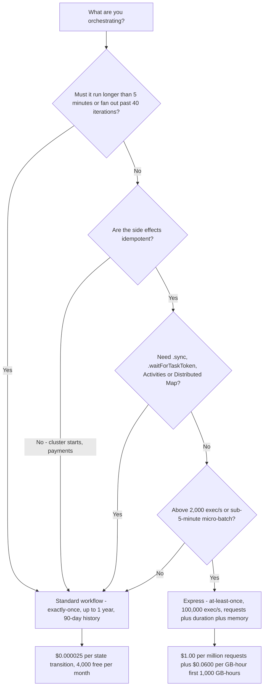
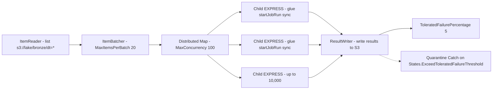
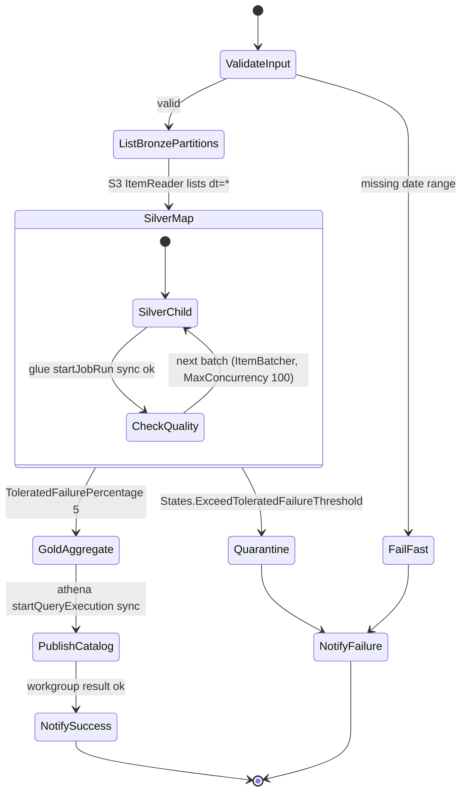
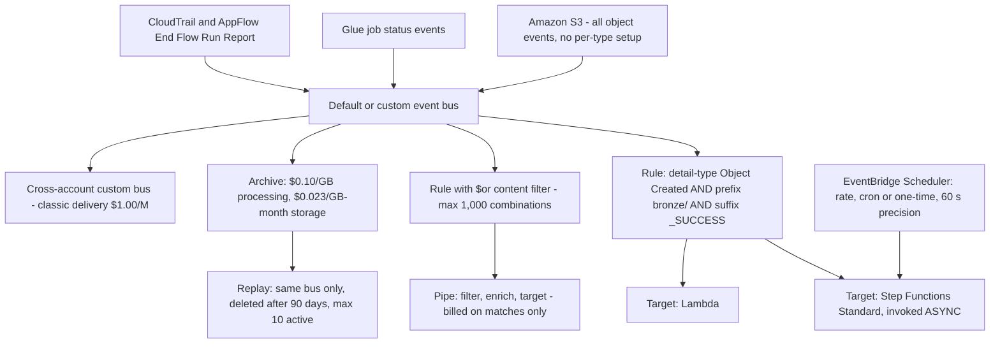
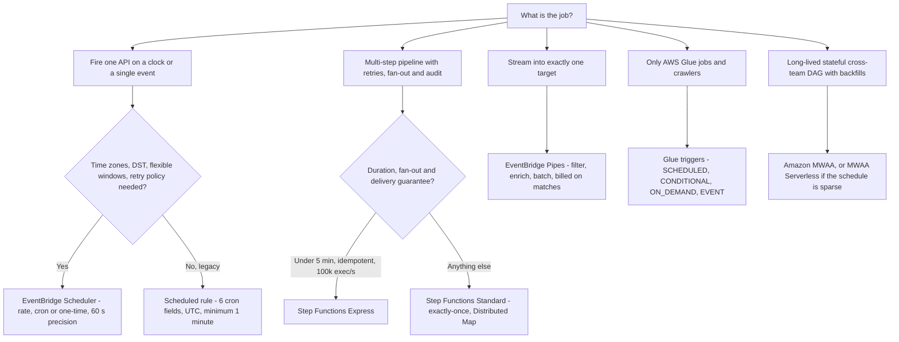

# Orchestrating the Lakehouse: Step Functions, EventBridge, and MWAA

Ten lessons in, you can land files, convert them, curate them into Iceberg, query them with Athena and hand the result to Redshift. None of that answers the four questions that decide whether the lakehouse is a product or a liability: **what starts the run, in what order do the steps run, what happens when a step fails, and how do you run it again without writing the same rows twice?** That is orchestration, and it is the layer where most lakehouse incidents actually live: not in the SQL.

The teaching rule for this lesson is short: **the orchestrator owns time, order, failure and replay; the compute owns bytes.** Keep those two jobs separate and every later design decision gets easier.

```text
====================================================================
 THE LAKEHOUSE ORCHESTRATION SURFACE - as of October 2026
====================================================================
 STEP FUNCTIONS .... Standard  - exactly-once, up to 1 year,
                                 2,000 exec/s, 4,000 transitions/s,
                                 $0.000025 per state transition,
                                 90-day history, Distributed Map OK
                      Express  - at-least-once (async), up to 5 minutes,
                                 100,000 exec/s, requests + duration +
                                 64 MB memory chunks, Request Response only
 EVENTBRIDGE ....... 4 bus types: default, custom (Classic 2019,
                                 enhanced Sep 2026), partner
                      rules    - 300/bus, 5 targets/rule, pattern 2,048 ch
                      Pipes    - source > filter > enrich > target,
                                 billed only on matches, 5-min ceiling
                      Scheduler- rate | cron | one-time, 60-second
                                 precision, flexible window 1-1,440 min
                      Archive  - processing $0.10/GB, storage
                                 $0.023/GB-month, replay $1.00/M
 AMAZON MWAA ........ always-on Airflow: mw1.micro ... mw1.2xlarge,
                      workers 1-25 (default 10), schedulers 2-5
                      (default 2), Airflow 3.3.1 since 2026-09-01,
                      MWAA Serverless GA 2025-11-17 at $0.08/task-hour
 GLUE WORKFLOWS ..... SCHEDULED | CONDITIONAL | ON_DEMAND | EVENT
                      triggers, <=100 components, 90-day run history
 NOT THIS ........... "sync" as a third workflow type - there are
                      exactly two: Standard and Express (immutable)
====================================================================
```

In this lesson you will:

- separate **Standard and Express** workflows on delivery guarantee, duration ceiling, rate, supported patterns and **cost per state transition**;
- read and write **Amazon States Language**: the eight state types, the three integration patterns, and Task resources for **Glue, EMR, Lambda and the AWS SDK**;
- choose between **inline `Map`** and **Distributed Map**, and size `ItemReader`, `ItemBatcher` and `ResultWriter`;
- use **`Parallel`**, **`Retry`**, **`Catch`**, **`TimeoutSeconds`** and **nested state machines** to isolate phases and route failures;
- wire **Amazon EventBridge** buses, event patterns, schedules, **Pipes with filtering and enrichment**, **API Destinations** and **Archive/Replay**;
- size an **Amazon MWAA** environment and recognise the **Airflow DAG patterns** that justify it;
- chain **AWS Glue Workflows and triggers**, including `EVENT` triggers started from EventBridge;
- make re-runs safe with **deterministic execution names, dedup, checkpoints and watermark handoff**;
- run a **backfill over date partitions** with a Distributed Map;
- apply a **scheduler decision matrix** and **least-privilege execution roles**;
- work a **bronze to silver to gold state machine with quarantine routing**, ten worked examples, a sourced **October 2026 update box**, **Transport for NSW** case material, three interactive checks and **fourteen exam-style questions**.

---

## 1. The orchestration surface: five tools, five jobs

### 1.1 The five primitives

Every orchestration question reduces to the same five primitives. Each one owns a different thing, and every design smell in this space is a primitive used for a job it does not own.

| Primitive | What it owns | AWS service | Section |
|---|---|---|---|
| **Deterministic multi-step state machines** | Order, retries, branching, fan-out, per-run audit history | **AWS Step Functions** | 2-5 |
| **Event reaction and time-based triggering** | Buses, patterns, schedules, Pipes, archives, cross-account routing | **Amazon EventBridge** | 6 |
| **Directed acyclic graphs with a backfill UI** | Task dependencies, checkpoint resume, catch-up windows, teams | **Amazon MWAA** (managed Apache Airflow) | 9 |
| **In-service DAG over one engine's own jobs** | Glue jobs and crawlers chained by triggers, one run status | **AWS Glue Workflows** | 10 |
| **Single fire of one API** | "Start this thing on a clock or on one event" | **EventBridge Scheduler / rules** | 6.3 |

The four prompts you must always answer before choosing: **What starts the run?** (schedule, event, API call, upstream success) **What order do steps run in?** (serial, parallel, fan-out, conditional) **What happens on failure?** (retry, catch, quarantine, alert) **How do you run it again without corrupting data?** (idempotent name, checkpoint, watermark, redrive).

- **📚 Did you know?** Step Functions can reach **"over 14,000 API actions from over 220 AWS services"** as of the AWS Compute Blog of 2025-11-04: an earlier AWS What's New post of 2022-12-01 put the same figure at *"over 200 AWS services"*. The number is a moving target, but the examinable fact is that the AWS SDK integration is the escape hatch for anything without an optimized integration (AWS Compute Blog, 2025-11-04; AWS What's New, 2022-12-01).

---

## 2. AWS Step Functions: Standard versus Express

### 2.1 Two workflow types, and no third one

There are exactly **two** state machine types: **Standard** (the default) and **Express**. The type is **immutable**: chosen at creation and never changed afterwards. The word "sync" names two *different* things and is the single most common confusion in this service:

1. the **`.sync` integration pattern** ("Run a Job"), where a **Standard** workflow calls a service and blocks until the job finishes; and
2. **Synchronous Express** (`StartSyncExecution`), where an Express execution is invoked synchronously from API Gateway, Lambda or the CLI and returns the result.

| Axis | **Standard** | **Express** |
|---|---|---|
| Delivery guarantee | **Exactly-once** execution | **At-least-once** (async) / **at-most-once** (sync) |
| Max duration | **1 year** | **5 minutes** |
| Execution rate | 2,000 per second | 100,000 per second |
| State transition rate | 4,000 per second | Nearly unlimited |
| Meter | **Per state transition** | Per request + duration + memory (64 MB chunks) |
| History | 90 days of execution history | CloudWatch Logs only |
| Distributed Map | **Supported** | Not supported |
| Activities | **Supported** | Not supported |
| `.sync` / `.waitForTaskToken` | **Supported** | Not supported: Request Response only |
| Best for | **Non-idempotent** actions (starting an EMR cluster, payments) | **Idempotent** actions (high-volume micro-batch) |

AWS states the rule without hedging: Standard Workflows *"follow an exactly-once model… suited to orchestrating non-idempotent actions, such as starting an Amazon EMR cluster or processing payments"*, while Express Workflows *"use an at-least-once model… better suited to orchestrating idempotent actions"* (Step Functions Developer Guide, accessed 2026-10-11).



> [!WARNING]
> **Express does not manage idempotency for you.** Standard Workflows *"automatically return an idempotent response on starting an execution with the same name as a currently-running workflow"*: Express does not, so two Express runs with the same name execute **concurrently** and can double-write. Also remember: Express supports **no** Distributed Map, **no** Activities, **no** `.sync` and **no** `.waitForTaskToken`. A "serverless fan-out" design that needs any of those four must be a Standard parent (Step Functions Developer Guide, accessed 2026-10-11).

### 2.2 Worked example E1: a nine-transition daily pipeline

AWS's own pricing example arithmetic, reproduced with the published rates (us-east-1, accessed 2026-10-11):

```text
Worked example E1 - one daily bronze to silver to gold run, 9 transitions
------------------------------------------------------------------------
  Happy path transitions per execution       =   9
  Executions per month (1/day x 30)          =  30
  Total transitions                          = 270
  Less the free tier                         = 4,000  -> 0 billable
  Bill                                       = $0.00

  Now run it 100,000 times per month:
  9 x 100,000                                = 900,000 transitions
  less 4,000 free                            = 896,000 billable
  896,000 x $0.000025                        = $22.40 / month
```

The free tier is **4,000 state transitions per month**, indefinite. Two lessons hide in that number: a *daily* pipeline almost never generates a Step Functions bill worth thinking about, and a *high-frequency* one does.

### 2.3 Worked example E2: the same pipeline, two meters

Fourteen states, 30,000 runs per month, no retries (derived from published rates, as of Oct 2026):

```text
Worked example E2 - Standard vs Express, same shape
---------------------------------------------------
 STANDARD
   14 states x 30,000 runs                = 420,000 transitions
   less 4,000 free                        = 416,000 billable
   416,000 x $0.000025                    = $10.40 / month

 EXPRESS (same shape, 12 s per run, 64 MB billed memory)
   requests: 30,000 / 1,000,000 x $1.00   =  $0.03
   duration: 30,000 x 12 s                = 360,000 s
             360,000 x 64 MB / 1024       = 22,500 GB-s
             22,500 / 3,600               = 6.25 GB-hours
             6.25 x $0.0600               =  $0.375
   total                                   =  ~$0.41 / month
---------------------------------------------------
 Express is ~25x cheaper HERE - and only valid if every
 side effect is idempotent and nothing exceeds 5 minutes.
```

Express bills duration **rounded up to the nearest 100 ms**, in **64 MB chunks**, and the memory footprint is computed as `50 MB + state machine definition size + execution data size x number of Parallel or Map steps`. The three duration tiers AWS prints in its own Example 4 are **$0.0600 per GB-hour** for the first 1,000 GB-hours, **$0.0300** for the next 4,000, and **$0.01642** thereafter (Step Functions Pricing, accessed 2026-10-11).

---

## 3. Amazon States Language and the Task layer

### 3.1 The eight state types

Amazon States Language (ASL) is a JSON-based document. The state types AWS lists are **`Task`**, **`Choice`**, **`Wait`**, **`Pass`**, **`Succeed`**, **`Fail`**, **`Parallel`** and **`Map`**: eight of them, and the whole of a state machine is these states wired together with `Next` and `End` fields (Step Functions Developer Guide, accessed 2026-10-11).

- **`Task`** does work (calls Lambda, starts a Glue job, puts an item in DynamoDB).
- **`Choice`** branches on input; **`Wait`** sleeps; **`Pass`** reshapes data.
- **`Succeed`** and **`Fail`** terminate the execution deliberately.
- **`Parallel`** fans out over branches **written into the definition**.
- **`Map`** fans out over a **dataset**: inline or Distributed (Section 4).

Three quotas bound the definition itself: maximum state machine definition size is **1 MB** (hard), maximum input or output size for a task, state or execution is **256 KiB** of UTF-8 encoded data, and maximum execution history size is **25,000 events** for a Standard workflow.

### 3.2 Three integration patterns, and which services get which

Every optimized integration can be invoked in one of three ways:

| Pattern | Suffix | What it does | Available on |
|---|---|---|---|
| **Request Response** (default) | *(none)* | Fire the API, return the API response immediately | Standard **and** Express |
| **Run a job** | `.sync` | Call the service and **block until the job finishes** | **Standard only** |
| **Wait for a callback** | `.waitForTaskToken` | Inject a task token, hand it to a worker, wait for `SendTaskSuccess` or `SendTaskFailure` | **Standard only** |

AWS's optimized-integration matrix splits the lakehouse services cleanly:

- **`.sync` supported:** `athena`, `batch`, `emr`, `emr-serverless`, `glue`, `glue:databrew`, `sagemaker`, `states` (nested Step Functions itself).
- **Request Response plus callback (`.waitForTaskToken`), no `.sync`:** `lambda`, `sns`, `sqs`, `dynamodb`, EventBridge.
- **AWS SDK integration:** Request Response across all supported services; `.waitForTaskToken` on Standard only; **never** `.sync`.

So the concrete Task resources you will actually write in a lakehouse state machine are:

```text
arn:aws:states:::glue:startJobRun.sync          # Glue, wait for the job
arn:aws:states:::emr:addStep.sync               # EMR cluster step
arn:aws:states:::emr-serverless:startJobRun.sync
arn:aws:states:::athena:startQueryExecution.sync
arn:aws:states:::lambda:invoke                   # Request Response
arn:aws:states:::dynamodb:putItem                # checkpoint / watermark
arn:aws:states:::states:startExecution.sync      # nested, returns STRING
arn:aws:states:::states:startExecution.sync:2    # nested, returns JSON
arn:aws:states:::states:startExecution.waitForTaskToken
arn:aws:states:<region>:aws-sdk:<service>:<ApiAction>   # 14,000+ actions
```

- **📚 Did you know?** `startExecution.sync` and `startExecution.sync:2` are **not** interchangeable: `.sync` returns the child's output **as a string**, `.sync:2` returns it **as JSON**. Parsing the wrong one silently corrupts every downstream `Payload.$` reference, and the failure shows up much later as a missing field rather than a deployment error (Step Functions Developer Guide, accessed 2026-10-11).

### 3.3 Worked example E3: the retry budget you forgot to cost

Retries are not free: *"Retries are treated as state transitions"*, and *"If you include retry error handling in any steps of your workflow, each retry will be charged as an additional state transition"* (Step Functions Pricing, accessed 2026-10-11).

```text
Worked example E3 - what a generous Retry block costs
-----------------------------------------------------
  Retry on one Glue Task state:
    IntervalSeconds: 5, MaxAttempts: 4, BackoffRate: 2.0
    JitterStrategy: FULL, MaxDelaySeconds: 30

  Wait times between attempts  = 5 s, 10 s, 20 s  (capped at 30 s)
  Extra transitions when the job succeeds first time : 0
  Extra transitions when all 4 attempts fail         : 4

  A 12-state machine, each state carrying that Retry block,
  10,000 executions per month, worst case:
    happy path       12 x 10,000                 = 120,000
    worst case adds  12 x 4 x 10,000             = 480,000
    total                                            600,000
    less 4,000 free                                596,000
    596,000 x $0.000025                            = $14.90

  Same machine with MaxAttempts: 0 on 6 of the 12 states
    6 x 10,000 + 6 x 4 x 10,000 = 300,000 - 4,000 = 296,000
    296,000 x $0.000025                          =  $7.40
```

`MaxAttempts: 0` means **never retry**: a valid, deliberate choice for a permanently failing step that should route straight to a `Catch`.

### 3.4 Retry, Catch, Timeout and Heartbeat: the exact defaults

| Field | Default | Notes |
|---|---|---|
| `IntervalSeconds` | **1** | First backoff wait |
| `MaxAttempts` | **3** | `0` = never retry |
| `BackoffRate` | **2.0** | Multiplicative |
| `JitterStrategy` | **`NONE`** | Accepts `FULL` or `NONE` |
| `MaxDelaySeconds` | *(unset)* | Must be greater than 0 and less than **31,622,401** |
| `TimeoutSeconds` | *(unset)* | Bounds a task; Standard overall cap is 1 year, Express 5 minutes |
| `HeartbeatSeconds` | *(unset)* | Detects a stalled worker via `SendTaskHeartbeat` |

Built-in error names you must not mix up:

- **`States.ALL`**: must appear **alone** in a `Catcher` and **cannot** catch `States.DataLimitExceeded` or `States.Runtime`.
- **`States.TaskFailed`**: a wildcard for any known error **except** `States.Timeout`.
- **`States.Timeout`**, **`States.HeartbeatTimeout`**, **`States.Permissions`**, **`States.ItemReaderFailed`**, **`States.ResultWriterFailed`**, **`States.ExceedToleratedFailureThreshold`**.
- **`States.DataLimitExceeded`** is **terminal**: a task that emits a payload above **256 KiB** dies and no catcher attached to that state can save it.

Three structural rules that catch experienced engineers:

1. **Catchers exist on `Task`, `Parallel` and `Map` only**: *"not for top-level state machine execution failures"*. A whole-execution failure must be handled by the **caller**, a **nested workflow**, or an **EventBridge rule on execution status** (`FAILED` / `TIMED_OUT`).
2. If a **nested state machine** throws a `States.Timeout`, the parent receives **`States.TaskFailed`** instead.
3. In newer Lambda runtimes, timeouts surface as **`Sandbox.Timedout`**: match on `Lambda.Unknown`, `Sandbox.Timedout` **and** `States.TaskFailed` together.

### 3.5 Activities: the callback lane that waits up to a year

Activities are a **Standard-only** construct: an activity worker polls with `GetActivityTask`, keeps the task alive by sending a heartbeat with `SendTaskHeartbeat` inside the configured `TimeoutSeconds`, and replies with `SendTaskSuccess` or `SendTaskFailure`. With heartbeats, *"an activity in Step Functions can wait up to a year for an execution to complete"*. After the task times out, Step Functions **invalidates the task token** and later calls raise `TaskTimedOut`.

### 3.6 Nested workflows: phases with their own history and retries

Four resources control nesting: `states:startExecution` (fire and forget), `.sync` (wait, string output), `.sync:2` (wait, JSON output), `.waitForTaskToken` (callback). Nesting buys **per-phase history isolation**, **per-phase retries** and **reuse**, but the parent must be able to *find out* that the child finished, and that detection has two paths with two different permission sets:

- **polling**: needs `states:DescribeExecution`;
- **EventBridge events**: needs `events:PutTargets`, `events:PutRule` and `events:DescribeRule`.

Omit the second set and the parent **hangs** rather than failing loudly, which is the classic symptom.

### 3.7 Worked example F1: filling in a real ASL fragment

```fillblank
{
  "question": "Complete the Amazon States Language and error-handling statements with the exact keyword, value or resource (all as of Oct 2026):",
  "template": "A Task state that starts an AWS Glue job and blocks until the job finishes uses the resource {{1}}. A Task state that injects a token and waits for an external worker to reply uses the {{2}} integration pattern. The Retry defaults are IntervalSeconds {{3}}, MaxAttempts {{4}} and BackoffRate {{5}}, and a Catcher may be attached to Task, Parallel and Map states only: never to a top-level state machine execution failure.",
  "answers": {
    "1": "arn:aws:states:::glue:startJobRun.sync",
    "2": ".waitForTaskToken",
    "3": "1",
    "4": "3",
    "5": "2.0"
  },
  "distractors": [
    "arn:aws:states:::glue:startJobRun",
    "StartSyncExecution",
    ".sync:2",
    "0",
    "10",
    "1.5",
    "3.0"
  ],
  "explanation": "Waiting on a Glue job is the .sync 'Run a job' pattern, so the resource carries the .sync suffix and is available on Standard workflows only; .waitForTaskToken is the separate callback pattern used by Lambda, API Gateway, ECS and activities. Retry defaults published in the developer guide are IntervalSeconds 1, MaxAttempts 3 and BackoffRate 2.0, with JitterStrategy NONE. The plain glue:startJobRun resource is Request Response (returns when the job is submitted), .sync:2 belongs to nested state machines and returns JSON rather than a task token, and 0 means never retry."
}
```

---

## 4. Map, Distributed Map, Parallel and ItemBatcher

### 4.1 When inline `Map` stops being enough

`Parallel` iterates over branches **fixed in the definition**; `Map` iterates over a **dataset**. Inline (default) `Map` runs its iterations inside the *parent's* execution history, and that creates three hard ceilings:

| Constraint | Inline `Map` | **Distributed `Map`** |
|---|---|---|
| Concurrent iterations | **40** | Up to **10,000** parallel child executions |
| History | Shares the parent's **25,000-event** history | Each child has its own history |
| Dataset size | Must fit in **256 KiB** payload | Read from **S3** via `ItemReader` |
| Workflow type | Standard or Express | **Standard only** |
| Result output | In the execution result | Written to S3 via `ResultWriter` |

AWS's own stated conditions for switching: use Distributed mode when *"the size of your dataset exceeds 256 KiB"*, *"the workflow's execution event history would exceed 25,000 entries"*, or *"you need a concurrency of more than 40 concurrent iterations"* (Step Functions Developer Guide, accessed 2026-10-11).

> [!IMPORTANT]
> **Distributed `Map` is a Standard-workflow-only feature.** AWS prints an explicit warning: *"Distributed mode is supported in Standard workflows but not supported in Express workflows."* Plan the parent accordingly, and note that a Distributed Map's `Retry` block, when it fires, **creates a new Map Run**, so a retry-happy Map quietly re-runs every child. Cap `MaxAttempts` and prefer **redrive** for whole-Map replays: redrive is Standard-only and only available within the **14-day** execution redrivable period.

Distributed Map specifics worth committing to memory:

- `ItemReader` sources: **S3 objects** (CSV, JSON, JSONL, **Parquet**), or **an Athena data manifest**: the 2025-11-04 Compute Blog confirms Distributed Map can *"process AWS Athena data manifest and Parquet files directly, eliminating the need for custom pre-processing"*.
- `ExecutionType` on children: **`STANDARD`** or **`EXPRESS`**: use EXPRESS children for short, idempotent fan-out units.
- `MaxConcurrency` / `MaxConcurrencyPath`: if unset or zero, Step Functions *"doesn't limit concurrency and runs 10,000 parallel child workflow executions"*, and AWS recommends not exceeding the capacity of a downstream service such as Lambda.
- `ToleratedFailureCount` / `ToleratedFailurePercentage` / their `...Path` variants: **the default percentage is zero**, meaning *"the workflow fails if any one of its child workflow executions fails or times out"*. Exceeding the threshold raises **`States.ExceedToleratedFailureThreshold`**, which needs its own `Catch`.
- Quotas: **1,000** open Map Runs per account/Region, **1,000** redrives per Map Run, **10,000** parallel child executions per Map Run (hard), and Step Functions dispatches express children at up to **1,000 TPS** and standard children at up to **100 TPS**.

### 4.2 `ItemBatcher`: the cheapest lever you have

`ItemBatcher` groups items so each child receives `{"Items": [...]}` plus an optional static `BatchInput`. Two knob pairs: `MaxItemsPerBatch` / `MaxItemsPerBatchPath`, and `MaxInputBytesPerBatch` / `MaxInputBytesPerBatchPath`: the byte ceiling is **256 KiB**, the Step Functions payload limit itself.

AWS's own worked figure: *"imagine you run an execution with an input JSON file that contains 1130 nodes. If you specify a maximum items value for each batch of 100, Step Functions creates 12 batches"* (Step Functions Developer Guide, accessed 2026-10-11). Use batching *"when processing large CSV files or JSON arrays, or large sets of Amazon S3 objects."*

### 4.3 Worked example E4: batching arithmetic and its billing effect

```text
Worked example E4 - 1,130 bronze objects, three shapes
------------------------------------------------------
 SHAPE A - no batching, one child per object
   children                                = 1,130
   ~6 transitions each                     = 6,780 transitions
   6,780 x $0.000025                       = $0.17

 SHAPE B - MaxItemsPerBatch: 100
   children                                = 12      (AWS's own figure)
   12 x 6                                  = 72 transitions
   72 x $0.000025                          = $0.0018

 SHAPE C - MaxInputBytesPerBatch: 262144
   batches shrink whenever 100 items would exceed 256 KiB,
   so the real batch count is min(item cap, byte cap)

 ORCHESTRATION-ONLY SAVING A -> B            = ~90x
 (Glue DPU-hours are billed separately and do not change)
```

- **📚 Did you know?** The Distributed Map observability metrics announced on 2025-09-18, **`ApproximateOpenMapRunsCount`**, **`OpenMapRunLimit`** and **`ApproximateMapRunsBacklogSize`**, exist because fan-out depth is otherwise invisible until you hit the 1,000-open-Map-Run quota. Alarm on the backlog metric before the limit, not after (AWS What's New, 2025-09-18; AWS Compute Blog, 2025-11-04).



### 4.4 Sample projects worth reading before you build one

Two AWS sample projects make good teaching fixtures: a **weather data** pipeline where *"weather data is recorded in over 12,000 CSV files"* with `MaxConcurrency` set at **3,000**, copying then analyzing then reducing into DynamoDB; and a **CSV shipping-orders** pipeline of *"10,000 rows of a CSV file"* processed in **batches of 10** with `MaxConcurrency` **1,000**, results written to S3 through `ResultWriter` (Step Functions sample projects, accessed 2026-10-11).

---

## 5. A worked lakehouse state machine: bronze to silver to gold

This is the shape you should be able to draw from memory. A **Standard** parent hosts a **Distributed Map** (Express could not), children run as **EXPRESS** executions with `MaxConcurrency: 100` so Glue's account-level job concurrency is never starved, and partial failure routes to quarantine instead of failing silently.



Teaching notes, all of them load-bearing:

1. **`SilverMap` must be Distributed**: an inline Map's 40-iteration cap and shared 25,000-event history will kill a multi-thousand-partition run.
2. **`ItemBatcher.MaxItemsPerBatch: 20`** turns thousands of files into tens of children. Children are the unit of **both** parallelism and billing.
3. **`Retry` on the Map creates a new Map Run**: cap `MaxAttempts`, and use **redrive** (14-day window, Standard only) for whole-Map replays.
4. **`Catch` on `States.ExceedToleratedFailureThreshold`** routes partial failure to quarantine. Without it, a threshold breach is an unhandled execution failure.
5. **The watermark is written last.** Record `s3://lake/_checkpoints/silver/dt=2026-10-11.json` only after `PublishCatalog` succeeds; that is what makes re-triggering the same day idempotent.
6. **Quarantine is a destination, not a state.** Land the failing partition keys somewhere a human or a ticket system can see them.
7. **`ValidateInput` is a `Choice` state**, and the `FailFast` branch ends in a `Fail` state: an early, cheap exit beats discovering a bad date range three hours into a fan-out.

### 5.1 Worked example E5: pricing this exact machine

```text
Worked example E5 - the state machine above, one daily run
----------------------------------------------------------
 PARENT (Standard)
   ~16 transitions per execution x 31 runs   =   496
 MAP (Distributed) - 90 partitions in the window
   90 / 20 per batch  =  5 children (round up)
   child overhead ~6 transitions each        =   30
 RESULT WRITER / publish / notify            =   ~10
 -------------------------------------------------------
 total                                       =  ~536 transitions/month
 less 4,000 free                             =       0 billable
 ORCHESTRATION BILL                          =  $0.00 / month

 The Glue DPU-hours and Athena scan charges are the real bill.
 Orchestration is the cheap layer - design it for correctness,
 not to save pennies.
```

That is the single most important cost lesson in this lesson: **Step Functions is a rounding error next to the compute it schedules.** Optimise for failure routing and replay safety, not for transition count: with the single exception of unbounded retry policies (Section 3.3).

---

## 6. Amazon EventBridge for the lakehouse

### 6.1 Buses, rules, quotas

AWS gives every account a **default event bus** that receives AWS service state-change events (management events ingest free; opt-in **data events** such as S3's must be enabled). The pricing page describes **four types of event bus**: the default bus; **two custom buses**, *Custom event bus: Classic* (July 2019) and an **enhanced Custom event bus launched in September 2026**, and a **partner event bus** for SaaS vendor events (Amazon EventBridge Pricing, accessed 2026-10-11).

| Quota | Value (as of Oct 2026) |
|---|---|
| Rules per event bus | **300** default (adjustable; 100 in af-south-1 and eu-south-1) |
| Event buses per account/Region | **100** |
| Targets per rule | **5**: *not adjustable* |
| Event pattern size | **2,048** characters |
| Wildcard-containing rules per bus | **30**: *not adjustable* |
| API Destinations / connections / endpoints | 3,000 / 3,000 / 100; **300 invocations per second** per destination |

### 6.2 Event patterns

Patterns match on `source`, `detail-type`, `account`, `region` and `detail`, with the operator set **`And`**, **`anything-but`** (including prefix, suffix, ignore-case and wildcard forms), **`prefix`**, **`suffix`**, **`empty`**, **`equals-ignore-case`**, **`exists`**, **`null`**, **`numeric`** ranges, **`$or`**, **`wildcard`** and **`cidr`**. Two sharp edges: *"Currently the wildcard character is supported in event bus rules only"*, and any pattern where **`$or`** expands to more than **1,000 rule combinations** makes `PutRule`, `CreateArchive`, `UpdateArchive` and `TestEventPattern` throw **`InvalidEventPatternException`** (EventBridge User Guide, accessed 2026-10-11).

### 6.3 Schedules: legacy rules versus EventBridge Scheduler

Scheduled **rules** are explicitly *"a legacy feature of EventBridge"* and AWS *"recommend[s] that you use Scheduler to invoke targets on a schedule"*. Legacy cron has **six required fields** (minutes, hours, day-of-month, month, day-of-week, year) and *"Cron expressions that lead to rates faster than 1 minute are not supported"*; everything runs in **UTC**.

**EventBridge Scheduler** is the current answer: three schedule types, **rate-based, cron-based and one-time**, with *"60 second precision"*, automatic **daylight-saving-time** handling (on a spring-forward gap the invocation is **skipped**), **flexible time windows** of **1 to 1,440 minutes**, retry and event-age policies, and templated targets across hundreds of AWS services. Quotas: **10,000,000** schedules per Region, **5,000 TPS** `CreateSchedule`, **1,000 TPS** invocations.

**Pricing:** **$1.00 per million invocations** after **14,000,000 free invocations per month** (EventBridge Pricing, accessed 2026-10-11).

> [!WARNING]
> **Schedule is not exactly-once.** Scheduler has 60-second precision and, if you enable it, a flexible window of up to 1,440 minutes; delivery to targets is at-least-once. Never assume a cron fired once; that is precisely why every scheduled state machine needs a **deterministic execution name** (Section 7).

### 6.4 Pipes: source to filter to enrich to target

A pipe is *"choose the source, add optional filtering, define optional enrichment, and choose the target"*: with ordering preserved when the source enforces it, batching, partial-failure reporting, and its own IAM role under **`pipes.amazonaws.com`**.

- **Sources:** DynamoDB Streams, Kinesis streams, Amazon MQ, MSK, SQS, and Apache Kafka (self-managed, Confluent Cloud, CloudKarafka, Redpanda). Do not treat any published list as exhaustive: the AWS docs page is the authority.
- **Targets:** API destination, API Gateway, Batch job queue, CloudWatch log group, ECS task, same-account and same-Region event bus, Firehose delivery stream, Kinesis stream, Lambda (SYNC or ASYNC), Redshift Data API queries, SageMaker AI pipelines, SNS topic (FIFO not supported), SQS queue, **Step Functions** (Express SYNC or ASYNC; **Standard must be ASYNC**), Timestream.
- **Payload ceilings:** Pipes accept **6 MB**, but the target constrains you: an event bus target is **1 MB** and a Step Functions state machine target **256 KB**. Enrichment output above the target's limit fails the invocation.
- **Batch sizes are the minimum of source and target:** Kinesis allows **10,000**-record batches, SQS targets only **10**, Firehose and Kinesis **500**, CloudWatch Logs **10,000**, event bus **10**, SNS **10**, so the pipe caps at the smaller number.
- **Pipe execution ceiling:** **5 minutes** including enrichment and target processing: *"This limit currently can't be increased."*
- **Concurrency defaults:** SQS **1,250**; Kafka up to the partition count (**max 1,000**); Amazon MQ **5**; Kinesis and DynamoDB = `ParallelizationFactor` multiplied by the number of shards.
- **Partial batch failure** uses the payload shape `{"batchItemFailures": [{"itemIdentifier": "id2"}]}`.
- **Billing:** *"You are only charged for those events that match the filter"*: **$0.40 per million** requests, measured in 64 KB chunks, post-filter.

### 6.5 API Destinations, Archive and Replay

**API Destinations** let a rule call an external HTTP endpoint over an AWS-managed connection: **$0.20 per million events**, with 3,000 destinations and 3,000 connections per account/Region and 300 invocations per second per destination.

**Archive and Replay** is the lake's event black box. *"By default, EventBridge stores events in the archive indefinitely"*; *"Replaying events does not remove them from the archive… EventBridge only removes events when they exceed the archive retention period, or you delete the archive itself"*; replays are **deleted after 90 days**; you may have at most **10 active concurrent replays** per account per Region; and *"you can replay events only to the same event bus that emitted the events."*

### 6.6 The lakehouse event path: S3 straight into EventBridge

Once EventBridge is enabled, S3 delivers every object-level event without per-type configuration: a rule filters `source: aws.s3`, `detail-type: Object Created`, the bucket name, a `prefix` of `bronze/orders/` and a `suffix` of `_SUCCESS`, and targets a state machine, a Pipe, a Lambda function or an SQS queue. This replaces per-type S3 event notifications plus a Lambda fan-out when you need many consumers, content filtering, archives and cross-account routing.

### 6.7 Worked example E6: the event-driven lake bill

```text
Worked example E6 - 5,000,000 S3 Object Created events per month
-----------------------------------------------------------------
 PATH 1 - classic custom bus, one rule -> Lambda (same account)
   ingest        5,000,000 / 1,000,000 x $1.00   = $5.00
   same-account delivery                        = $0.00
   total                                        = $5.00 / month

 PATH 2 - a Pipe with a 20% match, batches of 10
   matched events   5,000,000 x 0.20            = 1,000,000
   requests         1,000,000 / 10              =   100,000
   100,000 / 1,000,000 x $0.40                  =     $0.04

 PATH 3 - add an Archive of everything
   5,000,000 x 1 KB  = ~4.77 GB
   processing        4.77 x $0.10               =     $0.48
   storage (1 month) 4.77 x $0.023              =     $0.11
   full replay       5,000,000 / 1,000,000 x $1.00 =  $5.00
-----------------------------------------------------------------
 All arithmetic derived from published rates (as of Oct 2026).
 Note the three DIFFERENT meters: per-event chunks, per-GB in/out,
 per-request post-filter. Never mix them in one unlabelled table.
```

- **📚 Did you know?** S3 does not make you enumerate event types. Once EventBridge is enabled on the account, *"you don't need to select which event types you want to deliver"*: all of them flow, including *Object Created*, *Object Deleted*, *Restore Initiated / Completed / Expired*, *Storage Class Changed*, *Object Tags Added/Deleted*, *Retention Updated* and *Annotation Created/Removed*. The filter belongs in the **rule**, not in a per-type notification configuration (Amazon S3 User Guide, accessed 2026-10-11).



---

## 7. Idempotent orchestration: surviving the second run

### 7.1 Four mechanisms, in the order you build them

| # | Mechanism | What it gives you |
|---|---|---|
| 1 | **Deterministic execution naming** | Standard Workflows *"automatically return an idempotent response on starting an execution with the same name as a currently-running workflow"*: duplicate triggers collapse |
| 2 | **Exactly-once semantics where it matters** | Standard for **non-idempotent** side effects (EMR cluster start, payments); Express is at-least-once, so writers must tolerate a second call |
| 3 | **Idempotent writers** | Staging prefix plus atomic promote, dynamic partition overwrite, Iceberg `MERGE`: the data-plane defence the orchestrator cannot provide |
| 4 | **Checkpoint and watermark handoff** | Persist the watermark **after** the layer commits; the next layer reads it as its start bound |

Names are **unique per account and Region**, capped at **80 characters**, and execution history is retained **90 days** (reducible to 30 by quota request). A practical daily pattern:

```text
  Execution name = "<layer>-<partition-date>-<source>"
  e.g. "bronze-2026-10-11-orders"
       "silver-2026-10-11-orders"

  - duplicate EventBridge delivery of the same marker  -> absorbed
  - a genuinely new partition date                      -> new execution
  - re-trigger by hand on the same date                 -> idempotent no-op
```

### 7.2 Checkpoints and watermark handoff

Step Functions does **not** track data watermarks; this is an engineering pattern built on verified primitives, not a managed feature. Persist the watermark **after** the commit, in one of: a **DynamoDB item**, an **S3 marker object** such as `_checkpoints/silver/dt=2026-10-11.json`, an **Iceberg snapshot id**, or a **Glue job bookmark**. The reader must then take its start bound from that watermark, which makes re-reading a closed window a no-op rather than a duplicate write.

Three cheap determinism rules complete the picture: derive object keys and context identifiers from `(layer, partition_date, source)`; keep every downstream `Payload` field referenced through `.$` paths rather than assumed; and make the success marker the *only* thing a downstream rule filters on, so a partial write can never masquerade as completion.

### 7.3 Worked example E7: designing the safe re-run

```text
Worked example E7 - a duplicate S3 marker arrives at 02:00 and 02:00:04
------------------------------------------------------------------------
 02:00:00  PutObject bronze/orders/dt=2026-10-11/_SUCCESS
 02:00:01  EventBridge rule fires -> StartExecution
           Name = "bronze-2026-10-11-orders"
           State machine starts (Standard: exactly-once)
 02:00:04  Redelivered event -> StartExecution, SAME name
           Step Functions returns the idempotent response for the
           currently-running execution - no second run
 02:14:00  Job writes silver rows to a STAGING prefix keyed by
           (layer, partition_date, source) - deterministic keys
 02:15:00  Atomic promote / Iceberg MERGE - second call converges
 02:15:01  Watermark written to _checkpoints/silver/dt=2026-10-11.json
           ONLY AFTER commit succeeds
 09:00:00  Human re-runs the same execution name
           -> watermark already covers the window -> reader no-ops
```

> [!IMPORTANT]
> **Idempotency is layered, not a single switch.** Execution-name dedup only works on **Standard**; it does nothing on Express. Deterministic keys only help if the *writer* honours them. A watermark only helps if it is written **after** the commit, never before. Remove any one of the three layers and the other two stop protecting you.

### 7.4 Ordering the idempotent pipeline

```dragdrop
{
  "question": "Order the steps of a re-runnable (idempotent) lakehouse pipeline, from trigger to a safe watermark:",
  "items": [
    "Start the run with a deterministic execution name derived from layer, partition date and source: duplicate triggers on a Standard workflow are absorbed",
    "List exactly one window of input using a deterministic prefix or manifest, never a live unbounded listing",
    "Write outputs to a deterministic staging prefix keyed by layer, partition date and source so a second write lands on the same keys",
    "Commit atomically: dynamic partition overwrite, an Iceberg MERGE, or a staging-prefix promote: so a repeated call converges instead of appending",
    "Emit a success marker or _SUCCESS object that downstream event rules can filter on",
    "Persist the watermark or checkpoint AFTER the commit, so a failure between commit and checkpoint only causes a harmless re-read",
    "Have the next layer read the watermark as its start bound, making any replay of a closed window a no-op"
  ],
  "correctOrder": [
    "Start the run with a deterministic execution name derived from layer, partition date and source: duplicate triggers on a Standard workflow are absorbed",
    "List exactly one window of input using a deterministic prefix or manifest, never a live unbounded listing",
    "Write outputs to a deterministic staging prefix keyed by layer, partition date and source so a second write lands on the same keys",
    "Commit atomically: dynamic partition overwrite, an Iceberg MERGE, or a staging-prefix promote: so a repeated call converges instead of appending",
    "Emit a success marker or _SUCCESS object that downstream event rules can filter on",
    "Persist the watermark or checkpoint AFTER the commit, so a failure between commit and checkpoint only causes a harmless re-read",
    "Have the next layer read the watermark as its start bound, making any replay of a closed window a no-op"
  ],
  "explanation": "The ordering is what makes it safe, not any single step. Dedup collapses duplicate triggers first; deterministic listing bounds the window; deterministic staging keys make the writer repeatable; the atomic commit is the point of no double-write; the marker is what event rules filter on; and the watermark is written strictly last so that a crash before it merely re-reads data the commit already made idempotent. Writing the watermark before the commit is the one inversion that converts a crash into silent data loss."
}
```

---

## 8. Backfill with a Distributed Map over date partitions

Backfill is where the Distributed Map stops being a curiosity and becomes the cheapest tool you own: one parent execution, hundreds of date-partition children, concurrency bounded by what Glue can actually absorb.

### 8.1 Worked example E8: a 90-day backfill

```text
Worked example E8 - rebuild 90 daily partitions
        dt=2026-07-13 ... dt=2026-10-10
---------------------------------------------------------------------------------
 INPUT
   90 partition prefixes, ~40 Parquet files each  = 3,600 objects

 CONFIGURATION
   ItemReader          : S3 objects under the bronze prefix
   ItemBatcher         : MaxItemsPerBatch = 5
   children            : 3,600 / 5              = 720 child workflows
   MaxConcurrency      : 100   (Glue job ceiling, not 10,000)
   ExecutionType       : EXPRESS  (each child under 5 min, idempotent)
   child body          : glue:startJobRun.sync on one partition-day
   ToleratedFailurePercentage : 5  ->  720 x 0.05 = 36 tolerated failures
                             exceeding it raises
                             States.ExceedToleratedFailureThreshold

 TRANSITIONS (derived, as of Oct 2026)
   parent overhead                          ~     8
   720 children x ~6 transitions            ~ 4,320
   total                                    ~ 4,328
   4,328 x $0.000025                        ~   $0.11 per backfill

 Compare: 3,600 unbatched children x 6 = 21,600 x $0.000025 = $0.54
 Batching cut the orchestration bill by ~5x; Glue DPU-hours dominate
 either way.
```

Three rules for production backfills:

1. **Bound `MaxConcurrency` to the downstream service.** AWS's own guidance: *"we recommend that you don't exceed the capacity of a downstream AWS service, such as AWS Lambda"*, and 10,000 children at once will hit Glue's account job quota instantly.
2. **Set `ToleratedFailurePercentage` deliberately.** The default is **zero**, so one corrupt partition fails the whole Map Run.
3. **Prefer redrive over `Retry` on a Map.** Retrying a `Map` state *"creates a new Map Run"*; redrive reuses the existing one within the 14-day window.

- **📚 Did you know?** A backfill is also the cheapest way to *test* your idempotency design: re-run a window that is already committed and watch whether the writer converges or appends. If the second run changes row counts, your watermark handoff is broken *before* an incident finds it for you.

---

## 9. Amazon MWAA: managed Airflow for the lakehouse

### 9.1 What an environment actually is

Amazon MWAA runs Apache Airflow on **AWS Fargate**, workers, schedulers and a web server, backed by a **single-tenant Aurora PostgreSQL metadata database in your own VPC**, with DAGs and plugins stored in an S3 bucket. Sizes run `mw1.micro`, `mw1.small`, `mw1.medium`, `mw1.large`, `mw1.xlarge` and `mw1.2xlarge`. Auto-scaling: **workers 10 default / 1 minimum / 25 maximum**, scaling back to minimum when queued plus running tasks stay at zero for more than two minutes; **schedulers 2 default / 2 minimum / 5 maximum**.

AWS's sizing advice is blunt: *"We recommend choosing the smallest size necessary to support your workload."*

| Class | Environment $/hour | Worker $/hour | Scheduler $/hour | Web server $/hour |
|---|---|---|---|---|
| `mw1.micro` | $0.29 |: |: |: |
| `mw1.small` | $0.49 | $0.055 | $0.055 | $0.055 |
| `mw1.medium` | $0.74 | $0.11 | $0.11 | $0.055 |
| `mw1.large` | $0.99 | $0.22 | $0.22 | $0.11 |
| `mw1.xlarge` | $1.98 | $0.44 | $0.44 | $0.22 |
| `mw1.2xlarge` | $3.96 | $0.88 | $0.88 | $0.44 |

Metadata database storage: **$0.10 per GB-month**. All rates US East (N. Virginia) from the AWS Price List offer file published 2026-09-11, accessed 2026-10-11. `mw1.xlarge` gives **8 vCPU / 24 GB** for scheduler and worker with a **40-task** default and up to **2,000 DAGs**; `mw1.2xlarge` gives **16 vCPU / 48 GB**, **80 tasks**, **4,000 DAGs**; an environment size upgrade takes **20 to 30 minutes** to complete.

You pay *"for the time your Airflow Environment runs plus any additional auto-scaling"*, billed at **one-second resolution**; which is why the environment rate, not the worker rate, dominates the bill.

### 9.2 Version hygiene

As of October 2026 MWAA offers Airflow **3.3.1** (available since 2026-09-01, Python 3.12), **3.2.1** (2026-05-19), **2.11.2** (2026-07-23), **2.11.0** (2026-01-07) and **3.0.6** (2025-10-01). **Effective December 30, 2025, Amazon MWAA ended support for Apache Airflow versions v2.4.3, v2.5.1 and v2.6.3.** AWS commits to supporting at least **three minor versions** at any given time, at least **12 months** per version, with **180 days** of end-of-support announcement.

Two constraints that bite: MWAA supports **minor**-version upgrades in place, *"but not to a new major version"*, so Airflow 2 to 3 is a migration, not an upgrade, and from Airflow **v2.7.2** onward your requirements file must include a `--constraint` statement. AWS also documents that *"Amazon MWAA does not currently support multi-team mode."*

### 9.3 Which lakehouse DAG patterns MWAA earns

Airflow earns its always-on cost in exactly four situations:

1. **Checkpoint resume over long windows.** AWS's own MWAA-versus-Step-Functions blog of 2026-06-10 frames MWAA around *"resume from the last successful checkpoint"* for *"long-running processes extending 2-12 hours"* over *"5-10 TB of financial transaction data daily"*, against Step Functions' *"built-in retry logic with exponential backoff"* and *"parallel execution"*.
2. **Human-readable cross-team DAGs** with `catchup` semantics, sensors and a UI for backfills.
3. **Seasonal or parameterised backfills** where an analyst picks a date range and expects a progress view.
4. **Heterogeneous task types**, ECS, Bash, Python, external APIs, under one dependency graph.

### 9.4 Worked example E9: MWAA versus Step Functions per month

```text
Worked example E9 - 8 useful hours per day, 31-day month (as of Oct 2026)
-------------------------------------------------------------------------
 AMAZON MWAA - medium environment
   environment   744 h x $0.74                 = $550.56
   workers       2 x 8 h x 31 = 496 h x $0.11  =  $54.56
   metadata DB   10 GB x $0.10                 =   $1.00
   total                                         $606.12 / month
   -> most of that bill runs whether or not a DAG executes

 AWS STEP FUNCTIONS - Standard, same cadence
   60 states x 62 runs                          =  3,720 transitions
   3,720 x $0.000025 (under the 4,000 free)    =    $0.09 / month
   compute (Glue / Lambda) is identical in both columns

 VERDICT: MWAA buys UI, sensors, catchup, backfill ergonomics and
 cross-team DAG legibility. Step Functions buys pay-per-run.
 Neither bill includes the compute.
```

AWS's own large-environment example lands at **$1,047.46 per month**, of which the environment ($736.56) plus schedulers ($163.68) is roughly **86% fixed cost**; which is exactly the gap MWAA Serverless addresses. A **once-a-day** pipeline on a medium environment costs **744 x $0.74 = $550.56 per month before a single worker runs**.

- **📚 Did you know?** **MWAA Serverless** (GA **2025-11-17**, available in 15 AWS regions at launch) is a *separate deployment option*, not a size tier: workflows are defined in **YAML** (a Python DAG converted to YAML), started with **`start-workflow-run`**, scoped by per-workflow IAM, and billed *"per task for its duration, for a minimum of 1 minute"* at **$0.08 per hour** for the AWS-managed task: with *"Automatic scaling based on workflow demand"* and no environment to size at all (Amazon MWAA Serverless User Guide; AWS Big Data Blog, 2025-11-17).

---

## 10. AWS Glue Workflows and event triggers

Glue can orchestrate **itself** without Step Functions. *"A trigger fires on demand, based on a schedule, or based on a combination of events"*, with `Type` values **`SCHEDULED`**, **`CONDITIONAL`**, **`ON_DEMAND`** and **`EVENT`**.

| Detail | Rule (accessed 2026-10-11) |
|---|---|
| Watched job states | `SUCCEEDED` / `STOPPED` / `FAILED` / `TIMEOUT` |
| Watched crawler states | `SUCCEEDED` / `FAILED` / `CANCELLED` |
| Crawlers per trigger | **Only two** |
| Dependency chains | All jobs and crawlers in a chain must descend from a **single scheduled or on-demand** trigger |
| Workflow size | **100 or fewer** jobs, crawlers and triggers in one workflow |
| `EVENT` trigger batching | `EventBatchingCondition` = number of events plus a time delay; the batch window defaults to **15 minutes** |
| Start triggers | Schedule, On demand, **EventBridge event**: any EventBridge event type can start a workflow |
| Run history | **90 days** |

Four pitfalls worth memorising:

1. **Conditional triggers only see runs a trigger started.** If a job was started some other way, its completion never fires the conditional trigger.
2. **An EventBridge-started workflow run that fails consumes its event**: *"that event or batch of events is no longer considered for starting a workflow run"*, and there is no redelivery.
3. **Glue does not retry workflow runs that fail due to exceeded concurrency limits.**
4. **Crawlers and jobs are not interchangeable inside one trigger**: the two-crawler cap is a hard rule, and exceeding 100 components can break resume and stop operations.

### 10.1 Worked example E10: Glue-only chain versus Step Functions

```text
Worked example E10 - the same 4-step pipeline, two orchestration layers
-----------------------------------------------------------------------
 (a) GLUE WORKFLOW
     Schedule trigger -> Job A -> CONDITIONAL (SUCCEEDED) -> Job B
                       -> CONDITIONAL (SUCCEEDED) -> Crawler
     components : 1 trigger + 2 jobs + 1 crawler   = 4  (under 100)
     failure routing : none inside a trigger - the chain simply stops
     retry           : per-job only, no backoff policy at trigger level
     cost            : $0 extra - Glue Blueprint/Workflow orchestration
                       is included with Glue

 (b) STEP FUNCTIONS (Standard)
     EventBridge Scheduler -> Task A .sync
        Retry: IntervalSeconds 5, MaxAttempts 3, BackoffRate 2.0
        Catch: States.ALL -> QuarantineTask
     -> Task B .sync -> Task C (crawler) -> PublishCheckpoint -> Done
     transitions per run ~ 16, daily x 31 = 496 -> $0.00 (free tier)
     failure routing : explicit Catch -> quarantine, plus an EventBridge
                       rule on execution FAILED for the top-level case
     cost            : $0.00 / month at this cadence

 VERDICT: Glue triggers win when the whole DAG is Glue and you want the
 cheapest possible chain. Step Functions wins the moment you need
 retries with backoff, a quarantine path, cross-service steps, or
 top-level failure routing.
```

---

## 11. Security: least-privilege execution roles

Orchestration roles are a privilege-escalation surface, because a state machine can start jobs that write to your lake. AWS's own Distributed Map least-privilege sample grants exactly two things:

```json
{
  "Effect": "Allow",
  "Action": ["states:StartExecution"],
  "Resource": "arn:aws:states:REGION:ACCOUNT:stateMachine:CHILD_NAME"
},
{
  "Effect": "Allow",
  "Action": ["states:DescribeExecution"],
  "Resource": "arn:aws:states:REGION:ACCOUNT:execution:CHILD_NAME:*"
}
```

The shape of that second statement is the point: **`StartExecution` takes a state machine ARN; `DescribeExecution` and `StopExecution` take an execution ARN.** Granting `DescribeExecution` against `stateMachine:...` grants nothing.

A complete least-privilege checklist for a lakehouse orchestrator:

| Concern | Control |
|---|---|
| Which jobs a state machine may start | Scope `glue:StartJobRun`, `emr:AddJobFlowSteps` and `states:StartExecution` to **named resources**, never `Resource: "*"` |
| Child completion detection | `states:DescribeExecution` on `execution:<child>:*` **plus**, if you use the EventBridge path, `events:PutTargets`, `events:PutRule`, `events:DescribeRule` |
| Pipes | Role principal **`pipes.amazonaws.com`**, scoped to the source, the enrichment function and the one target |
| Glue `EVENT` triggers | Glue needs permission to create and describe the EventBridge rule it uses to start the workflow |
| Data access | The **task's** role (Glue, EMR or Lambda execution role) carries Lake Formation and S3 permissions: **never** hand the orchestrator `s3:*` because one task needs it |
| Secrets and connections | Reference Secrets Manager ARNs in the task definition; do not inline credentials into ASL input |
| Audit | CloudTrail on `StartExecution`, `SendTaskSuccess`, `PutRule` and `PutTargets`; Step Functions execution history retained 90 days |

> [!IMPORTANT]
> **Two permission mistakes cause silent failure, not loud failure.** First, omitting `events:PutTargets`, `events:PutRule` and `events:DescribeRule` for nested-workflow detection makes a parent **hang** rather than error. Second, pointing `states:DescribeExecution` at a **state machine** ARN instead of an **execution** ARN means the call is denied, and the symptom is a parent that never advances. Both are documented in the nested-workflow section of the Step Functions Developer Guide (accessed 2026-10-11).

---

## 12. The scheduler decision matrix

### 12.1 The matrix

| Need | Use | Why (as of Oct 2026) |
|---|---|---|
| Fire **one API** on a clock or a single event, sub-minute to monthly, many targets | **EventBridge Scheduler** | rate, cron or one-time; time zones and DST; 60-second precision; flexible window up to 1,440 minutes; retry and event-age policy; templated targets |
| Many-to-many routing, content filtering, archives, cross-account | **EventBridge rules on a bus** | 300 rules per bus, 5 targets per rule, operators including `$or` and `wildcard` |
| Move a stream into **exactly one** target with filter and enrichment, no code | **EventBridge Pipes** | source, filter, enrich, target; order preserved; batching; billed only on matches |
| Multi-step bronze to silver to gold with retries, fan-out, audit, failure routing | **Step Functions Standard** | exactly-once, 1 year, `.sync`, Distributed Map, 90-day history |
| Very high event-rate micro-batch under 5 minutes with idempotent side effects | **Step Functions Express** | 100,000 exec/s, request plus duration pricing, at-least-once |
| Only **Glue** jobs and crawlers, simple success/failure chaining | **Glue triggers and Workflows** | cron, conditional or EventBridge start; one graph; 90-day history; 100 components |
| Stateful Airflow DAGs, checkpoint resume, backfill UI, complex deps, teams | **Amazon MWAA** | always-on environment, workers 1 to 25, Airflow 3.3.1, per-DAG idempotence and `catchup` semantics |
| Sporadic Airflow-style tasks with **no idle cost** | **MWAA Serverless** | pay per task second, 1-minute minimum, YAML workflows |

Two entries that belong on the board but are rarely taught:

- **cron on an EC2 instance**: self-operated, always-on, no execution history, no retry primitives, no audit trail beyond your own logs. It is the baseline everyone starts from, and the thing every managed option is arguing against. Choose it only when you already run that fleet for other reasons and the schedule is trivial.
- **Third-party orchestrators** (open-source Airflow you operate yourself, or a commercial orchestrator); you buy engine portability and a team's existing skill set, and you take on the scheduler, the metadata database, upgrades and the on-call. ZS published exactly this evaluation, comparing *"Amazon MWAA, Azkaban on Amazon EMR, and AWS Step Functions"* before choosing MWAA with per-client AWS accounts for tenant isolation (AWS Big Data Blog, 2022-09-16).



### 12.2 Matching check: pattern to tool

```matching
{
  "question": "Match each orchestration pattern to the AWS tool that actually delivers it (as of Oct 2026):",
  "pairs": [
    {"left": "Exactly-once, one-year execution that waits on a Glue job with .sync and fans out past 40 iterations", "right": "Step Functions Standard with a Distributed Map"},
    {"left": "At-least-once, five-minute, 100,000 executions per second micro-batch whose side effects are already idempotent", "right": "Step Functions Express with Request Response integrations only"},
    {"left": "Kinesis stream in, optional content filter, Lambda enrichment that preserves order, one target, billed only on matches", "right": "Amazon EventBridge Pipes"},
    {"left": "Time-zone-aware recurring invocation with DST handling, a 1 to 1,440 minute flexible window and a retry policy", "right": "EventBridge Scheduler"},
    {"left": "One Glue graph of jobs and crawlers with a single run status, a CONDITIONAL trigger and 90-day history", "right": "AWS Glue Workflow"},
    {"left": "Airflow DAG with sensors, catchup, a backfill UI and checkpoint resume across a multi-team estate", "right": "Amazon MWAA"},
    {"left": "An S3 marker arriving twice in four seconds must not start two concurrent runs", "right": "Deterministic execution name on a Standard workflow"}
  ],
  "explanation": "Each left-hand item is a real requirement, and each maps to exactly one tool by its documented capability: Distributed Map is Standard-only and inline Map caps at 40 iterations; Express supports Request Response integrations only and cannot host Distributed Map, Activities, .sync or .waitForTaskToken; Pipes are source-filter-enrich-target with post-filter billing at $0.40 per million requests; Scheduler is the recommended replacement for legacy scheduled rules and adds time zones, DST handling and flexible windows; Glue Workflows keep a single graph inside one service; MWAA buys Airflow ergonomics with an always-on environment; and only Standard Workflows return an idempotent response for a same-name currently-running execution."
}
```

---

### 2026 Updates (as of October 2026)

> [!NOTE]
> **What changed in the lakehouse orchestration story between late 2025 and October 2026**: every line checked against a primary AWS source:
> - **AWS Glue 6.0 is GA as of 2026-08-21**: *"AWS Glue 6.0 is now generally available, delivering a 30% price reduction and introducing full support for Apache Iceberg v3"*, upgrading the runtime to Spark 4.1, Python 3.13 and Scala 2.13, and shipping **Spark Declarative Pipelines** plus Real-Time Mode. Declarative Pipelines move dependency resolution *inside* the Glue job, which shrinks the set of pipelines that need an external orchestrator at all (AWS News Blog, 2026-08-21).
> - **EMR Serverless inline runtime permissions, 2025-07-22**: *"grant temporary permissions to jobs at runtime without creating separate IAM roles per job"*, removing the most common reason a state machine had to pass a fat execution role down to every child job (AWS What's New, 2025-07-22).
> - **Step Functions metrics dashboard, 2025-10-30**: *"usage and billing metrics in one dashboard… for both standard and express workflows"*, so the per-transition meter is finally observable rather than inferred from the bill (AWS What's New, 2025-10-30).
> - **Distributed Map data sources and observability expanded**: data source and output options widened on **2025-02-07** and again on **2025-09-18**, with new CloudWatch metrics `ApproximateOpenMapRunsCount`, `OpenMapRunLimit` and `ApproximateMapRunsBacklogSize`, and Athena-manifest plus Parquet inputs processed directly with no custom pre-processing (AWS What's New, 2025-02-07 and 2025-09-18; AWS Compute Blog, 2025-11-04).
> - **MWAA Serverless shipped four updates in 2026**: EventBridge notifications when workflows and tasks change state (**2026-06-11**), shared VPC configurations (**2026-06-29**), `PythonOperator` and `BashOperator` support (**2026-08-18**) and GovCloud availability (**2026-09-04**); Apache Airflow **3.3.1** became available on MWAA on **2026-09-01** (AWS What's New, 2026-06-11 / 2026-06-29 / 2026-08-18 / 2026-09-04; Amazon MWAA User Guide, accessed 2026-10-11).
> - **EventBridge's bus taxonomy now includes an enhanced Custom event bus launched in September 2026**, alongside Classic (July 2019), the default bus and partner buses: the pricing page describes it only as *"an enhanced Custom event bus launched in September 2026"*, with billing on GB ingress and egress rather than 64 KB chunks (Amazon EventBridge Pricing, accessed 2026-10-11). Treat any deeper claim about that bus as unverified until an AWS docs page states it.

- **📚 Did you know?** The S3 to EventBridge to Glue/Firehose routing pattern did **not** change in 2026: what changed is where the transformed result can land: **Firehose to S3 Tables went GA on 2025-03-14**, so the same event-driven chain can now terminate in a **managed Iceberg table** instead of a raw prefix (AWS Big Data Blog, 2025-03-14). The orchestration shape is stable; the destinations widened.

---

## Real-World Case Studies

AWS publishes what these abstractions look like in production. Every figure below is **customer- or AWS-claimed and unaudited**, with the source named so you can check it: the examinable point is the **pattern**, not the marketing.

### Case A, Transport for NSW: 400+ workflows off a licensed ETL tool

| Element | Detail |
|---|---|
| Customer | **Transport for NSW** (Customer & Mobility Analytics & Insights), an agency serving a network of **2 million+ passengers per day** with **25,000+** employees |
| Challenge | **More than 400 ingestion workflows** on a third-party licensed ETL platform, creating *"two critical risks: cost in ongoing licensing and operating constraints"*, key-person dependency, and lead times of several months to add a new feed |
| Services | **AWS Glue** (serverless ETL, Python), **AWS Step Functions** for *"workflow orchestration and monitoring"*, **Amazon S3** as the raw and processed data-lake foundation, **Amazon RDS** for backward compatibility during convergence |
| Outcomes | Annual data-integration costs cut by **~80 percent**; new ingestion jobs down from several months to **"Less than 3 weeks"**; **30+** team members trained on cloud-native tooling |
| Source | AWS case study, undated (digest 18, source S12; accessed 2026-10-11) |

> "The team also used AWS Step Functions, to improve workflow orchestration and monitoring… For scalable storage, the team adopted Amazon Simple Storage Service (Amazon S3) as its data lake foundation.": AWS case study (accessed 2026-10-11)

The orchestration lesson is the one AWS itself puts in the benefits strip: **removing the license bill was the financial win, but Step Functions was the mechanism that made orchestration and monitoring a shared competency instead of a specialist one.** *"More team members able to manage data workflows on cloud native tools, removing dependency on legacy platform expertise"* is an orchestration outcome, not an ETL one.

### Case B, TrueCar: removing the schedule, not tuning the engine

| Element | Detail |
|---|---|
| Customer | **TrueCar**, automotive marketplace (clickstream analytics) |
| Challenge | High latency of clickstream analytics hurting site performance and personalisation; brittle, manual ETL; weak observability into its own metrics |
| Services | **Amazon Kinesis Data Streams** streaming strategy with downstream analytics and ETL automation |
| Outcomes | *"improved the speed to insight of clickstream analytics by 48 times, automated its extract, transform, load (ETL) process, and improved observability into its metrics"* |
| Source | AWS Kinesis Data Streams customers page (digest 18, source S3; accessed 2026-10-11) |

```plot
{
  "type": "bar",
  "title": "Transport for NSW and TrueCar, as published by AWS (customer-reported, accessed Oct 2026)",
  "data": [
    {"Metric": "TfNSW: annual data integration cost (index, legacy = 100)", "Value": 20},
    {"Metric": "TfNSW: time to build a new ingestion job (index, legacy = 100)", "Value": 5},
    {"Metric": "TrueCar: speed to insight improvement (multiplier, as published)", "Value": 48}
  ],
  "xKey": "Metric",
  "yKey": "Value",
  "xLabel": "Metric (different units: compare shape, not magnitude)",
  "yLabel": "Index or multiplier"
}
```

The orchestration point: TrueCar's **48x** came from *removing the batch schedule*, not from a faster query engine. When the trigger changes from a nightly cron to an event, the orchestration layer changes with it; which is Section 6's argument in a single customer number. The TfNSW bars are index conversions of AWS's published *"80%"* cost reduction and *"down from several months"* to *"Less than 3 weeks"* lead time, shown against a legacy baseline of 100.

### Case C, Cisco Webex: event-driven routing at 147 TB per day

| Element | Detail |
|---|---|
| Customer | **Cisco Webex**, collaboration software (observability platform) |
| Challenge | Self-managed Kafka clusters for the observability and ELK stack demanded heavy operations, over-provisioned one-size-fits-all instances, and outages hitting **4,000+** internal users |
| Services | **Amazon MSK**, **12 clusters, 66 brokers**, with the surrounding Elastic and Kibana stack on AWS |
| Outcomes | *"daily throughput of 147 TB of data and more than 100 billion messages"*; *"retrieval times are under 10 seconds"*; *"operational overhead to virtually zero"*; migration *"5 months engineering… implemented the new stack in 6 weeks"* |
| Source | AWS case study, undated (digest 18, source S8; accessed 2026-10-11) |

The orchestration reading: Cisco's event volume (**100+ billion messages per day**) is precisely the regime where a polling cron cannot compete with a **content-filtered event bus**, and where Pipes-style source, filter, enrich, target beats a bespoke consumer fleet. Routing decisions at that rate belong in **patterns**, not in code.

| Case | Orchestration pattern it demonstrates | Section |
|---|---|---|
| Transport for NSW | Step Functions as the shared, monitored orchestration layer replacing a licensed ETL tool | 2, 10 |
| TrueCar | Event-driven triggering replacing a batch schedule | 6 |
| Cisco Webex | Content filtering and event routing at stream scale | 6 |

- **📚 Did you know?** Every number in this section is **one customer's measurement on one workload**, and the TfNSW and Cisco pages are **undated**: AWS publishes only *"accessed October 2026"* for them. Never restate them as current AWS specifications; they are dated snapshots of specific migrations (digest 18, sources S3, S8, S12).

---

## Practice Questions

```question
{
  "id": "lh-11-q1",
  "type": "multiple-choice",
  "question": "Which statement about Step Functions workflow types is correct as of October 2026?",
  "options": [
    "There are three types: Standard, Express and Sync: chosen at runtime per execution",
    "There are exactly two types, Standard and Express, chosen at creation and immutable afterwards; .sync is an integration pattern on Standard, and StartSyncExecution is the synchronous Express API",
    "Express is a lighter Standard and can be upgraded in place once a workflow exceeds five minutes",
    "Standard and Express differ only in price, not in delivery guarantee or supported integrations"
  ],
  "correct": 1,
  "explanation": "AWS states 'When you create a state machine, you must choose a Type of either Standard (default) or Express' and that 'Workflow type is immutable'. Standard is exactly-once for up to one year and supports.sync,.waitForTaskToken, Activities and Distributed Map; Express is at-least-once for up to five minutes and supports Request Response integrations only. 'Sync' names two unrelated things: the.sync integration pattern and the StartSyncExecution API: never a third type."
}
```

```question
{
  "id": "lh-11-q2",
  "type": "multiple-choice",
  "question": "A 14-state Standard workflow runs 30,000 times per month with no retries. Using us-east-1 rates as of Oct 2026, what is the Step Functions bill?",
  "options": [
    "$10.40 per month - 420,000 transitions less the 4,000 free tier equals 416,000 billable at $0.000025",
    "$11.00 per month: the free tier does not apply to Standard workflows",
    "$0.41 per month: Standard is billed like Express",
    "$10.50 per month: the free tier is deducted after, not before, multiplication"
  ],
  "correct": 0,
  "explanation": "14 x 30,000 = 420,000 transitions. The free tier is 4,000 state transitions per month, leaving 416,000 x $0.000025 = $10.40. The $0.41 figure is what the same shape costs on Express (requests plus duration), which is a different meter entirely. AWS publishes $0.000025 per transition and 4,000 free transitions per month (Step Functions Pricing, accessed 2026-10-11)."
}
```

```question
{
  "id": "lh-11-q3",
  "type": "multiple-choice",
  "question": "Your Distributed Map must process a dataset larger than 256 KiB with more than 40 concurrent iterations. What must be true?",
  "options": [
    "The parent workflow must be Standard, because Distributed Map is not supported in Express workflows: and inline Map itself caps at 40 concurrent iterations",
    "The parent can be Express, because Express has a nearly unlimited state transition rate",
    "The parent can be Express if the children declare ExecutionType STANDARD",
    "Inline Map can be raised above 40 iterations by setting MaxConcurrency"
  ],
  "correct": 0,
  "explanation": "AWS prints an explicit warning: 'Distributed mode is supported in Standard workflows but not supported in Express workflows'. The three documented conditions for switching to Distributed mode are a dataset above 256 KiB, execution history above 25,000 entries, and needing more than 40 concurrent iterations: and 40 is the inline Map cap set by the service, not by MaxConcurrency."
}
```

```question
{
  "id": "lh-11-q4",
  "type": "multiple-choice",
  "question": "Which statement about error handling in Step Functions is correct?",
  "options": [
    "Catchers can be attached to Task, Parallel and Map states but not to top-level state machine execution failures; States.ALL must appear alone in a Catcher and cannot catch States.DataLimitExceeded or States.Runtime",
    "States.ALL catches every error including States.DataLimitExceeded, which is therefore retryable",
    "Catchers can be attached to any state including the top-level execution, so a caller never needs to handle failure",
    "Retries are free because they re-execute the same state"
  ],
  "correct": 0,
  "explanation": "AWS states catchers are available 'for Task, Parallel and Map states, but not for top-level state machine execution failures', that States.ALL must appear alone in a Catcher and cannot catch the States.DataLimitExceeded terminal error or Runtime error types, and that States.DataLimitExceeded is terminal: a payload above 256 KiB kills the task uncaught. AWS also notes 'Retries are treated as state transitions', so every retry is billed."
}
```

```question
{
  "id": "lh-11-q5",
  "type": "multiple-choice",
  "question": "A Retry block is written as IntervalSeconds 5, MaxAttempts 4, BackoffRate 2.0, JitterStrategy FULL. What are the wait times between attempts?",
  "options": [
    "5 s, 10 s, 20 s: the backoff multiplies by 2.0 each time and FULL jitter randomises within that window",
    "5 s, 5 s, 5 s: BackoffRate has no effect when JitterStrategy is set",
    "1 s, 2 s, 4 s: the defaults ignore the explicit IntervalSeconds",
    "5 s, 15 s, 45 s: the backoff adds the interval cumulatively"
  ],
  "correct": 0,
  "explanation": "Defaults are IntervalSeconds 1, MaxAttempts 3, BackoffRate 2.0 and JitterStrategy NONE; overriding IntervalSeconds to 5 with BackoffRate 2.0 yields 5, 10 and 20 seconds between attempts, with FULL jitter randomising the wait inside each window. MaxDelaySeconds can cap the wait and must be greater than 0 and less than 31,622,401. There is no wait after the fourth attempt: waits only separate attempts."
}
```

```question
{
  "id": "lh-11-q6",
  "type": "multiple-choice",
  "question": "Which Task integration should you use to run an AWS Glue job and block until it finishes?",
  "options": [
    "arn:aws:states:glue:startJobRun: Request Response returns as soon as the job is submitted",
    "arn:aws:states:glue:startJobRun.sync: the.sync pattern waits for the job, and it is available on Standard workflows only",
    "arn:aws:states:glue:startJobRun.waitForTaskToken -.sync is unsupported for Glue",
    "The AWS SDK integration, because no optimized Glue integration exists"
  ],
  "correct": 1,
  "explanation": "AWS's optimized-integration matrix lists glue among the services supporting the 'Run a job (.sync)' pattern, alongside athena, batch, emr, emr-serverless, sagemaker, states and glue:databrew. Lambda, SNS, SQS and DynamoDB support Request Response and callback patterns but not .sync. Because Express supports Request Response integrations only, waiting on a Glue job requires a Standard workflow."
}
```

```question
{
  "id": "lh-11-q7",
  "type": "multiple-choice",
  "question": "An S3 _SUCCESS marker sometimes delivers twice, and you need the second delivery to be harmless. What makes that true?",
  "options": [
    "Setting MaxAttempts to 0 on the first Task state",
    "Naming the execution deterministically: a Standard workflow returns an idempotent response when an execution with the same name is already running, while Express does not manage idempotency",
    "Enabling flexible time windows on the EventBridge Scheduler",
    "Raising the 256 KiB payload limit with an ItemBatcher"
  ],
  "correct": 1,
  "explanation": "AWS says Standard Workflows 'automatically return an idempotent response on starting an execution with the same name as a currently-running workflow', while Express does not manage idempotency: two same-name Express runs execute concurrently. MaxAttempts controls retries inside a run, not duplicate starts; flexible windows affect schedules, not event delivery; ItemBatcher shapes Map children, not execution naming."
}
```

```question
{
  "id": "lh-11-q8",
  "type": "multiple-choice",
  "question": "Which set of EventBridge Pipes facts is correct as of October 2026?",
  "options": [
    "A pipe is source, optional filter, optional enrichment, target; you are billed only for events that match the filter; a pipe execution is limited to 5 minutes; and Standard state machine targets must be invoked asynchronously",
    "Pipes bill for every event ingested regardless of filtering, and pipe executions can run indefinitely",
    "Pipes can target a Standard state machine synchronously with REQUEST_RESPONSE",
    "Pipes accept 6 MB, so a Step Functions target will accept 6 MB as well"
  ],
  "correct": 0,
  "explanation": "AWS documents 'choose the source, add optional filtering, define optional enrichment, and choose the target', that 'You are only charged for those events that match the filter', that 'Pipe executions are limited to a maximum of 5 minutes including the enrichment and target processing', and that for Step Functions 'Standard workflows must be invoked asynchronously'. The 6 MB pipe ceiling is not the target ceiling: an event bus target is 1 MB and a state machine target is 256 KB."
}
```

```question
{
  "id": "lh-11-q9",
  "type": "multiple-choice",
  "question": "Which statement about EventBridge scheduling is correct?",
  "options": [
    "Scheduled rules are the recommended approach for all new designs because they predate EventBridge Scheduler",
    "Scheduled rules are a legacy feature and AWS recommends Scheduler; Scheduler offers rate, cron and one-time schedules at 60-second precision with time zones, DST handling and flexible windows of 1 to 1,440 minutes",
    "Scheduler invocations are exactly-once, so execution names need not be deterministic",
    "Legacy cron supports expressions faster than one minute"
  ],
  "correct": 1,
  "explanation": "AWS says 'Scheduled rules are a legacy feature of EventBridge… We recommend that you use Scheduler to invoke targets on a schedule', and that 'All schedule types on EventBridge Scheduler invoke their targets with 60 second precision'. Scheduler adjusts for daylight saving time automatically (a spring-forward gap skips the invocation) and flexible windows run 1 to 1,440 minutes; legacy cron has six required fields and rates faster than one minute are unsupported. Delivery is at-least-once, so deterministic names still matter."
}
```

```question
{
  "id": "lh-11-q10",
  "type": "multiple-choice",
  "question": "Which set of EventBridge Archive and Replay facts is correct?",
  "options": [
    "Replay deletes events from the archive as they are replayed, and replay can target any bus in the account",
    "By default events are stored indefinitely, replaying does not remove them, replays are deleted after 90 days, there are at most 10 active concurrent replays per account and Region, and events can only be replayed to the same bus that emitted them",
    "Archive storage is charged per event rather than per GB",
    "Replays are free because archive ingestion is free"
  ],
  "correct": 1,
  "explanation": "AWS states 'By default, EventBridge stores events in the archive indefinitely', 'Replaying events does not remove them from the archive', 'EventBridge deletes replays after 90 days', 'you can have a maximum of ten active concurrent replays per account per Amazon Region', and 'you can replay events only to the same event bus that emitted the events'. Pricing is three separate meters: $0.10 per GB processed, $0.023 per GB-month stored, and $1.00 per million replayed at custom-event rates."
}
```

```question
{
  "id": "lh-11-q11",
  "type": "multiple-choice",
  "question": "A medium MWAA environment runs 8 useful hours a day for a 31-day month, with 2 workers and 10 GB of metadata storage. What is the approximate monthly total as of Oct 2026?",
  "options": [
    "About $606.12: environment 744 h x $0.74 = $550.56, workers 496 h x $0.11 = $54.56, storage 10 GB x $0.10 = $1.00",
    "About $84: only the 8-hour daily windows are billed",
    "About $550.56: workers are included with the environment",
    "About $449.11: that is the medium-environment rate"
  ],
  "correct": 0,
  "explanation": "MWAA bills 'the time your Airflow Environment runs plus any additional auto-scaling', at one-second resolution: so the environment runs 744 hours whether or not a DAG executes: 744 x $0.74 = $550.56. Two workers for 8 h x 31 days = 496 h x $0.11 = $54.56, plus 10 GB x $0.10 = $1.00, totals about $606.12. $449.11 is AWS's small-environment worked example, and $550.56 alone is the once-a-day pipeline warning figure."
}
```

```question
{
  "id": "lh-11-q12",
  "type": "multiple-choice",
  "question": "Which statement about AWS Glue triggers and workflows is correct?",
  "options": [
    "A single trigger can activate any number of crawlers, and conditional triggers observe every job in the account",
    "Only two crawlers can be activated by a single trigger; all jobs and crawlers in a dependency chain must descend from a single scheduled or on-demand trigger; a workflow holds at most 100 components; and an EventBridge-started run that fails consumes its event with no redelivery",
    "Glue automatically retries workflow runs that fail because concurrency limits were exceeded",
    "EVENT triggers cannot batch: EventBatchingCondition is not part of the Glue API"
  ],
  "correct": 1,
  "explanation": "AWS documents all four: 'Only two crawlers can be activated by a single trigger'; all jobs or crawlers in a dependency chain must be descendants of a single scheduled or on-demand trigger; 'Limit the total number of jobs, crawlers, and triggers within a workflow to 100 or less'; and 'If an event or batch of events starts a workflow run that eventually fails, that event or batch of events is no longer considered for starting a workflow run'. Glue 'does not retry workflow runs that fail due to exceeded concurrency limits', and EventBatchingCondition (batch size plus a default 15-minute window) is in the Triggers API."
}
```

```question
{
  "id": "lh-11-q13",
  "type": "multiple-choice",
  "question": "A nested workflow's parent never advances even though the child finished successfully. Which permission gap is the most likely cause?",
  "options": [
    "Missing states:StartExecution on the child state machine",
    "Missing states:DescribeExecution for polling and/or events:PutTargets, events:PutRule and events:DescribeRule for the EventBridge path: and DescribeExecution must target an execution ARN, not a state machine ARN",
    "Missing s3:ListBucket on the child's output prefix",
    "Missing events:PutEvents on the default bus"
  ],
  "correct": 1,
  "explanation": "AWS documents that a parent detects child completion via polling, which 'requires permission for states:DescribeExecution', or via EventBridge, which requires permissions for events:PutTargets, events:PutRule and events:DescribeRule. It also warns that states:StartExecution needs a state machine ARN while DescribeExecution and StopExecution need an execution ARN: so granting DescribeExecution against a stateMachine ARN silently grants nothing. The symptom in both cases is a parent that hangs rather than errors."
}
```

```question
{
  "id": "lh-11-q14",
  "type": "multiple-choice",
  "question": "Which comparative verdict for orchestrating an AWS lakehouse is correct as of October 2026?",
  "options": [
    "Step Functions, MWAA, Glue triggers, cron on EC2 and a third-party orchestrator are interchangeable, so the choice is purely about team preference",
    "MWAA should always replace Step Functions because Airflow has a richer UI",
    "Step Functions Standard wins stateful multi-step pipelines with retries, Distributed Map fan-out and 90-day audit at about $0.025 per 1,000 transitions; MWAA wins long-lived, checkpoint-resuming, cross-team Airflow DAGs with a backfill UI, paid for 24/7 at $0.74 per hour for a medium environment; Glue triggers win pure-Glue chains at no extra charge; cron on EC2 is the self-operated baseline with no retry primitives or execution history; and a third-party orchestrator buys engine portability at the cost of operating the scheduler yourself",
    "Glue triggers are always cheapest and should therefore replace every state machine",
    "EventBridge Pipes can replace Step Functions for any multi-step pipeline"
  ],
  "correct": 1,
  "explanation": "The verdict follows the documented meters and capabilities across this lesson: Step Functions Standard bills per state transition ($0.000025, 4,000 free per month) and is the only option combining exactly-once semantics, one-year runs,.sync waits and Distributed Map; MWAA bills an always-on environment (744 h x $0.74 = $550.56 per month for medium before workers) and buys Airflow ergonomics: sensors, catchup, backfill UI, checkpoint resume; Glue orchestration is included with Glue but has no retry or catch primitives inside a trigger; cron on EC2 has no service-level audit or retry; and third-party orchestrators trade AWS operation for portability, which is the exact comparison ZS published when it evaluated MWAA, Azkaban on EMR and Step Functions. Pipes are a point-to-point stream bridge, not a multi-step orchestrator."
}
```

> [!WARNING]
> ⚠️ **Pattern traps for this lesson: walk this list before you design anything:**
> - **There is no third workflow type.** Standard or Express, chosen once, immutable. `.sync` is an integration pattern; `StartSyncExecution` is the synchronous Express API.
> - **Express cannot do Distributed Map, Activities, `.sync` or `.waitForTaskToken`**: Request Response integrations only, five minutes maximum.
> - **Inline `Map` caps at 40 concurrent iterations** and shares the parent's **25,000-event** history; long per-file loops must go Distributed.
> - **Retries cost money twice.** Each retry is a state transition: always show `MaxAttempts` and `IntervalSeconds` in any cost example.
> - **`States.ALL` must stand alone**, cannot catch `States.DataLimitExceeded` or `States.Runtime`, and `States.DataLimitExceeded` is **terminal**.
> - **No catchers at the top level.** Whole-execution failure must be handled by the caller, a nested workflow, or an EventBridge rule on `FAILED` and `TIMED_OUT`.
> - **Same-name idempotency exists only on Standard.** Express same-name runs execute concurrently.
> - **`.sync` returns a string; `.sync:2` returns JSON.** Parsing the wrong one corrupts downstream `Payload.$` references.
> - **Nested detection needs ARN types right**: `DescribeExecution` and `StopExecution` on `execution:...:*`, plus `events:PutTargets`, `events:PutRule` and `events:DescribeRule` if you use the event path.
> - **Pipes: 6 MB in, but 1 MB to a bus and 256 KB to a state machine**; batch size is the minimum of source and target; pipe execution max **5 minutes**; Standard state machine targets must be **ASYNC**.
> - **Five EventBridge meters, never one table**: classic bills per **64 KB chunk**, the enhanced bus per **GB in and out**, Pipes per **post-filter request**, API Destinations per **event**, Scheduler per **invocation** after 14,000,000 free.
> - **Scheduled rules are legacy**: use Scheduler for time zones, DST and flexible windows.
> - **Schedule is not exactly-once**: hence deterministic execution names everywhere.
> - **Distributed Map tolerates zero failures by default**, and `States.ExceedToleratedFailureThreshold` needs its own `Catch`.
> - **Watermark handoff is a design pattern, not a managed feature**: Step Functions never tracks data watermarks for you.
> - **MWAA and Glue both have hard ceilings**: MWAA is always-on (744 h times rate), and a Glue workflow stops at 100 components with only two crawlers per trigger.

> [!IMPORTANT]
> **Comparative Verdict: AWS Step Functions vs Amazon MWAA vs AWS Glue triggers vs cron on EC2 vs a third-party orchestrator**
> - **Versus Amazon MWAA:** Step Functions bills **$0.000025 per state transition** (4,000 free per month, us-east-1, as of Oct 2026) and gives **exactly-once** execution for up to a year, 90-day history, `.sync` waits, Distributed Map and per-state retries with exponential backoff, but no backfill UI, no sensors, no human-readable dependency graph. MWAA bills an **always-on environment** (medium **$0.74 per hour**, so **$550.56 per month** before a single worker) plus workers at **$0.055 to $0.88 per hour**, and in exchange buys Airflow `catchup`, sensors, a backfill UI, checkpoint resume and cross-team DAG legibility, AWS's own 2026-06-10 comparison frames MWAA around *"resume from the last successful checkpoint"* for 2-to-12-hour processes. Choose Step Functions for pay-per-run serverless pipelines; choose MWAA when humans must read, resume and backfill the DAG.
> - **Versus AWS Glue triggers and Workflows:** Glue orchestration is **included** with Glue, needs no extra service, and is right when the entire graph is Glue jobs and crawlers with simple success/failure chaining: one run status, 90-day history, 100 components maximum, and `EVENT` triggers started from EventBridge with a 15-minute default batch window. What it lacks is retry-with-backoff, an explicit quarantine path, cross-service steps and top-level failure routing. The moment you need any of those four, move to Step Functions.
> - **Versus cron on EC2:** self-operated, always-on, and the baseline every managed option argues against. You keep full control of the runtime and pay for the fleet either way, but you get **no execution history, no retry primitives, no per-step audit and no built-in failure routing**; you rebuild all four yourself. Choose it only when that fleet already exists for other reasons and the schedule is trivial.
> - **Versus a third-party orchestrator** (self-hosted Airflow or a commercial tool): you buy **engine portability** and an existing team skill set, and you take on the scheduler, the metadata database, upgrades and the on-call. ZS published exactly this bake-off, *"We evaluated and experimented among Amazon MWAA, Azkaban on Amazon EMR, and AWS Step Functions"*, and chose MWAA with per-client AWS accounts for isolation (AWS Big Data Blog, 2022-09-16). Take the third-party lane when portability or an existing non-AWS skill set is a stated requirement; AWS publishes no head-to-head benchmark against it, so never quote one.
> - **The one-sentence verdict:** in October 2026, **reach for EventBridge Scheduler or Pipes when a single API must fire on a clock or an event, Step Functions Standard when the pipeline needs order, retries, fan-out and audit, Step Functions Express for high-rate idempotent micro-batches under five minutes, Glue triggers when the whole graph is Glue, MWAA when humans must read and backfill a long-lived stateful DAG, and MWAA Serverless, or a deliberate keep-cron decision, only when the schedule is too sparse to justify an always-on environment.**

> [!SUCCESS]
> **Key Takeaways:**
> 1. **Two workflow types, never three:** **Standard** is exactly-once, up to **1 year**, 2,000 exec/s, 4,000 transitions/s, **90-day history**, and supports `.sync`, `.waitForTaskToken`, Activities and **Distributed Map**; **Express** is at-least-once (async) or at-most-once (sync), up to **5 minutes**, 100,000 exec/s, and supports **Request Response integrations only**. The type is **immutable**; `.sync` is a pattern and `StartSyncExecution` is an API.
> 2. **The Standard meter:** **$0.000025 per state transition** with **4,000 free per month**: a nine-transition daily pipeline bills **$0.00**, the same pipeline at 100,000 runs bills **$22.40**, and a 14-state pipeline at 30,000 runs bills **$10.40** (us-east-1, as of Oct 2026). Express meters differently: **$1.00 per million requests** plus duration at **$0.0600 / $0.0300 / $0.01642 per GB-hour** in **64 MB chunks**.
> 3. **ASL in one line:** eight states, `Task`, `Choice`, `Wait`, `Pass`, `Succeed`, `Fail`, `Parallel`, `Map`, with three integration patterns (Request Response, **`.sync`**, **`.waitForTaskToken`**), Retry defaults of **IntervalSeconds 1 / MaxAttempts 3 / BackoffRate 2.0 / Jitter NONE**, and Catchers on **Task, Parallel and Map only**. `States.ALL` must stand alone and cannot catch `States.DataLimitExceeded` or `States.Runtime`.
> 4. **Fan-out arithmetic:** inline `Map` caps at **40** iterations and shares the parent's **25,000-event** history; **Distributed Map** is Standard-only, defaults to **10,000** children, tolerates **zero** failures by default, and re-creates a Map Run on retry. **`ItemBatcher`** turns 1,130 objects into **12 children** at `MaxItemsPerBatch: 100`, cutting orchestration transitions by roughly **90x**.
> 5. **EventBridge in one block:** four bus types (default, custom Classic 2019, **enhanced September 2026**, partner); **300 rules per bus**, **5 targets per rule**, **2,048**-character patterns; Pipes are **source, filter, enrich, target** at **$0.40 per million post-filter requests** with a **5-minute** execution ceiling; Scheduler is **rate, cron or one-time** at **60-second precision** after **14,000,000 free invocations per month**; archives cost **$0.10/GB** to process, **$0.023/GB-month** to store, **$1.00 per million** to replay, and replays die after **90 days** with **10** concurrent maximum.
> 6. **Idempotency is three layers:** a **deterministic execution name** (Standard-only dedup, **80-character** names, 90-day history), an **idempotent writer** (staging prefix, atomic promote, Iceberg `MERGE`), and a **watermark written strictly after the commit**: DynamoDB, an S3 marker, an Iceberg snapshot or a Glue bookmark. Step Functions tracks **no** watermarks for you.
> 7. **Backfill = Distributed Map over date partitions:** 90 partitions times 40 files at `MaxItemsPerBatch: 5` yields **720** EXPRESS children at `MaxConcurrency: 100`, about **4,328 transitions** and roughly **$0.11** per backfill: orchestration is always negligible next to Glue DPU-hours.
> 8. **MWAA is an always-on buy:** classes **`mw1.micro` to `mw1.2xlarge`** at **$0.29 to $3.96 per hour**, workers **1 to 25**, schedulers **2 to 5**, metadata at **$0.10/GB-month**; a medium environment alone is **$550.56 per month** and AWS's large example totals **$1,047.46**, about **86%** of it fixed. **MWAA Serverless** (GA **2025-11-17**) charges **$0.08 per task-hour** with a **1-minute** minimum instead.
> 9. **Glue Workflows stay inside Glue:** trigger types **`SCHEDULED`, `CONDITIONAL`, `ON_DEMAND`, `EVENT`**, only **two crawlers** per trigger, **100 components** maximum, a default **15-minute** EventBridge batch window, **90-day** run history, and a failed EventBridge-started run **consumes its event** with no redelivery and no concurrency-limit retry.
> 10. **Security is ARN-shaped:** `states:StartExecution` on a **state machine** ARN, `states:DescribeExecution` and `StopExecution` on an **execution** ARN, `events:PutTargets` / `PutRule` / `DescribeRule` for the nested-event path, `pipes.amazonaws.com` for pipes, and the **task's** execution role, never the orchestrator, carries Lake Formation and S3 permissions.
> 11. **The decision, in one sentence (Oct 2026):** Scheduler or Pipes for one API on a clock or an event; **Step Functions Standard** for order, retries, fan-out and audit; **Express** for high-rate idempotent micro-batches under five minutes; **Glue triggers** when the whole graph is Glue; **MWAA** when humans must read and backfill a stateful DAG; **MWAA Serverless** only when the schedule is too sparse to justify an always-on environment.
