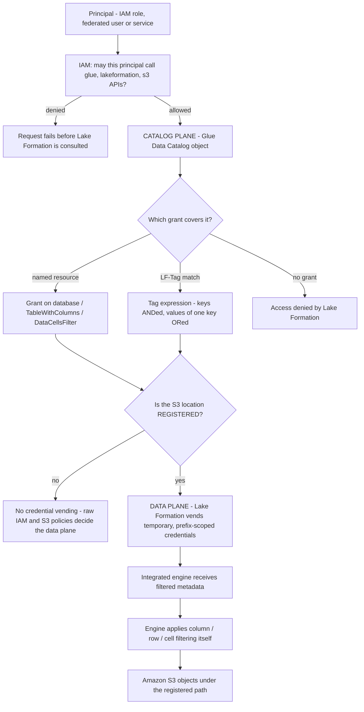
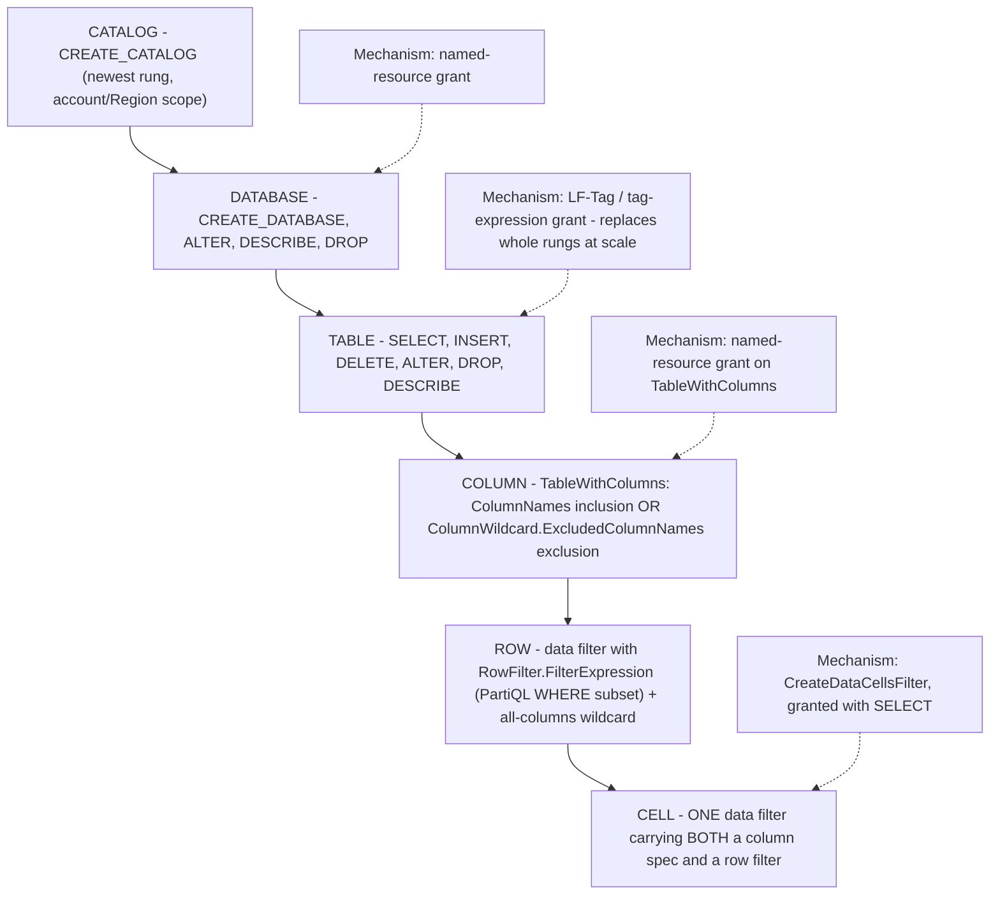
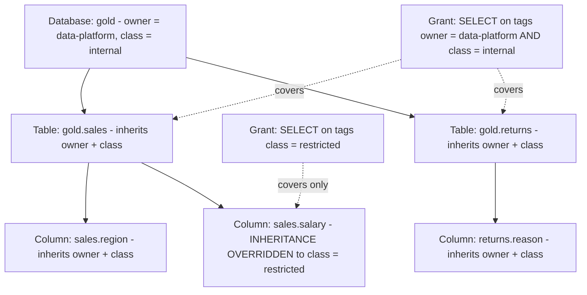
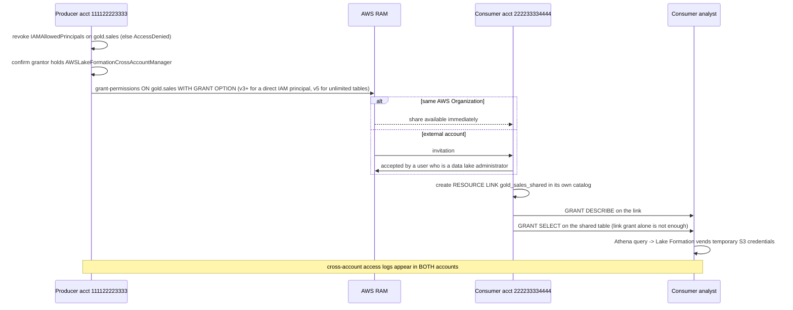
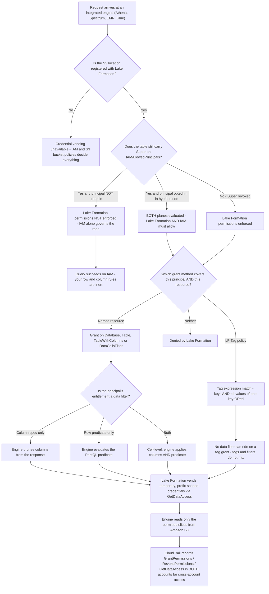

# Lake Formation Governance: Permissions, Row/Column Security, and Data Sharing

Lessons 01–11 built the machine: buckets, formats, Iceberg tables, crawlers, jobs, a query engine, a warehouse and an orchestrator. Every one of those layers produced a new place where somebody had to answer the same question — *who may see this?* This lesson answers it once, centrally, with **AWS Lake Formation**. The service is not an IAM replacement and not a catalog; it is an **RDBMS-shaped permission layer** that sits on the Glue Data Catalog and vends scoped temporary credentials to integrated engines, so that one `GRANT` statement can mean something at **database, table, column, row and cell** granularity.

The teaching rule for this lesson: **Lake Formation decides visibility, IAM decides reachability, and the engine does the actual filtering.** Confuse those three and every symptom in this lesson becomes a mystery.

```text
====================================================================
 LAKE FORMATION GOVERNANCE SURFACE (as of October 2026)
====================================================================
 Replaces ...... three overlapping policy surfaces: IAM identity
                 policies for glue:*, S3 bucket/prefix policies for
                 the data, Glue catalog resource policies - all
                 effectively table- or bucket-scoped
 Augments ...... IAM (it "augments the IAM permissions model");
                 IAM still authenticates and still gates every
                 Lake Formation control-plane API
 Two planes .... catalog plane (Glue + LF grants)
                 data plane (S3 + role-vended temporary credentials)
                 bridge = RegisterResource on the S3 location
 Modes ......... Lake Formation mode (revoke IAMAllowedPrincipals)
                 hybrid access mode (both planes, opt-in per principal)
 Ladder ........ catalog -> database -> table -> COLUMN -> ROW -> CELL
 Column ........ TableWithColumns ColumnNames / ExcludedColumnNames,
                 or a data-filter column spec (nested struct fields)
 Row / cell .... DataCellsFilter, PartiQL WHERE subset,
                 expression < 2,048 characters, <=100 per
                 principal per table
 TBAC .......... LF-Tag key=value, inheritance
                 database -> table -> column (overridable);
                 keys ANDed, values of one key ORed
 Sharing ....... AWS RAM resource shares; same-org instant,
                 out-of-org invitation; cross-account version 5 =
                 unlimited tables per share (2026-02-11)
 Admins ........ <= 30 data lake administrators per account
 Price ......... permissions, tags and sharing = $0;
                 Storage API bills bytes scanned (10 MB minimum)
 Default trap .. Super pre-granted to IAMAllowedPrincipals
                 until you revoke it - grants then look inert
====================================================================
```

In this lesson you will:

- diagnose **what Lake Formation actually replaces** — the IAM-plus-S3 policy sprawl — and what it deliberately does *not* replace;
- separate **LF-registered locations** from **hybrid access mode**, and predict which permission plane answers a given request;
- climb the **permission granularity ladder** (database → table → column → row filter → cell) and name the mechanism at each rung;
- build the **worked analyst policy**: `SELECT` on `gold.sales`, minus `salary`, rows limited to `region = 'eu'`, as one cell-level data filter;
- apply **LF-Tags and TBAC**: tag grants, inheritance, and the AND-across-keys / OR-within-a-key matching rules;
- share **cross-account databases** through AWS RAM, with the external-engine toggle, trusted callers, managed access and data-lake-administrator rules;
- place **Athena, Redshift Spectrum, QuickSight, Glue and EMR** on an engine support matrix and say what breaks in each cell;
- remove the **`IAMAllowedPrincipals`** default and execute the documented six-step migration;
- read the **permission-check decision tree** and write real `GrantPermissions` calls in JSON and CLI;
- study **three named AWS customer cases** (Integral Ad Science, FanDuel, Morningstar), a sourced **October 2026 update box**, **nine worked examples**, **five diagrams**, **three interactive checks** and **twelve exam-style questions**.

---

## 1. What Lake Formation replaces: the IAM and S3 sprawl

### 1.1 Three surfaces, one table, no rows

Before Lake Formation, a governed lake on AWS was assembled from three overlapping policy surfaces, and AWS said so at general availability on **2019-08-08**:

> "Previously you had to use separate policies to secure data and metadata access, and these policies only allowed table-level access. Now you can give access to each user, from a central location, only to the columns they need to use." — AWS News Blog, *AWS Lake Formation – Now Generally Available* (2019-08-08)

| Surface | What it could express | Where it could not go |
|---|---|---|
| **IAM identity policies** | `glue:*`, `lakeformation:*`, `s3:*` on chosen ARNs | No notion of a *column*; a wildcard that grants a whole prefix grants a whole table |
| **S3 bucket / prefix policies** | Which principals may read which prefix | Bucket- or prefix-scoped; the AWS Redshift Spectrum governance blog states bucket policies stop scaling "when the number of combinations of access levels and users increase" |
| **Glue Data Catalog resource policies** | Cross-account catalog access | Still table-shaped; nothing below the table, nothing about rows |

Lake Formation adds a **fourth** surface that is deliberately shaped like a relational database grant system:

> "Lake Formation provides a relational database management system (RDBMS) permissions model to grant or revoke access to catalogs, databases, tables, and columns in the Data Catalog with underlying data in Amazon S3." — LF Developer Guide, *Onboarding to Lake Formation permissions* (accessed 2026-10-11)

And it **augments** rather than replaces IAM:

> "Lake Formation provides its own permissions model that augments the IAM permissions model." — LF Developer Guide, *Overview of data filtering* (accessed 2026-10-11)

The division of labour is therefore fixed for the rest of the lesson: **IAM authenticates and gates the control plane** (`GrantPermissions`, `GetDataAccess`, `glue:*`), **Lake Formation gates the data plane** by deciding what metadata and what scoped temporary credentials an integrated engine receives, and **the engine performs the row/column/cell filtering itself**.



Two facts fall straight out of that diagram and both are examinable:

1. **Registration is the only bridge between the planes.** "Lake Formation credential vending is not available, even when opted in, unless the data location is registered with Lake Formation." (LF Developer Guide, *Hybrid access workflow*, accessed 2026-10-11.)
2. **Lake Formation does not lock your bucket.** "The Lake Formation permissions model doesn't prevent access to Amazon S3 locations through the Amazon S3 API or console if you have access to them through IAM or Amazon S3 policies. You can attach IAM policies to principals to block this access." (LF Developer Guide, *Underlying data access control*, accessed 2026-10-11.)

### 1.2 Worked example E1 — counting the sprawl, then counting the replacement

```text
SCENARIO (derived arithmetic from the documented permission set;
not an AWS-published figure) - as of Oct 2026

Estate ....... 3 databases x 12 tables = 36 governed tables
               4 teams need read access (analysts, data scientists,
               finance, auditors)
               3 S3 prefixes, one per database

IAM + S3 WORLD
  IAM identity policies ....... 4 policies x up to 36 table ARNs
                                = up to 144 ARN entries
  S3 prefix policies .......... 4 principals x 3 prefixes
                                = 12 allow statements, restated in
                                every bucket policy
  Glue catalog resource policy  cross-account only, table-shaped
  TOTAL maintained statements . 144 + 12 = 156 (derived)
  Add a 5th team ............... +36 IAM entries +12 bucket
                                statements = +48, every time

LAKE FORMATION, NAMED RESOURCES ONLY
  SELECT per table ............. 4 x 36 = 144 grants (derived)
  DESCRIBE per database ........ 4 x 3 = 12 grants (derived)
  TOTAL ........................ 156 statements - same shape, but
                                now in ONE place with an audit trail

LAKE FORMATION, TAG-BASED (TBAC)
  AWS documentation example .... 5 tag assignments + 8 tag grants
                                = 17 effective permissions
  IAS production outcome ....... "hundreds of permission rules
                                down to precisely two rules"
                                  (AWS Big Data Blog, 2021-09-23)

COST OF ANY OF THE THREE ....... $0 for the permissions themselves
  "You pay $0 for the permissions in AWS Lake Formation because
   they are provided at no charge." - Lake Formation pricing page
   (accessed 2026-10-11)
```

**Reading:** Lake Formation's first win over raw IAM is *not* fewer statements — at named-resource granularity you write the same number. Its first win is **centralisation plus auditability** (one `ListPermissions` instead of three policy families), and its second win, which arrives in Section 5, is **collapsing the count** with tags. The cost column is the surprise: the governance layer itself is free, so the only budget question is who maintains it.

- **📚 Did you know?** Lake Formation billing has exactly three billable items as of Oct 2026, and none of them is a permission. The **Storage API** — the standalone server-side filtering engine used when no AWS analytics service processes the data — bills "for the number of bytes scanned by the Storage API, rounded to the next megabyte, with a 10MB minimum"; **Governed Tables** bills per file tracked, per metadata API call and per byte processed by the storage optimizer; and the storage optimizer itself bills per byte. Grants, revokes, LF-Tags, cross-account sharing and enforcement by Athena, Redshift, Glue and EMR are all **$0** (Lake Formation pricing page, accessed 2026-10-11).

---

## 2. LF-registered versus hybrid: the two permission modes

A Data Catalog object has two **orthogonal** questions, and most Lake Formation confusion comes from answering only one of them:

| Question | Answer A | Answer B |
|---|---|---|
| (a) Is the underlying S3 location registered? | **Registered** — `RegisterResource` with a role; LF assumes that role and vends temporary credentials | **Not registered** — no vending, IAM and S3 policies decide the data plane |
| (b) Which permission model applies? | **Lake Formation mode** — LF is the only model; `IAMAllowedPrincipals` revoked everywhere | **Hybrid access mode** — both models coexist, opted in per principal |

### 2.1 Registration: what the role is for

> "When you register a location, you specify an IAM role that grants read/write permissions on that location. Lake Formation assumes that role when supplying temporary credentials to integrated AWS services." — LF Developer Guide, *Set up AWS Lake Formation* (accessed 2026-10-11)

Practical consequences:

- the **registration role**, not the caller, holds the durable `s3:*` permissions;
- callers additionally need the IAM permission `lakeformation:GetDataAccess`, and "you must set the Resource parameter to `*`" — any other resource value is unsupported;
- registering a prefix covers **every table under that path at once**, because "multiple tables can share an S3 prefix. When you register a location, all tables under that path get credential vending at once" (AWS-published Lake Formation best-practices guide, accessed 2026-10-11).

### 2.2 Hybrid access mode: two pathways, opt-in principals

> "AWS Lake Formation hybrid access mode supports two permission pathways to the same AWS Glue Data Catalog objects." … "The hybrid access mode enforces only `CREATE_TABLE`, `CREATE_PARTITION`, `UPDATE_TABLE` permissions by default." … "opted in principals will require both Lake Formation permissions and IAM permissions to access the data, while non-opted-in principals will continue to access data using only IAM permissions." — LF Developer Guide, *Hybrid access mode* (accessed 2026-10-11)

That last sentence is the whole mode: **hybrid is a per-principal switch, not a per-account switch**, and it is the reversible migration tool AWS recommends:

> "To ease the transition of data lake permissions from an IAM and Amazon S3 model to Lake Formation permissions, we recommend you to use hybrid access mode for Data Catalog." — LF Developer Guide, *Set up AWS Lake Formation* (accessed 2026-10-11)

| State | `IAMAllowedPrincipals` on the table | Location registered | Principal opted in? | Who decides read access |
|---|---|---|---|---|
| Legacy / default | present (`Super`) | maybe | n/a | **IAM alone** — individual Lake Formation permissions are not in effect |
| Lake Formation mode | revoked | yes | n/a | **Lake Formation alone** (plus IAM for the APIs) |
| Hybrid, not opted in | present | yes | no | **IAM alone** |
| Hybrid, opted in | present | yes | yes | **Both** — LF and IAM must both allow |
| Registered-but-not-opted-in | revoked | yes | no | LF metadata rules, but no opt-in means no double gate |

### 2.3 Worked example E2 — taking one role into hybrid mode

```bash
# ---- Step 0: see what the table looks like today -----------------
aws lakeformation get-effective-permissions-for-path \
  --catalog-id 111122223333 \
  --resource-arn arn:aws:glue:us-east-1:111122223333:table/gold/sales
# Expect to see: Super granted to IAMAllowedPrincipals
# (Lake Formation sets Super to that group on databases and tables
#  by default - LF Developer Guide, Permissions reference)

# ---- Step 1: register the location so vending can exist ---------
aws lakeformation register-resource \
  --resource-arn arn:aws:s3:::acme-lake/gold/ \
  --role-arn arn:aws:iam::111122223333:role/lf-registration-role \
  --use-service-linked-role   # or supply your own customer-managed role
# HybridAccessEnabled can be set on the resource for hybrid operation

# ---- Step 2: opt ONE role in (per-principal, reversible) ---------
aws lakeformation create-lakeformation-opt-in \
  --principal DataLakePrincipalIdentifier=arn:aws:iam::111122223333:role/analyst-eu \
  --hybrid-access-opt-in-detail HybridAccessEnabled=true

# ---- Step 3: now the analyst needs BOTH planes -------------------
#   IAM:   glue:GetTable / glue:GetPartitions + lakeformation:GetDataAccess
#   LF:    SELECT on gold.sales (Section 4)
# A principal that is NOT opted in keeps working on IAM alone,
# which is what makes this reversible:
aws lakeformation delete-lakeformation-opt-in \
  --principal DataLakePrincipalIdentifier=arn:aws:iam::111122223333:role/analyst-eu
```

**Checks:** (a) the opted-in analyst with an IAM policy but *no* LF grant now fails — proof the double gate is live; (b) the non-opted-in role still reads with IAM only — proof the mode is per principal; (c) `IsRegisteredWithLakeFormation` on the table is `true` for the opted-in principal's view and unchanged for everyone else.

> [!IMPORTANT]
> **Registered ≠ hybrid.** Registration answers *where do credentials come from*; hybrid answers *which permission model applies*. Three separable failure modes follow, and each has a different fix:
> - **Opted in, location not registered** → the principal gets Lake Formation metadata rules but no credential vending, so the data plane still behaves like raw IAM.
> - **Registered, nobody opted in, `IAMAllowedPrincipals` still holds `Super`** → Lake Formation permissions are not enforced at all; your new grants are inert.
> - **Neither, but the analyst keeps a direct `s3:GetObject`** → every row filter in this lesson is bypassed. Cleanup of direct S3 grants is a step of the migration, not an optional extra.

- **📚 Did you know?** The account-level knobs that keep a new database on the old plane have exact console names: **"Use only IAM access control for new databases"** and **"Use only IAM access control for new tables in new databases"**, backed in the API by `CreateDatabaseDefaultPermissions` and `TableDefaultPermissions`, whose shipped default is `[{"Principal":{"DataLakePrincipalIdentifier":"IAM_ALLOWED_PRINCIPALS"},"Permissions":["ALL"]}]` (LF Developer Guide, *Changing the default settings for your data lake* and `DataLakeSettings` API, accessed 2026-10-11). AWS deliberately does **not** name this state "IAMOnly" anywhere — teach the documented names.

---

## 3. The permission granularity ladder

### 3.1 The vocabulary

Resource kinds you can grant on: **`Catalog`**, **`Database`**, **`Table`**, **`View`**, **`DataLocation`** (only `DATA_LOCATION_ACCESS` applies), **`LF_Tag`**, **`LF_TagPolicy` / `LFTagExpression`**.

The permissions enum, as returned by `ListPermissions` (LF API reference, accessed 2026-10-11):

```text
ALL (= Super)  SELECT  INSERT  DELETE  ALTER  DROP  DESCRIBE
CREATE_DATABASE  CREATE_TABLE  DATA_LOCATION_ACCESS
CREATE_LF_TAG  ASSOCIATE  GRANT_WITH_LF_TAG_EXPRESSION
CREATE_LF_TAG_EXPRESSION  CREATE_CATALOG  SUPER_USER
```

Three rules about that list:

- `SELECT`, `INSERT` and `DELETE` are **both** Data Catalog permissions **and** data-access permissions — they are the ones that reach S3.
- `Super` is additive and survives partial revocation: "when you revoke `Super`, the `SELECT` and `INSERT` permissions remain" (LF Developer Guide, *Access control for metadata*, accessed 2026-10-11).
- Granting on **all tables in a database** implicitly grants `DESCRIBE` on that database — but "this automatic `DESCRIBE` permission grant doesn't apply when using attribute-based access control (ABAC)".

### 3.2 The ladder, drawn



Everything below `TABLE` is **expressed through two mechanisms only**: a *column filter on the grant itself* (`TableWithColumns`) or a *data filter object* (`DataCellsFilter`). Choose between them with one question — **do I need rows too?**

| Need | Mechanism | Object you write |
|---|---|---|
| Whole table | Named-resource grant | `{"Table": {"CatalogId", "DatabaseName", "Name"}}` |
| Some columns, all rows | Column filter on the grant | `{"TableWithColumns": {"ColumnNames": [...]}}` or `{"ColumnWildcard": {"ExcludedColumnNames": [...]}}` |
| All columns, some rows | Data filter, row-level | `{"AllRowsWildcard"}` + `RowFilter.FilterExpression` |
| Some columns **and** some rows | Data filter, cell-level | column spec **plus** `RowFilter` in one `DataCellsFilter` |
| Bulk reach over many tables | LF-Tag grant | `{"LFTagPolicy": {"TagKey", "TagValues"}}` |

### 3.3 Worked example E3 — the four-grant ladder on one table

```text
Goal: make gold.sales visible, useful and correctly narrow for role/analyst-eu.

GRANT 1 - visibility (no data yet)
  resource  Database gold
  perms    DESCRIBE
  effect   the database appears in the Athena object list

GRANT 2 - the table (still every row, every column)
  resource  Table gold.sales
  perms     SELECT
  effect    SELECT * FROM gold.sales returns everything - TOO MUCH

GRANT 3 - columns only (Section 4.1 alternative)
  resource  TableWithColumns gold.sales,
            ExcludedColumnNames = [salary]
  perms     SELECT
  effect    salary disappears from results AND from glue:GetTable
            metadata for this principal - but ALL regions still return

GRANT 4 - rows, columns, one object (the real policy, Section 4)
  resource  DataCellsFilter gold_sales_eu_no_salary
            RowFilter  = region = 'eu'
            Columns    = exclude salary
  perms     SELECT
  effect    cell-level: EU rows only, minus the salary column

AUDIT after each grant:
  aws lakeformation list-permissions --principal ... 
  # effective permission = UNION of named-resource, tag-policy and
  # data-filter grants - there is no deny primitive, so a later plain
  # SELECT grant on the same table re-includes what you excluded
```

**Numbers as of Oct 2026:** a data filter needs `SELECT` **with the grant option** on all table columns to create; there is **no cap** on filters per table but a limit of **100 data filters per principal per a single table**; and the row expression must be **under 2,048 characters** (LF Developer Guide, *Data filtering limitations* and PartiQL support, accessed 2026-10-11).

```matching
{
  "question": "Match each permission granularity rung to the Lake Formation mechanism that expresses it:",
  "pairs": [
    {"left": "Database", "right": "Named-resource grant of CREATE_DATABASE, ALTER, DESCRIBE or DROP on a Database resource - no rows or columns exist at this rung"},
    {"left": "Table", "right": "Named-resource grant of SELECT, INSERT or DELETE on a Table resource - the rung most teams stop at, and the only one raw IAM could approximate"},
    {"left": "Column", "right": "TableWithColumns with ColumnNames inclusion or ColumnWildcard.ExcludedColumnNames exclusion - or the column spec inside a data filter, which is the only route that reaches nested struct fields"},
    {"left": "Row", "right": "A data filter with an all-columns wildcard plus RowFilter.FilterExpression written in the PartiQL WHERE subset, under 2,048 characters"},
    {"left": "Cell", "right": "A single data filter that carries BOTH a column spec and a row filter expression, granted with SELECT"}
  ],
  "explanation": "Four rungs, two mechanisms: named-resource grants carry database and table; column filters and data filters carry column, row and cell. The two traps are that nested struct columns are reachable only through a data filter's column spec, and that cell-level security is defined as column spec PLUS row filter in one object - not as two separate grants. Column filtering cannot be applied to partition-key columns, and a tag-based grant cannot carry a data filter at all."
}
```

- **📚 Did you know?** Three ceilings are worth memorising because they are all small: **30** data lake administrators per account by default, **1,000** saved LF-Tag expressions per account, and **100** data filters per principal per table (LF Developer Guide, *Set up AWS Lake Formation*, *Managing LF-Tag expressions* and *Data filtering limitations*, all accessed 2026-10-11). A fourth, softer one: AWS's own tag-based worked example reaches **17** effective permissions from just **5 tag assignments plus 8 tag grants**.

---

## 4. Row-level and column-level security: the worked analyst policy

### 4.1 The combinatorics — three controls, one object type

> "Lake Formation uses data filtering to achieve column-level security, row-level security, and cell-level security." … "When you specify the 'all columns' wildcard and provide a row filter expression, you are establishing row-level security (row filtering) only." … "When you include or exclude specific columns and nested columns, and specify 'all rows' … you are establishing column-level security." … "When you include or exclude specific columns and also provide a row filter expression, you are establishing cell-level security." — LF Developer Guide, *Data filtering and cell-level security* (accessed 2026-10-11)

| Columns field | Rows field | Control you get |
|---|---|---|
| `AllRowsWildcard` (all columns) | predicate present | **Row-level security** |
| `ColumnNames` or `ColumnWildcard.ExcludedColumnNames` | `AllRowsWildcard` | **Column-level security** |
| column spec **and** predicate | both present | **Cell-level security** |

Two clarifications that save real debugging time:

- **Column filtering is not masking.** Excluding `salary` removes it from results *and* from that principal's catalog metadata. It never returns `***`. If the requirement is "show last four digits only", that is a view, an application-layer transform, or Amazon Redshift's dynamic data masking — not Lake Formation.
- **Availability:** "Cell-level security is available in all regions when using Athena engine version 3 or Amazon Redshift Spectrum." (LF Developer Guide, *Data filtering limitations*, accessed 2026-10-11.)

### 4.2 The row-filter language: PartiQL subset, with hard edges

| Rule | Value (accessed 2026-10-11) |
|---|---|
| Syntax | "the expression has the syntax of a `WHERE` clause in the PartiQL language" |
| Length | total **< 2,048 characters** (API maximum 2048) |
| Operators | `=, >, <, >=, <=, <>, !=, BETWEEN, IN, LIKE, NOT, IS [NOT] NULL` |
| Comparisons | **you can't compare columns with other columns** |
| Case | "All string comparisons and `LIKE` pattern matches are **case-sensitive**" |
| Types | `STRING/CHAR/VARCHAR`, numeric types, `BOOLEAN`, `STRUCT` |
| Unsupported | `array` and `map` are not supported; `struct` **is** |
| Partition keys | "You cannot restrict access on columns that are partition keys" |
| Views / resource links | cell-level security is not supported on them |
| Concurrency | "If you apply the all-rows filter expression on a table concurrently with other filter expressions with predicates, the all-rows expression will prevail" |

### 4.3 Worked example E4 — the analyst policy: `gold.sales` minus `salary`, rows = `region='eu'`

This is **cell-level security in one data filter object**, plus the visibility grant that makes it usable.

```json
{
  "Name": "gold_sales_eu_no_salary",
  "DatabaseName": "gold",
  "TableName": "sales",
  "TableCatalogId": "111122223333",
  "RowFilter": { "FilterExpression": "region = 'eu'" },
  "ColumnWildcard": { "ExcludedColumnNames": ["salary"] }
}
```

```bash
# 1. create the filter - requires SELECT WITH GRANT OPTION on gold.sales
aws lakeformation create-data-cells-filter \
  --cli-input-json file://filter.json

# 2. grant SELECT through the filter, not on the bare table
aws lakeformation grant-permissions \
  --principal DataLakePrincipalIdentifier=arn:aws:iam::111122223333:role/analyst-eu \
  --resource '{"DataCellsFilter":{"TableCatalogId":"111122223333","DatabaseName":"gold","TableName":"sales","Name":"gold_sales_eu_no_salary"}}' \
  --permissions SELECT

# 3. visibility, so the table appears in the Athena explorer
aws lakeformation grant-permissions \
  --principal DataLakePrincipalIdentifier=arn:aws:iam::111122223333:role/analyst-eu \
  --resource '{"Table":{"CatalogId":"111122223333","DatabaseName":"gold","Name":"sales"}}' \
  --permissions DESCRIBE
```

**Four learner checks, and what each one proves:**

| Query run as `role/analyst-eu` | Expected result | What it proves |
|---|---|---|
| `SELECT salary FROM gold.sales` | error / column absent from metadata | the **column** half of the cell filter is live |
| `SELECT region, count(*) FROM gold.sales GROUP BY region` | only `'eu'` counts | the **row** half is live |
| `SELECT * FROM gold.sales` | every column **except** `salary`, EU rows only | both halves compose into **cell-level** security |
| `SELECT region FROM gold.sales` | works — because `region` is still readable | the filter predicate column must be in the allow-list; decide deliberately whether `region` stays visible to analysts |

**Contrast (cheaper, narrower):** granting `TableWithColumns` with `ExcludedColumnNames = ["salary"]` gets you the columns and no rows — a legitimate answer when the requirement is only "hide PII", and the pattern FanDuel used in **Case B** below. Adding `region = 'eu'` is what forces you into a data filter.

> [!WARNING]
> ⚠️ **Four ways this policy silently widens back to full access:**
> - **Tags and data filters do not mix.** "You can't apply data filters when you use LF-Tags to manage permissions on Data Catalog resources." (LF Developer Guide, *Using AWS Lake Formation with Amazon Athena*, accessed 2026-10-11.) If `gold.sales` is covered by a tag grant, your row filter is not applied to that path.
> - **There is no deny primitive.** Effective permission is the **union** of named-resource, tag-policy and data-filter grants. A second, plain `SELECT` grant on `gold.sales` re-includes `salary` for the same principal.
> - **Grant option and column filtering.** The permissions reference states you "can't include the grant option if column filtering is applied", while the granting guide describes a narrower grant-option case — verify current console behaviour in your account before designing delegated column grants (AWS docs disagree here as of 2026-10-11; treat it as unverified).
> - **Partition-key columns cannot be column-filtered**, and `IS [NOT] NULL` is invalid on them — a schema that partitions by `region` needs `region` to stay readable, which is exactly the fourth check above.

---

## 5. LF-Tags and tag-based access control (LF-TBAC)

### 5.1 What a tag is

> "Each LF-Tag is a key-value pair, such as `department=sales` or `classification=restricted`. A key can have multiple defined values." — LF Developer Guide, *Tag-based access control (LF-TBAC)* (accessed 2026-10-11)

Tags attach to **databases, tables and columns**. They must be predefined (a key and its values are created with `CreateLFTag` before anything can carry them), and they are the only mechanism in this lesson that lets you grant on an *attribute* rather than on a named object.

### 5.2 Inheritance and the matching rules

> "Tables inherit LF-Tags from databases and columns inherit LF-Tags from tables. Inherited values can be overridden" … "the tag keys are combined using the AND operation, while the values are combined using the OR operation." — LF Developer Guide, *Tag-based access control (LF-TBAC)* (accessed 2026-10-11)



The two combination rules, stated once and tested forever:

- **Different keys in one grant are AND-ed:** `owner = data-platform AND class = internal` matches only resources carrying *both*.
- **Multiple values of the same key are OR-ed:** `class = internal OR class = restricted` matches *either*.
- Example from the docs: the tag expression `content_type:Sales AND location:US` "represents resources related to sales data in the US"; saved LF-Tag expressions are capped at **1,000 per account**.

### 5.3 Three things TBAC changes about granting

1. **You grant on the tag, not the table.** The principal's grant resource is an `LFTagPolicy` (or an `LFTagExpression`), so tables created *later* — including crawler-created tables — are covered automatically once they inherit the tag.
2. **You can grant the ability to tag.** `ASSOCIATE` lets a principal attach a tag; `DESCRIBE` lets them see it; `GRANT_WITH_LF_TAG_EXPRESSION` lets them use it as a grant resource. This is the delegation primitive behind data meshes.
3. **Permissions from all methods are unioned.** AWS's own migration advice: "(Recommended) After verifying that principals have access to the correct resources through the LF-TBAC method, revoke permissions that were granted by using the named resource method." Verify first, revoke second — never the reverse.

### 5.4 Worked example E5 — rebuilding the IAS compression with three tags

```text
ESTATE (derived arithmetic, as of Oct 2026)
  3 databases x 12 tables = 36 tables
  4 principals with read access

NAMED-RESOURCE ROUTE
  SELECT per table ....... 4 x 36 = 144 grants
  DESCRIBE per database .. 4 x 3  =   12 grants
  TOTAL ..................        156 statements (derived)
  Re-org one team ........ re-issue up to 48 of them

LF-TBAC ROUTE (IAS shape: owner + class applied at the DATABASE)
  Tag assignments ........ 3 databases x 2 keys = 6 assignments,
                           inherited down to 36 tables and their
                           columns (nothing per table)
  Tag grants ............. 4 principals x tag policy = 4 grants
  TOTAL .................. 10 statements, NONE of which names a table

  AWS documentation worked example for the same idea:
  5 assignments + 8 grants = 17 effective permissions

THE CARVE-OUT THAT NEVER DISAPPEARS
  "but two analysts also need region = 'eu' rows only"
  -> 2 named-resource + data-filter grants (data filters cannot ride
     on tags), total 12 statements, with the exception LISTED so it
     can be reviewed
```

**Reading:** the tag route's cost is flat in the number of tables and linear in the number of *policies*; the named route is linear in tables × principals. IAS reported the real-world version of this: **"With Lake Formation tag-based access controls, IAS reduced hundreds of permission rules down to precisely two rules"** (AWS Big Data Blog, 2021-09-23). Note where the exception list lands — row filters are exactly the feature that cannot be tag-driven, so a TBAC estate always carries a short, deliberate named-resource tail.

```fillblank
{
  "question": "Fill in the LF-Tag names and the mechanics behind the IAS outcome:",
  "template": "IAS attached the {{1}} and {{2}} LF-Tag keys at the database level, relied on {{3}} to carry them down to tables and columns, and expressed access as tag-based grants rather than {{4}} rules.",
  "answers": {
    "1": "owner",
    "2": "class",
    "3": "inheritance",
    "4": "per-table"
  },
  "distractors": [
    "department",
    "classification",
    "team",
    "tier",
    "propagation",
    "aliasing",
    "row-filter",
    "cross-account"
  ],
  "explanation": "The AWS Big Data Blog account of Integral Ad Science (2021-09-23) states that IAS applied the owner and class tags at the database level and relied on inheritance, and that tag-based access controls reduced hundreds of permission rules to precisely two. Inheritance is database -> table -> column with overridable values, so a tag written once at the database reaches every table underneath it, and the result is that no rule names a table at all."
}
```

```plot
{
  "type": "bar",
  "title": "Permission-rule count for 4 principals as the estate grows (derived, as of Oct 2026)",
  "data": [
    {"Tables in the database": "6 tables", "Named-resource grants": 24, "LF-TBAC rules": 10},
    {"Tables in the database": "12 tables", "Named-resource grants": 48, "LF-TBAC rules": 10},
    {"Tables in the database": "24 tables", "Named-resource grants": 96, "LF-TBAC rules": 10},
    {"Tables in the database": "36 tables", "Named-resource grants": 144, "LF-TBAC rules": 10}
  ],
  "xKey": "Tables in the database",
  "dataKeys": ["Named-resource grants", "LF-TBAC rules"],
  "xLabel": "Tables in the database",
  "yLabel": "Permission rules maintained"
}
```

Hover a bar pair: named-resource grants scale as **principals × tables** (derived: 4 × 6 = 24 up to 4 × 36 = 144), while the tag route stays at **6 assignments + 4 grants = 10** regardless of table count (derived from the IAS shape of two keys applied at database level). The crossover is immediate — the tag route is already smaller at six tables — which is why AWS's tag-based example is quoted as *operational* simplification rather than as a security feature.

---

## 6. Data sharing: cross-account databases, external engines, trusted callers

### 6.1 Cross-account databases go through AWS RAM

> "Lake Formation uses the AWS Resource Access Manager (AWS RAM) service to share the resource. If the grantee account is in the same organization as the grantor account, the shared resource is available immediately; if the grantee account is not in the same organization, AWS RAM sends an invitation to the grantee account to accept or reject the resource grant." — LF Developer Guide, *Cross-account data sharing* (accessed 2026-10-11)

Two grant methods exist, and AWS recommends one of them by name: **Lake Formation tag-based access control (LF-TBAC) (recommended)** versus **named resources**. The blog that documents the trade-off puts it plainly: TBAC "is recommended when many resources and entities are involved."

**Prerequisites that are hard failures, not advice** (LF Developer Guide, *Cross-account prerequisites*, accessed 2026-10-11):

1. Revoke **all** Lake Formation permissions from `IAMAllowedPrincipals` on the resource first — otherwise Lake Formation throws `AccessDeniedException`.
2. The grantor must hold the AWS managed policy **`AWSLakeFormationCrossAccountManager`**.
3. At least one user in the consumer account must be a **data lake administrator** to view shared resources; "other principals can't access shared resources until the data lake administrator grants them permissions."
4. Cross-account grants must carry the **grant option**, because the consumer-side admin re-grants locally. "The principal who receives the resource share cannot share the resource with other principals."

**Cross-account version settings** (`DataLakeSettings.Parameters.CROSS_ACCOUNT_VERSION`) decide what can be shared: direct grants to an individual IAM principal in another account need **version ≥ 3**; hybrid-mode shares need **≥ 4**; **version 5** "enhances cross-account resource sharing enabling you to share unlimited number of tables to another account, eliminating previous resource association limits per resource type", is available "through the Lake Formation console or API", and **downgrade is not supported** once applied (AWS What's New, 2026-02-11; LF Developer Guide, accessed 2026-10-11).



### 6.2 Worked example E6 — sharing `gold.sales` to an external account

```text
PRODUCER 111122223333 -> CONSUMER 222233334444   (as of Oct 2026)

PRE-FLIGHT (all three are hard failures, not advice)
  1. aws lakeformation get-effective-permissions-for-path \
       --resource-arn arn:aws:s3:::acme-lake/gold/
     -> if Super / IAMAllowedPrincipals appears, REVOKE it first
        (Lake Formation throws AccessDeniedException otherwise)
  2. producer caller holds the AWS managed policy
     AWSLakeFormationCrossAccountManager
  3. cross-account version: >= 3 for a direct IAM principal,
     >= 4 for a hybrid-mode share, 5 (2026-02-11) for an
     UNLIMITED number of tables per RAM resource share -
     and downgrade is NOT supported once you upgrade
  4. consumer account has at least ONE data lake administrator,
     otherwise nobody there can even see the share

PRODUCER - the grant must carry delegation
  aws lakeformation grant-permissions \
    --principal DataLakePrincipalIdentifier=arn:aws:iam::222233334444:role/partner-analyst \
    --resource '{"Table":{"CatalogId":"111122223333","DatabaseName":"gold","Name":"sales"}}' \
    --permissions SELECT \
    --permissions-with-grant-option SELECT

TRANSPORT
  same AWS Organization ..... share appears immediately
  external organization ..... AWS RAM invitation, must be accepted

CONSUMER SIDE (the step everyone forgets)
  a. admin accepts the RAM share
  b. create RESOURCE LINK gold_sales_shared in the consumer catalog
  c. GRANT DESCRIBE on the link     <- link grant only makes it visible
  d. GRANT SELECT on the SHARED TABLE for role/partner-analyst
  e. Athena query via the link -> vended temporary S3 credentials

LIMITS TO QUOTE
  "The principal who receives the resource share cannot share the
   resource with other principals." -> no re-sharing by the recipient
  cross-account access logs appear in BOTH accounts, with the full
  principal ARN only if the recipient opts in
  Only inclusion lists (ColumnNames) are supported when granting to
  an external account or organization - no ExcludedColumnNames route
```

**Checks:** (a) a grant attempted while `IAMAllowedPrincipals` still holds `Super` fails with `AccessDeniedException`; (b) a grant without `--permissions-with-grant-option` leaves the consumer admin unable to grant their own analysts anything; (c) granting only on the link leaves the table invisible to queries — **link grant ≠ target grant**.

### 6.3 Trusted callers and the external-engine toggle

Lake Formation vends temporary credentials only to **trusted callers**. "Each of these AWS services is a trusted caller to Lake Formation, and Lake Formation provides access to data stored in Amazon S3 through temporary credentials" — the integrated set being Athena, Redshift Spectrum, EMR and Glue (LF Developer Guide, *Working with services*, accessed 2026-10-11).

Anything else is opt-in, and the opt-in is a three-part switch in `DataLakeSettings`:

| Setting | Role | Default posture |
|---|---|---|
| `AllowExternalDataFiltering` | lets a third-party engine access unfiltered metadata and data-access credentials | must be enabled deliberately |
| `ExternalDataFilteringAllowList` | account IDs of the allowed external engines | empty = nobody |
| `AuthorizedSessionTagValueList` | session tag values a caller must present | the STS session tag **key** is `LakeFormationAuthorizedCaller` |
| `AllowFullTableExternalDataAccess` | lets an engine get credentials **without** a session tag when the caller has full data access | **false** by default — keep it false |

> "If you intend to analyze … using third-party query engines, you must opt in to allow external engines to access data managed by Lake Formation." — LF Developer Guide, *Set up AWS Lake Formation* (accessed 2026-10-11)

A documentation discrepancy to be honest about: the `DataLakeSettings` API reference shows an example session tag key of `LakeFormationTrustedCaller`, while the third-party-engine guide and the custom-application blog both specify **`LakeFormationAuthorizedCaller`**. Two sources say the latter, so use it — but do not treat either name as uncontested.

### 6.4 Managed access and the administrator roles

| Role | Can do | Cannot do (verified constraint) |
|---|---|---|
| **Data lake administrator** | Register locations, create databases, run permission workflows, grant/revoke anything | "Cannot add other data lake administrators"; capped at **30** per account by default |
| **IAM administrator** | Create users, roles, policies, and *add* data lake administrators | Cannot grant Lake Formation permissions unless also an LF admin |
| **Database / table creator** | Implicit `SUPER` on what they create | Nothing implicit on objects they did not create |
| **Grantor with the grant option** | Re-grant what they hold (`PermissionsWithGrantOption`) | Can delegate only what was delegated to them |
| **LF-Tag / tag-expression creator** | Create, update, delete tags and saved expressions | Implicit rights cover the tags themselves, not the data |

Two asymmetries are worth internalising:

- **Admin added later = zero implicit data access.** "data lake administrators added after database creation can grant permissions but don't automatically have data access permissions such as SELECT or DESCRIBE. Administrators who create databases receive SUPER permissions on those databases."
- **Managed access is expressed as the grant option.** The pattern — a platform team holding `PermissionsWithGrantOption` and domain teams re-granting within a scope — is how "grantable" self-service works without handing over the whole catalog.

- **📚 Did you know?** The registration role and the service-linked role are a real design choice: Lake Formation ships a service-linked role (`ServiceRoleForLakeFormationDataAccess`) for zero-setup registration, but AWS's best-practices guide recommends registering with a **customer-managed role** when you expect to edit or scope that role later. Either way the caller still needs `lakeformation:GetDataAccess` with `Resource: "*"`, and adding it is "a no-op when no locations are registered, so it is safe (and recommended) to add upfront" (AWS-published Lake Formation best-practices guide, accessed 2026-10-11).

```dragdrop
{
  "question": "Order the steps that move one S3 location from IAM-only access to a governed Lake Formation grant, ending with an analyst query that succeeds:",
  "items": [
    "Inventory the existing IAM and Glue permissions with ListPermissions and GetEffectivePermissionsForPath",
    "Replicate those permissions as Lake Formation grants - deliberately a no-op while IAMAllowedPrincipals still holds Super",
    "Add lakeformation:GetDataAccess with Resource set to * to every consumer IAM policy",
    "Register the S3 location with an IAM role so credential vending becomes possible",
    "Revoke Super from the IAMAllowedPrincipals group on that location's databases and tables",
    "Turn off Use only IAM access control for new databases and for new tables in new databases",
    "Delete the old fine-grained IAM and S3 policies that the Lake Formation grants now replace",
    "Query with Athena and confirm Lake Formation vends temporary, prefix-scoped credentials"
  ],
  "correctOrder": [
    "Inventory the existing IAM and Glue permissions with ListPermissions and GetEffectivePermissionsForPath",
    "Replicate those permissions as Lake Formation grants - deliberately a no-op while IAMAllowedPrincipals still holds Super",
    "Add lakeformation:GetDataAccess with Resource set to * to every consumer IAM policy",
    "Register the S3 location with an IAM role so credential vending becomes possible",
    "Revoke Super from the IAMAllowedPrincipals group on that location's databases and tables",
    "Turn off Use only IAM access control for new databases and for new tables in new databases",
    "Delete the old fine-grained IAM and S3 policies that the Lake Formation grants now replace",
    "Query with Athena and confirm Lake Formation vends temporary, prefix-scoped credentials"
  ],
  "explanation": "The documented upgrade order is inventory -> replicate -> add GetDataAccess -> verify per location -> revoke IAMAllowedPrincipals -> register -> switch off the IAM-only defaults -> delete the old policies. The staged grants are intentionally inert until the Super grant is revoked, which is what makes the migration reversible: deregister the location or delete the opt-in and you are back on IAM. The two steps people skip are GetDataAccess (without it the engine cannot obtain vended credentials even with a perfect grant) and deleting the old policies (which otherwise leave a permanent bypass around every row filter)."
}
```

> [!WARNING]
> ⚠️ **Cross-account ordering is the most common dead end.** Revoke `IAMAllowedPrincipals` → grant **with the grant option** → (out-of-organization) the consumer accepts the RAM invitation → the consumer's data lake administrator creates a **resource link** → the administrator re-grants **on the shared object**, not just on the link. A grant made before the invitation is accepted appears to do nothing; a grant made with the `IAMAllowedPrincipals` permission still attached throws `AccessDeniedException`; and skipping the grant option leaves the consumer admin unable to grant local analysts anything at all.

---

## 7. Engine support matrix: who actually enforces what

> "the actual filtering of columns in query responses is the responsibility of the integrated service. Lake Formation clients that support column-level filtering, including Amazon Athena, Amazon Redshift Spectrum, and Amazon EMR filter the data based on the column permissions registered with Lake Formation" — LF Developer Guide, *Limitations* (accessed 2026-10-11)

| Engine | Table | Column | Row / Cell | Caveat you must be able to state |
|---|---|---|---|---|
| **Athena SQL** | Read/write | Yes | Yes | Cell-level needs **Athena engine version 3**; Athena query results locations **cannot** be registered, so results are always pure-IAM territory |
| **Athena Spark** | Not supported | Not supported | Not supported | "Athena Spark doesn't support querying Data Catalog tables with Lake Formation permissions." |
| **Redshift Spectrum** (provisioned cluster or Serverless) | Read/write | Yes | Yes | Data filters in Lake Formation govern Spectrum row/cell access; **Redshift's own row/column policies on a datashare shared *into* Lake Formation are ignored** — the LF admin must re-create them |
| **Spark on EMR (EC2)** | Read/write | Yes | Yes | Securing the cluster itself stays your job |
| **Apache Hive on EMR (EC2)** | Read/write | Yes | **Not supported** | Row and cell filters do not apply |
| **Hive on EMR Serverless / EMR on EKS** | Not supported | Not supported | Not supported | Listed as unsupported in the services matrix |
| **AWS Glue ETL** | Read/write | **Glue 5.0+ read access** | **Glue 5.0+ read access** | The limitations page still says "Currently, AWS Glue ETL doesn't support column filtering" — treat **5.0+ read paths** as supported and **pre-5.0 and write paths** as unsupported, and verify on your runtime |
| **Amazon QuickSight** | Via Athena | Via Athena | Via Athena | Enterprise edition grants FGAC permissions to QuickSight users and groups; Standard edition grants to IAM roles (default `aws-quicksight-service-role-v0`) |
| **Custom / third-party engines** | Opt-in | Opt-in | Opt-in | Session tag `LakeFormationAuthorizedCaller` plus the allow-list; never flip this on as a troubleshooting shortcut |

### 7.1 Worked example E7 — placing eight engines on the matrix

```text
For each engine: WHERE does it sit, and WHAT breaks if you assume otherwise?
(as of Oct 2026)

1. Athena SQL ................ table + column + row/cell
                               break: cell-level filters need engine v3;
                               query HISTORY is governed by workgroups,
                               not by Lake Formation
2. Athena Spark .............. NOT SUPPORTED
                               break: the notebook path simply cannot
                               query Lake Formation-permissioned tables
3. Hive on EMR Serverless .... NOT SUPPORTED
                               break: no enforcement surface at all
4. Glue 3.0 job .............. table only (pre-5.0 read path)
                               break: column filtering NOT enforced
                               inside the job - strip the column yourself
5. Glue 5.0 job .............. table + column + row/cell on READ
                               break: write path still unverified -
                               never publish a job that relies on it
6. Spark on EMR EC2 .......... full enforcement via the LF plugin
                               break: cluster hardening is still yours
7. Redshift Spectrum ......... full enforcement, including data filters
                               break: producer-side Redshift RLS/CLS
                               policies are IGNORED once a datashare is
                               shared into Lake Formation
8. QuickSight SPICE import ... enforcement happens at IMPORT time only
                               break: readers see the imported rows;
                               LF row filters do not travel into SPICE
```

**Rule of thumb derived from the matrix:** Lake Formation publishes filtered metadata and scoped credentials; **the engine prunes the response**. Any engine outside that list either refuses the query or — worse — returns unfiltered data if you granted the external-engine opt-in.

- **📚 Did you know?** QuickSight's integration has an edition split that is easy to miss: **Enterprise** edition lets you "grant fine-grained access control (FGAC) permissions to individual QuickSight users and groups", while **Standard** edition grants go to **IAM roles**, with the default service role named `aws-quicksight-service-role-v0`. Once the source bucket is registered, "Amazon S3 access settings in QuickSight are ignored, including scope-down IAM policies for users and groups" — Lake Formation becomes the single source of truth (QuickSight and AWS Big Data Blog documentation, accessed 2026-10-11).

---

## 8. The `IAMAllowedPrincipals` default, and the migration off it

### 8.1 Why your grants appear to do nothing

> "Lake Formation sets `Super` permission on all databases and tables in the Data Catalog to a group called `IAMAllowedPrincipals` by default. If this group permission exists … all principals in your account will have access to the resource through the IAM principal policies for AWS Glue." — LF Developer Guide, *Permissions reference* (accessed 2026-10-11)

And the consequence, stated just as directly:

> "These settings effectively cause access to Data Catalog resources and Amazon S3 locations to be controlled solely by AWS Identity and Access Management (IAM) policies. Individual Lake Formation permissions are not in effect." — LF Developer Guide, *Changing the default settings for your data lake* (accessed 2026-10-11)

So the default state of a brand-new or long-unmodified lake is: **Lake Formation installed, but switched off.** Your shiny grants are recorded, audited, and ignored.

| Symptom | First check | Fix |
|---|---|---|
| "My grants changed nothing; everyone can still read" | `ListPermissions` → is `Super` on `IAMAllowedPrincipals` still there? | Revoke it on that resource, or opt principals into hybrid mode |
| "Grants work for some roles, not others" | Is the location registered? Is the principal opted in? | Register + opt in; both are required for vending |
| "Row filter exists but an analyst still sees everything" | Do they hold a second plain `SELECT` grant, or a tag grant? | Effective permission is a **union** — revoke the widening grant |
| "Analyst bypasses everything anyway" | Do they still hold `s3:GetObject` on the prefix? | Delete direct S3 permissions; Lake Formation does not revoke them for you |
| "Cross-account grant throws `AccessDeniedException``" | `IAMAllowedPrincipals` on the shared resource | Revoke it **before** the cross-account grant |

### 8.2 Worked example E8 — the documented migration, rehearsed

```text
MICRO-ESTATE: 1 bucket, 2 databases, 6 tables, 3 roles
(as of Oct 2026; steps follow the LF upgrade guide and the
 AWS-published transition guide)

STEP 1  INVENTORY
  aws lakeformation list-permissions --resource-type TABLE
  aws lakeformation get-effective-permissions-for-path \
    --catalog-id 111122223333 \
    --resource-arn arn:aws:s3:::acme-lake/gold/
  plus CloudTrail GetTable / GetPartitions and any
  insufficientLakeFormationPermissions entries
  -> writes the target grant list

STEP 2  REPLICATE (safe no-op)
  Re-create each found permission as an LF grant.
  Nothing changes behaviour yet, because Super is still on
  IAMAllowedPrincipals. Use this inert window to review.

STEP 3  ARM THE CALLERS
  Add lakeformation:GetDataAccess, Resource = "*", to all three
  roles. Safe to add before any registration exists.

STEP 4  ONE LOCATION AT A TIME
  a) verify with GetEffectivePermissionsForPath
  b) revoke Super from IAMAllowedPrincipals on that location's
     databases and tables
  c) register the location (registration role or service-linked role)
  d) run the Athena canary query for all three roles

STEP 5  CLOSE THE DEFAULT
  Turn off Use only IAM access control for new databases and
  ...for new tables in new databases, so nothing re-joins the
  IAM-only plane.

STEP 6  DELETE THE OLD POLICIES
  Remove the fine-grained IAM and S3 policies you replicated.
  Leaving them is a permanent bypass of every filter you built.

ROLLBACK (proves the design is reversible)
  Deregister the location, or in hybrid mode simply delete the
  opt-in with delete-lakeformation-opt-in. IAM takes over again.

TWO PLANS AWS PUBLISHES
  Plan #1 (Per Resource) - migrate table by table
  Plan #2 (Per User)     - migrate user by user via hybrid opt-ins
  Both are reversible; pick per scenario, not per account.
```

> [!WARNING]
> ⚠️ **The ordering rule that saves migrations:** *never revoke `IAMAllowedPrincipals` before you have validated that the Lake Formation grants work.* Because staged grants are a no-op while the default `Super` grant exists, the safe sequence is always **stage → validate → revoke → register → verify → delete old policies**. Reversing the first two steps takes the lake offline for everyone the moment you revoke, with nothing in place to replace it.

---

## 9. The permission-check flow: a decision tree

This mirrors Lake Formation's documented hybrid-access workflow and is the fastest way to turn "it doesn't work" into a single check.



Read it as a **diagnostic order**: registration first, `IAMAllowedPrincipals` second, grant method third, entitlement type fourth. Skipping straight to "is my SQL right?" is the most expensive way to debug Lake Formation.

---

## 10. Worked Grant API and CLI sketch

### 10.1 The four call shapes you will actually write

```json
[
  {
    "Principal": { "DataLakePrincipalIdentifier": "arn:aws:iam::111122223333:role/analyst-eu" },
    "Resource": { "Table": { "CatalogId": "111122223333", "DatabaseName": "gold", "Name": "sales" } },
    "Permissions": ["SELECT", "DESCRIBE"],
    "PermissionsWithGrantOption": []
  },
  {
    "Principal": { "DataLakePrincipalIdentifier": "arn:aws:iam::111122223333:role/analyst-eu" },
    "Resource": {
      "TableWithColumns": {
        "CatalogId": "111122223333",
        "DatabaseName": "gold",
        "Name": "sales",
        "ColumnWildcard": { "ExcludedColumnNames": ["salary"] }
      }
    },
    "Permissions": ["SELECT"]
  },
  {
    "Principal": { "DataLakePrincipalIdentifier": "arn:aws:iam::111122223333:role/finance-eu" },
    "Resource": {
      "LFTagPolicy": {
        "CatalogId": "111122223333",
        "TagKey": "class",
        "TagValues": ["restricted", "internal"]
      }
    },
    "Permissions": ["SELECT", "DESCRIBE"],
    "PermissionsWithGrantOption": ["DESCRIBE"]
  },
  {
    "Principal": { "DataLakePrincipalIdentifier": "arn:aws:iam::222233334444:role/partner-analyst" },
    "Resource": { "Table": { "CatalogId": "111122223333", "DatabaseName": "gold", "Name": "sales" } },
    "Permissions": ["SELECT"],
    "PermissionsWithGrantOption": ["SELECT"]
  }
]
```

```bash
# Batch, the way a migration actually issues grants
aws lakeformation batch-grant-permissions \
  --entries file://grants.json

# The same four shapes as one-liners
aws lakeformation grant-permissions \
  --principal DataLakePrincipalIdentifier=arn:aws:iam::111122223333:role/analyst-eu \
  --resource '{"Table":{"CatalogId":"111122223333","DatabaseName":"gold","Name":"sales"}}' \
  --permissions SELECT DESCRIBE

aws lakeformation grant-permissions \
  --principal DataLakePrincipalIdentifier=arn:aws:iam::111122223333:role/analyst-eu \
  --resource '{"TableWithColumns":{"CatalogId":"111122223333","DatabaseName":"gold","Name":"sales","ColumnWildcard":{"ExcludedColumnNames":["salary"]}}}' \
  --permissions SELECT

aws lakeformation grant-permissions \
  --principal DataLakePrincipalIdentifier=arn:aws:iam::111122223333:role/finance-eu \
  --resource '{"LFTagPolicy":{"CatalogId":"111122223333","TagKey":"class","TagValues":["restricted","internal"]}}' \
  --permissions SELECT DESCRIBE \
  --permissions-with-grant-option DESCRIBE

# Revoke is the same shape with a different verb - and because
# effective permissions are a UNION, revoke the WIDENING grant,
# not the narrow one.
aws lakeformation revoke-permissions \
  --principal DataLakePrincipalIdentifier=arn:aws:iam::111122223333:role/analyst-eu \
  --resource '{"Table":{"CatalogId":"111122223333","DatabaseName":"gold","Name":"sales"}}' \
  --permissions SELECT

# Audit: what does this principal actually hold today?
aws lakeformation list-permissions \
  --principal DataLakePrincipalIdentifier=arn:aws:iam::111122223333:role/analyst-eu

# Audit: what does this S3 path actually permit?
aws lakeformation get-effective-permissions-for-path \
  --catalog-id 111122223333 \
  --resource-arn arn:aws:s3:::acme-lake/gold/
```

### 10.2 Worked example E9 — reading back a grant correctly

```text
INPUT: the analyst holds TWO grants on gold.sales
  (a) DataCellsFilter gold_sales_eu_no_salary  -> SELECT
  (b) Table gold.sales                          -> SELECT  (added later "just to be safe")

EFFECTIVE PERMISSION (union, as of Oct 2026)
  rows ....... ALL rows, because grant (b) carries no predicate
  columns .... salary VISIBLE, because grant (b) has no column filter
  net result  the policy in Section 4.3 is neutralised

DIAGNOSIS
  list-permissions for role/analyst-eu shows both entries
  -> the bug is not in the filter, it is in the extra grant

FIX
  revoke-permissions on (b) only; keep (a)
  then re-run the four Section 4.3 checks

COST OF THE AUDIT ... $0 (permissions, grants, revokes and
  enforcement are all free - Lake Formation pricing page,
  accessed 2026-10-11)
```

**Design note:** because there is **no deny statement** in Lake Formation, least privilege means *grant nothing by default* and treat every new grant as a widening event that must be re-audited. `ColumnWildcard.ExcludedColumnNames` only ever narrows the entitlement it is written into.

---

### 2026 Updates (as of October 2026)

> [!NOTE]
> **What changed in the Lake Formation governance story between late 2024 and October 2026** — each line checked against a primary AWS source, and each one changes current behaviour:
> - **Governed Tables are finished.** Writes and transactions stopped being supported after **2024-12-31**, and `GetTableObjects` / `ListTransactions` were removed on **2025-02-17**; the replacement AWS recommends is standard open-table formats (Iceberg, including Amazon S3 Tables) with Lake Formation permissions on top (AWS Big Data Blog, 2024-10-02; LF document history, accessed 2026-10-11).
> - **S3 Tables catalog integration landed 2025-03-13.** Managed Iceberg tables on S3 now register in Lake Formation for fine-grained permissions — note the catalog is the `s3tablescatalog`, not the default Glue catalog, and callers need `glue:GetCatalog` on that catalog ARN.
> - **Cross-account sharing version 5 (2026-02-11) removes the table cap.** "Lake Formation sets up a single AWS Resource Access Manager resource share for an unlimited number of tables to another account", upgradeable through the console or API; **downgrade is not supported**. Direct-to-external-IAM-principal shares still need version 3+, hybrid-mode shares version 4+.
> - **Table permissions now extend to the underlying S3 data (2026-06-11).** `GetTemporaryDataLocationCredentials` lets Lake Formation-managed principals obtain temporary S3 access without carrying a separate S3 IAM policy — the cleanest answer yet to the "your analyst still holds `s3:GetObject`" bypass.
> - **IAM Identity Center and trusted identity propagation for AI agents (2026-10-06).** Bedrock agents can query Lake Formation-governed data under the **end user's identity**, which is the governance answer for agent access rather than a shared service role.
> - **Cross-Region access is not new.** Querying another Region's Glue/Lake Formation tables through resource links has been documented since **2023-06-30**; do not present it as a 2025–2026 feature. What is new is cross-account v5, table-permission-to-S3-data, and identity propagation.

- **📚 Did you know?** Two of these updates are quietly load-bearing for this lesson. ABAC (attribute-based access control via tags) was formally documented on **2025-04-17**, which is why tag-expression grants now appear alongside named-resource grants in the same permission list; and the Governed Tables sunset means any "governed ACID sharing" requirement should now be answered with **Iceberg plus Lake Formation grants**, not with a retired table type.

---

## Real-World Case Studies

AWS publishes what these permission models look like at production scale. Every figure below is **customer- or AWS-claimed and unaudited**, with the source and date named so you can check it — the examinable point is the **pattern**, not the marketing.

### Case A — Integral Ad Science: hundreds of permission rules collapsed to two

| Element | Detail |
|---|---|
| Customer | **Integral Ad Science (IAS)**, ad-tech verification |
| Challenge | Self-service analytics across multiple business units, with privacy obligations under **GDPR and CCPA**, delivered without a ticket-based onboarding queue or per-table automation |
| Services | **Amazon S3** data lake (deployed 2020), **AWS Glue Data Catalog**, **Amazon EMR**, **Amazon Athena**, **AWS Lake Formation** tag-based access control, **Okta** as identity provider, one **Athena workgroup per business unit** |
| Pattern | Two LF-Tag keys applied **at the database level** (`owner`, `class`), carried by **inheritance** to tables and columns; grants issued on tags rather than on tables; per-BU workgroups carrying billing tags and query limits |
| Outcome | "With Lake Formation tag-based access controls, IAS reduced hundreds of permission rules down to precisely two rules"; "Tags are inherited, so they only need to be applied at the highest level" |
| Source | AWS Big Data Blog, *Integral Ad Science secures self-service data lake using AWS Lake Formation*, **2021-09-23** (digest 18, source S9; accessed 2026-10-11) |

The examinable pattern: **TBAC's real payoff is operational.** An ontology of a handful of inherited tags replaces an unmanageable matrix of per-table grants — the Section 5.4 arithmetic in production. Note also what IAS did *not* skip: column-level controls plus tagging carried the compliance answer, and the tag grant still had to coexist with whatever row-level exceptions the business needed.

### Case B — FanDuel: column grants instead of copy-based masking

| Element | Detail |
|---|---|
| Customer | **FanDuel Group**, sports betting and gaming — presence across **50 states** and **over 8.5 million customers** |
| Challenge | Three Amazon Redshift data warehouses merged into one platform (warehouse + lake); the earlier design split PII into separate files tagged in S3, and each new data source cost **100–200 hours of development time** |
| Services | **AWS Lake Formation** (registered S3 location, column-based permissions), **Amazon Redshift Spectrum** external schemas bound per role, **AWS Glue** ETL writing Parquet plus crawlers, IAM/Redshift groups for entitlement sync |
| Pattern | Two analyst roles: **`LimitedPIIAnalyst`** granted access to all columns, **`NonPIIAnalyst`** granted access to non-PII columns and assigned to analysts by default — one dataset, many views |
| Outcome | "Lake Formation column-level access control allowed them to secure PII data, which otherwise would have taken a complex S3 tag-based approach. This saved 100–200 hours of development time for every new data source and data footprint." |
| Source | AWS Big Data Blog, *How FanDuel Group secures personally identifiable information in a data lake using AWS Lake Formation*, **2020-12-21** (digest 18, source S10; accessed 2026-10-11) |

The examinable pattern: **column-level grants kill copy-based masking.** The requirement "hide PII from general analysts" is satisfied by *one* `TableWithColumns` exclusion on *one* cataloged table — no second copy of the data, no per-source tagging ritual. This is Section 4's cheaper alternative, and it is why FanDuel never needed row filters for that particular problem.

### Case C — Morningstar: one tag ontology, two enforcement planes

| Element | Detail |
|---|---|
| Customer | **Morningstar**, investment research |
| Challenge | Govern a data lake *and* an Amazon Redshift warehouse from one policy source, when Redshift does not consume tag ontology natively |
| Services | **AWS Lake Formation tag-based access control (TBAC)** in the lake; **Amazon Redshift** for the warehouse; a purpose-built mapper translating tag expressions into Redshift `GRANT`/`REVOKE` statements per group |
| Pattern | Single policy source → two enforcement planes; "we chose Lake Formation tag-based access control (TBAC)" and "built two components that handle mapping of the tag-based access controls to Amazon Redshift permissions" |
| Source | AWS Big Data Blog, *How Morningstar used tag-based access controls in AWS Lake Formation…*, **2023-04-06** (digest 12 source 49; digest 18 source S17; accessed 2026-10-11) |

The examinable pattern: **the tag ontology is portable, the enforcement is not.** Redshift supports resource-based entitlements but not tag-based ones, so a team that wants one governance model must build the translation — which is precisely the boundary the engine matrix in Section 7 is drawing.

| Case | Lake Formation pattern it demonstrates | Section |
|---|---|---|
| Integral Ad Science | **LF-TBAC** with database-level tags, inheritance and a two-rule outcome | 5 |
| FanDuel | **Column-level grants** replacing an S3-tag/dual-file PII design | 4, 7 |
| Morningstar | **Tag ontology mapped onto a second plane** (Redshift) | 5, 7 |

- **📚 Did you know?** All three cases date from **2020–2023** and should be presented that way: FanDuel's 8.5 million customers and IAS's "hundreds → two rules" are snapshots of those deployments at the time AWS published them, not current states of those platforms. Their architecture claims — column grants, inherited tags, one workgroup per business unit — remain the documented patterns; their numbers are historical.

---

## Practice Questions

```question
{
  "id": "lh-12-q1",
  "type": "multiple-choice",
  "question": "Before Lake Formation, a governed lake needed IAM identity policies, S3 bucket or prefix policies, and Glue catalog resource policies. What is the most accurate account of what Lake Formation adds?",
  "options": [
    "It replaces IAM entirely, so after onboarding no IAM policy is needed for data access at all",
    "It adds an RDBMS-shaped permission layer over the Data Catalog with grants down to database, table, column, row and cell, while IAM still authenticates and still gates the Lake Formation control-plane APIs",
    "It replaces the S3 bucket policy with a Glue resource policy of the same table-level granularity",
    "It provides a deny statement that can be attached to any column, overriding all other grants"
  ],
  "correct": 1,
  "explanation": "AWS describes Lake Formation as providing 'its own permissions model that augments the IAM permissions model' and as an RDBMS permissions model for catalogs, databases, tables and columns. IAM remains Door 1 for glue, lakeformation and s3 APIs, Lake Formation decides visibility and vends temporary credentials, and there is no deny primitive - least privilege is achieved by granting nothing by default. The GA announcement is explicit that the older separate policies 'only allowed table-level access'."
}
```

```question
{
  "id": "lh-12-q2",
  "type": "multiple-choice",
  "question": "In hybrid access mode, an opted-in principal submits a query. Which statement correctly describes how the request is evaluated?",
  "options": [
    "Only Lake Formation is evaluated for opted-in principals, because hybrid mode disables IAM for them",
    "Only IAM is evaluated, because hybrid mode keeps the legacy pathway authoritative",
    "Both Lake Formation and IAM must allow the request for opted-in principals, while non-opted-in principals continue to use IAM alone; the mode enforces CREATE_TABLE, CREATE_PARTITION and UPDATE_TABLE by default",
    "Hybrid mode applies at the account level, so every principal in the account must pass both checks once any one principal opts in"
  ],
  "correct": 2,
  "explanation": "AWS states that 'opted in principals will require both Lake Formation permissions and IAM permissions to access the data, while non-opted-in principals will continue to access data using only IAM permissions', that hybrid access mode 'enforces only CREATE_TABLE, CREATE_PARTITION, UPDATE_TABLE permissions by default', and that it is a per-principal opt-in. Credential vending still requires the location to be registered, so opting in without registration leaves the data plane on raw IAM."
}
```

```question
{
  "id": "lh-12-q3",
  "type": "multiple-choice",
  "question": "You create Lake Formation grants on several tables, but every IAM principal in the account can still read every table through the Glue APIs. What is the most likely cause?",
  "options": [
    "The S3 bucket policy is too permissive and must be rewritten before Lake Formation evaluates anything",
    "Lake Formation sets Super permission to the group IAMAllowedPrincipals on databases and tables by default, so access is still flowing through IAM; revoke that group or opt principals into hybrid access mode",
    "Lake Formation grants are not evaluated for tables created before Lake Formation was enabled in the Region",
    "Grants must be re-issued with the grant option before they take effect"
  ],
  "correct": 1,
  "explanation": "The permissions reference states that Lake Formation sets Super to IAMAllowedPrincipals by default and that while this permission exists, all principals in the account get Super or All on the resource through their IAM Glue policies - individual Lake Formation permissions are then not in effect. The documented fix is to revoke that permission or move to hybrid access mode with explicit opt-ins. Bucket policies cannot explain catalog-wide readability, and the grant option has nothing to do with enforcement."
}
```

```question
{
  "id": "lh-12-q4",
  "type": "multiple-choice",
  "question": "An analyst must see every row of gold.sales but only the non-salary columns. Which single mechanism expresses this?",
  "options": [
    "A data filter with AllRowsWildcard plus a RowFilter expression of salary IS NULL",
    "A named-resource grant on TableWithColumns using ColumnNames inclusion, or ColumnWildcard with ExcludedColumnNames set to salary",
    "An LF-Tag grant on class = internal, because tags carry column definitions",
    "A grant of DESCRIBE on the database plus SELECT on the table"
  ],
  "correct": 1,
  "explanation": "Column-level security with all rows is expressed either as a column filter on the grant itself (TableWithColumns with an inclusion list or an exclusion wildcard) or as the column specification of a data filter with an all-rows wildcard. A row predicate about salary would be row-level filtering and would drop rows, not columns. Tags cannot carry column lists, and DESCRIBE plus plain SELECT returns every column. Note that partition-key columns cannot be column-filtered at all."
}
```

```question
{
  "id": "lh-12-q5",
  "type": "multiple-choice",
  "question": "A policy must show analysts only rows where region = 'eu' AND must hide the salary column. Which construction produces cell-level security?",
  "options": [
    "Two separate grants: a TableWithColumns exclusion for salary and a second row-filter grant - together they form a cell filter",
    "One data filter on gold.sales whose RowFilter.FilterExpression is region = 'eu' and whose ColumnWildcard.ExcludedColumnNames includes salary, granted with SELECT",
    "An all-columns wildcard plus the row expression - that is cell-level by definition",
    "An inclusion list of columns together with AllRowsWildcard - that is cell-level by definition"
  ],
  "correct": 1,
  "explanation": "AWS defines the combinations precisely: all columns plus a row expression is row-level only; included or excluded columns plus all rows is column-level only; columns AND a row expression together in one data filter is cell-level. Two separate grants do not compose into a cell filter - they union, and the broader grant wins. Creating the filter also requires SELECT with the grant option on all table columns, and the expression must be under 2,048 characters."
}
```

```question
{
  "id": "lh-12-q6",
  "type": "multiple-choice",
  "question": "Which set of constraints on a Lake Formation row filter expression is correct as of October 2026?",
  "options": [
    "Total length under 2,048 characters, PartiQL WHERE-clause syntax, no column-to-column comparisons, array and map unsupported while struct is supported, and string comparisons and LIKE are case-sensitive",
    "Unlimited length, SQL only, column-to-column comparisons encouraged, and case-insensitive string matching",
    "Total length under 512 characters, only = and IN operators allowed, and struct is unsupported",
    "Expressions must reference partition columns, and IS NULL is always valid on them"
  ],
  "correct": 0,
  "explanation": "The documented limits are: expression under 2,048 characters; syntax of a PartiQL WHERE clause; operators =, >, <, >=, <=, <>, !=, BETWEEN, IN, LIKE, NOT, IS [NOT] NULL; you cannot compare columns with other columns; array and map are unsupported while struct is supported; all string comparisons and LIKE matches are case-sensitive. Partition-key columns cannot be used for column restrictions, and IS [NOT] NULL is invalid on partition columns."
}
```

```question
{
  "id": "lh-12-q7",
  "type": "multiple-choice",
  "question": "A table is covered by an LF-Tag grant, and you also want a region = 'eu' row filter for two analysts. What must you do?",
  "options": [
    "Attach the row filter expression to the LF-Tag grant - tag grants accept filter expressions as values",
    "Use the named-resource route: create a data filter and grant SELECT on that DataCellsFilter to the two analysts, because data filters cannot be applied when LF-Tags manage permissions on the resource",
    "Encode region as a new LF-Tag value and add it to the tag policy - tags and filters are interchangeable",
    "Row filters work alongside tag grants automatically; no additional configuration is needed"
  ],
  "correct": 1,
  "explanation": "The Athena/Lake Formation documentation states directly: 'You can't apply data filters when you use LF-Tags to manage permissions on Data Catalog resources.' Row, column and cell filters therefore require the named-resource grant method, which is why a tag-based estate always carries a short named-resource exception list. Because effective permissions are a union, adding a plain SELECT grant instead would widen access rather than narrow it."
}
```

```question
{
  "id": "lh-12-q8",
  "type": "multiple-choice",
  "question": "A grant names two LF-Tag keys, owner = data-platform AND class = internal, and a second grant names class = internal OR class = restricted. How are these evaluated?",
  "options": [
    "Both are AND conditions, so every named tag must match",
    "Both are OR conditions, so any named tag may match",
    "Separate keys are AND-ed, while multiple values of the same key are OR-ed; tables inherit tags from databases and columns inherit from tables, and inherited values can be overridden",
    "Separate keys are OR-ed and multiple values of the same key are AND-ed; inheritance runs column to table to database"
  ],
  "correct": 2,
  "explanation": "AWS states that tag keys are combined with the AND operation while values are combined with the OR operation, and that tables inherit LF-Tags from databases, columns inherit from tables, with inherited values overridable. Tags must be predefined before assignment. The inheritance direction is database -> table -> column, never the reverse, and a tag written at the database level therefore reaches every table underneath it - which is the whole economy of the IAS case."
}
```

```question
{
  "id": "lh-12-q9",
  "type": "multiple-choice",
  "question": "A producer account tries to share gold.sales with an external AWS account and receives AccessDeniedException from Lake Formation. Which sequence of fixes is correct?",
  "options": [
    "Raise the cross-account version to 5 first, then share - the version setting alone removes the denial",
    "Revoke all Lake Formation permissions from IAMAllowedPrincipals on the resource, ensure the grantor holds AWSLakeFormationCrossAccountManager, grant WITH GRANT OPTION, then have the consumer's data lake administrator accept the RAM share, create a resource link and re-grant locally",
    "Attach a Glue resource policy to the consumer account and copy the table across - cross-account sharing does not use Lake Formation",
    "Grant directly to the external principal without the grant option, because external grants cannot carry delegation"
  ],
  "correct": 1,
  "explanation": "AWS lists the prerequisites: IAMAllowedPrincipals permissions must be revoked first or Lake Formation throws AccessDeniedException; the grantor must hold the AWS managed policy AWSLakeFormationCrossAccountManager; at least one consumer-account data lake administrator must exist to view and re-grant the share; and cross-account grants must carry the grant option. Lake Formation uses AWS RAM - same-organization shares appear immediately, outside an organization an invitation must be accepted - and the consumer then creates a resource link before granting real permissions on the shared object."
}
```

```question
{
  "id": "lh-12-q10",
  "type": "multiple-choice",
  "question": "Which statement about engine enforcement of Lake Formation permissions is correct as of October 2026?",
  "options": [
    "Athena Spark fully supports column and row filtering on Data Catalog tables with Lake Formation permissions",
    "Glue ETL enforces column filtering on every job runtime, including writes",
    "Athena SQL, Redshift Spectrum and Spark on EMR EC2 enforce table, column and row rules, while Athena Spark and Hive on EMR Serverless are not supported, Hive on EMR EC2 has no row or cell support, and Glue 5.0+ supports read access while pre-5.0 and write paths do not enforce column filtering",
    "Every AWS analytics service enforces Lake Formation permissions identically, because Lake Formation performs the filtering centrally before the engine runs"
  ],
  "correct": 2,
  "explanation": "Lake Formation publishes filtered metadata and vended credentials; the integrated service performs the actual filtering, which is why support is uneven. Athena Spark does not support querying Data Catalog tables with Lake Formation permissions, Hive on EMR Serverless and EMR on EKS are unsupported, Hive on EMR EC2 lacks row and cell support, cell-level security needs Athena engine version 3 or Redshift Spectrum, and the Glue documentation still says 'Currently, AWS Glue ETL doesn't support column filtering' while the services matrix credits Glue 5.0+ with read access - so only 5.0+ read paths are safe to claim."
}
```

```question
{
  "id": "lh-12-q11",
  "type": "multiple-choice",
  "question": "An analyst's Lake Formation row filter works in Athena, but after a QuickSight dashboard imports the table into SPICE, readers see rows the filter should have removed. What is the correct explanation and remedy?",
  "options": [
    "QuickSight ignores Lake Formation entirely; the fix is to rewrite the grant as an IAM policy",
    "SPICE freezes the data at import time, so Lake Formation row filters cannot apply to the imported copy - use direct query, trusted identity propagation with IAM Identity Center and direct query (no SPICE), or replicate the Lake Formation filters into a QuickSight row-level-security rules dataset",
    "The row filter must be re-applied on the SPICE dataset using the same Lake Formation data filter object",
    "QuickSight Enterprise cannot use Lake Formation at all; only Standard edition with IAM roles can"
  ],
  "correct": 1,
  "explanation": "QuickSight reaches Lake Formation through Athena, and once the source bucket is registered QuickSight's own S3 access settings are ignored. But a SPICE import copies the rows, so source-side entitlements cannot be enforced on the copy. AWS's documented routes are direct query, trusted identity propagation (requires IAM Identity Center authentication and cannot use SPICE, and only works for direct-query datasets), or AWS's published pattern that replicates Lake Formation data filters into a QuickSight row-level-security rules dataset. Enterprise edition is the edition that grants FGAC to QuickSight users and groups - it is not the limitation here."
}
```

```question
{
  "id": "lh-12-q12",
  "type": "multiple-choice",
  "question": "Which comparative verdict for governing an AWS lakehouse is correct as of October 2026?",
  "options": [
    "Lake Formation replaces IAM and S3 policies completely, so bucket policies should be deleted the moment Lake Formation is enabled",
    "Lake Formation, pure IAM plus S3 policies, and third-party governance tools are equivalent, so the choice is only about team preference",
    "Lake Formation augments IAM with database-to-cell permissions, tag-based access control and cross-account sharing at $0 for permissions; pure IAM plus S3 policies stop scaling because they are effectively table- or bucket-scoped with no row or column dimension; and a third-party governance platform must rebuild the credential-vending and engine-integration surface that Lake Formation ships with Athena, Redshift Spectrum, EMR and Glue",
    "Third-party governance is always preferable because AWS services cannot be audited"
  ],
  "correct": 2,
  "explanation": "The three options differ on scope, not on taste. Lake Formation explicitly 'augments the IAM permissions model' and bills $0 for permissions, tags and cross-account sharing while still requiring IAM for the control plane; AWS's own GA announcement says the previous separate policies 'only allowed table-level access' and the Spectrum governance blog says bucket policies stop scaling as combinations of access levels and users grow; and a third-party tool has to reimplement trusted-caller credential vending for each engine. IAM and bucket policies remain necessary - they are just not sufficient, and Lake Formation does not revoke an analyst's leftover s3:GetObject."
}
```

> [!WARNING]
> ⚠️ **Pattern traps for this lesson — walk this list before you design anything:**
> - **"My grants do nothing"** is almost always `IAMAllowedPrincipals` still holding `Super`, an **unregistered location**, or a principal **not opted in** — in that order of likelihood.
> - **Registration ≠ hybrid.** Registration is about credential vending; hybrid is about which permission model applies, and it is opted into **per principal**.
> - **Lake Formation does not revoke your S3 keys.** Any principal holding `s3:GetObject` on the prefix bypasses every row filter you build; deleting those policies is a migration step.
> - **There is no deny statement.** Effective permission is the **union** of named-resource, tag-policy and data-filter grants — a second plain `SELECT` re-includes everything you excluded.
> - **Tags and data filters do not mix.** Row/column/cell filters need a named-resource grant, so a tag-driven estate always carries a documented exception list.
> - **Filter arithmetic:** expression **< 2,048 characters**, **≤ 100 data filters per principal per table**, needs `SELECT` **with the grant option**, **no column-to-column comparison**, **no array/map**, **case-sensitive** strings, **no partition-key column filtering**, and **all-rows prevails** over a concurrent predicate.
> - **Cell-level needs Athena engine version 3 or Redshift Spectrum**; Athena Spark, Hive on EMR Serverless and EMR on EKS are unsupported; Hive on EMR EC2 has no row/cell; **Glue ETL column filtering only for 5.0+ read paths**.
> - **QuickSight SPICE does not inherit Lake Formation row filters** — the import is the entitlement boundary.
> - **Cross-account order:** revoke `IAMAllowedPrincipals` → grant **with grant option** → accept RAM share → resource link → re-grant on the shared object; direct principal shares need version **3+**, hybrid shares **4+**, and version **5** (2026-02-11) removes the per-share table cap with **no downgrade**.
> - **Admin ≠ data access:** a data lake administrator added after a database exists gets no implicit `SELECT` or `DESCRIBE`, cannot add other administrators, and there is a default cap of **30** per account.

> [!IMPORTANT]
> **Comparative Verdict — Lake Formation vs pure IAM + S3 policies vs a third-party governance platform**
> - **Versus pure IAM and S3 bucket policies:** IAM answers *reachability* (`glue:*`, `lakeformation:GetDataAccess` with `Resource: "*"`, `s3:*`) and bucket policies answer *network and account perimeter*; neither has a column or row dimension. AWS's own GA post says the older separate policies "only allowed table-level access", and the Spectrum governance blog says bucket policies stop scaling "when the number of combinations of access levels and users increase". Choose raw IAM for what IAM is good at — APIs, conditions, org scoping — and accept that every additional team costs another restatement of every prefix rule (Section 1.2: **156 statements → +48 per new team**, derived).
> - **Versus a third-party governance platform:** Lake Formation ships the part a third party has to rebuild — trusted-caller credential vending into Athena, Redshift Spectrum, EMR and Glue, plus AWS RAM-driven cross-account sharing — and the permissions themselves cost **$0**, with only the Storage API (bytes scanned, rounded to the next MB, **10 MB minimum**), Governed Tables and the storage optimizer billing. Choose a third party only when governance must span non-AWS catalogs or non-integrated engines; expect to re-implement the engine matrix in Section 7 yourself.
> - **Versus doing nothing (one policy family per team):** the difference is not security level, it is *shape*. Named-resource Lake Formation grants are the same count as IAM entries until tags arrive; at that point the count stops depending on table volume — AWS's own example collapses to **17 permissions from 5 assignments + 8 grants**, and IAS reports **hundreds → two rules** (AWS Big Data Blog, 2021-09-23).
> - **The one-sentence verdict:** in October 2026, **keep IAM for authentication and network perimeter, put every catalog object under Lake Formation grants with `IAMAllowedPrincipals` revoked and locations registered, drive bulk reach with LF-Tags, carve out row and cell rules as named-resource data filters, share through RAM with the grant option, and reach for a third-party platform only where no integrated engine exists to do the filtering.**

> [!SUCCESS]
> **Key Takeaways:**
> 1. Lake Formation **augments, never replaces, IAM**: IAM authenticates and gates `glue:*` / `lakeformation:*` (with `GetDataAccess` pinned to `Resource: "*"`), Lake Formation decides visibility and vends prefix-scoped temporary credentials, and **the engine performs the actual column/row/cell filtering**.
> 2. **Two orthogonal questions** decide everything: *is the location registered?* (credential vending) and *which permission model applies?* (Lake Formation mode vs **hybrid access mode**, where opted-in principals need **both** planes and only `CREATE_TABLE`, `CREATE_PARTITION`, `UPDATE_TABLE` are enforced by default).
> 3. **The granularity ladder** is catalog → database → table → column → row → cell, carried by exactly two mechanisms: **named-resource grants** (including `TableWithColumns` column filters) and **data filters** (`DataCellsFilter`), with **LF-Tag grants** as the bulk-scaling overlay.
> 4. **Row-level** = all-columns wildcard + predicate; **column-level** = column spec + all-rows; **cell-level** = both in one object. PartiQL `WHERE` syntax, **< 2,048 characters**, **≤ 100 filters per principal per table**, no column-to-column comparison, no `array`/`map`, **case-sensitive**, **partition keys cannot be column-filtered**, and cell-level needs **Athena engine v3 or Redshift Spectrum**.
> 5. **The worked analyst policy** is one data filter (`region = 'eu'` plus `ExcludedColumnNames: ["salary"]`) granted with `SELECT`, plus a separate `DESCRIBE` for visibility — and it must be re-audited after every new grant, because permissions **union** and there is **no deny primitive**.
> 6. **LF-Tags** are predefined key/value pairs on databases, tables and columns; inheritance runs **database → table → column** and is overridable; **separate keys AND, values of one key OR**; tags scale because grants name attributes, not tables — AWS's example: **5 assignments + 8 grants = 17 permissions**; IAS: **hundreds of rules → two** (2021-09-23).
> 7. **Tags and data filters never combine** — row/column/cell filters require the named-resource method, so a TBAC estate carries a deliberate, reviewable named-resource exception list.
> 8. **Cross-account sharing** runs through **AWS RAM**: revoke `IAMAllowedPrincipals` first (else `AccessDeniedException`), grantor holds `AWSLakeFormationCrossAccountManager`, grant **with the grant option**, same-org is instant / out-of-org needs an invitation, the consumer's **data lake administrator** (default cap **30**) creates a **resource link** and re-grants locally; versions **3+** for direct IAM principals, **4+** for hybrid, **5** (2026-02-11) for unlimited tables with **no downgrade**.
> 9. **Trusted callers** are the integrated engines by default; third-party engines need `AllowExternalDataFiltering` + `ExternalDataFilteringAllowList` + session tag **`LakeFormationAuthorizedCaller`** (the API reference's `LakeFormationTrustedCaller` example is a documented discrepancy), and `AllowFullTableExternalDataAccess` should stay **false**.
> 10. **Engine matrix:** Athena SQL, Redshift Spectrum and Spark on EMR EC2 enforce everything; **Athena Spark, Hive on EMR Serverless and EMR on EKS are unsupported**; **Hive on EMR EC2 has no row/cell**; **Glue ETL only for 5.0+ read paths**; QuickSight goes **through Athena** (Enterprise = FGAC to users/groups, Standard = IAM roles such as `aws-quicksight-service-role-v0`) and **SPICE ignores Lake Formation row filters**.
> 11. **Migration is staged and reversible:** inventory → replicate (a safe no-op) → add `GetDataAccess` → register → **revoke `IAMAllowedPrincipals`** → switch off the *"Use only IAM access control"* defaults → **delete the old IAM/S3 policies**; rollback is deregistering the location or deleting the opt-in. Never revoke before validating.
> 12. **Case anchors:** **Integral Ad Science** cut "hundreds of permission rules down to precisely two rules" with database-level `owner`/`class` tags and inheritance (AWS Big Data Blog, 2021-09-23); **FanDuel** replaced a 100–200-hour-per-source S3-tag/dual-file PII design with two column-grant roles, `LimitedPIIAnalyst` and `NonPIIAnalyst`, across **50 states and 8.5M+ customers** (2020-12-21); **Morningstar** mapped one LF-TBAC ontology onto Redshift grants because Redshift does not consume tag entitlements natively (2023-04-06) — AWS-published customer figures, date-stamped, unaudited.
