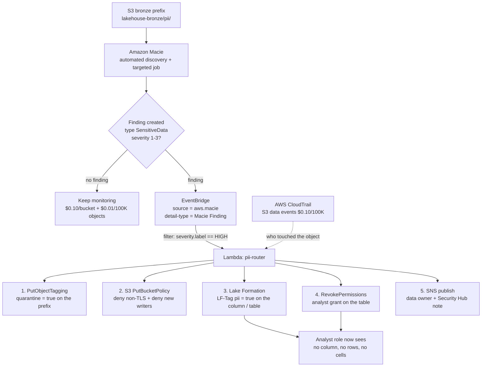
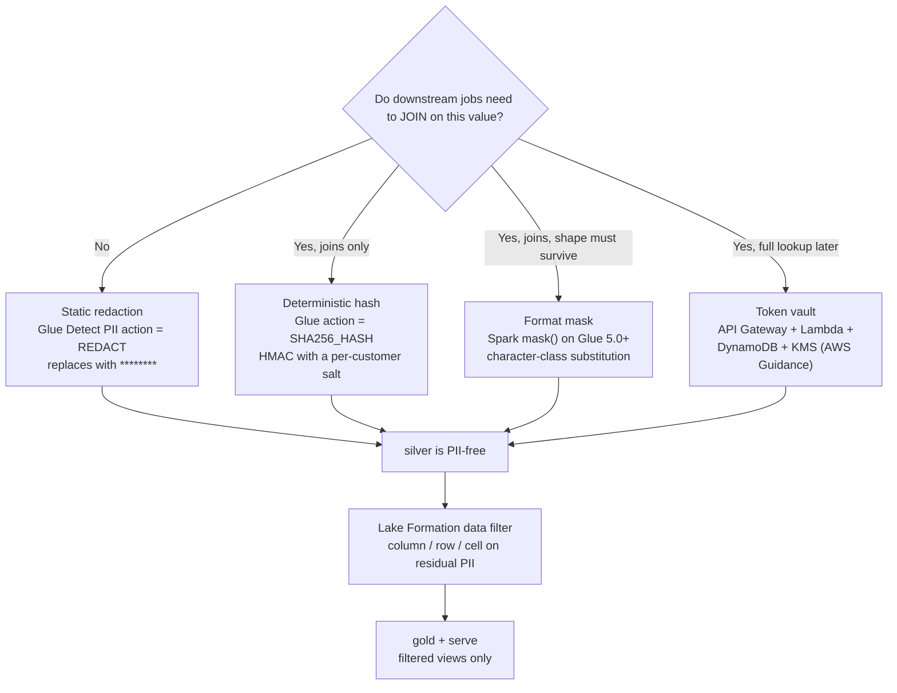
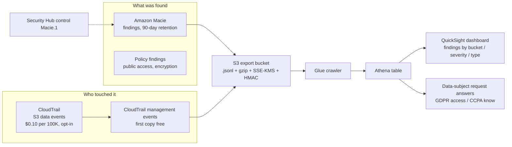
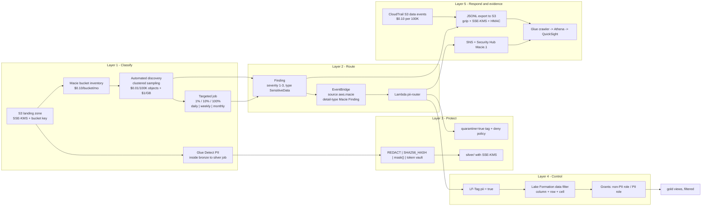

# PII Protection on the Lakehouse: Amazon Macie, Masking, and Privacy Workflows

Lessons 01 to 12 built a lakehouse that is fast, cheap and governable. That combination creates one new obligation: sooner or later somebody puts a customer's email address, phone number or national ID into `s3://lakehouse/bronze/`, and you have to be able to **say where it is, who can see it, what you did about it, and when you would have to delete it**. This lesson is the answer, and the answer is a *pipeline*, not a product.

The teaching rule for this lesson: **classify, route, protect, control, respond: five layers, each with a different service, none of them optional.** Amazon Macie only ever does the first one. Everything after a finding is *your* EventBridge rule, *your* Lambda, *your* Glue job and *your* Lake Formation grant.

```text
====================================================================
 PII PROTECTION SURFACE (us-east-1 list prices, as of Oct 2026)
====================================================================
 Classify ..... Amazon Macie: bucket inventory + monitoring,
                automated sensitive data discovery (sampling),
                targeted discovery jobs (1% / 10% / 100%)
                AWS Glue: Detect PII transform inside jobs,
                managed sensitive data types (incl. EMAIL)
 Route ........ EventBridge events, source = aws.macie,
                detail-type = "Macie Finding" ->
                Lambda / SNS / SQS / Security Hub custom actions
 Protect ...... Glue REDACT / PARTIAL_REDACT / SHA256_HASH,
                Spark mask() on Glue 5.0+, token vault
                (API Gateway + Lambda + DynamoDB + KMS)
                SSE-KMS default encryption + S3 Bucket Keys
 Control ...... Lake Formation data filters (column / row / cell)
                LF-Tags such as pii = true, tag-based grants
 Respond ...... CloudTrail (who), Macie findings (what),
                JSONL exports in S3 (evidence), 90-day retention
 Price ........ $0.10 per S3 bucket / month
                $0.01 per 100,000 objects monitored
                $1.00 per GB inspected (1 GB / month free tier)
                30-day free trial, up to 150 GB, jobs excluded
 Boundary ..... Macie sees S3 general purpose buckets only.
                Parquet tables and the Glue catalog are Glue's
                job, not Macie's. Macie finds; it never prevents.
====================================================================
```

In this lesson you will:

- run the **five-layer pipeline** end to end and name the service that owns each layer, and name the layer that has *no* AWS service at all (routing glue);
- go deep on **Amazon Macie**: inventory and monitoring, automated discovery versus targeted jobs, sampling depth, schedules, storage-class support and the hard scope limits;
- separate the **three numbers** students constantly confuse: finding severity (1 to 3), bucket sensitivity score (−1 to 100) and occurrence `count`;
- choose between **managed data identifiers and custom data identifiers**, write a real regex, and know exactly which identifier you must build yourself (email);
- read the **Finding schema** and route on it with an **EventBridge** rule into a Lambda that quarantines a prefix and stamps `PII=true`;
- price a classification programme **to the dollar**, using the three billing dimensions and the sampling-depth dial;
- choose a **masking technique by join-fidelity requirement**, redact, hash, format-mask or tokenize, and avoid the `mask()` runtime trap on Glue 4.0 and Athena;
- tie classification back to **Lake Formation column and row security** so a tag becomes an enforcement, not a note;
- build the **audit trail** from CloudTrail data events, Macie findings and JSONL exports;
- handle **GDPR, CCPA and LGPD** at AWS depth, including why S3 versioning quietly breaks erasure.

---

## 1. The five-layer pipeline: classify, route, protect, control, respond

### 1.1 The layers and who owns them

| Layer | Question it answers | Service that owns it | What breaks if you skip it |
|---|---|---|---|
| **1. Classify** | *Where is the PII?* | Amazon Macie (S3 objects) + AWS Glue Detect PII (tabular data in jobs) | You are guessing; audit asks for a list and you produce a spreadsheet |
| **2. Route** | *Who reacts, how fast?* | EventBridge (`source = aws.macie`) → Lambda / SNS / SQS / Security Hub | Findings accumulate in a console nobody opens |
| **3. Protect** | *What does the stored value look like?* | Glue / Spark masking, token vault, SSE-KMS encryption | Every reader of the raw prefix sees raw PII |
| **4. Control** | *Who may query it?* | Lake Formation data filters + LF-Tags | Masking is undone by anyone with direct `s3:GetObject` |
| **5. Respond & evidence** | *What can I prove?* | CloudTrail + Macie findings + JSONL exports | You cannot answer "when did you know?" |

Three properties of this table are worth memorising:

1. **Layers 1 and 5 are detective; layers 3 and 4 are preventive; layer 2 is the only glue.** Macie will never mask a column or revoke a grant: the wiring between a finding and a control is code you write.
2. **Layer 1 splits by engine.** Macie inspects **S3 general purpose buckets**; Glue's Detect PII transform inspects **DataFrames inside a job**. Parquet in the lake and columns in the Glue Data Catalog are Glue's territory, not Macie's.
3. **Layer 4 must exist even if layer 3 is perfect.** A beautifully masked `silver` table does nothing for the analyst who bypasses the lakehouse and reads `bronze/` with an IAM policy.

### 1.2 Worked example E1: pricing a classification programme (us-east-1, as of Oct 2026)

Take a bronze landing zone of **1 TB** holding **2,000,000 objects**, plus 14 smaller buckets (15 buckets total). Macie bills on three dimensions (Amazon Macie Pricing, accessed 2026-10-11):

```text
WORKED E1 - steady-state classification cost, 15 buckets, 1 TB bronze
--------------------------------------------------------------------
Bucket inventory and monitoring
  15 buckets x $0.10 per bucket / month            = $ 1.50 / month
  (prorated daily; covers up to 10,000 buckets per
   account and Region)

Objects monitored for automated discovery
  2,000,000 objects / 100,000 x $0.01              = $ 1.00 / month
  (all 15 buckets contribute to the object count)

Data inspected by automated discovery
  say 40 GB sampled in the month
  (40 - 1) GB x $1.00  [1 GB free tier]            = $39.00 / month

One targeted discovery job over the 1 TB bucket
  1,024 GB x $1.00                                 = $1,024 one-time
  + S3 GET/LIST: 2,000,000 GET x $0.004/10,000     = $ 0.80
  + ~2,000 LIST x $0.005/1,000                     = $ 0.01

TOTAL steady state (no targeted jobs)             = $41.50 / month
TOTAL with one full-scan targeted job             = $1,066.31 once
```

**The lesson inside the example:** automated discovery is the cheap continuous layer; targeted jobs are the expensive precision layer. The AWS cost-reduction playbook (Security Blog, 2023-03-20) is exactly this arithmetic: use automated discovery to *find* the risky buckets, sample them at **10%** (about **$102** on 1,024 GB) to validate, and reserve the full **$1/GB** scan for the handful of buckets that actually matter.

- **📚 Did you know?** The **30-day free trial** covers up to **150 GB inspected per account** and the bucket inventory dimension, but the pricing page is explicit that *"Any sensitive data discovery jobs you create will not be included in the 30-day free trial"* (Amazon Macie Pricing, accessed 2026-10-11). A demo team that runs a 200 GB, 100%-sampling job on day two of the trial has just billed itself about **$200**. The free trial covers discovery; it does not cover *your* jobs.

---

## 2. Amazon Macie in depth

### 2.1 Inventory and monitoring: the layer that is always on

Macie *"automatically and continually evaluates your S3 buckets for the presence of sensitive data"* using *"bucket inventory and monitoring, automated sensitive data discovery, and machine learning (ML) to profile buckets and sample objects"* (Macie User Guide, *Automated sensitive data discovery: how it works*, accessed 2026-10-11).

Three facts make this layer behave differently from a scan:

- **Buckets are clustered** *"by attributes such as bucket name, file types, and prefixes to cost-efficiently sample data broadly across an organization and minimize the data scanning needed"*. Clustering is why a representative sample can be statistically useful without touching every object.
- **Coverage is capped at 10,000 buckets per account and Region** (quota raised 2024-12-06), and billing is `$0.10 per bucket per month`, prorated daily.
- **Results are not instant.** Analysis results *"can begin to appear within 48 hours of enabling automated sensitive data discovery"*, and scores sit at `50 — Not yet analyzed` until they do. An empty bucket scores `1 — Not sensitive`, which means *no data*, not *no PII*.

### 2.2 Automated discovery versus targeted jobs

These are different mechanisms with different bills, and conflating them is the most common Macie misunderstanding.

| Property | **Automated sensitive data discovery** | **Targeted sensitive data discovery jobs** |
|---|---|---|
| Trigger | Continuous, on by default once enabled | You create it: **one-time (on-demand)** or **periodic (daily, weekly, monthly)** |
| Scope | Representative sample across clustered buckets | Objects matching your criteria (size, creation date, last modified) |
| Sampling | Statistical clustering, per-bucket profile | **Sampling depth: 1, 10 or 100 (percent)** |
| Feeds | Bucket **sensitivity score and label** | Findings only: *"They don't reflect the results of sensitive data discovery jobs that you create and run"* |
| Billing | `$0.01 / 100K objects` monitored + `$1.00/GB` inspected | `$1.00/GB` inspected, **not** in the free trial |
| Job object criteria | n/a | Object size 0 B: 5 TB; last modified no more than 1 year ago |
| Incremental behaviour | n/a | Periodic jobs *"evaluate new and modified objects that match the criteria and were added to the bucket during the specified schedule"* |

Job operational limits worth quoting in a design doc (Macie User Guide, *Quotas*, accessed 2026-10-11): **50 concurrent jobs**, **10,000 jobs per account**, job-creation API burst **1 per 20 seconds**, findings require objects of at least **15 bytes**, and the pattern-match window is **4 KB of text per object** (1 MB for S3 Select). Sensitive-data findings are trimmed at **15,000 findings per bucket per day**, and policy findings are deduplicated on a **15-minute** window.

- **📚 Did you know?** Macie's *supported storage classes* list is a gotcha generator: Standard, Standard-IA, One Zone-IA, Intelligent-Tiering, Reduced Redundancy and **Glacier Instant Retrieval** are inspected, but **Glacier Deep Archive and Glacier Flexible Retrieval are not**, and objects in **S3 Express directory buckets are not inspected at all**. Encrypted objects are readable only *"if the objects are encrypted with SSE-KMS or DSSE-KMS keys"* (Macie User Guide, accessed 2026-10-11). An archive tier full of legacy exports is not "covered"; it is invisible until restored.

### 2.3 Managed versus custom data identifiers

**Managed data identifiers (MDIs)** are AWS-maintained detectors. The quick reference lists **40**, grouped into Credentials (`ACCESS_KEYS`, `AWS_ACCESS_KEYS`, `AWS_ACCOUNT_ID`, `DB_CREDENTIALS`, `ENCODED_PRIVATE_KEY`, `PRIVATE_KEY`, `SECRET_KEYS`, …), Financial information (`BANK_ACCOUNT_NUMBER`, `CREDIT_CARD_NUMBER`, `CVC_NUMBER`, …), Personal information: PHI (`DOB`, `DRIVERS_LICENSE`, `HEALTHCARE_NUMBER`, `MEDICAL_RECORD_NUMBER`, `PASSPORT_NUMBER`, `SSN`, …) and PII (`ADDRESS`, `GENDER`, `NAME`, `PHONE`, `POSTAL_CODE`, …).

**Custom data identifiers (CDIs)** are yours: *"A custom data identifier helps you detect sensitive data in S3 objects… based on custom criteria that you specify"*: a **regular expression**, a **dictionary of words and phrases (keywords)**, and *"an optional list of regular expressions for text to ignore (ignore words)"* (Macie User Guide, accessed 2026-10-11).

| Knob | Managed (MDI) | Custom (CDI) |
|---|---|---|
| Maintained by | AWS, updated for you | You, and **immutable after creation** |
| Count | 40 in the quick reference | **≤ 100 per account and Region** |
| Regex | n/a | **≤ 4,096 characters**, or **≤ 400** if a proximity window is used |
| Keywords | n/a | **≤ 20**, total **≤ 400 characters** |
| Ignore words | n/a | **≤ 25**, each **≤ 40 characters** |
| Default severity | AWS-defined | **Medium**, overridable per identifier |
| Email address | **No `EMAIL` MDI exists** | This is where you build it |
| Allow list | n/a | **≤ 500 regexes, each ≤ 100 characters**, to suppress false positives |

> [!WARNING]
> ⚠️ **"Macie detects emails" is false out of the box.** There is **no `EMAIL` managed data identifier** in Macie. Worse, the default identifier set used by automated discovery *"excludes the NAME, EMAIL, CREDIT_CARD, IP_ADDRESS, and PHONE identifiers"* (Macie User Guide, *Automated discovery settings*, accessed 2026-10-11): the `EMAIL` in that list is a *category label* borrowed from Glue's vocabulary. In Macie, email coverage means a **custom data identifier**; in **AWS Glue**, the managed sensitive data type **`EMAIL` does exist**. Two catalogs, two answers, and students merge them into one wrong answer constantly.

### 2.4 Worked example E2: a custom data identifier, regex by regex

Requirement: detect Northwind Health member numbers of the form `NWH` followed by ten digits, in a bronze prefix of migrated policy documents, while not firing on order numbers or on test fixtures.

```text
WORKED E2 - custom data identifier "northwind-member-id"
--------------------------------------------------------------------
Regex (PCRE subset, no lookahead / lookbehind assertions):
    NWH[0-9]{10}
    -> matches NWH0000123456, not NWH-123456
    -> length well under the 4,096-character ceiling;
       add a proximity window and the ceiling drops to 400

Keywords (max 20, 400 characters total, used to anchor the regex):
    member_id   Member ID   policy_number   subscriber

Ignore words (max 25, each max 40 characters - kill false positives):
    test-NWH   sample-NWH   example-NWH   dummy-NWH   NWH0000000000

Proximity window: keyword and regex must co-occur within a
    short window of each other - the single biggest precision
    lever you have once the regex alone is too loose

Severity: custom identifiers default to Medium; set High because
    this is a PHI-adjacent identifier.

Lifecycle: CDIs are IMMUTABLE. Tighten the regex later and you
    CREATE a new identifier, RETIRE the old one, and re-run the
    jobs - you cannot quietly edit the rule that produced last
    quarter's findings. That immutability is the audit property.

Coverage: findings from this CDI appear alongside MDI findings in
    the same Finding objects and route through the same
    EventBridge rule in Section 3.
```

Two supporting facts: custom identifiers *"are unique to each customer and are not shared with other customers"* (Macie FAQ, page dated 2025-09-30), there is no marketplace of community detectors, and false-positive control belongs to **allow lists** (up to 500 regexes, 100 characters each), not to forking the identifier.

```matching
{
  "question": "Match each detection need to the engine that can actually satisfy it in October 2026:",
  "pairs": [
    {"left": "Email addresses sitting in raw JSON on S3", "right": "Macie custom data identifier (regex + keywords) - Macie has no EMAIL managed data identifier at all"},
    {"left": "Email addresses inside a Glue job over a DataFrame", "right": "AWS Glue managed sensitive data type EMAIL, used by the Detect PII transform"},
    {"left": "US Social Security Numbers in S3 objects", "right": "Macie managed data identifier SSN, and Glue's HIPAA / US categories if you are in a job"},
    {"left": "A public bucket, or objects uploaded without SSE-KMS", "right": "Macie policy check: a Policy finding, not a SensitiveData finding"},
    {"left": "A company-internal loyalty ID format unique to this business", "right": "Macie custom data identifier: the documented use case for CDIs is types unique to your organization"},
    {"left": "PII columns in a cataloged Iceberg table", "right": "Glue Detect PII inside the bronze-to-silver job: Macie reads S3 objects, not Data Catalog tables"}
  ],
  "explanation": "Three engines, three scopes: Macie managed data identifiers for standard patterns in S3 objects, Macie custom data identifiers for organization-specific patterns in S3 objects, and Glue's managed sensitive data types inside a job for tabular data. Policy findings are a fourth, separate type: bucket posture, not content. The trap answer is EMAIL: Glue has it, Macie does not."
}
```

### 2.5 The Finding: schema, severity, score, count

A Macie finding is a JSON object. The API `Finding` model exposes `id`, `createdAt`, `updatedAt`, `partition`, `region`, `resourceArn`, `title`, `severity`, `type`, either **`SensitiveData`** or **`Policy`**, and `count`, described as *"The total number of occurrences that were observed"* and *"always 1 for sensitive data findings"* at the top level. Per-identifier occurrence detail lives in the `occurrences` sub-objects, which carry their own `count` and up to **15** `location` entries. Findings are retained for **90 days** (raised from 30 on 2021-10-01).

Three numbers, three different objects: never conflate them:

| Number | Range | Object it describes | Source of truth |
|---|---|---|---|
| **Finding severity** | **1: Low, 2: Medium, 3: High** (no Critical) | One finding | *"Severity levels correspond to a range of 1 to 3"*; for policy findings it combines *"the nature of the issue and the number of the affected resources"* |
| **Sensitivity score** | **−1 … 100** | One **bucket**, automated discovery only | `-1` classification error · `1-49` not sensitive · `50` not yet analyzed · `51-99` sensitive · `100` manually assigned, never calculated |
| **Occurrence count** | integer | One identifier inside one finding | Top-level `count` is always 1 for sensitive data findings; the detail is in `occurrences` |

AWS is explicit that the score *"neither… implies or otherwise indicates the criticality or importance that a bucket or a bucket's objects might have for you"* (Macie User Guide, *Sensitivity scoring for S3 buckets*, accessed 2026-10-11). A score of **100 is always a manual override**; Macie never assigns it. If discovery is disabled at the organization level, existing scores and labels persist for **30 days** and are then reset.

- **📚 Did you know?** Macie's own findings are **sensitive artifacts**. Occurrence `location` entries describe where a match was found in the object, and the S3 results repository writes **JSON Lines** files (`*.jsonl`, gzip-compressed, encrypted with **SSE-KMS**) that each carry a **keyed-hash message authentication code (HMAC)** signature (added 2023-11-08). Treat exports with the same care as the data: encrypt them with a restricted key, limit `GetFinding` to the security team, and expire the export prefix with a lifecycle rule.

### 2.6 EventBridge: the routing contract

> "When Macie detects new sensitive data findings or policy findings… it publishes corresponding events to EventBridge. EventBridge then routes the events to targets that you specify. Targets can include AWS Lambda functions, Amazon SNS topics, and Amazon SQS queues.": Macie User Guide, *Findings, events, and EventBridge* (accessed 2026-10-11)

The two fields you filter on:

```json
{
  "detail-type": "Macie Finding",
  "source": "aws.macie",
  "detail": {
    "type": "SensitiveData",
    "severity": { "level": 3, "label": "HIGH" },
    "category": "SensitiveData",
    "resourceArn": "arn:aws:s3:::lakehouse-bronze",
    "region": "us-east-1"
  }
}
```

Documented event flavours include *new sensitive data findings*, *new occurrences of existing sensitive data findings*, *new policy findings* and *subsequent occurrences of existing policy findings*; which means **your rule must be idempotent**, because an existing finding can fire again when a new occurrence shows up. Security Hub ingests the same findings, exposes the CSPM control **`Macie.1` ("Amazon Macie should be enabled")**, and offers **custom actions** that turn a human button press into a second EventBridge rule into a Lambda (AWS Security Blog, 2022-07-18; sample repo `aws-samples/security-hub-macie-remediation`).

### 2.7 Worked example E3: sampling depth as a cost *and* coverage dial

A **200 GB** bucket, one targeted job, `$1.00 per GB inspected` (us-east-1, as of Oct 2026):

```text
WORKED E3 - same bucket, three sampling depths
--------------------------------------------------------------------
depth 1%    ->   2 GB inspected -> $   2.00
depth 10%   ->  20 GB inspected -> $  20.00
depth 100%  -> 200 GB inspected -> $200.00
                (before applying the 1 GB per month free tier
                 for sensitive data discovery, if unused)

Coverage read-out:
  1%   - finds nothing in the 99% of objects never sampled.
         A finding from a 1% job describes the SAMPLE.
  10%  - the AWS cost-reduction playbook's validation tier:
         enough signal to decide whether to pay for 100%.
  100% - the only depth at which a negative result means
         "this bucket is clean" rather than "this bucket
         was mostly unread".

Spend cap: targeted discovery has a default service quota of
  5 TB per account. Reach 5 TB and your targeted jobs PAUSE.
  Raising beyond 25 TB goes through AWS Support.
```

```plot
{
  "type": "bar",
  "title": "Targeted discovery cost for one 200 GB bucket by sampling depth (us-east-1, as of Oct 2026)",
  "data": [
    {"Sampling depth": "1%", "Inspection cost (USD)": 2},
    {"Sampling depth": "10%", "Inspection cost (USD)": 20},
    {"Sampling depth": "100%", "Inspection cost (USD)": 200}
  ],
  "xKey": "Sampling depth",
  "dataKeys": ["Inspection cost (USD)"],
  "xLabel": "Sampling depth",
  "yLabel": "USD, one-time job"
}
```

The x-axis is linear in money and *non-linear in what you learn*: going from 10% to 100% costs 10× and buys the only result you can defend in an audit. Depth is a **cost/coverage dial, not a quality setting**; there is no depth at which Macie's regexes get smarter.

---

## 3. The classify → route pipeline: finding, Lambda, quarantine, tag

### 3.1 The routing diagram



The top half is **detection**; the bottom half is **prevention**. Both must exist, because Macie is *periodic* (up to a 48-hour warm-up, then your chosen cadence) while Glue masking in Section 4 runs *per load*. A pipeline with only the top half reports on damage; a pipeline with only the bottom half never learns about the data that arrived before the masking job existed.

### 3.2 Worked example E4: the rule and the handler

The EventBridge rule, filtered to high-severity sensitive-data findings:

```json
{
  "Source": "aws.macie",
  "detail-type": ["Macie Finding"],
  "detail": {
    "type": ["SensitiveData"],
    "severity": { "label": ["HIGH"] },
    "category": ["SensitiveData"]
  }
}
```

The Lambda handler's five side effects, in the order they must run:

```text
WORKED E4 - pii-router Lambda (the layer AWS does not provide)
--------------------------------------------------------------------
event detail -> extract resourceArn, region, severity, occurrences

 1. CONTAIN FIRST, classify second.
    s3 PutObjectTagging on the matched key(s):
        quarantine = true, found-by = macie, finding-id = <id>
    -> a Lifecycle rule can now expire or move anything tagged
       quarantine = true without a hand-maintained prefix list.

 2. TIGHTEN THE BUCKET.
    PutBucketPolicy: deny s3:PutObject unless
        s3:x-amz-server-side-encryption = aws:kms
    (findings frequently mean an object arrived unencrypted or
     through a path your default-encryption rule did not cover)

 3. TURN THE FINDING INTO A GRANT CHANGE.
    lakeformation TagResource   -> pii = true on table + columns
    lakeformation RevokePermissions -> drop the analyst grant
    -> this is the step students forget: a tag is documentation
       UNTIL a tag-based grant exists that consumes it.

 4. NOTIFY. SNS to the data owner, Security Hub note for posture.

 5. IDEMPOTENCY.
    Macie emits events for NEW OCCURRENCES of an EXISTING finding.
    De-dupe on finding id + occurrence set, or your ticket queue
    fills with duplicates from one 400-row object.

 total: 1 rule + 1 function + 2 S3 calls + 2 LF calls + 1 publish
```

**Cost of the routing layer itself, as of Oct 2026:** the first copy of CloudTrail management events is free; CloudTrail **S3 data events are $0.10 per 100,000 events** and are **opt-in**: without them you cannot answer *"who read the object"* after an incident (AWS CloudTrail Pricing, accessed 2026-10-11). Lambda, EventBridge rules and SNS are metered separately, but on this volume they are cents.

```dragdrop
{
  "question": "Order the PII response workflow from the moment a Macie finding lands to the moment an analyst is blocked:",
  "items": [
    "Macie creates a SensitiveData finding with severity 3 (High) for an object in bronze/pii/",
    "EventBridge matches on source aws.macie and detail-type Macie Finding, filtered to HIGH severity",
    "Lambda quarantines the object by tagging it quarantine=true and denies further unencrypted puts on the bucket",
    "Lambda stamps the Lake Formation resource with LF-Tag pii=true so the classification becomes machine-readable",
    "Lambda revokes the existing analyst SELECT grant that was issued before the data was known to be PII",
    "Lake Formation evaluates tag-based grants: the analyst role no longer matches any grant on pii=true",
    "SNS notifies the data owner and Security Hub records the event against control Macie.1",
    "The whole sequence is written to CloudTrail so the response timeline can be reconstructed later"
  ],
  "correctOrder": [
    "Macie creates a SensitiveData finding with severity 3 (High) for an object in bronze/pii/",
    "EventBridge matches on source aws.macie and detail-type Macie Finding, filtered to HIGH severity",
    "Lambda quarantines the object by tagging it quarantine=true and denies further unencrypted puts on the bucket",
    "Lambda stamps the Lake Formation resource with LF-Tag pii=true so the classification becomes machine-readable",
    "Lambda revokes the existing analyst SELECT grant that was issued before the data was known to be PII",
    "Lake Formation evaluates tag-based grants: the analyst role no longer matches any grant on pii=true",
    "SNS notifies the data owner and Security Hub records the event against control Macie.1",
    "The whole sequence is written to CloudTrail so the response timeline can be reconstructed later"
  ],
  "explanation": "Containment precedes classification, classification precedes revocation, revocation precedes notification: and audit wraps all of it. The two ordering errors that matter: tagging (quarantine) before policy-tightening means the next write is already in flight, and notifying before revoking means the data owner is told about a window that is still open. Note also that the LF-Tag alone blocks nothing: without the matching tag-based grant (or its revocation), pii=true is a label."
}
```

---

## 4. Protection in the lake: detect bronze → tag → mask/tokenize silver

Classification without transformation just tells you *where the problem is*. The medallion answer is a **write-time** transformation: detect at **bronze**, tag at the **catalog boundary**, mask or tokenize on the way into **silver**, and let Lake Formation guard whatever residual PII survives.

### 4.1 Choose the technique by the question "must it join? must it come back?"



**Only these four are verified AWS patterns.** Format-preserving encryption (AES-FF1 style FPE) is *not* an AWS managed lakehouse feature: if you see it, it is a third-party or general cryptographic technique, not something Glue or Athena ships.

### 4.2 Pattern A: static redaction, and the Glue Detect PII transform

The **Detect PII transform** detects *"personally identifiable information (PII)… columns in your input data that might contain PII data"*, either on a **per-cell basis (default)** or a **per-column basis** where you supply a sampling percentage and a matching threshold. Its four actions: **`Enrich`**, **`Redact` (default, replaces sensitive data with `********`)**, **`Partial redact`**, and **`SHA-256 hash`**. Sensitivity levels are **`High`** and **`Low`**; categories are **`Universal`, `HIPAA`, `Networking`, `US`, `UK`, `CA`, `ES`, `IT`**; and *"You can also apply different transformations to different columns by using fine-grained overrides"*. In Glue 3.0/4.0 job output the reported `actionUsed` values are `DETECT`, `REDACT`, `PARTIAL_REDACT`, `SHA256_HASH`.

### 4.3 Pattern B: deterministic tokenization that still joins

Deterministic means *the same input always produces the same token*, so `GROUP BY hashed_email` still clusters a customer across tables. It also means the mapping is reversible **in principle** for low-entropy inputs: a 10-digit phone number space is enumerable, so a plain SHA-256 of a phone number is a **dictionary attack away from being plaintext**. The fixes, in order of preference:

1. **Keyed HMAC with a secret salt** stored in Secrets Manager: same determinism, no rainbow table. Use this for phone, SSN, postcode-grade values.
2. **Reserve plain `SHA256_HASH` for high-entropy identifiers**: UUIDs, account numbers with check digits.
3. **Full tokenization vault** when you need reversibility *and* to remove PII from the analytical path: the AWS Guidance *Tokenization to Improve Data Security and Reduce Audit Scope on AWS* (reviewed 2024-07-23) architecture is **API Gateway → Lambda → DynamoDB token vault encrypted with KMS**, with tokens carrying an HMAC so lookups are consistent. Downstream analytics consume tokens only; the vault is the only component that can ever see the original.

### 4.4 Worked example E5: the same email, four times, and why they differ

```text
WORKED E5 - determinism, entropy and reversibility side by side
--------------------------------------------------------------------
Input:  jane.doe@example.com   (high entropy, millions of possible
        values - safe to hash deterministically)
Input:  5551234567             (10 digits - enumerable, unsafe)

1. REDACT (Glue Detect PII, default)
   jane.doe@example.com -> ********
   5551234567           -> ********
   Deterministic? yes (always the same mask). Joinable? NO.
   Reversible? NO. Use when nothing downstream needs the value.

2. SHA256_HASH (Glue action SHA256_HASH)
   jane.doe@example.com -> 9f2a... (stable across jobs, joins work)
   5551234567           -> 3c81... (stable - AND enumerable: 10^10
                          candidates can be hashed offline until
                          the digest matches)
   Use #2 only for high-entropy identifiers.

3. HMAC with a per-customer salt (Secrets Manager)
   same input -> same token, but the digest cannot be attacked
   offline without the salt. This is the default answer for
   phone / SSN / postcode-grade fields.

4. Token vault (AWS Guidance, reviewed 2024-07-23)
   jane.doe@example.com -> tok_8Qm2Rw   (DynamoDB item, KMS-encrypted
                          vault holds the mapping)
   Deterministic? yes (HMAC-keyed lookup). Joinable? YES.
   Reversible? YES, through the vault - and only through the vault,
   which is the point: the analytic path never holds the plaintext.

Rule of thumb: ask two questions per column - "must it JOIN?" and
"must it COME BACK?". No/No -> REDACT. Yes/No -> hash or HMAC.
Yes/Yes -> token vault.
```


### 4.5 Pattern C: format masking with Spark's `mask()`

Spark's SQL `mask()` function (*"New in version 3.5.0"*) *"Masks a column with default characters for letters, numbers, and 'other' characters: 'X' (uppercase), 'x' (lowercase), '0' (digit), '*' (other)"*, and accepts replacement characters as arguments: `mask(col, upperChar, lowerChar, digitChar, otherChar)`.

### 4.6 Worked example E6: one Glue job, three different protections

A DataFrame of **100,000 customer rows** leaving bronze for silver (Glue *Detect PII* API shape, accessed 2026-10-11):

```text
WORKED E6 - bronze -> silver, per-column overrides
--------------------------------------------------------------------
transformName = DetectSensitiveData
action              = REDACT          # default for everything
sensitivityLevel    = HIGH
sampleFraction      = 1.0             # 0 < value < 1
thresholdFraction   = 0.8             # per-column detection only
entityTypes         = [...]           # fine-grained overrides

column plan (one job, three different protections):
  ssn       -> REDACT           => ********   (never needed downstream)
  email     -> SHA256_HASH      => 9f2a...    (marketing still joins)
  phone     -> SHA256_HASH with an HMAC salt from Secrets Manager
              (plain SHA-256 is enumerable at 10 digits)
  first_name-> mask('X','x','0','*') on Glue 5.0+ => Jxxx Rxxxx
  loyalty_id-> DETECT only, left in place, LF-Tag pii = true
              so Lake Formation decides who may read it

output: silver/ , written with SSE-KMS
catalog: crawler tags the columns, classification job attaches
         LF-Tag pii = true
```

The point of the worked example: **one job produces three different outcomes**, destroyed, joinable, and merely *governed*, chosen per column by what the consumer actually needs. Redaction is irreversible; hashing preserves joins; tag-plus-grant preserves the value for entitled roles only.

> [!WARNING]
> ⚠️ **`mask()` is not where students think it is.** Spark's `mask()` is *"New in version 3.5.0"*. The Glue version matrix is **Glue 4.0 = Spark 3.3.0** (no `mask()`), **Glue 5.0 = Spark 3.5.4** (has it), **Glue 5.1 = Spark 3.5.6**, **Glue 6.0 = Spark 4.1.1**, so a `mask()` call on a Glue 4.0 job fails **at runtime, not at compile time**, because functions resolve dynamically. And **Athena cannot do it at all**: Athena engine version 3 uses the Trino scalar string function set, which contains **no `mask()` function**, use `regexp_replace` or a UDF in Athena, or push masking to Glue at write time. Two more edges: the Python reference's signature line and its prose description print *different* default characters, so pin the behaviour you rely on with explicit arguments; and there is no AWS-published benchmark comparing Glue-time `mask()` with Athena-time `regexp_replace`, so treat that as an architectural trade-off, not a measured one.

### 4.7 Pattern D: the encryption backstop

Since **2023-01-05** every new S3 upload is encrypted with **SSE-S3 by default at no additional cost**. That is not the posture you want for PII: SSE-S3 uses AWS-managed keys, gives you **no per-key audit granularity** and **no deny-by-key-policy control**. PII buckets should therefore require **SSE-KMS**, set bucket default encryption to `aws:kms` *and* add a bucket policy condition denying uploads that are not `aws:kms`, with **S3 Bucket Keys** switched on.

### 4.8 Worked example E7: what the backstop costs (us-east-1, as of Oct 2026)

```text
WORKED E7 - KMS bill for a read-heavy bronze bucket
--------------------------------------------------------------------
Workload: 2,000,000 GETs / month against a 1 TB bucket

Without a bucket key (each GET triggers KMS requests):
  2,000,000 / 10,000 x $0.03      = $6.00 / month in KMS requests
With S3 Bucket Keys:
  AWS documents a reduction in KMS request costs of "up to
  99 percent" -> effectively cents.

Fixed costs either way:
  1 customer managed key              = $1.00 / month per key
  (one key per data class per Region
   is the usual split: pii, general, archive)

S3 request prices for the same traffic (offer file 2026-09-28):
  GET & all other  $0.004 / 10,000   = $0.80 for 2M GETs
  PUT/LIST         $0.005 / 1,000
  Standard storage $0.023 / GB-month

Gotcha: bucket keys are NOT supported for DSSE-KMS
  (dual-layer encryption, supported by Macie since 2024-01-17).
  Highest-sensitivity layer + bucket keys = pick one.

Key policy is the real control: restrict Decrypt to the Glue job
role, the Lake Formation-vended credentials and the break-glass
role - then "encryption" becomes an access decision too.
```

- **📚 Did you know?** Determinism and reversibility pull in opposite directions, and AWS's own tokenization guidance exists precisely because of that. A deterministic hash is *join-friendly but attackable* for low-entropy fields; a token vault is *reversible but requires a lookup service*; a redaction is *safe but final*. The AWS Guidance tokenization paper (reviewed 2024-07-23) puts the vault behind API Gateway with a KMS-encrypted DynamoDB table, which also shrinks your audit scope: the analytic path never holds the plaintext, so the systems that need scope reduction stop being in scope for it.

---

## 5. Lake Formation tie-back: from tag to column and row enforcement

Classification only becomes security when a permission consumes the classification. Lesson 12 owns the grant mechanics; this section is the PII-specific shape.

### 5.1 The two mechanisms

- **LF-Tags (tag-based access control, LF-TBAC)**: attach `pii = true` (or `data_class = phi`) to databases, tables and **columns**. Key and value strings are **≤ 50 characters**, stored lowercase, with **≤ 50 tags per Lake Formation resource**, **≤ 10,000 tag keys** and **≤ 1,000 values per key**. Grants then name *attributes*, so every table a crawler creates inherits the policy the moment someone tags it.
- **Data filters**: *"Data filters in Lake Formation enable you to implement column-level, row-level and cell-level security on Data Catalog tables"*, expressed with a **PartiQL** row-filter expression, inclusion columns (column-level), exclusion columns (cell-level) and both together (cell-level). They can be shared with accounts, AWS Organizations, IAM principals and IAM roles.

### 5.2 Worked example E8: one table, two roles, one PII column

```text
WORKED E8 - the PII grant shape on gold.customers (Iceberg)
--------------------------------------------------------------------
Table: gold.customers
Columns: customer_id, email, phone, ssn, segment, region
LF-Tags:  pii-email = true  (column)
          pii-ssn   = true  (column)
          domain    = customer (table)

GRANT 1  role analytics-non-pii
         SELECT on gold.customers
         Columns = customer_id, segment, region   (inclusion)
         -> column-level security: ssn and email
            are not merely hidden from results, they are
            excluded for this principal

GRANT 2  role pii-analyst (named, justified, time-boxed)
         SELECT on gold.customers  (all columns)
         + a data filter limiting rows to region = 'eu'
         -> cell-level: full columns, restricted rows

GRANT 3  tag-based: SELECT where domain = customer
         issued to the platform role
         -> every future table tagged domain = customer is
            covered without a new grant

AUDIT:   list-permissions after each grant; Lake Formation has
         no deny primitive, so a later plain SELECT grant on the
         same table re-includes what you excluded.
```

Cell-level filters are also how you *"show the column but null out the values"* **without materialising a masked copy**; which is the cheapest possible answer to "we need the schema for the dashboard but not the data".

- **📚 Did you know?** Lake Formation grants are cheap to over-grant *financially* and expensive to over-grant *politically*: permission checks cost nothing, while the integrated engines bill for what they scan. That asymmetry is why the PII pattern is always *over-restrict by default, then grant exceptions*: the failure mode of the opposite approach is not a bigger bill, it is an incident.

---

## 6. Audit: CloudTrail data events, Macie history, and the evidence store

### 6.1 What each artifact can and cannot answer

| Question | Artifact | Retention / price (as of Oct 2026) |
|---|---|---|
| *Where is the PII?* | Macie findings + JSONL exports | Findings **90 days**; S3 export detail **up to 90 days** in Macie, your S3 copies indefinitely |
| *Who read the object?* | CloudTrail **S3 data events** | **$0.10 per 100,000 events**, **opt-in**; management events first copy **free** |
| *Who changed a grant?* | CloudTrail Lake Formation API events | First copy of management events free; extra copies **$2.00 / 100,000** |
| *What is the current posture?* | Security Hub `Macie.1` + Macie policy findings | Policy finding dedup window **15 minutes** |
| *How sensitive is this bucket?* | Macie sensitivity score | Resets **30 days** after org-level disable |
| *What did we export and is it intact?* | JSONL + gzip + SSE-KMS + **HMAC signature** | Your lifecycle rule decides |

### 6.2 The evidence flow, drawn



Two properties of this diagram are worth stating out loud: **the export bucket is the long-term evidence store** (Macie itself keeps detailed information for up to 90 days), and **CloudTrail is the only leg that answers "who"**: Macie answers "what", never "who read it". That split is the whole reason a privacy programme needs both services.

### 6.3 Worked example E9: the evidence pack for one quarter

```text
WORKED E9 - quarterly PII audit pack (costs as of Oct 2026)
--------------------------------------------------------------------
Inputs
  15 buckets, 500,000 S3 object-level events / quarter
  4,000 Macie findings in the quarter
  1 JSONL export per week

Costs
  CloudTrail S3 data events:
    500,000 / 100,000 x $0.10           = $0.50 / quarter
  Macie bucket inventory:
    15 x $0.10 x 3                     = $4.50 / quarter
  Macie object monitoring:
    2,000,000 objects / 100,000 x $0.01 x 3 = $3.00 / quarter
  Macie inspection (say 40 GB/month):
    (40 - 1) x $1.00 x 3               = $117.00 / quarter
                                          ----------------
  TOTAL                                 ~ $125 / quarter

Assembly
  1. Glue crawler over the exported .jsonl files -> Athena table
  2. Athena: findings by bucket, severity, identifier, week
  3. QuickSight dashboard for the compliance review
  4. CloudTrail answers "who", Macie answers "what",
     the JSONL + HMAC answers "and we can prove the export
     was not edited"

  Pattern source: AWS Security Blog, "How to query and visualize
  Macie sensitive data discovery results with Athena and
  QuickSight", 2023-01-06 (DDL updated 2023-02-21).
```

### 6.4 Worked example fill-in: the routing contract

```fillblank
{
  "question": "Complete the Macie routing contract and its retention numbers:",
  "template": "A Macie finding arrives on EventBridge with detail-type {{1}} and source {{2}}. Findings are retained for {{3}} days, sensitive-data findings carry severity values of {{4}} on a 1-to-3 scale, and a bucket's sensitivity score ranges from {{5}} to 100.",
  "answers": {
    "1": "Macie Finding",
    "2": "aws.macie",
    "3": "90",
    "4": "1 (Low), 2 (Medium), 3 (High)",
    "5": "-1"
  },
  "distractors": [
    "Macie SensitiveData",
    "AWS Macie Event",
    "Macie Policy Finding",
    "aws.macie2",
    "aws.securityhub",
    "aws.s3",
    "30",
    "180",
    "365",
    "0 (Informational) through 4 (Critical)",
    "1 (Medium), 2 (High), 3 (Critical)",
    "LOW, MEDIUM, HIGH, CRITICAL",
    "0",
    "1",
    "50"
  ],
  "explanation": "EventBridge events carry detail-type 'Macie Finding' with source 'aws.macie'. Findings are retained 90 days (raised from 30 on 2021-10-01). Severity is a 1-3 scale labelled Low/Medium/High: there is no Critical and no 0. Sensitivity score runs -1 (classification error) to 100 (manual override only); 50 means 'not yet analyzed'."
}
```

---

## 7. Compliance framing: GDPR, CCPA and LGPD at AWS depth

Compliance is a **mapping exercise, not a feature flag**. Each regulation maps onto specific layers of Section 1, and each has one AWS-specific pitfall.

### 7.1 The three regulations, in scope

| Regulation | In force | AWS framing (source, accessed 2026-10-11) | Layers that carry it |
|---|---|---|---|
| **GDPR** | **May 25, 2018** | Personal data is *"any information relating to an identified or identifiable natural person, including names, email addresses and phone numbers"*; AWS *"acts as both a data processor and a data controller"*; the AWS Service Terms include the **SCCs adopted by the European Commission in June 2021**, applying automatically to transfers outside the EEA without an adequacy decision | 1 (find it), 3 (erase it), 5 (prove it) |
| **CCPA / CPRA** | Page last updated **2025-08-08** | AWS positions S3, CloudTrail, CloudWatch, Lambda, Glue, Athena and Lake Formation as customer-side tooling for data-subject request workflows, and states it will not "sell" or "share" personal information as defined by the CCPA/CPRA in the context of providing the services | 1 (locate), 4 (revoke), 5 (evidence) |
| **LGPD** | **September 18, 2020** | Applies to organisations *"whether or not established in Brazil"* that process personal data for people in Brazil; the **ANPD** may set minimum technical standards; AWS explicitly offers **CloudTrail** as the tool for knowing *"who has access to their resources, when, and from where"* for breach notification | 1, 5 |

AWS also maintains a **LGPD workbook** (AWS Security Blog, 2022-04-25) mapping controls to CIS v8.0, NIST CSF, the NIST Privacy Framework and AWS CAF 3.0, useful when a regulator asks for a control *framework* rather than a list of services. And note the shared-responsibility boundary: the **HIPAA Eligible Services Reference** (last updated **September 3, 2026**) lists **Amazon Macie, AWS Lake Formation, AWS Glue, Amazon Athena, AWS Lambda, Amazon EventBridge, AWS CloudTrail, AWS KMS, Amazon S3, AWS Step Functions, Amazon GuardDuty** and more, the whole toolchain in this lesson is eligible *in the right configuration*, and eligibility never transfers your own compliance obligation.

### 7.2 Worked example E10: a versioning-aware erasure

Request: delete customer `C-123` from bronze and silver, under GDPR Article 17 (erasure) or LGPD/CCPA equivalents.

```text
WORKED E10 - erasure that survives an audit
--------------------------------------------------------------------
 1. LOCATE
    Athena over the Macie JSONL export table + a scan of the
    Parquet partitions: which objects, which partitions,
    which rows contain C-123?   (layer 1 pays for itself here)

 2. REWRITE
    Glue job rewrites the affected Iceberg partitions with the
    row removed; commit new snapshot.

 3. ERASE THE OLD BYTES - this is the step teams fail
    With versioning ON (the norm for a lake), DeleteObject only
    inserts a DELETE MARKER and keeps prior versions.
    -> DeleteObject with version IDs for every non-current
       version, AND/OR a lifecycle rule expiring noncurrent
       versions and delete markers.
    -> A soft delete FAILS a GDPR erasure audit.

 4. PURGE THE SECONDARY COPIES OF THE VALUE
    - Macie findings for that object (90-day auto-purge; delete
      earlier if you can)
    - JSONL export files (they carry occurrence locations)
    - QuickSight SPICE extracts and Athena result caches if they
      materialised the value
    - Token vault entry, if you tokenized instead of redacting

 5. RECORD IT
    CloudTrail sequence = evidence of who did what, when.
    Keep the request ticket, the job run ID and the row count
    diff as the erasure receipt.

CONFLICT TO KNOW: retention obligations (WORM, Object Lock,
financial records) block erasure while they run. "Instant right
to be forgotten" and "immutable retention on the same objects"
cannot both be true - document which one wins for which dataset.
```

> [!WARNING]
> ⚠️ **Versioning turns "delete" into a soft delete.** For versioned buckets, deleting the current version without specifying a version ID means Amazon S3 *"doesn't permanently delete the object. Instead, S3 adds a delete marker, issuing a soft delete"*; you must remove **all non-current versions and delete markers** for real erasure (Amazon S3 User Guide, *Deleting objects*, accessed 2026-10-11). The same trap catches Macie exports and QuickSight extracts: erasure is a *system-wide* operation, not an S3 operation.

- **📚 Did you know?** Evidence and erasure work against each other by design. Macie's findings contain occurrence locations and are retained **90 days**; your JSONL exports contain the same detail and are retained until *your* lifecycle rule says otherwise. A defensible privacy programme therefore declares in advance **which store is the system of record for evidence, how long it lives, and what the deletion procedure is for that store too**: otherwise you will satisfy an erasure request in the lakehouse while the audit trail still holds the value.

---

## 8. The worked end-to-end flow

Everything in this lesson, in one pass: bronze to serve, detection to evidence:



Read it left to right once more: **every box in Layer 1 costs money only when data is inspected; every box in Layers 3 to 4 costs nothing until someone queries; Layer 5 is the only layer whose output you can hand to a regulator.**

### 8.1 The decision checklist before you ship

```text
CLASSIFY    [ ] Macie enabled, delegated admin if multi-account
            [ ] target list of prefixes for targeted jobs
            [ ] email / org-specific formats covered by CDIs
            [ ] Glue Detect PII wired into bronze -> silver
ROUTE       [ ] EventBridge rule on source aws.macie
            [ ] rule filters type + severity label
            [ ] handler is idempotent (new occurrences re-fire)
PROTECT     [ ] redact / hash / mask / vault chosen PER COLUMN
            [ ] Glue runtime checked: mask() needs Glue 5.0+
            [ ] low-entropy fields use HMAC, not bare SHA-256
            [ ] bucket default encryption = aws:kms + bucket key
            [ ] bucket policy DENY non-KMS uploads
CONTROL     [ ] pii = true tags on columns
            [ ] non-PII role gets an INCLUSION column grant
            [ ] direct s3:GetObject on bronze removed
AUDIT       [ ] CloudTrail S3 data events ON for PII buckets
            [ ] JSONL exports restricted + lifecycle-expired
            [ ] evidence pack rehearsed once (E9)
COMPLIANCE  [ ] erasure runbook includes version IDs
            [ ] secondary copies listed (findings, extracts, vault)
            [ ] retention vs erasure conflict documented
```

### 2026 Updates (as of October 2026)

> [!NOTE]
> **What moved in the PII story between 2024 and October 2026**: each line checked against a primary AWS source:
> - **Macie managed data identifiers for more national IDs (2025-03).** New managed data identifiers cover **Colombia, Chile, Costa Rica and Mexico** national identifiers, Brazil's **Banco Interoperabilidade de Pagamentos (SUBE)** cards and tax IDs: each one is custom-regex work you no longer have to do (Macie documentation history, accessed 2026-10-11).
> - **VPC interface endpoints for Macie in all Regions (2025-07-02).** Findings and API traffic can now stay on the AWS network, which is the usual enterprise precondition for enabling Macie account-wide in a regulated VPC design.
> - **10,000 buckets per account and Region for preventative monitoring (2024-12-06).** The inventory ceiling that used to force bucket sub-selection at 1,000 is now large enough that most accounts can monitor everything at **$0.10/bucket/month**.
> - **Macie's own changelog is quiet.** The most recent documentation-history entry is **2025-07-02**, so teach sampling depth, CDI immutability, 90-day retention and severity 1 to 3 as *current behaviour*, never as "the 2026 Macie update". Two older entries still matter: findings retention moved from 30 to **90 days on 2021-10-01**, and **DSSE-KMS** encrypted objects have been supported since **2024-01-17**.
> - **The default automated-discovery identifier set is dynamic** (since 2023-08-02): AWS updates which managed identifiers run by default. Re-verify your exclusion list after any settings change, and confirm with a **canary object** containing a known fixture rather than trusting the console.

---

## Real-World Case Studies

AWS publishes what these designs look like at production scale. Every figure below is **customer- or AWS-claimed and unaudited**, with source and date named so you can check it: the examinable point is the **pattern**.

### Case A, FanDuel: two roles, one column grant, the security angle

| Element | Detail |
|---|---|
| Customer | **FanDuel Group**, sports betting and gaming: presence across **50 states** and **over 8.5 million customers** |
| Problem | Three Amazon Redshift warehouses merged into one platform (warehouse + data lake). Customer PII had to be walled off from general analysts **without maintaining two copies of every dataset** |
| First design (rejected) | Separate S3 files, one with PII, one without, tagged and gated by IAM, costing **"100 to 200 hours of development time for every data source that was ingested"** |
| Services | **AWS Lake Formation** (registered S3 location, column-based permissions), **Amazon Redshift Spectrum** external schemas per role, **AWS Glue** ETL writing Parquet plus crawlers, IAM/Redshift groups for entitlement sync |
| Pattern | Two roles on **one physical dataset**: **`LimitedPIIAnalyst`**, granted access to all columns; **`NonPIIAnalyst`**, granted access to non-PII columns **and assigned to analysts by default** |
| Outcome | *"Lake Formation column-level access control allowed them to secure PII data, which otherwise would have taken a complex S3 tag-based approach. This saved 100 to 200 hours of development time for every new data source and data footprint."* |
| Source | AWS Big Data Blog, *How FanDuel Group secures personally identifiable information in a data lake using AWS Lake Formation*, **2020-12-21** (digest 18, source S10; accessed 2026-10-11) |

**The security angle.** FanDuel's design is a *default-deny* structure wearing a performance costume. The dangerous property of a dual-file design is not the storage cost, it is that **the PII copy exists as a separately addressable object**, so every new source creates a second artifact that needs its own bucket policy, its own tag hygiene and its own review, and every one of those is a place where the PII-bearing copy can be left wide open. Collapsing it to **one dataset plus a column grant** removes the second artifact entirely: there is no "PII file" to mis-tag, no shadow copy drifting out of compliance, and no IAM policy that can grant the PII columns without also going through Lake Formation. The default assignment matters just as much, `NonPIIAnalyst` is what analysts get *unless somebody actively promotes them*, which is the only defensible default when the asset is a customer's personal data.

That is the same lesson as Section 5.2, arrived at from the incident side: **the cheapest PII control is the one that makes the unauthorised copy unnecessary.**

| Case | Pattern it demonstrates | Section |
|---|---|---|
| FanDuel (2020-12-21) | Two-role column grant replacing copy-based masking; 100 to 200 hours/source saved | 5 |
| Expedia Group | *"Expedia used Macie for data protection at petabyte scale"*: inventory + automated discovery over hand-rolled regexes (re:Inforce 2022 TDR206) | 2 |
| Oportun | *"Oportun increases the accuracy of sensitive-data discovery by 95% using Amazon Macie"*: accuracy comes from tuned identifiers and allow lists | 2 |

- **📚 Did you know?** The **Oportun** and **Expedia** figures above are AWS *customer-story card titles*, quoted verbatim from aws.amazon.com/macie (accessed 2026-10-11). AWS does not publish the methodology behind "95%" on the card itself, so present it as a customer claim with its date: never as an AWS guarantee or a benchmark you can plan against. The durable lesson from both stories is architectural: **tuned identifiers plus allow lists, at scale, instead of one regex team.**

---

## Practice Questions

```question
{
  "id": "lh-13-q1",
  "type": "multiple-choice",
  "question": "Amazon Macie bills on three dimensions. Which list is correct as of October 2026 (us-east-1)?",
  "options": [
    "$0.10 per S3 bucket per month, $0.01 per 100,000 objects monitored, and $1.00 per GB inspected",
    "$0.01 per S3 bucket per month, $0.10 per 100,000 objects monitored, and $0.10 per GB inspected",
    "$1.00 per bucket per month, $1.00 per 100,000 objects, and $0.10 per GB inspected",
    "A single flat price per account with unlimited bucket inventory, monitoring and inspection"
  ],
  "correct": 0,
  "explanation": "The pricing page lists exactly three dimensions: buckets evaluated for bucket inventory and monitoring at $0.10 per bucket per month (prorated daily, up to 10,000 buckets per account and Region), objects monitored for automated data discovery at $0.01 per 100,000, and data inspected for automated and targeted sensitive data discovery at $1.00 per GB. The free trial covers up to 150 GB inspected over 30 days but explicitly excludes jobs you create."
}
```

```question
{
  "id": "lh-13-q2",
  "type": "multiple-choice",
  "question": "A stakeholder asks why Macie is not flagging email addresses in the bronze zone. What is the correct explanation?",
  "options": [
    "Macie detects email only in CSV and Parquet objects; the bronze zone stores JSON",
    "Macie has no EMAIL managed data identifier: email coverage requires a custom data identifier, and the default automated-discovery set excludes NAME, EMAIL, CREDIT_CARD, IP_ADDRESS and PHONE anyway; in AWS Glue the managed sensitive data type EMAIL does exist",
    "Macie requires Amazon Textract to read email addresses, and Textract must be enabled per bucket",
    "Email detection is available but only through the policy finding type, not sensitive data findings"
  ],
  "correct": 1,
  "explanation": "The managed data identifier quick reference lists 40 identifiers and none of them is EMAIL. Automated discovery's default set additionally excludes NAME, EMAIL, CREDIT_CARD, IP_ADDRESS and PHONE: the EMAIL there is a category label, not a Macie identifier. Building email detection means a custom data identifier (regex plus keywords). Glue's managed sensitive data type catalog does include EMAIL, but that catalog is used by the Detect PII transform inside a job, not by Macie."
}
```

```question
{
  "id": "lh-13-q3",
  "type": "multiple-choice",
  "question": "An EventBridge rule must fire only for newly created high-severity sensitive data findings from Macie. Which field combination is correct?",
  "options": [
    "source = aws.macie2, detail-type = Macie SensitiveData",
    "source = aws.macie, detail-type = Macie Finding, with detail filters on type SensitiveData and severity label HIGH",
    "source = aws.securityhub, detail-type = Security Hub Finding",
    "source = aws.s3, detail-type = Object Created with a Macie suffix"
  ],
  "correct": 1,
  "explanation": "Macie publishes events with detail-type 'Macie Finding' and source 'aws.macie'. You filter the rest in the rule's detail block: type (SensitiveData or Policy) and severity label. Security Hub also ingests Macie findings, but the native Macie event carries aws.macie; S3 object-created events never carry Macie content."
}
```

```question
{
  "id": "lh-13-q4",
  "type": "multiple-choice",
  "question": "A dashboard shows a bucket with sensitivity score 100, a finding with severity 3, and an occurrence count of 40. Which statement is correct?",
  "options": [
    "All three numbers describe the same object and can be compared directly",
    "The score of 100 was manually assigned: Macie never calculates 100: severity 3 is High on a 1-to-3 scale, and count describes occurrences within one finding; the score applies to the bucket and reflects automated discovery only",
    "A score of 100 means Macie has inspected 100 percent of the bucket's objects",
    "Severity 3 means the bucket is Critical, and the score confirms it"
  ],
  "correct": 1,
  "explanation": "The three numbers are orthogonal. Sensitivity score is a bucket-level attribute from automated discovery only, ranging -1 (classification error) through 50 (not yet analyzed) to 51-99 (sensitive), with 100 reserved for manual assignment. Severity is per finding on a 1-to-3 scale labelled Low/Medium/High: there is no Critical. Count is occurrence detail inside a finding; the top-level count is always 1 for sensitive data findings. AWS also states the score does not indicate criticality or importance."
}
```

```question
{
  "id": "lh-13-q5",
  "type": "multiple-choice",
  "question": "During the 30-day Macie free trial, a team runs a one-time targeted discovery job over a 200 GB bucket at 100% sampling depth. What is the expected charge (us-east-1, as of Oct 2026)?",
  "options": [
    "$0: targeted jobs are included in the 30-day free trial",
    "About $200 for inspection, because the pricing page states that jobs you create are not included in the 30-day free trial",
    "About $20, because only 10% of the bucket is inspected by default",
    "$0.10, because bucket inventory is the only billable dimension"
  ],
  "correct": 1,
  "explanation": "200 GB at $1.00 per GB inspected is about $200, and the pricing page explicitly says any sensitive data discovery jobs you create are not part of the 30-day free trial (which covers up to 150 GB inspected per account). Sampling depth is your choice - 10% would be about $20 and 1% about $2: but a 100% job means 100% of the bytes are billed."
}
```

```question
{
  "id": "lh-13-q6",
  "type": "multiple-choice",
  "question": "A Glue 4.0 job calls mask() on a DataFrame column, and an analyst asks for the same masking in Athena engine version 3. What happens?",
  "options": [
    "Both work; mask() is available in Glue 4.0 and in Athena's Trino engine",
    "Glue 4.0 compiles it to a redaction automatically, and Athena silently returns the unmasked value",
    "Glue 4.0 fails at runtime because mask() is New in Spark 3.5.0 and Glue 4.0 runs Spark 3.3.0, and Athena has no mask() at all: use regexp_replace or a UDF in Athena, or push masking to Glue 5.0+",
    "Both fail unless Amazon Macie is enabled on the bucket first"
  ],
  "correct": 2,
  "explanation": "The Glue release matrix is Glue 4.0 = Spark 3.3.0, Glue 5.0 = Spark 3.5.4, Glue 5.1 = Spark 3.5.6, Glue 6.0 = Spark 4.1.1, and Spark's mask() is new in 3.5.0: so a Glue 4.0 job fails at runtime, since functions resolve dynamically rather than at compile time. Athena engine version 3 is Trino-based and its scalar string function list contains no mask(), so query-time masking there means regexp_replace or a custom UDF."
}
```

```question
{
  "id": "lh-13-q7",
  "type": "multiple-choice",
  "question": "Marketing needs to join silver.conversions to silver.customers on email address, but raw email must not be readable. Which technique satisfies the join?",
  "options": [
    "Glue Detect PII action REDACT, which replaces the value with ********",
    "A deterministic hash: Glue SHA256_HASH, or an HMAC with a per-customer salt stored in Secrets Manager: so identical emails map to identical tokens",
    "A random token per row, because randomization is always safer than hashing",
    "Omitting the email column from silver entirely and re-reading bronze at query time"
  ],
  "correct": 1,
  "explanation": "Join fidelity requires determinism: the same input must produce the same output in both tables. REDACT destroys the join key, and per-row random tokens guarantee the join never matches. A deterministic hash or HMAC preserves joins; and because low-entropy fields such as phone numbers are dictionary-attackable under a bare SHA-256, the salted HMAC form is the correct choice for those. Re-reading bronze at query time defeats the purpose of masking."
}
```

```question
{
  "id": "lh-13-q8",
  "type": "multiple-choice",
  "question": "A GDPR erasure request targets a customer whose rows live in versioned S3-backed Iceberg tables. Which sequence actually erases the data?",
  "options": [
    "Call DeleteObject on the current version of each affected object; S3 removes the data permanently",
    "Locate the rows, rewrite the affected partitions, then delete objects by version ID and/or expire non-current versions and delete markers with a lifecycle rule, and purge secondary copies such as Macie findings, JSONL exports and QuickSight extracts",
    "Disable Macie for the account so findings stop referencing the customer, then delete the current object version",
    "Move the objects to Glacier Deep Archive; archived data is considered erased"
  ],
  "correct": 1,
  "explanation": "With versioning on, deleting the current version without a version ID only inserts a delete marker: a soft delete that leaves prior versions intact. Real erasure requires removing all non-current versions and delete markers, plus purging every other store that materialised the value: Macie findings (90-day retention), JSONL exports carrying occurrence locations, SPICE extracts and query result caches. Disabling Macie deletes nothing and removes your ability to find the data; archiving changes the storage class, not the presence of the data."
}
```

```question
{
  "id": "lh-13-q9",
  "type": "multiple-choice",
  "question": "FanDuel's published design uses Lake Formation column-level grants so that NonPIIAnalyst sees non-PII columns by default while LimitedPIIAnalyst sees all columns. What is the security property this buys over the earlier dual-file design?",
  "options": [
    "It encrypts the PII columns with a separate KMS key per role",
    "It removes the need for a separately addressable PII copy, so there is no second artifact to mis-tag or leave open, and all access flows through one governed grant path on one dataset",
    "It makes Macie scan the PII columns twice as often",
    "It allows row-level filtering of PII without any grant changes"
  ],
  "correct": 1,
  "explanation": "FanDuel's earlier design split PII into separate S3 files gated by tags and IAM, costing 100-200 hours per ingested data source. The column-grant design keeps one physical dataset and expresses entitlement as a TableWithColumns inclusion, which removes the shadow copy entirely: no second object to mis-tag, and no IAM path around the governance layer. Row filtering is a separate mechanism (a data filter with a row predicate) and is not implied by a column grant."
}
```

```question
{
  "id": "lh-13-q10",
  "type": "multiple-choice",
  "question": "A targeted discovery job is run with sampling depth 1% and reports no findings for a 400 GB bucket. What can you conclude?",
  "options": [
    "The bucket contains no PII, because Macie found nothing",
    "Nothing about the other 99% - a finding (or its absence) from a 1% job describes only the sampled objects; sampling depth is a cost and coverage dial, not a quality setting",
    "The bucket's sensitivity score is now 100, confirming it is clean",
    "The job failed silently, because only 10% and 100% are valid sampling depths"
  ],
  "correct": 1,
  "explanation": "Valid sampling depths are 1, 10 and 100 percent, so 1% is legal; and it inspects only about 4 GB of the 400 GB bucket. Absence of findings in the sample is not evidence about the remainder. Note also that targeted job results never change the bucket's sensitivity score at all: scores come from automated discovery only, and 100 on a score is always a manual assignment."
}
```

```question
{
  "id": "lh-13-q11",
  "type": "multiple-choice",
  "question": "You must require SSE-KMS on a PII bucket and keep KMS request costs low. Which configuration is correct?",
  "options": [
    "Set default encryption to AES256 (SSE-S3), because it uses KMS keys and is free",
    "Set bucket default encryption to aws:kms, add a bucket policy condition denying uploads that are not aws:kms, and enable S3 Bucket Keys: noting bucket keys are not supported for DSSE-KMS",
    "Enable DSSE-KMS with an S3 Bucket Key, since dual-layer encryption also reduces KMS request costs by up to 99 percent",
    "Leave encryption at the SSE-S3 default and add a CloudTrail rule instead"
  ],
  "correct": 1,
  "explanation": "AES256 is SSE-S3: AWS-managed keys, no per-key policy, no key-level CloudTrail granularity: useless for a deny-by-key-policy PII posture. The correct shape is bucket default encryption set to aws:kms plus a bucket policy denying non-KMS uploads, with Bucket Keys enabled to reduce KMS request costs by up to 99 percent. Bucket keys are explicitly not supported for DSSE-KMS, so dual-layer encryption and bucket keys are mutually exclusive choices."
}
```

```question
{
  "id": "lh-13-q12",
  "type": "multiple-choice",
  "question": "Where does PII classification happen for a cataloged Iceberg table in the silver zone?",
  "options": [
    "Amazon Macie, because Macie scans every object under the table's S3 prefix automatically",
    "Macie policy findings, because table-level issues are always reported as Policy findings",
    "AWS Glue: the Detect PII transform and Glue's managed sensitive data types run inside the bronze-to-silver job; Macie inspects S3 general purpose bucket objects and does not read the Glue Data Catalog or Iceberg metadata",
    "Amazon Athena, which classifies columns during query planning"
  ],
  "correct": 2,
  "explanation": "Macie's entire feature surface targets S3 general purpose buckets: inventory, monitoring, automated discovery and targeted jobs over objects. It does not read the Data Catalog, Iceberg metadata or Redshift. Tabular classification is Glue's job: the Detect PII transform plus managed sensitive data types inside a job over the DataFrame. Athena has no classification feature; masking there is query-time regexp_replace at best."
}
```

> [!WARNING]
> ⚠️ **Pattern traps for this lesson: walk this list before you design anything:**
> - **Macie finds, it never prevents.** Any option phrased *"Macie masks the column"*, *"Macie blocks the upload"* or *"Macie revokes the grant"* is wrong by construction; those are Glue, S3 bucket policy and Lake Formation, wired by **your** EventBridge rule and Lambda.
> - **Macie is S3 general purpose buckets only.** Not the Glue catalog, not Iceberg metadata, not Redshift, not S3 Express directory buckets, not Deep Archive or Glacier Flexible Retrieval until restored.
> - **No `EMAIL` managed data identifier**, and the default automated-discovery set excludes NAME, EMAIL, CREDIT_CARD, IP_ADDRESS and PHONE. Email in Macie = a custom data identifier; email in Glue = the `EMAIL` managed type.
> - **Severity ≠ score ≠ count.** 1/2/3 per finding (no Critical) · −1…100 per bucket from automated discovery only (100 is manual, 50 is "not yet analyzed") · occurrence detail with a 15-location cap per sensitive-data finding.
> - **Free trial ≠ free jobs.** 150 GB over 30 days, and *"Any sensitive data discovery jobs you create will not be included"*: a 200 GB 100% job costs about $200 on day two.
> - **Sampling depth is coverage, not quality.** 1 / 10 / 100 percent; a 1% result describes the sample. Targeted jobs never move the sensitivity score, and the default targeted-discovery quota is **5 TB** with jobs **pausing** at the cap.
> - **`mask()` needs Spark 3.5.0+**: Glue 5.0+ yes, Glue 4.0 no (runtime failure), Athena no (`regexp_replace` instead).
> - **Determinism ≠ anonymisation for low-entropy fields**: salt your hashes (HMAC) or tokenize; plain SHA-256 of a phone number is enumerable.
> - **SSE-S3 ≠ SSE-KMS**, and **bucket keys don't work with DSSE-KMS**.
> - **Findings and exports are themselves sensitive**: occurrence locations, 90-day retention, SSE-KMS + HMAC on exports; expire them.
> - **Versioning makes delete a soft delete**: erase by version ID and expire non-current versions, then purge findings, exports and extracts.
> - **CDIs are immutable and account-scoped** (≤100 per account/Region, regex ≤4,096 chars or ≤400 with proximity, ≤20 keywords, ≤25 ignore words, default Medium severity): use **allow lists** (≤500 regexes, ≤100 chars each) to suppress false positives instead of forking identifiers.

> [!IMPORTANT]
> **Comparative Verdict: Amazon Macie vs Macie + Lake Formation vs third-party DLP vs homegrown regex scans**
> - **Versus third-party DLP platforms:** Macie's boundary is deliberate: S3 general-purpose buckets, 40 managed identifiers plus your custom ones, findings retained 90 days, EventBridge as the only routing contract. A third-party DLP earns its place only when you must classify *outside* S3 (endpoints, SaaS, non-AWS stores) or need a single policy language spanning both. Inside an AWS lakehouse, a third party re-implements what you get here: inventory, sampling, findings, and org-wide administration through a delegated admin account.
> - **Versus homegrown regex scans:** the arithmetic is Section 2.7. A Lambda walking 2,000,000 objects is S3 GET charges *plus* your compute *plus* the engineering to keep the pattern set current, and you still have no sensitivity score, no policy findings, no allow-list semantics, no immutable identifier history and no Security Hub control to point an auditor at. Macie's bill for that bucket estate is `$0.10/bucket + $0.01/100K objects + $1/GB inspected`, and AWS ships new managed identifiers for new national ID formats (Colombia, Chile, Costa Rica, Mexico, SUBE, tax IDs, 2025-03) while your regex repository rots.
> - **Versus Macie alone (detection without enforcement):** this is the real comparison. Detection-only buys a dashboard; **Macie + Lake Formation** buys an enforcement: a finding that turns into `PII=true` and a revoked column grant is a control, and the same finding without the Lake Formation step is a ticket. The FanDuel result (2020-12-21) is the shape of the enforced version: column-level grants on one dataset, `NonPIIAnalyst` as the default, 100 to 200 hours saved per data source because there was no second copy to secure.
> - **The one-sentence verdict:** in October 2026, **run Macie for classification on every S3 landing and bronze prefix, route its findings through EventBridge into a Lambda that quarantines and tags, mask or tokenize on the way into silver with Glue (redact for values you never need back, salted HMAC or a token vault for values that must join), enforce with Lake Formation column/row/cell filters driven by `PII=true` tags, and keep CloudTrail S3 data events on for the buckets that matter: reaching for a third-party DLP only where the data lives outside S3, and never for a hand-rolled scanner you would have to audit yourself.**

> [!SUCCESS]
> **Key Takeaways:**
> 1. PII protection is **five layers, not a product**: classify (Macie for S3 objects, Glue Detect PII for tabular data) → route (EventBridge → Lambda) → protect (mask, hash, tokenize, encrypt) → control (Lake Formation filters and LF-Tags) → respond (CloudTrail, findings, exports). Macie owns layer 1 only; **Macie finds, it never prevents**.
> 2. **Macie's three billing dimensions** (us-east-1, as of Oct 2026) are `$0.10 per bucket/month`, `$0.01 per 100,000 objects monitored` and `$1.00 per GB inspected`, with a 30-day / 150 GB free trial that **excludes jobs you create**; the targeted-discovery quota defaults to **5 TB** and jobs **pause** when reached.
> 3. **Two discovery mechanisms**: automated discovery (clustered representative sampling, feeds the bucket **sensitivity score**, 48-hour warm-up, scores reset 30 days after disable) versus **targeted jobs** (one-time or daily/weekly/monthly, object criteria, sampling depth **1/10/100%**, results never move the score).
> 4. **Identifiers**: 40 managed data identifiers with **no EMAIL**, versus custom data identifiers (regex ≤4,096 chars: ≤400 with a proximity window, ≤20 keywords, ≤25 ignore words of ≤40 chars, ≤100 per account, **default Medium severity, immutable after creation**); false positives are handled by **allow lists** (≤500 regexes, ≤100 chars each).
> 5. **Three numbers, never conflated**: finding **severity 1/2/3 = Low/Medium/High** (no Critical) · bucket **sensitivity score −1…100** (−1 classification error, 50 not yet analyzed, 100 manual only) · occurrence **count**, where the top-level `count` is always **1** for sensitive data findings and detail carries up to **15 locations**.
> 6. **The routing contract is EventBridge**: `detail-type = "Macie Finding"`, `source = "aws.macie"`, targets Lambda/SNS/SQS, findings retained **90 days**, and because Macie re-emits events for **new occurrences of an existing finding**, the handler must be idempotent.
> 7. **Masking by join requirement**: no join → **REDACT** (`********` default) · joins → **SHA256_HASH**, salted with **HMAC for low-entropy fields** · shape must survive → **Spark `mask()` (Glue 5.0+/Spark 3.5.0+, absent from Glue 4.0 and Athena)** · full lookup → **token vault (API Gateway + Lambda + DynamoDB + KMS)**. Format-preserving encryption is not an AWS managed feature.
> 8. **Encryption backstop**: require **SSE-KMS** via bucket default encryption plus a bucket-policy deny (SSE-S3 since 2023-01-05 is free but gives no key-level control), enable **Bucket Keys** for up to **99% lower KMS request costs** (not supported with **DSSE-KMS**), and note KMS at **$1/key/month + $0.03 per 10,000 requests**.
> 9. **Lake Formation turns tags into enforcement**: LF-Tags (≤50 chars, ≤50 per resource, ≤10,000 keys, ≤1,000 values/key) on columns plus **data filters** for column-, row- and cell-level security; there is **no deny primitive**, so a later plain `SELECT` grant re-includes what you excluded.
> 10. **Audit** = CloudTrail **S3 data events at $0.10 per 100,000** (opt-in: without them you cannot prove *who read* an object) + Macie findings (90 days) + JSONL exports (`.jsonl`, gzip, SSE-KMS, **HMAC-signed**) queried through Athena and QuickSight.
> 11. **Compliance is mapping**: GDPR (enforceable **2018-05-25**), CCPA/CPRA (AWS page updated **2025-08-08**) and LGPD (in force **2020-09-18**, ANPD sets minimum standards, CloudTrail for breach-notification evidence) all land on the same layers, and **S3 versioning breaks erasure**: delete markers are soft deletes, so real erasure needs version-ID deletion plus lifecycle expiry of non-current versions, plus purging findings, exports and extracts.
> 12. **Case anchor, FanDuel** (AWS Big Data Blog, **2020-12-21**): across **50 states** and **8.5M+ customers**, a dual-file S3-tag PII design costing **100 to 200 hours per data source** was replaced by **two Lake Formation column-grant roles**: `LimitedPIIAnalyst` (all columns) and `NonPIIAnalyst` (non-PII columns, assigned by default), proving the security point that **one governed dataset beats two copies**.
