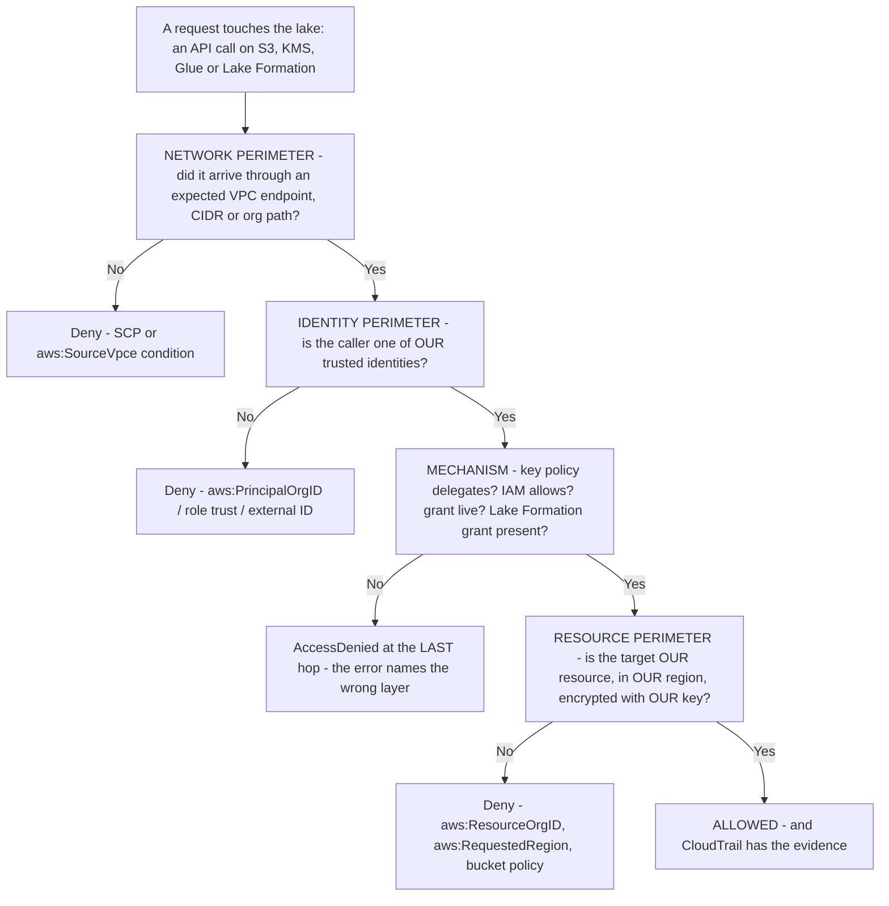
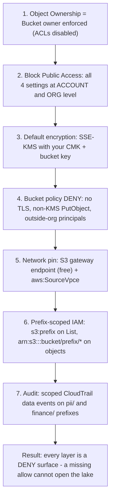
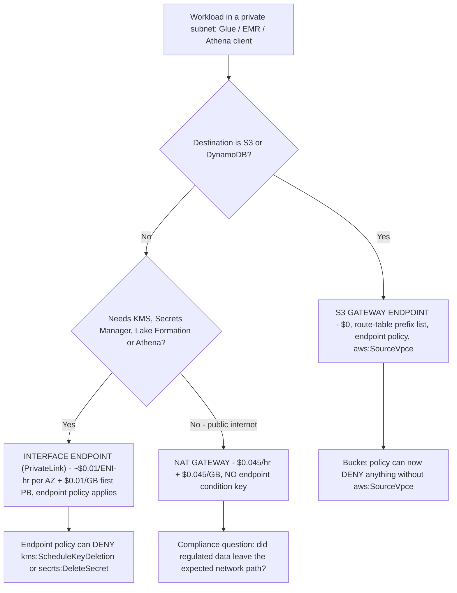
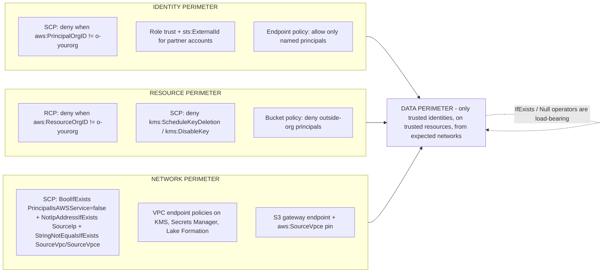
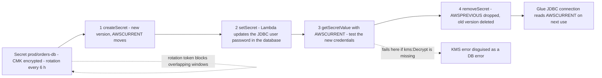
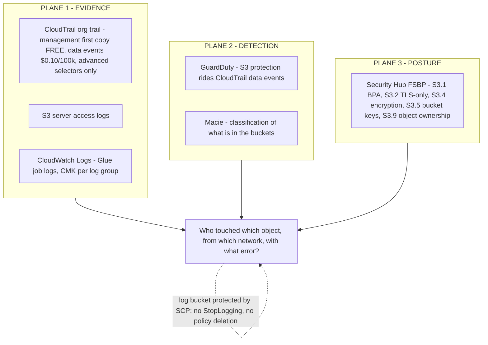

# Security Hardening: KMS, Least-Privilege IAM, and Network isolation

Lessons 01 to 13 built a lake that works: buckets, formats, Iceberg, ingestion, a catalog, transformation, a query layer, a warehouse, orchestration, Lake Formation governance, and PII handling. Everything you built is also a set of **decisions an attacker can read and a misconfiguration can undo**. A CMK whose key policy never delegated to the account, a bucket policy that pins traffic to a VPC endpoint nobody uses, an SCP written with the strict operator instead of `IfExists`, a rotation Lambda missing one KMS action: each fails in a way that names the *last* hop in the error, not the broken control.

This lesson hardens the lakehouse in the order AWS's own security guidance lays it out: **keys → identities → storage defaults → network → organisation guardrails → secrets → audit**. The teaching rule: *default is not enforced, allowed is not reachable, and reachable is not audited.* Every number below is dated to **October 2026**, and every policy sketch is one you can paste into a sandbox before it touches production.

```text
====================================================================
 HARDENING SPINE — AWS DATA LAKEHOUSE, LESSON 14
====================================================================
 Keys ......... CMK vs AWS managed vs AWS owned; key policy is the
                gate, IAM is the second gate, explicit Deny wins;
                grants + CreateGrant grant tokens for Lake
                Formation / Glue machine flows; Bucket Keys cut
                KMS request cost up to 99%; rotation = backing-key
                rotation (365d), on-demand rotation, or data
                re-encryption (they are not the same thing);
                multi-Region keys for S3 CRR (mrk- prefix)
 Identities ... service roles (glue.amazonaws.com, lakeformation
                .amazonaws.com, encryption.athena.amazonaws.com);
                external ID in the ROLE TRUST, never the key
                policy; condition keys s3:prefix (List only),
                aws:SourceVpce / aws:SourceVpc,
                lakeformation:* family, aws:PrincipalIsAWSService;
                session policies and permission boundaries =
                INTERSECT, explicit Deny always wins
 Storage ....... construction order: Object Ownership ACLs
                disabled -> Block Public Access x4 at account+org
                -> SSE-KMS CMK + bucket key -> deny-insecure
                bucket policy -> network pin -> prefix-scoped IAM
 Network ...... gateway endpoints (S3, DynamoDB) = $0 and route
                table prefix list beats 0.0.0.0/0; interface
                endpoints / PrivateLink = per-AZ hour + per-GB;
                NAT $0.045/hr + $0.045/GB; endpoint policies as
                a fifth deny surface
 Org .......... data perimeter = identity x resource x network,
                enforced with SCPs + RCPs + endpoint policies;
                SCPs FILTER, never grant; IfExists / Null
                operators are load-bearing
 Secrets ...... 4-step staging-label rotation (createSecret ->
                setSecret -> getSecretValue -> removeSecret),
                every 4 hours minimum, alternating users,
                Lambda needs the CMK not just the secret
 Audit ........ CloudTrail org trail: management first copy
                free, S3 data events $0.010 per 1,000 events,
                scope by advanced event selectors or pay for it
 Prices ....... KMS $1.00/key/mo + $0.03 per 10,000 requests;
                gateway endpoint $0; NAT $0.045/hr + $0.045/GB;
                PrivateLink example $0.01/ENI-hour, data
                processing $0.01/GB (first PB)  [as of Oct 2026]
====================================================================
```

In this lesson you will:

- choose between **customer managed, AWS managed and AWS owned** keys for each lakehouse data class, and justify it with audit and blast-radius needs;
- compose **key policy and IAM** correctly, delegation first, identity allow second, explicit deny always winning, and write the **grant + grant token** flow that Lake Formation and Glue automation needs;
- do the **bucket-key cost math** and show what rotation does *and does not* re-encrypt;
- pick **multi-Region keys only for the two patterns they exist for**: cross-Region replication and cross-Region consumers;
- apply **service roles, external ID, condition keys, session policies and boundaries** as one least-privilege system;
- build S3 access control **in construction order**: Object Ownership, account-level Block Public Access, deny-insecure statements, network pinning, prefix scoping;
- price **gateway endpoint vs interface endpoint vs NAT** for the same S3 traffic, with October 2026 numbers;
- write **data-perimeter SCPs** (Region deny, unencrypted-PutObject deny, public-ACL deny) with the `IfExists` operators that keep them from breaking Athena and Glue;
- wire **Secrets Manager rotation for Glue JDBC credentials**, including the KMS grant that everyone forgets;
- ship four **worked JSON artifacts**: a least-privilege Glue job role, a cross-account S3+KMS role with external ID, an SCP set, and a scoped CloudTrail data-event selector with its bill;
- study **Siemens's 800-account Security Lake**, a sourced **October 2026 update box**, **three interactive checks**, **six diagrams** and **eleven exam-style questions**.

---

## 1. What a hardened lake is defending against

AWS's own framing for the control set in this lesson is blunt: the threat is **"UNINTENDED DATA DISCLOSURE DUE TO MISCONFIGURATIONS"**, not a novel exploit, but a bucket policy someone copied, a key policy someone never edited, a region somebody left open (AWS re:Inforce 2023 session IAM301, d1.awsstatic.com deck, accessed 2026-10-11). A data perimeter is "a set of preventive controls that helps ensure that only your trusted identities are accessing trusted resources from expected networks", and it has exactly three areas, **identity, resource and network** (AWS Security Blog, *Establishing a data perimeter on AWS*, page date 2025-08-28).



Two habits make the rest of this lesson work. First, **write denies, not just allows**, the S3 team's own re:Invent guidance is "Always block the access ('Deny') when… the request doesn't match your policy" (STG304, re:Invent 2024 deck, accessed 2026-10-11). Second, **test in a non-production account first**, AWS's data-perimeter posts say so explicitly: "We recommend that you test and deploy these policies in a test account before you apply them in a production account" (AWS Security Blog, 2024-11-13).

> [!NOTE]
> Three planes answer three different questions, and confusing them is the most common audit failure: **CloudTrail** answers *who called what API on which resource, from which network, with what error code*; **service-native logs** (CloudWatch Logs, S3 server access logs, Redshift system tables) answer *what did the workload actually do*; **posture and detection tools** (Security Hub FSBP controls, GuardDuty, Macie) answer *does the configuration or behaviour match the baseline*. Detection is not evidence retention.

---

## 2. KMS for lakes: CMKs, AWS managed, AWS owned

### 2.1 The three ownership tiers, on the axes that matter for a lake

AWS's KMS documentation draws the tiers by ownership and visibility, not by strength: "AWS KMS keys (KMS keys) are the fundamental logical entities of AWS KMS"; "AWS owned keys are KMS keys that AWS services use to protect your data… You can't view or manage AWS owned keys"; and "Resource policies for AWS managed keys are managed by the corresponding AWS service" (KMS Developer Guide: Concepts, accessed 2026-10-11).

| Axis | **Customer managed key (CMK)** | **AWS managed key** | **AWS owned key** |
|---|---|---|---|
| Where it lives | Your account, you created it | Your account, created by the service | A service account: not yours |
| Key policy | **You own the single key policy** | Managed by the service; you cannot edit | Not exposed |
| Grants / conditions | **Yes**, you can add grants and constraints | No, no key-level control of your own | No |
| RCPs (resource control policies) | Apply | **Do not apply** ("RCPs don't apply to AWS managed keys") | Not addressable |
| Cross-account sharing | **Yes, via the key policy** | No | Transparently, service-managed |
| Rotation | Optional, 365 days default (`RotationPeriodInDays`, min 90) | Service-controlled, annual | Service-controlled |
| Cost, as of Oct 2026 | **$1.00 per key per month** + **$0.03 per 10,000 requests** | Usage billed, no separate key fee you control | Not billed to you |
| Lakehouse home | Bronze/silver/gold data classes you must prove decrypt control over | Scratch, dev, low-sensitivity logs | Service-internal storage paths |

The lakehouse rule: **CMK when you must prove *who* decrypted *what class* of data; AWS managed when convenience is enough and no one will ask you to enumerate decrypts.** Never expect an AWS owned key to appear in your key list; that absence is by design, not a bug (KMS concepts, accessed 2026-10-11).

- **📚 Did you know?** The AWS managed tier in the console is partly legacy: AWS's KMS docs say "The AWS managed keys that you see in the console are legacy AWS managed keys… AWS services use a different set of AWS managed keys than the ones that appear in the console", and legacy keys carry the `aws/service` alias pattern. That is why you can see `aws/s3` in a console list yet still find services quietly encrypting with keys you will never be shown (KMS concepts, accessed 2026-10-11).

### 2.2 Key policy is the gate; IAM is the second gate

Four sentences from the key-policies guide decide almost every KMS support ticket you will ever work:

1. "Key policies are the primary way to control access to KMS keys."
2. "Every KMS key must have exactly one key policy, which is created when you create the KMS key."
3. "An IAM principal in the same account as the KMS key can use IAM policies to allow access to the KMS key only if the key policy for the KMS key allows the principal."
4. "…an IAM deny statement in an IAM policy takes precedence… you can use IAM deny statements in IAM policies to prevent principals in the same AWS account from using the KMS key, even if the key policy allows it." (KMS Developer Guide: Key policies, accessed 2026-10-11)

Read it as **two gates that compose rather than stack**: the key policy answers *"is this account or role allowed to use this key at all?"*; IAM answers *"may this specific caller use it for this action right now?"* Cross-account use is **always** via the key policy: an identity policy in the other account is inert until the producer's key policy names it. And an IAM **deny** bites regardless of what the key policy said.

#### Worked example E1: a key policy that actually delegates (S3 + Glue + a cross-account reader)

```json
{
  "Version": "2012-10-17",
  "Statement": [
    {
      "Sid": "Enable IAM User Permissions",
      "Effect": "Allow",
      "Principal": {"AWS": "arn:aws:iam::111122223333:root"},
      "Action": "kms:*",
      "Resource": "*"
    },
    {
      "Sid": "S3 Service-Principal Envelope",
      "Effect": "Allow",
      "Principal": {"Service": "s3.amazonaws.com"},
      "Action": ["kms:GenerateDataKey", "kms:Decrypt", "kms:DescribeKey"],
      "Resource": "*",
      "Condition": {
        "StringEquals": {"aws:SourceAccount": "111122223333"},
        "ArnLike": {"aws:SourceArn": "arn:aws:s3:::lakehouse-silver"}
      }
    },
    {
      "Sid": "Glue Job Role - Silver Layer",
      "Effect": "Allow",
      "Principal": {"AWS": "arn:aws:iam::111122223333:role/glue-etl-silver"},
      "Action": ["kms:Decrypt", "kms:GenerateDataKey", "kms:DescribeKey", "kms:ReEncrypt*"],
      "Resource": "*"
    },
    {
      "Sid": "Cross-Account Analyst - Decrypt Only",
      "Effect": "Allow",
      "Principal": {"AWS": "arn:aws:iam::444455556666:role/lake-reader"},
      "Action": ["kms:Decrypt", "kms:DescribeKey"],
      "Resource": "*"
    }
  ]
}
```

Note the shape: `arn:aws:iam::<account>:root` means **this account, via its IAM policies**, not "the root user is privileged"; service principals get `aws:SourceAccount`/`aws:SourceArn` conditions so the delegate cannot be pointed at someone else's bucket; and the cross-account reader receives **decrypt only**, never `kms:*`. If you replaced the first statement's principal with `"*"` you would have the canonical hole. If you had *only* an IAM allow in account `444455556666` and no statement four, the analyst would fail with an error that names `kms:Decrypt` and teaches them nothing (F1-class failure: "I enabled the CMK but the service still can't encrypt").

### 2.3 Grants and grant tokens: the machine-to-machine layer

Grants are the temporary-permission channel that services and SDK flows use instead of rewriting your key policy: "A grant is an alternative way to set permissions for AWS KMS keys"; "Each grant applies to only one KMS key"; "You can't use a grant to deny access"; and "`CreateGrant` is the only AWS KMS API operation that returns a grant token" (KMS Developer Guide: Grants, accessed 2026-10-11).

The token exists because grantee and encryption-context changes are eventually consistent: "A grant token… makes the permissions specified in a grant available immediately rather than after eventual consistency", and the full grant list settles "within five minutes". Pass the token into the follow-on `Encrypt`/`GenerateDataKey` call or your brand-new grant will appear broken for minutes.

```text
Grant facts you will be asked for (KMS quotas + grants docs, accessed 2026-10-11)
  Grants per single KMS key ............ 50,000 (adjustable)
  Grants per account ................... 100,000 (adjustable)
  CreateGrant request rate ............. 10 TPS (adjustable)
  PutKeyPolicy throttle ................ 1 request per key per 10 seconds
  Deny via a grant ..................... NOT POSSIBLE (revoke/retire only)
  EncryptionContext / GrantConstraints .. symmetric encryption keys only
  SourceArn grant constraint ............ all KMS key types (added 2024)
```

#### Worked example E2: the CreateGrant + token flow for a Lake Formation / Batch re-encrypt job

```json
{
  "Sid": "S3 Batch Re-Encrypt of 4.1M Objects Under the New Key",
  "Version": "2012-10-17",
  "Statement": [
    {
      "Effect": "Allow",
      "Principal": {"AWS": "arn:aws:iam::111122223333:role/batch-reencrypt"},
      "Action": "kms:CreateGrant",
      "Resource": "*",
      "Condition": {
        "Bool": {"kms:GrantIsForAWSResource": "true"},
        "StringEquals": {"kms:GrantConstraintType": "EncryptionContextSubset"}
      }
    }
  ]
}
```

The call sequence matters more than the JSON:

```bash
# 1. create the grant and CAPTURE the token (CreateGrant is the only API that returns one)
GRANT_TOKEN=$(aws kms create-grant \
  --key-id arn:aws:kms:us-east-1:111122223333:key/1234abcd-... \
  --grantee-principal arn:aws:iam::111122223333:role/batch-reencrypt \
  --operations Encrypt Decrypt ReEncrypt* GenerateDataKey \
  --constraints "EncryptionContextSubset={purpose=gdpr-migration}" \
  --grant-token 2>/dev/null || true)   # token is returned IN the response
# 2. pass it forward so the first encrypted write does not race propagation
aws s3 cp s://tmp/rekey-manifest.json s3://lakehouse-silver/manifests/ \
  --sse aws:kms --sse-kms-key-id $KEY_ARN   # S3 takes the grant via the role
# 3. retire it when the migration lands - grants do NOT expire by themselves
aws kms retire-grant --key-id $KEY_ARN --grant-id $GRANT_ID
```

Use grants for exactly three lakehouse patterns: **S3 Batch Operations re-encrypts**, **service flows that need `GenerateDataKey` for ten minutes**, and **Lake Formation / metastore-adjacent automation** where you cannot afford to edit a key policy per run. AWS's own guidance is to pair them with IAM and key policies rather than replace them: "We recommend using IAM policies and key policies together… Consider using grants to give temporary permissions to applications that are running on EC2 instances" (KMS, key policy vs IAM policy, accessed 2026-10-11). A forgotten grant is a standing privilege, and `RetireGrant`/`RevokeGrant` are the cleanup APIs, nobody audits what they never list.

- **📚 Did you know?** KMS deliberately splits encrypt-side and decrypt-side permissions so that a "write-only" pipeline is expressible: `GenerateDataKeyWithoutPlaintext` returns only the **wrapped** data key, and the plaintext use still needs `kms:Decrypt` by the caller (AWS KMS service authorization reference, accessed 2026-10-11). That is why a Glue job role usually needs `kms:Decrypt` **and** `kms:GenerateDataKey`, while an ingestion role that only ever wraps can be given the narrower pair.

### 2.4 Bucket keys: the highest-ROI toggle on any analytics bucket

"By default, Amazon S3 encrypts all new data when it is written to an S3 bucket": with SSE-S3 since **2023-01-05**, at no additional cost, but objects under a KMS default-encryption key "are charged at the KMS request rate of $0.03 per 10,000 requests, plus the standard S3 request charge, even when the encryption is applied automatically" (S3: data protection; S3: Using SSE-KMS, accessed 2026-10-11). The bucket key exists to collapse those calls: "Using a bucket-level key for SSE-KMS can reduce AWS KMS request costs by up to 99 percent by decreasing the request traffic from Amazon S3 to AWS KMS" (S3: Reducing the cost of SSE-KMS with Amazon S3 Bucket Keys, accessed 2026-10-11).

#### Worked example E3: bucket-key cost math on a hot dashboard read path (as of Oct 2026)

```text
Gold layer, KMS-encrypted, read by Athena + QuickSight:
  GETs per month ..................................... 50,000,000
  KMS request price ................................. $0.03 / 10,000
  WITHOUT bucket key  50,000,000 / 10,000 x $0.03 ... $150.00 / month
  WITH bucket key    up to 99% fewer KMS calls
      conservative 99% ............................. ~$1.50 / month
  S3 GET charge (same traffic, $0.004 per 10,000,
    us-east-1 offer file, publicationDate 2026-09-28)  $20.00 / month
  --------------------------------------------------------------
  Monthly saving on the KMS line alone ............. ~$148.50
```

Smaller volumes still show the shape: 5,000 encrypted object GETs cost **$0.015** in KMS requests without a bucket key: trivial; which is exactly why teams forget to enable the toggle until the dashboard traffic arrives. Two exclusions to memorise: **bucket keys are not supported for DSSE-KMS**, and **DSSE-KMS is not supported for S3 Replication** (S3: bucket-key and Using SSE-KMS pages, accessed 2026-10-11), so you cannot stack "maximum encryption" features.

### 2.5 Rotation: three different meanings, only one of them re-encrypts anything

| Meaning | What it does | What it does **not** do | Control surface |
|---|---|---|---|
| **Automatic annual rotation** | AWS KMS creates a new **backing key** each period; data keys are encrypted with the most recent backing key | Does not touch existing data keys or ciphertext | On by default for new symmetric CMKs; period **365 days** since May 2022 (was 1,095); `RotationPeriodInDays` min **90** |
| **On-demand rotation** (`RotateKeyOnDemand`) | Extra generation on request: the documented route for **asymmetric** keys | Same: no data re-encryption | Free of charge; max **two** enabled on-demand keys per KMS key; **one per 90 days** per key |
| **Data re-encryption** | Rewrites objects/records under new key material (S3 Batch Operations re-encrypt) | Not automatic, not implied by anything above | You schedule it; it is the only answer to a suspected **data key** compromise |

AWS states the limit flatly: "key rotation will not mitigate the effect of a compromised data key" (KMS, Rotating AWS KMS keys, accessed 2026-10-11). Eligibility is also a wall, not a preference: automatic rotation supports **only symmetric encryption KMS keys with key material AWS KMS generated** (`KeySpec SYMMETRIC_DEFAULT`, `KeyOrigin AWS_KMS`), asymmetric, HMAC, imported material and custom key stores need manual or on-demand rotation. Two operational notes worth carrying: backing keys accumulate so old ciphertext keeps decrypting, and "the first two rotation generations of backing keys incur a full monthly key charge" (same page), so a long-lived CMK fleet is a small but non-zero monthly line.

### 2.6 Multi-Region keys: for CRR and cross-Region consumers, nothing else

"Multi-Region keys are AWS KMS keys that have the same key material and the same key ID in different AWS Regions"; you create a primary in one Region and "replicate the MRK into the same AWS account in other AWS Regions"; you **cannot** convert an existing key into a multi-Region key or back again; and "each multi-Region key counts as one KMS key in your account for AWS KMS quotas and for calculating your AWS KMS costs" (KMS: Multi-Region keys, accessed 2026-10-11). Replicas carry the `mrk-` prefix in their key IDs.

The S3 cross-Region replication payoff: "AWS S3 encrypts each object version with a data key that is encrypted with the KMS key in the source Region… If you use a related multi-Region key, Amazon S3 decrypts and re-encrypts the data keys in the destination Region": the plaintext data key never leaves the destination Region, and you avoid the cross-Region key hop you would otherwise pay for when replicating to a *different* key.

#### Worked example E4: MRK bill and CRR decision (as of Oct 2026)

```text
Scenario A - single-Region keys, replication to eu-west-1 with a
different destination CMK:
  us-east-1 CMK ........................... 1 x $1.00 / month
  eu-west-1 CMK ........................... 1 x $1.00 / month
  data-key handling ....................... cross-Region decrypt +
                                           re-encrypt work on the
                                           replication path
                                           (exact per-object delta not
                                            quoted here - the S3 docs
                                            only say charges "are
                                            different")

Scenario B - related multi-Region key pair (primary + 1 replica):
  each replica "counts as one KMS key" .... 2 x $1.00 / month
  data keys ................ decrypted and re-encrypted IN the
                              destination Region
  rotation ................ annual rotation of the primary is copied
                              to replicas automatically - replicas do
                              not rotate independently
  verdict .................. use ONLY if you truly replicate or serve
                              cross-Region; otherwise you paid double
                              for key-policy surface you did not need
```

Two hard edges: **an SSE-KMS key must be in the same Region as the bucket** ("when you use SSE-KMS encryption with an S3 bucket, the AWS KMS keys must be in the same Region as the bucket": S3, accessed 2026-10-11), and MRK key material **cannot be exported**. If your replication is same-Region, stop reading this subsection and keep single-Region keys.

### 2.7 The per-service KMS matrix

Read this table as *"who must be in the key policy, and what the caller needs in IAM"*. Service principals and recommended ARN patterns come from the KMS service-integration page (accessed 2026-10-11).

| Service | What it encrypts with **your** key | Key-policy delegate | Caller IAM actions | Trap that costs a day |
|---|---|---|---|---|
| **Amazon S3** | Objects (SSE-KMS / DSSE-KMS), bucket key on top | `s3.amazonaws.com` (+ `aws:SourceAccount`/`aws:SourceArn` conditions) | `kms:Decrypt`, `kms:GenerateDataKey`, `kms:DescribeKey` | Key must be **same Region** as bucket; default encryption ≠ enforced: deny `PutObject` without `s3:x-amz-server-side-encryption: aws:kms` |
| **AWS Glue** | Intermediate job data, **CloudWatch Logs**, **job bookmarks** (SSE-KMS **only**), Spark shuffle via SSE-S3 | `glue.amazonaws.com` | `kms:Decrypt`, `kms:GenerateDataKey`, `kms:DescribeKey` | Security configuration, job **and** key must share a Region; bookmarks support **no SSE-S3 option** |
| **Glue Data Catalog** | Catalog metadata | Service role when mode is `SSE-KMS-WITH-SERVICE-ROLE` | `glue:UpdateCatalogEncryption` for admins | `CatalogEncryptionMode` = `DISABLED` \| `SSE-KMS` \| `SSE-KMS-WITH-SERVICE-ROLE`: `DISABLED` means unencrypted catalog |
| **Amazon Athena** | Query results written to S3 (workgroup level) | `encryption.athena.amazonaws.com` with encryption context `aws:athena:workgroup-arn` | `kms:GenerateDataKey`, `kms:Decrypt`, `kms:DescribeKey` | Without `EnforceWorkGroupConfiguration=true` a client **overrides** the workgroup's encryption and output location |
| **Amazon Redshift** | Cluster: root key → database encryption key → cluster keys | `redshift.amazonaws.com` key-policy pattern or direct grants | `kms:Encrypt`/`kms:Decrypt` for admin paths | Symmetric keys only; if the CMK becomes inaccessible the cluster is unreadable and **after 14 days may be deleted** |
| **CloudWatch Logs** | Log-group streams | `logs.amazonaws.com`, encryption context `kms:EncryptionContext:aws:logs:arn` | `logs:AssociateKmsKey` to attach to an **existing** group | Cannot attach a CMK to an existing group **in the console**; deleting the key makes historical logs unretrievable |
| **AWS Lake Formation** | Not directly; it **vends temporary S3/KMS credentials** via `GetDataAccess` | Registered-location IAM role must hold `kms:Decrypt` + `kms:GenerateDataKey` | Principals need `lakeformation:GetDataAccess` with **`Resource: "*"`** | `GetDataAccess` **cannot** be scoped to a resource ARN; LF does not support resource ARNs in `Resource` |
| **AWS Secrets Manager** | Secret payload | `secretsmanager.amazonaws.com`; rotation Lambda role must hold the key too | Rotation role: `kms:Decrypt`, `kms:GenerateDataKey` | Missing KMS on the rotation role surfaces as a **database-looking** error at `getSecretValue` |
| **Amazon Quick (QuickSight)** | SPICE and direct-query data at rest | Quick service principal with `kms:GenerateDataKey`, `kms:Decrypt` | Register the CMK first; key must be same Region as the account | Registering a CMK does **not** re-encrypt existing SPICE; you must trigger a **full refresh** |

- **📚 Did you know?** One Glue security configuration is four separate encryptables, and teams routinely cover three: **S3 intermediate data**, **CloudWatch Logs**, **job bookmarks** (SSE-KMS only), and **Spark shuffle/spill** (SSE-S3 only). The bookmarks are the sleeper: a bookmark is the pointer to *what has already been processed*, so leaving it on the default is both a correctness risk and a leak surface (Glue security-configuration docs, accessed 2026-10-11).

---

## 3. IAM patterns: service roles, external ID, condition keys, sessions, boundaries

### 3.1 Service roles: the trust policy is the permission

Every engine in this course runs under a **service role** whose trust policy names one service principal. The pattern is identical across the stack: the principal `glue.amazonaws.com` for jobs, `lakeformation.amazonaws.com` for the registered-location role, `encryption.athena.amazonaws.com` for workgroup result encryption, `redshift.amazonaws.com` for cluster paths, `logs.amazonaws.com` for log-group encryption. The identity policy then does the *scoping*; this is the division of labour: **trust decides who can create the session; identity policy decides what the session may do**.

Lake Formation's role is the clearest example: "Lake Formation supplies temporary credentials that the caller, such as Amazon Athena, uses to access the data", and for LF-registered locations "You must specify an IAM role… This role is called the registered-location IAM role" (LF Developer Guide: Underlying data access permissions, accessed 2026-10-11). The consumers (Athena, Redshift Spectrum, QuickSight) call `lakeformation:GetDataAccess`, and that action **must** carry `Resource: "*"` because "AWS Lake Formation does not support specifying a resource ARN in the Resource element of the IAM policy" (LF service authorization reference, accessed 2026-10-11).

### 3.2 External ID: the confused-deputy guard, in the trust policy

"The confused deputy problem is a security issue that can arise when one service is tricked into using its permissions on behalf of another principal", and "The external ID helps prevent a confused deputy problem when you use the AssumeRole operation" (IAM User Guide: Providing access to third parties, accessed 2026-10-11). Two properties decide where it belongs:

- AWS "does not treat the external ID as a secret… it is not a secret, it's a shared identifier… it should be unique to the customer", so it **authenticates intent, not identity**. Real authentication remains the trusted principal in the trust policy.
- Length is `2–1,224` characters (IAM quotas, accessed 2026-10-11).
- It lives in the **role trust policy** under `sts:ExternalId`: **never** in the KMS key policy and never in an identity policy. Putting it in the key policy is the single most common placement error (F20-class).

#### Worked example E5: the cross-account S3 + KMS role with external ID

Three documents must agree: the **producer's bucket policy**, the **producer's key policy**, and the **consumer's role trust plus identity policy**. Nothing else needs editing.

```json
{
  "Version": "2012-10-17",
  "Statement": [
    {
      "Sid": "TrustThePartnerPrincipalOnly",
      "Effect": "Allow",
      "Principal": {"AWS": "arn:aws:iam::999988887777:role/partner-etl"},
      "Action": "sts:AssumeRole",
      "Condition": {"StringEquals": {"sts:ExternalId": "acme-corp-lakehouse-2026"}}
    }
  ]
}
```

```json
{
  "Version": "2012-10-17",
  "Statement": [
    {
      "Sid": "ConsumerRole-ReadSharedPrefixAndKey",
      "Effect": "Allow",
      "Action": ["s3:ListBucket"],
      "Resource": "arn:aws:s3:::shared-bronze",
      "Condition": {"StringLike": {"s3:prefix": ["ingest/*", "ingest"]}}
    },
    {
      "Sid": "ConsumerRole-ObjectsOnly",
      "Effect": "Allow",
      "Action": ["s3:GetObject", "s3:PutObject"],
      "Resource": "arn:aws:s3:::shared-bronze/ingest/*"
    },
    {
      "Sid": "ConsumerRole-DecryptWithProducerKey",
      "Effect": "Allow",
      "Action": ["kms:Decrypt", "kms:DescribeKey", "kms:GenerateDataKey"],
      "Resource": "arn:aws:kms:us-east-1:111122223333:key/1234abcd-12ab-34cd-56ef-1234567890ab"
    }
  ]
}
```

The producer side (not repeated here) is two statements in the style of E1: a bucket policy allowing `s3:GetObject`/`s3:PutObject` on `arn:aws:s3:::shared-bronze/ingest/*` to `arn:aws:iam::444455556666:role/lake-reader`, and a key policy delegating `kms:Decrypt`/`kms:GenerateDataKey`/`kms:DescribeKey` to that same role ARN. The partner then calls:

```bash
aws sts assume-role \
  --role-arn arn:aws:iam::111122223333:role/lake-reader \
  --role-session-name acme-etl-2026-10-11 \
  --external-id acme-corp-lakehouse-2026
```

If your consumer is *your own* second account rather than a third party, the external ID is optional, but it is cheap hygiene, and it is 2 to 1,224 characters, unique per customer, and **not** a secret (IAM, third-party access, accessed 2026-10-11). What it is *not*: an authentication factor. The trusted principal ARN does the authenticating; the external ID stops a partner from being tricked into assuming *your* role when it meant another customer's.

### 3.3 The condition keys this lesson actually uses

| Key | Applies to | What it enforces | Foot-gun |
|---|---|---|---|
| `s3:prefix` | **`ListObjectsV2` / `ListObjects` only** | Scopes listing to a prefix | "Amazon S3 doesn't evaluate `s3:prefix` in bucket policies for `GetObject`": pair it with object ARN wildcards |
| `s3:x-amz-server-side-encryption` | `PutObject` | Deny anything that is not `aws:kms` | Default encryption still allows a client to *send* `AES256` unless you deny it |
| `s3:x-amz-server-side-encryption-aws-kms-key-id` | `PutObject` | Pins the exact CMK | Same-Region rule still applies |
| `aws:SourceVpce` | All S3/KMS calls through an endpoint | "the request originates from the specified interface VPC endpoint" (or the gateway endpoint in S3's own policy docs) | **Only present if the call came through an endpoint**; never use a wildcard with it |
| `aws:SourceVpc` | VPC-scoped calls | Restricts to a VPC | Same presence rule as `SourceVpce` |
| `aws:SecureTransport` | All HTTPS APIs | Deny non-TLS (`false` → Deny) | **Redacted** when AWS services call S3 on your behalf |
| `aws:PrincipalIsAWSService` | All | `true` when the caller is an AWS service principal | The documented fix for the redaction problem: add `false` to your human-principal deny |
| `aws:PrincipalOrgID` / `aws:ResourceOrgID` | Org / resource perimeters | Only your org acts / only your org's resources are touched | `aws:ResourceOrgID` needs a `Null` guard for untagged or unorganised resources |
| `aws:RequestedRegion` | SCP / identity | Region deny allow-lists | Global services (CloudFront, IAM, Organizations, Route 53, Support, STS) need a `NotAction` carve-out |
| `lakeformation:DataFilter`, `LFPerm`, `Principal`, `CatalogId`, `DatabaseName`, `TableName`, `ResourceLink` | LF admin APIs | Narrow who may grant what, on which object | `GetDataAccess` itself still needs `Resource: "*"` |
| `kms:ViaService`, `kms:GrantIsForAWSResource`, `kms:EncryptionContext:*` | KMS | Restrict "only through service X", "only for AWS-resource grants", "only this context" | `EncryptionContext` grant constraints are **symmetric-only** |
| `sts:ExternalId` | `AssumeRole` trust | Confused-deputy guard | Belongs in the trust policy only |

The wildcard rule from the IAM condition-key page is non-negotiable: "Don't use wildcard values (`*`) with `aws:SecureTransport`, `aws:SourceIp`, `aws:SourceVpce`, `aws:SourceVpc`, `aws:PrincipalOrgID`" (IAM: condition operators and keys, accessed 2026-10-11).

### 3.4 Session policies and permission boundaries: the intersection rule

All three "maximum permission" filters behave the same way, and AWS's wording is precise:

- **Permission boundary**: "an advanced feature for using a managed policy to set the maximum permissions that an identity-based policy can grant to an IAM identity"; "An entity's permissions boundary doesn't give the entity any permissions" (IAM: permissions boundaries, accessed 2026-10-11).
- **Session policy**: passed on `AssumeRole`, applies to that session only.
- **SCPs**: "they specify the maximum permissions for member accounts"; "SCPs don't grant permissions… they filter" (Organizations: SCPs, accessed 2026-10-11).

Evaluation: **final permissions = identity ∩ resource ∩ session ∩ boundary ∩ SCP, and any explicit deny in any applicable policy wins.** Boundaries are how you let a platform team *create* roles without letting them escalate to `iam:*` or `kms:*`; session policies are how a job-runner role can be handed a tighter context for one run.

#### Worked example E6: boundary + session policy as a real intersection

```json
{
  "Version": "2012-10-17",
  "Statement": [
    {
      "Sid": "Boundary-Developer-Role-Ceiling",
      "Effect": "Allow",
      "NotAction": ["iam:*", "organizations:*", "kms:ScheduleKeyDeletion", "kms:DisableKey", "s3:PutBucketPublicAccessBlock"],
      "Resource": "*"
    }
  ]
}
```

```text
Identity policy of role "lake-dev"     allows  s3:*, glue:*, athena:*, kms:Decrypt
Permission boundary "dev-ceiling"      allows  everything EXCEPT iam:*, org:*, key
                                          deletion/disable, BPA changes
Session policy passed on AssumeRole    allows  s3:GetObject/PutObject on silver/*
                                             + kms:Decrypt on the silver CMK
                                               --------------------------------
 RESULT (intersection) ................. s3:Get/Put on silver/* only,
                                         kms:Decrypt on the silver CMK,
                                         glue/athena from identity but ONLY
                                         for the session duration, and NEVER
                                         iam:* regardless of identity policy
 Explicit deny anywhere ................ beats all of the above
```

The documented trap: "`NotPrincipal`… when you use `NotPrincipal` in a deny statement together with a permissions boundary… the deny statement might apply unexpectedly" (IAM: permissions boundaries, accessed 2026-10-11). Prefer positive `Principal` scoping or `aws:PrincipalArn` conditions over `NotPrincipal` denies.

```fillblank
{
  "question": "Fill in the condition keys that carry each control in this lesson:",
  "template": "Prefix scoping on a List call uses {{1}}; pinning lake traffic to a private path uses {{2}}; the TLS-only deny is written on {{3}}; the carve-out that stops AWS-service redaction from breaking that deny is {{4}}; and the confused-deputy guard in a cross-account role trust is {{5}}.",
  "answers": {
    "1": "s3:prefix",
    "2": "aws:SourceVpce",
    "3": "aws:SecureTransport",
    "4": "aws:PrincipalIsAWSService",
    "5": "sts:ExternalId"
  },
  "distractors": [
    "s3:ListBucket",
    "s3:ExistingObjectTag",
    "aws:SourceIp",
    "aws:SourceAccount",
    "s3:TlsVersion",
    "aws:ViaAWSService",
    "aws:PrincipalIsAnonymous",
    "aws:ExternalId",
    "sts:SourceIdentity"
  ],
  "explanation": "s3:prefix only ever scopes ListObjectsV2/ListObjects; put it on GetObject and it does nothing, which is why prefix access is a List condition PLUS an object-ARN wildcard. aws:SourceVpce is the network pin and is only present when the call came through a VPC endpoint, which is why AWS says never to wildcard it. aws:SecureTransport=false is the deny, but S3 redacts SecureTransport, TlsVersion, SourceIp and VpcSourceIp when Athena, Glue or Lake Formation call on your behalf, so the documented fix is aws:PrincipalIsAWSService=false on the human-principal statement with a separate allow for service principals. sts:ExternalId belongs in the role trust policy and AWS states it is not a secret: it proves the third party meant THIS customer's role."
}
```

### 3.5 Worked example E7: the least-privilege Glue job role, end to end

One job, one role, four encryptables, zero wildcards. This is the identity half of a Glue security configuration; the security configuration itself (S3 SSE-KMS + CloudWatch SSE-KMS + **bookmark** SSE-KMS, all on the same CMK, all in the same Region as the job) is the encryption half.

```json
{
  "Version": "2012-10-17",
  "Statement": [
    {
      "Sid": "ReadBronzeWriteSilverOnly",
      "Effect": "Allow",
      "Action": ["s3:GetObject", "s3:PutObject", "s3:DeleteObject"],
      "Resource": [
        "arn:aws:s3:::lakehouse-bronze/events/*",
        "arn:aws:s3:::lakehouse-silver/*"
      ]
    },
    {
      "Sid": "ListOnlyThePrefixesThisJobTouches",
      "Effect": "Allow",
      "Action": ["s3:ListBucket", "s3:GetBucketLocation"],
      "Resource": ["arn:aws:s3:::lakehouse-bronze", "arn:aws:s3:::lakehouse-silver"],
      "Condition": {"StringLike": {"s3:prefix": ["events/*", "silver/*"]}}
    },
    {
      "Sid": "EnvelopeOperationsOnTheSilverKeyOnly",
      "Effect": "Allow",
      "Action": ["kms:Decrypt", "kms:GenerateDataKey", "kms:DescribeKey", "kms:ReEncrypt*"],
      "Resource": "arn:aws:kms:us-east-1:111122223333:key/1234abcd-12ab-34cd-56ef-1234567890ab"
    },
    {
      "Sid": "LogsOnlyIntoItsOwnLogGroup",
      "Effect": "Allow",
      "Action": ["logs:CreateLogGroup", "logs:CreateLogStream", "logs:PutLogEvents"],
      "Resource": "arn:aws:logs:us-east-1:111122223333:log-group:/aws-glue/jobs-glue-etl-silver-secconf*"
    },
    {
      "Sid": "CatalogReadAndWriteForThisDatabase",
      "Effect": "Allow",
      "Action": [
        "glue:GetDatabase", "glue:GetTable", "glue:GetPartitions",
        "glue:CreateTable", "glue:UpdateTable", "glue:BatchCreatePartition"
      ],
      "Resource": [
        "arn:aws:glue:us-east-1:111122223333:database/silver",
        "arn:aws:glue:us-east-1:111122223333:table/silver/*"
      ]
    },
    {
      "Sid": "FetchTheJdbcPasswordItself",
      "Effect": "Allow",
      "Action": ["secretsmanager:GetSecretValue", "secretsmanager:DescribeSecret"],
      "Resource": "arn:aws:secretsmanager:us-east-1:111122223333:secret:prod/orders-db-*"
    }
  ]
}
```

Trust policy for the same role, and the one line that makes the whole thing assumable:

```json
{
  "Version": "2012-10-17",
  "Statement": [
    {
      "Effect": "Allow",
      "Principal": {"Service": "glue.amazonaws.com"},
      "Action": "sts:AssumeRole",
      "Condition": {"StringEquals": {"aws:SourceAccount": "111122223333"}}
    }
  ]
}
```

What makes it least-privilege rather than "a policy with some ARNs in it": **one key ARN, two bucket roots with a `s3:prefix` condition on the List, a log-group prefix that matches only this job's security configuration, a single Glue database, and one secret**. Add a permissions boundary (E5's ceiling) on top and even a compromised job cannot mint itself `iam:*`. The KMS statement is not optional: without it the job dies on the first encrypted read with an error naming `kms:Decrypt` rather than the missing grant (F1-class).

---

## 4. S3 hardening, in construction order

Access control on a lake bucket is not a checklist you complete in any order; it is a stack where each layer assumes the one below it. The order below is the S3 team's own re:Invent order (STG304, accessed 2026-10-11): account and bucket Block Public Access, Access Analyzer to find exposure, Object Ownership with ACLs disabled, bucket keys for SSE-KMS, gateway endpoints, and deny-first policies.



### 4.1 Object Ownership: ACLs off, bucket owner owns everything

"Object Ownership is a bucket-level setting that you can use to disable access control lists (ACLs)… When Object Ownership is set to Bucket owner enforced, ACLs are disabled, and the bucket owner owns every object" (S3: Object Ownership, accessed 2026-10-11). The recommended use case in AWS's own words includes **"data lakes"**. Two consequences: an upload carrying ACL headers returns `AccessControlListNotSupported` (a delightful "why did my copy job start failing" incident), and cross-account object ownership disputes stop existing because there is nothing left to dispute.

### 4.2 Block Public Access: four settings, account level, organisation level

The four settings are `BlockPublicAcls` (ACLs at bucket *and* object level), `IgnorePublicAcls` (S3 ignores public grants it finds), `BlockPublicPolicy` (bucket policies that go public are rejected with "Access Denied"), and `RestrictPublicBuckets` ("even if the bucket policy allows public access… Amazon S3 doesn't allow public access", while same-account access is not blocked) (S3: Block public access, accessed 2026-10-11). Two scope rules decide whether your control actually exists: account-level settings "are applied to all buckets in the account, **even those created after the settings are turned on**", and "You can apply all Block Public Access settings as a single, unified policy at the AWS Organizations level". Leaving org-level BPA off means every *future* bucket starts potentially public until four toggles are flipped by someone who remembers.

### 4.3 The deny-first bucket policy

```json
{
  "Version": "2012-10-17",
  "Statement": [
    {
      "Sid": "DenyInsecureTransport",
      "Effect": "Deny",
      "Principal": "*",
      "Action": "s3:*",
      "Resource": ["arn:aws:s3:::lakehouse-silver", "arn:aws:s3:::lakehouse-silver/*"],
      "Condition": {"Bool": {"aws:SecureTransport": "false"}}
    },
    {
      "Sid": "DenyUnencryptedPutObject",
      "Effect": "Deny",
      "Principal": "*",
      "Action": "s3:PutObject",
      "Resource": "arn:aws:s3:::lakehouse-silver/*",
      "Condition": {"StringNotEquals": {"s3:x-amz-server-side-encryption": "aws:kms"}}
    },
    {
      "Sid": "DenyPublicAclHeaders",
      "Effect": "Deny",
      "Principal": "*",
      "Action": "s3:PutObject",
      "Resource": "arn:aws:s3:::lakehouse-silver/*",
      "Condition": {"StringEquals": {"s3:x-amz-acl": "public-read"}}
    },
    {
      "Sid": "DenyOutsideOrg",
      "Effect": "Deny",
      "Principal": "*",
      "Action": "s3:*",
      "Resource": ["arn:aws:s3:::lakehouse-silver", "arn:aws:s3:::lakehouse-silver/*"],
      "Condition": {"StringNotEquals": {"aws:PrincipalOrgID": "o-yourorgidhere"}}
    },
    {
      "Sid": "PinToGatewayEndpoint",
      "Effect": "Deny",
      "Principal": "*",
      "Action": "s3:*",
      "Resource": ["arn:aws:s3:::lakehouse-silver", "arn:aws:s3:::lakehouse-silver/*"],
      "Condition": {"StringNotEquals": {"aws:SourceVpce": "vpce-0abc1234def567890"}}
    },
    {
      "Sid": "HumanPrincipalsOnlyDenyList",
      "Effect": "Deny",
      "Principal": "*",
      "Action": "s3:ListBucket",
      "Resource": "arn:aws:s3:::lakehouse-silver",
      "Condition": {
        "StringNotEquals": {"s3:prefix": ["silver/*", "silver"]},
        "Bool": {"aws:PrincipalIsAWSService": "false"}
      }
    }
  ]
}
```

Read the last two statements together: `aws:SourceVpce` is present **only when the call came through an endpoint**, and `aws:SecureTransport`/`aws:SourceIp`/`s3:TlsVersion` are **redacted when AWS services call S3 on your behalf**: "To avoid this behavior, include the `aws:PrincipalIsAWSService` condition key set to `false` in the same statement as the condition keys" (S3: Amazon S3 policy keys, accessed 2026-10-11). Without that carve-out you either break Athena/Glue/Lake Formation silently or believe you have a TLS-only bucket that your service path ignores. And remember: **default encryption is not enforcement**: "Default ≠ enforced"; only the `DenyUnencryptedPutObject` statement makes SSE-KMS mandatory.

```dragdrop
{
  "question": "Drag the S3 lake-bucket controls into the order they must be built:",
  "items": [
    "6. Prefix-scoped IAM: s3:prefix on List, object ARN wildcard arn:aws:s3:bucket/prefix/* on Get/Put",
    "1. Object Ownership - Bucket owner enforced, ACLs disabled, bucket owner owns every object",
    "4. Deny-first bucket policy: no TLS, non-KMS PutObject, public ACL headers, outside-org principals",
    "2. Block Public Access: all four settings at account level, then the unified Organizations policy",
    "5. Network pin: free S3 gateway endpoint plus aws:SourceVpce deny statement",
    "3. Default encryption: SSE-KMS with a customer managed key plus a bucket key"
  ],
  "correctOrder": [
    "1. Object Ownership - Bucket owner enforced, ACLs disabled, bucket owner owns every object",
    "2. Block Public Access: all four settings at account level, then the unified Organizations policy",
    "3. Default encryption: SSE-KMS with a customer managed key plus a bucket key",
    "4. Deny-first bucket policy: no TLS, non-KMS PutObject, public ACL headers, outside-org principals",
    "5. Network pin: free S3 gateway endpoint plus aws:SourceVpce deny statement",
    "6. Prefix-scoped IAM: s3:prefix on List, object ARN wildcard arn:aws:s3:bucket/prefix/* on Get/Put"
  ],
  "explanation": "Ownership first, because ACLs are the legacy surface everything else argues with; Block Public Access second, because it is account-wide and applies to buckets you have not created yet; encryption third, because the deny statement in step 4 can only reference s3:x-amz-server-side-encryption once the bucket's default is set; the deny policy fourth, because deny conditions are only meaningful against a known baseline; network pin fifth, because aws:SourceVpce only exists once a gateway endpoint is in the route table; and prefix-scoped IAM last, because identity policies are the one layer you can change without touching the resource. The re:Invent STG304 deck states the doctrine for the middle of this stack: always block the access (Deny) when the request does not match your policy."
}
```

---

## 5. Network isolation: gateway endpoints, PrivateLink, NAT and endpoint policies

### 5.1 The three paths out of a VPC, priced

| Path | Services | Price, as of Oct 2026 | Gives you |
|---|---|---|---|
| **Gateway endpoint** | **S3 and DynamoDB only** | **$0**: "There is no additional charge for using gateway endpoints" | A route-table entry whose prefix list **takes precedence over the internet gateway route (0.0.0.0/0)**, plus endpoint policies and `aws:SourceVpce` |
| **Interface endpoint / PrivateLink** | KMS, Secrets Manager, Lake Formation, Athena, CloudWatch Logs, Macie… | Per hour per AZ (full hour billed, example **$0.01 per ENI-hour**) + data processed (**$0.01/GB** first PB, $0.006/GB next 4 PB, $0.004/GB beyond 5 PB) | Private service access, endpoint policies, traffic that "stays within the AWS network" |
| **NAT Gateway** | Anything not on a gateway path | **$0.045/hour** + **$0.045/GB** processed; first 1 GB/month of data processing free | Internet egress for updates, third-party APIs, and nothing you want a lake bucket to depend on |

Gateway endpoints are "a virtual routing device… you access the endpoint using a route in your route table", and you attach an **endpoint policy** to allow or deny (VPC: Gateway endpoints, accessed 2026-10-11). Interface endpoints are billed differently: "Endpoints are billed for each hour they are available in each Availability Zone, with a full hour charged regardless of usage" (AWS PrivateLink pricing, accessed 2026-10-11).

#### Worked example E8: NAT vs gateway endpoint for 500 GB/month of S3 traffic (as of Oct 2026)

```text
Path A - S3 traffic hairpinned through a NAT gateway:
  NAT hourly  ....... 730 hours x $0.045 ............. $32.85
  NAT data  ......... 500 GB x $0.045 ............... $22.50
  ----------------------------------------------------------
  Monthly total ..................................... $55.35
  aws:SourceVpce available? ......................... NO
  Leaves the AWS network path? ....................... yes, via IGW

Path B - same traffic through an S3 gateway endpoint:
  Endpoint charge ................................. $0.00
  aws:SourceVpce available? ......................... YES
  Route precedence .................................. prefix list beats
                                                    0.0.0.0/0
  ----------------------------------------------------------
  Monthly total ..................................... $0.00
  NET SAVING per VPC ............................... ~$55.35/month
```

That is the classic lakehouse saving: **free, and it buys you a condition key**. Keep the NAT for non-S3 egress only.

#### Worked example E9: the private stack's real bill (3 interface endpoints)

```text
One AZ, three interface endpoints (KMS + Secrets Manager + Lake Formation):
  hour charges .... 3 services x 1 ENI x 730 h x $0.01 ... $21.90
  data through KMS endpoint .... 200 GB x $0.01 ......... $2.00
  data through SM + LF endpoints 20 GB x $0.01 x 2 ...... $0.40
  --------------------------------------------------------------
  One AZ total ......................................... ~$24.30
  Two AZs (full-hour billing PER AZ) .................... ~$48.60

Private lakehouse network, whole month (2 AZs, derived):
  interface endpoints, 2 AZ x 3 svc x 2 ENI x 730 x $0.01  $43.80
  data processed ~250 GB x $0.01 ........................... $2.50
  gateway endpoints (S3 + DynamoDB) ........................ $0.00
  6 CMKs x $1.00 + ~$2 bucket-keyed requests ............... $8.00
  scoped CloudTrail data events (see Section 8) ........... $22.50
  --------------------------------------------------------------
  Total ............................................ ~$75-80 / month
```

Mix deliberately: **gateway for S3 and DynamoDB, interface only where no gateway exists**, and never assume "VPC endpoint = free": only S3 and DynamoDB get the free tier.



### 5.2 Endpoint policies: a fifth deny surface

An endpoint policy applies to **calls that traverse that endpoint**, independent of the identity policy, which makes it the natural home for "no key deletions from this VPC" or "only this secret". AWS's own Secrets Manager example "allows `secretsmanager:GetSecretValue` on a specific secret ARN and denies `secretsmanager:DeleteSecret`" (Secrets Manager, VPC endpoints, accessed 2026-10-11). For Lake Formation, the endpoint service name is `com.amazonaws.region.lakeformation`, and endpoint policies landed alongside PrivateLink support on **2021-10-11**, the sample scopes `lakeformation:GetDataAccess`, the very call that mints temporary S3/KMS credentials (LF, Connecting via PrivateLink, accessed 2026-10-11).

```json
{
  "Version": "2012-10-17",
  "Statement": [
    {
      "Sid": "AllowOnlyTheLakehouseKeysAndBlockDeletions",
      "Effect": "Allow",
      "Principal": "*",
      "Action": ["kms:Decrypt", "kms:Encrypt", "kms:GenerateDataKey", "kms:DescribeKey", "kms:ReEncrypt*"],
      "Resource": ["arn:aws:kms:us-east-1:111122223333:key/*"]
    },
    {
      "Sid": "NeverDeleteOrDisableFromThisVpc",
      "Effect": "Deny",
      "Principal": "*",
      "Action": ["kms:ScheduleKeyDeletion", "kms:DisableKey", "kms:ReplicateKey"],
      "Resource": "*"
    }
  ]
}
```

The foot-gun here is real: an endpoint policy is **deny-by-default in effect**: omit `lakeformation:GetDataAccess` from an LF endpoint and the lakehouse stops vending credentials; deny `s3:GetObject` on the wrong bucket ARN and every query fails. Test in a sandbox (the data-perimeter posts' own instruction).

---

## 6. Data perimeters: SCPs, RCPs and the three control areas

### 6.1 The model

"A data perimeter is a set of preventive controls… identity, resource, and network", enforced through "AWS Organizations service control policies (SCPs), AWS IAM resource control policies (RCPs), and… VPC endpoint policies", and AWS is explicit that it is "not a substitute for… fine-grained authorization" (AWS Security Blog, 2025-08-28; IAM, Data perimeter policies, accessed 2026-10-11). The three perimeters map to three questions:

| Perimeter | Question | Typical key | Control type |
|---|---|---|---|
| **Identity** | Are the callers *our* trusted identities? | `aws:PrincipalOrgID`, `aws:PrincipalOrgPaths`, `aws:PrincipalIsAWSService`, `aws:ViaAWSService`, role trust + external ID | SCP / endpoint policy |
| **Resource** | Are the targets *our* resources? | `aws:ResourceOrgID` (with `Null` guard), tags, bucket ownership | **RCP** / SCP |
| **Network** | Did the call come from an expected network? | `aws:SourceVpce`, `aws:SourceVpc`, `aws:SourceIp` | SCP / endpoint policy |

SCPs are the load-bearing mechanics, and their semantics are what people get wrong: "SCPs don't grant permissions, they filter… an SCP never grants permissions"; they "don't affect resource-based policies"; they "don't apply to users or roles in the management account"; and they "don't apply to service-linked roles… or service principals" (Organizations: Service control policies, accessed 2026-10-11).



```matching
{
  "question": "Match each hardening mechanism to the failure it exists to prevent:",
  "pairs": [
    {"left": "Key policy never delegates to the account or role", "right": "The IAM allow is inert and the first encrypted write fails with an AccessDenied that names the wrong layer"},
    {"left": "sts:ExternalId missing from a partner role trust", "right": "Confused deputy: the partner service can be tricked into using its permissions against YOUR customer role instead of another customer's"},
    {"left": "aws:SourceVpce deny written, but traffic still leaves via the NAT gateway", "right": "The condition key is never present because SourceVpce only appears for calls through an endpoint: honest callers get denied and the control is theatre"},
    {"left": "s3:prefix placed on a GetObject statement", "right": "No effect at all: s3:prefix is evaluated only for ListObjectsV2 and ListObjects, so prefix access needs the List condition plus object-ARN wildcards"},
    {"left": "Automatic rotation enabled and assumed to remediate a leaked data key", "right": "Existing data keys are never re-wrapped, so the leaked plaintext data key still decrypts the same ciphertext: only re-encryption fixes it"},
    {"left": "Network perimeter SCP written with strict StringNotEquals instead of StringNotEqualsIfExists", "right": "AWS-service and non-VPC calls carry no SourceVpc/SourceVpce, so Athena, Glue and Lake Formation paths are denied on Friday afternoon"},
    {"left": "Rotation Lambda role granted the secret but not the CMK", "right": "Rotation dies at getSecretValue with a KMS error that looks exactly like a database failure"},
    {"left": "CloudTrail data events enabled on every bucket", "right": "Opt-in, billed at $0.10 per 100,000 events: unscoped selectors turn a 500M-event month into a $500 line"}
  ],
  "explanation": "Every mechanism here is a deny surface whose failure mode is invisible until someone reads the request context: the key policy gates IAM, the trust policy gates AssumeRole, endpoint condition keys only exist on endpoint paths, s3:prefix only scopes List, rotation never re-encrypts, IfExists operators exist because absent keys would otherwise match a strict deny, the rotation Lambda needs both the secret and its key, and data events are billed per event so selectors are a cost control as much as an audit one."
}
```

### 6.2 The `IfExists` discipline

The canonical network SCP from the AWS Security Blog (2024-11-13) is built from three non-strict operators for one documented reason: "`aws:SourceVpc` and `aws:SourceVpce` are only present in the request context if the call was made through a VPC endpoint". Strip `IfExists` out and you deny every AWS-service call and every non-VPC call; which is precisely how a data perimeter takes down Athena, Glue and Lake Formation on a Friday.

#### Worked example E10: the four-statement SCP set (paste into a non-production OU first)

```json
{
  "Version": "2012-10-17",
  "Statement": [
    {
      "Sid": "DenyNonApprovedRegions",
      "Effect": "Deny",
      "Action": "*",
      "Resource": "*",
      "Condition": {"StringNotEquals": {"aws:RequestedRegion": ["us-east-1", "us-west-2"]}},
      "NotAction": ["cloudfront:*", "iam:*", "organizations:*", "route53:*", "support:*", "sts:*"]
    },
    {
      "Sid": "DenyUnencryptedPutObjectAndPublicAcl",
      "Effect": "Deny",
      "Action": ["s3:PutObject"],
      "Resource": "arn:aws:s3:::*",
      "Condition": {
        "StringNotEquals": {"s3:x-amz-server-side-encryption": "aws:kms"},
        "Null": {"s3:x-amz-server-side-encryption": "true"}
      }
    },
    {
      "Sid": "DenyDisablingOrgSecurityControls",
      "Effect": "Deny",
      "Action": [
        "s3:PutBucketPublicAccessBlock",
        "s3:DeleteBucketPolicy",
        "kms:ScheduleKeyDeletion",
        "kms:DisableKey",
        "cloudtrail:StopLogging",
        "organizations:LeaveOrganization"
      ],
      "Resource": "*"
    },
    {
      "Sid": "NetworkPerimeterExceptAwsServices",
      "Effect": "Deny",
      "Action": "*",
      "Resource": "*",
      "Condition": {
        "BoolIfExists": {"aws:PrincipalIsAWSService": "false", "aws:ViaAWSService": "false"},
        "NotIpAddressIfExists": {"aws:SourceIp": ["203.0.113.0/24"]},
        "StringNotEqualsIfExists": {
          "aws:SourceVpc": ["vpc-0abc1234"],
          "aws:SourceVpce": ["vpce-0abc1234def567890"]
        }
      }
    }
  ]
}
```

Three teaching points on this document. First, statement one's `NotAction` allow-list of global services (CloudFront, IAM, Organizations, Route 53, Support, STS) is the **exact shape** of both the IAM docs' Region-deny example and the Control Tower guardrail, "AWS Control Tower provides a region deny policy… You cannot exclude your home Region" (Control Tower, primary Region deny policy, accessed 2026-10-11). Second, statement two pairs `StringNotEquals` with `Null: true` so that a client sending **no** encryption header is also denied, the two conditions together cover "wrong algorithm" and "no algorithm". Third, `Deny` on `s3:PutBucketPublicAccessBlock` prevents *disabling* BPA rather than *enabling* it; do not confuse the direction. AWS ships curated versions of all of these in `aws-samples/service-control-policy-examples`, whose README says the examples are "a starting point… test in a non-production environment", fork those, never hand-write `Deny *` on a production organisation.

> [!WARNING]
> ⚠️ **SCP foot-guns: walk this list before attaching anything:**
> - **SCPs filter, they never grant.** An SCP that "allows `s3:GetObject`" does nothing on its own; the identity policy must still allow it.
> - **The management account is exempt.** So are resource-based policies, service-linked roles and service principals: an SCP cannot stop a service principal doing its own job.
> - **Drop `IfExists`/`Null` and you break the data path.** `aws:SourceVpc`/`aws:SourceVpce` only exist for calls through an endpoint; strict operators deny service calls that never carry them.
> - **Never wildcard `aws:SecureTransport`, `aws:SourceIp`, `aws:SourceVpce`, `aws:SourceVpc` or `aws:PrincipalOrgID`.**
> - **`NotPrincipal` + Deny + a permission boundary** is a documented trap: prefer positive principals or `aws:PrincipalArn`.
> - **RCPs don't apply to AWS managed keys.** If your guardrail expects to constrain `aws/s3` or `aws/logs`, it will not; use CMKs where RCP-based guardrails matter.

---

## 7. Secrets rotation for Glue JDBC credentials

A Glue JDBC connection should never hold a plaintext password: store it in **AWS Secrets Manager**, encrypt it with a CMK, and let the rotation schedule do the work. Rotation is a four-step **staging-label protocol**, and the order is not cosmetic:

1. `createSecret`: Lambda creates the new version and moves the `AWSCURRENT` staging label to it;
2. `setSecret`: Lambda tells the database to change the credentials;
3. `getSecretValue` with `AWSCURRENT`: Lambda retrieves and tests the new credentials;
4. `removeSecret`: the `AWSPREVIOUS` label and the old version are deleted.

(Secrets Manager: Rotating secrets that use AWS Lambda, accessed 2026-10-11.)

| Rule | Value |
|---|---|
| Minimum schedule | **Every 4 hours** (rotation token prevents overlapping runs) |
| Strategies | **Single user** (same username, password rotates, needs a low-risk window) vs **alternating users** (two usernames flip: no password-change downtime; the production choice) |
| Lambda placement | **Same account and same Region** as the secret; "the function… can't call another Lambda function" |
| VPC-attached DB | Lambda needs ENI placement **and** a Secrets Manager **interface** endpoint (`com.amazonaws.region.secretsmanager`) |
| Secret resource policy | Add `AWS:SourceAccount` so only the intended account can use the rotation function |
| The KMS trap | Rotation role needs `kms:Decrypt` + `kms:GenerateDataKey` on the secret's CMK: without them, rotation dies at `getSecretValue` looking like a **database** error |

#### Worked example E11: the rotation Lambda role for a Glue JDBC source

```json
{
  "Version": "2012-10-17",
  "Statement": [
    {
      "Sid": "TrustOnlySecretsManager",
      "Effect": "Allow",
      "Principal": {"Service": "secretsmanager.amazonaws.com"},
      "Action": "sts:AssumeRole",
      "Condition": {"StringEquals": {"aws:SourceAccount": "111122223333"}}
    },
    {
      "Sid": "RotateOneSecretOnly",
      "Effect": "Allow",
      "Action": [
        "secretsmanager:GetSecretValue",
        "secretsmanager:DescribeSecret",
        "secretsmanager:PutSecretValue",
        "secretsmanager:UpdateSecretVersionStage",
        "secretsmanager:TagResource"
      ],
      "Resource": "arn:aws:secretsmanager:us-east-1:111122223333:secret:prod/orders-db-*"
    },
    {
      "Sid": "TheKeyEveryoneForgets",
      "Effect": "Allow",
      "Action": ["kms:Decrypt", "kms:GenerateDataKey", "kms:DescribeKey"],
      "Resource": "arn:aws:kms:us-east-1:111122223333:key/1234abcd-12ab-34cd-56ef-1234567890ab"
    },
    {
      "Sid": "GlueJobReadsTheSameSecret",
      "Effect": "Allow",
      "Action": ["secretsmanager:GetSecretValue", "secretsmanager:DescribeSecret"],
      "Resource": "arn:aws:secretsmanager:us-east-1:111122223333:secret:prod/orders-db-*",
      "Condition": {"StringEquals": {"aws:PrincipalIsAWSService": "false"}}
    }
  ]
}
```

The failure drill worth running once in a sandbox: revoke the KMS statement, trigger rotation, and watch it fail at step 3 with an error that names the secret or the database rather than the key. Then restore it. That single experiment teaches F25 better than any table.



---

## 8. Audit: one org trail, selective data events, and the bill you must scope

CloudTrail is the evidence plane, and its pricing has one trap: management events are cheap, data events are not. "By default, CloudTrail doesn't log data events"; "Data events… are often high-volume activities… you are charged an additional fee for logging data events"; and you select them with **advanced event selectors**, "You can't mix basic event selectors and advanced event selectors in a trail" (CloudTrail, Logging data events, accessed 2026-10-11).

| Item | Price / limit, as of Oct 2026 |
|---|---|
| Management events, **first copy** | **Free** |
| Additional management-event copies | **$2.00 per 100,000 events** |
| **S3 / Lambda / DynamoDB data events** | **$0.10 per 100,000 events** |
| CloudTrail Lake ingestion / query | **$0.75 per GB** / **$0.005 per GB scanned** |
| Delivery to CloudWatch Logs | **$0.25 per GB** |
| Event History (console) | 90 days, free |
| Advanced event selectors | **500 per trail**, 500 attribute operators per selector |

#### Worked example E12: scoped data events and what they cost

```json
{
  "AdvancedEventSelectors": [
    {
      "Name": "BronzeLandingWritesOnly",
      "FieldSelectors": [
        {"Field": "eventCategory", "Equals": ["Data"]},
        {"Field": "resources.type", "Equals": ["AWS::S3::Object"]},
        {"Field": "resources.ARN", "StartsWith": ["arn:aws:s3:::lakehouse-bronze/"]},
        {"Field": "eventName", "Equals": ["PutObject", "CompleteMultipartUpload"]},
        {"Field": "readOnly", "Equals": ["false"]}
      ]
    },
    {
      "Name": "PIISilverReadsAndWrites",
      "FieldSelectors": [
        {"Field": "eventCategory", "Equals": ["Data"]},
        {"Field": "resources.type", "Equals": ["AWS::S3::Object"]},
        {"Field": "resources.ARN", "StartsWith": ["arn:aws:s3:::lakehouse-silver/pii/"]},
        {"Field": "eventName", "Equals": ["GetObject", "PutObject", "DeleteObject"]}
      ]
    },
    {
      "Name": "FreeManagementEventsForTheLake",
      "FieldSelectors": [
        {"Field": "eventCategory", "Equals": ["Management"]},
        {"Field": "eventName", "Equals": ["StartJobRun", "GrantPermissions", "CreateGrant", "PutKeyPolicy"]}
      ]
    }
  ]
}
```

```text
Data-event bill, as of Oct 2026 ($0.10 per 100,000 S3 data events):
  Unscoped: all buckets, 500M events/month .... 500M/100k x $0.10 = $500.00
  Unscoped: 3 regulated buckets, 100M events .. 100M/100k x $0.10 = $100.00
  Scoped to pii/ + finance/ prefixes, 50M .....  50M/100k x $0.10 =  $50.00
  Worked selector set, 22.5M events ........... 22.5M/100k x $0.10 =  $22.50
  ---------------------------------------------------------------
  Monthly saving from scoping alone (500M case) ......... $477.50
```

- **📚 Did you know?** **GuardDuty S3 protection and your own audit trail are different objects.** GuardDuty "evaluates CloudTrail management events and CloudTrail data events for S3" and "enables its own trail for S3 protection, you don't need to configure CloudTrail data events yourself" (GuardDuty, S3 protection, accessed 2026-10-11). So a bucket can be *monitored* while your *evidence* trail logs nothing: detection ≠ evidence retention. Keep your own org trail with scoped selectors, ship it to a separate log account, and protect the log bucket with an SCP that denies `s3:DeleteBucketPolicy` and `cloudtrail:StopLogging` (Section 6.2).



---

### 2026 Updates (as of October 2026)

> [!NOTE]
> **What changed in the lakehouse security story between 2025 and October 2026**: each line checked against a primary AWS source, and each one changes current behaviour:
> - **Lake Formation table permissions now reach the underlying S3 data (2026-06-11).** `GetTemporaryDataLocationCredentials` lets Lake Formation-managed principals obtain temporary S3 access without carrying a separate S3 IAM policy: the cleanest answer yet to the "your analyst still holds `s3:GetObject`" bypass that made least-privilege IAM for the data plane so hard (LF document history, accessed 2026-10-11).
> - **S3 Object Lock variable retention and event-based holds (2026-09-08).** Retention periods can now change **per object**, and holds can be placed or released in response to events: a dynamic WORM control for regulated lakehouse prefixes rather than a fixed bucket-wide term (AWS What's New, 2026-09-08).
> - **S3 Express One Zone directory buckets are now a distinct tier your IAM must address.** Directory buckets arrived at GA on **2023-11-28**, and the **2025-04-10** price change cut storage −31%, PUT requests −55% and GET requests −85% for directory-bucket requests, so a hot gold layer moved there needs its resource ARNs and request-priced policies re-reviewed (AWS What's New, 2025-04-10; GA press release, 2023-11-28).
> - **Macie VPC interface endpoints in all Regions (2025-07-02).** Macie joins KMS, Secrets Manager and Lake Formation on the PrivateLink list, so discovery scans and finding export can stay on the private path (Macie document history, accessed 2026-10-11).
> - **Post-quantum KMS signing is real, performance numbers are not published.** AWS KMS documents ML-KMS (FIPS 204) support for hybrid post-quantum signing (2025): treat it as an emerging control for code-signing and external-partner flows, and do **not** quote throughput figures for it (KMS document history, accessed 2026-10-11).

---

## Real-World Case Studies

AWS publishes what these controls look like at production scale. Every figure below is **customer- or AWS-claimed and unaudited**, with the source and date named so you can check it: the examinable point is the **pattern**, not the marketing.

### Case A, Siemens: an 800-account security data lake that pays for itself

| Element | Detail |
|---|---|
| Customer | **Siemens**, industrial manufacturing / technology: Cloud Security Operations division |
| Challenge | More than **800 AWS accounts** produced security logs (CloudTrail, VPC Flow Logs, S3 server access logs, AWS WAF and more) that the team could not store centrally, and manual Splunk onboarding took weeks per source |
| Services | **Amazon Security Lake** as the central S3-backed aggregation store, **Amazon S3** server access logs and VPC Flow Logs as sources, **Cribl** (AWS Partner) to route the relevant subset onward to **Splunk** |
| Pattern | **Land everything cheaply on S3, project only the expensive slices into the analysis engine**: the same economics as the analytics lake, applied to security telemetry |
| Outcome | "5 to 7 TB of security data daily" ingested, with "only the most relevant 600 GB" forwarded: a **90 percent reduction**; **$1.3 million** saved annually while aggregating more logs; new-source onboarding cut to **1 to 2 days** from weeks; root-cause identification time down **75%**; in one investigation, "identified what data in Amazon S3 was impacted in an event within 10 minutes as opposed to several days" |
| Source | AWS case study, *Siemens Boosts Security Visibility Across 800+ AWS Accounts Using Amazon Security Lake* (undated; accessed 2026-10-11) |

The lesson for this course is structural: Siemens's funnel is your Section 8 audit design: **an organisation-wide collection point on S3, an endpoint-and-policy-filtered path out, and a per-prefix decision about what gets the expensive treatment**. Note also what the case does *not* claim: Security Lake is a security-log aggregation service, **not** AWS Lake Formation. Governance stories (IAS, FanDuel) belong to Lesson 12; this one is about volume, retention and the cost of evidence.

### Case B, USAA: measure the perimeter before you enforce it

| Element | Detail |
|---|---|
| Customer | **USAA**, presented in **AWS re:Inforce 2023 session IAM301** (d1.awsstatic.com deck, accessed 2026-10-11) |
| Threat framing | "UNINTENDED DATA DISCLOSURE DUE TO MISCONFIGURATIONS": the exact threat class this lesson's deny statements target |
| Pattern | Identity, resource and network perimeters enforced with **SCPs and RCPs**, preceded by an impact analysis of actual account activity |
| Outcome as published | After analysing cross-account calls: "Cross-org calls were to trusted vendors, remaining 70% to AWS-owned buckets": the measurement that told them which principals and resources were in scope before tightening `aws:PrincipalOrgID` |
| Source | AWS re:Inforce 2023 IAM301 deck (2023; accessed 2026-10-11) |

Read the 70% as **a case datum from a public deck, not an industry benchmark**. The durable lesson is the *sequence*: analyse first (CloudTrail Lake or Athena over your own events: remember to enable the S3 data events, or the analysis has nothing to read), then enforce, then re-measure.

---

## Practice Questions

```question
{
  "id": "lh-14-q1",
  "type": "multiple-choice",
  "question": "A bronze-layer bucket must prove, to an auditor, exactly which principals decrypted objects in the last 90 days, and a partner account needs decrypt access. Which key tier is correct as of October 2026?",
  "options": [
    "An AWS managed key such as aws/s3, because it is created automatically and cannot be misconfigured",
    "A customer managed key, because you own the key policy, can delegate cross-account through it, can add grants and conditions, and RCPs apply to it",
    "An AWS owned key, because AWS rotates it and you can list it in the console for audit",
    "Any tier is equivalent: CloudTrail key-usage history is identical across all three tiers"
  ],
  "correct": 1,
  "explanation": "Only customer managed keys give you an editable key policy (the only route for cross-account sharing), grants, conditions and RCP coverage; AWS's KMS concepts page states that resource policies for AWS managed keys are managed by the service and that RCPs don't apply to AWS managed keys, while AWS owned keys cannot be viewed or managed at all. AWS managed keys are fine for scratch layers where nobody asks you to enumerate decrypts."
}
```

```question
{
  "id": "lh-14-q2",
  "type": "multiple-choice",
  "question": "A colleague adds an IAM policy allowing kms:Decrypt on a CMK in the same account, but a Glue job still fails with AccessDenied. Which explanation matches AWS's documented evaluation rules?",
  "options": [
    "IAM policies never apply to KMS, so the fix is always a grant",
    "The key policy never delegated to that account or principal: an IAM allow only takes effect if the key policy permits it, while an IAM deny applies regardless",
    "The key policy allows it, but IAM denies always override key policies",
    "KMS requires both an IAM policy and a grant; a key policy is informational"
  ],
  "correct": 1,
  "explanation": "The KMS key-policies guide is explicit: an IAM principal can use IAM policies to allow access to a key 'only if the key policy for the KMS key allows the principal', while an IAM deny statement takes precedence even when the key policy allows. So the two gates compose: key policy first (may this principal use this key at all), IAM second (may this caller use it for this action now) - and they do not stack additively."
}
```

```question
{
  "id": "lh-14-q3",
  "type": "multiple-choice",
  "question": "An S3 Batch re-encrypt job creates a KMS grant and the first encrypted write fails intermittently for about five minutes. What is the documented fix?",
  "options": [
    "Increase the KMS cryptographic request quota, which is the bottleneck",
    "Replace the grant with a key-policy edit and wait for PutKeyPolicy",
    "Pass the grant token returned by CreateGrant into the follow-on call, because CreateGrant is the only KMS API that returns one and it makes the permissions available immediately rather than after eventual consistency",
    "Wait for the IAM policy propagation delay of 24 hours"
  ],
  "correct": 2,
  "explanation": "AWS documents that a grant token 'makes the permissions specified in a grant available immediately rather than after eventual consistency', that CreateGrant is the only KMS API returning one, and that the full grant list settles within five minutes. Without the token the operation races the propagation window, which is exactly the five-minute symptom. Quotas are not the issue: CreateGrant runs at 10 TPS and cryptographic operations at 55,000 TPS."
}
```

```question
{
  "id": "lh-14-q4",
  "type": "multiple-choice",
  "question": "A QuickSight-driven dashboard performs 50 million KMS-encrypted S3 GETs per month. With default SSE-KMS and no bucket key, what is the monthly KMS request charge (as of Oct 2026, $0.03 per 10,000 requests), and what does enabling an S3 Bucket Key change?",
  "options": [
    "$150.00; bucket keys can reduce KMS request costs by up to 99%, taking the line to roughly $1.50",
    "$15.00; bucket keys halve the charge",
    "$150.00; bucket keys are unsupported for analytics read paths and change nothing",
    "$500.00; bucket keys only affect writes, not reads"
  ],
  "correct": 0,
  "explanation": "50,000,000 / 10,000 x $0.03 = $150.00 per month in KMS requests alone. AWS documents that 'Using a bucket-level key for SSE-KMS can reduce AWS KMS request costs by up to 99 percent by decreasing the request traffic from Amazon S3 to AWS KMS', which collapses the line toward $1.50. Note the exclusions: bucket keys are not supported with DSSE-KMS, and DSSE-KMS is not supported for S3 Replication."
}
```

```question
{
  "id": "lh-14-q5",
  "type": "multiple-choice",
  "question": "A security review finds that a CMK's automatic rotation has been enabled for three years. Which statement is true?",
  "options": [
    "All existing objects were re-encrypted under the newest backing key during the last rotation",
    "Rotation only creates new backing keys for future data keys - 'key rotation will not mitigate the effect of a compromised data key': so remediation after a suspected compromise means re-encrypting data or rotating the data itself",
    "Rotation is unsupported for symmetric CMKs and only works on asymmetric keys",
    "Rotation re-issues the plaintext data keys stored alongside each object"
  ],
  "correct": 1,
  "explanation": "AWS states flatly that rotation will not mitigate a compromised data key: prior backing keys are retained so old ciphertext still decrypts, and only future data keys are wrapped by the newest backing key. Automatic rotation runs every 365 days (since May 2022; was 1,095) for symmetric AWS-KMS-origin keys only: asymmetric, HMAC and imported keys need on-demand rotation (max two enabled, one per 90 days, no charge). Re-encrypting existing objects is a separate Batch Operations job."
}
```

```question
{
  "id": "lh-14-q6",
  "type": "multiple-choice",
  "question": "A bucket policy adds a Condition restricting s3:prefix to finance/ on GetObject, and the team reports users can still read every object. What is wrong?",
  "options": [
    "s3:prefix only affects ListObjectsV2 and ListObjects: prefix-scoped access needs the List condition PLUS object-ARN wildcards like arn:aws:s3:bucket/finance/*",
    "s3:prefix must be written with the StringNotEquals operator",
    "GetObject never evaluates Conditions in S3 bucket policies",
    "s3:prefix only works when Block Public Access is disabled"
  ],
  "correct": 0,
  "explanation": "S3 documents that 'Amazon S3 doesn't evaluate s3:prefix in bucket policies for GetObject': it is a List-scoping key. So 'restrict to a prefix' is two statements: s3:prefix on ListBucket (with a separate deny for other prefixes) and object ARNs scoped as arn:aws:s3:bucket/finance/* on GetObject/PutObject. The other options are invented: Conditions do evaluate on GetObject, StringNotEquals on a wildcarded prefix would deny your own listing, and Block Public Access is orthogonal."
}
```

```question
{
  "id": "lh-14-q7",
  "type": "multiple-choice",
  "question": "A private-subnet Glue/EMR workload moves 500 GB per month of S3 traffic through a NAT gateway. Using October 2026 prices (NAT $0.045/hour, $0.045/GB), what does that path cost monthly, and what does the same traffic cost via an S3 gateway endpoint?",
  "options": [
    "NAT ≈ $55.35/month (730 x $0.045 + 500 x $0.045); gateway endpoint $0: and only the gateway path gives you aws:SourceVpce",
    "NAT ≈ $22.50/month; gateway endpoint ≈ $5.00/month",
    "NAT ≈ $32.85/month; gateway endpoint ≈ $0.045/GB",
    "Both cost about $55/month, but the gateway endpoint is faster"
  ],
  "correct": 0,
  "explanation": "730 hours x $0.045 = $32.85 plus 500 GB x $0.045 = $22.50, so $55.35 per month for a path that also denies you the endpoint condition key. AWS states there is 'no additional charge for using gateway endpoints', so the same traffic costs $0 in endpoint charges: and the gateway route's prefix list takes precedence over 0.0.0.0/0. Keep the NAT for non-S3 egress only."
}
```

```question
{
  "id": "lh-14-q8",
  "type": "multiple-choice",
  "question": "Which statement about service control policies in an AWS Organisation is correct as of October 2026?",
  "options": [
    "SCPs grant permissions to member accounts when attached to an OU",
    "SCPs filter maximum permissions: they never grant, they do not affect resource-based policies, they do not apply to the management account, service-linked roles or service principals, and an explicit deny in any applicable policy still wins",
    "SCPs apply to every principal including the management account root",
    "SCPs only apply to roles, not to users or temporary sessions"
  ],
  "correct": 1,
  "explanation": "The Organizations docs are unambiguous: 'SCPs don't grant permissions, they filter', they don't affect resource-based policies, they don't apply to users or roles in the management account, and they don't apply to service-linked roles or service principals. SCPs must be attached at the root, an OU or an account and act as a maximum-permission ceiling intersected with identity, resource, session and boundary policies: with any explicit deny overriding all allows."
}
```

```question
{
  "id": "lh-14-q9",
  "type": "multiple-choice",
  "question": "A partner integration needs to assume a cross-account role that reads the shared bronze prefix and decrypts with your CMK. Where does the external ID belong, and what is its security property?",
  "options": [
    "In the KMS key policy as a condition on kms:Decrypt, because keys are the sensitive resource",
    "In the partner's identity policy, because only the caller can set it",
    "In the role trust policy under sts:ExternalId, alongside a principal scoped to the partner ARN; AWS states it is not a secret but a shared identifier that prevents the confused deputy problem, with a 2-1,224 character length",
    "In the S3 bucket policy as s3:ExternalId, so the bucket can verify the partner"
  ],
  "correct": 2,
  "explanation": "The external ID travels in the AssumeRole call and is evaluated by the trust policy's sts:ExternalId condition: never the key policy or an identity policy (that is the documented placement error). AWS explicitly says it is not a secret: it proves the third party intended THIS customer's role, which is the confused-deputy defence. The producer's key policy separately delegates kms:Decrypt to the consumer role ARN, and the consumer's identity policy grants kms:Decrypt plus s3:GetObject/ListBucket on the shared prefix."
}
```

```question
{
  "id": "lh-14-q10",
  "type": "multiple-choice",
  "question": "An account logs S3 data events on every bucket at 500 million events per month. Using the October 2026 price of $0.10 per 100,000 events, what is the monthly bill, and what is the correct remediation?",
  "options": [
    "$500/month; scope with advanced event selectors by resources.ARN StartsWith plus an eventName allow-list: and note you cannot mix basic and advanced selectors on one trail",
    "$50/month; enable basic event selectors instead",
    "$5,000/month; data events are billed per GB",
    "$0, because the first copy of data events is free like management events"
  ],
  "correct": 0,
  "explanation": "500,000,000 / 100,000 x $0.10 = $500 per month; scoping to the pii/ and finance/ prefixes at 50M events is $50, and AWS's own worked selector set at 22.5M events is about $22.50. Data events are opt-in - 'By default, CloudTrail doesn't log data events': and only the first copy of MANAGEMENT events is free. Basic and advanced event selectors cannot be mixed on one trail."
}
```

```question
{
  "id": "lh-14-q11",
  "type": "multiple-choice",
  "question": "Which comparative verdict for hardening an AWS lakehouse is correct as of October 2026?",
  "options": [
    "Broad administrator roles are preferable, because Lake Formation grants already constrain what each principal can see, so IAM breadth costs nothing",
    "A third-party privileged access management platform is required, because AWS IAM cannot express cross-account or condition-based restrictions",
    "Service roles plus Lake Formation grants are the default: service roles give per-engine identity with trust policies, Lake Formation grants carry table/column/row entitlements at $0 for permissions, and network/key/organisation perimeters are enforced by S3 deny statements, KMS key policies and SCPs; broad admin roles forfeit the audit story and third-party PAM must rebuild credential vending that Lake Formation ships with Athena, Redshift Spectrum, EMR and Glue: reach for it only where no integrated engine exists",
    "The three approaches are equivalent, so the choice is purely organisational preference"
  ],
  "correct": 2,
  "explanation": "The verdict is about what each option can express and prove. Service roles plus Lake Formation give you a trust policy per engine, entitlements down to cell level, and $0 for the permissions themselves; the perimeters come from deny statements, key policies and SCPs. Broad admin roles break the 'who decrypted what' audit and invite the unintended-disclosure-by-misconfiguration class USAA framed the threat as. Third-party PAM is a real option only for non-AWS or non-integrated engines, and it must reimplement trusted-caller credential vending for each one."
}
```

> [!IMPORTANT]
> **Comparative Verdict: service roles + Lake Formation vs broad admin roles vs third-party PAM**
> - **Versus broad admin roles** (`AdministratorAccess` for the platform team, one `PowerUser` for all engineers): admin roles make every incident investigation a reconstruction exercise: the KMS audit trail records *which role*, not *which control* allowed the call, and your SCPs become the only real boundary because identity policy is no longer one. The data-perimeter framing exists precisely because "UNINTENDED DATA DISCLOSURE DUE TO MISCONFIGURATIONS" is the dominant failure mode (re:Inforce 2023 IAM301), and a broad role guarantees you cannot answer *why* that principal was able to decrypt. Choose admin roles only in a break-glass OU, behind an SCP, with session policies and CloudTrail data events on.
> - **Versus third-party PAM**: AWS ships the parts a PAM must rebuild: per-engine **service roles** with trust policies (`glue.amazonaws.com`, `lakeformation.amazonaws.com`, `encryption.athena.amazonaws.com`), **external ID** for cross-account partners, **grants with tokens** for time-boxed machine access, **permission boundaries** for delegated role creation, and **Lake Formation credential vending** into Athena, Redshift Spectrum, EMR and Glue with permissions priced at **$0**. Reach for third-party PAM only when the estate spans non-AWS engines or when approval workflows, check-out/jIT access and ticketing are first-class requirements you will not build yourself.
> - **Versus doing nothing (one shared role + public S3 defaults)**: the difference is *provable*. Deny-first bucket policies, account/org Block Public Access, ACLs disabled, CMKs with scoped key policies, gateway endpoints with `aws:SourceVpce`, and data-perimeter SCPs are all checks Security Hub FSBP can score (S3.1, S3.2, S3.4, S3.5, S3.9); a shared admin role scores nothing and the private lakehouse network in Section 5 costs about **$75 to 80/month** for keys, endpoints and scoped audit.
> - **The one-sentence verdict:** in October 2026, **run per-engine service roles with trust policies, put every catalog object under Lake Formation grants (remembering `GetDataAccess` needs `Resource: "*"` and that since 2026-06-11 table permissions can reach the S3 data itself), pin the data plane with deny-first S3 policies and gateway/interface endpoints, wrap every data class in a CMK you can delegate but not easily delete, filter the organisation with tested `IfExists`-style SCPs, rotate Glue JDBC secrets through Secrets Manager's four-step protocol, and treat broad admin roles and third-party PAM as documented exceptions rather than defaults.**

> [!SUCCESS]
> **Key Takeaways:**
> 1. **Three key tiers, one decision rule:** customer managed keys when you must prove *who* decrypted *what class* (you own the key policy, grants and conditions; RCPs apply; $1.00/key/month + $0.03 per 10,000 requests as of Oct 2026), AWS managed for convenience-only layers (service owns the policy, RCPs don't apply), AWS owned keys for service-internal paths (never in your key list).
> 2. **Key policy then IAM, deny always winning:** every CMK has exactly one key policy; an IAM *allow* only works if the key policy delegated to the principal or account; an IAM *deny* applies regardless; cross-account use is *always* a key-policy statement, and `"Principal": "*"` in an Allow is the canonical hole.
> 3. **Grants are the machine layer:** one key per grant, allow-only, **50,000 per key**, no automatic expiry, `EncryptionContext` constraints symmetric-only, and `CreateGrant` is the only KMS API returning a **grant token**, which makes permissions effective immediately instead of after the five-minute propagation window.
> 4. **Bucket keys are the ROI lever:** up to **99% fewer KMS requests**, 50M encrypted GETs/month fall from **$150** to about **$1.50**, with the exclusions that DSSE-KMS doesn't support bucket keys and DSSE-KMS doesn't support S3 Replication.
> 5. **Rotation has three meanings:** automatic annual backing-key rotation (**365 days**, configurable from 90), on-demand rotation for asymmetric keys (two enabled, one per 90 days, free), and **data re-encryption**; because "key rotation will not mitigate the effect of a compromised data key".
> 6. **Multi-Region keys exist for CRR and cross-Region consumers only:** `mrk-` prefix, no single↔multi conversion, each replica Region counts as one KMS key for quota and cost, primary rotation propagates, and a related MRK pair lets S3 "decrypt and re-encrypt the data keys in the destination Region"; while an SSE-KMS key must always be in the same Region as its bucket.
> 7. **IAM patterns that actually constrain:** per-engine **service roles** (`glue`, `lakeformation`, `encryption.athena`, `redshift`, `logs`, `s3` principals in key policies), **external ID in the role trust policy** (not the key policy; 2 to 1,224 characters; "not a secret"), **session policies and permission boundaries as intersections**, and condition keys with their traps: `s3:prefix` is List-only, `aws:SourceVpce`/`aws:SourceVpc` only exist via endpoints and must never be wildcarded, `aws:SecureTransport` is redacted for AWS-service callers (fix with `aws:PrincipalIsAWSService: false`), and `lakeformation:GetDataAccess` requires `Resource: "*"`.
> 8. **S3 hardening is a build order:** Object Ownership (ACLs disabled) → Block Public Access ×4 at account **and** org level (covers buckets you haven't created) → SSE-KMS CMK + bucket key → deny-first policy (no TLS, non-KMS `PutObject`, public ACL headers, outside-org principals) → gateway endpoint + `aws:SourceVpce` → prefix-scoped IAM. **Default encryption is not enforcement**; only the deny statement makes it mandatory.
> 9. **Networking is a price and a condition key:** gateway endpoints for S3/DynamoDB are **$0** and beat the 0.0.0.0/0 route; the NAT path for 500 GB/month costs **$55.35** and yields no `aws:SourceVpce`; interface endpoints (KMS, Secrets Manager, Lake Formation) bill ~$0.01/ENI-hour per AZ plus $0.01/GB (first PB): a three-service private stack is roughly **$24.30/month in one AZ**, and the full private lakehouse plane lands around **$75 to 80/month**.
> 10. **Data perimeters are three perimeters and three control types**, identity (`aws:PrincipalOrgID`, external ID), resource (`aws:ResourceOrgID` with a `Null` guard, RCPs), network (`aws:SourceVpce`/`SourceVpc`/`SourceIp`), enforced by SCPs, RCPs and endpoint policies, with `IfExists`/`Null` operators load-bearing because those keys are absent for AWS-service and non-VPC calls; SCPs filter, never grant, and skip the management account, resource policies and service-linked roles.
> 11. **Secrets rotation for Glue JDBC is a four-step protocol** (`createSecret` → `setSecret` → `getSecretValue` with `AWSCURRENT` → `removeSecret`), as often as every 4 hours, alternating-users in production, Lambda same account/Region, interface endpoint for VPC databases, and the rotation role needs the **CMK**, not just the secret, or you get a database-looking KMS failure.
> 12. **Audit is scoped or it is expensive:** management first copy free, S3 data events **$0.10 per 100,000** (500M unscoped events = **$500/month**; scoped to `pii/` + `finance/` = **$50**), advanced selectors only (never mixed with basic), 500 per trail, and GuardDuty's S3 protection does not substitute for your own evidence trail. **Case anchors:** **Siemens** landed **5 to 7 TB/day** of security data into Security Lake, forwarded **600 GB** (−90%), saved **$1.3M/year**, onboarded sources in **1 to 2 days** and answered an S3 impact question in **10 minutes vs several days** (AWS case study, accessed 2026-10-11); **USAA** measured cross-account traffic before enforcing perimeters and found **70%** went to AWS-owned buckets (re:Inforce 2023 IAM301).
