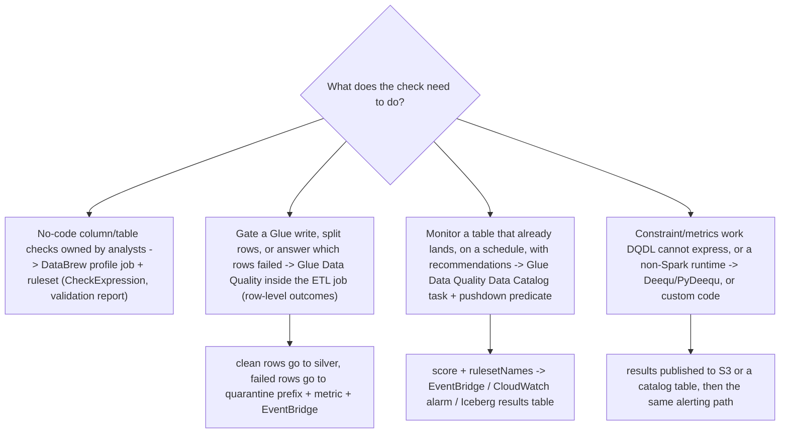
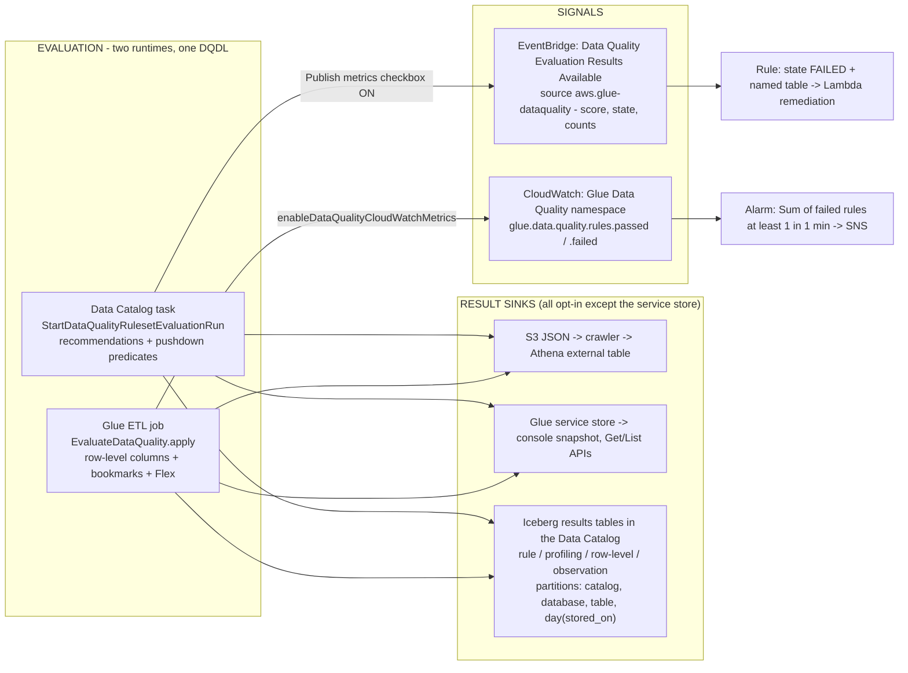
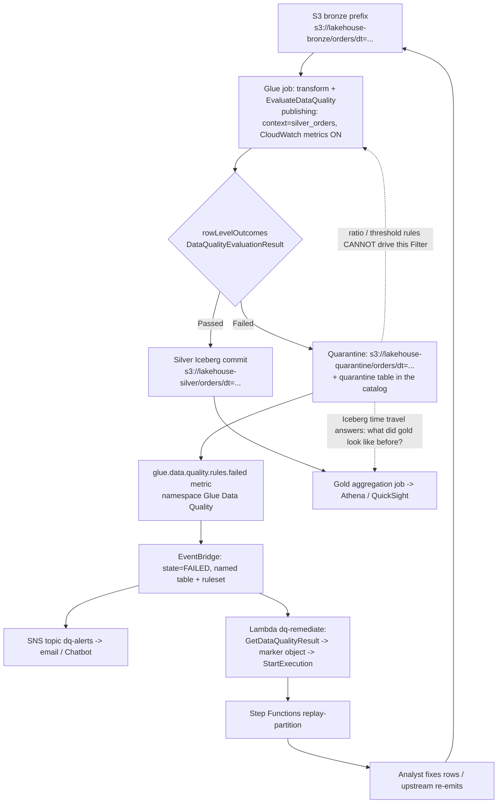
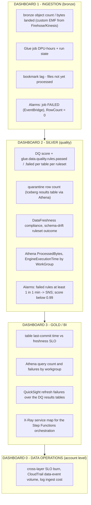
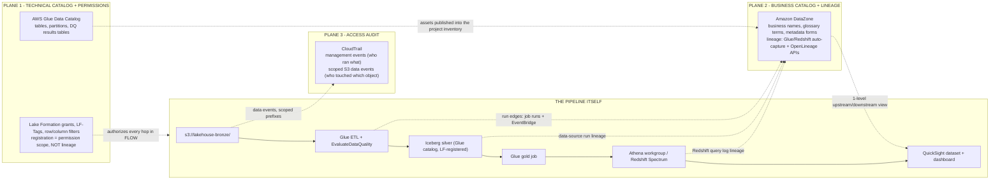

# Data Quality and Observability: DQDL, Quarantine, Lineage, and SLOs

Lessons 01 to 14 built something that works: a bronze prefix, Iceberg tables, Glue jobs, a catalog, Athena and QuickSight, orchestration, Lake Formation grants, PII controls and a hardened perimeter. None of that answers the question your consumers will actually ask: **can you prove today's gold numbers are right, and can you tell me what changed when they are not?** A lakehouse without quality and observability is a very fast way to move wrong data.

This lesson builds the proof layer in the order AWS's own guidance lays it out: **engines → rules → runtimes → results and signals → quarantine → SLOs → per-layer observability → audit → lineage → remediation**. Two ideas carry the whole thing. First, quality is a *pipeline step with an output*, not a dashboard: it either gates a write, splits rows, or raises a signal someone is paged for. Second, observability has three distinct planes that teams constantly confuse: the **Glue catalog** holds technical metadata and permissions, **DataZone** holds business meaning and lineage, **CloudTrail** holds who called what. Every number below is dated to **October 2026**.

```text
====================================================================
 QUALITY + OBSERVABILITY SPINE - AWS DATA LAKEHOUSE, LESSON 15
====================================================================
 ENGINES ...... Glue Data Quality (DQDL, managed, built on Deequ)
                  - Data Catalog task  OR  EvaluateDataQuality in job
                Deequ / PyDeequ - OSS, custom analyzers, exotic runtimes
                DataBrew - no-code check expressions in profile jobs
                custom checks - Lambda / Glue / EMR of choice
 RULES ........ Rules = [ ... ] bound to ONE table; 32 rule types;
                expressions, where clauses, dynamic rules
                (RowCount > avg(last(10))), labels (team=finance),
                constants, pre-processing SQL; 2,000 rules and
                65 KB per ruleset; no nested or list-type columns
 RUNTIMES ..... Catalog task: recommendations (BASIC; ADVANCED via
                  Bedrock Sep 2026), pushdown partition predicates,
                  min 2 DPUs - but it CANNOT name failed records
                ETL job: row-level DataQualityRules* columns, auto
                  scaling, Flex, bookmark-driven incremental - but
                  no recommendation runs
 RESULTS ...... S3 JSON -> external table + crawler -> Athena;
                service store -> console + Get/List APIs;
                Iceberg tables in the Data Catalog (Jul 2026),
                partitioned by catalog_id/database/table/day
 SIGNALS ...... EventBridge "Data Quality Evaluation Results
                  Available" (source aws.glue-dataquality) carrying
                  score, state, rulesSucceeded/Failed/Skipped -
                  which only works while "Publish metrics to
                  Amazon CloudWatch" stays SELECTED
                CloudWatch namespace Glue Data Quality:
                  glue.data.quality.rules.passed / .failed
 QUARANTINE ... warn | quarantine | halt (InsuranceLake's three
                  actions); row-level outcomes ONLY; ratio and
                  threshold rules cannot quarantine; WAP = Iceberg
                  staging branch -> audit -> fast_forward to main
 SLO .......... P95(availability - event) <= target across three
                  clocks: event time / landing time / availability
                  time; encode as DataFreshness + FileFreshness
                  + RowCount volume alarms
 OBSERVABILITY  one CloudWatch dashboard per medallion layer;
                Glue log groups /aws-glue/jobs/output, /error,
                  /logs-v2 (continuous logging, Logs IA redirect);
                Athena AWS/Athena metrics; X-Ray for Lambda and
                  Step Functions - NOT for Spark executors
 AUDIT ........ CloudTrail management events (first copy free)
                vs S3 data events ($0.10 per 100,000, opt-in,
                  scoped by advanced event selectors, no wildcards)
 PLANES ....... Glue Data Catalog = technical metadata + permissions
                  (Lake Formation grants; registration is NOT lineage)
                Amazon DataZone = business catalog + lineage
                  (OpenLineage-compatible; Glue/Redshift auto-capture)
                CloudTrail = access audit (who called, not what a
                  column was derived from)
 Prices ....... Glue DQ worked examples at $0.44 per DPU-hour (a
                  second line on the same page reads $0.22 - see E2);
                  Flex $0.29; 2-DPU minimum, 1-minute billing;
                  anomaly detection 1 DPU per statistic;
                  EventBridge $1.00 per million custom events;
                  CloudWatch custom metric $0.30 per metric-month
                  [us-east-1 list, as of Oct 2026]
====================================================================
```

In this lesson you will:

- pick a quality engine from AWS's own Prescriptive Guidance mapping, **Glue Data Quality, DataBrew, Deequ or custom code**, and defend the default;
- author **DQDL**: rulesets bound to one table, the four modifiers (expressions, `where`, dynamic rules, labels), the 32 rule types, and which of them can ever produce a failing **row**;
- run evaluation on **both runtimes**, the Data Catalog task and `EvaluateDataQuality` inside a Glue job, and know exactly what each one can and cannot do;
- land results in **three sinks**: S3 JSON, the Glue service store, and **Iceberg tables in the Data Catalog**, then read them in Athena;
- wire the **signals**: EventBridge events, CloudWatch metrics in the `Glue Data Quality` namespace, alarms, dashboards: including the checkbox that silently kills alerts;
- build the **quarantine pattern** end to end: split rows, write the quarantine prefix and table, emit the metric, alert, and run a backfill that stays idempotent;
- compute a **freshness SLO** across three clocks and defend a P95 number with real arithmetic;
- scope **CloudTrail data events** per sensitive prefix so the audit trail does not become the biggest line on the bill;
- separate the **three planes**, Glue catalog, DataZone business catalog and lineage, CloudTrail audit, and name only the lineage sources AWS actually documents;
- wire a working **EventBridge → SNS → Lambda** remediation path with IAM that fits;
- study **two AWS customer cases**, a sourced **October 2026 update box**, **eleven exam-style questions** and four interactive checks.

---

## 1. Four quality engines, one decision

### 1.1 AWS's own mapping

AWS Prescriptive Guidance publishes a solution-mapping table for data-quality checks. It is the fastest correct answer to "which tool":

| Need | Engine | Where it runs | Verified scope |
|---|---|---|---|
| No-code column-level or table-level conditions for analysts | **AWS Glue DataBrew** | Profile job + ruleset | Own `CheckExpression` syntax, **not** DQDL; validation report next to the profile |
| Custom code in a Glue job **or** no-code rules on catalog tables | **AWS Glue Data Quality** | Catalog task or ETL transform | DQDL, managed, serverless, "built on top of the open-source DeeQu framework" |
| Bespoke checks in your own ETL of choice | **Custom checks** | Lambda, Glue, EMR | Whatever you write |
| Metrics report, constraint validation and constraint suggestions | **Deequ** (open source) | EMR, SageMaker, Glue with the right JAR | `CompletenessConstraint`-style analyzers, metrics repository, anomaly checks |

(AWS Prescriptive Guidance: *Data quality checks*, accessed 2026-10-11.)

For this course's lakehouse the answer is **Glue Data Quality by default**, DataBrew kept for business-analyst profiling of CSV/JSON datasets, and PyDeequ only where Deequ-level customization is genuinely needed. That is not a popularity contest: Glue DQ evaluates "tables and supported Amazon Athena views that are stored in the AWS Glue Data Catalog" over "Amazon S3, Amazon Redshift, JDBC sources compatible with the Data Catalog, and transactional data lake formats such as Apache Iceberg, Apache Hudi, and Delta Lake"; that is exactly the substrate you built in Lessons 02 to 08 (Glue Developer Guide, accessed 2026-10-11).



- **📚 Did you know?** Glue Data Quality is not a re-implementation: AWS states it is "built on top of the open-source DeeQu framework" and that there is "No lock-in… allowing you to keep the rules you are authoring in an open language" (Glue Developer Guide, accessed 2026-10-11). That is why a DQDL rule reads like Deequ's constraint vocabulary, and why the open-source library is still a legitimate escape hatch for analyzers the product does not expose.

### 1.2 What "managed" buys, in one table

| | **Glue Data Quality** | **Deequ / PyDeequ** | **DataBrew rules** | **Great Expectations (DIY)** |
|---|---|---|---|---|
| Authoring | DQDL, console, API, Studio node | Scala/Python constraints | No-code check expressions | Python expectation suites |
| Managed run | Yes, serverless tasks and ETL integration | No, you run Spark | Yes, inside profile jobs | No, you host it |
| Rule recommendations | Yes (BASIC; ADVANCED via Bedrock, Sep 2026) | Constraint suggestion in code | Recommendations tab in console | No |
| Row-level failing records | **Yes, ETL path only** | Yes, if you build the split | No: findings are aggregate | Yes, if you build it |
| Alerts | EventBridge + CloudWatch, built in | You build SNS publishing | EventBridge event per validated ruleset | You build it |
| AWS support posture | First-party product | Open source (community/AWS samples) | First-party product | Not an AWS offering |

The last row matters. Great Expectations appears in this lesson only as a **bring-your-own** framework: AWS publishes no managed GX offering, GX's own legacy docs pin the AWS Glue integration to "the most recent version of GX that supports this integration is GX 0.15.50", and the Glue Catalog connector walkthrough is a partner-authored post. Treat GX as *your* runner to version, patch and support.

---

## 2. DQDL: the language, the modifiers, the ruleset contract

### 2.1 The contract: `Rules = [ ... ]` bound to one table

A ruleset is a bracketed, comma-separated list bound to exactly one catalog table:

```text
Ruleset = 'Rules = [IsComplete "col1", IsPrimaryKey "col2", RowCount between 2000 and 8000]'
TargetTable = {'TableName': 'orders', 'DatabaseName': 'lakehouse_silver'}
```

That is the shape of `create_data_quality_ruleset` (Glue Developer Guide: *Using APIs to measure and manage data quality*, accessed 2026-10-11). Two limits define how big a single ruleset can get: **2,000 rules per ruleset** ("If your rulesets are larger, we recommend splitting into multiple rulesets") and a **65 KB ruleset size**. Statistics are a separate budget: **100,000 statistics per account**, stored **free** for **2 years** (Glue pricing, accessed 2026-10-11).

One language-level exclusion to memorize: **"DQDL doesn't currently support nested or list-type column data."** Nested structs and arrays are out of scope for direct rule targets: flatten or use `CustomSql` against a pre-processed view.

### 2.2 The four modifiers that change semantics

| Modifier | Since | What it does | Example |
|---|---|---|---|
| **Expressions** | GA 2023-05-24 (product) | Thresholds, ranges, enums, regex, `with threshold` | `Uniqueness "email" = 1.0`, `ColumnValues "currency" matches "^[A-Z]{3}$" with threshold > 0.999` |
| **`where` clause** | 2024-06-26 | Filter rows *before* the rule evaluates | `Completeness "First_Name" > 0.95 where "weight > 10"` |
| **Dynamic rules** | preview 2023-11-27, GA 2024-08-07 | Thresholds computed from run history | `RowCount > avg(last(10))`, `Completeness "colA" between min(last(5)) - 1 and max(last(5)) + 1` |
| **Labels** | GA 2025-11-21 | Key-value tags authored in DQDL for slicing results by owner | label `team=finance`, queryable in rule outcomes, row-level results and API responses |

(Glue DQ release notes and AWS What's New, 2025-11-25, accessed 2026-10-11.)

Three supporting features round it out: **constants** (2025-11-21) let you define a value once and reference it throughout a script, "preventing issues related to query size limits"; **pre-processing queries** (GA 2025-11-25) run SparkSQL against the table *before* evaluation via the `PreProcessingQuery` field of `DataQualityGlueTable`, so you can derive columns, filter or validate cross-column relationships; and **complex composite rules** (2024-11-22) let you nest AND/OR groups instead of stacking flat rules.

Note the trap in the `with threshold` column: that clause works only with **ColumnValues, ColumnDataType and CustomSql**. Put it on `Completeness` and you are writing a rule DQDL will not evaluate the way you think.

### 2.3 The 32 rule types, and the ones that can name a row

The DQDL rule-type reference lists exactly **32** rule types as of October 2026: AggregateMatch, AllStatistics, ColumnCorrelation, ColumnCount, ColumnDataType, ColumnExists, ColumnLength, ColumnNamesMatchPattern, ColumnValues, Completeness, CustomSql, DataFreshness, DatasetMatch, DistinctValuesCount, Distribution, Entropy, IsComplete, IsPrimaryKey, IsUnique, Mean, ReferentialIntegrity, RowCount, RowCountMatch, SchemaMatch, StandardDeviation, Sum, Uniqueness, UniqueValueRatio, DetectAnomalies, FileFreshness, FileMatch, FileUniqueness and FileSize.

They sort into four families:

```text
ROW-LEVEL (can name the offending record) ..... Completeness, IsComplete,
    IsUnique, IsPrimaryKey, Uniqueness, UniqueValueRatio, ColumnValues,
    ColumnLength, ColumnDataType, ColumnExists, DetectAnomalies,
    DataFreshness, CustomSql WITH a row-level threshold, File* (no)
DATASET-LEVEL (aggregate only - NEVER a failing row) .. RowCount,
    RowCountMatch, Mean, StandardDeviation, Sum, ColumnCount,
    ColumnExists, ColumnNamesMatchPattern, ColumnCorrelation,
    CustomSql (overall form), AggregateMatch
CROSS-DATASET .................................. ReferentialIntegrity,
    DatasetMatch, AggregateMatch, SchemaMatch
ANALYZERS / FILE-CENTRIC ........................ AllStatistics,
    Distribution, FileFreshness, FileMatch, FileUniqueness, FileSize
```

AWS's own Studio documentation is blunt about the split: dataset-level rules "cannot identify error records because they're applied at the dataset level" (Glue Developer Guide: *Evaluating data quality with AWS Glue Studio*, accessed 2026-10-11). Build a quarantine on `RowCount` and you will quarantine nothing.

### 2.4 Worked example E1: the silver `orders` ruleset

Target: `lakehouse_silver.orders`, an Iceberg table partitioned by `dt`, evaluated inside the bronze→silver job **and** re-checked daily as a catalog task.

```text
Worked example E1 - DQDL ruleset for lakehouse_silver.orders, as of Oct 2026

Rules = [
    ColumnExists "order_id",
    ColumnExists "customer_id",
    ColumnExists "order_ts",
    IsPrimaryKey "order_id",                                    -- not-null + unique in one rule
    Completeness "customer_id" > 0.999,                         -- row-level, quarantinable
    Completeness "order_ts" > 0.995,                            -- row-level, quarantinable
    Uniqueness "order_id" > 0.999,                              -- tolerates 0.1% dupes
    ColumnValues "order_status" in ["created","paid","shipped","cancelled"]
        with threshold > 0.99,                                  -- <=1% dirty enum tolerated
    ColumnValues "currency" matches "^[A-Z]{3}$" with threshold > 0.999,
    ColumnValues "total_amount" > 0,
    RowCount > 1000,                                            -- dead-pipeline guard
    RowCount <= avg(last(10)) * 1.5,                            -- dynamic volume spike guard
    DataFreshness "order_ts" > (now() - 2 days)
        where "dt = current_date - 1",                          -- staleness on yesterday's partition
    CustomSql "SELECT order_id FROM primary WHERE total_amount != item_sum"
]

SCORE = rules passed / rules evaluated -> 14/14 = 1.00, 13/14 = 0.929
QUARANTINE-CAPABLE RULES = the Completeness pair, the Uniqueness,
    the three ColumnValues, and the row-level CustomSql
DATASET-LEVEL ONLY = both RowCount rules and DataFreshness
    -> these ALERT (halt / notify), they never split rows
```

Why each line earns its place: `IsPrimaryKey` collapses two rules into one; the threshold forms on `ColumnValues` tolerate sub-1% dirt without failing a whole run; `RowCount <= avg(last(10)) * 1.5` is a **dynamic** spike guard that needs no hand-tuned constant; the row-level `CustomSql` is the only rule here that can hand you a list of order IDs to quarantine; and `DataFreshness … where "dt = current_date - 1"` scopes staleness to the partition that is *supposed* to be fresh instead of screaming about the whole history.

AWS's getting-started walkthrough shows the same shape on its sample tickets table, `IsComplete "SET_FINE_AMOUNT"`, `Uniqueness "TICKET_NUMBER" > 0.95`, `ColumnValues "PROVINCE" in [...]`, `ColumnLength "INFRACTION_DESCRIPTION" between 15 and 31`, with the important caveat in the docs: recommendations "make it easy to start… without writing code", but the rules are generated from *current* statistics, so treat them as a draft to tighten (accessed 2026-10-11).

### 2.5 Rule recommendations: BASIC, and ADVANCED via Bedrock

`start_data_quality_rule_recommendation_run(DataSource={'GlueTable': {...}}, Role=role_arn)` returns a `RunId`; fetch `ResultIds` from `get_data_quality_ruleset_evaluation_run`, then each `get_data_quality_result(ResultId=…)`. Recommendation runs are **automatically deleted after 90 days**. Since **2026-09-18 / 2026-09-25**, an **ADVANCED** mode uses Amazon Bedrock with table metadata plus sampled rows to generate DQDL: a drafting assistant, not an approval.

```fillblank
{
  "question": "Fill in the DQDL and Glue Data Quality keywords this lesson leans on:",
  "template": "A ruleset is written as {{1}} = [ rule list ] and is bound to exactly one catalog table; a filter applied before a rule runs is the {{2}} clause; a threshold computed from run history such as RowCount > {{3}}(last(10)) is a {{4}} rule; and the rule that checks not-null and uniqueness at once is {{5}}.",
  "answers": {
    "1": "Rules",
    "2": "where",
    "3": "avg",
    "4": "dynamic",
    "5": "IsPrimaryKey"
  },
  "distractors": [
    "Ruleset",
    "Expectations",
    "having",
    "filter",
    "max",
    "median",
    "composite",
    "anomaly",
    "IsUnique",
    "DistinctValuesCount"
  ],
  "explanation": "Rules = [... ] is the literal ruleset syntax AWS uses in the create_data_quality_ruleset API example. The where clause shipped 2024-06-26 and filters before evaluation, which is how you scope a freshness rule to yesterday's partition. avg(last(10)) is the documented dynamic-rule form: thresholds come from history, not from a constant someone typed once. Dynamic rules went GA 2024-08-07 alongside anomaly detection. IsPrimaryKey is the single rule that expresses not-null plus unique, which is why it replaces two rules in every production ruleset in this course."
}
```

---

## 3. Two runtimes: the Data Catalog task and `EvaluateDataQuality` in the job

They share DQDL, EventBridge, CloudWatch metrics, S3 results and IAM actions. They are **not** interchangeable.

| | **Data Catalog task** (`StartDataQualityRulesetEvaluationRun`) | **ETL-integrated** (`EvaluateDataQuality.apply` / Studio node) |
|---|---|---|
| Identify which records failed | **"Not supported"** | **"Supported"**: row-level outcomes |
| Incremental evaluation | Pushdown / catalog partition predicates | **AWS Glue job bookmarks** |
| Auto scaling | Not supported | Supported |
| Rule recommendations | Yes (no recommendations inside ETL runs) | No |
| ML anomaly detection, dynamic rules, EventBridge, CloudWatch, results to S3 | Supported | Supported |
| Flex execution / auto-scaling DPU |: | Supported |
| Failure action | Score + event | "Fail job after loading target data" → `AssertionError` |

(Glue Developer Guide: capability matrix, accessed 2026-10-11.)

### 3.1 Inside the job

```python
from awsglue.transforms import EvaluateDataQuality

dq = EvaluateDataQuality.apply(
    frame=orders_frame,
    ruleset=ruleset,                       # Rules = [ ... ]
    publishing_options={
        "dataQualityEvaluationContext": "silver_orders",   # namespace; default "default_context"
        "enableDataQualityCloudWatchMetrics": True,        # default False
        "enableDataQualityResultsPublishing": True,        # default True -> Glue Studio "Data quality" tab
        "resultsS3Prefix": "s3://lakehouse-dq/results/"    # optional S3 sink
    })
```

The transform's output option is the decision that matters: **"Original data"** versus **"Add new columns to indicate data quality errors"**. The second appends four columns: `DataQualityRulesPass`, `DataQualityRulesFail`, `DataQualityRulesSkip` (string arrays) and `DataQualityEvaluationResult` ("Passed" or "Failed" **at the row level**). AWS's own note is the one to memorize: *"your overall results can be FAIL, but a certain record might pass."* Rules in Studio go "within the brackets and… separated by commas": `Rules = [ Completeness "year" > 0.8, Completeness "month" > 0.8 ]`.

Incremental quality comes from **job bookmarks**: for S3 inputs the watermark is object **last-modified time**, with a `maxBand` default of **900,000 ms (15 minutes)** during which the listing "is likely to be consistent". Bookmarks require `job.init` at the top and `job.commit` at the end and key off a unique `transformation_ctx`: omit it and the operator is not tracked at all (which is exactly how you deliberately re-read a dimension table every run).

### 3.2 Three result sinks, and since July 2026 the catalog is one of them

1. **S3 JSON results** (opt-in via `resultsS3Prefix` or the task's results location) → register with a crawler, `CREATE EXTERNAL TABLE` with a JSON SerDe, `MSCK REPAIR TABLE`, then Athena. AWS ships the full DDL, partitioned by `year/month/day`.
2. **The Glue service store** → readable through `GetDataQualityResult` / `ListDataQualityResults` and rendered in the console's **Data quality** tab; the **Data quality snapshot** shows the last 10 runs across rulesets by default.
3. **Iceberg tables in the Data Catalog** (GA 2026-07-27) → four opt-in result types, **rule results, profiling results, row-level results, observation results**, configured through `--additional-run-options` on `StartDataQualityRulesetEvaluationRun` or `additional_options` in an ETL job. **Nothing is written by default**: "You must explicitly enable each result type."

```text
aws glue start-data-quality-ruleset-evaluation-run \
  --data-source '{"GlueTable": {"DatabaseName": "lakehouse_silver","TableName": "orders"}}' \
  --role arn:aws:iam::111122223333:role/glue-dq-task \
  --ruleset-names '["silver_orders_strict"]' \
  --additional-run-options '{
    "DataQualityRuleResults": {
      "WriteDataQualityRuleResultsEnabled": true,
      "CatalogTableConfig": {"DatabaseName": "quality_results","TableName": "rule_results"}
    }
  }'

PARTITION KEYS of every results table ... catalog_id, database_name,
    table_name, day(stored_on)
RULE-RESULT COLUMNS ..................... dq_result_id, rule_name,
    rule_description (the DQDL expression), rule_result (PASS|FAIL),
    evaluation_message, evaluated_metrics MAP<STRING,DOUBLE>,
    catalog_id, database_name, table_name,
    ruleset_evaluation_run_id, started_on, completed_on,
    evaluated_rule, ruleset_name
ROW-LEVEL COLUMNS ....................... all source columns +
    data_quality_rules_pass / _fail / _skip (ARRAY),
    data_quality_evaluation_result (Passed|Failed), stored_on,
    region, account_id
```

This is the single biggest change to this lesson's subject in 2026: your quality history becomes an ordinary Iceberg table with the same Athena, Lake Formation, time-travel and QuickSight tooling as the rest of the lakehouse.

### 3.3 The alerting contract has a hidden checkbox

Every completed evaluation emits an EventBridge event:

```json
{
  "detail-type": "Data Quality Evaluation Results Available",
  "source": "aws.glue-dataquality",
  "detail": {
    "contextType": "GLUE_DATA_CATALOG",
    "runId": "dqrun-9f2c...",
    "databaseName": "lakehouse_silver",
    "tableName": "orders",
    "catalogId": "111122223333",
    "resultID": "dqr-...",
    "rulesetNames": ["silver_orders_strict"],
    "state": "FAILED",
    "score": 0.928,
    "rulesSucceeded": 13,
    "rulesFailed": 1,
    "rulesSkipped": 0
  }
}
```

The ETL variant uses `contextType: "GLUE_JOB"` with `jobId`, `jobName` and `evaluationContext`. The parallel CloudWatch path is equally simple: **"Each AWS Glue Data Quality evaluation emits a pair of metrics named `glue.data.quality.rules.passed`… and `glue.data.quality.rules.failed`"** under the **`Glue Data Quality`** namespace, published **per table and per ruleset**.

> [!WARNING]
> **Do not uncheck "Publish metrics to Amazon CloudWatch."** AWS documents it flatly: for both Data Catalog and ETL-job evaluations, *"the Publish metrics to Amazon CloudWatch option, which is selected by default, must remain selected for EventBridge publishing to work."* Teams switch it off to trim a few custom-metric dollars and lose the CloudWatch metrics *and* the EventBridge events in the same click: alarms, notifications and remediation all go silent while the rules keep running and the score keeps dropping. The IAM consequence is the same switch: publishing needs `cloudwatch:PutMetricData` **conditioned on** `"cloudwatch:namespace": "Glue Data Quality"`.

AWS's stated preference: *"Our recommended approach is to set up data quality alerts using Amazon EventBridge, because Amazon EventBridge requires a one-time setup to alert customers."* The CloudWatch alternative is a standard alarm: `glue.data.quality.rules.failed`, statistic **Sum**, period **1 minute**, threshold **≥ 1**, action = SNS topic.



- **📚 Did you know?** The **score** is not a quality grade you pass around: AWS defines it as "the percentage of data quality rules that passed for the input." A ruleset of one weak rule scores 1.0 while 40% of rows are junk. That is why the row-level columns and the results tables exist: score for the alert, rows for the fix (Glue Developer Guide, accessed 2026-10-11).

---

## 4. Deequ, PyDeequ and DataBrew: the verified side paths

### 4.1 Deequ: the engine, and where it still earns its keep

AWS's PyDeequ announcement describes the original: Deequ "is used internally at Amazon to verify the quality of many large production datasets… The system computes data quality metrics on a regular basis (with every new version of a dataset), verifies constraints defined by dataset producers, and publishes datasets to consumers in case of success. In error cases, dataset publication can be stopped, and producers are notified to take action." Compute → verify → publish-or-stop is the loop Glue DQ productized in 2023 (AWS Big Data Blog, 2020-12-30, updated June 2024).

Remaining legitimate reasons to run Deequ yourself, per AWS's own posts:

| Reason | AWS-documented vehicle | Hard constraint |
|---|---|---|
| Custom analyzers/constraints DQDL cannot express | PyDeequ on **EMR** | The Deequ JAR **must match** your Spark version: `pydeequ.deequ_maven_coord` → `com.amazon.deequ:deequ:2.0.3-spark-3.3`; "It is critical to provide the correct Apache Maven coordinates" |
| **Migration validation**: source vs target metric diff | EMR job writes results to a Glue table (e.g. `db_deequ.db_migration_validation_result`), audited in Athena | Same JAR/Spark pinning |
| Very small datasets needing fast startup | **Deequ on AWS Lambda** with the Spark Runtime for AWS Lambda (SoAL) | SoAL "is larger than the 250 MB limit for zip archive packaging" → container image; AWS recommends Glue Data Quality "for Spark jobs that run longer than 15 minutes or larger files (more than 1 GB)" |
| Anomaly checks over a metrics repository | `FileSystemMetricsRepository` + Holt-Winters, results to SNS | The published Holt-Winters recipe was verified "in AWS Glue 2.0, pydeequ release/1_1_1, Spark 2.4 and deequ-1.1.0_spark-2.4-scala-2.11.jar (only)": version-pin or don't use it |

PyDeequ "supports Spark up to version 3.3.0" as of the PyDeequ 1.1.x notes AWS links, and "can function within Amazon EMR and SageMaker." The honest 2026 summary: **most of Deequ's value is already inside Glue Data Quality**; reach for the library when the runtime is exotic or the constraint is not expressible.

### 4.2 DataBrew: rules, but not DQDL

DataBrew's quality story is a **ruleset of `CheckExpression`s evaluated inside a profile job**: "If any of a rule's criteria isn't met, the ruleset as a whole fails validation", and the run "produces a validation report in addition to the data profile" at the same location. API shape: `CheckExpression`, `ColumnSelectors` (Name or Regex), `Disabled`, `SubstitutionMap`, `Threshold` (Type/Unit/Value). Constraints to respect: **only columns of simple types** (string, numbers, boolean) participate, and rules live on the **Recommendations** tab of the ruleset screen.

On completion, "DataBrew sends an Amazon CloudWatch event with the details of that job run… for each validated ruleset… and the event contains its result (`SUCCEEDED`, `FAILED`, or `ERROR`)" plus a link to the report. That event is your EventBridge pattern for analyst-owned checks. Metrics live in the **`AWS/DataBrew`** namespace: the documented example is `SessionCount`.

> [!IMPORTANT]
> **DataBrew rules are not DQDL.** The check-expression syntax, the console, the events, the report and the failure semantics are all different from Glue Data Quality. Copying `Completeness "col" > 0.95` into a DataBrew ruleset, or a DataBrew `CheckExpression` into a Glue ruleset, fails in both directions. AWS Prescriptive Guidance keeps them separate for a reason: DataBrew for no-code analyst checks, Glue Data Quality for job-embedded and catalog-embedded DQDL, Deequ for a metrics/constraint report, custom code for everything else.

### 4.3 Worked example E2: what a quality gate costs, and where to put it

AWS's own benchmark: **104 columns, 1 million rows, 10 DPUs** (AWS Big Data Blog, 2024-03-12):

```text
Worked example E2 - DQ run cost and placement, us-east-1 list, as of Oct 2026
BENCHMARK (104 cols, 1M rows, 10 DPUs)
  0 rules ......... 53.2 s ... 0.15 DPU-hr .... $0.06
  10 rules ........ ~150 s ... 0.42 DPU-hr .... $0.18
  100 rules ....... -- ....... 0.52 DPU-hr .... $0.23
  400 rules ....... 445.7 s .. 1.24 DPU-hr .... $0.54
  -> cost is dominated by SCANNING the table, not rule count:
     "cost… only starts to increase after evaluating rulesets with
      more than 100 rules, remaining constant below that number."

PLACEMENT, same 20-rule silver ruleset (30 runs/month)
  A. Standalone catalog task, 5 DPUs x 20 min
     5 x (20/60) x $0.44 ............................. $0.73 / run
     $0.73 x 30 ..................................... $21.90 / month
     at the Flex rate $0.29 .......................... $0.48 / run
  B. Inside the existing silver job (6 DPUs, +5 min marginal)
     6 x (5/60) x $0.44 ............................. $0.22 / run
     $0.22 x 30 ..................................... $6.60 / month
     AND you get row-level outcomes -> quarantine works
  C. Anomaly detection add-on: 20 statistics x 1 DPU x 15/3600 h x $0.44
     .............................................. +$0.037 / run
     ("between 10-20 seconds" per statistic on average)
  D. Data profile/quality task floor .............. 2 DPUs, 1-minute minimum

PRICE CONFLICT TO CHECK BEFORE YOU BUDGET
  aws.amazon.com/glue/pricing carries two DQ numbers on the same
  access date (2026-10-11): the Data Quality worked examples
  calculate at $0.44 per DPU-hour (recommendation task 5 DPUs x 10 min
  = "$0.37"; catalog evaluation 5 DPUs x 20 min = "$0.73"; ETL DQ
  6 DPUs x 20 min = "$0.88", Flex "$0.58"), while a pricing table
  line reads Glue Data Quality = "$0.22 per DPU-hour".
  Range for option A: $11.00 - $21.90 / month. Verify in console.
```

Two conclusions survive the price ambiguity: **budget by table size × frequency, not by rule count**, and for a quarantine design the in-job evaluation dominates because it is cheaper *and* it is the only path that can name the rows.

---

## 5. Quarantine: a pattern, not a product

### 5.1 Three actions, two checkpoints

The AWS Solutions Library's InsuranceLake sample formalizes what every production pipeline needs: three actions at two pipeline checkpoints:

| Action | Behaviour | Use when |
|---|---|---|
| **Warn** | Log or notify only; data flows on | Cosmetic issues, early runs of a new rule |
| **Quarantine** | Remove failing **rows** from the flow and write them to separate quarantine storage + a quarantine Data Catalog table | Row-level, business-meaningful defects |
| **Halt** | Stop the pipeline / fail the job | The dataset is unusable downstream |

Checkpoints: `before_transform` ("immediately after schema mapping… before any transforms are run") and `after_transform` ("just before saving the data to the Cleanse bucket"). The rule that matters for your ruleset design: *"The data quality expression must be written using row level outcomes to evaluate and quarantine individual rows"* and *"Rules that rely on ratios or thresholds are not supported as quarantine rules."*

InsuranceLake also shows what a **halt on freshness** looks like when you want the pipeline to stop rather than split:

```text
CustomSql 'SELECT count(*) FROM primary
           WHERE claims_last_updated >= now() - interval 24 hours' >= 1
```

### 5.2 The split, in code

```python
from awsglue.transforms import EvaluateDataQuality, Filter

rowLevelOutcomes = EvaluateDataQuality.apply(
    frame=orders_frame,
    ruleset=quarantine_capable_ruleset,      # only row-level rules
    publishing_options={
        "dataQualityEvaluationContext": "silver_orders",
        "enableDataQualityCloudWatchMetrics": True,
        "enableDataQualityResultsPublishing": True,
        "resultsS3Prefix": "s3://lakehouse-dq/results/"
    })

clean = Filter.apply(frame=rowLevelOutcomes,
                     f=lambda r: r["DataQualityEvaluationResult"] == "Passed")
dirty = Filter.apply(frame=rowLevelOutcomes,
                     f=lambda r: r["DataQualityEvaluationResult"] != "Passed")

# clean  -> s3://lakehouse-silver/orders/dt=2026-10-10/   (Iceberg commit)
# dirty  -> s3://lakehouse-quarantine/orders/dt=2026-10-10/ + catalog table
# glue.data.quality.rules.failed metric -> EventBridge -> SNS/Lambda
```

AWS's Studio guidance also offers a first-party variant: in **Data quality actions**, choose **Fail job after loading target data**, which surfaces as `AssertionError: The job failed due to failing DQ rules for node: …`: halt without quarantine.

### 5.3 Worked example E3: the quarantine loop with real numbers

```text
Worked example E3 - one bad day on lakehouse_silver.orders, as of Oct 2026
Input ................................. 1,000,000 rows, 480 files
Evaluated rules (quarantine-capable) .. Completeness customer_id,
                                        Uniqueness order_id,
                                        ColumnValues order_status,
                                        CustomSql total_amount = item_sum
Rows passing .......................... 987,520  (98.752%)
Rows quarantined ......................   12,480  (1.248%)
  - null customer_id ..................    8,900
  - duplicate order_id ...............    2,310
  - illegal order_status .............    1,150
  - amount mismatch ..................      120   <- CustomSql row form
Ruleset score ........................ 0.75 (3/4 rules passed)
  -> score says "fail", the ROWS say "1.248% of the batch is dirty"
Quarantine write ...................... s3://lakehouse-quarantine/orders/
                                        dt=2026-10-10/  (~4.1 MB Parquet)
Alert ................................ EventBridge state=FAILED -> SNS
                                        -> Lambda -> ticket + marker object
Backfill ......................................................
  1. analyst fixes 120 amount rows upstream, re-emits 340 corrected files
  2. Step Functions "replay-partition" clears the quarantine partition
     for dt=2026-10-10 (InsuranceLake clears quarantine storage and
     tables on partition reload)
  3. same job re-runs the partition; bookmark rewound or a new
     transformation_ctx, output to a NEW prefix or Iceberg MERGE
  4. silver commit + gold refresh; DQ results table records the pass
Cost of the re-run (6 DPUs x 5 min marginal, $0.44/DPU-hr) ... $0.22
```

The last two lines are the point: **quarantine without a backfill path is just data loss with extra steps.** And because the results are Iceberg tables now, the "what did gold look like before the bad partition" question is answered with time travel instead of a restore.

### 5.4 Write-Audit-Publish: the Iceberg-native form

AWS's WAP pattern replaces the physical quarantine copy with **branches**: write everything to a `stg` branch → run Glue DQ against it → filter passing rows into an `audit` branch → `fast_forward` to `main` with Spark's `fast_forward` procedure. The blog's demo rule set checked sensor temperature "between −10 and 50 °C", and it names the trade-off honestly: *"The primary challenge of the WAP pattern is the increased latency it introduces."* The dead-letter-queue approach (the S3 quarantine prefix) is the other documented option: pick by whether you can afford the latency or the duplicate storage.



```dragdrop
{
  "question": "Drag the quarantine-and-backfill loop into the order it must run:",
  "items": [
    "4. Emit glue.data.quality.rules.failed and fire the EventBridge event with state FAILED for the named table and ruleset",
    "1. Evaluate row-level outcomes inside the Glue job with EvaluateDataQuality and add the four DataQuality* columns",
    "6. Analyst corrects the source rows, then Step Functions replay-partition clears the quarantine partition for that dt",
    "2. Filter on DataQualityEvaluationResult: Passed rows commit to the silver Iceberg table",
    "7. Re-run the partition through the same job with a rewound bookmark or a new transformation_ctx, writing to a new prefix or MERGEing, then refresh gold",
    "3. Failed rows write to s3://lakehouse-quarantine/<table>/dt=... plus a quarantine table in the catalog",
    "5. SNS notifies a human and Lambda fetches GetDataQualityResult, drops a marker object and starts the replay state machine"
  ],
  "correctOrder": [
    "1. Evaluate row-level outcomes inside the Glue job with EvaluateDataQuality and add the four DataQuality* columns",
    "2. Filter on DataQualityEvaluationResult: Passed rows commit to the silver Iceberg table",
    "3. Failed rows write to s3://lakehouse-quarantine/<table>/dt=... plus a quarantine table in the catalog",
    "4. Emit glue.data.quality.rules.failed and fire the EventBridge event with state FAILED for the named table and ruleset",
    "5. SNS notifies a human and Lambda fetches GetDataQualityResult, drops a marker object and starts the replay state machine",
    "6. Analyst corrects the source rows, then Step Functions replay-partition clears the quarantine partition for that dt",
    "7. Re-run the partition through the same job with a rewound bookmark or a new transformation_ctx, writing to a new prefix or MERGEing, then refresh gold"
  ],
  "explanation": "The split has to happen before any commit, or bad rows are already in the silver table. The quarantine write and the metric come from the same evaluation, so the alert can never lag the data. Notification and remediation are separate targets on the same event: SNS for the human, Lambda for the machine steps. The backfill deliberately clears the quarantine partition for that dt before replaying: InsuranceLake documents exactly that behaviour: and the replay writes through a rewound bookmark or a fresh transformation_ctx into a new prefix or an Iceberg MERGE, because a rewind does not clean targets and appending twice is the classic duplicate-data failure."
}
```

- **📚 Did you know?** Bookmarks track **sources, not targets**. AWS's docs state plainly that "when you rewind or reset a bookmark, AWS Glue does not clean the target files because there could be multiple targets and targets are not tracked with job bookmarks." That is why the backfill step above writes to a new prefix or MERGEs, replaying into the same path appends duplicates that your `IsPrimaryKey` rule will then dutifully quarantine next run (Glue Developer Guide, job bookmarks, accessed 2026-10-11).

---

## 6. Freshness SLOs: three clocks and the arithmetic

### 6.1 Separate the clocks before you set a target

| Clock | Definition | Where you measure it |
|---|---|---|
| **Event time** | When the business event happened: carried *in the data* | A timestamp column (`order_ts`) |
| **Landing time** | When the object hit the bronze prefix | S3 `LastModified` |
| **Availability time** | When the silver/gold commit made it queryable in Athena | Table commit / results timestamp |

**Freshness SLO = P95(availability − event) ≤ target.** The pipeline contributes two spans: *landing − event* (ingestion lag) and *availability − landing* (processing + DQ + backfill lag). DQDL gives you two encodings: **`DataFreshness`** against a timestamp column of the table ("Checks if data is fresh", metric `Column.[Column].DataFreshness.Compliance`, row-level results: Yes) and **`FileFreshness`** against S3 file timestamps (file/folder path + threshold, row-level: No).

### 6.2 Worked example E4: a 3-hour SLO, P95 arithmetic

```text
Worked example E4 - freshness SLO math, 30 daily batches, as of Oct 2026
SLO: P95(availability - event) <= 3 h = 180 min

SPAN                              MEAN     P95
source CDC: event -> bronze ....  35 min   55 min
bronze -> silver (incl. DQ) .....  12 min   22 min
silver -> gold + catalog ........   9 min   15 min
orchestration wait (schedule
  offset + Step Functions) ......  38 min   70 min
                                 -------  -------
P95 sum (conservative, add
  the component P95s) ...........  94 min  162 min = 2.7 h

HEADROOM vs 3 h SLO .............  18 min
LEVERS, cheapest first:
  1. cut the 38-min schedule offset (EventBridge cron alignment)
  2. parallelise the gold aggregation
  3. tune the CDC / increase DQ concurrency
ALERT LADDER:
  - DQDL: DataFreshness "order_ts" > (now() - 2 days) where dt = yesterday
  - CloudWatch: silver RowCount = 0  (dead pipeline, not slow)
  - EventBridge: Glue job state FAILED
  - Dashboard: rolling 7-day P95 freshness trend
```

Add the component P95s rather than averaging means, P95 of a sum is bounded by the sum of the P95s, so 162 minutes is the defensible number to put in front of a stakeholder, and the 18 minutes of headroom tells you which lever to pull *before* you breach. The failure ladder is deliberately redundant: a freshness rule catches **stale** data, a zero-`RowCount` alarm catches a **dead** pipeline, and a job-FAILED event catches the **crash**, three different problems that all look like "the dashboard is old".

```plot
{
  "type": "bar",
  "title": "E4: P95 contribution to a 3-hour freshness SLO (as of Oct 2026)",
  "xLabel": "Pipeline span (event time to gold availability)",
  "yLabel": "P95 minutes",
  "xKey": "span",
  "data": [
    {"span": "CDC: event -> bronze landing", "p95_minutes": 55},
    {"span": "bronze -> silver incl. DQ", "p95_minutes": 22},
    {"span": "silver -> gold + catalog", "p95_minutes": 15},
    {"span": "Orchestration wait", "p95_minutes": 70},
    {"span": "Total P95 vs 180-min SLO", "p95_minutes": 162}
  ]
}
```

### 6.3 Encoding volume and schema drift as alarms

| Signal | DQDL / metric | Alarm shape | What it really means |
|---|---|---|---|
| **Freshness** | `DataFreshness`, `FileFreshness`, `FileMatch` | `glue.data.quality.rules.failed` Sum ≥ 1, 1 min | Staleness or a stopped feed |
| **Volume** | `RowCount > 1000`, `RowCount <= avg(last(10)) * 1.5` (dynamic) | Same metric, scoped to the volume ruleset | Collapse (0 rows) or a runaway duplicate load |
| **Schema drift** | `SchemaMatch`, `ColumnExists`, `ColumnDataType`, `ColumnNamesMatchPattern`, `ColumnLength` | EventBridge on `state: FAILED` filtered to the schema ruleset → Lambda opens a ticket | A source changed shape under you |
| **Value drift** | `ColumnValues … with threshold`, `DetectAnomalies` on another rule's metric | Score alarm + anomaly statistics (billed per statistic) | Distribution shifted, not just broke |
| **Pipeline crash** | n/a: job failure event | EventBridge on Glue job FAILED | Nothing ran |

`DetectAnomalies` deserves a special mention: it "checks for anomalies in another rule type's reported metrics", which turns yesterday's threshold rules into a self-tuning baseline: at **1 DPU per statistic**, per run, which is why AWS recommends enabling it selectively.

---

## 7. Operational observability: one dashboard per layer

### 7.1 Logs by layer

| Layer | Where the logs go | Notes |
|---|---|---|
| **Glue jobs** | `/aws-glue/jobs/output` (stdout/stderr), `/aws-glue/jobs/error` (system, daemon, Glue Logger), `/aws-glue/jobs/logs-v2` (continuous logging: driver + executor, real time) | Redirect with `--continuous-log-logGroup`; Glue 4.0+/5.0 "all jobs have real-time logging capabilities"; a security configuration appends its name; KMS-encrypted groups need `logs:AssociateKmsKey` |
| **Glue job failures** | Job insights streams in the same `/aws-glue/jobs/logs-v2/` group | `-job-insights-rca-driver` gives the failing script **line number**, last Spark action and a concise event list; a rule-based stream adds root-cause analysis |
| **Cost on logs** | A **Logs Infrequent Access** class group, e.g. `/aws-glue/jobs/logs-v2-infrequent-access`, pointed at by `--continuous-log-logGroup` | Caveats: "You cannot change the log class of a log group after it's created", and Logs IA cannot be viewed in the standard Logs console |
| **Redshift Serverless** | `/aws/redshift/<namespace>/<log_type>` for connection, user and user-activity logs | Auto-created if missing: with **Never Expire** retention. Set a retention policy or the bill grows without you |
| **Athena** | Metrics in `AWS/Athena` (opt-in per workgroup: "publish query metrics to CloudWatch") + state-change events | `EngineExecutionTime`, `ProcessedBytes`, `TotalExecutionTime`; dimensions `QueryState`, `QueryType`, `WorkGroup`. Detailed query history is **30 days**: long-horizon audit needs EventBridge → Lambda → Firehose → S3 |
| **Orchestration** | **X-Ray**: Lambda (`Active` vs `PassThrough` tracing modes) and Step Functions (service map) | Traces writable **7 days**, queryable **30 days**; Step Functions minimum guaranteed trace size **100 KiB**. X-Ray does **not** trace Spark executors inside Glue |

Multi-account setups centralise with cross-account subscription filters, a Firehose/Kinesis log destination, or Organizations-level **CloudWatch Logs data centralization** (destination log-group names support `${source.accountId}`, `${source.region}`, `${source.logGroup}`, `${source.org.id}`).

### 7.2 The dashboard map

AWS Prescriptive Guidance's recommendation is one dashboard per concern: "a CloudWatch dashboard can show users the status of loads… or what percentage of their data was dropped due to low quality or which sources have the maximum failures." For this lakehouse that becomes one dashboard per medallion layer plus an account-level data-operations board:



Free tier as of Oct 2026: **10** custom metrics, **3** dashboards referencing up to **50** metrics each, **10** alarm metrics, **1 million** API requests and **5 GB** log ingestion per month; custom metrics are **$0.30 per metric-month** for the first 10,000, then $0.10 and $0.05 tiers. Dashboards and alarms are **prorated by the hour from creation**: an unused alarm is not free, and anomaly-detection alarms "incur costs for each metric that you list in the alarm metric expression, plus two additional alarm-metric costs."

```matching
{
  "question": "Match each observed signal to the alarm you should build on it:",
  "pairs": [
    {"left": "glue.data.quality.rules.failed emitted for lakehouse_silver.orders", "right": "CloudWatch alarm on the Glue Data Quality namespace, statistic Sum, period 1 minute, threshold >= 1, action = SNS topic"},
    {"left": "EventBridge event detail-type Data Quality Evaluation Results Available with state FAILED", "right": "EventBridge rule filtering state FAILED plus databaseName/tableName/rulesetNames, target = Lambda remediation and SNS"},
    {"left": "silver table returns zero rows for today's partition", "right": "Alarm on the volume signal (RowCount / custom EMF metric) rather than the DQ score: a dead pipeline is not a quality problem"},
    {"left": "SchemaMatch or ColumnExists rule starts failing after a source release", "right": "EventBridge rule scoped to the schema ruleset -> Lambda opens a ticket with GetDataQualityResult context"},
    {"left": "Glue job run ends in FAILED with no DQ event at all", "right": "EventBridge on the Glue job failure event plus job-insights-rca-driver log streams: the failure happened before evaluation ran"},
    {"left": "Athena query scanned 10x its usual ProcessedBytes", "right": "CloudWatch metric AWS/Athena ProcessedBytes by WorkGroup with a threshold alarm: a cost and performance signal, not a quality signal"},
    {"left": "Redshift Serverless audit log group growing with default retention", "right": "Set a retention/IA policy on /aws/redshift/<namespace>/<log_type> - auto-created groups default to Never Expire"},
    {"left": "Spark executor failure inside a Glue job", "right": "CloudWatch Logs /aws-glue/jobs/logs-v2 continuous-logging streams: X-Ray does not trace Spark executors"}
  ],
  "explanation": "Each signal has exactly one home: DQ metrics alarm in the Glue Data Quality namespace, DQ events route through EventBridge because AWS calls that the recommended alerting approach, a zero-row table needs a volume alarm not a score alarm, schema rules get their own scoped rule so tickets carry the right context, pre-evaluation crashes are job events plus job insights, Athena ProcessedBytes is a cost signal in AWS/Athena, Redshift log groups auto-created with Never Expire need a retention policy, and Spark failures live in the /aws-glue/jobs/logs-v2 log group because X-Ray covers Lambda and Step Functions only."
}
```

---

## 8. CloudTrail data events: scoped prefixes and the bill

CloudTrail is the **data-plane audit trail**, and, unscoped, the surprise bill. "By default, trails and event data stores do not log data events. Additional charges apply for data events." Enabling them requires advanced event selectors with `eventCategory` Equals `Data` and `resources.type` Equals `AWS:S3:Object`, scoped with `resources.ARN` `StartsWith`, note the trailing slash is part of the ARN: `arn:aws:s3:lakehouse-bronze/`.

Rules of the road:

- **"Selectors don't support the use of wildcards like `*`"**; you enumerate prefixes, you do not glob.
- Basic selectors: up to **5 event selectors** and **250 data resources** per trail; advanced selectors allow **up to 500 specified values** across conditions, and the two styles cannot be mixed.
- Exclusions are free filters: `{"Field": "eventSource", "NotEquals": ["s3lifecycle.amazonaws.com"]}` drops lifecycle noise; `readOnly = false` gives write-only audit for a landing zone.
- Prices: **data events $0.10 per 100,000** delivered to S3 (aggregations $0.03 per 100,000 analyzed); **management events** first copy free, additional copies $2.00 per 100,000. Management events answer *who ran `StartJobRun` / `GrantPermissions` / `StartQueryExecution`*; data events answer *who touched which object*.

### 8.1 Worked example E5: three selectors, one bill

```text
Worked example E5 - scoped data-event audit for the lakehouse, as of Oct 2026
One trail, THREE advanced selectors (never the whole bucket):

SELECTOR 1 - bronze landing (write-only)
  eventCategory = Data, resources.type = AWS::S3::Object
  resources.ARN StartsWith arn:aws:s3:::lakehouse-bronze/
  eventName Equals [PutObject, CompleteMultipartUpload], readOnly = false
  volume 20,000,000 events/month
  cost . (20,000,000 / 100,000) x $0.10 ............. $20.00 / month

SELECTOR 2 - quarantine bucket (read + write, small, full audit)
  resources.ARN StartsWith arn:aws:s3:::lakehouse-quarantine/
  volume 500,000 events/month
  cost . (500,000 / 100,000) x $0.10 ................ $0.50 / month

SELECTOR 3 - PII silver prefix (read + write)
  resources.ARN StartsWith arn:aws:s3:::lakehouse-silver/pii/
  volume 2,000,000 events/month
  cost . (2,000,000 / 100,000) x $0.10 .............. $2.00 / month
                                    -----------------------------
SCOPED TOTAL ................................. $22.50 / month
UNSCOPED equivalent (AWS's own example:
  300,000,000 events x $0.1/100,000) ......... $300.00 / month
SAVING ....................................... $277.50 / month

Management events (first copy free) keep the "who ran what" story:
StartJobRun, GrantPermissions, StartQueryExecution -> free dashboard.
```

> [!WARNING]
> **CloudTrail data events are the classic analytics surprise bill.** They are off by default, they are billed **per event**, and a busy bronze prefix with multipart uploads emits both `PutObject` and `CompleteMultipartUpload` for every object. Scope one selector per *sensitive* prefix, bronze landing, quarantine, PII silver, and keep `readOnly = false` on the landing zone where read audit adds nothing. Off-by-default plus per-event pricing is exactly why AWS built advanced event selectors: "fine-grained selectors for logging data events, which can help you control costs by only logging the specific data events of interest" (CloudTrail User Guide, accessed 2026-10-11).

---

## 9. Three planes: DataZone, the Glue catalog, CloudTrail

### 9.1 What each plane is for

| Plane | Service | Answers | Explicitly does **not** answer |
|---|---|---|---|
| **Technical catalog + permissions** | **AWS Glue Data Catalog** + **Lake Formation** | What tables/columns/partitions exist? Who may read them? | Who read them; what a column was derived from |
| **Business catalog + lineage** | **Amazon DataZone** | What does this data *mean*? Where did it come from and what consumes it? In business language: "catalog data across your organization with business context", plus business names, descriptions, glossary terms, metadata forms | Permission enforcement; API-call audit |
| **Access audit** | **AWS CloudTrail** | Which principal called which API on which resource, when, from where? | Column-level derivation; business meaning |

Lake Formation registration authorizes access to a location, it is a permission scope, not a lineage edge. CloudTrail records activity, it is not a derivation graph. Presenting either as "lineage" is the single most common conflation in this space.

### 9.2 Lineage: the sources you can actually name

| Source | What you get | Status |
|---|---|---|
| **Glue data-source runs in DataZone** | Dataset nodes for **Glue or Redshift assets published in the DataZone catalog** are auto-generated; the Data Source run "fetches information from table metadata to build lineage" for **S3, DynamoDB, Catalog, Delta Lake, Iceberg and Hudi tables stored in Amazon S3**: **JDBC and DocumentDB/MongoDB are not supported** | Verified |
| **Redshift query history in DataZone** | "The lineage runs captures queries executed for a given database and generates lineage events" | Verified |
| **OpenLineage-compatible events via DataZone APIs** | Data lineage in DataZone is "an OpenLineage-compatible feature… from OpenLineage-enabled systems or through APIs": schedulers, warehouses, SQL engines push events in; **you have to opt in** because some jobs/connections may be test | Verified (ingest side) |
| **Glue job runs** | JobRun API and EventBridge job events give the S3 → table edges of your own pipelines | Verified as run metadata |
| **QuickSight** | Enters this lesson as a **consumer** of the DQ and cost result tables in Athena: the role AWS's own blogs use it in | Consumer only |
| **CloudTrail** | Who accessed what: the audit plane above | Audit, not lineage |

DataZone sits **on top of** the business catalog: you create data sources for Glue and Redshift, import technical metadata into a project inventory, curate it with business names/glossary terms/metadata forms, and publish: "Only the latest version of the inventory asset can be published to the catalog." A consumer then sees "a view of that asset's lineage with 1-level upstream and downstream." It is a governance and discovery layer, **not** a replacement for the Glue Data Catalog that Athena and Redshift Spectrum query.

- **📚 Did you know?** DataZone lineage reached general availability on **2024-12-03**, and the announcement is explicit that capture is *automatic for Glue and Redshift* and *programmatic for everything else*: producers "hydrate the lineage information programmatically by creating custom lineage nodes using APIs that accept OpenLineage compatible events from existing pipeline components, such as schedulers, warehouses, analysis tools, and SQL engines." So the integration test for your lakehouse is simple: publish a Glue asset, run its data source, and see whether the upstream node appears, before you promise anyone end-to-end lineage (AWS News Blog, 2024-12-03).



Caption to memorise: **catalog = technical metadata and permissions (Glue + Lake Formation); DataZone = business catalog and lineage; CloudTrail = access audit. Three planes, three tools.**

---

## 10. Worked example E6: EventBridge → SNS → Lambda remediation, wired

### 10.1 The rule

```json
{
  "source": ["aws.glue-dataquality"],
  "detail-type": ["Data Quality Evaluation Results Available"],
  "detail": {
    "context": {
      "contextType": ["GLUE_DATA_CATALOG"],
      "databaseName": ["lakehouse_silver"],
      "tableName": ["orders"]
    },
    "state": ["FAILED"],
    "rulesetNames": ["silver_orders_strict"]
  }
}
```

### 10.2 The targets, in order

**Target 1, SNS topic `dq-alerts`** (email / Chatbot for the human channel). SNS delivery to Lambda and SQS is free of an SNS delivery charge, "No charge for deliveries to SQS Queues. Standard SQS pricing applies", and likewise for Lambda.

**Target 2: Lambda `dq-remediate`**:

```python
import json, os, boto3
from datetime import datetime, timezone

glue = boto3.client("glue")
s3   = boto3.client("s3")
sfn  = boto3.client("stepfunctions")

def handler(event, context):
    d = event["detail"]
    # 1. fetch the failing rules and metrics for this run
    res = glue.get_data_quality_result(ResultId=d["resultID"])
    failing = [r for r in res.get("RuleResults", []) if r.get("RuleResult") == "FAIL"]

    # 2. drop a marker object so the state is queryable in Athena
    ts = datetime.now(timezone.utc).strftime("%Y/%m/%d/%H%M%S")
    s3.put_object(
        Bucket="lakehouse-quarantine",
        Key=f"_alerts/{d['databaseName']}/{d['tableName']}/{ts}.json",
        Body=json.dumps({"runId": d["runId"], "score": d.get("score"),
                         "failedRules": [f["RuleName"] for f in failing]}).encode())

    # 3. start the replay of the affected partition
    sfn.start_execution(
        stateMachineArn=os.environ["REPLAY_SFN"],
        input=json.dumps({"database": d["databaseName"], "table": d["tableName"],
                          "ruleset": d["rulesetNames"][0], "resultId": d["resultID"]}))
    return {"failed": len(failing)}
```

### 10.3 The IAM that fits, and what it costs

```text
E6 IAM (least privilege, as of Oct 2026)
DQ task role ................ glue:CreateDataQualityRuleset,
    glue:StartDataQualityRulesetEvaluationRun,
    glue:StartDataQualityRuleRecommendationRun, glue:GetDataQualityResult,
    glue:PublishDataQuality, glue:PutDataQualityStatisticAnnotation,
    glue:PutDataQualityProfileAnnotation
  + cloudwatch:PutMetricData with condition
    "cloudwatch:namespace": "Glue Data Quality"   <- required for metrics
  + s3:PutObject on the results prefix             <- required for S3 results
Lambda role .................. glue:GetDataQualityResult on dataQualityRuleset/*,
    s3:PutObject on the _alerts/ prefix,
    states:StartExecution on the replay state machine

E6 monthly cost, us-east-1 list, as of Oct 2026
EventBridge custom events ... 12 DQ events/day x 30 = 360/month
    360 / 1,000,000 x $1.00 ............................. $0.00036
EventBridge -> Lambda same-account delivery ............. $0.00
SNS -> Lambda delivery .................................. $0.00 (no SNS charge)
Lambda calls (12/month, 128 MB, ~200 ms) ................ free tier
CloudWatch custom metrics: 2 DQ metrics + 4 layer metrics
    6 x $0.30 ........................................... $1.80 / month
    (free tier covers the first 10 custom metrics)
CloudWatch alarms x 3 (hourly prorated, standard res) ... verify in console
                                                              -----------
REMEDIATION PLANE TOTAL ............................ ~$1.80 / month
```

The punchline is the economics: **the alerting path is almost free; the data path is what costs money.** Which is the correct shape: a lakehouse that pages someone for $1.80 a month and spends $21.90 a month actually measuring its data.

---

### 2026 Updates (as of October 2026)

> [!NOTE]
> **What changed in the quality, observability and lineage story between 2025 and October 2026**: each line checked against a primary AWS source:
> - **ADVANCED rule recommendations through Amazon Bedrock (2026-09-18; documentation history 2026-09-25).** Glue Data Quality can now use "table metadata and sampled rows to generate Data Quality Definition Language (DQDL)" in an ADVANCED mode: a drafting assistant sitting on top of the same DQDL, not a new language (Glue DQ release notes and doc history, accessed 2026-10-11).
> - **Athena views are now in scope (2026-09-18).** The landing page now says Glue DQ "evaluates tables and supported Amazon Athena views that are stored in the AWS Glue Data Catalog": older material claiming Athena views are unsupported is out of date; verify against the live page before teaching an exclusion.
> - **Distribution Analyzer and Iceberg results tables (2026-07-27).** You can "compute frequency distributions for your data columns" (binned histograms for numeric columns) and "write data quality results to Apache Iceberg tables in the AWS Glue Data Catalog": quality history becomes a first-class, time-travelable lakehouse table.
> - **Glue Data Quality is still the current quality product (GA 2023-05-24).** The 2023 Big Data Blog milestone, rules run at ETL time or on a schedule, score visualizations in the console, remains the product state as of Oct 2026, with the 2025 to 2026 releases (labels, constants, pre-processing queries, file rules, Iceberg results, Bedrock recommendations) layered on top rather than replaced.
> - **S3 Metadata (2025-01-27) puts object metadata behind SQL.** "S3 Metadata makes it easy to query and filter S3 object metadata using SQL… you can query object metadata using Amazon Athena", with S3 Metadata tables appearing in the Glue Data Catalog: a new source of *operational* lineage-adjacent facts (object counts, sizes, timestamps) for freshness dashboards.
> - **DataZone domains upgrade into SageMaker Unified Studio (2025-09-11), and re:Invent 2025 added Bedrock AgentCore evals + policy controls alongside "SageMaker Unified Studio one-click onboarding".** DataZone remains the governance and metadata backbone of the unified data + ML + analytics IDE, so the business-catalog and lineage plane this lesson describes is now the layer that Unified Studio sits on (AWS Big Data Blog, 2025-09-11; AWS re:Invent 2025 top announcements, 2025-12-01).

---

## Real-World Case Studies

AWS publishes what this looks like at scale. Every figure below is **customer- or AWS-claimed and unaudited**, with source and date named: the examinable point is the **pattern**.

### Case A, Siemens: centralized logs that turned days into 10 minutes

| Element | Detail |
|---|---|
| Customer | **Siemens**, industrial manufacturing / technology: Cloud Security Operations division |
| Challenge | More than **800 AWS accounts** producing security and access logs that could not be stored or searched centrally; investigations meant manual correlation |
| Services | **Amazon Security Lake** as the central S3-backed store, **Amazon S3** server access logs and VPC Flow Logs as sources, **Cribl** (AWS Partner) routing the relevant subset onward to **Splunk** |
| Pattern | **Land everything cheaply on S3, project only the expensive slices into the analysis engine**: the same economics as the analytics lake, applied to observability telemetry |
| Outcome as published | "5 to 7 TB of security data daily" ingested with "only the most relevant 600 GB" forwarded: a **90 percent reduction**; **$1.3 million** saved annually while aggregating more logs; new-source onboarding cut to **1 to 2 days**; root-cause identification time down **75%**; in one investigation, "identified what data in Amazon S3 was impacted in an event within 10 minutes as opposed to several days" |
| Source | AWS case study, *Siemens Boosts Security Visibility Across 800+ AWS Accounts Using Amazon Security Lake* (undated; accessed 2026-10-11) |

The lesson for this course is the **shape of the answer**: Siemens's 10-minutes-versus-several-days is what per-layer log groups, scoped selectors and one dashboard per layer buy you; you are not diagnosing faster because the tool is smarter, you are diagnosing faster because the evidence was already indexed and scoped. Note what the case does *not* claim: Security Lake is a security-log aggregation service, **not** AWS Lake Formation, and it produces audit evidence, not column lineage.

### Case B, Vanguard: a "data swamp" turned into owned data products

| Element | Detail |
|---|---|
| Customer | **Vanguard**, investment management: Financial Advisor Services ("FAS 360") |
| Challenge | A "fragmented 'data swamp' of Parquet files on Amazon Simple Storage Service (Amazon S3)" that had to become a structured, governed system |
| Services | **Amazon Redshift** multi-warehouse architecture (RA3 producer + Serverless consumers, zero-copy sharing), **Apache Iceberg** data products on S3, **AWS Glue** for ETL and metrics computation |
| Scale after two years | **20 TB** in Redshift plus **150 TB** in the S3 data lake; **600+ AWS Glue ETL jobs (a 30x increase)**; **300+ tables (3x)**; **250+ materialized views**; **500+ dashboards (25x)**; **500,000+ user queries per month** |
| The quality link | "Vanguard is curating data products on the data lake using Apache Iceberg format and leveraging AWS Glue for metrics computation and data lake integration": the curation step is where rules, freshness SLOs and ownership attach |
| Source | AWS Big Data Blog, *How Vanguard transformed analytics with Amazon Redshift multi-warehouse architecture*, published **2026-03-18** (accessed 2026-10-11) |

Read the 600 jobs and 500,000 monthly queries as a **quality-budget statement**: at that volume a silent bad partition is not an inconvenience, it is a month of wrong decisions. The "data swamp" phrase is the industry's own shorthand for what happens when a lake accumulates files without curation, ownership and checks; which is precisely the failure mode this lesson's rules, quarantine and SLOs exist to prevent. (Scale numbers are Vanguard/AWS-reported as of the March 2026 post; they are snapshots, not guarantees.)

---

## Practice Questions

```question
{
  "id": "lh-15-q1",
  "type": "multiple-choice",
  "question": "A Data Catalog DQ task fails and you need the exact order IDs that broke the rule so they can be fixed. What is the correct move as of October 2026?",
  "options": [
    "Add a pushdown predicate to the catalog task so it narrows the scan to the offending partition",
    "Move EvaluateDataQuality into the bronze-to-silver Glue job and use the row-level DataQuality* columns, because catalog tasks cannot identify failed records",
    "Enable ML-based anomaly detection on the catalog task, which emits row-level failures",
    "Query the Data Catalog task results for the failing rows: all result types write row-level output by default"
  ],
  "correct": 1,
  "explanation": "The capability matrix states 'Identifying records that failed data quality checks | Not supported' for the Data Catalog entry point and 'Supported' for the ETL entry point. Pushdown predicates (and catalog partition predicates) narrow the scan but do not produce rows; anomaly detection is available on both paths but is not a row-source; and result writing: including row-level results: is opt-in per type, never default."
}
```

```question
{
  "id": "lh-15-q2",
  "type": "multiple-choice",
  "question": "Your EventBridge rule on 'Data Quality Evaluation Results Available' stopped firing although the ruleset still runs and the score still drops. What is the most likely documented cause?",
  "options": [
    "The ruleset exceeded 2,000 rules, so AWS stopped emitting events",
    "The 'Publish metrics to Amazon CloudWatch' option was deselected: AWS documents that it must remain selected for EventBridge publishing to work",
    "EventBridge cannot match on source aws.glue-dataquality, only on aws.glue",
    "Result writing to the Data Catalog must be enabled before events are emitted"
  ],
  "correct": 1,
  "explanation": "AWS states it directly: for both Data Catalog and ETL-job evaluations the 'Publish metrics to Amazon CloudWatch' option, selected by default, 'must remain selected for EventBridge publishing to work'. The ruleset size limit (2,000 rules / 65 KB) affects authoring, not event emission; the event source really is aws.glue-dataquality with detail-type 'Data Quality Evaluation Results Available'; and results sinks are independent of event publishing."
}
```

```question
{
  "id": "lh-15-q3",
  "type": "multiple-choice",
  "question": "A quarantine flow is built on RowCount, Mean, StandardDeviation and an overall-form CustomSql. What happens when rows fail?",
  "options": [
    "All four rules quarantine rows, because every DQDL rule returns row-level results",
    "Rows are quarantined for the CustomSql only, since the others are analyzers",
    "Nothing is quarantined: these are dataset-level rules that cannot identify error records; they can only fail the ruleset and alert",
    "Rows are quarantined only if labels are attached to each rule"
  ],
  "correct": 2,
  "explanation": "AWS's Studio documentation lists AggregateMatch, ColumnCount, ColumnExists, ColumnNamesMatchPattern, CustomSql (overall form), RowCount, RowCountMatch, StandardDeviation, Mean and ColumnCorrelation as rules that 'cannot identify error records because they're applied at the dataset level'. InsuranceLake documents the same constraint: only expressions written with row-level outcomes can quarantine, and ratio/threshold rules are not supported as quarantine rules."
}
```

```question
{
  "id": "lh-15-q4",
  "type": "multiple-choice",
  "question": "Which DQDL construct should carry a freshness SLO of 'yesterday's partition must contain events no older than 2 days', scoped so history is not flagged?",
  "options": [
    "FileFreshness with a where clause, since file rules accept row filters",
    "DataFreshness \"order_ts\" > (now() - 2 days) where \"dt = current_date - 1\"",
    "RowCount > avg(last(10)) where dt = current_date - 1",
    "ColumnValues \"order_ts\" with threshold > 0.99"
  ],
  "correct": 1,
  "explanation": "DataFreshness checks a timestamp column of the table, returns row-level results, and accepts a where clause (where clauses shipped 2024-06-26) so you scope the rule to the partition that is supposed to be fresh. FileFreshness checks S3 file/folder timestamps and does not take a row-level where clause; RowCount is a volume rule, not a staleness rule; and 'with threshold' applies only to ColumnValues, ColumnDataType and CustomSql; here it would measure the share of rows, not their age."
}
```

```question
{
  "id": "lh-15-q5",
  "type": "multiple-choice",
  "question": "Same 20-rule silver ruleset evaluated 30 times a month. Which placement is correct for a quarantine design, using AWS's published example arithmetic?",
  "options": [
    "A standalone Data Catalog task at 5 DPUs x 20 min: about $0.73 per run and $21.90 per month: because catalog tasks can quarantine rows",
    "Inside the existing silver Glue job with EvaluateDataQuality: roughly $0.22 per run of marginal cost at $0.44/DPU-hour; because it produces row-level outcomes",
    "A DataBrew profile job, because DataBrew check expressions return row-level failures",
    "Deequ on Lambda with SoAL, because AWS recommends it for all dataset sizes over Glue Data Quality"
  ],
  "correct": 1,
  "explanation": "Quarantine requires row-level outcomes, which only the ETL path provides: so the catalog-task option is wrong regardless of cost (its own arithmetic, 5 x 1/3 x $0.44 = $0.73/run, is right). DataBrew findings are aggregate, not row-level. AWS's Lambda+SoAL post explicitly says that for Spark jobs longer than 15 minutes or files larger than 1 GB it recommends AWS Glue Data Quality. The in-job option is both cheaper (a 5-minute marginal addition at 6 DPUs) and the only one of the four that can split rows."
}
```

```question
{
  "id": "lh-15-q6",
  "type": "multiple-choice",
  "question": "For your freshness SLO the component P95s are: CDC 55 min, bronze-to-silver including DQ 22 min, silver-to-gold 15 min, orchestration wait 70 min. What do you report?",
  "options": [
    "94 minutes: the sum of the component means, because means are more stable than percentiles",
    "162 minutes (2.7 h) - the sum of the component P95s: leaving 18 minutes of headroom against a 3-hour SLO, with the 70-minute orchestration wait as the first lever",
    "70 minutes: the single largest span, because P95 of a chain equals its worst link",
    "180 minutes: the SLO itself, since P95 of a sum cannot exceed the target"
  ],
  "correct": 1,
  "explanation": "P95 of a sum is bounded by the sum of the P95s, so 55 + 22 + 15 + 70 = 162 minutes = 2.7 hours is the defensible report against a 180-minute target - 18 minutes of headroom. Averaging means understates the tail; taking only the worst link ignores the others; and the SLO is a target, not a measurement. With 18 minutes of margin, the cheapest lever is the 70-minute orchestration wait (schedule offset), before parallelising gold or tuning CDC."
}
```

```question
{
  "id": "lh-15-q7",
  "type": "multiple-choice",
  "question": "You must audit who wrote objects to the bronze landing zone. Which configuration is correct and cost-controlled as of October 2026?",
  "options": [
    "Enable data events with a selector for all objects in all buckets, since data events are included in the free tier",
    "An advanced event selector with eventCategory=Data, resources.type=AWS:S3:Object, resources.ARN StartsWith arn:aws:s3:lakehouse-bronze/, eventName Equals PutObject/CompleteMultipartUpload and readOnly=false - 20M events/month costs about $20.00",
    "Basic event selectors with a wildcard on resources.ARN, because selectors support wildcards to keep configuration short",
    "Management events only, because management events cover object-level access"
  ],
  "correct": 1,
  "explanation": "Data events are opt-in and billed at $0.10 per 100,000, so 20,000,000 / 100,000 x $0.10 = $20.00/month, and scoping by ARN StartsWith on the bronze prefix (trailing slash included) with readOnly=false is write audit only. 'Selectors don't support the use of wildcards like *'. Management events answer who ran StartJobRun/GrantPermissions: they do not record object-level access."
}
```

```question
{
  "id": "lh-15-q8",
  "type": "multiple-choice",
  "question": "A stakeholder asks: 'Where did this gold column come from, and who read it last Tuesday?' Which pairing is correct?",
  "options": [
    "Lake Formation registration answers derivation; Data Zone answers access",
    "DataZone lineage (Glue data-source run capture or OpenLineage-compatible events) answers derivation; CloudTrail management and scoped S3 data events answer access",
    "CloudTrail data events answer both, because they record the query text",
    "The Glue Data Catalog's partition metadata answers derivation; Lake Formation LF-Tags answer access"
  ],
  "correct": 1,
  "explanation": "DataZone is the only first-party lineage product here: it auto-captures from Glue data-source runs (S3, DynamoDB, Catalog, Delta, Iceberg, Hudi: not JDBC or DocumentDB/MongoDB) and Redshift query history, and ingests OpenLineage-compatible events via API when you opt in. CloudTrail records API activity: management events for who ran what, S3 data events for who touched which object: but never column derivation. Lake Formation registration is a permission scope, and catalog partitions carry no lineage."
}
```

```question
{
  "id": "lh-15-q9",
  "type": "multiple-choice",
  "question": "Which statement about DQDL rulesets is correct as of October 2026?",
  "options": [
    "A ruleset may target up to 25 catalog tables, limited to 2,000 rules total",
    "A ruleset is a bracketed, comma-separated Rules = [ ... ] list bound to one table, limited to 2,000 rules and 65 KB, and DQDL does not support nested or list-type column data",
    "A ruleset supports nested and list-type columns natively but not dynamic rules",
    "A ruleset is limited to 100 rules because statistics are capped at 100,000 per account"
  ],
  "correct": 1,
  "explanation": "The docs specify Rules = [ ... ] bound to a single TargetTable, a maximum of 2,000 rules per ruleset ('If your rulesets are larger, we recommend splitting into multiple rulesets'), a ruleset size of 65 KB, and 'DQDL doesn't currently support nested or list-type column data.' Dynamic rules (avg(last(10)), min/max over a window) are supported and have been GA since 2024-08-07. The 100,000-statistics cap is an account-level storage limit, not a ruleset limit."
}
```

```question
{
  "id": "lh-15-q10",
  "type": "multiple-choice",
  "question": "Your team wants Deequ-level constraint work on a 400 MB dataset that must finish in under 5 minutes. What does AWS guidance support?",
  "options": [
    "Deequ on AWS Lambda with the Spark Runtime for AWS Lambda, packaged as a container image because SoAL exceeds the 250 MB zip limit",
    "Great Expectations on Glue, because AWS maintains a managed GX offering for exactly this case",
    "A DataBrew profile job, because profile jobs return row-level failures",
    "PyDeequ on Glue 2.0 with the Holt-Winters recipe, since it is documented as working on all Glue versions"
  ],
  "correct": 0,
  "explanation": "AWS's serverless-Deequ post targets precisely small, fast jobs and notes the SoAL library 'is larger than the 250 MB limit for zip archive packaging': so a container image: while recommending Glue Data Quality beyond 15 minutes or 1 GB. There is no AWS-managed Great Expectations offering (GX's own legacy docs pin the Glue integration to GX 0.15.50). DataBrew findings are aggregate. The Holt-Winters recipe AWS published was verified on Glue 2.0 with a specific JAR only, so it must not be generalized."
}
```

```question
{
  "id": "lh-15-q11",
  "type": "multiple-choice",
  "question": "Which comparative verdict for data quality on an AWS lakehouse is correct as of October 2026?",
  "options": [
    "Great Expectations DIY is the default, because AWS offers no first-party quality engine",
    "Deequ self-managed should run every check, because Glue Data Quality cannot detect anomalies or write results to the catalog",
    "Third-party observability platforms are mandatory, because CloudWatch cannot alarm on quality metrics",
    "Glue Data Quality is the default (managed, DQDL, in-job row-level quarantine, EventBridge/CloudWatch signals, Iceberg results tables), Deequ/PyDeequ for custom analyzers and exotic runtimes, DataBrew for analyst no-code checks, and a third-party or GX DIY layer only where none of those can express the check: each extra layer you add must buy something the managed path does not"
  ],
  "correct": 3,
  "explanation": "AWS's own Prescriptive Guidance mapping gives Glue Data Quality for job-embedded and catalog-embedded checks, DataBrew for no-code analyst checks, custom code for bespoke checks, and Deequ for a metrics/constraint report: so the first-party path covers the default case. Glue DQ does detect anomalies (ML-based, GA 2024-08-07) and does write results to Iceberg tables in the catalog (GA 2026-07-27). CloudWatch alarms on glue.data.quality.rules.failed are documented. Great Expectations remains bring-your-own with a legacy-pinned Glue integration, and a third-party observability vendor must rebuild the same event/metric plumbing you already get from EventBridge and the Glue Data Quality namespace."
}
```

> [!IMPORTANT]
> **Comparative Verdict: Glue Data Quality vs Deequ self-managed vs Great Expectations DIY vs third-party observability**
> - **Versus Deequ self-managed:** Deequ is the *engine underneath* Glue Data Quality, so running it yourself re-implements recommendations, scoring, EventBridge events, CloudWatch metrics, the console, results tables and IAM: all of which ship managed. Self-managed Deequ still wins in three documented places: analyzers DQDL does not express, headless **EMR** batches, and **migration validation** where you diff source-vs-target metrics into a catalog table. Its costs are real: the JAR must match your Spark version ("It is critical to provide the correct Apache Maven coordinates"), published PyDeequ guidance tops out around **Spark 3.3**, and the famous Holt-Winters recipe was pinned to **Glue 2.0 + one specific JAR**. Choose it for the analyzer, not for the platform.
> - **Versus Great Expectations DIY:** GX is a capable framework that AWS does **not** offer as a managed service, its own docs pin the Glue integration to **GX 0.15.50**, and the Glue Catalog connector is a partner-authored walkthrough. On this stack you would host it, version it, patch it, and rebuild the alerting that EventBridge gives you for free. The calculus changes only if you need the same suites enforced across *non-AWS* engines, and even then, DQDL's stated goal is to "standardize data quality rules so that you can use the same data quality rules across different databases and engines", so try that first.
> - **Versus third-party observability:** CloudWatch already gives you logs per layer (`/aws-glue/jobs/output`, `/error`, `/logs-v2`), metrics per layer (`Glue Data Quality`, `AWS/Athena`, custom EMF), alarms on `glue.data.quality.rules.failed`, dashboards per medallion layer, and EventBridge fan-out at **$1.00 per million** custom events with **$0** same-account delivery: the whole remediation plane in E6 cost about **$1.80/month**. A vendor earns its fee on things this stack does not do out of the box: cross-account/cross-cloud correlation, long-retention log analytics, ML alert routing, and SLO burn-rate analytics across services. If your estate is AWS-only and your SLOs are the four in Section 6, buy nothing yet.
> - **The one-sentence verdict:** in October 2026, **run Glue Data Quality as the default on both paths, catalog tasks for scheduled monitoring with recommendations, `EvaluateDataQuality` inside the job wherever you need row-level quarantine, sink the results into Iceberg tables in the Data Catalog, alert through EventBridge with the CloudWatch publish checkbox left ON, alarm on `glue.data.quality.rules.failed` per table per ruleset, quarantine to a scoped prefix with a real backfill, encode freshness as a three-clock P95 SLO, keep CloudTrail data events scoped to sensitive prefixes, and reserve Deequ, DataBrew, GX and third-party observability for the specific gaps each one actually fills.**

> [!SUCCESS]
> **Key Takeaways:**
> 1. **Four engines, one default:** AWS Prescriptive Guidance maps no-code analyst checks to **DataBrew** (own `CheckExpression` syntax, aggregate findings, EventBridge event per validated ruleset), job-embedded and catalog-embedded checks to **Glue Data Quality** (DQDL, managed, "built on top of the open-source DeeQu framework"), bespoke logic to **custom code**, and a metrics/constraint report to **Deequ**. Glue DQ evaluates Glue Catalog tables and supported Athena views over S3, Redshift, Catalog-compatible JDBC, Iceberg/Hudi/Delta.
> 2. **DQDL contract:** `Rules = [... ]` bound to **one** table; **32 rule types**; limits of **2,000 rules** and **65 KB** per ruleset; **no nested or list-type columns**; four modifiers, expressions (`with threshold` only on ColumnValues/ColumnDataType/CustomSql), `where` (2024-06-26), dynamic rules (`RowCount > avg(last(10))`, GA 2024-08-07), labels (`team=finance`, GA 2025-11-21), plus constants, pre-processing SQL and composite rules.
> 3. **Row-level outcomes are ETL-only:** the Data Catalog task supports recommendations (BASIC; ADVANCED via Bedrock since 2026-09-18), pushdown partition predicates and a 2-DPU minimum, but "**Not supported**" for identifying failed records; only `EvaluateDataQuality` in a job emits `DataQualityRulesPass/Fail/Skip` and `DataQualityEvaluationResult`. Dataset-level rules (**RowCount, Mean, StandardDeviation, ColumnCount, overall CustomSql, AggregateMatch** and friends) never produce a failing row, so they alert, they do not quarantine.
> 4. **Three result sinks, all explicit:** S3 JSON + crawler + Athena external table; the Glue service store behind `GetDataQualityResult`/`ListDataQualityResults` and the console's last-10-runs snapshot; and **Iceberg tables in the Data Catalog (GA 2026-07-27)**: rule, profiling, row-level and observation results, each opt-in via `--additional-run-options`, partitioned by `catalog_id, database_name, table_name, day(stored_on)`.
> 5. **The alerting contract has a load-bearing checkbox:** EventBridge `detail-type: Data Quality Evaluation Results Available`, `source: aws.glue-dataquality`, carrying `score`, `state` and `rulesSucceeded/Failed/Skipped`, and it only works while "**Publish metrics to Amazon CloudWatch**" stays selected. The CloudWatch twin is namespace **`Glue Data Quality`**, metrics `glue.data.quality.rules.passed` / `.failed`, per table per ruleset; alarm on Sum ≥ 1 in 1 minute → SNS. IAM needs `glue:PublishDataQuality` and `cloudwatch:PutMetricData` conditioned on that namespace.
> 6. **Quarantine is a pattern with three actions:** InsuranceLake's **warn / quarantine / halt** at `before_transform` and `after_transform`; only row-level expressions may quarantine; ratio and threshold rules cannot. Quarantine = filtered rows → `s3://lakehouse-quarantine/<table>/dt=…` + catalog table → metric → EventBridge → SNS + Lambda → **backfill** that clears the quarantine partition and replays through a rewound bookmark or new `transformation_ctx` (rewinds do not clean targets). **WAP** is the Iceberg-native variant: `stg` branch → audit → `fast_forward` to `main`, trading latency for no duplicate storage.
> 7. **Freshness is three clocks:** event time → landing time → availability time, with **P95(availability − event) ≤ target**. Worked example: 55 + 22 + 15 + 70 = **162 min = 2.7 h** against a 3-hour SLO = 18 minutes headroom, and the first lever is the 70-minute orchestration wait. Encode it as `DataFreshness` (timestamp column) or `FileFreshness` (S3 file time), and pair it with a volume alarm (RowCount = 0) and a schema-drift ruleset (`SchemaMatch`, `ColumnExists`, `ColumnDataType`).
> 8. **Observability is layered, and X-Ray stops at Lambda/Step Functions:** Glue log groups `/aws-glue/jobs/output`, `/error` and `/logs-v2` (redirectable, Logs-IA-able), job-insights root-cause streams with the failing **line number**, Athena `AWS/Athena` metrics (`EngineExecutionTime`, `ProcessedBytes`) with 30-day query history, Redshift Serverless `/aws/redshift/<namespace>/<log_type>` (**Never Expire** by default: set retention), and one CloudWatch dashboard per medallion layer plus an account data-operations board.
> 9. **CloudTrail data events are opt-in and per-event:** management events' first copy is free; S3 data events cost **$0.10 per 100,000**: scoped selectors (bronze write-only $20.00 + quarantine $0.50 + PII silver $2.00 = **$22.50/month**) versus an unscoped 300M-event trail at **$300**. Advanced event selectors only, **no wildcards**, `resources.ARN StartsWith` with the trailing slash, up to 500 values; `NotEquals s3lifecycle.amazonaws.com` drops noise. CloudTrail is audit, never lineage.
> 10. **Three planes, three tools:** **Glue Data Catalog + Lake Formation** = technical metadata and permissions (registration is a permission scope, not a lineage edge); **Amazon DataZone** = business catalog (assets, glossary terms, metadata forms, publish/subscribe) *and* the lineage graph, auto-capture from Glue data-source runs (S3, DynamoDB, Catalog, Delta, Iceberg, Hudi; **not** JDBC or DocumentDB/MongoDB) and Redshift query history, plus **OpenLineage-compatible events** via API (opt-in), with consumers seeing 1-level upstream/downstream; **CloudTrail** = who called what. **Case anchors:** **Siemens** centralized logs across **800+ accounts**, cut log volume **90%** (5 to 7 TB/day → 600 GB), saved **$1.3M/year** and identified impacted S3 data in **10 minutes vs several days** with root causes down **75%** (AWS case study, accessed 2026-10-11); **Vanguard** escaped a "data swamp of Parquet files" into **Iceberg data products** with **600+ Glue jobs (30×)**, **150 TB** in S3, and **500,000+ queries/month**, the scale at which rules, SLOs and ownership stop being optional (AWS Big Data Blog, 2026-03-18).
