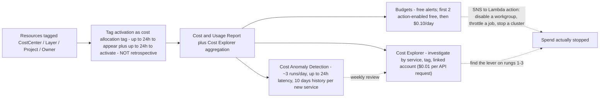
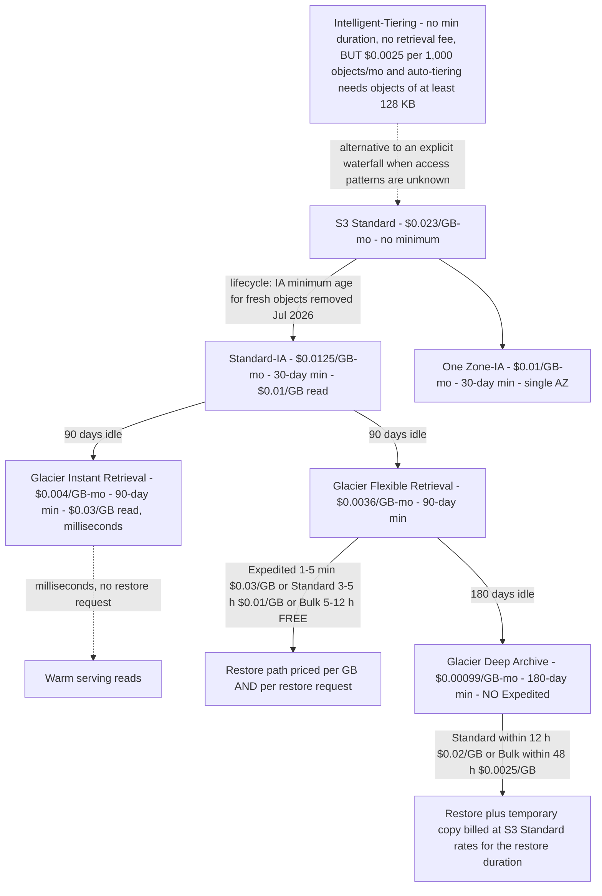

# Cost Optimization and Lifecycle: From Hot Prefixes to Glacier Deep Archive

Lessons 01–15 built a lakehouse that works: storage, formats, tables, ingestion, a catalog, transformation, querying, a warehouse, orchestration, governance, PII handling, security and observability. Every one of those decisions has a **meter** attached to it, and by now those meters run together into a single monthly bill that nobody can read line by line. The bad news: cost is the one lakehouse property that degrades silently, because the bill arrives a month after the decision that caused it. The good news: unlike correctness, cost has a **ladder** — a fixed order of operations that AWS's own Well-Architected guidance implies and that every published AWS cost case study follows.

This lesson teaches that ladder end to end: **shape → temperature → accidental scale → unattributed spend → commitments**, in that order, with the October 2026 us-east-1 rates that make each rung arithmetic instead of advice. The single rule that organises everything below: *never buy a discount on the wrong size, and never move a byte to a colder class before you know when you will read it back.*

```text
====================================================================
 THE COST LADDER - AWS DATA LAKEHOUSE, LESSON 16 (us-east-1, Oct 2026)
====================================================================
 Rung 1 SHAPE ......... pay for fewer bytes: columnar + compression +
                        projection; Athena bills bytes scanned BEFORE
                        decompression ($5.00 / TB)
 Rung 2 TEMPERATURE ... lifecycle waterfall: Standard $0.023 ->
                        Standard-IA $0.0125 (30d min) ->
                        Glacier IR $0.004 (90d) ->
                        Glacier FR $0.0036 (90d) ->
                        Deep Archive $0.00099 (180d min)
 Rung 3 ACCIDENTAL .... workgroup BytesScannedCutoffPerQuery, job
                        Timeouts, Max RPU-hours, budget ACTIONS
                        (cancellation still bills what was scanned)
 Rung 4 ATTRIBUTION ... cost allocation tags activated on resources:
                        CostCenter / Layer / Project (NOT retrospective)
 Rung 5 COMMITMENTS ... only now buy discounts: Redshift reserved
                        nodes, Serverless Reservations (24% / 45%),
                        Savings Plans, on the MEASURED size
 Meters ............... S3 GB-month + requests; Athena $5/TB scanned;
                        Glue $0.44/DPU-h (1-min min); EMR Serverless
                        $0.052624/vCPU-h + $0.0057785/GB-h; Redshift
                        node-h or RPU-h + RMS $0.024/GB-mo; QuickSight
                        $24 Author / $3 Reader / $0.38 SPICE GB-mo;
                        Kinesis $0.015/shard-h; MSK Serverless
                        $0.75/cluster-h + partitions + GB; KMS $1/key
                        + $0.03/10k requests; NAT $0.045/h + $0.045/GB
====================================================================
```

> [!NOTE]
> **Read every rate with a date.** Every price in this lesson is **us-east-1 AWS list, accessed 2026-10-11**, cross-checked against the AWS Price List API offer published **2026-09-28**. Other Regions differ, and AWS changes these tables — the *dimensions* (GB-month, TB scanned, DPU-hour, RPU-hour, shard-hour, per-object fees) are far more stable than the *rates*, so learn the dimension first and re-verify the number second.

In this lesson you will:

- read a **per-service cost-shapes table** that names the billable unit of every layer of the lakehouse before touching a single lever;
- walk the **S3 lifecycle waterfall** — every storage class, minimum duration, retrieval fee and restore path — and compute a **three-to-five-year TCO** for a 60 TB footprint;
- fall into the **Intelligent-Tiering monitoring-fee trap** on purpose, on paper, with eight million tiny objects, so you never do it in production;
- fence the **Athena** query layer with workgroup cutoffs, partition projection, column pruning and ZSTD, then compute a **500-analyst monthly bill** twice — before and after the reducers;
- right-size **Glue** (DPU = 4 vCPU + 16 GB, $0.44/DPU-hour, 1-minute minimum, 48-hour default timeout on Glue 4.0 and earlier) and sketch **EMR Serverless versus Glue** in vCPU/GB-hours;
- apply the **Redshift** levers: pause/resume, Redshift Managed Storage at $0.024/GB-month, Concurrency Scaling credits and Serverless reservations;
- choose between **QuickSight** per-user pricing and reader session capacity with a break-even calculation, and stop **SPICE** capacity from ratcheting upward;
- price the **streaming shapes** (Kinesis shard-hours versus on-demand GB, Firehose's 5 KB increments, MSK Serverless's five line items) and the **silent multipliers** (KMS requests with and without bucket keys, CloudTrail data events, NAT versus free gateway endpoints);
- operate **Cost Explorer, Budgets and Cost Anomaly Detection** and tag the estate with **CostCenter / Layer / Project** so every later number is readable;
- study **GE Aerospace** (customer-estimated >$500,000 yearly saving on Redshift) and **Transport for NSW** (~80% data-integration cost cut on Glue), plus a **sourced 2026 update box**;
- practise with **twelve exam-style questions** and four interactive checks (a TCO plot, a lever-to-service match, a fee-name fill-in and a drag-and-drop of the ladder itself).

---

## 1. Cost anatomy: the meter of every layer before the lever

### 1.1 The five-rung ladder, and why the order is not negotiable

AWS's cost-optimization discipline — documented in the Well-Architected cost pillar and repeated in every cost case study AWS publishes — is a **sequence**, not a menu. Each rung is cheaper and safer than the one below it:

1. **Shape** — stop paying for the wrong *shape* of data. Columnar formats, compression and column projection make scanners read fewer bytes. On a per-scan meter this is the highest-leverage change that exists, and it costs nothing but a rewrite of the write path.
2. **Temperature** — stop paying for the wrong *temperature*. Lifecycle rules move aging data to cheaper storage classes for free configuration cost; you pay only the transition request.
3. **Accidental scale** — stop paying for *accidental* spend: workgroup scan cutoffs, job timeouts, Max RPU-hour budgets, budget actions. These are circuit breakers, not optimisations — they cap the tail.
4. **Attribution** — stop paying for *unattributed* spend. Cost allocation tags per pipeline turn one unread bill into N readable ones. Without this rung, every later measurement is guesswork.
5. **Commitments** — only *now* buy discounts: Redshift reserved nodes, Redshift Serverless Reservations, Savings Plans. A commitment lowers the unit price and does nothing about the quantity — which is why rung 5 on an unoptimised estate is how you lock in waste for one or three years.

> [!IMPORTANT]
> **The ladder is also an exam heuristic.** Given two options that both "reduce cost", the one that sits **earlier** on the ladder is almost always the better first answer: layout beats capacity, capacity beats pricing model, and a commitment on the wrong size is the classic distractor. Read the stem for a constraint (steady 24/7 duty cycle, interruptibility tolerance, latency SLA) before you let rung 5 win.

### 1.2 Per-service cost shapes — the table that makes everything else readable

Every row names the **billable unit** first, the **October 2026 us-east-1 rate anchor** second, and the **failure mode that inflates the bill** third. A lever that does not attack the billable unit of its service is not a lever.

| Layer | Service | Billable unit | Rate anchor (us-east-1, Oct 2026) | Failure mode that inflates it |
|---|---|---|---|---|
| Storage | S3 Standard / IA / Glacier classes | GB-month + transition requests | $0.023 → $0.0125 → $0.004 → $0.0036 → $0.00099 per GB-mo | Versioned overwrites, noncurrent versions never expired, tiny objects, wrong class for the temperature |
| Storage | S3 Intelligent-Tiering | GB-month **+ per-object monitoring fee** | $0.0025 per 1,000 objects/month | Millions of tiny objects; monitoring fee dwarfs storage |
| Storage | S3 Batch Operations | per job + per object operation | $0.25/job + $1.00 per 1M operations | Used for what a free lifecycle rule already does |
| Catalog | Glue Data Catalog | metadata objects/month | First 1M free, then $1.00 per 100,000 objects/month | Unexpired table versions, orphan tables from churned pipelines |
| Query | Athena SQL on S3 | **bytes scanned** | $5.00 per TB (10 MB per-query minimum on federated) | `SELECT *`, missing partition predicate, text instead of Parquet, no result reuse |
| Query | Athena Capacity Reservations | DPU-hours | $0.30 per DPU-hour | Reserving for a peak that never materialises; forgetting 1-minute granularity since Feb 2026 |
| Transform | AWS Glue ETL / crawlers | DPU-hours (1-min min; crawler 10-min min) | $0.44 per DPU-hour; Flex $0.29 | 10-DPU default, 2,880-minute default timeout on Glue 4.0 and earlier, idle executors |
| Transform | EMR Serverless | vCPU-hours + GB-hours (1-min min) | $0.052624/vCPU-h + $0.0057785/GB-h | Oversized worker shapes; applications left running |
| Warehouse | Redshift provisioned | node-hours + Redshift Managed Storage | ra3.4xlarge $3.26/node-h; RMS $0.024/GB-mo | Cluster running 24/7 for an 8-hour batch window; reserved nodes that pause does not stop |
| Warehouse | Redshift Serverless | RPU-hours per second (60-s min) + RMS | $0.375/RPU-h; 4 RPU base = $1.50/h | No Max RPU-hour budget; no reservation on steady usage |
| BI | QuickSight | per-user-month + SPICE GB-month, or session capacity | Author $24, Reader $3, SPICE $0.38/GB-mo; 500 sessions/month for $250 | Billed inactive readers, parked SPICE datasets, auto-capacity ratchet |
| Streaming | Kinesis Data Streams | shard-hours + PUT payload units, or GB with a floor | $0.015/shard-h; $0.014/M units; on-demand $0.08/GB (Standard) with a 25 MB/s account floor | On-demand floor paid for throughput never sent; enhanced fan-out per consumer-shard |
| Streaming | Firehose | GB ingested in **5 KB increments** | $0.029/GB (first 500 TB); $0.045/GB to Iceberg from Kinesis | Sub-5 KB records billed as 5 KB; dynamic partitioning and VPC delivery add-ons |
| Streaming | MSK Serverless | cluster-hours + partition-hours + GB in/out + storage | $0.75/cluster-h + $0.0015/partition-h + $0.10 in/GB + $0.05 out/GB + $0.10/GB-mo | Choosing Kafka semantics when per-GB services would do |
| Security | KMS | key-months + requests | $1.00/key-month + $0.03 per 10,000 requests (20,000 free/mo) | No bucket keys on a high-QPS lake; per-object keys instead of a prefix key |
| Audit | CloudTrail data events | events delivered to S3 | $0.10 per 100,000 data events | Whole-bucket data-event logging; advanced selectors unused |
| Network | NAT gateway | hours + GB processed | $0.045/h + $0.045/GB | S3 traffic forced through NAT when a free gateway endpoint exists |
| Network | Interface endpoint | ENI-hours per AZ + GB | $0.01/h per AZ + $0.01/GB (first PB) | Used for S3/DynamoDB, which have free gateway endpoints |
| FinOps | Cost Explorer API / Budgets | requests / action-enabled budgets | $0.01 per API request; budgets free, first 2 action-enabled free then $0.10/day | Hourly-granularity polling at $0.01 per 1,000 usage records |

### 1.3 Tagging: the rung that makes every later number readable

Four tag keys carry almost all of a lakehouse's attribution needs, applied to **every resource that can carry a tag** — S3 buckets and prefixes (via object tags where the service supports them), Glue jobs, crawlers and connections, Athena workgroups, Redshift clusters and workgroups, QuickSight folders and datasets, Kinesis streams, MSK clusters, NAT gateways and VPC endpoints:

| Tag key | Example values | What it answers |
|---|---|---|
| `CostCenter` | `DA-4471`, `DA-4472`, `OPS-1180` | Which budget line absorbs this spend? |
| `Layer` | `bronze`, `silver`, `gold`, `serving`, `archive` | Which stage of the medallion architecture is this? |
| `Project` | `ad-sales`, `fraud-scores`, `supply-chain-ods` | Which business initiative does this serve? |
| `Owner` / `Environment` / `Pipeline` | `data-eng`, `prod` / `staging`, `ingest-orders` | Who to call, and is this production or a sandbox? |

Three hard rules, all documented by AWS:

1. **Tags must be activated as cost allocation tags** before they appear in Cost Explorer or a cost allocation report — and activation can take **up to 24 hours** for the key to appear on the activation page plus **another up to 24 hours** to take effect.
2. **Tags are not retrospective.** They affect billing reporting only from the moment of activation. A tagging strategy rolled out in October 2026 tells you nothing about September.
3. In **AWS Organizations**, cost allocation tags are activated **only from the management (payer) account**, and AWS recommends *a small number of consistent tag keys* — sprawl is itself a cost, because every extra key is an extra axis to reconcile.

### 1.4 Visibility before optimization: Cost Explorer, Budgets, Anomaly Detection

You cannot optimise what you cannot see, and the three AWS cost-visibility services have three different jobs — and three different bills:

| Service | Job | Cost (Oct 2026) | Latency and limits |
|---|---|---|---|
| **Cost Explorer** | Explore and graph spend by service, tag, linked account | Console usage free; **API requests $0.01 each** on the primary billing view ($0.01 per source on custom billing views); hourly granularity **$0.01 per 1,000 usage records** for a 14-day lookback | Data sourced from Cost Explorer; hourly detail costs real money at scale |
| **AWS Budgets** | Alert (and act) on thresholds | **Alerts free**; first **two action-enabled budgets free**, then **$0.10 per day** each; budget report emails **$0.01 each** | Real-time path — budget **actions** are the only budget feature that can stop spend |
| **Cost Anomaly Detection** | Find unexpected spikes automatically | Rides on Cost Explorer (no separate published charge); **auto-configured since 2023-03-27** with an AWS Services monitor and daily email | Runs **~3 times per day**; detection can take **up to 24 hours**; a newly subscribed service needs **10 days** of history; does **not** monitor third-party Marketplace products — use Budgets for those |

The operational shape AWS documents: **Budgets for the real-time circuit breaker** (threshold → SNS → Lambda action), **Cost Anomaly Detection as the weekly safety net** (it is slow by design), **Cost Explorer for the investigation** once either of them fires. None of the three can attribute spend to a pipeline without the tags from section 1.3.



> - **📚 Did you know?** The cheapest FinOps tool in your account is a **budget action**, not a dashboard: the first two action-enabled budgets are free, and an action can disable an Athena workgroup or detach an IAM policy the moment a threshold trips. Cost Anomaly Detection — however smart its models — cannot stop anything, and it may take up to **24 hours** to notice a runaway that a budget action would have caught in minutes (AWS Budgets and Cost Anomaly Detection documentation, accessed 2026-10-11).

---

## 2. S3: the lifecycle waterfall, and the restore bill nobody models

### 2.1 Every class, every minimum duration, every retrieval fee

This is the single most valuable table in the lesson. Storage rates are the headline; **minimum durations and retrieval fees are where the design lives**.

| Class / tier | $/GB-month | Minimum duration | Retrieval fee $/GB | Retrieval time |
|---|---|---|---|---|
| Standard (first 50 TB/mo) | 0.023 | none | 0 | milliseconds |
| Standard-IA | 0.0125 | **30 days** | 0.01 (flat) | milliseconds |
| One Zone-IA | 0.01 | **30 days** | 0.01 (flat) | milliseconds |
| Intelligent-Tiering Frequent | 0.023 | none | **0** | milliseconds |
| Intelligent-Tiering Infrequent | 0.0125 | none | **0** | milliseconds |
| Intelligent-Tiering Archive Instant | 0.004 | none | **0** | milliseconds (re-hydrates) |
| Intelligent-Tiering Archive | 0.0036 | none | **0** | re-hydrates with latency |
| Intelligent-Tiering Deep Archive | 0.00099 | none | **0** | re-hydrates with latency |
| Glacier Instant Retrieval (GIR) | 0.004 | **90 days** | 0.03 | milliseconds |
| Glacier Flexible Retrieval (GFR) — Expedited | 0.0036 | **90 days** | 0.03 | **1–5 minutes** |
| Glacier Flexible Retrieval — Standard | 0.0036 | **90 days** | 0.01 | **3–5 hours** |
| Glacier Flexible Retrieval — Bulk | 0.0036 | **90 days** | **0 (free)** | **5–12 hours** |
| Glacier Deep Archive (GDA) — Standard | 0.00099 | **180 days** | 0.02 | **within 12 hours** |
| Glacier Deep Archive — Bulk | 0.00099 | **180 days** | 0.0025 | **within 48 hours** |
| Glacier Deep Archive — Expedited | — | — | **not offered** | — |
| Express One Zone (directory buckets) | 0.11 | none | 0 | single-digit milliseconds |

Plus the request-side fees that complete the picture: lifecycle **transition requests** cost $0.01 per 1,000 to Standard-IA / One Zone-IA / Intelligent-Tiering, $0.02 per 1,000 to Glacier Instant Retrieval and $0.05 per 1,000 to Glacier Deep Archive; **restore request fees** are $0.01 / $0.05 / $0.00 per 1,000 requests for Expedited / Standard / Bulk; archived objects additionally bill **40 KB of metadata per object**; and every archived class charges its **minimum duration in full** — an object deleted or re-transitioned out of Deep Archive on day 30 still bills 180 days.



### 2.2 Lifecycle rules versus Batch Operations versus manual moves

A **lifecycle rule** transitions or expires **existing and new** objects that match a filter, and the configuration itself is free — you pay only the transition request ($0.01–$0.05 per 1,000). AWS charges nothing for the rule to keep matching tomorrow's objects. **S3 Batch Operations** is the retroactive, manifest-driven path: $0.25 per job plus $1.00 per million object operations, with a manifest usually produced by **S3 Inventory** at $0.0025 per million objects listed. **Manual re-uploading or `CopyObject`-ing** millions of objects burns PUT/COPY request fees, needs a compute fleet, and opens a window where two copies both bill.

The practical rule: **age-based reclassification = lifecycle rule; tag- or manifest-driven reclassification = Batch Operations**. You almost never need Batch Operations to re-tier ordinary aging objects, and paying for it to do a lifecycle rule's job is a self-inflicted bill.

Three more lifecycle actions belong in every production bucket, because versioning without them is a silent multiplier: **expire noncurrent versions** (`NoncurrentDays`), **cap how many noncurrent versions are kept** (`MaxNoncurrentVersions`, valid 1–100), and **abort incomplete multipart uploads**. With versioning enabled, every PUT creates a new current version while the prior version stays fully billed at its storage-class rate — a churning bucket can bill several times its "logical" size until these three rules exist.

### 2.3 Restore economics: the temporary copy is the real shock

Restoring an archived object bills **two things**, and only one of them is intuitive:

1. the **per-GB retrieval fee** of the chosen speed tier (table above), plus the restore request fee; **and**
2. a **temporary restored copy, charged at S3 Standard storage rates**, for the duration you choose to keep it — on top of the archive object you are still paying for.

So a Deep Archive restore is cheap in the retrieval line ($0.0025/GB Bulk) and expensive in the *plan*: 48 hours of latency, a temporary copy at $0.023/GB-month prorated, and no Expedited option at any price. Deep Archive restores must therefore be **scheduled**, never casual: Bulk for planned backfills, Standard only for genuine 12-hour emergencies. And remember the minimum-duration cliff the other way round: if your access pattern says "we might read this within 90 days", Deep Archive's 180-day minimum means the class is wrong, not that you should accept the risk.

> - **📚 Did you know?** Deep Archive has **no Expedited retrieval tier** — the speed options stop at Standard (within 12 hours) and Bulk (within 48 hours). Any architecture diagram that shows an "instant" path out of Deep Archive is inventing a tier AWS does not sell (Amazon S3 Glacier documentation, accessed 2026-10-11).

### 2.4 Worked example E1 — a 60 TB lakehouse, three years, then five

The scenario: an **operational lake of 50 TiB** — 20 TiB hot curated in S3 Standard, 25 TiB warm in Standard-IA, 5 TiB cold in Glacier Instant Retrieval — plus **10 TiB of compliance history in Glacier Deep Archive**. A **60 TiB footprint**, held three years. AWS bills GB as 1,073,741,824 bytes, so TiB → GB is ×1,024.

```text
Worked example E1 - lifecycle TCO, us-east-1 list, as of Oct 2026
Footprint: 20 TiB hot + 25 TiB warm + 5 TiB cold + 10 TiB archive = 60 TiB

MONTHLY STORAGE
  Hot .... 20,480 GB x $0.023 ......... $471.04
  Warm ... 25,600 GB x $0.0125 ........ $320.00
  Cold ...  5,120 GB x $0.004 .........  $20.48
  Archive 10,240 GB x $0.00099 ........  $10.14
  TOTAL MONTHLY ........................ $821.66

BASELINE - the same 60 TiB in S3 Standard for all three years
  61,440 GB x $0.023 .................... $1,413.12 / month

THREE-YEAR TOTALS (flat holding, no retrieval events)
  Tiered ....... $821.66 x 36 ........... $29,579.76  (~$29,580)
  All-Standard .. $1,413.12 x 36 ........ $50,872.32  (~$50,872)
  SAVINGS ....... $591.46 / month ....... $21,292.56  (~$21,293, ~42%)

FIVE-YEAR EXTENSION (same flat holding assumption)
  Tiered ....... $821.66 x 60 ........... $49,299.60
  All-Standard .. $1,413.12 x 60 ........ $84,787.20
  SAVINGS ....... $35,487.60
```

```plot
{
  "type": "line",
  "title": "Cumulative TCO: 60 TiB tiered lakehouse vs all-Standard (worked example E1, us-east-1 list, as of Oct 2026)",
  "xLabel": "Years held",
  "yLabel": "Cumulative cost (USD)",
  "xKey": "year",
  "data": [
    {"year": "Year 1", "Tiered lifecycle waterfall": 9859.92, "All S3 Standard": 16957.44},
    {"year": "Year 2", "Tiered lifecycle waterfall": 19719.84, "All S3 Standard": 33914.88},
    {"year": "Year 3", "Tiered lifecycle waterfall": 29579.76, "All S3 Standard": 50872.32},
    {"year": "Year 4", "Tiered lifecycle waterfall": 39439.68, "All S3 Standard": 67829.76},
    {"year": "Year 5", "Tiered lifecycle waterfall": 49299.60, "All S3 Standard": 84787.20}
  ],
  "dataKeys": ["Tiered lifecycle waterfall", "All S3 Standard"]
}
```

The gap widens by **$591.46 every month** and is entirely a rung-2 decision: no code changed, no query was tuned, no commitment was purchased. Now the two events that make archive models break — **reads** and **the one-time transition bill** — which belong in the same spreadsheet as the storage.

### 2.5 Worked example E1b — restore scenarios and the one-time transition bill

Same 60 TiB estate. What does it cost to **read 1 TiB back**, by path, and what did it cost to **reclassify an existing 45 TiB** of it?

```text
Worked example E1b - retrieval + transition arithmetic (us-east-1, Oct 2026)

READ 1 TiB (1,024 GB) FROM EACH LAYER - retrieval fee only, per-GB
  From Standard-IA (flat IA read) .. 1,024 x $0.01 ..... $10.24  (ms)
  From Glacier Instant Retrieval ... 1,024 x $0.03 ..... $30.72  (ms)
  From Deep Archive via BULK ....... 1,024 x $0.0025 ...  $2.56  (48 h)
  From Deep Archive via STANDARD ... 1,024 x $0.02 ..... $20.48  (12 h)
  PLUS for every path: the temporary restored copy at S3 Standard
  storage rates ($0.023/GB-mo, prorated to the restore duration you
  choose) + restore request fees ($0.01 / $0.05 / $0.00 per 1,000 for
  Expedited / Standard / Bulk).
  READING BULK FROM DEEP ARCHIVE IS 8x CHEAPER THAN STANDARD - but it
  costs you 48 hours and the temporary copy. That trade is the design.

ONE-TIME LIFECYCLE TRANSITION OF AN EXISTING 45 TiB LAKE
  Objects: 45 TiB at a toy 100 MB average file = 46,080 GB / 0.1 GB
           = 460,800 objects
  To Standard-IA ........ 460,800 / 1,000 x $0.01 =  $4.61
  To Glacier IR .......... 460,800 / 1,000 x $0.02 =  $9.22
  To Deep Archive ........ 460,800 / 1,000 x $0.05 = $23.04
  TOTAL ONE TIME ................................... $36.86
  Compare: the monthly tiering saving on this lake
  (E1) is hundreds of dollars. The lifecycle rule pays
  for itself in WEEK ONE. Manual CopyObject of 460,800
  objects would additionally bill PUT/COPY at $0.005 per
  1,000 = $2.30 in requests alone - and need a compute
  fleet, and open a dual-copy window.
```

### 2.6 Intelligent-Tiering: the monitoring-fee trap on tiny objects

Intelligent-Tiering is the safest default when access patterns are **genuinely unknown**: no minimum duration, **no retrieval fees**, automatic movement between Frequent, Infrequent, Archive Instant, Archive and Deep Archive Access tiers based on observed access (objects idle 30 days move to the Infrequent tier, 90 days to Archive Instant, and Deep Archive Access requires a minimum of 180 consecutive idle days). But it is a **monitoring business**: it charges **$0.0025 per 1,000 objects per month** for monitoring and automation, and only objects **at least 128 KB** are eligible for auto-tiering at all. For large warm objects the fee is a rounding error; for millions of tiny objects it is the bill.

### 2.7 Worked example E2 — eight million tiny objects "saved" by Intelligent-Tiering

An event lake lands tiny fragments in Intelligent-Tiering "to save money". Nothing about this design saves money.

```text
Worked example E2 - the Intelligent-Tiering monitoring trap (us-east-1, Oct 2026)
Scenario: 8,000,000 objects averaging 4 KB, sitting in Intelligent-Tiering
  Total data ... 8,000,000 x 4 KB = 32,000,000 KB = 30.52 GB

  Monitoring fee ... 8,000,000 / 1,000 x $0.0025 = $20.00 / month
  Storage (Frequent) 30.52 GB x $0.023 ..........  $0.70 / month
  TOTAL .......................................... $20.70 / month
  -> the MONITORING FEE is ~28x the storage it protects
  -> objects under 128 KB are NOT eligible for auto-tiering at all,
     so this design pays the fee business and gets none of the
     automatic tiering benefit

  Same 30.52 GB in plain S3 Standard ......... $0.70 / month
  -> Intelligent-Tiering made this lake ~30x MORE expensive

FIX (a) - aggregate before landing: compact to 100 MB objects
  Objects ....... 30.52 GB / 0.1 GB = ~305 objects
  Monitoring .... 305 / 1,000 x $0.0025 = $0.0008 / month
  (also fixes Athena performance - the same lever as rung 1)

FIX (b) - if objects genuinely are >= 128 KB and cold, use LIFECYCLE
  transitions to Standard-IA / Glacier instead: $0.01-$0.05 per 1,000
  transition requests, and NO monitoring fee, ever.

SCALE REMINDER: 100,000,000 Intelligent-Tiering objects = $250/month
of monitoring alone, before a single GB of storage.
```

The decision rule that falls out of E2: **Intelligent-Tiering is for large, warm, unevenly accessed objects with unknown patterns; explicit lifecycle classes are for objects you understand; and neither belongs on objects smaller than 128 KB** — those should be compacted on write, which is a cost fix and a query-performance fix in one move.

### 2.8 Replication can target a cheaper class — but it double-bills

Destination storage class is a first-class replication setting: you can replicate **directly into Glacier Flexible Retrieval, Glacier Deep Archive, Intelligent-Tiering** and the other classes (the CloudFormation destination `StorageClass` accepts `DEEP_ARCHIVE`, `GLACIER`, `GLACIER_IR`, `INTELLIGENT_TIERING`, `ONEZONE_IA`, `STANDARD`, `STANDARD_IA`; the default is to keep the source class). The DR region therefore never pays Standard rates for a copy nobody reads.

The catch is arithmetic, not capability: **you pay for both copies**, plus replication request costs, plus **$0.015 per million objects per month** in the source bucket for replication monitoring. Replication into a cheaper class is a **disaster-recovery and compliance pattern**, not a storage discount — model it as "the DR copy is cheap enough to keep forever", never as "this halves my S3 bill".

---
