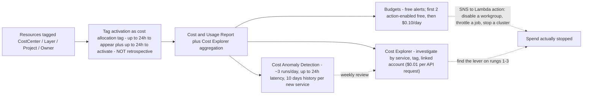
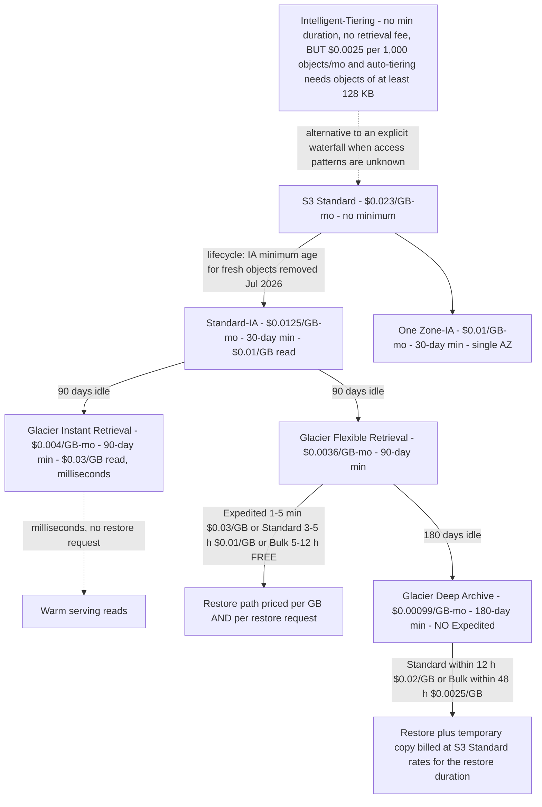
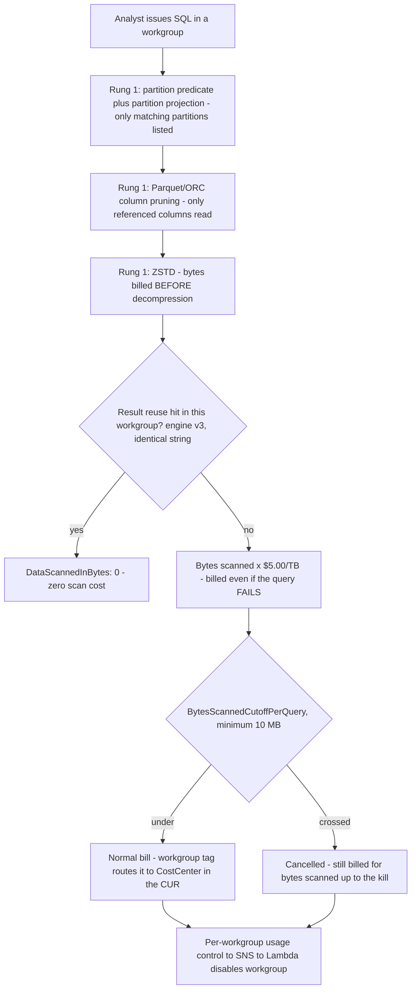
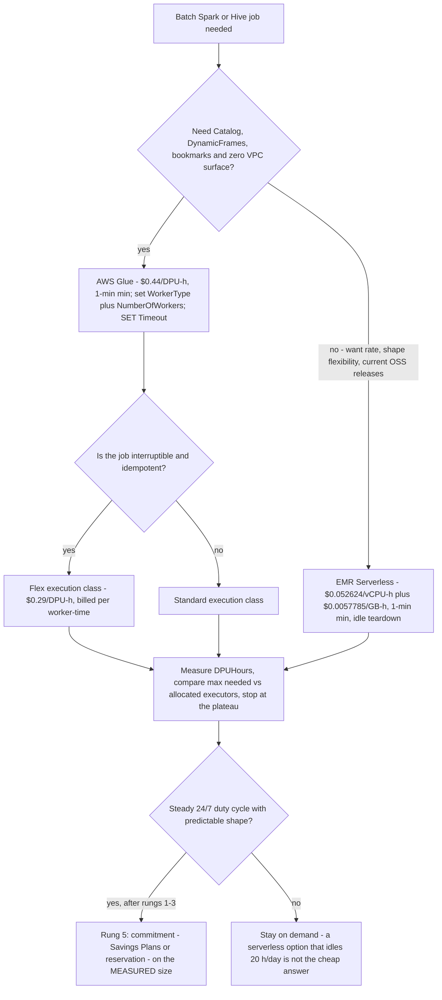

# Cost Optimization and Lifecycle: From Hot Prefixes to Glacier Deep Archive

Lessons 01 to 15 built a lakehouse that works: storage, formats, tables, ingestion, a catalog, transformation, querying, a warehouse, orchestration, governance, PII handling, security and observability. Every one of those decisions has a **meter** attached to it, and by now those meters run together into a single monthly bill that nobody can read line by line. The bad news: cost is the one lakehouse property that degrades silently, because the bill arrives a month after the decision that caused it. The good news: unlike correctness, cost has a **ladder**: a fixed order of operations that AWS's own Well-Architected guidance implies and that every published AWS cost case study follows.

This lesson teaches that ladder end to end: **shape → temperature → accidental scale → unattributed spend → commitments**, in that order, with the October 2026 us-east-1 rates that make each rung arithmetic instead of advice. The single rule that organises everything below: *never buy a discount on the wrong size, and never move a byte to a colder class before you know when you will read it back.*

```text
====================================================================
 THE COST LADDER - AWS DATA LAKEHOUSE, LESSON 16 (us-east-1, Oct 2026)
====================================================================
 Rung 1 SHAPE ......... pay for fewer bytes: columnar + compression +
                        projection; Athena bills bytes scanned BEFORE
                        decompression ($5.00 / TB)
 Rung 2 TEMPERATURE ... lifecycle waterfall: Standard $0.023 ->
                        Standard-IA $0.0125 (30d min) ->
                        Glacier IR $0.004 (90d) ->
                        Glacier FR $0.0036 (90d) ->
                        Deep Archive $0.00099 (180d min)
 Rung 3 ACCIDENTAL .... workgroup BytesScannedCutoffPerQuery, job
                        Timeouts, Max RPU-hours, budget ACTIONS
                        (cancellation still bills what was scanned)
 Rung 4 ATTRIBUTION ... cost allocation tags activated on resources:
                        CostCenter / Layer / Project (NOT retrospective)
 Rung 5 COMMITMENTS ... only now buy discounts: Redshift reserved
                        nodes, Serverless Reservations (24% / 45%),
                        Savings Plans, on the MEASURED size
 Meters ............... S3 GB-month + requests; Athena $5/TB scanned;
                        Glue $0.44/DPU-h (1-min min); EMR Serverless
                        $0.052624/vCPU-h + $0.0057785/GB-h; Redshift
                        node-h or RPU-h + RMS $0.024/GB-mo; QuickSight
                        $24 Author / $3 Reader / $0.38 SPICE GB-mo;
                        Kinesis $0.015/shard-h; MSK Serverless
                        $0.75/cluster-h + partitions + GB; KMS $1/key
                        + $0.03/10k requests; NAT $0.045/h + $0.045/GB
====================================================================
```

> [!NOTE]
> **Read every rate with a date.** Every price in this lesson is **us-east-1 AWS list, accessed 2026-10-11**, cross-checked against the AWS Price List API offer published **2026-09-28**. Other Regions differ, and AWS changes these tables: the *dimensions* (GB-month, TB scanned, DPU-hour, RPU-hour, shard-hour, per-object fees) are far more stable than the *rates*, so learn the dimension first and re-verify the number second.

In this lesson you will:

- read a **per-service cost-shapes table** that names the billable unit of every layer of the lakehouse before touching a single lever;
- walk the **S3 lifecycle waterfall**, every storage class, minimum duration, retrieval fee and restore path, and compute a **three-to-five-year TCO** for a 60 TB footprint;
- fall into the **Intelligent-Tiering monitoring-fee trap** on purpose, on paper, with eight million tiny objects, so you never do it in production;
- fence the **Athena** query layer with workgroup cutoffs, partition projection, column pruning and ZSTD, then compute a **500-analyst monthly bill** twice: before and after the reducers;
- right-size **Glue** (DPU = 4 vCPU + 16 GB, $0.44/DPU-hour, 1-minute minimum, 48-hour default timeout on Glue 4.0 and earlier) and sketch **EMR Serverless versus Glue** in vCPU/GB-hours;
- apply the **Redshift** levers: pause/resume, Redshift Managed Storage at $0.024/GB-month, Concurrency Scaling credits and Serverless reservations;
- choose between **QuickSight** per-user pricing and reader session capacity with a break-even calculation, and stop **SPICE** capacity from ratcheting upward;
- price the **streaming shapes** (Kinesis shard-hours versus on-demand GB, Firehose's 5 KB increments, MSK Serverless's five line items) and the **silent multipliers** (KMS requests with and without bucket keys, CloudTrail data events, NAT versus free gateway endpoints);
- operate **Cost Explorer, Budgets and Cost Anomaly Detection** and tag the estate with **CostCenter / Layer / Project** so every later number is readable;
- study **GE Aerospace** (customer-estimated >$500,000 yearly saving on Redshift) and **Transport for NSW** (~80% data-integration cost cut on Glue), plus a **sourced 2026 update box**;
- practise with **twelve exam-style questions** and four interactive checks (a TCO plot, a lever-to-service match, a fee-name fill-in and a drag-and-drop of the ladder itself).

---

## 1. Cost anatomy: the meter of every layer before the lever

### 1.1 The five-rung ladder, and why the order is not negotiable

AWS's cost-optimization discipline, documented in the Well-Architected cost pillar and repeated in every cost case study AWS publishes, is a **sequence**, not a menu. Each rung is cheaper and safer than the one below it:

1. **Shape**: stop paying for the wrong *shape* of data. Columnar formats, compression and column projection make scanners read fewer bytes. On a per-scan meter this is the highest-leverage change that exists, and it costs nothing but a rewrite of the write path.
2. **Temperature**: stop paying for the wrong *temperature*. Lifecycle rules move aging data to cheaper storage classes for free configuration cost; you pay only the transition request.
3. **Accidental scale**, stop paying for *accidental* spend: workgroup scan cutoffs, job timeouts, Max RPU-hour budgets, budget actions. These are circuit breakers, not optimisations, they cap the tail.
4. **Attribution**: stop paying for *unattributed* spend. Cost allocation tags per pipeline turn one unread bill into N readable ones. Without this rung, every later measurement is guesswork.
5. **Commitments**, only *now* buy discounts: Redshift reserved nodes, Redshift Serverless Reservations, Savings Plans. A commitment lowers the unit price and does nothing about the quantity, which is why rung 5 on an unoptimised estate is how you lock in waste for one or three years.

> [!IMPORTANT]
> **The ladder is also an exam heuristic.** Given two options that both "reduce cost", the one that sits **earlier** on the ladder is almost always the better first answer: layout beats capacity, capacity beats pricing model, and a commitment on the wrong size is the classic distractor. Read the stem for a constraint (steady 24/7 duty cycle, interruptibility tolerance, latency SLA) before you let rung 5 win.

### 1.2 Per-service cost shapes: the table that makes everything else readable

Every row names the **billable unit** first, the **October 2026 us-east-1 rate anchor** second, and the **failure mode that inflates the bill** third. A lever that does not attack the billable unit of its service is not a lever.

| Layer | Service | Billable unit | Rate anchor (us-east-1, Oct 2026) | Failure mode that inflates it |
|---|---|---|---|---|
| Storage | S3 Standard / IA / Glacier classes | GB-month + transition requests | $0.023 → $0.0125 → $0.004 → $0.0036 → $0.00099 per GB-mo | Versioned overwrites, noncurrent versions never expired, tiny objects, wrong class for the temperature |
| Storage | S3 Intelligent-Tiering | GB-month **+ per-object monitoring fee** | $0.0025 per 1,000 objects/month | Millions of tiny objects; monitoring fee dwarfs storage |
| Storage | S3 Batch Operations | per job + per object operation | $0.25/job + $1.00 per 1M operations | Used for what a free lifecycle rule already does |
| Catalog | Glue Data Catalog | metadata objects/month | First 1M free, then $1.00 per 100,000 objects/month | Unexpired table versions, orphan tables from churned pipelines |
| Query | Athena SQL on S3 | **bytes scanned** | $5.00 per TB (10 MB per-query minimum on federated) | `SELECT *`, missing partition predicate, text instead of Parquet, no result reuse |
| Query | Athena Capacity Reservations | DPU-hours | $0.30 per DPU-hour | Reserving for a peak that never materialises; forgetting 1-minute granularity since Feb 2026 |
| Transform | AWS Glue ETL / crawlers | DPU-hours (1-min min; crawler 10-min min) | $0.44 per DPU-hour; Flex $0.29 | 10-DPU default, 2,880-minute default timeout on Glue 4.0 and earlier, idle executors |
| Transform | EMR Serverless | vCPU-hours + GB-hours (1-min min) | $0.052624/vCPU-h + $0.0057785/GB-h | Oversized worker shapes; applications left running |
| Warehouse | Redshift provisioned | node-hours + Redshift Managed Storage | ra3.4xlarge $3.26/node-h; RMS $0.024/GB-mo | Cluster running 24/7 for an 8-hour batch window; reserved nodes that pause does not stop |
| Warehouse | Redshift Serverless | RPU-hours per second (60-s min) + RMS | $0.375/RPU-h; 4 RPU base = $1.50/h | No Max RPU-hour budget; no reservation on steady usage |
| BI | QuickSight | per-user-month + SPICE GB-month, or session capacity | Author $24, Reader $3, SPICE $0.38/GB-mo; 500 sessions/month for $250 | Billed inactive readers, parked SPICE datasets, auto-capacity ratchet |
| Streaming | Kinesis Data Streams | shard-hours + PUT payload units, or GB with a floor | $0.015/shard-h; $0.014/M units; on-demand $0.08/GB (Standard) with a 25 MB/s account floor | On-demand floor paid for throughput never sent; enhanced fan-out per consumer-shard |
| Streaming | Firehose | GB ingested in **5 KB increments** | $0.029/GB (first 500 TB); $0.045/GB to Iceberg from Kinesis | Sub-5 KB records billed as 5 KB; dynamic partitioning and VPC delivery add-ons |
| Streaming | MSK Serverless | cluster-hours + partition-hours + GB in/out + storage | $0.75/cluster-h + $0.0015/partition-h + $0.10 in/GB + $0.05 out/GB + $0.10/GB-mo | Choosing Kafka semantics when per-GB services would do |
| Security | KMS | key-months + requests | $1.00/key-month + $0.03 per 10,000 requests (20,000 free/mo) | No bucket keys on a high-QPS lake; per-object keys instead of a prefix key |
| Audit | CloudTrail data events | events delivered to S3 | $0.10 per 100,000 data events | Whole-bucket data-event logging; advanced selectors unused |
| Network | NAT gateway | hours + GB processed | $0.045/h + $0.045/GB | S3 traffic forced through NAT when a free gateway endpoint exists |
| Network | Interface endpoint | ENI-hours per AZ + GB | $0.01/h per AZ + $0.01/GB (first PB) | Used for S3/DynamoDB, which have free gateway endpoints |
| FinOps | Cost Explorer API / Budgets | requests / action-enabled budgets | $0.01 per API request; budgets free, first 2 action-enabled free then $0.10/day | Hourly-granularity polling at $0.01 per 1,000 usage records |

### 1.3 Tagging: the rung that makes every later number readable

Four tag keys carry almost all of a lakehouse's attribution needs, applied to **every resource that can carry a tag**: S3 buckets and prefixes (via object tags where the service supports them), Glue jobs, crawlers and connections, Athena workgroups, Redshift clusters and workgroups, QuickSight folders and datasets, Kinesis streams, MSK clusters, NAT gateways and VPC endpoints:

| Tag key | Example values | What it answers |
|---|---|---|
| `CostCenter` | `DA-4471`, `DA-4472`, `OPS-1180` | Which budget line absorbs this spend? |
| `Layer` | `bronze`, `silver`, `gold`, `serving`, `archive` | Which stage of the medallion architecture is this? |
| `Project` | `ad-sales`, `fraud-scores`, `supply-chain-ods` | Which business initiative does this serve? |
| `Owner` / `Environment` / `Pipeline` | `data-eng`, `prod` / `staging`, `ingest-orders` | Who to call, and is this production or a sandbox? |

Three hard rules, all documented by AWS:

1. **Tags must be activated as cost allocation tags** before they appear in Cost Explorer or a cost allocation report, and activation can take **up to 24 hours** for the key to appear on the activation page plus **another up to 24 hours** to take effect.
2. **Tags are not retrospective.** They affect billing reporting only from the moment of activation. A tagging strategy rolled out in October 2026 tells you nothing about September.
3. In **AWS Organizations**, cost allocation tags are activated **only from the management (payer) account**, and AWS recommends *a small number of consistent tag keys*: sprawl is itself a cost, because every extra key is an extra axis to reconcile.

### 1.4 Visibility before optimization: Cost Explorer, Budgets, Anomaly Detection

You cannot optimise what you cannot see, and the three AWS cost-visibility services have three different jobs, and three different bills:

| Service | Job | Cost (Oct 2026) | Latency and limits |
|---|---|---|---|
| **Cost Explorer** | Explore and graph spend by service, tag, linked account | Console usage free; **API requests $0.01 each** on the primary billing view ($0.01 per source on custom billing views); hourly granularity **$0.01 per 1,000 usage records** for a 14-day lookback | Data sourced from Cost Explorer; hourly detail costs real money at scale |
| **AWS Budgets** | Alert (and act) on thresholds | **Alerts free**; first **two action-enabled budgets free**, then **$0.10 per day** each; budget report emails **$0.01 each** | Real-time path: budget **actions** are the only budget feature that can stop spend |
| **Cost Anomaly Detection** | Find unexpected spikes automatically | Rides on Cost Explorer (no separate published charge); **auto-configured since 2023-03-27** with an AWS Services monitor and daily email | Runs **~3 times per day**; detection can take **up to 24 hours**; a newly subscribed service needs **10 days** of history; does **not** monitor third-party Marketplace products: use Budgets for those |

The operational shape AWS documents: **Budgets for the real-time circuit breaker** (threshold → SNS → Lambda action), **Cost Anomaly Detection as the weekly safety net** (it is slow by design), **Cost Explorer for the investigation** once either of them fires. None of the three can attribute spend to a pipeline without the tags from section 1.3.



> - **📚 Did you know?** The cheapest FinOps tool in your account is a **budget action**, not a dashboard: the first two action-enabled budgets are free, and an action can disable an Athena workgroup or detach an IAM policy the moment a threshold trips. Cost Anomaly Detection, however smart its models, cannot stop anything, and it may take up to **24 hours** to notice a runaway that a budget action would have caught in minutes (AWS Budgets and Cost Anomaly Detection documentation, accessed 2026-10-11).

---

## 2. S3: the lifecycle waterfall, and the restore bill nobody models

### 2.1 Every class, every minimum duration, every retrieval fee

This is the single most valuable table in the lesson. Storage rates are the headline; **minimum durations and retrieval fees are where the design lives**.

| Class / tier | $/GB-month | Minimum duration | Retrieval fee $/GB | Retrieval time |
|---|---|---|---|---|
| Standard (first 50 TB/mo) | 0.023 | none | 0 | milliseconds |
| Standard-IA | 0.0125 | **30 days** | 0.01 (flat) | milliseconds |
| One Zone-IA | 0.01 | **30 days** | 0.01 (flat) | milliseconds |
| Intelligent-Tiering Frequent | 0.023 | none | **0** | milliseconds |
| Intelligent-Tiering Infrequent | 0.0125 | none | **0** | milliseconds |
| Intelligent-Tiering Archive Instant | 0.004 | none | **0** | milliseconds (re-hydrates) |
| Intelligent-Tiering Archive | 0.0036 | none | **0** | re-hydrates with latency |
| Intelligent-Tiering Deep Archive | 0.00099 | none | **0** | re-hydrates with latency |
| Glacier Instant Retrieval (GIR) | 0.004 | **90 days** | 0.03 | milliseconds |
| Glacier Flexible Retrieval (GFR): Expedited | 0.0036 | **90 days** | 0.03 | **1 to 5 minutes** |
| Glacier Flexible Retrieval: Standard | 0.0036 | **90 days** | 0.01 | **3 to 5 hours** |
| Glacier Flexible Retrieval: Bulk | 0.0036 | **90 days** | **0 (free)** | **5 to 12 hours** |
| Glacier Deep Archive (GDA): Standard | 0.00099 | **180 days** | 0.02 | **within 12 hours** |
| Glacier Deep Archive: Bulk | 0.00099 | **180 days** | 0.0025 | **within 48 hours** |
| Glacier Deep Archive, Expedited |, |, | **not offered** |, |
| Express One Zone (directory buckets) | 0.11 | none | 0 | single-digit milliseconds |

Plus the request-side fees that complete the picture: lifecycle **transition requests** cost $0.01 per 1,000 to Standard-IA / One Zone-IA / Intelligent-Tiering, $0.02 per 1,000 to Glacier Instant Retrieval and $0.05 per 1,000 to Glacier Deep Archive; **restore request fees** are $0.01 / $0.05 / $0.00 per 1,000 requests for Expedited / Standard / Bulk; archived objects additionally bill **40 KB of metadata per object**; and every archived class charges its **minimum duration in full**: an object deleted or re-transitioned out of Deep Archive on day 30 still bills 180 days.



### 2.2 Lifecycle rules versus Batch Operations versus manual moves

A **lifecycle rule** transitions or expires **existing and new** objects that match a filter, and the configuration itself is free; you pay only the transition request ($0.01 to $0.05 per 1,000). AWS charges nothing for the rule to keep matching tomorrow's objects. **S3 Batch Operations** is the retroactive, manifest-driven path: $0.25 per job plus $1.00 per million object operations, with a manifest usually produced by **S3 Inventory** at $0.0025 per million objects listed. **Manual re-uploading or `CopyObject`-ing** millions of objects burns PUT/COPY request fees, needs a compute fleet, and opens a window where two copies both bill.

The practical rule: **age-based reclassification = lifecycle rule; tag- or manifest-driven reclassification = Batch Operations**. You almost never need Batch Operations to re-tier ordinary aging objects, and paying for it to do a lifecycle rule's job is a self-inflicted bill.

Three more lifecycle actions belong in every production bucket, because versioning without them is a silent multiplier: **expire noncurrent versions** (`NoncurrentDays`), **cap how many noncurrent versions are kept** (`MaxNoncurrentVersions`, valid 1 to 100), and **abort incomplete multipart uploads**. With versioning enabled, every PUT creates a new current version while the prior version stays fully billed at its storage-class rate: a churning bucket can bill several times its "logical" size until these three rules exist.

### 2.3 Restore economics: the temporary copy is the real shock

Restoring an archived object bills **two things**, and only one of them is intuitive:

1. the **per-GB retrieval fee** of the chosen speed tier (table above), plus the restore request fee; **and**
2. a **temporary restored copy, charged at S3 Standard storage rates**, for the duration you choose to keep it: on top of the archive object you are still paying for.

So a Deep Archive restore is cheap in the retrieval line ($0.0025/GB Bulk) and expensive in the *plan*: 48 hours of latency, a temporary copy at $0.023/GB-month prorated, and no Expedited option at any price. Deep Archive restores must therefore be **scheduled**, never casual: Bulk for planned backfills, Standard only for genuine 12-hour emergencies. And remember the minimum-duration cliff the other way round: if your access pattern says "we might read this within 90 days", Deep Archive's 180-day minimum means the class is wrong, not that you should accept the risk.

> - **📚 Did you know?** Deep Archive has **no Expedited retrieval tier**: the speed options stop at Standard (within 12 hours) and Bulk (within 48 hours). Any architecture diagram that shows an "instant" path out of Deep Archive is inventing a tier AWS does not sell (Amazon S3 Glacier documentation, accessed 2026-10-11).

### 2.4 Worked example E1: a 60 TB lakehouse, three years, then five

The scenario: an **operational lake of 50 TiB**, 20 TiB hot curated in S3 Standard, 25 TiB warm in Standard-IA, 5 TiB cold in Glacier Instant Retrieval, plus **10 TiB of compliance history in Glacier Deep Archive**. A **60 TiB footprint**, held three years. AWS bills GB as 1,073,741,824 bytes, so TiB → GB is ×1,024.

```text
Worked example E1 - lifecycle TCO, us-east-1 list, as of Oct 2026
Footprint: 20 TiB hot + 25 TiB warm + 5 TiB cold + 10 TiB archive = 60 TiB

MONTHLY STORAGE
  Hot .... 20,480 GB x $0.023 ......... $471.04
  Warm ... 25,600 GB x $0.0125 ........ $320.00
  Cold ...  5,120 GB x $0.004 .........  $20.48
  Archive 10,240 GB x $0.00099 ........  $10.14
  TOTAL MONTHLY ........................ $821.66

BASELINE - the same 60 TiB in S3 Standard for all three years
  61,440 GB x $0.023 .................... $1,413.12 / month

THREE-YEAR TOTALS (flat holding, no retrieval events)
  Tiered ....... $821.66 x 36 ........... $29,579.76  (~$29,580)
  All-Standard .. $1,413.12 x 36 ........ $50,872.32  (~$50,872)
  SAVINGS ....... $591.46 / month ....... $21,292.56  (~$21,293, ~42%)

FIVE-YEAR EXTENSION (same flat holding assumption)
  Tiered ....... $821.66 x 60 ........... $49,299.60
  All-Standard .. $1,413.12 x 60 ........ $84,787.20
  SAVINGS ....... $35,487.60
```

```plot
{
  "type": "line",
  "title": "Cumulative TCO: 60 TiB tiered lakehouse vs all-Standard (worked example E1, us-east-1 list, as of Oct 2026)",
  "xLabel": "Years held",
  "yLabel": "Cumulative cost (USD)",
  "xKey": "year",
  "data": [
    {"year": "Year 1", "Tiered lifecycle waterfall": 9859.92, "All S3 Standard": 16957.44},
    {"year": "Year 2", "Tiered lifecycle waterfall": 19719.84, "All S3 Standard": 33914.88},
    {"year": "Year 3", "Tiered lifecycle waterfall": 29579.76, "All S3 Standard": 50872.32},
    {"year": "Year 4", "Tiered lifecycle waterfall": 39439.68, "All S3 Standard": 67829.76},
    {"year": "Year 5", "Tiered lifecycle waterfall": 49299.60, "All S3 Standard": 84787.20}
  ],
  "dataKeys": ["Tiered lifecycle waterfall", "All S3 Standard"]
}
```

The gap widens by **$591.46 every month** and is entirely a rung-2 decision: no code changed, no query was tuned, no commitment was purchased. Now the two events that make archive models break, **reads** and **the one-time transition bill**, which belong in the same spreadsheet as the storage.

### 2.5 Worked example E1b: restore scenarios and the one-time transition bill

Same 60 TiB estate. What does it cost to **read 1 TiB back**, by path, and what did it cost to **reclassify an existing 45 TiB** of it?

```text
Worked example E1b - retrieval + transition arithmetic (us-east-1, Oct 2026)

READ 1 TiB (1,024 GB) FROM EACH LAYER - retrieval fee only, per-GB
  From Standard-IA (flat IA read) .. 1,024 x $0.01 ..... $10.24  (ms)
  From Glacier Instant Retrieval ... 1,024 x $0.03 ..... $30.72  (ms)
  From Deep Archive via BULK ....... 1,024 x $0.0025 ...  $2.56  (48 h)
  From Deep Archive via STANDARD ... 1,024 x $0.02 ..... $20.48  (12 h)
  PLUS for every path: the temporary restored copy at S3 Standard
  storage rates ($0.023/GB-mo, prorated to the restore duration you
  choose) + restore request fees ($0.01 / $0.05 / $0.00 per 1,000 for
  Expedited / Standard / Bulk).
  READING BULK FROM DEEP ARCHIVE IS 8x CHEAPER THAN STANDARD - but it
  costs you 48 hours and the temporary copy. That trade is the design.

ONE-TIME LIFECYCLE TRANSITION OF AN EXISTING 45 TiB LAKE
  Objects: 45 TiB at a toy 100 MB average file = 46,080 GB / 0.1 GB
           = 460,800 objects
  To Standard-IA ........ 460,800 / 1,000 x $0.01 =  $4.61
  To Glacier IR .......... 460,800 / 1,000 x $0.02 =  $9.22
  To Deep Archive ........ 460,800 / 1,000 x $0.05 = $23.04
  TOTAL ONE TIME ................................... $36.86
  Compare: the monthly tiering saving on this lake
  (E1) is hundreds of dollars. The lifecycle rule pays
  for itself in WEEK ONE. Manual CopyObject of 460,800
  objects would additionally bill PUT/COPY at $0.005 per
  1,000 = $2.30 in requests alone - and need a compute
  fleet, and open a dual-copy window.
```

### 2.6 Intelligent-Tiering: the monitoring-fee trap on tiny objects

Intelligent-Tiering is the safest default when access patterns are **genuinely unknown**: no minimum duration, **no retrieval fees**, automatic movement between Frequent, Infrequent, Archive Instant, Archive and Deep Archive Access tiers based on observed access (objects idle 30 days move to the Infrequent tier, 90 days to Archive Instant, and Deep Archive Access requires a minimum of 180 consecutive idle days). But it is a **monitoring business**: it charges **$0.0025 per 1,000 objects per month** for monitoring and automation, and only objects **at least 128 KB** are eligible for auto-tiering at all. For large warm objects the fee is a rounding error; for millions of tiny objects it is the bill.

### 2.7 Worked example E2: eight million tiny objects "saved" by Intelligent-Tiering

An event lake lands tiny fragments in Intelligent-Tiering "to save money". Nothing about this design saves money.

```text
Worked example E2 - the Intelligent-Tiering monitoring trap (us-east-1, Oct 2026)
Scenario: 8,000,000 objects averaging 4 KB, sitting in Intelligent-Tiering
  Total data ... 8,000,000 x 4 KB = 32,000,000 KB = 30.52 GB

  Monitoring fee ... 8,000,000 / 1,000 x $0.0025 = $20.00 / month
  Storage (Frequent) 30.52 GB x $0.023 ..........  $0.70 / month
  TOTAL .......................................... $20.70 / month
  -> the MONITORING FEE is ~28x the storage it protects
  -> objects under 128 KB are NOT eligible for auto-tiering at all,
     so this design pays the fee business and gets none of the
     automatic tiering benefit

  Same 30.52 GB in plain S3 Standard ......... $0.70 / month
  -> Intelligent-Tiering made this lake ~30x MORE expensive

FIX (a) - aggregate before landing: compact to 100 MB objects
  Objects ....... 30.52 GB / 0.1 GB = ~305 objects
  Monitoring .... 305 / 1,000 x $0.0025 = $0.0008 / month
  (also fixes Athena performance - the same lever as rung 1)

FIX (b) - if objects genuinely are >= 128 KB and cold, use LIFECYCLE
  transitions to Standard-IA / Glacier instead: $0.01-$0.05 per 1,000
  transition requests, and NO monitoring fee, ever.

SCALE REMINDER: 100,000,000 Intelligent-Tiering objects = $250/month
of monitoring alone, before a single GB of storage.
```

The decision rule that falls out of E2: **Intelligent-Tiering is for large, warm, unevenly accessed objects with unknown patterns; explicit lifecycle classes are for objects you understand; and neither belongs on objects smaller than 128 KB**; those should be compacted on write, which is a cost fix and a query-performance fix in one move.

### 2.8 Replication can target a cheaper class, but it double-bills

Destination storage class is a first-class replication setting: you can replicate **directly into Glacier Flexible Retrieval, Glacier Deep Archive, Intelligent-Tiering** and the other classes (the CloudFormation destination `StorageClass` accepts `DEEP_ARCHIVE`, `GLACIER`, `GLACIER_IR`, `INTELLIGENT_TIERING`, `ONEZONE_IA`, `STANDARD`, `STANDARD_IA`; the default is to keep the source class). The DR region therefore never pays Standard rates for a copy nobody reads.

The catch is arithmetic, not capability: **you pay for both copies**, plus replication request costs, plus **$0.015 per million objects per month** in the source bucket for replication monitoring. Replication into a cheaper class is a **disaster-recovery and compliance pattern**, not a storage discount: model it as "the DR copy is cheap enough to keep forever", never as "this halves my S3 bill".

---

## 3. The query layer: Athena bills bytes scanned, so every scan is a design decision

### 3.1 The meter and the four multiplicative reducers

Athena SQL on S3 costs **$5.00 per TB scanned** in us-east-1: charged for **successful and unsuccessful queries alike** (federated queries add a 10 MB per-query minimum and aggregate across data sources), plus the ordinary S3 request charges for writing and reading results. In a per-scan pricing model, **tuning is billing**. Four independent reducers stack **multiplicatively**:

1. **Partitioning and partition projection**: only matching partitions are listed and read. Projection computes partition values from table properties instead of the catalog, which avoids the metadata lookup entirely; enable it and Athena ignores catalog partition metadata, so it needs predicates on all projected keys and degrades where **more than half of projected partitions are empty**. Athena can read at most **1 million partitions in a single scan** (Glue tables support up to 10 million).
2. **Column projection**: Parquet and ORC read only the referenced columns.
3. **Compression**, **you pay for bytes scanned before decompression**, so ZSTD/GZIP reduces the query bill and the S3 bill together. **ZSTD is the default compression for Iceberg tables in engine version 3** (level 3), and AWS recommends level 3 or 6 to 9 for Parquet/ORC writes; levels above 19 need serious memory. Keep Parquet row groups at the 128 MB default and ORC stripes at 64 MB, shrinking them below default is not recommended.
4. **Result reuse**, engine version 3 re-runs of an identical query in the **same workgroup** return the cached result with `DataScannedInBytes: 0`, up to a **60-minute default** and a **7-day maximum** age. Non-deterministic SQL (`rand()`, `shuffle()`) bypasses it, and so do **Lake Formation row/column-level permissions** and **federated queries**, which always re-execute.

AWS's own worked example of the mechanism: 3 TB of uncompressed text, one column selected, uncompressed = 3 × $5 = **$15**; with 3:1 compression = **$5**; as Parquet with 3:1 compression and 4:1 column selection = **$1.25**. Three levers, twelve times cheaper, same query.

### 3.2 Workgroup spend guards: circuit breakers for the query layer

Workgroups are simultaneously the isolation unit and the cost-control unit, and AWS documents a two-workgroup production pattern:

- **Per-query cutoff**, `BytesScannedCutoffPerQuery` (API minimum **10,000,000 bytes = 10 MB**) cancels a runaway query the moment it crosses the threshold. The cancelled query **still bills for everything scanned up to the kill**, the cutoff caps the tail, it never discounts the head.
- **Per-workgroup usage controls**: raise an SNS alarm, and the documented escalation is a **Lambda function that disables the workgroup** when a high-water mark trips.
- **Cost allocation tags on the workgroup**: tag each workgroup (say, `Name=ad-hoc-users`, `Dept=analytics`) so Athena spend lands under the right `CostCenter` in the Cost and Usage Report.

Athena also sells **Capacity Reservations** at **$0.30 per DPU-hour** (a 160-DPU reservation for a 15-minute peak hour costs 160 × $0.30 × 0.25 = **$12.00** on AWS's worked example) and **Spark sessions at $0.35 per DPU-hour**: the rung-5 option once rungs 1 to 3 have done their work. Up to **1,000 workgroups per Region** exist as a ceiling, which is capacity for one workgroup per team or pipeline, not one per user.



### 3.3 Worked example E3: 500 analysts, 50 GB a day, before and after the reducers

This is the calculation every analytics team should be able to reproduce from memory, because it is the one that decides whether Athena is a line item or a rounding error.

```text
Worked example E3 - analyst workload on Athena (us-east-1, Oct 2026)
Population: 500 analysts, 50 GB scanned per analyst per working day,
21 working days per month. GB -> TB: 1,024 GB = 1 TB.

READING A - 50 GB per analyst per WORKING DAY
  Per day ...... 500 x 50 GB = 25,000 GB = 24.414 TB
  Per day ...... 24.414 x $5.00 = $122.07
  Per month .... $122.07 x 21 = $2,563.47  (~$2,563)

READING B - if the brief meant 50 GB per analyst per MONTH
  Total ........ 500 x 50 GB = 25,000 GB = 24.414 TB
  Per month .... 24.414 x $5.00 = $122.07  (~$122)
  (the difference between the two readings is 21x - always pin the
  unit before you present a cost model)

NOW STACK THE DOCUMENTED REDUCERS ON READING A
  Partitioning + columnar + column projection (the pricing page's own
  3 x 3 x 4 mechanism, plausibly 10x less scan)
       ................................. $2,563 -> ~$256 / month
  Result reuse absorbing 40% of repeat dashboard queries
       ................................. ~$256 -> ~$154 / month

GUARDRAILS (rung 3) ON THE SAME WORKLOAD
  Per-query cutoff of 1 GB (1,073,741,824 bytes):
       1 GB x $5.00 / 1,024 GB = $0.0049 max scan cost per killed query
  Per-workgroup control of 20 TB/month with SNS to Lambda disable:
       20 x $5.00 = $100 absolute monthly worst case before the
       automation stops the bleeding

RUNG-5 COMPARISON (capacity, only after the above)
  160-DPU Capacity Reservation for the peak 15 minutes of every hour:
       160 x $0.30 x 0.25 h = $12.00 per hour (AWS worked example)
```

The lesson of E3 is the **ratio**: the reducers took **~$2,563 down to ~$154**, a 16× reduction, before anyone bought anything. A team that negotiates a commitment while still running `SELECT *` over text files has skipped rungs 1 and 2 to save pennies on rung 5.

---

## 4. Transformation: Glue DPU right-sizing, one-minute billing, and the EMR Serverless sketch

### 4.1 What Glue actually bills, and where the defaults bite

Glue ETL is **$0.44 per DPU-hour**, **billed per second with a 1-minute minimum** (crawlers carry a **10-minute** minimum; Data Quality tasks a 1-minute minimum with a 2-DPU floor). A **DPU is 4 vCPUs of compute and 16 GB of memory**. Two capacity models exist, split by version:

- **Glue 1.0-style jobs** specify provisioned capacity via `MaxCapacity` in DPUs (**2 minimum, 100 maximum, default 10**).
- **Glue 2.0 and later jobs cannot set a maximum capacity at all**; they specify a **worker type × number of workers**: G.1X = 1 DPU, G.2X = 2 DPU, up to G.16X; **G.025X** is a quarter-DPU for low-volume streaming at one-fourth the cost; R.\* workers are memory-optimized in **M-DPUs** (4 vCPU + 32 GB); Z.2X is the Ray worker (2 M-DPU, 8 Ray workers). Spark jobs allocate **2 to 100 DPUs, default 10**; Python shell jobs use 0.0625 or 1 DPU. Jobs created without a version default to **Glue 5.1**.

Three defaults hide in that table: a **10-DPU default allocation**, a **default job timeout of 2,880 minutes (48 hours) on Glue 4.0 and earlier** (480 minutes on Glue 5.0 and later; hard maximum just under 7 days), and **Flex execution class at $0.29 per DPU-hour** for interruptible capacity, billed per worker-time rather than max-capacity × wall-clock. Right-sizing is a **measured** activity: compare the *maximum needed executors* against the *maximum allocated executors*, and stop scaling when wall-clock stops improving: in AWS's own published example the job improves from 10 DPUs / 6 minutes to 55 DPUs / 3 minutes and **100 DPUs buys nothing further**.

### 4.2 Worked example E4: a runaway job, a right-sized job, and the EMR Serverless alternative

```text
Worked example E4 - Glue idle-timeout, right-sizing, Flex, EMR Serverless
(us-east-1 list, as of Oct 2026)

THE BUG: a 10-DPU Glue 4.0 job spins until the default timeout
  Default timeout .... 2,880 minutes = 48 hours
  Uncapped cost ....... 10 DPUs x 48 h x $0.44 = $211.20  (one bad night)
  With Timeout=60 min  10 DPUs x 1 h x $0.44 =   $4.40
  -> the TIMEOUT PARAMETER is a 48x cost lever and costs nothing to
     set. Glue 5.x defaults to 480 minutes (8 h) - still an expensive
     bug if nobody sets a tighter bound.

RIGHT-SIZING (method: max needed executors vs max allocated)
  Measured: max needed executors 17, allocated at 10 DPUs
  10 DPUs -> 6 minutes wall clock
  55 DPUs -> 3 minutes wall clock   (worth it)
  100 DPUs -> 3 minutes              (NOT worth it - plateau)
  Rule: scale out only until executors sit idle.

FLEX EXECUTION CLASS (interruptible capacity)
  AWS's own comparison of one job:
    Standard, 6 DPUs x 0.25 h x $0.44 ......... $0.66
    Flex,     6 DPUs x 1/3  h x $0.29 ......... $0.58
  Same job, same output, cheaper capacity - a Flex-eligible batch
  that finishes when capacity is available. Never put latency-
  sensitive or non-idempotent work on Flex.

EMR SERVERLESS EQUIVALENT HOUR (the cost sketch)
  One Glue G.1X DPU = 4 vCPU + 16 GB
  Glue ............. $0.44 per DPU-hour
  EMR Serverless ... 4 vCPU x $0.052624 = $0.210496
                     16 GB  x $0.0057785 = $0.092456
                     TOTAL = $0.302952 ~ $0.303 per hour  (~31% less)
  But the comparison is END TO END: Glue keeps the Data Catalog,
  DynamicFrames, job bookmarks and no VPC or application-management
  surface; EMR Serverless wins on rate, worker-shape flexibility
  (1-16 vCPU, 2-120 GB per worker) and current open-source Spark and
  Hive releases - and both bill a 1-minute minimum with automatic
  teardown on idle. AWS's public EMR Serverless cost estimator parses
  Spark event logs into core-hours and GB-hours to make this exact.
```

> - **📚 Did you know?** Glue publishes a **`DPUHours` CloudWatch metric** per job run (dimensions include JobName, JobRunId, JobType, GlueVersion and ExecutionClass), so a budget alarm can fire on *DPU-hours consumed*, not on wall-clock: the only reliable way to catch the runaway in E4 before the timeout does. Turning on job metrics, application logs and continuous logging adds CloudWatch charges of its own, so enable them where the alarm value exceeds the log cost (AWS Big Data Blog, 2023-04-28).



---

## 5. Redshift: pause/resume, managed storage, concurrency credits, Serverless RPUs

The warehouse leg of the lakehouse has **three meters**, and most sticker-price arguments confuse them:

1. **Compute, provisioned**: RA3 and RG nodes bill hourly (AWS's own worked example prices ra3.4xlarge at **$3.26 per node-hour** on demand: 4 nodes × $3.26 × 730 hours = **$9,519.20 per month**). Reserved nodes discount this by roughly **20% (No Upfront)** up to **42 to 76% (All Upfront)**.
2. **Storage, always separated**: **Redshift Managed Storage bills $0.024 per GB-month** whether the data sits on local SSDs or in S3. This is the RA3 design point: stop paying for local disk you were only filling with cold data. 10 TiB of managed storage = 10,240 GB × $0.024 = **$245.76 per month**.
3. **Serverless compute**, RPU-hours **per second with a 60-second minimum** at **$0.375 per RPU-hour** in us-east-1 (1 RPU ≈ 16 GB); the **4-RPU base is $1.50 per hour**; there is **no charge while no queries run**, and Spectrum plus Concurrency Scaling are included. Cap it with **Max RPU-hours** and Max capacity settings; **Serverless Reservations cut compute by up to 24% (1-year) or 45% (3-year)**, the rung-5 answer for a steady serverless workload.

**Pause/resume** suspends **on-demand** compute billing; while paused you pay only backup storage; which makes dev/test and batch-window clusters cheap. The trap: **reserved-node charges keep billing during a pause**, because you bought the node, not the uptime. **Concurrency Scaling** earns **one free hour of transient-cluster credit every 24 hours** per active cluster, bankable up to **30 hours** (credits do not expire while the cluster lives), then bills per second with a one-minute minimum **only while the transient cluster serves queries**. And **Spectrum on provisioned clusters bills $5.00 per TB scanned**: the same meter as Athena, so rung 1 (pruning, columnar layout) discounts both engines at once.

### 5.1 Worked example E5: the warehouse that sleeps

```text
Worked example E5 - Redshift shapes (us-east-1 list, as of Oct 2026)
Workload: one 10-minute query every day, plus 10 TiB of managed storage.

SERVERLESS AT THE 4-RPU FLOOR
  Per query ... (600 s / 3,600 s) x 4 RPU x $0.375 = $0.25
  Per month ... $0.25 x 30 = $7.50 compute
  Idle time ... $0 (no charge when no queries run; the 60-second
                minimum applies per billing period, not per idle hour)
  Storage ..... 10,240 GB x $0.024 = $245.76 / month
  TOTAL ....... ~$253 / month

PROVISIONED ALTERNATIVE - the same 10 TiB on RA3
  1 x ra3.4xlarge ...... $3.26 x 730 = $2,379.80 / month compute
  4-node worked example  4 x $3.26 x 730 = $9,519.20 / month
  Storage ...... $245.76 (same RMS rate either way)
  -> a provisioned cluster for a 10-minutes-a-day workload pays for
     ~726 idle hours per month, unless you PAUSE it: paused on-demand
     clusters bill only backup storage (reserved-node charges do NOT
     stop - you rented the node).

RUNG 5, LAST: Serverless Reservations reduce compute up to 24%
(1-year) or 45% (3-year); reserved nodes ~20% to 42-76%.
$7.50 x 36 months = $270 of lifetime compute - a 45% reservation
saves ~$121 over three years. Correct, and almost pointless. On the
$9,519.20 provisioned figure the same percentage is real money -
which is exactly why the ladder says measure and right-size FIRST.
```

---

## 6. The BI layer: QuickSight's two pricing axes and the SPICE pool

QuickSight prices **two axes at once**, and a dashboard estate can be optimised on either:

- **Per-user (Enterprise):** Author **$24 per user-month**, Reader **$3 per user-month**, plus **SPICE at $0.38 per GB-month** beyond the **10 GB included with every provisioned Author**. Standard Edition is **$9 per user-month annual** (or $12 monthly) with 10 GB per user included and **$0.25 per additional GB**. Each SPICE dataset in Enterprise supports a maximum of **1 billion rows per 1 TB** of size.
- **Capacity:** reader sessions sold in packs: **500 sessions per month for $250** ($0.50 per session), with annual tiers down to **$0.40** at 50,000 sessions/year, $0.28 at 200,000, $0.24 at 400,000, $0.20 at 800,000 and **$0.16 per session** at 1.6 million sessions/year. **A session is a 30-minute period**, not a view, and **capacity pricing is required for programmatic refresh** of dashboards.

Per-user wins for a **known, steady** population; capacity wins for **spiky, embedded or programmatic** consumption. SPICE itself is a **per-Region shared pool**: capacity purchased in one Region cannot be used in another, **datasets stay in SPICE until someone removes them**, and **auto-capacity-purchasing is on by default** for console-created accounts, the classic silent ratchet that raises your pool and never lowers it (turning it off later leaves the current pool as your purchased capacity). Finally, the mode choice moves the meter: **Import (SPICE)** converts query cost into a fixed $/GB-month with refresh lag, while **Direct Query** pushes every visual interaction back into Athena/Redshift, the section 3 bytes-scanned economics, multiplied by dashboard view counts.

### 6.1 Worked example E6: 10 Authors, 400 Readers, 500 GB of SPICE

```text
Worked example E6 - QuickSight mix (us-east-1 list, as of Oct 2026)

PER-USER (Enterprise)
  10 Authors x $24 .................   $240
  400 Readers x $3 ................  $1,200
  500 GB SPICE x $0.38 ............    $190
  TOTAL ...........................  $1,630 / month

READER SESSION CAPACITY ALTERNATIVE (monthly 500-session pack, $250)
  At 8,000 sessions/month (20 per reader): 16 packs = $4,000
    -> per-user WINS by $2,370
  At 2,000 sessions/month: 4 packs = $1,000 vs $1,200 per-user
    -> capacity WINS by $200

BREAK-EVEN (monthly plan): $3.00 per reader / $0.50 per session
  = 6 sessions per reader per month.
  Below 6 -> per-user. Above 6 -> capacity. Annual tiers push the
  break-even higher (50,000 sessions/year = $20,000 = $0.40/session).

AND THE QUIET LEVERS: 10 GB SPICE is included per Author (10 Authors
= 100 GB of the pool before overage); datasets parked in SPICE keep
the capacity - and the bill - alive; a $250/month per-account
infrastructure fee applies to accounts with Pro users or Q&A topics.
The documented operational fix: a CUR-driven dashboard that finds
billed-but-inactive readers (line-item patterns like qs-reader%,
%-reader-pro%) and SPICE utilization (%spice) - Glue to Athena over
the Cost and Usage Report, surfaced in QuickSight itself.
```

> - **📚 Did you know?** Reader pricing is written for **manual session interactions only**: AWS reserves the right to bill a reader at the higher Author rate if reader sessions are used for programmatic or automated queries. Embedded analytics that polls dashboards on a timer is the documented bill-shock path, and it is also exactly the usage that **requires** capacity pricing rather than per-user (Amazon QuickSight pricing and FAQs, accessed 2026-10-11).

---

## 7. Streaming shapes: shard-hours, GB-with-a-floor, 5 KB increments, cluster-hours

Streaming services look similar on an architecture diagram and bill four different units. The lakehouse-relevant summary: **Firehose + Kinesis are cheap per GB; MSK is expensive per hour: choose MSK only when you need Kafka semantics the alternative cannot provide.**

- **Kinesis Data Streams, provisioned:** shard-hours at **$0.015 per shard-hour**, PUT payload units counted in **25 KB chunks** at **$0.014 per million**, optional extended retention at **$0.020 per shard-hour**, and enhanced fan-out at **$0.015 per shard-hour per consumer-shard**.
- **Kinesis on-demand Standard:** per GB, with an **account-level floor of 25 MB/s ingested and 25 MB/s retrieved** across all on-demand streams, small streams can pay for throughput they never send. On-demand **Advantage** (introduced 2025-11-04) removes the per-stream hour charge and cuts ingest to **$0.032/GB**, at a committed minimum of **25 MiB/s**; AWS's published 48-hour side-by-side was **$2,071.75 (Standard) versus $823.44 (Advantage)**, about **60% lower**, roughly **$228,125 annualised** for that workload, and AWS's own caveat is that spiky sub-10-MiBps workloads should stay on Standard. Retention beyond 24 hours costs Standard +$0.10/GB up to 7 days, versus $0.023 per GB-month in Advantage beyond 24 hours up to 365 days.
- **Firehose:** bills GB **ingested in 5 KB increments** (first 500 TB at **$0.029/GB**), a 3 KB record is billed as 5 KB, with add-ons for format conversion, VPC delivery and dynamic partitioning, and **$0.045/GB** when delivering from Kinesis into Iceberg tables.
- **MSK Serverless:** **five** line items: cluster-hours **$0.75**, partition-hours **$0.0015**, data-in **$0.10/GB**, data-out **$0.05/GB**, storage **$0.10/GB-month**. AWS's official worked example (31 days, 100 partitions, 100 GB/day) totals **$1,299.60**: $558.00 + $111.60 + $310.00 + $310.00 + $10.00.

### 7.1 Worked example E7: three streaming shapes, three bills

```text
Worked example E7 - streaming cost shapes (us-east-1, as of Oct 2026)

SHAPE A - Kinesis provisioned, 4 shards, one enhanced fan-out consumer,
1 TiB/month ingested (records average 25 KB, so one PUT payload unit
each)
  Shard hours ....... 4 x 730 x $0.015 ............... $43.80
  PUT payload units . 1,073,741,824 KB / 25 = 42,949,673 units
                      = 42.95 million x $0.014 ......  $0.60
  Enhanced fan-out .. 4 x 730 x $0.015 ............... $43.80
  TOTAL ............................................. ~$88.20 / month
  READ IT: EFO (read-side) costs as much as the shards themselves,
  and payload units are pennies once records are ~25 KB. If the
  consumers can share iterators, delete the EFO line. Extended
  retention would add 4 x 730 x $0.020 = $58.40 more.

SHAPE B - Firehose, 10 TB/month of REAL 3 KB records (5 KB increments)
  Billed volume ... 10,240 GB x (5/3) = 17,066.67 GB
  Cost ............ 17,066.67 x $0.029 = $494.93
  Exact billing would be 10,240 x $0.029 = $296.96
  -> the increment rule alone adds ~$198 / month (+67%) on tiny
     records. Aggregate records before Firehose, or accept the
     increment as the price of not batching.

SHAPE C - MSK Serverless, AWS's own 31-day example (100 partitions,
100 GB/day):
  $558.00 cluster + $111.60 partitions + $310.00 data-in
  + $310.00 data-out + $10.00 storage = $1,299.60
  -> same data plane as shapes A+B, but the CLUSTER HOUR dominates.
     Kafka semantics (consumer groups, partitions, MirrorMaker,
     exactly-once pipelines you already run) are what you buy here.
```

---

## 8. The silent multipliers: KMS, CloudTrail data events, and the NAT tax

### 8.1 KMS request costs and the bucket-key lever

SSE-KMS on a lake bills **$1.00 per customer managed key per month** plus **$0.03 per 10,000 requests** above a **20,000-request monthly free tier**. On a high-QPS lake, the **request** line routinely overtakes the S3 GET line; which is why **S3 bucket keys**, which AWS documents as reducing KMS costs **by up to 99%**, are mandatory hygiene rather than an optimisation. The companion lever is **CloudTrail data events**: management events' first copy is free (extra copies $2.00 per 100,000), but **S3 data events cost $0.10 per 100,000 events delivered**: full-bucket data-event logging on a busy lake is a five-figure line item, and the fix is **advanced event selectors** scoped to sensitive prefixes (data-event *aggregation* analysis is a cheaper $0.03 per 100,000). Advanced event selectors never mix with basic event selectors on the same trail, and each trail supports 500 of them.

### 8.2 NAT versus endpoints: the highest-confidence networking saving

Every GB through a **NAT gateway** costs **$0.045**, plus **$0.045 per hour** per AZ while provisioned and available. **Gateway endpoints for S3 and DynamoDB are free**, no data processing charge, no hourly charge, and are the correct path for any VPC-resident ETL fleet talking to S3. **Interface endpoints** bill roughly **$0.01 per hour per AZ plus $0.01 per GB** (first-PB tier, then $0.006 and $0.004), with each partial endpoint-hour billed as a full hour. A VPC fleet that pushes S3 traffic over NAT carries an unforced 3 to 5× markup on its data-path networking *and* loses the `aws:SourceVpce` condition key that lesson 14's network perimeter depends on.

### 8.3 Worked example E8: the encryption, audit and network side-quests

```text
Worked example E8 - KMS, CloudTrail, NAT (us-east-1 list, as of Oct 2026)

KMS ON A HIGH-QPS LAKE - 50,000,000 SSE-KMS decryptions per month
  Without bucket keys ... 50,000,000 / 10,000 x $0.03 = $150.00
  With bucket keys ...... up to 99% lower ............. <= $1.50
  Plus .................. $1.00 per CMK per month

CLOUDTRAIL S3 DATA EVENTS
  Whole lake, 500,000,000 events/month:
       5,000 x $0.10 = $500.00
  Scoped by advanced event selectors to one sensitive prefix
  carrying 50,000,000 events:
       500 x $0.10 =  $50.00
  -> selectors are a 10x AUDIT-COST lever and an audit-FOCUS lever
     at the same time.

NETWORKING - a VPC ETL fleet moving 1 TB/month to S3, ONE AZ
  Over NAT ........ 1,024 GB x $0.045 + $0.045 x 730 = $78.93 / month
  Over gateway endpoint (S3) .........................  $0.00 / month
  Over a 2-AZ interface endpoint ...
       2 x ($0.01 x 730 + $0.01 x 1,024) = $35.08 / month
  -> the gateway endpoint is free, and it is the ONLY path that also
     yields aws:SourceVpce for the lesson 14 network perimeter.
```

---

## 9. Putting the ladder to work: interactive checks on the levers themselves

### 9.1 Interactive check: match the lever to the meter it attacks

```matching
{
  "question": "Match each cost lever to the service whose billable unit it actually reduces:",
  "pairs": [
    {"left": "Partition projection, column pruning and ZSTD reduce this meter", "right": "Amazon Athena - $5.00 per TB scanned, billed before decompression and on failed queries too"},
    {"left": "A 1-minute minimum on a per-second meter, with a 48-hour default timeout to fear", "right": "AWS Glue ETL - $0.44 per DPU-hour, DPU = 4 vCPU + 16 GB, Flex at $0.29"},
    {"left": "vCPU-hours plus GB-hours with automatic idle teardown", "right": "Amazon EMR Serverless - $0.052624 per vCPU-hour and $0.0057785 per GB-hour"},
    {"left": "RPU-hours per second with a 60-second minimum and a 4-RPU base", "right": "Amazon Redshift Serverless - $0.375 per RPU-hour, plus Redshift Managed Storage at $0.024 per GB-month"},
    {"left": "A per-object monitoring and automation fee with no retrieval fee and no minimum duration", "right": "S3 Intelligent-Tiering - $0.0025 per 1,000 objects per month; auto-tiering needs objects of at least 128 KB"},
    {"left": "Cluster-hours plus partition-hours plus per-GB data-in and data-out", "right": "Amazon MSK Serverless: the AWS worked example totals $1,299.60 per month for a modest 100-partition workload"},
    {"left": "$0.045 per hour plus $0.045 per GB processed", "right": "NAT gateway: the free alternative for S3 traffic is a gateway VPC endpoint"},
    {"left": "GB ingested in 5 KB increments at $0.029 per GB", "right": "Amazon Data Firehose: a 3 KB record bills as 5 KB, a 67 percent markup on tiny records"}
  ],
  "explanation": "Every lever lives on exactly one meter. Athena meters bytes scanned, Glue meters DPU-hours, EMR Serverless meters vCPU/GB-hours, Redshift Serverless meters RPU-hours plus managed storage, Intelligent-Tiering meters objects, MSK Serverless meters five things at once, NAT meters hours and gigabytes, and Firehose meters gigabytes rounded up in 5 KB records. Optimising a lakehouse means naming the meter first, then choosing the lever: which is why the per-service cost-shapes table in section 1.2 comes before any technique in this lesson."
}
```

### 9.2 Interactive check: fill in the fees the design depends on

```fillblank
{
  "question": "Complete the S3 lifecycle and retrieval fee schedule (us-east-1, as of Oct 2026):",
  "template": "A lifecycle transition to Standard-IA costs ${{1}} per 1,000 requests, to Glacier Instant Retrieval ${{2}} per 1,000, and to Glacier Deep Archive ${{3}} per 1,000. Intelligent-Tiering charges ${{4}} per 1,000 objects per month for monitoring and automation. Reading out of Deep Archive costs ${{5}} per GB on Bulk (within 48 hours) and ${{6}} per GB on Standard (within 12 hours), and Deep Archive offers no Expedited tier at all.",
  "answers": {
    "1": "0.01",
    "2": "0.02",
    "3": "0.05",
    "4": "0.0025",
    "5": "0.0025",
    "6": "0.02"
  },
  "distractors": [
    "0.02",
    "0.05",
    "0.0004",
    "0.01",
    "0.03",
    "0.10",
    "0.00099",
    "0.0025"
  ],
  "explanation": "Transition requests are $0.01 / $0.02 / $0.05 per 1,000 to Standard-IA, Glacier Instant Retrieval and Glacier Deep Archive respectively: cheap enough that a lifecycle rule pays for itself in the first month on any real lake (worked example E1b: 460,800 objects reclassified for $36.86 total). Intelligent-Tiering's fee is per 1,000 objects per MONTH, which is why it is a monitoring business and a trap on tiny objects (worked example E2). Deep Archive retrieval is $0.0025/GB Bulk and $0.02/GB Standard, with no Expedited option: and both paths then add a temporary restored copy billed at S3 Standard rates for the restore duration you choose."
}
```

### 9.3 Interactive check: order the ladder before you touch a bill

```dragdrop
{
  "question": "Put this lesson's cost-optimisation sequence in the order it must be applied:",
  "items": [
    "Rung 1 SHAPE: columnar plus compression plus projection, so scanners read fewer bytes (Athena bills bytes scanned before decompression)",
    "Rung 2 TEMPERATURE - S3 lifecycle waterfall to the right storage class, with minimum durations and restore economics modelled",
    "Rung 3 ACCIDENTAL SCALE: circuit breakers: workgroup BytesScannedCutoffPerQuery, job Timeouts, Max RPU-hours, budget actions",
    "Rung 4 ATTRIBUTION: cost allocation tags (CostCenter, Layer, Project) applied and ACTIVATED: not retrospective, up to 24 + 24 hours",
    "Rung 5 COMMITMENTS: only now buy discounts: reserved nodes, Serverless Reservations, Savings Plans, on the MEASURED size"
  ],
  "correctOrder": [
    "Rung 1 SHAPE: columnar plus compression plus projection, so scanners read fewer bytes (Athena bills bytes scanned before decompression)",
    "Rung 2 TEMPERATURE - S3 lifecycle waterfall to the right storage class, with minimum durations and restore economics modelled",
    "Rung 3 ACCIDENTAL SCALE: circuit breakers: workgroup BytesScannedCutoffPerQuery, job Timeouts, Max RPU-hours, budget actions",
    "Rung 4 ATTRIBUTION: cost allocation tags (CostCenter, Layer, Project) applied and ACTIVATED: not retrospective, up to 24 + 24 hours",
    "Rung 5 COMMITMENTS: only now buy discounts: reserved nodes, Serverless Reservations, Savings Plans, on the MEASURED size"
  ],
  "explanation": "The order is the whole lesson: shape, then temperature, then circuit breakers, then attribution, then commitments. A commitment lowers a unit price and does nothing about bytes scanned, DPU-hours burned or objects written: which is why rung 5 on an unoptimised estate is how you lock in waste for one to three years. Attribution sits deliberately before commitments, because you cannot defend a reservation in a review you cannot attribute, and tags are not retrospective: activated late, they never tell the story of the months before activation."
}
```

> - **📚 Did you know?** Replication can be pointed at a **cheaper destination storage class** directly (`DEEP_ARCHIVE`, `GLACIER`, `GLACIER_IR` and friends are all legal replication destinations): a genuine DR design, since the copy lands cold without a lifecycle rule ever firing. What it is not is a discount: you pay for **both** copies plus replication requests plus $0.015 per million objects per month in monitoring (Amazon S3 replication documentation, accessed 2026-10-11).

---

### 2026 Updates (as of October 2026)

> [!NOTE]
> **What moved in the cost story between 2025 and October 2026**: every line dated, because each one changes a number in this lesson:
> - **Glue 6.0 is GA with a 30% price reduction (2026-08-21)**, Spark 4.1, Python 3.13, Iceberg v3, and the Glue pricing page still quotes **$0.44 per DPU-hour** for Spark ETL across 5.x and 6.x, so the reduction arrives as **work done per DPU-hour**, not as a new rate; Data Quality tasks are listed at **$0.22 per DPU-hour**. Budget on the same dimension you always did, and re-measure wall-clock after the upgrade (AWS News Blog, 2026-08-21; AWS Glue Pricing, accessed 2026-10-11).
> - **The lifecycle rules themselves changed (2026-07-16):** the **30-day minimum age before transitioning to Standard-IA or One Zone-IA was removed**, so logs that are hot for hours can now go straight to IA. Meanwhile the **standalone S3 Glacier vault service stopped accepting new customers on 2025-12-15**: "Glacier" in current documentation means the **storage classes** on ordinary buckets (Instant / Flexible / Deep Archive), not the old vault API (AWS S3 documentation and pricing, accessed 2026-10-11).
> - **S3 Tables cut compaction costs by up to 90% (2025-07-01).** Managed Iceberg on S3 keeps optimal file sizes automatically; which removes the compaction-job DPU line from the lakehouse bill entirely, the first case in this course where a *managed table format* is itself a rung-1 and rung-3 lever (AWS Storage Blog, 2025-07-01).
> - **Kinesis On-demand Advantage (announced 2025-11-04) and its published migration math:** no per-stream hour charge, **$0.032/GB ingest**, **25 MiB/s commitment**, with AWS's 48-hour comparison at **$2,071.75 → $823.44 (~60% lower)** and EFO-heavy scenarios lower still; while the Standard mode's **25 MB/s ingest *and* 25 MB/s retrieval account floor** remains the trap for small streams (AWS Big Data Blog, 2026-03-09; Kinesis pricing, accessed 2026-10-11).
> - **MSK Express brokers and streaming tables for Apache Iceberg on S3 Tables (2026-07-30):** up to **10 GB/s ingest** and up to **60% lower ingest cost** than the prior pattern: the streaming leg's newest answer to "MSK is expensive per hour" (AWS News Blog, 2026-07-30).
> - **EMR Serverless serverless storage (2025-12-02)** removes local-disk configuration and claims **up to 20% lower cost** on release 7.12 and later, while **Athena Capacity Reservations moved to 1-minute granularity (Feb 2026)**: a short nightly batch window is now billed in minutes, not hours (AWS What's New, 2025-12-02 and Feb 2026; AWS analytics updates, accessed 2026-10-11).

---

## Real-World Case Studies

AWS publishes what this ladder looks like in production. Every figure below is **customer- or AWS-claimed and unaudited**, with the source named so you can check it: the examinable point is the **pattern**: which rung moved, and in which direction.

### Case A, GE Aerospace: modernising an operational data store on Redshift

| Element | Detail |
|---|---|
| Customer | **GE Aerospace** (aerospace and supply chain) |
| Challenge | A supply-chain operational data store (ODS) that had outgrown its commercial-cloud home on Amazon Aurora: initially expected to need 1 to 2 TB, it had scaled to almost **6 TB**, with **150+ reports and procedures** to migrate (some over **10,000 lines of code**), plus compliance requirements |
| Services | **Amazon Redshift**, migrated into **AWS GovCloud (US)** for CMMC-driven compliance; proof of concept November: December 2022, then a **9-month multiphase migration** from January to September 2023 |
| Outcomes | GE Aerospace **estimates it will save over $500,000 in yearly costs**; query performance improved by **almost 70%**: "queries that used to run for an hour and a half running in 7 minutes using Amazon Redshift" |
| Lever used | **Right-sizing plus compute/storage separation on a legacy operational workload**: the warehouse leg of the lakehouse doing what section 5 describes: modern node generations, managed storage, and a workload shape (dense, governed, high-concurrency operational reporting) where a warehouse beats a per-scan meter |
| Source | AWS case study, `solutions/case-studies/ge-aerospace-case-study/` (undated; accessed 2026-10-11) |

Read the $500,000 as **GE's own estimate of its saving**, never as an AWS guarantee or a rate you can apply to your estate. The transferable pattern is the **sequence**: PoC first, nine months of phased migration, compliance boundary (GovCloud) treated as an architecture input, and the cost win arriving as a *by-product of modernising the workload*, not as a purchased discount on an oversized system.

### Case B, Transport for NSW: 400+ ETL workflows moved to Glue, ~80% cheaper

| Element | Detail |
|---|---|
| Customer | **Transport for NSW** (state transport authority, 2M+ passengers/day, 25,000+ employees) |
| Challenge | More than **400 ingestion workflows** on a third-party licensed ETL platform, carrying ongoing licence cost, operating constraints, and key-person dependency on legacy-platform expertise; new ingestion jobs took **several months** to build and deploy |
| Services | **AWS Glue** as the serverless data-integration service (Python-based), **AWS Step Functions** for orchestration and monitoring, **Amazon S3** as the data-lake foundation, RDS for backward compatibility |
| Outcomes | **~80% reduction in annual data-integration costs**; new ingestion jobs down from several months to **less than 3 weeks**; **30+ team members** trained, distributing expertise beyond legacy specialists |
| Lever used | **Replatforming the transformation layer onto a serverless, per-DPU-second meter**: the same Glue economics as section 4 (no licences, no cluster to size, 1-minute minimum billing) applied at 400-workflow scale |
| Source | AWS case study, `solutions/case-studies/tfnsw-case-study/` (undated; accessed 2026-10-11) |

The lesson-16 reading of TfNSW is that the **80% came from the meter change and the operational change together**: a licensed platform bills for existence, Glue bills for DPU-seconds actually used. But notice what made the migration *possible*: Python support and training for 30+ staff; which is a people lever, not a price lever. A third reference point from the same AWS corpus: **Integral Ad Science** ran **one Athena workgroup per business unit with per-department billing tags and query limits** (AWS Big Data Blog, 2021-09-23): the section 1.3 and 3.2 design, in production.

| Case | Rung it demonstrates | Direction |
|---|---|---|
| GE Aerospace | Rung 1 + rung 5 on the warehouse leg: modernise the workload, then it earns its (customer-estimated) >$500,000/year | Performance and cost improve together: ~70% faster queries |
| Transport for NSW | Rung 1 on the transformation layer: swap a licensed platform for a per-second serverless meter | ~80% lower annual data-integration cost, 400+ workflows |
| Integral Ad Science | Rung 3 + rung 4: per-BU workgroups with billing tags and query limits | Spend attributable and fenced per department |

- **📚 Did you know?** Both headline percentages are **undated customer pages**, so they carry "accessed October 2026" rather than a publication date, and both describe **specific migrations**, not service guarantees. GE Aerospace's >$500,000 is an *estimate*; TfNSW's ~80% covers *data-integration costs specifically*, not the whole analytics bill. Quoting either as "Redshift saves 70%" or "Glue is 80% cheaper" is the kind of drift this course's source discipline exists to prevent (AWS case studies, accessed 2026-10-11).

---

## Practice Questions

```question
{
  "id": "lh-16-q1",
  "type": "multiple-choice",
  "question": "A compliance object is transitioned to S3 Glacier Deep Archive and, because a project was cancelled, deleted on day 30. What does AWS bill, as of October 2026?",
  "options": [
    "A full 180 days of Deep Archive storage: the minimum storage duration is charged in full even when the object is deleted earlier",
    "Only 30 days of storage, because the object existed for 30 days and lifecycle billing is pro-rated",
    "Only the $0.05 per 1,000 transition request, because archived objects deleted before their minimum duration are free",
    "Nothing beyond the transition request: Deep Archive has no minimum storage duration"
  ],
  "correct": 0,
  "explanation": "S3 Glacier Deep Archive has a 180-day minimum storage duration, and objects deleted (or re-transitioned out) before it still bill the full minimum. Standard-IA and One Zone-IA bill a full 30 days, the Glacier classes 90 days. This cliff is why churning cold data between classes can cost more than leaving it in Standard: and why rung 2 of the ladder requires knowing when you will next read the data before you choose the class."
}
```

```question
{
  "id": "lh-16-q2",
  "type": "multiple-choice",
  "question": "An event lake stores 8,000,000 objects averaging 4 KB in S3 Intelligent-Tiering to save money. As of Oct 2026, what is the monthly monitoring and automation fee alone, and what is the decisive design fact?",
  "options": [
    "$20.00 per month, and it is roughly 28x the ~$0.70 of storage it protects: objects under 128 KB are not eligible for auto-tiering at all",
    "$0.70 per month, because the monitoring fee only applies to objects larger than 128 KB",
    "$2.00 per month, because the fee is $0.0025 per 1,000 objects per YEAR",
    "$20.00 per month, but it is refunded once the objects automatically move to the Deep Archive Access tier"
  ],
  "correct": 0,
  "explanation": "The fee is $0.0025 per 1,000 objects per MONTH: 8,000,000 / 1,000 x $0.0025 = $20.00, against 30.52 GB of storage costing about $0.70: and AWS documents a 128 KB minimum object size for auto-tiering, so these objects never get the benefit either. Fix by compacting to large objects on write (a cost and Athena-performance fix together) or, for genuinely cold >=128 KB data, by lifecycle transitions at $0.01-$0.05 per 1,000 requests with no monitoring fee."
}
```

```question
{
  "id": "lh-16-q3",
  "type": "multiple-choice",
  "question": "An analyst's query is cancelled by BytesScannedCutoffPerQuery after scanning 40 GB. What is the Athena charge at $5.00/TB, and what does the cutoff actually buy you?",
  "options": [
    "About $0.195 for the 40 GB scanned before cancellation: the cutoff caps the tail, it never discounts the head, and failed queries bill too",
    "Nothing: cancelled queries are not billed by Athena",
    "About $0.0049, because the workgroup minimum applies to every query regardless of scan volume",
    "The full projected scan, because a cutoff cancels the query but still bills the estimate"
  ],
  "correct": 0,
  "explanation": "40 GB x $5.00 / 1,024 GB per TB = about $0.195, billed even though the query failed: AWS states you are charged for data the query scanned up to the point of cancellation, and for unsuccessful queries generally. The cutoff's value is bounding the tail: a 1 GB cutoff caps any single runaway at about $0.0049 of scan cost (1 x $5 / 1,024), and per-workgroup usage controls with an SNS-to-Lambda disable hook bound the monthly worst case before automation stops the bleeding."
}
```

```question
{
  "id": "lh-16-q4",
  "type": "multiple-choice",
  "question": "A Glue 4.0 job is left spinning by a bug at the default timeout, 10 DPUs allocated, $0.44 per DPU-hour. What is the maximum compute cost of that single bug, and what is the cheapest documented fix?",
  "options": [
    "$211.20 (10 DPUs x 48 hours), fixed by setting the job Timeout parameter: Glue 4.0 defaults to 2,880 minutes, Glue 5.x to 480 minutes",
    "$2,112.00, fixed by reducing the DPU count below the 2-DPU minimum",
    "$4.40, because Glue cancels any job that exceeds one hour by default",
    "$44.00, because Glue bills a maximum of 100 DPU-hours per job run"
  ],
  "correct": 0,
  "explanation": "Glue 4.0 and earlier default to a 2,880-minute (48-hour) timeout; 10 x 48 x $0.44 = $211.20, versus $4.40 with Timeout set to 60 minutes: a 48x lever that costs nothing to pull. Glue 5.0 and later default to 480 minutes, and the hard maximum is just under 7 days. The 2-DPU figure is the minimum allocation, not a cancel threshold, and there is no hourly cap."
}
```

```question
{
  "id": "lh-16-q5",
  "type": "multiple-choice",
  "question": "A batch Spark job's equivalent worker is 4 vCPU and 16 GB (one Glue G.1X DPU). As of Oct 2026, what is the per-hour rate comparison, and what still argues for keeping the job on Glue?",
  "options": [
    "EMR Serverless costs about $0.303/hour versus Glue's $0.44/DPU-hour (roughly 31% less), but Glue brings the Data Catalog, DynamicFrames, job bookmarks and no VPC or application surface to manage",
    "EMR Serverless costs about $0.44/hour, identical to Glue, so the choice is purely operational",
    "Glue is cheaper at about $0.30/hour, because DPUs are billed in 15-minute increments",
    "EMR Serverless bills per TB scanned, so it is always cheaper than any DPU-based service"
  ],
  "correct": 0,
  "explanation": "EMR Serverless bills $0.052624 per vCPU-hour plus $0.0057785 per GB-hour: 4 x $0.052624 + 16 x $0.0057785 = about $0.303/hour, roughly 31% below Glue's $0.44 per DPU-hour for the same 4 vCPU + 16 GB shape, with a 1-minute minimum and idle teardown on both. Glue's argument is integration and operational surface, not rate. The right comparison is always end-to-end job cost including retries and idle time: and neither service bills per TB scanned (that is Athena and Spectrum)."
}
```

```question
{
  "id": "lh-16-q6",
  "type": "multiple-choice",
  "question": "A provisioned Redshift cluster with reserved nodes is paused for a quiet weekend. What does AWS bill during the pause, as of October 2026?",
  "options": [
    "Only backup storage: pause suspends on-demand compute billing, but reserved-node charges continue because you rented the node, not the uptime",
    "Nothing at all, because pause suspends all billing including reservations",
    "Full on-demand compute, because a paused cluster still reserves capacity",
    "Redshift Managed Storage stops accruing too, because no queries are running"
  ],
  "correct": 0,
  "explanation": "Pause/resume suspends on-demand compute billing: while paused you pay only backup storage: which makes dev/test and batch-window clusters cheap. Reserved-node charges do not stop, and Redshift Managed Storage ($0.024/GB-month) keeps accruing regardless of query activity. This is the trap in just pause it: pause saves the on-demand meter, not the commitment you already made, which is why rung 5 comes last in the ladder."
}
```

```question
{
  "id": "lh-16-q7",
  "type": "multiple-choice",
  "question": "A QuickSight Enterprise account has 400 Readers. On the monthly 500-session capacity pack ($250 per pack = $0.50 per session) versus the $3 per-reader price, at what usage does capacity win?",
  "options": [
    "Above 6 sessions per reader per month - $3.00 / $0.50 = 6, so 2,400 sessions/month is the crossover for 400 readers",
    "Above 60 sessions per reader per month, because sessions are billed per 30-minute window",
    "Capacity never wins on the monthly plan; only the annual tiers (down to $0.16 per session) can beat per-user pricing",
    "At any usage, because capacity pricing also removes the $250 per-account infrastructure fee"
  ],
  "correct": 0,
  "explanation": "Break-even is $3.00 per reader / $0.50 per session = 6 sessions per reader per month. At 8,000 sessions/month (20 per reader) the packs cost $4,000 versus $1,200 per-user, so per-user wins; at 2,000 sessions/month the packs cost $1,000 versus $1,200, so capacity wins. A session is a 30-minute window (not a view), capacity is required for programmatic refresh, and the $250/month infrastructure fee applies to accounts with Pro users or Q&A topics: it is not removed by capacity pricing."
}
```

```question
{
  "id": "lh-16-q8",
  "type": "multiple-choice",
  "question": "A team runs one small Kinesis on-demand Standard stream and notices the bill does not match its ingest. As of Oct 2026, what is the documented explanation?",
  "options": [
    "On-demand Standard bills an account-level floor of 25 MB/s ingested AND 25 MB/s retrieved across all on-demand streams: small streams pay for throughput they never send",
    "On-demand Standard bills per shard-hour, so an under-used stream still pays for its shards",
    "On-demand Standard requires a 25 MiB/s commitment, and billing starts at that minimum regardless of mode",
    "There is no floor; the discrepancy must be enhanced fan-out, which bills per consumer-shard"
  ],
  "correct": 0,
  "explanation": "The 25 MB/s ingest AND 25 MB/s retrieve minimum is account-wide for on-demand Standard: a real trap for small streams. The 25 MiB/s COMMITMENT belongs to On-demand Advantage (introduced 2025-11-04), which removes the per-stream hour charge and cuts ingest to $0.032/GB; AWS's caveat is that spiky sub-10-MiBps workloads should stay on Standard. Enhanced fan-out is a genuine separate line ($0.015 per shard-hour per consumer) but is not the floor."
}
```

```question
{
  "id": "lh-16-q9",
  "type": "multiple-choice",
  "question": "A lake performs 50,000,000 SSE-KMS decrypts per month. Without bucket keys the request charge is $150/month. What do AWS's documented bucket-key savings deliver, and what is the monthly key charge either way?",
  "options": [
    "Up to 99% lower request cost: about $1.50 or less: plus $1.00 per customer managed key per month",
    "Exactly 50% lower, plus $0.03 per key per month",
    "Bucket keys eliminate the per-key charge as well, so the total falls to about $1.50",
    "Bucket keys are a performance feature only; the $150 request charge is unchanged"
  ],
  "correct": 0,
  "explanation": "AWS documents that S3 bucket keys can reduce KMS costs by up to 99%: 50,000,000 / 10,000 x $0.03 = $150 falls to about $1.50 or less, on top of the unchanged $1.00 per CMK per month (with a 20,000-request monthly free tier on the request charge). This is why lesson 14 calls bucket keys the highest-ROI toggle on any analytics bucket: on a high-QPS lake the KMS REQUEST line can overtake the S3 GET line, and disabling encryption to save money is the wrong trade in both security and cost terms."
}
```

```question
{
  "id": "lh-16-q10",
  "type": "multiple-choice",
  "question": "A VPC-resident ETL fleet moves 1 TB per month to S3 through a NAT gateway in one AZ. As of Oct 2026, what is the monthly networking cost, and what is the documented fix?",
  "options": [
    "$78.93 (1,024 GB x $0.045 plus $0.045 x 730 hours), fixed by a free S3 gateway VPC endpoint: no data-processing or hourly charges",
    "$46.08, fixed by an interface endpoint at $0.01 per GB",
    "$78.93, fixed by provisioning a second NAT gateway for redundancy",
    "$32.85, fixed by enabling S3 Intelligent-Tiering on the bucket"
  ],
  "correct": 0,
  "explanation": "NAT bills $0.045 per GB processed PLUS $0.045 per hour while provisioned: 1,024 x $0.045 = $46.08, plus 730 x $0.045 = $32.85, total $78.93 per month per AZ for one terabyte. AWS documents gateway-type VPC endpoints for S3 (and DynamoDB) as having no data-processing or hourly charges: and the gateway endpoint is also the only path that yields the aws:SourceVpce condition key lesson 14's network perimeter is built on. Interface endpoints cost $0.01/hour per AZ plus $0.01/GB, landing at about $35.08 for a 2-AZ deployment: still cheaper than NAT, still not free."
}
```

```question
{
  "id": "lh-16-q11",
  "type": "multiple-choice",
  "question": "A platform team applies CostCenter/Layer/Project tags to every lakehouse resource in early October and expects October's bill to be fully attributed. What does AWS document about cost allocation tags?",
  "options": [
    "Tags must be activated as cost allocation tags (up to 24 hours to appear, up to 24 more to activate), and they are NOT retrospective: only costs from the moment of activation are attributed",
    "Tags attribute costs automatically the moment they are applied to a resource, with no activation step",
    "Tags are retrospective for up to 12 months once activated, so the full year will be attributed",
    "In AWS Organizations each account activates its own tags independently, so no payer action is needed"
  ],
  "correct": 0,
  "explanation": "AWS documents three rules that decide this: activation is required (user-defined and AWS-generated tags activate separately), activation can take up to 24 hours for a key to appear plus up to 24 hours more to take effect, and tags are not retrospective: they only affect billing reporting from the moment of activation. In Organizations, activation happens only from the management (payer) account, and AWS recommends a small number of consistent tag keys (CostCenter, Layer, Project, Owner) rather than tag sprawl."
}
```

```question
{
  "id": "lh-16-q12",
  "type": "multiple-choice",
  "question": "Your 60 TiB estate (E1) holds a data class that will definitely be read once, in bulk, in about six months. Storage economics alone favour Glacier Deep Archive. Which fact makes Deep Archive the wrong class?",
  "options": [
    "Deep Archive's 180-day minimum storage duration: a read at six months is inside the minimum, and the class is designed for data that stays 180+ days",
    "Deep Archive charges a retrieval fee on every stored byte, daily",
    "Deep Archive does not support lifecycle transitions from Standard",
    "Deep Archive retrieval is billed per request only, with no per-GB fee"
  ],
  "correct": 0,
  "explanation": "The minimum durations are the design constraint of rung 2: Standard-IA 30 days, the Glacier classes 90 days, Deep Archive 180 days. A scheduled bulk read at six months is not itself forbidden, but a class chosen for a six-month hold sits at the wrong point of the ladder: Glacier Flexible Retrieval (90-day minimum, Bulk retrieval free within 5-12 hours) or Intelligent-Tiering's archive tiers (no minimum, no retrieval fee, per-object monitoring fee instead) are the documented answers for known bulk reads on a shorter horizon. And the other options are simply false: Deep Archive's Bulk retrieval is $0.0025/GB with free restore requests, it accepts lifecycle transitions like any other class, and it has no per-day storage charge beyond the GB-month rate."
}
```

> [!WARNING]
> ⚠️ **Exam-day and production traps for this lesson: walk this list before you touch a bill:**
> - **Minimum durations are cliffs.** IA = 30 days, Glacier classes = 90 days, Deep Archive = 180 days: deleted or re-transitioned earlier, you still bill the full minimum.
> - **"Glacier is free to restore" is false.** Storage is cheap; restoration bills a per-GB retrieval fee **plus** a temporary copy at S3 Standard rates for the duration you choose, and Deep Archive has **no Expedited tier**.
> - **Intelligent-Tiering's "no retrieval fee" is bought with a per-object fee** ($0.0025 per 1,000 objects/month), and auto-tiering needs objects of at least 128 KB: millions of tiny objects is a ~28× markup, not a saving.
> - **Athena cancellation is not a refund**: bytes scanned before the cutoff kill are still billed, and failed queries bill too.
> - **Partition projection is not free speed**; it ignores catalog partition metadata, needs predicates on all projected keys, and degrades where more than half of projected partitions are empty; the 1-million-partitions-per-scan cap remains.
> - **Result reuse will not fire where governance is strict**: Lake Formation row/column permissions and federated queries always re-execute; non-deterministic SQL bypasses it too.
> - **Glue's defaults are generous**: 10 DPUs allocated, a 48-hour default timeout on Glue 4.0 and earlier (480 minutes on 5.x), and every extra metric or log you enable has its own CloudWatch charge.
> - **Flex is cheaper but interruptible**: $0.29 vs $0.44 per DPU-hour; never latency-sensitive or non-idempotent work.
> - **Redshift reserved nodes keep billing while paused**, and Concurrency Scaling credits bank up to **30 hours per active cluster**; they are not a calendar-day allowance.
> - **QuickSight SPICE is per-Region and sticky**: datasets remain until removed, auto-purchasing can raise the pool silently, and a "session" is 30 minutes, with programmatic use reclassifiable as Author billing.
> - **Kinesis on-demand has an account-level floor** of 25 MB/s ingest **and** 25 MB/s retrieval; Advantage adds a 25 MiB/s commitment.
> - **NAT is the most-overlooked lakehouse tax**: $0.045/GB plus $0.045/hour versus a free S3 gateway endpoint that also enables `aws:SourceVpce`.
> - **Cost tags do not backfill**, cost anomaly detection is up to 24 hours slow by design, and **you do not need Batch Operations** to re-tier ordinary aging objects: a lifecycle rule already processes existing objects at transition-request rates.

> [!IMPORTANT]
> **Comparative Verdict: lifecycle-first vs rebuild-in-a-cheaper-service vs third-party FinOps tooling**
> - **Versus rebuilding the workload in a "cheaper" service** (moving a lake off S3/Athena onto a discount warehouse, or swapping Glue for a cheaper ETL vendor): rebuilding converts an *operating expense you control with a lifecycle rule* into a *migration project*. Transport for NSW's ~80% data-integration saving (AWS case study, accessed 2026-10-11) came from changing the **meter**: licensed platform that bills for existence → Glue that bills per DPU-second: plus a three-week delivery cycle and 30+ staff trained, which is a replatforming with people costs, not a toggle. GE Aerospace's >$500,000/year estimate (customer-estimated) came from modernising a legacy ODS on Redshift over a nine-month programme with a PoC first. Both are legitimate, and both are **rung-1-and-5 work at warehouse scale**, not substitutes for the lifecycle waterfall you can deploy this afternoon for $36.86 of transition requests.
> - **Versus third-party FinOps tools** (cost-intelligence platforms, commitment-marketplace products, showback SaaS): AWS already ships the three jobs most teams buy, **Cost Explorer** to investigate ($0.01 per API request), **Budgets** to alert and act (alerts free; first two action-enabled budgets free, then $0.10/day), and **Cost Anomaly Detection** to find spikes automatically (~3 runs/day, up to 24-hour latency). What no AWS-native tool does is *organisation*: tag taxonomy, showback chargeback, reserved-capacity planning across accounts, and vendor negotiation. The defensible split: **activate CostCenter/Layer/Project tags and wire budget actions first** (rung 4, then rung 3), and buy a FinOps platform only when the multi-account attribution problem is bigger than tags plus the CUR, remembering that every tool reads the same CUR, so the tool never fixes untagged spend for you.
> - **Versus doing nothing (no lifecycle rules, no workgroup cutoffs, no tags)**: the difference is arithmetic you have already computed: a 60 TiB estate tiered saves **~$591/month (~$21,293 over three years)** versus all-Standard (E1), one workgroup cutoff caps a runaway at **$0.0049 per GB** of head-scan (E3), and a gateway endpoint takes a **$78.93/month** NAT line to **$0** (E8). Doing nothing is not a neutral choice; it is the all-Standard, uncut, untagged bill.
> - **The one-sentence verdict:** in October 2026, **work the ladder in order, shape the data so scanners read less, waterfall the storage classes with lifecycle rules and modelled restore costs, fence accidental scale with workgroup cutoffs, job timeouts and budget actions, activate CostCenter/Layer/Project tags so every dollar is attributable, and only then buy commitments or replatform a service or purchase FinOps tooling, because a discount, a migration or a dashboard on an unoptimised estate simply makes the waste legible, not small.**

> [!SUCCESS]
> **Key Takeaways:**
> 1. **Cost has a ladder, not a menu:** shape (columnar + compression + projection) → temperature (S3 lifecycle waterfall) → accidental scale (cutoffs, timeouts, Max RPU-hours, budget actions) → attribution (cost allocation tags) → commitments (reserved nodes, Serverless Reservations, Savings Plans). Every rung is cheaper and safer than the one below it; a commitment on the wrong size locks in waste for 1 to 3 years.
> 2. **Name the meter before the lever:** S3 bills GB-months and requests; Athena **$5.00/TB scanned** (before decompression, on failed queries too); Glue **$0.44/DPU-hour** (DPU = 4 vCPU + 16 GB, 1-minute minimum, Flex $0.29, crawler 10-minute minimum); EMR Serverless **$0.052624/vCPU-h + $0.0057785/GB-h**; Redshift node-hours **or** RPU-hours plus RMS at $0.024/GB-month; QuickSight $24/$3 plus SPICE $0.38/GB-month or session packs; Kinesis $0.015/shard-hour; MSK Serverless five line items; KMS $1/key + $0.03 per 10,000 requests; NAT $0.045/hour + $0.045/GB.
> 3. **The S3 waterfall, with its cliffs:** Standard $0.023 → Standard-IA $0.0125 (30-day min, $0.01/GB read) → Glacier IR $0.004 (90-day, $0.03/GB) → Glacier FR $0.0036 (90-day; Expedited/Standard/Bulk $0.03/$0.01/free) → Deep Archive $0.00099 (180-day; Standard $0.02/GB within 12 h, Bulk $0.0025/GB within 48 h, **no Expedited**). Restores additionally bill a **temporary copy at S3 Standard rates** for the restore duration.
> 4. **TCO math you can reproduce:** 60 TiB tiered = **$821.66/month** vs **$1,413.12** all-Standard → **~$29,580 vs ~$50,872 over three years** (~$21,293 saved, ~42%), widening to **$49,300 vs $84,787 over five years**; reclassifying an existing 45 TiB by lifecycle rule costs **$36.86 one time**, versus manual moves that double-bill copies and need a fleet.
> 5. **Intelligent-Tiering is a monitoring business:** $0.0025 per 1,000 objects/month with no retrieval fee and no minimum duration: **$20/month on 8 million tiny objects against $0.70 of storage**, and objects under 128 KB are not auto-tiered at all. Compact small files on write (cost **and** Athena fix), or use explicit lifecycle classes for data you understand.
> 6. **Athena's four reducers multiply:** partitioning/projection (1M partitions per scan cap; projection needs predicates on all keys and fails where >50% of projected partitions are empty) × column pruning × compression (ZSTD is the Iceberg default at level 3; recommend 3 or 6 to 9) × result reuse (engine v3, same workgroup, 60-minute default / 7-day max, **off** under Lake Formation row/column permissions and federation). Worked: 500 analysts × 50 GB/day = **~$2,563/month → ~$154** after reducers, with a 1 GB per-query cutoff capping a runaway at **$0.0049** and a 20 TB workgroup control bounding the month at **$100**.
> 7. **Glue's defaults are the bug amplifier:** 10 DPUs default, **2,880-minute (48-hour) default timeout on Glue 4.0 and earlier** (480 minutes on 5.x), one spinning 10-DPU job = **$211.20**, or **$4.40** with `Timeout` set to 60 minutes. Right-size by comparing max needed vs allocated executors (AWS plateaus at 55 DPUs; 100 buys nothing), use Flex at $0.29 for interruptible batch, and compare EMR Serverless at **~$0.303/hour** for the same 4 vCPU/16 GB shape, end to end, not on sticker rate.
> 8. **Redshift has three meters:** node-hours (ra3.4xlarge $3.26/h → 4 nodes = $9,519.20/month), **RMS $0.024/GB-month** whether on SSD or S3, and Serverless RPU-hours per second ($0.375/RPU-h, 4-RPU floor = $1.50/h, 60-second minimum, no idle charge). Pause stops on-demand compute **only**: reserved nodes and RMS keep billing; Concurrency Scaling banks up to 30 free hours per active cluster; Serverless Reservations cut up to 24%/45% (1/3-year).
> 9. **QuickSight breaks even at 6 sessions per reader per month** on the monthly plan ($3/user vs $0.50/session): 400 Readers + 10 Authors + 500 GB SPICE = **$1,630/month** per-user; capacity packs win above the break-even and are **required for programmatic refresh**. SPICE is per-Region, sticky, auto-purchased by default, and Direct Query pushes every visual interaction back onto Athena's bytes-scanned meter.
> 10. **Streaming and the silent multipliers:** Kinesis provisioned is shard-hours + 25 KB PUT units with EFO at $0.015/shard-h per consumer; on-demand Standard has a **25 MB/s + 25 MB/s account floor**, Advantage (2025-11-04) removes stream-hours at $0.032/GB with a 25 MiB/s commitment (AWS's published 48-h comparison: $2,071.75 → $823.44, ~60% lower); Firehose bills **5 KB increments** (+67% on 3 KB records); MSK Serverless is hour-dominated ($1,299.60 in AWS's own example). KMS bucket keys cut up to **99%** ($150 → ≤$1.50 on 50M decrypts), scoped CloudTrail data-event selectors cut $500 → $50, and a free S3 gateway endpoint cuts $78.93 of NAT to $0.
> 11. **Visibility is rungs 3 to 4, not an afterthought:** Budgets alert free (first two action-enabled free, then $0.10/day) and can *act*; Cost Anomaly Detection auto-configured since 2023-03-27 runs ~3×/day with up to 24-hour latency; Cost Explorer API costs $0.01/request. Tags (`CostCenter`, `Layer`, `Project`, plus Owner/Environment/Pipeline) must be **activated**: up to 24 + 24 hours, **not retrospective**, payer-account-only in Organizations.
> 12. **Case anchors:** **GE Aerospace** estimates **>$500,000 yearly savings** and ~70% faster queries migrating a ~6 TB supply-chain ODS from Aurora to Redshift in GovCloud (PoC Nov, Dec 2022, 9-month migration; customer estimate, accessed 2026-10-11); **Transport for NSW** cut annual data-integration costs **~80%** by moving 400+ licensed ETL workflows to Glue with Step Functions and S3, and new jobs went from months to under three weeks (accessed 2026-10-11). Both are specific migrations, never service guarantees, and both are rung-1 work at scale, which is exactly why the ladder still starts with a lifecycle rule.
