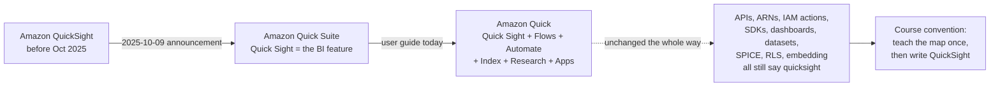
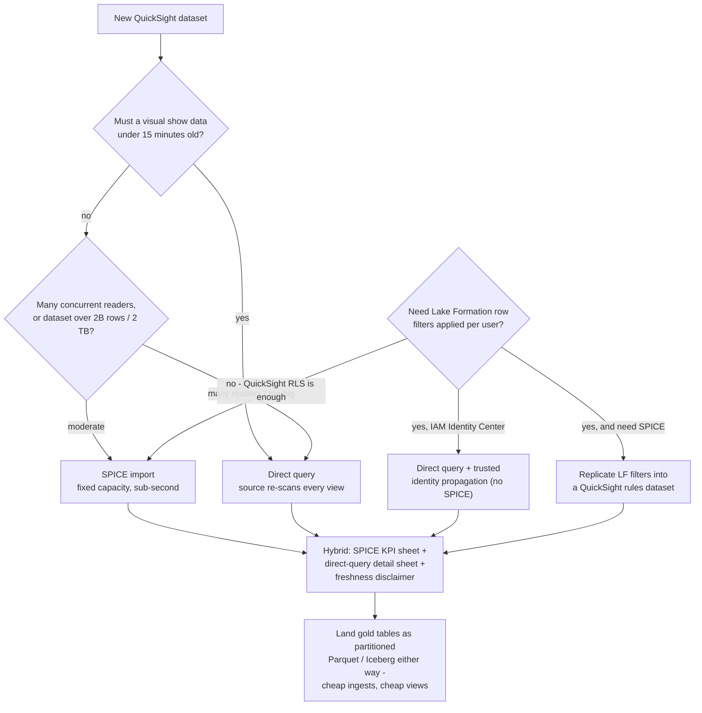
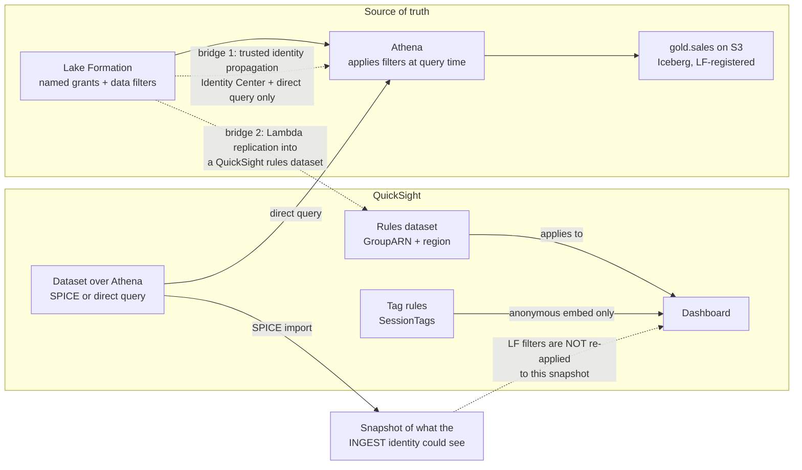
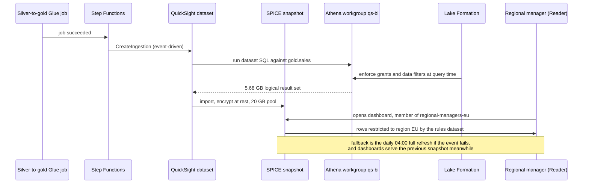
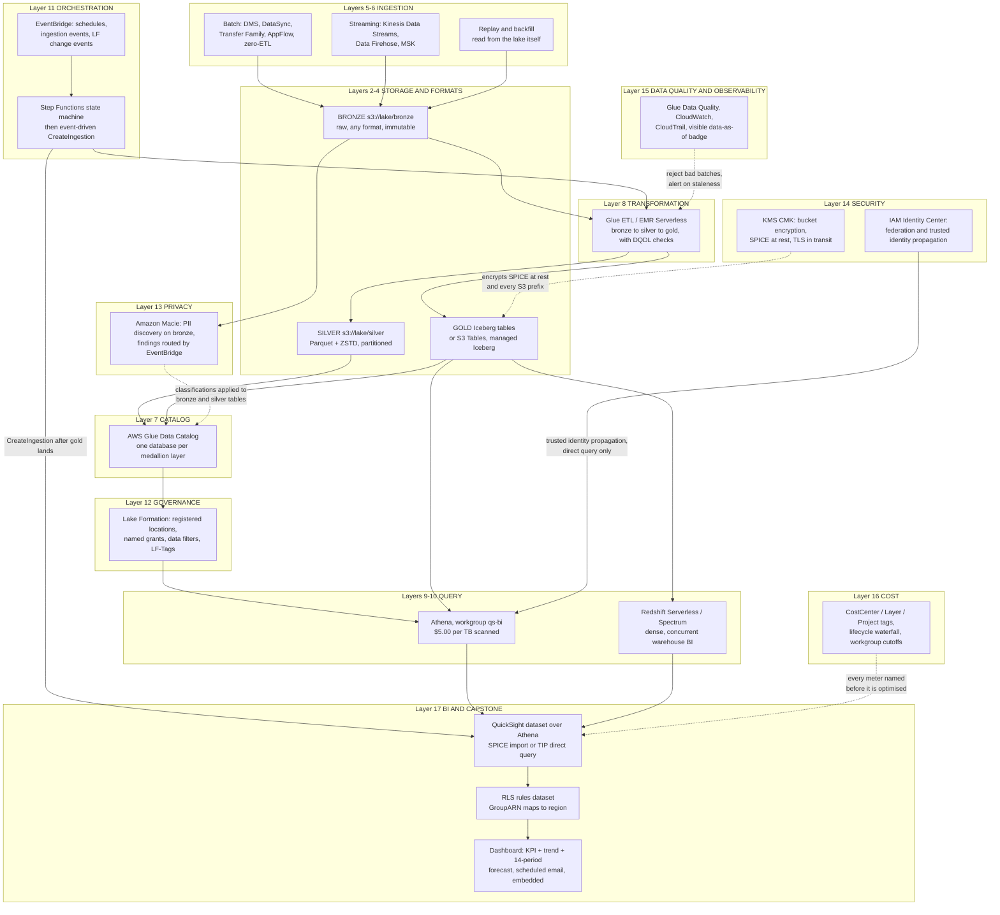

# QuickSight BI and the End-to-End Lakehouse Capstone

Sixteen lessons built something that produces numbers: bronze on S3, silver and gold as Iceberg tables, a Glue catalog, Step Functions holding the schedule together, Lake Formation deciding who may read which row, Macie finding the personal data, Glue Data Quality refusing the bad batches, and a cost ladder nobody is allowed to skip. None of that is the point of a lakehouse. The point is that a **regional manager in Frankfurt** opens a link on a Monday morning and sees her regions, her stores, her revenue, in under two seconds — and sees nobody else's.

That is this lesson. The BI layer is where every upstream decision either pays for itself or embarrasses you: a missing Lake Formation grant shows up as an empty dashboard, a SPICE snapshot shows up as a stale one, a text-versus-numeric column choice shows up as row-level security silently not working, and an un-pruned direct query shows up on the Athena bill three weeks later. You will configure QuickSight end to end, then step back and re-draw the whole course as **one reference architecture with seventeen layers**, plus the 30/60/90-day plan that gets a team there.

```text
====================================================================
 QUICKSIGHT BI + CAPSTONE - AWS DATA LAKEHOUSE, LESSON 17
                    (us-east-1 list, as of Oct 2026)
====================================================================
 NAMING ....... service = Amazon Quick (was QuickSight; announced
                as Quick Suite 2025-10-09); BI feature = Quick
                Sight; APIs / ARNs / IAM actions still say
                quicksight - so this course writes QuickSight
 EDITIONS ..... Standard: $9 user/mo annual or $12 monthly,
                10 GB SPICE per user, FULL refresh only
                Enterprise: incremental refresh, RLS, CLS,
                folders, embedding, 2B rows or 2 TB per dataset
 PERSONAS ..... Author $24 | Author Pro $40 | Reader $3 |
                Reader Pro $20 | Admin bills as Author
 SPICE ........ $0.38 / GB-month (Standard extra $0.25 / GB);
                10 GB included per Author, pooled per Region
                per account; logical size = 12 B per numeric
                or date cell + 24 B + UTF-8 length per text
 FEES ......... $250 / month per account if ANY Pro user,
                Q topic or Dashboard Q&A is enabled
 QUERY MODE ... SPICE (snapshot, fixed capacity, sub-second)
                vs direct query (fresh, re-scans, 2-minute
                visual timeout) vs hybrid (AWS-recommended)
 ATHENA ....... $5.00 per TB scanned - every direct-query
                view pays it again
 RLS .......... three mechanisms: user/group rules dataset
                (text only, <=999 records per user) | tag
                rules (ANONYMOUS embedding only) | Lake
                Formation data filters (Athena, query time,
                direct query only - SPICE freezes the rows
                it saw at ingest)
 CAPSTONE ..... 17 layers: S3 tiers -> formats/Iceberg ->
                ingestion -> catalog -> Glue -> Athena/
                Redshift -> orchestration -> Lake Formation ->
                Macie -> security -> data quality -> cost ->
                QuickSight
====================================================================
```

> [!NOTE]
> **How to use this lesson.** Sections 1–8 are the QuickSight configuration half — read them once, then work the four interactive checks as they appear (SPICE matcher, query-mode plot, RLS fill-in, build-order drag-and-drop). Section 9 is the capstone build you should be able to reproduce on paper. Sections 10–11 are the course summary: one integrated diagram and one phased roadmap. Everything here is dated to **October 2026**; where AWS's own pages disagree, the disagreement is named rather than smoothed over.

By the end of this lesson you will be able to:

- say what changed and what did **not** when QuickSight became Quick Suite and then Amazon Quick, and price a real deployment line by line;
- choose between **SPICE and direct query** using the Athena bytes-scanned meter rather than a feeling, and defend the choice with arithmetic;
- size a **SPICE dataset** from a column list using the logical-size formula, and schedule refreshes that neither collide nor silently go stale;
- wire a **lakehouse source** correctly — Athena through Lake Formation, an S3 manifest for extracts, Redshift for dense warehouse workloads;
- build the content chain **dataset → analysis → dashboard → theme → folder**, and pick a visual family on purpose;
- separate the **three row-level-security mechanisms** and state, for each, who it applies to, what data types it restricts, and what it costs you;
- assemble all **seventeen layers** into one reference architecture and sequence them across a **30/60/90-day** plan;
- read **Trustly's** published QuickSight outcomes the way a practitioner reads a case: as a customer result with a date, never as a service guarantee.

---

## 1. Naming the thing you are configuring

Before a single setting: on **2025-10-09** AWS announced that "Amazon QuickSight is evolving into Amazon Quick Suite", with the BI half renamed **Quick Sight** and "Beyond the familiar BI capabilities (now called Quick Sight), Quick Suite introduces several AI-powered features" (AWS BI Blog, 2025-10-09). The user guide today describes the service as **Amazon Quick**, which "evolved from Amazon QuickSight. QuickSight continues as Amazon Quick Sight, a feature within Quick" (Quick User Guide, *What is Amazon Quick?*, accessed 2026-10-11).

The operational half of that announcement is the part you actually need:

> "Your entire QuickSight environment, including dashboards, datasets, and analyses, remains unchanged… Your existing API integrations keep working as before, and no data migration is required." — AWS BI Blog, 2025-10-09

and

> "All existing QuickSight APIs, SDKs, and integrations continue to work without changes." — Quick User Guide, accessed 2026-10-11



Two consequences for everything below:

1. **ARNs and IAM actions still read `quicksight`.** A user ARN is still `arn:aws:quicksight:{region}:{account}:user/{namespace}/{username}`, the default service role is still `aws-quicksight-service-role-v0`, and every API you touch in this lesson (`CreateIngestion`, `GenerateEmbedUrlForRegisteredUser`, `CreateAccountCustomization`) keeps its old name (AWS Machine Learning Blog, 2026-06-08; AWS Builder Center, 2026-03-27).
2. **Pricing tables moved to the new branding.** The rates below were read from the QuickSight pricing page on **2026-10-11**, where the Quick Suite panel carries them.

- **📚 Did you know?** The shortening from "Quick Suite" to "Amazon Quick" is **not dated anywhere in AWS's own documentation**. The 2025-10-09 posts say Quick Suite; the user guide simply says Amazon Quick, with no announcement row for the second rename. The defensible statement is "announced as Quick Suite in October 2025; by October 2026 the user guide calls the service Amazon Quick" — assigning a precise date to the shortening would be inventing a source.

---

## 2. Personas, editions and the October 2026 price stack

### 2.1 The three personas, and why Admins are billed as Authors

| Persona | What they can do | SPICE allocation | Billed as |
|---|---|---|---|
| **Author** | Connect to data sources, create datasets, analyses and dashboards, share them | Contributes **10 GB** to the account pool | $24/user/month |
| **Author Pro** | Everything an Author does, plus Q Topics, natural-language dashboard building, executive summaries, data stories, scenarios | Credit for 10 GB | $40/user/month |
| **Reader** | Open dashboards, filter, drill, export CSV, subscribe to alerts — "Readers do not have any allocated SPICE capacity" | **None** | $3/user/month |
| **Reader Pro** | Reader plus Quick Suite Professional capabilities: summaries, stories, scenarios | None | $20/user/month |
| **Admin** | User management, SPICE and subscription purchasing, **plus all authoring capabilities** | Contributes 10 GB | "For billing purposes, QuickSight Authors and Admins are both recognized as Authors" |
| **Admin Pro** | Admin plus Pro capabilities | Contributes a 10 GB credit | Billed at Author Pro rates |

Source for every row: QuickSight pricing page and FAQs, accessed **2026-10-11**.

The trap in that table is the Admin row: an Admin who "just manages users" is still an Author on the invoice. The second trap is that **Readers hold no SPICE at all** — SPICE is account property, not user property.

### 2.2 Two editions, and only one of them does row-level security

| | **Standard** | **Enterprise** (the default for organisations) |
|---|---|---|
| Seat price | $9/user/month annual, $12 monthly | $24 Author / $3 Reader, plus Pro tiers |
| Included SPICE | 10 GB per user | 10 GB per Author licence, pooled at account level |
| Extra SPICE | $0.25 per GB | **$0.38 per GB-month** |
| Per-dataset quota | 25,000,000 rows or 25 GB | **2,000,000,000 rows or 2 TB** (whichever comes first) |
| Refresh | **Full refresh only** | Full **or incremental** (SQL data sources only) |
| RLS / CLS | No | **Yes** |
| Folders, embedding, restricted folders | No | Yes (embedding is Enterprise-only) |
| Purchase path | `CreateAccountSubscription` API | Console default |

Sources: pricing page, *Data source quotas*, *Refreshing SPICE data*, *Using row-level security*, *Embedding overview* — all accessed 2026-10-11.

> [!IMPORTANT]
> **A number to teach carefully.** The quotas documentation and the 2024 best-practices blog both say Enterprise SPICE holds **2 billion rows or 2 TB per dataset**, and the document history records the increase to 2 billion rows on **2025-06-30**. The pricing page, read on 2026-10-11, still prints "a maximum 1 billion rows per 1 TB size". Use the **docs** figure, name the conflict, and never quote the pricing page's 1B/1TB as current.

### 2.3 Worked example E1 — pricing a real deployment, line by line

A team deploys **3 Authors, 1 Admin, 60 Readers**, one **52 GB** SPICE dataset, **no Pro users, no Q topics, no Dashboard Q&A** (us-east-1 list, as of Oct 2026).

```text
Seats          4 x $24 (3 Authors + 1 Admin; Admin bills as Author) = $ 96.00
Readers       60 x $3                                                = $180.00
Included SPICE 4 x 10 GB = 40 GB, pooled at the account level
Shortfall      52 GB - 40 GB = 12 GB x $0.38                         = $  4.56
Pro / Q&A fee  no Pro user, no topic, Dashboard Q&A off              = $  0.00
                                                      MONTHLY TOTAL = $280.56
```

Now two changes that look small on a slide:

```text
Promote one Author -> Author Pro          $40 - $24 = +$16.00
Turn on Dashboard Q&A (no topic needed)   +$250.00 per account per month
                                                      MONTHLY TOTAL = $546.56
```

The infrastructure fee **doubled the bill** for one feature flag. It applies "if your account has any of the following: At least one Pro user / Q&A enabled via topics / Dashboard Q&A enabled" (pricing page and FAQs, accessed 2026-10-11), and — the part that catches people — deleting the Pro users does not stop it while a Q Topic still exists in **any** Region of the account (AWS re:Post Knowledge Center, 2026-08-27).

---

## 3. SPICE: what it is, what it costs, how you fill it

### 3.1 The engine in one paragraph

SPICE is the **Super-fast, Parallel, In-memory Calculation Engine**: a refreshable, materialised snapshot of your dataset built from "a combination of columnar storage, in-memory technologies… and machine code generation" (AWS BI Blog, *Best practices for Amazon QuickSight SPICE and direct query mode*, 2024-07-17). In Enterprise edition the snapshot is **encrypted at rest** — AWS-managed by default, or a customer managed key in AWS KMS — and encrypted in transit with TLS (same source; *Importing data into SPICE*, accessed 2026-10-11).

Four properties decide every design choice you will make:

- **Capacity is pooled per account per AWS Region**, not per user: "SPICE capacity is allocated separately per AWS Region… shared by all the people using QuickSight in a single AWS Region" (*Managing SPICE memory capacity*, accessed 2026-10-11).
- **Auto capacity purchasing is on by default** for console-created accounts, and "Auto capacity purchasing doesn't support auto-decrement" — it can grow your pool, never shrink it. Turn it off while over-allocated and the *next* ingestion or refresh fails.
- **You are charged for the source query at ingest**, not at view time: "If you use a data source that charges per query, you're charged for querying the data when you first create the dataset and later when you refresh the dataset" (*Importing data into SPICE*).
- **Dashboards keep serving the previous snapshot while a refresh runs** — and after a failed one, with no on-canvas staleness banner by default.

### 3.2 Logical size: the arithmetic that decides your capacity bill

What consumes capacity is not the Parquet file on S3 and not the row count — it is the **logical size**, computed after type coercion and calculated columns:

```text
Logical dataset size in bytes =
      (number of numeric cells  x 12 bytes)
    + (number of date cells     x 12 bytes)
    + SUM(24 bytes + UTF-8 encoded length  per text cell)
```

Source: *Importing data into SPICE*, accessed 2026-10-11. "Only changes that are saved in the dataset apply to SPICE capacity."

### 3.3 Worked example E2 — sizing the capstone dataset before you ingest it

The capstone gold table `gold.sales` holds **40,000,000 rows**, about **3 GB of Parquet** on S3. The QuickSight dataset uses this custom SQL (note what was dropped):

```sql
SELECT  order_id,
        date_trunc('day', order_ts) AS order_day,
        region,
        store_id,
        product,
        qty,
        revenue
FROM gold.sales
```

Per-row logical size:

| Column | Type after coercion | Bytes per cell |
|---|---|---|
| `order_id` | numeric | 12 |
| `order_day` | date | 12 |
| `region` | text (2 chars) | 24 + 2 = 26 |
| `store_id` | text (6 chars) | 24 + 6 = 30 |
| `product` | text (14 chars) | 24 + 14 = 38 |
| `qty` | numeric | 12 |
| `revenue` | numeric | 12 |
| **Per row** | | **142 bytes** |

```text
40,000,000 rows x 142 bytes = 5,680,000,000 bytes = 5.68 GB logical
Account pool  = 2 Authors x 10 GB = 20 GB included
Verdict       = 5.68 GB fits with 14.32 GB headroom; extra SPICE = $0.00
Trap          = the S3 Parquet is 3 GB; the LOGICAL size is 5.68 GB.
                Wide text columns are what blow the GB cap first.
```

Two moves made this fit: **dropping unused columns** in the SQL (a `customer_note` text column averaging 200 characters would have added `24 + 200` bytes per row — 8.96 GB on its own, which by itself would have exceeded the pool) and **truncating the timestamp to a date**, the same move that makes incremental refresh and row-level security possible at all.

- **📚 Did you know?** The four data-preparation steps **Append, Aggregate, Pivot and Unpivot cannot run at query time** — they are *SPICE-only*, meaning QuickSight materialises them into SPICE rather than executing them on every visual load (*SPICE-only features*, accessed 2026-10-11). That makes them the documented "pre-aggregate to shrink your dataset" lever: an aggregate step applied at authoring time is paid once per refresh instead of on every view.

### 3.4 Refresh: schedules, quotas and the failure you will not see

| Rule | Value | Source (date) |
|---|---|---|
| Schedule frequencies | every 15 min, 30 min, hourly, daily, weekly, monthly | Refreshing SPICE data (2026-10-11) |
| Schedule accuracy | ingestion runs **within 10 minutes** of the scheduled time | same |
| Schedules per dataset | **up to 5** | AWS re:Post, 2026-06-26 |
| On-demand full refreshes | **32 per dataset per 24 hours** (schedules unaffected) | BI Blog, 2024-07-17 |
| On-demand incremental refreshes | **100 per dataset per 24 hours** | same |
| Incremental refresh | **SQL data sources only**; needs a date column plus a look-back window; an internal checkpoint records the last full refresh | Refreshing SPICE data (2026-10-11) |
| Standard edition | full refresh only | same |
| During refresh | dashboards serve the **previous snapshot** | BI Blog, 2024-07-17 |
| Failure notification | `FailureConfiguration.EmailAlert.AlertStatus=ENABLED` | Automate SPICE refreshes via APIs, 2025-12-29 |
| Deleting the incremental config | triggers a **full** refresh next time | Refreshing SPICE data (2026-10-11) |

Two operational rules follow directly. **Stagger the schedules** so datasets do not all fire in the same minute (AWS re:Post, 2026-06-26), and treat a failed refresh as an **incident**, because the dashboard will happily keep rendering yesterday's numbers as if nothing happened.

### 3.5 SPICE authoring best practices

1. **Select columns at authoring time.** Every text column you drag into the dataset is billed at `24 + UTF-8 length` bytes per row, forever. Deselect what no visual uses.
2. **Aggregate before you import.** Use the SPICE-only Aggregate step — or aggregate in the gold layer, which is better still — when a dashboard needs measures by day rather than by transaction.
3. **Cast the keys you will restrict on.** Row-level security works only on **text** fields, so cast numeric or date region keys to string in the dataset SQL (section 7).
4. **Schedule after the ETL, never near it.** A daily full refresh at 04:00 that fires before the silver-to-gold job completes imports the wrong snapshot and reports it confidently. Event-driven `CreateIngestion` from Step Functions after the job is the deterministic version; the schedule is only the floor.
5. **One dataset, many dashboards.** Consumption across any number of dashboards and users "doesn't incur charges" — the meter is capacity GB-months, not views (pricing page, accessed 2026-10-11).

```matching
{
  "question": "Match each SPICE concept to what it actually means in QuickSight (QuickSight documentation, accessed 2026-10-11):",
  "pairs": [
    {"left": "SPICE itself (Super-fast, Parallel, In-memory Calculation Engine)", "right": "A refreshable snapshot built from columnar storage, in-memory technologies and machine code generation; encrypted at rest in Enterprise edition"},
    {"left": "Logical size", "right": "12 bytes per numeric or date cell, plus 24 bytes plus UTF-8 length per text cell, computed after type coercion and calculated columns - this is what your GB bill counts"},
    {"left": "Included capacity", "right": "10 GB contributed by each provisioned Author or Admin licence, pooled at the account level per AWS Region; Readers contribute nothing"},
    {"left": "Incremental refresh", "right": "SQL data sources only; queries just the look-back window defined on a date column, tracked by an internal checkpoint since the last full refresh"},
    {"left": "SPICE-only preparation steps", "right": "Append, Aggregate, Pivot and Unpivot - materialised into SPICE instead of executed at query time, which is why they are the pre-aggregation lever"},
    {"left": "Snapshot behaviour during a refresh", "right": "Dashboards keep serving the previous snapshot while a refresh runs - and after a failed one, with no staleness banner by default"}
  ],
  "explanation": "Each of these six is a place where teams guess and then get a surprise bill or a stale dashboard. Logical size is not file size (E2: 3 GB of Parquet was 5.68 GB logical); capacity is account property, not user property; incremental refresh is gated on a SQL source plus a date column; the four SPICE-only steps are the sanctioned way to shrink a dataset; and snapshot behaviour is exactly why failure alerts and a 'data as of' text box are mandatory rather than optional."
}
```

---

## 4. SPICE versus direct query: the Athena bill is the tie-breaker

### 4.1 The trade, stated both ways

| | **SPICE import** | **Direct query** |
|---|---|---|
| Freshness | As of the last refresh | Every visual load |
| Source charge | Ingest only (once per refresh) | **Every view, every interaction** |
| Performance | Sub-second, consistent, thousands of concurrent readers | Equals source performance; concurrency lands on Athena or Redshift |
| Hard limits | 2B rows or 2 TB per dataset (Enterprise); capacity GB-months | **2-minute visual-generation timeout** — "not all database drivers react to the 2-minute timeout" (a Redshift query can keep running) |
| Row-level security | Your QuickSight RLS rules apply | Your RLS rules **and** Lake Formation filters both apply |
| Cost shape | Fixed and predictable; scales with dataset size | Variable; scales with **view count x bytes scanned** |
| Best for | KPI sheets, wide fan-out, executives, embedding | Low-freshness-tolerance detail, very wide tables, one-off drill |

Sources: *Data source quotas* (2026-10-11); AWS BI Blog best practices (2024-07-17).

### 4.2 The AWS-recommended hybrid

AWS's own guidance is not "pick one": use a **SPICE landing sheet** for aggregated KPIs refreshed daily or incrementally, plus a **direct-query detail sheet**, and warn the reader about the freshness inconsistency between them (BI Blog, 2024-07-17). The pattern exists because the two failure modes are opposite — SPICE fails by being stale, direct query fails by being slow and expensive.



### 4.3 Worked example E3 — the same dashboard, two meters

**Scenario.** 200 readers, 4 dashboard views each per day, each view scanning **200 MB** of partition-pruned Parquet in direct-query mode, versus the same data imported into a **6 GB** SPICE dataset. Athena is **$5.00 per TB scanned** (Amazon Athena pricing, accessed 2026-10-11).

```text
DIRECT QUERY, optimised (200 MB per view)
  per day   = 200 readers x 4 views x 0.2 GB =    160 GB
  per month = 160 GB x 30                    =  4,800 GB = 4.8 TB
  Athena    = 4.8 TB x $5.00                 =  $24.00 / month

DIRECT QUERY, un-pruned (3 GB per view: no partition predicate,
no column pruning - the same business question, the same answer)
  per day   = 200 x 4 x 3 GB                 =  2,400 GB = 2.4 TB
  per month = 2.4 TB x 30                    =    72 TB
  Athena    = 72 TB x $5.00                  = $360.00 / month

SPICE (6 GB dataset, daily full refresh)
  capacity  = 6 GB x $0.38                   =   $2.28 / month
  ingest    = 30 refreshes x ~3 GB scanned    =     90 GB = 0.09 TB
  Athena    = 0.09 TB x $5.00                =   $0.45 / month
  TOTAL     =                                =   $2.73 / month
```

The break-even is arithmetic, not opinion: SPICE capacity cost equals the Athena cost when

```text
monthly scanned TB = (SPICE GB x $0.38) / $5.00
                   = (6 x 0.38) / 5 = 0.456 TB = 456 GB / month
at 0.2 GB per view = 456 / 0.2      = 2,280 views / month
                   = about 76 views / day
```

Below roughly 76 views a day, direct query is cheaper **and** fresher; above it, SPICE wins and keeps winning, because the SPICE line is **flat in view count**. The un-pruned column is the one that should worry you: the same SQL shape without partition pruning is **15x the bill** — which is why lesson 09's reducers are a prerequisite for this lesson rather than an optional extra.

> [!WARNING]
> ⚠️ **Never point a large reader population at un-pruned direct query.** Three documented reasons: every visual load re-scans at $5.00 per TB; QuickSight enforces a **2-minute visual-generation timeout** that some drivers ignore (a Redshift query can keep running past it); and concurrency lands on the source, so a 200-reader burst becomes an Athena workgroup problem. If a dashboard must be direct query, put the partition predicates and the column pruning in the **dataset SQL**, not in the reader's hands.

### 4.4 Worked example E4 — the hybrid bill

Same audience, **4,000 views per day**: 3,600 land on the SPICE KPI sheet, 400 hit the direct-query detail sheet at 200 MB each.

```text
SPICE sheet      3,600 views x $0.00                  = $  0.00
Detail sheet     400 x 0.2 GB = 80 GB/day x 30 days    = 2.4 TB -> $12.00
SPICE capacity   6 GB x $0.38                          = $  2.28
MONTHLY                                          TOTAL = $14.28
All-direct equivalent: 4,000 x 0.2 GB x 30 = 24 TB     = $120.00
                                                            ------
Saving                                                  $105.72 / month
```

Add the disclaimer text box on the direct-query sheet — "detail rows are live; KPI tiles refresh daily at 04:00 UTC" — and you have the AWS-recommended shape with its cost quantified.

- **📚 Did you know?** Athena bills **bytes scanned, rounded up to the nearest megabyte, with a 10 MB minimum per query** for federated sources — so a dashboard rendering 40 small direct-query visuals can bill 40 minimums instead of one merged scan. Merging filters and issuing fewer, wider queries through dataset parameters is a cost lever as much as a performance one (Amazon Athena pricing, accessed 2026-10-11).

```plot
{
  "type": "line",
  "title": "Direct query on Athena vs SPICE: same 0.2 GB-per-view workload, 6 GB dataset at $0.38/GB-month (as of Oct 2026)",
  "xLabel": "Dashboard views per month",
  "yLabel": "Monthly cost (USD)",
  "xKey": "views",
  "data": [
    {"views": 500, "Direct query at $5.00/TB": 0.5, "SPICE import (flat in views)": 2.28},
    {"views": 1000, "Direct query at $5.00/TB": 1.0, "SPICE import (flat in views)": 2.28},
    {"views": 2000, "Direct query at $5.00/TB": 2.0, "SPICE import (flat in views)": 2.28},
    {"views": 2280, "Direct query at $5.00/TB": 2.28, "SPICE import (flat in views)": 2.28},
    {"views": 5000, "Direct query at $5.00/TB": 5.0, "SPICE import (flat in views)": 2.28},
    {"views": 10000, "Direct query at $5.00/TB": 10.0, "SPICE import (flat in views)": 2.28},
    {"views": 25000, "Direct query at $5.00/TB": 25.0, "SPICE import (flat in views)": 2.28}
  ],
  "dataKeys": ["Direct query at $5.00/TB", "SPICE import (flat in views)"]
}
```

The lines cross at about **2,280 views per month** — roughly 76 a day. Left of the crossing, direct query is cheaper *and* fresher; right of it, SPICE costs the same whether 10 people or 10,000 look. The SPICE line also hides a fixed **$0.45/month** ingest charge (E3), which moves the crossing only marginally.

---

## 5. Lakehouse sources: Athena, the S3 manifest, and Redshift

QuickSight supports a long list of sources — Athena, Aurora, the Glue Data Catalog, OpenSearch, Redshift, Redshift Spectrum, S3, S3 Tables, RDS, plus BigQuery, Databricks, Snowflake, Trino and Q Business — with one hard placement rule: **"Amazon Redshift clusters, Amazon Athena databases, and Amazon RDS instances must be in AWS"** (*Supported data sources*, accessed 2026-10-11). For this course, three matter.

| Source | What it is for | Configuration facts you must know |
|---|---|---|
| **Amazon Athena** | The default lakehouse path: QuickSight to Athena to Glue Data Catalog to Iceberg/Parquet on S3 | Takes a workgroup (`AthenaParameters.WorkGroup`), a role ARN, and `IdentityCenterConfiguration.EnableIdentityPropagation` for trusted identity propagation. This is where Lake Formation permissions are enforced. |
| **Amazon S3 via JSON manifest** | Direct file import of extracts: CSV, TSV, JSON, CLF, ELF | `fileLocations.URIs` / `URIPrefixes` plus `globalUploadSettings` (format, delimiter, text qualifier, `containsHeader`); **up to 1,000 files per manifest**. Right for a flat extract, **wrong for a governed lakehouse table** — it bypasses the catalog, the Iceberg metadata and Lake Formation entirely. |
| **Amazon Redshift / Spectrum** | Dense, concurrent, always-on BI over warehouse tables or external lake tables | Must be in AWS; also trusted-identity-propagation capable, so source-side row and column permissions propagate instead of being re-declared in QuickSight. |

The decision rule for this course: **anything governed lives behind Athena** (or Redshift), never behind a manifest. A manifest is a file drop — no catalog entry, no time travel, no Lake Formation grant, no data filter.

```json
{
  "fileLocations": [
    { "URIs": [ "s3://lake/extracts/2026/10/*.csv" ] }
  ],
  "globalUploadSettings": {
    "format": "CSV",
    "delimiter": ",",
    "textQualifier": "\"",
    "containsHeader": "true"
  }
}
```

A manifest like the one above imports fine and is still the wrong answer for `gold.sales`: the moment row-level governance, schema evolution or time travel matters, the Athena path is the only one that inherits what lessons 04, 07 and 12 built.

Two wiring details that break silently:

- The QuickSight service role — by default **`aws-quicksight-service-role-v0`** — needs **its own Lake Formation grants**, in addition to the grants given to QuickSight user and group ARNs (*Using AWS Lake Formation with Amazon QuickSight*, accessed 2026-10-11; AWS Builder Center, 2026-03-27).
- With **S3 Tables** (managed Iceberg) the catalog is `s3tablescatalog`, not the default Glue catalog: you need `glue:GetCatalog` on that catalog ARN, and you must use **custom SQL**, because the table browser only shows the default catalog (AWS Builder Center, 2026-03-27).

And the ordering rule from AWS's own guide: get the query working **in Athena first**, then open QuickSight — one step that separates a Lake Formation problem from a QuickSight problem.

---

## 6. The content model: datasets, analyses, dashboards, themes and folders

```text
Data source (Athena / S3 manifest / Redshift)
      |
      v
Dataset  ---- mode: SPICE or direct query
      |        + custom SQL, joins, calculated fields,
      |          unique keys; the RLS rules dataset is
      |          attached HERE, not to the dashboard
      v
Analysis  ---- editable, multi-sheet, up to 500 calculated
      |        fields; filters, parameters, actions,
      |        drill-down, forecast and anomaly visuals,
      |        what-if (what-if exists ONLY in an analysis,
      |        never in a dashboard)
      v
Publish
      |
      v
Dashboard  ---- read-only snapshot of the analysis,
                 up to 1,000 retained versions, shared with
                 groups, scheduled emails, embedded
```

**Visual families** available on an analysis: bars and columns (stacked), heat map, line and area, scatter, pie and donut, treemap, funnel, gauge/KPI, word cloud, box plot, histogram, scatter map, **layer map**, **image component**, **Highcharts**, tables and pivot tables, and autonarrative text widgets (Quick User Guide document history and forecast/insight documentation, accessed 2026-10-11).

**Themes.** Four starter theme ARNs ship with the service — `arn:aws:quicksight::aws:theme/CLASSIC`, `.../MIDNIGHT`, `.../SEASIDE`, `.../RAINIER` — and the account or namespace default is set through `CreateAccountCustomization` / `UpdateAccountCustomization` with a `DefaultTheme`, which requires the theme to be shared first (*Setting a default theme*, accessed 2026-10-11). Embedded dashboards add **runtime theming** from Embedding SDK 2.5.0 and higher (`setTheme`, `setThemeOverride`, up to five preloaded themes).

**Folders (Enterprise).** Personal folders, shared folders, and **shared restricted folders** — the restricted kind is created only through the `CreateFolder` API and forces assets created from its contents to stay inside the folder tree. Read the boundary carefully: it covers analyses, dashboards, datasets, data sources and topics, but **not** newer surfaces such as chat agents, which can still retrieve details from a dataset inside a restricted folder (*Organizing assets into folders*, accessed 2026-10-11).

> [!NOTE]
> **Two limits worth memorising because they show up as surprises.** Dashboard version history retains up to **1,000 versions** (document history, 2025-03-28), and an analysis allows **500 calculated fields**, raised from 200 on 2025-08-15. Both are large enough that nobody hits them by accident and small enough that a heavily templated migration eventually will.

---

## 7. Row-level security: three mechanisms that are not interchangeable

This is the section that decides whether your capstone dashboard is a governance win or a data leak. There are **three** row-level mechanisms, they solve different problems, and **none of them converts into another automatically**.

### 7.1 Mechanism one — a user or group rules dataset (Enterprise)

A permissions table attached to your dataset: one column for identity (`UserName` and `GroupName`, or `UserARN` and `GroupARN`) plus **one column per restricted field**. You attach it with "Grant access to dataset".

| Rule | Value |
|---|---|
| Access mode | **Grant-access only** — deny mode was removed on 2020-12-06 |
| Empty values | NULL in a restricted column means **all values** for that identity |
| Missing identity | A user or group with no rule row sees **no rows** |
| Records per user | **999 or fewer** rule records applied per user (direct plus via groups) |
| Filter values in SPICE | **192,000 or fewer** per restricted field |
| Data types | **Text only** (string/char/varchar) — "It doesn't currently work for dates or numeric fields" |
| Rules dataset flag | `UseAs: RLS_RULES` — once set it cannot be changed |
| Dirty data | SPICE ingestion of a rules dataset **fails** on invalid rows or oversized cells instead of skipping them |
| Empty rules | Skipped as a safety measure; QuickSight treats NULL, empty strings and strings such as `,,,` as no value |
| Dataset owners | **Keep seeing all the data** — owners are not restricted |
| Anomaly detection | **Not supported** on datasets that use row-level security |

Sources: *Using row-level security* and *Using RLS with user-based rules*, accessed 2026-10-11.

A broken rules-dataset ingestion therefore leaves the dataset restricted with **no selected rules**, which means readers see nothing until you attach new rules. Monitor ingestion status and turn on failure email alerts.

### 7.2 Mechanism two — tag-based rules (anonymous embedding only)

Tag rules map a tag key to a column and inject values at runtime through `SessionTags` in `GenerateEmbedUrlForAnonymousUser`, configured via `RowLevelPermissionTagConfiguration.TagRules` (`TagKey`, `ColumnName`, `TagMultiValueDelimiter`, `MatchAllValue`). AWS's scope statement is unambiguous: tag-based rules exist when "you are using embedded dashboards and want to secure data for users not provisioned (unregistered users)", and they are supported **only** for anonymous embedding — not for `GenerateEmbedURLForRegisteredUser`, not for the legacy `GetDashboardEmbedUrl`, and not for console identity (*Using RLS with tag-based rules*, accessed 2026-10-11).

### 7.3 Mechanism three — Lake Formation at the source, through Athena

Register the S3 location in Lake Formation, revoke `IAMAllowedPrincipals`, and grant `SELECT` and `DESCRIBE` (plus data-filter permissions) to **QuickSight user and group ARNs** in Enterprise, and to the **service role** as well. Those filters are applied by **Athena at query time**, which is the whole problem and the whole opportunity:

- a **direct-query** dataset honours Lake Formation data filters per user;
- a **SPICE** dataset does not, because "when using SPICE, data is imported (replicated) and therefore the entitlements at the source can't be used" (AWS Big Data Blog, *Automate replication of row-level security from AWS Lake Formation to Amazon QuickSight*, 2025-05-07).

AWS documents exactly **two bridges** across that gap:

1. **Trusted identity propagation (TIP).** IAM Identity Center only, direct query only — "QuickSight SPICE can't be used with trusted identity propagation". The reader's identity propagates to Athena, to Redshift, and to Lake Formation when Redshift Spectrum is involved, so schema-, table-, row- and column-level permissions are enforced at the source and this "eliminates the need to create additional row-level and column-level security rules in QuickSight" (AWS BI Blog, 2024-05-16; document-history entry "Trusted identity propagation support with Athena data sources", 2025-06-30).
2. **Automated replication.** A Lambda reads `ListDataCellFilters` and `ListPermissions`, transforms the PartiQL predicates into QuickSight rules-dataset rows, and refreshes a QuickSight RLS dataset. It works **with SPICE** and **without** Identity Center — but it must be re-run on every Lake Formation change, and the lag window is a risk you own.



- **📚 Did you know?** The phrase "tags become RLS" describes **two unrelated features**. Lake Formation tags drive *table and column* reach and cannot carry row data filters at all, while QuickSight tag rules drive row-level security **only for anonymous embedding**. There is no documented AWS feature that maps one onto the other — for registered regional managers you need a **user/group rules dataset**, full stop (QuickSight and Lake Formation documentation, accessed 2026-10-11).

### 7.4 Worked example E5 — which mechanism for which audience

| Audience | Registered? | Needs SPICE? | Correct mechanism |
|---|---|---|---|
| Regional managers opening a shared dashboard link | Yes (IAM Identity Center groups) | Yes, for sub-second mornings | **User/group rules dataset** keyed on `GroupARN`, one `region` column |
| Analysts running ad-hoc Athena SQL under their own identity | Yes | No — direct query | **Lake Formation data filters**, enforced at the source |
| Customers of an embedded portal with no QuickSight accounts | No | Optional | **Tag rules** via `GenerateEmbedUrlForAnonymousUser` plus `SessionTags` |
| A regulated column such as `customer_tax_id` hidden from most readers | Yes | Either | **Column-level security** (`ColumnLevelPermissionRule`, 100 principal ARNs max) *or* Lake Formation column permissions — choose one deliberately |

```fillblank
{
  "question": "Complete the three row-level-security mechanisms and the hard limit each carries (QuickSight documentation, accessed 2026-10-11):",
  "template": "1) A {{1}} rules dataset grants access only (deny mode was removed in 2020), works on TEXT fields only, and is capped at {{2}} rule records per user. 2) Tag-based rules inject values through SessionTags and are supported only for {{3}} embedding. 3) Lake Formation data filters are applied by Athena at {{4}} time, so direct-query datasets honour them while a SPICE import {{5}} the rows it could see at ingest.",
  "answers": {
    "1": "user/group",
    "2": "999",
    "3": "anonymous",
    "4": "query",
    "5": "freezes"
  },
  "distractors": [
    "tag-based",
    "column-level",
    "service-role",
    "192000",
    "100",
    "1000",
    "registered-user",
    "console",
    "IAM Identity Center",
    "ingest",
    "authoring",
    "dashboard-publish",
    "replicates",
    "ignores",
    "re-applies"
  ],
  "explanation": "Mechanism 1 is the user/group rules dataset: grant-access only since 2020-12-06, text fields only (numeric and date keys must be cast to string first), 999 rule records per user, and 192,000 filter values per restricted field when the dataset lives in SPICE. Mechanism 2 is tag rules, which exist for anonymous embedding only - GenerateEmbedUrlForAnonymousUser plus SessionTags, not registered users and not the console. Mechanism 3 is Lake Formation, enforced by Athena at query time: that is why direct query inherits source-side filters and why a SPICE import freezes the rows its ingest identity could see. Column-level security is a separate control (ColumnLevelPermissionRule, up to 100 principals per rule) and substitutes for none of the three."
}
```

> [!WARNING]
> ⚠️ **SPICE silently drops Lake Formation row filters.** An import is a snapshot of what the **ingest identity** could see; after that, readers of the SPICE dashboard are governed only by QuickSight RLS, never by Lake Formation data filters. Three defensible designs — pick one and write it down: **(a)** direct query plus trusted identity propagation (IAM Identity Center only, no SPICE); **(b)** replicate Lake Formation data filters into a QuickSight rules dataset on a schedule and own the lag window; **(c)** make QuickSight RLS the **single** row-control plane for that table and stop granting per-user Lake Formation filters for it. What is not defensible is granting per-user Lake Formation filters *and* importing to SPICE *and* assuming both apply.

---

## 8. Q, ML visuals and embedding: awareness-level map

### 8.1 Natural language and generative features

The lineage is three generations of one idea: QuickSight Q, then **Amazon Q in QuickSight** (GA 2024-04-30), then folded into Amazon Quick (2025-10-09). What matters operationally in October 2026:

- **Q&A is included in Reader and Author seats, but enabling it costs money.** Either create **Q Topics** (curated semantic models with custom instructions, created by **Author Pro**) or turn on one-click **Dashboard Q&A** (available since 2025-01-31, no topic required) — and any of those flips on the **$250/month per-account infrastructure fee**.
- **Q Topics are billed and still creatable.** No AWS statement deprecating them was found, even though Dashboard Q&A is promoted as the topic-free path.
- Bulk **Amazon Q questions capacity** exists for embedded and scale scenarios: 500 questions/month for $250, 60,000/year for $18,000, 600,000/year for $120,000 (pricing page, accessed 2026-10-11).
- **Pro seats** add natural-language dashboard building, executive summaries, generative data stories and scenarios.
- The embedded **Q search bar** is labelled Classic; AWS's stated replacement is the embedded **Generative Q&A** experience.

### 8.2 ML-powered visuals

| Visual | Requirements and defaults | Cost signal |
|---|---|---|
| **Forecast** | Point-and-click, no ML expertise required; default **14 periods** forward; seasonality **1–180** with Automatic as the default; prediction-interval band; forecast boundaries; automatic outlier exclusion and missing-value imputation | Free within the visual |
| **What-if** | Exists **only inside an analysis**, never in a dashboard; single metric only | Free within the analysis |
| **Anomaly detection** | Needs at least one dimension in Time, one measure in Values and one dimension in Categories; up to 4 top-contributor dimensions; severity tiers; scheduled recalculation runs only on **published** dashboards; **not supported on datasets using RLS** | Alerts and anomaly metrics: **$0.50 per 1,000** evaluated (1–1M tier), down to $0.05 above 100M |
| **Autonarratives** | Natural-language summaries; uses ML only when a forecast or anomaly computation is embedded in it | Free |

Sources: *Forecasting and what-if scenarios*, *Insights and anomaly detection*, pricing page — all accessed 2026-10-11.

### 8.3 Embedding, at awareness level

Enterprise only, with two authentication paths: **registered users** (`GenerateEmbedUrlForRegisteredUser`, plus one-click copy) and **anonymous users** (`GenerateEmbedUrlForAnonymousUser`, session tags for RLS, no user provisioning). Domain allow-lists must use HTTPS and hold up to **100 domains**, static plus runtime additions. The `amazon-quicksight-embedding-sdk` on npm supplies callbacks, control wiring, runtime theming and shared embedded views.

The security note AWS added on **2026-01-27** deserves warning treatment: explicit guidance against `AllowedEmbeddingDomains` **bypass vulnerabilities**, plus multi-tenant RLS guidance — because a permissive allow-list combined with tag-based RLS is exactly the combination a multi-tenant portal gets wrong.

**Pricing for an embedded audience** is either provisioned $3 Readers or **reader session capacity**: a session is a **30-minute period**, 500 sessions cost $250 per month with extra sessions at $0.50, and annual plans run from 50,000/year at $20,000 down to **$0.16 per session** on the 1.6M/year plan. Annual capacity is also what removes the "Powered by Quick" branding, and **capacity pricing is required for programmatic refresh of dashboards**.

- **📚 Did you know?** Reader pricing is written for **manual session interactions only**: AWS "reserve[s] the right [to] charge for the reader at the higher monthly author rate" if reader sessions are used for programmatic or automated queries (QuickSight FAQs, accessed 2026-10-11). A wall screen that polls a dashboard on a timer is the documented bill-shock path — and it is precisely the usage that requires capacity pricing rather than seats.

---

## 9. Capstone worked example: gold sales to SPICE to regional RLS to a manager dashboard

Everything from lessons 01–16 now converges on one build. Setup: Iceberg table `gold.sales` with columns `order_id, order_ts, region, store_id, product, qty, revenue`, **40,000,000 rows**, about 3 GB of Parquet on S3, Lake Formation-registered, Athena workgroup `qs-bi`.

**Step 1 — Lake Formation grants.** `SELECT` and `DESCRIBE` on `gold.sales` to the `QuickSight_Authors` group ARN **and** to `aws-quicksight-service-role-v0`. Revoke `IAMAllowedPrincipals` from the registered location.

**Step 2 — Dataset over Athena, in SPICE mode.** Custom SQL with unused columns dropped, `order_ts` truncated to `order_day`, `region` cast to text (RLS needs text). Logical size **5.68 GB** (E2), inside the 20 GB included pool.

**Step 3 — Refresh.** Daily full refresh at **04:00 UTC** after the silver-to-gold job, **plus** an event-driven `CreateIngestion` call from Step Functions when that job completes — the schedule is the floor, the event is the truth. Weekly incremental look-back of 7 days on `order_day` if the table is append-heavy. Stay under the **32 full on-demand refreshes per 24 hours** cap.

**Step 4 — RLS rules dataset.** Create `rls_region_rules` with columns `GroupARN, region`; rows map `arn:…:group/default/regional-managers-eu` to `EU` and `…-us` to `US`; flag it `UseAs: RLS_RULES`, which is irreversible. Attach it to the dataset with "Grant access to dataset".

**Step 5 — Verify three ways.** The author sees all regions (dataset owners are unrestricted); a member of `regional-managers-eu` sees only EU; a CSV export respects the same restriction.

**Step 6 — Build and publish.** A KPI sheet (revenue, orders, average order value by region), a trend sheet with a **14-period ML forecast**, and an anomaly insight on daily revenue; publish, share with the group as Reader, and subscribe regional managers to a scheduled email report (scheduled email delivery respects RLS).

**Step 7 — Price it** (us-east-1, as of Oct 2026):

```text
E6 - CAPSTONE MONTHLY COST
  2 Authors                            2 x $24 = $ 48.00
  40 Readers                          40 x $3  = $120.00
  SPICE capacity   5.68 GB inside the 20 GB included pool = $  0.00
  Athena ingest    30 refreshes x ~3 GB scanned = 90 GB = 0.09 TB
                   0.09 TB x $5.00                       = $  0.45
  Anomaly metrics  8,000 evaluations / month = 8 x $0.50 = $  4.00
  Pro / Q&A infrastructure fee (none enabled)            = $  0.00
                                                     TOTAL = $172.45
  Optional: +10 GB purchased SPICE  = 10 x $0.38         = +$  3.80
  Optional: Author Pro + Dashboard Q&A = +$16 + $250     = +$266.00
```



**What this build proves.** Every earlier lesson is load-bearing: without lesson 04 the table is a file pile; without 07 Athena cannot resolve `gold.sales`; without 12 the manager sees every region; without 15 the dashboard reports bad data confidently; without 16 the direct-query fallback quietly costs more than the entire BI line.

---

## 10. The capstone: seventeen layers as one reference architecture

Below is the entire course as a single diagram. Read it as a **spine** running left to right (ingest, store, catalog, transform, query, serve), with **control planes** wrapped around it (orchestration, governance, privacy, security, quality, cost), and notice that QuickSight is the only node a business user ever touches.



### 10.1 The seventeen layers, and the decision each one owns

| # | Lesson | Layer | The decision it owns | The failure you see in lesson 17 |
|---|---|---|---|---|
| 1 | 01 | Architecture pattern | Lake vs warehouse vs lakehouse; medallion; batch, Lambda or Kappa | No single source of truth to point a dashboard at |
| 2 | 02 | S3 foundation | Buckets, prefixes, storage classes, lifecycle | The bill grows and the dashboards do not |
| 3 | 03 | Formats and compression | Parquet, ZSTD, file sizing | Athena scans too much; SPICE ingests too much |
| 4 | 04 | Open table formats | Iceberg ACID, time travel, schema evolution | Concurrent writers corrupt the gold table |
| 5 | 05 | Batch ingestion | Load patterns, deduplication, idempotency | Duplicate rows in the KPI tile |
| 6 | 06 | Streaming ingestion | Kinesis and MSK, buffering, replay window | The "near real-time" dashboard is six hours old |
| 7 | 07 | Glue Data Catalog | Databases, tables, schema, partitions | Athena cannot resolve `gold.sales` |
| 8 | 08 | Transformation | Glue and EMR jobs, bronze to silver to gold | An empty or partial gold table at 04:00 |
| 9 | 09 | Athena query layer | Workgroups, pruning, projection, cutoffs | The direct-query dashboard costs more than the BI seats |
| 10 | 10 | Redshift and Spectrum | Warehouse for dense concurrency, lake bridge | 500 concurrent readers time out |
| 11 | 11 | Orchestration | Step Functions plus EventBridge | The refresh fires before the ETL finishes |
| 12 | 12 | Lake Formation | Registration, grants, data filters, LF-Tags | A manager sees every region |
| 13 | 13 | Macie and PII | Discovery, classification, masking | PII leaves in an exported CSV |
| 14 | 14 | Security | KMS, IAM Identity Center, network boundaries | The dataset is readable by the wrong principal |
| 15 | 15 | Data quality and observability | DQDL checks, lineage, freshness | The dashboard confidently shows bad data |
| 16 | 16 | Cost and lifecycle | Tags, lifecycle waterfall, right-sizing | The BI line is the smallest part of the bill |
| 17 | 17 | **BI and capstone** | SPICE versus direct, RLS, dashboards, embedding | **The reason the other sixteen exist** |

- **📚 Did you know?** AWS's own *What is a Data Lakehouse?* page names the same spine this table describes — ingestion, storage, metadata, API, semantic/consumption — and the semantic layer is where BI tools sit. The seventeen lessons are an expansion of AWS's five published layers into the service-by-service decisions a team actually has to make, which is why the capstone diagram has seventeen boxes but only five columns of flow (AWS What-is pages, accessed 2026-10-11).

---

## 11. The 30/60/90-day implementation roadmap

A reference architecture is a picture; a roadmap is an order of operations. The rule that governs the sequence is simple: **nothing downstream may be built before the thing it depends on exists and has been verified.** You cannot grant on an unregistered location, cannot refresh before there is a table, cannot restrict rows on a column that is still numeric.

| Phase | Days | Objective | Exit criteria — all must pass before moving on |
|---|---|---|---|
| **1 — Foundation** | 1–30 | Bronze, silver and gold on S3; formats; catalog; first ingestion | Iceberg gold table queryable in Athena; lifecycle rules applied; KMS keys in place; Glue databases per medallion layer; Macie scan on bronze complete; one streaming source landing |
| **2 — Trusted data** | 31–60 | Transformation, orchestration, governance, warehouse path | Step Functions runs bronze to gold end to end with DQ checks; Lake Formation registration done, `IAMAllowedPrincipals` revoked, grants given to **both** user/group ARNs and `aws-quicksight-service-role-v0`; Athena workgroup `qs-bi` fenced with a bytes-scanned cutoff; Redshift Serverless path proven for dense BI |
| **3 — Activation** | 61–90 | QuickSight, RLS, dashboards, embedding, cost closure | SPICE dataset refreshing on an event-driven schedule; RLS verified for three personas; dashboards published, themed and shared; reader-audience pricing chosen with the session break-even computed; `CostCenter`/`Layer`/`Project` tags activated and the whole stack priced |

```dragdrop
{
  "question": "Put the capstone build in the order it must actually be executed (lessons 02-17):",
  "items": [
    "Day 1-30 FOUNDATION - bronze/silver/gold buckets, storage classes and lifecycle, KMS keys, Glue databases, Iceberg gold tables, Macie scan on bronze (lessons 02, 03, 04, 07, 13)",
    "Day 1-30 INGEST - batch landing plus one streaming source into bronze, with data-quality checks at the entry point (lessons 05, 06, 15)",
    "Day 31-60 TRANSFORM AND ORCHESTRATE - Glue jobs from bronze to silver to gold, Step Functions state machine, EventBridge schedules (lessons 08, 11)",
    "Day 31-60 GOVERN - register S3 locations in Lake Formation, revoke IAMAllowedPrincipals, grant to QuickSight user and group ARNs AND to aws-quicksight-service-role-v0 (lessons 12, 14)",
    "Day 31-60 QUERY - Athena workgroup qs-bi with BytesScannedCutoffPerQuery and partition pruning, plus Redshift Serverless for dense concurrency (lessons 09, 10)",
    "Day 61-90 ACTIVATE BI - QuickSight dataset over Athena in SPICE mode, refresh after ETL, RLS rules dataset, dashboards, themes, embedding (lesson 17)",
    "Day 61-90 CLOSE THE LOOP - activate CostCenter/Layer/Project tags, price the whole stack, right-size and re-baseline (lesson 16)"
  ],
  "correctOrder": [
    "Day 1-30 FOUNDATION - bronze/silver/gold buckets, storage classes and lifecycle, KMS keys, Glue databases, Iceberg gold tables, Macie scan on bronze (lessons 02, 03, 04, 07, 13)",
    "Day 1-30 INGEST - batch landing plus one streaming source into bronze, with data-quality checks at the entry point (lessons 05, 06, 15)",
    "Day 31-60 TRANSFORM AND ORCHESTRATE - Glue jobs from bronze to silver to gold, Step Functions state machine, EventBridge schedules (lessons 08, 11)",
    "Day 31-60 GOVERN - register S3 locations in Lake Formation, revoke IAMAllowedPrincipals, grant to QuickSight user and group ARNs AND to aws-quicksight-service-role-v0 (lessons 12, 14)",
    "Day 31-60 QUERY - Athena workgroup qs-bi with BytesScannedCutoffPerQuery and partition pruning, plus Redshift Serverless for dense concurrency (lessons 09, 10)",
    "Day 61-90 ACTIVATE BI - QuickSight dataset over Athena in SPICE mode, refresh after ETL, RLS rules dataset, dashboards, themes, embedding (lesson 17)",
    "Day 61-90 CLOSE THE LOOP - activate CostCenter/Layer/Project tags, price the whole stack, right-size and re-baseline (lesson 16)"
  ],
  "explanation": "Storage and formats come first because every later layer reads them; ingestion follows because an empty bronze layer cannot be transformed; transformation and orchestration come before governance wiring because you need a table that exists and lands on schedule before anyone grants on it; Lake Formation registration must precede the QuickSight connection, otherwise the dataset is built against an unregistered location and every reader fails later; the Athena workgroup must exist before dashboards point at it, or the cost fence is retroactive; QuickSight is deliberately sixth, not first - the BI layer consumes guarantees, it does not create them; and cost tagging closes the sequence because it is the only phase that can price everything that came before it."
}
```

### 11.1 Worked example E7 — sizing the embedded audience before you buy anything

An ISV embeds a dashboard in a multi-tenant application for **50,000 monthly visitors**, averaging **2 sessions of 30 minutes** each — **100,000 sessions per month**, or 1.2 million per year.

```text
(a) Provisioned Readers      50,000 x $3                = $150,000 / month
(b) Monthly session capacity 500 x $250 base             =    $250.00
    + 99,500 extra sessions x $0.50                      = $49,750.00
                               monthly capacity total    = $50,000.00
(c) Annual capacity, 1.6M/year plan                      = $258,000 / year
                                                          = $21,500.00 / month
(d) Hybrid: 200 staff Readers at 200 x $3 = $600 / month, plus
    anonymous customer embeds served on annual capacity   = staff + (c)
```

Read this as an **exercise in arithmetic, not as an AWS-published formula** — AWS publishes no break-even guidance for capacity versus seats, and the 30-minute session definition means one user who reopens a dashboard four times a day consumes four sessions. What the numbers do establish is the direction: at 100,000 sessions a month, per-seat pricing is not a serious option; annual capacity is roughly **2.3x cheaper** than monthly capacity for the same volume; and only the annual plan removes the "Powered by Quick" branding and enables **programmatic dashboard refresh**.

---

### 2026 Updates (as of October 2026)

> [!NOTE]
> **What moved in the BI story between 2025 and October 2026** — every line dated, because each one changes a number or a setting in this lesson:
> - **QuickSight became Quick Suite, then Amazon Quick (announced 2025-10-09).** The BI feature is now "Quick Sight"; **APIs, ARNs and IAM actions still say `quicksight`**, and "no data migration is required". Pricing moved with the branding: **Author Pro cut from $50 to $40/month**, Reader Pro at $20/month gained Quick Suite Professional capabilities, while **Reader ($3) and Author ($24) are unchanged**, and the **$250/month per-account infrastructure fee** applies whenever a Pro user, a Q topic or Dashboard Q&A exists (AWS News Blog and AWS BI Blog, 2025-10-09; QuickSight pricing, accessed 2026-10-11).
> - **SPICE per-dataset limits went to 2 billion rows** (document history, 2025-06-30), with a further "SPICE capacity updates" documentation entry on **2026-02-02** — while the pricing page still prints "1 billion rows per 1 TB", so quote the quotas page and flag the conflict.
> - **Trusted identity propagation support with Athena data sources** (document history, 2025-06-30) makes source-side Lake Formation row and column permissions apply per QuickSight reader — but only with IAM Identity Center and only on **direct query**, since "QuickSight SPICE can't be used with trusted identity propagation".
> - **Security guidance for embedding and multi-tenant RLS was added on 2026-01-27**, warning specifically about `AllowedEmbeddingDomains` bypass vulnerabilities — the single most important change for anyone shipping an embedded portal.
> - **Incremental refresh in the new data preparation experience landed 2026-04-15**, extending the look-back-window pattern to the newer authoring surface (document history, accessed 2026-10-11).
> - **Author promotional access to Quick Enterprise capabilities now reads "till December 31, 2026"** on the pricing page (accessed 2026-10-11) — the original 2025-10-09 post said through April 30, 2026, so treat the later page as current and the earlier date as history.

---

## Real-World Case Studies

Every figure below is a **customer result that AWS chose to publish**, never an AWS promise. The case-study pages carry no publish date, so what they carry is an access date: **accessed October 2026**.

### Case A — Trustly: insights 4x faster, cost down 50%, users 80 to 300

| Element | Detail |
|---|---|
| Customer | **Trustly**, open-banking payments — "connects over 8,300 merchants to 650 million consumers and 12,000 banks" |
| Challenge | A data team acting as a bottleneck: one analyst spent **four hours a day** maintaining dashboards, ad-hoc requests queued behind that work, and BI refreshed on a schedule too slow for risk and product decisions |
| Services | **Amazon Redshift** (warehouse migration) + **Amazon QuickSight** (dashboards, SPICE) + **Amazon Q in QuickSight** (natural-language self-service) |
| Migration | "By February 2023, Trustly had migrated to Amazon Redshift and implemented QuickSight in **under 6 months**" |
| Outcomes | **4x faster** to generate insights; **50% reduction in costs**; **220 new users onboarded** (80 to 300); dashboards updated **every 15 minutes rather than three times per day**; over 6 months, **15,000 questions** submitted through Amazon Q in QuickSight with **89% answer accuracy** |
| Quote | "There's native integration between Amazon Redshift and Amazon QuickSight… which reduced data issues and increased data quality." |
| Source | AWS case study, `solutions/case-studies/trustly-using-amazon-quicksight-case-study/` (undated; accessed 2026-10-11) |

**Reading it like a practitioner.** Three separate levers moved here, and they are worth separating: the **15-minute cadence** is a SPICE refresh-schedule decision (section 3.4); the **user growth at lower cost** is a per-seat-versus-capacity economics decision (worked example E8 below); and the **89% accuracy across 15,000 questions** is a *customer result about a specific question set* — not an accuracy guarantee for Amazon Q, and not a claim you may restate as "Amazon Q is 89% accurate".

### Case B — two supporting QuickSight outcomes from the same corpus

| Customer | What AWS reports (accessed 2026-10-11) | Which lesson-17 mechanism it demonstrates |
|---|---|---|
| **Rekor Systems** (AWS BI Blog, 2025-04-07) | An S3 lake in **bronze/silver/gold medallion** shape with **Athena as the primary QuickSight source**; an **85% reduction in annual BI tool expenses**; dashboard load times **20% faster**; **400+ active users**; dashboards embedded in the customer product | The exact gold to Athena to SPICE to embedded chain of section 9 |
| **Whole Foods Market** (AWS BI Blog, 2024-12-02) | **25,000+ users**, **1 million dashboard views per month**; load times cut **90%, from 2–5 minutes to 5–10 seconds**; costs reduced **75%**; row- and column-level permissions enforced in a regulated environment | SPICE as the concurrency lever (section 4) plus RLS and CLS (section 7) |

Both are **customer results**, not service-level guarantees — and both describe specific migrations, which is the only way this course permits a percentage to be quoted.

### Case C — Trustly's break-even, computed from published rates

Take Trustly's published **300 users** and the October 2026 rates from section 2, then find the session count where provisioned Readers and reader session capacity cost the same:

```text
E8 - SESSIONS VERSUS SEATS (300 readers)
  Seats              300 x $3                                = $ 900.00 / month
  Break-even         $900 / $0.50 per session                = 1,800 sessions / month
                     1,800 / 300 readers                     = 6 sessions per reader / month
  At 4 sessions      1,200 = $250 + 700 x $0.50              = $ 600.00 -> capacity saves $300
  At 6 sessions      1,800 = $250 + 1,300 x $0.50            = $ 900.00 -> exact break-even
  At 10 sessions     3,000 = $250 + 2,500 x $0.50            = $1,500.00 -> seats save $600
  Annual check       1,800/mo = 21,600/yr, below the 50,000/yr tier
                     50,000/yr plan = $20,000/yr = $1,666.67/mo -> too small to beat monthly
```

This is **arithmetic on published rates, not an AWS formula** — AWS publishes no break-even guidance, and a "session" is a 30-minute period, so a reader who reopens a dashboard three times in an hour consumes three sessions. The transferable question for any BI deployment is the one this exercise forces: **how many 30-minute sessions does a real reader consume per month?** Measure it before you commit, because that answer decides whether a 300-reader estate costs $900, $600 or $1,500.

- **📚 Did you know?** Trustly's 15-minute dashboard cadence is exactly the **minimum schedule interval QuickSight offers** — frequencies run "Every 15 minutes, Every 30 minutes, Hourly, Daily, Weekly, or Monthly", and ingestion happens **within 10 minutes** of the scheduled time (*Refreshing SPICE data*, accessed 2026-10-11). A "15-minute" dashboard is therefore really a 15-to-25-minute dashboard, which is why a visible "data as of" timestamp on the canvas is standard practice rather than decoration.

---

## Practice Questions

Twelve items, all in the `lh-17-qN` series: one correct response, three or four distractors, with the teardown inside every explanation. Prices are us-east-1 list **as of October 2026**.

```question
{
  "id": "lh-17-q1",
  "type": "multiple-choice",
  "question": "An engineer reads that Amazon QuickSight has rebranded first to Amazon Quick Suite and then to Amazon Quick, and worries about migrating an existing account. Which statement is correct as of October 2026?",
  "options": [
    "No migration is required - dashboards, datasets and analyses are unchanged, and the APIs, SDKs and ARNs still use the quicksight service identifier",
    "A data migration is required because the SPICE storage format changed with the rebrand",
    "All existing QuickSight APIs were renamed to quick, so every SDK integration must be rewritten",
    "Row-level security and embedding were retired and moved exclusively into Amazon Q"
  ],
  "correct": 0,
  "explanation": "AWS states directly that the environment, content, API integrations, security controls and permissions remain the same with no data migration, and the user guide confirms that all existing QuickSight APIs, SDKs and integrations continue to work - ARNs and IAM actions still say quicksight. The BI feature is now called Quick Sight inside Amazon Quick, which is a naming change, not an architecture change."
}
```

```question
{
  "id": "lh-17-q2",
  "type": "multiple-choice",
  "question": "An account has 5 Authors, 100 Readers, no Pro users, no Q topics and Dashboard Q&A disabled. SPICE usage is 45 GB against an included pool of 50 GB. What is the monthly total as of Oct 2026?",
  "options": [
    "$420 - 5 x $24 plus 100 x $3, with no infrastructure fee and no extra SPICE charge",
    "$670 - the same seats plus the $250 per-account infrastructure fee",
    "$439 - the seats plus 5 GB of extra SPICE at $0.38 per GB",
    "$420 now, plus $250 as soon as any Q topic exists in any AWS Region"
  ],
  "correct": 0,
  "explanation": "5 x $24 = $120 and 100 x $3 = $300, giving $420. The $250 infrastructure fee applies only when the account has at least one Pro user, a Q topic, or Dashboard Q&A enabled - none of which are present. Capacity is 5 x 10 GB = 50 GB included, and 45 GB of usage sits inside it, so extra SPICE is $0. Option D is half-true: a topic in any Region would trigger the fee, but no topic exists yet."
}
```

```question
{
  "id": "lh-17-q3",
  "type": "multiple-choice",
  "question": "A SPICE dataset holds 40 million rows with three numeric columns, one date column and three text columns averaging 2, 6 and 14 UTF-8 characters. Using the documented logical-size formula, approximately how much capacity does it consume?",
  "options": [
    "About 5.7 GB - 40 million rows at roughly 142 bytes each",
    "About 3.0 GB - the same as the Parquet file size on S3",
    "About 1.7 GB - 12 bytes per cell across the 14 cells in a row",
    "About 9.6 GB - text cells are charged at 24 bytes plus the full column width per row"
  ],
  "correct": 0,
  "explanation": "Logical size = 12 bytes per numeric cell + 12 bytes per date cell + (24 + UTF-8 length) per text cell: 12 + 12 + 12 + 12 + (24+2) + (24+6) + (24+14) = 142 bytes per row, and 40,000,000 x 142 = 5.68 GB. The Parquet file on S3 is irrelevant to the SPICE bill - that is the trap, because on-disk size and logical size diverge sharply once text columns exist."
}
```

```question
{
  "id": "lh-17-q4",
  "type": "multiple-choice",
  "question": "A scheduled SPICE refresh fails at 04:00 and the team discovers it two days later, when executives report numbers that are quietly wrong. Which control would have surfaced this?",
  "options": [
    "FailureConfiguration.EmailAlert on the refresh, plus EventBridge on ingestion events and a visible data-as-of text box driven by a max-date calculated field",
    "A shorter refresh interval, because 15-minute schedules do not fail the way daily ones do",
    "Switching the dataset to direct query, because direct query cannot fail",
    "Raising the on-demand cap above 32 full refreshes per 24 hours"
  ],
  "correct": 0,
  "explanation": "Dashboards serve the previous snapshot during AND after a failed refresh, with no staleness banner by default, so silence is the default behaviour and you must instrument it. The documented levers are failure email alerts, EventBridge rules on ingestion events, CloudWatch alarms and an on-canvas freshness indicator. Interval length and refresh caps have nothing to do with detecting a failure, and direct query absolutely can fail - it simply fails visibly on the visual instead."
}
```

```question
{
  "id": "lh-17-q5",
  "type": "multiple-choice",
  "question": "A direct-query dashboard has 200 readers, 4 views each per day, 200 MB scanned per view, and Athena charges $5.00 per TB scanned (as of Oct 2026). What is the monthly Athena cost, and what is the SPICE alternative for a 6 GB dataset refreshed 30 times a month at roughly 3 GB scanned per refresh?",
  "options": [
    "Direct query $24.00 per month; SPICE about $2.73 per month ($2.28 capacity plus $0.45 ingest)",
    "Direct query $480.00 per month; SPICE about $2.28 per month with no ingest charge",
    "Direct query $24.00 per month; SPICE about $2.28 per month because ingest scans are free",
    "Direct query $15.00 per month; SPICE about $4.56 per month"
  ],
  "correct": 0,
  "explanation": "200 x 4 x 0.2 GB = 160 GB per day, x 30 = 4.8 TB, x $5.00 = $24.00. SPICE capacity is 6 x $0.38 = $2.28, and the 30 ingests scan 90 GB = 0.09 TB x $5.00 = $0.45, because a per-query-charged source bills you when you CREATE the dataset and again on every REFRESH. Ingest is never free - it is simply paid once per refresh instead of once per view."
}
```

```question
{
  "id": "lh-17-q6",
  "type": "multiple-choice",
  "question": "Row-level security must restrict a numeric customer_tier column in a SPICE dataset. What does the documentation require?",
  "options": [
    "Cast the key to a text column in the dataset SQL, because row-level security works only on textual data and not on dates or numeric fields",
    "Apply Lake Formation LF-Tags to the numeric column, which QuickSight converts into RLS rules automatically",
    "Convert the dataset to direct query, since numeric restrictions work only in direct-query mode",
    "Use column-level security instead, because it is the numeric equivalent of row-level security"
  ],
  "correct": 0,
  "explanation": "RLS is documented as working only for fields containing textual data - not dates, not numeric fields - so the fix is to join or cast to a string key such as a region or tier code. LF-Tags carry table and column reach and cannot carry row filters at all, and no automatic tag-to-RLS mapping is documented. Column-level security is a separate control that hides whole columns; it does not filter rows by value."
}
```

```question
{
  "id": "lh-17-q7",
  "type": "multiple-choice",
  "question": "An ISV wants row-level security for an embedded dashboard whose viewers have no QuickSight accounts at all. Which mechanism applies?",
  "options": [
    "Tag-based rules delivered through SessionTags in GenerateEmbedUrlForAnonymousUser - tag rules are supported only for anonymous embedding",
    "A user/group rules dataset keyed on UserARN, because every viewer can be given an IAM user",
    "Trusted identity propagation, because it works with anonymous embedding and SPICE together",
    "Lake Formation LF-Tags mapped to QuickSight RLS automatically at dashboard publish time"
  ],
  "correct": 0,
  "explanation": "Tag rules exist precisely for unregistered viewers: they are supported only for anonymous embedding via GenerateEmbedUrlForAnonymousUser, with tag values injected at runtime through SessionTags, and they are not supported for GenerateEmbedURLForRegisteredUser or the legacy GetDashboardEmbedUrl. A rules dataset needs identities that exist; trusted identity propagation needs IAM Identity Center plus direct query and cannot be used with SPICE; and no automatic LF-Tag to QuickSight RLS mapping is documented."
}
```

```question
{
  "id": "lh-17-q8",
  "type": "multiple-choice",
  "question": "A team grants Lake Formation data filters per user, then imports the table into SPICE. Users report seeing rows they should not. What is the correct explanation and fix?",
  "options": [
    "A SPICE import is a snapshot of what the ingest identity could see, so source-side filters are never re-applied - use direct query with trusted identity propagation, replicate the LF filters into a QuickSight rules dataset, or make QuickSight RLS the single row-control plane",
    "The dataset is stale; raising the refresh frequency to every 15 minutes re-applies the Lake Formation filters",
    "Lake Formation filters only apply to Redshift, so Athena-sourced datasets never honour them",
    "The rules dataset flag UseAs: RLS_RULES must be reset, because it blocks Lake Formation filters"
  ],
  "correct": 0,
  "explanation": "AWS states that with SPICE the data is imported and therefore the entitlements at the source cannot be used - refresh frequency does not change that, because every refresh imports whatever the ingest identity can see. The three documented bridges are direct query with trusted identity propagation (IAM Identity Center only, no SPICE), Lambda-based replication of LF data filters into a QuickSight rules dataset (works with SPICE but must be re-run on every LF change), or consolidating row control in QuickSight RLS alone."
}
```

```question
{
  "id": "lh-17-q9",
  "type": "multiple-choice",
  "question": "A dataset must be built from hourly CSV extracts landing in S3, and the team is deciding between an S3 manifest and an Athena data source over an Iceberg table. Which statement decides it?",
  "options": [
    "The manifest imports up to 1,000 files and bypasses the catalog, Iceberg metadata and Lake Formation entirely, so anything governed must sit behind Athena",
    "The manifest supports row-level security, so it is equivalent to the Athena path for governed tables",
    "Athena is limited to 25 million rows per dataset, so large tables must use a manifest",
    "Manifests cannot read CSV, so only Parquet extracts can be imported that way"
  ],
  "correct": 0,
  "explanation": "A JSON manifest lists S3 URIs and prefixes with globalUploadSettings (CSV, TSV, JSON, CLF, ELF), caps out at 1,000 files, and is a file drop: no catalog entry, no time travel, no Lake Formation grant, no data filter. Row-level security belongs to the dataset, but without Lake Formation behind it you have no source-side governance at all. The 25-million-row limit belongs to the Standard edition SPICE quota, not to Athena, and manifests do accept CSV."
}
```

```question
{
  "id": "lh-17-q10",
  "type": "multiple-choice",
  "question": "An engineer enables incremental refresh on a dataset sourced from an S3 manifest and sees no benefit. Which documented constraint explains it?",
  "options": [
    "Incremental refresh is available only for SQL-based data sources in Enterprise edition, and a manifest import is not one - plus a CustomSQL source may not benefit either",
    "Incremental refresh requires more than five schedules on the dataset",
    "Incremental refresh is unavailable because the dataset uses SPICE",
    "Incremental refresh only works when the on-demand cap of 32 full refreshes has not been reached"
  ],
  "correct": 0,
  "explanation": "AWS documents that Standard edition can do only a full refresh, that Enterprise can do full or incremental refresh for SQL-based data sources only, and that if your dataset uses CustomSQL, refreshing incrementally may not benefit you. An S3 manifest import is a file import, not a SQL source, so no look-back window applies. Schedule counts, SPICE mode and on-demand caps are unrelated to the eligibility rule."
}
```

```question
{
  "id": "lh-17-q11",
  "type": "multiple-choice",
  "question": "A compliance reviewer quotes the Trustly case study figure of 89 percent and asks whether your platform can be held to it. What is the correct response?",
  "options": [
    "It is a customer result AWS published from Trustly's own question set over six months, accessed October 2026 - not an AWS guarantee, and not a claim you may restate as a platform accuracy rate",
    "Yes - AWS guarantees 89 percent answer accuracy for Amazon Q in QuickSight",
    "No - the figure is a marketing estimate with no source, so it cannot be cited at all",
    "Yes, but only for Redshift-sourced dashboards, because the case used Amazon Redshift"
  ],
  "correct": 0,
  "explanation": "The case-study page carries no publish date, so it carries an access date (October 2026), and its numbers describe one customer's usage: 15,000 questions over six months from risk, data science, executive, product and sales teams at 89 percent accuracy. Customer results are never AWS guarantees, the number is quotable with attribution, and it is not conditioned on Redshift - the correct wording is always 'AWS reports that Trustly achieved...'."
}
```

```question
{
  "id": "lh-17-q12",
  "type": "multiple-choice",
  "question": "A team plans to embed dashboards for an internal team of 25 and also refresh them programmatically every 15 minutes for a wall screen. Which pricing statement is correct as of Oct 2026?",
  "options": [
    "Programmatic dashboard refresh requires capacity pricing; a 30-minute reader session plus manual-only Reader pricing means automated polling can be re-rated at Author rates",
    "Reader sessions can be used freely for automated polling, because a session is a flat 30-minute period",
    "Capacity pricing is optional for programmatic refresh, and it removes the Powered by Quick branding on monthly plans too",
    "Provisioning 25 Readers at $3 each is always cheaper than any capacity plan"
  ],
  "correct": 0,
  "explanation": "The pricing page states that capacity pricing is required for programmatic refresh of dashboards for near real-time rendering, and that only ANNUAL capacity commitments remove the Powered by Quick branding - monthly plans do not. The FAQs add that Reader pricing applies to manual session interactions only and that AWS reserves the right to charge the higher Author rate for programmatic or automated use. Whether seats or capacity are cheaper for 25 people depends on sessions per reader, which is exactly the arithmetic in E7 and E8."
}
```

> [!WARNING]
> ⚠️ **The lesson-17 trap list — walk this before you publish a dashboard:**
> - **SPICE drops Lake Formation row filters** at ingest. Direct query with TIP, replicate the filters, or make QuickSight RLS the only row-control plane — never assume both apply.
> - **RLS is text-only** and caps at 999 rule records per user and 192,000 filter values per restricted field in SPICE; dataset **owners bypass RLS entirely**, and anomaly detection is unavailable on RLS datasets.
> - **Tag rules are anonymous-embedding only** — not registered-user embedding, not the console, and never a mapping of Lake Formation tags.
> - **A broken rules-dataset ingestion fails closed**: invalid rows or oversized cells stop the ingest, leaving the dataset restricted with no rules selected. Monitor ingestion and enable failure alerts.
> - **Refreshes fail silently** — dashboards keep serving the previous snapshot, with no staleness banner by default.
> - **The $250 infrastructure fee is easy to trigger**: one Pro user, one Q Topic in *any* Region, or Dashboard Q&A on. Deleting Pro users does not stop it while a Topic survives elsewhere.
> - **Direct query bills every view** at $5.00 per TB and enforces a 2-minute visual timeout that some drivers ignore.
> - **SPICE capacity is per-Region, account-pooled, auto-purchased by default, and never auto-decremented** — turning auto-purchase off while over-allocated makes the next refresh fail.
> - **Reader sessions are for manual interaction only**; automated polling can be re-rated at Author rates, and only *annual* capacity removes branding or enables programmatic refresh.
> - **Restricted folders are not airtight**: they cover analyses, dashboards, datasets, data sources and topics, but chat agents outside the folder can still retrieve restricted-folder dataset details.

> [!IMPORTANT]
> **Comparative Verdict — QuickSight native vs Power BI on AWS vs a Tableau-plus-QuickSight mix vs an embedded third-party BI layer**
> - **Versus Power BI deployed on AWS** (self-hosted report servers or gateway patterns on EC2 and S3): you are trading an AWS-native, serverless, per-user-and-capacity meter for a licence-plus-VM estate you patch, patch and patch again. The governance argument is decisive for *this* architecture: Lake Formation data filters are enforced by **Athena**, which is the same path QuickSight already uses, and trusted identity propagation carries IAM Identity Center identities to the source — capabilities that live in the AWS control plane rather than beside it. Power BI's own row-modelling and visual breadth remain genuinely strong, and no figure for it is quoted here because this course's digests carry no first-party source for its pricing.
> - **Versus a Tableau-plus-QuickSight mix**: a defensible split where Tableau keeps the deeply custom, pixel-tight analytical work and QuickSight carries the governed, wide-fan-out lakehouse dashboards — the pattern Rekor and Whole Foods illustrate at 400+ and 25,000+ users respectively. The cost you pay is two semantic layers, two RLS implementations and two embedding stacks; the cost you avoid is forcing complex bespoke visuals into a template. Choose this only when a named team genuinely needs those visuals, not because a migration is politically easier than a decision.
> - **Versus an embedded third-party BI layer** (open-source or vendor embedding SDKs): attractive when the embedding surface *is* the product and you need full control of the DOM and theming. QuickSight's counter-offer is Enterprise-only embedding with registered or anonymous paths, a 100-domain HTTPS allow-list, runtime theming from SDK 2.5.0, session-capacity pricing down to $0.16 per session on the 1.6M/year annual plan — plus the AWS-native governance that an external engine cannot inherit from Lake Formation. The trap on both sides is the 2026-01-27 guidance on `AllowedEmbeddingDomains` bypass: a permissive allow-list defeats the RLS you built in section 7.
> - **The one-sentence verdict:** for a lakehouse whose data already lives behind Lake Formation, Athena and IAM Identity Center, **QuickSight is the shortest path from a governed gold table to a governed regional dashboard** — SPICE for fan-out and freshness you can schedule, direct query or trusted identity propagation when source-side row filters must apply per user, a user/group rules dataset for registered audiences, tag rules only for anonymous embeds, and the hybrid sheet when the two failure modes (stale versus expensive) both matter — because every alternative reintroduces a second permission plane that Lake Formation does not speak.

> [!SUCCESS]
> **Key Takeaways:**
> 1. **The rebrand changed branding, not architecture:** the service is Amazon Quick (announced as Quick Suite on 2025-10-09), the BI feature is Quick Sight, and APIs, ARNs, IAM actions, dashboards, datasets, SPICE, RLS and embedding are unchanged — so you still configure, script and certify against `quicksight`.
> 2. **Price the deployment in four lines:** Author $24, Author Pro $40, Reader $3, Reader Pro $20 (Admin bills as Author), SPICE $0.38 per GB-month above the 10 GB each Author contributes to the **account- and Region-pooled** capacity, plus the **$250 per-account infrastructure fee** that one Pro user, one Q Topic in any Region, or Dashboard Q&A will trigger (us-east-1, accessed 2026-10-11).
> 3. **SPICE is a snapshot with a formula:** logical size = 12 bytes per numeric or date cell + 24 bytes + UTF-8 length per text cell; Enterprise holds 2 billion rows or 2 TB per dataset (the pricing page's 1B/1TB is out of date); the SPICE-only Append, Aggregate, Pivot and Unpivot steps are the sanctioned way to shrink a dataset; refresh schedules run every 15 minutes to monthly, land within 10 minutes of the time, cap at five schedules, and dashboards keep serving the old snapshot during and after a failure.
> 4. **The query mode is an economic decision, not a preference:** direct query re-scans at **$5.00 per TB** on every view and enforces a 2-minute visual timeout, SPICE costs capacity GB-months and is flat in view count, and the crossing for a 6 GB dataset at 200 MB per view is about **2,280 views per month (76 per day)** — E3's two worlds are $24 versus $2.73, and the hybrid SPICE-plus-direct sheet with a freshness disclaimer is the AWS-recommended middle at $14.28 versus $120.
> 5. **Three row-level mechanisms, none interchangeable:** a **user/group rules dataset** (grant-access only, text only, ≤999 records per user, ≤192,000 filter values per field in SPICE, owners unrestricted, no anomaly detection); **tag rules** for anonymous embedding only via `SessionTags`; and **Lake Formation data filters** enforced by Athena at query time — which direct query honours and **SPICE silently discards**, bridged only by trusted identity propagation (Identity Center, direct query, no SPICE) or by Lambda replication into a rules dataset.
> 6. **Wire the source correctly:** governed tables sit behind **Athena** with Lake Formation grants to both the QuickSight user/group ARNs and `aws-quicksight-service-role-v0` and `IAMAllowedPrincipals` revoked; an **S3 JSON manifest** (≤1,000 files) is a file drop with no catalog, no Iceberg metadata and no governance; **Redshift/Spectrum** covers dense concurrency and carries trusted identity propagation.
> 7. **The content chain has one direction:** dataset (mode, SQL, RLS attached here) → analysis (editable, 500 calculated fields, what-if lives only here) → published dashboard (read-only, up to 1,000 versions) → theme (CLASSIC, MIDNIGHT, SEASIDE, RAINIER) → folder, where **shared restricted folders** are API-only and do not contain chat agents.
> 8. **The capstone build works end to end:** gold Iceberg sales table → LF grants to authors and the service role → SPICE dataset at **5.68 GB logical** inside a 20 GB pool → daily 04:00 refresh plus event-driven `CreateIngestion` → `rls_region_rules` flagged `UseAs: RLS_RULES` → verified for author, EU manager and CSV export → published dashboard with forecast and anomaly insight — **$172.45 per month** for 2 Authors, 40 Readers, ingest and metrics.
> 9. **Seventeen layers, one order:** storage and formats, ingestion, transformation and orchestration, governance and security, query, then BI, then cost — the 30/60/90 roadmap exists because you cannot grant on an unregistered location, refresh before a table exists, or restrict a numeric column; and cost tagging closes the loop because it is the only phase that can price the other sixteen.
> 10. **Read cases as cases:** Trustly (accessed 2026-10-11) reports **4x faster insights, 50% lower cost, 80 → 300 users, 15-minute dashboards instead of three a day, and 15,000 Amazon Q questions at 89% accuracy** — a customer result, not a guarantee; the same discipline applies to Rekor's 85% BI-expense reduction and Whole Foods' 90% faster loads. Their economics are reproducible: at 300 readers the seat-versus-session break-even is **6 sessions per reader per month** — arithmetic on published rates, never an AWS formula.
