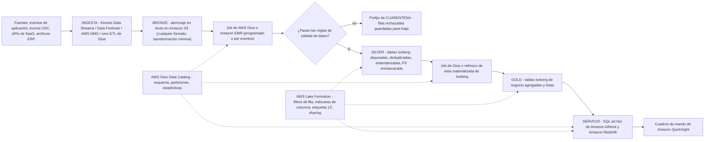
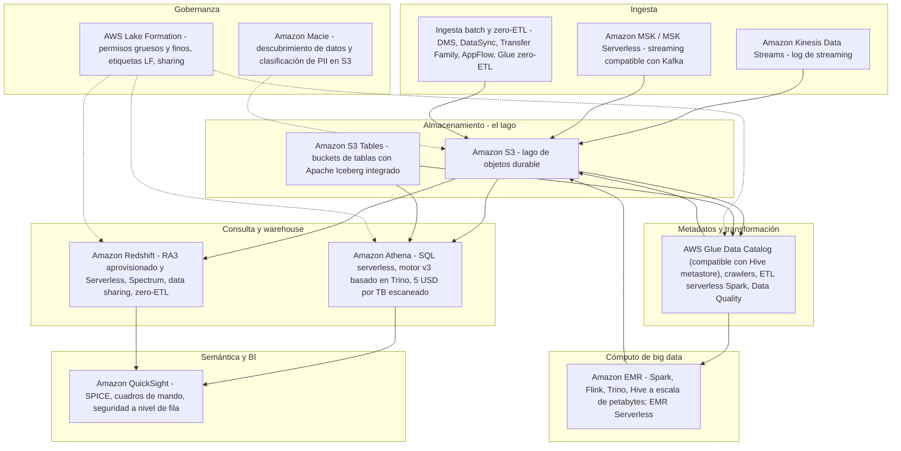
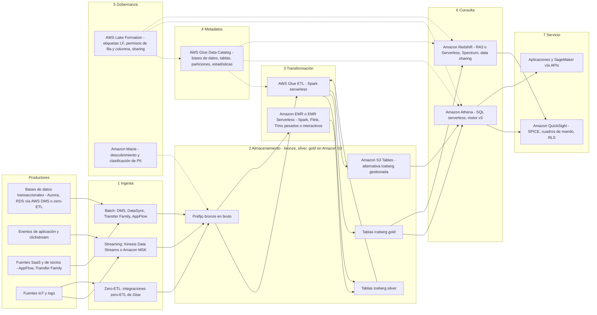
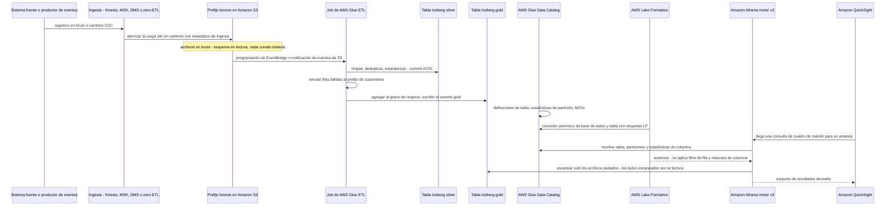
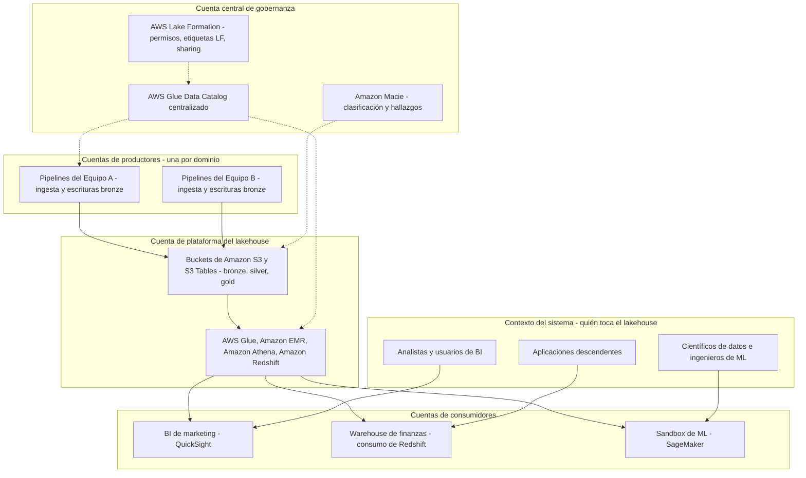

# Fundamentos de la arquitectura lakehouse: lagos, data warehouses y el patrón medallion

AWS define el término así: «Un lakehouse de datos es una arquitectura de datos unificada que combina data warehouses y data lakes, proporcionando capacidades de analítica como estructuración, gobernanza e informes. El lakehouse de datos puede almacenar datos en bruto en un rango de formatos que va de miles a cientos de miles de fuentes en una ubicación central» (AWS *What is a Data Lakehouse?*, consultado 2026-10-11). La misma página añade la frase que gobierna cada decisión de diseño de este curso: «El cómputo de un lakehouse de datos está separado del almacenamiento. Con almacenamiento y cómputo separados, puedes escalar estas funciones de forma independiente para maximizar el ahorro de costes».

Esa es una definición, todavía no una arquitectura. Entre la frase y una plataforma en funcionamiento hay tres preguntas que responde esta lección: **qué almacén estás construyendo realmente** (lago, warehouse o lakehouse), **cómo se estratifican los datos dentro de él** (el patrón medallion) y **cómo se procesan** (batch, Lambda o Kappa): más el mapa de servicios de AWS que implementa cada posición. Todo, de la lección 02 a la lección 17, es un detalle de implementación del esqueleto que construyes aquí.

La mayoría de los equipos se encuentra con estas tres palabras en el orden equivocado: eligen servicios primero y después descubren que no tienen ni una fuente única de verdad ni un archivo barato. Nosotros lo haremos al revés: el patrón primero, los servicios después.

**En esta lección vas a:**

- distinguir un data lake, un data warehouse y un lakehouse usando las definiciones publicadas por AWS, y luego aplicar una **tabla de decisión** a requisitos concretos;
- leer las seis diferencias publicadas por AWS (momento del esquema, calidad de datos, usuarios, encaje analítico, precio/rendimiento, postura de coste) que deciden el almacén antes de nombrar ningún servicio;
- entender por qué **Parquet en Amazon S3 todavía no es un lakehouse** y qué capacidades añade un formato de tablas abierto;
- asignar responsabilidades a las capas **bronze, silver y gold** del medallion y mapear cada una a primitivas reales de AWS (buckets, prefijos, bases de datos de Glue, tablas Iceberg);
- elegir entre los patrones de procesamiento **solo-batch, Lambda y Kappa**, incluyendo la trampa de nombres de la que el propio whitepaper de AWS advierte;
- situar diez servicios analíticos centrales, **S3, Glue, Athena, Redshift, QuickSight, Kinesis, MSK, EMR, Lake Formation, Macie**, en un único mapa de capas;
- recorrer la **arquitectura de referencia de extremo a extremo** dos veces: como diagrama de flujo y como diagrama de secuencia, más la vista de contenedores multi-cuenta;
- resolver **siete ejemplos resueltos con precios reales** (en oct 2026), incluyendo un **esquema de dimensionamiento de un pipeline de 10 TB/día**;
- estudiar tres casos de clientes de AWS, **FINRA, Easygo y BMW Group**, y leer sus cifras como lo haría un practicante;
- revisar el **recuadro de actualizaciones de octubre de 2026** (S3 Tables, S3 Vectors, Glue 6.0, Quick Suite) y la **hoja de ruta del curso** de las dieciséis lecciones siguientes.

---

## 1. Lago, warehouse, lakehouse: las tres definiciones que AWS publica de verdad

Tres términos, tres promesas distintas. La forma más rápida de mal usarlos es tratarlos como tamaños («somos demasiado grandes para un warehouse») en lugar de como **contratos sobre esquema, curación y acceso**.

### 1.1 El data warehouse

Página de comparación de AWS: «Un data warehouse almacena datos en un formato estructurado. Es un repositorio central de datos preprocesados para analítica y business intelligence». La página de conceptos de data lake añade el mecanismo: «Un data warehouse es una base de datos optimizada para analizar datos relacionales provenientes de sistemas transaccionales y aplicaciones de línea de negocio. La estructura de datos y el esquema se definen de antemano… Los datos se limpian, enriquecen y transforman para que puedan actuar como la "fuente única de verdad" en la que los usuarios pueden confiar».

El movimiento definitorio del warehouse es el **esquema en escritura (schema on write)**: la forma y el listón de calidad se fijan *antes* de que los datos aterricen, y por eso la misma página puede asignarle «informes batch, BI y visualizaciones» y «datos altamente curados que sirven como la versión central de la verdad» (página de comparación de AWS, consultado 2026-10-11). En AWS, la expresión gestionada de este patrón es **Amazon Redshift** (RA3 aprovisionado y Serverless, con Spectrum para tablas del lago).

### 1.2 El data lake

AWS: «Un data lake es un repositorio centralizado que te permite almacenar todos tus datos estructurados y no estructurados a cualquier escala» (AWS *What is a Data Lake?*, pie de página «Updated 2025», consultado 2026-10-11). La página de comparación aporta la contraparte del esquema en escritura: el esquema se «Escribe en el momento del análisis (esquema en lectura)», la calidad de datos es «Cualquier dato que puede o no estar curado» y la lista analítica es «Machine learning, analítica exploratoria, descubrimiento de datos, streaming, analítica operativa, big data y perfilado».

La disciplina de ingesta se deduce de eso: «Las organizaciones suelen usar herramientas de Extract, Load, Transform (ELT). Cargan los datos en el lago primero y solo los transforman cuando es necesario». El argumento de coste es explícito: «los data lakes ofrecen un coste comparativamente menor por más volumen, especialmente para grandes cantidades de imágenes y vídeos». El modo de fallo es igual de explícito, y lo encontrarás en cada post-mortem: **«un data lake sin gestión puede dar lugar a pantanos de datos. Los pantanos de datos son un estado de datos desorganizados que dificulta extraer información relevante»** (AWS *What is a Data Lakehouse?*, consultado 2026-10-11).

### 1.3 El lakehouse

El lakehouse es la *combinación*, y AWS se cuida de llamarlo arquitectura y no producto. El whitepaper heredero de AWS lo formula como un patrón: «Lake house: Un lake house es un patrón arquitectónico que combina los mejores elementos de los data warehouses y los data lakes. Los lake houses te permiten consultar datos a través de tu data warehouse, tu data lake y tus bases de datos operativas… Con una arquitectura lake house, puedes almacenar datos en formatos de archivo abiertos en tu data lake y consultarlos in situ mientras te unes con los datos del data warehouse» (AWS *Data Warehousing on AWS*, pancarta de página: «esta hoja blanca es solo para referencia histórica», consultado 2026-10-11).

AWS publica también las **capas lógicas** del patrón, que se convierten en la columna vertebral de todo el curso:

| Capa (orden de AWS) | Qué hace (redacción de AWS, consultado 2026-10-11) | Dónde vive en este curso |
|---|---|---|
| Capa de ingesta | Trae datos batch, streaming y zero-ETL desde las fuentes | Lecciones 05, 06 |
| Capa de almacenamiento | Almacenamiento de objetos; «algunas transformaciones de datos se realizan después del almacenamiento… transforma y almacena los datos en formato Parquet» | Lecciones 02, 03 |
| Capa de metadatos (también llamada staging) | «proporciona soporte de esquema para gobernar, organizar y optimizar datos… transacciones ACID, indexación de archivos, versionado de datos y caché» | Lecciones 04, 07, 12 |
| Capa API | Acceso programático a los datos y a su catálogo | Lecciones 11, 12 |
| Capa semántica (la más alta) | «también conocida como la capa de consumo de datos»: herramientas de BI, informes | Lecciones 09, 10, 17 |

> [!NOTE]
> **Por qué las capas importan más que las etiquetas.** Un lakehouse no se define por el logotipo de qué proveedor hay en el clúster. Se define por la combinación de (a) almacenamiento abierto y barato, (b) una capa de metadatos transaccional sobre ese almacenamiento, (c) un catálogo que lo gobierna y (d) cómputo independiente que pueda leer toda la misma copia. Elimina cualquiera de los cuatro y tienes una arquitectura distinta con un conjunto distinto de modos de fallo.

### 1.4 La tabla de decisión

Esta es la tabla que hay que tener abierta en cada revisión de diseño. Cada fila proviene de la comparación warehouse frente a lago de la página de comparación de AWS más la página de definición de lakehouse (todas consultadas 2026-10-11).

| Eje de decisión | Data warehouse (Redshift) | Data lake (S3, en bruto) | Lakehouse (S3 + formato de tablas abierto + catálogo) |
|---|---|---|---|
| Momento del esquema | Esquema **en escritura**, «definido de antemano» | Esquema **en lectura**, «escrito en el momento del análisis» | Esquema en lectura, con **evolución forzada** y commits ACID encima |
| Tipos de datos | Estructurado, relacional | «datos estructurados y no estructurados a cualquier escala» | Cualquier formato en bruto en bronze; formatos abiertos estructurados (Parquet/ORC/Avro) en silver/gold |
| Calidad de datos | «Altamente curados… versión central de la verdad» | «Cualquier dato que puede o no estar curado» | Curados **por capa**: bronze en bruto, silver validado, gold agregado |
| Usuarios principales | Analistas de BI, consumidores de informes | ML/exploratoria, descubrimiento de datos, perfilado | Ambos: analistas en gold, científicos de datos en silver/bronze |
| Encaje analítico | «Informes batch, BI y visualizaciones» | «ML, analítica exploratoria, descubrimiento de datos, streaming, analítica operativa, big data» | Todo lo anterior en **una sola copia de datos**, consultable in situ |
| Precio / rendimiento | Ajustado al rendimiento, el precio sigue a nodos/RPU | «Coste comparativamente menor por más volumen» | Almacenamiento y cómputo escalan de forma independiente: AWS: «escalar estas funciones de forma independiente para maximizar el ahorro de costes» |
| Modo de fallo clásico | Rígido, caro para archivos de petabytes, lento para incorporar formas nuevas | **Pantano de datos**; «requiere mayor pericia técnica» | Extensión descontrolada de tablas y mantenimiento de archivos sin gestionar si se ignoran la compactación y la retención |
| Servicios AWS típicos | Amazon Redshift (RA3, Serverless, data sharing) | Amazon S3 + catálogo AWS Glue + Athena (ad hoc) | S3 / S3 Tables + Glue + Lake Formation + Athena **y** Redshift + QuickSight |
| Elígelo cuando… | «Datos relacionales estructurados, SLAs estrictos de BI, fuente única de verdad curada» | Archivos grandes y baratos, cargas ML/exploratorias, datos no estructurados mixtos | Necesitas estructura de grado warehouse **y** almacenamiento abierto a escala de lago, con varios motores sobre una sola copia |

**Cómo usar la tabla.** Empieza en la fila inferior y lee hacia arriba. Si la frase de requisitos contiene *fuente única de verdad* y *SLAs estrictos de BI*, estás en la columna 1. Si contiene *imágenes, vídeos, entrenamiento de modelos, esquema desconocido el año que viene*, estás en la columna 2. Si contiene *ambas, y me niego a copiar los dos veces*, estás en la columna 3, y la FAQ de SageMaker Lakehouse enuncia la razón económica sin rodeos: «no tienes que migrar tus datos… consulta y consulta tus datos in situ» (consultada 2026-10-11).

Observa que AWS no presenta esto como un concurso de todo o nada: «La mayoría de las organizaciones grandes usan una combinación de data lakes, warehouses y marts en su infraestructura de almacenamiento» (página de comparación de AWS, consultada 2026-10-11). El lakehouse es la arquitectura que permite que esas piezas compartan una única copia gobernada en lugar de tres.

```matching
{
  "question": "Relaciona cada arquitectura con la frase publicada por AWS que la define (todas citadas, consultado en oct 2026):",
  "pairs": [
    {"left": "Data warehouse", "right": "Un repositorio central de datos preprocesados; el esquema se define de antemano y los datos se convierten en la fuente única de verdad en la que los usuarios pueden confiar"},
    {"left": "Data lake", "right": "Un repositorio centralizado para datos estructurados y no estructurados a cualquier escala, cargado primero y transformado solo cuando es necesario (esquema en lectura)"},
    {"left": "Data lakehouse", "right": "Una arquitectura de datos unificada que combina data warehouses y data lakes, con el cómputo separado del almacenamiento para que cada uno escale de forma independiente"},
    {"left": "Data mart", "right": "Un subconjunto más estrecho de datos de warehouse para un único equipo o área temática: la tercera columna que AWS agrupa con lagos y warehouses"},
    {"left": "Pantano de datos", "right": "El estado de un data lake sin gestión: datos desorganizados que dificultan extraer información relevante"}
  ],
  "explanation": "Cada frase es una cita directa de AWS, así que el emparejamiento es fijo y no una cuestión de gusto. La frase del warehouse lleva «preprocesados» y «de antemano» (esquema en escritura); la del lago lleva «a cualquier escala» y «cargar primero, transformar cuando sea necesario»; la del lakehouse lleva «unificada» más «almacenamiento y cómputo separados». El data mart es el estrecho, y el pantano de datos es lo que pasa cuando un lago no recibe curación ni gobernanza: el fallo que las capas silver y gold más los permisos de Lake Formation existen para prevenir."
}
```

- **📚 ¿Sabías que…?** La página de comparación de AWS trata lago, warehouse y mart como *inventario complementario*, no como rivales: «La mayoría de las organizaciones grandes usan una combinación de data lakes, warehouses y marts en su infraestructura de almacenamiento» (consultado 2026-10-11). La trampa va en ambos sentidos: cualquier documento de diseño que afirme que debes elegir exactamente uno de los tres está discutiendo con la propia página de AWS.

---

## 2. Por qué Parquet en Amazon S3 todavía no es un lakehouse

Esta es la confusión más cara del campo, y por eso tiene sección propia. Un bucket lleno de archivos Parquet bien particionados y bien comprimidos es un **data lake**. Se convierte en un lakehouse solo cuando hay una capa de metadatos transaccional encima.

AWS Prescriptive Guidance habla con franqueza inusual sobre lo que faltan a los lagos comunes. Los lagos de objetos tradicionales o en formato Hive no proporcionan soporte para la semántica de procesamiento ACID (atomicidad, consistencia, aislamiento y durabilidad), y no pueden de forma nativa:

- realizar actualizaciones y borrados eficientes a nivel de registro a medida que los datos cambian en tu negocio;
- gestionar el rendimiento de las consultas a medida que las tablas crecen hasta millones de archivos y cientos de miles de particiones;
- garantizar la consistencia de los datos entre múltiples escritores y lectores concurrentes;
- prevenir la corrupción de datos cuando las operaciones de escritura fallan a mitad de la operación;
- evolucionar los esquemas de las tablas con el tiempo sin reescribir (parcialmente) los conjuntos de datos.

(Using Apache Iceberg on AWS, *Modern data lakes*, consultado 2026-10-11.) La misma fuente señala que estas carencias son particularmente prevalentes en la captura de cambios de datos (CDC), la privacidad/borrado y la ingesta en streaming, tres cargas que este curso cubre en las lecciones 05, 06 y 13.

El formato de tablas abierto responde con una lista de características que AWS publica textualmente: borrar, actualizar y combinar · planificación de escaneo rápida y filtrado avanzado · evolución completa del esquema · evolución de particiones · particionado oculto · reversión de versión · time travel · aislamiento serializable · escritores concurrentes · formatos de archivo abiertos (Parquet, Avro, ORC).

> [!WARNING]
> ⚠️ **La trampa del «ya tenemos Parquet».** Si tu lago no puede responder con seguridad *quién escribió este archivo, si este commit es visible para otros lectores, si puedo volver al estado de ayer, si puedo borrar a un solo cliente sin reescribir particiones*, entonces tienes un lago de archivos con un buen ratio de compresión: no un lakehouse. Antes de dar por buena una arquitectura, recorre los cinco puntos de AWS de arriba y señala el componente que proporciona cada uno. «Escribiríamos código propio para eso» es la respuesta que se convierte en un proyecto de plataforma de varios años; el formato de tablas es la respuesta que se convierte en la lección 04.

Dos hechos de apoyo que reutilizarás en todo el curso: AWS lista Apache Iceberg como compatible con servicios de AWS como Amazon EMR, Amazon Athena, Amazon Redshift, AWS Glue y Amazon SageMaker, y Athena usa el AWS Glue Data Catalog como metastore de Iceberg (Prescriptive Guidance, consultado 2026-10-11). El catálogo y el formato de tablas son componentes distintos que deben diseñarse juntos: una distinción que la lección 07 vuelve operativa.

```fillblank
{
  "question": "Completa la frase que separa un data lake de un lakehouse en AWS:",
  "template": "{{1}} es la arquitectura unificada que combina la estructura de un warehouse con almacenamiento abierto a escala de lago; en AWS se ensambla a partir de formatos de archivo abiertos como Parquet más un formato de tablas abierto como {{2}}, un catálogo compatible con el metastore de Hive en {{3}}, y permisos gruesos o finos concedidos por {{4}}.",
  "answers": {
    "1": "Lakehouse de datos",
    "2": "Apache Iceberg",
    "3": "AWS Glue Data Catalog",
    "4": "AWS Lake Formation"
  },
  "distractors": ["Data mart", "Amazon Redshift Spectrum", "Amazon Athena", "Amazon Macie"],
  "explanation": "AWS define el lakehouse de datos como la arquitectura unificada que combina warehouses y lagos con almacenamiento y cómputo separados; Iceberg es el formato de tablas abierto que AWS documenta en EMR, Athena, Redshift, Glue y SageMaker; el Glue Data Catalog es el almacén de metadatos compatible con el metastore de Hive que Athena usa como metastore de Iceberg; y Lake Formation es el servicio que proporciona permisos de control de acceso gruesos y finos. El distractor principal, Amazon Macie, es un servicio de descubrimiento de datos y clasificación de PII: te dice qué hay en el lago, no concede ni deniega acceso de consulta."
}
```

---

## 3. El patrón medallion: bronze, silver, gold

Una vez tomada la decisión del almacén, la siguiente pregunta es *qué forma toman los datos a medida que pasan de en bruto a fiables?* La respuesta de AWS es la **arquitectura medallion**, definida en el propio taller del Builder Center de AWS como «un patrón de diseño de datos que promueve la calidad, la consistencia y la gobernanza de los datos mediante un enfoque por capas» (consultado 2026-10-11).

### 3.1 Las tres capas y sus responsabilidades

| Capa | Redacción de responsabilidad de AWS | Qué puede cambiar aquí | Puerta de calidad típica | Implementación AWS típica |
|---|---|---|---|---|
| **Bronze** (en bruto) | «Ingesta datos en bruto de varias fuentes con transformación mínima» | Nada más que el aterrizaje: preservar la carga útil, marcas de tiempo de origen, metadatos de ingesta | Esquema descubierto, no forzado; el recuento de filas cuadra con la fuente | Prefijo o bucket S3 por fuente; JSON/CSV/Avro en bruto; entrega con Firehose/Kinesis/DMS; registro con crawlers de Glue |
| **Silver** (depurado) | «Aplica reglas de calidad de datos, deduplicación y estandarización» | Tipos, nulabilidad, claves de dedupe, dimensiones conformadas, enmascado de PII | Pasan reglas explícitas de DQ; los fallos se enrutan a una ruta de cuarentena | Tablas Iceberg en S3 o S3 Tables; job Spark de Glue/EMR; reglas de Glue Data Quality (DQDL); máscaras de columna de Lake Formation |
| **Gold** (listo para el negocio) | «Crea conjuntos de datos agregados y listos para el negocio optimizados para analítica» | Grano de agregación, medidas, dimensiones de cambio lento, nombres semánticos | Contrato de una fila por entidad de negocio; SLA de frescura | Tablas Iceberg o vistas materializadas; una tabla por área temática; lectura con Athena/Redshift; cuadros de mando de QuickSight |

Tres propiedades de esta tabla merecen memorizarse. **Primero**, las capas son *progresivas*: cada salto eleva la garantía y estrecha la audiencia. **Segundo**, la capa es un límite **lógico**, no un producto de AWS: bronze/silver/gold se mapean a prefijos o buckets S3, bases de datos del Glue Data Catalog y tablas Iceberg; AWS presenta el patrón en un taller y un blog, no como un servicio gestionado. **Tercero**, la ruta de cuarentena forma parte de silver, no es un añadido: un registro que falla una regla debe aterrizar en algún lugar observable en lugar de desaparecer en silencio.

### 3.2 Medallion en AWS, de extremo a extremo



### 3.3 Lo que cada capa *no* es

- **Bronze no es una zona de deja-olvidar.** Todavía necesita reglas de retención, cifrado y una entrada en el catálogo; la mejor práctica **BP 3.7** de la lente de analítica de datos de Well-Architected es «implementa políticas de retención de datos para cada clase de datos en la carga de trabajo analítica», y **BP 3.5** es «registra las clasificaciones de datos en el Data Catalog para que las cargas analíticas puedan entenderlas» (AWS Well-Architected Data Analytics Lens, fecha de publicación 2023-12-22, anunciada como lente el 26 de marzo de 2024; consultado 2026-10-11).
- **Silver no es opcional** si quieres un lakehouse y no un pantano: es donde se previene que «un data lake sin gestión puede dar lugar a pantanos de datos», una tabla validada cada vez. La lente **BP 1.1** es «valida la calidad de datos de los sistemas fuente antes de transferir datos para analítica», y **BP 1.2** es «monitoriza las métricas operativas de los jobs de procesamiento de datos y la disponibilidad de los datos de origen».
- **Gold no es «el extracto de informes».** Sigue siendo una tabla abierta que Athena, Redshift, SageMaker y motores de terceros pueden consultar in situ: eso es lo que impide que se convierta en un silo propietario dos años después.

El punto de partida prescriptivo de AWS para un salto batch nocturno, si quieres números en lugar de opiniones: tamaño de archivo de 128 MB, porque las tareas de Apache Spark procesan datos en trozos de 128 MB; tipo de escritura: copy-on-write; variables de partición: año/mes/día; orden de clasificación: timestamp; catálogo de datos: AWS Glue Data Catalog (AWS Prescriptive Guidance, arquitecturas de referencia para Apache Iceberg on AWS, consultado 2026-10-11).

**Ejemplo resuelto E1: ¿cuántos archivos crea realmente un día de bronze? (en oct 2026)**

Una fuente entrega **10 TB al día** en bronze, y sigues el tamaño de archivo objetivo de Prescriptive Guidance de **128 MB** para que las tareas de Spark se correspondan uno a uno con los archivos.

- 1 TB = 1,024 GB = 1,048,576 MB, así que 10 TB = **10,485,760 MB**
- 10,485,760 MB ÷ 128 MB = **81,920 archivos al día**
- Con particionado por año/mes/día (la recomendación de AWS), una sola partición diaria recibe por tanto unos **82,000 objetos**, y esa es exactamente la razón por la que «las tablas crecen hasta millones de archivos» aparece en la lista de problemas de lagos comunes de AWS, y por la que la compactación (lección 04) y la planificación de particiones (lección 03) no son extras opcionales
- Un mes de bronze a este ritmo: 81,920 × 30 = **2,457,600 archivos**. Gestiona esa cifra con metadatos de Iceberg, no con `ls` sobre un bucket

**Conclusión:** las capas medallion son baratas de describir y caras de saltarse. El salto bronze→silver es donde vive la calidad de datos, el salto silver→gold es donde vive el significado de negocio, y la banda de catálogo más Lake Formation es lo que hace que ambas sean legibles por las personas adecuadas.

- **📚 ¿Sabías que…?** AWS publica una versión de tres sentencias de este patrón: con vistas materializadas de Apache Iceberg en Amazon SageMaker, «puedes construir una arquitectura medallion de Bronze, Silver y Gold como tres sentencias SQL», y cuando configuras el refresco programado, «el AWS Glue Data Catalog usa cómputo Spark gestionado para actualizar incrementalmente la vista materializada» (AWS Big Data Blog, consultado 2026-10-11). El patrón es portable: el *mecanismo* (quién ejecuta el refresco, con qué cómputo) es lo que realmente eliges en las lecciones 08 y 11.

---

## 4. Batch, Lambda o Kappa: elegir el patrón de procesamiento

Las capas medallion te dicen *qué forma* toman los datos. El patrón de procesamiento te dice *cuántos pipelines* debes construir, probar y operar. Hay tres respuestas documentadas, y AWS publica las tres.

### 4.1 Solo-batch

Aterriza archivos o flujos en S3, procesa en un horario (Glue o EMR), sirve con Athena o Redshift. La «capa batch» del whitepaper de Lambda produce «vistas batch» que se «almacenan en una capa de almacenamiento persistente». Sencillo, el más barato de operar, y la latencia es igual a tu programación: un job nocturno significa que los cuadros de mando tienen como máximo un día de desactualización, y cada archivo que llega tarde se convierte silenciosamente en el incidente de la semana siguiente.

### 4.2 Arquitectura Lambda (el patrón)

El whitepaper de AWS la define como «un patrón de diseño de procesamiento de datos para manejar cantidades masivas de datos e integrar el procesamiento por lotes y en tiempo real dentro de un único marco de trabajo». Dos caminos corren en paralelo:

- una **capa batch** que calcula *vistas batch* autoritativas: exactas, completas, recalculadas sobre el historial completo;
- una **capa de velocidad** que produce *vistas incrementales*: «Kinesis Data Firehose: a medida que los datos se ingieren en tiempo real, los clientes pueden usar Kinesis Data Firehose para agrupar y comprimir fácilmente los datos y generar vistas incrementales»;
- una **capa de servicio** donde «la consulta fusionada busca unir y analizar los datos tanto de la vista batch de la capa batch como de la vista de flujo incremental de la capa de velocidad».

El coste operativo de esta corrección es que ahora posees dos rutas de código que deben coincidir, más un paso de fusión que debe reconciliar datos tardíos y fuera de orden.

### 4.3 Arquitectura Kappa

Un pipeline, un base de código, reprocesamiento por reproducción. El recorrido del Builder Center de AWS (18 de mayo de 2026, consultado 2026-10-11): «Es Kappa: un único pipeline unificado de streaming que lo maneja todo. En AWS, eso significa Kinesis Data Streams, Spark Structured Streaming en EMR…»: con un formato de tablas sobre S3 como capa durable y una «ventana de reproducción de 24 horas: Kinesis retiene los eventos» según se presenta en ese artículo.

Kappa intercambia la exactitud de la capa batch por simplicidad operativa: la corrección proviene de poder reproducir el mismo código sobre el mismo log, lo cual solo es posible dentro de la ventana de retención del flujo: todo lo más antiguo debe venir del lago (ver §8.2).

```mermaid
flowchart TB
    subgraph BATCH["Solo-batch: un único camino programado"]
        B1["Fuentes"] --> B2["S3 en bruto / bronze"]
        B2 --> B3["Job de Glue o EMR en un horario"]
        B3 --> B4["Tablas silver y gold"]
        B4 --> B5["Athena / Redshift / QuickSight - la frescura es la programación"]
    end
    subgraph LAMBDA["Patrón Lambda: dos caminos paralelos"]
        L1["Fuentes"] --> L2["Camino batch: S3 y luego Glue/Spark y luego vistas batch"]
        L1 --> L3["Camino de velocidad: Kinesis / Firehose y luego job de streaming y luego vistas incrementales"]
        L2 --> L4["Capa de servicio fusiona vistas batch e incrementales"]
        L3 --> L4
        L4 --> L5["Athena / Redshift / QuickSight - menor latencia para eventos recientes"]
    end
    subgraph KAPPA["Patrón Kappa: un camino de streaming más reproducción"]
        K1["Fuentes"] --> K2["Kinesis Data Streams - ventana de reproducción presentada: 24 horas"]
        K2 --> K3["Spark Structured Streaming en EMR o Glue Real-Time Mode"]
        K3 --> K4["Formato de tablas sobre S3 - la copia durable"]
        K4 --> K5["Reprocesar reproduciendo el flujo, o releyendo el lago"]
        K4 --> K6["Athena / Redshift / QuickSight - un solo base de código que mantener"]
    end
```



### 4.4 La elección, en una tabla

| Patrón | Latencia | Pipelines que mantener | Historia de reprocesamiento | Postura de coste (referencias de oct 2026) | Elígelo cuando |
|---|---|---|---|---|---|
| **Solo-batch** | Igual a la cadencia de la programación (minutos a 24 h) | Uno | Reejecutar el job sobre los archivos de S3 | El más barato: Glue a **$0.44 por DPU-hora** (1 DPU = 4 vCPU + 16 GB, facturación por segundo, mínimo de 1 minuto); Athena a **$5.00 por TB escaneado** | «Tolerante a la latencia, coste mínimo»: informes diarios u horarios, cargas de back-office |
| **Lambda** | Segundos para eventos recientes, más el batch autoritativo | Dos (batch + de velocidad) | El camino batch es exacto; el de velocidad reproduce dentro de la retención del flujo | Dos rutas de código, dos suites de prueba; el propio blog de Redshift de AWS sobre Lambda señala que ambos paradigmas «operan en silos, lo que resulta en redundancia de datos y sobrecarga operativa para mantenerlos» | Necesitas recomputes históricos matemáticamente completos **más** vistas de baja latencia, y puedes operar dos pipelines |
| **Kappa** | Segundos a sub-segundos | Uno | Reproducir el flujo dentro de la retención; más allá, releer el lago | Un solo base de código; la reproducción de historial largo es más lenta que un job batch sobre archivos de columna | «Tiempo real primero, un solo base de código, coste de reproducción aceptable» |

> [!IMPORTANT]
> **⚠️ Arquitectura Lambda ≠ AWS Lambda.** El whitepaper lo dice él mismo: «La arquitectura Lambda es distinta y no debe confundirse con el servicio de cómputo AWS Lambda». Las tres capas del *patrón* son batch, de velocidad y de servicio. AWS Lambda (el servicio de funciones) puede implementar piezas de cualquiera de ellas, pero nombrar un servicio de funciones no convierte tu diseño en una arquitectura Lambda, y una revisión de diseño que confunda los dos discutirá sobre lo equivocado durante una hora.

**Ejemplo resuelto E2: un requisito, tres arquitecturas, con precios (en oct 2026)**

Requisito: clickstream de e-commerce + pedidos + volcados nocturnos de ERP; la dirección quiere cuadros de mando **dentro de 15 minutos** de la llegada de los datos, más un sandbox de ciencia de datos. Doscientos lectores de cuadros de mando.

- **Coste compartido de servicio:** 200 lectores × **$3 por usuario/mes** = **$600.00 al mes** (QuickSight Reader, página de precios consultada 2026-10-11).
- **Coste compartido de transformación batch:** un job nocturno bronze→silver de 10 DPU × 20 minutos = 3.333 DPU-horas × **$0.44** = **$1.47 por noche**, es decir **$44.00 al mes**.
- **Coste compartido de consulta:** si la capa de BI escanea **1 TB al día** en total, eso es 30 TB/mes × **$5.00 por TB** = **$150.00 al mes** en Athena.
- **(a) Solo-batch:** solo esas tres líneas, unos **$794.00 al mes** de gasto serverless directamente atribuible, pero la frescura de los cuadros de mando es igual a la cadencia del job, así que un SLA de 15 minutos obligaría a 96 ejecuciones al día en lugar de una, multiplicando la línea de Glue por ~96 y *aún* sin lograr modelar eventos en vivo.
- **(b) Lambda:** el mismo camino batch más un camino de velocidad Kinesis → job de streaming que escribe vistas incrementales en las mismas tablas gold. La frescura baja a segundos para eventos recientes; ahora posees dos rutas de código más la fusión. El camino de streaming añade cargas de Kinesis Data Streams y cómputo de streaming: presupuéсталas por separado, porque esta lección solo fija precios que AWS publica en las páginas de Glue, Athena y QuickSight.
- **(c) Kappa:** un único camino Kinesis → Spark Structured Streaming hacia el formato de tablas en S3, con backfills reproducidos desde el flujo dentro de la ventana de reproducción presentada de **24 horas** y desde el lago más allá de ella.

**Veredicto para este escenario:** el SLA de 15 minutos elimina el solo-batch a cualquier número razonable de ejecuciones, y un equipo de cinco no puede con comodidad poseer dos rutas de código en producción: así que Kappa, con el lago (no el flujo) como sistema de registro del historial. Es un *juicio apoyado en la tabla de §4.4*, no una regla universal: si un requisito regulatorio exige la recomputación batch exacta de cada vista histórica, Lambda sigue siendo el patrón correcto.

- **📚 ¿Sabías que…?** El whitepaper de Lambda cierra con un hecho que explica por qué todo este curso puede ser serverless: «Amazon Glue, Amazon S3, Amazon Athena y Amazon Kinesis son servicios serverless». Puedes ejecutar las capas batch, de velocidad y de servicio de cualquiera de los tres patrones sin aprovisionar un clúster: por eso las líneas de coste en E2 se cotizan por hora y por TB en lugar de por instancia (whitepaper de la arquitectura Lambda de AWS, consultado 2026-10-11).

---

## 5. El mapa de servicios analíticos de AWS: dónde se sitúa cada servicio

La propia guía de estrategia de AWS resume el mapa en una frase: «puedes realizar streaming en tiempo real con Kinesis o Amazon MSK, procesamiento de datos con Amazon EMR o AWS Glue, búsqueda con Amazon OpenSearch, consultas ad hoc con Athena y data warehousing con Amazon Redshift» (AWS Prescriptive Guidance, *AWS modern data architecture*, consultado 2026-10-11). La gobernanza atraviesa toda la frase: «AWS Lake Formation ayuda a gobernar los datos y a compartirlos a través de la empresa. Además, puedes crear un catálogo de datos único en AWS Glue y un glosario de negocio usando Amazon DataZone… para que tus empleados encuentren los datos que necesitan».



### 5.1 El reparto, una línea cada uno

| Servicio | Capa que ocupa | Rol en una línea (redacción de AWS donde se cita) | Ancla de precio que conviene conocer (en oct 2026) |
|---|---|---|---|
| **Amazon S3** | Almacenamiento | «S3 es el mejor lugar para construir data lakes»: almacenamiento de objetos durable y escalable que contiene bronze/silver/gold | S3 Standard **$0.023 por GB-mes** (primeros 50 TB); **$0.022** (51 to 100 TB); **$0.021** (500 TB+) |
| **Amazon S3 Tables** | Almacenamiento (tablas gestionadas) | Buckets de tablas: «el primer almacén de objetos en la nube con soporte integrado de Apache Iceberg», con compactación dirigida por políticas, gestión de instantáneas y eliminación de archivos no referenciados | **$0.0265 por GB-mes** Standard (primeros 50 TB); PUT **$0.005/1,000**, GET **$0.0004/1,000** |
| **AWS Glue** | Metadatos + transformación | Data Catalog (compatible con Hive metastore), crawlers, ETL serverless Spark, Data Quality (DQDL), optimización de tablas Iceberg y estadísticas | **$0.44 por DPU-hora**; 1 DPU = **4 vCPU + 16 GB**; facturación por segundo, mínimo de 1 minuto |
| **Amazon Athena** | Consulta (SQL serverless) | SQL interactivo sobre S3 e Iceberg; las funciones del motor v3 «se basan en Trino»; los grupos de trabajo separan usuarios y limitan el gasto | **$5.00 por TB escaneado**, «redondeado al megabyte más cercano, con un mínimo de 10 megabytes por consulta» |
| **Amazon Redshift** | Warehouse + puente al lago | RA3/RG con Redshift Managed Storage, Serverless, tablas externas Spectrum sobre Iceberg, data sharing, zero-ETL | Aprovisionado «comienza en **$0.543 por hora**»; Serverless «comienza en **$1.50 por hora**», tarifa de ejemplo **$0.375 por RPU-hora**; Managed Storage **$0.024 por GB-mes** |
| **Amazon QuickSight** | Semántica / BI | Extractos en memoria SPICE, cuadros de mando, seguridad a nivel de fila, acceso de lectores por capacidad | Author **$24 por usuario/mes**; Reader **$3 por usuario/mes**; Reader Capacity «Desde **$250** por 500 sesiones/mes» |
| **Amazon Kinesis Data Streams** | Ingesta de streaming | Log de eventos durable que alimenta bronze; el camino de velocidad de Lambda y el camino único de Kappa | Retención por defecto presentada como ventana de reproducción de **24 horas** en el recorrido Kappa de AWS (2026-05-18) |
| **Amazon MSK / MSK Serverless** | Ingesta de streaming | «Streaming compatible con Apache Kafka para clientes que buscan la semántica de Kafka», nombrado junto a Kinesis en la guía de arquitectura moderna | Se cobra por broker-hora más almacenamiento: confirma en la página de precios de MSK antes de cotizarlo en un caso de negocio |
| **Amazon EMR** | Cómputo de big data | «Procesamiento de datos a escala de petabytes, analítica interactiva y machine learning usando frameworks de código abierto como Apache Spark, Flink, Trino y Hive» en EC2, EKS, Outposts o EMR Serverless | Horas de instancia (EC2) o uso serverless por segundo: presupuesta por job, no por mes |
| **AWS Lake Formation** | Gobernanza | «Proporciona permisos de control de acceso gruesos y finos para acceder a datos, incluidas tablas Iceberg consumidas por Athena o Amazon Redshift» | Sin cargo de procesamiento de datos; el coste es disciplina de diseño, no dólares |
| **Amazon Macie** | Gobernanza / descubrimiento | Descubrimiento de datos y clasificación de PII en la pila de seguridad de arquitectura moderna junto a KMS, IAM, Secrets Manager y Audit Manager | Descubrimiento por bucket más hallazgos de datos sensibles por objeto |

### 5.2 Reglas de colocación que sobreviven a la tabla

1. **S3 es el suelo.** Cada patrón de la lección 01 aterriza datos en S3 o S3 Tables primero; nada por encima de la capa de almacenamiento puede convertirse en el sistema de registro.
2. **Glue es la columna vertebral, no solo un ejecutor de jobs.** Posee el catálogo (capa de metadatos) *y* la transformación serverless (bronze→silver→gold). La lección 07 es enteramente este servicio.
3. **Athena y Redshift son alternativas sobre la misma copia, no rivales.** Ambos consultan S3/Iceberg; Redshift añade concurrencia gestionada, vistas materializadas, data sharing y una experiencia de warehouse a coste de nodo/RPU, mientras Athena es serverless y se paga por TB escaneado: ideal para uso ad hoc y federado (ejemplo resuelto E6).
4. **Lake Formation es una banda, no una caja.** Envuelve el catálogo y las tablas, y sus concesiones se aplican a través de motores, no a una sola herramienta.
5. **Macie clasifica; Lake Formation autoriza; Glue cataloga.** Tres servicios, tres trabajos. Confundir los dos primeros es un fallo de revisión de seguridad, no una pelea de nombres.
6. **EMR es la herramienta de potencia.** Spark, Flink, Trino y Hive a escala de petabytes cuando Glue serverless no basta, y EMR Serverless cuando quieres esa potencia sin una flota de clústeres.

- **📚 ¿Sabías que…?** Amazon Macie nunca aparece solo en la lista de seguridad de arquitectura moderna de AWS: se nombra junto a «AWS Key Management Service (AWS KMS), AWS Identity and Access Management (IAM), AWS Secrets Manager, AWS Audit Manager y Amazon Macie» (AWS Prescriptive Guidance, consultado 2026-10-11). Cifrado, identidad, almacenamiento de secretos, evidencia de auditoría y descubrimiento de datos son cinco trabajos distintos; la lección 14 asigna cada uno.

**Ejemplo resuelto E3: la factura de Athena es una decisión de diseño, no de consulta (en oct 2026)**

AWS publica esta escalera exacta en su página de precios de Athena (consultada 2026-10-11). Tabla: **3 TB** de texto sin comprimir en S3, **cuatro columnas iguales**, la consulta lee **una columna**.

| Diseño | Bytes escaneados para una columna | Coste por consulta (a $5.00 por TB) |
|---|---|---|
| Texto en bruto, sin particiones | 3 TB | **$15.00** |
| GZIP comprimido 3:1 | 1 TB | **$5.00** |
| GZIP + Parquet (columnar, 1 de 4 columnas) | 0.25 TB | **$1.25** |

La propia página de AWS enuncia la aritmética: «El precio por 3 TB escaneados es 3 * $5/TB = $15», terminando en «$1.25» para el camino optimizado: una **diferencia de 12× para la misma respuesta**. Escálalo: 20 consultas de este tipo al día × 30 días = 600 consultas.

- Ingenuo: 600 × 3 TB = 1,800 TB × $5.00 = **$9,000.00 al mes**
- Optimizado: 600 × 0.25 TB = 150 TB × $5.00 = **$750.00 al mes**
- **Diferencia mensual: $8,250.00**: comprada enteramente con el formato y el podado de columnas, antes de redimensionar un solo clúster

**Ejemplo resuelto E4: precio de un job Glue de bronze a silver (en oct 2026)**

La página de precios de Glue (consultada 2026-10-11): «El precio de 1 DPU-hora es $0.44»; «Un solo DPU proporciona 4 vCPU y 16 GB de memoria»; la facturación es «en incrementos de 1 segundo, redondeada al segundo más cercano, con una duración mínima de 1 minuto por ejecución».

- Job pequeño, 6 DPU × 15 minutos: 6 × 0.25 h = 1.5 DPU-horas × $0.44 = **$0.66 por ejecución**; 30 ejecuciones nocturnas = **$19.80 al mes**
- Salto más pesado, 10 DPU × 20 minutos: 3.333 DPU-horas × $0.44 = **$1.47 por ejecución**; × 30 = **$44.00 al mes**
- El Interactive Session por defecto es de **5 DPU** (mínimo 2 DPU); una sesión de vista de datos de Glue Studio es de **2 DPU durante hasta 30 minutos**, con parada automática: la exploración se cobra por sesión, no por mes
- El trabajo de optimización de tablas (compactación, estadísticas, refresco automático de vistas materializadas, crawlers) se lista también a **$0.44 por DPU-hora**, así que el mantenimiento es una línea medida, no un gasto operativo gratuito
- La versión importa: AWS anunció el 21 de agosto de 2026 que «AWS Glue 6.0 ya está disponible generalmente, con una reducción de precios del 30% y soporte completo para Apache Iceberg v3». Presupuesta con la tarifa publicada de **$0.44** como ancla conservadora y releer la página de precios de tu Región y versión de Glue antes de comprometer un pronóstico

**Ejemplo resuelto E5: lo que la capa de servicio cuesta en plazas (en oct 2026)**

Página de precios de QuickSight (consultada 2026-10-11): Author **$24 por usuario/mes**, Reader **$3 por usuario/mes**, Reader Capacity «Desde $250 por 500 sesiones/mes», más «Se aplica una cuota de infraestructura de $250/mes por cuenta si tu cuenta tiene alguno de los siguientes: al menos un usuario Pro; Q&A habilitado vía topics; Dashboard Q&A habilitado».

- 10 autores + 200 lectores: (10 × $24) + (200 × $3) = $240.00 + $600.00 = **$840.00 al mes**, con **ninguna** cuota de infraestructura de $250 (sin usuario Pro, sin topics de Q&A)
- Añade un usuario Pro y se aplica la cuota de cuenta de **$250 al mes**: **$1,090.00 al mes** para las mismas 210 personas: un salto del 30% por un solo cambio de rol, por eso el diseño de roles es un control de costes en la lección 17
- Alternativa de capacidad para lectores ocasionales: desde **$250 por 500 sesiones/mes**, que gana a 84 lectores casuales a $3 cada uno (84 × $3 = $252.00) y pierde más allá de esa cifra: el modelo de plazas gana una vez que los lectores son usuarios diarios

```plot
{
  "type": "bar",
  "title": "USD mensuales para un lakehouse de 10 TB/día, componente por componente (en oct 2026)",
  "data": [
    {"Component": "S3 storage: 300 TB raw text", "USD per month": 7065.6},
    {"Component": "S3 storage: 100 TB after 3:1 Parquet", "USD per month": 2355.2},
    {"Component": "Athena: 30 TB scanned", "USD per month": 150.0},
    {"Component": "QuickSight: 200 readers", "USD per month": 600.0},
    {"Component": "Glue: 30 nightly ETL runs", "USD per month": 44.0},
    {"Component": "Redshift Serverless: 128 RPU-hours", "USD per month": 48.0}
  ],
  "xKey": "Component",
  "yKey": "USD per month",
  "xLabel": "Componente del lakehouse (todas las cifras derivadas de precios de lista de AWS)",
  "yLabel": "USD por mes"
}
```

Lee el gráfico en orden: **el almacenamiento domina la ingesta en bruto** (la barra más alta), así que la compresión y la política de ciclo de vida son las primeras palancas de coste (lecciones 02 y 16); los costes de consulta y BI son un orden de magnitud menores y se controlan con el diseño (E3) y el modelo de plazas (E5); el cómputo para la transformación programada es la línea más pequeña de todas (E4): por eso «ahorraremos dinero escribiendo menos jobs de Glue» casi nunca es la optimización correcta.

---

## 6. Arquitectura de referencia de extremo a extremo

### 6.1 El flujo: de la fuente al cuadro de mando

Esta es la columna vertebral a la que se conecta cada lección posterior. Lée de izquierda a derecha y después anota los dos planos de control punteados, catálogo y gobernanza, que tocan *cada* etapa en lugar de una sola.



Los subgrafos numerados son el orden de capas de AWS de §1.3 con las zonas medallion de §3 dibujadas dentro de la capa de almacenamiento: un solo dibujo, dos vocabularios.

### 6.2 La misma arquitectura como conversación

Los diagramas de flujo ocultan el *orden* y los *disparadores*. Este diagrama de secuencia muestra lo que realmente ocurre para un día de datos, y dónde se incurre en la factura.



Tres detalles que el diagrama de flujo no puede mostrar. **(1)** El límite del commit ACID está en cada salto medallion, así que los lectores nunca ven datos a medio escribir. **(2)** La decisión de Lake Formation ocurre *antes* de que se escaneen bytes, y por eso la gobernanza es barata de aplicar temprano y cara de añadir después. **(3)** El evento de facturación de Athena es el escaneo, no el número de consultas: la cantidad que controlas es los bytes leídos, y por eso las lecciones 03, 04 y 09 reiteran la escalera de E3.

### 6.3 La vista de contenedores: productores, catálogo central, consumidores

La arquitectura de referencia de crecimiento y escala de AWS Prescriptive Guidance divide las cuentas deliberadamente: «Una capa de productores de datos en diferentes cuentas de AWS»; «Una capa de consumidores de datos en diferentes cuentas de AWS»; «Un catálogo centralizado en una cuenta de AWS»; y «El catálogo centralizado es la interfaz que usan los productores y consumidores de datos para compartir y consumir datos»: con la intención declarada de «estandarizar el consumo y el compartir datos, y escalar productores y consumidores de forma independiente sin aumentar la carga de gestión».



Las líneas punteadas son el punto: **los metadatos y los permisos viajan a través de la cuenta de catálogo central, mientras que los datos y el cómputo se quedan donde son económicos.** Esa es la disciplina de desacoplamiento que el caso de FINRA concreta en §10.

**Ejemplo resuelto E6: ¿Athena o Redshift Serverless para el mismo cuadro de mando? (en oct 2026)**

Un cuadro de mando lee **50 GB** de Parquet al día. Precios de las páginas de Athena y Redshift (consultadas 2026-10-11):

- **Athena:** 50 GB × 30 = 1,500 GB = **1.5 TB al mes** escaneados × **$5.00 por TB** = **$7.50 al mes**, más cero coste de inactividad, porque no hay clúster
- **Redshift Serverless:** 64 RPU durante ~2 horas al día = 128 RPU-horas × **$0.375 por RPU-hora** = **$48.00 al mes**, más Redshift Managed Storage a **$0.024 por GB-mes**: el ejemplo resuelto de la propia página de precios lee «40 TB x 1,024 GB por TB x $0.024»
- **Ratio:** aproximadamente **6.4×** más caro el camino de Redshift en esta carga de trabajo: *antes* de contar lo que el dinero extra compra: concurrencia escalable (la página de precios señala «hasta una hora de créditos gratuitos de Concurrency Scaling al día» por clúster), vistas materializadas, data sharing, y ninguna ansiedad por escaneo por consulta
- **Regla general:** acceso disperso, ad hoc, federado o irregular → **Athena**; BI denso, concurrente, siempre activo con concurrencia predecible → **Redshift Serverless**. Ambos leen la misma copia de S3/Iceberg: estás eligiendo un *motor de servicio*, no un segundo almacén de datos

---

## 7. Por qué los formatos de tablas abiertos no son negociables

Un **formato de tablas abierto** añade una capa de metadatos transaccional sobre formatos de archivo abiertos (Parquet, ORC, Avro) para que el lago se comporte como una base de datos mientras sigue siendo neutral respecto al proveedor. AWS enuncia la consecuencia práctica, «Iceberg soporta comandos SQL estándar para data warehousing para usarlos con tablas de data lake», y la consecuencia de negocio como un auténtico u-o: una «plataforma totalmente integrada pero propietaria» frente a un «data lake neutral respecto al proveedor pero intensivo en recursos y autoconstruido» (AWS Prescriptive Guidance, consultado 2026-10-11).

Lo que el formato te compra, de la lista de características publicada por AWS: **borrar, actualizar y combinar**; **planificación de escaneo rápida y filtrado avanzado**; **evolución completa del esquema**; **evolución de particiones**; **particionado oculto**; **reversión de versión**; **time travel**; **aislamiento serializable**; **escritores concurrentes**; y **formatos de archivo abiertos**.

Por qué «abierto» es la palabra operativa: el equipo de S3 Tables registra la consecuencia de interoperabilidad: las APIs de gestión de tablas son «compatibles con el estándar Apache Iceberg REST Catalog, lo que te permite usar cualquier motor de consultas compatible con Iceberg (por ejemplo, Spark, Trino, PyIceberg o DuckDB) para acceder directamente a los datos tabulares de S3 Tables» (AWS Storage Blog, 2025-05-27). La elección de motor se convierte en una decisión de despliegue en lugar de un proyecto de migración.

### 7.1 Tres posiciones en AWS hoy

| Opción | Lo que posees | Lo que posee AWS | Cuándo encaja |
|---|---|---|---|
| **Iceberg autoadministrado en S3** | Compactación, retención de instantáneas, limpieza de archivos huérfanos, registro en el catálogo | Durabilidad del almacenamiento, Glue Data Catalog, motores de consulta | Control total, una plataforma Spark existente, sensible al coste a escala extrema |
| **Amazon S3 Tables (buckets de tablas)** | Diseño de tablas, consultas, permisos | Mantenimiento de tablas dirigido por políticas, compactación, gestión de instantáneas, eliminación de archivos no referenciados, más APIs Iceberg REST Catalog | La forma gestionada cuando no quieres ejecutar el mantenimiento tú mismo (ver el recuadro de actualizaciones de 2026: coste de compactación hasta un 90% menor) |
| **Amazon SageMaker Lakehouse** | Nada extra | Una capa de unificación: «unifica todos tus datos a través de los data lakes de Amazon S3 y los data warehouses de Amazon Redshift, ayudándote a construir potentes aplicaciones de analítica e IA/ML sobre una única copia de datos», consultable «desde SageMaker Unified Studio y motores como Amazon EMR, AWS Glue, Amazon Redshift o Apache Spark» | Quieres una única copia gobernada que abarque lago y warehouse con Lake Formation y el catálogo Glue debajo |

**Las cifras del Iceberg gestionado que publica AWS:** S3 Tables están «específicamente optimizadas para cargas de trabajo analíticas, lo que resulta en un rendimiento de consulta hasta 3 veces más rápido y hasta 10 veces más transacciones por segundo en comparación con tablas autoadministradas» (AWS What's New, 2024-12-03). Cuotas según se informó cinco meses después del lanzamiento: «soporta la creación de hasta 10,000 tablas dentro de cada bucket de tablas… hasta 100,000 tablas a través de 10 buckets de tablas dentro de una sola Región de AWS y cuenta de AWS» (AWS Storage Blog, 2025-05-27).

> [!IMPORTANT]
> **Elegir formato es una decisión de década; elegir motor es una decisión anual.** Porque el formato de tablas es abierto y el catálogo es compatible con Hive metastore (o compatible con Iceberg REST), puedes añadir Athena, Redshift, EMR, SageMaker o un motor de terceros más adelante sin reescribir datos. Invierte el orden, elige primero un motor propietario y después intenta exportar, y heredas exactamente la «plataforma totalmente integrada pero propietaria» de la que AWS advierte. La lección 04 profundiza en la mecánica de Iceberg; esta lección solo fija el principio: **los archivos son la carga útil, el formato de tablas es el contrato, el catálogo es el directorio.**

- **📚 ¿Sabías que…?** El soporte de Iceberg REST Catalog de S3 Tables hace que la pregunta «¿qué motor?» sea comprobable: si una herramienta habla el Iceberg REST Catalog, puede leer tus tablas directamente. La propia lista de ejemplos de AWS es «Spark, Trino, PyIceberg o DuckDB» (AWS Storage Blog, 2025-05-27): incluido un portátil ejecutando DuckDB. Eso es lo que «abierto» te compra y lo que una exportación de warehouse nunca te dará.

---

## 8. Mini-escenarios resueltos: dimensionar lo que acabas de diseñar

### 8.1 El boceto de dimensionamiento del pipeline de 10 TB/día

**Ejemplo resuelto E7: 10 TB/día, almacenamiento, consulta y transformación (en oct 2026)**

Ancla: el Grupo BMW «usa AWS para procesar 10 TB de datos diarios desde 1.2 millones de vehículos» (AWS case study, consultado 2026-10-11). Dimensionaremos *almacenamiento, consulta y transformación* para la misma tasa diaria, usando precios de lista leídos el 2026-10-11. Supuesto de retención: **30 días** de datos calientes.

**Paso 1: almacenamiento en bruto.**

- 10 TB/día × 30 días = **300 TB al mes** = 307,200 GB (1,024 GB por TB)
- Al primer escalón de 50 TB de S3 Standard de **$0.023 por GB-mes**: 307,200 × $0.023 = **$7,065.60 al mes**
- Los escalones de volumen publicados por AWS (51 to 100 TB a **$0.022**, 500 TB+ a **$0.021**) y cualquier política de ciclo de vida reducen esto: trata $7,065.60 como el **techo conservador**, no como la factura

**Paso 2: los mismos datos tras Parquet a 3:1 (el ratio del propio ejemplo de Athena de AWS).**

- 300 TB ÷ 3 = **100 TB** = 102,400 GB × $0.023 = **$2,355.20 al mes**
- **Ahorro: $4,710.40 al mes (−66.7%)**: solo del formato, antes de optimizar una sola consulta

**Paso 3: consulta.**

- Si los analistas y los cuadros de mando escanean **1 TB al día** en total: 30 TB × **$5.00 por TB** = **$150.00 al mes** en Athena
- Si en cambio escanean los 300 TB completos (tabla completa, sin particionar): 300 × $5.00 = **$1,500.00 al mes**: diez veces más, por las mismas respuestas, puramente porque se omitieron el podado de particiones y el diseño de columna

**Paso 4: transformación.**

- Un job nocturno bronze→silver de 10 DPU × 20 minutos (de E4): **$1.47 por ejecución** → **$44.00 al mes**
- Un salto silver→gold del mismo tamaño lo duplica a **$88.00 al mes**

**Paso 5: el boceto.**

| Línea | Diseño de texto en bruto | Diseño Parquet + particionado |
|---|---|---|
| Almacenamiento S3 (30 días) | $7,065.60 | $2,355.20 |
| Athena (1 TB/día escaneados) | $150.00 | $150.00 |
| Glue ETL (dos saltos, 60 ejecuciones) | $88.00 | $88.00 |
| **Total al mes** | **$7,303.60** | **$2,593.20** |

**Conclusión:** a 10 TB/día la *decisión de formato* (fila 1) mueve aproximadamente **$4,710 al mes**, mientras que la *decisión de cómputo* (fila 3) mueve unos **$88**. Ordena tu backlog de optimización en consecuencia; este es el argumento de AWS en miniatura: arregla el diseño de datos antes de tocar el tamaño de la infraestructura. Y observa lo que el boceto **no** incluye: gobernanza, monitorización y las personas que operan la plataforma. Esos son costes reales, y por eso la lección 16 vuelve a esta tabla con las palancas de ciclo de vida y de dimensionamiento correcto.

### 8.2 La comprobación de reproducción de Kappa

**Escenario 8.2: seis meses de historial, 24 horas de reproducción (en oct 2026)**

Un equipo de fraude adopta el stack del recorrido Kappa del Builder Center de AWS: Kinesis Data Streams → Spark Structured Streaming en EMR → formato de tablas en S3. El artículo presenta una **ventana de reproducción de 24 horas** para el flujo (2026-05-18).

- Llega una petición de cumplimiento para el reprocesamiento de **seis meses**. 24 horas ÷ 180 días ≈ **0.6%** de la ventana requerida está disponible desde el flujo.
- El movimiento correcto es releer el **lago**: la copia durable en S3 detrás del formato de tablas, donde la retención la gobiernan tus propias reglas de ciclo de vida (lecciones 02 y 16), no la retención del flujo.
- **Regla de diseño que se deduce:** los flujos son transporte, los lagos son registro. Nunca dejes que el flujo sea tu única copia de algo que puedas necesitar reprocesar, y nunca dimensiones un flujo para almacenamiento de archivo, porque pagarías precios de streaming para el servicio de archivo.
- Contraste con el medallion: un reprocesamiento de seis meses reejecuta los saltos silver y gold sobre bronze, y exactamente por eso bronze se conserva en bruto y sin transformar, y por eso los 2.4 millones de archivos bronze mensuales de E1 son una característica (recuperabilidad) y no solo un coste.

### 8.3 Lo que comparten los escenarios

Los dos mini-escenarios hacen el mismo movimiento: **tomar una cifra publicada por AWS, aplicar un supuesto enunciado a la vista, y dejar que la aritmética decida el backlog.** Primero la ratio de almacenamiento, después el diseño de consulta, después el tamaño del cómputo, después las plazas. Si inviertes ese orden, dimensionar clústeres antes de mirar el formato de archivo y el particionado, optimizarás la línea más barata de la tabla de E7 mientras la factura de almacenamiento, que es el 95% del boceto antes de la optimización, sigue corriendo.

---

## 9. Hoja de ruta del curso: dónde se sitúa esta lección

Las lecciones 02 to 17 son la misma arquitectura, capa a capa. Nada en las lecciones posteriores contradice el esqueleto de arriba; rellenan las cajas.

| # | Lección | Capa que posee (de §1.3 / §6.1) | Qué podrás hacer después |
|---|---|---|---|
| 01 | Fundamentos de la arquitectura lakehouse | Todo el esqueleto | Elegir almacén, patrón y responsabilidades de capa (esta lección) |
| 02 | Fundación de clases de almacenamiento S3 | Almacenamiento | Elegir clases de almacenamiento y políticas de ciclo de vida para bronze, silver y gold |
| 03 | Formatos de datos y compresión | Almacenamiento | Elegir formatos y compresión que reducen la factura de Athena (E3) |
| 04 | Formatos de tablas abiertos | Metadatos | Implementar transacciones Iceberg, time travel y evolución de particiones |
| 05 | Ingesta batch | Ingesta | Aterrizar archivos, CDC y zero-ETL en bronze de forma fiable |
| 06 | Ingesta de streaming | Ingesta | Caminos de Kinesis, MSK y Flink, y sus semánticas de reproducción (§8.2) |
| 07 | Glue Data Catalog | Metadatos | Crawlers, bases de datos, estadísticas: la columna vertebral del metastore |
| 08 | Transformación a escala | Transformación | Jobs de Glue y EMR; saltos bronze→silver→gold |
| 09 | Capa de consulta Athena | Consulta | Grupos de trabajo, proyección de particiones, motor v3, control de costes |
| 10 | Puente al lago de Redshift | Consulta / warehouse | Tablas externas Spectrum, data sharing, zero-ETL |
| 11 | Orquestación dirigida por eventos | API / control | EventBridge, Step Functions, disparadores programados y por eventos |
| 12 | Gobernanza con Lake Formation | Gobernanza | Etiquetas LF, permisos de fila y columna, sharing entre cuentas |
| 13 | PII, Macie y privacidad | Gobernanza | Descubrimiento, clasificación, enmascaramiento, flujos de borrado |
| 14 | Seguridad: KMS, IAM, red | Gobernanza | Cifrado, identidad, conectividad privada, auditoría |
| 15 | Calidad, observabilidad, linaje | Metadatos / ops | Reglas DQDL, métricas, linaje (Lens BP 1.2) |
| 16 | Optimización de costes y ciclo de vida | Almacenamiento / ops | Escalonado, compresión, dimensionamiento correcto: el backlog de costes de E7 |
| 17 | Capa de BI QuickSight | Semántica | SPICE, cuadros de mando, RLS, el modelo de lector/autor de E5 |

Tres hábitos para llevar adelante: **cita una fuente y una fecha para cada cifra** (esta lección usó solo páginas de AWS leídas el 2026-10-11); **nombra la capa antes de nombrar el servicio**; y **lee las métricas de clientes como afirmaciones contra su propia línea base**, nunca como garantías.

### Actualizaciones de 2026 (en octubre de 2026)

> [!NOTE]
> **Qué se movió en la capa de arquitectura desde tu última revisión de diseño.** Cada línea se comprueba contra una fuente primaria de AWS; las fechas son las fechas de publicación de esas fuentes.
> - **El Iceberg gestionado abarató su operación: costes de compactación de S3 Tables hasta un 90% menores** («S3 Tables… compactación gestionada automáticamente… reduce los costes de compactación hasta en un 90%», AWS Storage Blog, 2025-07-01), y **la replicación de tablas** para tablas Iceberg entre Regiones de AWS se anunció el **2 de diciembre de 2025** (AWS What's New). Efecto práctico para §7: la columna «el mantenimiento es tuyo» de la tabla de autoadministrado frente a S3 Tables no deja de encogerse, y la recuperación entre Regiones para tablas gestionadas se convierte en una configuración en lugar de un proyecto de replicación.
> - **Llegó el nivel vectorial: Amazon S3 Vectors está disponible generalmente**: «2 mil millones de vectores por índice… consulta en menos de 100ms… −90% de coste frente a autoadministrado» (post de anuncios destacados de AWS re:Invent 2025, 2025-12-01). Trátalo como la extensión del lakehouse hacia cargas de IA y RAG: el mismo almacenamiento, catálogo y gobernanza, un tipo de dato más. La lección 04 añade la mecánica.
> - **AWS Glue 6.0 está disponible generalmente con una reducción de precios del 30% y Apache Iceberg v3 completo**: «una reducción de precios del 30% y el soporte completo para Apache Iceberg v3, versiones más recientes de Apache Hudi y Delta Lake», con runtime «Apache Spark 4.1, Python 3.13 y Scala 2.13» (AWS What's New, 2026-08-21). La capa de transformación del lakehouse es ahora más barata *y* compatible con v3 (VARIANT con shredding automático, vectores de borrado, tipos de geometría y geografía); vuelve a leer la página de precios de Glue para tu Región y versión antes de fijar un pronóstico.
> - **La capa de BI fue renombrada: Amazon QuickSight está evolucionando hacia Amazon Quick Suite**: «Amazon QuickSight está evolucionando hacia Amazon Quick Suite»; «'Quick Sight' es la función de BI dentro de Quick»; «las APIs/ARNs siguen diciendo quicksight» (AWS News Blog, 2025-10-09). Precios que importan para §5 y E5: **Reader $3** y **Author $24** sin cambios, **Author Pro bajado de $50 a $40**, **Reader Pro $20**, y la **cuota de infraestructura de $250 al mes por cuenta** se aplica con cualquier usuario Pro o topics de Q&A (AWS BI Blog, 2025-10-09). Los cuadros de mando, conjuntos de datos y análisis existentes no cambian; no se requiere migración.

---

## Casos Reales

AWS publica cómo se ve esta arquitectura bajo carga. Cada cifra de abajo es **informada por el cliente dentro de una página de AWS**; sin auditar, con fecha, y nunca una garantía para tu carga de trabajo. La parte transferible es el *patrón*: qué capa hizo el trabajo, qué servicios la sostuvieron, qué cifra se movió. Todas las fuentes se consultaron el 2026-10-11 salvo que se indique una fecha de publicación.

### Caso A, FINRA: desacoplar almacenamiento, cómputo y catálogo (lección de inicio 01)

- **Contexto.** El regulador de valores de EE. UU. «procesa aproximadamente 6 terabytes de datos y 37 mil millones de registros en un día promedio… En días concurridos, los mercados de valores pueden generar más de 75 mil millones de registros» (AWS Public Sector Blog, publicado 2017-10-03).
- **Problema.** Su capacidad on-premises no podía flexar con los picos de mercado; el diseño HDFS heredado «requería más de 2 PB de almacenamiento en el clúster con 60 instancias hs1.8xlarge» (AWS Big Data Blog, publicado 2016-11-21).
- **Arquitectura.** Un data lake S3 con zonas en bruto, curadas y de archivo; Amazon EMR para cómputo Hive, Spark y HBase; y el catálogo de código abierto propio de FINRA: «Entra herd, nuestra herramienta de código abierto de catálogo y orquestación de datos… capturar información de auditoría y linaje de datos para nuestro altamente regulado entorno» (2017-10-03).
- **Resultados, tal como AWS los informó en 2016 to 2017.** «Ampliamos el patrón de data lake con EMR, Hbase y Amazon S3 para permitir consultas interactivas de acceso aleatorio a través de billones de registros que abarcan más de 600 terabytes de datos» (2017-10-03); «ahorros de costes de más del 60%, reducción drástica del tiempo de recuperación o actualización»; un nuevo clúster HBase estuvo «capaz de lanzarse… y estar listo para aceptar consultas en menos de 30 minutos porque los datos (HFiles) permanecen en S3. Esto habría tomado casi dos días en nuestro clúster anterior», con «la mayoría de las consultas devueltas en menos de 3 segundos» (2016-11-21).
- **Aprendizaje para la lección 01.** Este es el §6.3 con las cajas renombradas: almacenamiento, cómputo y catálogo se dividieron, así que cualquier motor podía leer la misma verdad de S3 y los clústeres se volvieron desechables. **Un lakehouse es una disciplina de desacoplamiento, no un producto que puedas comprar.** La frase de FINRA sobre bajar «el coste de la curiosidad» es el caso de negocio para mantener bronze barato y abierto.

### Caso B, Easygo: un lakehouse moderno con un patrón streaming-first (lecciones de inicio 09 y 01)

- **Contexto.** Una empresa de juegos que ejecuta analítica casi en tiempo real a través de sus operaciones globales (AWS case study, consultado 2026-10-11).
- **Arquitectura.** «La empresa implementó un patrón streaming-first usando Amazon Kinesis para capturar y procesar eventos en tiempo real, Amazon Simple Storage Service (Amazon S3) como data lake central, y Amazon Athena para una consulta más rápida sobre conjuntos de datos particionados. Easygo también incorporó Amazon Redshift Serverless», más «Amazon Aurora zero-ETL Integration with Amazon Redshift» para que los datos «se muevan de Aurora PostgreSQL a Amazon Redshift automáticamente» (AWS case study, consultado 2026-10-11).
- **Resultados (informados por el cliente).** «Los tiempos de ejecución de consulta mejoraron en un 95 por ciento, con cargas de trabajo que antes requerían hasta 1 hora ahora completadas en unos 10 minutos»; «reducción del 80 por ciento en incidentes de datos»; **9** horas de mantenimiento ahorradas semanalmente: antes «al menos 3 ingenieros de diferentes departamentos pasaban aproximadamente 3 horas cada semana abordando interrupciones de pipelines»; la frescura de los umbrales de fraude mejoró de 15 to 30 minutos de retraso a casi tiempo real.
- **Cita.** «Cambiar nuestra arquitectura a un lakehouse más moderno en AWS nos ayudó a mejorar el rendimiento y a preparar una fundación que podemos reutilizar mientras crecemos en otros mercados» (Carine Oliveira, Engineering Manager).
- **Aprendizaje para la lección 01.** Easygo es la columna de §4 inclinada hacia Kappa más el mapa de servicios de §5 en producción: ingesta de streaming → lago S3 → consulta serverless → warehouse para el lado relacional, con zero-ETL eliminando una copia. Observa qué se movió: *frescura* (1 hora → unos 10 minutos) y *carga operativa* (−80% de incidentes de ingesta, −9 horas-hora de ingenieros por semana): ambos son resultados de capa y patrón, no de hardware.

### Caso C, BMW Group: estratificación a 10 TB por día (lección de inicio 07, reutilizada aquí)

- **Contexto.** «BMW Group usa AWS para procesar 10 TB de datos diarios desde 1.2 millones de vehículos» (AWS case study, consultado 2026-10-11): la misma tasa diaria que dimensionamos en E7.
- **Arquitectura.** «Las capas de datos individuales se almacenan en buckets de Amazon S3, y sus esquemas se registran en el AWS Glue Data Catalog». Los proveedores ingieren y transforman «con servicios de AWS como Amazon Kinesis Data Firehose, AWS Lambda, AWS Glue y Amazon EMR»; los consumidores luego usan «servicios como Amazon Athena, Amazon SageMaker, AWS Glue y Amazon EMR».
- **El catálogo como superficie de producto.** Un Data Portal ofrece un «índice de popularidad basado en patrones de uso de datos para más de 500 usuarios en toda la organización»: la interfaz de catálogo centralizado del §6.3, hecha visible a los usuarios en lugar de enterrada en una cuenta de infraestructura.
- **Aprendizaje para la lección 01.** Dos puntos para anotar: **(1)** un lakehouse real a esta tasa mantiene *las capas en S3 con los esquemas en Glue*: exactamente el mapeo del §3 de medallion a primitivas de AWS; **(2)** el catálogo es la interfaz de sharing, y por eso la lección 07 se gana una lección entera en lugar de un párrafo.

**Mismo patrón, industria diferente** (reutiliza este marco cada vez que necesites argumentar la arquitectura a un no ingeniero):

| Industria | Caso | Principio del lakehouse que demuestra |
|---|---|---|
| Vigilancia regulatoria | FINRA (Caso A) | Desacoplar almacenamiento, cómputo y catálogo; mantener bronze abierto y barato |
| Juegos, casi tiempo real | Easygo (Caso B) | Ingesta streaming-first más consulta serverless más zero-ETL; frescura como KPI |
| Telemetría automotriz | Grupo BMW (Caso C) | Zonas S3 estratificadas más un catálogo centralizado como interfaz de sharing |


---

## Preguntas de Práctica (Practice Questions)

Doce ítems de escenario. Cada uno tiene exactamente cuatro opciones con una respuesta correcta, y la explicación nombra la opción incorrecta más tentadora para que aprendas *por qué* es incorrecta, no solo qué letra marcar.

```question
{
  "id": "lh-01-q1",
  "type": "multiple-choice",
  "question": "Un equipo de analítica tiene tres meses de eventos de clickstream como Parquet bien particionado en un bucket de Amazon S3. Dos jobs de AWS Glue ahora escriben en la misma tabla de forma concurrente, una escritura fallida ha dejado archivos a medio escribir que Amazon Athena lee como filas corruptas, y el negocio acaba de pedir borrar el historial de un solo cliente bajo petición sin reescribir particiones enteras. ¿Qué capacidad faltante define mejor la diferencia entre este bucket y un lakehouse?",
  "options": [
    "Una capa de metadatos de formato de tablas transaccional (por ejemplo Apache Iceberg) que proporcione commits ACID, escritores concurrentes seguros y borrados eficientes a nivel de fila",
    "Un clúster de Amazon EMR más grande, porque las fallas de consulta a esta escala siempre son un problema de capacidad de cómputo",
    "Un crawler de AWS Glue en un horario para que los nuevos archivos Parquet se registren en el catálogo automáticamente",
    "Mover los mismos archivos a un clúster de Amazon Redshift para que un warehouse posea las escrituras"
  ],
  "correct": 0,
  "explanation": "AWS Prescriptive Guidance lista exactamente estas carencias para lagos de almacenamiento de objetos simples: sin semántica ACID, sin actualizaciones o borrados nativos a nivel de registro, sin consistencia entre escritores concurrentes, y corrupción cuando las escrituras fallan a mitad de camino. El distractor principal, un clúster de Amazon EMR más grande, es la respuesta reflejo, pero añadir cómputo no puede volver atómica una ruta de escritura no transaccional; EMR es el motor de transformación y consulta, no el protocolo de commit. Un crawler de Glue (tercera opción) solo registra metadatos, y Redshift (cuarta) abandonaría la premisa abierta y de copia única del lakehouse."
}
```

```question
{
  "id": "lh-01-q2",
  "type": "multiple-choice",
  "question": "Un banco necesita cuadros de mando certificados como la fuente única de verdad para informes regulatorios, sobre datos relacionales estructurados con un esquema acordado de antemano, e interacción sub-segundo para 40 analistas. Los datos llegan ya validados desde los sistemas de banca central. ¿A qué almacén apunta la propia lógica de comparación de AWS?",
  "options": [
    "Un data lake en Amazon S3, porque el esquema en lectura hace flexible cada consulta futura de cuadro de mando",
    "Un data warehouse en Amazon Redshift: esquema definido de antemano, altamente curado, optimizado para SQL rápido y BI",
    "Un data lakehouse, porque cada requisito de este curso se sirve mejor con el patrón más nuevo",
    "Un data mart construido desde extractos CSV en una instancia de Amazon EC2"
  ],
  "correct": 1,
  "explanation": "AWS define el warehouse como un repositorio central de datos preprocesados cuya estructura de datos y esquema se definen de antemano para que pueda actuar como la fuente única de verdad, con el encaje analítico listado como informes batch, BI y visualizaciones. El distractor principal, un data lake en Amazon S3 porque el esquema en lectura es flexible, invierte el requisito: la flexibilidad es lo que quieres cuando el esquema NO se conoce aún, y se intercambia la garantía curada por la que este banco está siendo auditado. La opción del lakehouse es incorrecta por otra razón: no es automáticamente la mejor respuesta cuando solo se piden garantías de grado warehouse."
}
```

```question
{
  "id": "lh-01-q3",
  "type": "multiple-choice",
  "question": "Durante una revisión de diseño medallion, un ingeniero nuevo pregunta qué pertenece a la capa bronze, usando la redacción del propio taller medallion de AWS. ¿Qué responsabilidad es correcta?",
  "options": [
    "Registros deduplicados y estandarizados que han pasado las reglas de calidad de datos",
    "Conjuntos de datos agregados y listos para el negocio optimizados para cuadros de mando descendentes",
    "Datos en bruto ingeridos desde sistemas fuente con transformación mínima",
    "Filas que fallaron la validación, en cuarentena hasta que un analista las apruebe"
  ],
  "correct": 2,
  "explanation": "El taller de AWS define la Bronze Layer (Raw Data) como la capa que ingiere datos en bruto de varias fuentes con transformación mínima. El distractor principal, registros deduplicados y estandarizados que han pasado las reglas de calidad de datos, es el trabajo de la capa silver, que aplica reglas de calidad de datos, deduplicación y estandarización. La segunda opción describe gold, y la cuarentena es una rama de enrutamiento de silver más que la definición de cualquier capa medallion."
}
```

```question
{
  "id": "lh-01-q4",
  "type": "multiple-choice",
  "question": "Un equipo de fraude quiere que cada cambio de regla sea reproducible contra el mismo historial de eventos, y el equipo explícitamente quiere un solo base de código de pipeline en lugar de un camino batch más un camino de velocidad. ¿Qué patrón coincide con el requisito, y qué stack de AWS usa el recorrido del Builder Center de AWS para implementarlo?",
  "options": [
    "Arquitectura Lambda: una capa batch en Amazon S3 más una capa de velocidad en Kinesis, fusionadas en una capa de servicio",
    "Arquitectura Kappa: un único pipeline de streaming: Kinesis Data Streams, Spark Structured Streaming en Amazon EMR, y un formato de tablas en Amazon S3",
    "Solo-batch: crawlers de AWS Glue a intervalos de 15 minutos sobre el prefijo bronze de S3",
    "Arquitectura Lambda implementada con funciones de AWS Lambda que reemplazan la capa batch"
  ],
  "correct": 1,
  "explanation": "El requisito de un solo base de código, con reprocesamiento por releer el historial, es la definición de Kappa, y el artículo del Builder Center de AWS (2026-05-18) dice que es Kappa: un único pipeline unificado de streaming que lo maneja todo, y en AWS eso significa Kinesis Data Streams, Spark Structured Streaming en EMR. El distractor principal, la opción de arquitectura Lambda, es el casi-correcto clásico: Lambda da baja latencia pero requiere AMBOS un camino batch y uno de velocidad con una fusión en la capa de servicio, que es exactamente el coste de dos bases de código que el equipo dijo querer evitar. La opción solo-batch no puede cumplir la intención de latencia, y la cuarta opción confunde el patrón con el servicio de cómputo AWS Lambda."
}
```

```question
{
  "id": "lh-01-q5",
  "type": "multiple-choice",
  "question": "Un equipo ejecuta 600 consultas ad hoc al mes contra un conjunto de datos de 3 TB de texto sin comprimir en Amazon S3, leyendo una de cuatro columnas de igual tamaño cada vez. Usando el ejemplo publicado por el propio AWS de precios de Athena (en oct 2026), ¿cuál es la factura mensual antes de la optimización, y en cuánto se convierte si los datos se comprimen con GZIP 3:1 y se almacenan como Parquet columnar?",
  "options": [
    "$9,000.00 al mes bajando a $750.00 al mes",
    "$9,000.00 al mes bajando a $150.00 al mes",
    "$450.00 al mes bajando a $37.50 al mes",
    "$15.00 al mes sin importar el diseño, porque Athena factura por consulta"
  ],
  "correct": 0,
  "explanation": "La página de precios de Athena de AWS enuncia el coste ingenuo como 3 TB por 5 USD por TB igual a 15 USD, y termina en 1.25 USD para Parquet comprimido leyendo una columna de cuatro, que escanea 0.25 TB. Escalado: 600 por 3 TB por 5 USD igual a $9,000.00; 600 por 0.25 TB por 5 USD igual a $750.00. El distractor principal, $9,000 bajando a $150, es una trampa aritmética: $150 corresponde a escanear solo 30 TB al mes, no los 150 TB implícitos en 600 por 0.25 TB. La cuarta opción es incorrecta porque Athena se factura por terabyte escaneado, no por consulta, y la tercera subestima el camino ingenuo en un factor de 20."
}
```

```question
{
  "id": "lh-01-q6",
  "type": "multiple-choice",
  "question": "Cuarenta equipos consultan las mismas tablas de Apache Iceberg desde Amazon Athena y Amazon Redshift. Un nuevo requisito dice que los analistas deben ver todas las columnas excepto account_number, y solo las filas de su propia región. ¿Qué servicio lleva este permiso, y qué provee el propio AWS Glue Data Catalog?",
  "options": [
    "Amazon Macie clasifica la PII, y el Glue Data Catalog aplica el filtro de fila en tiempo de consulta",
    "AWS Lake Formation proporciona permisos gruesos y finos, incluidas tablas Iceberg consumidas por Athena o Redshift; el Glue Data Catalog almacena el esquema y los metadatos de tabla",
    "Políticas de recursos de AWS IAM en el bucket de S3 aplican tanto la máscara de columna como el filtro de fila",
    "Los grupos de trabajo de Amazon Athena implementan seguridad a nivel de fila automáticamente para cada tabla registrada"
  ],
  "correct": 1,
  "explanation": "AWS declara que Lake Formation proporciona permisos de control de acceso gruesos y finos para acceder a datos, incluidas tablas Iceberg consumidas por Athena o Amazon Redshift, mientras que el Glue Data Catalog es el almacén de metadatos compatible con Hive metastore que Athena usa como metastore de Iceberg. El distractor principal, Amazon Macie, es el reflejo del equipo de seguridad: Macie hace descubrimiento de datos y clasificación de PII en S3, así que te dice QUÉ campos son sensibles pero nunca concede ni deniega acceso de consulta. Las políticas S3 de IAM operan a nivel de objeto y no pueden expresar estas columnas, estas filas, por principal, y los grupos de trabajo de Athena separan cargas de trabajo y limitan el gasto en lugar de aplicar seguridad a nivel de fila."
}
```

```question
{
  "id": "lh-01-q7",
  "type": "multiple-choice",
  "question": "Un job nocturno de bronze a silver se ejecuta a 6 DPU durante 15 minutos. En la lista de precios de AWS Glue (en oct 2026: $0.44 por DPU-hora, 1 DPU = 4 vCPU + 16 GB, facturación por segundo con un mínimo de 1 minuto), ¿cuánto cuesta una ejecución, y cuánto cuestan 30 ejecuciones?",
  "options": [
    "$0.66 por ejecución y $19.80 por 30 ejecuciones",
    "$2.64 por ejecución y $79.20 por 30 ejecuciones",
    "$0.11 por ejecución y $3.30 por 30 ejecuciones",
    "$0.44 por ejecución y $13.20 por 30 ejecuciones"
  ],
  "correct": 0,
  "explanation": "15 minutos es 0.25 hora, así que 6 DPU por 0.25 h igual a 1.5 DPU-horas, y 1.5 por $0.44 igual a $0.66 por ejecución; 30 ejecuciones igual a $19.80. El distractor principal, $2.64 por ejecución, es lo que obtienes al multiplicar 6 DPU por $0.44 y olvidar la duración por completo, lo que sobredimensiona la factura en cuatro veces y es el error de estimación de Glue más común. $0.44 por ejecución trata incorrectamente una ejecución como exactamente una DPU-hora sin importar el número de DPU, y $0.11 es el resultado de dividir en lugar de multiplicar por el cuarto de hora."
}
```

```question
{
  "id": "lh-01-q8",
  "type": "multiple-choice",
  "question": "Marketing quiere una fila por campaña por día con ingresos, gasto y ROAS, refrescada nocturnamente y consumida directamente por cuadros de mando de Amazon QuickSight. En el patrón medallion, ¿qué capa posee ese conjunto de datos?",
  "options": [
    "Bronze, porque los datos de marketing deben retenerse exactamente como los entregó la fuente",
    "Silver, porque las filas deduplicadas y estandarizadas son lo que consumen los cuadros de mando",
    "Gold, porque es un conjunto de datos agregado y listo para el negocio optimizado para analítica",
    "Una cuarta capa de platino que AWS prescribe para cargas de trabajo de BI"
  ],
  "correct": 2,
  "explanation": "La definición medallion de AWS asigna a gold el trabajo de crear conjuntos de datos agregados y listos para el negocio optimizados para analítica, una fila por campaña por día con medidas calculadas es precisamente eso. El distractor principal, silver, porque las filas deduplicadas es lo que consumen los cuadros de mando, es un casi-correcto: silver contiene registros limpios, conformados y validados a grano fino, que es la ENTRADA a la agregación gold, no el contrato de los cuadros de mando. Bronze daría a marketing la carga útil en bruto sin medidas en absoluto, y AWS no publica una capa de platino, tres capas progresivas es el patrón publicado."
}
```

```question
{
  "id": "lh-01-q9",
  "type": "multiple-choice",
  "question": "Un arquitecto escribe en un documento de diseño: Usaremos la arquitectura Lambda para la fusión de batch más streaming. ¿Qué corrección exige el whitepaper de AWS sobre este patrón?",
  "options": [
    "No se necesita corrección: AWS Lambda y la arquitectura Lambda son el mismo servicio y el mismo patrón",
    "El whitepaper advierte explícitamente que la arquitectura Lambda es distinta y no debe confundirse con el servicio de cómputo AWS Lambda; las capas del patrón son batch, de velocidad y de servicio",
    "La arquitectura Lambda solo aplica fuera de AWS; en AWS el patrón equivalente se llama Kappa",
    "La arquitectura Lambda requiere funciones de AWS Lambda como su capa de velocidad, así que el documento ya es correcto"
  ],
  "correct": 1,
  "explanation": "El whitepaper de AWS declara textualmente que la arquitectura Lambda es distinta y no debe confundirse con el servicio de cómputo AWS Lambda, y sus tres capas son la capa batch que produce vistas batch, la capa de velocidad que produce vistas incrementales, y la capa de servicio que las fusiona. El distractor principal, el patrón requiere AWS Lambda como capa de velocidad, es la confusión que el whitepaper previene: la capa de velocidad es un ROL que en AWS normalmente rellenan Kinesis Data Streams o Data Firehose más un job de streaming, no el servicio de funciones. La tercera opción es incorrecta porque AWS publica el patrón para su propia nube, y la primera opción es el error mismo que la advertencia existe para prevenir."
}
```

```question
{
  "id": "lh-01-q10",
  "type": "multiple-choice",
  "question": "Tu equipo quiere tablas de Apache Iceberg sin ejecutar la compactación, la gestión de instantáneas o la limpieza de archivos huérfanos por sí mismo. ¿Qué afirmación sobre la opción gestionada es correcta en oct 2026?",
  "options": [
    "Amazon S3 Tables introducen buckets de tablas, el primer almacén de objetos en la nube con soporte integrado de Apache Iceberg, con mantenimiento de tablas dirigido por políticas, y AWS declara hasta 3 veces más rendimiento de consulta y hasta 10 veces más transacciones por segundo frente a tablas autoadministradas",
    "Amazon S3 Tables es un nuevo motor de warehouse compatible con Redshift que reemplaza enteramente el AWS Glue Data Catalog",
    "Amazon S3 Tables almacena solo embeddings vectoriales para cargas de trabajo RAG y no puede contener tablas analíticas relacionales",
    "Amazon S3 Tables requiere crawlers de AWS Glue 4.0 y no puede ser consultada por Amazon Athena"
  ],
  "correct": 0,
  "explanation": "AWS anunció S3 Tables el 2024-12-03 como el primer almacén de objetos en la nube con soporte integrado de Apache Iceberg, con buckets de tablas y mantenimiento de tablas dirigido por políticas que cubren compactación, gestión de instantáneas y eliminación de archivos no referenciados, más las afirmaciones publicadas de 3× de rendimiento y 10× de TPS. El distractor principal: la opción solo-vectorial: es la trampa creada por el recuadro de actualizaciones de 2026: el almacenamiento vectorial en S3 es un servicio SEPARADO, Amazon S3 Vectors, mientras que S3 Tables contienen datos Iceberg tabulares ordinarios que leen Athena, EMR, Redshift y Spark. La opción del motor de warehouse confunde una capa de almacenamiento con una capa de consulta, y el requisito de Glue 4.0 está obsoleto: S3 Tables traen su propio Iceberg REST Catalog."
}
```

```question
{
  "id": "lh-01-q11",
  "type": "multiple-choice",
  "question": "El data lake de datos de FINRA en AWS, tal como AWS lo informó en 2016 y 2017, mantiene más de 600 TB con billones de registros y sirve consultas interactivas de acceso aleatorio a través de ellos, con ahorros de costes informados de más del 60%. ¿Qué lectura del caso es defendible?",
  "options": [
    "Cualquier lakehouse construido sobre Amazon S3 entregará consultas sub-3-segundos y ahorros del 60%, porque AWS publicó las cifras en una página oficial",
    "El valor vino de desacoplar almacenamiento, cómputo y catálogo: los datos permanecieron en S3 mientras los clústeres de EMR y HBase se reconstruían en menos de 30 minutos y cualquier motor podía leer la misma verdad de S3: un patrón, no una compra de producto",
    "FINRA reemplazó su data lake con un warehouse propietario totalmente gestionado y retiró Amazon EMR",
    "La cifra de aproximadamente 6 TB por día es una cuota de servicio de AWS más que una carga de trabajo del cliente"
  ],
  "correct": 1,
  "explanation": "Las propias líneas de arquitectura del caso, un patrón de data lake con EMR, HBase y S3, más el catálogo herd de código abierto de FINRA, muestran almacenamiento, cómputo y catálogo separados, y la evidencia operativa es que un clúster estuvo listo para aceptar consultas en menos de 30 minutos porque los datos permanecieron en S3. El distractor principal, generalizar consultas sub-3-segundos y ahorros del 60% a cualquier lakehouse S3, convierte una afirmación de cliente sin auditar contra su propia línea base de 2016 en una garantía, que es el uso estándar indebido de los casos de estudio. La tercera opción contradice la arquitectura publicada, ya que EMR era central en lugar de retirado, y la cuarta confunde el volumen de ingesta de un cliente con una cuota de AWS."
}
```

```question
{
  "id": "lh-01-q12",
  "type": "multiple-choice",
  "question": "Adoptas el stack Kappa del recorrido del Builder Center de AWS: Kinesis Data Streams, luego Spark Structured Streaming en Amazon EMR, luego un formato de tablas en Amazon S3. El artículo presenta una ventana de reproducción de 24 horas para el flujo. Llega una petición de backfill de seis meses de historial. ¿Cuál es el movimiento correcto?",
  "options": [
    "Reproducir los seis meses completos desde el flujo, porque Kinesis retiene eventos el tiempo suficiente para cualquier backfill",
    "Reprocesar desde el lago, la copia durable en Amazon S3 detrás del formato de tablas, porque la ventana de reproducción presentada del flujo es de 24 horas, así que el reprocesamiento de historial largo debe venir de los datos aterrizados",
    "Rechazar la petición, porque una vez que los eventos pasan la ventana de reproducción son irrecuperables en cualquier lugar",
    "Borrar las tablas existentes y reiniciar el pipeline, porque el reprocesamiento siempre requiere una carga nueva"
  ],
  "correct": 1,
  "explanation": "El artículo Kappa del Builder Center de AWS (2026-05-18) presenta una ventana de reproducción de 24 horas para los eventos de Kinesis, que cubre aproximadamente el 0.6% de un backfill de seis meses; la regla de diseño es que los flujos son transporte y el lago es el registro, así que el reprocesamiento más allá de la retención del flujo lee bronze en S3 detrás del formato de tablas. El distractor principal, reproducir los seis meses completos desde el flujo, asume que la retención del flujo escala con la necesidad de archivo, que es exactamente la trampa que el artículo señala. La tercera opción es incorrecta porque los datos todavía existen en el lago, y la cuarta destruye el valor de time travel y de auditoría que el formato de tablas existe para proporcionar."
}
```

> [!WARNING]
> ⚠️ **Trampas de patrones para esta lección: recorre esta lista antes de diseñar cualquier cosa:**
> - **Parquet en S3 no es un lakehouse**; sin ACID, escritores concurrentes seguros, time travel y borrados eficientes tienes un lago de archivos; los cinco puntos de AWS del §2 son tu lista de firma.
> - **La arquitectura Lambda no es AWS Lambda**: el whitepaper lo dice explícitamente; las capas del patrón son batch, de velocidad y de servicio.
> - **Medallion es un patrón, no un producto**: bronze, silver y gold son prefijos, bases de datos de Glue y tablas Iceberg; nadie te vende un servicio medallion.
> - **Los flujos no son archivos**: la ventana de reproducción presentada en el recorrido Kappa es de 24 horas; aterriza todo lo durable en S3 (§8.2).
> - **Athena factura bytes escaneados, no consultas**: $15.00 frente a $1.25 por la misma respuesta (en oct 2026); el particionado, el formato de columna y el podado de columnas son los controles de coste.
> - **La versión de Glue cambia el medidor**: la tarifa publicada es $0.44 por DPU-hora, y Glue 6.0 anunció una reducción de precios del 30% el 2026-08-21, así que verifica versión y Región antes de pronosticar.
> - **Macie clasifica, Lake Formation autoriza, Glue cataloga**: tres servicios, tres trabajos; confundirlos es un fallo de revisión de seguridad.
> - **Redshift frente a Athena no es bueno frente a malo**: ambos leen la misma copia de S3/Iceberg; elige el motor de servicio desde el patrón de acceso y la concurrencia (E6), no desde la costumbre.
> - **Las cifras de los casos de estudio son afirmaciones de clientes**: los 6 TB/día, más de 600 TB y ahorros >60% de FINRA (informados 2016 to 2017) y el 95% / 80% / 9 horas de Easygo (consultados oct 2026) son sus resultados contra sus líneas base, nunca garantías.
> - **S3 Tables no es S3 Vectors**: tablas Iceberg gestionadas frente a un índice vectorial para IA y RAG; el distractor de q10 existe porque los dos nombres viajaron juntos en los anuncios de 2025 to 2026.

> [!IMPORTANT]
> **Veredicto comparativo: construir sobre S3 + Glue frente a solo-warehouse frente a un lakehouse de terceros**
> - **Frente a solo-warehouse (Redshift como único almacén):** un warehouse solo te da la fuente única de verdad curada, SLAs de BI ajustados y concurrencia gestionada, pero precifica cada archivo con la economía de warehouse y reintroduce silenciosamente el problema de la copia que el lakehouse existe para eliminar. Elige solo-warehouse cuando la frase de requisito mencione solo BI relacional estructurado y nada más (§1.4, columna 1). El híbrido que AWS realmente documenta, warehouse para el núcleo curado, lakehouse para todo lo demás, un catálogo, es lo que construyen las lecciones 09 y 10.
> - **Frente a una plataforma lakehouse de terceros:** un stack propietario integrado intercambia esfuerzo de ensamblaje por lock-in, y AWS nombra el intercambio explícitamente: «plataforma totalmente integrada pero propietaria» frente a «data lake neutral respecto al proveedor pero intensivo en recursos y autoconstruido». S3 + Glue + Iceberg + Lake Formation se sitúa entre ambos: formatos abiertos y un catálogo abierto, con opciones gestionadas (S3 Tables, EMR Serverless, Glue Real-Time Mode) que eliminan la mayor parte del impuesto de autoconstrucción. Si tu equipo tiene menos de cinco ingenieros de datos, la columna gestionada del §7.1 no es un lujo; es la diferencia entre una plataforma y un segundo producto.
> - **Frente a construir sobre S3 + Glue (el por defecto del curso):** esta es la forma de referencia del propio AWS, S3 como «el mejor lugar para construir data lakes», Glue para catálogo y Spark serverless, Lake Formation para permisos uniformes, Athena o Redshift sirviendo una copia única, medido a $5.00 por TB escaneado, $0.44 por DPU-hora y $3/$24 por plaza (en oct 2026). Pequeño, variable y reversible. El coste honesto es el ensamblaje: compactación, retención, reglas de calidad y diseño de permisos son tuyos salvo que adoptes S3 Tables para Iceberg gestionado. Elígelo cuando quieras múltiples motores sobre una copia, ML y BI en la misma gobernanza, y una vía de salida de cualquier motor individual.
> - **El veredicto en una frase:** si la frase *copia única de datos* aparece en el requisito, construye el lakehouse sobre S3 + Glue con un formato de tablas abierto; si la frase *BI certificado con SLAs ajustados y nada más* aparece, un diseño solo-warehouse no es una arquitectura menor: es un contrato distinto, y fingir lo contrario es cómo los proyectos lakehouse mueren en el mes nueve.

> [!SUCCESS]
> **Conclusiones Clave (Key Takeaways):**
> 1. Un **data lakehouse** es, en palabras de AWS, «una arquitectura de datos unificada que combina data warehouses y data lakes», cuyo «cómputo está separado del almacenamiento» para que cada uno escale de forma independiente (consultado 2026-10-11): una arquitectura, nunca un nombre de producto.
> 2. La diferencia de tres vías es un **contrato, no un tamaño**; warehouse = esquema en escritura, altamente curado, encaje BI; lago = esquema en lectura, cualquier escala, «cualquier dato que puede o no estar curado»; lakehouse = ambos, sobre una copia, gobernado por capa.
> 3. La **tabla de decisión** (§1.4) es el artefacto de revisión: momento del esquema, tipos de datos, postura de calidad, usuarios, encaje analítico, precio/rendimiento, modo de fallo, servicios, y la frase de «elígelo cuando…».
> 4. **Parquet en S3 no es un lakehouse.** Las cinco capacidades faltantes que nombra AWS, ACID, actualización/borrado a nivel de registro, rendimiento a millones de archivos, consistencia de escritores concurrentes, escrituras a prueba de corrupción, evolución de esquema sin reescritura, son exactamente lo que añade un formato de tablas abierto.
> 5. **Las capas medallion poseen garantías distintas:** bronze = en bruto, transformación mínima; silver = reglas de calidad, deduplicación, estandarización (más cuarentena); gold = conjuntos de datos agregados y listos para el negocio. La capa es lógica: se mapea a prefijos de S3, bases de datos de Glue y tablas Iceberg.
> 6. **Batch, Lambda y Kappa** son patrones de procesamiento con distintos números de pipelines: un camino, dos caminos más una fusión, o un camino de streaming con reproducción. La arquitectura Lambda «es distinta y no debe confundirse con el servicio de cómputo AWS Lambda» (whitepaper de AWS).
> 7. **Los flujos son transporte; el lago es el registro.** El recorrido Kappa de AWS presenta una ventana de reproducción de 24 horas, así que cualquier cosa más antigua debe reprocesarse desde S3/Iceberg (§8.2).
> 8. **Diez servicios, cinco capas:** S3 (+ S3 Tables) almacenan; Glue cataloga y transforma; Athena y Redshift consultan y hacen warehouse; QuickSight sirve la capa semántica; Kinesis, MSK y EMR alimentan y computan; Lake Formation y Macie gobiernan y clasifican.
> 9. **La factura de Athena es una decisión de diseño:** 3 TB ingenuos = $15.00 por consulta, Parquet comprimido leyendo una de cuatro columnas = $1.25: 12× (en oct 2026); a 600 consultas al mes eso es $9,000.00 frente a $750.00.
> 10. **Glue y QuickSight se miden pequeños:** un job de 6 DPU × 15 minutos es $0.66 a $0.44 por DPU-hora, y 200 lectores más 10 autores es $840.00 al mes a $3 y $24 por usuario: el coste fijo de la plataforma es el almacenamiento y la disciplina, no el cómputo.
> 11. **El boceto de 10 TB/día (E7) fija el orden de tu backlog:** 300 TB en bruto son ~$7,065.60 al mes frente a ~$2,355.20 tras Parquet 3:1, mientras que un salto ETL nocturno es solo $44.00: optimiza formato y ciclo de vida primero, el tamaño del clúster al final.
> 12. **Arquitectura de referencia en una frase:** productores → Kinesis/MSK/DMS/zero-ETL → bronze en S3 → saltos Glue/EMR → Iceberg silver y gold → Glue Data Catalog + Lake Formation a través de cada etapa → Athena/Redshift → QuickSight, opcionalmente dividido entre cuentas de productores, gobernanza y consumidores.
> 13. **Los formatos abiertos son la puerta de salida de la que estarás contento de haberla conservado:** el Iceberg REST Catalog significa que «cualquier motor de consultas compatible con Iceberg (por ejemplo, Spark, Trino, PyIceberg o DuckDB)» puede leer las mismas tablas, y el Iceberg gestionado (S3 Tables) añade mantenimiento dirigido por políticas con las afirmaciones publicadas por AWS de hasta 3× de rendimiento y hasta 10× de TPS.
> 14. **Lee los casos como patrones con fechas:** FINRA desacopló almacenamiento, cómputo y catálogo para consultar más de 600 TB de forma interactiva con ahorros de costes informados de más del 60% (blogs de AWS, 2016 to 2017); Easygo ganó consultas un 95% más rápidas, un 80% menos de incidentes de ingesta y 9 horas-hora de ingenieros por semana (consultado oct 2026); BMW procesa 10 TB por día desde 1.2 millones de vehículos con capas en S3 y esquemas en Glue (consultado oct 2026).
> 15. **Estado del stack en octubre de 2026:** costes de compactación de S3 Tables hasta un 90% menores (2025-07-01) con replicación de tablas anunciada (2025-12-02); S3 Vectors disponible generalmente para IA/RAG (2025-12-01); Glue 6.0 con una reducción de precios del 30% e Iceberg v3 completo (2026-08-21); QuickSight evolucionando hacia Amazon Quick Suite con Reader $3 y Author $24 sin cambios (2025-10-09), y la arquitectura de esta lección absorbe las cuatro sin rediseño.
