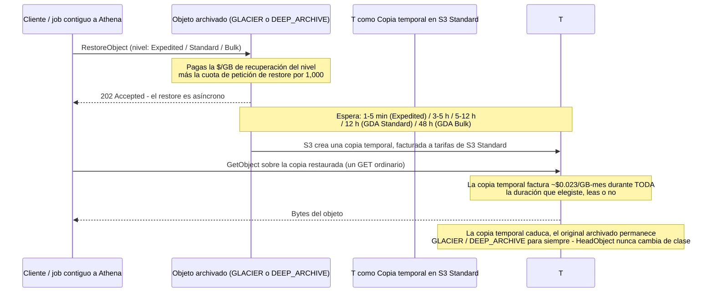
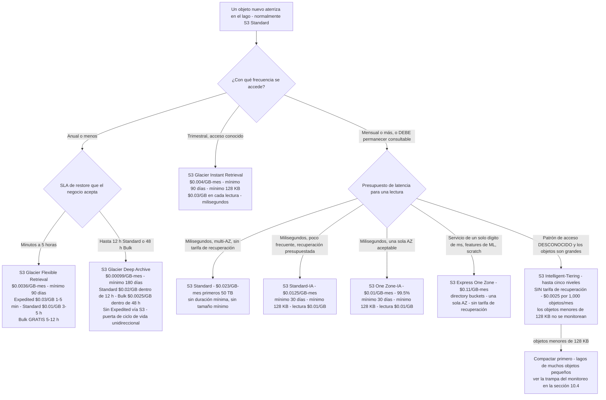
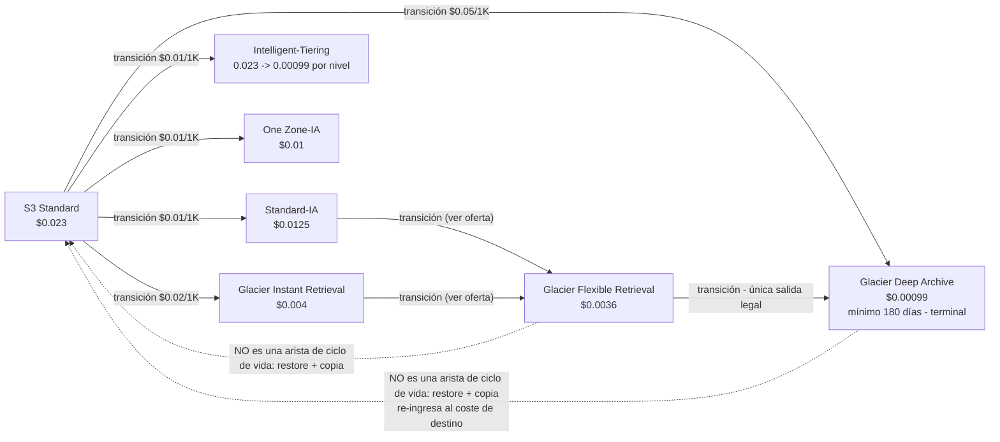
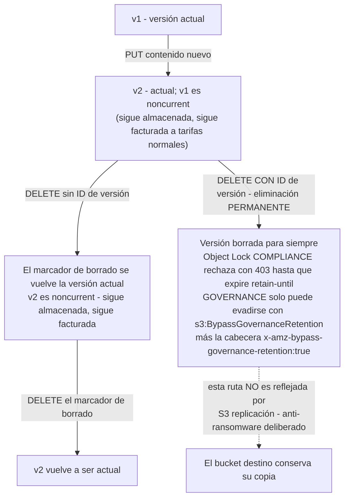
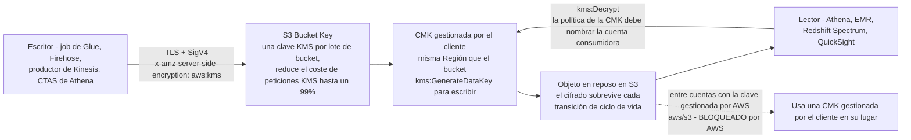

# S3 como fundación del data lake: clases de almacenamiento, Glacier y durabilidad

Cada lakehouse de este curso se construye sobre una suposición: **Amazon S3 es el sustrato**. Glue lo rastrea, Athena lo escanea, Redshift Spectrum lo monta, Lake Formation concede sobre él, Macie lo inspecciona, QuickSight lo lee. Nada aguas abajo puede rescatar un lago cuya capa de almacenamiento se diseñó por accidente, y en S3, «por accidente» tiene un precio concreto. La clase de almacenamiento equivocada te factura una tarifa de recuperación por cada byte que lee un motor; el diseño de prefijos equivocado limita la ingesta a 3,500 escrituras por segundo; el tamaño de objeto equivocado añade 40 KB de metadatos de archivo por archivo; el diseño de retención equivocado convierte una regla de ciclo de vida en una puerta de un solo sentido con una factura mínima de 180 días.

La buena noticia es que el modelo de costes de S3 es *conocible*. Cada tarifa de esta lección proviene de la oferta del Price List de AWS para Amazon S3 en `us-east-1` (fecha de publicación **2026-09-28**, efectiva **2026-09-01**, consultada **octubre de 2026**) más la guía de usuario de S3, la página de precios y la FAQ de AWS (consultadas en octubre de 2026). Haz la aritmética tú mismo; es la única manera de diseñar un lago que siga siendo asequible en el año siete.

```text
 =============================================================
  ESCALERA DE CLASES DE ALMACENAMIENTO S3 - lista us-east-1, en oct 2026
 -------------------------------------------------------------
  Clase                     $/GB-mes  Duración mín.  Recuperación
  S3 Express One Zone       0.11      ninguna        ninguna
                             solo directory buckets, una sola AZ
  S3 Standard               0.023     ninguna        ninguna
                             siguientes 450 TB 0.022, luego 0.021
  S3 Standard-IA            0.0125    30 días        $0.01/GB
  S3 One Zone-IA            0.01      30 días        $0.01/GB
  S3 Intelligent-Tiering    0.023 -> 0.00099 en cinco niveles
                             + $0.0025 por 1,000 objetos/mes
                             sin tarifa de recuperación, sin duración mín.
  S3 Glacier Instant Ret.   0.004     90 días        $0.03/GB
  S3 Glacier Flexible Ret.  0.0036    90 días        $0-$0.03/GB
  S3 Glacier Deep Archive   0.00099   180 días       $0.0025-$0.02/GB
  Redundancia reducida      obsoleta - "Recomendamos no usar
                             esta clase de almacenamiento" (docs de S3)
 -------------------------------------------------------------
  Cada clase: durabilidad diseñada de 99.999999999%. Lo que difiere
  es disponibilidad, huella de AZ, latencia, duración mínima,
  tamaño mínimo facturable de objeto y tarifas de recuperación.
  =============================================================
```

En esta lección vas a:

- leer la **tabla completa de clases de almacenamiento**: las ocho clases más cada nivel de Glacier, con tiempo de recuperación, tarifa de recuperación y duración mínima de almacenamiento;
- recorrer el **árbol de decisión de clases de almacenamiento** y la **cascada unidireccional de ciclo de vida** como diagramas mermaid, y después ordenar la cascada tú mismo en un arrastrar y soltar interactivo;
- modelar **versionado, replicación, Object Lock (WORM) y retenciones legales**, incluyendo exactamente qué mutaciones la replicación *no* refleja;
- elegir entre **SSE-S3, SSE-KMS, DSSE-KMS y SSE-C**, y usar una **S3 Bucket Key** para reducir el coste de peticiones de KMS «hasta en un 99 por ciento»;
- diseñar **buckets, prefijos y claves de partición al estilo Hive** contra el modelo de **≥3,500 peticiones de escritura / ≥5,500 de lectura por segundo por prefijo**;
- aplicar **Block Public Access** (cuatro ajustes) y los ocho **patrones de política de bucket** que necesita un lago privado;
- construir la tubería de gobernanza, **S3 Inventory** y **S3 Batch Operations**, que las reglas de ciclo de vida y la replicación en vivo no pueden hacer solas;
- calcular a mano **cinco modelos de coste con cifras reales**: la escalera de clases de 1 TiB, una restauración de Deep Archive de 50 TiB, un diseño de rendimiento de prefijo caliente, un TCO de 7 años de ciclo de vida a Deep Archive, un punto de equilibrio de Intelligent-Tiering y la trampa de metadatos de archivo de 40 KB;
- estudiar **dos casos de clientes de AWS con nombre** (Nasdaq y Siemens), leer el **recuadro de actualizaciones de 2026** y practicar con **12 preguntas de estilo examen** más cuatro comprobaciones interactivas.

---

## 1. Las ocho clases de almacenamiento: una durabilidad, ocho economías

### 1.1 La tabla comparativa (en oct 2026)

Amazon S3 ofrece ocho clases de almacenamiento actuales más una obsoleta. AWS las documenta lado a lado en la comparación de clases de la guía de usuario de S3 (consultada en oct 2026). Todas comparten una **durabilidad diseñada de 99.999999999%**, once nueves, así que la durabilidad nunca es el discriminador. Lo son el diseño de disponibilidad, la huella de AZ, la duración mínima de almacenamiento, el tamaño mínimo facturable de objeto y las tarifas de recuperación.

| Clase de almacenamiento | $/GB-mes (us-east-1, lista 2026-09-28) | Diseño | AZs | Duración mín. de almacenam. | Tamaño mín. facturable | Tarifa de recuperación |
|---|---|---|---|---|---|---|
| **S3 Standard** | 0.023 primeros 50 TB · 0.022 siguientes 450 TB · 0.021 más de 500 TB | 99.99% | ≥3 | ninguna | ninguna | ninguna |
| **S3 Standard-Infrequent Access** | 0.0125 | 99.9% | ≥3 | **30 días** | **128 KB** | **$0.01/GB** |
| **S3 Intelligent-Tiering** | FA 0.023→0.021 · IA 0.0125 · Archive Instant 0.004 · Archive 0.0036 · Deep Archive 0.00099 | 99.9% | ≥3 | ninguna | ninguna | **ninguna** (en su lugar cuota de monitoreo) |
| **S3 One Zone-Infrequent Access** | 0.01 | 99.5% | **1** | **30 días** | **128 KB** | **$0.01/GB** |
| **S3 Express One Zone** | 0.11 | 99.95% (SLA 99.9%) | **1** | ninguna | ninguna | ninguna (transferencia de datos $0.0032 subida / $0.0006 bajada por GB) |
| **S3 Glacier Instant Retrieval** | 0.004 | 99.9% | ≥3 | **90 días** | **128 KB** | **$0.03/GB** |
| **S3 Glacier Flexible Retrieval** | 0.0036 | 99.99% *después de restaurar los objetos* | ≥3 | **90 días** | ninguno (+40 KB de metadatos) | **escalonada: $0 to $0.03/GB** |
| **S3 Glacier Deep Archive** | 0.00099 | 99.99% *después de restaurar los objetos* | ≥3 | **180 días** | ninguno (+40 KB de metadatos) | **escalonada: $0.0025 to $0.02/GB** |
| Redundancia reducida | 0.0240→0.0220 | obsoleta |, |, |, |, |

Tres detalles de esa tabla hacen más daño que cualquier otro:

1. **S3 Express One Zone es una clase de directory buckets.** Vive en un tipo de bucket distinto (directory buckets con `--bucket-prefix`), es de una sola AZ, y se precifica a **$0.11/GB-mes**, unas **4.8× el almacenamiento de S3 Standard**, a cambio de una latencia consistente de un solo dígito de milisegundos. Es un nivel de *servicio/scratch*, nunca el lago de registro.
2. **Intelligent-Tiering no tiene tarifa de recuperación en absoluto.** Reemplaza esa tarifa con una **cuota de monitoreo por objeto**: $0.0025 por 1,000 objetos por mes (oferta del Price List de AWS, 2026-09-28). Los objetos menores de 128 KB no se monitorean y no pagan cuota: lo cual es a la vez una trampa y una pista (sección 10).
3. **Las tres clases de Glacier no son «S3 más lento.»** Dos de ellas (Flexible Retrieval, Deep Archive) no pueden leerse con `GetObject` en absoluto hasta que ejecutes un **restore** asíncrono. Ese único hecho impulsa cada diseño de archivo de este curso.

### 1.2 Ejemplo resuelto E1: la escalera mensual de 1 TiB

**En oct 2026 (lista us-east-1).** ¿Cuánto cuesta simplemente *retener* 1 TiB = **1,024 GB** durante un mes en cada clase?

```text
Ejemplo resuelto E1 - coste mensual de almacenamiento de 1 TiB (1,024 GB), us-east-1, en oct 2026
S3 Standard ............ 1,024 GB x $0.023   = $23.552 / mes
S3 Standard-IA ......... 1,024 GB x $0.0125  = $12.800 / mes  (+ $0.01/GB por lectura)
S3 One Zone-IA ......... 1,024 GB x $0.01    = $10.240 / mes  (+ $0.01/GB por lectura)
Glacier Instant Ret. ... 1,024 GB x $0.004   =  $4.096 / mes  (+ $0.03/GB por lectura)
Glacier Flexible Ret. .. 1,024 GB x $0.0036  =  $3.686 / mes  (se requiere restore)
Glacier Deep Archive ... 1,024 GB x $0.00099 =  $1.014 / mes  (se requiere restore)
S3 Express One Zone .... 1,024 GB x $0.11    = $112.640 / mes (+ por petición + datos)
Intelligent-Tiering .... 1,024 GB x $0.023   = $23.552 / mes si todo permanece en
                        Frequent Access, MÁS $0.0025 por 1,000 objetos/mes
```

Dos lecturas de esa escalera importan. Primero, **Deep Archive es 23× más barato que Standard para retener** ($1.014 frente a $23.552), y exactamente por eso el nivel de archivo es una decisión de *retención*, no de rendimiento. Segundo, **Express One Zone es 4.8× más caro que Standard para retener**, y por eso aloja tablas de servicio gold y feature stores de ML, nunca bronze.

La **FAQ de S3** lo dice claramente: «Desde solo $0.00099 por GB-mes … S3 Glacier Deep Archive ofrece el almacenamiento de menor coste en la nube» (consultada en oct 2026). Una advertencia que conviene llevar: la oferta del Price List de us-east-1 de 2026-09-28 contiene los SKUs de *staging* de Deep Archive y de Intelligent-Tiering Deep Archive Access pero **ningún SKU independiente de almacenamiento Deep Archive**, así que trata $0.00099 como publicado por AWS en lugar de confirmado por la lista de precios, y vuelve a verificarlo antes de comprometer un archivo de siete cifras.

- **📚 ¿Sabías que…?** La Redundancia reducida (`RRS`) todavía aparece en la lista de precios de S3 a $0.0240→$0.0220/GB-mes, pero la guía de usuario de S3 solo dice: «Recomendamos no usar esta clase de almacenamiento» (consultada en oct 2026). Es *más* cara que S3 Standard con *menos* redundancia. Cualquier opción de estilo examen, deck de proveedor o runbook heredado que todavía enrute datos a RRS es incorrecto en oct 2026.

---

## 2. La familia Glacier: cada nivel, cada tarifa, cada reloj

«Glacier» son tres clases de almacenamiento y cinco niveles de restauración, y la diferencia entre ellas es la diferencia entre una consulta que devuelve en milisegundos y un ticket que se cierra mañana.

### 2.1 La tabla de archivo

| Clase | Duración mín. de almacenam. | Facturación | Ruta de recuperación | Nivel | Tarifa de recuperación $/GB | Tiempo típico de recuperación | Cuota por petición de restore |
|---|---|---|---|---|---|---|---|
| **Glacier Instant Retrieval** | 90 días | trimestral | `GetObject` directo |: | **$0.03 fija** (cada lectura) | **milisegundos** | n/a |
| **Glacier Flexible Retrieval** | 90 días | semestral | se requiere `RestoreObject` | **Expedited** | $0.03 | **1 to 5 minutos** | $0.01 / 1,000 |
| | | | | **Standard** | $0.01 | **3 to 5 horas** | $0.05 / 1,000 |
| | | | | **Bulk** | **$0 (gratis)** | **5 to 12 horas** | $0.00 / 1,000 |
| **Glacier Deep Archive** | **180 días** | anual | se requiere `RestoreObject` | **Standard** | $0.02 | **dentro de 12 horas** | $0.05 / 1,000 |
| | | | | **Bulk** | $0.0025 | **dentro de 48 horas** | $0.00 / 1,000 |
| | | | | **Expedited** | **no se ofrece vía S3** |, |, |

Fuentes: comparación de clases de almacenamiento de S3 Glacier y viñetas de niveles (guía de usuario, consultada en oct 2026); precios de recuperación y peticiones de restore de la oferta us-east-1 de 2026-09-28; «Las recuperaciones y peticiones Bulk de S3 Glacier Flexible Retrieval son gratuitas» y «Las peticiones DELETE y CANCEL son gratuitas» (página de precios de S3, consultada en oct 2026).

Lee la tabla en vertical y salen tres reglas:

- **Glacier Instant Retrieval es la única clase de archivo que un motor de consulta puede leer directamente**: milisegundos, pero cada byte leído cuesta **$0.03/GB**, siete veces y media su propia tarifa de almacenamiento.
- **El nivel Bulk de Glacier Flexible Retrieval es gratis pero lento**: $0.00/GB, típicamente 5 to 12 horas. La FAQ lo redacta como «Las recuperaciones Bulk típicamente se completan dentro de 5 to 12 horas, y son gratuitas».
- **Deep Archive no tiene nivel Expedited a través de S3.** La ruta publicada más rápida es Standard a $0.02/GB «dentro de 12 horas»; Bulk a $0.0025/GB tarda «dentro de 48 horas». La tabla de comparación en otra parte de la misma guía cita el rango como «9 a 48 horas»: planifica contra las viñetas de niveles, no contra el mejor caso.

### 2.2 Un restore no es un GET

Este es el mecánico más malinterpretado de todo el modelo de precios de S3, así que tiene su propio diagrama.



La propia página de precios de AWS enuncia la consecuencia: «Cuando restauras un archivo, estás pagando tanto el archivo… como una copia… restaurada temporalmente (cobrada a la tarifa de almacenamiento de S3 Standard durante un tiempo que elijas» (consultada en oct 2026). Así que la factura completa de restore tiene **cuatro componentes**: almacenamiento del archivo (que sigue devengando) + la tarifa de recuperación por GB del nivel + la cuota de petición de restore por 1,000 + **almacenamiento Standard en la copia temporal durante toda la duración elegida**. El original archivado nunca cambia de clase: `HeadObject` sigue informando `GLACIER` o `DEEP_ARCHIVE` después de un restore exitoso.

### 2.3 Ejemplo resuelto E2: restaurar 50 TiB desde Deep Archive

Una casa de medios debe regurgitar una **biblioteca de emisión de 50 TiB (51,200 GB)** dentro de una ventana de cinco días. Retén la copia restaurada durante **5 días**.

```text
Ejemplo resuelto E2 - economía de restauración desde Glacier Deep Archive, us-east-1, en oct 2026
Volumen ............... 50 TiB = 51,200 GB
Ventana de retención ... 5 días (la copia temporal factura a S3 Standard durante toda la ventana)

Opción A - Nivel Standard ($0.02/GB, típicamente dentro de 12 horas)
  Recuperación ......... 51,200 GB x $0.02      = $1,024.00
  Copia temporal Std. .. 51,200 GB x $0.023 x 5/30 =   $196.27
  TOTAL ................                            $1,220.27

Opción B - Nivel Bulk ($0.0025/GB, típicamente dentro de 48 horas)
  Recuperación ......... 51,200 GB x $0.0025    =   $128.00
  Copia temporal Std. .. (igual)                =   $196.27
  TOTAL ................                            $  324.27

Delta .................. $1,220.27 - $324.27 = $896.00 ahorrados por ~36 horas extra de espera
Cuota petición restore . $0.05 por 1,000 restores Standard (despreciable a este número de objetos)
```

**Veredicto:** **Bulk para recuperaciones planificadas; Standard solo cuando el reloj de negocio es más corto que 48 horas.** La delta de $896 es pura tarifa de recuperación: el cargo de la copia temporal es idéntico en ambos casos, y por eso la copia temporal, no la tarifa de recuperación, domina cualquier retención *larga*. ¿Necesitas los datos en menos de 15 minutos? Deep Archive no puede ayudarte: no hay nivel Expedited vía S3, así que un SLA de la misma hora significa que los datos nunca debieron salir de Standard, Standard-IA o Glacier Instant Retrieval.

> [!WARNING]
> ⚠️ **Nunca modeles un archivo como «almacenamiento barato al que puedes volver al instante.»** La duración mínima de almacenamiento de Deep Archive es de **180 días**: si transicionas un objeto hacia él y lo borras o reclasificas antes del día 180, se te factura por los 180 días completos. AWS es explícito: «Si creas una regla de expiración de ciclo de vida que haga que objetos que llevan menos de 180 días en almacenamiento S3 Glacier Deep Archive caduquen, se te cobra por 180 días» (docs de ciclo de vida de S3, consultados en oct 2026). Y la salida es una puerta de un solo sentido: **no puedes transicionar por ciclo de vida fuera de Deep Archive.** La única salida es restore + copia a un nuevo objeto al coste de la clase de destino, lo que reinicia el reloj de duración mínima de esa clase.

```matching
{
  "question": "Relaciona cada clase de almacenamiento o nivel de restauración con su comportamiento de recuperación y cuota publicados (lista us-east-1, en oct 2026):",
  "pairs": [
    {"left": "S3 Standard o S3 Intelligent-Tiering (niveles Frequent / Infrequent / Archive Instant)", "right": "Sin tarifa de recuperación en absoluto: Intelligent-Tiering cobra $0.0025 por 1,000 objetos al mes de monitoreo en su lugar"},
    {"left": "S3 Standard-Infrequent Access o One Zone-Infrequent Access", "right": "Milisegundos, pero una tarifa fija de $0.01 por GB en cada byte leído"},
    {"left": "S3 Glacier Instant Retrieval", "right": "GetObject directo en milisegundos, con una tarifa fija de recuperación de $0.03 por GB"},
    {"left": "Glacier Flexible Retrieval - Expedited", "right": "$0.03 por GB, típicamente restaura el objeto en 1-5 minutos, $0.01 por 1,000 peticiones de restore"},
    {"left": "Glacier Flexible Retrieval - Standard", "right": "$0.01 por GB, típicamente restaura el objeto en 3-5 horas, $0.05 por 1,000 peticiones de restore"},
    {"left": "Glacier Flexible Retrieval - Bulk", "right": "Gratis ($0.00 por GB y $0.00 por 1,000 peticiones), típicamente 5-12 horas"},
    {"left": "Glacier Deep Archive - Standard", "right": "$0.02 por GB, típicamente dentro de 12 horas, $0.05 por 1,000 peticiones de restore: y no existe nivel Expedited vía S3"},
    {"left": "Glacier Deep Archive - Bulk", "right": "$0.0025 por GB, típicamente dentro de 48 horas, $0.00 por 1,000 peticiones de restore"}
  ],
  "explanation": "Tres mecanismos acumulativos: tarifas fijas de lectura por GB (Standard-IA, One Zone-IA, Glacier Instant Retrieval); tarifas de restore escalonadas más una copia temporal de S3 Standard (Glacier Flexible Retrieval, Glacier Deep Archive); y ninguna tarifa de recuperación en Standard, Express One Zone e Intelligent-Tiering: este último sustituye una cuota de monitoreo por objeto. Regla general de la página de precios de S3: cualquier cosa que un motor de consulta pueda escanear pertenece a Standard, Intelligent-Tiering o Glacier Instant Retrieval. El nivel Bulk de Deep Archive son los bytes más baratos de la nube para conservar y los más baratos para mover, al costo de una espera de 48 horas."
}
```

- **📚 ¿Sabías que…?** El servicio **Amazon Glacier vault** independiente, un producto separado con sus propias APIs y ARNs de vault, «ya no acepta nuevos clientes desde el 15 de diciembre de 2025» (página de precios de S3 Glacier, consultada en oct 2026). AWS ahora recomienda: «Recomendamos usar las clases de almacenamiento S3 Glacier dentro del servicio Amazon S3 para todos tus datos a largo plazo». En 2026, «Glacier» en una conversación de diseño significa tres clases de almacenamiento en un bucket S3 normal, no un vault.

---

## 3. Elegir una clase: el árbol de decisión y la cascada

### 3.1 El árbol de decisión de clases de almacenamiento

La **frecuencia** de acceso, la **latencia** requerida y si el objeto es **recreable** deciden la clase: en ese orden. Las etiquetas de las hojas llevan el precio y el reloj al que te estás comprometiendo.



Dos ramas merecen el comentario:

- **«Acceso desconocido» no significa automáticamente Intelligent-Tiering.** Significa Intelligent-Tiering *una vez que los objetos sean lo bastante grandes para monitorearse* (≥128 KB) y lo bastante pocos que la cuota de monitoreo no sea toda la factura. Para un archivo de trimestre conocido, Glacier Instant Retrieval suele ser más barato: la sección 10.3 hace el punto de equilibrio.
- **One Zone-IA es un intercambio de durabilidad, no solo un descuento.** 99.5% de disponibilidad en una sola AZ significa una pregunta genuina de si los datos pueden recrearse. Los lagos la usan para datos derivados *reproducibles*, nunca para la única copia de datos de origen en bruto.

### 3.2 La cascada de ciclo de vida es unidireccional

Amazon S3 «soporta un modelo de cascada para transicionar entre clases de almacenamiento» (guía de usuario de ciclo de vida de S3, consultada en oct 2026). Los objetos fluyen hacia abajo; no vuelven hacia arriba. Las flechas de retroceso en el diagrama de abajo **no** son aristas de ciclo de vida: son operaciones de restore y copia que ejecutas a mano o a través de S3 Batch Operations, y cada una reinicia el reloj de duración mínima de la clase de destino y re-factura a la tarifa de destino.



Reglas que los docs de ciclo de vida de S3 ponen por escrito (consultados en oct 2026):

- «No puedes crear una sola regla de ciclo de vida que transicione objetos de una clase de almacenamiento a otra antes de que haya pasado el periodo de duración mínima de almacenamiento.»
- «La transición de objetos a la clase de almacenamiento S3 Glacier Deep Archive solo puede ir en una dirección.»
- «Un objeto es elegible solo para una acción de ciclo de vida de S3 por día. Cuando múltiples reglas coinciden, Amazon S3 aplica la acción menos costosa.»
- Precedencia: borrado permanente > transición > creación de marcadores de borrado. Cuando tanto una transición a Glacier Flexible Retrieval como una a Standard-IA son elegibles, «Amazon S3 elige la transición a S3 Glacier Flexible Retrieval».
- Una configuración puede contener **hasta 1,000 reglas**: «Este límite no es ajustable».
- Desde **septiembre de 2024**, «Los objetos menores de 128 KB no transicionarán por defecto a ninguna clase de almacenamiento».

```dragdrop
{
  "question": "Ordena la cascada de clases de almacenamiento desde la clase en la que aterriza un objeto hasta la clase de archivo terminal: la más barata y más lenta al final:",
  "items": [
    "S3 Standard - $0.023/GB-mes, sin duración mínima, sin tarifa de recuperación: la zona caliente en la que aterriza cada objeto y la única clase que los motores de consulta escanean libremente",
    "S3 Standard-IA - $0.0125/GB-mes, duración mínima de 30 días, tamaño mínimo facturable de 128 KB, tarifa fija de recuperación de $0.01/GB",
    "S3 Glacier Instant Retrieval - $0.004/GB-mes, mínimo 90 días, mínimo 128 KB, recuperación fija de $0.03/GB, todavía milisegundos",
    "S3 Glacier Flexible Retrieval - $0.0036/GB-mes, mínimo 90 días, se requiere restore asíncrono, recuperaciones Bulk gratis pero de 5-12 horas",
    "S3 Glacier Deep Archive - $0.00099/GB-mes, mínimo 180 días, se requiere restore asíncrono, hasta 12 horas Standard / 48 horas Bulk, terminal"
  ],
  "correctOrder": [
    "S3 Standard - $0.023/GB-mes, sin duración mínima, sin tarifa de recuperación: la zona caliente en la que aterriza cada objeto y la única clase que los motores de consulta escanean libremente",
    "S3 Standard-IA - $0.0125/GB-mes, duración mínima de 30 días, tamaño mínimo facturable de 128 KB, tarifa fija de recuperación de $0.01/GB",
    "S3 Glacier Instant Retrieval - $0.004/GB-mes, mínimo 90 días, mínimo 128 KB, recuperación fija de $0.03/GB, todavía milisegundos",
    "S3 Glacier Flexible Retrieval - $0.0036/GB-mes, mínimo 90 días, se requiere restore asíncrono, recuperaciones Bulk gratis pero de 5-12 horas",
    "S3 Glacier Deep Archive - $0.00099/GB-mes, mínimo 180 días, se requiere restore asíncrono, hasta 12 horas Standard / 48 horas Bulk, terminal"
  ],
  "explanation": "Esta es la cascada publicada, leída de izquierda a derecha por precio descendente y fricción ascendente: Standard (sin mínimos, sin tarifa de recuperación) -> Standard-IA o One Zone-IA o Intelligent-Tiering o Glacier Instant Retrieval -> Glacier Flexible Retrieval -> Glacier Deep Archive. Cada salto cuesta una petición de transición ($0.01 a IA/One Zone-IA/Intelligent-Tiering, $0.02 a Glacier Instant Retrieval, $0.05 por 1,000 a Deep Archive, lista us-east-1 en oct 2026), inicia el reloj de duración mínima de la clase de destino el día en que la regla se satisface, y no puede deshacerse con otra regla. Solo Intelligent-Tiering factura después de que el movimiento físico se complete; para cualquier otra clase, la facturación cambia el momento en que la regla se dispara."
}
```

---

## 4. Durabilidad, versionado y replicación

### 4.1 Versionado: tres estados, facturación de objeto completo

El versionado de S3 es a nivel de bucket y todo-o-nada, con exactamente tres estados: **sin versionar** (el por defecto), **habilitado** y **suspendido**. La guía de usuario de AWS es directa sobre la facturación: «Cada versión de un objeto es el objeto completo; no es solo un diff… si tienes tres versiones de un objeto almacenadas, se te cobra por tres objetos» (consultada en oct 2026).

| Mecanismo | Comportamiento |
|---|---|
| `PUT` (cualquiera) | Crea una nueva versión actual; la versión previa se vuelve noncurrent y **sigue facturándose** |
| `DELETE` sin ID de versión | Inserta un **marcador de borrado**; devuelve `200 OK`; las versiones previas siguen siendo recuperables por ID de versión |
| `DELETE` con ID de versión | Elimina esa versión **permanentemente**; este es el único borrado verdadero |
| `NoncurrentVersionExpiration` | Borra versiones noncurrent después de N días, opcionalmente limitadas por `MaxNoncurrentVersions` (**1 to 100**) |
| Habilitado → sin versionar | **Imposible.** «Después de habilitar el versionado en un bucket, nunca puede volver a un estado sin versionar. Pero puedes *suspender* el versionado en ese bucket». |

El versionado es un prerrequisito para dos cosas que necesitarás más adelante: **S3 Object Lock** (que solo funciona en buckets con versionado) y **S3 replicación** (que requiere versionado en origen y destino).



### 4.2 Replicación: CRR, SRR y el muro de clases archivadas

La replicación entre Regiones (CRR) y la misma Región (SRR) son el mismo mecanismo con destinos distintos. El versionado debe estar habilitado en ambos lados. Qué se replica por defecto (docs de replicación de S3, consultados en oct 2026):

- **Se replica:** objetos nuevos creados *después* de la configuración, metadatos del objeto, etiquetas, anotaciones, actualizaciones de ACL, **retención de Object Lock**, y objetos cifrados con SSE-S3 / SSE-KMS / DSSE-KMS / SSE-C.
- **No se replica por defecto:** objetos que son en sí mismos réplicas (sin encadenamiento), **marcadores de borrado** cuando la configuración usa un elemento `Filter`, **borrados permanentes de versión**, cambios de subrecurso a nivel de bucket, y marcadores de borrado creados por ciclo de vida.
- **No replicable en absoluto hasta restaurar:** objetos en **Glacier Flexible Retrieval, Glacier Deep Archive, Intelligent-Tiering Archive Access e Intelligent-Tiering Deep Archive Access**. Las palabras exactas de AWS: «No puedes replicar estos objetos hasta que los restaures y los copies a una clase de almacenamiento diferente».

Tres consecuencias operativas para un lago:

1. **CRR no es una copia de seguridad en vivo de cada mutación.** Con la versión de configuración actual (un `Filter`), los marcadores de borrado no se replican a menos que habilites explícitamente la replicación de marcadores de borrado, y los borrados por ID de versión nunca se reflejan: deliberadamente, para que un principal comprometido no pueda borrar la copia DR borrando versiones en el origen.
2. **El backfill retroactivo necesita S3 Batch Replication.** La replicación en vivo solo cubre objetos creados después de la configuración; todo lo anterior es un job de Batch Operations.
3. **El monitoreo cuesta $0.015 por 1 millón de objetos por mes** en el bucket de origen (oferta de 2026-09-28). **No hay un SKU separado de «$0.02 por GB replicado»** en esa oferta: pagas almacenamiento del bucket de destino y transferencia de datos ordinaria entre Regiones además de la cuota de monitoreo. No enseñes la cifra por GB sin volver a verificar la pestaña de precios de Replicación.

- **📚 ¿Sabías que…?** La replicación de S3 lleva **la información de retención de Object Lock a las réplicas**: «aplica esos mismos controles de retención a tus buckets de destino» (docs de replicación de S3, consultados en oct 2026). Eso es lo que convierte a CRR en una segunda copia de *cumplimiento* en lugar de meramente una segunda copia: la fecha de retain-until sobrevive el salto de Región.

---

## 5. Object Lock: WORM para zonas del lago reguladas

S3 Object Lock «usa un modelo *write-once-read-many* (WORM)» y «solo funciona en buckets que tienen habilitado S3 Versioning» (guía de usuario de S3, consultada en oct 2026). Protege una **versión** de objeto, no una clave, y esa distinción es donde fallan la mayoría de los diseños.

| Protección | Comportamiento |
|---|---|
| **Periodo de retención** | Una fecha fija de retain-until, o (desde 2026-09-08) **retención variable** cuyo retain-until se recalcula como «ahora + duración» mientras se aplica un **hold basado en eventos** |
| **Retención legal** | Sin fecha de caducidad; necesita `s3:PutObjectLegalHold` para quitarla; independiente de la retención |
| **Modo COMPLIANCE** | «Una versión de objeto protegida no puede ser sobrescrita ni borrada por ningún usuario, incluido el usuario raíz de tu cuenta de AWS… La única forma de borrar un objeto bajo el modo compliance antes de que expire su fecha de retención es borrar la cuenta de AWS asociada.» |
| **Modo GOVERNANCE** | Los principales ordinarios quedan bloqueados; un principal con `s3:BypassGovernanceRetention` **y** la cabecera explícita de petición `x-amz-bypass-governance-retention:true` puede evadirlo |
| **Lo que el bloqueo NO detiene** | Nuevas versiones de la misma clave (un `PUT` todavía tiene éxito), y `DELETE` simples (que devuelven `200 OK` y añaden un marcador de borrado) |

AWS ha tenido Object Lock «evaluado por Cohasset Associates para su uso en entornos sujetos a las regulaciones SEC 17a-4, CFTC y FINRA» (consultado en oct 2026), y exactamente por eso los relatos de datos regulados de este curso (archivos de vigilancia estilo FINRA, el nivel de cumplimiento de Nasdaq) lo buscan.

> [!IMPORTANT]
> 🔒 **Object Lock bloquea versiones, no claves: así que la inmutabilidad del lago necesita tres piezas, no una.** La retención y los holds legales «no impiden que se creen nuevas versiones del objeto, ni que se añadan marcadores de borrado encima del objeto». La verdadera inmutabilidad para una zona bronze es: (1) Object Lock (COMPLIANCE para la zona auditada, GOVERNANCE en otros lugares); (2) una política de bucket que **niega `s3:DeleteObjectVersion`** a todos los que estén fuera del rol de retención; y (3) una política de bucket que **niega `s3:BypassGovernanceRetention` y `s3:PutObjectLegalHold`** a todos los principales no-admin. Sin (2), un `PUT` crea silenciosamente una nueva versión desbloqueada por encima de la tuya bloqueada.

- **📚 ¿Sabías que…?** Un límite de una sola regla que la mayoría pasa por alto: una configuración de ciclo de vida de S3 «puede tener hasta 1,000 reglas» y el filtro de cada regla puede usar «un prefijo de nombre de clave de objeto, una o más etiquetas de objeto, el tamaño del objeto, o cualquier combinación de estos» (docs del API de S3, consultados en oct 2026), y **no puedes usar una política de bucket para prevenir borrados o transiciones por una regla de ciclo de vida**. Object Lock detiene *principales*; la expiración de ciclo de vida es una acción del *servicio*, así que los diseños de zona auditada emparejan Object Lock con reglas de ciclo de vida que deliberadamente se detienen antes del límite de retención.

---

## 6. Cifrado: SSE-S3, SSE-KMS, DSSE-KMS, SSE-C y Bucket Keys

Desde el **5 de enero de 2023**, «todas las subidas de objetos nuevos a Amazon S3 se cifran automáticamente sin coste adicional y sin impacto en el rendimiento»: ese por defecto es **SSE-S3** (guía de usuario de S3, consultada en oct 2026). Todo lo demás es una actualización con un precio y una restricción.

| Esquema | Quién sostiene la clave | Coste extra | Restricciones duras |
|---|---|---|---|
| **SSE-S3** (por defecto) | AWS, por objeto | Ninguno | No se puede compartir entre cuentas como *clave*: los objetos siguen siendo legibles por cualquiera con acceso IAM al bucket |
| **SSE-KMS** | AWS KMS, ya sea la clave gestionada por AWS `aws/s3` o una **CMK gestionada por el cliente** | Cargos de peticiones de KMS por `GenerateDataKey` / `Decrypt` | La CMK **debe estar en la misma Región que el bucket**; **solo claves simétricas**; escribir necesita `kms:GenerateDataKey`, leer necesita `kms:Decrypt`; **la clave `aws/s3` no se puede compartir entre cuentas** |
| **DSSE-KMS (doble capa)** | Dos claves KMS independientes | **$0.003/GB cifrado + $0.003/GB descifrado** (oferta de 2026-09-28) | Para cargas de trabajo que necesitan dos capas independientes de autoridad de clave |
| **SSE-C** | **Tú**, suministrada en cada petición TLS | Ninguno de AWS | AWS no almacena nada; cada `GET`/`PUT`/`COPY` debe llevar la clave por TLS o falla |

Tres mejoras que un lago normalmente necesita:

1. **Una S3 Bucket Key.** «Usar una clave a nivel de bucket para SSE-KMS puede reducir tu coste de peticiones de AWS KMS hasta en un 99 por ciento» (guía de usuario de S3, consultada en oct 2026). A volúmenes de escritura de lago, cientos de miles de llamadas `PutObject` al día, la factura de peticiones de KMS es la diferencia entre que SSE-KMS sea asequible y sea una línea de factura.
2. **Una CMK gestionada por el cliente para cualquier cosa entre cuentas.** «Los objetos cifrados usando SSE-KMS con claves gestionadas por AWS no se pueden compartir entre cuentas. Si necesitas compartir datos SSE-KMS entre cuentas, debes usar una clave gestionada por el cliente». Concede `kms:Decrypt` a la cuenta consumidora y habilita la Bucket Key.
3. **El cifrado sobrevive las transiciones de clase**, pero nota la nota al pie de facturación: «Los objetos en S3 Glacier Flexible Retrieval y S3 Glacier Deep Archive se facturan a tarifas de la clase de almacenamiento S3 Standard cuando los subes usando uploads multiparte». Aterriza siempre en Standard (o completa el upload multiparte pronto) y deja que el ciclo de vida haga la transición.



Dos trampas de forma de petición que vale la pena memorizar: las peticiones SSE-KMS deben llegar por **TLS con SigV4**, y **no** debes enviar cabeceras de cifrado en `GET`/`HEAD`: S3 responde **HTTP 400**.

---

## 7. Buckets, prefijos y claves de partición: el modelo de rendimiento

### 7.1 S3 escala por prefijo, no por bucket

La documentación de rendimiento de S3 enuncia el modelo exactamente: «tu aplicación puede lograr al menos **3,500 peticiones PUT/COPY/POST/DELETE o 5,500 GET/HEAD por segundo por prefijo particionado de Amazon S3**. No hay límite al número de prefijos en un bucket… si creas 10 prefijos… podrías escalar tu rendimiento de lectura a 55,000 peticiones de lectura por segundo» (consultada en oct 2026). El escalado es gradual, y los clientes ven errores de **`503 Slow Down`** mientras sube.

```text
Ejemplo resuelto E3 - diseño de rendimiento de prefijo caliente, en oct 2026
Demanda de ingesta ... 1,000 objetos/segundo de 64 KB cada uno = 96 MB/s

Un solo prefijo  raw/events/2026-10-11/events.json.gz
  Techo de escritura . 3,500 escrituras/s  -> solo 2.3x de margen (3,500 / 1,500)
  Techo de bytes ..... 3,500 x 64 KB = 224 MB/s por prefijo
  Modo de fallo ...... 503 Slow Down sostenido una vez que el emisor escala

16 prefijos hasheados  raw/events/dt=2026-10-11/hour=07/shard-{000..015}.json.gz
  Techo de escritura . 16 x 3,500 = 56,000 escrituras/s -> ~37x de margen
  Techo de bytes ..... 16 x 224 MB/s = 3.5 GB/s

Lado lectura - un escaneo de día completo que toca 24 particiones de hora (24 prefijos)
  Techo de lectura ... 24 x 5,500 = 132,000 GET/s
```

El incidente compuesto que el material del laboratorio de Well-Architected de AWS describe coincide con esta forma: un job de ingesta de streaming escribía **800 objetos pequeños/segundo** en `s3://lake-prod/raw/events/2026-10-11/events.json.gz`, un solo prefijo, el rendimiento colapsó a ~3,500 escrituras/s con `503 Slow Down` sostenido, y re-particionar la clave del productor a 16 prefijos `shard-{000..015}` restauró el margen a ~56,000 escrituras/s **sin ningún otro cambio**. El *esparcimiento* de la partición es un control de rendimiento independiente de la *semántica* de la partición.

### 7.2 Las claves de partición son el diseño físico

Para tablas al estilo Hive, **el diseño de la clave *es* el diseño físico de la partición**: `s3://lake/events/dt=2026-10-11/hour=07/part-…parquet`. Reglas de diseño que se sostienen en Glue, Athena, EMR y Redshift Spectrum:

| Regla | Por qué |
|---|---|
| Columnas de baja cardinalidad y alta filtración primero: `dt=` → `region=` → `source=` | El podado de particiones filtra por las claves iniciales; un `user_id` inicial no poda nada y explota el catálogo |
| **Nunca** particiones por una clave de alta cardinalidad (`user_id`, `request_id`, `order_id`) | Millones de particiones = hinchazón de metadatos de Glue, abanico LIST, coste de planificación de Athena |
| Nomenclatura consistente (`dt=`; nunca mezclar `dt=` y `date=`) | Los crawlers de Glue y la proyección de particiones de Athena deben coincidir con el diseño físico |
| Objetos Parquet de **128 MB: 1 GB** | Por debajo de ~128 MB, el sobrecosto columnar de footer/diccionario y el coste por GET dominan; este es también el hermano mayor del suelo de 128 KB del ciclo de vida |
| Diseña claves para que cada **zona** (bronze / silver / gold / archivo) sea direccionable por `Prefix`, `Tag` o `ObjectSizeGreaterThan` | El ciclo de vida, Object Lock y las declaraciones de política de bucket se limitan todas por prefijo/tamaño |
| El particionado oculto de Iceberg desacopla la transformación *lógica* de la clave | Pero el prefijo S3 del archivo todavía determina qué presupuesto de peticiones por prefijo consumes |

- **📚 ¿Sabías que…?** Las peticiones `LIST` no son gratis y no se precifican como `GET`: «Las peticiones LIST para cualquier clase de almacenamiento se cobran a la misma tarifa que las peticiones PUT, COPY y POST de S3 Standard»: **$0.005 por 1,000** (página de precios de S3 y oferta de 2026-09-28). Por el contrario, las peticiones `DELETE` y `CANCEL` son gratuitas. Ese es un segundo argumento, más silencioso, para un abanico moderado de prefijos: más prefijos significan más abanico LIST/GET en escaneos de bucket completo y más metadatos de partición de Glue, así que reparte a tus particiones de tiempo reales en lugar de sintéticamente al límite.

```fillblank
{
  "question": "Completa las afirmaciones de rendimiento y diseño de S3 con las cifras publicadas (todas en octubre de 2026):",
  "template": "Por cada prefijo particionado, Amazon S3 sostiene al menos {{1}} peticiones PUT/COPY/POST/DELETE por segundo y {{2}} peticiones GET/HEAD por segundo, y no hay límite al número de prefijos: diez prefijos de lectura por tanto escalan a {{3}} peticiones GET/HEAD por segundo. Mientras ese escalado sube, los clientes ven errores de {{4}}. Las transiciones de ciclo de vida por defecto omiten objetos menores de {{5}} KB, los objetos archivados llevan {{6}} KB de metadatos adicionales por objeto, y una configuración de ciclo de vida de S3 puede contener como máximo {{7}} reglas.",
  "answers": {
    "1": "3500",
    "2": "5500",
    "3": "55000",
    "4": "503 Slow Down",
    "5": "128",
    "6": "40",
    "7": "1000"
  },
  "distractors": ["1000", "2000", "11000", "429 Throttling", "64", "32", "100", "10000", "5000"],
  "explanation": "3,500 peticiones de escritura y 5,500 de lectura por segundo por prefijo particionado, prefijos ilimitados, 10 prefijos = 55,000 GET/HEAD por segundo (docs de rendimiento de S3, consultados en oct 2026). El escalado es gradual y se manifiesta como 503 Slow Down: no 429. El tamaño mínimo de transición del ciclo de vida es de 128 KB (en vigor desde septiembre de 2024), los objetos archivados añaden 40 KB de metadatos (32 KB a la tarifa de la clase de archivo más 8 KB a tarifas de S3 Standard), y 1,000 reglas de ciclo de vida es un límite duro y no ajustable. Los distractores son las cifras de escala de shard de otros servicios de AWS y las mitades individuales del sobrecosto de 40 KB."
}
```

---

## 8. Cerrar el lago: Block Public Access y políticas de bucket

### 8.1 Block Public Access es el interruptor de parada

«Por defecto, los buckets, puntos de acceso y objetos nuevos no permiten acceso público.» Encima de ese por defecto, **S3 Block Public Access proporciona cuatro ajustes**, `BlockPublicAcls`, `IgnorePublicAcls`, `BlockPublicPolicy` y `RestrictPublicBuckets`, y «si los ajustes de bloqueo de acceso público… difieren, entonces Amazon S3 aplica la combinación más restrictiva» (guía de usuario de S3, consultada en oct 2026).

| Nivel | Comportamiento |
|---|---|
| Punto de acceso | Anulación por endpoint |
| Bucket | Por bucket; «recomendamos que también actives los cuatro ajustes para cada bucket para cumplir con el control S3.8 de las AWS Security Hub Foundational Security Best Practices» |
| Cuenta | «Cuando aplicas ajustes de bloqueo de acceso público a una cuenta, los ajustes se aplican a todas las Regiones de AWS globalmente» |
| Organización | «A nivel de organización, los cuatro ajustes se aplican juntos como una política unificada», y los ajustes de organización anulan los de cuenta |

La recomendación de AWS para una cuenta de lago es inequívoca: «recomendamos que actives los cuatro ajustes… para tu cuenta». Recuerda la trampa de capas: **deshabilitar BPA en un bucket no hace nada si la cuenta u organización todavía bloquea**, y S3 siempre aplica la combinación más restrictiva. «Público» significa una ACL o política que concede a `AllUsers`/`AuthenticatedUsers`, o una política de bucket con un principal comodín no restringido por un `aws:PrincipalArn`, `aws:PrincipalOrgID`, `aws:SourceAccount`, `aws:SourceArn`, `aws:SourceVpc`, `aws:SourceVpce`, `aws:SourceIp` o `s3:DataAccessPointArn` fijo.

### 8.2 Ocho patrones de política de bucket para un lago privado

Block Public Access impide que el bucket se vuelva público; la política de abajo impide todo lo demás que un data lake realmente necesita rechazar. Una declaración `Deny` con `"Principal": "*"` *restringe* el acceso en lugar de concederlo, así que se compone limpiamente con los cuatro ajustes de BPA activados.

```json
{
  "Version": "2012-10-17",
  "Statement": [
    {
      "Sid": "DenyNonTLS",
      "Effect": "Deny",
      "Principal": "*",
      "Action": "s3:*",
      "Resource": [
        "arn:aws:s3:::lakehouse-prod",
        "arn:aws:s3:::lakehouse-prod/*"
      ],
      "Condition": { "Bool": { "aws:SecureTransport": "false" } }
    },
    {
      "Sid": "DenyPutObjectUnlessSSEKMS",
      "Effect": "Deny",
      "Principal": "*",
      "Action": "s3:PutObject",
      "Resource": "arn:aws:s3:::lakehouse-prod/*",
      "Condition": {
        "StringNotEquals": { "s3:x-amz-server-side-encryption": "aws:kms" }
      }
    },
    {
      "Sid": "DenyPutObjectWithWrongKey",
      "Effect": "Deny",
      "Principal": "*",
      "Action": "s3:PutObject",
      "Resource": "arn:aws:s3:::lakehouse-prod/*",
      "Condition": {
        "StringNotEquals": {
          "s3:x-amz-server-side-encryption-aws-kms-key-id":
            "arn:aws:kms:us-east-1:111122223333:key/0000aaaa-1111-bbbb-2222-cccc3333dddd"
        }
      }
    },
    {
      "Sid": "DenyVersionDeletesOutsideRetentionRole",
      "Effect": "Deny",
      "Principal": "*",
      "Action": "s3:DeleteObjectVersion",
      "Resource": "arn:aws:s3:::lakehouse-prod/*",
      "NotPrincipal": {
        "AWS": "arn:aws:iam::111122223333:role/lake-retention-admin"
      }
    }
  ]
}
```

Notas sobre el JSON, porque cada declaración codifica una regla que es fácil de entender mal de forma sutil:

- **Una condición por declaración para las comprobaciones SSE-KMS.** Una sola declaración con dos claves `StringNotEquals` solo se aplica cuando *ambas* condiciones coinciden, lo que dejaría pasar una petición con la cabecera de cifrado correcta pero la clave equivocada. Dos declaraciones = dos negaciones independientes.
- **La declaración 2 sola está incompleta** sin la declaración 3: fijar el algoritmo no fija la clave, y una clave sin fijar es un radio de explosión sin fijar.
- La lista completa de patrones para un lago (docs de política de bucket y claves de condición de S3, consultados en oct 2026): (1) denegar no-TLS; (2) denegar `PutObject` salvo SSE-KMS; (3) fijar el ARN de la CMK; (4) denegar `DeleteObjectVersion` fuera del rol de retención; (5) concesiones limitadas por prefijo como `arn:aws:s3:lakehouse-prod/raw/*` para roles de ingeniería; (6) anclaje de Región con `aws:RequestedRegion`; (7) anclaje de organización con `aws:PrincipalOrgID`; (8) restricciones de fuente de principal de servicio (`aws:SourceArn` + `aws:SourceAccount`) para Lake Formation, Glue, Athena y Macie: más topes de retención vía `s3:object-lock-remaining-retention-days`.

> [!WARNING]
> ⚠️ **Una política de bucket no puede detener una regla de ciclo de vida de S3.** AWS lo declara directamente: «No puedes usar una política de bucket para prevenir borrados o transiciones por una regla de ciclo de vida de S3». Un `Deny s3:DeleteObject` a todos protege contra *principales*, no contra la expiración del lado del servicio. Por el contrario, objetos cuyo estado de replicación es `Pending` o `Failed` no se actúan hasta que la replicación tenga éxito: así que una regla de ciclo de vida no expirará silenciosamente un objeto a medio replicar, y un diseño de DR que asuma expiración inmediata debe contar con el retraso.

---

## 9. La tubería de gobernanza: S3 Inventory y S3 Batch Operations

Las reglas de ciclo de vida y la replicación en vivo cubren el movimiento *hacia adelante*. Dos servicios cubren todo lo demás, y ambos son lo bastante baratos que omitirlos es una falsa economía.

### 9.1 S3 Inventory: la instantánea programada de metadatos

S3 Inventory produce «archivos de salida de valores separados por comas (CSV), Apache optimized row columnar (ORC) o Apache Parquet que listan tus objetos y sus metadatos correspondientes sobre una base diaria o semanal» (guía de usuario de S3, consultada en oct 2026). Las propiedades que importan para un lago:

| Propiedad | Valor |
|---|---|
| Formatos | CSV+GZIP, ORC+ZLIB, Parquet+Snappy |
| Cadencia | Diaria, o semanal («un informe se genera cada domingo (zona horaria UTC)») |
| Primer informe | «Puede tardar hasta 48 horas en que Amazon S3 entregue el primer informe de inventario.» |
| Impacto en peticiones | «S3 Inventory no usa las operaciones de API `List` para auditar tus objetos y no afecta la tasa de peticiones de tu bucket.» |
| Destino | «Debe estar en la misma Región de AWS que el bucket de origen» |
| Campos | Clase de almacenamiento, estado de cifrado, nivel de acceso de Intelligent-Tiering + fecha de referencia, estado de replicación, retain-until-date / modo / retención legal de Object Lock, ID de versión, IsLatest, marcador de borrado, fecha de expiración de ciclo de vida |
| Consulta | «con consultas SQL estándar usando Amazon Athena, Amazon Redshift Spectrum» |
| Precio | **$0.0025 por 1 millón de objetos listados** (oferta de 2026-09-28) |

Esa lista de campos es un pipeline de auditoría: quién está bloqueado, hasta cuándo, en qué nivel, replicado o no: consultable en Athena, sin una sola llamada `ListObjectsV2` al bucket en vivo.

### 9.2 S3 Batch Operations: gobernanza retroactiva

S3 Batch Operations es dirigido por manifiesto: construye el manifiesto desde un informe de S3 Inventory, elige una operación, paga por job y por objeto. Lista us-east-1, en oct 2026: **$0.25 por job** y **$1.00 por millón de objetos procesados** (oferta de 2026-09-28).

Las operaciones que el ciclo de vida y la replicación en vivo *no* pueden hacer:

- **Aplicar retroactivamente retención de Object Lock** o holds legales a millones de objetos preexistentes;
- **Restaurar millones de objetos de Glacier** (la única manera sensata de ejecutar una recuperación masiva como E2 a escala);
- **Batch Replication** para backfill de objetos que son anteriores a la configuración de replicación;
- **Aplicar SSE-KMS en masa** después de un cambio de política de clave;
- Copiar, etiquetar, actualizar ACLs, o invocar una función Lambda por objeto.

```text
Ejemplo resuelto E4 - coste de Batch Operations para cerrar una zona, us-east-1, en oct 2026
Alcance ................ 12,000,000 objetos bronze existentes necesitan retención de Object Lock
Manifiesto ............. un informe de S3 Inventory (ya ~$0.03 por 12M objetos listados)
Cuota por job .......... $0.25 por job                      = $  0.25
Procesamiento de objetos 12,000,000 / 1,000,000 x $1.00    = $ 12.00
TOTAL ..................                                   = $ 12.25 una sola vez
Comparar ............... un solo ingeniero scriptando esto con el SDK durante una semana
                         cuesta mucho más que toda la factura de Batch Operations
```

El patrón a internalizar: **Inventory es el lado de lectura (qué tenemos, en qué estado), Batch Operations es el lado de escritura (cambiar todo ello, una vez), y el ciclo de vida es la orden permanente (seguir haciendo esto a medida que envejecen los objetos).** S3 Select, por cierto, no forma parte de este kit para diseños nuevos: AWS lo cerró a nuevos clientes el 25 de julio de 2024 y documenta Athena como el enfoque recomendado para la consulta de data lakes (AWS Storage Blog, 2024-07-25).

---

## 10. Matemáticas de coste de ciclo de vida: TCO de Deep Archive y la trampa de Intelligent-Tiering

### 10.1 Ejemplo resuelto E5, el titular: TCO de 7 años con una cascada de ciclo de vida

Un lago de cumplimiento mantiene **100 TiB (102,400 GB)** de Parquet promediando **256 MB** por objeto (≈**409,600 objetos**), escrito una vez, consultado durante 90 días, y luego archivado durante 7 años. Todos los precios son lista us-east-1, en oct 2026.

```text
Ejemplo resuelto E5 - lago de cumplimiento de 100 TiB, TCO de 7 años, lista us-east-1, en oct 2026
Volumen ......... 100 TiB = 102,400 GB; objetos de 256 MB -> 409,600 objetos

CAMINO A - permanecer en S3 Standard todo el tiempo (87 meses)
  Nivel 1 (primeros 50 TB) . 51,200 GB x $0.023 = $1,177.60 / mes
  Nivel 2 (siguientes 50 TB) 51,200 GB x $0.022 = $1,126.40 / mes
  Total mensual ............. $2,304.00
  87 meses .................. 87 x $2,304.00 = $200,448.00

CAMINO B - cascada de ciclo de vida: 90 días Standard, luego Glacier Deep Archive
  Fase 1 - 90 días (3 meses) en Standard ... 3 x $2,304.00 = $6,912.00
  Transición a Deep Archive el día 90:
    409,600 objetos / 1,000 x $0.05 ........... $    20.48 una sola vez
  Fase 2 - 84 meses en Deep Archive:
    Almacenam. . 102,400 GB x $0.00099 ........ $   101.376 / mes
    Metadatos .. 409,600 x 8 KB  = 3.125 GB x $0.023  = $0.072 / mes
                 409,600 x 32 KB = 12.500 GB x $0.00099 = $0.012 / mes
    Total mensual ............. ~ $101.46
    84 meses .................. 84 x $101.46 = $8,522.64
  TOTAL CAMINO B .... $6,912.00 + $20.48 + $8,522.64 = $15,455.12

AHORRO ........... $200,448.00 - $15,455.12 = $184,992.88 (~92%)
```

```plot
{
  "type": "bar",
  "title": "TCO de 7 años para un lago de cumplimiento de 100 TiB (ejemplo resuelto E5, lista us-east-1, en oct 2026)",
  "xLabel": "Diseño",
  "yLabel": "Coste total en 87 meses (USD)",
  "xKey": "design",
  "data": [
    {"design": "S3 Standard for all 87 months", "total_usd": 200448},
    {"design": "90 days Standard, then Glacier Deep Archive", "total_usd": 15455}
  ]
}
```

El ahorro de ~$185,000 es real, y es condicional a exactamente tres cosas: los datos permanecen genuinamente **≥180 días** en Deep Archive (de lo contrario la duración mínima te factura de todos modos), un SLA de restore de **12 horas / 48 horas es aceptable**, y los objetos son **lo bastante grandes** que el sobrecosto de 40 KB de metadatos se mantiene como un error de redondeo (lo es: ~$0.08/mes sobre 409,600 objetos). Falla cualquiera de los tres y el modelo se rompe, y por eso existe la sección 10.4.

### 10.2 Ejemplo resuelto E6: punto de equilibrio de Intelligent-Tiering

La misma pregunta que hace todo lago: **10 TiB (10,240 GB), acceso desconocido, 200 millones de objetos.** ¿Debe ser Intelligent-Tiering, o una clase explícita?

```text
Ejemplo resuelto E6 - Intelligent-Tiering frente a clases explícitas, lista us-east-1, en oct 2026
Opción 1 - Intelligent-Tiering, todo permanece en Frequent Access
  Almacenam. . 10,240 GB x $0.023 .......................... $235.52 / mes
  Monitoreo .. 200,000 (miles de objetos) x $0.0025 ......... $500.00 / mes
  TOTAL .................................................... $735.52 / mes
  -> la cuota de MONITOREO es el 68% de la factura antes de que un solo byte cambie de nivel

Opción 2 - compactar a 20,000 objetos de ~512 MB, luego Intelligent-Tiering
  Almacenam. . 10,240 GB x $0.023 .......................... $235.52 / mes
  Monitoreo .. 20 x $0.0025 ................................ $   0.05 / mes
  TOTAL .................................................... $235.57 / mes
  -> compactar PRIMERO, luego dejar que Intelligent-Tiering trabaje

Opción 3 - si el acceso es genuinamente trimestral, elige una clase explícita
  Glacier Instant Retrieval ... 10,240 GB x $0.004 = $ 40.96 / mes + $0.03/GB leído
  S3 Standard-IA .............. 10,240 GB x $0.0125 = $128.00 / mes + $0.01/GB leído
  Volumen de lectura de equilibrio . ($128.00 - $40.96) / ($0.03 - $0.01)
                                = $87.04 / $0.02 = 4,352 GB leídos por mes
  -> leer MENOS de 4,352 GB/mes: gana Glacier Instant Retrieval
  -> leer MÁS de 4,352 GB/mes: gana Standard-IA
```

### 10.3 Ejemplo resuelto E7: la trampa de metadatos de archivo de 40 KB

Cada objeto movido a Glacier Flexible Retrieval o Glacier Deep Archive lleva **40 KB de metadatos adicionales**: «32 KB… cobrados a la tarifa por defecto para esa clase de almacenamiento» más «8 KB adicionales… cobrados a la tarifa de S3 Standard» (docs de almacenamiento de archivo de S3, consultados en oct 2026). En archivos Parquet de 256 MB eso es invisible. En un lago de archivos JSON pequeños *es* la factura.

```text
Ejemplo resuelto E7 - archivar 1,000,000 objetos de 5 KB cada uno a Deep Archive
Datos ................. 1,000,000 x 5 KB  = ~4.7 GB de bytes reales
Sobrecosto metadatos .. 1,000,000 x 40 KB = ~38 GB de sobrecosto facturable
                        32 KB @ tarifa Deep Archive: 32 GB x $0.00099 = $0.032 / mes
                         8 KB @ tarifa S3 Standard:  8 GB x $0.023   = $0.184 / mes
                        total sobrecosto ............................. ~$0.216 / mes
Coste de datos ........ 4.7 GB x $0.00099 ........................... ~$0.005 / mes
Resultado ............. el SOBRECOSTO cuesta ~43x los DATOS que describe,
                        porque 8 KB de él se facturan a la tarifa de S3 Standard

Versión a mayor escala de la misma trampa (un incidente compuesto real):
  4,200 millones de archivos JSON que promedian 41 KB, en ciclo de vida hacia Deep Archive
  Sobrecosto .......... 4.2 B x 40 KB ~= 156 TiB de solo metadatos facturables
  Peticiones de transición . 4,200,000 (miles) x $0.05 = $210,000 UNA SOLA VEZ
  Y desde sept 2024, cada objeto bajo 128 KB queda EXCLUIDO de la
  transición por defecto - así que la mayoría de ese corpus nunca se habría movido
Fix .................. compactar a objetos Parquet de ~256 MB ANTES de archivar
```

### 10.4 La trampa de la cuota de monitoreo de Intelligent-Tiering

> [!WARNING]
> ⚠️ **Intelligent-Tiering no es optimización gratis: es una suscripción por objeto.** El precio es de **$0.0025 por 1,000 objetos al mes, para siempre**, incluyendo objetos que permanecen en Frequent Access y nunca se mueven. A **100 millones de objetos** eso es **$250/mes**; a **5 mil millones de objetos** es **$12,500/mes de puro monitoreo** (oferta de 2026-09-28). Dos modos de fallo, ambos observados en lagos reales: (a) los objetos **menores de 128 KB nunca se monitorean y no pagan cuota**: así que un lago de muchos objetos pequeños no mueve *nada* a niveles más baratos y ahorra *nada* mientras todavía paga tarifas de Standard; (b) los objetos que *sí* se monitorean pagan la cuota incluso cuando la automatización concluye correctamente «déjalo en Frequent Access». Intelligent-Tiering **no tiene tarifa de recuperación**, lo que lo hace genuinamente más barato que Glacier Instant Retrieval para acceso genuinamente desconocido, pero solo después de que los objetos sean lo bastante grandes y pocos que $0.0025 por 1,000 sea ruido. **Arregla el tamaño del objeto primero, luego jerarquiza.**

Una segunda trampa, más silenciosa, de la misma familia: **los uploads multiparte a clases de Glacier se facturan a tarifas de almacenamiento de S3 Standard** hasta que cada parte se completa y S3 aplica la clase real. Aterriza en Standard (o termina el upload pronto) y deja que el ciclo de vida transicione el objeto completado.

### Actualizaciones de 2026 (en octubre de 2026)

> [!NOTE]
> **Qué cambió en S3 de lo que esta lección depende:**
> - **2026-07-16, se eliminó la edad mínima de transición de 30 días para Standard-IA y One Zone-IA.** «Ahora puedes transicionar objetos a las clases de almacenamiento S3 Standard-IA y S3 One Zone-IA inmediatamente después de la creación» (AWS What's New, 2026-07-16). Los logs que están calientes durante horas ahora pueden ir directamente a IA el día uno, pero la **duración mínima de almacenamiento de 30 días** todavía se aplica, así que un objeto borrado el día 10 todavía se factura por 30 días.
> - **2026-09-08: S3 Object Lock gana retención variable y holds basados en eventos.** «Retención variable… cambia periodos de retención por objeto» y «holds basados en eventos… colocar y liberar holds en respuesta a eventos» (AWS What's New, 2026-09-08). Las políticas WORM dinámicas ahora son expresibles sin un bucket nuevo.
> - **2025-04-10: recortes de precio de S3 Express One Zone.** Almacenamiento −31%, peticiones PUT −55%, peticiones GET −85% (AWS What's New, 2025-04-10; el almacenamiento us-east-1 pasó de $0.16 a $0.11/GB-mes). Express One Zone es ahora un nivel plausible de servicio de gold, no una curiosidad de coste.
> - **2025-12-15: el servicio independiente de Amazon Glacier vault dejó de aceptar nuevos clientes.** «El servicio independiente de Amazon S3 Glacier vault ya no acepta nuevos clientes desde el 15 de diciembre de 2025» (página de precios de S3 Glacier, consultada 2026-10-11). Los diseños nuevos usan las clases de almacenamiento S3 Glacier en buckets ordinarios.
> - **2025-11-07: S3 Object Lambda está en mantenimiento.** Sin nuevos clientes desde esa fecha (AWS Service Availability Updates, 2025-10-01). Los tutoriales más antiguos que usaban Object Lambda para transformaciones de lago sobre la marcha deben usar Glue o Athena CTAS en su lugar.
> - **2025-01-27, Amazon S3 Metadata está GA**, permitiéndote «consultar metadatos de objetos usando Amazon Athena» a través de tablas gestionadas de S3 Metadata (AWS News Blog, 2025-01-27), un complemento a S3 Inventory para consultas operativas.

---

## Casos Reales

### Caso A, Nasdaq: consulta en el lugar, con una salida de cumplimiento

**Nasdaq (operador de bolsas, servicios financieros).** Tal como describe el case study de AWS (página del año 2020, consultada en oct 2026), Nasdaq migró a Amazon Redshift en 2014, hizo crecer un clúster hasta **70 nodos para 2018**, e ingería **30 to 55 mil millones de registros, más de 4 TB, cada noche** desde miles de fuentes. La contención entre carga y consulta en el warehouse era la restricción. La solución fue el patrón que este curso llama lakehouse: un **data lake de 15 TB en Amazon S3 consultable en el lugar** vía Redshift Spectrum, que el propio Nasdaq llama «lake house architecture». AWS informa consultas de Redshift «32 por ciento más rápidas» y un **90% de finalización de carga de datos 5 horas antes**, y un AWS Data Lab de enero de 2019 (cuatro días) soportó el salto «de 30 mil millones de registros a 70 mil millones de registros al día».

La razón por la que Nasdaq aparece en *esta* lección es la salida, no la aceleración: AWS posiciona el lago S3 con **Glacier y Object Lock** como el nivel de archivo/cumplimiento junto a los datos calientes consultables. Ese es el árbol de decisión de clases de almacenamiento hecho real: las ventanas recientes permanecen en S3 Standard para que Spectrum y Redshift escaneen, y la cola regulatoria de varios años es un archivo gestionado con ciclo de vida y bloqueado con Object Lock. El ángulo de la lección: **el archivo es una decisión de retención con un SLA de restore adjunto**, exactamente como en el ejemplo resuelto E5.

*Resultados informados por el cliente de una página de AWS sin fecha; no es un compromiso de AWS. Ponles fecha: tal como AWS lo informó en 2020.*

### Caso B, Siemens: 5 to 7 TB al día, y logs de acceso de servidor S3 como rastro de auditoría

**Siemens (manufactura industrial y tecnología; Cloud Security Operations).** Según el case study de AWS (página sin fecha, consultada en oct 2026), Siemens gobierna **más de 800 cuentas de AWS** y onboardea **5 to 7 TB/día de datos de seguridad** en Amazon Security Lake, reenviando solo **600 GB** en adelante a Splunk, una **reducción de volumen del 90%**, para unos **$1.3 millones de ahorro anual** informados. El onboarding de logs nuevos bajó de «varias semanas» a **1 to 2 días**, y el tiempo de identificación de causa raíz bajó **75%**. Una investigación identificó los datos S3 afectados en **10 minutos frente a varios días**.

El detalle relevante para la lección está en la lista de fuentes onboardeadas: **VPC Flow Logs, logs de acceso de servidor S3 y logs de AWS WAF.** El logging de acceso de servidor S3 es la propia caja negra del lago, cada petición registrada, en el lago, a tarifas de Standard, y es el complemento nativo de S3 para los eventos de datos S3 de CloudTrail. Observa la trampa de nombre de la que el propio AWS advierte: Amazon Security Lake es un servicio de agregación de logs de seguridad sobre S3; **no** es AWS Lake Formation, que gobierna permisos (lección 12).

---

## Preguntas de Práctica (Practice Questions)

```question
{
  "id": "lh-02-q1",
  "type": "multiple-choice",
  "question": "Un archivo de cumplimiento mantiene exactamente 100 TiB (102,400 GB) en S3 Glacier Deep Archive. Usando precios de lista us-east-1 de octubre de 2026, ¿cuál es el cargo mensual de almacenamiento?",
  "options": [
    "$101.38 al mes (102,400 GB x $0.00099)",
    "$1,013.76 al mes (102,400 GB x $0.0099)",
    "$2,304.00 al mes (tarifas nivel 1 y nivel 2 de S3 Standard)",
    "$23.55 al mes (la tarifa Standard de 1 TiB, aplicada por TiB por error)"
  ],
  "correct": 0,
  "explanation": "Deep Archive es $0.00099 por GB-mes (FAQ de S3 de AWS, consultada en oct 2026), así que 102,400 x 0.00099 = $101.376, que redondea a $101.38. La opción B se equivoca por 10x, la opción C es la factura de S3 Standard para el mismo volumen (el contrafactual del ejemplo resuelto E5), y la opción D es 1 TiB de Standard ($23.552) en lugar de 100 TiB de Deep Archive. Añade ~$0.08/mes si los objetos también llevan el sobrecosto de metadatos de archivo de 40 KB a este número de objetos."
}
```

```question
{
  "id": "lh-02-q2",
  "type": "multiple-choice",
  "question": "Mantienes 10 TiB (10,240 GB) que podrían vivir en S3 Standard-IA ($0.0125/GB-mes + $0.01/GB leído) o S3 Glacier Instant Retrieval ($0.004/GB-mes + $0.03/GB leído). En octubre de 2026, ¿a qué volumen mensual de lectura cuestan igual las dos opciones?",
  "options": [
    "4,352 GB leídos al mes",
    "435 GB leídos al mes",
    "8,704 GB leídos al mes",
    "43,520 GB leídos al mes"
  ],
  "correct": 0,
  "explanation": "Delta de almacenamiento: (10,240 x $0.0125) - (10,240 x $0.004) = $128.00 - $40.96 = $87.04 al mes. Delta de tarifa de lectura: $0.03 - $0.01 = $0.02 por GB. Punto de equilibrio = $87.04 / $0.02 = 4,352 GB leídos al mes. Por debajo, Glacier Instant Retrieval es más barato; por encima, Standard-IA. Este es el ejemplo resuelto E6, y por eso «archivar todo lo trimestral» no es una regla: es un problema de aritmética."
}
```

```question
{
  "id": "lh-02-q3",
  "type": "multiple-choice",
  "question": "Un job debe leer 2 TiB desde S3 Glacier Deep Archive dentro de 6 horas, reteniendo la copia restaurada durante 4 días. ¿Qué afirmación es correcta (lista us-east-1, en oct 2026)?",
  "options": [
    "Deep Archive Bulk a $0.0025/GB satisface el SLA, porque Bulk se completa dentro de 12 horas",
    "Deep Archive no tiene nivel Expedited vía S3; Standard a $0.02/GB típicamente restaura dentro de 12 horas, así que un SLA de 6 horas no puede cumplirse desde Deep Archive a ningún precio",
    "Deep Archive Standard restaura dentro de 12 horas, así que elegir Expedited a $0.03/GB lo acorta a 1-5 minutos",
    "Tras RestoreObject, HeadObject informa S3 Standard, y el original archivado se borra"
  ],
  "correct": 1,
  "explanation": "Deep Archive ofrece solo dos niveles a través de S3: Standard ($0.02/GB, típicamente dentro de 12 horas) y Bulk ($0.0025/GB, típicamente dentro de 48 horas). No hay nivel Expedited para Deep Archive vía S3: Expedited pertenece a Glacier Flexible Retrieval (1-5 minutos, $0.03/GB). Bulk es más lento que Standard, no más rápido, y un restore nunca cambia la clase de almacenamiento del original archivado: HeadObject continúa informando GLACIER o DEEP_ARCHIVE para siempre, y pagas tarifas de S3 Standard en la copia temporal durante toda la duración que solicites."
}
```

```question
{
  "id": "lh-02-q4",
  "type": "multiple-choice",
  "question": "¿Qué conjunto de duraciones mínimas de almacenamiento es correcto en octubre de 2026?",
  "options": [
    "S3 Standard-IA 30 días, Glacier Instant Retrieval 90 días, Glacier Flexible Retrieval 90 días, Glacier Deep Archive 180 días",
    "S3 Standard-IA 30 días, Glacier Instant Retrieval 30 días, Glacier Flexible Retrieval 90 días, Glacier Deep Archive 90 días",
    "Todas las clases Glacier 180 días, todas las clases IA 30 días",
    "No quedan mínimos: en julio de 2026 se eliminaron los mínimos de 30 días para cada clase de almacenamiento"
  ],
  "correct": 0,
  "explanation": "Standard-IA y One Zone-IA: 30 días. Glacier Instant Retrieval y Glacier Flexible Retrieval: 90 días. Glacier Deep Archive: 180 días (docs de clases de almacenamiento de S3, consultados en oct 2026). El cambio de julio de 2026 eliminó la edad MÍNIMA de 30 días antes de la que puedes transicionar a Standard-IA o One Zone-IA: la duración MÍNIMA de almacenamiento, que es lo que se factura en un borrado temprano o una re-transición, no cambió."
}
```

```question
{
  "id": "lh-02-q5",
  "type": "multiple-choice",
  "question": "Un productor de streaming escribe 1,500 objetos pequeños por segundo en s3://lake/raw/events/events.json.gz (un solo prefijo) y ve errores de 503 Slow Down. Re-particionar la clave a 16 prefijos es la solución por qué límite publicado?",
  "options": [
    "Cada prefijo sostiene al menos 3,500 peticiones de escritura por segundo, y no hay límite al número de prefijos - 16 prefijos dan ~56,000 escrituras/s de margen",
    "Los buckets están limitados a 3,500 escrituras por segundo en total, así que se requieren 16 buckets",
    "Cada prefijo sostiene 5,500 escrituras por segundo, y S3 soporta un máximo de 16 prefijos",
    "503 Slow Down significa que la cuenta se quedó sin cuota de peticiones de S3 y debe elevarse por soporte"
  ],
  "correct": 0,
  "explanation": "El modelo de rendimiento de S3 es por prefijo particionado: al menos 3,500 peticiones PUT/COPY/POST/DELETE y 5,500 GET/HEAD por segundo, sin límite de número de prefijos (consultado en oct 2026). Un solo prefijo da solo 2.3x de margen sobre 1,500 escrituras/s y muestra 503 Slow Down mientras el escalado sube; 16 prefijos elevan el techo a 56,000 escrituras/s. Los límites no son por bucket, los números de lectura y escritura son distintos (5,500 es lectura), y 503 Slow Down es la señal de limitación documentada: no una cuota de cuenta para la que abras un ticket."
}
```

```question
{
  "id": "lh-02-q6",
  "type": "multiple-choice",
  "question": "Un lago mantiene 5 mil millones de objetos en S3 Intelligent-Tiering y ninguno ha salido de Frequent Access. ¿Cuál es el cargo mensual de monitoreo, lista us-east-1, en octubre de 2026?",
  "options": [
    "$12,500 al mes (5,000,000 miles de objetos x $0.0025)",
    "$500 al mes: la cuota solo se aplica a objetos que realmente cambian de nivel",
    "$250 al mes, porque los objetos menores de 128 KB quedan excluidos y la mayoría de los logs son pequeños",
    "$0: Intelligent-Tiering no tiene tarifa de recuperación, así que no tiene cuota en absoluto"
  ],
  "correct": 0,
  "explanation": "Intelligent-Tiering cobra $0.0025 por 1,000 objetos al mes de monitoreo y automatización, permanentemente, ya sea que un objeto se mueva alguna vez o no (oferta de 2026-09-28). 5 mil millones / 1,000 = 5,000,000 x $0.0025 = $12,500 al mes de puro monitoreo. Es cierto que los objetos menores de 128 KB no se monitorean y no pagan cuota: pero esos objetos tampoco dejan nunca la tarifa de Frequent Access, así que el «ahorro» es ilusorio. «Sin tarifa de recuperación» es correcto y es exactamente por lo que existe la cuota de monitoreo."
}
```

```question
{
  "id": "lh-02-q7",
  "type": "multiple-choice",
  "question": "Se establece una retención COMPLIANCE de 7 años de S3 Object Lock en una versión de objeto. ¿Qué acción tiene éxito?",
  "options": [
    "Un principal con s3:BypassGovernanceRetention envía DELETE con la cabecera x-amz-bypass-governance-retention:true",
    "El usuario raíz de la cuenta de AWS sobrescribe la versión del objeto antes de que expire la fecha de retención",
    "El propietario de la cuenta borra toda la cuenta de AWS: la única forma documentada de quitar una versión protegida por COMPLIANCE antes de tiempo",
    "Una regla de ciclo de vida configurada para expirar el objeto después de 90 días, porque el ciclo de vida ignora Object Lock"
  ],
  "correct": 2,
  "explanation": "En modo COMPLIANCE «una versión de objeto protegida no puede ser sobrescrita ni borrada por ningún usuario, incluido el usuario raíz de tu cuenta de AWS… La única forma de borrar un objeto bajo el modo compliance antes de que expire su fecha de retención es borrar la cuenta de AWS asociada» (guía de usuario de S3, consultada en oct 2026). La cabecera de evasión y s3:BypassGovernanceRetention aplican solo al modo GOVERNANCE. La expiración de ciclo de vida no se dispara en objetos bloqueados con Object Lock: no expiran mientras están bloqueados."
}
```

```question
{
  "id": "lh-02-q8",
  "type": "multiple-choice",
  "question": "Una segunda cuenta de AWS debe leer un bucket de lago cuyos objetos usan SSE-KMS. ¿Qué diseño es correcto en octubre de 2026?",
  "options": [
    "Mantener la clave gestionada por AWS aws/s3 y añadir una política de IAM en la cuenta consumidora: las claves gestionadas por AWS son compartibles automáticamente",
    "Usar una CMK gestionada por el cliente en la misma Región que el bucket, conceder kms:Decrypt a la cuenta consumidora, y habilitar una S3 Bucket Key para reducir el coste de peticiones de KMS hasta en un 99 por ciento",
    "Cambiar el bucket a SSE-C para que el consumidor suministre la clave en cada petición y no se necesite involucrar KMS",
    "Copiar los objetos a la cuenta del consumidor con CopyObject: los objetos SSE-KMS siempre replican entre cuentas"
  ],
  "correct": 1,
  "explanation": "«Los objetos cifrados usando SSE-KMS con claves gestionadas por AWS no se pueden compartir entre cuentas. Si necesitas compartir datos SSE-KMS entre cuentas, debes usar una clave gestionada por el cliente» (guía de usuario de S3, consultada en oct 2026). La CMK debe estar en la misma Región que el bucket, solo simétrica, con kms:Decrypt concedido al consumidor; una S3 Bucket Key reduce el coste de peticiones de KMS «hasta en un 99 por ciento». SSE-C obligaría a cada lector a poseer y transmitir la clave en cada petición TLS: un no-arranque para una flota de motores. El cifrado no es un mecanismo de replicación."
}
```

```question
{
  "id": "lh-02-q9",
  "type": "multiple-choice",
  "question": "Una regla de ciclo de vida transiciona un objeto de 100 GB desde S3 Standard a Glacier Deep Archive 10 días después de la subida. ¿Cuánto cuesta realmente la regla, en octubre de 2026?",
  "options": [
    "Almacenamiento Deep Archive más $0.05 por 1,000 peticiones de transición: el mínimo de 180 días solo se aplica a borrados",
    "Almacenamiento Deep Archive más la petición de transición, y la duración mínima de almacenamiento de 180 días empieza a facturarse inmediatamente, borrar o re-transicionar dentro de 180 días todavía factura los 180 días completos",
    "Nada hasta el día 180, porque S3 espera a que venza la duración mínima antes de cobrar la clase de destino",
    "Tarifas de S3 Standard durante los 180 días completos, luego tarifas de Deep Archive: la facturación solo cambia cuando el movimiento físico se completa"
  ],
  "correct": 1,
  "explanation": "Se te cobra la tarifa de la clase de destino «a partir de la fecha en que la regla de ciclo de vida se satisface, incluso si la transición física aún no ha ocurrido» - solo Intelligent-Tiering factura después del movimiento físico. La duración mínima de almacenamiento se aplica en la salida: un objeto que expira de Deep Archive antes de 180 días se factura por 180 días (docs de ciclo de vida de S3, consultados en oct 2026). Las transiciones de Deep Archive no pueden programarse dentro del mínimo porque una sola regla no puede transicionar antes de que venza el mínimo de origen: y no existe ninguna transición legal fuera de Deep Archive en absoluto."
}
```

```question
{
  "id": "lh-02-q10",
  "type": "multiple-choice",
  "question": "El versionado está habilitado en un bucket de lago. Un usuario con s3:DeleteObject pero sin ID de versión llama DELETE a un objeto con tres versiones almacenadas. ¿Qué ocurre, y qué se factura?",
  "options": [
    "Las tres versiones se borran permanentemente y la facturación se detiene inmediatamente",
    "Se inserta un marcador de borrado; la versión previa se vuelve noncurrent pero sigue almacenada y sigue facturada como un objeto completo",
    "Solo se borra la versión más antigua; el marcador de borrado la reemplaza",
    "El borrado falla con 403 porque el versionado está habilitado"
  ],
  "correct": 1,
  "explanation": "Un DELETE sin ID de versión inserta un marcador de borrado y devuelve 200 OK; la versión previa del objeto se vuelve noncurrent. «Cada versión de un objeto es el objeto completo; no es solo un diff… si tienes tres versiones de un objeto almacenadas, se te cobra por tres objetos» (guía de usuario de S3, consultada en oct 2026). Solo un DELETE que nombra un ID de versión elimina una versión permanentemente: y en un bucket bloqueado con Object Lock esa llamada se rechaza con 403 mientras corre la retención. Las versiones noncurrent se limpian con NoncurrentVersionExpiration, opcionalmente limitadas por MaxNoncurrentVersions (1-100)."
}
```

```question
{
  "id": "lh-02-q11",
  "type": "multiple-choice",
  "question": "Se configura una regla de replicación entre Regiones en un bucket con versionado. ¿Qué objeto NO se replica al destino?",
  "options": [
    "Un nuevo objeto cifrado con SSE-KMS creado después de la configuración de replicación, incluyendo sus etiquetas y retención de Object Lock",
    "Un objeto almacenado en S3 Glacier Deep Archive",
    "Una actualización de ACL en un objeto replicado existente",
    "Un nuevo objeto cuyo estado de replicación se establece en Pending en la creación"
  ],
  "correct": 1,
  "explanation": "AWS lista las clases no replicables explícitamente: los objetos en «S3 Glacier Flexible Retrieval, S3 Glacier Deep Archive, S3 Intelligent-Tiering Archive Access, o S3 Intelligent-Tiering Deep Archive Access» no se pueden replicar «hasta que los restaures y copies a una clase de almacenamiento diferente» (docs de replicación de S3, consultados en oct 2026). Los objetos nuevos cifrados, los metadatos, las etiquetas, las actualizaciones de ACL y la retención de Object Lock sí se replican. La cobertura retroactiva para objetos anteriores a la regla es un job separado de S3 Batch Replication, y los borrados permanentes de versión nunca se reflejan: deliberadamente."
}
```

```question
{
  "id": "lh-02-q12",
  "type": "multiple-choice",
  "question": "Una Organización de AWS activa los cuatro ajustes de S3 Block Public Access, y el propietario de un bucket desactiva entonces Block Public Access en un bucket de lago. ¿Cuál es la postura resultante?",
  "options": [
    "Ese bucket es totalmente público: los ajustes de bucket siempre anulan los de organización",
    "El bucket permanece bloqueado, porque los ajustes a nivel de organización aplican los cuatro controles como una política unificada y S3 siempre aplica la combinación más restrictiva de los ajustes que aplican",
    "Solo se reactiva BlockPublicPolicy en el bucket; los otros tres permanecen desactivados",
    "Block Public Access no se puede configurar a nivel de organización: solo a niveles de cuenta y bucket"
  ],
  "correct": 1,
  "explanation": "Block Public Access existe a nivel de punto de acceso, bucket, cuenta y organización; «si los ajustes de bloqueo de acceso público… difieren, entonces Amazon S3 aplica la combinación más restrictiva», los ajustes de cuenta aplican globalmente a través de Regiones, y «a nivel de organización, los cuatro ajustes se aplican juntos como una política unificada» (guía de usuario de S3, consultada en oct 2026). Deshabilitar BPA en un bucket por tanto no cambia nada mientras la organización (o la cuenta) todavía bloquee. AWS recomienda los cuatro ajustes a nivel de cuenta y de nuevo por bucket (control S3.8 del Security Hub FSBP)."
}
```

> [!WARNING]
> ⚠️ **Trampas de día de examen y de día de diseño para esta lección:**
> - **Un restore no es un GET**: pagas almacenamiento del archivo + la $/GB de recuperación del nivel + la cuota de petición de restore + **almacenamiento S3 Standard en la copia temporal durante toda la duración que elegiste**; el original archivado nunca cambia de clase.
> - **Deep Archive es una puerta de un solo sentido**; sin salida de ciclo de vida, sin nivel Expedited vía S3, **duración mínima de 180 días facturada incluso en expiración temprana**.
> - **Las duraciones mínimas se facturan también al salir**: mover 100 TiB a Glacier Instant Retrieval el día 10 y salir el día 30 factura los 90 días completos; una sola regla tampoco puede programar una transición antes de que venza el mínimo de origen.
> - **Cuatro trampas separadas de objetos pequeños**: IA y GIR cobran un suelo de 128 KB; desde septiembre de 2024 los objetos menores de 128 KB no transicionan por defecto; las clases Glacier añaden 40 KB/objeto de metadatos; Intelligent-Tiering no monitorea objetos menores de 128 KB. Un fix: compacta antes de archivar.
> - **Intelligent-Tiering cobra $0.0025 por 1,000 objetos/mes para siempre**: incluyendo objetos que nunca salen de Frequent Access. Sin tarifa de recuperación, sí cuota de monitoreo.
> - **Los uploads multiparte a clases Glacier se facturan a tarifas de S3 Standard** hasta que el upload se completa.
> - **Object Lock protege versiones, no claves**: un PUT crea una nueva versión desbloqueada y un DELETE simple inserta un marcador de borrado; también necesitas un deny en `s3:DeleteObjectVersion` y en `s3:BypassGovernanceRetention`.
> - **CRR no es una copia de seguridad completa**: los marcadores de borrado (con un `Filter`) y los borrados permanentes de versión no se replican, y las clases archivadas no se pueden replicar hasta restaurar.
> - **Por prefijo, no por bucket**: 3,500 escrituras / 5,500 lecturas por segundo por prefijo, prefijos ilimitados, `503 Slow Down` mientras escala.
> - **Una política de bucket no puede detener una regla de ciclo de vida**, y la facturación de ciclo de vida cambia cuando la regla se *satisface*, no cuando el movimiento termina (excepto Intelligent-Tiering).
> - **SSE-KMS entre cuentas requiere una CMK gestionada por el cliente**: la clave gestionada por AWS `aws/s3` no se puede compartir; la CMK debe estar en la Región del bucket y ser simétrica.
> - **S3 Select está cerrado a nuevos clientes** (25 de julio de 2024): Athena es la recomendación documentada para la consulta de lagos.

> [!IMPORTANT]
> **Veredicto comparativo: lago S3 frente a EFS/FSx frente a HDFS frente a almacenes de objetos de terceros**
> - **Frente a EFS/FSx (sistemas de archivos):** estos te dan semántica POSIX/NFS y latencia de un solo directorio, que es exactamente lo que necesita una carga de trabajo HPC o de directorios de inicio lift-and-shift, y exactamente lo que un lago no necesita. En la arquitectura de este curso aparecen en los *bordes*: AWS DataSync copia entre NFS/SMB/HDFS y S3, EFS o FSx (y su modo Enhanced soporta ubicaciones de FSx for Lustre); AWS Transfer Family expone SFTP/FTPS/FTP/AS2 sobre S3 o EFS; Storage Gateway File Gateway escribe tráfico NFS/SMB a través de S3. El lago de registro permanece en S3 porque eso es lo que Glue, Athena, Redshift Spectrum, Lake Formation, Macie y QuickSight están construidos para leer, la semántica de sistema de archivos no te compra nada aguas abajo y te cuesta la escalera de clases de almacenamiento, la automatización de ciclo de vida y el modelo de rendimiento por prefijo.
> - **Frente a HDFS (clústeres autoadministrados):** las cifras están desactualizadas pero son direccionales: tal como AWS informó en 2016 to 2017, la huella HDFS heredada de FINRA era «más de 2 PB de almacenamiento en el clúster con 60 instancias hs1.8xlarge» para 700 TB comprimidos (replicación 3×), reemplazada por 100 nodos m3.2xlarge con los datos en S3, con un clúster EMR/HBase «listo para aceptar consultas en menos de 30 minutos» frente a «casi dos días» para recargar HDFS, «la mayoría de las consultas devueltas en menos de 3 segundos», y «ahorros de costes de más del 60%». HDFS ata la durabilidad a la disponibilidad del clúster y fuerza una copia para rebalancear; la durabilidad diseñada de 99.999999999% de S3 y los niveles de ciclo de vida hacen del almacenamiento una línea independiente y elástica. Trata esas cifras de FINRA como un hito de 2016 to 2017, no como los precios de hoy.
> - **Frente a almacenes de objetos de terceros/otra nube:** el *concepto* es el mismo en todas partes: un nivel caliente, un nivel infrecuente y un nivel de archivo con latencia de restore, y por eso el árbol de decisión de la sección 3.1 se transfiere casi sin cambios. Lo que no se transfiere es la integración: el catálogo (Glue), la gobernanza (Lake Formation), los motores (Athena, EMR, Redshift Spectrum) y el BI (QuickSight) de este curso están todos construidos contra APIs de S3, claves de condición de S3 (`s3:x-amz-server-side-encryption`, `s3:object-lock-remaining-retention-days`), S3 Inventory y S3 Batch Operations. AWS DataSync sí soporta «otras nubes» como orígenes y destinos, así que el híbrido es operativamente posible; pero el conjunto de resúmenes de este curso contiene **ninguna tabla de precios verificada entre proveedores**, así que no memorices una: vuelve a verificar los precios en vivo de ambos proveedores antes de cualquier caso de negocio de migración.
> - **Frente a S3 Express One Zone y S3 Tables (mismo servicio, adyacentes):** Express One Zone ($0.11/GB-mes, directory buckets, un solo dígito de ms) es el nivel de *servicio* para tablas gold y feature stores: no es un lago. S3 Tables (Iceberg gestionado, $0.0265/GB-mes para los primeros 50 TB en la oferta de 2026-09-28, con compactación automática) es la capa de tablas gestionada que se sitúa *sobre* la economía de almacenamiento de S3; las lecciones 04 y 16 cubren cuándo tomar ese intercambio.

> [!SUCCESS]
> **Conclusiones Clave (Key Takeaways):**
> 1. **Ocho clases, una durabilidad (99.999999999%).** En oct 2026 (lista us-east-1): Standard **$0.023/GB-mes** (0.022 siguientes 450 TB, 0.021 después), Standard-IA **$0.0125**, One Zone-IA **$0.01**, Intelligent-Tiering **0.023→0.00099 en cinco niveles + $0.0025 por 1,000 objetos/mes**, Express One Zone **$0.11** (directory buckets), Glacier Instant Retrieval **$0.004**, Glacier Flexible Retrieval **$0.0036**, Glacier Deep Archive **$0.00099** (publicado por AWS; no confirmado por lista de precios). La Redundancia reducida está obsoleta: «Recomendamos no usar esta clase de almacenamiento.»
> 2. **Mínimos:** Standard-IA/One Zone-IA **30 días + 128 KB**; Glacier Instant Retrieval **90 días + 128 KB**; Glacier Flexible Retrieval **90 días**; Deep Archive **180 días**; Standard/Intelligent-Tiering/Express One Zone **ninguno**. El borrado, la sobrescritura *o la transición* antes del mínimo factura el mínimo completo, y el cambio de julio de 2026 solo eliminó la *edad mínima* de 30 días, no la duración.
> 3. **Economía de recuperación:** tarifas fijas de lectura por GB (Standard-IA **$0.01**, One Zone-IA **$0.01**, Glacier IR **$0.03**); sin tarifa de recuperación en Standard, Express One Zone e Intelligent-Tiering. Glacier Flexible Retrieval, Expedited **$0.03/GB, 1 to 5 min**; Standard **$0.01/GB, 3 to 5 h**; Bulk **gratis, 5 to 12 h**. Deep Archive, Standard **$0.02/GB, dentro de 12 h**; Bulk **$0.0025/GB, dentro de 48 h**; **sin Expedited vía S3**. Cuotas de petición de restore: $0.01/$0.05/$0.00 por 1,000 (Expedited/Standard/Bulk).
> 4. **Un restore no es un GET:** pagas la tarifa de recuperación, la cuota de petición de restore y **almacenamiento S3 Standard en la copia temporal durante toda la duración solicitada**; el objeto archivado sigue informando `GLACIER`/`DEEP_ARCHIVE` para siempre. 50 TiB retenidos 5 días: **≈$1,220.27 Standard frente a ≈$324.27 Bulk**: una delta de **$896** por ~36 horas extra.
> 5. **El ciclo de vida es una cascada unidireccional** con un tope duro de **1,000 reglas**, una acción por objeto por día, precedencia de acción menos costosa, un **suelo de transición por defecto de 128 KB** desde septiembre de 2024, y facturación que cambia **cuando la regla se satisface** (excepto Intelligent-Tiering). Deep Archive no tiene salida de ciclo de vida.
> 6. **TCO titular (E5):** 100 TiB / 409,600 objetos durante 7 años, **$200,448** planos en Standard frente a **$15,455** con una ventana de 90 días en Standard y una cola Deep Archive (transición $20.48 única; archivo ≈$101.46/mes incluyendo ~$0.08 de metadatos de 40 KB), un ahorro de **~$185,000 (~92%)**, condicional a retención ≥180 días y un SLA de restore aceptable de 12 h/48 h.
> 7. **Intelligent-Tiering es una suscripción:** $0.0025 por 1,000 objetos/mes para siempre (**$250/mes a 100M objetos, $12,500/mes a 5B**), objetos menores de 128 KB sin monitoreo, sin tarifa de recuperación. Punto de equilibrio de E6: a 10 TiB, Glacier IR frente a Standard-IA se cruza en **4,352 GB leídos/mes**.
> 8. **El sobrecosto de metadatos de 40 KB** (32 KB a la tarifa de archivo + 8 KB a Standard) convierte 1M × 5 KB de objetos en ~38 GB de sobrecosto facturable que cuesta ~43× los datos mismos; 4.2B de archivos diminutos añadirían ~156 TiB de sobrecosto y **$210,000** de peticiones de transición. Compacta primero a objetos Parquet de 128 MB: 1 GB.
> 9. **Versionado:** tres estados (habilitado nunca puede volver a sin versionar); cada versión es un objeto completo y separado facturado; DELETE sin ID de versión inserta un marcador de borrado; `MaxNoncurrentVersions` es 1 to 100. El versionado es el prerrequisito de Object Lock y la replicación.
> 10. **Replicación:** versionado requerido en ambos lados; retención, etiquetas, metadatos y objetos SSE-* se replican; marcadores de borrado (con un `Filter`), borrados permanentes de versión y **objetos de Glacier Flexible Retrieval / Deep Archive / IT Archive Access / IT Deep Archive Access no se replican**; el backfill es S3 Batch Replication; el monitoreo es **$0.015 por 1M de objetos de origen/mes**.
> 11. **Object Lock** es WORM sobre una *versión*, COMPLIANCE (inmutable incluso para raíz; solo el borrado de cuenta lo desbloquea) o GOVERNANCE (evadible con `s3:BypassGovernanceRetention` + la cabecera explícita); la retención y los holds legales no detienen nuevas versiones ni marcadores de borrado; evaluado por Cohasset para SEC 17a-4, CFTC y FINRA.
> 12. **Cifrado:** SSE-S3 por defecto desde **2023-01-05** sin coste; SSE-KMS necesita una CMK simétrica en la misma Región, `kms:GenerateDataKey` para escribir y `kms:Decrypt` para leer, y una **clave gestionada por el cliente para entre cuentas**; una **S3 Bucket Key** reduce el coste de peticiones de KMS **hasta en un 99%**; DSSE-KMS es **$0.003/GB cifrado + $0.003/GB descifrado**; SSE-C lleva la clave en cada petición TLS.
> 13. **Rendimiento y diseño:** ≥**3,500 escrituras / ≥5,500 lecturas por segundo por prefijo particionado**, prefijos ilimitados (`503 Slow Down` mientras escala); particiona columnas de baja cardinalidad y alta filtración primero (`dt=` → `region=` → `source=`), nunca `user_id`; LIST se factura a la tarifa PUT de Standard ($0.005/1K) mientras DELETE y CANCEL son gratuitas.
> 14. **Cierre y tubería de gobernanza:** los cuatro ajustes de **Block Public Access**, gana la combinación más restrictiva, ajustes de cuenta globales, ajustes de organización anulan; denegar no-TLS, denegar `PutObject` sin cifrar o con clave equivocada, denegar `DeleteObjectVersion` fuera del rol de retención; **S3 Inventory** ($0.0025/1M objetos, diario o semanal, primer informe hasta 48 h, consultable en Athena, sin impacto de API List) alimenta **S3 Batch Operations** ($0.25/job + $1.00/M objetos) para retención retroactiva, restores, Batch Replication y re-cifrado masivo.
